2027 CFA LEVEL I · VOLUME 01

# 数量方法 Quantitative Methods

官方教材习题与解析整理  
Bilingual Exercises and Explanations

346 条学习条目 · 11 个含习题学习单元  
346 exercise and worked-example records · 11 modules with exercises

资料来源：你提供的 2027 CFA Program Curriculum Level I 英文原版 PDF 及其双语 EPUB。英文题目、选项、图表与官方解析按原书保留；中文为学习译文，不是 CFA Institute 发布的官方中文译本。

Source: the user-provided 2027 CFA Program Curriculum Level I PDFs and bilingual EPUBs. Original questions, options, visuals, and official explanations are retained. Chinese text is a study translation, not an official CFA Institute translation.

阅读顺序为：题目与资料 → 官方答案与解析 → 补充解析 → 相关知识点。补充解析和知识点为本次整理的学习辅助内容；已发现的原书笔误单独说明。正文叙述式示例沿用原文，未另编新题。

Each record presents the question, official explanation, supplementary explanation, and related concepts together. Added teaching notes are separate from the official text. Identified source errors are annotated; narrated examples are retained without invented questions.

教材年份 / Curriculum year: 2027  
整理日期 / Prepared: 2026-11-07  
每条保留原版 PDF 页码，便于回查 / Source PDF page references included

## LM 1 · 金融资产与工具的收益 Returns of Financial Assets and Instruments 26 条目 · 原题与解析逐条对应 / Paired source questions and explanations

### QM-LM01-T001-01 · 课前测试：金融资产与金融工具的收益 · 第 1 题 PRE-TEST: RETURNS OF FINANCIAL ASSETS AND INSTRUMENTS · Question 1

课前自测 / Pre-test / self-assessment · 原版 PDF 页码 / Source PDF pages: 13-14

#### 题目与资料 / Question and data

1\. SolarTech Innovations的股票总收益如下：

1\. SolarTech Innovations’ shares showed the following total returns:

■第1年：−10%

■Year 1: − 10%

■第二年：15%

■Year 2: 15%

■第三年：20%

■Year 3: 20%

在三年的时间里，SolarTech股票的几何年收益率最接近：

Over the three-year period, SolarTech shares had a geometric annual return closest to:

**A.** 7.49%.

**B.** 8.33%.

**C.** 14.93%.

#### 官方答案与解析 / Official answer and explanation

解答

**Solution**

正确答案是A,7.49%。

The correct response is A, 7.49%.

几何平均收益率准确捕获多个时期的复利兴趣效应：

Geometric mean return accurately captures the compound interest effect over multiple periods:

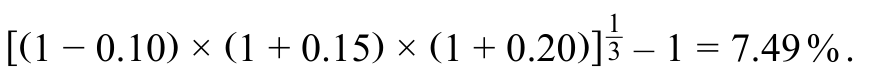

这种方法解释了多年来收益和损失的复利效应。

This method accounts for the compounding effect of gains and losses over the years.

答案B不正确。

Answer B is incorrect.

它计算算术平均值：

It computes the arithmetic average:

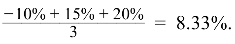

答案C不正确。

Answer C is incorrect.

它错误地对待第一年的负收益：

It treats the negative return during the first year incorrectly:

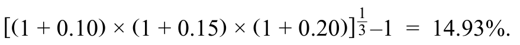

#### 补充解析 / Supplementary explanation

遇到多年累计收益，先将每一期的“一加收益率”相乘。若题目要累计收益，乘积减一；若要每期平均复利收益，再开期数次方后减一。

Multiply the period growth factors. Subtract one for cumulative return; take the nth root before subtracting one for the compound return per period.

易错点：不要把累计收益再乘以期数当年化收益。对于相同数据，几何平均一般不高于算术平均；只有各期收益完全相同时，两者才相等。

Common pitfall: Do not annualize a cumulative return by multiplying it by the number of periods. The geometric mean is no greater than the arithmetic mean, with equality for identical period returns.

#### 相关知识点 / Related concepts

#### 算术平均与几何平均 / Arithmetic and geometric mean returns

算术平均回答“各期收益率平均是多少”；几何平均回答“以每期同一个收益率复利，什么利率能得到同样的终值”。后者沿着财富实际增减的路径计算。

The arithmetic mean averages period returns. The geometric mean is the constant compound return that produces the same terminal wealth as the actual return sequence.

Rₐ = Σrₜ / n; Rg = \[∏(1 + rₜ)\]^(1/n) − 1

### QM-LM01-T001-02 · 课前测试：金融资产与金融工具的收益 · 第 2 题 PRE-TEST: RETURNS OF FINANCIAL ASSETS AND INSTRUMENTS · Question 2

课前自测 / Pre-test / self-assessment · 原版 PDF 页码 / Source PDF pages: 13-14

#### 题目与资料 / Question and data

2\. 股票在上半年持续复利收益率为10%，下半年则为40%。

2\. A stock experiences a continuously compounded return of 10% for the first half of a year and 40% for the second half.

其全年连续复利收益率最接近：

Its continuously compounded return for the full year is closest to:

**A.** 50.00%.

**B.** 54.00%.

**C.** 56.25%.

#### 官方答案与解析 / Official answer and explanation

解答

**Solution**

正确答案是A,50.00%。

The correct response is A, 50.00%.

随着时间的推移，连续复利的收益是添加剂。

Contiuously compounded returns are additive over time.

对于每个周期的收益，我们直接添加它们：上半年为10%，下半年为40%,10%+40%=50%。

For each period’s return, we directly add them: 10% for the first half and 40% for the second half, 10% + 40% = 50%.

答案B不正确。

Answer B is incorrect.

它不考虑连续复利收益的添加剂性质：1.1×1.4-1=54%。

It does not consider the additive property of continuously compounded returns: 1.1 × 1.4 – 1 = 54%.

这把收益看作是在这段时间内实现的简单收益，而忽略了它们是连续复利的。

This treats the returns as if they were realized simple returns for the period and ignores that they are continuously compounded.

选项 C 不正确。它先将两段连续复利收益率 10% 和 40% 相加并除以二，得到平均值 25%，然后把一加该平均值的结果平方后减去一，错误地算出期间收益率为 56.25%。

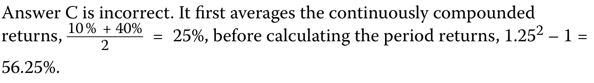

#### 补充解析 / Supplementary explanation

先计算期末与期初价值之比，再取自然对数。多期对数收益可以直接相加；若要回到普通百分比收益，最后用指数函数还原。

Take the natural logarithm of the ending-to-beginning value ratio. Sum log returns across periods, then use the exponential function to convert back to a simple return when required.

易错点：ln(1+r) 不等于 ln(r)，也不等于 r；仅在收益较小时才有近似相等。价格比反过来会把对数收益的正负号反转。

Common pitfall: ln(1+r) is neither ln(r) nor exactly r. The approximation to r is useful only for small returns; reversing the price ratio reverses the log-return sign.

#### 相关知识点 / Related concepts

#### 连续复利与对数收益 / Continuously compounded and log returns

对数收益把乘法的财富增长过程变成加法。简单收益率可以直接理解为财富变化比例；对数收益率则通过自然对数表达同一个增长倍数。

Log returns turn multiplicative wealth growth into addition. A simple return is the proportional wealth change, while a log return is the natural logarithm of the same growth factor.

rlog = ln(P₁/P₀) = ln(1+rsimple); rsimple = exp(rlog) − 1

### QM-LM01-T001-03 · 课前测试：金融资产与金融工具的收益 · 第 3 题 PRE-TEST: RETURNS OF FINANCIAL ASSETS AND INSTRUMENTS · Question 3

课前自测 / Pre-test / self-assessment · 原版 PDF 页码 / Source PDF pages: 13-15

#### 题目与资料 / Question and data

3\. 投资者以每股100美元购买1,000股。

3\. An investor purchases 1,000 shares at USD100 per share.

一年后她获得每股3美元的股息后，她以每股120美元的价格出售股票。

After she receives a dividend of USD3 per share one year later, she sells the shares for USD120 per share.

她的税率是资本收益的25%，资本分配的15%。

Her tax rate is 25% on capital gains and 15% on capital distributions.

她今年的税后收益最接近：

Her after-tax return for the year is closest to:

**A.** 17.25%.

**B.** 17.55%.

**C.** 19.25%.

#### 官方答案与解析 / Official answer and explanation

解答

**Solution**

正确答案是B,17.55%。

The correct response is B, 17.55%.

税后收益可以通过以下关系来计算：

The after-tax return can be calculated using the following relationship:

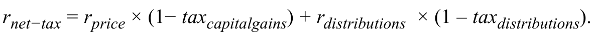

首先，计算价格收益：

First, the price return is calculated:

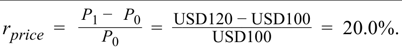

然后计算资本分配收益：

Then, the capital distribution return is calculated:

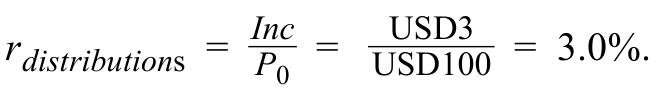

最后，计算相应的税后收益：

Finally, the respective after-tax returns are calculated:

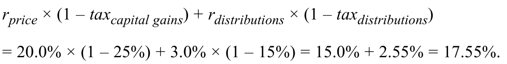

答案A不正确。

Answer A is incorrect.

它对两种收益来源都适用更高的资本利得税率：

It applies the higher capital gains tax rate on both sources of returns:

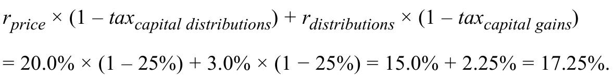

答案C不正确。

Answer C is incorrect.

它采用不正确的税率；具体而言，它扭转了税率。

It applies incorrect tax rates; specifically, it reverses the rates.

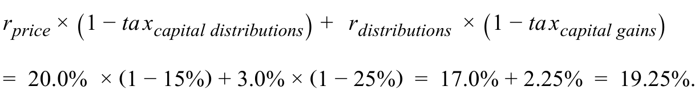

#### 补充解析 / Supplementary explanation

本题每股资本利得为 120−100=20，税后为 20×75%=15；股息税后为 3×85%=2.55。总计每股税后收益 17.55，相对于成本 100，收益率为 17.55%。

The per-share capital gain is 120−100=20, or 15 after a 25% tax. The after-tax dividend is 3×85%=2.55. Total after-tax profit is 17.55 per share on a cost of 100, giving 17.55%.

易错点：1,000 股同时扩大分子与分母，不改变收益率。不要把股息税率用于资本利得，也不要对全部售股收入征收资本利得税。

Pitfall: The 1,000 shares scale numerator and denominator equally. Do not apply the dividend tax rate to gains or tax all sale proceeds as capital gains.

#### 相关知识点 / Related concepts

#### 税后持有期收益 / After-tax holding-period return

资本利得与股息可能适用不同税率，应先分别计算税后金额，再除以同一笔初始投入。

Capital gains and dividends can face different tax rates. Calculate each after-tax amount separately and divide by the same initial investment.

Rafter tax = \[(P₁−P₀)(1−tcg) + D(1−tdiv)\] / P₀

### QM-LM01-T001-04 · 课前测试：金融资产与金融工具的收益 · 第 4 题 PRE-TEST: RETURNS OF FINANCIAL ASSETS AND INSTRUMENTS · Question 4

课前自测 / Pre-test / self-assessment · 原版 PDF 页码 / Source PDF pages: 13, 15

#### 题目与资料 / Question and data

4\. 在投资决策中，风险溢价：

4\. In investment decisions, the risk premium:

A. 保证预期收益符合实际收益。

**A.** guarantees that expected returns meet actual returns.

B. 补偿投资者与收益相关的不确定性。

**B.** compensates investors for uncertainty associated with returns.

C. 确保无风险的投资随着时间的推移提供一致的收益。

**C.** ensures that risk-free investments deliver consistent returns over time.

#### 官方答案与解析 / Official answer and explanation

解答

**Solution**

正确答案为 B。风险溢价补偿的是预期（事前）收益与实际（事后）收益可能存在差异所带来的风险，也就是对预期收益与实际实现收益之间的不确定性提供补偿。补偿的大小反映预期收益的不确定程度：不确定性越高，风险溢价越高。

The correct answer is B. The risk premium compensates for the risk associated with the variance between expected, *ex ante*, and actual, *ex post*, returns. It compensates for the uncertainty between expected and realized returns. The size of the compensation reflects the increased uncertainty about expected returns: The higher the uncertainty, the higher the risk premium.

答案 A 不正确。风险溢价不能保证实际实现的收益始终达到预期收益；它补偿的是预期与结果之间固有的不确定性。

Answer A is incorrect. The risk premium cannot guarantee that expected returns will always meet realized returns. The risk premium compensates for the inherent uncertainty between expectations and outcomes.

答案 C 不正确。风险溢价的目的并非使无风险投资在不同时期产生一致的收益。无风险投资不面临违约风险或再投资风险。

Answer C is incorrect. The risk premium is not intended to make risk-free investments deliver consistent returns over time. Risk-free investments do not face default or reinvestment risk.

#### 补充解析 / Supplementary explanation

读题先确认时间方向：是在投资前做预测、设定门槛，还是投资后评价结果。若比较毛收益与净收益，直接追踪管理费等费用有没有扣除。

Identify whether the question concerns an ex-ante forecast, an investment hurdle, or an ex-post outcome. For gross versus net returns, trace which fees have been deducted.

易错点：风险溢价并不保证事后一定赚得更多；预期收益也不会机械决定实际收益。历史实现收益不能直接当成无风险的未来承诺。

Common pitfall: A risk premium does not guarantee a higher realized payoff. Expectations do not mechanically determine outcomes, and historical returns are not risk-free promises.

#### 相关知识点 / Related concepts

#### 预期收益、必要收益与实际收益 / Expected, required, and realized returns

预期收益是事前预测，必要收益是投资者愿意承担相应风险所要求的补偿，实际收益是事后结果。风险溢价解释为什么承担不确定性时通常要求更高收益。

Expected return is a forecast, required return is the compensation demanded for the risk, and realized return is the outcome. Risk premia compensate for uncertainty rather than guarantee a payoff.

Required return = risk-free return + relevant risk premia

### QM-LM01-I001-01 · 知识检查：ETF 表现 · 第 1 题 KNOWLEDGE CHECK: ETF PERFORMANCE · Question 1

知识检查 / Knowledge check · 原版 PDF 页码 / Source PDF pages: 26

#### 题目与资料 / Question and data

1\. 评估三只最近成立的交易所交易基金收益的投资者在图9中收集以下信息：

1\. An investor evaluating the returns of three recently formed exchange-traded funds gathers the following information in Exhibit 9:

图表 9：ETF 表现信息

**Exhibit 9: ETF Performance Information**

表格对照

**列标题：**交易所交易基金（ETF）；成立以来的时间；成立以来的收益率（百分比）。

**行项目：**各 ETF 的存续时间分别以天、周和月表示。

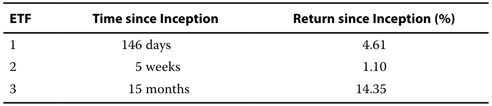

假设一年有365天，或52周或12个月，年化收益率最高的ETF是：

Assuming that a year has 365 days, or 52 weeks, or 12 months, the ETF with the highest annualized rate of return is:

A. ETF 1.

**A.** ETF 1.

B. ETF 2.

**B.** ETF 2.

C. ETF 3.

**C.** ETF 3.

#### 官方答案与解析 / Official answer and explanation

解答

**Solution**

正确答案是B. 年化收益涉及在给定的时期内获取收益，将其提高到1除以该期间所代表的年份的分数，然后减去1以获得年化率。

The correct response is B. Annualizing returns involves taking the return over a given period, raising it to the power of 1 divided by the fraction of the year that period represents, and then subtracting 1 to obtain the annualized rate.

ETF 2的年度收益率为：

The annualized rate of return for ETF 2 is:

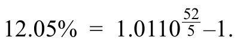

这高于ETF1和ETF3的年化率。

This is greater than the annualized rate of ETF 1 and ETF 3.

答案A不正确。

Answer A is incorrect.

ETF 1的年度收益率为：

The annualized return for ETF 1 is:

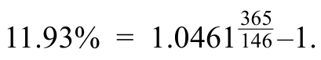

答案C不正确。

Answer C is incorrect.

ETF 3的年化收益率为：

The annualized return for ETF 3 is:

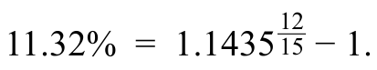

尽管周期性利率的价值最低，但由于再投资率假设和周期性利率的复利，ETF 2的年化收益率最高。

Despite having the lowest value for the periodic rate, ETF 2 has the highest annualized rate of return because of the reinvestment rate assumption and the compounding of the periodic rate.

#### 补充解析 / Supplementary explanation

先把持有期换成年的比例 T，再用 1/T 作为指数。对题目给定的天数、周数、月数基准分别处理；比较几只产品时，必须先统一期限再排序。

Express the holding period as a fraction T of a year and use exponent 1/T. Follow the stated day, week, or month convention, and compare products only after their periods are aligned.

易错点：期间收益率最高的产品未必年化收益率最高；直接加总或把收益率除以一年中的期数，都不符合复利换算。

Common pitfall: The highest holding-period return need not be the highest annualized return. Adding returns or dividing a period return by the periods per year does not perform compound annualization.

#### 相关知识点 / Related concepts

#### 年化收益与再投资假设 / Annualization and reinvestment

年化是在相同收益率能够重复实现的假设下，把不同持有期换到一年这个共同尺度。它不是未来收益承诺。短期收益很高，年化数字会被复利显著放大。

Annualization expresses different holding periods on a one-year scale under a repeatable-return assumption. It is not a forecast or a promise, and compounding can magnify a short-period result.

Rannual = (1 + Rperiod)^(1/T) − 1

### QM-LM01-I001-02 · 知识检查：ETF 表现 · 第 2 题 KNOWLEDGE CHECK: ETF PERFORMANCE · Question 2

知识检查 / Knowledge check · 原版 PDF 页码 / Source PDF pages: 26-27

#### 题目与资料 / Question and data

2\. 年收益率按以下方式计算：

2\. Annualized returns are calculated by:

A. 将一年内所有各期收益率相加。

**A.** adding all periodic returns within a year.

B. 将期间收益率除以一年中的期数。

**B.** dividing the periodic returns by the number of periods in a year.

C. 将一加几何平均期间收益率的结果，取一年中期数次幂，再减去一。

**C.** raising the sum of 1 plus the geometric average periodic return to the power of the number of periods in a year, then subtracting 1.

#### 官方答案与解析 / Official answer and explanation

解答

**Solution**

正确答案为 C。计算年化收益率时，先将一加期间收益率的结果取一年中期数次幂，再减去一；即年化收益率等于（一加期间收益率）的 c 次幂减一，其中 c 为一年中的期数。

The correct response is C. Annualized returns are determined by raising the sum of 1 plus the periodic return to the power of the number of periods in a year, then subtracting 1, or *r*annualized *=* (1 + *r*period)c – 1.

这种方法纳入了一年内多个时期的收益的复利效应。

This approach incorporates the compounding effect of returns over multiple periods within a year.

答案A不正确。

Answer A is incorrect.

这种方法没有考虑到收益的复利效应，这对于准确实现收益年化至关重要。

The approach fails to account for the compounding effects of returns, which is essential for accurately annualizing returns.

答案B不正确。

Answer B is incorrect.

这种方法过于简化了计算，并且无法准确捕获年化收益。

This approach oversimplifies the calculation and does not accurately capture annualized returns.

它忽略了复利效应，这是ETF案例中看到的收益年化的一个关键方面。

It neglects the compounding effect, a key aspect in the annualization of returns as seen in the ETF case.

#### 补充解析 / Supplementary explanation

先把持有期换成年的比例 T，再用 1/T 作为指数。对题目给定的天数、周数、月数基准分别处理；比较几只产品时，必须先统一期限再排序。

Express the holding period as a fraction T of a year and use exponent 1/T. Follow the stated day, week, or month convention, and compare products only after their periods are aligned.

易错点：期间收益率最高的产品未必年化收益率最高；直接加总或把收益率除以一年中的期数，都不符合复利换算。

Common pitfall: The highest holding-period return need not be the highest annualized return. Adding returns or dividing a period return by the periods per year does not perform compound annualization.

#### 相关知识点 / Related concepts

#### 年化收益与再投资假设 / Annualization and reinvestment

年化是在相同收益率能够重复实现的假设下，把不同持有期换到一年这个共同尺度。它不是未来收益承诺。短期收益很高，年化数字会被复利显著放大。

Annualization expresses different holding periods on a one-year scale under a repeatable-return assumption. It is not a forecast or a promise, and compounding can magnify a short-period result.

Rannual = (1 + Rperiod)^(1/T) − 1

### QM-LM01-I002-01 · 知识检查：各资产类别的历史收益 · 第 1 题 KNOWLEDGE CHECK: HISTORICAL ASSET CLASS RETURNS · Question 1

知识检查 / Knowledge check · 原版 PDF 页码 / Source PDF pages: 33-34

#### 题目与资料 / Question and data

#### 共用资料 / Shared information

一位分析师观察了图14所示的历史几何平均收益率：

An analyst observes the historic geometric average returns shown in Exhibit 14:

图表 14：各资产类别的历史收益

**Exhibit 14: Historic Asset Class Returns**

表格对照

**列标题：**资产类别；几何平均收益率（百分比）。

**行项目：**股票；公司债券；短期国库券。

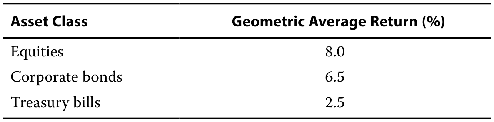

在此期间，平均通货膨胀率为2.1%。

The average inflation rate was 2.1% during that time.

1\. 股票的实际收益率为：

1\. The real rate of return for equities is:

**A.** 5.01%.

**B.** 5.78%.

**C.** 5.90%.

#### 官方答案与解析 / Official answer and explanation

解答

**Solution**

正确答案是 B. 将信息替换为 Equation 10 会产生实际收益率。

The correct response is B. Substituting the information into Equation 10 yields the real rate of return.

对于股票，这个比率是

For equities, this rate is

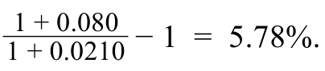

答案 A 是不正确的，因为它计算名义收益的几何平均值与实际收益：

Answer A is incorrect because it calculates the geometric average of the nominal return with the real return:

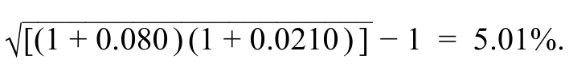

答案C是不正确的，因为它近似真实收益：8.0% - 2.1% = 5.9%。

Answer C is incorrect because it approximates the real return: 8.0% − 2.1% = 5.9%.

请注意，精确的实际收益率为5.78%，近似实际收益率为5.9%，两者相差−0.12个百分点，这一差异会随时间按复利累积。10年后，精确值对应的增长倍数为1.0578的10次方，即1.7540；近似值对应的增长倍数为1.0590的10次方，即1.7740。两者相差−2.0个百分点，说明近似收益率高估了复利增长效应。

Note that the difference between the precise real return and the approximate real return, 5.78% − 5.9% = −0.12%, compounds over time. Over 10 years, the compounded difference between the approximate and the precise return overestimates the compound growth effect by 1.057810 – 1.059010 = 1.7540 −1.7740 = −2.0%.

#### 补充解析 / Supplementary explanation

题目有费用时先区分税前/税后、毛收益/净收益，再决定哪一个名义收益需要扣除通胀。计算应与投资者最终能支配的现金口径一致。

Distinguish gross/net and pre-/after-tax returns before adjusting the relevant nominal return for inflation. Match the calculation to the cash the investor can actually retain.

易错点：简单相减只是近似式；通胀较高时应使用精确比率。费用、税收、通胀是三个不同调整，不能彼此替代。

Common pitfall: Subtracting inflation is an approximation. Use the exact ratio when precision matters; fees, taxes, and inflation are distinct adjustments.

#### 相关知识点 / Related concepts

#### 名义收益、实际收益与费用 / Nominal and real purchasing-power returns

名义收益表示货币金额增长，实际收益表示购买力增长。先赚到名义收益，再除以物价水平的增长倍数，才得到真正能多买多少商品。

Nominal return measures money growth; real return measures purchasing-power growth. Divide the investment growth factor by the price-level growth factor to measure the latter.

1 + rreal = (1 + rnominal) / (1 + inflation)

### QM-LM01-I002-02 · 知识检查：各资产类别的历史收益 · 第 2 题 KNOWLEDGE CHECK: HISTORICAL ASSET CLASS RETURNS · Question 2

知识检查 / Knowledge check · 原版 PDF 页码 / Source PDF pages: 33-34

#### 题目与资料 / Question and data

#### 共用资料 / Shared information

一位分析师观察了图14所示的历史几何平均收益率：

An analyst observes the historic geometric average returns shown in Exhibit 14:

图表 14：各资产类别的历史收益

**Exhibit 14: Historic Asset Class Returns**

表格对照

**列标题：**资产类别；几何平均收益率（百分比）。

**行项目：**股票；公司债券；短期国库券。

在此期间，平均通货膨胀率为2.1%。

The average inflation rate was 2.1% during that time.

2\. 公司债券的实际收益率最接近：

2\. The real rate of return for corporate bonds is closest to:

**A.** 4.31%.

**B.** 4.40%.

**C.** 8.60%.

#### 官方答案与解析 / Official answer and explanation

解答

**Solution**

正确答案是A.公司债券的实际收益率，在将信息替换为方程式10之后，是：

The correct response is A. The real rate of return for corporate bonds, after substituting the information into Equation 10, is:

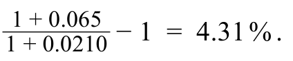

答案B是不正确的，因为它近似真实收益：6.5% - 2.1% = 4.4%。

Answer B is incorrect because it approximates the real return: 6.5% − 2.1% = 4.4%.

答案C不正确，因为它使用近似值并将通货膨胀添加到名义收益而不是减去：6.5% + 2.1% = 8.60%。

Answer C is incorrect because it uses the approximation and adds inflation to the nominal return instead of subtracting: 6.5% + 2.1% = 8.60%.

#### 补充解析 / Supplementary explanation

题目有费用时先区分税前/税后、毛收益/净收益，再决定哪一个名义收益需要扣除通胀。计算应与投资者最终能支配的现金口径一致。

Distinguish gross/net and pre-/after-tax returns before adjusting the relevant nominal return for inflation. Match the calculation to the cash the investor can actually retain.

易错点：简单相减只是近似式；通胀较高时应使用精确比率。费用、税收、通胀是三个不同调整，不能彼此替代。

Common pitfall: Subtracting inflation is an approximation. Use the exact ratio when precision matters; fees, taxes, and inflation are distinct adjustments.

#### 相关知识点 / Related concepts

#### 名义收益、实际收益与费用 / Nominal and real purchasing-power returns

名义收益表示货币金额增长，实际收益表示购买力增长。先赚到名义收益，再除以物价水平的增长倍数，才得到真正能多买多少商品。

Nominal return measures money growth; real return measures purchasing-power growth. Divide the investment growth factor by the price-level growth factor to measure the latter.

1 + rreal = (1 + rnominal) / (1 + inflation)

### QM-LM01-I002-03 · 知识检查：各资产类别的历史收益 · 第 3 题 KNOWLEDGE CHECK: HISTORICAL ASSET CLASS RETURNS · Question 3

知识检查 / Knowledge check · 原版 PDF 页码 / Source PDF pages: 33-35

#### 题目与资料 / Question and data

#### 共用资料 / Shared information

一位分析师观察了图14所示的历史几何平均收益率：

An analyst observes the historic geometric average returns shown in Exhibit 14:

图表 14：各资产类别的历史收益

**Exhibit 14: Historic Asset Class Returns**

表格对照

**列标题：**资产类别；几何平均收益率（百分比）。

**行项目：**股票；公司债券；短期国库券。

在此期间，平均通货膨胀率为2.1%。

The average inflation rate was 2.1% during that time.

3\. 股票的风险溢价最接近：

3\. The risk premium for equities is closest to:

**A.** 3.20%

**B.** 5.50%.

**C.** 5.78%

#### 官方答案与解析 / Official answer and explanation

解答

**Solution**

正确答案为B。股票风险溢价可以通过简化公式12来近似计算：首先将各因子贡献之和替换为股票i的风险溢价rpi，即：

The correct response is B. The risk premium for equities can be approximated by simplifying Equation 12 by first replacing ∑j=1 n *f* ij × *r* *p*j with *rp*i, or

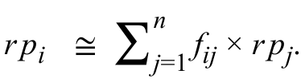

实际无风险利率和通货膨胀率的大致总和是(名义)无风险利率，重新调整后为：

The approximate sum of the real risk-free rate and the inflation rate is the (nominal) risk-free rate, which after rearranging is:

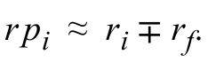

答案是8.00% - 2.50% = 5.50%。

The answer is then 8.00% − 2.50% = 5.50%.

答案A不正确，因为它计算风险溢价为

Answer A is incorrect because it calculates the risk premium as

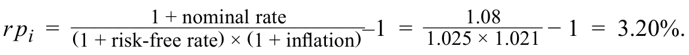

答案C是不正确的，因为它计算风险溢价为

Answer C is incorrect because it calculates the risk premium as

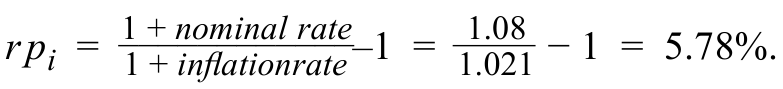

#### 补充解析 / Supplementary explanation

读题先确认时间方向：是在投资前做预测、设定门槛，还是投资后评价结果。若比较毛收益与净收益，直接追踪管理费等费用有没有扣除。

Identify whether the question concerns an ex-ante forecast, an investment hurdle, or an ex-post outcome. For gross versus net returns, trace which fees have been deducted.

易错点：风险溢价并不保证事后一定赚得更多；预期收益也不会机械决定实际收益。历史实现收益不能直接当成无风险的未来承诺。

Common pitfall: A risk premium does not guarantee a higher realized payoff. Expectations do not mechanically determine outcomes, and historical returns are not risk-free promises.

#### 相关知识点 / Related concepts

#### 预期收益、必要收益与实际收益 / Expected, required, and realized returns

预期收益是事前预测，必要收益是投资者愿意承担相应风险所要求的补偿，实际收益是事后结果。风险溢价解释为什么承担不确定性时通常要求更高收益。

Expected return is a forecast, required return is the compensation demanded for the risk, and realized return is the outcome. Risk premia compensate for uncertainty rather than guarantee a payoff.

Required return = risk-free return + relevant risk premia

### QM-LM01-I003-01 · 知识检查：基金表现 · 第 1 题 KNOWLEDGE CHECK: FUND PERFORMANCE · Question 1

知识检查 / Knowledge check · 原版 PDF 页码 / Source PDF pages: 37-38

#### 题目与资料 / Question and data

#### 共用资料 / Shared information

一家专注于环境可持续及社会责任投资的基金报告，其扣除成本前的年度总收益率为 −5%。基金总资产价值为 5 亿瑞士法郎。基金承担 0.05% 的交易成本、1.00% 的管理费和 0.50% 的行政费用，均以总资产价值的百分比表示。管理费按年末资产价值计提。

An investment fund, specialized in environmentally sustainable and socially responsible investments, reported a total annual return of −5% before costs. The fund's total assets were valued at CHF500 million. The fund incurs transaction costs of 0.05%, a management fee of 1.00%, and administrative expenses amounting to 0.50%—all as a percentage of its total asset value. The management fee is assessed at the assets at the end of the year.

1\. 基金的总收益最接近：

1\. The fund’s gross return is closest to:

**A.** −4.95%.

**B.** −5.05%.

**C.** −6.55%.

#### 官方答案与解析 / Official answer and explanation

解答

**Solution**

正确答案为 B，即 −5.05%。毛收益率由总收益率减去交易成本计算。基金的总收益率为 −5%，交易成本为 0.05%，扣除后毛收益率进一步下降，即 −5%−0.05%＝−5.05%。

The correct response is B, −5.05%. The gross return is calculated by subtracting transaction costs from the total return. The total return of the fund is −5%. The transaction costs are 0.05%, and the gross return is further reduced, or −5% − 0.05% = −5.05%.

选项A不正确，因为它增加了交易成本。

Alternative A is incorrect because it adds back the transaction costs.

选项C是不正确的，因为它计算的是净收益而不是总收益。

Alternative C is incorrect because it calculates the net return instead of the gross return.

#### 补充解析 / Supplementary explanation

读题先确认时间方向：是在投资前做预测、设定门槛，还是投资后评价结果。若比较毛收益与净收益，直接追踪管理费等费用有没有扣除。

Identify whether the question concerns an ex-ante forecast, an investment hurdle, or an ex-post outcome. For gross versus net returns, trace which fees have been deducted.

易错点：风险溢价并不保证事后一定赚得更多；预期收益也不会机械决定实际收益。历史实现收益不能直接当成无风险的未来承诺。

Common pitfall: A risk premium does not guarantee a higher realized payoff. Expectations do not mechanically determine outcomes, and historical returns are not risk-free promises.

#### 相关知识点 / Related concepts

#### 预期收益、必要收益与实际收益 / Expected, required, and realized returns

预期收益是事前预测，必要收益是投资者愿意承担相应风险所要求的补偿，实际收益是事后结果。风险溢价解释为什么承担不确定性时通常要求更高收益。

Expected return is a forecast, required return is the compensation demanded for the risk, and realized return is the outcome. Risk premia compensate for uncertainty rather than guarantee a payoff.

Required return = risk-free return + relevant risk premia

### QM-LM01-I003-02 · 知识检查：基金表现 · 第 2 题 KNOWLEDGE CHECK: FUND PERFORMANCE · Question 2

知识检查 / Knowledge check · 原版 PDF 页码 / Source PDF pages: 37-38

#### 题目与资料 / Question and data

#### 共用资料 / Shared information

一家专注于环境可持续及社会责任投资的基金报告，其扣除成本前的年度总收益率为 −5%。基金总资产价值为 5 亿瑞士法郎。基金承担 0.05% 的交易成本、1.00% 的管理费和 0.50% 的行政费用，均以总资产价值的百分比表示。管理费按年末资产价值计提。

An investment fund, specialized in environmentally sustainable and socially responsible investments, reported a total annual return of −5% before costs. The fund's total assets were valued at CHF500 million. The fund incurs transaction costs of 0.05%, a management fee of 1.00%, and administrative expenses amounting to 0.50%—all as a percentage of its total asset value. The management fee is assessed at the assets at the end of the year.

2\. 基金的净收益最接近：

2\. The fund’s net return is closest to:

**A.** −6.55%.

**B.** −6.05%.

**C.** −5.05%.

#### 官方答案与解析 / Official answer and explanation

解答

**Solution**

正确答案为 A，即 −6.55%。基金扣除交易成本后的毛收益率为 −5.05%。还需再扣除 1.00% 的管理费和 0.50% 的行政费用，计算为 −5.05%−1.00%−0.50%＝−6.55%。

The correct response is A, −6.55%. The gross return of the fund, after transaction costs, is −5.05%. We then need to deduct the management fee of 1.00% and administrative expenses of 0.50%. The calculation is –5.05% − 1.00% − 0.50% = −6.55%.

选项B不正确，因为它忽略了-0.5%的行政费用。

Alternative B is incorrect because it ignores the administrative expenses of − 0.5%.

选项 C 不正确，因为它没有计入全部费用与支出，也没有计入 1.00% 的管理费和 0.50% 的行政费用。

Alternative C is incorrect because it neither factors in all fees and expenses nor the management fee of 1.00% and administrative expenses of 0.50%.

#### 补充解析 / Supplementary explanation

读题先确认时间方向：是在投资前做预测、设定门槛，还是投资后评价结果。若比较毛收益与净收益，直接追踪管理费等费用有没有扣除。

Identify whether the question concerns an ex-ante forecast, an investment hurdle, or an ex-post outcome. For gross versus net returns, trace which fees have been deducted.

易错点：风险溢价并不保证事后一定赚得更多；预期收益也不会机械决定实际收益。历史实现收益不能直接当成无风险的未来承诺。

Common pitfall: A risk premium does not guarantee a higher realized payoff. Expectations do not mechanically determine outcomes, and historical returns are not risk-free promises.

#### 相关知识点 / Related concepts

#### 预期收益、必要收益与实际收益 / Expected, required, and realized returns

预期收益是事前预测，必要收益是投资者愿意承担相应风险所要求的补偿，实际收益是事后结果。风险溢价解释为什么承担不确定性时通常要求更高收益。

Expected return is a forecast, required return is the compensation demanded for the risk, and realized return is the outcome. Risk premia compensate for uncertainty rather than guarantee a payoff.

Required return = risk-free return + relevant risk premia

### QM-LM01-P001 · 章末练习 1 Practice Problem 1

章末练习 / Practice problem · 原版 PDF 页码 / Source PDF pages: 49, 53

#### 题目与资料 / Question and data

1\. 投资者在本季度初以每股34.50挪威克朗的价格购买了100股股票。

**1.** An investor purchased 100 shares of a stock for NOK34.50 per share at the beginning of the quarter.

本季度末，投资者在收到本季度末总股息支付51.55挪威克朗后以每股30.50挪威克朗的价格出售股票。

At the end of the quarter, the investor sells the shares for NOK30.50 per share after receiving a total dividend payment of NOK51.55 at the end of the quarter.

持有期收益最接近：

The holding period return is closest to:

**A.** −13.08%.

**B.** −11.59%.

**C.** −10.10%.

#### 官方答案与解析 / Official answer and explanation

1\. 正确答案为C,−10.1%，持仓收益期计算如下：

1\. The correct response is C, −10.1%, the holding return period is calculated as:

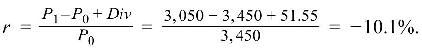

资本分配收益率（即股息收益率）为 1.49%，由 51.55 除以 3,450 得到；资本利得收益率在本例中为损失，将 −400 除以 3,450，得到 −11.59%。

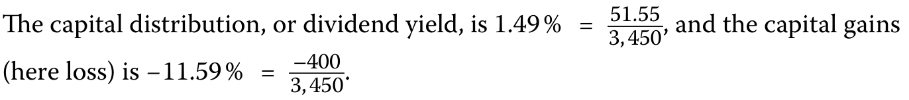

选项A不正确，因为它错误地从资本损失中减去资本分配，即−11.59%减去1.49%，得到−13.08%。选项B不正确，因为它只考虑−11.59%的资本损失，而忽略了资本分配。

Alternative A is incorrect because it incorrectly subtracts the capital distribution from the capital loss, –11.59% – 1.49% = –13.08%. Alternative B is incorrect because it only considers the capital loss, − 11.59%, and ignores the capital distribution.

#### 补充解析 / Supplementary explanation

先把股数口径统一：每股价格要配每股股息，总持仓成本要配总股息。随后分别计算价格收益与分配收益，再相加；持有期不是一年时，这一步得到的仍是持有期收益。

Keep units consistent: per-share prices require per-share dividends, while total position values require total distributions. Compute the two return components and add them; annualization is a separate step.

易错点：最常见的错误是遗漏股息、把总股息直接加到每股价格，或用期末价格作分母。收益率为负并不意味着分配收益也为负。

Common pitfall: Common errors omit dividends, mix total dividends with per-share prices, or divide by the ending price. A negative total return need not imply a negative income component.

把题目金额放入同一口径：初始投入为 100 × 34.50 = NOK 3,450；卖出收到 100 × 30.50 = NOK 3,050；另收到股息 NOK 51.55。净损益是 −348.45，所以 −348.45 ÷ 3,450 = −10.10%。A 把股息当成额外损失，B 则漏掉股息。

Use consistent amounts: initial cost is NOK 3,450, sale proceeds NOK 3,050, and dividends NOK 51.55. Net profit is −348.45, giving −10.10%. A treats the dividend as a further loss; B omits it.

#### 相关知识点 / Related concepts

#### 持有期总收益 / Holding-period total return

收益来自两条渠道：持有期间收到的分配，以及卖出价格相对买入价格的变化。两项都以最初投入为分母。股价下跌时，股息只能部分抵消资本损失。

Total return combines distributions received and the change in price, measured relative to the initial investment. Dividends can offset part of a price loss without making the overall return positive.

HPR = (P₁ − P₀ + D) / P₀ = price return + distribution yield

### QM-LM01-P002 · 章末练习 2 Practice Problem 2

章末练习 / Practice problem · 原版 PDF 页码 / Source PDF pages: 49, 53

#### 题目与资料 / Question and data

2\. 分析师获得共同基金的以下年度收益率：

**2.** An analyst obtains the following annual rates of return for a mutual fund:

表格对照

**列标题：**年份；收益率（百分比）。

该基金在三年期内的持有期收益最接近：

The fund’s holding period return over the three-year period is closest to:

**A.** 0.18%.

**B.** 0.55%.

**C.** 1.65%.

#### 官方答案与解析 / Official answer and explanation

2\. 正确答案为 B。将三个期间的增长因子依次相乘并减去一，即（1＋0.14）×（1−0.10）×（1−0.02）−1，得到 0.0055。原文将此写作 55%，与前面的 0.0055 不一致。

2\. The correct response is B. (1 + 0.14) × (1 – 0.10) × (1 – 0.02) – 1 = 0.0055 = 55%.

选项A不正确。

Alternative A is incorrect.

虽然它正确地计算了持有期收益，但它计算了几何平均收益值，或：

Although it calculated the holding period returns correctly, it computed the geometric average return, or:

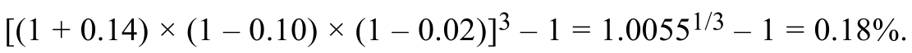

选项C是不正确的。

Alternative C is incorrect.

虽然它正确地计算了持有期收益，但它选择扩大收益，或：

Although it calculated the holding period returns correctly, it chose to scale up the returns, or:

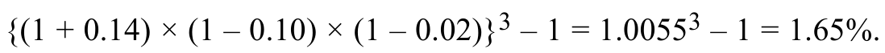

#### 补充解析 / Supplementary explanation

本题问三年累计持有期收益，不是年化或每年平均收益。因此把三年的财富增长倍数相乘后减一，不开三次方。

This asks for the cumulative three-year holding-period return, not an annualized average. Multiply the three wealth growth factors and subtract one; do not take a cube root.

计算复核：1.14×0.90×0.98−1=0.00548，即 0.548%，约为 0.55%，因此选 B。原版 PDF 第53页写成“55%”，属于百分比换算笔误。原文保留，正确结果在此说明。

Arithmetic check: 1.14×0.90×0.98−1=0.00548, or 0.548%, approximately 0.55%; therefore B. Source PDF page 53 prints “55%”, a percentage-conversion error. The original is retained and the correct conversion explained here.

若题目改问几何平均年收益，才使用 (1.00548)^(1/3)−1，约 0.1823%；把年收益相加得到 2% 也不代表实际三年复合回报。

Only a question about the geometric annual mean would use (1.00548)^(1/3)−1, approximately 0.1823%. Adding the annual returns to obtain 2% also does not give the actual compounded three-year return.

#### 相关知识点 / Related concepts

#### 算术平均与几何平均 / Arithmetic and geometric mean returns

算术平均回答“各期收益率平均是多少”；几何平均回答“以每期同一个收益率复利，什么利率能得到同样的终值”。后者沿着财富实际增减的路径计算。

The arithmetic mean averages period returns. The geometric mean is the constant compound return that produces the same terminal wealth as the actual return sequence.

Rₐ = Σrₜ / n; Rg = \[∏(1 + rₜ)\]^(1/n) − 1

已复核原书百分比笔误 / Verified source percentage typo: 55% → approximately 0.55%.

### QM-LM01-P003 · 章末练习 3 Practice Problem 3

章末练习 / Practice problem · 原版 PDF 页码 / Source PDF pages: 49, 53

#### 题目与资料 / Question and data

3\. 分析师观察对冲基金的以下年度收益率：

**3.** An analyst observes the following annual rates of return for a hedge fund:

表格对照

**列标题：**年份；收益率（百分比）。

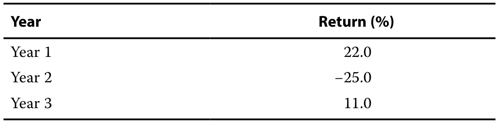

对冲基金的年度几何平均收益率最接近：

The hedge fund’s annual geometric mean return is closest to:

**A.** 0.5%.

**B.** 1.6%.

**C.** 2.7%.

#### 官方答案与解析 / Official answer and explanation

3\. 正确答案是A. 这正确地计算了几何平均值：

3\. The correct response is A. This correctly computes the geometric average:

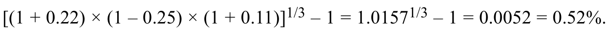

选项B不正确。

Alternative B is incorrect.

虽然它正确地计算了基金的总增长，但它没有计算几何平均值：

Although it correctly calculates the aggregate growth of the fund, it does not calculate the geometric average:

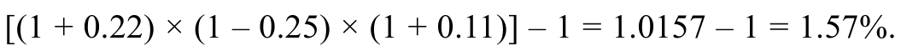

选项C是不正确的，因为它是收益的算术平均值，或者：

Alternative C is incorrect because it is the arithmetic average of returns, or:

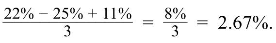

#### 补充解析 / Supplementary explanation

遇到多年累计收益，先将每一期的“一加收益率”相乘。若题目要累计收益，乘积减一；若要每期平均复利收益，再开期数次方后减一。

Multiply the period growth factors. Subtract one for cumulative return; take the nth root before subtracting one for the compound return per period.

易错点：不要把累计收益再乘以期数当年化收益。对于相同数据，几何平均一般不高于算术平均；只有各期收益完全相同时，两者才相等。

Common pitfall: Do not annualize a cumulative return by multiplying it by the number of periods. The geometric mean is no greater than the arithmetic mean, with equality for identical period returns.

#### 相关知识点 / Related concepts

#### 算术平均与几何平均 / Arithmetic and geometric mean returns

算术平均回答“各期收益率平均是多少”；几何平均回答“以每期同一个收益率复利，什么利率能得到同样的终值”。后者沿着财富实际增减的路径计算。

The arithmetic mean averages period returns. The geometric mean is the constant compound return that produces the same terminal wealth as the actual return sequence.

Rₐ = Σrₜ / n; Rg = \[∏(1 + rₜ)\]^(1/n) − 1

### QM-LM01-P004 · 章末练习 4 Practice Problem 4

章末练习 / Practice problem · 原版 PDF 页码 / Source PDF pages: 49-50, 53

#### 题目与资料 / Question and data

4\. 分析师观察投资经理产生的以下年度收益率：

**4.** An analyst observes the following annual rates of return generated by an investment manager:

表格对照

**列标题：**年份；投资经理收益率（百分比）。

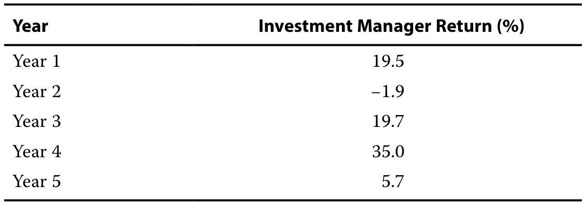

投资经理的几何平均收益率最接近：

The geometric mean return for the investment manager is closest to:

**A.** 14.9%.

**B.** 15.6%.

**C.** 20.05%.

#### 官方答案与解析 / Official answer and explanation

4\. 正确答案是A. 几何平均收益率如下所示：

4\. The correct response is A. The geometric mean return is found as follows:

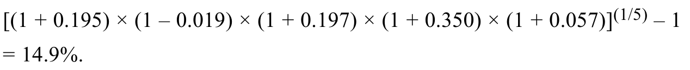

选项B是不正确的，因为它是收益的算术平均值，或者：

Alternative B is incorrect because it is the arithmetic average of returns, or:

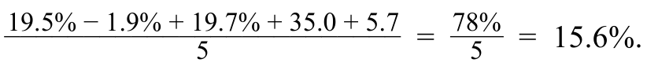

选项C是不正确的。

Alternative C is incorrect.

虽然它正确地计算了基金的总增长，但它没有计算几何平均值：

Although it correctly calculates the aggregate growth of the fund, it does not calculate the geometric average:

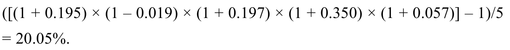

#### 补充解析 / Supplementary explanation

遇到多年累计收益，先将每一期的“一加收益率”相乘。若题目要累计收益，乘积减一；若要每期平均复利收益，再开期数次方后减一。

Multiply the period growth factors. Subtract one for cumulative return; take the nth root before subtracting one for the compound return per period.

易错点：不要把累计收益再乘以期数当年化收益。对于相同数据，几何平均一般不高于算术平均；只有各期收益完全相同时，两者才相等。

Common pitfall: Do not annualize a cumulative return by multiplying it by the number of periods. The geometric mean is no greater than the arithmetic mean, with equality for identical period returns.

#### 相关知识点 / Related concepts

#### 算术平均与几何平均 / Arithmetic and geometric mean returns

算术平均回答“各期收益率平均是多少”；几何平均回答“以每期同一个收益率复利，什么利率能得到同样的终值”。后者沿着财富实际增减的路径计算。

The arithmetic mean averages period returns. The geometric mean is the constant compound return that produces the same terminal wealth as the actual return sequence.

Rₐ = Σrₜ / n; Rg = \[∏(1 + rₜ)\]^(1/n) − 1

### QM-LM01-P005 · 章末练习 5 Practice Problem 5

章末练习 / Practice problem · 原版 PDF 页码 / Source PDF pages: 50, 53

#### 题目与资料 / Question and data

5\. 分析投资收益时，下列哪一种说法是正确的?

**5.** When analyzing investment returns, which of the following statements is correct?

A. 几何均值将超过非零方差的序列的算术均值。

**A.** The geometric mean will exceed the arithmetic mean for a series with non-zero variance.

B. 几何均值衡量投资在多个时期的复合增长率。

**B.** The geometric mean measures an investment’s compound rate of growth over multiple periods.

C. 算术是指在多个时期内测量投资的终端价值。

**C.** The arithmetic mean measures an investment’s terminal value over multiple periods.

#### 官方答案与解析 / Official answer and explanation

5\. 正确答案为 B。几何平均收益率对每一期收益进行复利累积，因此能更准确地衡量投资的终值。选项 A 不正确：如果一组收益率的方差为零，即收益率没有变化，几何平均收益率并不高于算术平均收益率，两者相等。请回顾算术平均数与几何平均数之间的不等式关系：收益率的变动程度越大，两者的差距越大；若收益率没有变化，算术平均收益率与几何平均收益率就没有差别。选项 C 不正确，因为衡量投资跨多个期间终值的是复合增长率，而不是算术平均收益率。

5\. The correct response is B. The geometric mean compounds the periodic returns of every period, giving the investor a more accurate measure of the terminal value of an investment. Alternative A is incorrect: Geometric mean will not exceed the arithmetic mean for a series with zero variance (i.e., no variability in returns) but will be the same as the arithmetic mean. Recall that the arithmetic–geometric mean inequality principle states that the difference between the arithmetic and geometric mean returns increases with the variability of the returns. If there is no variability in returns, there is no difference between the arithmetic and geometric average. Alternative C is incorrect because it is the compound growth rate and not the arithmetic mean that measures an investment’s terminal value over multiple periods.

#### 补充解析 / Supplementary explanation

遇到多年累计收益，先将每一期的“一加收益率”相乘。若题目要累计收益，乘积减一；若要每期平均复利收益，再开期数次方后减一。

Multiply the period growth factors. Subtract one for cumulative return; take the nth root before subtracting one for the compound return per period.

易错点：不要把累计收益再乘以期数当年化收益。对于相同数据，几何平均一般不高于算术平均；只有各期收益完全相同时，两者才相等。

Common pitfall: Do not annualize a cumulative return by multiplying it by the number of periods. The geometric mean is no greater than the arithmetic mean, with equality for identical period returns.

#### 相关知识点 / Related concepts

#### 算术平均与几何平均 / Arithmetic and geometric mean returns

算术平均回答“各期收益率平均是多少”；几何平均回答“以每期同一个收益率复利，什么利率能得到同样的终值”。后者沿着财富实际增减的路径计算。

The arithmetic mean averages period returns. The geometric mean is the constant compound return that produces the same terminal wealth as the actual return sequence.

Rₐ = Σrₜ / n; Rg = \[∏(1 + rₜ)\]^(1/n) − 1

### QM-LM01-P006 · 章末练习 6 Practice Problem 6

章末练习 / Practice problem · 原版 PDF 页码 / Source PDF pages: 50, 54

#### 题目与资料 / Question and data

6\. 基金在过去10年中具有以下收益：

**6.** A fund had the following returns over the past 10 years:

表格对照

**列标题：**年份；收益率。

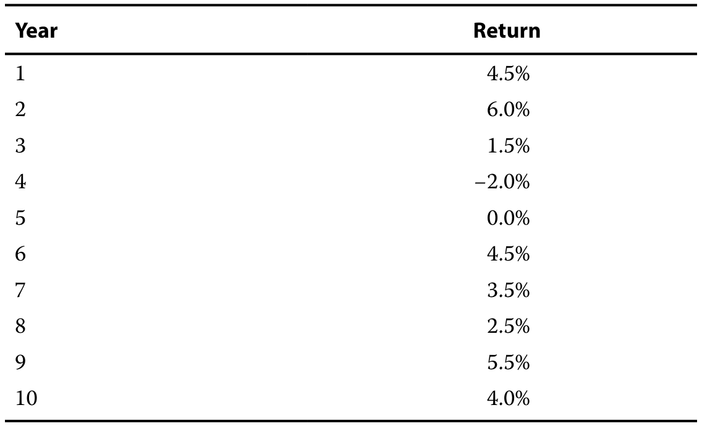

在10年内，算术和几何平均收益率之间的差异最接近以下哪个?

The difference between the arithmetic and geometric mean returns over the 10 years is closest to which of the following?

A. 算术收益值高3 bps。

**A.** The arithmetic return is 3 bps higher.

B. 收益值相同(即 0 bps 差值)。

**B.** The returns are the same (i.e., 0 bps difference).

C. 几何收益值高出3 bps。

**C.** The geometric return is 3 bps higher.

#### 官方答案与解析 / Official answer and explanation

6\. 正确答案为 A。各期收益率之和为 30.0%，将其除以 10，得到算术平均收益率 3.0%。

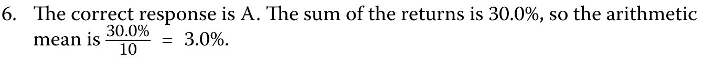

对于几何平均值，

For the geometric mean,

表格对照

**列标题：**年份；收益率；一加收益率。

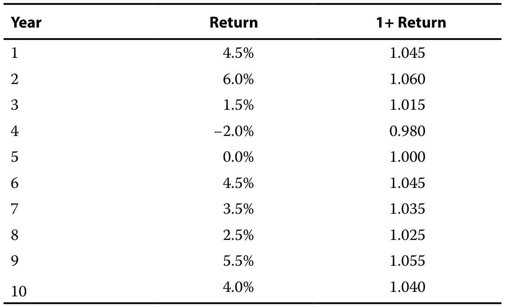

各期“一加收益率”的乘积为 1.3402。将该乘积开十次方根后减去一，得到几何平均收益率 2.97%。因此，算术平均收益率比几何平均收益率高 3 个基点。

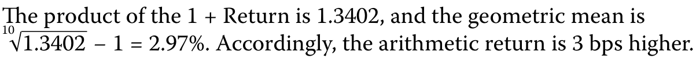

#### 补充解析 / Supplementary explanation

遇到多年累计收益，先将每一期的“一加收益率”相乘。若题目要累计收益，乘积减一；若要每期平均复利收益，再开期数次方后减一。

Multiply the period growth factors. Subtract one for cumulative return; take the nth root before subtracting one for the compound return per period.

易错点：不要把累计收益再乘以期数当年化收益。对于相同数据，几何平均一般不高于算术平均；只有各期收益完全相同时，两者才相等。

Common pitfall: Do not annualize a cumulative return by multiplying it by the number of periods. The geometric mean is no greater than the arithmetic mean, with equality for identical period returns.

#### 相关知识点 / Related concepts

#### 算术平均与几何平均 / Arithmetic and geometric mean returns

算术平均回答“各期收益率平均是多少”；几何平均回答“以每期同一个收益率复利，什么利率能得到同样的终值”。后者沿着财富实际增减的路径计算。

The arithmetic mean averages period returns. The geometric mean is the constant compound return that produces the same terminal wealth as the actual return sequence.

Rₐ = Σrₜ / n; Rg = \[∏(1 + rₜ)\]^(1/n) − 1

### QM-LM01-P007 · 章末练习 7 Practice Problem 7

章末练习 / Practice problem · 原版 PDF 页码 / Source PDF pages: 50, 54

#### 题目与资料 / Question and data

7、t=0的股票价格为208.25元，t=1时为186.75元。

**7.** The price of a stock at *t* = 0 is CNY208.25, and at *t* = 1, it is CNY186.75.

股票的连续复利收益率r1,T最接近：

The continuously compounded rate of return, *r*1,T for the stock is closest to:

**A.** −10.89%.

**B.** −10.32%.

**C.** 10.90%.

#### 官方答案与解析 / Official answer and explanation

7\. 正确答案为 A。从时点 0 到时点 1 的连续复利收益率为：

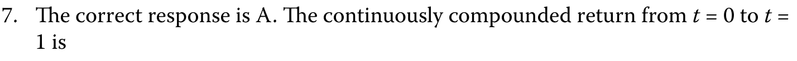

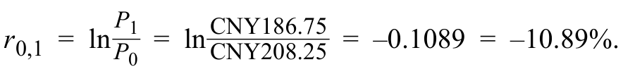

选项B不正确：它计算

Alternative B is incorrect: It calculates

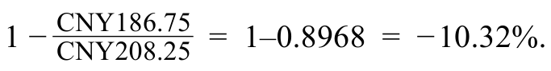

选项C是不正确的：它扭转价格在t = 0和t = 1，或

Alternative C is incorrect: It reverses the prices at *t* = 0 and *t* = 1, or

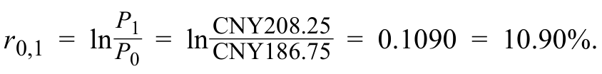

#### 补充解析 / Supplementary explanation

连续复利收益率使用价格比的自然对数：ln(186.75/208.25)=−0.108968，约为 −10.90%，最接近 A（−10.89%）。B 的 −10.32% 来自简单收益率 186.75/208.25−1；C 把期初、期末价格倒置，导致负收益变成正数。价格下跌时，两种收益率都应为负。

Use the natural logarithm of the price ratio: ln(186.75/208.25)=−0.108968, approximately −10.90%, closest to A (−10.89%). B uses the simple return, 186.75/208.25−1, approximately −10.32%. C reverses the price ratio and changes the sign. Both valid return measures must be negative when the price falls.

#### 相关知识点 / Related concepts

#### 连续复利收益率 / Continuously compounded return

简单收益率与连续复利收益率可相互转换。多期连续复利收益率可以直接相加；多期简单收益率须先连乘增长倍数。

Simple and continuously compounded returns are convertible. Log returns add across periods; simple returns compound through their growth factors.

rcc = ln(P₁/P₀) = ln(1+R); R = exp(rcc)−1

### QM-LM01-P008 · 章末练习 8 Practice Problem 8

章末练习 / Practice problem · 原版 PDF 页码 / Source PDF pages: 50-51, 54

#### 题目与资料 / Question and data

8\. 投资分析的几何平均收益率意味着什么?

**8.** What does the geometric mean return in investment analysis signify?

A. 所有持有期收益的简单平均数。

**A.** The simple average of all holding period returns.

B. 资产价值随时间增长的平均速度，考虑了收益的复利。

**B.** The average rate at which an asset’s value grows over time, accounting for the compounding of returns.

C. 经理在扣除交易费用和佣金后获得的收益。

**C.** The return earned by a manager after the deduction of trading expenses and commissions.

#### 官方答案与解析 / Official answer and explanation

8\. 正确答案为 B，即考虑收益复利效应后，资产价值随时间增长的平均速度。与算术平均收益率不同，几何平均收益率考虑了时间推移中的复利效应，并量化投资的平均增长率。选项 A 不正确，它指的是算术平均收益率。选项 C 不正确，它指的是管理人的毛收益率。

8\. The correct response is B, the average rate at which an asset’s value grows over time, accounting for the compounding of returns. The geometric mean return, unlike the arithmetic mean, accounts for the compounding effect over time and quantifies the average growth rate of an investment. Alternative A is incorrect: It refers to the arithmetic average return. Alternative C is incorrect: It refers to a manager’s gross returns.

#### 补充解析 / Supplementary explanation

遇到多年累计收益，先将每一期的“一加收益率”相乘。若题目要累计收益，乘积减一；若要每期平均复利收益，再开期数次方后减一。

Multiply the period growth factors. Subtract one for cumulative return; take the nth root before subtracting one for the compound return per period.

易错点：不要把累计收益再乘以期数当年化收益。对于相同数据，几何平均一般不高于算术平均；只有各期收益完全相同时，两者才相等。

Common pitfall: Do not annualize a cumulative return by multiplying it by the number of periods. The geometric mean is no greater than the arithmetic mean, with equality for identical period returns.

#### 相关知识点 / Related concepts

#### 算术平均与几何平均 / Arithmetic and geometric mean returns

算术平均回答“各期收益率平均是多少”；几何平均回答“以每期同一个收益率复利，什么利率能得到同样的终值”。后者沿着财富实际增减的路径计算。

The arithmetic mean averages period returns. The geometric mean is the constant compound return that produces the same terminal wealth as the actual return sequence.

Rₐ = Σrₜ / n; Rg = \[∏(1 + rₜ)\]^(1/n) − 1

### QM-LM01-P009 · 章末练习 9 Practice Problem 9

章末练习 / Practice problem · 原版 PDF 页码 / Source PDF pages: 51, 54

#### 题目与资料 / Question and data

9\. 为投资分析目的，对数收益：

**9.** For investment analysis purposes, logarithmic returns:

A. 等于投资期内周期性几何收益的总和。

**A.** equal the sum of periodic geometric returns over the investment period.

B. 调整投资在多个时期内对通货膨胀的最终价值。

**B.** adjust the final value of an investment for inflation over multiple periods.

C. 要求取最终值与初始值之比的自然对数。

**C.** require taking the natural logarithm of the ratio of the final value to the initial value.

#### 官方答案与解析 / Official answer and explanation

9\. 正确答案为 C。对数收益率的计算方法是：用最终投资价值 P_T 除以初始投资价值 P₀，再对这个比值取自然对数。选项 A 不正确，对数收益率需要使用对数函数计算，并非简单地将各期普通收益率相加。选项 B 不正确，对数收益率的计算本身并不调整通货膨胀；通货膨胀调整是另一个需要单独考虑的问题。

9\. The correct response is C. Logarithmic returns are calculated by taking the natural logarithm of the ratio of the final, *P*T, to the initial investment, *P*0, value. Alternative A is incorrect: Logarithmic returns involve a logarithmic function for calculation, not simply summing up periodic returns. Alternative B is incorrect: Logarithmic returns calculate the rate of return without adjusting for inflation; inflation adjustments are a separate consideration.

#### 补充解析 / Supplementary explanation

先计算期末与期初价值之比，再取自然对数。多期对数收益可以直接相加；若要回到普通百分比收益，最后用指数函数还原。

Take the natural logarithm of the ending-to-beginning value ratio. Sum log returns across periods, then use the exponential function to convert back to a simple return when required.

易错点：ln(1+r) 不等于 ln(r)，也不等于 r；仅在收益较小时才有近似相等。价格比反过来会把对数收益的正负号反转。

Common pitfall: ln(1+r) is neither ln(r) nor exactly r. The approximation to r is useful only for small returns; reversing the price ratio reverses the log-return sign.

#### 相关知识点 / Related concepts

#### 连续复利与对数收益 / Continuously compounded and log returns

对数收益把乘法的财富增长过程变成加法。简单收益率可以直接理解为财富变化比例；对数收益率则通过自然对数表达同一个增长倍数。

Log returns turn multiplicative wealth growth into addition. A simple return is the proportional wealth change, while a log return is the natural logarithm of the same growth factor.

rlog = ln(P₁/P₀) = ln(1+rsimple); rsimple = exp(rlog) − 1

### QM-LM01-P010 · 章末练习 10 Practice Problem 10

章末练习 / Practice problem · 原版 PDF 页码 / Source PDF pages: 51, 55

#### 题目与资料 / Question and data

10\. 投资年化收益的一个主要限制是隐含的假设：

**10.** A major limitation of annualizing returns for investments is the implicit assumption that:

A. 周期性收益是恒定的。

**A.** periodic returns are constant.

B. 资本分配不进行再投资。

**B.** capital distributions are not reinvested.

C. 算术和几何收益是相同的。

**C.** arithmetic and geometric returns are identical.

#### 官方答案与解析 / Official answer and explanation

10\. 正确的回应是A. 投资收益年化假设在再投资后可以持续获得相同的收益率，可能会高估业绩。

10\. The correct response is A. Annualizing returns for investments assumes that the same rate of return can be consistently earned upon reinvestment, potentially overestimating performance.

选项B不正确：资本分配收益是否再投资，对年化收益没有影响。

Alternative B is incorrect: Whether capital distribution returns are reinvested or not has no effect on annualizing returns.

选项C是不正确的：算术-几何平均不等式突出了年化收益和收益的可变性如何影响结果的共同问题。

Alternative C is incorrect: The arithmetic–geometric mean inequality highlights the joint problem of how annualizing returns and the variability in returns affects the outcome.

#### 补充解析 / Supplementary explanation

选 A。把一个较短观察期的收益换算成年收益，实质上是在问：如果一年内每个同长度期间都能获得相同收益并按所用公式复利，全年会是多少？这是一种可比口径，不能证明未来期间确实会重复该收益。算术均值与几何均值是否相同并不是年化所需的前提。

A is correct. Annualizing a short-period return asks what the full-year outcome would be if the same return were repeated over comparable periods using the specified compounding convention. This creates a comparable measure; it does not establish that future periods will repeat the observed return. Equality of arithmetic and geometric means is not a prerequisite.

#### 相关知识点 / Related concepts

#### 年化收益的重复收益假设 / The repeated-return assumption in annualization

几何年化把观察期增长倍数提高到一年所含观察期数的次方。观察期越短，异常单期收益被外推后越容易造成误导。

Geometric annualization raises the observed growth factor to the number of such periods in a year. Extrapolating an unusual very short-period return can be misleading.

Rannual = (1+Rperiod)^(periods per year)−1

### QM-LM01-P011 · 章末练习 11 Practice Problem 11

章末练习 / Practice problem · 原版 PDF 页码 / Source PDF pages: 51, 55

#### 题目与资料 / Question and data

11\. 哪个报表准确反映投资决策前或预期收益与离职后、实际或已实现的收益之间的区别?

**11.** Which statement accurately reflects the distinction between *ex ante*, or expected returns, and *ex post*, actual or realized, returns in investment decision-making?

A. 预期收益是实现收益之前的预测，而实际收益则是在投资期结束时获得的已实现收益。

**A.** Expected returns are forecasts made before the returns are realized, while actual returns are the realized returns earned by the end of the investment period.

B. 预期收益直接影响实际收益，确保未来投资收益是已知的。

**B.** Expected returns influence actual returns directly, ensuring that future investment returns are known.

C. 预期收益，根据历史数据和市场分析，确定地预测已实现的收益。

**C.** Expected returns, based on historical data and market analysis, predict realized returns with certainty.

#### 官方答案与解析 / Official answer and explanation

11\. 正确答案是A. 预期，前，收益是投资者在结果已知之前的预测，而实际，后，收益是在投资期后实现。

11\. The correct answer is A. Expected, *ex ante*, returns are investor forecasts before the outcome is known, and actual, *ex post*, returns are realized after the investment period.

预期收益是基于各种分析的预测和预测，既不确定也不保证。

Expected returns are projections and forecasts based on various analyses and are neither certain nor guaranteed.

实际收益是投资期结束时实现的收益结果，可能与因意外或意外事件而导致的预期收益不同。

Actual returns are the realized return outcomes at the end of the investment period and may vary from the expected returns due to unforeseen or unexpected events.

选项B不正确：预期收益不会直接影响实际收益。

Alternative B is incorrect: Expected returns do not directly influence actual returns.

预期收益是基于在了解实际结果之前作出的预测和分析。

Expected returns are based on projections and analyses made before knowing the actual outcome.

替代性C是不正确的：预期收益无法确定地预测已实现的收益。

Alterative C is incorrect: Expected returns cannot predict realized returns with certainty.

未来市场和经济状况存在不可预见的不确定性。

There are unforeseen and unforeseeable uncertainties in future market and economic conditions.

#### 补充解析 / Supplementary explanation

读题先确认时间方向：是在投资前做预测、设定门槛，还是投资后评价结果。若比较毛收益与净收益，直接追踪管理费等费用有没有扣除。

Identify whether the question concerns an ex-ante forecast, an investment hurdle, or an ex-post outcome. For gross versus net returns, trace which fees have been deducted.

易错点：风险溢价并不保证事后一定赚得更多；预期收益也不会机械决定实际收益。历史实现收益不能直接当成无风险的未来承诺。

Common pitfall: A risk premium does not guarantee a higher realized payoff. Expectations do not mechanically determine outcomes, and historical returns are not risk-free promises.

#### 相关知识点 / Related concepts

#### 预期收益、必要收益与实际收益 / Expected, required, and realized returns

预期收益是事前预测，必要收益是投资者愿意承担相应风险所要求的补偿，实际收益是事后结果。风险溢价解释为什么承担不确定性时通常要求更高收益。

Expected return is a forecast, required return is the compensation demanded for the risk, and realized return is the outcome. Risk premia compensate for uncertainty rather than guarantee a payoff.

Required return = risk-free return + relevant risk premia

### QM-LM01-P012 · 章末练习 12 Practice Problem 12

章末练习 / Practice problem · 原版 PDF 页码 / Source PDF pages: 51, 55

#### 题目与资料 / Question and data

12\. 投资分析中毛收益与净收益的主要区别是什么?

**12.** What is the primary difference between gross return and net return in investment analysis?

A. 毛收益率包含管理费，而净收益率不包含。

**A.** Gross return includes management fees, while net return does not.

B. 净收益率考虑了管理费、行政费用及其他杂项费用。

**B.** Net return accounts for management as well as administrative and other miscellaneous fees.

C. 毛收益率经过通货膨胀调整，而净收益率没有。

**C.** Gross return adjusts for inflation, whereas net return does not.

#### 官方答案与解析 / Official answer and explanation

12\. 正确答案是B:管理费和行政费的净收益账户，是投资者在扣除所有费用、开支和成本后实际得到的收益，包括管理费和行政费。

12\. The correct response is B: Net return accounts for management and administrative fees and is the return that the investor actually gets to keep after all fees, expenses, and costs are deducted, including management fees and administrative costs.

它更准确地反映了投资者在与投资相关的所有成本都被核算后的实际收入。

It is a more accurate reflection of what the investor actually earns after all costs related to the investment have been accounted for.

选项A不正确：总收益表示在扣除任何费用、支出或成本之前的投资收益。

Alternative A is incorrect: Gross return represents the return on an investment before deducting any fees, expenses, or costs.

这是业绩，而不考虑实现这一业绩的成本。

It is performance without factoring in the costs of achieving that performance.

选项C是不正确的：总收益和净收益都是以名义计算的，而不是以通货膨胀计算的。

Alternative C is incorrect: Both gross and net returns are calculated on a nominal basis and are not calculated with inflation.

#### 补充解析 / Supplementary explanation

读题先确认时间方向：是在投资前做预测、设定门槛，还是投资后评价结果。若比较毛收益与净收益，直接追踪管理费等费用有没有扣除。

Identify whether the question concerns an ex-ante forecast, an investment hurdle, or an ex-post outcome. For gross versus net returns, trace which fees have been deducted.

易错点：风险溢价并不保证事后一定赚得更多；预期收益也不会机械决定实际收益。历史实现收益不能直接当成无风险的未来承诺。

Common pitfall: A risk premium does not guarantee a higher realized payoff. Expectations do not mechanically determine outcomes, and historical returns are not risk-free promises.

#### 相关知识点 / Related concepts

#### 预期收益、必要收益与实际收益 / Expected, required, and realized returns

预期收益是事前预测，必要收益是投资者愿意承担相应风险所要求的补偿，实际收益是事后结果。风险溢价解释为什么承担不确定性时通常要求更高收益。

Expected return is a forecast, required return is the compensation demanded for the risk, and realized return is the outcome. Risk premia compensate for uncertainty rather than guarantee a payoff.

Required return = risk-free return + relevant risk premia

### QM-LM01-P013 · 章末练习 13 Practice Problem 13

章末练习 / Practice problem · 原版 PDF 页码 / Source PDF pages: 51, 55

#### 题目与资料 / Question and data

13\. 下列哪项最能说明所需收益率的无风险利率?

**13.** Which of the following best describes a risk-free rate in the context of required rate of return?

A. 这是承受额外风险的预期额外收益。

**A.** It is the additional return expected for bearing extra risks.

B. 是投资的收益，没有任何违约或再投资风险，通常以短期政府债券表示。

**B.** It is the return on an investment without any default or reinvestment risk, typically represented by short-term government bonds.

C. 这是投资者期望补偿延迟消费的最低收益。

**C.** It is the minimum return an investor expects to compensate for delayed consumption.

#### 官方答案与解析 / Official answer and explanation

13\. 正确答案是B:它是投资收益，没有任何违约或再投资风险，通常以短期政府债券表示。

13\. The correct response is B: It is the return on an investment without any default or reinvestment risk and is typically represented by short-term government bonds.

无风险利率，即零风险投资的理论收益，是根据短期政府债券的收益作为代理计算的。

The risk-free rate, a theoretical return on an investment with zero risk, is calculated using the returns on short-term government bonds as a proxy.

这些具有低违约风险和短期限。

These have a low default risk and short maturities.

无风险利率是计算所需收益率的一个基本组成部分，因为它构成了增加风险溢价以确定投资所需的总收益的基础。

The risk-free rate is a fundamental component in calculating the required rate of return, as it forms the base over which risk premia are added to determine the total required return on an investment.

选项A不正确：无风险利率是零风险投资的理论收益。

Alternative A is incorrect: The risk-free rate is the theoretical return on a zero-risk investment.

风险溢价是指因承担额外风险而获得的额外收益。

The risk premium is the additional return earned for bearing extra risks.

另类C是不正确的：无风险利率是零风险投资的理论收益。

Alternative C is incorrect: The risk-free rate is the theoretical return on a zero-risk investment.

这是投资者期望获得的所需的收益率，以补偿延迟消费，并包括机会成本。

It is the required rate of return that an investor expects to receive to compensate for delayed consumption and includes opportunity costs as well.

#### 补充解析 / Supplementary explanation

读题先确认时间方向：是在投资前做预测、设定门槛，还是投资后评价结果。若比较毛收益与净收益，直接追踪管理费等费用有没有扣除。

Identify whether the question concerns an ex-ante forecast, an investment hurdle, or an ex-post outcome. For gross versus net returns, trace which fees have been deducted.

易错点：风险溢价并不保证事后一定赚得更多；预期收益也不会机械决定实际收益。历史实现收益不能直接当成无风险的未来承诺。

Common pitfall: A risk premium does not guarantee a higher realized payoff. Expectations do not mechanically determine outcomes, and historical returns are not risk-free promises.

#### 相关知识点 / Related concepts

#### 预期收益、必要收益与实际收益 / Expected, required, and realized returns

预期收益是事前预测，必要收益是投资者愿意承担相应风险所要求的补偿，实际收益是事后结果。风险溢价解释为什么承担不确定性时通常要求更高收益。

Expected return is a forecast, required return is the compensation demanded for the risk, and realized return is the outcome. Risk premia compensate for uncertainty rather than guarantee a payoff.

Required return = risk-free return + relevant risk premia

### QM-LM01-P014 · 章末练习 14 Practice Problem 14

章末练习 / Practice problem · 原版 PDF 页码 / Source PDF pages: 51-52, 55

#### 题目与资料 / Question and data

14\. 是什么推动了投资的风险溢价?

**14.** What drives the risk premia in investments?

A. 投资结果的确定性

**A.** The certainty of investment outcomes

B. 预期收益与实际收益之间的差异

**B.** The difference between expected and actual returns

C. 协商一致的财务指标预期

**C.** The consensus financial indicator expectations

#### 官方答案与解析 / Official answer and explanation

14\. 正确答案是B，预期收益与实际收益的差额。

14\. The correct response is B, the difference between expected and actual returns.

风险溢价补偿投资者因市场波动、经济状况和其他因素导致预期收益的不确定性。

Risk premia compensate investors for the uncertainty surrounding expected returns due to market fluctuations, economic conditions, and other factors.

答案A是不正确的：投资的结果本质上是不确定和不可预测的，并且无法保证。

Answer A is incorrect: The outcomes of investments are inherently uncertain and unpredictable and are in no way guaranteed.

风险溢价为这些不确定性提供了补偿。

The risk premia offer compensation for these uncertainties.

答案C不正确：共识的财务指标预期不会影响投资风险或风险溢价。

Answer C is incorrect: The consensus financial indicator expectations do not influence investment risk or risk premia.

#### 补充解析 / Supplementary explanation

教材选 B，应理解为实际结果可能偏离预期所体现的不确定性，需要投资者得到风险补偿。不要把“预期收益减实际收益”当作风险溢价的定义：预期风险溢价通常是 E\[R\]−Rf；实际收益相对于事前预期的偏差则是意外收益。事后实际收益甚至可能低于无风险收益，并不意味着事前不需要风险补偿。

The source selects B, referring to the uncertainty that realized outcomes may differ from expectations. Do not turn this wording into a definition of risk premium. The expected risk premium is normally E\[R\]−Rf, whereas realized return minus its prior expectation is an unexpected return. A negative realized excess return does not mean investors required no risk compensation beforehand.

#### 相关知识点 / Related concepts

#### 风险溢价与意外收益的区别 / Risk premium versus unexpected return

区分事前要求或预期的补偿、事后实现的超额收益，以及事后相对预期的意外收益。三者基准不同。

Distinguish ex ante required or expected compensation, ex post excess return, and ex post unexpected return. They use different benchmarks.

Expected premium = E\[R\]−Rf; realized excess return = R−Rf; unexpected return = R−E\[R\]

原书 B 的措辞指向收益不确定性，不宜将其误读为风险溢价的数学定义。 / Interpret B as uncertainty, not a formal definition of the risk premium.

### QM-LM01-P015 · 章末练习 15 Practice Problem 15

章末练习 / Practice problem · 原版 PDF 页码 / Source PDF pages: 52, 56

#### 题目与资料 / Question and data

15\. 评估投资收益时，哪个陈述准确?

**15.** When evaluating investment returns, which statement is accurate?

A. 几何均值高于算术平均值，当收益有可变性时。

**A.** The geometric mean is higher than the arithmetic mean when there’s variability in returns.

B. 几何均值计算投资在几个时期的复合增长率。

**B.** The geometric mean calculates the compound growth rate of an investment across several periods.

C. 算术均值计算在多个时期内投资的最终价值。

**C.** The arithmetic mean calculates the final value of an investment across multiple periods.

#### 官方答案与解析 / Official answer and explanation

15\. 正确答案是B. 几何均值计算投资在几个时期的复合增长率。

15\. The correct answer is B. The geometric mean calculates the compound growth rate of an investment across several periods.

几何均值考虑了随着时间的推移收益的复利效应，更准确地反映了投资在多个时期的平均增长率。

The geometric mean takes into account the compounding effect of returns over time, providing a more accurate reflection of an investment’s average growth rate over multiple periods.

答案A不正确：在收益可变性存在的情况下，算术均值往往高于几何平均值，而不是相反。

Answer A is incorrect: It is the arithmetic mean that tends to be higher than the geometric mean in the presence of return variability, not the other way around.

答案C不正确：算术平均值用于计算每个周期的平均收益，而不是投资的终端或多个周期的最终价值。

Answer C is incorrect: The arithmetic mean is used to calculate the average return per period, not the investment’s terminal or final value over multiple periods.

#### 补充解析 / Supplementary explanation

遇到多年累计收益，先将每一期的“一加收益率”相乘。若题目要累计收益，乘积减一；若要每期平均复利收益，再开期数次方后减一。

Multiply the period growth factors. Subtract one for cumulative return; take the nth root before subtracting one for the compound return per period.

易错点：不要把累计收益再乘以期数当年化收益。对于相同数据，几何平均一般不高于算术平均；只有各期收益完全相同时，两者才相等。

Common pitfall: Do not annualize a cumulative return by multiplying it by the number of periods. The geometric mean is no greater than the arithmetic mean, with equality for identical period returns.

#### 相关知识点 / Related concepts

#### 算术平均与几何平均 / Arithmetic and geometric mean returns

算术平均回答“各期收益率平均是多少”；几何平均回答“以每期同一个收益率复利，什么利率能得到同样的终值”。后者沿着财富实际增减的路径计算。

The arithmetic mean averages period returns. The geometric mean is the constant compound return that produces the same terminal wealth as the actual return sequence.

Rₐ = Σrₜ / n; Rg = \[∏(1 + rₜ)\]^(1/n) − 1

## LM 2 · 金融收益的类型 Types of Financial Returns 13 条目 · 原题与解析逐条对应 / Paired source questions and explanations

### QM-LM02-T001-01 · 课前测试：金融收益的类型 · 第 1 题 PRE-TEST: TYPES OF FINANCIAL RETURNS · Question 1

课前自测 / Pre-test / self-assessment · 原版 PDF 页码 / Source PDF pages: 57

#### 题目与资料 / Question and data

1\. 根据历史数据，以下哪一种资产的平均年收益率通常较低?

1\. Based on historical data, which of the following assets has typically had the lowest average annual returns over time?

A. 美国股票

**A.** US equities

B. 美国公司债券

**B.** US corporate bonds

C. 美国政府债券

**C.** US government bonds

#### 官方答案与解析 / Official answer and explanation

解答

**Solution**

正确答案是C:从历史上看，债券的平均收益低于股票。

The correct response is C: Historically, bonds have yielded lower average returns than equities.

企业债券往往比政府债券产生更高的收益。

Corporate bonds tend to generate higher returns than government bonds.

政府债券由于其相对较高的安全性，往往产生最低的年度收益。

Government bonds, because of their relatively higher perceived safety, tend to generate the lowest annual returns.

答案A是不正确的：从历史上看，股票的收益率超过了公司和政府债券。

Answer A is incorrect: Historically, equities have yielded more than both corporate and government bonds.

答案B是不正确的：从历史上看，公司债券的收益率超过政府债券，但低于股票。

Answer B is incorrect: Historically, corporate bonds have yielded more than government bonds, but less than equities.

#### 补充解析 / Supplementary explanation

比较不同金融资产时，把合同支付、价格重估、违约损失与再投资收益分开。题目若指定某个持有期，应关注该期间的现金流和市值变化。

Separate contractual payments, repricing, default losses, and reinvestment income. Use the cash flows and market-value change over the stated holding period.

易错点：较高到期收益率可能补偿较高风险，并不自动意味着较高实际总收益。不要把票息率、收益率和已实现持有期收益混为一谈。

Common pitfall: A higher yield may compensate for greater risk and need not produce a higher realized return. Coupon rate, yield, and holding-period return are different measures.

#### 相关知识点 / Related concepts

#### 资产类别与收益来源 / Asset classes and return drivers

债务现金流受票息、到期日及偿付承诺约束；股权现金流来自剩余利润和估值变化。即使合同票息固定，债券的持有期总收益仍会因价格变化而波动。

Debt cash flows are shaped by coupons, maturity, and repayment promises; equity returns depend on residual profits and valuation. A fixed coupon does not imply a fixed holding-period total return.

### QM-LM02-T001-02 · 课前测试：金融收益的类型 · 第 2 题 PRE-TEST: TYPES OF FINANCIAL RETURNS · Question 2

课前自测 / Pre-test / self-assessment · 原版 PDF 页码 / Source PDF pages: 57-58

#### 题目与资料 / Question and data

2\. 投资者在投资债务工具时最常收到哪种类型的收益?

2\. Which type of return do investors most commonly receive when investing in debt instruments?

A. 价格分布

**A.** Price distribution

B. 固定资本分配

**B.** Fixed capital distribution

C. 风险资本增值

**C.** Venture capital appreciation

#### 官方答案与解析 / Official answer and explanation

解答

**Solution**

正确的答案是B:债务工具通常在投资期内以固定资本分配的形式提供收益，例如定期利息支付。

The correct response is B: Debt instruments typically provide returns in the form of fixed capital distributions, such as regular interest payments, over the investment period.

选项方案A是不正确的：虽然价格可能会升值，但债务工具的大多数收益来自固定利息支付。

Alternative A is incorrect: While price appreciation can occur, most returns from debt instruments come from fixed interest payments.

另类C是不正确的：可变资本分配通常与股票和某些类型的债务相关联，具有可变的息票利率。

Alternative C is incorrect: Variable capital distributions are more commonly associated with equity and certain types of debt with variable coupon rates.

#### 补充解析 / Supplementary explanation

比较不同金融资产时，把合同支付、价格重估、违约损失与再投资收益分开。题目若指定某个持有期，应关注该期间的现金流和市值变化。

Separate contractual payments, repricing, default losses, and reinvestment income. Use the cash flows and market-value change over the stated holding period.

易错点：较高到期收益率可能补偿较高风险，并不自动意味着较高实际总收益。不要把票息率、收益率和已实现持有期收益混为一谈。

Pitfall: A higher yield may compensate for greater risk and need not produce a higher realized return. Coupon rate, yield, and holding-period return are different measures.

#### 相关知识点 / Related concepts

#### 资产类别与收益来源 / Asset classes and return drivers

债务现金流受票息、到期日及偿付承诺约束；股权现金流来自剩余利润和估值变化。即使合同票息固定，债券的持有期总收益仍会因价格变化而波动。

Debt cash flows are shaped by coupons, maturity, and repayment promises; equity returns depend on residual profits and valuation. A fixed coupon does not imply a fixed holding-period total return.

### QM-LM02-T001-03 · 课前测试：金融收益的类型 · 第 3 题 PRE-TEST: TYPES OF FINANCIAL RETURNS · Question 3

课前自测 / Pre-test / self-assessment · 原版 PDF 页码 / Source PDF pages: 57-58

#### 题目与资料 / Question and data

3\. 对于国际债券投资，外汇汇率：

3\. For international bond investments, foreign exchange rates:

A. 确定债券的利率。

**A.** determine the bond’s coupon rate.

B. 对债券的收益没有影响。

**B.** have no impact on the bond’s returns.

C. 影响投资者的本币收益。

**C.** affect the investor’s home currency return.

#### 官方答案与解析 / Official answer and explanation

解答

**Solution**

正确的答案是C:汇率的变化会影响国际投资在转换回投资者的本币时实现的收益。

The correct answer is C: Changes in exchange rates influence the realized returns of international investments when converting back to the investor’s home currency.

随着两种货币的相对价值发生变化，投资者赚取的收益也会受到这些变化的影响。

As the relative value of the two currencies changes, the return the investor earns is also impacted by these changes.

随着国内货币对外币贬值，收益也会增加，反之亦然。

As the domestic currency depreciates against the foreign currency, the returns increase, and vice versa.

选项A不正确：债券的息票利率是预先确定的，不受外汇汇率的直接影响。

Alternative A is incorrect: The bond’s coupon rate is predetermined and not directly affected by foreign exchange rates.

选项B不正确：外汇汇率可能对国际投资的收益产生重大影响。

Alternative B is incorrect: Foreign exchange rates can have a significant impact on the returns of international investments.

#### 补充解析 / Supplementary explanation

把汇率写成“每单位外币值多少本币”，据此算外币相对本币的收益，再与外币资产收益复合。即使债券票息已知，未对冲的本币收益仍会受汇率影响。

Express the exchange rate as home currency per foreign-currency unit, calculate the currency return, and compound it with the foreign asset return. Known coupons do not eliminate exchange-rate risk on an unhedged bond.

易错点：不能只加两个百分比，除非题目允许近似；汇率报价倒过来时，汇率收益也必须重新计算。

Pitfall: Adding the percentages is only an approximation. An inverted quotation requires recalculating the currency return.

#### 相关知识点 / Related concepts

#### 本币收益与汇率收益 / Local-currency and exchange-rate returns

外币投资的本币总收益同时取决于资产本身的表现和外币相对本币的升贬值。两个增长倍数相乘，因此还包含交叉项。

The home-currency return on a foreign investment combines the asset return and the foreign currency’s appreciation or depreciation. Multiplication creates a cross-product term.

1 + Rhome = (1 + Rforeign asset)(1 + Rforeign currency)

### QM-LM02-T001-04 · 课前测试：金融收益的类型 · 第 4 题 PRE-TEST: TYPES OF FINANCIAL RETURNS · Question 4

课前自测 / Pre-test / self-assessment · 原版 PDF 页码 / Source PDF pages: 57-58

#### 题目与资料 / Question and data

4\. 年收益的可变性与投资风险有关吗?

4\. Does the variability of annual returns relate to investment risk?

A. 不，没有关系。

**A.** No, there is no relationship.

B. 是的，更大的可变性表明风险较低。

**B.** Yes, greater variability indicates lower risk.

C. 是的，更大的可变性表明风险更高。

**C.** Yes, greater variability indicates higher risk.

#### 官方答案与解析 / Official answer and explanation

解答

**Solution**

正确的答案是C:年收益范围是衡量可变性和波动性的指标。

The correct answer is C: The range of annual returns is a measure of variability and volatility.

年收益的更大范围意味着价值的更大波动，这意味着更高的风险和更大的收益或损失的可能性。

A wider range in annual returns signifies greater fluctuations in value, implying higher risk and the possibility of greater rewards or losses.

选项A不正确：年收益与投资风险之间存在关联。

Alternative A is incorrect: There is a relationship between annual returns and investment risk.

选项B不正确：更大的可变性并不表示风险较低，它表明相反。

Alternative B is incorrect: A greater variability does not indicate lower risk, it indicates the opposite.

#### 补充解析 / Supplementary explanation

先分清问题是在比较收益水平还是收益的变动范围。资产配置应同时满足收益目标与风险承受能力；历史高收益资产并不自动适合风险承受能力较低的投资者。

Distinguish the level of returns from their variability. Allocation should reflect both the return objective and risk tolerance; an asset with high historical returns is not automatically suitable for a less risk-tolerant investor.

易错点：宏观风险是共同冲击；个别公司的经营事件主要属于特定风险。更高风险对应更高的必要或预期补偿，并不保证实际赚得更多。

Pitfall: Macro risk is a shared shock, whereas a firm-specific operating event is mainly specific risk. Higher risk calls for higher expected or required compensation, not a guaranteed realized gain.

#### 相关知识点 / Related concepts

#### 风险分散与风险收益权衡 / Diversification and the risk–return trade-off

同样的预期收益下，收益区间越宽通常表示不确定性越大。宏观风险来自经济、利率、通胀等共同因素，不能靠增加同类资产数量完全消除。

A wider return distribution generally indicates greater uncertainty for the same expected return. Macroeconomic risks arise from shared economic, interest-rate, and inflation factors and cannot be fully removed by holding more similar assets.

### QM-LM02-T001-05 · 课前测试：金融收益的类型 · 第 5 题 PRE-TEST: TYPES OF FINANCIAL RETURNS · Question 5

课前自测 / Pre-test / self-assessment · 原版 PDF 页码 / Source PDF pages: 57-59

#### 题目与资料 / Question and data

5\. 哪些因素被认为是影响所有投资的宏观风险?

5\. Which factor is considered a macro risk affecting all investments?

A. 通货膨胀

**A.** Inflation

B. 行业趋势

**B.** Industry sector trends

C. 公司具体业绩

**C.** Company-specific performance

#### 官方答案与解析 / Official answer and explanation

解答

**Solution**

正确的答案是：通货膨胀是一种影响整个经济和金融市场的宏观风险。

The correct answer is A: Inflation is a macro risk that impacts the entire economy and financial markets.

它通过影响实际收益和购买力来影响所有投资的表现。

It affects the performance of all investments by influencing real returns and purchasing power.

选项B不正确：行业趋势代表特定行业部门特有的非系统性风险，而不是影响整个市场的宏观风险。

Alternative B is incorrect: Industry sector trends represent unsystematic risks specific to particular industry sectors, not macro risks that affect the entire market.

虽然行业趋势可以影响同一行业的多家公司，但其影响并不像影响所有金融市场的通货膨胀等宏观风险那样广泛。

While sector trends can influence multiple companies within the same sector, their impact is not as widespread as macro risks including inflation, which affects all the financial markets.

另类C是不正确的：公司特定的业绩被认为是微风险或非系统性风险，只影响个别公司的股票或证券，而不影响整个市场或经济。

Alternative C is incorrect: Company-specific performance is considered a micro or unsystematic risk, affecting only the individual company’s stock or securities and not the entire market or economy.

#### 补充解析 / Supplementary explanation

先分清问题是在比较收益水平还是收益的变动范围。资产配置应同时满足收益目标与风险承受能力；历史高收益资产并不自动适合风险承受能力较低的投资者。

Distinguish the level of returns from their variability. Allocation should reflect both the return objective and risk tolerance; an asset with high historical returns is not automatically suitable for a less risk-tolerant investor.

易错点：宏观风险是共同冲击；个别公司的经营事件主要属于特定风险。更高风险对应更高的必要或预期补偿，并不保证实际赚得更多。

Pitfall: Macro risk is a shared shock, whereas a firm-specific operating event is mainly specific risk. Higher risk calls for higher expected or required compensation, not a guaranteed realized gain.

#### 相关知识点 / Related concepts

#### 风险分散与风险收益权衡 / Diversification and the risk–return trade-off

同样的预期收益下，收益区间越宽通常表示不确定性越大。宏观风险来自经济、利率、通胀等共同因素，不能靠增加同类资产数量完全消除。

A wider return distribution generally indicates greater uncertainty for the same expected return. Macroeconomic risks arise from shared economic, interest-rate, and inflation factors and cannot be fully removed by holding more similar assets.

### QM-LM02-I001-01 · 知识检查：债务工具收益的差异 · 第 1 题 KNOWLEDGE CHECK: DIFFERENCES IN DEBT RETURNS · Question 1

知识检查 / Knowledge check · 原版 PDF 页码 / Source PDF pages: 71

#### 题目与资料 / Question and data

1\. 使用图8所示的几何方法估算长期政府债券与长期公司债券的年化相对表现。

1\. Using the geometric means shown in Exhibit 8, estimate the annualized relative outperformance of long-term government bonds versus long-term corporate bonds.

#### 官方答案与解析 / Official answer and explanation

解答

**Solution**

长期政府债券(即美国国债)的几何平均总收益率为7.62%，长期公司债券为7.43%。

The geometric average total return for long-term government bonds (i.e., US Treasury bonds) is 7.62% and for long-term corporate bonds is 7.43%.

与公司债券相比，政府债券的表现优于：

The outperformance of government bonds compared to corporate bonds is:

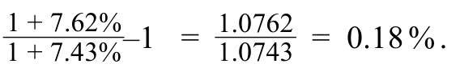

#### 补充解析 / Supplementary explanation

比较不同金融资产时，把合同支付、价格重估、违约损失与再投资收益分开。题目若指定某个持有期，应关注该期间的现金流和市值变化。

Separate contractual payments, repricing, default losses, and reinvestment income. Use the cash flows and market-value change over the stated holding period.

易错点：较高到期收益率可能补偿较高风险，并不自动意味着较高实际总收益。不要把票息率、收益率和已实现持有期收益混为一谈。

Common pitfall: A higher yield may compensate for greater risk and need not produce a higher realized return. Coupon rate, yield, and holding-period return are different measures.

本题比较的是长期政府债券与长期公司债券的几何平均收益差。先采用同一历史区间、同一收益定义的两项几何均值，再按题目定义计算相对超额表现；不能用票息率或单年收益替代。

This question compares geometric mean returns of long-term government and corporate bonds. Use the same historical interval and return convention for both, then apply the stated relative-performance definition; coupon rates or single-year returns are not substitutes.

#### 相关知识点 / Related concepts

#### 资产类别与收益来源 / Asset classes and return drivers

债务现金流受票息、到期日及偿付承诺约束；股权现金流来自剩余利润和估值变化。即使合同票息固定，债券的持有期总收益仍会因价格变化而波动。

Debt cash flows are shaped by coupons, maturity, and repayment promises; equity returns depend on residual profits and valuation. A fixed coupon does not imply a fixed holding-period total return.

### QM-LM02-I002-01 · 习题组 · 第 1 题 QUESTION SET · Question 1

正文习题组 / Question set · 原版 PDF 页码 / Source PDF pages: 77

#### 题目与资料 / Question and data

1\. 绩效分析师正在研究两种碰巧具有相同的历史收益的投资，但一种具有更广泛的年度资产收益范围。

1\. A performance analyst is looking at two investments that happen to have the same historical return, but one has a wider range of annual asset returns.

最可能表明的更广泛的资产收益范围是什么?

What is the wider range of asset returns most likely to indicate?

A. 降低风险

**A.** Lower risk

B. 风险较高

**B.** Higher risk

C. 一致的收益

**C.** Consistent returns

#### 官方答案与解析 / Official answer and explanation

解答

**Solution**

正确答案是B:广泛的年度收益表明风险更高。

The correct response is B: A wide range of annual returns indicates higher risk.

这种可变性表明，收益波动很大，使它们不可预测，并意味着收益和损失的可能性更高，这使得它们与年度资产收益范围较窄的资产相比风险更大。

This variability suggests that the returns fluctuate significantly, making them unpredictable and implying a higher potential for both gains and losses, which makes them riskier compared to assets with a narrower range of annual asset returns.

选项方案A不正确：广泛的年度收益并不表明风险较低，而是风险较高。

Alternative A is incorrect: A wide range of annual returns does not indicate lower risk, but higher risk.

选项C是不正确的：广泛的年度收益并不表示一致的收益，而是更高的收益可变性或不太一致的收益。

Alternative C is incorrect: A wide range of annual returns does not indicate consistent returns, but higher variability of returns or less consistent returns.

#### 补充解析 / Supplementary explanation

先分清问题是在比较收益水平还是收益的变动范围。资产配置应同时满足收益目标与风险承受能力；历史高收益资产并不自动适合风险承受能力较低的投资者。

Distinguish the level of returns from their variability. Allocation should reflect both the return objective and risk tolerance; an asset with high historical returns is not automatically suitable for a less risk-tolerant investor.

易错点：宏观风险是共同冲击；个别公司的经营事件主要属于特定风险。更高风险对应更高的必要或预期补偿，并不保证实际赚得更多。

Pitfall: Macro risk is a shared shock, whereas a firm-specific operating event is mainly specific risk. Higher risk calls for higher expected or required compensation, not a guaranteed realized gain.

#### 相关知识点 / Related concepts

#### 风险分散与风险收益权衡 / Diversification and the risk–return trade-off

同样的预期收益下，收益区间越宽通常表示不确定性越大。宏观风险来自经济、利率、通胀等共同因素，不能靠增加同类资产数量完全消除。

A wider return distribution generally indicates greater uncertainty for the same expected return. Macroeconomic risks arise from shared economic, interest-rate, and inflation factors and cannot be fully removed by holding more similar assets.

### QM-LM02-I002-02 · 习题组 · 第 2 题 QUESTION SET · Question 2

正文习题组 / Question set · 原版 PDF 页码 / Source PDF pages: 77-78

#### 题目与资料 / Question and data

2\. 根据历史记录，以下资产类型中哪一种通常会随着时间的推移获得最高的平均收益?

2\. Based on the historical record, which of the following asset types typically earns the *highest* average returns over time?

A. 美国公司债券

**A.** US corporate bonds

B. 美国大资本化股票

**B.** US large-capitalization equities

C. 美国政府债券

**C.** US government bonds

#### 官方答案与解析 / Official answer and explanation

解答

**Solution**

正确答案是B:从历史上看，与包括公司和政府债券在内的债券相比，美国大资本化股票的平均收益率更高。

The correct response is B: Historically, US large-capitalization equities have yielded higher average returns over time compared to bonds, including corporate and government bonds.

这一结果主要是由于它们的资本增值潜力，尽管它们的风险与债券相比更高。

This result is primarily due to their capital appreciation potential, despite their higher risk compared to bonds.

选项A不正确：股票长期总收益超过债务和固定收益收益，包括公司债务。

Alternative A is incorrect: Equity long-term total returns exceed that of debt and fixed-income returns, including corporate debt.

选项C是不正确的：股票长期总收益超过债务和固定收益收益，包括政府债务。

Alternative C is incorrect: Equity long-term total returns exceed that of debt and fixed-income returns, including government debt.

#### 补充解析 / Supplementary explanation

比较不同金融资产时，把合同支付、价格重估、违约损失与再投资收益分开。题目若指定某个持有期，应关注该期间的现金流和市值变化。

Separate contractual payments, repricing, default losses, and reinvestment income. Use the cash flows and market-value change over the stated holding period.

易错点：较高到期收益率可能补偿较高风险，并不自动意味着较高实际总收益。不要把票息率、收益率和已实现持有期收益混为一谈。

Common pitfall: A higher yield may compensate for greater risk and need not produce a higher realized return. Coupon rate, yield, and holding-period return are different measures.

#### 相关知识点 / Related concepts

#### 资产类别与收益来源 / Asset classes and return drivers

债务现金流受票息、到期日及偿付承诺约束；股权现金流来自剩余利润和估值变化。即使合同票息固定，债券的持有期总收益仍会因价格变化而波动。

Debt cash flows are shaped by coupons, maturity, and repayment promises; equity returns depend on residual profits and valuation. A fixed coupon does not imply a fixed holding-period total return.

### QM-LM02-I002-03 · 习题组 · 第 3 题 QUESTION SET · Question 3

正文习题组 / Question set · 原版 PDF 页码 / Source PDF pages: 77-78

#### 题目与资料 / Question and data

3\. 无风险利率为2.5%，预期市场收益率为7.5%，则市场风险溢价最接近(假设简单的年度收益):

3\. If the risk-free rate is 2.5% and the expected market return is 7.5%, the market risk premium is *closest* to (assume simple annual returns):

**A.** 2.5%.

**B.** 4.9%.

**C.** 10.0%.

#### 官方答案与解析 / Official answer and explanation

解答

**Solution**

正确答案是B:市场风险溢价是根据预期的市场收益和无风险利率之间的差值计算的：

The correct response is B: The market risk premium is calculated as the difference between the expected market return and the risk-free rate:

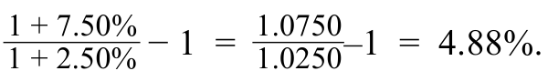

选项A不正确：这只是无风险利率。

Alternative A is incorrect: It is just the risk-free rate.

选项C是不正确的：它是无风险利率和预期市场收益的总和。

Alternative C is incorrect: It is the sum of the risk-free rate and the expected market return.

#### 补充解析 / Supplementary explanation

读题先确认时间方向：是在投资前做预测、设定门槛，还是投资后评价结果。若比较毛收益与净收益，直接追踪管理费等费用有没有扣除。

Identify whether the question concerns an ex-ante forecast, an investment hurdle, or an ex-post outcome. For gross versus net returns, trace which fees have been deducted.

易错点：风险溢价并不保证事后一定赚得更多；预期收益也不会机械决定实际收益。历史实现收益不能直接当成无风险的未来承诺。

Common pitfall: A risk premium does not guarantee a higher realized payoff. Expectations do not mechanically determine outcomes, and historical returns are not risk-free promises.

#### 相关知识点 / Related concepts

#### 预期收益、必要收益与实际收益 / Expected, required, and realized returns

预期收益是事前预测，必要收益是投资者愿意承担相应风险所要求的补偿，实际收益是事后结果。风险溢价解释为什么承担不确定性时通常要求更高收益。

Expected return is a forecast, required return is the compensation demanded for the risk, and realized return is the outcome. Risk premia compensate for uncertainty rather than guarantee a payoff.

Required return = risk-free return + relevant risk premia

### QM-LM02-P001 · 章末练习 1 Practice Problem 1

章末练习 / Practice problem · 原版 PDF 页码 / Source PDF pages: 80-81

#### 题目与资料 / Question and data

1.在总投资风险的背景下，宏观风险：

**1.** In the context of total investment risk, macro risks:

A. 代表非系统性风险。

**A.** represent non-systematic risks.

B. 独立于总投资风险。

**B.** are independent from total investment risk.

C. 对整体投资业绩有重大影响。

**C.** significantly influence overall investment performance.

#### 官方答案与解析 / Official answer and explanation

1、正确答案是C.宏观风险，又称系统性风险，影响整个市场或大片市场。

1\. The correct response is C. Macro risks, also known as systematic risks, affect the entire market or a large segment of the market.

这些因素包括经济衰退，政治不稳定，利率变化和通货膨胀等因素。

These include factors like economic recessions, political instability, changes in interest rates, and inflation.

这些风险是整个市场固有的，无法避免或多样化。

These risks are inherent to the entire market and cannot be avoided or diversified away.

强劲的经济衰退可能导致股价普遍下跌。

A strong economic downturn can lead to a widespread decline in stock prices.

选项A不正确：宏观风险或系统性风险影响整个市场。

Alternative A is incorrect: Macro risks, or systematic risks, affect the market as a whole.

它们的影响是广泛的，包括整个金融体系和所有投资。

Their impact is broad, encompassing the entire financial system and all investments.

选项B不正确：宏观风险，如通胀风险，影响金融市场表现和金融市场交易资产的风险。

Alternative B is incorrect: Macro risks, such as inflation risk, affect financial market performance and the risk of assets traded in the financial markets.

#### 补充解析 / Supplementary explanation

选 C。经济增长、通货膨胀和利率等宏观因素会同时影响许多资产，属于共同风险来源。增加公司数量可以分散个别公司的经营风险，却不能消除整个市场共同承受的宏观冲击。本题考查风险来源，不是把名义收益换算为实际收益。

C is correct. Growth, inflation, and interest rates affect many assets together and are common sources of risk. Holding more firms can diversify company-specific events, but it cannot eliminate macroeconomic shocks shared across the market. The question concerns sources of risk, not the conversion of nominal to real returns.

#### 相关知识点 / Related concepts

#### 宏观风险与分散化 / Macroeconomic risk and diversification

系统性风险来自共同因素；特定风险来自个别发行人或资产。充分分散的组合仍有系统性风险。

Systematic risk comes from common factors; specific risk comes from individual issuers or assets. A well-diversified portfolio still carries systematic risk.

### QM-LM02-P002 · 章末练习 2 Practice Problem 2

章末练习 / Practice problem · 原版 PDF 页码 / Source PDF pages: 80-81

#### 题目与资料 / Question and data

2\. 资产类别的年收益范围更广，通常与以下相关：

**2.** A wider range of annual returns for an asset class is typically associated with:

A. 风险较低，收益较高。

**A.** lower risk and higher returns.

B. 风险较高，收益较低。

**B.** higher risk and lower returns.

C. 风险更高，收益更高。

**C.** higher risk and higher returns.

#### 官方答案与解析 / Official answer and explanation

2\. 正确答案是C. 投资的年收益范围更广，意味着可变性或波动性增加，表明风险更高。

2\. The correct response is C. A wider range of annual returns in an investment signifies increased variability or volatility, indicating a higher risk.

投资可能会经历每年的收益大幅波动，带来可观的收益和损失。

The investment can experience significant fluctuations in returns from year to year, with substantial gains and losses.

更广泛的收益是高风险投资的特征：价值大幅波动，可能带来更高的收益和损失。

A wider range of returns is characteristic of higher-risk investments: large swings in value with the potential for higher returns and losses.

这一结果符合风险-收益权衡原则。

This result aligns with the risk–return trade-off principle.

选项A不正确：较窄的收益范围通常表明风险较低，收益更可预测和一致。

Alternative A is incorrect: A narrower range of returns typically suggests lower risk with more predictable and consistent returns.

预期和已实现收益范围狭窄的投资通常被认为波动较小，这减少了重大损失的可能性和高收益的可能性。

Investments with a narrow range of expected and realized returns are generally seen as less volatile, which reduces the likelihood of significant losses and the potential for high returns.

另类B是不正确的：更广泛的收益意味着更高的可变性，这与较高的投资风险正相关 - 投资者要求从一开始获得更高的收益。

Alternative B is incorrect: A wider range of returns indicates higher variability, which correlates positively with higher investment risk—for which investors demand a higher return from inception.

该声明与风险-收益权衡相矛盾。

The statement contradicts the risk–return trade-off.

#### 补充解析 / Supplementary explanation

读题先确认时间方向：是在投资前做预测、设定门槛，还是投资后评价结果。若比较毛收益与净收益，直接追踪管理费等费用有没有扣除。

Identify whether the question concerns an ex-ante forecast, an investment hurdle, or an ex-post outcome. For gross versus net returns, trace which fees have been deducted.

易错点：风险溢价并不保证事后一定赚得更多；预期收益也不会机械决定实际收益。历史实现收益不能直接当成无风险的未来承诺。

Common pitfall: A risk premium does not guarantee a higher realized payoff. Expectations do not mechanically determine outcomes, and historical returns are not risk-free promises.

#### 相关知识点 / Related concepts

#### 预期收益、必要收益与实际收益 / Expected, required, and realized returns

预期收益是事前预测，必要收益是投资者愿意承担相应风险所要求的补偿，实际收益是事后结果。风险溢价解释为什么承担不确定性时通常要求更高收益。

Expected return is a forecast, required return is the compensation demanded for the risk, and realized return is the outcome. Risk premia compensate for uncertainty rather than guarantee a payoff.

Required return = risk-free return + relevant risk premia

### QM-LM02-P003 · 章末练习 3 Practice Problem 3

章末练习 / Practice problem · 原版 PDF 页码 / Source PDF pages: 80-81

#### 题目与资料 / Question and data

3\. 从21世纪初到21世纪20年代初，长期政府债券资本分配收益的下降表明了什么?

**3.** What does the decline in capital distribution returns in long-term government bonds over the period from the early 2000s to early 2020s indicate?

A. 向更高股权投资的转变

**A.** A shift toward higher equity investments

B. 市场利率下降

**B.** A decrease in market interest rates

C. 公司违约率的提高

**C.** An increase in corporate default rates

#### 官方答案与解析 / Official answer and explanation

3\. 正确答案是B:长期政府债券资本分配收益的下降反映了市场利率下降的时期。

3\. The correct answer is B: The decline in capital distributions return for long-term government bonds reflects periods of lower market interest rates.

这降低了这些债券的收入收益率，因为较新的发行与过去的高利率时期相比，利率更低。

This reduces the income yield on these bonds as newer issues come with lower interest coupons compared to past higher-rate periods.

选项方案A不正确：向股权投资的转变不会直接影响现有长期政府债券的收入收益。

Alternative A is incorrect: The shift toward equity investments does not directly impact the income returns of existing long-term government bonds.

选项方案C不正确：企业违约率影响公司债券市场及其感知风险。

Alternative C is incorrect: Corporate default rates affect corporate bond markets and their perceived risk.

它们不会直接影响政府债券的收益，这些债券被认为是低风险投资。

They do not directly influence the returns on government bonds, which are considered lower-risk investments.

#### 补充解析 / Supplementary explanation

比较不同金融资产时，把合同支付、价格重估、违约损失与再投资收益分开。题目若指定某个持有期，应关注该期间的现金流和市值变化。

Separate contractual payments, repricing, default losses, and reinvestment income. Use the cash flows and market-value change over the stated holding period.

易错点：较高到期收益率可能补偿较高风险，并不自动意味着较高实际总收益。不要把票息率、收益率和已实现持有期收益混为一谈。

Common pitfall: A higher yield may compensate for greater risk and need not produce a higher realized return. Coupon rate, yield, and holding-period return are different measures.

#### 相关知识点 / Related concepts

#### 资产类别与收益来源 / Asset classes and return drivers

债务现金流受票息、到期日及偿付承诺约束；股权现金流来自剩余利润和估值变化。即使合同票息固定，债券的持有期总收益仍会因价格变化而波动。

Debt cash flows are shaped by coupons, maturity, and repayment promises; equity returns depend on residual profits and valuation. A fixed coupon does not imply a fixed holding-period total return.

### QM-LM02-P004 · 章末练习 4 Practice Problem 4

章末练习 / Practice problem · 原版 PDF 页码 / Source PDF pages: 80-81

#### 题目与资料 / Question and data

4\. 风险-收益权衡原则如何影响不同目标投资者之间的资产配置?

**4.** How does the risk–return trade-off principle affect asset allocation among investors with different objectives?

A. 它鼓励所有投资者优先考虑高风险资产以获得最大收益。

**A.** It encourages all investors to prioritize high-risk assets for maximum returns.

B. 导致投资者根据其风险承受能力和收益目标分配资产。

**B.** It leads investors to allocate assets based on their risk tolerance and return objectives.

C. 这表明低风险资产提供了最高的潜在收益。

**C.** It suggests that low-risk assets offer the highest potential returns.

#### 官方答案与解析 / Official answer and explanation

4\. 正确答案是B:风险-收益权衡原则导致投资者根据其风险承受能力和收益目标分配资产，在增长(资本增值)和收入之间取得平衡。

4\. The correct response is B: The risk-reward trade-off principle leads investors to allocate assets based on their risk tolerance and return objectives, balancing between growth (capital appreciation) and income.

具有不同目标的投资者以不同的方式分配投资组合，在他们愿意承担的风险和他们想要实现的收益之间进行平衡。

Investors with different objectives allocate their portfolios differently, balancing between the risk they are willing to take and the returns they aim to achieve.

选项方案A不正确：并非所有投资者都寻求高风险和高收益的投资。

Alternative A is incorrect: Not all investors seek high-risk and high-return investments.

偏好低风险期权以获得更可预测的(尽管可能更低)收益的投资者将资产分配到那里。

Investors who prefer lower-risk options for more predictable, albeit potentially lower, returns allocate their assets there.

另类C是不正确的：低风险资产，如政府债券，提供较低但更可预测的潜在收益。

Alternative C is incorrect: Low-risk assets, such as government bonds, offer lower but more predictable potential returns.

#### 补充解析 / Supplementary explanation

选 B。配置应同时匹配收益目标、承担损失的能力和承担风险的意愿。某类资产长期平均收益较高，并不能推出所有投资者都应把资金集中于该类资产；较高的预期回报通常伴随更大的不确定性，也不保证某一持有期实现更高回报。

B is correct. Allocation should match return objectives, the ability to bear losses, and willingness to accept risk. A higher historical average return does not imply that every investor should concentrate in that asset class. Higher expected compensation generally comes with greater uncertainty and does not guarantee a higher realized holding-period return.

#### 相关知识点 / Related concepts

#### 资产配置与投资者目标 / Asset allocation and investor objectives

风险承受能力与风险偏好影响合适的资产配置。比较资产时，应把收益水平、波动和投资者约束一起考虑。

Risk capacity and risk preferences affect suitable allocation. Evaluate returns, uncertainty, and investor constraints together.

## LM 3 · 收益基准比较 Benchmarking Returns 21 条目 · 原题与解析逐条对应 / Paired source questions and explanations

### QM-LM03-T001-01 · 课前测试：收益基准比较 · 第 1 题 PRE-TEST: BENCHMARKING RETURNS · Question 1

课前自测 / Pre-test / self-assessment · 原版 PDF 页码 / Source PDF pages: 83-84

#### 题目与资料 / Question and data

1\. 与时间加权收益率相比，资金加权收益率对以下情况更为敏感：

1\. Compared to the time-weighted rate of return, the money-weighted rate of return is more sensitive to:

A. 市场波动。

**A.** market volatility.

B. 现金流量的规模和时间。

**B.** size and timing of cash flows.

C. 指数计算的变化。

**C.** changes in index calculations.

#### 官方答案与解析 / Official answer and explanation

解答

**Solution:**

正确答案是B，因为资金加权的收益率考虑了投资单独净现金流量的规模和时间的影响。

The correct response is B, as the money-weighted rate of return considers the impact of the size and timing of the individually netted cash flows of the investment.

这反映了投资者获得的收益。

This reflects the returns earned by the investor.

选项A不正确：市场波动影响这两种类型的收益，因此它不是它们之间的区分因素。

Alternative A is incorrect: Market volatility affects both types of returns, so it is not a distinguishing factor between them.

另类C是不正确的：指数计算的变化不会影响投资收益率计算。

Alternative C is incorrect: Changes in index calculations don’t impact rate of return calculations on investments.

#### 补充解析 / Supplementary explanation

先判断谁控制追加投资和提款。若评价投资者实际结果或经理可控制资本调用，用资金加权；若隔离客户择时对经理评价的影响，用时间加权。

Ask who controls contributions and withdrawals. Use money weighting for investor experience or discretionary capital calls; use time weighting to remove client cash-flow timing from manager assessment.

易错点：资金加权不是简单按年末资产比例平均收益。它对应使现金流现值和为零的利率；时间加权也不是直接把各期收益相加。

Common pitfall: Money weighting is not a simple weighted average of annual returns; it is a cash-flow internal rate of return. Time weighting links returns multiplicatively.

#### 相关知识点 / Related concepts

#### 资金加权与时间加权 / Money-weighted versus time-weighted returns

资金加权收益把投入多少、何时投入一起纳入评价，体现投资者实际资金经历。时间加权收益在外部现金流发生时分段，再把各段增长倍数相乘，适合评价不控制资金流的经理。

Money-weighted return incorporates both the amounts and timing of capital. Time-weighted return links subperiod growth factors at external cash-flow dates and evaluates a manager who does not control those flows.

TWR = ∏(1+rsubperiod) − 1; MWR: Σ CFₜ/(1+r)^t = 0

### QM-LM03-T001-02 · 课前测试：收益基准比较 · 第 2 题 PRE-TEST: BENCHMARKING RETURNS · Question 2

课前自测 / Pre-test / self-assessment · 原版 PDF 页码 / Source PDF pages: 83-84

#### 题目与资料 / Question and data

2\. 哪个指数加权方法为每个组成安全分配相同的权重?

2\. Which index-weighting method assigns the same weight to each constituent security?

A. 价格加权

**A.** Price weighted

B. 同等加权

**B.** Equal weighted

C. 按市值加权。

**C.** Market capitalization—weighted

#### 官方答案与解析 / Official answer and explanation

解答

**Solution:**

正确答案是B，因为等权重指数对指数中的所有证券进行同等的权衡，无论其市场价格、可用浮动、基本面因素或市值如何。

The correct response is B, as an equal-weighted index weighs all securities in the index equally, regardless of their market price, available float, fundamental factors, or market capitalization.

选项A不正确：价格加权指数根据证券的每股价格来权衡证券。

Alternative A is incorrect: Price-weighted indexes weigh securities based on their price per share.

另类C是不正确的：市值——加权指数根据证券的总市值来权衡证券。

Alternative C is incorrect: Market capitalization—weighted indexes weigh securities based on their total market value.

#### 补充解析 / Supplementary explanation

先确定权重制度，再计算各成分收益对指数的贡献。拆股等纯技术变化不应被误计为经济损失，必要时用调整除数维持指数连续。

Identify the weighting scheme before calculating return contributions. A stock split is not an economic loss, so a divisor adjustment may be needed to preserve index continuity.

易错点：价格指数只看价格变动，总收益指数还计入分红再投资。评价基金前必须使基准和基金的收益口径、货币和期限一致。

Common pitfall: A price index excludes income reinvestment; a total-return index includes it. Match the benchmark’s return convention, currency, and horizon to the portfolio.

#### 相关知识点 / Related concepts

#### 指数构建与基准 / Index construction and benchmarking

指数收益取决于成分股及其权重。价格加权让每股价格较高的股票权重较大；市值加权让总市值较大的公司权重较大；等权则需要定期再平衡维持相同权重。

An index return depends on constituents and weights. Price weighting emphasizes high share prices, market-cap weighting emphasizes large market values, and equal weighting requires rebalancing.

### QM-LM03-T001-03 · 课前测试：收益基准比较 · 第 3 题 PRE-TEST: BENCHMARKING RETURNS · Question 3

课前自测 / Pre-test / self-assessment · 原版 PDF 页码 / Source PDF pages: 83-84

#### 题目与资料 / Question and data

3\. 市值的主要特征——加权指数是：

3\. A primary characteristic of a market capitalization—weighted index is that it:

A. 调整现金流入指数的方向。

**A.** adjusts for the direction of cash flows into the index.

B. 给予股息较高的公司更大的权重。

**B.** gives higher weight to companies with higher dividends.

C. 给予估值较高的公司更大的权重。

**C.** gives higher weight to companies with higher valuations.

#### 官方答案与解析 / Official answer and explanation

解答

**Solution:**

正确答案是C，因为市值 - 加权指数为估值较高的证券分配了更高的权重。

The correct response is C, as market capitalization—weighted indexes assign higher weights to securities with higher valuations.

来自市值较大的公司的证券在指数中具有更大的权重，因此对指数表现的影响更大。

Securities from companies with larger market capitalizations have a bigger weight in the index and therefore a larger impact on the performance of the index.

选项A不正确：现金流入指数的方向是资金加权收益计算的考虑因素，而不是指数加权的目的。

Alternative A is incorrect: The direction of cash flows into the index is a consideration for money-weighted return calculations, not for the purposes of index weighting.

选项B不正确：股息收益率不影响市值加权指数中的证券权重，但它们可能会影响从根本上加权指数中的证券权重。

Alternative B is incorrect: Dividend yields do not influence the weighting of securities in a market capitalization—weighted index, but they may influence the weighting of securities in fundamentally weighted indexes.

#### 补充解析 / Supplementary explanation

先确定权重制度，再计算各成分收益对指数的贡献。拆股等纯技术变化不应被误计为经济损失，必要时用调整除数维持指数连续。

Identify the weighting scheme before calculating return contributions. A stock split is not an economic loss, so a divisor adjustment may be needed to preserve index continuity.

易错点：价格指数只看价格变动，总收益指数还计入分红再投资。评价基金前必须使基准和基金的收益口径、货币和期限一致。

Common pitfall: A price index excludes income reinvestment; a total-return index includes it. Match the benchmark’s return convention, currency, and horizon to the portfolio.

#### 相关知识点 / Related concepts

#### 指数构建与基准 / Index construction and benchmarking

指数收益取决于成分股及其权重。价格加权让每股价格较高的股票权重较大；市值加权让总市值较大的公司权重较大；等权则需要定期再平衡维持相同权重。

An index return depends on constituents and weights. Price weighting emphasizes high share prices, market-cap weighting emphasizes large market values, and equal weighting requires rebalancing.

### QM-LM03-T001-04 · 课前测试：收益基准比较 · 第 4 题 PRE-TEST: BENCHMARKING RETURNS · Question 4

课前自测 / Pre-test / self-assessment · 原版 PDF 页码 / Source PDF pages: 83-85

#### 题目与资料 / Question and data

4\. 金融市场状况严重恶化时，哪一种收益率受影响最大?

4\. When financial market conditions turn severely unfavorable, which rate of return is most affected?

A. 时间加权收益率

**A.** Time-weighted rate of return

B. 资金加权的收益率

**B.** Money-weighted rate of return

C. 两者均不是，因为它们受到的影响相同。

**C.** Neither, as both are equally affected

#### 官方答案与解析 / Official answer and explanation

解答

**Solution:**

正确答案为 B：资金加权收益率对现金流的发生时点、金额和方向都敏感。例如，在市场状况极为不利时发生的资金流入，可能降低收益率。

The correct response is B: The money-weighted rate of return is sensitive to the timing, amount, and direction of cash flows. This includes inflows during severely unfavorable market conditions, which can lower the return.

选项 A 不正确：时间加权收益率仅衡量投资本身的表现，并消除现金流发生时点的影响。

Alternative A is incorrect: The time-weighted rate of return measures only the investment’s performance and eliminates the impact of cash flow timing.

选项 C 不正确：虽然时间加权收益率不受现金流入金额的影响，但资金加权收益率对现金流敏感。

Alternative C is incorrect: Although time-weighted returns are not impacted by the size of cash inflows, money-weighted returns are sensitive to cash flows.

#### 补充解析 / Supplementary explanation

先判断谁控制追加投资和提款。若评价投资者实际结果或经理可控制资本调用，用资金加权；若隔离客户择时对经理评价的影响，用时间加权。

Ask who controls contributions and withdrawals. Use money weighting for investor experience or discretionary capital calls; use time weighting to remove client cash-flow timing from manager assessment.

易错点：资金加权不是简单按年末资产比例平均收益。它对应使现金流现值和为零的利率；时间加权也不是直接把各期收益相加。

Common pitfall: Money weighting is not a simple weighted average of annual returns; it is a cash-flow internal rate of return. Time weighting links returns multiplicatively.

结论的适用条件：资金加权收益对现金流的时点与规模敏感，因此在下跌前有较大流入时会受更大拖累。仅知道“市场恶化”，而不知道外部现金流，不能普遍断言资金加权收益一定比时间加权收益下降更多。

Scope of the conclusion: money-weighted return is sensitive to cash-flow size and timing, so a large inflow before poor performance can depress it more. Adverse markets alone, without cash-flow information, do not universally establish that money weighting falls more than time weighting.

#### 相关知识点 / Related concepts

#### 资金加权与时间加权 / Money-weighted versus time-weighted returns

资金加权收益把投入多少、何时投入一起纳入评价，体现投资者实际资金经历。时间加权收益在外部现金流发生时分段，再把各段增长倍数相乘，适合评价不控制资金流的经理。

Money-weighted return incorporates both the amounts and timing of capital. Time-weighted return links subperiod growth factors at external cash-flow dates and evaluates a manager who does not control those flows.

TWR = ∏(1+rsubperiod) − 1; MWR: Σ CFₜ/(1+r)^t = 0

### QM-LM03-I001 · 示例 1 EXAMPLE 1

正文例题／案例 / Worked example / case · 原版 PDF 页码 / Source PDF pages: 86-87

#### 题目与资料 / Question and data

原书叙述式例题／案例：下方保留案例原文、数据与展开过程。原书没有另设独立问句，未另行编造题目。

Original narrated example/case. The full source conditions, data, and worked discussion follow; no separate question has been invented.

时间加权收益率

**The Time-Weighted Return**

#### 官方示例展开（原书全文） / Official worked example (source text)

时间加权收益率

**The Time-Weighted Return**

图表 1 中两个情景的时间加权收益率均使用公式 1 计算。只有投资收益本身影响结果，现金流发生的时点和金额都不影响结果，因此两个情景的时间加权收益率相同：

The time-weighted returns for both scenarios in Exhibit 1 are calculated using Equation 1. Since only the investment returns matter, and neither the timing nor the size of the cash flows affects the result, the time-weighted return in both scenarios is:

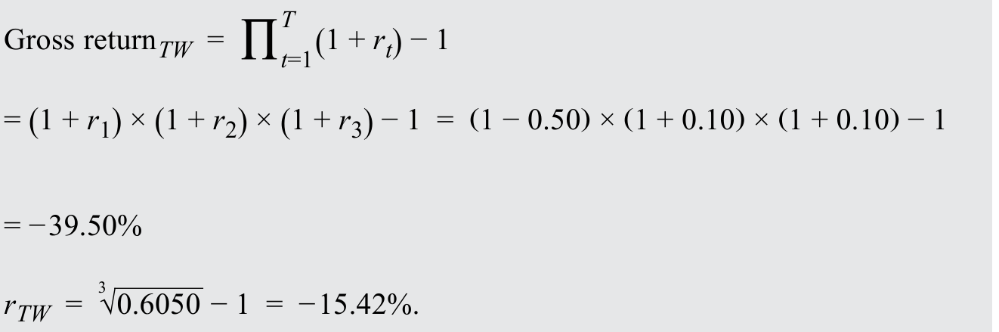

#### 补充解析 / Supplementary explanation

先判断谁控制追加投资和提款。若评价投资者实际结果或经理可控制资本调用，用资金加权；若隔离客户择时对经理评价的影响，用时间加权。

Ask who controls contributions and withdrawals. Use money weighting for investor experience or discretionary capital calls; use time weighting to remove client cash-flow timing from manager assessment.

易错点：资金加权不是简单按年末资产比例平均收益。它对应使现金流现值和为零的利率；时间加权也不是直接把各期收益相加。

Common pitfall: Money weighting is not a simple weighted average of annual returns; it is a cash-flow internal rate of return. Time weighting links returns multiplicatively.

#### 相关知识点 / Related concepts

#### 资金加权与时间加权 / Money-weighted versus time-weighted returns

资金加权收益把投入多少、何时投入一起纳入评价，体现投资者实际资金经历。时间加权收益在外部现金流发生时分段，再把各段增长倍数相乘，适合评价不控制资金流的经理。

Money-weighted return incorporates both the amounts and timing of capital. Time-weighted return links subperiod growth factors at external cash-flow dates and evaluates a manager who does not control those flows.

TWR = ∏(1+rsubperiod) − 1; MWR: Σ CFₜ/(1+r)^t = 0

### QM-LM03-I002 · 示例 2 EXAMPLE 2

正文例题／案例 / Worked example / case · 原版 PDF 页码 / Source PDF pages: 88

#### 题目与资料 / Question and data

原书叙述式例题／案例：下方保留案例原文、数据与展开过程。原书没有另设独立问句，未另行编造题目。

Original narrated example/case. The full source conditions, data, and worked discussion follow; no separate question has been invented.

资金加权收益率（又称金额加权收益率）

**The Money-Weighted or Dollar-Weighted Return**

#### 官方示例展开（原书全文） / Official worked example (source text)

资金加权收益率（又称金额加权收益率）

**The Money-Weighted or Dollar-Weighted Return**

图1中这两种情景的资金加权收益都是使用方程式2计算的。

The money-weighted return for both scenarios in Exhibit 1 is calculated using Equation 2.

由于现金流的时机和规模很重要，第一年大捐款情景中的资金加权收益是：

Because the timing and the size of the cash flows matter, the money-weighted return in the first-year large contribution scenario is:

这一数额高于时间加权收益，因为作出了额外捐款，获得了正收益。

This amount is higher than the time-weighted return as additional contributions were made that earned positive returns.

在第一年小额捐款情景中，资金加权收益是：

The money-weighted return in the first-year small contribution scenario is:

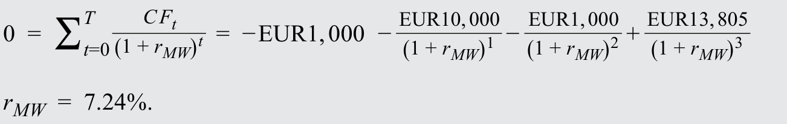

在后一种情况下，现金捐款是在更合适的时间作出的，避免了第一年的显著负收益。

In this latter scenario, the cash contributions are made at much more opportune times, avoiding the significant negative return of the first year.

#### 补充解析 / Supplementary explanation

先判断谁控制追加投资和提款。若评价投资者实际结果或经理可控制资本调用，用资金加权；若隔离客户择时对经理评价的影响，用时间加权。

Ask who controls contributions and withdrawals. Use money weighting for investor experience or discretionary capital calls; use time weighting to remove client cash-flow timing from manager assessment.

易错点：资金加权不是简单按年末资产比例平均收益。它对应使现金流现值和为零的利率；时间加权也不是直接把各期收益相加。

Common pitfall: Money weighting is not a simple weighted average of annual returns; it is a cash-flow internal rate of return. Time weighting links returns multiplicatively.

#### 相关知识点 / Related concepts

#### 资金加权与时间加权 / Money-weighted versus time-weighted returns

资金加权收益把投入多少、何时投入一起纳入评价，体现投资者实际资金经历。时间加权收益在外部现金流发生时分段，再把各段增长倍数相乘，适合评价不控制资金流的经理。

Money-weighted return incorporates both the amounts and timing of capital. Time-weighted return links subperiod growth factors at external cash-flow dates and evaluates a manager who does not control those flows.

TWR = ∏(1+rsubperiod) − 1; MWR: Σ CFₜ/(1+r)^t = 0

### QM-LM03-I003-01 · 习题组 1 · 第 1 题 QUESTION SET 1 · Question 1

正文习题组 / Question set · 原版 PDF 页码 / Source PDF pages: 95

#### 题目与资料 / Question and data

1\. 时间加权收益率：

1\. The time-weighted rate of return:

A. 受最初投资或承诺资本规模的影响。

**A.** is influenced by the size of the originally invested or committed capital.

B. 反映现金流和资本投资的具体时间。

**B.** reflects the specific timing of cash flows and capital investments.

C. 衡量基本业绩，独立于现金流动的时间。

**C.** measures the underlying performance independent of the timing of cash flows.

#### 官方答案与解析 / Official answer and explanation

解答

**Solution:**

正确答案是C:时间加权收益率衡量独立于现金流时机的投资的基本表现。

The correct response is C: The time-weighted rate of return measures the underlying performance of an investment independent of the timing of cash flows.

由于时间加权收益率衡量投资随着时间的推移和不同时期之间的复合增长率，因此它独立于现金流的规模、方向和时间，这些现金流可以显着影响投资表现。

Because the time-weighted rate of return measures the compound growth rate of an investment over time and between time periods, it is independent of the size, direction, and timing of cash flows that can significantly affect investment performance.

它衡量投资的固有表现——只要经理不控制分配、资本调用等，投资经理就能为投资者增加价值的能力——这种表现不会因现金流入或流出的规模和时间而扭曲。

It measures the inherent performance of the investment—the ability of the investment manager to add value to investors as long as the manager doesn’t control distributions, capital calls, etc.—and this performance is not distorted by the size and timing of cash inflows or outflows.

选项A不正确：时间加权收益率不受最初投资或承诺资本规模的影响。

Alternative A is incorrect: The time-weighted rate of return is not influenced by the size of the originally invested or committed capital.

因此，它提供了投资固有表现的标准化衡量标准。

As such, it provides a standardized measure of the investment’s inherent performance.

选项B不正确：时间加权收益率并不反映现金流和资本投资的具体时机；相反，它排除了这些现金流的影响并量化了投资经理的表现。

Alternative B is incorrect: The time-weighted rate of return does not reflect the specific timing of cash flows and capital investments; rather, it excludes the effect of these cash flows and quantifies the investment manager’s performance.

#### 补充解析 / Supplementary explanation

先判断谁控制追加投资和提款。若评价投资者实际结果或经理可控制资本调用，用资金加权；若隔离客户择时对经理评价的影响，用时间加权。

Ask who controls contributions and withdrawals. Use money weighting for investor experience or discretionary capital calls; use time weighting to remove client cash-flow timing from manager assessment.

易错点：资金加权不是简单按年末资产比例平均收益。它对应使现金流现值和为零的利率；时间加权也不是直接把各期收益相加。

Common pitfall: Money weighting is not a simple weighted average of annual returns; it is a cash-flow internal rate of return. Time weighting links returns multiplicatively.

#### 相关知识点 / Related concepts

#### 资金加权与时间加权 / Money-weighted versus time-weighted returns

资金加权收益把投入多少、何时投入一起纳入评价，体现投资者实际资金经历。时间加权收益在外部现金流发生时分段，再把各段增长倍数相乘，适合评价不控制资金流的经理。

Money-weighted return incorporates both the amounts and timing of capital. Time-weighted return links subperiod growth factors at external cash-flow dates and evaluates a manager who does not control those flows.

TWR = ∏(1+rsubperiod) − 1; MWR: Σ CFₜ/(1+r)^t = 0

### QM-LM03-I003-02 · 习题组 1 · 第 2 题 QUESTION SET 1 · Question 2

正文习题组 / Question set · 原版 PDF 页码 / Source PDF pages: 95-96

#### 题目与资料 / Question and data

2\. 当投资经理对基金的资本贡献有酌处权时，最合适的收益措施是：

2\. When the investment manager has discretion over contributions of capital to the fund, the *most* appropriate return measure is the:

A. 资金加权收益。

**A.** money-weighted return.

B. 时间加权收益率。

**B.** time-weighted return.

C. 时间和资金加权收益的权重。

**C.** weighting of the time and money-weighted returns.

#### 官方答案与解析 / Official answer and explanation

解答

**Solution:**

正确的回应是A. 资金加权收益考虑到现金流的时间和规模，使其适合评估私募股权基金经理的表现，因为经理对资本贡献有酌处权。

The correct response is A. The money-weighted return takes into account the timing and size of cash flows, making it suitable for evaluating private equity fund manager performance because the manager has discretion over the capital contributions.

选项B是不正确的：虽然时间加权收益用于评估公开交易资产经理的表现，但在经理控制流向基金的现金流的情况下，这些收益并不合适。

Alternative B is incorrect: While time-weighted returns are used for evaluating the performance of a manager of publicly traded assets, they are not appropriate in a situation where the manager has control over the cash flows to the fund.

流入基金的现金流量通常是为了应对新的投资机会的出现，在评估基金经理的表现时应该考虑。

The cash flows into the fund are often in response to the emergence of new investment opportunities and should be considered in assessing the fund manager’s performance.

选项C是不正确的：这两种收益衡量性能的方式不同，因此加权方案并不合适。

Alternative C is incorrect: These two returns measure performance differently, so the weighting scheme would not be appropriate.

#### 补充解析 / Supplementary explanation

先判断谁控制追加投资和提款。若评价投资者实际结果或经理可控制资本调用，用资金加权；若隔离客户择时对经理评价的影响，用时间加权。

Ask who controls contributions and withdrawals. Use money weighting for investor experience or discretionary capital calls; use time weighting to remove client cash-flow timing from manager assessment.

易错点：资金加权不是简单按年末资产比例平均收益。它对应使现金流现值和为零的利率；时间加权也不是直接把各期收益相加。

Common pitfall: Money weighting is not a simple weighted average of annual returns; it is a cash-flow internal rate of return. Time weighting links returns multiplicatively.

#### 相关知识点 / Related concepts

#### 资金加权与时间加权 / Money-weighted versus time-weighted returns

资金加权收益把投入多少、何时投入一起纳入评价，体现投资者实际资金经历。时间加权收益在外部现金流发生时分段，再把各段增长倍数相乘，适合评价不控制资金流的经理。

Money-weighted return incorporates both the amounts and timing of capital. Time-weighted return links subperiod growth factors at external cash-flow dates and evaluates a manager who does not control those flows.

TWR = ∏(1+rsubperiod) − 1; MWR: Σ CFₜ/(1+r)^t = 0

### QM-LM03-I003-03 · 习题组 1 · 第 3 题 QUESTION SET 1 · Question 3

正文习题组 / Question set · 原版 PDF 页码 / Source PDF pages: 95-97

#### 题目与资料 / Question and data

3\. 基金在每年年初接受投资，并产生三年的收益如下：

3\. A fund receives investments at the beginning of each year and generates returns for three years as follows:

三年的投资和收益

**Investments and Returns for Three Years**

表格对照

**列标题：**年份；各年年初的管理资产规模（百万印度卢比）；投资当年的收益率。

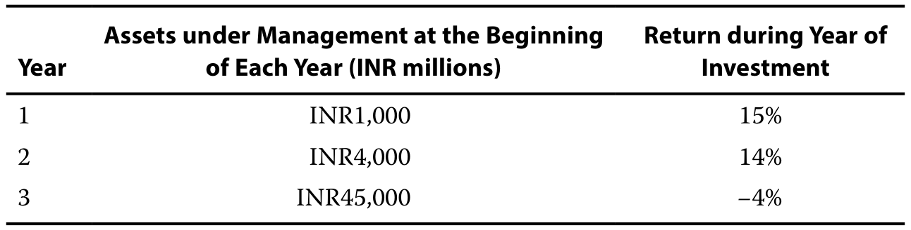

如果所有股息和资本收益在每一年结束时实现并再投资，那么三年期间的收益衡量标准是负数?

If all dividends and capital gains are realized and reinvested at the end of each of the years, which return measure over the three-year period is negative?

A. 几何收益率

**A.** Geometric rate of return

B. 时间加权收益率

**B.** Time-weighted rate of return

C. 资金加权收益率。

**C.** Money-weighted rate of return

#### 官方答案与解析 / Official answer and explanation

解答

**Solution:**

正确答案是C，资金加权收益率为负值。

The correct response is C. The money-weighted rate of return is negative.

该收益措施考虑了对该基金的投资时间和金额。

That return measure considers both the timing and amounts of investments into the fund.

为了计算资金加权收益率，首先将年度收益和投资金额制表以确定现金流，然后计算周期性收益，以几何方式将它们联系起来。

To calculate the money-weighted rate of return, first tabulate the annual returns and investment amounts to determine the cash flows, and then calculate the periodic returns, geometrically linking them.

请注意，年初的净余额等于前一年的终余额加上净新投资。

Note that the net balance at the start of the year is equal to the previous year’s ending balance plus net new investments.

表格对照

**列标题：**第一年；第二年；第三年。

**行项目：**上年结转余额；新增投资；年初净余额；当年投资收益率。

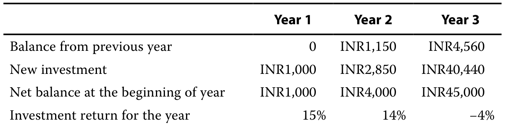

表格对照

**列标题：**第一年；第二年；第三年。

**行项目：**投资收益（损失）；年末余额。

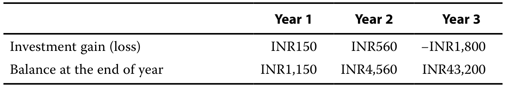

从投资者的角度来看，周期性现金流如下：

The periodic cash flows from the investor’s perspective are as follows:

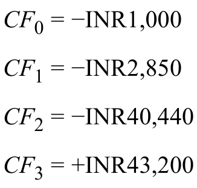

因此，现金流的IRR解决了以下等式：

Accordingly, the IRR for the cash flows solves the following equation:

求解IRR会导致IRR = −2.22%的值，即资金加权收益，rMV = −2.22%。

Solving for IRR results in a value of IRR = −2.22%, which is the money-weighted return, *r*MV = −2.22%.

备选案文A和备选案文B都不正确。

Both alternative A and alternative B are incorrect.

时间加权收益率是基金的几何均值收益，

The time-weighted rate of return is the geometric mean return of the fund,

这是积极的。

which is positive.

#### 补充解析 / Supplementary explanation

先判断谁控制追加投资和提款。若评价投资者实际结果或经理可控制资本调用，用资金加权；若隔离客户择时对经理评价的影响，用时间加权。

Ask who controls contributions and withdrawals. Use money weighting for investor experience or discretionary capital calls; use time weighting to remove client cash-flow timing from manager assessment.

易错点：资金加权不是简单按年末资产比例平均收益。它对应使现金流现值和为零的利率；时间加权也不是直接把各期收益相加。

Common pitfall: Money weighting is not a simple weighted average of annual returns; it is a cash-flow internal rate of return. Time weighting links returns multiplicatively.

#### 相关知识点 / Related concepts

#### 资金加权与时间加权 / Money-weighted versus time-weighted returns

资金加权收益把投入多少、何时投入一起纳入评价，体现投资者实际资金经历。时间加权收益在外部现金流发生时分段，再把各段增长倍数相乘，适合评价不控制资金流的经理。

Money-weighted return incorporates both the amounts and timing of capital. Time-weighted return links subperiod growth factors at external cash-flow dates and evaluates a manager who does not control those flows.

TWR = ∏(1+rsubperiod) − 1; MWR: Σ CFₜ/(1+r)^t = 0

### QM-LM03-I004-01 · 知识检查：指数计算 · 第 1 题 KNOWLEDGE CHECK: INDEX CALCULATIONS · Question 1

知识检查 / Knowledge check · 原版 PDF 页码 / Source PDF pages: 112-113

#### 题目与资料 / Question and data

1\. 使用图11中的新价格和资本分配

1\. Using the new prices and capital distributions from Exhibit 11,

计算新的价格加权指数值及其总收益。

calculate the new price-weighted index value and its total return.

#### 官方答案与解析 / Official answer and explanation

解答

**Solution:**

首先，重新计算价格加权指数值以包括资本分配的影响。

First, the price-weighted index value is recalculated to include the effects of capital distributions.

其次，该调整后的值用于计算价格加权指数的总收益。

Second, this adjusted value is then used to calculate the total return of the price-weighted index.

考虑到资本分配的影响，价格加权指数的总参考价值增加到171.5。

Factoring in the impact of capital distributions, the aggregate reference value of the price-weighted index increases to 171.5.

应用1.5除数，新的索引值是：

Applying the 1.5 divisor, the new index value is:

 

新的指数权重仅反映新价格的影响，而不是资本分配的影响，下表中描述了指数权重的变化。

The new index weights only reflect the impact of new prices and not the effect of capital distributions, with the changes to index weights depicted in the following table.

表格对照

**列标题：**证券；新价格；含资本分配的价格；总收益率；旧指数权重；新指数权重；指数权重变化。

**行项目：**证券 A—E；合计；汇总参考值；除数；指数值；期初至期末的指数总收益率；平均总收益率。

价格加权指数的总收益率为14.33%。

The total return on the price-weighted index is 14.33%.

回想一下，新的指数加权是基于新价格，而不是根据资本分配调整的价格。

Recall that the new index weighting is based on the new price, not the price adjusted for capital distributions.

当所有价格的总和等于165时，证券 B的权重计算如下：

When the sum of all the prices equals 165, the weight for Security B is calculated as follows:

#### 补充解析 / Supplementary explanation

先确定权重制度，再计算各成分收益对指数的贡献。拆股等纯技术变化不应被误计为经济损失，必要时用调整除数维持指数连续。

Identify the weighting scheme before calculating return contributions. A stock split is not an economic loss, so a divisor adjustment may be needed to preserve index continuity.

易错点：价格指数只看价格变动，总收益指数还计入分红再投资。评价基金前必须使基准和基金的收益口径、货币和期限一致。

Pitfall: A price index excludes income reinvestment; a total-return index includes it. Match the benchmark’s return convention, currency, and horizon to the portfolio.

#### 相关知识点 / Related concepts

#### 指数构建与基准 / Index construction and benchmarking

指数收益取决于成分股及其权重。价格加权让每股价格较高的股票权重较大；市值加权让总市值较大的公司权重较大；等权则需要定期再平衡维持相同权重。

An index return depends on constituents and weights. Price weighting emphasizes high share prices, market-cap weighting emphasizes large market values, and equal weighting requires rebalancing.

### QM-LM03-I004-02 · 知识检查：指数计算 · 第 2 题 KNOWLEDGE CHECK: INDEX CALCULATIONS · Question 2

知识检查 / Knowledge check · 原版 PDF 页码 / Source PDF pages: 112-114

#### 题目与资料 / Question and data

2\. 使用图11的新价格和资本分布计算新的均加权指数值及其总收益。

2\. Using the new prices and capital distributions from Exhibit 11, calculate the new equal-weighted index value and its total return.

#### 官方答案与解析 / Official answer and explanation

解答

**Solution:**

考虑到资本分布的影响，均加权指数的总参考值增加到19,115。

Factoring in the impact of capital distributions, the aggregate reference value of the equal-weighted index increases to 19,115.

应用150除数，新的索引值是：

Applying the 150 divisor, the new index value is:

 

详细的计算和新的索引值在下表中描述。

Detailed calculations and new index values are depicted in the following table.

表格对照

**列标题：**证券；新价格；含分配的价格；总收益率；新指数值。

**行项目：**证券 A—E；汇总参考值；除数；指数值；指数收益率；平均总收益率。

如果均衡加权指数重新平衡，相对于指数中其他指数(如证券B和D)价值增加的证券将被出售，表现不佳的证券(如证券A、C和E)将被购买以保持同等加权。

If the equal-weighted index is rebalanced, securities that have increased in value relative to others in the index (such as Securities B and D) will be sold off, and securities that have underperformed (such as Securities A, C, and E) will be bought to maintain equal weighting.

该指数的价值反映了证券的新价格。

The value of the index reflects the new price of the securities.

平均加权指数的总收益率为27.43%，相当于组成证券的平均收益率。

The total return on the equal-weighted index is 27.43%, which equals the average return of the constituent securities.

这种等式通常只与上次再平衡日期的指数值持平。

This equality generally only holds against the index value for the last rebalancing date.

在这个例子中，由于性能，此时指数并不均衡，因此下一个时间段的表现可能会不同于我们稍后会看到的组成表现的简单平均值。

In this example, at this point the index is not equally balanced due to performance—thus the performance for the next period in time will likely differ from a simple average of the constituent performances as we will see later.

#### 补充解析 / Supplementary explanation

先确定权重制度，再计算各成分收益对指数的贡献。拆股等纯技术变化不应被误计为经济损失，必要时用调整除数维持指数连续。

Identify the weighting scheme before calculating return contributions. A stock split is not an economic loss, so a divisor adjustment may be needed to preserve index continuity.

易错点：价格指数只看价格变动，总收益指数还计入分红再投资。评价基金前必须使基准和基金的收益口径、货币和期限一致。

Common pitfall: A price index excludes income reinvestment; a total-return index includes it. Match the benchmark’s return convention, currency, and horizon to the portfolio.

#### 相关知识点 / Related concepts

#### 指数构建与基准 / Index construction and benchmarking

指数收益取决于成分股及其权重。价格加权让每股价格较高的股票权重较大；市值加权让总市值较大的公司权重较大；等权则需要定期再平衡维持相同权重。

An index return depends on constituents and weights. Price weighting emphasizes high share prices, market-cap weighting emphasizes large market values, and equal weighting requires rebalancing.

### QM-LM03-I005-01 · 习题组 2 · 第 1 题 QUESTION SET 2 · Question 1

正文习题组 / Question set · 原版 PDF 页码 / Source PDF pages: 124-125

#### 题目与资料 / Question and data

1\. 当价格加权指数的成分股发生股票拆分时，即：

1\. When a constituent stock in a price-weighted index undergoes a stock split, the:

A. 调整指数除数。

**A.** index divisor is adjusted.

B. 股票在指数中的价格保持不变。

**B.** stock’s price in the index is unchanged.

C. 调整指数中的证券总数。

**C.** total number of securities in the index is adjusted.

#### 官方答案与解析 / Official answer and explanation

解答

**Solution:**

正确答案是A:调整除数可确保指数值不受股票拆分的机械效应的影响，保持其计算的一致性。

The correct response is A: Adjusting the divisor ensures that the index value is not affected by the mechanical effect of a stock split, maintaining consistency in its calculation.

另类B是不正确的：股票的价格确实因拆分而发生变化，股票在指数中的权重也会发生变化。

Alternative B is incorrect: The stock’s price does change due to the split, and the stock’s weight in the index will also change.

选项C不正确：证券总数不直接影响价格加权指数的计算。

Alternative C is incorrect: The total number of securities does not directly affect the calculation of a price-weighted index.

#### 补充解析 / Supplementary explanation

先确定权重制度，再计算各成分收益对指数的贡献。拆股等纯技术变化不应被误计为经济损失，必要时用调整除数维持指数连续。

Identify the weighting scheme before calculating return contributions. A stock split is not an economic loss, so a divisor adjustment may be needed to preserve index continuity.

易错点：价格指数只看价格变动，总收益指数还计入分红再投资。评价基金前必须使基准和基金的收益口径、货币和期限一致。

Common pitfall: A price index excludes income reinvestment; a total-return index includes it. Match the benchmark’s return convention, currency, and horizon to the portfolio.

#### 相关知识点 / Related concepts

#### 指数构建与基准 / Index construction and benchmarking

指数收益取决于成分股及其权重。价格加权让每股价格较高的股票权重较大；市值加权让总市值较大的公司权重较大；等权则需要定期再平衡维持相同权重。

An index return depends on constituents and weights. Price weighting emphasizes high share prices, market-cap weighting emphasizes large market values, and equal weighting requires rebalancing.

### QM-LM03-I005-02 · 习题组 2 · 第 2 题 QUESTION SET 2 · Question 2

正文习题组 / Question set · 原版 PDF 页码 / Source PDF pages: 124-125

#### 题目与资料 / Question and data

2\. 使用一个基本因素——加权指数的主要理由是：

2\. The main rationale to use a fundamental factor—weighted index is that it:

A. 提供更高的流动性。

**A.** offers higher liquidity.

B. 根据价格变动自动重新平衡。

**B.** rebalances automatically based on price movements.

C. 反映企业的经济规模和业绩。

**C.** reflects the economic size and performance of companies.

#### 官方答案与解析 / Official answer and explanation

解答

**Solution:**

正确答案是C:基本因素——加权指数根据经济指标对证券进行权重，旨在代表公司的经济规模和业绩，而不仅仅是市场价格。

The correct response is C: Fundamental factor—weighted indexes weight securities based on economic indicators, aiming to represent a company’s economic size and performance rather than just its market price.

选项A不正确：指数的流动性与索引的权重方法没有直接关系。

Alternative A is incorrect: Liquidity of the index is not related to the weighting method of an index directly.

选项B不正确：基于价格变动的自动再平衡是市场资本化的特点——加权指数，而不是基本因素——加权指数。

Alternative B is incorrect: Automatic rebalancing based on price movements characterizes market capitalization—weighted indexes, not fundamental factor—weighted indexes.

#### 补充解析 / Supplementary explanation

先确定权重制度，再计算各成分收益对指数的贡献。拆股等纯技术变化不应被误计为经济损失，必要时用调整除数维持指数连续。

Identify the weighting scheme before calculating return contributions. A stock split is not an economic loss, so a divisor adjustment may be needed to preserve index continuity.

易错点：价格指数只看价格变动，总收益指数还计入分红再投资。评价基金前必须使基准和基金的收益口径、货币和期限一致。

Common pitfall: A price index excludes income reinvestment; a total-return index includes it. Match the benchmark’s return convention, currency, and horizon to the portfolio.

#### 相关知识点 / Related concepts

#### 指数构建与基准 / Index construction and benchmarking

指数收益取决于成分股及其权重。价格加权让每股价格较高的股票权重较大；市值加权让总市值较大的公司权重较大；等权则需要定期再平衡维持相同权重。

An index return depends on constituents and weights. Price weighting emphasizes high share prices, market-cap weighting emphasizes large market values, and equal weighting requires rebalancing.

### QM-LM03-I005-03 · 习题组 2 · 第 3 题 QUESTION SET 2 · Question 3

正文习题组 / Question set · 原版 PDF 页码 / Source PDF pages: 124-125

#### 题目与资料 / Question and data

3\. 均衡加权指数定期重新平衡：

3\. Equal-weighted indexes are rebalanced regularly to:

A. 适应市场资本化的变化。

**A.** adjust for changes in market capitalization.

B. 保持每个构成安全同等的权重。

**B.** maintain the equal weight of each constituent security.

C. 纳入再投资股息对股票价格的影响。

**C.** incorporate the impact of reinvested dividends on stock prices.

#### 官方答案与解析 / Official answer and explanation

解答

**Solution:**

正确的回应是B:定期重新平衡是必要的，以确保每个证券在指数中继续具有相同的权重，尽管价格波动。

The correct response is B: Regular rebalancing is necessary to ensure that each security continues to have the same weight in the index, despite price fluctuations.

选项A不正确：市场价格的变化与市值有关——加权指数，而不是等权重指数。

Alternative A is incorrect: Changes in market prices are relevant to market capitalization—weighted indexes, not equal-weighted indexes.

选项C是不正确的：股息对股票价格的影响与重新平衡等权重指数的理由没有直接关系。

Alternative C is incorrect: The impact of dividends on stock prices does not relate directly to the rationale for rebalancing equal-weighted indexes.

#### 补充解析 / Supplementary explanation

先确定权重制度，再计算各成分收益对指数的贡献。拆股等纯技术变化不应被误计为经济损失，必要时用调整除数维持指数连续。

Identify the weighting scheme before calculating return contributions. A stock split is not an economic loss, so a divisor adjustment may be needed to preserve index continuity.

易错点：价格指数只看价格变动，总收益指数还计入分红再投资。评价基金前必须使基准和基金的收益口径、货币和期限一致。

Common pitfall: A price index excludes income reinvestment; a total-return index includes it. Match the benchmark’s return convention, currency, and horizon to the portfolio.

#### 相关知识点 / Related concepts

#### 指数构建与基准 / Index construction and benchmarking

指数收益取决于成分股及其权重。价格加权让每股价格较高的股票权重较大；市值加权让总市值较大的公司权重较大；等权则需要定期再平衡维持相同权重。

An index return depends on constituents and weights. Price weighting emphasizes high share prices, market-cap weighting emphasizes large market values, and equal weighting requires rebalancing.

### QM-LM03-I005-04 · 习题组 2 · 第 4 题 QUESTION SET 2 · Question 4

正文习题组 / Question set · 原版 PDF 页码 / Source PDF pages: 124-125

#### 题目与资料 / Question and data

4\. 在指数管理中重组的目的是：

4\. The purpose of reconstitution in index management is to:

A. 调整通货膨胀指数。

**A.** adjust the index for inflation.

B. 改变指数的加权方法。

**B.** change the index’s weighting methodology.

C. 更新该指数的组成，以反映当前市场随时间的变化。

**C.** update the index’s composition to reflect current market evolution over time.

#### 官方答案与解析 / Official answer and explanation

解答

**Solution:**

正确的回应是C:重组涉及增加或删除证券，以确保指数准确反映目标细分市场或部门，考虑到当前情况。

The correct response is C: Reconstitution involves adding or removing securities to ensure the index accurately reflects the targeted market segment or sector, considering current conditions.

选项办法A是不正确的：调整通货膨胀不是指数重组的目的。

Alternative A is incorrect: Adjusting for inflation is not the purpose of index reconstitution.

选项B是不正确的：改变加权方法是一个与常规重组过程分开的决定，该过程侧重于指数的组成证券。

Alternative B is incorrect: Changing the weighting methodology is a decision separate from the regular process of reconstitution, which focuses on the index’s constituent securities.

#### 补充解析 / Supplementary explanation

先确定权重制度，再计算各成分收益对指数的贡献。拆股等纯技术变化不应被误计为经济损失，必要时用调整除数维持指数连续。

Identify the weighting scheme before calculating return contributions. A stock split is not an economic loss, so a divisor adjustment may be needed to preserve index continuity.

易错点：价格指数只看价格变动，总收益指数还计入分红再投资。评价基金前必须使基准和基金的收益口径、货币和期限一致。

Common pitfall: A price index excludes income reinvestment; a total-return index includes it. Match the benchmark’s return convention, currency, and horizon to the portfolio.

#### 相关知识点 / Related concepts

#### 指数构建与基准 / Index construction and benchmarking

指数收益取决于成分股及其权重。价格加权让每股价格较高的股票权重较大；市值加权让总市值较大的公司权重较大；等权则需要定期再平衡维持相同权重。

An index return depends on constituents and weights. Price weighting emphasizes high share prices, market-cap weighting emphasizes large market values, and equal weighting requires rebalancing.

### QM-LM03-P001 · 章末练习 1 Practice Problem 1

章末练习 / Practice problem · 原版 PDF 页码 / Source PDF pages: 126, 128

#### 题目与资料 / Question and data

1\. 第一年年初，一只基金管理着 1 亿欧元资产，并在第一年取得 14% 的收益率。第二年年初，基金又吸引了净额 4 亿美元的资金流入，并在第二年取得 8% 的收益率。该基金的资金加权收益率为：

**1.** At the beginning of Year 1, a fund has EUR100 million under management; it earns a return of 14% in Year 1. The fund attracts another net USD400 million at the start of Year 2 and earns a return of 8% in Year 2. The fund’s money-weighted rate of return is:

A. 低于其时间加权收益率。

**A.** less than its time-weighted rate of return.

B. 与其时间加权收益率相同。

**B.** the same as its time-weighted rate of return.

C. 大于其时间加权收益率。

**C.** greater than its time-weighted rate of return.

#### 官方答案与解析 / Official answer and explanation

1\. 正确答案是A:基金的资金加权收益率将低于其时间加权收益率。

1\. The correct response is A: The fund’s money-weighted rate of return will be less than its time-weighted rate of return.

计算资金加权收益rMV需要找到折现率，将现金流的现值总和为零。

Calculating the money-weighted return, *r*MV, requires finding the discount rate that sums the present value of cash flows to zero.

由于大部分投资是在第二年进行的，因此当收益较低时，资金加权收益率将偏向第二年的表现。

Because most of the investment came during Year 2, the money-weighted return will be biased toward the performance of Year 2 when the return was lower.

现金流量如下：

The cash flows are as follows:

终端价值，这里是CF2，通过总结每个时期的投资收益来确定。

The terminal value, here *CF*2, is determined by summing the investment returns for each period.

这将导致 IRR = 9.05 % 的值。

This results in a value of IRR = 9.05 percent.

此结果低于时间加权收益值：

This result is lower than the time-weighted return of:

#### 补充解析 / Supplementary explanation

先判断谁控制追加投资和提款。若评价投资者实际结果或经理可控制资本调用，用资金加权；若隔离客户择时对经理评价的影响，用时间加权。

Ask who controls contributions and withdrawals. Use money weighting for investor experience or discretionary capital calls; use time weighting to remove client cash-flow timing from manager assessment.

易错点：资金加权不是简单按年末资产比例平均收益。它对应使现金流现值和为零的利率；时间加权也不是直接把各期收益相加。

Common pitfall: Money weighting is not a simple weighted average of annual returns; it is a cash-flow internal rate of return. Time weighting links returns multiplicatively.

#### 相关知识点 / Related concepts

#### 资金加权与时间加权 / Money-weighted versus time-weighted returns

资金加权收益把投入多少、何时投入一起纳入评价，体现投资者实际资金经历。时间加权收益在外部现金流发生时分段，再把各段增长倍数相乘，适合评价不控制资金流的经理。

Money-weighted return incorporates both the amounts and timing of capital. Time-weighted return links subperiod growth factors at external cash-flow dates and evaluates a manager who does not control those flows.

TWR = ∏(1+rsubperiod) − 1; MWR: Σ CFₜ/(1+r)^t = 0

### QM-LM03-P002 · 章末练习 2 Practice Problem 2

章末练习 / Practice problem · 原版 PDF 页码 / Source PDF pages: 126, 128

#### 题目与资料 / Question and data

2\. 鉴于以下三只股票的价格，该期间价格加权指数的变化百分比是多少?

**2.** Given the prices of the following three stocks, what is the percentage change in the price-weighted index for the period?

表格对照

**列标题：**股票；期初价格；期末价格。

**行项目：**股票 A、B、C。

**A.** −7.22%

**B.** 5.00%

**C.** 7.22%

#### 官方答案与解析 / Official answer and explanation

2\. 正确答案为B,t = 0的价格加权指数为：

2\. The correct response is B. The price-weighted index at *t* = 0 is:

时点 1 的价格加权指数值为 21，由 35、15 和 13 相加后除以三得到。再用 21 除以原指数值 20，减去一，得到指数收益率 5%。

请注意，用于设置基年值的除数在两年中是相同的。

Note that the divisor used to set a base-year value is the same across both years.

它取消，所以没有必要计算它。

It cancels out, so there is no need to calculate it.

选项A不正确：它错误地计算了三只股票的平均收益率为

Alternative A is incorrect: It incorrectly calculates the average return of the three stocks as

选项C不正确：这是三只股票的平均收益率。

Alternative C is incorrect: It is the average return of the three stocks,

#### 补充解析 / Supplementary explanation

先确定权重制度，再计算各成分收益对指数的贡献。拆股等纯技术变化不应被误计为经济损失，必要时用调整除数维持指数连续。

Identify the weighting scheme before calculating return contributions. A stock split is not an economic loss, so a divisor adjustment may be needed to preserve index continuity.

易错点：价格指数只看价格变动，总收益指数还计入分红再投资。评价基金前必须使基准和基金的收益口径、货币和期限一致。

Common pitfall: A price index excludes income reinvestment; a total-return index includes it. Match the benchmark’s return convention, currency, and horizon to the portfolio.

#### 相关知识点 / Related concepts

#### 指数构建与基准 / Index construction and benchmarking

指数收益取决于成分股及其权重。价格加权让每股价格较高的股票权重较大；市值加权让总市值较大的公司权重较大；等权则需要定期再平衡维持相同权重。

An index return depends on constituents and weights. Price weighting emphasizes high share prices, market-cap weighting emphasizes large market values, and equal weighting requires rebalancing.

### QM-LM03-P003 · 章末练习 3 Practice Problem 3

章末练习 / Practice problem · 原版 PDF 页码 / Source PDF pages: 126, 128-129

#### 题目与资料 / Question and data

3\. 鉴于以下三只股票的价格，这一时期的等权重指数变化百分比是多少?

**3.** Given the prices of the following three stocks, what is the percentage change in the equal-weighted index for this period?

表格对照

**列标题：**股票；期初价格；期末价格。

**行项目：**股票 A、B、C。

**A.** 1.34%

**B.** 5.00%

**C.** 7.22%

#### 官方答案与解析 / Official answer and explanation

3\. 正确答案为C:7.22%。

3\. The correct response is C: 7.22%.

这三只股票的平均收益等于相等加权指数的收益：

The average return for the three stocks equals the return on the equal-weighted index:

表格对照

**列标题：**股票；期初价格；期末价格；收益率。

**行项目：**股票 A、B、C。

 

选项 A 不正确：它错误地用期初价格除以期末价格，再减去一来计算收益率，即：

选项B不正确：它是价格加权指数的收益。

Alternative B is incorrect: It is the return on the price-weighted index.

t = 0 时的价格加权指数等于：

The price-weighted index at *t* = 0 equals:

t = 1 时的价格加权指数等于：

The price-weighted index at *t* = 1 equals:

index return是

The index return is then

#### 补充解析 / Supplementary explanation

先确定权重制度，再计算各成分收益对指数的贡献。拆股等纯技术变化不应被误计为经济损失，必要时用调整除数维持指数连续。

Identify the weighting scheme before calculating return contributions. A stock split is not an economic loss, so a divisor adjustment may be needed to preserve index continuity.

易错点：价格指数只看价格变动，总收益指数还计入分红再投资。评价基金前必须使基准和基金的收益口径、货币和期限一致。

Common pitfall: A price index excludes income reinvestment; a total-return index includes it. Match the benchmark’s return convention, currency, and horizon to the portfolio.

#### 相关知识点 / Related concepts

#### 指数构建与基准 / Index construction and benchmarking

指数收益取决于成分股及其权重。价格加权让每股价格较高的股票权重较大；市值加权让总市值较大的公司权重较大；等权则需要定期再平衡维持相同权重。

An index return depends on constituents and weights. Price weighting emphasizes high share prices, market-cap weighting emphasizes large market values, and equal weighting requires rebalancing.

### QM-LM03-P004 · 章末练习 4 Practice Problem 4

章末练习 / Practice problem · 原版 PDF 页码 / Source PDF pages: 126, 129

#### 题目与资料 / Question and data

4\. 股票A既包含在相等加权指数和价格加权指数中，在每个指数中都有相同的比例表示。

**4.** Stock A is included in both an equal-weighted index and a price-weighted index, with the same proportional representation in each.

宣布对A股进行两比一的股票分割，并将在两个指数的重新加权日期之前立即生效。

A two-for-one stock split for Stock A is announced and will take effect immediately before the reweighting date of both indexes.

假设指数中没有其他股票发生拆分，并且这些股票没有显着的价格波动或资本分布，由于股票A的股票拆分而导致的价格变化将影响：

Assuming no other stocks in the indexes undergo splits and there are no significant price fluctuations or capital distributions for these stocks, the price change due to the stock split for Stock A will impact:

A. 两个索引都是一样的。

**A.** both indexes the same.

B. 价格加权指数大于等于加权指数。

**B.** the price-weighted index more than the equal-weighted index.

C. 相等加权指数大于价格加权指数。

**C.** the equal-weighted index more than the price-weighted index.

#### 官方答案与解析 / Official answer and explanation

4\. 正确答案为B:对价格加权指数的影响大于等于加权指数。

4\. The correct response is B: It will impact the price-weighted index more than the equal-weighted index.

在价格加权指数中，每只股票对指数的贡献与其价格成正比。

In a price-weighted index, each stock’s contribution to the index is directly proportional to its price.

因此，当股票A经历了两比一的分裂并且价格减半时，它对指数的影响就会减弱。

Therefore, when Stock A undergoes a two-for-one split and its price is halved, its influence on the index diminishes.

这一结果使得价格加权指数与同等加权指数相比，对股票分割更加敏感，无论价格变化如何，每只股票都有同等贡献。

This result makes the price-weighted index more sensitive to stock splits compared to an equal-weighted index, where each stock contributes equally regardless of price changes.

选项A不正确：对价格加权指数的影响大于对等加权指数的影响。

Alternative A is incorrect: The impact on the price-weighted index is greater than on the equal-weighted index.

另类C是不正确的：在等权重指数中，每只股票对指数的表现都有同等的贡献，无论其价格如何。

Alternative C is incorrect: In an equal-weighted index, each stock contributes equally to the index’s performance, regardless of its price.

两对一的股票拆分使股票数量翻倍，但每股价格减半。

A two-for-one stock split doubles the number of shares but halves the price per share.

然而，由于每只股票保持相同的权重，因此拆分不会改变股票在指数内的整体影响。

However, since each stock maintains the same weighting, the split does not alter the overall influence of the stock within the index.

#### 补充解析 / Supplementary explanation

先确定权重制度，再计算各成分收益对指数的贡献。拆股等纯技术变化不应被误计为经济损失，必要时用调整除数维持指数连续。

Identify the weighting scheme before calculating return contributions. A stock split is not an economic loss, so a divisor adjustment may be needed to preserve index continuity.

易错点：价格指数只看价格变动，总收益指数还计入分红再投资。评价基金前必须使基准和基金的收益口径、货币和期限一致。

Common pitfall: A price index excludes income reinvestment; a total-return index includes it. Match the benchmark’s return convention, currency, and horizon to the portfolio.

#### 相关知识点 / Related concepts

#### 指数构建与基准 / Index construction and benchmarking

指数收益取决于成分股及其权重。价格加权让每股价格较高的股票权重较大；市值加权让总市值较大的公司权重较大；等权则需要定期再平衡维持相同权重。

An index return depends on constituents and weights. Price weighting emphasizes high share prices, market-cap weighting emphasizes large market values, and equal weighting requires rebalancing.

### QM-LM03-P005 · 章末练习 5 Practice Problem 5

章末练习 / Practice problem · 原版 PDF 页码 / Source PDF pages: 127, 129-130

#### 题目与资料 / Question and data

5\. 鉴于表中证券的价格和数量，市场资本化(加权指数)的百分比变化是多少?

**5.** Given the prices and the number of securities in the table, what is the percentage change in the market capitalization—weighted index for this period?

表格对照

**列标题：**股票；证券数量；期初价格；期末价格。

**行项目：**股票 A、B、C。

**A.** 4.00%

**B.** 5.00%

**C.** 7.22%

#### 官方答案与解析 / Official answer and explanation

5.正确答案是A:4.0%。

5\. The correct answer is A: 4.0%.

t = 0 的每个证券的市值为：

The market capitalization for each security at *t* = 0 is:

t = 0的总市值为30,000 + 40,000 + 30,000 = 100,000。

The total market capitalization at *t* = 0 is 30,000 + 40,000 + 30,000 = 100,000.

每个证券在 t = 1 时的市值为：

The market capitalization for each security at *t* = 1 is:

t = 1的总市值为35,000 + 30,000 + 39,000 = 104,000。

The total market capitalization at *t* = 1 is 35,000 + 30,000 + 39,000 = 104,000.

市值的百分比变化 - 从t = 0到t = 1的加权指数

The percentage change in the market capitalization—weighted index from *t* = 0 to *t* = 1 is then

选项B不正确：它是价格加权指数收益。

Alternative B is incorrect: It is the price-weighted index return.

t = 0 时的价格加权指数等于：

The price-weighted index at *t* = 0 equals:

t = 1 时的价格加权指数等于：

The price-weighted index at *t* = 1 equals:

index return是

The index return is then

选项C是不正确的，因为这是等权重的指数收益。

Alternative C is incorrect because that is the equal-weighted index return.

三种证券的平均收益等于等权重指数的收益：

The average return for the three securities equals the return on the equal-weighted index:

#### 补充解析 / Supplementary explanation

先确定权重制度，再计算各成分收益对指数的贡献。拆股等纯技术变化不应被误计为经济损失，必要时用调整除数维持指数连续。

Identify the weighting scheme before calculating return contributions. A stock split is not an economic loss, so a divisor adjustment may be needed to preserve index continuity.

易错点：价格指数只看价格变动，总收益指数还计入分红再投资。评价基金前必须使基准和基金的收益口径、货币和期限一致。

Common pitfall: A price index excludes income reinvestment; a total-return index includes it. Match the benchmark’s return convention, currency, and horizon to the portfolio.

#### 相关知识点 / Related concepts

#### 指数构建与基准 / Index construction and benchmarking

指数收益取决于成分股及其权重。价格加权让每股价格较高的股票权重较大；市值加权让总市值较大的公司权重较大；等权则需要定期再平衡维持相同权重。

An index return depends on constituents and weights. Price weighting emphasizes high share prices, market-cap weighting emphasizes large market values, and equal weighting requires rebalancing.

### QM-LM03-P006 · 章末练习 6 Practice Problem 6

章末练习 / Practice problem · 原版 PDF 页码 / Source PDF pages: 127, 130

#### 题目与资料 / Question and data

6、各指数中包含三家公司。

**6.** Three companies are included in various indexes.

宣布A公司价值的大幅增长。

A significant increase in the value of Company A is announced.

哪种类型的指数将从A公司的价值增长中获益最多?

Which type of index will benefit the most from Company A’s increase in value?

A. 价格加权指数

**A.** A price-weighted index

B. 等权重指数

**B.** An equal-weighted index

C. 市值加权指数

**C.** A market capitalization–weighted index

#### 官方答案与解析 / Official answer and explanation

6\. 正确答案是C. 在市值加权指数中，成分根据其总市值加权。

6\. The correct response is C. In a market capitalization—weighted index, constituents are weighted according to their total market capitalization.

一个组成部分A公司的价值的显着增加将增加其市场价值，从而影响指数，因为它的权重增加。

A significant increase in the value of one constituent, Company A, will increase its market value, thus affecting the index due to its increased weighting.

选项A不正确：对价格加权指数的影响是由股票价格决定的，而不是由市场估值或市值决定的。

Alternative A is incorrect: The impact on a price-weighted index is determined by stock prices, not by market valuations or market capitalization.

如果A公司在指数中的成分中没有最高的价格，其影响将不那么显著。

If Company A does not have the highest price among the constituents in the index, the effect will be less significant.

选项B不正确：在一个加权指数中，所有公司都对该指数的表现做出同等贡献。

Alternative B is incorrect: In an equal-weighted index, all companies contribute equally to the index’s performance.

因此，一个成分的重大价格变化对指数的影响不超过任何其他成分的变化。

Therefore, a significant price change in one constituent affects the index no more than changes in any other constituent.

#### 补充解析 / Supplementary explanation

官方答案为 C，但题面没有给出各指数中 A 公司的初始权重，因此“哪种指数受益最多”不能一般性确定。在其他公司收益不变时，A 对指数本期收益的贡献为初始权重乘以 A 的收益率。例如 A 在市值加权指数中仅占 10%、在等权重三公司指数中占 1/3，则 A 上涨 10% 分别贡献 1% 和约 3.33%。股价上涨后市值权重增加，并不能反过来证明本期贡献一定最大。

The official answer is C, but the prompt does not give Company A’s beginning weights, so the largest benefit is not generally determined. Holding other returns constant, A contributes its beginning weight times its return. If A starts at 10% in a capitalization-weighted index and one third in a three-company equal-weighted index, a 10% gain contributes 1% and about 3.33%, respectively. A higher capitalization weight after appreciation does not establish the largest return contribution for that period.

#### 相关知识点 / Related concepts

#### 指数收益的初始权重 / Beginning weights and index returns

价格加权取决于每股价格，市值加权取决于价格乘股数，等权重取决于成分数量。比较同一股票的影响必须比较同一时点的相应权重。

Price weights depend on per-share prices, capitalization weights on price times shares, and equal weights on constituent count. Compare the applicable beginning weights when comparing the same stock’s impact.

Rindex = Σ wi,0 Ri; contribution of A = wA,0 RA

原书答案 C 已保留；题面缺少初始权重，补充解析说明该结论不能无条件推广。 / Source C retained; missing beginning weights prevent an unconditional ranking.

## LM 4 · 金融中的货币时间价值 The Time Value of Money in Finance 26 条目 · 原题与解析逐条对应 / Paired source questions and explanations

### QM-LM04-T001-01 · 课前测试：金融中的货币时间价值 · 第 1 题 PRE-TEST: THE TIME VALUE OF MONEY IN FINANCE · Question 1

课前自测 / Pre-test / self-assessment · 原版 PDF 页码 / Source PDF pages: 131-133

#### 题目与资料 / Question and data

1\. 投资者购买Tectonics Inc.发行的面值为1,000美元的债券，每年支付5%的息票，并在10年内到期。

1\. An investor buys a bond issued by Tectonics Inc. with a face value of USD1,000 that pays an annual coupon of 5% and matures in 10 years.

购买时所有到期日的现行市场利率为2%。

The prevailing market interest rate across all maturities at the time of purchase is 2%.

然而，在一年的时间里，市场利率上升至4%。

However, over the course of one year, the market interest rate rises to 4%.

假设投资者在一年后卖出债券，投资的总收益是多少?

Assuming the investor sells the bond after one year, what is the total return on the investment?

**A.** − 15.37%

**B.** − 11.43%

**C.** − 10.90%

#### 官方答案与解析 / Official answer and explanation

解答

**Solution:**

正确答案是B,−11.43%。

The correct response is B, − 11.43%.

计算由三个步骤组成。

The calculation consists of three steps.

首先，我们在购买时对债券进行定价。

First, we price the bond at the time of purchase.

其次，我们在一年后对债券进行定价。

Second, we price the bond at one year later.

第三，我们计算持有期收益。

Third, we compute the holding period return.

步骤 1. 在购买时计算债券的价格。

*Step 1. Calculate the price of the bond at the time of purchase.*

初始价格是使用付息债券现值公式计算的，在该公式中，券付款作为年金估价，本金还款作为未来付款的现值估价：

The initial price is calculated using the formula for the present value of a coupon-paying bond where the coupon payments are valued as an annuity and the repayment of principal is valued as the present value of future payment:

其中

where

变量定义

**PMT：**年度票息支付额。

**r：**市场利率。

**T：**距到期日的年数。

**FV：**债券面值。

鉴于示例中的信息，

Given the information in the example,

第2步。 一年后确定债券的价格。

*Step 2. Determine the price of the bond one year later.*

一年之后的价格，当剩余期限为9年，新市场利率为4%时，是

The price after one year, when the remaining maturity is nine years and the new market interest rate is 4%, is

第3步：计算总收益。

*Step 3. Calculate the total return.*

总收益包括价格收益和年度息票支付：

The total return consists of price return and the annual coupon payment:

 

总收益率为-11.43%。

The total return is –11.43%.

由于债券价格下跌，1美元，074.3533 − 1美元，269.4775 = − 195.1242美元，或

There is a loss due to the decrease in bond price, USD1, 074.3533 − USD1, 269.4775 = − USD195.1242, or

这项损失是市场利率上升造成的。不过，还应计入 50 美元年度票息相对于 1,269.4775 美元投资金额所产生的 3.94% 收益；将其与 −15.37% 的价格收益率相加，得到总收益率 −11.43%。

响应A不正确：它计算了由于利率变化和到期日较短而导致债券价格的下降，但不包括资本分配、息票支付的影响：

Response A is incorrect: It calculates the decrease of the bond price due to change in the interest rates and the shorter maturity but excludes the effect of the capital distribution, the coupon payment:

响应C不正确：它不为缩短成熟度进行调整，并计算债券的现值P V New，如

Response C is incorrect: It does not adjust for the shortening maturity and calculates the present value of the bond, *P* *V* New, as

总收益是计算为

The total return is the calculated as

#### 补充解析 / Supplementary explanation

先画剩余现金流时间轴。半年付息时用每半年票息、每半年收益率和剩余半年期数；已经经过的年数不能再算进剩余期限。已知价格求收益率时，就是反求使现值等于价格的利率。

Build the remaining cash-flow timeline. For semiannual coupons use the semiannual payment, period yield, and number of remaining half-years. When price is known, solve for the yield that equates discounted payments to that price.

易错点：票息率是合同支付比例，收益率是折现率，两者不能互换。持有期回报还可能包含票息和价格变化，不能直接当作到期收益率。

Pitfall: The coupon rate sets contractual payments; yield is the discount rate. Holding-period return also reflects coupons and repricing and is not automatically the yield to maturity.

#### 相关知识点 / Related concepts

#### 债券现金流折现与收益率 / Bond cash-flow valuation and yield

债券价格是剩余票息和本金按相应收益率折现后的总和。对同一组正现金流，折现率上升会降低现值。

A bond price is the present value of its remaining coupons and principal. A higher discount rate lowers the value of the same positive cash flows.

P = Σ C/(1+y)^t + F/(1+y)^N

### QM-LM04-T001-02 · 课前测试：金融中的货币时间价值 · 第 2 题 PRE-TEST: THE TIME VALUE OF MONEY IN FINANCE · Question 2

课前自测 / Pre-test / self-assessment · 原版 PDF 页码 / Source PDF pages: 131, 133-134

#### 题目与资料 / Question and data

2\. Tectonics Inc. 的股份是目前支付年度股息的股票

2\. One share in Tectonics Inc. is stock currently paying an annual dividend of

2.50美元。在前三年，股息预计将以每年10%的速度增长。

USD2.50. For the first three years, dividends are expected to grow at a rate of 10% per year.

在此期间之后，增长率预计将无限期稳定在4%。

After this period, the growth rate is expected to stabilize at 4% indefinitely.

如果所要求的收益率为9%，股票的当前价值是多少?

If the required rate of return is 9%, what is the current value of the stock?

A. 美元53.44

**A.** USD53.44

B. 美元61.08

**B.** USD61.08

C. 69.21美元。

**C.** USD69.21

#### 官方答案与解析 / Official answer and explanation

解答

**Solution:**

正确答案是B,61.08美元。

The correct response is B, USD61.08.

两个阶段的股息增长模式被用来解决这个问题。

The two-stage dividend growth model is used to solve the question.

这里有三个步骤：第一步涉及计算高增长期间(前三年)股息的现值，第二步涉及计算终端价值的现值，代表以稳定速度增长的股息永久性。

There are three steps here: The first step involves calculating the present value of dividends during the high-growth period (first three years), and the second step involves calculating the present value of the **terminal value**, representing the perpetuity of dividends growing at the stable rate.

第三步是将两个值加在一起。

The third step is to add the two values together.

步骤 1. 计算高增长期股息的现值。

*Step 1. Calculate the present value of dividends for the high-growth period.*

前三年股息的现值计算为：

The present value of the dividends for the first three years is calculated as

步骤2:确定终端值的当前值。

*Step 2. Determine the present value of the terminal value.*

第 3 年结束时的终端值是从第 4 年开始的永久值。

The terminal value at the end of Year 3 is the present value of a perpetuity starting from Year 4:

步骤 3. 将两个当前值加到最终值。

*Step 3. Sum the two present values to arrive to the final value.*

价格是股息的现值和终端价值，以找到当前股票价格的总和：

The price is the sum of the present values of the dividends and the terminal value to find the current stock price:

正确答案B最接近这些值的总和。

The correct response, B, is closest to the sum of these values.

选项 A 不正确：它只是第三年末终值的折现值，也就是从第四年起开始支付的永续年金价值再折现至当前的结果：

Response A is incorrect: It is discounted terminal value at the end of Year 3, or the discounted present value of a perpetuity starting from Year 4:

响应 C 不正确：它是第 3 年结束时的未折扣终端值：

Response C is incorrect: It is the undiscounted terminal value at the end of Year 3:

#### 补充解析 / Supplementary explanation

把前 n 年股息逐笔折现。先算 Dₙ₊₁=Dₙ(1+g稳定)，再在第 n 年末算终值 Dₙ₊₁/(r−g稳定)，最后将终值折现 n 期回到今天。

Discount the first n dividends individually. Compute Dₙ₊₁=Dₙ(1+gstable), value the terminal stream as Dₙ₊₁/(r−gstable) at year n, and discount that value n periods to today.

易错点：终值不是今天的价值，也不能使用高增长率作为永久增长率。第 n 年股息与第 n 年末终值分别列出，避免漏算或重复计算。

Pitfall: The terminal value is not today’s value, and high growth is not permanent growth. Keep the year-n dividend and year-n terminal value separate to avoid omission or double counting.

#### 相关知识点 / Related concepts

#### 两阶段股息折现 / Two-stage dividend discounting

高增长阶段逐期预测股息；进入稳定增长时，终值代表后续全部股息在过渡时点的价值。

Forecast each dividend during high growth. The terminal value at the transition date represents all subsequent stable-growth dividends.

V₀=Σ\[t=1…n\] Dₜ/(1+r)^t + \[Dₙ₊₁/(r−gstable)\]/(1+r)^n

### QM-LM04-T001-03 · 课前测试：金融中的货币时间价值 · 第 3 题 PRE-TEST: THE TIME VALUE OF MONEY IN FINANCE · Question 3

课前自测 / Pre-test / self-assessment · 原版 PDF 页码 / Source PDF pages: 131, 134-135

#### 题目与资料 / Question and data

3\. 股票指数以20的远期市盈率进行交易，该指数预期股息派息率为66%。

3\. A stock index is trading at a forward price-to-earnings ratio of 20, and the expected dividend payout ratio on the index is 66%.

指数提供18%的收益率所需的恒定增长率是多少?

What is the constant growth rate needed for the index to deliver a return of 18%?

#### 官方答案与解析 / Official answer and explanation

解答

**Solution:**

该指数隐含的恒定增长率为14.70%。

The implied constant growth rate for the index is 14.70%.

使用股票估值公式，

Using the equity valuation formula,

并替换为等式收益率

and substituting into the equation yields

解决G收益率

Solving for *g* yields

解决g问题，投资者预计该指数未来股息增长率将达到14.70%。

Solving for *g*, the investors expect the index’s dividend growth rate to be 14.70% in the future.

#### 补充解析 / Supplementary explanation

若给最近一期股息 D₀，先乘以 1+g 得到 D₁。已知价格时可反求 r=D₁/P₀+g。若给远期市盈率和股息支付率，先用支付率除以远期市盈率得到股息收益率，再计算 g=r−股息收益率。

Convert the last dividend D₀ into D₁ by multiplying by 1+g. With a known price, infer r=D₁/P₀+g. With a forward P/E and payout ratio, payout divided by forward P/E is the dividend yield, so g equals the required return minus that yield.

易错点：远期 P/E 的盈利是下一期 E₁，不能混用历史盈利口径。r≤g 时不能机械套用该稳定增长公式。

Pitfall: A forward P/E uses next-period earnings E₁. Do not mix it with trailing earnings or apply the stable-growth formula mechanically when r≤g.

#### 相关知识点 / Related concepts

#### 恒定增长股息估值与隐含收益 / Constant-growth dividends and implied return

稳定增长股息模型把未来所有股息折现。公式分子使用下一期股息 D₁，且要求必要收益率 r 大于增长率 g。

The constant-growth model discounts all future dividends. Its numerator is the next dividend D₁ and it requires the required return r to exceed growth g.

P₀=D₁/(r−g); r=D₁/P₀+g; g=r−payout/(forward P/E)

### QM-LM04-T001-04 · 课前测试：金融中的货币时间价值 · 第 4 题 PRE-TEST: THE TIME VALUE OF MONEY IN FINANCE · Question 4

课前自测 / Pre-test / self-assessment · 原版 PDF 页码 / Source PDF pages: 131, 135

#### 题目与资料 / Question and data

4\. 一张面值为50,000日元、期限为90天、年化收益率为−0.329%的日本零息贴现国库券，其价值是多少？

4\. What is the value of a Japanese zero-coupon Treasury discount bill with a par value of JPY50,000, a maturity of 90 days, and an annual yield of − 0.329%?

A. 49,960日元

**A.** JPY49,960

B. 50,000日元

**B.** JPY50,000

C. 50,040日元。

**C.** JPY50,040

#### 官方答案与解析 / Official answer and explanation

解答

**Solution:**

正确答案是C,50,040日元。

The correct answer is C, JPY50,040.

该法案的发行价格基于发行收益率，并且是

The issue price of the bill is based on the issue yield and is

公式中的文字

**项目：**发行价格；面值；年收益率；距离到期日的天数。

鉴于年收益率为负，该公式向上调整平价价值，反映了投资者愿意接受较低的(负)收益 - 损失 - 以换取财政部票据的安全性。

Given that the annual yield is negative, this formula adjusts the par value upward, reflecting the fact that investors are willing to accept a lower (negative) return—a loss—in exchange for the perceived safety of the Treasury bill.

响应A不正确：它错误地使用正利率而不是负利率来计算债券的价格：

Response A is incorrect: It incorrectly calculates the price of the bond using positive interest rates and not negative interest rates:

公式中的文字

**项目：**发行价格；面值；年收益率；距离到期日的天数。

反应B不正确：它表示零息债券的面值，而不是当前市场价格，由于负利率，该价格应超过零息债券的面值。

Response B is incorrect: It states the face value of the zero-coupon bond and not the prevailing market price, which, due to the negative interest rate, should exceed the face value of the zero-coupon bond.

#### 补充解析 / Supplementary explanation

先标明 t=0、每笔收付款日期和正负号。按现金流逐笔折现；有月付或半年付时，同时调整每期利率和总期数。

Identify time zero, payment dates, and cash-flow signs. Discount each payment separately and adjust both the period rate and the number of periods for monthly or semiannual timing.

易错点：较高折现率会降低同一笔正现金流的现值。不能只把年利率改成月利率，却仍使用年数作为期数。

Common pitfall: A higher discount rate lowers the present value of the same positive cash flow. Changing to a monthly rate requires changing the number of periods as well.

#### 相关知识点 / Related concepts

#### 货币时间价值 / The time value of money

把不同日期的金额移到同一个时点，才可以比较和相加。折现相当于把未来现金流换算成今天等价的本金，复利则把今天的本金推到未来。

Cash flows at different dates must be moved to a common valuation date before they can be added or compared. Discounting translates future cash into its equivalent present principal.

PV = Σ CFₜ/(1+r)^t; FV = PV(1+r)^n

### QM-LM04-T001-05 · 课前测试：金融中的货币时间价值 · 第 5 题 PRE-TEST: THE TIME VALUE OF MONEY IN FINANCE · Question 5

课前自测 / Pre-test / self-assessment · 原版 PDF 页码 / Source PDF pages: 131, 135-136

#### 题目与资料 / Question and data

5\. 根据表中斯洛伐克共和国政府债务所观察到的年度利率，从今天起两年内对1年远期利率的最佳估计是什么?

5\. Based on the observed annual interest rates for government debt of the Slovak Republic in the table, what is the best estimate of the one-year forward rate two years from today, *F* 2,1?

表格对照

**列标题：**时间；年利率。

**行项目：**各到期期限以月表示。

**A.** 2.28%

**B.** 2.33%

**C.** 2.44%

#### 官方答案与解析 / Official answer and explanation

解答

**Solution:**

正确答案是A,2.28%。

The correct answer is A, 2.28%.

为了计算从今天起两年内的一年远期利率，F 2,1，我们使用现货利率(特定期限的当前利率)和远期利率之间的关系。

To calculate the one-year forward rate two years from today, *F* 2,1, we use the relationship between the spot rates (current interest rates for specific maturities) and the forward rate.

远期利率是今天商定的将在未来开始的贷款利率，或

The forward rate is the rate agreed on today for a loan that will begin in the future, or

解决F2,1:

Solving for *F*2,1:

为了排除套利，以3.11%的三年利率投资，以3.53%的两年利率投资，然后以2.28%的一年期远期利率投资，将产生相同的结果。

To preclude arbitrage, investing at the three-year interest rate at 3.11% and investing at the two-year rate at 3.53% and then at the one-year forward rate two years from today at 2.28% should yield the same result.

响应B不正确：它被错误地计算为

Response B is incorrect: It is erroneously computed as

响应 C 不正确：它被错误地计算为

Response C is incorrect: It is erroneously computed as

#### 补充解析 / Supplementary explanation

先列增长倍数的等式，再除掉已经覆盖的前段期限。求 t 年后开始、持续 h 年的年化远期利率时，最后必须开 h 次方再减一。

Write the equality of growth factors and divide out the earlier segment. For an h-year forward beginning at time t, take the hth root before subtracting one.

易错点：不能直接相减两个即期利率。即期利率对应从今天起的整段期限，而远期利率只对应未来的一段。

Pitfall: Do not subtract spot rates directly. Spot rates cover horizons beginning today; a forward rate covers a future interval.

#### 相关知识点 / Related concepts

#### 即期利率与远期利率 / Spot and forward interest rates

无套利要求同期限、同风险的两条投资路径具有相同终值：直接投资较长期限，或者先投短期再按锁定的远期利率续投。

No arbitrage equates terminal wealth from two paths with the same maturity and risk: invest for the full horizon or roll a shorter investment at the locked forward rate.

(1+zₜ₊ₕ)^(t+h)=(1+zₜ)^t(1+fₜ,ₕ)^h

### QM-LM04-T001-06 · 课前测试：金融中的货币时间价值 · 第 6 题 PRE-TEST: THE TIME VALUE OF MONEY IN FINANCE · Question 6

课前自测 / Pre-test / self-assessment · 原版 PDF 页码 / Source PDF pages: 131, 136

#### 题目与资料 / Question and data

6\. 如果瑞典克朗(SEK)和欧元之间的当前汇率

6\. If the current exchange rate between the Swedish krona (SEK) and the euro

（EUR）的即期汇率为 EUR/SEK 11.500，瑞典克朗与欧元的一年期连续复利无风险利率分别为 3.457% 和 3.471%，那么能最大限度避免潜在套利机会的一年期欧元兑瑞典克朗远期汇率是多少？假设采用连续复利。

(EUR) is EUR/SEK11.500 and the one-year continuously compounding risk- free interest rates are 3.457% for the krona and 3.471% for the euro, what is the one-year EUR/SEK forward rate that best minimizes any potential arbitrage opportunities? Assume continuous compounding.

A. 欧元/瑞典克朗11.4986

**A.** EUR/SEK11.4986

B. 欧元/瑞典克朗11.5000

**B.** EUR/SEK11.5000

C. 欧元／瑞典克朗汇率为11.5012。

**C.** EUR/SEK11.5012

#### 官方答案与解析 / Official answer and explanation

解答

**Solution:**

正确答案是A。为避免在瑞典克朗与欧元之间兑换时出现套利机会，投资者今天必须能够锁定欧元兑瑞典克朗的一年期远期汇率11.4986。实现这一目标的步骤如下：

The correct response is A. To avoid arbitrage opportunities in exchanging kronor and euros, investors must be able to lock in a one-year forward exchange rate of EUR/SEK11.4986 today. The steps to achieve this are as follows:

1\. 将11.50瑞典克朗按无风险利率投资一年后，其价值增长为：

**1.** In one year, an investment of SEK11.50 at the risk-free rate grows to

2\. 一年内投资1欧元无风险增长至1欧元×

**2.** In one year, EUR1 invested risk free grows to EUR1 ×

3\. 要将 1.0353 欧元兑换为 11.9045 瑞典克朗，需要的远期汇率为每欧元 11.4986 瑞典克朗，由 11.9045 瑞典克朗除以 1.0353 欧元得到。

为了防止套利，一年期远期汇率今天必须等于欧元/11.4981瑞典克朗。

To prevent arbitrage, the one-year forward exchange rate has to equal EUR/ SEK11.4981 today.

响应B不正确：它假设一年的远期利率与现货利率相同。

Response B is incorrect: It assumes that that the one-year forward rate is the same as the spot rate.

响应C不正确：它颠倒了利率计算。

Response C is incorrect: It reverses the interest rate calculations.

#### 补充解析 / Supplementary explanation

先用单位核对货币方向，再选择复利约定。连续复利下 F=S×exp\[(r报价−r基础)T\]。本书 EUR/USD 的数值是每欧元的美元数，因此美元利率位于指数的正项。

Check units before applying the compounding convention. With continuous compounding, F=S×exp\[(rquote−rbase)T\]. The source’s EUR/USD number means dollars per euro, so the dollar rate enters positively in the exponent.

易错点：不要凭斜杠左右顺序猜分子分母，也不要混用连续复利与离散复利。利差决定无套利远期点，并不等于实际未来汇率预测。

Pitfall: Do not infer units from slash order alone or mix continuous and discrete compounding. The interest differential determines no-arbitrage forward points, not a guaranteed future spot rate.

原书数值复核：用题面未经中间舍入的数值计算，11.5×exp(0.03457−0.03471)=11.4983901。最接近的选项仍为 A（11.4986）。官方段落末尾又写成 11.4981，与前文不一致；这里保留原文并说明舍入及笔误。

Source arithmetic check: full-precision inputs give 11.5×exp(0.03457−0.03471)=11.4983901. A (11.4986) remains the closest choice. The final source sentence instead states 11.4981, inconsistent with its preceding value; the original is retained and the discrepancy identified.

#### 相关知识点 / Related concepts

#### 利率平价与外汇远期 / Interest-rate parity and FX forwards

定义 S 为每单位基础货币对应的报价货币数量。无套利远期汇率等于即期汇率乘以报价货币的增长倍数，再除以基础货币的增长倍数。

Define S as quote-currency units per base-currency unit. The no-arbitrage forward equals spot multiplied by quote-currency growth and divided by base-currency growth.

F=S exp\[(rquote−rbase)T\]; discrete: F=S(1+rquote)^T/(1+rbase)^T

原版 PDF 第136页存在互不一致的远期汇率数值；选择 A 不变。

### QM-LM04-T001-07 · 课前测试：金融中的货币时间价值 · 第 7 题 PRE-TEST: THE TIME VALUE OF MONEY IN FINANCE · Question 7

课前自测 / Pre-test / self-assessment · 原版 PDF 页码 / Source PDF pages: 131, 137

#### 题目与资料 / Question and data

7\. 评估三个最近成立的交易所交易基金收益的投资者收集以下信息：

7\. An investor evaluating the returns of three recently formed exchange-traded funds gathers the following information:

ETF 1在146天内返回4.61%。

■ETF 1 returned over 146 days 4.61%.

■ETF 2在5周内返回1.10%。

■ETF 2 returned over five weeks 1.10%.

ETF 3在15个月内返回14.35%。

■ETF 3 returned over 15 months 14.35%.

年化收益率最高的ETF是

The ETF with the highest annualized rate of return is

A. ETF 1.

**A.** ETF 1.

B. ETF 2.

**B.** ETF 2.

C. ETF 3.

**C.** ETF 3.

#### 官方答案与解析 / Official answer and explanation

解答

**Solution:**

正确答案是B，年化收益率如下：

The correct response is B. The annualized rates of return are as follows:

尽管周期性利率的价值最低，但由于再投资率假设和周期性利率的复利，ETF 2的年化收益率最高。

Despite having the lowest value for the periodic rate, ETF 2 has the highest annualized rate of return because of the reinvestment rate assumption and the compounding of the periodic rate.

响应A不正确：年化收益率为11.93%，低于ETF2的收益率，12.05%。

Response A is incorrect: The annualized return is 11.93%, which is lower than the return on ETF 2, 12.05%.

选项 C 不正确：其年化收益率为 11.32%，低于 ETF 2 的 12.05%。

Response C is incorrect: The annualized return is 11.32%, which is lower than the return on ETF 2, 12.05%.

#### 补充解析 / Supplementary explanation

先把持有期换成年的比例 T，再用 1/T 作为指数。对题目给定的天数、周数、月数基准分别处理；比较几只产品时，必须先统一期限再排序。

Express the holding period as a fraction T of a year and use exponent 1/T. Follow the stated day, week, or month convention, and compare products only after their periods are aligned.

易错点：期间收益率最高的产品未必年化收益率最高；直接加总或把收益率除以一年中的期数，都不符合复利换算。

Pitfall: The highest holding-period return need not be the highest annualized return. Adding returns or dividing a period return by the periods per year does not perform compound annualization.

#### 相关知识点 / Related concepts

#### 年化收益与再投资假设 / Annualization and reinvestment

年化是在相同收益率能够重复实现的假设下，把不同持有期换到一年这个共同尺度。它不是未来收益承诺。短期收益很高，年化数字会被复利显著放大。

Annualization expresses different holding periods on a one-year scale under a repeatable-return assumption. It is not a forecast or a promise, and compounding can magnify a short-period result.

Rannual = (1 + Rperiod)^(1/T) − 1

### QM-LM04-I001-01 · 习题组 1 · 第 1 题 QUESTION SET 1 · Question 1

正文习题组 / Question set · 原版 PDF 页码 / Source PDF pages: 156-157

#### 题目与资料 / Question and data

1\. 伊格纳西亚集团两年前发行了10年期公司债券。

1\. Grupo Ignacia issued 10-year corporate bonds two years ago.

债券每半年支付10.7%的年化券，目前的年化YTM为11.6%。

The bonds pay an annualized coupon of 10.7% on a semiannual basis, and the current annualized YTM is 11.6%.

Grupo Ignacia债券的当前价格(按比价MXN100)最接近：

The current price of Grupo Ignacia’s bonds (per MXN100 of par value) is *closest* to:

A. MXN95.39

**A.** MXN95.39.

B. MXN95.47

**B.** MXN95.47.

C. 97.18墨西哥比索。

**C.** MXN97.18.

#### 官方答案与解析 / Official answer and explanation

解答

**Solution:**

正确答案为 A。每期票息支付额为 5.35，即 10.7 的一半；每期贴现率为 5.8%，即 11.6% 的一半；总期数为 16，即 8 年乘以每年两期。使用公式 6，计算如下：

响应B不正确：MXN95.47是错误使用10.7的息票付款，11.6%的折现率和8作为周期数的结果。

Response B is incorrect: MXN95.47 is the result when incorrectly using coupon payments of 10.7, a discount rate of 11.6%, and 8 as the number of periods.

响应C不正确：MXN97.18是使用正确的半年息票和折现率时的结果，但错误地使用8作为周期数。

Response C is incorrect: MXN97.18 is the result when using the correct semiannual coupons and discount rate but incorrectly using 8 as the number of periods.

#### 补充解析 / Supplementary explanation

先画剩余现金流时间轴。半年付息时用每半年票息、每半年收益率和剩余半年期数；已经经过的年数不能再算进剩余期限。已知价格求收益率时，就是反求使现值等于价格的利率。

Build the remaining cash-flow timeline. For semiannual coupons use the semiannual payment, period yield, and number of remaining half-years. When price is known, solve for the yield that equates discounted payments to that price.

易错点：票息率是合同支付比例，收益率是折现率，两者不能互换。持有期回报还可能包含票息和价格变化，不能直接当作到期收益率。

Pitfall: The coupon rate sets contractual payments; yield is the discount rate. Holding-period return also reflects coupons and repricing and is not automatically the yield to maturity.

#### 相关知识点 / Related concepts

#### 债券现金流折现与收益率 / Bond cash-flow valuation and yield

债券价格是剩余票息和本金按相应收益率折现后的总和。对同一组正现金流，折现率上升会降低现值。

A bond price is the present value of its remaining coupons and principal. A higher discount rate lowers the value of the same positive cash flows.

P = Σ C/(1+y)^t + F/(1+y)^N

### QM-LM04-I001-02 · 习题组 1 · 第 2 题 QUESTION SET 1 · Question 2

正文习题组 / Question set · 原版 PDF 页码 / Source PDF pages: 156-157

#### 题目与资料 / Question and data

2\. Grey Pebble Real Estate寻求完全摊销固定利率五年抵押贷款，以融资75%的住宅建筑购买价格，成本为NZD500万。

2\. Grey Pebble Real Estate seeks a fully amortizing fixed-rate five-year mortgage loan to finance 75% of the purchase price of a residential building that costs NZD5 million.

年利率为4.8%。

The annual mortgage rate is 4.8%.

该抵押贷款的每月付款将最接近：

The monthly payment for this mortgage would be *closest* to:

A. NZD70,424。

**A.** NZD70,424.

B. 新西兰元71,781

**B.** NZD71,781.

C. 93,899新西兰元。

**C.** NZD93,899.

#### 官方答案与解析 / Official answer and explanation

解答

**Solution:**

正确答案为 A。抵押贷款的现值为 375 万新西兰元，即 500 万新西兰元的 75%；每期贴现率为 0.004，由 0.048 除以 12 得到；总期数为 60，即 5 年乘以每年 12 个月。使用公式 8，计算如下：

响应B不正确：NZD71,781是结果，如果计算使用4.8%作为速率和5作为周期数，然后答案除以12或

Response B is incorrect: NZD71,781 is the result if the calculation is made using 4.8% as the rate and 5 as the number of periods and then the answer is divided by 12, or

这个答案错误地计算了年度摊销，然后将其除以月数或12个月。

This answer incorrectly calculates the annual amortization and then divides it by the number of months, or 12.

这种方法错误地假设利息每年增加，而不是每月增加。

This approach erroneously assumes that interest is compounded annually and not monthly.

响应C不正确：如果500万新西兰元被错误地用作现值术语，则结果为93,899新西兰元：

Response C is incorrect: NZD93,899 is the result if NZD5 million is incorrectly used as the present value term:

#### 补充解析 / Supplementary explanation

画出时间轴并标出第一笔现金流。先把利率和期数转成同一频率，再用年金因子。若永续支付按固定比率增长，只有折现率大于增长率时公式才收敛。

Place the first cash flow on a timeline. Match rate and payment frequency, then apply the annuity factor. A growing perpetuity requires a discount rate above its growth rate.

易错点：把 D₀ 或今天收到的付款误当成 D₁，会使折现时点错一期。先付年金相对普通年金应乘以一加每期利率。

Common pitfall: Using today’s payment where the next-period payment is required shifts valuation by one period. An annuity-due value equals the ordinary-annuity value multiplied by one plus the period rate.

#### 相关知识点 / Related concepts

#### 年金与永续年金 / Annuities and perpetuities

年金是一串等间隔现金流。普通年金的第一笔在一期后支付，先付年金的第一笔在今天支付；同样的现金流更早收到，现值更高。

An annuity is a sequence of regularly spaced payments. An ordinary annuity begins in one period; an annuity due begins today. Earlier receipt increases present value.

PVordinary = PMT\[1−(1+r)^−n\]/r; PVgrowing perpetuity = CF₁/(r−g)

### QM-LM04-I001-03 · 习题组 1 · 第 3 题 QUESTION SET 1 · Question 3

正文习题组 / Question set · 原版 PDF 页码 / Source PDF pages: 156-158

#### 题目与资料 / Question and data

3\. Mylandia公司向股东支付年度股息，最近的付款为2.40加元。

3\. Mylandia Corporation pays an annual dividend to its shareholders, and its most recent payment was CAD2.40.

Mylandia的分析师预计，该公司的股息将以每年3%的恒定增长率永久增长。

Analysts following Mylandia expect the company’s dividend to grow at a constant rate of 3% per year in perpetuity.

Mylandia股东每年需要8%的收益。

Mylandia shareholders require a return of 8% per year.

Mylandia的预期股价最接近：

The expected share price of Mylandia is closest to:

A. CAD45.78。

**A.** CAD45.78.

B. CAD48.00

**B.** CAD48.00.

C. 49.44加元。

**C.** CAD49.44.

#### 官方答案与解析 / Official answer and explanation

解答

**Solution:**

正确答案是C. Mylandia的下一个预期股息是CAD2.472 = 2.40×1.03，所以

The correct response is C. Mylandia’s next expected dividend is CAD2.472 = 2.40 × 1.03, so

选项 A 不正确：它额外将股票价值再折现一年，用 49.44 加元除以 1.08，得到 45.78 加元。选项 B 不正确：它使用当前股息，而没有使用预期股息，即用 2.40 加元除以 0.08 与 0.03 之差，得到 48.00 加元。

#### 补充解析 / Supplementary explanation

若给最近一期股息 D₀，先乘以 1+g 得到 D₁。已知价格时可反求 r=D₁/P₀+g。若给远期市盈率和股息支付率，先用支付率除以远期市盈率得到股息收益率，再计算 g=r−股息收益率。

Convert the last dividend D₀ into D₁ by multiplying by 1+g. With a known price, infer r=D₁/P₀+g. With a forward P/E and payout ratio, payout divided by forward P/E is the dividend yield, so g equals the required return minus that yield.

易错点：远期 P/E 的盈利是下一期 E₁，不能混用历史盈利口径。r≤g 时不能机械套用该稳定增长公式。

Pitfall: A forward P/E uses next-period earnings E₁. Do not mix it with trailing earnings or apply the stable-growth formula mechanically when r≤g.

#### 相关知识点 / Related concepts

#### 恒定增长股息估值与隐含收益 / Constant-growth dividends and implied return

稳定增长股息模型把未来所有股息折现。公式分子使用下一期股息 D₁，且要求必要收益率 r 大于增长率 g。

The constant-growth model discounts all future dividends. Its numerator is the next dividend D₁ and it requires the required return r to exceed growth g.

P₀=D₁/(r−g); r=D₁/P₀+g; g=r−payout/(forward P/E)

### QM-LM04-I001-04 · 习题组 1 · 第 4 题 QUESTION SET 1 · Question 4

正文习题组 / Question set · 原版 PDF 页码 / Source PDF pages: 156, 158

#### 题目与资料 / Question and data

4\. 假设Mylandia宣布预计未来三年现金流将大幅增长，现在计划在未来三年内每年将最近的2.40加元股息增加10%。

4\. Suppose Mylandia announces that it expects significant cash flow growth over the next three years and now plans to increase its recent CAD2.40 dividend by 10% in each of the next three years.

在10%的增长期之后，Mylandia预计其年度股息将无限期增长3%。

Following the 10% growth period, Mylandia is expected to grow its annual dividend by a constant 3% indefinitely.

Mylandia的收益率为8%。

Mylandia’s required return is 8%.

基于这些修订后的预期，Mylandia股票的预期股价为：

Based on these revised expectations, the expected share price of Mylandia stock is:

A. CAD59.71。

**A.** CAD59.71.

B. CAD65.80。

**B.** CAD65.80.

C. 74.53加元。

**C.** CAD74.53.

#### 官方答案与解析 / Official answer and explanation

解答

**Solution:**

正确的答案是A.在第一步之后，我们观察到未来三年Mylandia的预期红利如下：

The correct response is A. Following the first step, we observe the following expected dividends for Mylandia for the next three years:

■一年内，D1=2.40×1.10=2.64加元。

■In one year, *D* 1 = 2.40 × 1.10 = CAD2.64.

■两年之内，D 2 = 2.40×1.10 2 = CAD2.90。

■In two years, *D* 2 = 2.40 × 1.102 = CAD2.90.

■三年内D3=2.40×1.10 3=3.19加元。

■In three years, *D* 3 = 2.40 × 1.103 = CAD3.19.

第二步是降低3%的增长率。

The second step involves a lower growth rate of 3%.

在第四年结束时，Mylandia的股息(D4)预计将

At the end of Year 4, Mylandia’s dividend (*D*4) is expected to be

此时，Mylandia在三年结束时的预期终端值为CAD65.80，使用方程17计算：

At this time, Mylandia’s expected terminal value at the end of three years is CAD65.80, calculated by using Equation 17:

第三，我们使用方程 16 计算这些预期股息的当前值的总和：

Third, we calculate the sum of the present values of these expected dividends using Equation 16:

响应B不正确：这是Mylandia在三年结束时的预期终端值：

Response B is incorrect: It is Mylandia’s expected terminal value at the end of three years:

响应C不正确：它是第1至第3年分红的总和

Response C is incorrect: It is the sum of the dividends in Years 1 to 3,

Mylandia在三年结束时的预期终端价值为CAD65.80。

and Mylandia’s expected terminal value at the end of three years CAD65.80.

#### 补充解析 / Supplementary explanation

把前 n 年股息逐笔折现。先算 Dₙ₊₁=Dₙ(1+g稳定)，再在第 n 年末算终值 Dₙ₊₁/(r−g稳定)，最后将终值折现 n 期回到今天。

Discount the first n dividends individually. Compute Dₙ₊₁=Dₙ(1+gstable), value the terminal stream as Dₙ₊₁/(r−gstable) at year n, and discount that value n periods to today.

易错点：终值不是今天的价值，也不能使用高增长率作为永久增长率。第 n 年股息与第 n 年末终值分别列出，避免漏算或重复计算。

Pitfall: The terminal value is not today’s value, and high growth is not permanent growth. Keep the year-n dividend and year-n terminal value separate to avoid omission or double counting.

#### 相关知识点 / Related concepts

#### 两阶段股息折现 / Two-stage dividend discounting

高增长阶段逐期预测股息；进入稳定增长时，终值代表后续全部股息在过渡时点的价值。

Forecast each dividend during high growth. The terminal value at the transition date represents all subsequent stable-growth dividends.

V₀=Σ\[t=1…n\] Dₜ/(1+r)^t + \[Dₙ₊₁/(r−gstable)\]/(1+r)^n

### QM-LM04-I002-01 · 习题组 2 · 第 1 题 QUESTION SET 2 · Question 1

正文习题组 / Question set · 原版 PDF 页码 / Source PDF pages: 170

#### 题目与资料 / Question and data

1\. 考虑瑞士联邦零息债券，面值为100瑞士法郎，剩余到期时间为12年，价格为89瑞士法郎。

1\. Consider a Swiss Confederation zero-coupon bond with a par value of CHF100, a remaining time to maturity of 12 years, and a price of CHF89.

在三年内，该债券预计价格为95.25瑞士法郎。

In three years, the bond is expected to have a price of CHF95.25.

债券的预期年化收益最接近：

The bond’s expected annualized return is closest to:

**A.** 0.58%.

**B.** 1.64%.

**C.** 2.29%.

#### 官方答案与解析 / Official answer and explanation

解答

**Solution:**

正确答案是C，债券的F V t为95.25瑞士法郎，P V 0为89瑞士法郎，年期数t为3。

The correct response is C. The *F* *V* t of the bond is CHF95.25, *P* *V* 0 is CHF89, and the number of annual periods, *t*, is 3.

使用方程式18,

Using Equation 18,

响应 A 不正确：0.58% 使用 t = 12 导出。

Response A is incorrect: 0.58% is derived using *t* = 12.

响应B不正确：1.64%的P V 0为95.25瑞士法郎，F V t为100。

Response B is incorrect: 1.64% is derived using a *P* *V* 0 of CHF95.25 and an *F* *V* t of 100.

#### 补充解析 / Supplementary explanation

先把持有期换成年的比例 T，再用 1/T 作为指数。对题目给定的天数、周数、月数基准分别处理；比较几只产品时，必须先统一期限再排序。

Express the holding period as a fraction T of a year and use exponent 1/T. Follow the stated day, week, or month convention, and compare products only after their periods are aligned.

易错点：期间收益率最高的产品未必年化收益率最高；直接加总或把收益率除以一年中的期数，都不符合复利换算。

Pitfall: The highest holding-period return need not be the highest annualized return. Adding returns or dividing a period return by the periods per year does not perform compound annualization.

#### 相关知识点 / Related concepts

#### 年化收益与再投资假设 / Annualization and reinvestment

年化是在相同收益率能够重复实现的假设下，把不同持有期换到一年这个共同尺度。它不是未来收益承诺。短期收益很高，年化数字会被复利显著放大。

Annualization expresses different holding periods on a one-year scale under a repeatable-return assumption. It is not a forecast or a promise, and compounding can magnify a short-period result.

Rannual = (1 + Rperiod)^(1/T) − 1

### QM-LM04-I002-02 · 习题组 2 · 第 2 题 QUESTION SET 2 · Question 2

正文习题组 / Question set · 原版 PDF 页码 / Source PDF pages: 170-171

#### 题目与资料 / Question and data

2\. Grupo Ignacia四年前发行了10年期公司债券。

2\. Grupo Ignacia issued 10-year corporate bonds four years ago.

债券每半年支付10.7%的年化息票，债券的当前价格为每MXN100面值MXN97.50。

The bonds pay an annualized coupon of 10.7% on a semiannual basis, and the current price of the bonds is MXN97.50 per MXN100 of par value.

债券的收益率到到期最接近：

The yield-to-maturity of the bonds is closest to:

**A.** 11.28%.

**B.** 11.50%.

**C.** 11.71%.

#### 官方答案与解析 / Official answer and explanation

解答

**Solution:**

正确答案为 A。使用电子表格的 RATE 函数求到期收益率，输入如下参数：6 年、每年两期，共 12 期；每期票息为 10.7 墨西哥比索的一半，即 5.35 墨西哥比索；现值为 −97.50，终值为 100。通过试算求得 5.64%。注意，这是半年期收益率，因此年化到期收益率为其两倍，即 11.28%。

响应B不正确：如果使用的周期数是8，而不是12，则结果为11.50%。

Response B is incorrect: 11.50% is the result if the number of periods used is 8, instead of 12.

响应 C 不正确：如果使用的周期数是 6，而不是 12，则结果为 11.71%。

Response C is incorrect: 11.71% is the result if the number of periods used is 6, instead of 12.

#### 补充解析 / Supplementary explanation

先画剩余现金流时间轴。半年付息时用每半年票息、每半年收益率和剩余半年期数；已经经过的年数不能再算进剩余期限。已知价格求收益率时，就是反求使现值等于价格的利率。

Build the remaining cash-flow timeline. For semiannual coupons use the semiannual payment, period yield, and number of remaining half-years. When price is known, solve for the yield that equates discounted payments to that price.

易错点：票息率是合同支付比例，收益率是折现率，两者不能互换。持有期回报还可能包含票息和价格变化，不能直接当作到期收益率。

Pitfall: The coupon rate sets contractual payments; yield is the discount rate. Holding-period return also reflects coupons and repricing and is not automatically the yield to maturity.

#### 相关知识点 / Related concepts

#### 债券现金流折现与收益率 / Bond cash-flow valuation and yield

债券价格是剩余票息和本金按相应收益率折现后的总和。对同一组正现金流，折现率上升会降低现值。

A bond price is the present value of its remaining coupons and principal. A higher discount rate lowers the value of the same positive cash flows.

P = Σ C/(1+y)^t + F/(1+y)^N

### QM-LM04-I002-03 · 习题组 2 · 第 3 题 QUESTION SET 2 · Question 3

正文习题组 / Question set · 原版 PDF 页码 / Source PDF pages: 170-171

#### 题目与资料 / Question and data

3\. Mylandia Corporation股票交易价为CAD60.00。

3\. Mylandia Corporation stock trades at CAD60.00.

该公司向股东支付年度股息，最近支付的2.40加元发生在昨天。

The company pays an annual dividend to its shareholders, and its most recent payment of CAD2.40 occurred yesterday.

Mylandia的分析师预计，该公司的股息将以每年3%的恒定速度增长。

Analysts following Mylandia expect the company’s dividend to grow at a constant rate of 3% per year.

Mylandia 的必要回報是：

Mylandia’s required return is:

**A.** 7.00%.

**B.** 7.12%.

**C.** 8.00%.

#### 官方答案与解析 / Official answer and explanation

解答

**Solution:**

正确答案是B。我们可以基于持续股息增长的假设来解决所需的收益：

The correct response is B. We can solve for required return based on the assumption of constant dividend growth:

响应A不正确：如果我们使用先前的股息2.40加元而不是下一个预期的股息，则结果为7.00%。

Response A is incorrect: 7.00% is the result if we use the previous dividend of CAD2.40 instead of the next expected dividend.

响应C不正确：8.00%只是从Mylandia早期示例中假设的所需收益。

Response C is incorrect: 8.00% is simply the required return assumed from one of Mylandia’s earlier examples.

#### 补充解析 / Supplementary explanation

若给最近一期股息 D₀，先乘以 1+g 得到 D₁。已知价格时可反求 r=D₁/P₀+g。若给远期市盈率和股息支付率，先用支付率除以远期市盈率得到股息收益率，再计算 g=r−股息收益率。

Convert the last dividend D₀ into D₁ by multiplying by 1+g. With a known price, infer r=D₁/P₀+g. With a forward P/E and payout ratio, payout divided by forward P/E is the dividend yield, so g equals the required return minus that yield.

易错点：远期 P/E 的盈利是下一期 E₁，不能混用历史盈利口径。r≤g 时不能机械套用该稳定增长公式。

Pitfall: A forward P/E uses next-period earnings E₁. Do not mix it with trailing earnings or apply the stable-growth formula mechanically when r≤g.

#### 相关知识点 / Related concepts

#### 恒定增长股息估值与隐含收益 / Constant-growth dividends and implied return

稳定增长股息模型把未来所有股息折现。公式分子使用下一期股息 D₁，且要求必要收益率 r 大于增长率 g。

The constant-growth model discounts all future dividends. Its numerator is the next dividend D₁ and it requires the required return r to exceed growth g.

P₀=D₁/(r−g); r=D₁/P₀+g; g=r−payout/(forward P/E)

### QM-LM04-I002-04 · 习题组 2 · 第 4 题 QUESTION SET 2 · Question 4

正文习题组 / Question set · 原版 PDF 页码 / Source PDF pages: 170-172

#### 题目与资料 / Question and data

4\. 分析师观察基准印度NIFTY 50股票指数交易，远期市盈率为15。

4\. An analyst observes the benchmark Indian NIFTY 50 stock index trading at a forward price-to-earnings ratio of 15.

该指数明年的预期股息派息率为50%，该指数所需的收益率为7.5%。

The index’s expected dividend payout ratio in the next year is 50%, and the index’s required return is 7.50%.

如果分析师认为NIFTY 50指数股息将在未来以4.50%的恒定增长率增长，该指数是：

If the analyst believes NIFTY 50 index dividends will grow at a constant rate of 4.50% in the future, the index is:

A. 高估了。

**A.** overvalued.

B. 被低估了。

**B.** undervalued.

C. 估值合理。

**C.** fairly valued.

#### 官方答案与解析 / Official answer and explanation

解答

**Solution:**

正确的答案是B. 要为投资者推荐一个行动方针，有两个步骤：

The correct response is B. To recommend a course of action for an investor, there are two steps:

1\. 确定给定的预期估值和所需的收益率。

**1.** Determine the valuation given expectations and the required rate of return.

2.将估值与市场价格进行比较。

**2.** Compare valuation to market price.

第1步：确定给定的预期估值和所需的收益率。

*Step 1. Determine the valuation given expectations and the required rate of* *return.*

所提供的信息是从方程24中输入不等式：

The information provided is input in the inequality from Equation 24:

第2步：将估值与市场价格进行比较。

*Step 2. Compare valuation to market price.*

分析师应该认为NIFTY 50的价格太低。

The analyst should view the NIFTY 50 as priced too low.

该等式的基本投入意味着远期市盈率为16.67，而不是15。

The fundamental inputs into the equation imply a forward price-to-earnings ratio of 16.67 rather than 15.

另一种解题方法是：根据观察到的 15 倍预期市盈率、0.50 的股息支付率和 0.075 的必要收益率，求解隐含增长率 g，再将结果与分析师的增长预期进行比较。所使用的关系是：15 倍预期市盈率等于 0.50 除以 0.075 与增长率 g 之差。

求解g的結果為4.1667%。

Solving for *g* yields a result of 4.1667%.

由于分析师预计NIFTY 50股息增长4.50%，该指数被视为低价。

Since the analyst expects higher NIFTY 50 dividend growth of 4.50%, the index is viewed as underpriced.

答案A不正确：NIFTY 50没有过高的价格，但价格偏低。

Response A is incorrect: The NIFTY 50 is not overpriced but is underpriced.

响应C不正确：NIFTY 50价格不合理，但价格偏低。

Response C is incorrect: The NIFTY 50 is not fairly priced but is underpriced.

#### 补充解析 / Supplementary explanation

若给最近一期股息 D₀，先乘以 1+g 得到 D₁。已知价格时可反求 r=D₁/P₀+g。若给远期市盈率和股息支付率，先用支付率除以远期市盈率得到股息收益率，再计算 g=r−股息收益率。

Convert the last dividend D₀ into D₁ by multiplying by 1+g. With a known price, infer r=D₁/P₀+g. With a forward P/E and payout ratio, payout divided by forward P/E is the dividend yield, so g equals the required return minus that yield.

易错点：远期 P/E 的盈利是下一期 E₁，不能混用历史盈利口径。r≤g 时不能机械套用该稳定增长公式。

Pitfall: A forward P/E uses next-period earnings E₁. Do not mix it with trailing earnings or apply the stable-growth formula mechanically when r≤g.

#### 相关知识点 / Related concepts

#### 恒定增长股息估值与隐含收益 / Constant-growth dividends and implied return

稳定增长股息模型把未来所有股息折现。公式分子使用下一期股息 D₁，且要求必要收益率 r 大于增长率 g。

The constant-growth model discounts all future dividends. Its numerator is the next dividend D₁ and it requires the required return r to exceed growth g.

P₀=D₁/(r−g); r=D₁/P₀+g; g=r−payout/(forward P/E)

### QM-LM04-I003-01 · 习题组 3 · 第 1 题 QUESTION SET 3 · Question 1

正文习题组 / Question set · 原版 PDF 页码 / Source PDF pages: 186

#### 题目与资料 / Question and data

1\. 如果您需要8%的收益率，并且必须投资50万美元，那么下表中的投资机会之一是否比另一个更好?

1\. If you require an 8% return and must invest USD500,000, is one of the investment opportunities in the following table preferable to the other?

表格对照

**列标题：**各时间点。

**行项目：**投资机会一；投资机会二。现金流以千为单位。

A. 是的，机会1比较好。

**A.** Yes, Opportunity 1 is preferable.

B. 是的，机会2更可取。

**B.** Yes, Opportunity 2 is preferable.

C. 否。

**C.** No.

#### 官方答案与解析 / Official answer and explanation

解答

**Solution:**

正确的答案是C:两个选项是无动于衷。

The correct response is C: The two options are indifferent.

利用现金流的增加性，通过从机会1中减去机遇2来比较这两个机会，产生以下现金流：

Using cash flow additivity, compare the two opportunities by subtracting Opportunity 2 from Opportunity 1, yielding the following cash flows:

表格对照

**列标题：**各时间点。

**行项目：**投资机会一减去投资机会二的现金流差额。

以8%的折现率找到这些现金流的现值表明，这两种投资机会都有相同的现值，即2,534美元。

Finding the present value of these cash flows at an 8% discount rate shows that both investment opportunities have the same present value, USD2,534.

因此，这两种机会在经济上是相同的，并且没有明显的偏爱一个而不是另一个。

Thus, the two opportunities are economically identical, and there is no clear preference for one over the other.

答案A不正确：这两个机会是等价的。

Response A is incorrect: The two opportunities are equivalent.

答案B不正确：这两个机会是等价的。

Response B is incorrect: The two opportunities are equivalent.

#### 补充解析 / Supplementary explanation

先标明 t=0、每笔收付款日期和正负号。按现金流逐笔折现；有月付或半年付时，同时调整每期利率和总期数。

Identify time zero, payment dates, and cash-flow signs. Discount each payment separately and adjust both the period rate and the number of periods for monthly or semiannual timing.

易错点：较高折现率会降低同一笔正现金流的现值。不能只把年利率改成月利率，却仍使用年数作为期数。

Common pitfall: A higher discount rate lowers the present value of the same positive cash flow. Changing to a monthly rate requires changing the number of periods as well.

#### 相关知识点 / Related concepts

#### 货币时间价值 / The time value of money

把不同日期的金额移到同一个时点，才可以比较和相加。折现相当于把未来现金流换算成今天等价的本金，复利则把今天的本金推到未来。

Cash flows at different dates must be moved to a common valuation date before they can be added or compared. Discounting translates future cash into its equivalent present principal.

PV = Σ CFₜ/(1+r)^t; FV = PV(1+r)^n

### QM-LM04-I003-02 · 习题组 3 · 第 2 题 QUESTION SET 3 · Question 2

正文习题组 / Question set · 原版 PDF 页码 / Source PDF pages: 186

#### 题目与资料 / Question and data

2\. 意大利一年期政府债务利率为0.73%，意大利两年期政府债务利率为1.29%。

2\. Italian one-year government debt has an interest rate of 0.73%, and Italian two-year government debt has an interest rate of 1.29%.

一年后的盈亏平衡一年再投资率最接近：

The breakeven one- year reinvestment rate one year from now is *closest* to:

**A.** 0.56%.

**B.** 1.85%.

**C.** 1.87%.

#### 官方答案与解析 / Official answer and explanation

解答

**Solution:**

正确答案是B. 一年远期利率反映了一年盈亏平衡的一年再投资率，计算如下：

The correct response is B. The one-year forward rate reflects the breakeven one-year reinvestment rate in one year, computed as follows:

答案A不正确。

Response A is incorrect.

这是计算两种利率之间的名义差额的结果：1.29 % − 0.73 % = 0.56 % 。

It is the result from calculating the nominal difference between the two interest rates: 1.29 % − 0.73 % = 0.56 % .

答案C不正确。这是计算1.0129 2 − 1.0073 = 0.0187的结果。

Response C is incorrect. It is the result from calculating 1.01292 − 1.0073 = 0.0187.

#### 补充解析 / Supplementary explanation

先列增长倍数的等式，再除掉已经覆盖的前段期限。求 t 年后开始、持续 h 年的年化远期利率时，最后必须开 h 次方再减一。

Write the equality of growth factors and divide out the earlier segment. For an h-year forward beginning at time t, take the hth root before subtracting one.

易错点：不能直接相减两个即期利率。即期利率对应从今天起的整段期限，而远期利率只对应未来的一段。

Pitfall: Do not subtract spot rates directly. Spot rates cover horizons beginning today; a forward rate covers a future interval.

#### 相关知识点 / Related concepts

#### 即期利率与远期利率 / Spot and forward interest rates

无套利要求同期限、同风险的两条投资路径具有相同终值：直接投资较长期限，或者先投短期再按锁定的远期利率续投。

No arbitrage equates terminal wealth from two paths with the same maturity and risk: invest for the full horizon or roll a shorter investment at the locked forward rate.

(1+zₜ₊ₕ)^(t+h)=(1+zₜ)^t(1+fₜ,ₕ)^h

### QM-LM04-I003-03 · 习题组 3 · 第 3 题 QUESTION SET 3 · Question 3

正文习题组 / Question set · 原版 PDF 页码 / Source PDF pages: 186-187

#### 题目与资料 / Question and data

3\. 欧元和美元之间的当前汇率为EUR/

3\. The current exchange rate between the euro and the US dollar is EUR/

1.025美元。一年无风险利率为欧元0.75%，美元3.25%。

USD1.025. Risk-free interest rates for one year are 0.75% for the euro and 3.25% for the US dollar.

以下哪一种是无套利的一年EUR/USD远期利率?

Which of the following is the no-arbitrage one-year EUR/USD forward rate?

**A.** 0.952

**B.** 1.025

**C.** 1.051

#### 官方答案与解析 / Official answer and explanation

解答

**Solution:**

正确的回应是C.为了避免套利机会交换欧元和美元，投资者必须能够锁定1年期的EUR/USD1.051远期汇率。

The correct response is C. To avoid arbitrage opportunities in exchanging euros and US dollars, investors must be able to lock in a one-year forward exchange rate of EUR/USD1.051 today.

实现这一目标的步骤如下：

The steps to achieve this are as follows:

1\. 在一年内，无风险投资EUR1.00增长到EUR1.00 × e 0.0075 = EUR1.0075。

**1.** In one year, investing EUR1.00 at the risk-free grows to EUR1.00 × *e*0.0075 = EUR1.0075.

2\. 将 1.00 欧元按每欧元 1.025 美元的汇率兑换为美元，然后进行无风险投资。一年后，1.025 美元按 0.0325 的连续复利利率增长至 1.0589 美元。

**2.** In one year, EUR1.00 converted to US dollars at the EUR/USD1.025 exchange rate and then invested risk free grows to USD1.025 × *e*0.0325 = USD1.0589.

3\. 要将 1.0589 美元兑换为 1.0075 欧元，需要的远期汇率为每欧元 1.051 美元，由 1.0589 美元除以 1.0075 欧元得到。

为防止套利，今天的一年期远期汇率必须等于以下两项一年后金额之比：1.025 美元按 0.0325 的连续复利利率增长至 1.0589 美元，以及 1.00 欧元按 0.0075 的连续复利利率增长至 1.0075 欧元。两者相除，得到每欧元 1.051 美元。

选项 A 不正确。它取了正确汇率的倒数，即用一除以 1.051，得到 0.952。

答案B不正确。

Response B is incorrect.

这是通过扭转利率计算和关系找到的：

It is found by reversing the interest rate calculations and relationships:

#### 补充解析 / Supplementary explanation

先用单位核对货币方向，再选择复利约定。连续复利下 F=S×exp\[(r报价−r基础)T\]。本书 EUR/USD 的数值是每欧元的美元数，因此美元利率位于指数的正项。

Check units before applying the compounding convention. With continuous compounding, F=S×exp\[(rquote−rbase)T\]. The source’s EUR/USD number means dollars per euro, so the dollar rate enters positively in the exponent.

易错点：不要凭斜杠左右顺序猜分子分母，也不要混用连续复利与离散复利。利差决定无套利远期点，并不等于实际未来汇率预测。

Pitfall: Do not infer units from slash order alone or mix continuous and discrete compounding. The interest differential determines no-arbitrage forward points, not a guaranteed future spot rate.

#### 相关知识点 / Related concepts

#### 利率平价与外汇远期 / Interest-rate parity and FX forwards

定义 S 为每单位基础货币对应的报价货币数量。无套利远期汇率等于即期汇率乘以报价货币的增长倍数，再除以基础货币的增长倍数。

Define S as quote-currency units per base-currency unit. The no-arbitrage forward equals spot multiplied by quote-currency growth and divided by base-currency growth.

F=S exp\[(rquote−rbase)T\]; discrete: F=S(1+rquote)^T/(1+rbase)^T

### QM-LM04-I003-04 · 习题组 3 · 第 4 题 QUESTION SET 3 · Question 4

正文习题组 / Question set · 原版 PDF 页码 / Source PDF pages: 186-188

#### 题目与资料 / Question and data

4\. 股票目前价格为CAD25。

4\. A stock is currently priced at CAD25.

在一年内，它要么上升到

In one year, it will either rise to

CAD35或跌至CAD15。

CAD35 or fall to CAD15.

投资者购买看跌期权，在一年内以CAD25的价格出售股票。

An investor purchases a put option to sell the stock for CAD25 in one year.

同时，投资者购买0.5个单位的股票。

Simultaneously, the investor buys 0.5 units of the stock.

在一年结束时，投资者的投资组合的价值为：

At the end of one year, the investor’s portfolio has a value of:

A. CAD17.50 在这两种情况下。

**A.** CAD17.50 in both scenarios.

B. 两种情况下的CAD25。

**B.** CAD25 in both scenarios.

C. CAD17.50如果股票上涨，CAD7.50如果股票下跌。

**C.** CAD17.50 if the stock goes up and CAD7.50 if the stock goes down.

#### 官方答案与解析 / Official answer and explanation

解答

**Solution:**

正确答案是A。在这两种情况下，投资组合的值均为CAD17.50。

The correct response is A. The portfolio has a value of CAD17.50 in both scenarios.

无论股价是上涨还是下跌，投资者的投资组合价值为17.50加元，计算如下：

Regardless of whether the stock price increases or decreases, the investor’s portfolio value is CAD17.50, calculated as follows:

■ 如果股价升至 35 加元，组合价值为 0.5×35−0＝17.50 加元。看跌期权处于虚值状态，因此到期时没有价值。

■If the stock price rises to CAD35, the value of the portfolio is 0.5 × CAD35 − 0 = CAD17.50. The put option expires worthless because it is out of the money.

■股价跌至15加元时，持股价值为0.5×15=7.50加元。

■If the stock price falls to CAD15, the value from the stock holdings is 0.5 × 15 = CAD7.50.

看跌期权在CAD25执行，从而获得CAD10的收益。

The put option is exercised at CAD25, resulting in a gain of CAD10.

这抵消了股票价值的损失，使投资组合总价值回到17.50加元。

This offsets the loss in the stock value, bringing the total portfolio value back to CAD17.50.

因此，在这两种情况下，投资组合价值都是17.50加元，这表明了看跌期权对冲股票下行风险的保护性。

Thus, in both scenarios, the portfolio value is CAD17.50, demonstrating the protective nature of the put option in hedging against the stock’s downside risk.

响应B不正确：在两种情况下，投资组合的价值不能为25美元。

Response B is incorrect: The value of the portfolio cannot be USD25 in both scenarios.

响应C不正确：无论标的股票价格走势如何，投资组合的价值为17.50美元，因为股票价值的增加被看涨期权头寸的下跌价值所抵消。

Response C is incorrect: The portfolio has a value of USD17.50 irrespective of the price movement of the underlying stock because the increase in stock value is offset by the declining value of the call option position.

#### 补充解析 / Supplementary explanation

本题上涨时看跌期权价值为 0，半股股票值 17.50；下跌时半股股票值 7.50，看跌期权价值为 max(25−15,0)=10，总值仍是 17.50。这里比较的是到期价值，尚未扣除今天购买股票和期权的成本。

If the stock rises, the put is worthless and half a share is worth 17.50. If it falls, half a share is worth 7.50 and the put pays max(25−15,0)=10, again totaling 17.50. These are terminal values, before subtracting initial stock and option costs.

易错点：看跌期权收益为 max(K−S,0)，不能套用看涨期权公式。原书末段提及 call option 和 USD，与本题的 put 和 CAD 不一致，应按题面及前面的正确计算理解。

Pitfall: A put pays max(K−S,0), not the call payoff. The source’s final distractor discussion mentions a call and USD, inconsistent with this CAD put example; follow the prompt and the correct preceding calculations.

#### 相关知识点 / Related concepts

#### 二叉树中的无风险复制组合 / A riskless binomial replication portfolio

在给定的两个终值状态下，适当数量的股票与期权可以构成相同的终值，从而用无风险折现确定今天的组合价值。

In a two-state model, a suitable stock-and-option position can have the same terminal value in both states, allowing risk-free discounting of that payoff.

Vup=0.5×35+0=17.50; Vdown=0.5×15+10=17.50

### QM-LM04-P001 · 章末练习 1 Practice Problem 1

章末练习 / Practice problem · 原版 PDF 页码 / Source PDF pages: 190, 192

#### 题目与资料 / Question and data

1\. 发行为期两年的瑞典政府债券，年利率为2.5%，面值为5,000瑞典克朗，到期收益率为2.418%。

**1.** A two-year Swedish government bond is issued with a 2.5% annual coupon rate, a par value of SEK5,000, and a yield-to-maturity of 2.418%.

一年后，利率上升至3.61%。

One year later, interest rates have risen to 3.61%.

债券的价值现在为：

The value of the bond is now:

A. 瑞典克朗4,946。

**A.** SEK4,946.

B. 5,000瑞典克朗。

**B.** SEK5,000.

C. 5,004瑞典克朗。

**C.** SEK5,004.

#### 官方答案与解析 / Official answer and explanation

1\. 正确答案是A，瑞典克朗4,946.

1\. The correct answer is A, SEK4,946.

为了计算一年后的债券价格，当到期还有一年的时间并且债券再支付一次息票时，我们使用以下公式：

To calculate the bond price one year later, when there is one year remaining to maturity and the bond makes one more coupon payment, we use the following formula:

公式中的文字

**项目：**价格；票息；面值；新的收益率。

价格约为4,946瑞典克朗。

The price is approximately SEK4,946.

响应B不正确：它表示债券的面值。

Response B is incorrect: It states the face value of the bond.

只有当收益率到到期和息票利率相同时，价格才等于面值。

The price equals the face value only when the yield-to-maturity and the coupon rates are the same.

在这里，息票率为2.5%，到期收益率为3.61%。

Here, the coupon rate is 2.5% and the yield-to-maturity is 3.61%.

答案C不正确。

Response C is incorrect.

计算使用2.418%而不是3.61%作为折现率。

The calculation uses 2.418% instead of 3.61% as the discount rate.

公式中的文字

**项目：**价格；票息；面值；新的收益率。

#### 补充解析 / Supplementary explanation

已经过了一年，应仅折现剩余一年的现金流。面值 5,000 的年度票息为 5,000×2.5%=125，下一次支付同时包含本金，因此现值为 (5,000+125)/1.0361≈4,946，选 A。原票息率决定支付金额，新收益率 3.61% 决定折现率。不要再把已经过去的一年算入期限。

One year has already elapsed, so discount only the remaining one-year cash flow. The annual coupon is 5,000×2.5%=125, and the next payment also returns principal. The value is (5,000+125)/1.0361≈4,946, answer A. The coupon rate determines the payment; the new 3.61% yield determines discounting. Do not include the elapsed year again.

#### 相关知识点 / Related concepts

#### 剩余债券现金流现值 / Present value of remaining bond cash flows

债券现值等于剩余票息与本金的折现和。收益率高于票息率时，在本题条件下价格低于面值。

A bond’s value is the discounted sum of its remaining coupons and principal. Here a yield above the coupon rate produces a price below par.

P = remaining payment / (1+y) = 5,125/1.0361

### QM-LM04-P002 · 章末练习 2 Practice Problem 2

章末练习 / Practice problem · 原版 PDF 页码 / Source PDF pages: 190, 192

#### 题目与资料 / Question and data

2\. 先生和夫人

**2.** Mr. and Mrs.

施密特投资1,000,000瑞士法郎的年金，每年支付20年，年收益率为3%。

Schmidt invest CHF1,000,000 in an annuity that makes annual payments for 20 years at a 3% annual return.

他们每年可以期待多少退出?

How much can they expect to withdraw annually?

A. 51,589瑞士法郎

**A.** CHF51,589

B. 66,551瑞士法郎

**B.** CHF66,551

C. 67,215瑞士法郎

**C.** CHF67,215

#### 官方答案与解析 / Official answer and explanation

2\. 正确答案是C,67215瑞士法郎。

2\. The correct answer is C, CHF67,215.

年金支付可以使用年金支付的公式，PMT，现值PV计算：

The annuity payment can be calculated using the formula for the annuity payment, *PMT*, on a present value, *PV*:

公式中的文字

**项目：**付款额；现值；利率；期数。

答案A不正确。

Response A is incorrect.

而不是3%，它使用0.3%的年复利：

Instead of 3%, it uses 0.3% for annual compounding:

公式中的文字

**项目：**付款额；现值；利率；期数。

答案B不正确。

Response B is incorrect.

它使用每月复利，然后将结果乘以12:

It uses monthly compounding and then multiples the result by 12:

公式中的文字

**项目：**付款额；现值；利率；期数。

#### 补充解析 / Supplementary explanation

画出时间轴并标出第一笔现金流。先把利率和期数转成同一频率，再用年金因子。若永续支付按固定比率增长，只有折现率大于增长率时公式才收敛。

Place the first cash flow on a timeline. Match rate and payment frequency, then apply the annuity factor. A growing perpetuity requires a discount rate above its growth rate.

易错点：把 D₀ 或今天收到的付款误当成 D₁，会使折现时点错一期。先付年金相对普通年金应乘以一加每期利率。

Common pitfall: Using today’s payment where the next-period payment is required shifts valuation by one period. An annuity-due value equals the ordinary-annuity value multiplied by one plus the period rate.

#### 相关知识点 / Related concepts

#### 年金与永续年金 / Annuities and perpetuities

年金是一串等间隔现金流。普通年金的第一笔在一期后支付，先付年金的第一笔在今天支付；同样的现金流更早收到，现值更高。

An annuity is a sequence of regularly spaced payments. An ordinary annuity begins in one period; an annuity due begins today. Earlier receipt increases present value.

PVordinary = PMT\[1−(1+r)^−n\]/r; PVgrowing perpetuity = CF₁/(r−g)

### QM-LM04-P003 · 章末练习 3 Practice Problem 3

章末练习 / Practice problem · 原版 PDF 页码 / Source PDF pages: 190, 192-193

#### 题目与资料 / Question and data

3\. MOL Rt股票的预期一年收益率是多少?

**3.** What is the expected one-year return on MOL Rt shares with a current price of

福林2,810，一年股息增长17%，当利率为12%时股息收益率为13%?

HUF2,810, a one-year dividend growth of 17%, and a dividend yield of 13% when the interest rate is 12%?

**A.** 29%

**B.** 30%

**C.** 32%

#### 官方答案与解析 / Official answer and explanation

3.正确答案是B,30%。

3\. The correct answer is B, 30%.

股票的预期一年收益率是股息收益率和股息增长率的总和：

The expected one-year rate of return on a stock is the sum of the dividend yield and the growth rate of the dividend:

答案A不正确：它是利率和股息增长率的总和。

Response A is incorrect: It is the sum of the interest rate and the dividend growth rate.

答案C不正确。

Response C is incorrect.

这两个相关的利率被视为增长率，并乘以：

The two pertinent rates are considered as growth rates and are multiplied:

#### 补充解析 / Supplementary explanation

按题目采用的恒定增长关系，预期收益率等于下一期股息收益率加股息增长率：13%+17%=30%，选 B。题给 12% 利率不进入该等式。13% 和 17% 是对同一股票总收益的两个组成部分，不是先后两期的收益，因而不应把 1.13 与 1.17 连乘。

Under the constant-growth relation used by the question, expected return is next-period dividend yield plus dividend growth: 13%+17%=30%, answer B. The quoted 12% interest rate does not enter that identity. The two rates are components of the same stock return, not returns over successive periods, so multiplying 1.13 by 1.17 is inappropriate.

#### 相关知识点 / Related concepts

#### 股息收益率加增长率 / Dividend yield plus growth

稳定增长股息模型可改写为必要收益率等于股息收益率加增长率。应确认股息收益率使用下一期股息 D₁。

The constant-growth dividend model implies that the required return equals dividend yield plus growth. Verify that dividend yield uses the next dividend D₁.

P₀ = D₁/(r−g); r = D₁/P₀ + g

### QM-LM04-P004 · 章末练习 4 Practice Problem 4

章末练习 / Practice problem · 原版 PDF 页码 / Source PDF pages: 190, 193

#### 题目与资料 / Question and data

4\. LVMH Moët Hennessy Louis Vuitton年度股息为每股12.50欧元。

**4.** LVMH Moët Hennessy Louis Vuitton pays an annual dividend of EUR12.50 per share.

未来两年，由于全球对奢侈品的需求不断增加，股息预计将以每年10%的速度增长。

The dividend is expected to grow by 10% annually for the next two years due to increasing global demand for luxury goods.

此后，股息增长率预计将无限期稳定在7%。

Thereafter, the dividend growth rate is projected to stabilize at 7% indefinitely.

如果市场所需的收益率为11%,LVMH每股股权的内在价值是多少?

If the market’s required rate of return is 11%, what is the intrinsic value of LVMH equity per share?

A. 320欧元

**A.** EUR320

B. 353欧元

**B.** EUR353

C. 欧元405

**C.** EUR405

#### 官方答案与解析 / Official answer and explanation

4\. 正确答案是B,353欧元。

4\. The correct answer is B, EUR353.

为了找到这个值，我们使用两阶段股息折扣模型：

To find this value, we use the two-stage dividend discount model:

1\. 计算前两年(高增长阶段)的预期股息。

**1.** Calculate the expected dividends for the first two years (high-growth phase).

2\. 确定高增长阶段结束时的终端价值，假设此后股息以恒定的速度增长(7%)。

**2.** Determine the terminal value at the end of the high-growth phase, assuming dividends grow at a constant rate (7%) thereafter.

3\. 按要求的收益率(11%)将这些现金流回现值。

**3.** Discount these cash flows back to the present value at the required rate of return (11%).

答案A不正确。

Response A is incorrect.

它是通过错误地折现终端值来找到的。

It is found by discounting the terminal value incorrectly.

终端价值应按股息增长高的年数打折。

The terminal value should be discounted by the number of years there is high dividend growth.

在这个例子中，有两年的高股息增长。

In this example, there are two years of high dividend growth.

然而，答案折扣终端价值不是两年，而是三年：

However, the answer discounts the terminal value not by two years but three:

答案C不正确。

Response C is incorrect.

它是高增长阶段结束时的终端价值，假设股息此后以恒定的速度增长(7%):

It is the terminal value at the end of the high-growth phase, assuming dividends grow at a constant rate (7%) thereafter:

#### 补充解析 / Supplementary explanation

D₁=12.50×1.10=13.75，D₂=15.125，稳定阶段第一笔 D₃=15.125×1.07=16.18375。第 2 年末终值为 D₃/(11%−7%)=404.59375；再将前两期股息及该终值折现，V₀=13.75/1.11+(15.125+404.59375)/1.11²=353.04 欧元，选 B。约 405 欧元只是第 2 年末终值，不是今天的股价。

D₁=12.50×1.10=13.75, D₂=15.125, and the first stable-growth dividend is D₃=15.125×1.07=16.18375. Terminal value at year 2 is D₃/(11%−7%)=404.59375. Discounting both early dividends and terminal value gives V₀=13.75/1.11+(15.125+404.59375)/1.11²=EUR353.04, answer B. Approximately EUR405 is the year-2 terminal value, not today’s share value.

#### 相关知识点 / Related concepts

#### 两阶段股息折现的时间点 / Timing in a two-stage dividend model

终值所在时点比其分子股息早一期；高增长阶段最后一期股息应与该时点终值同时折现。

Terminal value is dated one period before the dividend in its numerator. Discount the last high-growth dividend and terminal value from the same transition date.

V₀ = Σ\[t=1…n\] Dₜ/(1+r)^t + \[Dₙ₊₁/(r−g)\]/(1+r)^n

### QM-LM04-P005 · 章末练习 5 Practice Problem 5

章末练习 / Practice problem · 原版 PDF 页码 / Source PDF pages: 190-191, 193-194

#### 题目与资料 / Question and data

5\. 依据以下观察的政府债务年度利率：

**5.** Based on the following observed annual interest rates for government debt of the

南非共和国，对从今天起一年起的两年远期利率的最佳估计是什么?

Republic of South Africa, what is the best estimate of the two-year forward rate one year from today?

表格对照

**列标题：**时间；年利率。

**行项目：**各到期期限以月表示。

**A.** 6.71%

**B.** 7.45%

**C.** 16.24%

#### 官方答案与解析 / Official answer and explanation

5\. 正确答案是B, 7.45%。

5\. The correct answer is B, 7.45%.

为了计算从今天起一年起的两年远期利率，我们使用现货利率(特定期限的当前利率)和远期利率之间的关系。

To calculate the two-year forward rate one year from today, we use the relationship between the spot rates (current interest rates for specific maturities) and the forward rate.

远期利率是今天商定的贷款利率，将在未来开始：

The forward rate is the rate agreed on today for a loan that will begin in the future:

求解 F1,3:

Solve for *F*1,3:

为了排除套利，以7.7%的三年利率、8.2%的一年利率以及从今天7.45%开始的两年远期利率进行投资应该产生相同的结果。然后，10万ZAR将在三年内增长。ZAR100,000 × (1 + 0.077) 3 = ZAR124,924和ZAR100,000 × (1 + 0.082) × (1 + 0.0745) 2 = ZAR108,200 × 1.078 2 = ZAR124,922大致相等(因四舍五入而差)。答案A不正确。它计算F 2,3或两年内的一年远期利率，并使用不正确的利率S 1，而不是S 2:

To preclude arbitrage, investing at the three-year interest rate of 7.7%, at the one-year rate of 8.2%, and then at the two-year forward rate one year from today of 7.45% should yield the same result. ZAR100,000 would then grow in three years. ZAR100, 000 × (1 + 0.077)3 = ZAR124, 924 and ZAR100, 000 × (1 + 0.082) × (1 + 0.0745)2 = ZAR108, 200 × 1.0782 = ZAR124, 922 are approximately equal (with the difference due to rounding). Response A is incorrect. It calculates *F* 2,3, or the one-year forward rate in two years, and uses the incorrect interest rate, *S* 1, instead of *S* 2:

答案C不正确。

Response C is incorrect.

它计算了三个速率的几何平均值：

It calculates the geometric average of the three rates:

#### 补充解析 / Supplementary explanation

锁定第 1 年末开始、持续 2 年的年化利率，需要使“直接投资 3 年”与“先投 1 年再续投 2 年”具有相同终值：(1.077)³=1.082×(1+f)²。因此 f=√\[(1.077)³/1.082\]−1=7.4509%，最接近 B。最后开平方是因为远期阶段有两年。

For the annualized two-year forward beginning after year 1, equate a direct three-year investment to a one-year investment followed by two forward years: (1.077)³=1.082×(1+f)². Thus f=√\[(1.077)³/1.082\]−1=7.4509%, closest to B. The square root is required because the forward interval lasts two years.

#### 相关知识点 / Related concepts

#### 两年期远期利率 / A two-year forward rate

即期与远期利率通过增长倍数的无套利等式连接，不能直接相减；期限决定指数与开方次数。

Spot and forward rates are linked through a no-arbitrage equality of growth factors, not by direct subtraction. The horizon determines powers and roots.

(1+z₃)³ = (1+z₁)(1+f₁,₂)²

### QM-LM04-P006 · 章末练习 6 Practice Problem 6

章末练习 / Practice problem · 原版 PDF 页码 / Source PDF pages: 191, 194

#### 题目与资料 / Question and data

6\. 给定5%的所需收益，下表中的投资机会是否相等?

**6.** Given a 5% required return, are the investment opportunities in the following table equivalent?

表格对照

**列标题：**各时间点。

**行项目：**投资机会一；投资机会二。现金流以千为单位。

A. 不，机会1更可取。

**A.** No, Opportunity 1 is preferable.

B. 不，机会2更可取。

**B.** No, Opportunity 2 is preferable.

C. 是的。

**C.** Yes.

#### 官方答案与解析 / Official answer and explanation

6\. 正确的答案是A. 机会1是可取的。

6\. The correct response is A. Opportunity 1 is preferable.

利用现金流的增加性，

Using cash flow additivity,

通过从机会1中减去机会2来比较这两个机会，产生以下现金流：

compare the two opportunities by subtracting Opportunity 2 from Opportunity 1, yielding the following cash flows:

表格对照

**列标题：**各时间点。

**行项目：**投资机会一减去投资机会二的现金流差额。

以5%的折现率发现现金流的现值表明，这两种投资机会的现值并不相同。

Finding the present value of the cash flows at a 5% discount rate shows that the two investment opportunities do not have same present value.

区别在于

The difference is

这一结果表明，机遇1是一个更好的经济机会。

This result suggests that Opportunity 1 is a better economic opportunity.

机会1的现金流值相等

The value of the cash flows of Opportunity 1 equal

机会2的现金流价值相等

The value of the cash flows of Opportunity 2 equal

这些现金流值之间的差额为2.16美元。

The difference between the value of these cash flows is USD2.16.

答案B不正确：机会1比机会2更好。

Response B is incorrect: Opportunity 1 is better than Opportunity 2.

答案C不正确：机会1比机会2更好。

Response C is incorrect: Opportunity 1 is better than Opportunity 2.

#### 补充解析 / Supplementary explanation

先标明 t=0、每笔收付款日期和正负号。按现金流逐笔折现；有月付或半年付时，同时调整每期利率和总期数。

Identify time zero, payment dates, and cash-flow signs. Discount each payment separately and adjust both the period rate and the number of periods for monthly or semiannual timing.

易错点：较高折现率会降低同一笔正现金流的现值。不能只把年利率改成月利率，却仍使用年数作为期数。

Common pitfall: A higher discount rate lowers the present value of the same positive cash flow. Changing to a monthly rate requires changing the number of periods as well.

#### 相关知识点 / Related concepts

#### 货币时间价值 / The time value of money

把不同日期的金额移到同一个时点，才可以比较和相加。折现相当于把未来现金流换算成今天等价的本金，复利则把今天的本金推到未来。

Cash flows at different dates must be moved to a common valuation date before they can be added or compared. Discounting translates future cash into its equivalent present principal.

PV = Σ CFₜ/(1+r)^t; FV = PV(1+r)^n

### QM-LM04-P007 · 章末练习 7 Practice Problem 7

章末练习 / Practice problem · 原版 PDF 页码 / Source PDF pages: 191, 194-195

#### 题目与资料 / Question and data

7\. 如果瑞典克朗和美元目前的汇率为

**7.** If the current exchange rate between the Swedish krona and the US dollar is

USD/SEK10.500和瑞典克朗的一年无风险利率为3.457%，美元为4.982%，一年无套利美元/SEK远期利率是多少?

USD/SEK10.500 and the one-year risk-free interest rates are 3.457% for the Swedish krona and 4.982% for the US dollar, what is the no-arbitrage one-year USD/SEK forward rate?

A. 美元/SEK9.990

**A.** USD/SEK9.990

B. 美元/瑞典克朗10.3403

**B.** USD/SEK10.3403

C. 美元/瑞典克朗10.6613

**C.** USD/SEK10.6613

#### 官方答案与解析 / Official answer and explanation

7\. 正确的回应是B. 为了避免在交换瑞典克朗和美元时套利机会，投资者必须能够锁定1年期的美元/10.3403瑞典克朗的远期汇率。

7\. The correct response is B. To avoid arbitrage opportunities in exchanging Swedish kronor and US dollars, investors must be able to lock in a one-year forward exchange rate of USD/SEK 10.3403 today.

实现这一目标的步骤如下：

The steps to achieve this are as follows:

1\. 在一年内，以无风险利率投资10.50瑞典克朗增长至10.50 ×

**1.** In one year, SEK10.50 invested at the risk-free rate grows to SEK10.50 ×

2\. 一年内，1美元投资无风险增长至1美元×

**2.** In one year, USD1 invested risk free grows to USD1 ×

3\. 要将1.0511美元兑换成10.869克朗，需要远期汇率。

**3.** To convert USD1.0511 into SEK10.869 requires a forward exchange rate of

为了防止套利，一年期远期汇率必须等于10.3406。

To prevent arbitrage, the one-year forward exchange rate must equal 10.3406.

响应A不正确，因为它只将利息应用于美元1。

Response A is incorrect because it applies the interest only to the USD1.

具体来说，它计算

Specifically, it calculates

响应C是不正确的，因为它在计算中扭转了利率。

Response C is incorrect because it reverses the interest rates in the calculation.

#### 补充解析 / Supplementary explanation

按官方计算所采用的连续复利约定，并将报价理解为每 1 美元对应的瑞典克朗数，F=10.500×exp\[(0.03457−0.04982)×1\]=10.34108977，最接近 B。美元利率高于瑞典克朗利率，因此该方向的远期报价低于即期报价。官方选项写 10.3403、末行写 10.3406，与题给精确利率存在小幅数值不一致，但不改变最近选项。若利率按年度有效利率理解，应改用增长倍数之比，不能混用复利口径。

Using the continuous-compounding convention in the official calculation and interpreting the quote as SEK per USD, F=10.500×exp\[(0.03457−0.04982)×1\]=10.34108977, closest to B. The higher dollar rate makes this forward quote lower than spot. The source gives 10.3403 in the choice and 10.3406 in its final line, small numerical discrepancies from the stated precise rates that do not change the nearest choice. Annual effective rates would require a ratio of discrete growth factors instead.

#### 相关知识点 / Related concepts

#### 外汇远期与连续复利约定 / FX forwards under continuous compounding

报价货币的利率进入分子或正指数项，基础货币的利率进入分母或负指数项；先写清货币单位，再套利率平价。

The quote-currency rate enters the numerator or positive exponent; the base-currency rate enters the denominator or negative exponent. Identify the currency units before applying parity.

FSEK/USD = SSEK/USD exp\[(rSEK−rUSD)T\]

官方 B 和末行汇率数值略有不一致；使用题给利率与官方连续复利约定复算为 10.34108977。 / Source numerical discrepancy checked: continuous-compounding result 10.34108977.

## LM 5 · 资产收益的统计特征 Statistical Characteristics of Asset Returns 37 条目 · 原题与解析逐条对应 / Paired source questions and explanations

### QM-LM05-T001-01 · 课前测试：资产收益的统计特征 · 第 1 题 PRE-TEST: STATISTICAL CHARACTERISTICS OF ASSET RETURNS · Question 1

课前自测 / Pre-test / self-assessment · 原版 PDF 页码 / Source PDF pages: 197-198

#### 题目与资料 / Question and data

1\. 以下哪项正确列出统计分布的前四个矩?

1\. Which of the following correctly lists the first four moments of a statistical distribution?

A. 均值、方差、偏度、峰度。

**A.** Mean, variance, skewness, kurtosis

B. 中位数、标准差、协方差、相关系数。

**B.** Median, standard deviation, covariance, correlation

C. 众数、极差、半偏差、变异系数。

**C.** Mode, range, semi-deviation, coefficient of variation

#### 官方答案与解析 / Official answer and explanation

解答

**Solution**

正确答案是A:均值，方差，偏度和峰度。

The correct response is A: mean, variance, skewness, and kurtosis.

统计分布的前四个矩提供了对其特征的不同见解。

The first four moments of a statistical distribution provide different insights into its characteristics.

第一个矩是平均值或平均值：

■The first moment is the average or mean:

它衡量了分配的集中趋势。

It measures the central tendency of the distribution.

■第二个矩是方差：

■The second moment is the variance:

它测量在均值周围分布的离散程度、分散或可变性。

It measures the spread, dispersion, or variability of the distribution around the mean.

■第三个矩是偏度：

■The third moment is skewness:

它表明分布中的不对称性或缺乏对称性。

It indicates the asymmetry or lack of symmetry in the distribution.

■第四矩是峰度：

■The fourth moment is kurtosis:

它测量分布的尾巴的厚度或重度。

It measures thickness or heaviness of the tails of the distribution.

B 不正确：中位数、标准差、协方差和相关性是统计指标。

B is incorrect: The median, standard deviation, covariance, and correlation are statistical measures.

其中没有一个被认为是统计分布的矩。

None of these are considered to be moments of statistical distributions.

C 不正确：模式、范围、半偏差和变异系数都是统计指标。

C is incorrect: The mode, range, semi-deviation, and coefficient of variation are all statistical measures.

其中没有一个被认为是统计分布的矩。

None of these are considered to be moments of statistical distributions.

#### 补充解析 / Supplementary explanation

按“中心→分散→不对称→尾部”的顺序记忆。标准差是方差的平方根；超额峰度是峰度减去正态基准 3。

Remember the order as location, dispersion, asymmetry, and tails. Standard deviation is the square root of variance; excess kurtosis subtracts the normal benchmark of 3.

易错点：不要把标准差当作第二阶矩本身，也不要把峰度和超额峰度的正态基准混为一谈。

Pitfall: Standard deviation is not itself the second moment. Keep the normal baselines for kurtosis and excess kurtosis distinct.

#### 相关知识点 / Related concepts

#### 分布的前四阶矩 / The first four distributional moments

均值描述中心，方差描述离散程度，偏度描述不对称方向，峰度描述四阶标准化偏离及尾部特征。

The mean describes location, variance dispersion, skewness asymmetry, and kurtosis the standardized fourth moment and tail behavior.

### QM-LM05-T001-02 · 课前测试：资产收益的统计特征 · 第 2 题 PRE-TEST: STATISTICAL CHARACTERISTICS OF ASSET RETURNS · Question 2

课前自测 / Pre-test / self-assessment · 原版 PDF 页码 / Source PDF pages: 197-198

#### 题目与资料 / Question and data

2\. 截尾均值与处理异常值的算术平均值有何不同?

2\. How does the trimmed mean differ from the arithmetic mean in handling outliers?

A. 截尾均值使用与中位数相同的数据点。

**A.** The trimmed mean includes the same data points as the median.

B. 截尾均值剔除一定比例的最高值与最低值。

**B.** The trimmed mean excludes a certain percentage of the highest and lowest values.

C. 截尾均值仅考虑中位数。

**C.** The trimmed mean considers only the median value.

#### 官方答案与解析 / Official answer and explanation

解答

**Solution**

正确答案是 B:截尾均值排除了最高和最低值的一定百分比。

The correct response is B: The trimmed mean excludes a certain percentage of the highest and lowest values.

截尾均值会丢弃某些异常值，使其成为比均值更可靠的集中趋势测量。

The trimmed mean discards certain outliers, making it a more robust measure of central tendency than the mean.

A 不正确：截尾均值在计算均值之前通过排除最高和最低值来删除异常值。

A is incorrect: The trimmed mean removes outliers by excluding both the highest and lowest values before calculating the mean.

中位值(数据集的中间值)固有地抵制离群值的影响，并不排除它们。

The median—the middle of the dataset—inherently resists the impact of outliers and does not exclude them.

C 不正确：截尾均值不只考虑中位数值，而是在移除一定百分比异常值后计算平均值。

C is incorrect: The trimmed mean does not consider only the median value but computes the mean after removing a certain percentage of outliers.

中位数可能是剩余数据点的一部分，但它并不是唯一考虑的值。

The median may be part of the remaining data points, but it is not the only value considered.

#### 补充解析 / Supplementary explanation

看题目是否“删除”记录，还是“替换”数值。前者对应截尾，后者对应缩尾；再检查被替换到哪个分位点，而不是默认替换成中位数。

Distinguish deleting records from replacing values. Deletion indicates trimming; replacement indicates winsorization. Identify the stated percentile cap rather than assuming the median.

易错点：降低异常值影响并不等于证明异常值错误。若极端亏损代表真实尾部风险，随意处理可能使风险被低估。

Common pitfall: Reducing outlier influence does not establish that the observations are erroneous. Removing genuine tail losses can understate risk.

#### 相关知识点 / Related concepts

#### 截尾、缩尾与异常值 / Trimming, winsorization, and outliers

截尾直接删掉两端极端观测值，会减少样本量；缩尾保留观测数量，但把极端值压到指定分位点。两者都降低异常值影响，却采用不同的信息处理方式。

Trimming removes extreme observations and reduces sample size. Winsorization retains the observations but caps their values at specified percentiles; both reduce outlier influence.

### QM-LM05-T001-03 · 课前测试：资产收益的统计特征 · 第 3 题 PRE-TEST: STATISTICAL CHARACTERISTICS OF ASSET RETURNS · Question 3

课前自测 / Pre-test / self-assessment · 原版 PDF 页码 / Source PDF pages: 197, 199

#### 题目与资料 / Question and data

3\. 分析师计算了近月布伦特原油期货5年月收益率的偏度和起伏度如下：

3\. An analyst calculated the skewness and kurtosis of five years of monthly returns of the front-month Brent crude oil futures as follows:

■偏度：−0.8747

■Skewness: −0.8747

■超额峰度：3.7545

■Excess kurtosis: 3.7545

根据这些信息，分析师应该得出结论，月度收益最有可能是：

Based on this information, the analyst should conclude that the monthly returns are most likely to be:

A. 服从正态分布。

**A.** normally distributed.

B. 与正态分布相比，负收益更频繁且更极端。

**B.** characterized by more frequent and extreme negative returns than a normal distribution.

C. 与正态分布相比，负收益更频繁，而正收益更极端。

**C.** characterized by more frequent negative returns and more extreme positive returns than a normal distribution.

#### 官方答案与解析 / Official answer and explanation

解答

**Solution**

正确答案为 B。偏度为负值 −0.8747，超额峰度为 3.7545，说明该分布不是正态分布。负偏度表明，与正态收益分布所暗示的情形相比，负收益出现得更频繁。正的超额峰度说明这是尖峰厚尾分布，出现较大负收益的可能性更高。

The correct response is B. Based on the negative skewness, − 0.8747, and (excess) kurtosis, 3.7545, the distribution is not normally distributed. The negative skewness indicates a tendency for more frequent negative returns than what a normally distributed return distribution would imply. The excess kurtosis indicates a leptokurtic distribution—a higher likelihood of large, negative returns.

A不正确：基于偏度和过量的峰度，分布不是正态分布。

A is incorrect: Based on the skewness and the excess kurtosis, the distribution is not normally distributed.

负偏度为-0.8747。

There is negative skewness of − 0.8747.

3.7545的超额峰度表明分布具有比正态分布更厚的尾部。

The excess kurtosis of 3.7545 indicates the distribution has fatter tails than a normal distribution.

C是不正确的：答案正确识别分布尾部中的(负)极端值，而不是正态分布中存在的。

C is incorrect: The answer correctly identifies more (negative) extreme values in the distribution’s tails than would be present in a normal distribution.

然而，leptokurtic分布并不特别增加极端正收益的数量；相反，两个尾部都较重，允许一般更极端的值。

However, a leptokurtic distribution does not specifically increase the number of extreme positive returns; rather, both tails are heavier, allowing for more extreme values in general.

#### 补充解析 / Supplementary explanation

先确认题目说的是峰度还是超额峰度。正态分布峰度为 3，超额峰度为 0；负偏和厚尾都可能使“均值加减若干标准差”的直觉失准。

Distinguish kurtosis from excess kurtosis: the normal benchmarks are 3 and 0, respectively. Skewness and fat tails can undermine a simple mean-plus/minus-standard-deviations intuition.

易错点：均值和标准差相同的两组收益，其极端亏损概率仍可不同。厚尾也不意味着每一期都波动更大。

Common pitfall: Return distributions with the same mean and variance can have different extreme-loss probabilities. Fat tails do not imply larger moves in every period.

#### 相关知识点 / Related concepts

#### 偏度、峰度与尾部风险 / Skewness, kurtosis, and tail risk

偏度说明长尾在哪边；左偏意味着少数极端负收益把左尾拉长。峰度描述尾部相对于正态分布的厚重程度，不能仅凭中间曲线看起来高不高来判断风险。

Skewness describes the long-tail direction; negative skew indicates an extended loss tail. Kurtosis concerns tail heaviness relative to a normal distribution, not merely the height of the center.

### QM-LM05-T001-04 · 课前测试：资产收益的统计特征 · 第 4 题 PRE-TEST: STATISTICAL CHARACTERISTICS OF ASSET RETURNS · Question 4

课前自测 / Pre-test / self-assessment · 原版 PDF 页码 / Source PDF pages: 197, 199-200

#### 题目与资料 / Question and data

4\. 分析师为252只股票的年收益率横截面计算以下统计数据。

4\. An analyst calculates the following statistics for a cross-section of annual returns for 252 stocks.

表格对照

**列标题：**统计量；数值。

**行项目：**算术平均值；几何平均值；方差；偏度；超额峰度。

与正态分布相比，该样本预计具有：

Compared to a normal distribution, this sample would be expected to have:

A. 极端结果的数量较少。

**A.** a smaller number of extreme outcomes.

B. 极端结果的数量较多。

**B.** a larger number of extreme outcomes.

C. 极端结果的数量相同。

**C.** the same number of extreme outcomes.

#### 官方答案与解析 / Official answer and explanation

解答

**Solution**

正确答案是B.过量的峰度，0.503，为阳性，表明与正态分布相比，分布是“脂肪尾”。

The correct response is B. The excess kurtosis, 0.503, is positive, indicating that the distribution is “fat tailed” compared to a normal distribution.

这表明，与正态分布相比，该样本具有更多的极端结果。

This suggests that compared to a normal distribution, this sample has a larger number of extreme outcomes.

A不正确：过量的峰度，0.503，是正的，这表明分布有更多的观察在尾巴比正态分布。

A is incorrect: The excess kurtosis, 0.503, is positive, which indicates that the distribution has more observations in the tails than a normal distribution has.

C不正确：过量的峰度，0.503是阳性。

C is incorrect: The excess kurtosis, 0.503, is positive.

为了使分布具有与正态分布相同数量的观察结果，多余的峰度需要为零。

For a distribution to have the same number of observations in the tails as the normal distribution, the excess kurtosis would need to be zero.

#### 补充解析 / Supplementary explanation

先确认题目说的是峰度还是超额峰度。正态分布峰度为 3，超额峰度为 0；负偏和厚尾都可能使“均值加减若干标准差”的直觉失准。

Distinguish kurtosis from excess kurtosis: the normal benchmarks are 3 and 0, respectively. Skewness and fat tails can undermine a simple mean-plus/minus-standard-deviations intuition.

易错点：均值和标准差相同的两组收益，其极端亏损概率仍可不同。厚尾也不意味着每一期都波动更大。

Pitfall: Return distributions with the same mean and variance can have different extreme-loss probabilities. Fat tails do not imply larger moves in every period.

#### 相关知识点 / Related concepts

#### 偏度、峰度与尾部风险 / Skewness, kurtosis, and tail risk

偏度说明长尾在哪边；左偏意味着少数极端负收益把左尾拉长。峰度描述尾部相对于正态分布的厚重程度，不能仅凭中间曲线看起来高不高来判断风险。

Skewness describes the long-tail direction; negative skew indicates an extended loss tail. Kurtosis concerns tail heaviness relative to a normal distribution, not merely the height of the center.

### QM-LM05-T001-05 · 课前测试：资产收益的统计特征 · 第 5 题 PRE-TEST: STATISTICAL CHARACTERISTICS OF ASSET RETURNS · Question 5

课前自测 / Pre-test / self-assessment · 原版 PDF 页码 / Source PDF pages: 197, 200

#### 题目与资料 / Question and data

5\. 总体方差的月度变化在两者之间的差额

5\. The population variance of monthly changes in the spread between the

10年期美国国债和10年期政府债券在5年内为0.078。

10-year US Treasury bond and the 10-year government bond over a five- year period is 0.078.

基于这些信息，点差每月变化的样本标准差是多少?

Based on this information, what is the sample standard deviation of the monthly changes in the spread?

**A.** 0.079

**B.** 0.277

**C.** 0.282

#### 官方答案与解析 / Official answer and explanation

解答

**Solution**

正确答案是C,0.282。

The correct response is C, 0.282.

给定总体方差 σ2 = 0.078 和将总体方差转换为样本方差的公式，s2，是

Given the population variance σ2 = 0.078 and the formula to convert population variance to sample variance, *s*2, is

样本标准差等于样本方差的平方根。将样本方差 0.0793 开平方，得到样本标准差 0.2816。

A不正确：它是样本方差0.079，而不是样本标准差0.282。

A is incorrect: It is the sample variance, 0.079, and not the sample standard deviation, 0.282.

B 不正确：它颠倒了样本量修正的方向，将 0.078 乘以 59 后除以 60，再开平方，得到 0.2769。

#### 补充解析 / Supplementary explanation

先看是总体还是样本。样本方差用 n−1 作分母；得到方差后再开平方才是标准差。若比较均值不同的变量，可按题意使用变异系数。

Distinguish population from sample. Sample variance uses n−1; take the square root to obtain standard deviation. Use the coefficient of variation only when a relative measure is appropriate.

易错点：不要将标准差、均值的标准误和回归估计标准误混用：它们分别描述个体分散、均值估计不确定性和回归残差分散。

Common pitfall: Standard deviation, the standard error of the mean, and regression standard error describe different uncertainties: observations, an estimated mean, and residuals.

#### 相关知识点 / Related concepts

#### 均值、方差与标准差 / Mean, variance, and standard deviation

均值表示中心，方差与标准差表示围绕中心的离散程度。方差使用平方单位，标准差恢复到原数据单位，因此更容易与收益率直接比较。

The mean measures location; variance and standard deviation measure dispersion around it. Variance uses squared units, while standard deviation restores the original units.

s² = Σ(xᵢ−x̄)²/(n−1); s = √s²; SE(x̄)=s/√n

### QM-LM05-T001-06 · 课前测试：资产收益的统计特征 · 第 6 题 PRE-TEST: STATISTICAL CHARACTERISTICS OF ASSET RETURNS · Question 6

课前自测 / Pre-test / self-assessment · 原版 PDF 页码 / Source PDF pages: 197, 200-201

#### 题目与资料 / Question and data

6\. 一名投资分析师正在比较某投资组合中的基金X和基金Y过去一年的表现。观测到两者的协方差为0.0008。

6\. An investment analyst is comparing two funds in a portfolio, Fund X and Fund Y, over the past year. Their observed covariance, σ*X,Y*, is 0.0008.

表格对照

**列标题：**指标；基金 X；基金 Y。

**行项目：**平均收益率；标准差；协方差；半偏差。

下列哪项关于这些基金的陈述是正确的?

Which of the following statements regarding these funds is correct?

A. 基金X的风险调整收益低于基金Y。

**A.** Fund X has a lower risk-adjusted return than Fund Y.

B. 基金的收益往往朝相反的方向移动。

**B.** The funds’ returns tend to move in opposite directions.

C. 基金Y比基金X的风险更大。

**C.** Fund Y has greater risk than Fund X.

#### 官方答案与解析 / Official answer and explanation

解答

**Solution**

正确答案为C。基金Y的标准差为3.24%，高于基金X的2.56%，因此其风险更高。基金X的半偏差为1.2%，仅凭这一数值无法与基金Y的表现直接比较。两只基金收益率之间的协方差为正值0.0008，表明它们倾向于同向变动。

The correct response is C. Fund Y shows a higher risk due to its higher standard deviation, 3.24%, compared to that of Fund X, 2.56%. The semi-deviation of Fund X, 1.2%, does not allow a direct comparison with Fund Y’s performance. The positive covariance between the funds’ returns of 0.0008 indicates that they tend to move in the same direction.

A 不正确，实际情况恰好相反：基金 X 的风险调整后收益率由 8% 除以 2.56% 得到，为 3.125%；基金 Y 则由 10% 除以 3.24% 得到，为 3.086%。基金 X 的风险调整后收益率高于基金 Y。

B是不正确的：两个基金的收益之间的协方差大于零，这表明基金的收益朝着同一个方向移动。

B is incorrect: The covariance between the two funds’ returns is greater than zero, which suggests that the funds’ returns move in the same direction.

#### 补充解析 / Supplementary explanation

先使协方差和标准差采用一致单位。用协方差除以“两个标准差的乘积”，再检查符号和范围。相关系数超过 1 的绝对值，通常说明分子、分母或单位错误。

Use consistent units for covariance and standard deviations. Divide covariance by their product, then check sign and bounds; a magnitude above one signals a calculation or unit error.

易错点：相关为零仅表示没有线性相关，不代表完全独立。协方差或相关系数不能单独替代组合风险，组合权重和各资产波动率仍然重要。

Pitfall: Zero correlation means no linear association, not necessarily independence. Portfolio risk also depends on weights and individual volatilities.

#### 相关知识点 / Related concepts

#### 协方差与相关系数 / Covariance and correlation

协方差记录两项收益是否一起偏离各自均值，但大小受单位影响。相关系数把协方差除以两者标准差，从而得到介于 −1 与 +1 的无单位指标。

Covariance measures joint deviations from the means but depends on measurement units. Dividing by the two standard deviations produces unit-free correlation bounded between −1 and +1.

ρ₁₂ = Cov(R₁,R₂)/(σ₁σ₂)

### QM-LM05-T001-07 · 课前测试：资产收益的统计特征 · 第 7 题 PRE-TEST: STATISTICAL CHARACTERISTICS OF ASSET RETURNS · Question 7

课前自测 / Pre-test / self-assessment · 原版 PDF 页码 / Source PDF pages: 197, 201

#### 题目与资料 / Question and data

7\. 股票A的平均月总收益率为-0.56%，股票B的月平均收益率为0.23%，两种收益之间的协方差为正数。

7\. The average monthly total return on stock A is − 0.56%, the average monthly return on stock B is 0.23%, and the covariance between the two returns is positive.

股票A的收益与股票B的收益之间的相关性是：

The correlation between returns on stock A and returns on stock B is:

A. 负相关。

**A.** negative.

B. 相关系数为零。

**B.** zero.

C. 正相关。

**C.** positive.

#### 官方答案与解析 / Official answer and explanation

解答

**Solution**

正确答案为 C。相关系数等于协方差除以两项收益率标准差的乘积，其中 σₐ,ᵦ 表示协方差。由于分母中的两个标准差之积始终为正，协方差为正就能确保相关系数也为正。一只股票或两只股票的平均月度总收益率为负，并不影响相关系数的正负。协方差为正，意味着平均而言，两组收益率相对于各自均值的变动方向相同。

A不正确。

A is incorrect.

在这种情况下，相关性是正的，而不是负的。

The correlation in this case is positive, not negative.

负协方差意味着，平均而言，与一个变量的均值的正偏差与另一个变量的均值的负偏差有关：平均而言，与均值的偏差倾向于向相反的方向移动。

A negative covariance implies that, on average, positive deviations from the mean for one variable are associated with negative deviations from the mean for the other variable: The deviations from the mean, on average, tend to move in the opposite direction.

B不正确：在这种情况下，相关性是正的，而不是零。

B is incorrect: The correlation in this case is positive, not zero.

零协方差意味着一个变量与均值的偏差平均没有关联，与另一个变量的均值的偏差。

A zero covariance would mean that the deviations from the mean for one variable have no association, on average, with deviations from the mean for the other variable.

#### 补充解析 / Supplementary explanation

先使协方差和标准差采用一致单位。用协方差除以“两个标准差的乘积”，再检查符号和范围。相关系数超过 1 的绝对值，通常说明分子、分母或单位错误。

Use consistent units for covariance and standard deviations. Divide covariance by their product, then check sign and bounds; a magnitude above one signals a calculation or unit error.

易错点：相关为零仅表示没有线性相关，不代表完全独立。协方差或相关系数不能单独替代组合风险，组合权重和各资产波动率仍然重要。

Common pitfall: Zero correlation means no linear association, not necessarily independence. Portfolio risk also depends on weights and individual volatilities.

#### 相关知识点 / Related concepts

#### 协方差与相关系数 / Covariance and correlation

协方差记录两项收益是否一起偏离各自均值，但大小受单位影响。相关系数把协方差除以两者标准差，从而得到介于 −1 与 +1 的无单位指标。

Covariance measures joint deviations from the means but depends on measurement units. Dividing by the two standard deviations produces unit-free correlation bounded between −1 and +1.

ρ₁₂ = Cov(R₁,R₂)/(σ₁σ₂)

### QM-LM05-T001-08 · 课前测试：资产收益的统计特征 · 第 8 题 PRE-TEST: STATISTICAL CHARACTERISTICS OF ASSET RETURNS · Question 8

课前自测 / Pre-test / self-assessment · 原版 PDF 页码 / Source PDF pages: 197, 201-202

#### 题目与资料 / Question and data

8\. 分析师比较三种投资组合。

8\. An analyst is comparing three investment portfolios.

表格对照

**列标题：**投资组合；平均收益率（百分比）；标准差（百分比）。

**行项目：**投资组合 A、B、C。

哪个投资组合具有最佳的风险收益率?

Which portfolio has the best risk-to-return ratio?

A. 投资组合A

**A.** Portfolio A

B. 投资组合B

**B.** Portfolio B

C. 投资组合C

**C.** Portfolio C

#### 官方答案与解析 / Official answer and explanation

解答

**Solution**

正确答案为 C。要找出风险与收益之比最优的投资组合，需要分别计算各组合的变异系数 CV，即标准差除以平均收益率。

The correct response is C. To find the portfolio with the best risk-to-return ratio, we calculate the coefficient of variation, CV, for each portfolio as the standard deviation divided by the average return.

变异系数最低的组合具有最优的风险与收益之比。在本例中，组合 C 的变异系数最低，为 0.15，表明它在风险与收益之间具有最有利的平衡。

The portfolio with the lowest CV has the best risk-to-return ratio. In this case, Portfolio C has the lowest CV, 0.15, indicating it has the most favorable balance between risk and return.

#### 补充解析 / Supplementary explanation

先看是总体还是样本。样本方差用 n−1 作分母；得到方差后再开平方才是标准差。若比较均值不同的变量，可按题意使用变异系数。

Distinguish population from sample. Sample variance uses n−1; take the square root to obtain standard deviation. Use the coefficient of variation only when a relative measure is appropriate.

易错点：不要将标准差、均值的标准误和回归估计标准误混用：它们分别描述个体分散、均值估计不确定性和回归残差分散。

Common pitfall: Standard deviation, the standard error of the mean, and regression standard error describe different uncertainties: observations, an estimated mean, and residuals.

#### 相关知识点 / Related concepts

#### 均值、方差与标准差 / Mean, variance, and standard deviation

均值表示中心，方差与标准差表示围绕中心的离散程度。方差使用平方单位，标准差恢复到原数据单位，因此更容易与收益率直接比较。

The mean measures location; variance and standard deviation measure dispersion around it. Variance uses squared units, while standard deviation restores the original units.

s² = Σ(xᵢ−x̄)²/(n−1); s = √s²; SE(x̄)=s/√n

### QM-LM05-I001-01 · 习题组1 · 第 1 题 QUESTION SET 1 · Question 1

正文习题组 / Question set · 原版 PDF 页码 / Source PDF pages: 225

#### 题目与资料 / Question and data

1\. 对数据进行截尾处理与缩尾处理，其效果有什么区别？

1\. How do the effects of trimming means and winsorizing a dataset differ?

A. 截尾处理删除极端值，而缩尾处理会放大极端值。

**A.** Trimming means removes the extreme values, while winsorizing amplifies them.

B. 截尾处理与缩尾处理都用中位数替换极端值。

**B.** Both trimming means and winsorizing replace extreme values with median values.

C. 截尾处理删除极端值，而缩尾处理用指定的百分位数数值替换极端值。

**C.** Trimming means removes extreme values, while winsorizing replaces them with specific percentile values.

#### 官方答案与解析 / Official answer and explanation

解答

**Solution**

正确答案是C：截尾处理删除极端值，缩尾处理则用指定百分位数的数值替换极端值。截尾处理从数据集中删除一定比例的最高值和最低值，再利用剩余数据重新计算均值，从而消除异常值的影响。缩尾处理则用指定百分位数处最邻近的数值，例如第5和第95百分位数处的数值，替换极端值。这样既能减弱异常值的影响，又能保留数据集中的全部观测值。

The correct answer is C: Trimming removes extreme values, while winsorizing replaces them with specific percentile values. Trimming removes a certain percentage of the highest and lowest values from a dataset and then recalculates the mean with the remaining data. This effectively eliminates the impact of outliers. In contrast, winsorizing replaces the extreme values with the nearest values at specified percentiles (for example, the 5th and 95th percentiles), which reduces the influence of outliers while retaining all data points in the dataset.

A不正确：Winsorizing不会放大极端值；它通过用不太极端值替换它们来限制它们的影响，特别是那些位于最近指定百分位数的值。

A is incorrect: Winsorizing does not amplify extreme values; it limits their influence by replacing them with less extreme values—specifically those at the nearest specified percentiles.

B 错误：这两种方法都不是用中位数替换极端值。

B is incorrect: Neither method replaces extreme values with median values.

修剪完全删除了极端值，并且winsorization用指定的百分位数的最近值替换它们，不一定是中位数。

Trimming removes the extreme values entirely, and winsorization replaces them with the nearest values at the specified percentiles, not necessarily the median.

#### 补充解析 / Supplementary explanation

看题目是否“删除”记录，还是“替换”数值。前者对应截尾，后者对应缩尾；再检查被替换到哪个分位点，而不是默认替换成中位数。

Distinguish deleting records from replacing values. Deletion indicates trimming; replacement indicates winsorization. Identify the stated percentile cap rather than assuming the median.

易错点：降低异常值影响并不等于证明异常值错误。若极端亏损代表真实尾部风险，随意处理可能使风险被低估。

Common pitfall: Reducing outlier influence does not establish that the observations are erroneous. Removing genuine tail losses can understate risk.

#### 相关知识点 / Related concepts

#### 截尾、缩尾与异常值 / Trimming, winsorization, and outliers

截尾直接删掉两端极端观测值，会减少样本量；缩尾保留观测数量，但把极端值压到指定分位点。两者都降低异常值影响，却采用不同的信息处理方式。

Trimming removes extreme observations and reduces sample size. Winsorization retains the observations but caps their values at specified percentiles; both reduce outlier influence.

### QM-LM05-I001-02 · 习题组1 · 第 2 题 QUESTION SET 1 · Question 2

正文习题组 / Question set · 原版 PDF 页码 / Source PDF pages: 225

#### 题目与资料 / Question and data

2\. 四分位数分析中的四分位距代表什么?

2\. What does the interquartile range in a quartile analysis represent?

A. 数据集中最高值和最低值之间的分布范围

**A.** The range spread between the highest and lowest values in the dataset

B. 中位数附近中间 50% 数据的分布跨度。

**B.** The spread of the middle 50% of the data around the median

C. 数据集中所有数据点的中间50%的平均值

**C.** The average value of the middle 50% of all the data points in the dataset

#### 官方答案与解析 / Official answer and explanation

解答

**Solution**

正确的答案是B:中间50%的数据在中位数周围传播。

The correct answer is B: the spread of the middle 50% of the data around the median.

四分位距是数据集中第三个四分位数Q3和第一个四分位数Q1之间的差异，代表中间50%的数据点围绕中位数的分散，提供了数据集中的分散度和可变性度量，不包括极端值。

The interquartile range is the difference between the third quartile, Q3, and the first quartile, Q1, in a dataset and represents the dispersion of the middle 50% of the data points around the median, providing a measure of dispersion and variability within a dataset, excluding the extremes.

A不正确：它描述了范围，而不是IQR。

A is incorrect: It describes the range, not the IQR.

该范围考虑从最小值到最大值的完整数据集。

The range considers the full dataset, from the minimum to the maximum value.

C是不正确的：IQR不是数据点的平均值或平均值，而是中间50%的数据位于的范围。

C is incorrect: The IQR represents not an average or mean of the data points but, rather, the range within which the middle 50% of the data lie.

#### 补充解析 / Supplementary explanation

先排序，再按题目给定的分位数位置规则定位。求 IQR 时，用第三四分位数减第一四分位数；不要把两者再平均。

Sort the data and apply the specified quantile-position convention. For IQR, subtract the first quartile from the third rather than averaging them.

易错点：极差使用最大值减最小值，容易受极端值影响；IQR 只看中间部分。不同插值约定可能给出略有差异的样本分位数。

Common pitfall: The range uses the maximum minus the minimum and is sensitive to extremes. IQR focuses on the center; sample quantiles can differ under different interpolation conventions.

#### 相关知识点 / Related concepts

#### 分位数与四分位距 / Quantiles and the interquartile range

分位数是排序后的切分位置。中位数把数据分成各一半；四分位距描述中间 50% 数据的跨度，因此属于离散程度，而不是平均水平。

Quantiles are cutoffs in ordered data. The median divides the observations in half; the interquartile range measures the spread of the central 50%, not its average level.

IQR = Q₃ − Q₁

### QM-LM05-I001-03 · 习题组1 · 第 3 题 QUESTION SET 1 · Question 3

正文习题组 / Question set · 原版 PDF 页码 / Source PDF pages: 225-226

#### 题目与资料 / Question and data

3\. 分析师正在检查技术股票基金的年收益率，并注意到几个显著异常值。

3\. An analyst is examining the annual returns of a technology stock fund and notices several significant outliers.

下列哪种方法最合适?

Which of the following approaches is *most* appropriate?

A. 增加数据集中异常值的权重，以强调它们对基金业绩的影响。

**A.** Increase the weight of the outliers in the dataset to emphasize their impact on the fund’s performance.

B. 进行缩尾处理，对收益率分布两端各5%的极端值，使用第5和第95百分位数处的数值进行替换。

**B.** Apply winsorizing by setting the top and bottom 5% of returns to the values at the 5th and 95th percentiles, respectively.

C. 排除数据集中的所有负收益，只关注基金的积极表现。

**C.** Exclude all negative returns from the dataset to focus only on the positive performance of the fund.

#### 官方答案与解析 / Official answer and explanation

解答

**Solution**

正确答案是B：对收益率分布两端各5%的极端值进行缩尾处理，用第5和第95百分位数处的数值替换。若希望处理数据集中的异常值，又不将其完全剔除，缩尾处理可能是最合适的方法。该方法用指定百分位数处最邻近的数值替换极端值；本例使用第5和第95百分位数。这样可以减弱异常值对基金业绩分析的影响，使评估更具代表性、偏斜程度更小。

The correct response is B: Apply winsorizing by setting the top and bottom 5% of returns to the values at the 5th and 95th percentiles, respectively. Winsorizing may be the most appropriate method for dealing with outliers in a dataset without entirely excluding them. This method involves replacing the extreme values in the dataset with the nearest values at specified percentiles—in this case, the 5th and 95th percentiles. By doing so, the impact of outliers on the fund’s performance analysis is reduced, leading to a more representative and less skewed assessment.

A是不正确的：增加异常值的权重会夸大其影响力而扭曲分析，这在寻求对集中趋势或表现的代表性衡量标准时通常是不受欢迎的。

A is incorrect: Increasing the weight of outliers would distort the analysis by overstating their influence, which is generally undesirable when seeking a representative measure of central tendency or performance.

C是不正确的：排除所有负收益将提供一个扭曲和过于乐观的基金业绩图景。

C is incorrect: Excluding all negative returns would provide a skewed and overly optimistic picture of the fund’s performance.

要进行准确的业绩评估，需要有损益。

Both gains and losses are needed for an accurate performance evaluation.

#### 补充解析 / Supplementary explanation

看题目是否“删除”记录，还是“替换”数值。前者对应截尾，后者对应缩尾；再检查被替换到哪个分位点，而不是默认替换成中位数。

Distinguish deleting records from replacing values. Deletion indicates trimming; replacement indicates winsorization. Identify the stated percentile cap rather than assuming the median.

易错点：降低异常值影响并不等于证明异常值错误。若极端亏损代表真实尾部风险，随意处理可能使风险被低估。

Common pitfall: Reducing outlier influence does not establish that the observations are erroneous. Removing genuine tail losses can understate risk.

#### 相关知识点 / Related concepts

#### 截尾、缩尾与异常值 / Trimming, winsorization, and outliers

截尾直接删掉两端极端观测值，会减少样本量；缩尾保留观测数量，但把极端值压到指定分位点。两者都降低异常值影响，却采用不同的信息处理方式。

Trimming removes extreme observations and reduces sample size. Winsorization retains the observations but caps their values at specified percentiles; both reduce outlier influence.

### QM-LM05-I001-04 · 习题组1 · 第 4 题 QUESTION SET 1 · Question 4

正文习题组 / Question set · 原版 PDF 页码 / Source PDF pages: 225-226

#### 题目与资料 / Question and data

4\. 贝塞尔校正消除了计算下列样本统计的偏差：

4\. The Bessel correction eliminates the bias in calculating which of the following sample statistics:

A. 意思

**A.** Mean

B. 标准差

**B.** Standard Deviation

C. 方差。

**C.** Variance

#### 官方答案与解析 / Official answer and explanation

解答

**Solution:**

正确的答案是C. 贝塞尔修正，除以n−1而不是n，给了我们一个样本方差的无偏估计量。

The correct answer is C. The Bessel correction, dividing by *n* −1 instead of *n*, gives us an unbiased estimator of the sample variance.

A不正确。

A is incorrect.

样本均值不需要调整，因为它已经是一个无偏估计量。

The sample mean needs no adjustment as it is already an unbiased estimator.

B 不正确。

B is incorrect.

虽然贝塞尔校正为我们提供了方差的无偏估计值，但样本标准差仍然存在偏差。

Though the Bessel correction gives us an unbiased estimator of the variance, there will still be a bias in the sample standard deviation.

#### 补充解析 / Supplementary explanation

先看是总体还是样本。样本方差用 n−1 作分母；得到方差后再开平方才是标准差。若比较均值不同的变量，可按题意使用变异系数。

Distinguish population from sample. Sample variance uses n−1; take the square root to obtain standard deviation. Use the coefficient of variation only when a relative measure is appropriate.

易错点：不要将标准差、均值的标准误和回归估计标准误混用：它们分别描述个体分散、均值估计不确定性和回归残差分散。

Common pitfall: Standard deviation, the standard error of the mean, and regression standard error describe different uncertainties: observations, an estimated mean, and residuals.

#### 相关知识点 / Related concepts

#### 均值、方差与标准差 / Mean, variance, and standard deviation

均值表示中心，方差与标准差表示围绕中心的离散程度。方差使用平方单位，标准差恢复到原数据单位，因此更容易与收益率直接比较。

The mean measures location; variance and standard deviation measure dispersion around it. Variance uses squared units, while standard deviation restores the original units.

s² = Σ(xᵢ−x̄)²/(n−1); s = √s²; SE(x̄)=s/√n

### QM-LM05-I002-01 · 习题组2 · 第 1 题 QUESTION SET 2 · Question 1

正文习题组 / Question set · 原版 PDF 页码 / Source PDF pages: 232-233

#### 题目与资料 / Question and data

1\. 分析师计算近月布伦特原油期货10年日收益的偏差为-0.9393。

1\. An analyst calculates the skewness in 10 years of daily returns of the front-month Brent crude oil futures as −0.9393.

收益的分布：

The distribution of returns:

A. 正常。

**A.** is normal.

B. 具有比正态分布更长的左尾。

**B.** has a longer left tail than a normal distribution.

C. 其特点是经常的、小的负收益和不频繁的、大的正收益。

**C.** is characterized by frequent, small negative returns and infrequent, large positive returns.

#### 官方答案与解析 / Official answer and explanation

解答

**Solution**

正确答案是B:与正态分布相比，分布的左尾比右尾长。

The correct response is B: The left tail of the distribution is longer than the right tail compared to the normal distribution.

因此，近月布伦特原油期货收益的每日收益不是对称的，其特点是不经常的、巨大的每日负收益和频繁的、小的每日正收益。

Hence, daily returns of the front-month Brent crude oil futures returns are not symmetric and are characterized by infrequent, large daily negative returns and frequent, small daily positive returns.

A不正确：偏度为负，− 0.9393，表示不对称。

A is incorrect: The skewness is negative, − 0.9393, indicating asymmetry.

分布偏向左，这表明可能有更多的负日收益比小的积极收益。

The distribution is skewed to the left, suggesting that there may be more negative daily returns than small, positive returns.

C是不正确的，但它是合理的，因为负倾斜确实表明负收益可能更明显。

C is incorrect, yet it is plausible because the negative skewness does suggest that negative returns could be more pronounced.

然而，该描述更准确地描述了正倾斜 - 频繁，小损失和不经常，大收益。

However, the description more accurately describes a positive skew—frequent, small losses and infrequent, large gains.

负偏，−0.9393，特别表明有频繁的，小的负收益；不经常的，大的负收益；或者两者兼而有之，而不是罕见的，大正收益。

The negative skew, − 0.9393, specifically indicates that there are either frequent, small negative returns; infrequent, large negative returns; or both, rather than infrequent, large positive returns.

#### 补充解析 / Supplementary explanation

先确认题目说的是峰度还是超额峰度。正态分布峰度为 3，超额峰度为 0；负偏和厚尾都可能使“均值加减若干标准差”的直觉失准。

Distinguish kurtosis from excess kurtosis: the normal benchmarks are 3 and 0, respectively. Skewness and fat tails can undermine a simple mean-plus/minus-standard-deviations intuition.

易错点：均值和标准差相同的两组收益，其极端亏损概率仍可不同。厚尾也不意味着每一期都波动更大。

Common pitfall: Return distributions with the same mean and variance can have different extreme-loss probabilities. Fat tails do not imply larger moves in every period.

#### 相关知识点 / Related concepts

#### 偏度、峰度与尾部风险 / Skewness, kurtosis, and tail risk

偏度说明长尾在哪边；左偏意味着少数极端负收益把左尾拉长。峰度描述尾部相对于正态分布的厚重程度，不能仅凭中间曲线看起来高不高来判断风险。

Skewness describes the long-tail direction; negative skew indicates an extended loss tail. Kurtosis concerns tail heaviness relative to a normal distribution, not merely the height of the center.

### QM-LM05-I002-02 · 习题组2 · 第 2 题 QUESTION SET 2 · Question 2

正文习题组 / Question set · 原版 PDF 页码 / Source PDF pages: 232-233

#### 题目与资料 / Question and data

2\. 分析师计算布伦特原油期货近月的月度收益率为3.9076。

2\. An analyst calculates the kurtosis in five years of monthly returns of the front month Brent crude oil futures as 3.9076.

收益的分布最好描述为：

The distribution of returns is best described as:

A. 接近正常。

**A.** close to normal.

B. 其特征是它的尾巴比正态分布更极端的值。

**B.** characterized by more extreme values in its tails than a normal distribution.

C. 其尾部的极端值小于正态分布。

**C.** characterized by less extreme values in its tails than a normal distribution.

#### 官方答案与解析 / Official answer and explanation

解答

**Solution**

正确答案为 B：其尾部比正态分布包含更多极端值。峰度为 3.9076，高于正态分布的峰度 3，表明这是尖峰厚尾分布。因此，与正态分布相比，近月布伦特原油期货的月度收益率分布更容易产生正向和负向极端值。

The correct response is B: characterized by more extreme values in its tails than a normal distribution. The kurtosis value of 3.9076, which is higher than the kurtosis of a normal distribution, which is 3, indicates a leptokurtic distribution. The distribution of the monthly returns of the front-month Brent crude oil futures is more prone to producing both positive and negative extreme values compared to a normal distribution.

A不正确：峰度大于3;因此，收益不能正常分配。

A is incorrect: The kurtosis is greater than 3; hence, the returns cannot be normally distributed.

C是不正确的：峰度大于3;因此，尾巴中的极端值比正态分布中发现的值要多。

C is incorrect: The kurtosis is greater than 3; hence, there are more extreme values in the tails than what is found in a normal distribution.

#### 补充解析 / Supplementary explanation

先确认题目说的是峰度还是超额峰度。正态分布峰度为 3，超额峰度为 0；负偏和厚尾都可能使“均值加减若干标准差”的直觉失准。

Distinguish kurtosis from excess kurtosis: the normal benchmarks are 3 and 0, respectively. Skewness and fat tails can undermine a simple mean-plus/minus-standard-deviations intuition.

易错点：均值和标准差相同的两组收益，其极端亏损概率仍可不同。厚尾也不意味着每一期都波动更大。

Common pitfall: Return distributions with the same mean and variance can have different extreme-loss probabilities. Fat tails do not imply larger moves in every period.

#### 相关知识点 / Related concepts

#### 偏度、峰度与尾部风险 / Skewness, kurtosis, and tail risk

偏度说明长尾在哪边；左偏意味着少数极端负收益把左尾拉长。峰度描述尾部相对于正态分布的厚重程度，不能仅凭中间曲线看起来高不高来判断风险。

Skewness describes the long-tail direction; negative skew indicates an extended loss tail. Kurtosis concerns tail heaviness relative to a normal distribution, not merely the height of the center.

### QM-LM05-I002-03 · 习题组2 · 第 3 题 QUESTION SET 2 · Question 3

正文习题组 / Question set · 原版 PDF 页码 / Source PDF pages: 232-234

#### 题目与资料 / Question and data

3\. 250只私募股权基金的年收益汇总如下表：

3\. The annual returns for 250 private equity funds are summarized in the following table:

图表文字对照

**列标题：**统计量；数值。

**统计量：**算术平均值；几何平均值；方差；偏度；超额峰度。

收益观测的图是单模态，只有一个峰值。

A plot of the return observations is unimodal, having only one peak.

这些私募股权基金收益的分配最有可能：

The distribution of these private equity fund returns is most likely to:

A. 左尾的質量比右尾的多。

**A.** have more mass in the left tail than the right tail.

B. 对称。

**B.** be symmetric.

C. 右尾的質量比左尾多。

**C.** have more mass in the right tail than the left tail.

#### 官方答案与解析 / Official answer and explanation

解答

**Solution**

正确答案是C，因为偏斜是正的，分布是右倾斜，或正倾斜 - 这意味着我们更有可能看到一个沉重的右尾相对于左。

The correct response is C. Because the skewness is positive, the distribution is right skewed, or positively skewed—meaning we are more likely to see a heavy right tail in comparison to the left.

A不正确：偏度为0.704，这是正数。

A is incorrect: The skewness is 0.704, which is positive.

B 不正确：偏度为非零。

B is incorrect: The skewness is non-zero.

#### 补充解析 / Supplementary explanation

先确认题目说的是峰度还是超额峰度。正态分布峰度为 3，超额峰度为 0；负偏和厚尾都可能使“均值加减若干标准差”的直觉失准。

Distinguish kurtosis from excess kurtosis: the normal benchmarks are 3 and 0, respectively. Skewness and fat tails can undermine a simple mean-plus/minus-standard-deviations intuition.

易错点：均值和标准差相同的两组收益，其极端亏损概率仍可不同。厚尾也不意味着每一期都波动更大。

Common pitfall: Return distributions with the same mean and variance can have different extreme-loss probabilities. Fat tails do not imply larger moves in every period.

#### 相关知识点 / Related concepts

#### 偏度、峰度与尾部风险 / Skewness, kurtosis, and tail risk

偏度说明长尾在哪边；左偏意味着少数极端负收益把左尾拉长。峰度描述尾部相对于正态分布的厚重程度，不能仅凭中间曲线看起来高不高来判断风险。

Skewness describes the long-tail direction; negative skew indicates an extended loss tail. Kurtosis concerns tail heaviness relative to a normal distribution, not merely the height of the center.

### QM-LM05-I002-04 · 习题组2 · 第 4 题 QUESTION SET 2 · Question 4

正文习题组 / Question set · 原版 PDF 页码 / Source PDF pages: 232, 234

#### 题目与资料 / Question and data

4\. 哪种集中趋势度量最适合评估具有高峰度和偏度的数据集?

4\. Which measure of central tendency is most suitable for evaluating a dataset with high kurtosis and skewness?

A. 意思

**A.** Mean

B. 中位数

**B.** Median

C. 模式

**C.** Mode

#### 官方答案与解析 / Official answer and explanation

解答

**Solution**

正确答案是B，因为中位数对异常值和极端值不太敏感。

The correct response is B because the median is less sensitive to outliers and extreme values.

在以高峰度和偏度为特征的数据集中，存在极端值和不对称性。

In datasets characterized by high kurtosis and skewness, extreme values and asymmetry are present.

中位数是将数据集分成两半的中心值的衡量标准，在异常值和极端值的存在下更加强大，为数据集的集中趋势提供了更准确的表示。

The median, being a measure of the central value that divides the dataset in half, is more robust in the presence of outliers and extreme values, providing a more accurate representation of the dataset’s central tendency.

A不正确：均值可能受到这些极端值的过度影响，可能导致对集中趋势的扭曲看法。

A is incorrect: The mean can be overly influenced by these extreme values, potentially leading to a distorted view of central tendency.

C是不正确的：该模式虽然对识别最常见的类别有用，但可能无法充分代表高度倾斜或kurtotic分布的集中趋势。

C is incorrect: The mode, while useful for identifying the most common category, might not adequately represent the central tendency in a highly skewed or kurtotic distribution.

#### 补充解析 / Supplementary explanation

当题目强调高偏度、高峰度及极端观测值时，先判断它要稳健中心还是全部金额的平均。稳健中心通常选中位数；若要期望值或总量除以数量，均值仍有其经济用途。

When skewness, kurtosis, and outliers are prominent, distinguish robust location from the average relevant to totals or expectation. The median is a common robust center, while the mean remains useful for expected amounts and aggregation.

易错点：中位数不能代替全部统计描述。它没有直接反映尾部损失概率，也不等于峰度较高的数据一定存在错误。

Pitfall: The median does not describe the entire distribution or quantify tail-loss probabilities. High kurtosis does not by itself prove data errors.

#### 相关知识点 / Related concepts

#### 偏斜厚尾数据的中位数 / The median for skewed, heavy-tailed data

中位数根据排序位置确定，对极端数值大小不如算术均值敏感，因此适合描述受异常值影响的典型水平。

The median depends on rank and is less sensitive than the arithmetic mean to the magnitude of extreme values, making it useful for a typical level in outlier-prone data.

### QM-LM05-I003-01 · 习题组3 · 第 1 题 QUESTION SET 3 · Question 1

正文习题组 / Question set · 原版 PDF 页码 / Source PDF pages: 243

#### 题目与资料 / Question and data

1\. 盈利收益率增长与股息收益率增长的相关系数为 0.28。对这一关系最恰当的描述是：

1\. The correlation between the growth of earnings yield and the growth of dividend yield is 0.28. This relationship is best described as:

A. 收益收益率的变化推动了股息收益率的变化。

**A.** changes in earnings yields drive changes in dividend yields.

B. 收益收益率变化与股息收益率变化之间的正相关。

**B.** a positive association between changes in earnings yield and changes in dividend yield.

C. 收益收益率与股息收益率之间的曲线关系。

**C.** a curvilinear relationship between earnings yields and dividend yields.

#### 官方答案与解析 / Official answer and explanation

解答

**Solution**

正确答案是B。相关性系数为正，表明两个系列一起移动，当前收益收益率与预期股息收益率之间存在正相关关系。

The correct response is B. The correlation coefficient is positive, indicating that the two series move together and there is a positive association between current earnings yield and expected dividend yield.

A是不正确的：相关性并不意味着因果关系；相反，它表明两个变量之间的线性关系的强度和方向。

A is incorrect: Correlation does not imply causation; rather, it indicates the strength and direction of a linear relationship between two variables.

这并不意味着一个变量的变化会导致另一个变量的变化。

It does not imply that changes in one variable cause changes in the other.

选项C错误：相关系数衡量两个变量之间线性关系的强度和方向，并不反映关系的形状；它仅表示线性关联的方向和强度。此外，这里的相关性针对的是两个变量的增长率，而非它们各自的水平值。

C is incorrect: The correlation coefficient measures the strength and direction of a linear relationship between two variables and does not indicate the shape of the relationship; it indicates only the direction and strength of a linear association. Furthermore, the correlation was between growth of the two variables, not their levels per se.

#### 补充解析 / Supplementary explanation

先使协方差和标准差采用一致单位。用协方差除以“两个标准差的乘积”，再检查符号和范围。相关系数超过 1 的绝对值，通常说明分子、分母或单位错误。

Use consistent units for covariance and standard deviations. Divide covariance by their product, then check sign and bounds; a magnitude above one signals a calculation or unit error.

易错点：相关为零仅表示没有线性相关，不代表完全独立。协方差或相关系数不能单独替代组合风险，组合权重和各资产波动率仍然重要。

Common pitfall: Zero correlation means no linear association, not necessarily independence. Portfolio risk also depends on weights and individual volatilities.

#### 相关知识点 / Related concepts

#### 协方差与相关系数 / Covariance and correlation

协方差记录两项收益是否一起偏离各自均值，但大小受单位影响。相关系数把协方差除以两者标准差，从而得到介于 −1 与 +1 的无单位指标。

Covariance measures joint deviations from the means but depends on measurement units. Dividing by the two standard deviations produces unit-free correlation bounded between −1 and +1.

ρ₁₂ = Cov(R₁,R₂)/(σ₁σ₂)

### QM-LM05-I003-02 · 习题组3 · 第 2 题 QUESTION SET 3 · Question 2

正文习题组 / Question set · 原版 PDF 页码 / Source PDF pages: 243

#### 题目与资料 / Question and data

2\. 解释相关系数的潜在问题包括：

2\. Potential problems with interpreting a correlation coefficient include:

A. 只限异常值

**A.** outliers only.

B. 仅假相关性。

**B.** spurious correlation only.

C. 异常值和虚假相关性。

**C.** both outliers and spurious correlation.

#### 官方答案与解析 / Official answer and explanation

解答

**Solution**

正确答案是C。 异常值和虚假相关性都是解释相关系数的潜在问题。

The correct response is C. Both outliers and spurious correlation are potential problems with interpreting correlation coefficients.

A和B是不正确的：它们只正确识别解释相关性系数的潜在问题之一。

A and B are incorrect: They correctly identify only one of the potential problems in interpreting correlation coefficients.

#### 补充解析 / Supplementary explanation

先使协方差和标准差采用一致单位。用协方差除以“两个标准差的乘积”，再检查符号和范围。相关系数超过 1 的绝对值，通常说明分子、分母或单位错误。

Use consistent units for covariance and standard deviations. Divide covariance by their product, then check sign and bounds; a magnitude above one signals a calculation or unit error.

易错点：相关为零仅表示没有线性相关，不代表完全独立。协方差或相关系数不能单独替代组合风险，组合权重和各资产波动率仍然重要。

Common pitfall: Zero correlation means no linear association, not necessarily independence. Portfolio risk also depends on weights and individual volatilities.

#### 相关知识点 / Related concepts

#### 协方差与相关系数 / Covariance and correlation

协方差记录两项收益是否一起偏离各自均值，但大小受单位影响。相关系数把协方差除以两者标准差，从而得到介于 −1 与 +1 的无单位指标。

Covariance measures joint deviations from the means but depends on measurement units. Dividing by the two standard deviations produces unit-free correlation bounded between −1 and +1.

ρ₁₂ = Cov(R₁,R₂)/(σ₁σ₂)

### QM-LM05-I003-04 · 习题组 3 · 原书第 3-4 段（资料与问题） QUESTION SET 3 · Source items 3-4 (data and question)

正文习题组 / Question set · 原版 PDF 页码 / Source PDF pages: 243-245

#### 题目与资料 / Question and data

3\. 在评估股票投资组合收益率对债券指数和商品指数的敏感性时，可获得以下月度收益数据和协方差信息。

3\. In evaluating the sensitivity of the equity portfolio returns to a bond index and a commodity index, the following monthly return data and covariance information is available.

收益率（%）

**Returns (%)**

图表文字对照

**列标题：**股票投资组合收益率；债券指数收益率；商品指数收益率。

**行标题：**算术平均值；标准差。

协方差

**Covariance**

图表文字对照

**列标题：**债券指数收益率；商品指数收益率。

**行标题：**股票投资组合收益率。

4\. 股票的相关性收益债券指数收益，商品指数收益最接近：

4\. The correlation of the equity returns the bond index returns and the commodity index returns is closest to:

A. −2.9534和0.0365。

**A.** −2.9534 and 0.0365, respectively.

B. 0.3265和-0.3298。

**B.** 0.3265 and −0.3298, respectively.

C. 分别为3.0630和−3.0321。

**C.** 3.0630 and −3.0321, respectively.

#### 官方答案与解析 / Official answer and explanation

解答

**Solution**

正确答案是B.股票投资组合收益与债券指数收益的相关性为0.3265，股票投资组合收益与商品指数收益的相关性为-0.3298。

The correct answer is B. The correlation of the equity portfolio returns with the bond index returns is 0.3265, and the correlation of the equity portfolio returns with the commodity index returns is −0.3298.

股票投资组合收益与债券指数收益的相关性是

The correlation of the equity portfolio returns with the bond index returns is

股票投资组合收益与商品指数收益的相关性是

The correlation of the equity portfolio returns with the commodity index returns is

A不正确。

A is incorrect.

它计算了以下关系：

It calculates the following relationships:

两者都不正确。

Both are incorrect.

此外，请注意相关性在−1和+1之间是有界的；因此，−2.9534的相关性是不正确的。

Additionally, note that the correlation is bounded between −1 and +1; hence, a correlation of − 2.9534 is incorrect.

C 不正确：它在计算中反转分母和命名母：

C is incorrect: It reverses the denominator and the nominator in the calculations:

 

#### 补充解析 / Supplementary explanation

先使协方差和标准差采用一致单位。用协方差除以“两个标准差的乘积”，再检查符号和范围。相关系数超过 1 的绝对值，通常说明分子、分母或单位错误。

Use consistent units for covariance and standard deviations. Divide covariance by their product, then check sign and bounds; a magnitude above one signals a calculation or unit error.

易错点：相关为零仅表示没有线性相关，不代表完全独立。协方差或相关系数不能单独替代组合风险，组合权重和各资产波动率仍然重要。

Common pitfall: Zero correlation means no linear association, not necessarily independence. Portfolio risk also depends on weights and individual volatilities.

#### 相关知识点 / Related concepts

#### 协方差与相关系数 / Covariance and correlation

协方差记录两项收益是否一起偏离各自均值，但大小受单位影响。相关系数把协方差除以两者标准差，从而得到介于 −1 与 +1 的无单位指标。

Covariance measures joint deviations from the means but depends on measurement units. Dividing by the two standard deviations produces unit-free correlation bounded between −1 and +1.

ρ₁₂ = Cov(R₁,R₂)/(σ₁σ₂)

原书将资料段编号为 3、提问编号为 4，此处合并保留并紧接同一官方答案。 / Source numbering 3-4 retained as one data-plus-question record.

### QM-LM05-I003-05 · 习题组3 · 第 5 题 QUESTION SET 3 · Question 5

正文习题组 / Question set · 原版 PDF 页码 / Source PDF pages: 243, 245

#### 题目与资料 / Question and data

5\. 以下哪个语句准确地描述了相关性和协方差之间的关系?

5\. Which of the following statements accurately describes the relationship between correlation and covariance?

A. 协方差是一个缩放的、标准化的相关性版本。

**A.** Covariance is a scaled, standardized version of correlation.

B. 相关性是一种标准化协方差的无维度测量。

**B.** Correlation is a dimensionless measure that standardizes covariance.

C. 相关性和协方差都要求变量是相同的测量单位。

**C.** Both correlation and covariance require the variables to be of the same unit of measurement.

#### 官方答案与解析 / Official answer and explanation

解答

**Solution**

正确答案是B.相关性，一个标准化协方差的无维度测量，从-1扩展到1。

The correct response is B. Correlation, a dimensionless measure that standardizes covariance, is scaled from −1 to 1.

它描述了两个变量之间的线性关系的强度和方向。

It describes the strength and direction of a linear relationship between two variables.

A不正确：它歪曲了相关性和协方差之间的关系。

A is incorrect: It misrepresents the relationship between correlation and covariance.

实际上，它是标准化协方差的相关性，而不是相反。

It is actually correlation that standardizes covariance, not the other way around.

C是不正确的：它错误地声称相关性和协方差要求变量是相同的测量单位。

C is incorrect: It falsely claims that both correlation and covariance require the variables to be of the same unit of measurement.

协方差确实取决于变量的单位，因此很难解释，但相关性是无维度的，并不要求变量具有相同的单位，使其在不同数据集中具有普遍可比性。

Covariance does depend on the units of the variables and can be difficult to interpret because of this, but correlation, being dimensionless, does not require the variables to have the same units, making it universally comparable across different datasets.

#### 补充解析 / Supplementary explanation

先使协方差和标准差采用一致单位。用协方差除以“两个标准差的乘积”，再检查符号和范围。相关系数超过 1 的绝对值，通常说明分子、分母或单位错误。

Use consistent units for covariance and standard deviations. Divide covariance by their product, then check sign and bounds; a magnitude above one signals a calculation or unit error.

易错点：相关为零仅表示没有线性相关，不代表完全独立。协方差或相关系数不能单独替代组合风险，组合权重和各资产波动率仍然重要。

Common pitfall: Zero correlation means no linear association, not necessarily independence. Portfolio risk also depends on weights and individual volatilities.

#### 相关知识点 / Related concepts

#### 协方差与相关系数 / Covariance and correlation

协方差记录两项收益是否一起偏离各自均值，但大小受单位影响。相关系数把协方差除以两者标准差，从而得到介于 −1 与 +1 的无单位指标。

Covariance measures joint deviations from the means but depends on measurement units. Dividing by the two standard deviations produces unit-free correlation bounded between −1 and +1.

ρ₁₂ = Cov(R₁,R₂)/(σ₁σ₂)

### QM-LM05-I004-01 · 习题组4 · 第 1 题 QUESTION SET 4 · Question 1

正文习题组 / Question set · 原版 PDF 页码 / Source PDF pages: 247-248

#### 题目与资料 / Question and data

1\. 什么是半偏差?

1\. What is semi-deviation?

A. 整个数据集标准差的一半

**A.** Half of the standard deviation of the entire dataset

B. 衡量低于平均值的观测的可变性

**B.** A measure of variability for observations below the mean

C. 衡量资产收益上行可变性

**C.** A measure of upside variability in asset returns

#### 官方答案与解析 / Official answer and explanation

解答

**Solution**

正确答案是 B. 半偏差是低于均值的观测方差。

The correct response is B. Semi-deviation is the variance for observations below the mean.

A不正确：半偏差是分散度的局部度量，而不是离散程度指标的一半。

A is incorrect: Semi-deviation is a partial measure of dispersion and not the half of a dispersion measure.

C是不正确的：半偏差不测量上行变率；它侧重于下行或负变率。

C is incorrect: Semi-deviation does not measure upside variability; it focuses on downside or negative variability.

#### 补充解析 / Supplementary explanation

逐期计算收益减目标，正值按零处理，只将负值平方后按原书约定的分母求平均并开方。提高目标会使更多观测值落入下行区间，并扩大已有短缺，因此目标下行偏差不会降低。

Subtract the target from each return, replace positive differences with zero, and average squared shortfalls using the source’s denominator before taking the root. Raising the target adds or increases shortfalls, so target downside deviation cannot fall.

易错点：不要把低于目标的收益直接求算术平均，也不要把上行偏差算入风险；分母要遵循题目或原书的样本约定。

Pitfall: Do not average the below-target returns themselves or include upside deviations. Follow the stated sample-denominator convention.

#### 相关知识点 / Related concepts

#### 半标准差与目标下行偏差 / Semideviation and target downside deviation

下行风险指标只计入低于参考点的收益。半标准差通常以均值为参考；目标下行偏差以投资者设定的目标收益为参考。

Downside measures count only returns below a reference level. Semideviation typically uses the mean; target downside deviation uses the investor’s target return.

Downside deviation = √\[Σ min(0,Rᵢ−B)² / denominator\]

### QM-LM05-I004-02 · 习题组4 · 第 2 题 QUESTION SET 4 · Question 2

正文习题组 / Question set · 原版 PDF 页码 / Source PDF pages: 247-248

#### 题目与资料 / Question and data

2\. 目标下行偏差是否受到目标收益增加的影响?

2\. Is the target downside deviation affected by an increase in the target return?

A. 不。

**A.** No.

B. 是的，它减少了。

**B.** Yes, it decreases.

C. 是的，它增加了。

**C.** Yes, it increases.

#### 官方答案与解析 / Official answer and explanation

解答

**Solution**

正确答案是C. 目标下行偏差增加，由于低于目标的更大和更多的偏差。

The correct response is C. The target downside deviation increases due to larger and more numerous deviations below the target.

随着目标收益的增加，更多的收益观测值低于新目标。

As the target return is increased, more return observations fall below the new target.

与目标的偏差增加并变得更加众多，这增加了目标的下行偏差。

The deviations from the target increase and become more numerous, which increases the target downside deviation.

A 不正确：目标下行偏差对目标收益水平敏感。

A is incorrect: The target downside deviation is sensitive to the level of the target return.

B是不正确的：增加目标收益通常会导致更多的收益低于目标，这通常会增加而不是减少偏差。

B is incorrect: Increasing the target return typically results in more returns falling below the target, which generally increases, not decreases, the deviation.

#### 补充解析 / Supplementary explanation

逐期计算收益减目标，正值按零处理，只将负值平方后按原书约定的分母求平均并开方。提高目标会使更多观测值落入下行区间，并扩大已有短缺，因此目标下行偏差不会降低。

Subtract the target from each return, replace positive differences with zero, and average squared shortfalls using the source’s denominator before taking the root. Raising the target adds or increases shortfalls, so target downside deviation cannot fall.

易错点：不要把低于目标的收益直接求算术平均，也不要把上行偏差算入风险；分母要遵循题目或原书的样本约定。

Pitfall: Do not average the below-target returns themselves or include upside deviations. Follow the stated sample-denominator convention.

#### 相关知识点 / Related concepts

#### 半标准差与目标下行偏差 / Semideviation and target downside deviation

下行风险指标只计入低于参考点的收益。半标准差通常以均值为参考；目标下行偏差以投资者设定的目标收益为参考。

Downside measures count only returns below a reference level. Semideviation typically uses the mean; target downside deviation uses the investor’s target return.

Downside deviation = √\[Σ min(0,Rᵢ−B)² / denominator\]

### QM-LM05-I004-03 · 习题组4 · 第 3 题 QUESTION SET 4 · Question 3

正文习题组 / Question set · 原版 PDF 页码 / Source PDF pages: 247-248

#### 题目与资料 / Question and data

3\. 变异系数表示什么?

3\. What does the coefficient of variation indicate?

A. 数据集的绝对分散

**A.** The absolute dispersion of a dataset

B. 数据集相对于其平均值的相对分散

**B.** The relative dispersion of a dataset compared to its mean

C. 数据集中收益的最高值

**C.** The highest value of return in a dataset

#### 官方答案与解析 / Official answer and explanation

解答

**Solution**

正确的答案是B:数据集与其平均值相比的相对分散。

The correct answer is B: the relative dispersion of a dataset compared to its average.

这是一个有用的衡量标准，用于比较从一个数据序列到另一个数据序列的变化程度，即使均值或方差大不相同。

It is a useful measure for comparing the degree of variation from one data series to another, even if the means or variances are drastically different.

A不正确：变异系数测量相对分散，而不是绝对分散。

A is incorrect: The coefficient of variation measures relative dispersion, not absolute dispersion.

C 不正确：变异系数测量相对于平均值的离散程度，而不是数据集中的最高值。

C is incorrect: The coefficient of variation measures dispersion relative to the mean, not the highest value in a dataset.

#### 补充解析 / Supplementary explanation

先看是总体还是样本。样本方差用 n−1 作分母；得到方差后再开平方才是标准差。若比较均值不同的变量，可按题意使用变异系数。

Distinguish population from sample. Sample variance uses n−1; take the square root to obtain standard deviation. Use the coefficient of variation only when a relative measure is appropriate.

易错点：不要将标准差、均值的标准误和回归估计标准误混用：它们分别描述个体分散、均值估计不确定性和回归残差分散。

Common pitfall: Standard deviation, the standard error of the mean, and regression standard error describe different uncertainties: observations, an estimated mean, and residuals.

#### 相关知识点 / Related concepts

#### 均值、方差与标准差 / Mean, variance, and standard deviation

均值表示中心，方差与标准差表示围绕中心的离散程度。方差使用平方单位，标准差恢复到原数据单位，因此更容易与收益率直接比较。

The mean measures location; variance and standard deviation measure dispersion around it. Variance uses squared units, while standard deviation restores the original units.

s² = Σ(xᵢ−x̄)²/(n−1); s = √s²; SE(x̄)=s/√n

### QM-LM05-I004-04 · 习题组4 · 第 4 题 QUESTION SET 4 · Question 4

正文习题组 / Question set · 原版 PDF 页码 / Source PDF pages: 247-249

#### 题目与资料 / Question and data

4\. 基于变异系数，风险最大的部门是：

4\. Based on the coefficient of variation, the riskiest sector has been:

图表文字对照

**列标题：**行业；平均月度收益率（百分比）；收益率标准差（百分比）。

**行业：**公用事业；原材料；工业。

A. 公用事业

**A.** utilities.

B. 材料。

**B.** materials.

C. 工业。

**C.** industrials.

#### 官方答案与解析 / Official answer and explanation

解答

**Solution**

正确答案是B. 变异系数CV，是标准差与均值的比率，其中较高的CV意味着每单位收益的风险更大。

The correct response is B. The coefficient of variation, CV, is the ratio of the standard deviation to the mean, where a higher CV implies greater risk per unit of return.

具体计算如下：

The specific calculations are as follows:

#### 补充解析 / Supplementary explanation

先看是总体还是样本。样本方差用 n−1 作分母；得到方差后再开平方才是标准差。若比较均值不同的变量，可按题意使用变异系数。

Distinguish population from sample. Sample variance uses n−1; take the square root to obtain standard deviation. Use the coefficient of variation only when a relative measure is appropriate.

易错点：不要将标准差、均值的标准误和回归估计标准误混用：它们分别描述个体分散、均值估计不确定性和回归残差分散。

Common pitfall: Standard deviation, the standard error of the mean, and regression standard error describe different uncertainties: observations, an estimated mean, and residuals.

#### 相关知识点 / Related concepts

#### 均值、方差与标准差 / Mean, variance, and standard deviation

均值表示中心，方差与标准差表示围绕中心的离散程度。方差使用平方单位，标准差恢复到原数据单位，因此更容易与收益率直接比较。

The mean measures location; variance and standard deviation measure dispersion around it. Variance uses squared units, while standard deviation restores the original units.

s² = Σ(xᵢ−x̄)²/(n−1); s = √s²; SE(x̄)=s/√n

### QM-LM05-P001 · 章末练习 1 Practice Problem 1

章末练习 / Practice problem · 原版 PDF 页码 / Source PDF pages: 251, 255

#### 题目与资料 / Question and data

1\. 三个投资组合的年收益率见下表。

**1.** The annual returns for three portfolios are shown in the following table.

投资组合P和R是在第一年创建的。

Portfolios P and R were created in Year 1.

Portfolio Q 是在第二年创建的。

Portfolio Q was created in Year 2.

投资组合的年度收益率（%）

**Annual Portfolio Returns (%)**

图表文字对照

**列标题：**第一年、第二年、第三年、第四年、第五年。

**行标题：**投资组合P、投资组合Q、投资组合R。

从投资组合创建到第五年时的年收益率中位数：

The median annual return from the time the portfolio is created to Year 5 for:

A. 投资组合P为4.5%。

**A.** Portfolio P is 4.5%.

B. 投资组合Q为4.0%。

**B.** Portfolio Q is 4.0%.

C. 投资组合R高于其算术年收益率。

**C.** Portfolio R is higher than its arithmetic annual return.

#### 官方答案与解析 / Official answer and explanation

1\. 正确答案为C。投资组合R的中位数比投资组合R的平均值高出0.8%，投资组合R的中位数收益率在5年内订购收益后为3.0%:-1.0%、1.0%、3.0%、4.0%和4.0%。

1\. The correct response is C. The median of Portfolio R is 0.8% higher than the mean for Portfolio R. The median return for Portfolio R is 3.0% after ordering the returns over 5 years: −1.0%, 1.0%, 3.0%, 4.0%, and 4.0%.

Portfolio R 的算术收益为

The arithmetic return for Portfolio R is

选项A错误：投资组合P的年度收益率中位数为4.0%。将五年的收益率排序为−3.0%、3.0%、4.0%、5.0%和7.0%，即可得到其中位数。选项B错误：投资组合Q的年度收益率中位数为5.0%。原文列出的四年收益率为−3.0%、6.0%、4.0%和8.0%。投资组合Q的观测值数量为偶数，因此其中位数等于中间两个数4.0%与6.0%的平均值，即5.0%。

#### 补充解析 / Supplementary explanation

先排序，再按题目给定的分位数位置规则定位。求 IQR 时，用第三四分位数减第一四分位数；不要把两者再平均。

Sort the data and apply the specified quantile-position convention. For IQR, subtract the first quartile from the third rather than averaging them.

易错点：极差使用最大值减最小值，容易受极端值影响；IQR 只看中间部分。不同插值约定可能给出略有差异的样本分位数。

Common pitfall: The range uses the maximum minus the minimum and is sensitive to extremes. IQR focuses on the center; sample quantiles can differ under different interpolation conventions.

#### 相关知识点 / Related concepts

#### 分位数与四分位距 / Quantiles and the interquartile range

分位数是排序后的切分位置。中位数把数据分成各一半；四分位距描述中间 50% 数据的跨度，因此属于离散程度，而不是平均水平。

Quantiles are cutoffs in ordered data. The median divides the observations in half; the interquartile range measures the spread of the central 50%, not its average level.

IQR = Q₃ − Q₁

### QM-LM05-P002 · 章末练习 2 Practice Problem 2

章末练习 / Practice problem · 原版 PDF 页码 / Source PDF pages: 251, 255

#### 题目与资料 / Question and data

2\. 将数据分成几位数的目的是什么?

**2.** What is the purpose of dividing data into quantiles?

A. 仅按升序排列数据

**A.** To rank the data in ascending order only

B. 将数据分成有意义的子集，允许基于区分特征的数据进行比较

**B.** To divide up data into meaningful subsets, allowing for comparison of data based on distinguishing characteristics

C. 计算每个数据段的平均值

**C.** To calculate the average value of each data segment

#### 官方答案与解析 / Official answer and explanation

2\. 正确答案是B:将数据分成有意义的子集，允许基于区分特征的数据进行比较。

2\. The correct response is B: to divide up data into meaningful subsets, allowing for comparison of data based on distinguishing characteristics.

将数据划分为四分位数(如四分位数、五分位数或分位数)，允许分析师根据特定特征评估和比较数据段。

Dividing data into quantiles (such as quartiles, quintiles, or deciles) allows analysts to evaluate and compare segments of the data based on certain characteristics.

例如，按市场价值指数对公司进行排名有助于比较小公司与大公司的业绩，因为大公司的规模是一个解释性变量。

For example, ranking companies by market value deciles helps in comparing the performance of small versus large companies, where size is an explanatory variable.

A不正确：按上升(或下降)顺序排列数据是将数据划分为分位数的步骤。

A is incorrect: Ranking the data in ascending (or descending) order is a step in dividing data into quantiles.

主要目的不仅仅是对数据进行排名，而是在分组细分中对其进行分析。

The primary purpose is not just to rank data but to analyze it in grouped segments.

C 是不正确的：计算每个段的平均值或任何其他统计度量，在将数据分成数之后是可能的，但这并不是分析分位数的主要目的。

C is incorrect: Calculating the average, or any other statistical measure, for each segment is possible after dividing data into quantiles, but this is not the primary purpose of analyzing quantiles.

分位数对数据进行结构比较分析，而不是直接计算分段内的平均数。

Quantiles structure the data for comparative analysis rather than for the direct calculation of averages within segments.

#### 补充解析 / Supplementary explanation

先排序，再按题目给定的分位数位置规则定位。求 IQR 时，用第三四分位数减第一四分位数；不要把两者再平均。

Sort the data and apply the specified quantile-position convention. For IQR, subtract the first quartile from the third rather than averaging them.

易错点：极差使用最大值减最小值，容易受极端值影响；IQR 只看中间部分。不同插值约定可能给出略有差异的样本分位数。

Common pitfall: The range uses the maximum minus the minimum and is sensitive to extremes. IQR focuses on the center; sample quantiles can differ under different interpolation conventions.

#### 相关知识点 / Related concepts

#### 分位数与四分位距 / Quantiles and the interquartile range

分位数是排序后的切分位置。中位数把数据分成各一半；四分位距描述中间 50% 数据的跨度，因此属于离散程度，而不是平均水平。

Quantiles are cutoffs in ordered data. The median divides the observations in half; the interquartile range measures the spread of the central 50%, not its average level.

IQR = Q₃ − Q₁

### QM-LM05-P003 · 章末练习 3 Practice Problem 3

章末练习 / Practice problem · 原版 PDF 页码 / Source PDF pages: 251, 255

#### 题目与资料 / Question and data

3\. 为什么Bessel的校正用于样本方差和标准差计算?

**3.** Why is Bessel’s correction used in sample variance and standard deviation calculations?

A. 对总体方差和标准差的低估进行调整

**A.** To adjust for the underestimation of population variance and standard deviation

B. 增加统计计算的复杂性

**B.** To increase the complexity of statistical calculations

C. 与样本中的观测总数保持一致

**C.** To align with the total number of observations in the sample

#### 官方答案与解析 / Official answer and explanation

3\. 正确答案是A:针对总体方差和标准差的低估进行调整。

3\. The correct answer is A: to adjust for the underestimation of population variance and standard deviation.

贝塞尔的修正解决了样本方差低估总体方差的趋势。

Bessel’s correction addresses the tendency of a sample variance to underestimate the population variance.

从样本估计总体参数时，在分母中使用 n 会导致与真实总体方差相比较低的方差值。

When estimating population parameters from a sample, using *n* in the denominator leads to a lower variance value compared to the true population variance.

这种校正说明了样本自由度的降低。

This correction accounts for the reduced degrees of freedom in a sample.

B不正确：贝塞尔的校正用于解决统计估计中的特定偏差，目标是估计的准确性，而不是复杂性。

B is incorrect: Bessel’s correction is applied to address a specific bias in statistical estimation with the goal of accuracy in estimation, not complexity.

C是不正确的：贝塞尔的修正涉及调整计算以反映样本的自由度，而不仅仅是与观测次数保持一致。

C is incorrect: Bessel’s correction involves adjusting the calculation to reflect the degrees of freedom in the sample, not just to align with the number of observations.

#### 补充解析 / Supplementary explanation

选 A 的意图是纠正使用样本均值后造成的方差低估。因为样本离均差之和等于零，估计均值消耗一个自由度，故用 n−1 作分母。严格来说，在独立同分布且方差有限等通常条件下，s² 是总体方差的无偏估计；s=√s² 一般仍不是总体标准差的无偏估计。不要把“方差无偏”自动推广为“开方后仍无偏”。

A captures the intended correction for downward variance bias after estimating the mean. Sample deviations sum to zero, costing one degree of freedom, so the denominator is n−1. More precisely, under the usual independent identically distributed finite-variance conditions, s² is unbiased for population variance. Its square root s is generally not unbiased for population standard deviation. Unbiasedness does not automatically survive a nonlinear square-root transformation.

#### 相关知识点 / Related concepts

#### 贝塞尔校正的准确含义 / The precise role of Bessel’s correction

样本方差的自由度为 n−1；贝塞尔校正针对方差估计。总体已知概率模型的方差计算不使用这项样本校正。

Sample variance has n−1 degrees of freedom. Bessel’s correction concerns variance estimation and is not used when computing variance from a fully specified probability model.

s² = Σ(xᵢ−x̄)²/(n−1); E\[s²\]=σ² does not imply E\[s\]=σ

明确区分样本方差的无偏性与样本标准差的偏差，避免过度解读原书措辞。 / Distinguishes unbiased variance from generally biased sample standard deviation.

### QM-LM05-P004 · 章末练习 4 Practice Problem 4

章末练习 / Practice problem · 原版 PDF 页码 / Source PDF pages: 251, 255-256

#### 题目与资料 / Question and data

4\. 与标准差不同，均值绝对差：

**4.** Unlike standard deviation, the mean absolute deviation:

A. 平方离均值的每个偏差，提供对异常值更敏感的度量。

**A.** squares each deviation from the mean, providing a measure that is more sensitive to outliers.

B. 仅针对高于中位数的数据点进行计算，使其适用于对均值不对称的分布。

**B.** is calculated only for data points above the median, making it suitable for distributions that are asymmetric about the mean.

C. 使用与均值距离的值，使其对极端值不那么敏感。

**C.** uses the values of the distances from the mean, making it less sensitive to extreme values.

#### 官方答案与解析 / Official answer and explanation

4\. 正确答案为C:平均绝对离差使用与均值偏差的绝对值，使其对极端值不那么敏感。

4\. The correct response is C: Mean absolute deviation uses the absolute values of deviations from the mean, making it less sensitive to extreme values.

均值绝对差通过取每个数据点和均值之间的差异的绝对值来测量数据可变性。

Mean absolute deviation measures data variability by taking the absolute values of the differences between each data point and the mean.

这种方法不同于标准差，标准差平方差，然后取其平均值的平方根。

This approach differs from the standard deviation, which squares the deviations and then takes the square root of their average.

绝对值的使用意味着它不会像标准差那样放大异常值或极端值，使平均绝对离差成为衡量可变性的有力指标，特别是在具有显著异常值的分布中。

The use of absolute values means it does not magnify outliers or extreme values as much as standard deviation does, making mean absolute deviation a robust measure of variability, especially in distributions with significant outliers.

A不正确：此描述实际上适用于标准差，而不是平均绝对离差。

A is incorrect: This description actually applies to the standard deviation, not to the mean absolute deviation.

B 不正确：平均绝对离差是使用所有数据点计算的，而不仅仅是高于中位数的数据点。

B is incorrect: Mean absolute deviation is calculated using all data points, not just those above the median.

#### 补充解析 / Supplementary explanation

选 C。平均绝对偏差把每个观测值与均值的距离取绝对值后求平均，所有观测值都参加计算。它没有对偏差平方，因此不像方差那样放大极端偏差。A 描述平方偏差方法；B 错在只使用中位数以上的数据。本题并不涉及删除极端值的截尾均值或替换极端值的缩尾均值。

C is correct. Mean absolute deviation averages the absolute distance of every observation from the mean. It does not square deviations and therefore does not magnify extremes in the way variance does. A describes squared deviations; B incorrectly excludes observations below the median. This is not trimming observations or replacing extremes through winsorization.

#### 相关知识点 / Related concepts

#### 平均绝对偏差 / Mean absolute deviation

本题的 MAD 是围绕均值的平均绝对偏差，需与名称相近的“中位数绝对偏差”区分。

Here MAD means mean absolute deviation about the mean; distinguish it from the differently defined median absolute deviation.

MAD = (1/n)Σ\|xᵢ−x̄\|

### QM-LM05-P005 · 章末练习 5 Practice Problem 5

章末练习 / Practice problem · 原版 PDF 页码 / Source PDF pages: 251-252, 256

#### 题目与资料 / Question and data

5\. 分析具有明显偏度和峰度的数据集时，哪种集中趋势测量最不可能受到极端值的影响?

**5.** When analyzing a dataset with pronounced skewness and kurtosis, which measure of central tendency is least likely to be affected by extreme values?

A. 均值

**A.** The mean

B. 模式

**B.** The mode

C. 中位数

**C.** The median

#### 官方答案与解析 / Official answer and explanation

5\. 正确答案是C，中位数，因为无论极端情况如何，它都能反映中间值。

5\. The correct response is C, the median, because it reflects the middle value regardless of extremes.

在具有显著偏度和峰度的数据集中，极端值很常见。

In a dataset exhibiting significant skewness and kurtosis, extreme values are common.

A是不正确的：所有值中的均值因素都可能受到这些极端观察的严重影响，从而导致潜在的误报。

A is incorrect: The mean, which factors in all values, can be heavily influenced by these extreme observations, leading to potential misrepresentation.

B 不正确：模式识别最常见的值，但可能无法准确表示这种偏斜分布中的中心。

B is incorrect: The mode identifies the most common value but may not accurately represent the center in such skewed distributions.

中位数是排序数据集的中间值，不受极端规模的影响，准确地代表了偏斜分布的集中趋势。

The median, being the middle value of a sorted dataset, remains unaffected by the magnitude of extremes and accurately represents the central tendency in skewed distributions.

#### 补充解析 / Supplementary explanation

选 C。中位数由排序后的中间位置决定；把两端观测值变得更极端，只要不改变中间排序位置，就不会改变中位数。均值使用每一个数值的大小，因此更容易被极端值拉动。众数反映出现频率最高的值，但未必提供合适或唯一的分布中心。

C is correct. The median depends on the middle position after sorting. Making endpoint observations more extreme does not change it if the central order positions stay the same. The mean uses every magnitude and is more easily pulled by extremes. The mode identifies the most frequent value but need not provide a suitable or unique central value.

#### 相关知识点 / Related concepts

#### 中位数与极端值 / The median and extreme values

偏态或极端值明显时，中位数常用于描述稳健的中心位置。偶数个观测值的通常中位数是中间两值的平均。

The median is often useful as a robust location measure for skewed data or data with extreme values. With an even sample size, the usual median averages the two central observations.

### QM-LM05-P006 · 章末练习 6 Practice Problem 6

章末练习 / Practice problem · 原版 PDF 页码 / Source PDF pages: 252, 256

#### 题目与资料 / Question and data

#### 共用资料 / Shared information

以下资料用于第6—8题

**The following information relates to questions** **6-8**

一个基金在过去10年中具有以下经验：

A fund had the following experience over the past 10 years:

图表文字对照

**列标题：**年份；收益率。

6\. 10 年的算术平均收益率最接近：

**6.** The arithmetic mean return over the 10 years is *closest* to:

**A.** 3.00%.

**B.** 3.33%.

**C.** 3.75%.

#### 官方答案与解析 / Official answer and explanation

6\. 正确答案是A，收益的算术均值为

6\. The correct response is A. The arithmetic mean of the returns is

B是不正确的：它除以n − 1而不是n:

B is incorrect: It divides by *n* − 1 and not *n*:

C是不正确的：它是中位数。

C is incorrect: It is the median.

具体来说，排名的收益是

Specifically, the ranked returns are

具有偶数观测值的中位数是两个中间数字的平均值：

The median with an even number of observations is the average of the two middle numbers:

#### 补充解析 / Supplementary explanation

十年收益率相加为 30.0 个百分点，除以 10 年得到 3.00%，选 A。这里求的是各年收益的等权平均，不需要把增长倍数相乘。3.33% 错把分母改为 n−1；均值的分母仍是 n，n−1 的校正用于估计样本方差。3.75% 则是排序后的中位数。

The ten annual returns sum to 30.0 percentage points; dividing by 10 gives 3.00%, answer A. This is the equal-weight arithmetic mean, so no multiplication of growth factors is needed. The 3.33% alternative incorrectly divides by n−1; the mean uses n, while n−1 is relevant to sample variance. The 3.75% alternative is the median.

#### 相关知识点 / Related concepts

#### 算术平均收益率 / Arithmetic mean return

算术均值描述单期平均；几何均值描述跨期复合增长。选择公式取决于问题要求，而不是数据是否来自投资。

The arithmetic mean describes a single-period average; the geometric mean describes compound growth across periods. Choose the formula according to the question.

R̄ = ΣRᵢ/n = 30.0%/10 = 3.00%

### QM-LM05-P007 · 章末练习 7 Practice Problem 7

章末练习 / Practice problem · 原版 PDF 页码 / Source PDF pages: 252, 256-257

#### 题目与资料 / Question and data

#### 共用资料 / Shared information

以下资料用于第6—8题

**The following information relates to questions** **6-8**

一个基金在过去10年中具有以下经验：

A fund had the following experience over the past 10 years:

图表文字对照

**列标题：**年份；收益率。

7、10年收益的标准差最接近：

**7.** The standard deviation of the 10 years of returns is *closest* to:

**A.** 5.75%.

**B.** 2.53%.

**C.** 2.40%.

#### 官方答案与解析 / Official answer and explanation

7\. 正确答案是B。

7\. The correct response is B.

图表文字对照

**列标题：**年份；收益率；离差；离差平方。

**汇总行：**合计。

标准差的无偏估计是除以n − 1的平方差和的平方根：

The unbiased estimation of the standard deviation is the square root of the sum of the squared deviations divided by *n* − 1:

选项A错误：它计算的是总体方差，即将0.005750除以10得到0.000575，再乘以100。选项C错误：它计算的是总体标准差。具体而言：

 multiplied by 100. C is incorrect: It is the population standard deviation. Specifically,

#### 补充解析 / Supplementary explanation

以均值 3.00% 为中心，十年收益的离差平方和为 0.005750（收益用小数表示）。样本标准差为 √(0.005750/9)=0.0252763≈2.53%，选 B。除以 10 会得到约 2.40%，对应 C。教材把该标准差称为“无偏估计”并不严格：n−1 使方差估计无偏，其平方根一般仍有偏。

Using the 3.00% mean, the sum of squared deviations is 0.005750 when returns are decimals. Sample standard deviation is √(0.005750/9)=0.0252763≈2.53%, answer B. Dividing by 10 produces about 2.40%, choice C. The source’s description of this standard deviation as unbiased is not exact: n−1 makes the variance estimator unbiased, but its square root generally remains biased.

#### 相关知识点 / Related concepts

#### 样本标准差及其口径 / Sample standard deviation and its convention

先统一收益单位，计算离差平方和，再按样本口径除以 n−1，最后开方并转回百分比。

Use consistent return units, sum squared deviations, divide by n−1 for the sample convention, and only then take the square root and convert to percent.

s = √\[Σ(Rᵢ−R̄)²/(n−1)\]

保留官方 2.53% 答案；补充澄清原书“标准差无偏估计”措辞。 / Official 2.53% retained; clarifies the source’s unbiased-standard-deviation wording.

### QM-LM05-P008 · 章末练习 8 Practice Problem 8

章末练习 / Practice problem · 原版 PDF 页码 / Source PDF pages: 252, 257

#### 题目与资料 / Question and data

#### 共用资料 / Shared information

以下资料用于第6—8题

**The following information relates to questions** **6-8**

一个基金在过去10年中具有以下经验：

A fund had the following experience over the past 10 years:

图表文字对照

**列标题：**年份；收益率。

8\. 给定目标为2.0%的10年收益率的目标半偏差最接近：

**8.** The target semi-deviation of the returns over the 10 years given a target of 2.0% is *closest* to:

**A.** 1.42%.

**B.** 1.50%.

**C.** 2.60%.

#### 官方答案与解析 / Official answer and explanation

8\. 正确答案是B。

8\. The correct response is B.

图表文字对照

**列标题：**年份；收益率；低于2%目标的离差平方。

**汇总行：**合计。

目标半偏差是与目标的平方偏差之和的平方根，除以n − 1:

The target semi-deviation is the square root of the sum of the squared deviations from the target, divided by *n* − 1:

A不正确：低于2%目标的平方偏差的总和除以10:

A is incorrect: The sum of the squared deviation below the 2% target is divided by 10:

C 不正确：低于 2% 目标的平方偏差的总和除以 3，收益低于目标的观测次数：

C is incorrect: The sum of the squared deviation below the 2% target is divided by 3, the number of observations where the return falls below the target:

#### 补充解析 / Supplementary explanation

目标收益为 2%，只有 1.5%、−2.0%、0.0% 三个观测低于目标；对应平方短缺为 0.000025、0.001600、0.000400，合计 0.002025。按本题教材的样本口径，用全部 10 个观测的 n−1=9 作分母：√(0.002025/9)=1.50%，选 B。不能把分母换成低于目标的观测数 3，也不能把高于目标的偏差计入。

Only 1.5%, −2.0%, and 0.0% fall below the 2% target. Their squared shortfalls are 0.000025, 0.001600, and 0.000400, totaling 0.002025. Under this textbook’s sample convention, the denominator is n−1=9 for all ten observations: √(0.002025/9)=1.50%, answer B. Do not divide by the three downside observations or include positive deviations above target.

#### 相关知识点 / Related concepts

#### 目标下行偏差的分母 / The denominator in target downside deviation

目标下行偏差衡量相对目标的短缺。不同资料可能采用不同分母；本题应遵循官方 n−1 约定。

Target downside deviation measures shortfalls relative to a target. Denominator conventions can differ across sources; this question uses the official n−1 convention.

sTarget = √\[Σ min(0,Rᵢ−B)²/(n−1)\]

### QM-LM05-P009 · 章末练习 9 Practice Problem 9

章末练习 / Practice problem · 原版 PDF 页码 / Source PDF pages: 253, 257

#### 题目与资料 / Question and data

#### 共用资料 / Shared information

以下资料用于第9—13题

**The following information relates to questions** **9-13**

考虑分析的结果，重点关注100家公司的市值：

Consider the results of an analysis focusing on the market capitalizations of a sample of 100 firms:

图表文字对照

**列标题：**分箱；样本累计百分比；市值（十亿欧元）；观测值数量。

**市值子列：**下限；上限。

9\. 在第 10 百分位数或以下的收益对应于 bins 中的观测值：

**9.** Returns at or below the 10th percentile correspond to observations in bins:

**A.** 2.

B. 1和2。

**B.** 1 and 2.

C. 19和20。

**C.** 19 and 20.

#### 官方答案与解析 / Official answer and explanation

9\. 正确答案为 B。第 10 百分位对应样本中最低的 10% 观测值，位于第 1 组和第 2 组。A 不正确：累计百分比表明，要达到第 10 百分位，必须同时包含第 1 组和第 2 组。第 1 组代表最初的 5% 观测值，第 2 组使累计比例达到 10%。C 不正确：它误解了百分位。第 90 百分位对应的最高 10% 观测值位于第 19 组和第 20 组。

9\. The correct response is B. The 10th percentile corresponds to the lowest 10% of the observations in the sample, which are in Bins 1 and 2. A is incorrect: The cumulative percentage indicates that to reach the 10th percentile, both Bins 1 and 2 need to be included. The first bin represents the first 5% of observations, and the second bin extends the cumulative percentage to 10%. C is incorrect: It misinterprets the percentile. The 90th percentile corresponds to the highest 10% of the observations in the sample, which are in Bins 19 and 20.

#### 补充解析 / Supplementary explanation

先排序，再按题目给定的分位数位置规则定位。求 IQR 时，用第三四分位数减第一四分位数；不要把两者再平均。

Sort the data and apply the specified quantile-position convention. For IQR, subtract the first quartile from the third rather than averaging them.

易错点：极差使用最大值减最小值，容易受极端值影响；IQR 只看中间部分。不同插值约定可能给出略有差异的样本分位数。

Common pitfall: The range uses the maximum minus the minimum and is sensitive to extremes. IQR focuses on the center; sample quantiles can differ under different interpolation conventions.

#### 相关知识点 / Related concepts

#### 分位数与四分位距 / Quantiles and the interquartile range

分位数是排序后的切分位置。中位数把数据分成各一半；四分位距描述中间 50% 数据的跨度，因此属于离散程度，而不是平均水平。

Quantiles are cutoffs in ordered data. The median divides the observations in half; the interquartile range measures the spread of the central 50%, not its average level.

IQR = Q₃ − Q₁

### QM-LM05-P010 · 章末练习 10 Practice Problem 10

章末练习 / Practice problem · 原版 PDF 页码 / Source PDF pages: 253, 257-258

#### 题目与资料 / Question and data

#### 共用资料 / Shared information

以下资料用于第9—13题

**The following information relates to questions** **9-13**

考虑分析的结果，重点关注100家公司的市值：

Consider the results of an analysis focusing on the market capitalizations of a sample of 100 firms:

图表文字对照

**列标题：**分箱；样本累计百分比；市值（十亿欧元）；观测值数量。

**市值子列：**下限；上限。

10\. 位于第二五分位数的收益对应于以下观测：

**10.** Returns that lie in the second quintile correspond to observations in:

A. 宾 8.

**A.** Bin 8.

B. 第 5、6、7 和 8 组。

**B.** Bins 5, 6, 7, and 8.

C. 第 6、7、8、9 和 10 组。

**C.** Bins 6, 7, 8, 9, and 10.

#### 官方答案与解析 / Official answer and explanation

10\. 正确答案是B. 五分位数将根据表中的信息分布如下：

10\. The correct response is B. The quintiles would be distributed based on the information in the table as follows:

■ 第一五分位组：第 1—4 组（累计百分比从 5% 到 20%）。

■1st quintile: Bins 1–4 (cumulative percentage from 5% to 20%)

■第二五分位数：5-8(累积百分比从25%到40%)

■2nd quintile: Bins 5–8 (cumulative percentage from 25% to 40%)

■第三五分位数：9-12(累积百分比从45%到60%)

■3rd quintile: Bins 9–12 (cumulative percentage from 45% to 60%)

■第4个五分位数：13-16(累积百分比从65%到80%)

■4th quintile: Bins 13–16 (cumulative percentage from 65% to 80%)

■ 第五个五分位组：第17—20组（累计百分比从85%到100%）。

■5th quintile: Bins 17–20 (cumulative percentage from 85% to 100%)

第二五分位组对应第二个 20% 的观测值。最初的 20% 由第 1—4 组组成，第二个 20% 由第 5—8 组组成。A 不正确：它只选出了第二五分位组的最后一组，即第 8 组，没有包括完整范围。C 不正确：它跨入了第三五分位组。按累计百分比表示，第二五分位组为 25%—40%，由第 5—8 组覆盖。

The second quintile corresponds to the second 20% of observations. The first 20% consists of Bins 1 through 4. The second 20% of observations consists of Bins 5 through 8. A is incorrect: It identifies only the last bin of the second quintile, Bin 8, not the entire range in the second quintile. C is incorrect: It spans into the third quintile. The second quintile is strictly the cumulative percentage from 25% to 40%, which is covered by Bins 5 through 8.

#### 补充解析 / Supplementary explanation

第二个五分位组覆盖第 20 至第 40 百分位。图表每一档包含 5% 的观测，因此第 1 至第 4 档组成第一个五分位组，第 5 至第 8 档组成第二个五分位组。这里是在定位排序区间，不是删除极端值或计算截尾均值。

The second quintile spans the 20th through 40th percentiles. Each chart bin contains 5% of observations, so bins 1–4 form the first quintile and bins 5–8 form the second. The task is locating a ranked interval, not trimming extremes or computing a trimmed mean.

#### 相关知识点 / Related concepts

#### 五分位数与百分位区间 / Quintiles and percentile intervals

五分位数把有序数据划分成五个各占 20% 的组；四分位组各占 25%，十分位组各占 10%。

Quintiles divide ordered data into five groups of 20% each; quartiles contain 25% and deciles 10%.

### QM-LM05-P011 · 章末练习 11 Practice Problem 11

章末练习 / Practice problem · 原版 PDF 页码 / Source PDF pages: 253-254, 258

#### 题目与资料 / Question and data

#### 共用资料 / Shared information

以下资料用于第9—13题

**The following information relates to questions** **9-13**

考虑分析的结果，重点关注100家公司的市值：

Consider the results of an analysis focusing on the market capitalizations of a sample of 100 firms:

图表文字对照

**列标题：**分箱；样本累计百分比；市值（十亿欧元）；观测值数量。

**市值子列：**下限；上限。

11\. 位于第四四分位数的收益对应于以下观测：

**11.** Returns that lie in the fourth quartile correspond to observations in:

A. 第17集。

**A.** Bin 17.

B. 第 17、18、19 和 20 组。

**B.** Bins 17, 18, 19, and 20.

C. 第 16、17、18、19 和 20 组。

**C.** Bins 16, 17, 18, 19, and 20.

#### 官方答案与解析 / Official answer and explanation

11\. 正确答案为C. 四分位数由数据的25%组成，20个垃圾箱中的最后25%是16到20个。

11\. The correct response is C. A quartile consists of 25% of the data, and the last 25% of the 20 bins are 16 through 20.

四分位数将根据表中的信息分发如下：

The quartiles would be distributed based on the information in the table as follows

第一个四分位数(Q1)包含数据中最低的25%。

■The first quartile (Q1) encompasses the lowest 25% of the data.

第二个四分位数(Q2)包括从第25到第50百分位数的数据，基本上是下一个25%。

■The second quartile (Q2) includes data from the 25th to the 50th percentile, essentially the next 25%.

第三个四分位数(Q3)从第50到第75百分位数，覆盖随后的25%。

■The third quartile (Q3) spans from the 50th to the 75th percentile, covering the subsequent 25%.

第四个四分位数(Q4)包含最高的25%的数据，从第75位到第100位。

■The fourth quartile (Q4) contains the highest 25% of the data, from the 75th to the 100th percentile.

因此，Bins 1到15累积覆盖样本的前75%，第四个四分位数从Bin 16开始，通过Bin 20，覆盖最后25%的数据。

Consequently, Bins 1 through 15 cumulatively cover the first 75% of the sample, and the fourth quartile starts from Bin 16 and goes through Bin 20, covering the last 25% of the data.

A不正确：它只包含一个bin，而第四个四分位数应该包含数据集的25%。

A is incorrect: It includes only one bin, whereas the fourth quartile should encompass 25% of the dataset.

B是不正确的：它识别属于第四四分位数但错过了第四个四分位数的开始的垃圾箱。

B is incorrect: It identifies the bins that fall within the fourth quartile but misses the beginning of the fourth quartile.

第四个四分位数包括数据的前25%，从达到75百分位数之后开始，实际上根据提供的累积百分比从Bin 16开始。

The fourth quartile includes the top 25% of the data, starting from the point just after the 75th percentile has been reached, which actually begins with Bin 16 based on the cumulative percentages provided.

#### 补充解析 / Supplementary explanation

先排序，再按题目给定的分位数位置规则定位。求 IQR 时，用第三四分位数减第一四分位数；不要把两者再平均。

Sort the data and apply the specified quantile-position convention. For IQR, subtract the first quartile from the third rather than averaging them.

易错点：极差使用最大值减最小值，容易受极端值影响；IQR 只看中间部分。不同插值约定可能给出略有差异的样本分位数。

Common pitfall: The range uses the maximum minus the minimum and is sensitive to extremes. IQR focuses on the center; sample quantiles can differ under different interpolation conventions.

#### 相关知识点 / Related concepts

#### 分位数与四分位距 / Quantiles and the interquartile range

分位数是排序后的切分位置。中位数把数据分成各一半；四分位距描述中间 50% 数据的跨度，因此属于离散程度，而不是平均水平。

Quantiles are cutoffs in ordered data. The median divides the observations in half; the interquartile range measures the spread of the central 50%, not its average level.

IQR = Q₃ − Q₁

### QM-LM05-P012 · 章末练习 12 Practice Problem 12

章末练习 / Practice problem · 原版 PDF 页码 / Source PDF pages: 253-254, 258

#### 题目与资料 / Question and data

#### 共用资料 / Shared information

以下资料用于第9—13题

**The following information relates to questions** **9-13**

考虑分析的结果，重点关注100家公司的市值：

Consider the results of an analysis focusing on the market capitalizations of a sample of 100 firms:

图表文字对照

**列标题：**分箱；样本累计百分比；市值（十亿欧元）；观测值数量。

**市值子列：**下限；上限。

12\. 中位数最接近：

**12.** The median is *closest* to:

**A.** 44.86.

**B.** 46.88.

**C.** 49.40.

#### 官方答案与解析 / Official answer and explanation

12\. 正确答案是 B. 这是 20 个垃圾箱的中心。

12\. The correct response is B. This is the center of the 20 bins.

市值46.88是第10个箱子的最高值，也是第11个箱子的最低值。

The market capitalization of 46.88 is the highest value of the 10th bin and the lowest value of the 11th bin.

由于该分析中有100个观测值，中位数将落在第50和第51次观测值之间。

Since there are 100 observations in this analysis, the median will fall between the 50th and 51st observations.

A不正确：该值是第10个bin的上限，位于第50百分位。

A is incorrect: This value is the upper bound of the 10th bin, which is at the 50th percentile.

然而，它不是中位数本身，而是中位数之前的最大值。

However, it is not the median itself but, rather, the maximum value just before the median.

C不正确：这是第11个bin的上限，超过了中位数的位置。

C is incorrect: This is the upper bound of the 11th bin and exceeds the median’s position.

正是在这个范围内，超过一半的数据集具有较低的市值。

It is within the range that more than half of the dataset has lower market capitalizations.

#### 补充解析 / Supplementary explanation

先排序，再按题目给定的分位数位置规则定位。求 IQR 时，用第三四分位数减第一四分位数；不要把两者再平均。

Sort the data and apply the specified quantile-position convention. For IQR, subtract the first quartile from the third rather than averaging them.

易错点：极差使用最大值减最小值，容易受极端值影响；IQR 只看中间部分。不同插值约定可能给出略有差异的样本分位数。

Common pitfall: The range uses the maximum minus the minimum and is sensitive to extremes. IQR focuses on the center; sample quantiles can differ under different interpolation conventions.

#### 相关知识点 / Related concepts

#### 分位数与四分位距 / Quantiles and the interquartile range

分位数是排序后的切分位置。中位数把数据分成各一半；四分位距描述中间 50% 数据的跨度，因此属于离散程度，而不是平均水平。

Quantiles are cutoffs in ordered data. The median divides the observations in half; the interquartile range measures the spread of the central 50%, not its average level.

IQR = Q₃ − Q₁

### QM-LM05-P013 · 章末练习 13 Practice Problem 13

章末练习 / Practice problem · 原版 PDF 页码 / Source PDF pages: 253-254, 258

#### 题目与资料 / Question and data

#### 共用资料 / Shared information

以下资料用于第9—13题

**The following information relates to questions** **9-13**

考虑分析的结果，重点关注100家公司的市值：

Consider the results of an analysis focusing on the market capitalizations of a sample of 100 firms:

图表文字对照

**列标题：**分箱；样本累计百分比；市值（十亿欧元）；观测值数量。

**市值子列：**下限；上限。

13\. 四角间范围最接近：

**13.** The interquartile range is *closest* to:

**A.** 38.51

**B.** 34.44.

**C.** 23.62.

#### 官方答案与解析 / Official answer and explanation

13、正确答案为C，四分位距是第二分位数中最低值与第三分位数中最高值之间的差异。

13\. The correct response is C. The interquartile range is the difference between the lowest value in the second quartile and the highest value in the third quartile.

第二个四分位数的最低值是34.72，第三个四分位数的最高值是58.34。

The lowest value of the second quartile is 34.72, and the highest value of the third quartile is 58.34.

因此四分位距是58.34 - 34.72 = 23.62。

Therefore, the interquartile range is 58.34 − 34.72 = 23.62.

A不正确：它是第四四分位数的范围。

A is incorrect: It is the range in the fourth quartile.

最低值是58.34，最高值是96.85，即96.85− 58.34 = 38.51。

The lowest value is 58.34, and the highest value is 96.85, or 96.85− 58.34 = 38.51.

B是不正确的：它是第一个四分位数的范围。

B is incorrect: It is the range in the first quartile.

最低值为0.28，最高值为34.72，或34.72 - 0.28 = 34.44。

The lowest value is 0.28, and the highest value is 34.72, or 34.72 − 0.28 = 34.44.

#### 补充解析 / Supplementary explanation

先排序，再按题目给定的分位数位置规则定位。求 IQR 时，用第三四分位数减第一四分位数；不要把两者再平均。

Sort the data and apply the specified quantile-position convention. For IQR, subtract the first quartile from the third rather than averaging them.

易错点：极差使用最大值减最小值，容易受极端值影响；IQR 只看中间部分。不同插值约定可能给出略有差异的样本分位数。

Common pitfall: The range uses the maximum minus the minimum and is sensitive to extremes. IQR focuses on the center; sample quantiles can differ under different interpolation conventions.

#### 相关知识点 / Related concepts

#### 分位数与四分位距 / Quantiles and the interquartile range

分位数是排序后的切分位置。中位数把数据分成各一半；四分位距描述中间 50% 数据的跨度，因此属于离散程度，而不是平均水平。

Quantiles are cutoffs in ordered data. The median divides the observations in half; the interquartile range measures the spread of the central 50%, not its average level.

IQR = Q₃ − Q₁

## LM 6 · 金融资产价格与收益的统计分布 Statistical Distributions for Financial Asset Prices and Returns 38 条目 · 原题与解析逐条对应 / Paired source questions and explanations

### QM-LM06-T001-01 · 课前测试：金融资产价格与收益的统计分布 · 第 1 题 PRE-TEST: STATISTICAL DISTRIBUTIONS FOR FINANCIAL ASSET PRICES AND RETURNS · Question 1

课前自测 / Pre-test / self-assessment · 原版 PDF 页码 / Source PDF pages: 260

#### 题目与资料 / Question and data

1\. 投资公司有一个评级系统，其中个别股票的评级从1(最佳)到5(最差)。

1\. An investment firm has a rating system where individual stocks are rated from 1 (best) to 5 (worst).

评级系统旨在根据以下概率分配评级。

The rating system is designed to assign the ratings according to the following probabilities.

图表文字对照

**列标题：**评级；概率。

**评级端点：**最高评级；最低评级。

评级的期望值最接近：

The expected value for the rating is *closest* to:

**A.** 2.50.

**B.** 2.85.

**C.** 3.00.

#### 官方答案与解析 / Official answer and explanation

解答

**Solution:**

正确答案是 B. 期望值是随机变量在无限数量的试验中结果的概率加权平均值，或者在这种情况下：

The correct response is B. The expected value is the probability-weighted average of the outcomes of a random variable over an infinite number of trials, or in this case:

选项A不正确：该值表示方差而不是期望值。

Alternative A is incorrect: The value represents the variance rather than the expected value.

选项C是不正确的：它是等权重期望值，而不是概率加权值。

Alternative C is incorrect: It is the equal-weighted expected value rather than the probability-weighted value.

#### 补充解析 / Supplementary explanation

先检查概率之和为 1。若给评级数量，先除以总数量得到概率；“评级优于 3”在 1 为最佳的规则下只包括 1 和 2。公平骰子的期望是 3.5，方差是 35/12。

Check that probabilities sum to one. Convert rating counts to probabilities by dividing by the total; when 1 is best, a rating better than 3 includes only 1 and 2. A fair die has mean 3.5 and variance 35/12.

易错点：这里计算的是给定概率模型的总体方差，不使用样本方差的 n−1 修正。期望可以不是任何一个可实际取到的结果。

Pitfall: This is population variance under a specified probability model, not a sample variance requiring n−1. An expectation need not be an attainable individual outcome.

#### 相关知识点 / Related concepts

#### 离散概率、期望与方差 / Discrete probabilities, expectation, and variance

离散随机变量用每个结果及其概率描述。期望是按概率加权的平均值，方差是相对期望的平方偏差的概率加权平均。

A discrete variable is described by outcomes and their probabilities. Expectation is the probability-weighted mean; variance is the probability-weighted squared deviation from that mean.

E(X)=Σpᵢxᵢ; Var(X)=Σpᵢ(xᵢ−E(X))²=E(X²)−E(X)²

### QM-LM06-T001-02 · 课前测试：金融资产价格与收益的统计分布 · 第 2 题 PRE-TEST: STATISTICAL DISTRIBUTIONS FOR FINANCIAL ASSET PRICES AND RETURNS · Question 2

课前自测 / Pre-test / self-assessment · 原版 PDF 页码 / Source PDF pages: 260-261

#### 题目与资料 / Question and data

2\. 使用公平的六面骰子投掷的单个骰子的总体方差最接近：

2\. The population variance of a single die throw using a fair six-sided die is closest to:

**A.** 1.71.

**B.** 2.92.

**C.** 3.50.

#### 官方答案与解析 / Official answer and explanation

解答

**Solution:**

正确答案是B。使用公理六面模的单模抛出的方差可以用Var(X) = E\[X 2\] − (E\[X\]) 2来计算。

The correct response is B. The variance of a single die throw using a fair six-sided die can be calculated using Var(*X*) = *E*\[*X*2\] − (*E*\[*X*\])2.

一个 die throw 的期望值是：

The expected value of a single die throw is:

结果的平方的期望值是：

The expected value of the squares of the outcomes is:

然后方差是：

The variance is then:

选项A不正确：值1.71是标准差，方差的平方根。

Alternative A is incorrect: The value 1.71 is the standard deviation, the square root of the variance.

选项 C 不正确：值 3.50 对应于均值而不是方差。

Alternative C is incorrect: The value 3.50 corresponds to the mean rather than variance.

#### 补充解析 / Supplementary explanation

先检查概率之和为 1。若给评级数量，先除以总数量得到概率；“评级优于 3”在 1 为最佳的规则下只包括 1 和 2。公平骰子的期望是 3.5，方差是 35/12。

Check that probabilities sum to one. Convert rating counts to probabilities by dividing by the total; when 1 is best, a rating better than 3 includes only 1 and 2. A fair die has mean 3.5 and variance 35/12.

易错点：这里计算的是给定概率模型的总体方差，不使用样本方差的 n−1 修正。期望可以不是任何一个可实际取到的结果。

Pitfall: This is population variance under a specified probability model, not a sample variance requiring n−1. An expectation need not be an attainable individual outcome.

#### 相关知识点 / Related concepts

#### 离散概率、期望与方差 / Discrete probabilities, expectation, and variance

离散随机变量用每个结果及其概率描述。期望是按概率加权的平均值，方差是相对期望的平方偏差的概率加权平均。

A discrete variable is described by outcomes and their probabilities. Expectation is the probability-weighted mean; variance is the probability-weighted squared deviation from that mean.

E(X)=Σpᵢxᵢ; Var(X)=Σpᵢ(xᵢ−E(X))²=E(X²)−E(X)²

### QM-LM06-T001-03 · 课前测试：金融资产价格与收益的统计分布 · 第 3 题 PRE-TEST: STATISTICAL DISTRIBUTIONS FOR FINANCIAL ASSET PRICES AND RETURNS · Question 3

课前自测 / Pre-test / self-assessment · 原版 PDF 页码 / Source PDF pages: 260-261

#### 题目与资料 / Question and data

3\. 对数正态分布可能优于金融建模中的正态分布，因为它：

3\. A log-normal distribution may be preferred over a normal distribution in financial modeling because it:

A. 有更高的峰值。

**A.** has a higher peak.

B. 不允许负值。

**B.** does not allow for negative values.

C. 对相关建模更方便。

**C.** is more convenient for modeling correlations.

#### 官方答案与解析 / Official answer and explanation

解答

**Solution:**

对数正态分布(log-normal distribution)可能比金融建模中的正态分布(normal distribution)更受欢迎，因为它不允许负值，因此它可用于资产价格的建模。

The correct response is B. A log-normal distribution may be preferred over a normal distribution in financial modeling because it does not allow for negative values, making it useful for the modeling of asset prices.

资产价格受零约束(即资产的价值不能低于零)。

Asset prices are bounded by zero (i.e., the value of an asset cannot fall below zero).

选项A不正确：较高的峰值不是与其在金融建模中的偏好相关的对数正态分布的显著特征。

Alternative A is incorrect: The higher peak is not a distinguishing feature of a log-normal distribution relevant to its preference in financial modeling.

选项C是不正确的：从建模和对数正态分布可能没有的实现的角度来看，正态分布被认为是具有理想的品质，这使得相关性的建模变得更加容易。

Alternative C is incorrect: Normal distributions are regarded as having desirable qualities from both a modeling and an implementation perspective that the log-normal distributions may not have, making the modeling of correlations much easier.

#### 补充解析 / Supplementary explanation

先分清随机变量是价格、简单收益率还是对数收益率。有关“价格不会为负”的特征属于价格分布，不能直接说收益率也不会为负。

Identify whether the variable is price, simple return, or log return. Non-negative prices do not imply non-negative returns.

易错点：对数正态不是对称分布，其均值通常大于中位数。正态对数变量的均值不能直接当成原始价格的均值。

Pitfall: A lognormal distribution is asymmetric and typically has a mean above its median. The mean of the log variable is not the mean of the original price.

#### 相关知识点 / Related concepts

#### 对数正态价格分布 / Lognormal asset prices

若价格的自然对数服从正态分布，价格本身就服从对数正态分布。价格只能为正、右侧可以有很长的尾巴；对数收益可取正值或负值。

If log price is normally distributed, the price is lognormal. Prices remain positive with a potentially long right tail, while log returns can be positive or negative.

If ln(X) ~ N(μ,σ²), E(X)=exp(μ+σ²/2)

### QM-LM06-T001-04 · 课前测试：金融资产价格与收益的统计分布 · 第 4 题 PRE-TEST: STATISTICAL DISTRIBUTIONS FOR FINANCIAL ASSET PRICES AND RETURNS · Question 4

课前自测 / Pre-test / self-assessment · 原版 PDF 页码 / Source PDF pages: 260-261

#### 题目与资料 / Question and data

4\. 分析师使用50步二项分布对股票价格进行建模，其中每一步成功概率为0.6。

4\. An analyst is modeling a stock’s price using a 50-step binomial distribution, where the probability of success at each step is 0.6.

该分布的方差为：

The variance of this distribution is:

**A.** 12.

**B.** 20.

**C.** 30.

#### 官方答案与解析 / Official answer and explanation

解答

**Solution:**

正确答案是 A。 二项分布的方差计算为：

The correct response is A. The variance of a binomial distribution is calculated as:

在这种情况下，方差是：

In this case, the variance is:

选项B不正确：它从等式中省略了成功的可能性。

Alternative B is incorrect: It omits the probability of success from the equation.

选项C是不正确的：它是分布的均值，而不是方差。

Alternative C is incorrect: It is the mean of the distribution rather than the variance.

#### 补充解析 / Supplementary explanation

先确认随机变量是“成功次数”，再代入 n 和 p。50 次试验、成功概率 0.6 的方差为 50×0.6×0.4=12；标准差才是 √12。

First identify the variable as the number of successes. With 50 trials and p=0.6, variance is 50×0.6×0.4=12; standard deviation is √12.

易错点：np 是均值而不是方差。试验相关、成功概率变化或次数不固定时，简单二项模型的条件不成立。

Pitfall: np is the mean, not variance. Correlated trials, changing probabilities, or a nonfixed trial count violate the basic binomial conditions.

#### 相关知识点 / Related concepts

#### 二项分布的均值与方差 / Binomial mean and variance

n 次独立试验、每次成功概率 p 相同，则成功次数服从二项分布。均值为 np，方差为 np(1−p)。

The success count from n independent trials with constant success probability p is binomial. Its mean is np and variance is np(1−p).

E(X)=np; Var(X)=np(1−p)

### QM-LM06-T001-05 · 课前测试：金融资产价格与收益的统计分布 · 第 5 题 PRE-TEST: STATISTICAL DISTRIBUTIONS FOR FINANCIAL ASSET PRICES AND RETURNS · Question 5

课前自测 / Pre-test / self-assessment · 原版 PDF 页码 / Source PDF pages: 260-262

#### 题目与资料 / Question and data

5\. 大数定律预测为：

5\. The law of large numbers predicts that as the:

A. 试验次数增加，样本均值收敛到真实均值。

**A.** number of trials increases, the sample mean converges to the true mean.

B. 样本量增加，样本平均值的分布近似一个正态分布。

**B.** sample size increases, the distribution of the sample mean approximates a normal distribution.

C. 样本量增加，样本方差减少。

**C.** sample size increases, the sample variance decreases.

#### 官方答案与解析 / Official answer and explanation

解答

**Solution:**

正确答案是 A. 大数定律指出，随着试验数量的增加，样本均值收敛到真实均值。

The correct response is A. The law of large numbers states that as the number of trials increases, the sample mean converges to the true mean.

选项B错误：这一描述指的是中心极限定理，而不是大数定律。

Alternative B is incorrect: This description refers to the central limit theorem, not the law of large numbers.

选项C是不正确的：虽然增加样本量会导致更稳定的方差估计值，但这并不是大数定律的焦点。

Alternative C is incorrect: Although increasing the sample size can lead to a more stable variance estimate, this is not the focus of the law of large numbers.

#### 补充解析 / Supplementary explanation

分清原始观测值与样本均值：独立同分布且方差有限时，均值的方差是 σ²/n，标准误是 σ/√n，因此增加 n 提高均值估计精度。

Distinguish observations from their sample mean. For independent identically distributed observations with finite variance, the mean has variance σ²/n and standard error σ/√n, so a larger n improves mean estimation.

易错点：样本量增加不会使原始总体的方差自动缩小，也不保证某次样本方差单调下降。近似正态的是均值的抽样分布，而非原始数据本身。

Pitfall: A larger sample does not shrink population variance or guarantee that the realized sample variance falls monotonically. It is the sampling distribution of the mean, not the raw data, that becomes approximately normal.

#### 相关知识点 / Related concepts

#### 大数定律与样本均值的分布 / The law of large numbers and the sample mean

大数定律使样本均值随样本增加趋近总体均值。中央极限定理描述在适当条件下，经标准化的样本均值分布趋近正态。

The law of large numbers makes the sample mean converge toward the population mean. Under suitable conditions, the central limit theorem makes the standardized sample mean approximately normal.

E(x̄)=μ; Var(x̄)=σ²/n; SE(x̄)=σ/√n

### QM-LM06-T001-06 · 课前测试：金融资产价格与收益的统计分布 · 第 6 题 PRE-TEST: STATISTICAL DISTRIBUTIONS FOR FINANCIAL ASSET PRICES AND RETURNS · Question 6

课前自测 / Pre-test / self-assessment · 原版 PDF 页码 / Source PDF pages: 260, 262

#### 题目与资料 / Question and data

6\. 联合分布函数 F 1,2(x 1,x 2) 直接量化：

6\. The joint distribution function, *F* 1,2(*x*1, *x*2), directly quantifies the likelihood that:

A. X 1 超过 x 1,X 2 超过 x 2。

**A.** *X* 1 exceeds *x*1 and *X* 2 exceeds *x*2 .

B. X 1 不会超过 x 1,X 2 也不会超过 x 2。

**B.** *X* 1 will not exceed *x*1 and *X* 2 will not exceed *x*2.

C. X 1 不会超过 x 2,X 2 也不会超过 x 1。

**C.** *X* 1 will not exceed *x*2 and *X* 2 will not exceed *x*1.

#### 官方答案与解析 / Official answer and explanation

解答

**Solution:**

正确答案是 B. F 1,2(x 1, x 2)表示两个随机变量 X 1 不会超过 x 1 和随机变量 X 2 不会分别超过 x 2 的概率。这种关系捕捉了他们的共同行为。

The correct response is B. *F* 1,2(*x*1, *x*2) represents the probability that both random variables *X* 1 will not exceed *x*1 and that random variable *X* 2 will not exceed *x*2, respectively. This relationship captures their joint behavior.

选项A不正确：它错误地表明函数测量两个变量超过各自值的可能性，这与累积分布函数的定义相矛盾。

Alternative A is incorrect: It incorrectly suggests that the function measures the likelihood of both variables exceeding their respective values, which contradicts the definition of cumulative distribution functions.

选项C是不正确的：它错误地暗示函数测量个体而不是联合概率。

Alternative C is incorrect: It incorrectly implies that the function measures individual rather than joint probabilities.

#### 补充解析 / Supplementary explanation

读清题目使用 PDF 还是 CDF。联合密度在整个二维支持域积分为 1；对一个变量的全部可能取值积分，可得到另一个变量的边际密度。描述两变量共同线性变动时则看协方差。

Identify whether the question refers to a PDF or CDF. A joint density integrates to one over the full support. Integrating out one variable produces the other’s marginal density; covariance describes their joint linear variation.

易错点：密度在某一点的数值不是该点的概率，密度可以超过 1。联合分布不必等于两个边际分布的乘积，只有独立时才可以这样分解。

Pitfall: Density at a point is not point probability and can exceed one. A joint distribution factors into marginals only under independence.

#### 相关知识点 / Related concepts

#### 密度、累积分布与联合分布 / Density, cumulative, and joint distributions

连续变量的概率来自密度曲线下面积。CDF 给出不超过某界限的概率；二维联合 CDF 给出两个变量同时不超过各自界限的概率。

Continuous probabilities are areas under density functions. A CDF gives the probability below a boundary; a joint CDF gives the probability that both variables are below their respective boundaries.

F(x,y)=P(X≤x,Y≤y); fX(x)=∫ fX,Y(x,y)dy

### QM-LM06-T001-07 · 课前测试：金融资产价格与收益的统计分布 · 第 7 题 PRE-TEST: STATISTICAL DISTRIBUTIONS FOR FINANCIAL ASSET PRICES AND RETURNS · Question 7

课前自测 / Pre-test / self-assessment · 原版 PDF 页码 / Source PDF pages: 260, 262-263

#### 题目与资料 / Question and data

7\. 分析师估计，特定池中20%的高风险债券违约。

7\. An analyst estimates that 20% of high-risk bonds in a particular pool will default.

破产预测模型对70%的债券进行“通过”评级，这意味着它们不太可能违约。

A bankruptcy prediction model scores 70% of the bonds with a “pass” rating, implying that they are less likely to default.

正如预测的那样，整个池的实现违约率为20%，而违约债券中只有50%具有“过关”评级。

The realized default rate for the entire pool was, as predicted, 20%, and of the bonds that defaulted, only 50% had a “pass” rating.

如果这种表现继续下去，那么在给定“通过”评级的情况下，以下哪一种最能代表默认的概率?

If this performance continues, going forward, which of the following would best represent the probability of default, given a “pass” rating?

**A.** 14.3%

**B.** 28.6%

**C.** 50.0%

#### 官方答案与解析 / Official answer and explanation

解答

**Solution:**

正确的答案是A。

The correct response is A.

■P(A)表示默认的概率，0.20。

■*P*(A) denotes the probability of default, 0.20.

■P(B)表示“通过”评级的概率，0.70。

■*P*(*B*) denotes the probability of a “pass” rating, 0.70.

■P(B\|A)表示默认值为0.50的“通过”评级的可能性。

■*P*(*B*\|*A*) denotes the likelihood of a “pass” rating given default, 0.50.

■ P(A\|B)表示给定“通过”评级的默认可能性。

■*P*(*A*\|*B*) denotes the likelihood of default given a “pass” rating.

给定“通过”评级的默认概率是：

The probability of default given a “pass” rating is:

给定“通过”评级的默认概率是：

The probability of default given a “pass” rating is:

以破产预测模型为指导，给定合格评级的违约概率从20%下降到14.3%。

Using the bankruptcy prediction model as a guide, the probability of default given a pass rating declines from 20% to 14.3%.

选项B错误：它将事件A的概率直接除以事件B的概率。

选项C是不正确的：它只是P(B\|A)。

Alternative C is incorrect: It is just *P*(*B*\|*A*).

#### 补充解析 / Supplementary explanation

先明确竖线右侧的已知条件。若要求通过测试后的存活或违约概率，分子用该事件与通过测试的联合概率，分母用所有通过测试的概率；分母可按互斥情景加总。条件期望则用条件概率对各状态结果加权。

Identify the information to the right of the conditioning bar. For survival or default given a pass, divide the relevant event-and-pass joint probability by the total pass probability, summing mutually exclusive scenarios if needed. Conditional expectations weight outcomes by conditional probabilities.

易错点：不能把“违约者中通过比例”当作“通过者中违约比例”。缺少基础发生率时，两者不能相互替代。

Pitfall: The pass rate among defaulters is not the default rate among passes. Base rates are needed to reverse the conditioning.

代入本题：P(违约\|通过)=0.50×0.20÷0.70=0.142857，约为 14.3%。把 50% 直接作答就是把条件方向反了。

For this question, P(default\|pass)=0.50×0.20/0.70=0.142857, or 14.3%. Answering 50% reverses the conditioning.

#### 相关知识点 / Related concepts

#### 条件概率、全概率与贝叶斯公式 / Conditional probability, total probability, and Bayes’ rule

条件概率限制了观察范围；贝叶斯公式用基础发生率和检测结果更新对事件的判断。P(A\|B) 与 P(B\|A) 一般不同。

Conditioning restricts the relevant population. Bayes’ rule updates event probabilities using base rates and evidence; P(A\|B) generally differs from P(B\|A).

P(A\|B)=P(B\|A)P(A)/P(B); E(X\|B)=ΣxᵢP(X=xᵢ\|B)

### QM-LM06-I001-01 · 习题组1 · 第 1 题 QUESTION SET 1 · Question 1

正文习题组 / Question set · 原版 PDF 页码 / Source PDF pages: 273

#### 题目与资料 / Question and data

1\. 连续随机变量的概率分布最好用它来描述：

1\. The probability distribution of a continuous random variable is *best* described by its:

A. 平均和方差。

**A.** mean and variance.

B. PMF

**B.** PMF.

C. 概率密度函数（PDF）。

**C.** PDF.

#### 官方答案与解析 / Official answer and explanation

解答

**Solution:**

正确答案是C。PDF描述了连续随机变量的不同值的概率如何分布。

The correct response is C. The PDF describes how probabilities are spread across different values for a continuous random variable.

选项A不正确：均值和方差是概率分布的前两个矩，因此不足以充分表征概率分布。

Alternative A is incorrect: The mean and variance are the first two moments of the probability distribution and, as such, will not be adequate to fully characterize the probability distribution.

选项B不正确：PMF用于离散随机变量，而不是连续随机变量，并且它将概率分配给特定的离散值。

Alternative B is incorrect: The PMF is used for discrete stochastic variables, not continuous stochastic variables, and it assigns probabilities to specific discrete values.

#### 补充解析 / Supplementary explanation

读清题目使用 PDF 还是 CDF。联合密度在整个二维支持域积分为 1；对一个变量的全部可能取值积分，可得到另一个变量的边际密度。描述两变量共同线性变动时则看协方差。

Identify whether the question refers to a PDF or CDF. A joint density integrates to one over the full support. Integrating out one variable produces the other’s marginal density; covariance describes their joint linear variation.

易错点：密度在某一点的数值不是该点的概率，密度可以超过 1。联合分布不必等于两个边际分布的乘积，只有独立时才可以这样分解。

Pitfall: Density at a point is not point probability and can exceed one. A joint distribution factors into marginals only under independence.

#### 相关知识点 / Related concepts

#### 密度、累积分布与联合分布 / Density, cumulative, and joint distributions

连续变量的概率来自密度曲线下面积。CDF 给出不超过某界限的概率；二维联合 CDF 给出两个变量同时不超过各自界限的概率。

Continuous probabilities are areas under density functions. A CDF gives the probability below a boundary; a joint CDF gives the probability that both variables are below their respective boundaries.

F(x,y)=P(X≤x,Y≤y); fX(x)=∫ fX,Y(x,y)dy

### QM-LM06-I001-02 · 习题组1 · 第 2 题 QUESTION SET 1 · Question 2

正文习题组 / Question set · 原版 PDF 页码 / Source PDF pages: 273-274

#### 题目与资料 / Question and data

2\. 分析师收集12个月的就业变化数据。

2\. An analyst gathers 12 months of data for a change in employment.

数据以数千人报告。

The data is reported in thousands.

她发现平均变化是251，方差是8101。

She finds that the average change is 251 and that the variance is 8,101.

报告的最大变化是482。

The largest reported change was 482.

最大的变化与平均值偏离了多少标准差?

By how many standard deviations did the largest change deviate from the mean?

**A.** 1.92

**B.** 2.57

**C.** 6.59

#### 官方答案与解析 / Official answer and explanation

解答

**Solution:**

正确答案是 B。鉴于方差为 8,101，标准差为：

The correct response is B. Given the variance is 8,101, the standard deviation is:

考虑到报告的最大变化482和平均变化251之间的差异是：

Considering that the difference between the largest reported change, 482, and the mean change, 251, is:

为了找出有多少标准差的最大变化偏离均值，我们将偏差除以标准差：

to find how many standard deviations the largest change deviated from the mean, we divide the deviation by the standard deviation:

报告的最大变化482偏离平均值约2.57标准差。

The largest reported change of 482 deviated from the mean by approximately 2.57 standard deviations.

选项A不正确：它计算最大变化与平均变化的比率：

Alternative A is incorrect: It calculates the ratio of the largest change to the average change:

选项C不正确：它计算报告的最大变化482和平均变化251之间的平方差，然后除以方差：

Alternative C is incorrect: It calculates the squared difference between the largest reported change, 482, and the mean change, 251, and then divides by the variance:

#### 补充解析 / Supplementary explanation

先看是总体还是样本。样本方差用 n−1 作分母；得到方差后再开平方才是标准差。若比较均值不同的变量，可按题意使用变异系数。

Distinguish population from sample. Sample variance uses n−1; take the square root to obtain standard deviation. Use the coefficient of variation only when a relative measure is appropriate.

易错点：不要将标准差、均值的标准误和回归估计标准误混用：它们分别描述个体分散、均值估计不确定性和回归残差分散。

Common pitfall: Standard deviation, the standard error of the mean, and regression standard error describe different uncertainties: observations, an estimated mean, and residuals.

#### 相关知识点 / Related concepts

#### 均值、方差与标准差 / Mean, variance, and standard deviation

均值表示中心，方差与标准差表示围绕中心的离散程度。方差使用平方单位，标准差恢复到原数据单位，因此更容易与收益率直接比较。

The mean measures location; variance and standard deviation measure dispersion around it. Variance uses squared units, while standard deviation restores the original units.

s² = Σ(xᵢ−x̄)²/(n−1); s = √s²; SE(x̄)=s/√n

### QM-LM06-I001-03 · 习题组1 · 第 3 题 QUESTION SET 1 · Question 3

正文习题组 / Question set · 原版 PDF 页码 / Source PDF pages: 273-274

#### 题目与资料 / Question and data

3\. 使用公理六面模头的单掷均值(或期望值)为：

3\. The mean (or expected value) of a single throw using a fair six-sided die is:

**A.** 3.5.

**B.** 4.

**C.** 6.

#### 官方答案与解析 / Official answer and explanation

解答

**Solution:**

正确答案是A. 平均或期望值，一掷一个公平的六面骰子是通过对所有可能的结果进行平均计算的，即1,2,3,4,5和6。

The correct response is A. The mean, or expected value, of a single throw of a fair six-sided die is calculated by averaging all possible outcomes, which are 1, 2, 3, 4, 5, and 6.

期望值 E\[X\] 的公式是：

The formula for the expected value, *E*\[*X*\], is:

选项B不正确：值4是可能的结果之一，但不代表所有可能结果的平均价值。

Alternative B is incorrect: The value 4 is one of the possible outcomes but does not represent the average value of all possible outcomes.

选项C是不正确的：值6是单次掷出的最高可能结果，但不是所有结果的平均值。

Alternative C is incorrect: The value 6 is the highest possible outcome for a single die throw but not the average of all outcomes.

#### 补充解析 / Supplementary explanation

先检查概率之和为 1。若给评级数量，先除以总数量得到概率；“评级优于 3”在 1 为最佳的规则下只包括 1 和 2。公平骰子的期望是 3.5，方差是 35/12。

Check that probabilities sum to one. Convert rating counts to probabilities by dividing by the total; when 1 is best, a rating better than 3 includes only 1 and 2. A fair die has mean 3.5 and variance 35/12.

易错点：这里计算的是给定概率模型的总体方差，不使用样本方差的 n−1 修正。期望可以不是任何一个可实际取到的结果。

Pitfall: This is population variance under a specified probability model, not a sample variance requiring n−1. An expectation need not be an attainable individual outcome.

#### 相关知识点 / Related concepts

#### 离散概率、期望与方差 / Discrete probabilities, expectation, and variance

离散随机变量用每个结果及其概率描述。期望是按概率加权的平均值，方差是相对期望的平方偏差的概率加权平均。

A discrete variable is described by outcomes and their probabilities. Expectation is the probability-weighted mean; variance is the probability-weighted squared deviation from that mean.

E(X)=Σpᵢxᵢ; Var(X)=Σpᵢ(xᵢ−E(X))²=E(X²)−E(X)²

### QM-LM06-I001-04 · 习题组1 · 第 4 题 QUESTION SET 1 · Question 4

正文习题组 / Question set · 原版 PDF 页码 / Source PDF pages: 273-275

#### 题目与资料 / Question and data

4\. 投资公司使用评级系统从1(最佳)到5(最差)的评级系统对由500股组成的指数中的股票进行评级。

4\. An investment firm rates the stocks in an index made up of 500 stocks using a rating system from 1 (best) to 5 (worst).

下文列出每个评级分配的股票数量。

The number of stocks assigned each rating is presented below.

图表文字对照

**列标题：**评级；股票数量。

**评级端点：**最高评级；最低评级。

随机选择的股票获得高于3的评级的概率最接近：

The probability that a stock chosen at random received a rating better than 3 is *closest* to:

**A.** 26%.

**B.** 30%.

**C.** 44%.

#### 官方答案与解析 / Official answer and explanation

解答

**Solution:**

正确答案是B.评级优于3的概率是1或2的股票的总和除以股票总数，在这种情况下：

The correct response is B. The probability of getting a rating better than 3 is the sum of the stocks rated 1 or 2 divided by the total number of stocks, in this case:

选项A不正确：它计算评级比3差的概率，或者：

Alternative A is incorrect: It calculates the probability of a rating worse than 3, or:

选项C不正确：股票评级为3的概率，或者：

Alternative C is incorrect: It is the probability that the stock is rated 3, or:

#### 补充解析 / Supplementary explanation

先检查概率之和为 1。若给评级数量，先除以总数量得到概率；“评级优于 3”在 1 为最佳的规则下只包括 1 和 2。公平骰子的期望是 3.5，方差是 35/12。

Check that probabilities sum to one. Convert rating counts to probabilities by dividing by the total; when 1 is best, a rating better than 3 includes only 1 and 2. A fair die has mean 3.5 and variance 35/12.

易错点：这里计算的是给定概率模型的总体方差，不使用样本方差的 n−1 修正。期望可以不是任何一个可实际取到的结果。

Pitfall: This is population variance under a specified probability model, not a sample variance requiring n−1. An expectation need not be an attainable individual outcome.

#### 相关知识点 / Related concepts

#### 离散概率、期望与方差 / Discrete probabilities, expectation, and variance

离散随机变量用每个结果及其概率描述。期望是按概率加权的平均值，方差是相对期望的平方偏差的概率加权平均。

A discrete variable is described by outcomes and their probabilities. Expectation is the probability-weighted mean; variance is the probability-weighted squared deviation from that mean.

E(X)=Σpᵢxᵢ; Var(X)=Σpᵢ(xᵢ−E(X))²=E(X²)−E(X)²

### QM-LM06-I002-01 · 知识检验 · 第 1 题 KNOWLEDGE CHECK · Question 1

知识检查 / Knowledge check · 原版 PDF 页码 / Source PDF pages: 284-285

#### 题目与资料 / Question and data

1\. 下列哪一条语句对正态分布适用?

1\. Which of the following statements holds true about the normal distribution?

A. 均值、中位数和模式都不同。

**A.** The mean, median, and mode are all different.

B. 它偏向左或右。

**B.** It is skewed either to the left or right.

C. 均值、中位数和模式都是一样的。

**C.** The mean, median, and mode are all the same.

#### 官方答案与解析 / Official answer and explanation

解答

**Solution:**

正确答案是C。正态分布围绕其均值对称，导致均值、中位数和模式相等。

The correct response is C. A normal distribution is symmetrical around its mean, resulting in the mean, median, and mode being equal.

这种对称性意味着分布不偏斜。

This symmetry means the distribution is not skewed.

选项A不正确：它描述了与正态分布无关的特征。

Alternative A is incorrect: It describes characteristics not associated with normal distributions.

选项B不正确：它描述了与正态分布无关的特征。

Alternative B is incorrect: It describes characteristics not associated with normal distributions.

#### 补充解析 / Supplementary explanation

先确定是求左尾、右尾还是两个值之间的概率。将边界转换成 z 值，再使用累积概率；右尾概率是 1 减左尾累积概率。

Determine whether the question asks for a left tail, right tail, or interval. Convert boundaries to z-scores; right-tail probability is one minus the cumulative left-tail probability.

易错点：中心极限定理讨论样本均值的抽样分布；它不意味着所有原始资产收益都服从正态分布。

Pitfall: The central limit theorem concerns the sampling distribution of the mean, not a claim that all original asset returns are normally distributed.

#### 相关知识点 / Related concepts

#### 正态分布与标准化 / Normal distributions and standardization

标准化把不同均值和波动率的正态变量，转为均值 0、标准差 1 的共同尺度。z 值表示一个观测距离均值有多少个标准差。

Standardization places normal variables on a common scale with mean zero and standard deviation one. A z-score measures distance from the mean in standard-deviation units.

z=(x−μ)/σ

### QM-LM06-I002-02 · 知识检验 · 第 2 题 KNOWLEDGE CHECK · Question 2

知识检查 / Knowledge check · 原版 PDF 页码 / Source PDF pages: 284-285

#### 题目与资料 / Question and data

2\. 收益数据均值为10.0%，标准差为1.5%。

2\. Return data are normally distributed with a mean of 10.0% and a standard deviation of 1.5%.

8.5%至11.5%的收益比例是多少?

What proportion of the returns falls between 8.5% and 11.5%?

A. 约50%

**A.** Approximately 50%

B. 约68%

**B.** Approximately 68%

C. 约95%。

**C.** Approximately 95%

#### 官方答案与解析 / Official answer and explanation

解答

**Solution:**

正确答案是B，因为8.5%和11.5%正好是低于或高于平均值的一个标准差，分别为10.0%±1.5%，大约68%的数据落在这个范围内。

The correct response is B. Because 8.5% and 11.5% are exactly one standard deviation below and above the mean, 10.0% ± 1.5%, respectively, approximately 68% of the data falls within this range.

选项A不正确：它大大低估了平均值的一个标准差内的数据比例。

Alternative A is incorrect: It significantly underestimates the proportion of data within one standard deviation of the mean.

选项C不正确：它描述了平均值两个标准差内的数据比例。

Alternative C is incorrect: It describes the proportion of data within two standard deviations of the mean.

#### 补充解析 / Supplementary explanation

先确定是求左尾、右尾还是两个值之间的概率。将边界转换成 z 值，再使用累积概率；右尾概率是 1 减左尾累积概率。

Determine whether the question asks for a left tail, right tail, or interval. Convert boundaries to z-scores; right-tail probability is one minus the cumulative left-tail probability.

易错点：中心极限定理讨论样本均值的抽样分布；它不意味着所有原始资产收益都服从正态分布。

Pitfall: The central limit theorem concerns the sampling distribution of the mean, not a claim that all original asset returns are normally distributed.

#### 相关知识点 / Related concepts

#### 正态分布与标准化 / Normal distributions and standardization

标准化把不同均值和波动率的正态变量，转为均值 0、标准差 1 的共同尺度。z 值表示一个观测距离均值有多少个标准差。

Standardization places normal variables on a common scale with mean zero and standard deviation one. A z-score measures distance from the mean in standard-deviation units.

z=(x−μ)/σ

### QM-LM06-I003-01 · 知识检验 · 第 1 题 KNOWLEDGE CHECK · Question 1

知识检查 / Knowledge check · 原版 PDF 页码 / Source PDF pages: 287

#### 题目与资料 / Question and data

1\. 哪些分布通常用于建模非负值，如股票价格?

1\. Which distribution is commonly used for modeling non-negative values like stock prices?

A. 正态分布

**A.** Normal distribution

B. 均匀分布

**B.** Uniform distribution

C. 对数正态分布。

**C.** Log-normal distribution

#### 官方答案与解析 / Official answer and explanation

解答

**Solution:**

对数正态分布(log-normal distribution)用于模拟非负值，例如股票价格，其不能为负值，并且经常是右偏。

The correct response is C. The log-normal distribution is used to model non-negative values, such as stock prices, which cannot be negative and are often right skewed.

这个分布假设变量的对数是正态分布的。

This distribution assumes that the logarithm of the variable is normally distributed.

选项A不正确：正态分布不适合直接建模非负值，如股票价格，因为它允许负值。

Alternative A is incorrect: The normal distribution is not suitable for modeling non-negative values like stock prices directly because it allows negative values.

选项B不正确：均匀分布假定在一定区间内的所有值都具有同等的可能性，这不符合股票价格的特征。

Alternative B is incorrect: The uniform distribution assumes all values within a certain interval are equally likely, which does not fit the characteristics of stock prices.

#### 补充解析 / Supplementary explanation

先分清随机变量是价格、简单收益率还是对数收益率。有关“价格不会为负”的特征属于价格分布，不能直接说收益率也不会为负。

Identify whether the variable is price, simple return, or log return. Non-negative prices do not imply non-negative returns.

易错点：对数正态不是对称分布，其均值通常大于中位数。正态对数变量的均值不能直接当成原始价格的均值。

Pitfall: A lognormal distribution is asymmetric and typically has a mean above its median. The mean of the log variable is not the mean of the original price.

#### 相关知识点 / Related concepts

#### 对数正态价格分布 / Lognormal asset prices

若价格的自然对数服从正态分布，价格本身就服从对数正态分布。价格只能为正、右侧可以有很长的尾巴；对数收益可取正值或负值。

If log price is normally distributed, the price is lognormal. Prices remain positive with a potentially long right tail, while log returns can be positive or negative.

If ln(X) ~ N(μ,σ²), E(X)=exp(μ+σ²/2)

### QM-LM06-I003-02 · 知识检验 · 第 2 题 KNOWLEDGE CHECK · Question 2

知识检查 / Knowledge check · 原版 PDF 页码 / Source PDF pages: 287

#### 题目与资料 / Question and data

2\. 对数正态分布的特性使其适合于随时间推移对资产收益进行建模?

2\. What characteristic of the log-normal distribution makes it suitable for modeling asset returns over time?

A. 它以零均值为中心。

**A.** It centers around a mean of zero.

B. 它与负值完全对称。

**B.** It is perfectly symmetrical with negative values.

C. 将资产价格限制在严格高于零。

**C.** It restricts asset prices to being strictly greater than zero.

#### 官方答案与解析 / Official answer and explanation

解答

**Solution:**

正确答案是 C。在对数正态分布下，我们不能有负值。

The correct response is C. Under a log-normal distribution, we cannot have negative values.

这种关系反映了资产具有积极价值。

This relationship reflects that assets have a positive value.

此外，对数正态分布是正确的，这意味着它可以容纳广泛的正值，包括非常大的值，这是典型的资产价格随时间变化的情景，其中收益可能会有所不同。

Furthermore, a log-normal distribution is skewed right, meaning it can accommodate a wide range of positive values, including very large values, which is typical in scenarios like asset prices over time, where returns can vary significantly.

选项A不正确：对数正态分布不以均值为中心。

Alternative A is incorrect: The log-normal distribution does not center around a mean of zero.

选项B不正确：对数正态分布不是对称的，也没有负值。

Alternative B is incorrect: The log-normal distribution is not symmetrical and does not have negative values.

#### 补充解析 / Supplementary explanation

先分清随机变量是价格、简单收益率还是对数收益率。有关“价格不会为负”的特征属于价格分布，不能直接说收益率也不会为负。

Identify whether the variable is price, simple return, or log return. Non-negative prices do not imply non-negative returns.

易错点：对数正态不是对称分布，其均值通常大于中位数。正态对数变量的均值不能直接当成原始价格的均值。

Pitfall: A lognormal distribution is asymmetric and typically has a mean above its median. The mean of the log variable is not the mean of the original price.

#### 相关知识点 / Related concepts

#### 对数正态价格分布 / Lognormal asset prices

若价格的自然对数服从正态分布，价格本身就服从对数正态分布。价格只能为正、右侧可以有很长的尾巴；对数收益可取正值或负值。

If log price is normally distributed, the price is lognormal. Prices remain positive with a potentially long right tail, while log returns can be positive or negative.

If ln(X) ~ N(μ,σ²), E(X)=exp(μ+σ²/2)

### QM-LM06-I003-03 · 知识检验 · 第 3 题 KNOWLEDGE CHECK · Question 3

知识检查 / Knowledge check · 原版 PDF 页码 / Source PDF pages: 287-288

#### 题目与资料 / Question and data

3\. 股票的收益按对数正态分布，年均收益率为10%，标准差为15%。

3\. The returns on a stock are log-normally distributed, with an annualized mean return of 10% and standard deviation of 15%.

如果当前价格为50欧元，则两年内的预期价格最接近：

If the current price is EUR50, the expected price in two years is closest to:

A. 59.71欧元。

**A.** EUR59.71.

B. 61.07欧元。

**B.** EUR61.07.

C. 62.45欧元。

**C.** EUR62.45.

#### 官方答案与解析 / Official answer and explanation

解答

**Solution:**

正确答案是 A. 回想未来收益的等式：

The correct response is A. Recall the equation for the future return:

这给了我们，

which gives us that

选项B错误：它遗漏了波动率对漂移的调整项，即减去方差的一半。

选项C是不正确的：它增加了波动性漂移调整，而不是减去。

Alternative C is incorrect: It adds, rather than subtracts, the volatility drift adjustment.

#### 补充解析 / Supplementary explanation

先分清随机变量是价格、简单收益率还是对数收益率。有关“价格不会为负”的特征属于价格分布，不能直接说收益率也不会为负。

Identify whether the variable is price, simple return, or log return. Non-negative prices do not imply non-negative returns.

易错点：对数正态不是对称分布，其均值通常大于中位数。正态对数变量的均值不能直接当成原始价格的均值。

Pitfall: A lognormal distribution is asymmetric and typically has a mean above its median. The mean of the log variable is not the mean of the original price.

原书概念复核：官方选择 A，并用 50×exp\[(0.10−0.15²/2)×2\]≈59.71。若采用它所隐含的标准几何布朗运动记号，0.10 是价格过程漂移，该式给出价格的中位数（或对数价格均值的指数），而价格期望应为 50×exp(0.10×2)≈61.07，即 B。若“10%”指对数收益均值，价格期望又应加上半方差项。题面与官方“expected price”的表述存在歧义，学习时必须区分价格均值和中位数。

Concept check: the source chooses A using 50×exp\[(0.10−0.15²/2)×2\]≈59.71. Under the standard geometric-Brownian-motion notation implied by that formula, 0.10 is the price drift and the calculation is a median price, or the exponential of mean log price. Expected price is then 50×exp(0.10×2)≈61.07, answer B. If 10% instead denotes mean log return, expectation requires adding half the log variance. The source’s expected-price wording is ambiguous; distinguish price means from medians.

#### 相关知识点 / Related concepts

#### 对数正态价格分布 / Lognormal asset prices

若价格的自然对数服从正态分布，价格本身就服从对数正态分布。价格只能为正、右侧可以有很长的尾巴；对数收益可取正值或负值。

If log price is normally distributed, the price is lognormal. Prices remain positive with a potentially long right tail, while log returns can be positive or negative.

If ln(X) ~ N(μ,σ²), E(X)=exp(μ+σ²/2)

原版 PDF 第287–288页的“expected price”与官方所用中位数形式不一致；官方答案 A 原样保留，补充解释模型口径。

### QM-LM06-I004-01 · 知识检验 · 第 1 题 KNOWLEDGE CHECK · Question 1

知识检查 / Knowledge check · 原版 PDF 页码 / Source PDF pages: 289

#### 题目与资料 / Question and data

1\. 与正态分布相比，逻辑斯蒂分布：

1\. In comparison to a normal distribution, a logistic distribution:

A. 尾巴较轻。

**A.** has lighter tails.

B. 尾巴较重。

**B.** has heavier tails.

C. 具有相同形状的尾巴。

**C.** has identically shaped tails.

#### 官方答案与解析 / Official answer and explanation

解答

**Solution:**

正确答案是B。 逻辑斯蒂分布与正态分布一样，是对称的和钟形的。

The correct response is B. The logistic distribution, like the normal distribution, is symmetric and bell shaped.

但逻辑斯蒂分布有较重的尾部和正超额峰度，并且可以处理可能的极端结果，比正态分布的可能性更大。

But the logistic distribution has heavier tails and positive excess kurtosis and can handle possible extreme outcomes with greater likelihood than the normal distribution.

选项A不正确：它直接与这个陈述相矛盾。

Alternative A is incorrect: It directly contradicts this statement.

选项C是不正确的：它错误地描述了这些分布的尾部。

Alternative C is incorrect: It inaccurately describes the tails of these distributions.

#### 补充解析 / Supplementary explanation

比较分布时分别看中心与尺度：改变位置参数平移曲线；增大 s 会增加方差、摊宽曲线并降低中心峰高。其 S 形 CDF 也使它适用于二元概率建模。

Separate location from scale. Changing location shifts the distribution; increasing s raises variance, widens the curve, and lowers the central peak. Its S-shaped CDF is useful in binary probability modeling.

易错点：尺度 s 不是标准差；二者相差 π/√3。逻辑斯谛分布也不是对数正态分布。

Pitfall: The scale s is not standard deviation: they differ by π/√3. Logistic and lognormal distributions are distinct.

#### 相关知识点 / Related concepts

#### 逻辑斯谛分布的尺度 / The logistic distribution and its scale

逻辑斯谛分布关于位置参数对称，但相对于正态分布具有更厚的尾部。尺度参数 s 控制分布宽度。

The logistic distribution is symmetric around its location parameter and has heavier tails than a normal distribution. The scale s controls its spread.

Var(X)=π²s²/3

### QM-LM06-I005-01 · 习题组2 · 第 1 题 QUESTION SET 2 · Question 1

正文习题组 / Question set · 原版 PDF 页码 / Source PDF pages: 291

#### 题目与资料 / Question and data

1\. 离散均匀分布的特征是什么?

1\. What characterizes a discrete uniform distribution?

A. 所有结果都同样可能。

**A.** All outcomes are equally probable.

B. 概率随每个结果而增加。

**B.** Probabilities increase with each outcome.

C. 结果以正态分布为基础。

**C.** Outcomes are based on a normal distribution.

#### 官方答案与解析 / Official answer and explanation

解答

**Solution:**

正确答案是 A. 在离散均匀分布中，指定范围内的每个结果都有相等的概率。

The correct response is A. In a discrete uniform distribution, each outcome within the specified range has an equal probability.

选项B不正确：在均匀分布中，概率不会因结果而异；它们是恒定的。

Alternative B is incorrect: In a uniform distribution, probabilities do not vary between outcomes; they are constant.

选项C是不正确的：正态分布不涉及所有结果的相等概率。

Alternative C is incorrect: A normal distribution does not involve equal probability for all outcomes.

#### 补充解析 / Supplementary explanation

先数清可能结果，再给每个结果分配 1/N 的概率。等距整数结果的均值位于两端中点，即 (a+b)/2；区间端点都要包含在计数中。

Count possible outcomes and assign probability 1/N to each. For equally spaced integer outcomes the mean is the midpoint (a+b)/2; include both endpoints when counting.

易错点：离散均匀分布在单个结果上有正概率；连续均匀分布在任一精确点上的概率为零。不要混用两者的方差公式。

Pitfall: A discrete uniform variable has positive probability at each outcome; a continuous one has zero probability at any exact point. Their variance formulas differ.

#### 相关知识点 / Related concepts

#### 离散均匀分布 / The discrete uniform distribution

离散均匀分布对有限集合中的每个结果分配相同概率。若结果是从整数 a 到整数 b，结果数量为 b−a+1。

A discrete uniform distribution assigns equal probability to each outcome in a finite set. For integers a through b, there are b−a+1 outcomes.

N=b−a+1; P(X=x)=1/N; E(X)=(a+b)/2; Var(X)=(N²−1)/12

### QM-LM06-I005-02 · 习题组2 · 第 2 题 QUESTION SET 2 · Question 2

正文习题组 / Question set · 原版 PDF 页码 / Source PDF pages: 291-292

#### 题目与资料 / Question and data

2\. 从a到b的离散均匀分布是什么意思?

2\. What is the mean of a discrete uniform distribution ranging from *a* to *b*?

**B.** *a* + *b*

C. 上下界之和的一半。

#### 官方答案与解析 / Official answer and explanation

解答

**Solution:**

正确答案为C。离散均匀分布的均值等于上下界之和的一半。

选项A错误：上下界乘积的平方根并不是该分布均值的正确公式。

选项B不正确：简单地添加a和b,a + b，不产生均值，而是它们的总和。

Alternative B is incorrect: Simply adding *a* and *b*, *a* + *b*, does not yield the mean but rather their sum.

#### 补充解析 / Supplementary explanation

先数清可能结果，再给每个结果分配 1/N 的概率。等距整数结果的均值位于两端中点，即 (a+b)/2；区间端点都要包含在计数中。

Count possible outcomes and assign probability 1/N to each. For equally spaced integer outcomes the mean is the midpoint (a+b)/2; include both endpoints when counting.

易错点：离散均匀分布在单个结果上有正概率；连续均匀分布在任一精确点上的概率为零。不要混用两者的方差公式。

Pitfall: A discrete uniform variable has positive probability at each outcome; a continuous one has zero probability at any exact point. Their variance formulas differ.

#### 相关知识点 / Related concepts

#### 离散均匀分布 / The discrete uniform distribution

离散均匀分布对有限集合中的每个结果分配相同概率。若结果是从整数 a 到整数 b，结果数量为 b−a+1。

A discrete uniform distribution assigns equal probability to each outcome in a finite set. For integers a through b, there are b−a+1 outcomes.

N=b−a+1; P(X=x)=1/N; E(X)=(a+b)/2; Var(X)=(N²−1)/12

### QM-LM06-I005-03 · 习题组2 · 第 3 题 QUESTION SET 2 · Question 3

正文习题组 / Question set · 原版 PDF 页码 / Source PDF pages: 291-292

#### 题目与资料 / Question and data

3\. 参数n和p的二项分布的方差是什么?

3\. What is the variance of a binomial distribution with parameters *n* and *p*?

**A.** *n* × *p*

B. 成功概率与失败概率的乘积，除以试验次数。

**C.** *n* × *p* × (1 − *p*)

#### 官方答案与解析 / Official answer and explanation

解答

**Solution:**

正确答案是C。 二项分布的方差计算为n × p × (1 − p)。

The correct response is C. The variance of a binomial distribution is calculated as *n* × *p* × (1 − *p*).

选项A不正确：n × p是均值，而不是方差。

Alternative A is incorrect: *n* × *p* is the mean, not the variance.

选项B错误：该表达式需要乘以n的平方，才表示方差。

Alternative B is incorrect: This expression needs to be multiplied by *n*2 to represent the variance.

#### 补充解析 / Supplementary explanation

先确认随机变量是“成功次数”，再代入 n 和 p。50 次试验、成功概率 0.6 的方差为 50×0.6×0.4=12；标准差才是 √12。

First identify the variable as the number of successes. With 50 trials and p=0.6, variance is 50×0.6×0.4=12; standard deviation is √12.

易错点：np 是均值而不是方差。试验相关、成功概率变化或次数不固定时，简单二项模型的条件不成立。

Pitfall: np is the mean, not variance. Correlated trials, changing probabilities, or a nonfixed trial count violate the basic binomial conditions.

#### 相关知识点 / Related concepts

#### 二项分布的均值与方差 / Binomial mean and variance

n 次独立试验、每次成功概率 p 相同，则成功次数服从二项分布。均值为 np，方差为 np(1−p)。

The success count from n independent trials with constant success probability p is binomial. Its mean is np and variance is np(1−p).

E(X)=np; Var(X)=np(1−p)

### QM-LM06-I005-04 · 习题组2 · 第 4 题 QUESTION SET 2 · Question 4

正文习题组 / Question set · 原版 PDF 页码 / Source PDF pages: 291-292

#### 题目与资料 / Question and data

4\. 增加逻辑斯蒂分布中的scale参数s:

4\. Increasing the scale parameter *s* in a logistic distribution:

A. 对方差没有影响。

**A.** has no effect on the variance.

B. 线性增加方差。

**B.** increases the variance linearly.

C. 将方差四倍增加。

**C.** increases the variance quadratically.

#### 官方答案与解析 / Official answer and explanation

解答

**Solution:**

正确答案为C。增大逻辑斯蒂分布的尺度参数会增大方差。其方差等于尺度参数的平方乘以圆周率的平方，再除以三。随着尺度参数增大，其平方项按平方关系增大，从而直接提高方差。这说明较大的尺度参数会使分布更加分散，数据在均值周围的变动程度也更大。

The correct response is C. Increasing the scale parameter *s* in a logistic  quadratically, directly increasing variance. This relationship reflects that a larger-scale parameter spreads the distribution wider, resulting in greater variability around the mean.

选项A不正确：标尺参数s对方差有直接影响。

Alternative A is incorrect: The scale parameter *s* has a direct effect on the variance.

选项B不正确：增加s会增加方差，不是线性的，而是二次的。

Alternative B is incorrect: Increasing *s* increases the variance, not linearly, but quadratically.

#### 补充解析 / Supplementary explanation

比较分布时分别看中心与尺度：改变位置参数平移曲线；增大 s 会增加方差、摊宽曲线并降低中心峰高。其 S 形 CDF 也使它适用于二元概率建模。

Separate location from scale. Changing location shifts the distribution; increasing s raises variance, widens the curve, and lowers the central peak. Its S-shaped CDF is useful in binary probability modeling.

易错点：尺度 s 不是标准差；二者相差 π/√3。逻辑斯谛分布也不是对数正态分布。

Pitfall: The scale s is not standard deviation: they differ by π/√3. Logistic and lognormal distributions are distinct.

#### 相关知识点 / Related concepts

#### 逻辑斯谛分布的尺度 / The logistic distribution and its scale

逻辑斯谛分布关于位置参数对称，但相对于正态分布具有更厚的尾部。尺度参数 s 控制分布宽度。

The logistic distribution is symmetric around its location parameter and has heavier tails than a normal distribution. The scale s controls its spread.

Var(X)=π²s²/3

### QM-LM06-I006-01 · 习题组3 · 第 1 题 QUESTION SET 3 · Question 1

正文习题组 / Question set · 原版 PDF 页码 / Source PDF pages: 302

#### 题目与资料 / Question and data

1\. 在两个连续随机变量 X 1 和 X 2 的整个可能范围内的联合分布函数由以下因素确定：

1\. The joint distribution function over the entire possible range of two continuous random variables *X* 1 and *X* 2 is determined by:

A. 将每个变量的单个密度相乘。

**A.** multiplying the individual densities of each variable across the range.

B. 将每个变量的单个密度总和在范围范围内。

**B.** summing the individual densities of each variable within the limits of the range.

C. 将联合 PDF 集成到每个变量的指定限制中。

**C.** integrating the joint PDF across the specified limits for each variable.

#### 官方答案与解析 / Official answer and explanation

解答

**Solution:**

正确答案是C. 联合分发函数F 1,2(x 1,x 2)，通过将联合PDF集成到整个范围内，直到指定的限制：x 1和x 2。

The correct response is C. The joint distribution function, *F* 1,2(*x*1, *x*2), is found by integrating the joint PDF over the entire range up to the specified limits: *x*1 and *x*2.

选项A不正确：单个密度的乘法仅在变量独立时适用，而不是找到整体联合分布。

Alternative A is incorrect: Multiplication of the individual densities only applies when variables are independent, not to find the overall joint distribution.

选项B不正确：此处不适用密度求和；集成是连续变量的正确方法。

Alternative B is incorrect: Summation of densities does not apply here; integration is the correct method for continuous variables.

#### 补充解析 / Supplementary explanation

读清题目使用 PDF 还是 CDF。联合密度在整个二维支持域积分为 1；对一个变量的全部可能取值积分，可得到另一个变量的边际密度。描述两变量共同线性变动时则看协方差。

Identify whether the question refers to a PDF or CDF. A joint density integrates to one over the full support. Integrating out one variable produces the other’s marginal density; covariance describes their joint linear variation.

易错点：密度在某一点的数值不是该点的概率，密度可以超过 1。联合分布不必等于两个边际分布的乘积，只有独立时才可以这样分解。

Pitfall: Density at a point is not point probability and can exceed one. A joint distribution factors into marginals only under independence.

#### 相关知识点 / Related concepts

#### 密度、累积分布与联合分布 / Density, cumulative, and joint distributions

连续变量的概率来自密度曲线下面积。CDF 给出不超过某界限的概率；二维联合 CDF 给出两个变量同时不超过各自界限的概率。

Continuous probabilities are areas under density functions. A CDF gives the probability below a boundary; a joint CDF gives the probability that both variables are below their respective boundaries.

F(x,y)=P(X≤x,Y≤y); fX(x)=∫ fX,Y(x,y)dy

### QM-LM06-I006-02 · 习题组3 · 第 2 题 QUESTION SET 3 · Question 2

正文习题组 / Question set · 原版 PDF 页码 / Source PDF pages: 302

#### 题目与资料 / Question and data

2.两个随机变量X1和X2的联合运动的特点是：

2\. The joint movement of two random variables, *X* 1 and *X* 2, is characterized by the:

A. X 1 和 X 2 之间的协方差。

**A.** covariance between *X* 1 and *X* 2.

B. X 1 和 X 2 的方差之和。

**B.** sum of the variances of *X* 1 and *X* 2.

C. 两个变量的平均值，X 1和X 2。

**C.** mean of the two variables, *X* 1 and *X* 2.

#### 官方答案与解析 / Official answer and explanation

解答

**Solution:**

正确答案是 A. 协方差用于了解两个变量如何根据它们的联合分布相互移动或关联。

The correct response is A. Covariance is used to understand how two variables co-move or relate to each other, based on their joint distribution.

选项B不正确：方差测量离散程度。

Alternative B is incorrect: Variance measures the spread.

选项C是不正确的：均值描述了集中趋势，而不是共同变动。

Alternative C is incorrect: The mean describes central tendency, not co-movement.

#### 补充解析 / Supplementary explanation

先使协方差和标准差采用一致单位。用协方差除以“两个标准差的乘积”，再检查符号和范围。相关系数超过 1 的绝对值，通常说明分子、分母或单位错误。

Use consistent units for covariance and standard deviations. Divide covariance by their product, then check sign and bounds; a magnitude above one signals a calculation or unit error.

易错点：相关为零仅表示没有线性相关，不代表完全独立。协方差或相关系数不能单独替代组合风险，组合权重和各资产波动率仍然重要。

Pitfall: Zero correlation means no linear association, not necessarily independence. Portfolio risk also depends on weights and individual volatilities.

#### 相关知识点 / Related concepts

#### 协方差与相关系数 / Covariance and correlation

协方差记录两项收益是否一起偏离各自均值，但大小受单位影响。相关系数把协方差除以两者标准差，从而得到介于 −1 与 +1 的无单位指标。

Covariance measures joint deviations from the means but depends on measurement units. Dividing by the two standard deviations produces unit-free correlation bounded between −1 and +1.

ρ₁₂ = Cov(R₁,R₂)/(σ₁σ₂)

### QM-LM06-I006-03 · 习题组3 · 第 3 题 QUESTION SET 3 · Question 3

正文习题组 / Question set · 原版 PDF 页码 / Source PDF pages: 302-303

#### 题目与资料 / Question and data

3\. 连续随机变量 X 1 的边缘密度函数由 X 1 和 X 2 的关节密度函数派生：

3\. The marginal density function for a continuous random variable *X* 1 is derived from the joint density function of *X* 1 and *X* 2 by:

A. 求和 X 2 上的关节密度函数。

**A.** summing the joint density function over *X* 2.

B. 在X2上整合关节密度函数。

**B.** integrating the joint density function over *X* 2.

C. 在 X 1 上集成关节密度函数。

**C.** integrating the joint density function over *X* 1.

#### 官方答案与解析 / Official answer and explanation

解答

**Solution:**

正确答案是B。 X 1的边际密度是通过将关节密度函数与X 2的所有可能值相整合来获得的。

The correct response is B. The marginal density for *X* 1 is obtained by integrating the joint density function over all possible values of *X* 2.

选项A不正确：集成而不是求和，用于推导边际密度。

Alternative A is incorrect: Integration, not summation, is used to derive marginal densities.

选项 C 不正确：应该对 X₂ 积分，而不是对 X₁ 积分。

Alternative C is incorrect: Integration should be over *X* 2, not *X* 1.

#### 补充解析 / Supplementary explanation

读清题目使用 PDF 还是 CDF。联合密度在整个二维支持域积分为 1；对一个变量的全部可能取值积分，可得到另一个变量的边际密度。描述两变量共同线性变动时则看协方差。

Identify whether the question refers to a PDF or CDF. A joint density integrates to one over the full support. Integrating out one variable produces the other’s marginal density; covariance describes their joint linear variation.

易错点：密度在某一点的数值不是该点的概率，密度可以超过 1。联合分布不必等于两个边际分布的乘积，只有独立时才可以这样分解。

Pitfall: Density at a point is not point probability and can exceed one. A joint distribution factors into marginals only under independence.

#### 相关知识点 / Related concepts

#### 密度、累积分布与联合分布 / Density, cumulative, and joint distributions

连续变量的概率来自密度曲线下面积。CDF 给出不超过某界限的概率；二维联合 CDF 给出两个变量同时不超过各自界限的概率。

Continuous probabilities are areas under density functions. A CDF gives the probability below a boundary; a joint CDF gives the probability that both variables are below their respective boundaries.

F(x,y)=P(X≤x,Y≤y); fX(x)=∫ fX,Y(x,y)dy

### QM-LM06-I006-04 · 习题组3 · 第 4 题 QUESTION SET 3 · Question 4

正文习题组 / Question set · 原版 PDF 页码 / Source PDF pages: 302-304

#### 题目与资料 / Question and data

4\. 分析师预测股市将如何应对央行即将做出的货币政策决定，特别是有关货币政策利率的潜在变化。

4\. An analyst is predicting how the stock market will react to an upcoming decision by the central bank on monetary policy, specifically concerning potential changes to the monetary policy rate.

央行的决定可能导致以下三种结果之一：

The central bank’s decision could result in one of three outcomes:

■ 货币政策利率不变

■No change in the monetary policy rate

■A 25 bp(基点)切割(减少0.25%)

■A 25 bp (basis point) cut (a 0.25% reduction)

■A 50 bp切割(减少0.50%)

■A 50 bp cut (a 0.50% reduction)

对于这三种结果中的每一个，分析师估计各种潜在市场股票反应的概率，例如市场上涨、下跌或保持稳定。

For each of these three outcomes, the analyst estimates the probability of various potential market stock reactions, such as the market rising, falling, or remaining stable.

这些概率反映了她对每种市场反应的可能性的判断，这取决于央行的具体行动。

These probabilities reflect her judgment on how likely each market response is, depending on the central bank’s specific action.

图表文字对照

**列标题：**情景；概率；一个月收益率。

**情景：**保持不变；降息25个基点；降息50个基点。

预期的一个月收益率，以25 bp cut为条件，是：

The expected one-month return, conditional on a 25 bp cut, is:

**A.** 0.00%.

**B.** 1.25%.

**C.** 2.50%.

#### 官方答案与解析 / Official answer and explanation

解答

**Solution:**

正确答案是 B。条件预期收益值为：

The correct response is B. The conditional expected return is:

选项A不正确：这里的结果是同等加权，而不是概率加权：

Alternative A is incorrect: Here the outcomes are equally weighted, not probability weighted:

选项C是不正确的：计算只考虑大于零的收益，或者：

Alternative C is incorrect: The calculations only consider returns that are greater than zero, or:

#### 补充解析 / Supplementary explanation

先明确竖线右侧的已知条件。若要求通过测试后的存活或违约概率，分子用该事件与通过测试的联合概率，分母用所有通过测试的概率；分母可按互斥情景加总。条件期望则用条件概率对各状态结果加权。

Identify the information to the right of the conditioning bar. For survival or default given a pass, divide the relevant event-and-pass joint probability by the total pass probability, summing mutually exclusive scenarios if needed. Conditional expectations weight outcomes by conditional probabilities.

易错点：不能把“违约者中通过比例”当作“通过者中违约比例”。缺少基础发生率时，两者不能相互替代。

Pitfall: The pass rate among defaulters is not the default rate among passes. Base rates are needed to reverse the conditioning.

#### 相关知识点 / Related concepts

#### 条件概率、全概率与贝叶斯公式 / Conditional probability, total probability, and Bayes’ rule

条件概率限制了观察范围；贝叶斯公式用基础发生率和检测结果更新对事件的判断。P(A\|B) 与 P(B\|A) 一般不同。

Conditioning restricts the relevant population. Bayes’ rule updates event probabilities using base rates and evidence; P(A\|B) generally differs from P(B\|A).

P(A\|B)=P(B\|A)P(A)/P(B); E(X\|B)=ΣxᵢP(X=xᵢ\|B)

### QM-LM06-I007-01 · 习题组4 · 第 1 题 QUESTION SET 4 · Question 1

正文习题组 / Question set · 原版 PDF 页码 / Source PDF pages: 309-310

#### 题目与资料 / Question and data

1\. 分析师开发两种场景有关恢复

1\. An analyst developed two scenarios with respect to the recovery of

来自违约贷款的100,000美元本金：

USD100,000 principal from defaulted loans:

图表文字对照

**列标题：**情景；情景发生概率（百分比）；收回金额（美元）；收回相应金额的概率（百分比）。

预期复苏的数额是：

The amount of the expected recovery is:

A. 42,000美元。

**A.** USD42,000.

B. 63,600美元。

**B.** USD63,600.

C. 78,000美元。

**C.** USD78,000.

#### 官方答案与解析 / Official answer and explanation

解答

**Solution:**

正确答案是B。如果发生场景1，预期的恢复是：

The correct response is B. If Scenario 1 occurs, the expected recovery is:

如果发生情景2，预期的恢复是：

If Scenario 2 occurs, the expected recovery is:

按每个场景的概率加权，预期的恢复是：

Weighting by the probability of each scenario, the expected recovery is:

或者，首先计算每个金额发生的概率，预期的恢复是：

Alternatively, first calculating the probability of each amount occurring, the expected recovery is:

 

选项A不正确：它是情景1的部分响应。

Alternative A is incorrect: It is a partial response for Scenario 1.

选项C不正确：它是情景2的部分响应。

Alternative C is incorrect: It is a partial response for Scenario 2.

在金融稳定性检验中没有获得过差分的公司被归类为可能在12个月内申请破产。

Companies that do not receive a passing score on a test of financial stability are classified as likely to file for bankruptcy within 12 months.

验证标准存在时的以下信息：

The following information when validating the criteria exists:

■40%的检验公司将在12个月内申请破产：P(未能存续的企业)=0.40。

■40% of the companies to which the test is administered will file for bankruptcy within 12 months: *P*(non-survivor) = 0.40.

■55%的检验公司通过：P(通过检验)=0.55。

■55% of the companies for which the test is administered pass: *P* (passes test) = 0.55.

■ 在公司随后能持续经营 12 个月的条件下，该公司通过测试的概率为 0.85，即 P（通过测试｜存续企业）＝0.85。

■The probability that a company will pass the test, given that it will subsequently survive 12 months, is 0.85: *P*(passes test\|survivor) = 0.85.

#### 补充解析 / Supplementary explanation

先检查概率之和为 1。若给评级数量，先除以总数量得到概率；“评级优于 3”在 1 为最佳的规则下只包括 1 和 2。公平骰子的期望是 3.5，方差是 35/12。

Check that probabilities sum to one. Convert rating counts to probabilities by dividing by the total; when 1 is best, a rating better than 3 includes only 1 and 2. A fair die has mean 3.5 and variance 35/12.

易错点：这里计算的是给定概率模型的总体方差，不使用样本方差的 n−1 修正。期望可以不是任何一个可实际取到的结果。

Pitfall: This is population variance under a specified probability model, not a sample variance requiring n−1. An expectation need not be an attainable individual outcome.

#### 相关知识点 / Related concepts

#### 离散概率、期望与方差 / Discrete probabilities, expectation, and variance

离散随机变量用每个结果及其概率描述。期望是按概率加权的平均值，方差是相对期望的平方偏差的概率加权平均。

A discrete variable is described by outcomes and their probabilities. Expectation is the probability-weighted mean; variance is the probability-weighted squared deviation from that mean.

E(X)=Σpᵢxᵢ; Var(X)=Σpᵢ(xᵢ−E(X))²=E(X²)−E(X)²

### QM-LM06-I007-02 · 习题组4 · 第 2 题 QUESTION SET 4 · Question 2

正文习题组 / Question set · 原版 PDF 页码 / Source PDF pages: 309-310

#### 题目与资料 / Question and data

2\. 什么是P(通过检验\|非生存者)?

2\. What is *P*(passes test\|non-survivor)?

**A.** 0.10

**B.** 0.47

**C.** 0.72

#### 官方答案与解析 / Official answer and explanation

解答

**Solution:**

正确答案是 A. 使用总概率规则的方程：

The correct response is A. The equation using the total probability rule:

图表文字对照

**公式中的事件：**通过检验；存续企业；未能存续的企业。

我们知道P(生存者) = 1 − P(非生存者) = 1 − 0.40 = 0.60。

We know that *P*(survivor) = 1 − *P*(non-survivor) = 1 − 0.40 = 0.60.

因此，P(通过检验) = 0.55 = 0.85(0.60) + P(通过检验\|非生存者)(0.40)。

Therefore, *P*(passes test) = 0.55 = 0.85(0.60) + *P*(passes test\|non-survivor) (0.40).

因此，在企业未能存续的条件下通过检验的概率，按图中关系计算为0.10。

选项B不正确：P(非生存者) / P(通过检验\|生存者) = 0.40 / 0.85 = 0.47。

Alternative B is incorrect: *P*(non-survivor) / *P*(passes test\|survivor) = 0.40 / 0.85 = 0.47.

选项C不正确：P(非生存者)/P(通过检验)=0.40 / 0.55 = 0.72。

Alternative C is incorrect: *P*(non-survivor) / *P*(passes test) = 0.40 / 0.55 = 0.72.

#### 补充解析 / Supplementary explanation

先明确竖线右侧的已知条件。若要求通过测试后的存活或违约概率，分子用该事件与通过测试的联合概率，分母用所有通过测试的概率；分母可按互斥情景加总。条件期望则用条件概率对各状态结果加权。

Identify the information to the right of the conditioning bar. For survival or default given a pass, divide the relevant event-and-pass joint probability by the total pass probability, summing mutually exclusive scenarios if needed. Conditional expectations weight outcomes by conditional probabilities.

易错点：不能把“违约者中通过比例”当作“通过者中违约比例”。缺少基础发生率时，两者不能相互替代。

Pitfall: The pass rate among defaulters is not the default rate among passes. Base rates are needed to reverse the conditioning.

#### 相关知识点 / Related concepts

#### 条件概率、全概率与贝叶斯公式 / Conditional probability, total probability, and Bayes’ rule

条件概率限制了观察范围；贝叶斯公式用基础发生率和检测结果更新对事件的判断。P(A\|B) 与 P(B\|A) 一般不同。

Conditioning restricts the relevant population. Bayes’ rule updates event probabilities using base rates and evidence; P(A\|B) generally differs from P(B\|A).

P(A\|B)=P(B\|A)P(A)/P(B); E(X\|B)=ΣxᵢP(X=xᵢ\|B)

### QM-LM06-I007-03 · 习题组4 · 第 3 题 QUESTION SET 4 · Question 3

正文习题组 / Question set · 原版 PDF 页码 / Source PDF pages: 309-311

#### 题目与资料 / Question and data

3\. 如果公司是未能存续的企业，P(失败检验\|未能存续的企业)，那么该检验失败的概率是多少?

3\. What is the probability that a company will fail the test, given it is a non-survivor, *P*(fails test\|non-survivor)?

**A.** 0.10

**B.** 0.53

**C.** 0.90

#### 官方答案与解析 / Official answer and explanation

解答

**Solution:**

正确答案为 C。对于无法存续的公司，其未通过测试的条件概率，等于相同条件下通过测试概率的补数。由于 P（通过测试｜未存续企业）＝0.10，所以 P（未通过测试｜未存续企业）＝1−0.10＝0.90。这意味着，一家公司若无法存续，则有 90% 的概率未通过测试。

The correct response is C. The probability that a company fails the test given it is a non-survivor can be found by taking the complement of the probability that it passes the test under the same condition. Because *P*(passes test\|non-survivor) = 0.10, the complement, *P*(fails test\|non-survivor), is 1 − *P*(passes test\|non-survivor) = 1 − 0.10 = 0.90. This means there’s a 90% chance a company will fail the test if it is a non-survivor.

选项A是不正确的：它是在非幸存者之前通过检验的概率。

Alternative A is incorrect: It is the probability of passing the test given the prior of being a non-survivor.

选项B不正确：它误解了幸存者和非幸存者结果的分布。

Alternative B is incorrect: It misinterprets the distribution of outcomes among survivors and non-survivors.

#### 补充解析 / Supplementary explanation

先明确竖线右侧的已知条件。若要求通过测试后的存活或违约概率，分子用该事件与通过测试的联合概率，分母用所有通过测试的概率；分母可按互斥情景加总。条件期望则用条件概率对各状态结果加权。

Identify the information to the right of the conditioning bar. For survival or default given a pass, divide the relevant event-and-pass joint probability by the total pass probability, summing mutually exclusive scenarios if needed. Conditional expectations weight outcomes by conditional probabilities.

易错点：不能把“违约者中通过比例”当作“通过者中违约比例”。缺少基础发生率时，两者不能相互替代。

Pitfall: The pass rate among defaulters is not the default rate among passes. Base rates are needed to reverse the conditioning.

#### 相关知识点 / Related concepts

#### 条件概率、全概率与贝叶斯公式 / Conditional probability, total probability, and Bayes’ rule

条件概率限制了观察范围；贝叶斯公式用基础发生率和检测结果更新对事件的判断。P(A\|B) 与 P(B\|A) 一般不同。

Conditioning restricts the relevant population. Bayes’ rule updates event probabilities using base rates and evidence; P(A\|B) generally differs from P(B\|A).

P(A\|B)=P(B\|A)P(A)/P(B); E(X\|B)=ΣxᵢP(X=xᵢ\|B)

### QM-LM06-I007-04 · 习题组4 · 第 4 题 QUESTION SET 4 · Question 4

正文习题组 / Question set · 原版 PDF 页码 / Source PDF pages: 309, 311-312

#### 题目与资料 / Question and data

4\. 使用贝叶斯公式，一家公司是存续企业的概率是多少，因为它通过了检验?

4\. Using Bayes’ formula, what is the probability that a company is a survivor, given that it passes the test?

也就是说，计算P(survivor\|pass test)。

That is, calculate *P*(survivor\|passes test).

**A.** 0.600

**B.** 0.917

**C.** 0.927

#### 官方答案与解析 / Official answer and explanation

解答

**Solution:**

正确答案是C. 一个公司是存续企业，因为它通过了检验的概率是：

The correct response is C. The probability that a company is a survivor given that it passes the test is:

图表文字对照

**公式中的事件：**通过检验；存续企业。

公司通过检验的信息导致先验从0.600改为后验0.927。

The information that a company passes the test causes changing the a priori from 0.600 to a posteriori of 0.927.

选项A不正确：它是P(生存者)。

Alternative A is incorrect: It is *P*(survivor).

选项B错误：它将通过检验的概率直接除以企业存续的概率，即用0.55除以0.60，得到0.917。

小结：金融资产价格与收益的统计分布

**SUMMARY: STATISTICAL** **DISTRIBUTIONS FOR FINANCIAL ASSET** **PRICES AND RETURNS**

#### 补充解析 / Supplementary explanation

先明确竖线右侧的已知条件。若要求通过测试后的存活或违约概率，分子用该事件与通过测试的联合概率，分母用所有通过测试的概率；分母可按互斥情景加总。条件期望则用条件概率对各状态结果加权。

Identify the information to the right of the conditioning bar. For survival or default given a pass, divide the relevant event-and-pass joint probability by the total pass probability, summing mutually exclusive scenarios if needed. Conditional expectations weight outcomes by conditional probabilities.

易错点：不能把“违约者中通过比例”当作“通过者中违约比例”。缺少基础发生率时，两者不能相互替代。

Pitfall: The pass rate among defaulters is not the default rate among passes. Base rates are needed to reverse the conditioning.

#### 相关知识点 / Related concepts

#### 条件概率、全概率与贝叶斯公式 / Conditional probability, total probability, and Bayes’ rule

条件概率限制了观察范围；贝叶斯公式用基础发生率和检测结果更新对事件的判断。P(A\|B) 与 P(B\|A) 一般不同。

Conditioning restricts the relevant population. Bayes’ rule updates event probabilities using base rates and evidence; P(A\|B) generally differs from P(B\|A).

P(A\|B)=P(B\|A)P(A)/P(B); E(X\|B)=ΣxᵢP(X=xᵢ\|B)

### QM-LM06-P001 · 章末练习 1 Practice Problem 1

章末练习 / Practice problem · 原版 PDF 页码 / Source PDF pages: 313, 315

#### 题目与资料 / Question and data

1\. 样本的方差表示：

**1.** The variance of a sample indicates:

A. 随机变量围绕其均值的离散程度。

**A.** the spread of a random variable around its mean.

B. 两个变量之间的线性关系的方向。

**B.** the direction of the linear relationship between two variables.

C. 在无限数量的试验中随机变量的概率加权平均结果。

**C.** the probability-weighted average outcome for a random variable over an infinite number of trials.

#### 官方答案与解析 / Official answer and explanation

1\. 正确答案是A. 方差测量一个随机变量在其均值周围离散程度的平方。

1\. The correct response is A. Variance measures the square of the spread of a random variable around its mean.

选项B不正确：它描述了两个变量之间的协方差。

Alternative B is incorrect: It describes the covariance between two variables.

选项C不正确：它描述了期望值，而不是方差。

Alternative C is incorrect: It describes the expected value, not the variance.

#### 补充解析 / Supplementary explanation

先看是总体还是样本。样本方差用 n−1 作分母；得到方差后再开平方才是标准差。若比较均值不同的变量，可按题意使用变异系数。

Distinguish population from sample. Sample variance uses n−1; take the square root to obtain standard deviation. Use the coefficient of variation only when a relative measure is appropriate.

易错点：不要将标准差、均值的标准误和回归估计标准误混用：它们分别描述个体分散、均值估计不确定性和回归残差分散。

Common pitfall: Standard deviation, the standard error of the mean, and regression standard error describe different uncertainties: observations, an estimated mean, and residuals.

#### 相关知识点 / Related concepts

#### 均值、方差与标准差 / Mean, variance, and standard deviation

均值表示中心，方差与标准差表示围绕中心的离散程度。方差使用平方单位，标准差恢复到原数据单位，因此更容易与收益率直接比较。

The mean measures location; variance and standard deviation measure dispersion around it. Variance uses squared units, while standard deviation restores the original units.

s² = Σ(xᵢ−x̄)²/(n−1); s = √s²; SE(x̄)=s/√n

### QM-LM06-P002 · 章末练习 2 Practice Problem 2

章末练习 / Practice problem · 原版 PDF 页码 / Source PDF pages: 313, 315

#### 题目与资料 / Question and data

2\. 分析师确定股票的预期收益率为10%，标准差为15%，债券的预期收益率为6%，标准差为9%。

**2.** An analyst determines that stocks have an expected return of 10% with a standard deviation of 15% and bonds have an expected return of 6% with a standard deviation of 9%.

股票和债券之间的相关性为0.6。

The correlation between stocks and bonds is 0.6.

一个同样加权的股票和债券组合将有一个标准差(方差的平方根):

An equally weighted portfolio of stocks and bonds would have a standard deviation (square root of variance) of:

A. 不到12%。

**A.** less than 12%.

B. 等于12%。

**B.** equal to 12%.

C. 大于12%。

**C.** greater than 12%.

#### 官方答案与解析 / Official answer and explanation

2\. 正确答案是A. 对于任何小于1的相关性，资产的添加增加了多样化的好处，将导致投资组合的标准差小于两个资产的平均标准差。

2\. The correct response is A. For any correlation less than 1, the addition of an asset adds diversification benefits that would result in the standard deviation of the portfolio being less than the average standard deviation of the two assets.

在这种情况下，投资组合的标准差将是：

In this case, the portfolio standard deviation would be:

选项B不正确：相关性小于1，投资组合的标准差将低于平均水平。

Alternative B is incorrect: The correlation is less than 1, and the portfolio’s standard deviation will be lower than the average.

选项C是不正确的：相关性小于1，投资组合的标准差不能高于平均水平。

Alternative C is incorrect: The correlation is less than 1, and the portfolio’s standard deviation cannot be higher than the average.

#### 补充解析 / Supplementary explanation

股票与债券各占 50%，组合方差为 0.5²×0.15²+0.5²×0.09²+2×0.5×0.5×0.6×0.15×0.09=0.0117，因此标准差约 10.82%，低于 12%，选 A。12% 是两者标准差的加权平均，只有在相关系数为 +1 等条件下才等于本组合标准差。

With 50% in each asset, variance is 0.5²×0.15²+0.5²×0.09²+2×0.5×0.5×0.6×0.15×0.09=0.0117. Standard deviation is about 10.82%, below 12%, answer A. The 12% figure is the weighted average of the individual standard deviations; for this portfolio it would equal portfolio volatility at perfect positive correlation.

#### 相关知识点 / Related concepts

#### 相关性与组合分散效应 / Correlation and portfolio diversification

组合方差必须包含协方差项。对固定的非负权重，较低相关性通常降低组合波动。

Portfolio variance includes covariance. For fixed nonnegative weights, lower correlation generally reduces portfolio volatility.

σp² = w₁²σ₁²+w₂²σ₂²+2w₁w₂ρ₁₂σ₁σ₂

### QM-LM06-P003 · 章末练习 3 Practice Problem 3

章末练习 / Practice problem · 原版 PDF 页码 / Source PDF pages: 313, 315

#### 题目与资料 / Question and data

3\. 资产目前价值为50美元。

**3.** An asset is currently valued at USD50.

在任何给定的时期，它的价值可以增加10%，概率为0.55或价值下降8%，概率为0.45。

In any given period, it can increase in value by 10% with a probability of 0.55 or decline in value by 8% with a probability of 0.45.

在时间0时，两个周期结束时的预期价格最接近：

At Time 0, the expected price at the end of two periods is *closest* to:

**A.** 39.39.

**B.** 50.10.

**C.** 51.92.

#### 官方答案与解析 / Official answer and explanation

3\. 正确答案为C。两个周期结束时的预期价格最接近：

3\. The correct response is C. The expected price at the end of two periods is closest to:

选项A不正确：它忽略了时间2中值有两个路径。

Alternative A is incorrect: It ignores that there are two paths to the middle value at Time 2.

选项B不正确：它逆转了上下概率。

Alternative B is incorrect: It reverses the up and down probabilities.

#### 补充解析 / Supplementary explanation

每期预期增长倍数为 0.55×1.10+0.45×0.92=1.019。按题设重复同一条件概率，两期末预期价格为 50×1.019²=51.91805，约 51.92，选 C。逐路径计算也一样：上涨两次概率 0.55²，下跌两次概率 0.45²，一涨一下有两条路径，总概率为 2×0.55×0.45。

The expected growth factor per period is 0.55×1.10+0.45×0.92=1.019. With the same conditional probabilities each period, the expected two-period price is 50×1.019²=51.91805, about 51.92, answer C. A path calculation gives the same result: two ups have probability 0.55², two downs 0.45², and the two mixed paths together have probability 2×0.55×0.45.

#### 相关知识点 / Related concepts

#### 两期二叉树的期望价格 / Expected price in a two-period binomial tree

二叉树中相同终值可能由多条路径到达；计算期望时必须把所有路径的概率合并。

Multiple paths may lead to the same terminal value in a binomial tree. Combine their probabilities when calculating an expectation.

E\[P₂\] = P₀\[pu+(1−p)d\]²

### QM-LM06-P004 · 章末练习 4 Practice Problem 4

章末练习 / Practice problem · 原版 PDF 页码 / Source PDF pages: 313, 315

#### 题目与资料 / Question and data

4\. 泊松分布的一个典型特征是：

**4.** A typical characteristic of a Poisson distribution is that:

A. 方差与均值无关。

**A.** variance is unrelated to the mean.

B. 偏度随着λ的增加而降低。

**B.** skewness decreases as λ increases.

C. 偏度和峰度独立于λ。

**C.** skewness and kurtosis are independent of λ.

#### 官方答案与解析 / Official answer and explanation

4\. 正确答案为 B. 在泊松分布中，随着速率参数 λ 的增加，偏度会降低，而平均率则会降低。

4\. The correct response is B. In a Poisson distribution, skewness decreases as the rate parameter λ increases, which reflects lower skewness with a larger mean rate.

选项A不正确：泊松分布的方差和均值都是λ。

Alternative A is incorrect: The variance and the mean of a Poisson distribution are both λ.

选项C是不正确的：偏度和峰度都依赖于λ。

Alternative C is incorrect: Both skewness and kurtosis depend on λ.

#### 补充解析 / Supplementary explanation

选 B。泊松变量的均值与方差都等于 λ，而偏度为 1/√λ、超额峰度为 1/λ。λ 增大时，分布的正偏程度下降，逐渐更接近对称形状。A 错在把均值与方差说成无关；C 错在忽略偏度、峰度对 λ 的依赖。

B is correct. A Poisson variable has mean and variance both equal to λ, skewness 1/√λ, and excess kurtosis 1/λ. Increasing λ reduces positive skewness and makes the shape more symmetric. A incorrectly separates mean and variance, while C ignores the dependence of skewness and kurtosis on λ.

#### 相关知识点 / Related concepts

#### 泊松分布的矩 / Moments of a Poisson distribution

泊松分布用于对给定区间内的事件次数建模，其取值为非负整数。普通峰度为 3+1/λ，不要与超额峰度混淆。

A Poisson distribution models event counts over an interval and takes nonnegative integer values. Ordinary kurtosis is 3+1/λ; distinguish it from excess kurtosis.

E\[X\]=Var(X)=λ; skewness=1/√λ; excess kurtosis=1/λ

### QM-LM06-P005 · 章末练习 5 Practice Problem 5

章末练习 / Practice problem · 原版 PDF 页码 / Source PDF pages: 313, 315

#### 题目与资料 / Question and data

5\. 债券风险率(默认概率)为每年0.03。

**5.** A bond has a hazard rate (default probability) of 0.03 per year.

它在未来五年内默认的概率最接近：

The probability that it will default within the next five years is *closest* to:

**A.** 13.9%.

**B.** 15.0%.

**C.** 16.2%.

#### 官方答案与解析 / Official answer and explanation

5\. 正确答案是 A. 债券在未来五年内违约的概率由以下给出：

5\. The correct response is A. The probability that the bond will default within the next five years is given by:

选项B不正确：它将危险率(默认概率)乘以t，或：

Alternative B is incorrect: It multiplies the hazard rate (default probability) by *t*, or:

选项 C 不正确：它忽略 lambda 和结果输出中的负符号，或者：

Alternative C is incorrect: It ignores the negative sign on lambda and in the resulting output, or:

#### 补充解析 / Supplementary explanation

年化强度 λ=3% 表示恒定的瞬时违约强度，并非每个五年区间的违约概率。五年生存概率为 exp(−0.03×5)，故累计违约概率为 1−exp(−0.15)=13.9292%，约 13.93%，选 A。直接把 3% 乘以 5 得到 15% 只是线性近似。

The annual intensity λ=3% is a constant instantaneous default intensity, not the five-year probability. Five-year survival is exp(−0.03×5), so cumulative default probability is 1−exp(−0.15)=13.9292%, about 13.93%, answer A. Multiplying 3% by 5 to obtain 15% is only a linear approximation.

#### 相关知识点 / Related concepts

#### 指数违约时间与累计概率 / Exponential default time and cumulative probability

指数等待时间模型具有恒定风险强度。累计违约概率随时间增加，但不得超过 1。

An exponential waiting-time model has constant hazard intensity. Cumulative default probability rises with the horizon but cannot exceed one.

P(Tdefault\>t)=e^(−λt); P(Tdefault≤t)=1−e^(−λt)

### QM-LM06-P006 · 章末练习 6 Practice Problem 6

章末练习 / Practice problem · 原版 PDF 页码 / Source PDF pages: 313, 315

#### 题目与资料 / Question and data

6\. 对数正态分布为：

**6.** The log-normal distribution is:

A. S型。

**A.** *S*-shaped.

B. 对称。

**B.** symmetrical.

C. 偏向右。

**C.** skewed to the right.

#### 官方答案与解析 / Official answer and explanation

6、C是正确的。

6\. C is correct.

对数正态分布是右倾斜的。

The log-normal distribution is right skewed.

选项A不正确：它描述了逻辑斯蒂分布的一个特征。

Alternative A is incorrect: It describes a feature of the logistic distribution.

选项B不正确：对数正态分布允许不对称行为。

Alternative B is incorrect: The log-normal distribution allows for asymmetric behavior.

#### 补充解析 / Supplementary explanation

选 C。若 X 的自然对数服从正态分布，则 X 本身服从对数正态分布。X 只能为正，右侧可延伸很远，因此呈右偏；不能把“对数收益服从正态”误读为“价格本身服从对称正态分布”。

C is correct. If ln(X) is normally distributed, X is lognormally distributed. X is positive and can extend far to the right, producing right skewness. Normally distributed log returns do not imply a symmetric normal distribution for the price itself.

#### 相关知识点 / Related concepts

#### 对数正态变量的形状 / The shape of a lognormal variable

指数变换使正态变量转为对数正态变量。非零波动下，对数正态分布的均值大于其中位数。

Exponentiating a normal variable produces a lognormal variable. With nonzero volatility, the lognormal mean exceeds its median.

If ln X ~ N(μ,σ²), median(X)=e^μ and E\[X\]=e^(μ+σ²/2)

### QM-LM06-P007 · 章末练习 7 Practice Problem 7

章末练习 / Practice problem · 原版 PDF 页码 / Source PDF pages: 314, 316

#### 题目与资料 / Question and data

7\. 公司销售的概率分布是：

**7.** The probability distribution for a company’s sales is:

图表文字对照

**列标题：**概率；销售额（百万美元）。

销售的标准差最接近以下哪一条?

The standard deviation of sales is closest to which of the following?

A. 961万美元

**A.** USD9.61 million

B. 981万美元

**B.** USD9.81 million

C. 9618万美元

**C.** USD96.18 million

#### 官方答案与解析 / Official answer and explanation

7\. 正确答案是B. 分析师必须先计算预期销售额：

7\. The correct response is B. The analyst must first calculate expected sales as:

在计算预期销售额后，销售的方差是：

After calculating expected sales, the variance of sales is:

因此，销售额的标准差等于方差的平方根，计算结果为981万美元。选项A错误：它采用方差，但又将其缩小为十分之一。选项C错误：它采用的是方差。

Alternative A is incorrect: It is the variance, but lower by a scale of 10. Alternative C is incorrect: It is the variance.

#### 补充解析 / Supplementary explanation

销售额以百万美元计，期望为 0.05×70+0.70×40+0.25×25=37.75。方差为 0.05(70−37.75)²+0.70(40−37.75)²+0.25(25−37.75)²=96.1875，标准差为 √96.1875≈9.81 百万美元，选 B。题目给定完整概率分布，因此不用 n−1；C 把方差数值当作标准差。

In millions of dollars, expected sales are 0.05×70+0.70×40+0.25×25=37.75. Variance is 0.05(70−37.75)²+0.70(40−37.75)²+0.25(25−37.75)²=96.1875. Its square root is approximately USD9.81 million, answer B. A fully specified probability distribution does not call for n−1; C mistakes variance for standard deviation.

#### 相关知识点 / Related concepts

#### 概率加权的销售额标准差 / Probability-weighted sales standard deviation

离散分布的方差是平方偏差的概率加权平均；标准差回到原变量单位，方差单位则为原单位的平方。

Variance of a discrete distribution is the probability-weighted average squared deviation. Standard deviation returns to the variable’s original units; variance has squared units.

μ=Σpixi; σ²=Σpi(xi−μ)²; σ=√σ²

### QM-LM06-P008 · 章末练习 8 Practice Problem 8

章末练习 / Practice problem · 原版 PDF 页码 / Source PDF pages: 314, 316

#### 题目与资料 / Question and data

8\. 在典型的一年，5% 所有CEO被解雇。

**8.** In a typical year, 5% of all CEOs are fired.

假设CEO的表现是根据股票表现来判断的，50%的股票收益率高于平均水平或表现良好。

Assume that CEO performance is judged according to stock performance and that 50% of stocks have above-average returns or good performance.

从经验上讲，所有被解雇的CEO中有30%表现良好。

Empirically, 30% of all CEOs who were fired had good performance.

使用贝叶斯的公式，CEO因“良好”的表现而被解雇的可能性有多大?

Using Bayes’ formula, what is the probability that a CEO will be fired given “good” performance?

**A.** 1.5%

**B.** 2.5%

**C.** 3.0%

#### 官方答案与解析 / Official answer and explanation

8\. 正确答案是C. 让我们假设如下：

8\. The correct response is C. Let’s assume the following:

■P(A)表示CEO被解雇的可能性，0.05。

■*P*(*A*) denotes the probability of the CEO being fired, 0.05.

■P(B)表示良好性能评级的概率，0.50。

■*P*(*B*) denotes the probability of a good performance rating, 0.50.

■P(B\|A)表示“良好”绩效评级的可能性，因为CEO被解雇了，0.30。

■*P*(*B*\|*A*) denotes the likelihood of a “good” performance rating, given the CEO was fired, 0.30.

■P(A\|B)表示CEO因“良好”的表现评级而被解雇的可能性。

■*P*(*A*\|*B*) denotes the likelihood of the CEO being fired given a “good” performance rating.

使用贝叶斯公式，CEO被解雇的概率为“好”评级是：

Using Bayes’ formula, the probability of the CEO being fired given a “good” rating is:

根据这些估计，CEO被解雇的可能性是“好”的评级：

With these estimates, the probability of the CEO being fired given a “good” rating is:

虽然5%的CEO被解雇了，但考虑到“良好”的表现评级，被解雇的可能性是3%。

Although 5% of all CEOs are fired, the probability of being fired given a “good” performance rating is 3%.

选项A不正确：它错误地计算了边际概率。

Alternative A is incorrect: It miscalculates the marginal probability.

选项B不正确：它误判了概率。

Alternative B is incorrect: It miscalculates the probability.

#### 补充解析 / Supplementary explanation

设 F 为被解雇、G 为业绩良好。已知 P(F)=0.05、P(G)=0.50、P(G\|F)=0.30，需要的是反方向 P(F\|G)。先求联合概率 P(F∩G)=0.30×0.05=0.015，再除以 P(G)：0.015/0.50=0.03，故选 C。不能把 P(G\|F) 直接当作 P(F\|G)。

Let F denote being fired and G good performance. Given P(F)=0.05, P(G)=0.50, and P(G\|F)=0.30, the question asks for the reverse conditional P(F\|G). First obtain P(F∩G)=0.30×0.05=0.015, then divide by P(G): 0.015/0.50=0.03, answer C. The two conditional directions are not interchangeable.

#### 相关知识点 / Related concepts

#### 贝叶斯条件概率 / Bayesian conditional probability

贝叶斯公式把先验概率与条件信息结合，以计算反方向的条件概率。分母必须是作为条件的事件概率。

Bayes’ formula combines prior probability and conditional information to reverse a conditioning direction. The denominator is the probability of the conditioning event.

P(F\|G)=P(G\|F)P(F)/P(G)

### QM-LM06-P009 · 章末练习 9 Practice Problem 9

章末练习 / Practice problem · 原版 PDF 页码 / Source PDF pages: 314, 316-317

#### 题目与资料 / Question and data

9\. 分析师希望估计股市对下一次货币政策会议的潜在反应，这可能会改变现行政策利率。

**9.** An analyst wants to estimate the potential stock market reaction to the next monetary policy meeting that may change the prevailing policy rate.

分析师估计，在货币政策利率没有变化的情况下，市场反应的以下概率，减少25 bp或减少50 bp。

The analyst estimates the following probabilities for market reactions in the event of no change in the monetary policy rate, a 25 bp reduction, or a 50 bp reduction.

图表文字对照

**列标题：**情景；概率；一个月收益率。

**情景：**保持不变；降息25个基点；降息50个基点。

在 50 bp 减少的情况下，收益方差最接近：

In the event of a 50 bp reduction, the return variance is *closest* to:

**A.** 0.003.

**B.** 5.449.

**C.** 7.422.

#### 官方答案与解析 / Official answer and explanation

9\. 正确答案是 A. 50 bp 减少情景中的预期收益是：

9\. The correct response is A. The expected return in the 50 bp reduction scenario is:

因此，方差是：

Therefore, the variance is:

 

选项B不正确：它是以百分比表示的标准差。

Alternative B is incorrect: It is the standard deviation stated as a percentage.

选项C不正确：收益百分比以整数表示。

Alternative C is incorrect: The percentage returns were expressed as whole numbers.

#### 补充解析 / Supplementary explanation

题目已经限定降息 50 个基点，只使用该情景的三项概率 25%、50%、25% 与收益 −5%、5%、10%。条件均值为 3.75%；条件方差为 0.25(−0.05−0.0375)²+0.50(0.05−0.0375)²+0.25(0.10−0.0375)²=0.00296875，最接近 A 的 0.003。5.449% 是开平方后的条件标准差，并非所求方差。

The question conditions on a 50 bp cut, so use only that scenario’s probabilities of 25%, 50%, and 25% and returns of −5%, 5%, and 10%. Conditional mean is 3.75%. Conditional variance is 0.25(−0.05−0.0375)²+0.50(0.05−0.0375)²+0.25(0.10−0.0375)²=0.00296875, closest to A, 0.003. The 5.449% figure is the square-root standard deviation, not variance.

#### 相关知识点 / Related concepts

#### 情景内的条件方差 / Conditional variance within a scenario

条件方差衡量给定情景后的剩余不确定性。不要把不同政策情景的数据混合，也不要在计算途中混用小数收益与整百分数。

Conditional variance measures uncertainty after a scenario is specified. Do not mix policy scenarios or switch between decimal and whole-percent return units during calculation.

Var(R\|S)=ΣP(Ri\|S)\[Ri−E(R\|S)\]²

## LM 7 · 估计与假设检验 Estimation and Hypothesis Testing 34 条目 · 原题与解析逐条对应 / Paired source questions and explanations

### QM-LM07-T001-01 · 课前测试：估计与假设检验 · 第 1 题 PRE-TEST: ESTIMATION AND HYPOTHESIS TESTING · Question 1

课前自测 / Pre-test / self-assessment · 原版 PDF 页码 / Source PDF pages: 319-320

#### 题目与资料 / Question and data

1\. 在假设总体方差相等的情况下，比较两个独立样本的均值时，应使用的检验统计量是：

1\. The appropriate **test statistic** for comparing the means of two independent samples when the population variances are assumed to be equal is:

B. 样本相关系数乘以样本量减二的平方根，再除以一减相关系数平方的平方根。

C. 两个样本均值之差减去两个总体均值之差，再除以标准误差；该标准误差是合并方差分别除以两个样本量后求和，再取平方根。

#### 官方答案与解析 / Official answer and explanation

解答

**Solution:**

正确答案是 C。 这是在假设总体方差相等的情况下比较两个独立样本的均值的检验统计量。这里，s p 2 表示池化方差。

The correct response is C. This is the test statistic for comparing the means of two independent samples under the assumption that the population variances are equal. Here, *s*p 2 represents the pooled variance.

A 是不正确的：它本身不是一个检验统计量，但它结合了不同统计量的元素。

A is incorrect: It is not a test statistic per se, but it combines elements of different statistics.

B 不正确：它是相关性的检验统计量。

B is incorrect: It is the test statistic for correlation.

#### 补充解析 / Supplementary explanation

先确认样本独立而不是一一配对。方差相等时，以各组自由度为权重合并方差，随后乘以 1/n₁+1/n₂ 再开方得到分母。检验“更高”时还要选择正确的单侧备择方向。

Confirm independent rather than paired observations. Under equal variances, pool using each sample’s degrees of freedom and obtain the standard error from the pooled variance times 1/n₁+1/n₂. A claim of higher returns requires the appropriate one-sided alternative.

易错点：不要把两组标准差直接相加，也不要把配对差值检验套在独立样本上。方差不等时应采用相应的 Welch 形式。

Pitfall: Do not add the standard deviations directly or use a paired test on independent groups. Unequal variances call for the corresponding Welch form.

#### 相关知识点 / Related concepts

#### 两个独立样本的均值检验 / Testing means of independent samples

两个独立样本的均值差要除以均值差的标准误。若假设总体方差相等，则用合并方差估计共同波动。

A difference of independent sample means is divided by its standard error. Under equal population variances, pooled variance estimates the common variability.

sp²=\[(n₁−1)s₁²+(n₂−1)s₂²\]/(n₁+n₂−2); t=(x̄₁−x̄₂−Δ₀)/\[sp√(1/n₁+1/n₂)\]

### QM-LM07-T001-02 · 课前测试：估计与假设检验 · 第 2 题 PRE-TEST: ESTIMATION AND HYPOTHESIS TESTING · Question 2

课前自测 / Pre-test / self-assessment · 原版 PDF 页码 / Source PDF pages: 319-320

#### 题目与资料 / Question and data

2\. 在 0.05 显著性水平下，计算的检验统计量为 1.950 和临界 t 值为 ±1.962 的正确决定是什么?

2\. At the 0.05 level of significance, what is the correct decision for a calculated test statistic of 1.950 and critical *t*-value of ±1.962?

A. 接受原假设。

**A.** Accept the null hypothesis.

B. 否定原假设。

**B.** Reject the null hypothesis.

C. 不拒绝原假设。

**C.** Fail to reject the null hypothesis.

#### 官方答案与解析 / Official answer and explanation

解答

**Solution:**

正确的答案是C，计算出来的t统计值属于临界值±1.962的范围内，因此我们不拒绝原假设。

The correct answer is C. The calculated *t*-statistic falls within the bounds of the critical values ±1.962, so we fail to reject the null hypothesis.

选项A错误：正确决策应为不拒绝原假设。该选项错误地认为t统计量1.950超过临界值，但它实际上位于±1.962所界定的范围内。

A is incorrect: The correct decision is to fail to reject the null hypothesis since it incorrectly states that the *t*-statistic of 1.950 is greater in the range of ±1.962.

选项B错误：检验统计量1.950位于±1.962所界定的范围内，因此正确决策应为不拒绝原假设。

B is incorrect: The correct decision is to fail to reject the null hypothesis since the test statistic of 1.950 is in the range of ±1.962.

#### 补充解析 / Supplementary explanation

先写 H₀、H₁ 并确定单尾或双尾，再选择统计量及自由度。将 p 值与显著性水平比较，或将统计量与临界值比较，两种方法应给出相同决策。

Specify H₀ and H₁, choose one or two tails, and identify the statistic and degrees of freedom. The p-value rule and critical-value rule should lead to the same decision.

易错点：“不拒绝 H₀”不是“证明 H₀ 正确”。第一类错误是误拒真 H₀；第二类错误是未拒假 H₀；检验功效等于一减第二类错误概率。

Common pitfall: Failure to reject does not prove the null. Type I error rejects a true null; Type II error fails to reject a false null; power equals one minus the Type II error probability.

#### 相关知识点 / Related concepts

#### 假设检验的决策 / Hypothesis-testing decisions

假设检验先暂时把零假设当真，再问当前样本是否太反常。p 值越小，数据与零假设越不相容。拒绝零假设是统计结论，不等于证明经济效应很大。

A test asks how unusual the sample would be if the null hypothesis were true. A smaller p-value indicates less compatibility; rejection does not establish a large economic effect.

Reject H₀ if p ≤ α; power = 1 − β

### QM-LM07-T001-03 · 课前测试：估计与假设检验 · 第 3 题 PRE-TEST: ESTIMATION AND HYPOTHESIS TESTING · Question 3

课前自测 / Pre-test / self-assessment · 原版 PDF 页码 / Source PDF pages: 319-321

#### 题目与资料 / Question and data

3\. 分析师正在评估一种新的交易算法，该算法可能产生比现有算法更高的平均收益。

3\. An analyst is evaluating a new trading algorithm that potentially generates higher average returns than the existing algorithm.

分析师根据以下数据进行分析：

The analyst performs the analysis based on the following data:

• 新算法：5000个收益样本，平均收益12%，标准差为5%

• New algorithm: A sample of 5,000 returns, with a mean return of 12% and standard deviation of 5%

• 现有算法：4000个收益样本，平均收益率为10%，标准差为6%

• Existing algorithm: A sample of 4,000 returns, with a mean return of 10% and standard deviation of 6%

假设正态分布和不均方差，应该使用哪种假设检验，什么是原假设和备择假设?

Assuming normal distributions and unequal variances, which hypothesis test should be used, and what are the null and alternative hypotheses?

A. 使用配对t检验。原假设为新算法收益率的总体均值大于现有算法，备择假设为新算法收益率的总体均值不大于现有算法。

**A.** Use a paired *t*-test with *H*0: μnew \> μexisting versus *H*A: μnew ≤ μexisting.

B. 使用双样本t检验。原假设为新算法与现有算法收益率的总体均值相等，备择假设为二者的总体均值不相等。

**B.** Use a two-sample *t*-test with *H*0: μnew = μexisting versus *H*A: μnew ≠ μexisting.

C. 使用双样本t检验。原假设为新算法收益率的总体均值不大于现有算法，备择假设为新算法收益率的总体均值大于现有算法。

**C.** Use a two-sample *t*-test with *H*0: μnew ≤ μexisting versus *H*A: μnew \> μexisting.

#### 官方答案与解析 / Official answer and explanation

解答

**Solution:**

正确答案是 C. 当比较两个具有不等方差的独立样本的均值时，我们应该使用具有不等方差的两个样本 t 检验。原假设H 0表示新算法的平均收益小于或等于现有算法的均收益：μ new ≤ μ existing。备择假设H A指出，新算法的平均收益值大于现有算法的平均收益值：μ new \> μ existing。

The correct response is C. When comparing the means of two independent samples with unequal variances, we should use a two-sample *t*-test with unequal variances. The null hypothesis, *H* 0, states that the mean return of the new algorithm is less than or equal to the mean return of the existing algorithm: μnew ≤ μexisting. The alternative hypothesis, *H* A, states that the mean return of the new algorithm is greater than the mean return of the existing algorithm: μnew \> μexisting.

A不正确：它建议使用配对 t 检验，这不适合比较两个独立的样本，例如来自新算法和现有算法的收益值。此外，样本具有不等的尺寸，使得配对 t 检验不合适。正确的方法是具有不等方差的两个样本 t 检验，检验 H 0 : μ new ≤ μ 存在对 H A : μ new \> μ 存在。

A is incorrect: It suggests a paired *t*-test, which is inappropriate for comparing two independent samples, such as the returns from the new and existing algorithms. Additionally, the samples have unequal sizes, making a paired *t*-test unsuitable. The correct approach is a two-sample *t*-test with unequal variances, testing *H* 0 : μnew ≤ μexisting against *H* A : μnew \> μexisting.

B是不正确的：它为均值的任何差异设置了双尾检验，而分析师特别希望在新算法下检验均值的增加。

B is incorrect: It sets up a two-tailed test for any difference in means, while the analyst specifically wants to test for an increase in the mean under the new algorithm.

#### 补充解析 / Supplementary explanation

先确认样本独立而不是一一配对。方差相等时，以各组自由度为权重合并方差，随后乘以 1/n₁+1/n₂ 再开方得到分母。检验“更高”时还要选择正确的单侧备择方向。

Confirm independent rather than paired observations. Under equal variances, pool using each sample’s degrees of freedom and obtain the standard error from the pooled variance times 1/n₁+1/n₂. A claim of higher returns requires the appropriate one-sided alternative.

易错点：不要把两组标准差直接相加，也不要把配对差值检验套在独立样本上。方差不等时应采用相应的 Welch 形式。

Pitfall: Do not add the standard deviations directly or use a paired test on independent groups. Unequal variances call for the corresponding Welch form.

#### 相关知识点 / Related concepts

#### 两个独立样本的均值检验 / Testing means of independent samples

两个独立样本的均值差要除以均值差的标准误。若假设总体方差相等，则用合并方差估计共同波动。

A difference of independent sample means is divided by its standard error. Under equal population variances, pooled variance estimates the common variability.

sp²=\[(n₁−1)s₁²+(n₂−1)s₂²\]/(n₁+n₂−2); t=(x̄₁−x̄₂−Δ₀)/\[sp√(1/n₁+1/n₂)\]

### QM-LM07-T001-04 · 课前测试：估计与假设检验 · 第 4 题 PRE-TEST: ESTIMATION AND HYPOTHESIS TESTING · Question 4

课前自测 / Pre-test / self-assessment · 原版 PDF 页码 / Source PDF pages: 319, 321

#### 题目与资料 / Question and data

4\. 经济学家报告Pearson相关性系数r, GDP增长和股市收益之间为r=0.45。

4\. An economist reports the Pearson correlation coefficient, *r*, between GDP growth and stock market returns as *r* = 0.45.

要检验这种相关性的显著性，应该使用哪种检验统计量?

To test the significance of this correlation, which test statistic should be used?

A. Z检验

**A.** *Z*-test

B. T检验

**B.** *t*-test

C. 卡方检验。

**C.** χ2 test

#### 官方答案与解析 / Official answer and explanation

解答

**Solution:**

正确答案为B。检验统计量按图中的t统计量公式计算，其中r为样本相关系数，n为样本量。检验样本相关系数的显著性时，采用t检验。原假设认为总体相关系数等于零，备择假设认为该相关系数不等于零。

A不正确：Z检验通常不用于检验相关性，除非样本量非常大。

A is incorrect: A *Z*-test is not typically used for testing correlations unless the sample size is very large.

选项C错误：卡方检验不用于检验相关性。

C is incorrect: A χ2 test is not used for testing correlations.

#### 补充解析 / Supplementary explanation

检验 H₀:ρ=0 时，把样本 r 代入 t=r√(n−2)/√(1−r²)，自由度为 n−2。双侧检验比较 \|t\| 与正临界值，或比较 p 值与显著性水平。

For H₀:ρ=0, compute t=r√(n−2)/√(1−r²) with n−2 degrees of freedom. A two-sided test compares \|t\| with the positive critical value or p with the significance level.

易错点：负相关不等于不显著，必须比较统计量绝对值。统计显著也不能证明因果关系。

Pitfall: A negative correlation can be significant; compare the absolute statistic. Significance does not establish causality.

#### 相关知识点 / Related concepts

#### 相关系数的显著性检验 / Testing a correlation coefficient

相关系数的数值大小与其统计显著性不同：相同相关系数在不同样本量下可能得到不同检验结论。

The magnitude of correlation differs from statistical significance: the same correlation can lead to different test outcomes at different sample sizes.

t=r√\[(n−2)/(1−r²)\], df=n−2

### QM-LM07-T001-05 · 课前测试：估计与假设检验 · 第 5 题 PRE-TEST: ESTIMATION AND HYPOTHESIS TESTING · Question 5

课前自测 / Pre-test / self-assessment · 原版 PDF 页码 / Source PDF pages: 319, 321-322

#### 题目与资料 / Question and data

5\. 根据248月收益率，股票收益与能源价格指数(EPI)之间的样本相关性为-0.1452。

5\. Based on 248 monthly returns, the sample correlation between a stock’s returns and an energy price index (EPI) is − 0.1452.

在 0.05 显著性水平的检验统计量的临界值为 ±1.96。

The critical value for the test statistic at the 0.05 level of significance is ±1.96.

鉴于这些信息，分析师应该确定股票月度收益与EPI之间的统计关系是：

Given this information, the analyst should determine that the statistical relationship between the stock’s monthly returns and EPI is:

A. 意义重大，因为计算的检验统计量超出了临界值的范围。

**A.** significant because the calculated test statistic is outside the bounds of the critical values.

B. 不显著，因为计算的检验统计量超出了临界值的范围。

**B.** not significant because the calculated test statistic is outside the bounds of the critical values.

C. 不重要，因为计算的检验统计量在关键值的范围内。

**C.** not significant because the calculated test statistic is within the bounds of the critical values.

#### 官方答案与解析 / Official answer and explanation

解答

**Solution:**

正确答案是 A。计算的检验统计量为

The correct response is A. The calculated test statistic is

t统计量约为−2.302，超出了±1.96所界定的范围，因此可以拒绝“不存在相关性”的原假设。这说明有充分的统计证据表明，相关系数显著异于零。

Because the value of *t* ≈ − 2.302 is outside the bounds of ± 1.96, we can reject the null hypothesis of no correlation. This indicates that there is sufficient statistical evidence to conclude that the correlation is significantly different from zero.

B 不正确：计算的检验统计量 t ≈ − 2.302，超出了±1.96的界限，这是双侧检验的临界值，并支持统计显著性的结论。

B is incorrect: The calculated test statistic, *t* ≈ − 2.302, is outside the bounds of ± 1.96, the critical value for the double-sided test, and supports the conclusion of statistical significance.

C 是不正确的：计算的检验统计量具有更高的绝对值2.302，比临界值1.96，而不是较低的一个；因此它不在界限之内。

C is incorrect: The calculated test statistic has a higher absolute value, 2.302, than the critical value, 1.96, and not a lower one; hence it is not within the bounds.

#### 补充解析 / Supplementary explanation

检验 H₀:ρ=0 时，把样本 r 代入 t=r√(n−2)/√(1−r²)，自由度为 n−2。双侧检验比较 \|t\| 与正临界值，或比较 p 值与显著性水平。

For H₀:ρ=0, compute t=r√(n−2)/√(1−r²) with n−2 degrees of freedom. A two-sided test compares \|t\| with the positive critical value or p with the significance level.

易错点：负相关不等于不显著，必须比较统计量绝对值。统计显著也不能证明因果关系。

Pitfall: A negative correlation can be significant; compare the absolute statistic. Significance does not establish causality.

#### 相关知识点 / Related concepts

#### 相关系数的显著性检验 / Testing a correlation coefficient

相关系数的数值大小与其统计显著性不同：相同相关系数在不同样本量下可能得到不同检验结论。

The magnitude of correlation differs from statistical significance: the same correlation can lead to different test outcomes at different sample sizes.

t=r√\[(n−2)/(1−r²)\], df=n−2

### QM-LM07-T001-06 · 课前测试：估计与假设检验 · 第 6 题 PRE-TEST: ESTIMATION AND HYPOTHESIS TESTING · Question 6

课前自测 / Pre-test / self-assessment · 原版 PDF 页码 / Source PDF pages: 319, 322

#### 题目与资料 / Question and data

6\. 根据中心极限定理，样本方差是否随着样本量的增加而变化?

6\. According to the central limit theorem, does the sample variance change as the sample size increases?

A. 不。

**A.** No.

B. 是的，它减少了。

**B.** Yes, it decreases.

C. 是的，它增加了。

**C.** Yes, it increases.

#### 官方答案与解析 / Official answer and explanation

解答

**Solution:**

正确答案是 B. 样本方差随着样本量的增加而减小。

The correct response is B. The sample variance decreases as the sample size increases.

A 不正确：样本方差随着样本量的增加而变化。

A is incorrect: The sample variance changes as the sample size increases.

C 不正确：随着样本量的增加，样本方差减少，而不是增加。

C is incorrect: The sample variance decreases, not increases, as the sample size increases.

#### 补充解析 / Supplementary explanation

分清原始观测值与样本均值：独立同分布且方差有限时，均值的方差是 σ²/n，标准误是 σ/√n，因此增加 n 提高均值估计精度。

Distinguish observations from their sample mean. For independent identically distributed observations with finite variance, the mean has variance σ²/n and standard error σ/√n, so a larger n improves mean estimation.

易错点：样本量增加不会使原始总体的方差自动缩小，也不保证某次样本方差单调下降。近似正态的是均值的抽样分布，而非原始数据本身。

Pitfall: A larger sample does not shrink population variance or guarantee that the realized sample variance falls monotonically. It is the sampling distribution of the mean, not the raw data, that becomes approximately normal.

原书措辞复核：官方答案 B 所对应的下降量应理解为“样本均值的抽样方差 σ²/n”。题面和解析写成 sample variance，若按通常的样本方差 s² 理解就不准确：s² 估计总体方差，并不会随 n 增加必然下降。

Source terminology check: the decline behind official answer B should refer to the sampling variance of the sample mean, σ²/n. The source says sample variance, which is inaccurate if read as the ordinary s²: that estimates population variance and need not decrease as n grows.

#### 相关知识点 / Related concepts

#### 大数定律与样本均值的分布 / The law of large numbers and the sample mean

大数定律使样本均值随样本增加趋近总体均值。中央极限定理描述在适当条件下，经标准化的样本均值分布趋近正态。

The law of large numbers makes the sample mean converge toward the population mean. Under suitable conditions, the central limit theorem makes the standardized sample mean approximately normal.

E(x̄)=μ; Var(x̄)=σ²/n; SE(x̄)=σ/√n

原版 PDF 第322页将 sample variance 与样本均值的抽样方差混用；官方原文保留并单独辨析。

### QM-LM07-T001-07 · 课前测试：估计与假设检验 · 第 7 题 PRE-TEST: ESTIMATION AND HYPOTHESIS TESTING · Question 7

课前自测 / Pre-test / self-assessment · 原版 PDF 页码 / Source PDF pages: 319, 322

#### 题目与资料 / Question and data

7\. 对美国选民进行调查。

7\. A survey is conducted of US voters.

抽样是为了确保抽样的性别和种族与广大总体的性别和族裔相一致。

The sample is selected to ensure that the genders and ethnicities of the sample are consistent with those of the wider population.

这种采样方法最好描述为：

This sampling method is best described as:

A. 群集抽样。

**A.** cluster sampling.

B. 系统抽样。

**B.** systematic sampling.

C. 分层随机抽样。

**C.** stratified random sampling.

#### 官方答案与解析 / Official answer and explanation

解答

**Solution:**

正确答案是C.分层随机抽样根据各种代表性标准将总体分为亚群或分层。

The correct response is C. Stratified random sampling divides the population into subpopulations, or strata, based on various representative criteria.

然后，随机样本按比例从每个层中抽取并汇集。

Random samples are then drawn from each stratum proportionally and pooled.

A 不正确：群集抽样将总体分成小代表性群集，并对这些群集中的所有成员进行抽样。

A is incorrect: Cluster sampling divides the population into mini-representative clusters and samples all members within those clusters.

B 不正确：系统抽样从总体中选择每 k 个成员。

B is incorrect: Systematic sampling selects every *k*th member from the population.

#### 补充解析 / Supplementary explanation

题目刻意使性别和族群比例与总体一致，应识别为分层随机抽样：先划层，再按层内随机程序和适当权重合并样本。

Matching gender and ethnicity proportions to the population indicates stratified random sampling: define strata, sample randomly within them, and combine with appropriate weights.

易错点：“分组”本身不足以区分分层和整群。关键是是否从每一层抽取，还是只选部分群；代表性也不等于样本量单纯很大。

Pitfall: Grouping alone does not distinguish stratification from clustering. Ask whether every stratum contributes or only selected clusters do; size alone does not guarantee representation.

#### 相关知识点 / Related concepts

#### 抽样方法与代表性 / Sampling methods and representation

分层抽样先按重要特征划分层，再从每层抽样；整群抽样以群为单位选择；系统抽样按固定间隔选择。

Stratified sampling divides the population by relevant characteristics and samples within each stratum. Cluster sampling selects groups, and systematic sampling selects at a fixed interval.

### QM-LM07-T001-08 · 课前测试：估计与假设检验 · 第 8 题 PRE-TEST: ESTIMATION AND HYPOTHESIS TESTING · Question 8

课前自测 / Pre-test / self-assessment · 原版 PDF 页码 / Source PDF pages: 319, 322

#### 题目与资料 / Question and data

8\. 分析师检验一个策略发现足够的证据来拒绝原假设，即该策略不产生优越的收益。

8\. An analyst testing a strategy finds sufficient evidence to reject the null hypothesis that the strategy does not produce superior returns.

这个决定最不可能是一个：

This decision is least likely to be a:

A. Type I错误。

**A.** Type I error.

B. Type II错误。

**B.** Type II error.

C. 正确的决定。

**C.** correct decision.

#### 官方答案与解析 / Official answer and explanation

解答

**Solution:**

正确答案为B。第二类错误又称假阴性，是未能拒绝实际为假的原假设。当原假设已经被拒绝时，就不可能发生第二类错误。

The correct response is B. A Type II error, or false negative, occurs when there is a failure to reject a false null hypothesis. It cannot occur when the null hypothesis is rejected.

选项A错误：第一类错误是错误地拒绝了实际为真的原假设。在本题中，原假设已经被拒绝，因此有可能发生第一类错误。

A is incorrect: A Type I error occurs when a true null hypothesis is falsely rejected. Because the null hypothesis was rejected in this case, it might represent a Type I error.

选项C错误：拒绝原假设或不拒绝原假设，都可能最终是正确决策。

C is incorrect: Either rejecting or failing to reject a null hypothesis could end up being a correct decision.

#### 补充解析 / Supplementary explanation

先写 H₀、H₁ 并确定单尾或双尾，再选择统计量及自由度。将 p 值与显著性水平比较，或将统计量与临界值比较，两种方法应给出相同决策。

Specify H₀ and H₁, choose one or two tails, and identify the statistic and degrees of freedom. The p-value rule and critical-value rule should lead to the same decision.

易错点：“不拒绝 H₀”不是“证明 H₀ 正确”。第一类错误是误拒真 H₀；第二类错误是未拒假 H₀；检验功效等于一减第二类错误概率。

Common pitfall: Failure to reject does not prove the null. Type I error rejects a true null; Type II error fails to reject a false null; power equals one minus the Type II error probability.

审题提醒：本题使用否定或“最不可能”的提问。要选择不符合所述条件的一项；不要把“答案选项”误读成教材认可的正确陈述。

Reading check: this prompt uses a negative or “least likely” direction. Select the option that fails the stated criterion; the selected answer need not itself be a true general statement.

#### 相关知识点 / Related concepts

#### 假设检验的决策 / Hypothesis-testing decisions

假设检验先暂时把零假设当真，再问当前样本是否太反常。p 值越小，数据与零假设越不相容。拒绝零假设是统计结论，不等于证明经济效应很大。

A test asks how unusual the sample would be if the null hypothesis were true. A smaller p-value indicates less compatibility; rejection does not establish a large economic effect.

Reject H₀ if p ≤ α; power = 1 − β

### QM-LM07-I001-01 · 习题组1 · 第 1 题 QUESTION SET 1 · Question 1

正文习题组 / Question set · 原版 PDF 页码 / Source PDF pages: 334

#### 题目与资料 / Question and data

1\. 中心极限定理指出：

1\. The central limit theorem states that the:

A. 无论样本量，总体分布均值始终是正态分布的。

**A.** population distribution mean will always be normally distributed regardless of the sample size.

B. 样本均值始终是总体均值的无偏估计值，无论样本量。

**B.** sample mean will always be an unbiased estimator of the population mean, regardless of the sample size.

C. 样本均值的采样分布随着样本量的增加而收敛到正态分布。

**C.** sampling distribution of the sample mean converges to a normal distribution as the sample size increases.

#### 官方答案与解析 / Official answer and explanation

解答

**Solution:**

正确答案为C。中心极限定理保证：只要总体的实际分布满足均值固定、方差有限等若干条件，无论其实际分布是什么，随着样本量增加，样本均值的分布都会收敛于正态分布。

The correct response is C. The CLT ensures that the distribution of the sample mean, *x*, converges to a normal distribution as the sample size increases, regardless of the population’s underlying actual distribution, provided the actual distribution meets a few conditions, such as fixed mean and finite variance.

选项A错误：中心极限定理指出，随着样本量增加，收敛于正态分布的是样本均值的分布，而不是总体均值。

A is incorrect: The CLT says the distribution of the sample mean, *x* (not the the population mean, μ), converges to a normal distribution as the sample size increases.

选项B错误：在小样本中，或当总体并非近似正态分布时，样本均值可能存在偏差。要使基于中心极限定理的样本均值正态近似成立，样本量需要足够大，通常应超过30；或者总体本身需要近似服从正态分布。

B is incorrect: The sample mean may be biased in small samples or if the population is not approximately normal. For the normal approximation of *x* to be valid based on the CLT, the sample size needs to be large, typically *n* \> 30, or the population needs to be approximately normal.

#### 补充解析 / Supplementary explanation

分清原始观测值与样本均值：独立同分布且方差有限时，均值的方差是 σ²/n，标准误是 σ/√n，因此增加 n 提高均值估计精度。

Distinguish observations from their sample mean. For independent identically distributed observations with finite variance, the mean has variance σ²/n and standard error σ/√n, so a larger n improves mean estimation.

易错点：样本量增加不会使原始总体的方差自动缩小，也不保证某次样本方差单调下降。近似正态的是均值的抽样分布，而非原始数据本身。

Pitfall: A larger sample does not shrink population variance or guarantee that the realized sample variance falls monotonically. It is the sampling distribution of the mean, not the raw data, that becomes approximately normal.

#### 相关知识点 / Related concepts

#### 大数定律与样本均值的分布 / The law of large numbers and the sample mean

大数定律使样本均值随样本增加趋近总体均值。中央极限定理描述在适当条件下，经标准化的样本均值分布趋近正态。

The law of large numbers makes the sample mean converge toward the population mean. Under suitable conditions, the central limit theorem makes the standardized sample mean approximately normal.

E(x̄)=μ; Var(x̄)=σ²/n; SE(x̄)=σ/√n

### QM-LM07-I001-02 · 习题组1 · 第 2 题 QUESTION SET 1 · Question 2

正文习题组 / Question set · 原版 PDF 页码 / Source PDF pages: 334-335

#### 题目与资料 / Question and data

2\. 在电子平台上进行大型外汇交易时，即使并非所有交易都执行，出价也会受到影响。

2\. When entering large foreign exchange transactions on an electronic platform, bid–offer prices can be impacted, even if not all trades are executed.

为了量化价格影响和贸易规模之间的关系，交易成本分析师研究了过去一年的大笔交易。

To quantify the relationship between price impact and trade size, a transaction cost analyst examines large trades from the past year.

要创建代表性子集，分析师应选择：

To create a representative subset, the analyst should select:

A. 判断抽样。

**A.** judgmental sampling.

B. 方便取样。

**B.** convenience sampling.

C. 分层随机抽样。

**C.** stratified random sampling.

#### 官方答案与解析 / Official answer and explanation

解答

**Solution:**

正确答案是C.使用分层随机抽样，分析师可以确保样本包含每个感兴趣的阶层的充分表示，与来自整个总体的简单随机抽样相比，提供更精确的价格影响估计。

The correct response is C. Using stratified random sampling, the analyst can ensure that the sample contains adequate representation from each stratum of interest, providing a more precise estimate of the price impact compared to simple random sampling from the entire population.

A不正确：判断抽样可能产生具有代表性的样本，并提供足够的覆盖面来了解外汇交易的价格影响。

A is incorrect: Judgmental sampling may create a sample that is representative and provides sufficient coverage to understand the price impact of foreign exchange transactions.

然而，它可能会偏向样本并排除将极大地使抽样更具代表性的交易。

However, it may bias the sample and exclude transactions that would greatly enable a more representative sampling.

B是不正确的：方便抽样可能排除相关的样本，导致总体有偏见的表示。

B is incorrect: Convenience sampling may exclude relevant samples, leading to a biased representation of the population.

#### 补充解析 / Supplementary explanation

找出中心估计、临界值和标准误三部分。选择 z 或 t 分布时按题目对总体方差和样本条件的说明处理，不要机械套用固定临界值。

Identify the estimate, critical value, and standard error. Choose z or t using the stated variance information and sample conditions rather than a fixed memorized cutoff.

易错点：95% 置信水平指重复抽样程序的覆盖率，不是频率学派下固定总体参数在当前已算区间内有 95% 的随机概率。

Common pitfall: A 95% confidence level describes repeated-sampling coverage, rather than assigning a 95% random probability to a fixed parameter after the interval is observed.

#### 相关知识点 / Related concepts

#### 估计与置信区间 / Estimation and confidence intervals

点估计只给出一个数，置信区间把估计的不确定性也表现出来。样本量增加通常会缩小标准误；提高置信水平则需要更宽的区间。

A point estimate gives a single number; a confidence interval also represents estimation uncertainty. Larger samples usually reduce standard error, while greater confidence requires a wider interval.

Confidence interval = estimate ± critical value × standard error

### QM-LM07-I001-03 · 习题组1 · 第 3 题 QUESTION SET 1 · Question 3

正文习题组 / Question set · 原版 PDF 页码 / Source PDF pages: 334-335

#### 题目与资料 / Question and data

3\. 具有正态分布收益、市值100万欧元、标准差7%的资产，99%的一年期价值是什么?

3\. What is the 99% one-year value at risk for an asset with normally distributed returns, a market value of EUR1 million, and a standard deviation of 7%?

请注意，99%的置信水平对应于2.33的Z分数。

Note that a 99% confidence level corresponds to a *Z*-score of 2.33.

A. 115,150欧元

**A.** EUR115,150

B. 163,100欧元

**B.** EUR163,100

C. 180,320欧元。

**C.** EUR180,320

#### 官方答案与解析 / Official answer and explanation

解答

**Solution:**

正确答案是B。可以使用参数方法计算VaR:

The correct response is B. The VaR can be calculated using the parametric method:

99%的置信度对应于2.33的Z分数。

99% confidence corresponds to a *Z*-score of 2.33.

因此，我们估计该资产明年可能会损失高达163,100欧元。

Accordingly, we estimate that the asset could lose up to EUR163,100 over the next year.

A 不正确：它源于在 95% 置信水平下计算 VaR，相关临界值为 1.645。

A is incorrect: It results from calculating VaR at the 95% confidence level with the associated critical value of 1.645.

C 不正确：它源于在 99.5% 置信水平下计算 VaR，相关临界值为 2.576。

C is incorrect: It results from calculating VaR at the 99.5% confidence level with the associated critical value of 2.576.

#### 补充解析 / Supplementary explanation

先明确期限、置信度和是否忽略均值。正态且均值设为零时，金额 VaR=市值×标准差×z。本题 100 万欧元、7%、2.33 得到 163,100 欧元；95% VaR 为 100 万美元表示同一期限内约有 5% 的概率损失超过该数额。

Fix the horizon, confidence level, and treatment of the mean. With a zero-mean normal approximation, monetary VaR is value×volatility×z. EUR1 million×7%×2.33 gives EUR163,100. A USD1 million 95% VaR means approximately 5% probability of exceeding that loss over the stated horizon.

易错点：99% 是置信水平，1% 是超越概率。若题目给非零预期收益且要求计入，则应在损失分位计算中扣除该预期收益。

Pitfall: At 99% confidence the exceedance probability is 1%. If a nonzero expected return must be included, subtract it when expressing the loss quantile.

#### 相关知识点 / Related concepts

#### 风险价值的计算与含义 / Value at risk: calculation and meaning

VaR 是给定期限、置信水平下的损失分位点，并不是最大可能损失，也不是超出阈值后的平均损失。

VaR is a loss quantile at a specified horizon and confidence level. It is neither the maximum possible loss nor the average loss beyond the threshold.

VaRα≈V(zασ−μ), with return horizon matched to VaR horizon

### QM-LM07-I001-04 · 习题组1 · 第 4 题 QUESTION SET 1 · Question 4

正文习题组 / Question set · 原版 PDF 页码 / Source PDF pages: 334-336

#### 题目与资料 / Question and data

4\. 投资组合风险的95%价值为100万美元。

4\. The 95% value at risk for a portfolio is USD1 million.

下列哪一种说法最准确?

Which of the following statements is most accurate?

A. 100万美元损失的可能性为5%。

**A.** There is a 5% chance of a USD1 million loss.

B. 100万美元损失的可能性为95%。

**B.** There is a 95% chance of a USD1 million loss.

C. 损失超过100万美元的概率为5%。

**C.** There is a 5% chance of a loss that exceeds USD1 million.

#### 官方答案与解析 / Official answer and explanation

解答

**Solution:**

正确的答案是C。在这种情况下，对VaR的正确解释是，有95%的机会收益大于-100万美元，因此5%的可能性收益小于-100万美元。

The correct response is C. In this case, the correct interpretation of VaR is that there is a 95% chance that the return will be greater than –USD1 million and therefore a 5% chance that the return will be less than –USD1 million.

换句话说，有5%的可能性损失将超过100万美元。

In other words, there is a 5% chance that the loss will exceed USD1 million.

A不正确：VaR并不意味着有固定的概率完全损失一定数额，在这种情况下是100万美元。

A is incorrect: VaR does not imply that there is a fixed probability of losing exactly a certain amount—in this case, USD1 million.

相反，它表示潜在损失的阈值。

Instead, it indicates the threshold of potential loss.

投资组合损失超过这个金额的可能性有5% - 不完全是100万美元。

There is a 5% chance that the portfolio will lose more than this amount—not exactly USD1 million.

B不正确：95%的VaR为100万美元并不意味着有95%的机会失去这个金额；它表明损失不会超过100万美元的门槛的95%概率。

B is incorrect: A 95% VaR of USD1 million does not suggest a 95% chance of losing this amount; it indicates a 95% probability that losses will not exceed the USD1 million threshold.

#### 补充解析 / Supplementary explanation

先明确期限、置信度和是否忽略均值。正态且均值设为零时，金额 VaR=市值×标准差×z。本题 100 万欧元、7%、2.33 得到 163,100 欧元；95% VaR 为 100 万美元表示同一期限内约有 5% 的概率损失超过该数额。

Fix the horizon, confidence level, and treatment of the mean. With a zero-mean normal approximation, monetary VaR is value×volatility×z. EUR1 million×7%×2.33 gives EUR163,100. A USD1 million 95% VaR means approximately 5% probability of exceeding that loss over the stated horizon.

易错点：99% 是置信水平，1% 是超越概率。若题目给非零预期收益且要求计入，则应在损失分位计算中扣除该预期收益。

Pitfall: At 99% confidence the exceedance probability is 1%. If a nonzero expected return must be included, subtract it when expressing the loss quantile.

#### 相关知识点 / Related concepts

#### 风险价值的计算与含义 / Value at risk: calculation and meaning

VaR 是给定期限、置信水平下的损失分位点，并不是最大可能损失，也不是超出阈值后的平均损失。

VaR is a loss quantile at a specified horizon and confidence level. It is neither the maximum possible loss nor the average loss beyond the threshold.

VaRα≈V(zασ−μ), with return horizon matched to VaR horizon

### QM-LM07-I002-01 · 习题组2 · 第 1 题 QUESTION SET 2 · Question 1

正文习题组 / Question set · 原版 PDF 页码 / Source PDF pages: 367

#### 题目与资料 / Question and data

1\. 下列关于假设检验的陈述中哪一个是正确的?

1\. Which of the following statements about hypothesis testing is correct?

A. 原假设是研究人员希望支持的条件。

**A.** The null hypothesis is the condition a researcher hopes to support.

B. 备择假设是认为正确的命题，没有相反的确凿证据。

**B.** The alternative hypothesis is the proposition considered true without conclusive evidence to the contrary.

C. 替代假说耗尽了所有未由零假说解释的潜在参数值。

**C.** The alternative hypothesis exhausts all potential parameter values not accounted for by the null hypothesis.

#### 官方答案与解析 / Official answer and explanation

解答

**Solution:**

正确答案是C. 通常，原假设代表现状，表明没有差异或没有效果。

The correct response is C. Typically, the null hypothesis represents the status quo, suggesting no difference or no effect.

相反，备择假设是被证明的声称，表明存在效应，差异或关系。

Conversely, the alternative hypothesis is the claim to be proven, indicating the presence of an effect, a difference, or a relationship.

null 和备择假设共同解释了参数的所有可能值。

The null and alternative hypotheses jointly account for all possible values of the parameter.

任何未被原假设涵盖的参数值都必须由备择假设覆盖。

Any values of the parameter not covered by the null hypothesis must be covered by the alternative hypothesis.

A不正确：原假设是默认位置或正在测试的声明。

A is incorrect: The null hypothesis is the default position or the claim being tested.

反对原假设而赞成备择假设的证据是假设检验的目标。

Evidence to reject the null hypothesis in favor of the alternative hypothesis is the objective of hypothesis testing.

B是不正确的：备择假设是被证明的声称，表明存在效应，差异或关系。

B is incorrect: The alternative hypothesis is the claim to be proven, indicating the presence of an effect, a difference, or a relationship.

另一种假设是认为没有确凿证据的命题被认为是假的。

The alternative hypothesis is the proposition considered false without conclusive evidence.

与原假设相反，只有来自数据的充分证据来拒绝原假设，它才能被假定为真。

As the opposite of the null hypothesis, it can only be assumed to be true with sufficient evidence from the data to reject the null hypothesis.

#### 补充解析 / Supplementary explanation

先写 H₀、H₁ 并确定单尾或双尾，再选择统计量及自由度。将 p 值与显著性水平比较，或将统计量与临界值比较，两种方法应给出相同决策。

Specify H₀ and H₁, choose one or two tails, and identify the statistic and degrees of freedom. The p-value rule and critical-value rule should lead to the same decision.

易错点：“不拒绝 H₀”不是“证明 H₀ 正确”。第一类错误是误拒真 H₀；第二类错误是未拒假 H₀；检验功效等于一减第二类错误概率。

Common pitfall: Failure to reject does not prove the null. Type I error rejects a true null; Type II error fails to reject a false null; power equals one minus the Type II error probability.

#### 相关知识点 / Related concepts

#### 假设检验的决策 / Hypothesis-testing decisions

假设检验先暂时把零假设当真，再问当前样本是否太反常。p 值越小，数据与零假设越不相容。拒绝零假设是统计结论，不等于证明经济效应很大。

A test asks how unusual the sample would be if the null hypothesis were true. A smaller p-value indicates less compatibility; rejection does not establish a large economic effect.

Reject H₀ if p ≤ α; power = 1 − β

### QM-LM07-I002-02 · 习题组2 · 第 2 题 QUESTION SET 2 · Question 2

正文习题组 / Question set · 原版 PDF 页码 / Source PDF pages: 367-368

#### 题目与资料 / Question and data

2\. 增加样本量预计将通过以下方式影响假设检验中的误差率：

2\. Increasing the sample size is expected to impact the error rates in hypothesis testing by:

A. 降低I型和第二类错误率。

**A.** decreasing both Type I and Type II error rates.

B. 增加第一类错误率，降低第二类错误率。

**B.** increasing the Type I error rate and decreasing the Type II error rate.

C. 降低第二类错误率而不影响第一类错误率。

**C.** decreasing the Type II error rate without impacting the Type I error rate.

#### 官方答案与解析 / Official answer and explanation

解答

**Solution:**

正确答案为C。增加样本量不会改变预期的第一类错误概率α，因为它是预先设定且保持不变的。不过，更大的样本量会提高检验功效，降低第二类错误概率β；也就是说，如果确实存在效应，就更有可能检测到它。

The correct response is C. Increasing the sample size does not change the expected Type I error rate, α, which is predetermined and constant. However, a larger sample size increases the test’s power, reducing the probability of a Type II error, β, which means it is more likely to detect a true effect if one exists.

A 不正确：I 类型错误率根据样本量保持不变。

A is incorrect: The Type I error rate is unchanged by sample size.

B 不正确：增加样本量不会增加 I 型错误率。

B is incorrect: Increasing the sample size does not increase the Type I error rate.

#### 补充解析 / Supplementary explanation

先写 H₀、H₁ 并确定单尾或双尾，再选择统计量及自由度。将 p 值与显著性水平比较，或将统计量与临界值比较，两种方法应给出相同决策。

Specify H₀ and H₁, choose one or two tails, and identify the statistic and degrees of freedom. The p-value rule and critical-value rule should lead to the same decision.

易错点：“不拒绝 H₀”不是“证明 H₀ 正确”。第一类错误是误拒真 H₀；第二类错误是未拒假 H₀；检验功效等于一减第二类错误概率。

Common pitfall: Failure to reject does not prove the null. Type I error rejects a true null; Type II error fails to reject a false null; power equals one minus the Type II error probability.

#### 相关知识点 / Related concepts

#### 假设检验的决策 / Hypothesis-testing decisions

假设检验先暂时把零假设当真，再问当前样本是否太反常。p 值越小，数据与零假设越不相容。拒绝零假设是统计结论，不等于证明经济效应很大。

A test asks how unusual the sample would be if the null hypothesis were true. A smaller p-value indicates less compatibility; rejection does not establish a large economic effect.

Reject H₀ if p ≤ α; power = 1 − β

### QM-LM07-I002-03 · 习题组2 · 第 3 题 QUESTION SET 2 · Question 3

正文习题组 / Question set · 原版 PDF 页码 / Source PDF pages: 367-368

#### 题目与资料 / Question and data

3\. Type II错误最好描述为不正确：

3\. A Type II error is best described as incorrectly:

A. 拒绝真正的原假设。

**A.** rejecting a true null hypothesis.

B. 不拒绝假原假设。

**B.** failing to reject a false null hypothesis.

C. 不拒绝错误的备择假设。

**C.** failing to reject a false alternative hypothesis.

#### 官方答案与解析 / Official answer and explanation

解答

**Solution:**

正确答案为B。第二类错误是未能正确拒绝实际为假的原假设。

The correct answer is B. A Type II error occurs when the test fails to properly reject a false null hypothesis.

A 不正确：它描述了一个第一类错误。

A is incorrect: It describes a Type I error.

C是不正确的：它错误地描述了原假设和备择假设之间的关系。

C is incorrect: It inaccurately describes the relationship between null and alternative hypotheses.

#### 补充解析 / Supplementary explanation

先写 H₀、H₁ 并确定单尾或双尾，再选择统计量及自由度。将 p 值与显著性水平比较，或将统计量与临界值比较，两种方法应给出相同决策。

Specify H₀ and H₁, choose one or two tails, and identify the statistic and degrees of freedom. The p-value rule and critical-value rule should lead to the same decision.

易错点：“不拒绝 H₀”不是“证明 H₀ 正确”。第一类错误是误拒真 H₀；第二类错误是未拒假 H₀；检验功效等于一减第二类错误概率。

Common pitfall: Failure to reject does not prove the null. Type I error rejects a true null; Type II error fails to reject a false null; power equals one minus the Type II error probability.

#### 相关知识点 / Related concepts

#### 假设检验的决策 / Hypothesis-testing decisions

假设检验先暂时把零假设当真，再问当前样本是否太反常。p 值越小，数据与零假设越不相容。拒绝零假设是统计结论，不等于证明经济效应很大。

A test asks how unusual the sample would be if the null hypothesis were true. A smaller p-value indicates less compatibility; rejection does not establish a large economic effect.

Reject H₀ if p ≤ α; power = 1 − β

### QM-LM07-I002-04 · 习题组2 · 第 4 题 QUESTION SET 2 · Question 4

正文习题组 / Question set · 原版 PDF 页码 / Source PDF pages: 367-369

#### 题目与资料 / Question and data

4\. 考虑过去131个月中斯德哥尔摩投资基金与瑞典蓝筹指数之间收益差异的以下月均收益率和标准差数据：

4\. Consider the following monthly mean return and standard deviation data over the last 131 months for the differences in returns between the Stockholm Investment Fund and the Sweden Blue Chip Index:

图表文字对照

**列标题：**斯德哥尔摩投资基金（百分比）；瑞典蓝筹股指数（百分比）。

**行标题：**平均收益率；标准差。

均值差为0.22%，均值差的标准差为36.22%。

The difference in means is 0.22%, and the standard deviation of the difference in means is 36.22%.

分析师正在检验均值的差异是否在统计学上与零不同，使用5%的意义水平。

An analyst is testing whether the difference in means is statistically different from zero using a 5% level of significance.

自由度为130度，临界值为±1.978。

With 130 degrees of freedom, the critical values are ± 1.978.

根据数据，分析师的最佳决定是：

Based on the data, the analyst’s best decision is to:

A. 拒绝原假设，因为计算出来的 t 统计超出了两个临界值的界限。

**A.** reject the null hypothesis because the calculated *t*-statistic falls outside the bounds of the two critical values.

B. 拒绝原假设，因为计算出来的 t 统计值大于临界值。

**B.** reject the null hypothesis because the calculated *t*-statistic is greater than the critical value.

C. 不拒绝原假设，因为计算出来的 t 统计学属于两个临界值的界限。

**C.** fail to reject the null hypothesis because the calculated *t*-statistic falls within the bounds of the two critical values.

#### 官方答案与解析 / Official answer and explanation

解答

**Solution:**

正确的答案是C. 两个假设应该建立如下：

The correct answer is C. The two hypotheses should be established as follows:

■*H* 0: μ*d*0 = 0.

■*H* *A*: μ*d*0 ≠ 0.

适当的t-statistical是

The appropriate *t*-statistic is

标准误差是

The standard error is

计算的检验统计量为

The calculated test statistic is

计算的t统计值为-0.06918，它位于±1.978的临界值范围内。

The calculated *t*-statistic is − 0.06918, which falls within the critical value bounds of ± 1.978.

因此，我们不拒绝原假设。

Therefore, we fail to reject the null hypothesis.

没有足够的证据表明收益差异的均值与零不同。

There is insufficient evidence to indicate that the mean of the differences in returns is different from zero.

A不正确：它错误地声明拒绝原假设。

A is incorrect: It incorrectly states to reject the null hypothesis.

计算出的t-statistics属于临界值范围，因此我们不应该拒绝原假设。

The calculated *t*-statistic falls within the critical value bounds, so we should fail to reject the null hypothesis.

B不正确：它错误地声明拒绝零备择假设，因为计算的t统计值大于临界值。

B is incorrect: It incorrectly states to reject the null alternative hypothesis because the calculated *t*-statistic is greater than the critical value.

计算出的t-statistics实际上小于临界值，并且属于极限。

The calculated *t*-statistic is actually less than the critical value and falls within the bounds.

我们不应该拒绝原假设。

We should fail to reject the null hypothesis.

#### 补充解析 / Supplementary explanation

先写 H₀、H₁ 并确定单尾或双尾，再选择统计量及自由度。将 p 值与显著性水平比较，或将统计量与临界值比较，两种方法应给出相同决策。

Specify H₀ and H₁, choose one or two tails, and identify the statistic and degrees of freedom. The p-value rule and critical-value rule should lead to the same decision.

易错点：“不拒绝 H₀”不是“证明 H₀ 正确”。第一类错误是误拒真 H₀；第二类错误是未拒假 H₀；检验功效等于一减第二类错误概率。

Common pitfall: Failure to reject does not prove the null. Type I error rejects a true null; Type II error fails to reject a false null; power equals one minus the Type II error probability.

原书数值复核：题面给 n=131、均值差 +0.22%、差值标准差 36.22%。配对 t 检验应计算 t=0.0022/(0.3622/√131)≈+0.06952，仍位于 ±1.978 之间，因此不拒绝零假设，答案仍为 C。官方计算段使用了 √130 与 −0.0022，得到 −0.06918；这是原书与题面不一致之处，不影响本题决策。

Source arithmetic check: with n=131, a mean difference of +0.22%, and difference standard deviation 36.22%, the paired statistic is t=0.0022/(0.3622/√131)≈+0.06952. It remains within ±1.978, so the decision is still to fail to reject, answer C. The source calculation instead uses √130 and −0.0022 to obtain −0.06918; this inconsistency does not change the decision.

#### 相关知识点 / Related concepts

#### 假设检验的决策 / Hypothesis-testing decisions

假设检验先暂时把零假设当真，再问当前样本是否太反常。p 值越小，数据与零假设越不相容。拒绝零假设是统计结论，不等于证明经济效应很大。

A test asks how unusual the sample would be if the null hypothesis were true. A smaller p-value indicates less compatibility; rejection does not establish a large economic effect.

Reject H₀ if p ≤ α; power = 1 − β

原书计算与题面在样本量和均值差符号上不一致；补充解析给出复核值，官方原文保留。 / Source calculation differs from stated inputs; checked separately without altering the source.

### QM-LM07-I003-01 · 习题组3 · 第 1 题 QUESTION SET 3 · Question 1

正文习题组 / Question set · 原版 PDF 页码 / Source PDF pages: 380

#### 题目与资料 / Question and data

1\. 非参数检验有：

1\. Non-parametric tests are:

A. 对有序数据或当数据分布未知时更健壮。

**A.** more robust with ordinal data or when the data distribution is unknown.

B. 无论数据分布如何，总是比参数检验更准确。

**B.** always more accurate than parametric tests regardless of data distribution.

C. 更适合于符合特定分布的数据，如正态分布。

**C.** more suitable for data that conform to a specific distribution, such as a normal distribution.

#### 官方答案与解析 / Official answer and explanation

解答

**Solution:**

正确答案是A.非参数检验不要求数据符合任何特定的分布，因此，这些检验更灵活，适用于有序数据，或者当测量尺度不符合参数检验的严格要求时。

The correct response is A. Non-parametric tests do not require the data to conform to any particular distribution, and as such, these tests are more flexible and are suitable for ordinal data or when the measurement scales do not meet the stringent requirements of parametric testing.

此外，即使数据不符合正常性假设，它们也会更加强大和有效。

Moreover, they are more robust and effective even when the data do not meet normality assumptions.

对于有序数据，非参数检验是合适的，并且更健壮。

For ordinal data, non-parametric tests are suitable and are more robust.

B是不正确的：虽然非参数检验对非正常数据更健壮，但与参数检验相比，如果满足后者的假设，它们在检测真实效应方面可能不那么有效。

B is incorrect: While non-parametric tests are more robust for non-normal data, they may be less effective at detecting true effects compared to parametric tests if the latter’s assumptions are met.

比较两个检验的准确性是很困难的，因为它们用于具有不同分布特征的人群。

Comparing the accuracy of the two tests is difficult because they are used for populations with different distribution characteristics.

当已知分布时，参数检验比非参数检验更强大。

When the distribution is known, parametric tests are more powerful than non-parametric tests.

C 不正确：当数据不符合参数检验的严格要求时，使用非参数检验。

C is incorrect: Non-parametric tests are used when data do not meet the stringent requirements of parametric tests.

当数据符合正态分布时，将使用参数检验。

When the data conform to the normal distribution, parametric tests are used.

#### 补充解析 / Supplementary explanation

列出各类别交叉的观察频数，再按“行合计×列合计÷总数”计算独立假设下的预期频数；加总 (观察−预期)²/预期，自由度为 (行数−1)(列数−1)。

Tabulate observed category counts and compute expected counts as row total×column total/grand total under independence. Sum (observed−expected)²/expected, with (rows−1)(columns−1) degrees of freedom.

易错点：非参数不等于无任何假设。卡方统计量非负，独立性检验使用右尾；频数过小时，渐近近似可能不可靠。

Pitfall: Nonparametric does not mean assumption-free. Chi-square is nonnegative and independence testing uses the right tail; very small expected counts can undermine the approximation.

#### 相关知识点 / Related concepts

#### 非参数检验与卡方独立性检验 / Nonparametric tests and chi-square independence

非参数检验通常减少对总体分布形状的要求，可使用秩、符号或类别计数。类别变量的关联可用列联表卡方独立性检验。

Nonparametric tests make fewer distribution-shape assumptions and may use ranks, signs, or category counts. A contingency-table chi-square test assesses independence between categorical variables.

χ²=Σ(O−E)²/E; Eij=(row i total)(column j total)/N

### QM-LM07-I003-02 · 习题组3 · 第 2 题 QUESTION SET 3 · Question 2

正文习题组 / Question set · 原版 PDF 页码 / Source PDF pages: 380-381

#### 题目与资料 / Question and data

2\. 分析师将250家公司分为两个方面：使用股息支付历史和金融杠杆。

2\. An analyst classifies 250 firms on two dimensions: using dividend payment history and financial leverage.

对于股息分类，公司分为三组：

For dividend classification, the firms are divided into three groups:

■第1组：股息星(最高股息支付者)

■Group 1: Dividend stars (highest dividend payers)

■第二组：平均股息支付者

■Group 2: Average dividend payers

■第三组：股息落后者(最低的股息支付者)

■Group 3: Dividend laggards (lowest dividend payers)

对于金融杠杆，公司被分配到三个组使用债务比率，债务特征和公司治理：

For financial leverage, firms are assigned to three groups using debt ratios, debt characteristics, and corporate governance:

■第1组：金融风险最低的公司

■Group 1: Firms with the lowest financial risk

■第二类：具有平均金融风险的公司

■Group 2: Firms with average financial risk

■第3组：金融风险最高的公司

■Group 3: Firms with the highest financial risk

图表文字对照

**行分组：**财务杠杆组：第一组风险最低，第三组风险最高。

**列分组：**股息组：第一组股息最高，第三组股息最低。

什么是适当的检验统计量来帮助确定这两个变量的潜在相互依存性?

What is the appropriate test statistic to help ascertain the potential interdependence of these two variables?

A. T检验统计

**A.** *t*-test statistics

B. F检验统计

**B.** *F*-test statistics

C. 卡方检验统计量。

**C.** *χ*2 test statistics

#### 官方答案与解析 / Official answer and explanation

解答

**Solution:**

正确答案为C。卡方检验通过比较观测频数与独立性成立时的期望频数，判断两个分类变量之间是否存在显著关联。本例分析的是股息支付历史与财务杠杆这两个分类变量的关系，因此适合使用该检验。

The correct response is C. A chi-square (*χ*2) test can be used to determine if there is a significant association between two categorical variables by comparing observed frequencies to expected frequencies under independence. It is appropriate here because it analyzes the relationship between the categorical variables of dividend payment history and financial leverage.

A不正确：将公司分为多个集团是基于两个分类变量，即股息支付历史和财务杠杆，这需要对分类数据进行分析，而不是对方法进行比较，而t检验不适合使用。

A is incorrect: The classification of firms into multiple groups is based on two categorical variables, dividend payment history and financial leverage, which requires an analysis of categorical data, not the comparison of means, for which a *t*-test is not appropriate to use.

B 不正确：该问题涉及分类数据和检查两个分类变量之间的独立性(不比较方差)，其中 F 检验不适合使用。

B is incorrect: The problem involves categorical data and checking for independence between two categorical variables (not comparing variances), for which an *F*-test is not appropriate to use.

#### 补充解析 / Supplementary explanation

列出各类别交叉的观察频数，再按“行合计×列合计÷总数”计算独立假设下的预期频数；加总 (观察−预期)²/预期，自由度为 (行数−1)(列数−1)。

Tabulate observed category counts and compute expected counts as row total×column total/grand total under independence. Sum (observed−expected)²/expected, with (rows−1)(columns−1) degrees of freedom.

易错点：非参数不等于无任何假设。卡方统计量非负，独立性检验使用右尾；频数过小时，渐近近似可能不可靠。

Pitfall: Nonparametric does not mean assumption-free. Chi-square is nonnegative and independence testing uses the right tail; very small expected counts can undermine the approximation.

#### 相关知识点 / Related concepts

#### 非参数检验与卡方独立性检验 / Nonparametric tests and chi-square independence

非参数检验通常减少对总体分布形状的要求，可使用秩、符号或类别计数。类别变量的关联可用列联表卡方独立性检验。

Nonparametric tests make fewer distribution-shape assumptions and may use ranks, signs, or category counts. A contingency-table chi-square test assesses independence between categorical variables.

χ²=Σ(O−E)²/E; Eij=(row i total)(column j total)/N

### QM-LM07-I003-03 · 习题组3 · 第 3 题 QUESTION SET 3 · Question 3

正文习题组 / Question set · 原版 PDF 页码 / Source PDF pages: 380-382

#### 题目与资料 / Question and data

3\. 下列关于分类变量独立性卡方检验的陈述中哪一种是正确的?

3\. Which of the following statements regarding the chi-square test of independence of categorical variables is correct?

A. 检验有一个片面的拒绝区域。

**A.** The test has a one-sided rejection region.

B. 原假设是两个变量是依赖的。

**B.** The null hypothesis is that the two variables are dependent.

C. 如果有两个变量，每个变量有三个层次或组，则有六个自由度。

**C.** If there are two variables, each with three levels or groups, there are six degrees of freedom.

#### 官方答案与解析 / Official answer and explanation

解答

**Solution:**

正确答案是 A. 卡方检验统计量涉及观察到值和预期值之间的平方差，因此该检验只涉及一侧 - 右侧。

The correct response is A. The chi-square test statistic involves squared differences between the observed values and expected values, so the test pertains to only one side—the right side.

选项B错误：在检验分类变量是否独立的卡方检验中，原假设是这些类别相互独立。

B is incorrect: In a chi-square test of independence of categorical variables, the null hypothesis is that the groups are independent.

C是不正确的：在分类变量独立性的卡方检验中，两个分类变量中的每个有三个水平或组，有(3 − 1)×(3 − 1) = 4自由度。

C is incorrect: In a chi-square test of independence of categorical variables, with three levels or groups for each of the two categorical variables, there are (3 − 1) × (3 − 1) = 4 degrees of freedom.

#### 补充解析 / Supplementary explanation

列出各类别交叉的观察频数，再按“行合计×列合计÷总数”计算独立假设下的预期频数；加总 (观察−预期)²/预期，自由度为 (行数−1)(列数−1)。

Tabulate observed category counts and compute expected counts as row total×column total/grand total under independence. Sum (observed−expected)²/expected, with (rows−1)(columns−1) degrees of freedom.

易错点：非参数不等于无任何假设。卡方统计量非负，独立性检验使用右尾；频数过小时，渐近近似可能不可靠。

Pitfall: Nonparametric does not mean assumption-free. Chi-square is nonnegative and independence testing uses the right tail; very small expected counts can undermine the approximation.

#### 相关知识点 / Related concepts

#### 非参数检验与卡方独立性检验 / Nonparametric tests and chi-square independence

非参数检验通常减少对总体分布形状的要求，可使用秩、符号或类别计数。类别变量的关联可用列联表卡方独立性检验。

Nonparametric tests make fewer distribution-shape assumptions and may use ranks, signs, or category counts. A contingency-table chi-square test assesses independence between categorical variables.

χ²=Σ(O−E)²/E; Eij=(row i total)(column j total)/N

### QM-LM07-P001 · 章末练习 1 Practice Problem 1

章末练习 / Practice problem · 原版 PDF 页码 / Source PDF pages: 383, 386

#### 题目与资料 / Question and data

1\. 在假设检验中，I型误差表示：

**1.** In hypothesis testing, the Type I error represents:

A. 错误地拒绝了真正的原假设。

**A.** incorrectly rejecting a true null hypothesis.

B. 不拒绝假原假设。

**B.** failing to reject a false null hypothesis.

C. 不拒绝错误的备择假设。

**C.** failing to reject a false alternative hypothesis.

#### 官方答案与解析 / Official answer and explanation

1\. 正确答案为A。第一类错误是错误地拒绝了实际上为真的原假设。选项B错误：它描述的是第二类错误，即未能拒绝实际上为假的原假设。选项C错误：假设检验涉及拒绝或不拒绝原假设，而非拒绝或不拒绝备择假设。

1\. The correct response is A. A Type I error occurs when the null hypothesis, which is actually true, is incorrectly rejected. B is incorrect: It describes a Type II error, which occurs when a false null hypothesis is not rejected. C is incorrect: Hypothesis testing involves rejecting or failing to reject the null hypothesis, not rejecting or failing to reject the alternative hypothesis.

#### 补充解析 / Supplementary explanation

先写 H₀、H₁ 并确定单尾或双尾，再选择统计量及自由度。将 p 值与显著性水平比较，或将统计量与临界值比较，两种方法应给出相同决策。

Specify H₀ and H₁, choose one or two tails, and identify the statistic and degrees of freedom. The p-value rule and critical-value rule should lead to the same decision.

易错点：“不拒绝 H₀”不是“证明 H₀ 正确”。第一类错误是误拒真 H₀；第二类错误是未拒假 H₀；检验功效等于一减第二类错误概率。

Common pitfall: Failure to reject does not prove the null. Type I error rejects a true null; Type II error fails to reject a false null; power equals one minus the Type II error probability.

#### 相关知识点 / Related concepts

#### 假设检验的决策 / Hypothesis-testing decisions

假设检验先暂时把零假设当真，再问当前样本是否太反常。p 值越小，数据与零假设越不相容。拒绝零假设是统计结论，不等于证明经济效应很大。

A test asks how unusual the sample would be if the null hypothesis were true. A smaller p-value indicates less compatibility; rejection does not establish a large economic effect.

Reject H₀ if p ≤ α; power = 1 − β

### QM-LM07-P002 · 章末练习 2 Practice Problem 2

章末练习 / Practice problem · 原版 PDF 页码 / Source PDF pages: 383, 386

#### 题目与资料 / Question and data

2\. 在一个特定行业的八家公司的样本中，平均净收入为

**2.** In a sample of eight companies in a particular sector, the average net income is

3000万欧元，净收入的标准差为1000万欧元。

EUR30 million and the standard deviation of net income is EUR10 million.

当检验平均净收入超过2400万欧元的原假设时，检验统计量的价值最接近：

When testing a null hypothesis that the average net income exceeds EUR24 million, the value of the test statistic is closest to:

**A.** 0.589.

**B.** 1.697.

**C.** 3.536.

#### 官方答案与解析 / Official answer and explanation

2\. 正确答案是B. 为了计算检验统计量，在检验平均净收入超过2400万欧元的假设时，我们使用一个样本t检验统计量，用以下公式计算：

2\. The correct answer is B. To calculate the test statistic, when testing the hypothesis that the average net income exceeds EUR24 million, we use the one-sample *t*-test statistic, calculated with the following formula:

其中

where

带上划线的x表示样本均值，即3,000万欧元。

*x* = the sample mean, EUR30 million

μ 0 =假设的总体均值，2400万欧元s=样本标准差，1000万欧元n=观测次数，8

μ0 = the hypothesized population mean, EUR24 million *s* = the sample standard deviation, EUR10 million *n* = the number of observations, 8

替换值时的结果为

The result when substituting the values is

该检验统计量可用于确定是否拒绝原假设，方法是将其与所需置信水平(通常为95%或99%)的t分布表的临界值进行比较，其中n − 1 = 7自由度，或者

This test statistic can be used to determine whether to reject the null hypothesis by comparing it to the critical value from the *t*-distribution table at the desired confidence level, typically 95% or 99%, with *n* − 1 = 7 degrees of freedom, or

如果该t统计量大于临界值，则拒绝原假设，支持备择假设。选项A错误：它把分子和分母颠倒了，用3.536除以6，得到0.589。

If this *t*-statistic is greater than the critical value, the null hypothesis is rejected in favor of the alternative hypothesis. 

选项C错误：它计算的是估计的标准误差，即将10除以8的平方根，得到3.536。

#### 补充解析 / Supplementary explanation

标准误为 10/√8=3.5355 百万欧元，因此 t=(30−24)/3.5355=1.6971，选 B，自由度为 7。C 只算出了标准误，A 把统计量的分子、分母倒置。题面称“均值超过 24”为原假设，而官方说明使用右尾拒绝规则；若要检验“均值高于 24”，通常应写 H₀: μ≤24、H₁: μ\>24。该措辞问题不改变这里在边界 μ₀=24 计算出的统计量。

The standard error is 10/√8=EUR3.5355 million, so t=(30−24)/3.5355=1.6971, answer B, with 7 degrees of freedom. C is only the standard error; A reverses numerator and denominator. The prompt labels a mean above 24 as the null, whereas the official discussion uses an upper-tail rejection rule. To test for a mean above 24, the usual formulation is H₀: μ≤24 and H₁: μ\>24. The wording does not change the statistic evaluated at μ₀=24.

#### 相关知识点 / Related concepts

#### 单样本均值的 t 统计量 / A one-sample mean t statistic

总体方差未知、样本量较小时，按相应条件使用样本标准差构造 t 统计量；拒绝方向由备择假设决定。

When population variance is unknown and the relevant assumptions hold, use sample standard deviation to form a t statistic. The alternative determines the rejection direction.

t=(x̄−μ₀)/(s/√n); df=n−1

题面原假设的方向与官方右尾拒绝叙述不一致；保留原文并澄清标准假设写法。 / Null-direction wording conflicts with the official upper-tail discussion.

### QM-LM07-P003 · 章末练习 3 Practice Problem 3

章末练习 / Practice problem · 原版 PDF 页码 / Source PDF pages: 383, 386

#### 题目与资料 / Question and data

3\. 分析师调查在贸易结算规则发生变化后指数收益的总体方差是否发生变化。

**3.** An analyst investigates whether the population variance of returns on an index changed following a change in trade settlement rules.

她分析了新规则生效前 120 周和生效后 120 周的每周收益。

She analyzes weekly returns for 120 weeks before and 120 weeks after the new rules took effect.

图表文字对照

**列标题：**时期；样本量；平均周收益率（百分比）；收益率方差。

**行标题：**新规定实施之前；新规定实施之后。

下列哪项是与本检验相一致的适当的原假设?

Which of the following is the appropriate null hypotheses consistent with this test?

A. 原假设是新规则实施前后的总体方差相等：H₀: σ²_before = σ²_after。

**A.** The null hypothesis is that the variances are equal before and after the new rules: *H* 0 : σBefore 2 = σAfter 2 .

B. 原假设是，在新规则之前方差更大：

**B.** The null hypothesis is that the variances are greater before the new rules:

H₀: σ²_before ≥ σ²_after。

*H* 0 : σ*Before* 2 ≥ σ*After* 2 .

C. 原假设是，在新规则之前方差较低：

**C.** The null hypothesis is that the variances are lower before the new rules:

H₀: σ²_before ≤ σ²_after。

*H* 0 : σ*Before* 2 ≤ σ*After* 2 .

#### 官方答案与解析 / Official answer and explanation

3\. 正确答案是 A. 用于检验新规则前后方差是否不同的正确原假设是方差相等：H 0 : σ 在 2 = σ 之后 2 .这个原假设设置了一个双尾检验，以确定新规则生效后方差是否存在显著差异。B是不正确的：这个原假设将涉及一个单尾检验，以确定新规则之前的方差是否大于或等于新规则之后的方差，这不是检验相等的正确设置。C是不正确的：这个原假设将涉及一个单尾检验，以确定新规则之前的方差是否小于或等于新规则之后的方差，这不是检验相等的正确设置。

3\. The correct response is A. The correct null hypothesis for testing whether the variances are different before and after the new rules is that the variances are equal: *H* 0 : σBefore 2 = σAfter 2 . This null hypothesis sets up a two-tailed test to determine whether there was a significant difference in variances after the new rules took effect. B is incorrect: This null hypothesis would involve a one-tailed test to determine whether the variance before the new rules is greater than or equal to the variance after the new rules, which is not the correct setup for testing equality. C is incorrect: This null hypothesis would involve a one-tailed test to determine whether the variance before the new rules is less than or equal to the variance after the new rules, which is not the correct setup for testing equality.

#### 补充解析 / Supplementary explanation

研究的是结算规则改变前后的总体方差是否不同，因此原假设为 H₀: σbefore²=σafter²，备择为 H₁: σbefore²≠σafter²，选 A。样本均值 1.416 与 1.436 并不是本题要比较的参数；真正用于后续 F 检验的是方差 22.367 与 15.795。

The investigation concerns a change in population variance after the settlement rule change. Set H₀: σbefore²=σafter² against H₁: σbefore²≠σafter², answer A. The sample means, 1.416 and 1.436, are not the parameters being tested. The subsequent F test uses sample variances 22.367 and 15.795.

#### 相关知识点 / Related concepts

#### 两总体方差的原假设 / The null hypothesis for two variances

均值检验与方差检验回答不同问题。对独立正态样本比较两个总体方差时，方差之比服从相应自由度的 F 分布。

Mean and variance tests answer different questions. For independent normal samples, the ratio of sample variances follows the appropriate F distribution under equal population variances.

H₀: σ₁²=σ₂²; F=s₁²/s₂²; df₁=n₁−1, df₂=n₂−1

### QM-LM07-P004 · 章末练习 4 Practice Problem 4

章末练习 / Practice problem · 原版 PDF 页码 / Source PDF pages: 383, 386-387

#### 题目与资料 / Question and data

#### 从前题保留的共用资料 / Shared data retained from the preceding question

3\. 分析师调查在贸易结算规则发生变化后指数收益的总体方差是否发生变化。

**3.** An analyst investigates whether the population variance of returns on an index changed following a change in trade settlement rules.

她分析了新规则生效前 120 周和生效后 120 周的每周收益。

She analyzes weekly returns for 120 weeks before and 120 weeks after the new rules took effect.

图表文字对照

**列标题：**时期；样本量；平均周收益率（百分比）；收益率方差。

**行标题：**新规定实施之前；新规定实施之后。

4\. 继续从上个问题的数据，在5%显著性水平，分析师应该得出什么结论关于周期间相等方差的原假设在5%显著性水平?

**4.** Continuing with the data from the previous question, at the 5% significance level, what should the analyst conclude about the null hypothesis of equal variances between periods at the 5% significance level?

相关临界值分别为0.6969和1.4349。

The relevant critical values are 0.6969 and 1.4349, respectively.

A. 不拒绝原假设，因为检验统计量位于临界值的范围内。

**A.** Fail to reject the null hypothesis because the test statistic is within the range of the critical values.

B. 拒绝原假设，因为检验统计量超出了临界值的范围。

**B.** Reject the null hypothesis because the test statistic is outside the range of the critical values.

C. 不拒绝零备择假设，因为检验统计量在关键值的范围内。

**C.** Fail to reject the null alternative hypothesis because the test statistic is within the range of the critical values.

#### 官方答案与解析 / Official answer and explanation

4\. 正确答案是A。原假设H 0，是规则变化前后的方差相等：

4\. The correct answer is A. The null hypothesis, *H* 0, is that the variances are equal before and after the change in rules:

为了验证这一假设，使用F检验。

To test this hypothesis, an *F*-test is used.

F-statistical计算为

The *F*-statistic is calculated as

因此，分析师不应拒绝原假设，因为计算得到的 F 检验统计量为 1.416，位于两个临界值之间。B 不正确：由于 F 检验统计量 1.416 位于两个临界值之间，分析师不应拒绝原假设。C 不正确：假设检验作出的决定是拒绝或不拒绝原假设，而不是拒绝或不拒绝备择假设。

Therefore, the analyst should fail to reject the null hypothesis because the calculated *F*-test statistic, 1.416, is within the range of the two critical values. B is incorrect: The analyst should fail to reject the null hypothesis because the calculated *F*-test statistic, 1.416, is within the range of the two critical values. C is incorrect: Hypothesis testing involves rejecting or failing to reject the null hypothesis, not rejecting or failing to reject the alternative hypothesis.

#### 补充解析 / Supplementary explanation

继续使用前题两组各 120 周数据，F=22.367/15.795=1.41608，两侧自由度各为 119。因为 0.6969\<1.41608\<1.4349，统计量处于非拒绝区域，选 A。这里应说“未能拒绝方差相等的原假设”，不等于已经证明两个总体方差完全相等，也不是对备择假设作拒绝与否的决定。

Using the preceding 120-week samples, F=22.367/15.795=1.41608 with 119 degrees of freedom in each part. Since 0.6969\<1.41608\<1.4349, it lies in the non-rejection region, answer A. Failing to reject equal population variances does not prove exact equality, and the decision is not framed as rejecting or failing to reject the alternative.

#### 相关知识点 / Related concepts

#### F 检验的非拒绝结论 / A non-rejection conclusion in an F test

检验统计量必须和同一分子、分母顺序及自由度对应的临界值比较。未拒绝表示证据不足以推翻原假设。

Compare the statistic with critical values using the same numerator/denominator convention and degrees of freedom. Non-rejection means insufficient evidence against the null.

F=22.367/15.795≈1.416; 0.6969\<F\<1.4349

本题引用原书第3题资料，已将同一条件和表格重列在题目前，便于独立阅读。 / Data referenced from source question 3 are repeated for self-contained study.

### QM-LM07-P005 · 章末练习 5 Practice Problem 5

章末练习 / Practice problem · 原版 PDF 页码 / Source PDF pages: 383-384, 387

#### 题目与资料 / Question and data

5\. 考虑平均收益率为0%的资产，年化标准差为5%。

**5.** Consider an asset with a mean return of 0% and an annualized standard deviation of 5%.

基于99%的VAR，相应的Z分数为2.33，资产：

Based on a 99% VaR with a corresponding *Z*-score of 2.33, the asset:

A. 预计一年内不会损失超过11.65%。

**A.** is not expected to lose more than 11.65% in a year.

B. 一年内亏损超过11.65%的概率为1%。

**B.** has a 1% chance of losing more than 11.65% in a year.

C. 有99%的机会在一年内获得超过11.65%的收益。

**C.** has a 99% chance of earning a return greater than 11.65% in a year.

#### 官方答案与解析 / Official answer and explanation

5\. 正确答案为B。使用5%的标准差和Z分数为2.33的99%置信水平，我们计算99%的一年VAR为

5\. The correct response is B. Using the standard deviation of 5% and the *Z*-score for the 99% confidence level of 2.33, we calculate 99% one-year VaR as

因此，正确的解释是，该资产一年内亏损超过11.65%的概率为1%。A不正确：它误解了风险价值（VaR）的概念。在给定置信水平下，VaR是潜在损失的下限，并非损失的严格上限。C不正确：它将VaR误解为潜在收益的下限。事实上，在这些假设下，情况恰好相反：我们有99%的置信度认为，该资产一年的收益率不会超过11.65%。

Therefore, the correct interpretation is that the asset has a 1% chance of losing more than 11.65% in a year. A is incorrect: It misinterprets the VaR concept. VaR is a lower bound on the potential loss at a given confidence level, not a strict upper limit on losses. C is incorrect: It misinterprets VaR as a lower bound on potential gains. In fact, the opposite would be true under these assumptions: We have 99% confidence that the asset’s return would not exceed 11.65% in a year.

#### 补充解析 / Supplementary explanation

在题设正态近似下，1% 收益分位点为 0−2.33×5%=−11.65%，因此 99% 的一年期 VaR 损失门槛为 11.65%，选 B：一年损失超过该数值的模型概率为 1%。VaR 不是保证不会突破的最大损失，也不说明超过门槛以后平均会损失多少。

Under the stated normal approximation, the first-percentile return is 0−2.33×5%=−11.65%. Thus the 99% one-year VaR loss threshold is 11.65%, answer B: the model assigns a 1% probability to a larger loss. VaR is not a guaranteed maximum loss and does not describe the average loss after the threshold is exceeded.

#### 相关知识点 / Related concepts

#### VaR 的尾部概率解释 / Interpreting the tail probability of VaR

VaR 必须同时注明持有期与置信水平。条件尾部平均损失由预期尾部损失（Expected Shortfall）等指标衡量，不由 VaR 分位点单独给出。

VaR requires both a horizon and confidence level. Expected shortfall, rather than the VaR quantile alone, describes the average loss in the tail.

Return quantile q₀.₀₁=μ−2.33σ; positive-loss VaR₉₉%=−q₀.₀₁

### QM-LM07-P006 · 章末练习 6 Practice Problem 6

章末练习 / Practice problem · 原版 PDF 页码 / Source PDF pages: 384, 387

#### 题目与资料 / Question and data

6\. 假设的非参数检验在以下情况下最为合适：

**6.** A non-parametric test of a hypothesis is most appropriate when the:

A. 样本数据按数量进行排名。

**A.** sample data are ranked according to magnitude.

B. 样本数据来自一个正态分布的总体。

**B.** sample data come from a normally distributed population.

C. 检验的有效性取决于许多关于总体性质的假设。

**C.** validity of the test depends on many assumptions about the nature of the population.

#### 官方答案与解析 / Official answer and explanation

6\. 正确答案是 A. 当数据以排名给出时，经常使用非参数检验。

6\. The correct answer is A. A non-parametric test is often used when the data are given in ranks.

非参数检验不假设特定的分布，适用于不符合参数检验所需的假设的有序数据或数据。

Non-parametric tests do not assume a specific distribution and are suitable for ordinal data or data that do not meet the assumptions required for parametric tests.

B 不正确：当样本数据来自正态分布的总体时，通常不使用非参数检验。

B is incorrect: Non-parametric tests are not typically used when the sample data originate from a normally distributed population.

参数检验，假设特定的分布假设(通常是正态性)，在这种情况下更合适，因为它们可以提供更具统计功能的结果。

Parametric tests, which assume specific distributional assumptions (often normality), are more appropriate in this scenario because they can provide more statistically powerful results.

C 是不正确的：非参数检验是专门选择的，因为它们需要较少的关于总体的假设。

C is incorrect: Non-parametric tests are chosen specifically because they require fewer assumptions about the population.

如果一个检验的有效性取决于许多关于总体性质的假设，通常将使用参数化检验。

If the validity of a test depends on many assumptions about the nature of the population, a parametric test would usually be used.

#### 补充解析 / Supplementary explanation

选 A。按大小排序的秩反映次序，却不一定保留相邻观测之间可比较的数值距离，许多非参数检验正是围绕秩或符号构造统计量。正态总体本身不会构成优先选非参数检验的理由。非参数方法通常减少特定分布形状假设，但仍需遵守所选检验的独立性等条件。

A is correct. Ranks preserve order without necessarily preserving comparable numerical distances, and many non-parametric statistics use ranks or signs. A normal population by itself is not a reason to prefer such a test. Non-parametric methods typically reduce assumptions about distributional shape, but the chosen procedure can still require independence and other conditions.

#### 相关知识点 / Related concepts

#### 秩数据与非参数检验 / Rank data and non-parametric tests

序数尺度允许排序；区间与比率尺度还保留更多数值距离信息。检验应与数据尺度及假设条件匹配。

An ordinal scale supports ordering, while interval and ratio scales retain additional distance information. Match the test to the measurement scale and assumptions.

### QM-LM07-P007 · 章末练习 7 Practice Problem 7

章末练习 / Practice problem · 原版 PDF 页码 / Source PDF pages: 384, 387

#### 题目与资料 / Question and data

7\. 分析师正在比较美国和欧洲绝对收益对冲基金的五年表现：

**7.** An analyst is comparing the five-year performance for US and European absolute return hedge funds:

图表文字对照

**列标题：**样本量；平均收益率（百分比）；标准差。

**行标题：**美国基金经理；欧洲基金经理。

分析师检验以下一组假设：

The analyst tests the following set of hypotheses:

分析師被問到下列哪個樣本大小可以拒絕零假設，所有其他條件都是相等的：

The analyst is asked which of the following sample sizes would enable the rejection of the null hypothesis, all other things being equal:

**A.** 50.

**B.** 475.

**C.** 815.

#### 官方答案与解析 / Official answer and explanation

7\. 正确答案为C。t统计的公式如下：

7\. The correct response is C. The formula for the *t*-statistic is as follows:

因此，对于815的样本量，我们有

Accordingly, for a sample size of 815, we have

在815次观测中，采样分布有效地收敛到正态分布，5%的临界值为1.9599。

At 815 observations, the sampling distribution has effectively converged to a normal distribution and the critical value for 5% is 1.9599.

A不正确：对于50个观测，t统计值为0.489，远低于2.01的截止值。

A is incorrect: For 50 observations, the *t*-statistic is 0.489, which is much lower than the cut-off value of 2.01.

B不正确：对于475个观测，临界值为1.51，小于临界值1.9599。

B is incorrect: For 475 observations, the critical value is 1.51, which is less than the critical value of 1.9599.

#### 补充解析 / Supplementary explanation

先写 H₀、H₁ 并确定单尾或双尾，再选择统计量及自由度。将 p 值与显著性水平比较，或将统计量与临界值比较，两种方法应给出相同决策。

Specify H₀ and H₁, choose one or two tails, and identify the statistic and degrees of freedom. The p-value rule and critical-value rule should lead to the same decision.

易错点：“不拒绝 H₀”不是“证明 H₀ 正确”。第一类错误是误拒真 H₀；第二类错误是未拒假 H₀；检验功效等于一减第二类错误概率。

Common pitfall: Failure to reject does not prove the null. Type I error rejects a true null; Type II error fails to reject a false null; power equals one minus the Type II error probability.

#### 相关知识点 / Related concepts

#### 假设检验的决策 / Hypothesis-testing decisions

假设检验先暂时把零假设当真，再问当前样本是否太反常。p 值越小，数据与零假设越不相容。拒绝零假设是统计结论，不等于证明经济效应很大。

A test asks how unusual the sample would be if the null hypothesis were true. A smaller p-value indicates less compatibility; rejection does not establish a large economic effect.

Reject H₀ if p ≤ α; power = 1 − β

### QM-LM07-P008 · 章末练习 8 Practice Problem 8

章末练习 / Practice problem · 原版 PDF 页码 / Source PDF pages: 384, 388

#### 题目与资料 / Question and data

8\. 在检验参数是否为：

**8.** A two-tailed hypothesis test is required when testing whether a parameter is:

A. 小于假设值。

**A.** less than a hypothesized value.

B. 等于一个假设值。

**B.** equal to a hypothesized value.

C. 大于假设值。

**C.** greater than a hypothesized value.

#### 官方答案与解析 / Official answer and explanation

8、B是正确的。

8\. B is correct.

在假设检验中使用单尾检验或双尾检验的决定取决于该检验和假设指定的方向性。

The decision to use a one-tailed or a two-tailed test in hypothesis testing depends on the directionality specified by the test and the hypothesis.

当假设是非定向时，双尾检验的使用被适当的激励：确定是否与指定值有任何差异，无论方向如何。

The use of the two-tailed test is motivated appropriately when the hypothesis is non-directional: Determine whether there is any difference from a specified value, regardless of the direction.

A和C是不正确的。

A and C are incorrect.

当假设指定感兴趣的方向时，单尾检验是合适的，表明参数(例如，均值，比例)大于或小于特定值。

A one-tailed test is appropriate when the hypothesis specifies a direction of interest, indicating that the parameter (e.g., mean, proportion) is either greater than or less than a particular value.

#### 补充解析 / Supplementary explanation

选 B。本题想判断参数是否偏离指定值，而不预先限制偏高还是偏低：H₀: θ=θ₀，H₁: θ≠θ₀，因此两端都可能构成拒绝证据。若只检验 θ\<θ₀ 或 θ\>θ₀，则分别采用左尾或右尾。不能因为原假设含等号就忽略备择假设的方向。

B is correct. The question concerns any departure from a specified value: H₀: θ=θ₀ versus H₁: θ≠θ₀, so evidence in either tail can reject the null. A claim restricted to θ\<θ₀ or θ\>θ₀ calls for a left- or right-tailed test. Determine direction from the alternative, not merely from an equality sign in the null.

#### 相关知识点 / Related concepts

#### 双尾检验的方向 / Direction in a two-tailed test

对称双尾检验通常把显著性水平 α 分到两端各 α/2。选择尾部应在观察样本结果之前确定。

A symmetric two-tailed test typically allocates α/2 to each tail. The tail choice should be specified before examining the sample outcome.

H₀: θ=θ₀; H₁: θ≠θ₀

### QM-LM07-P009 · 章末练习 9 Practice Problem 9

章末练习 / Practice problem · 原版 PDF 页码 / Source PDF pages: 384, 388

#### 题目与资料 / Question and data

9\. 新兴市场债务基金已成立24个月。

**9.** An emerging market debt fund has been in existence for 24 months.

在24个月内，该基金的平均月收益率为1.50%，月收益率的标准差为3.6%。

Over the 24 months, the fund’s mean monthly return was 1.50% and the standard deviation of monthly returns was 3.6%.

使用5%的重要性水平，我们要检验月度收益的标准差是否小于4.0%。

Using a 5% level of significance, we want to test whether the standard deviation of monthly returns is less than 4.0%.

假设收益是正态分布的，以下哪个是正确的检验统计量?

Assuming that returns are normally distributed, which of the following is the correct test statistic?

#### 官方答案与解析 / Official answer and explanation

9\. 正确答案是 A. 适用于涉及正态分布人群方差的检验统计量是卡方统计量，计算为

9\. The correct response is A. The test statistic appropriate for tests involving the variance of a normally distributed population is the chi-square statistic, calculated as

分母是正在检验的方差(或标准差的平方 ) 。

The denominator is the variance (or the square of the standard deviation) that one is testing against.

B 不正确：F 统计旨在检验两个样本的方差，并且是两个标准差的比率。

B is incorrect: The *F*-statistic is designed to test variances across two samples and is the ratio of the two standard deviations.

C 不正确：此处不适用 Z 检验，此公式不适用于此。

C is incorrect: The *Z*-test is not applicable here, and this formula does not apply for that.

#### 补充解析 / Supplementary explanation

检验一个正态总体的标准差是否低于 4%，应使用卡方统计量：(24−1)×0.036²/0.04²=18.63，自由度 23，选 A。备择 σ\<4% 对应左尾。分母必须把待检验的 4% 平方；F 检验用于两个方差之比，官方对 B 的文字将它称为“两个标准差之比”并不准确。

Testing whether one normal population’s standard deviation is below 4% uses χ²=(24−1)×0.036²/0.04²=18.63, with 23 degrees of freedom, answer A. The alternative σ\<4% is left-tailed. Square the hypothesized 4% in the denominator. An F test uses a ratio of two variances; the source’s description of B as a ratio of standard deviations is inaccurate.

#### 相关知识点 / Related concepts

#### 单总体方差的卡方检验 / A chi-square test of one population variance

在正态总体假设下，(n−1)s²/σ₀² 服从自由度 n−1 的卡方分布。卡方分布不对称。

Under population normality, (n−1)s²/σ₀² follows a chi-square distribution with n−1 degrees of freedom. This distribution is asymmetric.

χ²=(n−1)s²/σ₀²=23×(0.036/0.04)²=18.63

官方对 F 统计量的干扰项说明把方差之比误写为标准差之比；补充已更正概念。 / Source distractor explanation misstates F as a ratio of standard deviations.

### QM-LM07-P010 · 章末练习 10 Practice Problem 10

章末练习 / Practice problem · 原版 PDF 页码 / Source PDF pages: 385, 388

#### 题目与资料 / Question and data

10\. 与参数检验相比，非参数检验：

**10.** Compared to a parametric test, a non-parametric test:

A. 有更多的力量。

**A.** has more power.

B. 更适合序数数据。

**B.** is more suitable for ordinal data.

C. 在检测真实效果方面更有效。

**C.** is more effective at detecting a true effect.

#### 官方答案与解析 / Official answer and explanation

10\. 正确答案是B. 非参数检验不要求数据符合任何特定的分布，更灵活，适用于序数数据。

10\. The correct response is B. Non-parametric tests do not require the data to conform to any particular distribution, are more flexible, and are suitable for ordinal data.

A和C是不正确的。

A and C are incorrect.

非参数检验可能比相应的参数检验具有更少的功率，与参数检验相比，在检测真实效果方面几乎总是不那么有效。

Non-parametric tests may have less power than a corresponding parametric test and are almost always less effective at detecting a true effect when compared to parametric tests.

#### 补充解析 / Supplementary explanation

选 B。序数数据保留排序信息，通常适合相应的秩检验。A 与 C 不能作为非参数检验的一般优势：在参数模型假设正确时，合适的参数检验可能更有功效；但如果分布假设严重不成立，某些非参数检验可能表现更好。不要把教材的比较概括成“非参数检验在任何分布下都更弱”。

B is correct. Ordinal data preserve order and often suit an appropriate rank test. A and C are not general advantages of non-parametric tests. A suitable parametric test can be more powerful when its model assumptions hold, whereas some non-parametric tests can perform better when those assumptions fail badly. The comparison is not a universal ranking across all distributions.

#### 相关知识点 / Related concepts

#### 非参数检验与功效的条件 / Non-parametric tests and conditional power comparisons

功效是备择成立时拒绝原假设的概率，取决于具体效应、样本量、分布、显著性水平与检验方法。

Power is the probability of rejecting the null under an alternative. It depends on the effect, sample size, distribution, significance level, and chosen test.

Power=1−β

### QM-LM07-P011 · 章末练习 11 Practice Problem 11

章末练习 / Practice problem · 原版 PDF 页码 / Source PDF pages: 385, 388

#### 题目与资料 / Question and data

11\. 在中心极限定理下，倾斜分布的均值：

**11.** Under the central limit theorem, the mean of a skewed distribution:

A. 不能准确估计。

**A.** cannot be estimated accurately.

B. 需要更大的样本量来准确估计。

**B.** requires larger sample sizes for accurate estimation.

C. 必须依靠较小的样本量来准确估计。

**C.** must rely on smaller sample sizes for accurate estimation.

#### 官方答案与解析 / Official answer and explanation

11\. 正确答案为 B. 对于偏斜分布，样本量至少为

11\. The correct response is B. For skewed distributions, a sample size of at least

25-30 通常是合理的近似所必需的，但极端偏斜的分布可能需要更大的样本量才能准确估计。

25–30 is typically necessary for a reasonable approximation, but extremely skewed distributions may require even larger sample sizes for accurate estimation.

A不正确：CLT确实允许估计偏斜分布的均值，但需要更大的样本量以确保准确性。

A is incorrect: The CLT does allow estimation of the mean from skewed distributions, but larger sample sizes are needed to ensure accuracy.

C是不正确的：CLT适用于倾斜分布的均值，但根据倾斜程度，样本量必须更大，而不是更小。

C is incorrect: The CLT applies to the mean of skewed distributions, but depending on the degree of skewness, the sample size has to be larger, not smaller.

#### 补充解析 / Supplementary explanation

选 B 的要点是：总体越偏斜，样本均值的抽样分布通常需要更大的样本量，才有足够好的正态近似。中心极限定理并不会把原始数据本身变成正态分布。“25—30 个样本”只是常见经验数，不是对所有偏态、厚尾或相关数据都成立的保证。

B captures the point that greater population skewness generally requires a larger sample for a useful normal approximation to the sampling distribution of the mean. The CLT does not make the original observations normal. A sample size of 25–30 is only a heuristic, not a guarantee for all skewed, heavy-tailed, or dependent data.

#### 相关知识点 / Related concepts

#### 偏态总体下的中心极限定理 / The CLT for a skewed population

在独立同分布、有限方差等通常条件下，样本均值的标准误为 σ/√n，标准化后的抽样分布随 n 增大趋近标准正态。

Under the usual independent identically distributed finite-variance conditions, the mean’s standard error is σ/√n and its standardized sampling distribution approaches the standard normal as n grows.

(x̄−μ)/(σ/√n) → N(0,1) in distribution

### QM-LM07-P012 · 章末练习 12 Practice Problem 12

章末练习 / Practice problem · 原版 PDF 页码 / Source PDF pages: 385, 388

#### 题目与资料 / Question and data

12\. 股票指数120个月的收益率显示平均月收益率为0.9%，标准差为3.1%。

**12.** 120 months of returns for a stock index show an average monthly return of 0.9% with a standard deviation of 3.1%.

每月指数收益的95%置信区间最接近：

The 95% confidence interval for monthly index returns is closest to:

A. −2.2%至4.0%。

**A.** –2.2% to 4.0%.

B. 0.3%至1.5%。

**B.** 0.3% to 1.5%.

C. 0.6%至1.2%。

**C.** 0.6% to 1.2%.

#### 官方答案与解析 / Official answer and explanation

12\. 正确答案是 B. 要建立置信区间，我们首先计算标准误差为

12\. The correct response is B. To build the confidence interval, we first calculate the standard error as

因此误差幅度为1.96 × 0.00283 ≈ 0.00555，置信区间变为0.009 ± 0.00555 = 0.00345至0.01455，或约0.3%至1.5%。

The margin of error is thus 1.96 × 0.00283 ≈ 0.00555, and the confidence interval becomes 0.009 ± 0.00555 = 0.00345 to 0.01455, or approximately 0.3% to 1.5%.

A 不正确：它使用标准差而不是误差幅度来计算区间：

A is incorrect: It calculates the interval using the standard deviation rather than the margin of error:

C 不正确：它根据标准误差而不是误差幅度来计算区间：

C is incorrect: It calculates the interval based on the standard error rather than the margin of error:

#### 补充解析 / Supplementary explanation

找出中心估计、临界值和标准误三部分。选择 z 或 t 分布时按题目对总体方差和样本条件的说明处理，不要机械套用固定临界值。

Identify the estimate, critical value, and standard error. Choose z or t using the stated variance information and sample conditions rather than a fixed memorized cutoff.

易错点：95% 置信水平指重复抽样程序的覆盖率，不是频率学派下固定总体参数在当前已算区间内有 95% 的随机概率。

Common pitfall: A 95% confidence level describes repeated-sampling coverage, rather than assigning a 95% random probability to a fixed parameter after the interval is observed.

#### 相关知识点 / Related concepts

#### 估计与置信区间 / Estimation and confidence intervals

点估计只给出一个数，置信区间把估计的不确定性也表现出来。样本量增加通常会缩小标准误；提高置信水平则需要更宽的区间。

A point estimate gives a single number; a confidence interval also represents estimation uncertainty. Larger samples usually reduce standard error, while greater confidence requires a wider interval.

Confidence interval = estimate ± critical value × standard error

### QM-LM07-P013 · 章末练习 13 Practice Problem 13

章末练习 / Practice problem · 原版 PDF 页码 / Source PDF pages: 385, 388

#### 题目与资料 / Question and data

13\. 使用聚类采样，中心极限定理适用于：

**13.** With cluster sampling, the central limit theorem applies when:

A. 群集的数量很大。

**A.** the number of clusters is large.

B. 每个群集的大小都很大。

**B.** the size of each cluster is large.

C. 每个聚类的大小或聚类的数量都很大。

**C.** either the size of each cluster or the number of clusters is large.

#### 官方答案与解析 / Official answer and explanation

13\. 正确答案为 B. 使用群集采样，如果群集大小较大，则不适用群集数量大，则适用 CLT。

13\. The correct response is B. With cluster sampling, the CLT applies if the size of the clusters is large, not if the number of clusters is large.

A和C是不正确的：它不是集群的数量，而是每个集群的大小必须很大。

A and C are is incorrect: It is not the number of clusters but the size of each cluster that has to be large.

#### 补充解析 / Supplementary explanation

官方选择 B，但“只要每群足够大、群数多少不重要”不能作为一般性 CLT 结论。必须先明确要近似的是群内均值还是总体估计量，并检查群内依赖。如果同一群的所有成员完全相同，增加群内人数并不会增加独立信息；此时需要足够多的独立群，才可能得到总体估计量的正态近似。群内观测近似独立时，较大群规模才有助于各群均值的 CLT。

The source selects B, but a large cluster size regardless of the number of clusters is not a general CLT rule. Specify whether the target is a within-cluster mean or an overall estimator, and examine within-cluster dependence. If all members of a cluster are identical, adding members contributes no independent information; sufficiently many independent clusters are then needed for a normal approximation to an overall estimator. Large cluster size can support a within-cluster CLT when its observations are approximately independent.

#### 相关知识点 / Related concepts

#### 聚类抽样与有效独立信息 / Cluster sampling and independent information

聚类抽样的有效样本信息受群内相关性影响。原始观察人数多，并不自动意味着有很多独立观测。

Effective information in cluster sampling depends on intracluster dependence. Many recorded observations do not automatically mean many independent observations.

Illustration: Xcj=Zc for every j ⇒ enlarging cluster c adds no independent draws

原书 CLT 说法缺少估计对象与独立性条件，不能普遍成立；官方答案保留，补充给出反例与条件。 / The source CLT claim lacks the target-estimator and dependence conditions.

### QM-LM07-P014 · 章末练习 14 Practice Problem 14

章末练习 / Practice problem · 原版 PDF 页码 / Source PDF pages: 385, 389

#### 题目与资料 / Question and data

14\. 增加检验功率会增加出错的风险吗?

**14.** Does increasing the power of a test increase the risk of making an error?

A. 不。

**A.** No.

B. 是的，它增加了发生第一类错误的风险。

**B.** Yes, it increases the risk of making a Type I error.

C. 是的，它增加了发生第二类错误的风险。

**C.** Yes, it increases the risk of making a Type II error.

#### 官方答案与解析 / Official answer and explanation

14\. 正确答案为B。提高显著性水平α会降低拒绝原假设的临界值，从而提高检验功效，但也会增加第一类错误的风险。选项A错误：提高检验功效会影响错误发生的可能性，尤其是第一类错误的可能性，因此不能说没有影响。选项C错误：提高检验功效会降低而非增加第二类错误的风险。

14\. The correct response is B. Increasing the significance level, α, decreases the critical value for rejecting the null hypothesis, which increases the power of the test but also increases the risk of committing a Type I error. A is incorrect: Increasing the power of a test affects the likelihood of errors, particularly Type I errors; hence it cannot be said to have no effect. C is incorrect: Increasing the power of a test reduces, not increases, the risk of a Type II error.

#### 补充解析 / Supplementary explanation

官方 B 适用于其解析明确采用的路径：提高显著性水平 α，会扩大拒绝区域、提高功效，同时增加第一类错误概率。但提高功效并不必然增加 α；例如增加样本量可以在 α 固定时提高功效。无论采用哪种路径，对给定备择而言，功效增加对应第二类错误概率 β 降低，所以 C 不成立。

The official B applies to the route specified in its explanation: raising α expands the rejection region, increases power, and raises Type I error probability. Increasing power does not necessarily require a larger α; a larger sample can improve power while α remains fixed. For a given alternative, higher power means lower Type II error probability β, so C is not correct.

#### 相关知识点 / Related concepts

#### 提高检验功效的两种途径 / Two ways to increase test power

第一类错误是在原假设为真时拒绝它；第二类错误是在特定备择为真时未拒绝原假设。功效与第二类错误互补。

Type I error rejects a true null. Type II error fails to reject under a specified true alternative. Power is the complement of Type II error.

P(Type I error)=α; Power=1−β

原书答案 B 依赖“通过提高 α 来提高功效”的条件，不能推广到增加样本量等其他途径。 / Official B is conditional on increasing power by raising α.

### QM-LM07-P015 · 章末练习 15 Practice Problem 15

章末练习 / Practice problem · 原版 PDF 页码 / Source PDF pages: 385, 389

#### 题目与资料 / Question and data

15\. 在下列情况下使用非参数检验最为合适：

**15.** It is most appropriate to use a non-parametric test when:

A. 数据有脂肪尾巴。

**A.** the data have fat tails.

B. 结果的分布是已知的。

**B.** the distribution of outcomes is known.

C. 中心极限定理背后的假设成立。

**C.** the assumptions behind the central limit theorem hold.

#### 官方答案与解析 / Official answer and explanation

15\. 正确答案是 A. 非参数检验不要求数据符合任何特定分布，更灵活，适用于序数数据或测量尺度不符合参数检验的严格要求。

15\. The correct response is A. Non-parametric tests do not require the data to conform to any particular distribution, are more flexible, and are suitable for ordinal data or when the measurement scales do not meet the stringent requirements of parametric testing.

B和C是不正确的：当结果的分布已知或CLT背后的假设成立时，参数检验是最有用的。

B and C are incorrect: Parametric tests are most useful when the distribution of outcomes is known or when the assumptions behind the CLT hold.

#### 补充解析 / Supplementary explanation

选 A。厚尾会使极端观测出现得更频繁，可能削弱依赖正态等分布假设的参数检验；适当的秩检验等非参数方法可作为选择。知道总体分布或满足适用的 CLT 条件，通常有助于选择相应参数方法。非参数并非没有假设，仍须确认具体检验适用的数据尺度、独立性及其检验对象。

A is correct. Heavy tails make extreme observations more frequent and can undermine parametric tests that rely on assumptions such as normality. An appropriate non-parametric procedure, such as a rank test, may be suitable. A known distribution or applicable CLT conditions can support a corresponding parametric approach. Non-parametric does not mean assumption-free: verify scale, independence, and the hypothesis actually tested.

#### 相关知识点 / Related concepts

#### 厚尾数据与稳健检验选择 / Heavy tails and test selection

检验方法取决于模型条件是否可信；不能仅凭“非参数”名称就断定对一切厚尾数据都有效。

Test selection depends on credible model conditions. The label non-parametric does not guarantee validity for every heavy-tailed dataset.

## LM 8 · 金融投资组合的收益与风险 The Return and Risk of a Financial Portfolio 61 条目 · 原题与解析逐条对应 / Paired source questions and explanations

### QM-LM08-T001-01 · 课前测试：金融投资组合的收益与风险 · 第 1 题 PRE-TEST: THE RETURN AND RISK OF A FINANCIAL PORTFOLIO · Question 1

课前自测 / Pre-test / self-assessment · 原版 PDF 页码 / Source PDF pages: 392

#### 题目与资料 / Question and data

1\. 根据现代投资组合理论，无风险资产将产生均方差效用的数值，即：

1\. According to modern portfolio theory, the risk-free asset will generate a numerical value of mean–variance utility that is:

A. 对所有规避风险的投资者来说也是如此。

**A.** the same for all risk-averse investors.

B. 对规避风险的投资者有利。

**B.** positive for risk-averse investors.

C. 对于寻求风险的投资者来说等于零。

**C.** equal to zero for risk-seeking investors.

#### 官方答案与解析 / Official answer and explanation

解答

**Solution:**

正确答案是A.无风险资产的效用独立于投资者的风险偏好——无论是风险中性、寻求风险或规避风险——因为它的方差为零。

The correct response is A. A risk-free asset’s utility is independent of an investor’s risk preference—be it risk-neutral, risk-seeking, or risk-averse— because its variance is zero.

具体而言，投资的效用函数表示为：

Specifically, the utility function of an investment is expressed as:

其中

where

A=风险厌恶度量

*A* = the measure of risk aversion

E\[r\] = 资产的预期收益

*E*\[*r*\] = the asset’s expected return

σ 2 = 收益的方差

*σ*2 = the variance of returns

对于无风险资产，σ 2 = 0，将效用函数简化为U = E\[r\]。

For a risk-free asset, *σ*2 = 0, simplifying the utility function to *U* = *E*\[*r*\].

因此，无风险资产的效用完全由预期收益E\[r\]决定，无论其风险偏好如何，它与所有人相同。

Thus, the utility of a risk-free asset is solely determined by the expected return *E*\[*r*\], which is identical to all individuals regardless of their risk preferences.

选项B不正确：无风险资产的效用对于规避风险的投资者不一定是积极的。

Alternative B is incorrect: The utility of a risk-free asset is not necessarily positive for risk-averse investors.

该效用仅取决于预期的收益E\[r\]，可以是正的，负的或零，并且对所有投资者来说都是相同的，无论他们的风险厌恶。

The utility depends only on the expected return *E*\[*r*\], which can be positive, negative, or zero, and is the same for all investors regardless of their risk aversion.

选项方案C是不正确的：无风险资产的效用仅取决于预期收益E\[r\]，而不依赖于风险规避系数。

Alternative C is incorrect: The utility of a risk-free asset depends only on the expected return *E*\[*r*\] and not on the risk-aversion coefficient.

对所有投资者来说，效用是一样的。

The utility is the same for all investors.

#### 补充解析 / Supplementary explanation

将收益和标准差统一写成小数，用 U=E(R)−0.5Aσ² 逐个比较。无风险资产 σ=0，所以其效用等于无风险收益，不随 A 改变。

Use decimal returns and standard deviations, then compare U=E(R)−0.5Aσ² across choices. A risk-free asset has σ=0, so its utility equals its return regardless of A.

易错点：风险项使用方差而不是标准差。比较同一投资者的资产时使用同一个 A；跨投资者直接比较效用水平通常没有意义。

Pitfall: The penalty uses variance, not standard deviation. Use the same A across an investor’s alternatives; utility levels are not generally comparable across investors.

#### 相关知识点 / Related concepts

#### 均值方差效用与风险厌恶 / Mean–variance utility and risk aversion

均值方差效用用预期收益减去风险惩罚。风险厌恶系数 A 越大，同样方差带来的扣分越大；A 为负时表达风险偏好。

Mean–variance utility subtracts a risk penalty from expected return. A larger risk-aversion coefficient A imposes a larger penalty for the same variance; negative A represents risk seeking.

U=E(R)−(A/2)σ²

### QM-LM08-T001-02 · 课前测试：金融投资组合的收益与风险 · 第 2 题 PRE-TEST: THE RETURN AND RISK OF A FINANCIAL PORTFOLIO · Question 2

课前自测 / Pre-test / self-assessment · 原版 PDF 页码 / Source PDF pages: 392-393

#### 题目与资料 / Question and data

2\. 两种证券的收益率标准差为20%，两种证券之间的收益相关性为-0.15。

2\. Two securities have the same standard deviation of returns of 20%, and the correlation of returns between the two securities is − 0.15.

同等加权投资组合的收益标准差最接近：

The standard deviation of returns for an equally-weighted portfolio is *closest* to:

**A.** 13%.

**B.** 15%.

**C.** 17%.

#### 官方答案与解析 / Official answer and explanation

解答

**Solution:**

正确的答案是A。

The correct response is A.

选项B不正确：它将相关性计算为+0.15:

Alternative B is incorrect: It calculates the correlation as + 0.15:

选项C不正确：它计算投资组合方差而不是标准差，并包含缩放误差。

Alternative C is incorrect: It calculates the portfolio variance instead of the standard deviation and includes a scaling error.

计算的方差为1.70%，但答案为17%，表示缩放误差为10倍：

The calculated variance is 1.70%, but the answer is given as 17%, indicating a scaling error by a factor of 10:

#### 补充解析 / Supplementary explanation

先检查权重合计与空头符号，再计算收益。风险先算方差：包含各自方差项和协方差项；最后开平方。多资产时，相关矩阵对角线为 1，且矩阵对称。

Check the sum and signs of weights, then compute return. For risk, include variance and covariance terms before taking a square root. Correlation matrices have unit diagonals and are symmetric.

易错点：组合标准差通常不等于各资产标准差的加权平均；只有特定完全正相关情形才会相等。不能忘记交叉项中的系数 2。

Common pitfall: Portfolio standard deviation is generally not the weighted average of component standard deviations. Do not omit the factor of two in the two-asset covariance term.

#### 相关知识点 / Related concepts

#### 投资组合的收益与风险 / Portfolio return and risk

组合收益是权重加权平均；组合风险却取决于资产之间怎样共同波动。相关性低时，一项资产的亏损可被另一项部分抵消，这才是分散化的来源。

Portfolio return is a weighted average, but portfolio risk depends on co-movement. Lower correlation allows one asset’s outcome to offset part of another’s variation.

E(Rp)=ΣwᵢE(Rᵢ); σp²=w₁²σ₁²+w₂²σ₂²+2w₁w₂ρ₁₂σ₁σ₂

### QM-LM08-T001-03 · 课前测试：金融投资组合的收益与风险 · 第 3 题 PRE-TEST: THE RETURN AND RISK OF A FINANCIAL PORTFOLIO · Question 3

课前自测 / Pre-test / self-assessment · 原版 PDF 页码 / Source PDF pages: 392-393

#### 题目与资料 / Question and data

3\. 对于包含大量资产的同等加权投资组合，投资组合的方差主要受以下因素的影响：

3\. For an equally weighted portfolio comprising a large number of assets, the portfolio’s variance is primarily affected by the:

A. 单个资产的平均方差。

**A.** average variance of the individual assets.

B. 所有资产对之间的平均协方差。

**B.** average covariance between all pairs of assets.

C. 单个资产的平均标准差。

**C.** average standard deviation of the individual assets.

#### 官方答案与解析 / Official answer and explanation

解答

**Solution:**

正确答案是B. 随着同等加权投资组合中的资产数量的增加，每个单个资产的方差σ i 2对投资组合整体波动的贡献减少，如投资组合收益率标准差的表达所示：

The correct response is B. As the number of assets in the equally weighted portfolio increases, the contribution of each individual asset’s variance, *σ*i 2, to the portfolio’s overall volatility decreases as shown by the expression for the standard deviation of the portfolio’s returns:

其中，带上划线的协方差记号表示各对资产之间协方差的平均值。

选项A不正确：投资组合中单个资产收益平均方差的贡献随着附加资产添加到投资组合中而下降。

Alternative A is incorrect: The contribution of the average variance of individual asset returns in a portfolio declines as additional assets are added to the portfolio.

因此，在一个拥有大量资产的投资组合中，平均资产共同变动比单个资产收益的平均方差更重要。

Thus, in a portfolio with a large number of assets, the average asset co-movements matter more than the average variance of individual asset returns.

选项方案C是不正确的：投资组合中单个资产收益平均标准差的贡献随着更多的资产被添加到投资组合中而下降。

Alternative C is incorrect: The contribution of the average standard deviation of individual asset returns in a portfolio declines as more assets are added to the portfolio.

因此，在一个拥有大量资产的投资组合中，平均资产共同变动比单个资产的方差更重要。

Thus, in a portfolio with a large number of assets, the average asset co-movements matter more than the variance of the individual assets.

#### 补充解析 / Supplementary explanation

把组合方差写为平均方差/N+(1−1/N)×平均协方差。N 很大时，前项趋近零，后项趋近平均协方差。因此增加资产数量并不能消除共同市场风险。

Write variance as average individual variance/N+(1−1/N)×average covariance. As N becomes large the first term vanishes and the second approaches average covariance, so more assets cannot eliminate common market risk.

易错点：不能说 N 足够大时组合风险必为零。只有协方差结构允许时才能完全分散相关风险。

Pitfall: A large N does not force portfolio risk to zero; the covariance structure determines the remaining risk.

#### 相关知识点 / Related concepts

#### 大量资产组合中的平均协方差 / Average covariance in a large portfolio

等权组合中，各资产自身方差的平均贡献随资产数量增加而下降；资产之间共同波动的贡献仍然存在。

In an equally weighted portfolio, the contribution of average individual variance declines with the number of assets, while common movement remains.

σp²=average variance/N + (1−1/N)×average covariance

### QM-LM08-T001-04 · 课前测试：金融投资组合的收益与风险 · 第 4 题 PRE-TEST: THE RETURN AND RISK OF A FINANCIAL PORTFOLIO · Question 4

课前自测 / Pre-test / self-assessment · 原版 PDF 页码 / Source PDF pages: 392-393

#### 题目与资料 / Question and data

4\. 根据现代投资组合理论，当投资者沿着资本配置线投资时，应：

4\. According to modern portfolio theory, when an investor invests along the capital allocation line, the:

A. 投资者依赖杠杆。

**A.** investor relies on leverage.

B. Sharpe比率对所有可能的目标收益都是恒定的。

**B.** Sharpe ratio is constant for all possible target returns.

C. 投资组合的风险等于市场投资组合的方差。

**C.** portfolio’s risk equals the variance of the market portfolio.

#### 官方答案与解析 / Official answer and explanation

解答

**Solution:**

正确答案是B.资本配置线(CAL)将无风险资产和高风险投资组合与平均标准差空间的直线连接起来。

The correct response is B. The capital allocation line (CAL) joins the risk- free asset and the risky portfolio with a straight line in mean–standard deviation space.

这条线上任何点的夏普比等于它的斜率。

The Sharpe ratio of any point on this line is equal to its slope.

选项A不正确：投资者不一定使用杠杆。

Alternative A is incorrect: An investor may not necessarily use leverage.

选项C是不正确的：整体投资组合风险取决于投资者的分配决定，市场投资组合的方差不一定等于CAL沿线任何特定投资组合的风险。

Alternative C is incorrect: The overall portfolio risk depends on the investor's allocation decision, and the variance of the market portfolio is not necessarily equal to the risk of any specific portfolio along the CAL.

#### 补充解析 / Supplementary explanation

风险组合占比 y 时，预期收益为 rf+y\[E(Rp)−rf\]；标准差为 \|y\|σp。选择更高风险承受度通常沿同一条最优配置线提高 y，甚至借款使 y\>1。

For risky weight y, expected return is rf+y\[E(Rp)−rf\] and standard deviation is \|y\|σp. Greater risk tolerance generally raises y along the optimal allocation line, potentially above one through borrowing.

易错点：CAL 可连接任一风险组合；CML 使用市场组合。有效前沿不是所有可行组合，也不包括同风险下被更高收益组合支配的点。

Pitfall: A CAL can use any risky portfolio; the CML uses the market portfolio. Feasible portfolios dominated by higher-return alternatives at the same risk are not efficient.

#### 相关知识点 / Related concepts

#### 资本配置线与有效前沿 / Capital allocation and the efficient frontier

资本配置线连接无风险资产与选定风险组合。有效前沿是在给定收益下风险最低，或给定风险下收益最高的风险资产组合集合。

A capital allocation line combines a risk-free asset with a selected risky portfolio. The efficient frontier gives minimum risk for a given return, or maximum return for a given risk.

E(Rc)=rf+y\[E(Rp)−rf\]; σc=\|y\|σp

### QM-LM08-T001-05 · 课前测试：金融投资组合的收益与风险 · 第 5 题 PRE-TEST: THE RETURN AND RISK OF A FINANCIAL PORTFOLIO · Question 5

课前自测 / Pre-test / self-assessment · 原版 PDF 页码 / Source PDF pages: 392, 394

#### 题目与资料 / Question and data

5\. 均方差组合优化的目标是：

5\. The objective of mean–variance portfolio optimization is to:

A. 将给定风险水平的投资组合的预期收益降至最低。

**A.** minimize the expected return of the portfolio for a given level of risk.

B. 将给定预期收益水平的投资组合方差降至最低。

**B.** minimize the variance of the portfolio for a given level of expected return.

C. 在不考虑方差的情况下，最大限度地提高投资组合的预期收益。

**C.** maximize the expected return of the portfolio without considering the variance.

#### 官方答案与解析 / Official answer and explanation

解答

**Solution:**

均方差优化模型的目标是找到一个投资组合，最小化给定目标预期收益的投资组合收益率的方差。

The correct response is B. The objective of the mean–variance optimization model is to find a portfolio minimizing the variance of portfolio returns for a given target expected return.

它可以等效地表述为最大化给定风险水平的预期收益。

It can equivalently be formulated as maximizing the expected return for a given level of risk.

选项方案A是不正确的：减少收益并不是我们期望理性投资者做的事情。

Alternative A is incorrect: Minimizing return is not something we expect rational investors to do.

选项C是不正确的：忽略风险与优化模型的目标相反。

Alternative C is incorrect: Ignoring risk is contrary to the goal of the optimization model.

仅仅在不考虑风险的情况下最大化预期收益就可能导致投资组合高度波动。

Simply maximizing the expected return without considering risk could lead to highly volatile portfolios.

这不是均方差组合优化的目标。

That is not an objective of mean–variance portfolio optimization.

#### 补充解析 / Supplementary explanation

风险组合占比 y 时，预期收益为 rf+y\[E(Rp)−rf\]；标准差为 \|y\|σp。选择更高风险承受度通常沿同一条最优配置线提高 y，甚至借款使 y\>1。

For risky weight y, expected return is rf+y\[E(Rp)−rf\] and standard deviation is \|y\|σp. Greater risk tolerance generally raises y along the optimal allocation line, potentially above one through borrowing.

易错点：CAL 可连接任一风险组合；CML 使用市场组合。有效前沿不是所有可行组合，也不包括同风险下被更高收益组合支配的点。

Pitfall: A CAL can use any risky portfolio; the CML uses the market portfolio. Feasible portfolios dominated by higher-return alternatives at the same risk are not efficient.

#### 相关知识点 / Related concepts

#### 资本配置线与有效前沿 / Capital allocation and the efficient frontier

资本配置线连接无风险资产与选定风险组合。有效前沿是在给定收益下风险最低，或给定风险下收益最高的风险资产组合集合。

A capital allocation line combines a risk-free asset with a selected risky portfolio. The efficient frontier gives minimum risk for a given return, or maximum return for a given risk.

E(Rc)=rf+y\[E(Rp)−rf\]; σc=\|y\|σp

### QM-LM08-T001-06 · 课前测试：金融投资组合的收益与风险 · 第 6 题 PRE-TEST: THE RETURN AND RISK OF A FINANCIAL PORTFOLIO · Question 6

课前自测 / Pre-test / self-assessment · 原版 PDF 页码 / Source PDF pages: 392, 394

#### 题目与资料 / Question and data

6、资产A的预期收益率为8%，标准差为10%。

6\. Asset A has an expected return of 8% with standard deviation of 10%.

资产资产

Asset

B的预期收益率为12%，标准差为15%。

B has an expected return of 12% with standard deviation of 15%.

资产收益之间的相关性系数为0.4。

The correlation coefficient between the asset returns is 0.4.

在两种资产的最小方差组合中，资产 A 的权重为：

In the minimum-variance portfolio of the two assets, Asset A will have a weight of:

**A.** 0.2.

**B.** 0.5.

**C.** 0.8.

#### 官方答案与解析 / Official answer and explanation

解答

**Solution:**

正确答案是C。最小方差投资组合中资产A的权重为：

The correct response is C. The weight of asset A in the minimum-variance portfolio is:

因此，资产B的权重是：

Thus, the weight of Asset B is:

选项A不正确。

Alternative A is incorrect.

资产A的正确权重为0.80，资产B的权重为0.20。

The correct weights are 0.80 for Asset A and 0.20 for Asset B.

选项B不正确。

Alternative B is incorrect.

资产A的正确权重为0.80，资产B的权重为0.20。平等权重通常不会产生最小方差组合，除非单个资产具有相同的方差，这里的情况并非如此。

The correct weights are 0.80 for Asset A and 0.20 for Asset B. Equal weights do not generally result in a minimum-variance portfolio unless the individual assets have the same variance, which is not the case here.

#### 补充解析 / Supplementary explanation

把 w₂=1−w₁ 代入组合方差并对 w₁ 求导，得到下式。若题目禁止卖空，必须检查计算结果是否落在 0 到 1；超出时还要比较可行边界。

Substitute w₂=1−w₁ into portfolio variance and differentiate to obtain the formula below. Under a no-short-selling constraint, check that the weight is between zero and one; otherwise consider the feasible boundary.

易错点：目标是风险最低，不是预期收益最高。使用协方差时不再额外乘一次相关系数。

Pitfall: The objective is minimum risk, not maximum expected return. Do not multiply covariance by correlation again.

#### 相关知识点 / Related concepts

#### 两资产最小方差权重 / Two-asset minimum-variance weights

最小方差组合让资产自身风险与协方差共同决定权重；相关性越低，分散化改善通常越明显。

Minimum-variance weights depend on individual variances and covariance. Lower correlation generally strengthens diversification benefits.

w₁\*=(σ₂²−Cov₁₂)/(σ₁²+σ₂²−2Cov₁₂); w₂\*=1−w₁\*

### QM-LM08-T001-07 · 课前测试：金融投资组合的收益与风险 · 第 7 题 PRE-TEST: THE RETURN AND RISK OF A FINANCIAL PORTFOLIO · Question 7

课前自测 / Pre-test / self-assessment · 原版 PDF 页码 / Source PDF pages: 392, 394-395

#### 题目与资料 / Question and data

7\. 股票的预期收益率为12%，基于无风险利率3%和beta1.5。

7\. A stock has an expected return of 12% based on a risk-free rate of 3% and a beta of 1.5.

根据资本资产定价模式，市场投资组合的预期收益率是多少?

According to the capital asset pricing model, what is the expected return on the market portfolio?

**A.** 6%

**B.** 8%

**C.** 9%

#### 官方答案与解析 / Official answer and explanation

解答

**Solution:**

正确答案是C。使用CAPM公式，股票的预期收益E\[r i\]是：

The correct response is C. Using the CAPM formula, the expected return of a stock, *E*\[*r*i\], is:

求解预期市场收益率 E\[rₘ\]，得到：

Solving for *E*\[*r* m\] we have

替换给定的值：

Substituting the given values:

选项A不正确。

Alternative A is incorrect.

它代表权益风险溢价：

It represents the equity risk premium:

选项B不正确。

Alternative B is incorrect.

这是投资组合的收益除以它的beta。

It is the portfolio return divided by its beta.

#### 补充解析 / Supplementary explanation

先把市场预期收益减去无风险利率，再乘资产贝塔，最后加回无风险利率。给资产收益反求市场收益时，先减 rf、再除以 β、最后加回 rf。用波动率与相关系数计算贝塔时，β=ρimσi/σm。

Subtract the risk-free rate from the expected market return, multiply by beta, and add the risk-free rate. To infer market return, reverse those steps. With volatilities and correlation, beta equals ρimσi/σm.

易错点：贝塔不是总波动率。较低贝塔通常降低对市场下跌的敏感度，但不会保证某次实际回报一定较好；负贝塔在正市场溢价下可以有低于 rf 的必要收益。

Pitfall: Beta is not total volatility. Lower beta generally reduces sensitivity to downturns but does not guarantee a better realized return in every episode. With a positive market premium, a negative beta can imply a required return below rf.

#### 相关知识点 / Related concepts

#### CAPM、贝塔与市场风险 / CAPM, beta, and market risk

CAPM 用贝塔衡量资产对市场风险的暴露，并以市场风险溢价补偿这部分风险。贝塔由与市场的协方差除以市场方差得到。

CAPM measures market exposure with beta and compensates it using the market risk premium. Beta is covariance with the market divided by market variance.

E(Ri)=rf+βi\[E(Rm)−rf\]; βi=Cov(Ri,Rm)/σm²=ρimσi/σm

### QM-LM08-T001-08 · 课前测试：金融投资组合的收益与风险 · 第 8 题 PRE-TEST: THE RETURN AND RISK OF A FINANCIAL PORTFOLIO · Question 8

课前自测 / Pre-test / self-assessment · 原版 PDF 页码 / Source PDF pages: 392, 395

#### 题目与资料 / Question and data

8\. 股票的预期收益率为12%，标准差为15%。

8\. Stocks have an expected return of 12% with standard deviation of 15%.

债券的预期收益率为6%，标准差为8%。

Bonds have an expected return of 6% with standard deviation of 8%.

股票和债券之间的相关性为0.6。

The correlation between stocks and bonds is 0.6.

持有60%股票和40%债券的投资组合的预期收益率最接近：

The expected return of a portfolio holding 60% stocks and 40% bonds is *closest* to:

**A.** 8.4%.

**B.** 9.6%.

**C.** 11.2%.

#### 官方答案与解析 / Official answer and explanation

解答

**Solution:**

正确答案是B.投资组合的预期收益只是投资组合资产的加权平均收益率。

The correct response is B. The expected return on a portfolio is simply the weighted average return of the portfolio assets.

在这种情况下，0.6 × 0.12 + 0.4 × 0.06 = 0.096 = 9.6%。

In this case, 0.6 × 0.12 + 0.4 × 0.06 = 0.096 = 9.6%.

选项A不正确：它逆转资产权重，0.4 × 0.12 + 0.6 × 0.0 6 = 0.084 = 8.4%。

Alternative A is incorrect: It reverses the asset weights, 0.4 × 0.12 + 0.6 × 0.0 6 = 0.084 = 8.4%.

选项C不正确：它是投资组合的标准差，而不是收益：

Alternative C is incorrect: It is the portfolio’s standard deviation, not its return:

#### 补充解析 / Supplementary explanation

先检查权重合计与空头符号，再计算收益。风险先算方差：包含各自方差项和协方差项；最后开平方。多资产时，相关矩阵对角线为 1，且矩阵对称。

Check the sum and signs of weights, then compute return. For risk, include variance and covariance terms before taking a square root. Correlation matrices have unit diagonals and are symmetric.

易错点：组合标准差通常不等于各资产标准差的加权平均；只有特定完全正相关情形才会相等。不能忘记交叉项中的系数 2。

Common pitfall: Portfolio standard deviation is generally not the weighted average of component standard deviations. Do not omit the factor of two in the two-asset covariance term.

#### 相关知识点 / Related concepts

#### 投资组合的收益与风险 / Portfolio return and risk

组合收益是权重加权平均；组合风险却取决于资产之间怎样共同波动。相关性低时，一项资产的亏损可被另一项部分抵消，这才是分散化的来源。

Portfolio return is a weighted average, but portfolio risk depends on co-movement. Lower correlation allows one asset’s outcome to offset part of another’s variation.

E(Rp)=ΣwᵢE(Rᵢ); σp²=w₁²σ₁²+w₂²σ₂²+2w₁w₂ρ₁₂σ₁σ₂

### QM-LM08-T001-09 · 课前测试：金融投资组合的收益与风险 · 第 9 题 PRE-TEST: THE RETURN AND RISK OF A FINANCIAL PORTFOLIO · Question 9

课前自测 / Pre-test / self-assessment · 原版 PDF 页码 / Source PDF pages: 392, 395-396

#### 题目与资料 / Question and data

9\. 股票的预期收益率为12%，标准差为15%。

9\. Stocks have an expected return of 12% with standard deviation of 15%.

债券的预期收益率为6%，标准差为8%。

Bonds have an expected return of 6% with standard deviation of 8%.

股票和债券之间的相关性为0.6。

The correlation between stocks and bonds is 0.6.

假设60%的投资组合是在股票，其余在债券。

Assume 60% of the portfolio is in stocks and the rest in bonds.

股票和债券之间的协方差最接近：

The covariance between stocks and bonds is *closest* to:

**A.** 0.0126.

**B.** 0.0043.

**C.** 0.0072.

#### 官方答案与解析 / Official answer and explanation

解答

**Solution:**

正确答案是C。协方差是每个资产的标准差和两个资产之间的相关性的乘积。

The correct response is C. The covariance is the product of the standard deviations of each asset and the correlation between the two assets.

在这种情况下，0.15 × 0.08 × 0.6 = 0.0072。

In this case, 0.15 × 0.08 × 0.6 = 0.0072.

选项A不正确：它是投资组合方差，而不是股票和债券之间的协方差：

Alternative A is incorrect: It is the portfolio variance, not the covariance between stocks and bonds:

选项B不正确：它使用资产收益而不是标准差：

Alternative B is incorrect: It uses the asset returns rather than the standard deviations:

#### 补充解析 / Supplementary explanation

先使协方差和标准差采用一致单位。用协方差除以“两个标准差的乘积”，再检查符号和范围。相关系数超过 1 的绝对值，通常说明分子、分母或单位错误。

Use consistent units for covariance and standard deviations. Divide covariance by their product, then check sign and bounds; a magnitude above one signals a calculation or unit error.

易错点：相关为零仅表示没有线性相关，不代表完全独立。协方差或相关系数不能单独替代组合风险，组合权重和各资产波动率仍然重要。

Common pitfall: Zero correlation means no linear association, not necessarily independence. Portfolio risk also depends on weights and individual volatilities.

#### 相关知识点 / Related concepts

#### 协方差与相关系数 / Covariance and correlation

协方差记录两项收益是否一起偏离各自均值，但大小受单位影响。相关系数把协方差除以两者标准差，从而得到介于 −1 与 +1 的无单位指标。

Covariance measures joint deviations from the means but depends on measurement units. Dividing by the two standard deviations produces unit-free correlation bounded between −1 and +1.

ρ₁₂ = Cov(R₁,R₂)/(σ₁σ₂)

### QM-LM08-T001-10 · 课前测试：金融投资组合的收益与风险 · 第 10 题 PRE-TEST: THE RETURN AND RISK OF A FINANCIAL PORTFOLIO · Question 10

课前自测 / Pre-test / self-assessment · 原版 PDF 页码 / Source PDF pages: 392, 396

#### 题目与资料 / Question and data

10\. Markowitz高效边界最好描述为：

10\. The Markowitz efficient frontier is *best* described as:

A. 可行投资组合云的上边界。

**A.** the upper boundary of the cloud of feasible portfolios.

B. 所有可行投资组合的回归所创建的线的斜率。

**B.** the slope of the line created by a regression of all feasible portfolios.

C. 可以使用可用资产创建的一组可行的投资组合。

**C.** the set of feasible portfolios that can be created using available assets.

#### 官方答案与解析 / Official answer and explanation

解答

**Solution:**

正确答案是A.Markowitz有效前沿的投资组合被认为是最优的，因为它们将每个风险水平的预期收益最大化。

The correct response is A. Portfolios on the Markowitz efficient frontier are considered optimal because they maximize expected return for each level of risk.

同样地，它们将任何给定的预期收益水平的风险降至最低。

Equivalently, they minimize risk for any given level of expected return.

选项B不正确：回归线将最小化每个投资组合与中心之间的距离，因此仅包括低效的投资组合，假设给定的预期收益水平大于全球最小方差投资组合的收益。

Alternative B is incorrect: A regression line would minimize the distance of each portfolio from the center and thus include only inefficient portfolios assuming that the given level of expected return is greater than the return on the global minimum variance portfolio.

选项C是不正确的：一组可行的投资组合包括许多低效的投资组合。

Alternative C is incorrect: The set of feasible portfolios includes many portfolios that are inefficient.

#### 补充解析 / Supplementary explanation

风险组合占比 y 时，预期收益为 rf+y\[E(Rp)−rf\]；标准差为 \|y\|σp。选择更高风险承受度通常沿同一条最优配置线提高 y，甚至借款使 y\>1。

For risky weight y, expected return is rf+y\[E(Rp)−rf\] and standard deviation is \|y\|σp. Greater risk tolerance generally raises y along the optimal allocation line, potentially above one through borrowing.

易错点：CAL 可连接任一风险组合；CML 使用市场组合。有效前沿不是所有可行组合，也不包括同风险下被更高收益组合支配的点。

Pitfall: A CAL can use any risky portfolio; the CML uses the market portfolio. Feasible portfolios dominated by higher-return alternatives at the same risk are not efficient.

#### 相关知识点 / Related concepts

#### 资本配置线与有效前沿 / Capital allocation and the efficient frontier

资本配置线连接无风险资产与选定风险组合。有效前沿是在给定收益下风险最低，或给定风险下收益最高的风险资产组合集合。

A capital allocation line combines a risk-free asset with a selected risky portfolio. The efficient frontier gives minimum risk for a given return, or maximum return for a given risk.

E(Rc)=rf+y\[E(Rp)−rf\]; σc=\|y\|σp

### QM-LM08-I001 · 例题1 EXAMPLE 1

正文例题／案例 / Worked example / case · 原版 PDF 页码 / Source PDF pages: 398

#### 题目与资料 / Question and data

原书叙述式例题／案例：下方保留案例原文、数据与展开过程。原书没有另设独立问句，未另行编造题目。

Original narrated example/case. The full source conditions, data, and worked discussion follow; no separate question has been invented.

计算投资组合收益率

**Calculating Portfolio Return**

#### 官方示例展开（原书全文） / Official worked example (source text)

计算投资组合收益率

**Calculating Portfolio Return**

考虑一个有两个资产的投资组合，A和B，每个资产的初始权重为50%，或者w A = w B = 0.5。两种资产的权重保持不变(即投资组合权重不会随着时间的推移而改变)。

Consider a portfolio with two assets, A and B, each with a 50% initial weight, or *w*A = *w*B = 0.5. The weights of the two assets are held constant (i.e., the portfolio weights are not changed over time).

第一年，资产A收益率为10%，资产B收益率为-5%。

In Year 1, Asset A returns 10%, and Asset B returns −5%.

第二年，资产A收益率为-10%，资产B收益率为20%。

In Year 2, Asset A returns −10%, and Asset B returns 20%.

使用算术收益：

Using arithmetic return:

图表文字对照

**计算标签：**第一年；第二年；算术平均值。

使用geometric return:

Using geometric return:

#### 补充解析 / Supplementary explanation

先检查权重合计与空头符号，再计算收益。风险先算方差：包含各自方差项和协方差项；最后开平方。多资产时，相关矩阵对角线为 1，且矩阵对称。

Check the sum and signs of weights, then compute return. For risk, include variance and covariance terms before taking a square root. Correlation matrices have unit diagonals and are symmetric.

易错点：组合标准差通常不等于各资产标准差的加权平均；只有特定完全正相关情形才会相等。不能忘记交叉项中的系数 2。

Common pitfall: Portfolio standard deviation is generally not the weighted average of component standard deviations. Do not omit the factor of two in the two-asset covariance term.

#### 相关知识点 / Related concepts

#### 投资组合的收益与风险 / Portfolio return and risk

组合收益是权重加权平均；组合风险却取决于资产之间怎样共同波动。相关性低时，一项资产的亏损可被另一项部分抵消，这才是分散化的来源。

Portfolio return is a weighted average, but portfolio risk depends on co-movement. Lower correlation allows one asset’s outcome to offset part of another’s variation.

E(Rp)=ΣwᵢE(Rᵢ); σp²=w₁²σ₁²+w₂²σ₂²+2w₁w₂ρ₁₂σ₁σ₂

### QM-LM08-I002 · 例题2 EXAMPLE 2

正文例题／案例 / Worked example / case · 原版 PDF 页码 / Source PDF pages: 399-401

#### 题目与资料 / Question and data

原书叙述式例题／案例：下方保留案例原文、数据与展开过程。原书没有另设独立问句，未另行编造题目。

Original narrated example/case. The full source conditions, data, and worked discussion follow; no separate question has been invented.

三个时期内的投资组合权重漂移

**Portfolio Drift over Three Periods**

#### 官方示例展开（原书全文） / Official worked example (source text)

三个时期内的投资组合权重漂移

**Portfolio Drift over Three Periods**

考虑一个拥有A和B两种资产的投资组合，其中每种资产最初具有50%的权重：

Consider a portfolio with two assets, A and B, where each asset initially has a weight of 50%:

每项资产的初始投资为1欧元。

The initial investment in each asset is EUR1.

三个周期的收益如下：

Returns for three periods are the following:

图表文字对照

**列含义：**期间；资产A的收益率；资产B的收益率。

第1期：投资组合收益率与新权重

**Period 1: Portfolio Return and New Weights**

第1期的投资组合收益率为：

The portfolio return for Period 1 is:

利用图中根据价格变动和分配金额计算资产收益率的关系式，可将期末资产价值更新如下：

■ 第一期结束时资产A价值1.20欧元

■Value of Asset A at the end of Period 1: EUR1.20

■ 期末资产B价值1:欧元1.05

■Value of Asset B at the end of Period 1: EUR1.05

■投资组合总价值：2.25欧元

■Total value of the portfolio: EUR2.25

期 1 结束或期 2 开始的新权重基于这些更新的值：

The new weights at the end of Period 1, or the beginning of Period 2, are based on these updated values:

Asset A的权重增加，由于其更高的收益，显示了投资组合漂移的开始。

Asset A’s weight increases due to its higher return, showing the onset of portfolio drift.

第2期：投资组合收益率与新权重

**Period 2: Portfolio Return and New Weights**

周期2的投资组合收益率，现在使用权重w A,1 = 0.5333和w B,1 = 0.4667是：

The portfolio return for Period 2, now using weights *w*A,1 = 0.5333 and *w*B,1 = 0.4667, is:

更新资产价值：

Updated asset values:

■ 期末资产A价值2:1.08欧元

■Value of Asset A at the end of Period 2: EUR1.08

■第二期末资产B值：1.2075欧元

■Value of Asset B at the end of Period 2: EUR1.2075

■投资组合总价值：2.2875欧元

■Total value of the portfolio: EUR2.2875

在期 2 结束时或期 3 开始时的新权重基于这些更新的值：

The new weights at the end of Period 2, or the beginning of Period 3, are based on these updated values:

在此期间，资产B的权重有所增加，由于资产表现的不同，投资组合构成进一步转移。

During this period, Asset B’s weight has increased, further shifting the portfolio composition due to differing asset performance.

第3期：投资组合收益率与新权重

**Period 3: Portfolio Return and New Weights**

第三期的投资组合收益率，使用w A,2 = 0.4721和w B,2 = 0.5279，是：

The portfolio return for Period 3, using *w*A,2 = 0.4721 and *w*B,2 = 0.5279, is:

更新资产价值：

Updated asset values:

■ 期末资产A价值3:1.35欧元

■Value of Asset A at the end of Period 3: EUR1.35

■ 期末资产B价值3:1.1471欧元

■Value of Asset B at the end of Period 3: EUR1.1471

■投资组合总价值：2.4971欧元

■Total value of the portfolio: EUR2.4971

第三期结束时的最终权重如下：

The final weights at the end of Period 3 are as follows:

到第三期，资产A的权重已经上升到54%，而资产B的权重则下降到46%。

By Period 3, Asset A’s weight has drifted to 54% while Asset B’s weight has dropped to 46%.

这种持续的转变反映了投资组合漂移的积累，改变了投资组合的组成，从最初的50%-50%分配。

This ongoing shift reflects an accumulation of portfolio drift, altering the portfolio’s composition from the original 50%–50% allocation.

■ 使用方程式7的累积或总算术收益是

■The cumulative or total arithmetic return, using Equation 7, is

■使用方程式 8 的移动权重在 T 期间的算术平均收益率为：

■The arithmetic average return across *T* periods with moving weights using Equation 8 is:

■使用方程式9在T期间累积或总几何收益值为：

■The cumulative or total geometric return over *T* periods using Equation 9 is:

 

■使用方程式10在T期间的几何平均收益率为：

■The geometric average return over *T* periods using Equation 10 is:

这些结果显示了算术收益和几何收益之间的差异，突出了组合漂移的复利效应和调整。

These results show the differences between arithmetic and geometric returns, highlighting compounding effects and adjustments for portfolio drift.

#### 补充解析 / Supplementary explanation

本例的核心是“不再平衡”时，涨得较多的资产会自动占据更大权重。第 1 期组合收益为 50%×20%+50%×5%=12.5%；期末资产 A 为 EUR1.20，B 为 EUR1.05，因此 A 的新权重为 1.20÷2.25=53.3333%。

The key is weight drift without rebalancing. In period 1 the portfolio earns 50%×20%+50%×5%=12.5%. Ending values are EUR1.20 and EUR1.05, so A’s new weight is 1.20/2.25=53.3333%.

第 2 期必须使用更新后的期初权重，不能再次套 50%/50%。先算当期组合收益，再更新两项资产市值及权重。三期末总价值为 EUR2.497125，除以最初 EUR2 后减一，累计收益为 24.85625%；几何平均收益是同一增长倍数开三次方后减一。

Use the updated opening weights in period 2 rather than resetting to 50/50. Calculate each period’s return, then update asset values and weights. Final wealth of EUR2.497125 relative to EUR2 initially gives 24.85625% cumulative return; the geometric mean takes the cube root of the wealth ratio and subtracts one.

易错点：每期都使用 50%/50% 隐含了交易再平衡，已经变成另一种策略。各期收益相加只是算术汇总，实际终值应通过增长倍数相乘计算。

Pitfall: using 50/50 in every period assumes active rebalancing and therefore changes the strategy. Adding period returns is an arithmetic summary; actual terminal wealth compounds growth factors.

#### 相关知识点 / Related concepts

#### 持仓权重漂移 / Portfolio weight drift

期初权重决定本期收益；本期相对表现决定下一期权重。没有外部现金流且收益留在组合内时，可用下式直接更新。

Opening weights determine current-period return; relative performance determines next-period weights. With no external flows and returns retained, weights update as follows.

rₚ,ₜ = Σwᵢ,ₜ₋₁rᵢ,ₜ; wᵢ,ₜ = wᵢ,ₜ₋₁(1+rᵢ,ₜ)/(1+rₚ,ₜ)

### QM-LM08-I003 · 例题3 EXAMPLE 3

正文例题／案例 / Worked example / case · 原版 PDF 页码 / Source PDF pages: 402-403

#### 题目与资料 / Question and data

原书叙述式例题／案例：下方保留案例原文、数据与展开过程。原书没有另设独立问句，未另行编造题目。

Original narrated example/case. The full source conditions, data, and worked discussion follow; no separate question has been invented.

投资组合配置

**Portfolio Allocation**

#### 官方示例展开（原书全文） / Official worked example (source text)

投资组合配置

**Portfolio Allocation**

考虑一个投资组合，其80%用于跟踪标准普尔500指数的表现，20%用于跟踪MSCI新兴市场指数。

Consider a portfolio with 80% allocated to track the performance of the S&P 500 Index and 20% tracking the MSCI Emerging Markets Index.

预期收益率为9.93%和18.20%，标准普尔和MSCI新兴市场指数的标准差分别为16.21%和33.11%，均以美元计价。

The expected returns are 9.93% and 18.20%, and the standard deviations are 16.21% and 33.11% for the S&P and MSCI Emerging Markets Index, respectively—all denominated in USD.

此外，假设这两个索引之间收益的协方差是0.0050。

Furthermore, assume that the covariance of the returns between these two indices is 0.0050.

假设历史关系继续保持，使用方程1计算的预期投资组合收益是：

Assuming that historical relationships continue to hold, the expected portfolio return, calculated using Equation 1, is:

使用方程式12计算的预期投资组合方差是：

The expected portfolio variance, calculated using Equation 12, is:

标准差是：

and the standard deviation is:

投资组合建设可以很好地说明只有这两个指数。

Portfolio construction can be nicely illustrated with nothing more than these two indices.

图表 2显示了11个投资组合中两个指数的权重，以及它们各自的预期收益和标准差。

Exhibit 2 displays the weights of the two indices in 11 portfolios along with their respective expected returns and standard deviations.

图表2：投资组合特征与指数权重

**Exhibit 2: Portfolio Properties vs. Index Weights**

图表文字对照

**列标题：**投资组合；标普500指数权重（百分比）；MSCI新兴市场指数权重（百分比）；预期收益率（百分比）；标准差（百分比）。

标准普尔500指数和MSCI新兴市场指数之间的不同权重分配会影响投资组合的风险-收益概况。

The different weight allocations between the S&P 500 Index and the MSCI Emerging Markets Index affect the risk–return profile of the portfolio.

图3中的散点图显示了这些组合。

The scatterplot in Exhibit 3 shows these portfolios.

每个点的颜色表示投资组合中MSCI新兴市场指数的权重，右侧栏显示比例从0%到100%。

The color of each point indicates the weight of the MSCI Emerging Markets Index in the portfolio, with the bar on the right showing the scale from 0% to 100%.

图表3：由标普500指数和MSCI新兴市场指数构成的投资组合的风险与收益率

**Exhibit 3: Risk and Return of Portfolios Created from the S&P 500** **and MSCI Emerging Markets Indices**

图表文字对照

**横轴：**投资组合收益率标准差（百分比）。

**纵轴：**投资组合收益率（百分比）。

**色标：**MSCI新兴市场指数权重（百分比）。

**图内统计标签：**标普500指数和MSCI新兴市场指数各自的收益率、标准差，以及两指数之间的相关系数。

随着MSCI新兴市场指数的权重增加，点的颜色从紫色变为蓝色变为黄色，投资组合风险和收益首先下降(从P11降至P9)。

As the weight of the MSCI Emerging Markets Index increases, the color of the dots changes from purple to blue to yellow, and the portfolio risk and return decreases first (from P11 to P9) before increasing.

两个指数之间的低相关性提供了多样化的好处，即通过合并不完全相关的资产来实现整体投资组合风险的降低。

The low correlation between the two indices provides a **diversification benefit**, namely a reduction in overall portfolio risk that is achieved by combining assets that are not perfectly correlated.

这种好处反映在有效前沿的凹面形状上：随着我们沿着前沿前进，投资组合风险下降幅度大于投资组合收益的减少。

This benefit is reflected by the concave shape of the efficient frontier: As we move along the frontier, portfolio risk decreases more than the decrease in portfolio return.

#### 补充解析 / Supplementary explanation

先检查权重合计与空头符号，再计算收益。风险先算方差：包含各自方差项和协方差项；最后开平方。多资产时，相关矩阵对角线为 1，且矩阵对称。

Check the sum and signs of weights, then compute return. For risk, include variance and covariance terms before taking a square root. Correlation matrices have unit diagonals and are symmetric.

易错点：组合标准差通常不等于各资产标准差的加权平均；只有特定完全正相关情形才会相等。不能忘记交叉项中的系数 2。

Common pitfall: Portfolio standard deviation is generally not the weighted average of component standard deviations. Do not omit the factor of two in the two-asset covariance term.

#### 相关知识点 / Related concepts

#### 投资组合的收益与风险 / Portfolio return and risk

组合收益是权重加权平均；组合风险却取决于资产之间怎样共同波动。相关性低时，一项资产的亏损可被另一项部分抵消，这才是分散化的来源。

Portfolio return is a weighted average, but portfolio risk depends on co-movement. Lower correlation allows one asset’s outcome to offset part of another’s variation.

E(Rp)=ΣwᵢE(Rᵢ); σp²=w₁²σ₁²+w₂²σ₂²+2w₁w₂ρ₁₂σ₁σ₂

### QM-LM08-I004 · 例题4 EXAMPLE 4

正文例题／案例 / Worked example / case · 原版 PDF 页码 / Source PDF pages: 404-405

#### 题目与资料 / Question and data

原书叙述式例题／案例：下方保留案例原文、数据与展开过程。原书没有另设独立问句，未另行编造题目。

Original narrated example/case. The full source conditions, data, and worked discussion follow; no separate question has been invented.

不同的相关系数

**Varying Correlations**

#### 官方示例展开（原书全文） / Official worked example (source text)

不同的相关系数

**Varying Correlations**

在双资产组合中，资产1的年收益率为7.0%，年化标准差为12.0%。

In a two-asset portfolio, Asset 1 has an annual return of 7.0% and an annualized standard deviation of 12.0%.

资产2的年收益率为15.0%，年化标准差为25.0%。

Asset 2 has an annual return of 15.0% and an annualized standard deviation of 25.0%.

这两个资产组合中的两种资产之间的关系见图4的表，并在图5中以图形形式表示。

The relationship between the two assets in this two-asset portfolio is shown in the table in Exhibit 4 and graphically represented in Exhibit 5.

图表4：不同相关系数下，资产1的权重对投资组合收益率与风险的影响

**Exhibit 4: Impact of Weight in Asset 1 on Portfolio Return and Risk** **with Various Correlations**

图表文字对照

**列标题：**资产一权重（百分比）；投资组合收益率（百分比）；在各个不同相关系数下的投资组合标准差（百分比）。

该图说明资产之间的相关性如何影响组合的风险与收益关系。四条曲线对应图表 4 中的相关系数 1.0、0.5、0.2 和 −1.0。随着相关系数下降，曲线的凹度增大，体现出更大的分散化收益。

The graph illustrates how the correlations between assets affect the risk– return relationship in portfolios. The four curves represent the correlations of 1.0, 0.5, 0.2, and −1.0 from Exhibit 4. As the correlation decreases, the curves become more concave, demonstrating greater diversification benefits.

图表5：不同相关系数下投资组合风险与收益率之间的关系

**Exhibit 5: Relationship Between Portfolio Risk and Return with** **Varying Correlation Coefficients**

图表文字对照

**横轴：**投资组合风险，即标准差。

**纵轴：**投资组合收益率。

**图例：**各曲线对应图示的不同相关系数。

组合标准差随相关系数逐步下降而减小，在 ρ＝−1 时达到最小。图表 5 表明，ρ＝1 时风险与收益关系为一条直线，ρ＝−1 时则由两条直线构成。相关性越低，降低风险与降低收益之间的权衡越有利：同样幅度的风险下降，只需牺牲更少的组合预期收益。换言之，资产相关性下降时，边界变得更加凸。资产组合形成曲线的特征，在各种投资机会集合中都可以看到。

Portfolio standard deviation decreases with each successive decrease in the correlation coefficient and is minimized when *ρ* = − 1. Exhibit 5 shows that the risk–return relationship is a straight line when *ρ* = 1, and it consists of two straight lines when *ρ* = − 1. As the correlation declines, the trade-off between lower risk and lower return improves, so that any given decline in risk comes at the expense of less of a decline in the portfolio expected return. Differently put, the frontier becomes more convex as the correlation between the assets falls. The curvilinear nature of a portfolio of assets is recognizable in all investment opportunity sets.

#### 补充解析 / Supplementary explanation

先检查权重合计与空头符号，再计算收益。风险先算方差：包含各自方差项和协方差项；最后开平方。多资产时，相关矩阵对角线为 1，且矩阵对称。

Check the sum and signs of weights, then compute return. For risk, include variance and covariance terms before taking a square root. Correlation matrices have unit diagonals and are symmetric.

易错点：组合标准差通常不等于各资产标准差的加权平均；只有特定完全正相关情形才会相等。不能忘记交叉项中的系数 2。

Common pitfall: Portfolio standard deviation is generally not the weighted average of component standard deviations. Do not omit the factor of two in the two-asset covariance term.

#### 相关知识点 / Related concepts

#### 投资组合的收益与风险 / Portfolio return and risk

组合收益是权重加权平均；组合风险却取决于资产之间怎样共同波动。相关性低时，一项资产的亏损可被另一项部分抵消，这才是分散化的来源。

Portfolio return is a weighted average, but portfolio risk depends on co-movement. Lower correlation allows one asset’s outcome to offset part of another’s variation.

E(Rp)=ΣwᵢE(Rᵢ); σp²=w₁²σ₁²+w₂²σ₂²+2w₁w₂ρ₁₂σ₁σ₂

### QM-LM08-I005 · 例题5 EXAMPLE 5

正文例题／案例 / Worked example / case · 原版 PDF 页码 / Source PDF pages: 407-408

#### 题目与资料 / Question and data

原书叙述式例题／案例：下方保留案例原文、数据与展开过程。原书没有另设独立问句，未另行编造题目。

Original narrated example/case. The full source conditions, data, and worked discussion follow; no separate question has been invented.

包含三项资产的投资组合

**A Portfolio with Three Assets**

#### 官方示例展开（原书全文） / Official worked example (source text)

包含三项资产的投资组合

**A Portfolio with Three Assets**

考虑一个拥有三种资产的投资组合，其预期收益和标准差载于图8，并在图9中呈现相关性矩阵：

Consider a portfolio with three assets, with their expected returns and standard deviations presented in Exhibit 8 and a correlation matrix presented in Exhibit 9:

图表8：投资组合的预期收益率与标准差

**Exhibit 8: Portfolio Expected Returns and Standard Deviations**

图表文字对照

**列标题：**资产；预期收益率（百分比）；标准差（百分比）。

图表9：三资产投资组合的相关系数矩阵

**Exhibit 9: Correlation Matrix of the Three-Asset Portfolio**

图表文字对照

**表标题：**相关系数。

**行列名称：**资产一、资产二、资产三。

从图9来看，相关性是：

From Exhibit 9, the correlations are:

假设我们想要创建一个方差-协方差矩阵。

Suppose we want to create a variance–covariance matrix.

方差-协方差矩阵中的每个元素计算为：

Each element in the variance–covariance matrix is calculated as:

其中 σ i 和 σ j = 资产 i 和 j ρ i 的标准差，j = 资产 i 和 j 之间的相关性

where *σ*i and *σ*j = the standard deviations of assets *i* and *j* *ρ*i,j = the correlation between assets *i* and *j*

步骤1：计算方差—协方差矩阵中的各个元素

**Step 1: Calculate Each Element of the Variance–** **Covariance Matrix**

每个资产(对角线元素)的方差和每对资产(对角线元素)之间的协方差计算如下：

The variance of each asset (the diagonal elements) and the covariance between each pair of assets (the off-diagonal elements) are calculated as follows:

1\. 资产的方差 1:Var(资产1) = σ 1 2 = (0.15) 2 = 0.0225

**1.** Variance of Asset 1: Var(Asset 1) = *σ*1 2 = (0.15)2 = 0.0225

2\. 资产的方差 2: Var(资产2) = σ 2 2 = (0.20) 2 = 0.04

**2.** Variance of Asset 2: Var(Asset 2) = *σ*2 2 = (0.20)2 = 0.04

3\. 资产的方差3:Var(资产3)=σ 3 2 = (0.10) 2 = 0.01

**3.** Variance of Asset 3: Var(Asset 3) = *σ*3 2 = (0.10)2 = 0.01

4\. 资产1和2之间的协方差

**4.** Covariance between Assets 1 and 2:

5\. 资产1和3之间的协方差

**5.** Covariance between Assets 1 and 3:

6\. 资产2和3之间的协方差

**6.** Covariance between Assets 2 and 3:

步骤2：建立方差—协方差矩阵

**Step 2: Create the Variance–Covariance Matrix**

使用这些值，我们可以构造投资组合中资产1、2和3的方差-协方差矩阵，如下所示：

Using these values, we can construct the variance–covariance matrix for assets 1, 2, and 3 in the portfolio as:

#### 补充解析 / Supplementary explanation

先使协方差和标准差采用一致单位。用协方差除以“两个标准差的乘积”，再检查符号和范围。相关系数超过 1 的绝对值，通常说明分子、分母或单位错误。

Use consistent units for covariance and standard deviations. Divide covariance by their product, then check sign and bounds; a magnitude above one signals a calculation or unit error.

易错点：相关为零仅表示没有线性相关，不代表完全独立。协方差或相关系数不能单独替代组合风险，组合权重和各资产波动率仍然重要。

Common pitfall: Zero correlation means no linear association, not necessarily independence. Portfolio risk also depends on weights and individual volatilities.

#### 相关知识点 / Related concepts

#### 协方差与相关系数 / Covariance and correlation

协方差记录两项收益是否一起偏离各自均值，但大小受单位影响。相关系数把协方差除以两者标准差，从而得到介于 −1 与 +1 的无单位指标。

Covariance measures joint deviations from the means but depends on measurement units. Dividing by the two standard deviations produces unit-free correlation bounded between −1 and +1.

ρ₁₂ = Cov(R₁,R₂)/(σ₁σ₂)

### QM-LM08-I006 · 例题6 EXAMPLE 6

正文例题／案例 / Worked example / case · 原版 PDF 页码 / Source PDF pages: 409

#### 题目与资料 / Question and data

原书叙述式例题／案例：下方保留案例原文、数据与展开过程。原书没有另设独立问句，未另行编造题目。

Original narrated example/case. The full source conditions, data, and worked discussion follow; no separate question has been invented.

三资产投资组合的收益率与风险

**Return and Risk of a Three-Asset Portfolio**

#### 官方示例展开（原书全文） / Official worked example (source text)

三资产投资组合的收益率与风险

**Return and Risk of a Three-Asset Portfolio**

我们再次考虑具有三种资产的投资组合，其预期收益和标准差见图8。

We consider again a portfolio with three assets, with their expected returns and standard deviations shown in Exhibit 8.

假设投资组合的权重：

Assume portfolio weights of:

计算投资组合的预期收益率

**Calculate the Expected Portfolio Return**

使用 Equation 1 的投资组合收益是：

The portfolio return using Equation 1 is:

计算投资组合的预期方差

**Calculate the Expected Portfolio Variance**

使用方程 12，当 N = 3 时的组合方差是：

The portfolio variance, using Equation 12, when *N* = 3, is:

其中 w 1 2 σ 1 2 = Asset 1方差的贡献，或 0.4 2 × 0.15 2 = 0.0036 w 2 2 2 σ 2 2 = Asset 2方差的贡献，或 0.3 2 × 0.20 2 = 0.0036 w 3 2 σ 3 2 = Asset 3方差的贡献，或 0.3 2 × 0.10 2 = 0.0009 2 w 1 w 2 ρ 1,2 σ 1 σ 2 = 资产1和2之间的协方差贡献，或 2 × 0.4 × 0.3 × 0.15 × 0.2 = 0.0014

where *w*1 2 *σ*1 2 = the contribution of the variance of Asset 1, or 0.42 × 0.152 = 0.0036 *w*2 2 *σ*2 2 = the contribution of the variance of Asset 2, or 0.32 × 0.202 = 0.0036 *w*3 2 *σ*3 2 = the contribution of the variance of Asset 3, or 0.32 × 0.102 = 0.0009 2 *w*1 *w*2 *ρ*1,2 *σ*1 *σ*2 = the contribution of the covariance between Assets 1 and 2, or 2 × 0.4 × 0.3 × 0.15 × 0.20 × 0.2 = 0.0014

2 w 1 w 3 ρ 1,3 σ 1 σ 3 = 资产1和3之间的协方差的贡献，或2 × 0.4 × 0.3 × 0.15 × 0.10 × − 0.3 = − 0.0011

2 *w*1 *w*3 *ρ*1,3 *σ*1 *σ*3 = the contribution of the covariance between Assets 1 and 3, or 2 × 0.4 × 0.3 × 0.15 × 0.10 × − 0.3 = − 0.0011

2 w 2 w 3 ρ 2,3 σ 2 σ 3 =资产2和3之间的协方差的贡献，或2 × 0.3 × 0.20 × 0.10 × 0.4 = 0.0014

2 *w*2 *w*3 *ρ*2,3 *σ*2 *σ*3 = the contribution of the covariance between Assets 2 and 3, or 2 × 0.3 × 0.3 × 0.20 × 0.10 × 0.4 = 0.0014

取代价值观：

Substituting the values:

简化：

Simplifying:

以方差的平方根得出预期的标准差：

Take the square root of the variance to arrive at the expected standard deviation:

#### 补充解析 / Supplementary explanation

先检查权重合计与空头符号，再计算收益。风险先算方差：包含各自方差项和协方差项；最后开平方。多资产时，相关矩阵对角线为 1，且矩阵对称。

Check the sum and signs of weights, then compute return. For risk, include variance and covariance terms before taking a square root. Correlation matrices have unit diagonals and are symmetric.

易错点：组合标准差通常不等于各资产标准差的加权平均；只有特定完全正相关情形才会相等。不能忘记交叉项中的系数 2。

Common pitfall: Portfolio standard deviation is generally not the weighted average of component standard deviations. Do not omit the factor of two in the two-asset covariance term.

#### 相关知识点 / Related concepts

#### 投资组合的收益与风险 / Portfolio return and risk

组合收益是权重加权平均；组合风险却取决于资产之间怎样共同波动。相关性低时，一项资产的亏损可被另一项部分抵消，这才是分散化的来源。

Portfolio return is a weighted average, but portfolio risk depends on co-movement. Lower correlation allows one asset’s outcome to offset part of another’s variation.

E(Rp)=ΣwᵢE(Rᵢ); σp²=w₁²σ₁²+w₂²σ₂²+2w₁w₂ρ₁₂σ₁σ₂

### QM-LM08-I007 · 例题7 EXAMPLE 7

正文例题／案例 / Worked example / case · 原版 PDF 页码 / Source PDF pages: 410-411

#### 题目与资料 / Question and data

原书叙述式例题／案例：下方保留案例原文、数据与展开过程。原书没有另设独立问句，未另行编造题目。

Original narrated example/case. The full source conditions, data, and worked discussion follow; no separate question has been invented.

投资组合的预期收益率

**Expected Portfolio Returns**

#### 官方示例展开（原书全文） / Official worked example (source text)

投资组合的预期收益率

**Expected Portfolio Returns**

假设我们在三种可能的经济情景中对资产A、B和C的收益有一个简化的联合概率分布，每种情景都有相关的概率，如图10所示。

Assume that we have a simplified joint probability distribution for the returns of Assets A, B, and C in three possible economic scenarios, each with an associated probability as in Exhibit 10.

图表10：经济情景与联合概率

**Exhibit 10: Economic Scenarios and Joint Probabilities**

图表文字对照

**列标题：**情景；概率；资产A收益率（百分比）；资产B收益率（百分比）；资产C收益率（百分比）。

**情景：**扩张；平稳；衰退。

假设资产权重：

Assume asset weights of:

步骤1：使用联合概率计算投资组合的预期收益率

**Step 1: Calculate Expected Portfolio Return Using Joint** **Probabilities**

根据联合概率，投资组合的预期收益率是每种情况下投资组合收益的加权平均值：

The expected return of the portfolio is the weighted average of portfolio returns in each scenario, based on the joint probabilities:

图表文字对照

**计算标签：**情景一；情景二；情景三。

使用联合概率：

Using the joint probabilities:

步骤2：使用联合概率计算投资组合的预期方差

**Step 2: Calculate Expected Portfolio Variance Using Joint** **Probabilities**

然后，我们通过考虑每个场景的投资组合收益率与预期收益的平方偏差来计算投资组合方差，并按场景的概率加权：

Then, we calculate the portfolio variance by considering the squared deviation of each scenario’s portfolio return from the expected return, weighted by the scenario’s probability:

■场景1的方差贡献

■Variance Contribution of Scenario 1:

■ 情景2的方差贡献

■Variance Contribution of Scenario 2:

■场景3的方差贡献

■Variance Contribution of Scenario 3:

汇总这些捐款可得出投资组合方差：

Summing these contributions gives the portfolio variance:

要查找标准差：

To find the standard deviation:

预期投资组合收益率9.67%和标准差1.06%反映了每种情景的加权影响，使人们更深入地了解不同市场条件下的潜在投资组合结果。

The expected portfolio return, 9.67%, and standard deviation, 1.06%, reflect the weighted influence of each scenario, offering a deeper understanding of potential portfolio outcomes under varying market conditions.

#### 补充解析 / Supplementary explanation

先检查权重合计与空头符号，再计算收益。风险先算方差：包含各自方差项和协方差项；最后开平方。多资产时，相关矩阵对角线为 1，且矩阵对称。

Check the sum and signs of weights, then compute return. For risk, include variance and covariance terms before taking a square root. Correlation matrices have unit diagonals and are symmetric.

易错点：组合标准差通常不等于各资产标准差的加权平均；只有特定完全正相关情形才会相等。不能忘记交叉项中的系数 2。

Common pitfall: Portfolio standard deviation is generally not the weighted average of component standard deviations. Do not omit the factor of two in the two-asset covariance term.

#### 相关知识点 / Related concepts

#### 投资组合的收益与风险 / Portfolio return and risk

组合收益是权重加权平均；组合风险却取决于资产之间怎样共同波动。相关性低时，一项资产的亏损可被另一项部分抵消，这才是分散化的来源。

Portfolio return is a weighted average, but portfolio risk depends on co-movement. Lower correlation allows one asset’s outcome to offset part of another’s variation.

E(Rp)=ΣwᵢE(Rᵢ); σp²=w₁²σ₁²+w₂²σ₂²+2w₁w₂ρ₁₂σ₁σ₂

### QM-LM08-I008 · 例题8 EXAMPLE 8

正文例题／案例 / Worked example / case · 原版 PDF 页码 / Source PDF pages: 413-415

#### 题目与资料 / Question and data

原书叙述式例题／案例：下方保留案例原文、数据与展开过程。原书没有另设独立问句，未另行编造题目。

Original narrated example/case. The full source conditions, data, and worked discussion follow; no separate question has been invented.

再论三资产投资组合

**The Three-Asset Portfolio Revisited**

#### 官方示例展开（原书全文） / Official worked example (source text)

再论三资产投资组合

**The Three-Asset Portfolio Revisited**

假设我们有三个资产，具有以下预期收益、标准差和相关性：

Suppose we have three assets with the following expected returns, standard deviations, and correlations:

图表文字对照

**列标题：**投资组合权重；预期收益率；标准差。

**行标题：**资产一、资产二、资产三。

资产相关性如下：

The asset correlations are as follows:

计算投资组合的预期收益率

**Calculate Expected Portfolio Return**

在标准求和符号中，我们可以写：

In standard summation notation, we can write:

 

在矩阵表示法中，let:

In matrix notation, let:

 

计算投资组合方差

**Calculate Portfolio Variance**

要找到投资组合方差，我们需要方差和协方差。

To find the portfolio variance, we need both the variances and covariances.

我们首先计算每对资产之间的协方差：

We start by calculating the covariances between each pair of assets:

方差的计算方式如下：

The variances are calculated as:

然后，使用协方差和方差，我们可以构造方差-协方差矩阵V。对角元素是方差，而对角元素是协方差：

Then, using the covariances and the variances, we can construct the variance– covariance matrix **V**. The diagonal elements are the variances, and the off-diagonal elements are the covariances:

用标准求和记号表示投资组合方差

**Portfolio Variance in Standard Summation Notation**

标准求和形式的投资组合方差可以表示为：

Portfolio variance in standard summation form can be expressed as:

计算每个术语：

Calculating each term:

总结这些值：

Summing up these values:

因此，投资组合方差是：

Thus, the portfolio variance is:

用矩阵记号表示投资组合方差

**Portfolio Variance Using Matrix Notation**

矩阵形式的投资组合方差可以表示为：

Portfolio variance in matrix form can be expressed as:

替代产品

Substitute

图表文字对照

**文字说明：**协方差矩阵采用上文计算的结果。

计算本产品：

Calculating this product:

1\. 首先，computeVw:

**1.** First, compute**Vw**:

2\. 然后计算 w T Vw:

**2.** Then, compute **w**T **Vw**:

投资组合方差仍为0.015，与前面的结果一致。投资组合标准差为该方差的平方根，约为12.25%。

#### 补充解析 / Supplementary explanation

先检查权重合计与空头符号，再计算收益。风险先算方差：包含各自方差项和协方差项；最后开平方。多资产时，相关矩阵对角线为 1，且矩阵对称。

Check the sum and signs of weights, then compute return. For risk, include variance and covariance terms before taking a square root. Correlation matrices have unit diagonals and are symmetric.

易错点：组合标准差通常不等于各资产标准差的加权平均；只有特定完全正相关情形才会相等。不能忘记交叉项中的系数 2。

Common pitfall: Portfolio standard deviation is generally not the weighted average of component standard deviations. Do not omit the factor of two in the two-asset covariance term.

#### 相关知识点 / Related concepts

#### 投资组合的收益与风险 / Portfolio return and risk

组合收益是权重加权平均；组合风险却取决于资产之间怎样共同波动。相关性低时，一项资产的亏损可被另一项部分抵消，这才是分散化的来源。

Portfolio return is a weighted average, but portfolio risk depends on co-movement. Lower correlation allows one asset’s outcome to offset part of another’s variation.

E(Rp)=ΣwᵢE(Rᵢ); σp²=w₁²σ₁²+w₂²σ₂²+2w₁w₂ρ₁₂σ₁σ₂

### QM-LM08-I009 · 例题9 EXAMPLE 9

正文例题／案例 / Worked example / case · 原版 PDF 页码 / Source PDF pages: 416-417

#### 题目与资料 / Question and data

原书叙述式例题／案例：下方保留案例原文、数据与展开过程。原书没有另设独立问句，未另行编造题目。

Original narrated example/case. The full source conditions, data, and worked discussion follow; no separate question has been invented.

近似计算包含大量资产的投资组合的标准差

**Approximating Standard Deviation of a Portfolio with** **Many Assets**

#### 官方示例展开（原书全文） / Official worked example (source text)

近似计算包含大量资产的投资组合的标准差

**Approximating Standard Deviation of a Portfolio with** **Many Assets**

计算具有以下特征的投资组合的标准差：

Calculate the portfolio standard deviation for a portfolio with the following characteristics:

■单个资产的平均方差 σ 2 = 0.04

■Average variance of individual assets *σ*2 = 0.04

■ 资产之间的平均相关系数为0.3。

■Average correlation between the assets *ρ* = 0.3

■投资组合中的资产数量 N = 50

■Number of assets in the portfolio *N* = 50

使用方程 20，组合方差为：

Using Equation 20, the portfolio variance is:

当 N 变大时，公式简化为：

When *N* becomes large, the formula simplifies to:

使用近似值的这个结果与方程 20 的结果几乎相同，然后组合标准差是：

This result using the approximation is nearly identical to the result from Equation 20, and the portfolio standard deviation is then:

#### 补充解析 / Supplementary explanation

把组合方差写为平均方差/N+(1−1/N)×平均协方差。N 很大时，前项趋近零，后项趋近平均协方差。因此增加资产数量并不能消除共同市场风险。

Write variance as average individual variance/N+(1−1/N)×average covariance. As N becomes large the first term vanishes and the second approaches average covariance, so more assets cannot eliminate common market risk.

易错点：不能说 N 足够大时组合风险必为零。只有协方差结构允许时才能完全分散相关风险。

Pitfall: A large N does not force portfolio risk to zero; the covariance structure determines the remaining risk.

#### 相关知识点 / Related concepts

#### 大量资产组合中的平均协方差 / Average covariance in a large portfolio

等权组合中，各资产自身方差的平均贡献随资产数量增加而下降；资产之间共同波动的贡献仍然存在。

In an equally weighted portfolio, the contribution of average individual variance declines with the number of assets, while common movement remains.

σp²=average variance/N + (1−1/N)×average covariance

### QM-LM08-I010 · 例题10 EXAMPLE 10

正文例题／案例 / Worked example / case · 原版 PDF 页码 / Source PDF pages: 417-418

#### 题目与资料 / Question and data

原书叙述式例题／案例：下方保留案例原文、数据与展开过程。原书没有另设独立问句，未另行编造题目。

Original narrated example/case. The full source conditions, data, and worked discussion follow; no separate question has been invented.

投资组合规模与投资组合方差

**Portfolio Size and Portfolio Variance**

#### 官方示例展开（原书全文） / Official worked example (source text)

投资组合规模与投资组合方差

**Portfolio Size and Portfolio Variance**

假设每日收益遵循几何布朗运动，则产生100个随机选择资产的每日收益。

Assuming that daily returns follow a geometric Brownian motion, daily returns for 100 random selected assets were generated.

为了代表一个典型的交易年，产生了超过250天的每日收益。

To represent a typical trading year, daily returns over 250 days were generated.

平均日资产收益率在-0.01%至0.05%之间，每日标准差在0.001%至0.01%之间，反映了金融市场不同日收益的传播。

The average daily asset returns range between −0.01% and 0.05% and the daily standard deviations between 0.001% and 0.01%, reflecting a spread of different daily returns in financial markets.

然后，创建N = 2 → 50资产的投资组合。

Then, portfolios with *N* = 2 → 50assets are created.

对于 N 的每个值，将创建 100 个 N 资产的随机投资组合，并使用先前模拟的资产收益计算其收益。

For each value of *N*, 100 random portfolios of *N* assets are created, and their returns are computed using the previously simulated asset returns.

这个过程重复了1000次，以计算投资组合收益和标准差。

This process was repeated 1,000 times to compute portfolio returns and standard deviations.

图表 12显示了收益的标准差与每个投资组合中的资产数量之间的关系。

Exhibit 12 shows the relationship between standard deviation of returns and the number of assets in each portfolio.

该图用一条线表示1000个模拟中每个投资组合大小的平均年化标准差，表明随着投资组合中的资产数量的增加，收益的标准差会减少。

The plot, with a line indicating the average annualized standard deviation for each portfolio size across the 1,000 simulations, shows that as the number of assets in the portfolio increases, the standard deviation of returns decreases.

这说明了多样化的好处。

This illustrates the benefits of diversification.

此外，除了一定数量的资产之外，增加额外资产的边际收益会减少，风险也会稳定下来。

Additionally, beyond a certain number of assets, the marginal benefit of adding additional assets diminishes, and the risk stabilizes.

图表12：投资组合标准差的离散程度与资产数量之间的关系

**Exhibit 12: The Relationship Between the Dispersion of Portfolio** **Standard Deviation and the Number of Assets**

图表文字对照

**横轴：**投资组合中的资产数量。

**纵轴：**投资组合收益率标准差（百分比）。

**图例：**平均标准差。

从投资组合管理的角度来看，这种模拟表明多样化的投资组合应该包含多个资产。

From a portfolio-management perspective, this simulation indicates that well-diversified portfolios should contain multiple assets.

通常情况下，大部分可用的多样化好处是通过相对较少的资产来实现的。

Typically, the bulk of the available diversification benefits are achieved with a relatively small number of assets.

一个常见的经验法则是，20到30个资产的投资组合可以捕获多样化的大部分好处，特别是当资产相关性较低时。

A common rule of thumb is that a portfolio of 20 to 30 assets can capture most of the benefits of diversification, specifically when the assets have a low correlation.

多元化的投资组合降低了个人资产特有的风险，非系统性的风险，但市场内在的整体风险，系统性的风险，仍然存在，不能分散。

A diversified portfolio reduces the risk specific to individual assets, the unsystematic risk, but the overall risk inherent in the market, the systematic risk, remains and cannot be diversified away.

我们将广泛讨论非系统性风险，系统性风险和投资组合风险之间的关系在以后的学习模块。

We will discuss extensively the relationship between unsystematic risk, systematic risk, and portfolio risk in later learning modules.

#### 补充解析 / Supplementary explanation

把组合方差写为平均方差/N+(1−1/N)×平均协方差。N 很大时，前项趋近零，后项趋近平均协方差。因此增加资产数量并不能消除共同市场风险。

Write variance as average individual variance/N+(1−1/N)×average covariance. As N becomes large the first term vanishes and the second approaches average covariance, so more assets cannot eliminate common market risk.

易错点：不能说 N 足够大时组合风险必为零。只有协方差结构允许时才能完全分散相关风险。

Pitfall: A large N does not force portfolio risk to zero; the covariance structure determines the remaining risk.

#### 相关知识点 / Related concepts

#### 大量资产组合中的平均协方差 / Average covariance in a large portfolio

等权组合中，各资产自身方差的平均贡献随资产数量增加而下降；资产之间共同波动的贡献仍然存在。

In an equally weighted portfolio, the contribution of average individual variance declines with the number of assets, while common movement remains.

σp²=average variance/N + (1−1/N)×average covariance

### QM-LM08-I011-01 · 习题组1 · 第 1 题 QUESTION SET 1 · Question 1

正文习题组 / Question set · 原版 PDF 页码 / Source PDF pages: 418-419

#### 题目与资料 / Question and data

1\. 投资组合经理创建具有以下证券的投资组合：

1\. A portfolio manager creates a portfolio with the following securities:

图表文字对照

**列标题：**证券；证券权重（百分比）；标准差（百分比）。

如果两种证券之间的收益相关性为0.40，则投资组合的预期标准差最接近：

If the correlation of returns between the two securities is 0.40, the expected standard deviation of the portfolio is closest to:

**A.** 1.5%.

**B.** 8.2%.

**C.** 12.1%.

#### 官方答案与解析 / Official answer and explanation

解答

**Solution:**

正确答案是C。具体而言，投资组合收益由以下方式给出：

The correct response is C. Specifically, the portfolio return is given by:

这里的计算是：

Here, the calculation is:

选项A不正确：它计算方差，而不是标准差：

Alternative A is incorrect: It calculates the variance, not the standard deviation:

选项B不正确：它错误地减去0.004而不是添加：

Alternative B is incorrect: It incorrectly subtracts 0.004 instead of adding:

#### 补充解析 / Supplementary explanation

先检查权重合计与空头符号，再计算收益。风险先算方差：包含各自方差项和协方差项；最后开平方。多资产时，相关矩阵对角线为 1，且矩阵对称。

Check the sum and signs of weights, then compute return. For risk, include variance and covariance terms before taking a square root. Correlation matrices have unit diagonals and are symmetric.

易错点：组合标准差通常不等于各资产标准差的加权平均；只有特定完全正相关情形才会相等。不能忘记交叉项中的系数 2。

Common pitfall: Portfolio standard deviation is generally not the weighted average of component standard deviations. Do not omit the factor of two in the two-asset covariance term.

#### 相关知识点 / Related concepts

#### 投资组合的收益与风险 / Portfolio return and risk

组合收益是权重加权平均；组合风险却取决于资产之间怎样共同波动。相关性低时，一项资产的亏损可被另一项部分抵消，这才是分散化的来源。

Portfolio return is a weighted average, but portfolio risk depends on co-movement. Lower correlation allows one asset’s outcome to offset part of another’s variation.

E(Rp)=ΣwᵢE(Rᵢ); σp²=w₁²σ₁²+w₂²σ₂²+2w₁w₂ρ₁₂σ₁σ₂

### QM-LM08-I011-02 · 习题组1 · 第 2 题 QUESTION SET 1 · Question 2

正文习题组 / Question set · 原版 PDF 页码 / Source PDF pages: 418-419

#### 题目与资料 / Question and data

2\. 投资组合经理创建以下投资组合：

2\. A portfolio manager creates the following portfolio:

图表文字对照

**列标题：**证券；证券权重（百分比）；预期标准差（百分比）。

如果两个证券之间的收益协方差预计为-0.024，则投资组合的预期标准差最接近：

If the covariance of returns between the two securities is expected to be −0.024, then the expected standard deviation of the portfolio is closest to:

**A.** 0.1%.

**B.** 2.4%.

**C.** 10.2%.

#### 官方答案与解析 / Official answer and explanation

解答

**Solution:**

正确的答案是B。请注意，问题指定协方差，而不是相关性。

The correct answer is B. Note that the problem specifies the covariance, not the correlation.

投资组合的标准差的公式是：

The formula for the standard deviation of the portfolio is:

选项A不正确：它是方差，而不是标准差：

Alternative A is incorrect: It is the variance, not the standard deviation:

选项 C 不正确：它错误地将给定协方差项视为相关性：

Alternative C is incorrect: It incorrectly treats the given covariance term as the correlation:

#### 补充解析 / Supplementary explanation

先检查权重合计与空头符号，再计算收益。风险先算方差：包含各自方差项和协方差项；最后开平方。多资产时，相关矩阵对角线为 1，且矩阵对称。

Check the sum and signs of weights, then compute return. For risk, include variance and covariance terms before taking a square root. Correlation matrices have unit diagonals and are symmetric.

易错点：组合标准差通常不等于各资产标准差的加权平均；只有特定完全正相关情形才会相等。不能忘记交叉项中的系数 2。

Common pitfall: Portfolio standard deviation is generally not the weighted average of component standard deviations. Do not omit the factor of two in the two-asset covariance term.

#### 相关知识点 / Related concepts

#### 投资组合的收益与风险 / Portfolio return and risk

组合收益是权重加权平均；组合风险却取决于资产之间怎样共同波动。相关性低时，一项资产的亏损可被另一项部分抵消，这才是分散化的来源。

Portfolio return is a weighted average, but portfolio risk depends on co-movement. Lower correlation allows one asset’s outcome to offset part of another’s variation.

E(Rp)=ΣwᵢE(Rᵢ); σp²=w₁²σ₁²+w₂²σ₂²+2w₁w₂ρ₁₂σ₁σ₂

### QM-LM08-I011-03 · 习题组1 · 第 3 题 QUESTION SET 1 · Question 3

正文习题组 / Question set · 原版 PDF 页码 / Source PDF pages: 418, 420

#### 题目与资料 / Question and data

3\. 投资组合经理使用以下两种证券评估投资组合的表现：

3\. A portfolio manager evaluates the performance of a portfolio with the following two securities:

图表文字对照

**列标题：**证券；收益率（百分比）；标准差（百分比）。

如果两种证券的投资组合收益率为15%，则投资于证券1的比例是：

If the portfolio of the two securities has a return of 15%, the proportion invested in Security 1 is:

**A.** 25%.

**B.** 50%.

**C.** 75%.

#### 官方答案与解析 / Official answer and explanation

解答

**Solution:**

正确答案是C. 我们可以解决投资于Security 1的投资组合比例如下：

The correct response is C. We can solve for the proportion of the portfolio invested in Security 1 as follows:

因此，投资组合分配给Security 1的75%和Security 2的25%。

Thus, the portfolio allocation is 75% to Security 1 and 25% to Security 2.

选项A不正确：它是安全2的权重。

Alternative A is incorrect: It is the weight of Security 2.

选项B不正确：投资组合没有同等权重。

Alternative B is incorrect: The portfolio is not equally weighted.

#### 补充解析 / Supplementary explanation

先检查权重合计与空头符号，再计算收益。风险先算方差：包含各自方差项和协方差项；最后开平方。多资产时，相关矩阵对角线为 1，且矩阵对称。

Check the sum and signs of weights, then compute return. For risk, include variance and covariance terms before taking a square root. Correlation matrices have unit diagonals and are symmetric.

易错点：组合标准差通常不等于各资产标准差的加权平均；只有特定完全正相关情形才会相等。不能忘记交叉项中的系数 2。

Common pitfall: Portfolio standard deviation is generally not the weighted average of component standard deviations. Do not omit the factor of two in the two-asset covariance term.

#### 相关知识点 / Related concepts

#### 投资组合的收益与风险 / Portfolio return and risk

组合收益是权重加权平均；组合风险却取决于资产之间怎样共同波动。相关性低时，一项资产的亏损可被另一项部分抵消，这才是分散化的来源。

Portfolio return is a weighted average, but portfolio risk depends on co-movement. Lower correlation allows one asset’s outcome to offset part of another’s variation.

E(Rp)=ΣwᵢE(Rᵢ); σp²=w₁²σ₁²+w₂²σ₂²+2w₁w₂ρ₁₂σ₁σ₂

### QM-LM08-I011-04 · 习题组1 · 第 4 题 QUESTION SET 1 · Question 4

正文习题组 / Question set · 原版 PDF 页码 / Source PDF pages: 418, 420-421

#### 题目与资料 / Question and data

4\. 当同等加权投资组合中的资产数量增加时，如果所有资产彼此具有相同的方差和相关性，则每个资产的标准差对整体投资组合标准差的贡献：

4\. As the number of assets in an equally weighted portfolio increases, and if all assets have the same variances and correlations with each other, the contribution of each individual asset’s standard deviation to the overall portfolio standard deviation:

A. 增加。

**A.** increases.

B. 减少。

**B.** decreases.

C. 保持恒定。

**C.** remains constant.

#### 官方答案与解析 / Official answer and explanation

解答

**Solution:**

正确答案是B. 每个单个资产的标准差σ i，对投资组合的波动性σ p的贡献随着资产数量N在同等加权的投资组合中增加而减少。回想一下，投资组合的方差可以表示为：

The correct response is B. The contribution of each individual asset’s standard deviation, *σ*i, to the portfolio’s volatility, *σ* p, decreases as the number of assets, *N*, in the equally weighted portfolio increases. Recall that the variance of a portfolio can be expressed as:

当资产数量N变得很大时，第一项所表示的个别资产方差贡献趋于可以忽略。于是，投资组合的方差主要由第二项，即平均协方差贡献决定。

选项A不正确：随着资产数量N在同等加权的投资组合中增加，单个资产的贡献不会增加，而是减少。

Alternative A is incorrect: As the number of assets, *N*, in the equally weighted portfolio increases, the contribution of the individual assets does not increase but rather decreases.

选项C是不正确的：除非所有相关性均为+1(即完全正相关)，否则每个资产的单个标准差对投资组合标准差的贡献不能保持不变。

Alternative C is incorrect: Unless all correlations are +1—that is, perfectly positive correlations—the contribution from each asset’s individual standard deviation to the portfolio standard deviation cannot remain constant.

#### 补充解析 / Supplementary explanation

把组合方差写为平均方差/N+(1−1/N)×平均协方差。N 很大时，前项趋近零，后项趋近平均协方差。因此增加资产数量并不能消除共同市场风险。

Write variance as average individual variance/N+(1−1/N)×average covariance. As N becomes large the first term vanishes and the second approaches average covariance, so more assets cannot eliminate common market risk.

易错点：不能说 N 足够大时组合风险必为零。只有协方差结构允许时才能完全分散相关风险。

Pitfall: A large N does not force portfolio risk to zero; the covariance structure determines the remaining risk.

#### 相关知识点 / Related concepts

#### 大量资产组合中的平均协方差 / Average covariance in a large portfolio

等权组合中，各资产自身方差的平均贡献随资产数量增加而下降；资产之间共同波动的贡献仍然存在。

In an equally weighted portfolio, the contribution of average individual variance declines with the number of assets, while common movement remains.

σp²=average variance/N + (1−1/N)×average covariance

### QM-LM08-I011-05 · 习题组1 · 第 5 题 QUESTION SET 1 · Question 5

正文习题组 / Question set · 原版 PDF 页码 / Source PDF pages: 418, 421

#### 题目与资料 / Question and data

5\. 分析师对三种可能结果中的每一种都进行了以下收益预测，其发生的可能性相同：

5\. An analyst has made the following return projections for each of three possible outcomes with an equal likelihood of occurrence:

图表文字对照

**列标题：**资产；结果一的收益率（百分比）；结果二的收益率（百分比）；结果三的收益率（百分比）；预期收益率（百分比）。

如果分析师构建同等权重的双资产投资组合，哪个投资组合的预期标准差最低?

If the analyst constructs equally weighted two-asset portfolios, which portfolio has the lowest expected standard deviation?

A. 将资产1与资产2按相同权重组合。

**A.** An equally weighted combination of Asset 1 and Asset 2

B. 将资产1与资产3按相同权重组合。

**B.** An equally weighted combination of Asset 1 and Asset 3

C. 将资产2与资产3按相同权重组合。

**C.** An equally weighted combination of Asset 2 and Asset 3

#### 官方答案与解析 / Official answer and explanation

解答

**Solution:**

正确答案是C.资产2和资产3是完全负相关：资产2和资产3的同等加权组合在三种情景中产生以下收益：

The correct response is C. Asset 2 and Asset 3 are perfectly negatively correlated: An equally weighted combination of Asset 2 and Asset 3 produces the following returns in each of the three scenarios:

■ 结果1：两项资产收益率的等权平均值为6%。

■ 结果2：两项资产收益率的等权平均值为6%。

■ 结果3：两项资产收益率的等权平均值为6%。

由于每个结果的收益值都是相同的，因此标准差为0，这是选择中最低的标准差。

Since the return is the same for each outcome, the standard deviation is 0, which is the lowest standard deviation among the choices.

选项A错误：资产1与资产2的收益不能完全相互抵消，因此组合的标准差必然大于0。将资产1与资产2按相同权重组合，在三种情景下分别产生以下收益：

Alternative A is incorrect: The returns of Asset 1 and Asset 2 do not perfectly offset each other, and thus the standard deviation of the combination must be greater than 0. An equally weighted combination of Asset 1 and Asset 2 produces the following returns in each of the three scenarios:

■ 结果1：两项资产收益率的等权平均值为12%。

■ 结果2：两项资产收益率的等权平均值为3%。

■ 结果3：两项资产收益率的等权平均值为3%。

这些收益的标准差高于资产 2 和资产 3 的组合。

The standard deviation of these returns is higher than a combination of Asset 2 and Asset 3.

选项B错误：资产1与资产3的收益不能完全相互抵消，因此组合的标准差必然大于0。将资产1与资产3按相同权重组合，在三种情景下分别产生以下收益：

Alternative B is incorrect: The returns of Asset 1 and Asset 3 do not perfectly offset each other, and thus the standard deviation of the combination must be greater than 0. An equally weighted combination of Asset 1 and Asset 3 produces the following returns in each of the three scenarios:

■ 结果1：两项资产收益率的等权平均值为6%。

■ 结果2：两项资产收益率的等权平均值为3%。

■ 结果3：两项资产收益率的等权平均值为9%。

这两种收益的标准差高于资产 2 和资产 3 的组合。

The standard deviation of both these returns is higher than a combination of Asset 2 and Asset 3.

#### 补充解析 / Supplementary explanation

先检查权重合计与空头符号，再计算收益。风险先算方差：包含各自方差项和协方差项；最后开平方。多资产时，相关矩阵对角线为 1，且矩阵对称。

Check the sum and signs of weights, then compute return. For risk, include variance and covariance terms before taking a square root. Correlation matrices have unit diagonals and are symmetric.

易错点：组合标准差通常不等于各资产标准差的加权平均；只有特定完全正相关情形才会相等。不能忘记交叉项中的系数 2。

Common pitfall: Portfolio standard deviation is generally not the weighted average of component standard deviations. Do not omit the factor of two in the two-asset covariance term.

#### 相关知识点 / Related concepts

#### 投资组合的收益与风险 / Portfolio return and risk

组合收益是权重加权平均；组合风险却取决于资产之间怎样共同波动。相关性低时，一项资产的亏损可被另一项部分抵消，这才是分散化的来源。

Portfolio return is a weighted average, but portfolio risk depends on co-movement. Lower correlation allows one asset’s outcome to offset part of another’s variation.

E(Rp)=ΣwᵢE(Rᵢ); σp²=w₁²σ₁²+w₂²σ₂²+2w₁w₂ρ₁₂σ₁σ₂

### QM-LM08-I011-06 · 习题组1 · 第 6 题 QUESTION SET 1 · Question 6

正文习题组 / Question set · 原版 PDF 页码 / Source PDF pages: 418, 422

#### 题目与资料 / Question and data

6\. 投资者创建由60%股票和40%债券组成的投资组合。

6\. An investor creates a portfolio consisting of 60% stocks and 40% bonds.

在接下来的两年里，投资者将投资组合保持不变，资产收益如下。

Over the next two years the investor leaves the portfolio untouched, and the asset returns are as follows.

图表文字对照

**列标题：**股票；债券。

**行标题：**第一年；第二年。

投资者是否会通过在第一年之后重新平衡投资组合来实现更高的收益?

Would the investor have realized higher returns by rebalancing the portfolio after Year 1?

A. 是的。

**A.** Yes.

B. 不，收益会更低。

**B.** No, the returns would have been lower.

C. 不，收益不会受到影响。

**C.** No, the returns would not have been affected.

#### 官方答案与解析 / Official answer and explanation

解答

**Solution:**

正确答案为 B。第一年股票表现优于债券，因此股票在组合中的权重上升；第二年股票也表现更好。如果第一年结束后将股票权重调回 60%，就会错过第二年股票超额表现带来的一部分收益。假设初始组合价值为 100：

The correct response is B. In Year 1, stocks outperform bonds and thus become a larger weight in the portfolio. They also outperform in Year 2. Reducing the weight of stocks back to 60% after Year 1 would result in missing out on some of the outperformance in Year 2. Assuming an initial portfolio value of 100:

图表文字对照

**表题：**不进行再平衡。

**列标题：**股票；债券；合计。

**行标题：**第一年年初；第一年年末；第二年年初；第二年年末。

图表文字对照

**表题：**进行再平衡。

**列含义：**股票；债券；合计。

**行标题：**第一年年初；第一年年末；第二年年初；第二年年末。

如果投资组合在1年底重新平衡，最终价值将降低约0.3%。

The ending value would have been approximately 0.3% lower if the portfolio had been rebalanced at the end of Year 1.

A是不正确的，因为第一年之后的再平衡会将资金从表现较高的股票转移出去，导致整体收益下降。

A is incorrect because rebalancing after Year 1 would have shifted funds away from the higher-performing stocks, leading to lower overall returns.

C是不正确的，因为再平衡会改变投资组合的资产组合，当资产表现不同时会影响收益。

C is incorrect because rebalancing changes the portfolio’s asset mix, which affects returns when assets perform differently.

#### 补充解析 / Supplementary explanation

本题股票在两年均跑赢债券。第一年末恢复 60/40 会减少股票敞口，所以第二年错过一部分继续上涨的收益。比较两种策略时都先更新第一年末市值，再分别用漂移权重或目标权重计算第二年。

Stocks outperform bonds in both years here. Restoring 60/40 after year one reduces stock exposure and therefore misses some subsequent outperformance. Update year-one values first, then apply either drifted or target weights in year two.

易错点：此题的结果依赖收益持续性；不能推出再平衡永远降低收益。若后期出现反转，再平衡也可能提高收益，同时它还控制风险配置偏离。

Pitfall: This result depends on persistence and does not show that rebalancing always lowers returns. Reversals may favor rebalancing, which also controls allocation risk drift.

#### 相关知识点 / Related concepts

#### 不再平衡与固定权重再平衡 / Buy-and-hold versus constant-weight rebalancing

不交易时，表现较好的资产权重会上升。再平衡通过卖出相对赢家、买入相对落后者，把组合拉回目标权重。

Without trading, outperforming assets gain weight. Rebalancing sells relative winners and buys laggards to restore target weights.

wᵢ,end=wᵢ,start(1+rᵢ)/(1+rp)

### QM-LM08-I012 · 例题11 EXAMPLE 11

正文例题／案例 / Worked example / case · 原版 PDF 页码 / Source PDF pages: 428-429

#### 题目与资料 / Question and data

原书叙述式例题／案例：下方保留案例原文、数据与展开过程。原书没有另设独立问句，未另行编造题目。

Original narrated example/case. The full source conditions, data, and worked discussion follow; no separate question has been invented.

最小方差投资组合

**The Minimum-Variance Portfolio**

#### 官方示例展开（原书全文） / Official worked example (source text)

最小方差投资组合

**The Minimum-Variance Portfolio**

再次考虑投资组合的80%分配给跟踪标准普尔500指数的表现(预期收益率为9.93%，标准差为16.21%)和20%跟踪MSCI新兴市场指数(预期收益率为18.20%，标准差为33.11%)。这一次，我们将指数之间的协方差σ A,B设置为0.0107，与分析师的预期相关性为20%一致。

Consider again the portfolio with 80% allocated to track the performance of the S&P 500 Index (with expected return 9.93% and standard deviation 16.21%) and 20% tracking the MSCI Emerging Markets Index (with expected return 18.20% and standard deviation 33.11%). This time, we will set the covariance, *σ*A,B, between the indices to be 0.0107, consistent with an analyst's expectation that the correlation will be 20%.

假设资产A是标准普尔500指数跟踪投资，资产B是MSCI新兴市场指数跟踪投资。

Assume that Asset A is the S&P 500 Index tracking investment and Asset B is the MSCI Emerging Markets Index tracking investment.

可以通过以下两种投资来计算最小方差组合：

The minimum-variance portfolio can be computed using these two investments as follows:

第1步：分别计算魔杖Aand w B的重量

**Step 1: Calculate the Weight of** *w*A**and** *w*B**, Respectively**

观察两个权重都是正数，介于0和1之间。

Observe that both weights are positive and lie between 0 and 1.

步骤2：计算投资组合的预期收益率

**Step 2: Calculate the Portfolio’s Expected Return**

步骤3：计算投资组合的标准差

**Step 3: Calculate the Portfolio’s Standard Deviation**

替换相关的值和简化，我们得到

Substituting in the relevant values and simplifying, we get

图表 16绘制了最小方差组合及其风险和收益频谱的两个组成部分。

Exhibit 16 plots the minimum-variance portfolio and its two components on the risk and return spectrum.

它揭示了两个组件组合和最小方差组合之间的曲线连接。

It reveals a curvilinear connection between the two component portfolios and the minimum-variance portfolio.

最小方差投资组合为给定资产提供了尽可能低的风险，但没有最高的预期收益(除非所有资产具有相同的预期收益，在这种情况下，所有三个投资组合都位于直线上)。

The minimum-variance portfolio offers the lowest possible risk for the given assets but does not have the highest expected return (unless all assets have the same expected return, in which case all three portfolios lie on a straight line).

图表16：最小方差投资组合与最小方差前沿

**Exhibit 16: The Minimum-Variance Portfolio and the Minimum-** **Variance Frontier**

图表文字对照

**横轴：**投资组合收益率标准差（百分比）。

**纵轴：**投资组合收益率（百分比）。

**图例：**最小方差前沿；最小方差投资组合；标普500指数；MSCI新兴市场指数。

**最小方差组合统计标签：**标普500指数权重；MSCI新兴市场指数权重；收益率；风险。

图表 16说明了各种问题。

Exhibit 16 illustrates various points.

寻求高收益并愿意承担更多风险的投资者将选择进一步向有效前沿右上角的投资组合。

An investor who seeks high returns and is willing to take on more risk will opt for a portfolio further to the upper right of the efficient frontier.

同样，喜欢降低风险的投资者将选择更接近有效前沿左下角的投资组合。

Likewise, an investor who prefers lower risk will choose a portfolio that lies closer to the lower left of the efficient frontier.

想要平衡风险和收益的投资者将围绕有效前沿中心选择投资组合。

And an investor who wants a balance of risk and return will choose a portfolio around the center of the efficient frontier.

不使用低于最小方差组合的曲线部分，因为有效前沿上的投资组合为相同风险水平提供更高的预期收益。

The segment of the curved line that lies below the minimum-variance portfolio is not used, as there are portfolios on the efficient frontier that offer a higher expected return for the same level of risk.

最后，图16显示了多元化的好处：合并不同的资产可以降低任何给定的预期收益水平的投资组合风险，特别是当资产呈负或弱相关时。

Finally, Exhibit 16 shows the benefit of diversification: Combining different assets can reduce portfolio risk at any given level of expected return, particularly if the assets are negatively or weakly correlated.

换句话说，两种风险资产的组合可能比其中任何一种风险更低。

In other words a combination of two risky assets can be less risky than either of them.

#### 补充解析 / Supplementary explanation

把 w₂=1−w₁ 代入组合方差并对 w₁ 求导，得到下式。若题目禁止卖空，必须检查计算结果是否落在 0 到 1；超出时还要比较可行边界。

Substitute w₂=1−w₁ into portfolio variance and differentiate to obtain the formula below. Under a no-short-selling constraint, check that the weight is between zero and one; otherwise consider the feasible boundary.

易错点：目标是风险最低，不是预期收益最高。使用协方差时不再额外乘一次相关系数。

Pitfall: The objective is minimum risk, not maximum expected return. Do not multiply covariance by correlation again.

#### 相关知识点 / Related concepts

#### 两资产最小方差权重 / Two-asset minimum-variance weights

最小方差组合让资产自身风险与协方差共同决定权重；相关性越低，分散化改善通常越明显。

Minimum-variance weights depend on individual variances and covariance. Lower correlation generally strengthens diversification benefits.

w₁\*=(σ₂²−Cov₁₂)/(σ₁²+σ₂²−2Cov₁₂); w₂\*=1−w₁\*

### QM-LM08-I013-01 · 知识检验 · 第 1 题 KNOWLEDGE CHECK · Question 1

知识检查 / Knowledge check · 原版 PDF 页码 / Source PDF pages: 429-430

#### 题目与资料 / Question and data

1\. 标准差最低方差边界上的投资组合为：

1\. The portfolio on the minimum-variance frontier with the lowest standard deviation is the:

A. 最佳风险投资组合。

**A.** optimal risky portfolio.

B. 收益最高的投资组合。

**B.** portfolio with the highest return.

C. 全球最小方差组合。

**C.** global minimum-variance portfolio.

#### 官方答案与解析 / Official answer and explanation

解答

**Solution:**

正确答案是 C. 全球最小方差组合是在最小方差边界上具有最低标准差的投资组合。

The correct answer is C. The global minimum-variance portfolio is the portfolio on the minimum-variance frontier with the lowest standard deviation.

虽然投资组合是可以实现的，但当考虑无风险资产时，全球最小方差组合并不是最佳风险投资组合。

Although the portfolio is attainable, when the risk-free asset is considered, the global minimum-variance portfolio is not the optimal risky portfolio.

选项方案A不正确：最佳风险投资组合与全球最小方差投资组合不同。

Alternative A is incorrect: The optimal risky portfolio is different from the global minimum-variance portfolio.

正是投资组合在考虑投资者对风险和收益的偏好时提供了最佳的风险调整收益。

It is the portfolio that provides the best risk-adjusted return when considering an investor’s preferences for risk and return.

选项B错误：全局最小方差投资组合并非收益率最高的组合；有效前沿上位于最小方差投资组合上方的组合能够提供更高的收益率。

Alternative B is incorrect: The global minimum-variance portfolio is not the portfolio with the highest return; portfolios on the efficient frontier that lie above the minimum-variance portfolio offer higher returns.

#### 补充解析 / Supplementary explanation

风险组合占比 y 时，预期收益为 rf+y\[E(Rp)−rf\]；标准差为 \|y\|σp。选择更高风险承受度通常沿同一条最优配置线提高 y，甚至借款使 y\>1。

For risky weight y, expected return is rf+y\[E(Rp)−rf\] and standard deviation is \|y\|σp. Greater risk tolerance generally raises y along the optimal allocation line, potentially above one through borrowing.

易错点：CAL 可连接任一风险组合；CML 使用市场组合。有效前沿不是所有可行组合，也不包括同风险下被更高收益组合支配的点。

Pitfall: A CAL can use any risky portfolio; the CML uses the market portfolio. Feasible portfolios dominated by higher-return alternatives at the same risk are not efficient.

全局最小方差组合只以方差最低为目标；允许无风险资产后，最优风险组合通常是夏普比率最高的切点组合，两者一般不同。投资者风险厌恶程度决定风险组合与无风险资产之间的配置。

The global minimum-variance portfolio minimizes variance alone. With a risk-free asset, the optimal risky portfolio is generally the maximum-Sharpe tangency portfolio, which need not coincide with it. Risk aversion determines the allocation between the risky portfolio and the risk-free asset.

#### 相关知识点 / Related concepts

#### 资本配置线与有效前沿 / Capital allocation and the efficient frontier

资本配置线连接无风险资产与选定风险组合。有效前沿是在给定收益下风险最低，或给定风险下收益最高的风险资产组合集合。

A capital allocation line combines a risk-free asset with a selected risky portfolio. The efficient frontier gives minimum risk for a given return, or maximum return for a given risk.

E(Rc)=rf+y\[E(Rp)−rf\]; σc=\|y\|σp

### QM-LM08-I013-02 · 知识检验 · 第 2 题 KNOWLEDGE CHECK · Question 2

知识检查 / Knowledge check · 原版 PDF 页码 / Source PDF pages: 429-430

#### 题目与资料 / Question and data

2\. 高风险容忍度的投资者大多会选择说谎的投资组合：

2\. Investors with high-risk tolerances would *mostly likely* choose portfolios that lie:

A. 低于最小方差组合。

**A.** below the minimum-variance portfolio.

B. 靠近有效前沿的右上角。

**B.** near the upper right of the efficient frontier.

C. 在有效前沿的左下角附近。

**C.** near the lower left portion of the efficient frontier.

#### 官方答案与解析 / Official answer and explanation

解答

**Solution:**

正确的回应是B. 寻求更高收益并愿意承担更多风险的投资者可能会选择位于有效前沿右上角(预期收益和标准差较高)附近的投资组合。

The correct response is B. Investors seeking higher returns with a willingness to take on more risk are likely to choose portfolios that lie near the upper right of the efficient frontier (where expected returns and standard deviations are higher).

选项A错误：不应选择位于最小方差投资组合下方的组合，因为这些组合是无效的。在有效前沿上，位于最小方差投资组合上方的组合能够在相同风险水平下提供更高的预期收益率。

Alternative A is incorrect: Portfolios that lie below the minimum-variance portfolio should not be chosen because they are inefficient, as there are portfolios on the efficient frontier above the minimum-variance portfolio that offer a higher expected return for the same level of risk.

选项C错误：希望承担较低风险、因而预期获得较低收益率的投资者，通常会选择有效前沿左下方附近的投资组合；这些组合的预期收益率和标准差均较低。

Alternative C is incorrect: Investors who want to bear relatively little risk, and therefore expect to earn relatively lower returns, are likely to choose portfolios that lie near the lower left of the efficient frontier (where expected returns and standard deviations are lower).

#### 补充解析 / Supplementary explanation

风险组合占比 y 时，预期收益为 rf+y\[E(Rp)−rf\]；标准差为 \|y\|σp。选择更高风险承受度通常沿同一条最优配置线提高 y，甚至借款使 y\>1。

For risky weight y, expected return is rf+y\[E(Rp)−rf\] and standard deviation is \|y\|σp. Greater risk tolerance generally raises y along the optimal allocation line, potentially above one through borrowing.

易错点：CAL 可连接任一风险组合；CML 使用市场组合。有效前沿不是所有可行组合，也不包括同风险下被更高收益组合支配的点。

Pitfall: A CAL can use any risky portfolio; the CML uses the market portfolio. Feasible portfolios dominated by higher-return alternatives at the same risk are not efficient.

#### 相关知识点 / Related concepts

#### 资本配置线与有效前沿 / Capital allocation and the efficient frontier

资本配置线连接无风险资产与选定风险组合。有效前沿是在给定收益下风险最低，或给定风险下收益最高的风险资产组合集合。

A capital allocation line combines a risk-free asset with a selected risky portfolio. The efficient frontier gives minimum risk for a given return, or maximum return for a given risk.

E(Rc)=rf+y\[E(Rp)−rf\]; σc=\|y\|σp

### QM-LM08-I014 · 例12 EXAMPLE 12

正文例题／案例 / Worked example / case · 原版 PDF 页码 / Source PDF pages: 431-432

#### 题目与资料 / Question and data

原书叙述式例题／案例：下方保留案例原文、数据与展开过程。原书没有另设独立问句，未另行编造题目。

Original narrated example/case. The full source conditions, data, and worked discussion follow; no separate question has been invented.

指数组合

**Combining Indices**

#### 官方示例展开（原书全文） / Official worked example (source text)

指数组合

**Combining Indices**

让我们重新审视示例11，其中投资组合是使用标准普尔500指数(预期收益率为9.93%，标准差为16.21%)和MSCI新兴市场指数(预期收益率为18.20%，标准差为33.11%)的组合创建的。

Let us revisit Example 11, in which portfolios were created using combinations of the S&P 500 Index (with an expected return of 9.93% and standard deviation of 16.21%) and the MSCI Emerging Markets Index (with an expected return of 18.20% and standard deviation of 33.11%).

协方差假设为0.005。

The covariance is assumed to be 0.005.

最小方差边界在图17中描述。

The minimum-variance frontier is depicted in Exhibit 17.

图17：有效前沿与选定投资组合

**坐标轴：**横轴：投资组合收益率的标准差（%）；纵轴：投资组合收益率（%）。

**图例：**有效前沿；最小方差投资组合；标普500指数；MSCI新兴市场指数。

**选定投资组合：**P1至P6分别列示标普500指数和新兴市场指数的配置比例，以及相应的收益率与风险。

通过调整标准普尔500指数和MSCI新兴市场指数的权重，投资者可以找到适合其个人偏好和投资目标的风险和收益之间的最佳平衡。

By adjusting the weights of the S&P 500 Index and the MSCI Emerging Markets Index, investors can find the optimal balance between risk and return that suits their individual preferences and investment goals.

这些高效的投资组合在图17中被确定为橙色点，以创建有效的前沿。

These efficient portfolios are identified with orange dots in Exhibit 17 to create the efficient frontier.

#### 补充解析 / Supplementary explanation

风险组合占比 y 时，预期收益为 rf+y\[E(Rp)−rf\]；标准差为 \|y\|σp。选择更高风险承受度通常沿同一条最优配置线提高 y，甚至借款使 y\>1。

For risky weight y, expected return is rf+y\[E(Rp)−rf\] and standard deviation is \|y\|σp. Greater risk tolerance generally raises y along the optimal allocation line, potentially above one through borrowing.

易错点：CAL 可连接任一风险组合；CML 使用市场组合。有效前沿不是所有可行组合，也不包括同风险下被更高收益组合支配的点。

Pitfall: A CAL can use any risky portfolio; the CML uses the market portfolio. Feasible portfolios dominated by higher-return alternatives at the same risk are not efficient.

#### 相关知识点 / Related concepts

#### 资本配置线与有效前沿 / Capital allocation and the efficient frontier

资本配置线连接无风险资产与选定风险组合。有效前沿是在给定收益下风险最低，或给定风险下收益最高的风险资产组合集合。

A capital allocation line combines a risk-free asset with a selected risky portfolio. The efficient frontier gives minimum risk for a given return, or maximum return for a given risk.

E(Rc)=rf+y\[E(Rp)−rf\]; σc=\|y\|σp

### QM-LM08-I015 · 例13 EXAMPLE 13

正文例题／案例 / Worked example / case · 原版 PDF 页码 / Source PDF pages: 432-433

#### 题目与资料 / Question and data

原书叙述式例题／案例：下方保留案例原文、数据与展开过程。原书没有另设独立问句，未另行编造题目。

Original narrated example/case. The full source conditions, data, and worked discussion follow; no separate question has been invented.

将最优风险投资组合与无风险资产相结合

**Combining the Optimal Risky Portfolio with a Risk-Free** **Asset**

#### 官方示例展开（原书全文） / Official worked example (source text)

将最优风险投资组合与无风险资产相结合

**Combining the Optimal Risky Portfolio with a Risk-Free** **Asset**

投资组合经理通过结合MSCI世界指数所代理的风险投资组合和无风险资产来创建最佳风险投资组合，以实现9%的目标收益：

A portfolio manager creates an optimal risky portfolio by combining the risky portfolio, proxied by the MSCI World Index, and a risk-free asset to achieve a target return of 9%:

■MSCI世界指数预期收益率，r MSCI=10.4%

■Expected return of MSCI World Index, *r*MSCI = 10.4%

■MSCI世界指数波动率σ MSCI=14.8%

■Volatility of MSCI World Index, *σ*MSCI = 14.8%

■无风险率，r f = 1%

■Risk-free rate, *r*f = 1%

■无风险波动，σ f = 0%

■Risk-free volatility, *σ*f = 0%

投资组合的最佳权重和标准差是什么?

What are the optimal weights and standard deviation for the portfolio?

步骤1：计算投资组合权重

**Step 1: Calculating Portfolio Weights**

为了实现目标收益，r p，我们使用预期的收益约束：

To achieve the target return, *r*p, we use the expected return constraint:

加上权重必须和为 1: 的约束：

along with the constraint that the weights must sum to 1:

将 w f 替换为预期的收益约束，我们求解 w MSCI:

Substituting for *w*f into the expected return constraint, we solve for *w*MSCI:

如果目标收益率为9%，我们可以计算投资组合权重：

Given a target return of 9%, we can calculate the portfolio weights:

 

步骤2：计算投资组合标准差

**Step 2: Calculating Portfolio Standard Deviation**

组合标准差σ p由以下给出：

The portfolio standard deviation, *σ* p, is given by:

鉴于σ f = 0%，因此σ MSCI,r f = 0，投资组合标准差减少到：

Given that *σ*f = 0% and therefore *σ*MSCI,rf = 0, the portfolio standard deviation reduces to:

 

综上所述，要实现9%的目标收益率，投资组合经理应将85.1%分配给MSCI世界指数，14.9%分配给无风险资产。

In summary, to achieve a target return of 9%, the portfolio manager should allocate 85.1% to the MSCI World Index and 14.9% to the risk-free asset.

#### 补充解析 / Supplementary explanation

风险组合占比 y 时，预期收益为 rf+y\[E(Rp)−rf\]；标准差为 \|y\|σp。选择更高风险承受度通常沿同一条最优配置线提高 y，甚至借款使 y\>1。

For risky weight y, expected return is rf+y\[E(Rp)−rf\] and standard deviation is \|y\|σp. Greater risk tolerance generally raises y along the optimal allocation line, potentially above one through borrowing.

易错点：CAL 可连接任一风险组合；CML 使用市场组合。有效前沿不是所有可行组合，也不包括同风险下被更高收益组合支配的点。

Pitfall: A CAL can use any risky portfolio; the CML uses the market portfolio. Feasible portfolios dominated by higher-return alternatives at the same risk are not efficient.

#### 相关知识点 / Related concepts

#### 资本配置线与有效前沿 / Capital allocation and the efficient frontier

资本配置线连接无风险资产与选定风险组合。有效前沿是在给定收益下风险最低，或给定风险下收益最高的风险资产组合集合。

A capital allocation line combines a risk-free asset with a selected risky portfolio. The efficient frontier gives minimum risk for a given return, or maximum return for a given risk.

E(Rc)=rf+y\[E(Rp)−rf\]; σc=\|y\|σp

### QM-LM08-I016 · 例14 EXAMPLE 14

正文例题／案例 / Worked example / case · 原版 PDF 页码 / Source PDF pages: 434

#### 题目与资料 / Question and data

原书叙述式例题／案例：下方保留案例原文、数据与展开过程。原书没有另设独立问句，未另行编造题目。

Original narrated example/case. The full source conditions, data, and worked discussion follow; no separate question has been invented.

多资产投资组合优化

**Portfolio Optimization with Several Assets**

#### 官方示例展开（原书全文） / Official worked example (source text)

多资产投资组合优化

**Portfolio Optimization with Several Assets**

投资分析师正在评估不同的投资组合优化方法，以改善传统60%股权和40%债券投资组合的表现，这在历史上产生了10%的平均收益率(r 60/40 = 10%)和13%的年标准差(σ 60/40 = 13%)。图表 18显示了为优化选择的五种潜在资产的预期收益和标准差，图19显示了它们的相关性。

An investment analyst is evaluating different portfolio-optimization approaches to improve on the performance of a traditional 60% equity and 40% bond portfolio, which has historically generated an average return of 10% (*r*60/40 = 10%) and an annual standard deviation of 13% (*σ*60/40 = 13%). Exhibit 18 shows the expected return and standard deviation of five potential assets to select for the optimization, and Exhibit 19 shows their correlations.

表18：五项备选资产的预期收益率与标准差

**列标题：**资产；预期收益率；标准差。

**资产：**全球发达市场股票基金；新兴市场股票基金；长期政府债券基金；国际政府债券基金；短期国库券。

表19：五项备选资产的相关系数矩阵

**列标题：**资产；全球发达市场股票基金；新兴市场股票基金；长期政府债券；国际政府债券；短期政府债券。

**本页行标题：**全球发达市场股票基金；新兴市场股票基金；长期政府债券。

#### 补充解析 / Supplementary explanation

风险组合占比 y 时，预期收益为 rf+y\[E(Rp)−rf\]；标准差为 \|y\|σp。选择更高风险承受度通常沿同一条最优配置线提高 y，甚至借款使 y\>1。

For risky weight y, expected return is rf+y\[E(Rp)−rf\] and standard deviation is \|y\|σp. Greater risk tolerance generally raises y along the optimal allocation line, potentially above one through borrowing.

易错点：CAL 可连接任一风险组合；CML 使用市场组合。有效前沿不是所有可行组合，也不包括同风险下被更高收益组合支配的点。

Pitfall: A CAL can use any risky portfolio; the CML uses the market portfolio. Feasible portfolios dominated by higher-return alternatives at the same risk are not efficient.

#### 相关知识点 / Related concepts

#### 资本配置线与有效前沿 / Capital allocation and the efficient frontier

资本配置线连接无风险资产与选定风险组合。有效前沿是在给定收益下风险最低，或给定风险下收益最高的风险资产组合集合。

A capital allocation line combines a risk-free asset with a selected risky portfolio. The efficient frontier gives minimum risk for a given return, or maximum return for a given risk.

E(Rc)=rf+y\[E(Rp)−rf\]; σc=\|y\|σp

### QM-LM08-I017-01 · 习题组2 · 第 1 题 QUESTION SET 2 · Question 1

正文习题组 / Question set · 原版 PDF 页码 / Source PDF pages: 436-437

#### 题目与资料 / Question and data

1\. 高效的前沿是一组资产组合，提供最低的：

1\. The efficient frontier is the set of asset portfolios that offers the lowest:

A. 特定风险水平的预期收益。

**A.** expected return for a given level of risk.

B. 一定程度的收益风险。

**B.** amount of risk for a given level of return.

C. 投资组合中资产的平均协方差。

**C.** average covariance among the assets in the portfolio.

#### 官方答案与解析 / Official answer and explanation

解答

**Solution:**

正确答案是B.有效的前沿确定一组投资组合，为给定的风险水平提供最高的预期收益，或者为给定的收益水平提供最低风险。

The correct response is B. The efficient frontier identifies the set of portfolios offering the highest expected return for a given level of risk, or alternatively, the lowest risk for a given level of return.

选项A不正确：有效前沿代表一组在给定风险水平上具有最高，而不是最低预期收益的投资组合。

Alternative A is incorrect: The efficient frontier represents the set of portfolios with the highest, not lowest, expected return for a given level of risk.

选项方案C是不正确的：有效前沿确定了一组投资组合，为给定的风险水平提供最高的预期收益，或者为给定的收益水平提供最低风险。

Alternative C is incorrect: The efficient frontier identifies the set of portfolios offering the highest expected return for a given level of risk, or alternatively, the lowest risk for a given level of return.

虽然较低的平均协方差导致投资组合中更好的多样化收益，但有效的前沿并不是投资组合中资产平均协方差最低的组合。

While a lower average covariance results in better diversification benefits in a portfolio, the efficient frontier is not the set of portfolios with the lowest average covariance among the assets in the portfolio.

#### 补充解析 / Supplementary explanation

风险组合占比 y 时，预期收益为 rf+y\[E(Rp)−rf\]；标准差为 \|y\|σp。选择更高风险承受度通常沿同一条最优配置线提高 y，甚至借款使 y\>1。

For risky weight y, expected return is rf+y\[E(Rp)−rf\] and standard deviation is \|y\|σp. Greater risk tolerance generally raises y along the optimal allocation line, potentially above one through borrowing.

易错点：CAL 可连接任一风险组合；CML 使用市场组合。有效前沿不是所有可行组合，也不包括同风险下被更高收益组合支配的点。

Pitfall: A CAL can use any risky portfolio; the CML uses the market portfolio. Feasible portfolios dominated by higher-return alternatives at the same risk are not efficient.

#### 相关知识点 / Related concepts

#### 资本配置线与有效前沿 / Capital allocation and the efficient frontier

资本配置线连接无风险资产与选定风险组合。有效前沿是在给定收益下风险最低，或给定风险下收益最高的风险资产组合集合。

A capital allocation line combines a risk-free asset with a selected risky portfolio. The efficient frontier gives minimum risk for a given return, or maximum return for a given risk.

E(Rc)=rf+y\[E(Rp)−rf\]; σc=\|y\|σp

### QM-LM08-I017-02 · 习题组2 · 第 2 题 QUESTION SET 2 · Question 2

正文习题组 / Question set · 原版 PDF 页码 / Source PDF pages: 436-437

#### 题目与资料 / Question and data

2\. 投资组合由两种资产组成。

2\. A portfolio consists of two assets.

投资组合经理试图尽量减少投资组合的整体方差，但受以下限制：1)投资组合中资产的权重必须总和为1,2)所有权重均为非负。

A portfolio manager seeks to minimize the portfolio's overall variance, subject to the constraints that the 1) weights of the assets in the portfolio must sum to one, and 2) all weights are non-negative.

方差和协方差如下：

The variances and covariance are as follows:

公式文字对照

**名称：**资产A的方差；资产B的方差。

■资产A与资产B之间的协方差，σ AB = 0.01

■Covariance between Asset A and Asset B, *σ*AB = 0.01

最小化投资组合方差的资产权重最接近：

The asset weights that minimize the portfolio variance are closest to:

#### 官方答案与解析 / Official answer and explanation

解答

**Solution:**

正确答案是C。资产A的权重计算如下：

The correct response is C. The weight of Asset A is calculated as:

资产 B 的权重计算如下：

The weight of Asset B is calculated as:

选项A不正确：它逆转了两个权重。

Alternative A is incorrect: It reverses the two weights.

选项B不正确：均权重的投资组合不能最小化整体方差。

Alternative B is incorrect: The equal-weighted portfolio does not minimize overall variance.

#### 补充解析 / Supplementary explanation

把 w₂=1−w₁ 代入组合方差并对 w₁ 求导，得到下式。若题目禁止卖空，必须检查计算结果是否落在 0 到 1；超出时还要比较可行边界。

Substitute w₂=1−w₁ into portfolio variance and differentiate to obtain the formula below. Under a no-short-selling constraint, check that the weight is between zero and one; otherwise consider the feasible boundary.

易错点：目标是风险最低，不是预期收益最高。使用协方差时不再额外乘一次相关系数。

Pitfall: The objective is minimum risk, not maximum expected return. Do not multiply covariance by correlation again.

#### 相关知识点 / Related concepts

#### 两资产最小方差权重 / Two-asset minimum-variance weights

最小方差组合让资产自身风险与协方差共同决定权重；相关性越低，分散化改善通常越明显。

Minimum-variance weights depend on individual variances and covariance. Lower correlation generally strengthens diversification benefits.

w₁\*=(σ₂²−Cov₁₂)/(σ₁²+σ₂²−2Cov₁₂); w₂\*=1−w₁\*

### QM-LM08-I017-03 · 习题组2 · 第 3 题 QUESTION SET 2 · Question 3

正文习题组 / Question set · 原版 PDF 页码 / Source PDF pages: 436-438

#### 题目与资料 / Question and data

3\. 具有最低标准差的高效边界上的投资组合最好描述为：

3\. The portfolio on the efficient frontier with the lowest standard deviation is *best* described as the:

A. 最佳风险投资组合。

**A.** optimal risky portfolio.

B. 最小方差组合。

**B.** minimum-variance portfolio.

C. 收益最高的投资组合。

**C.** portfolio with the highest return.

#### 官方答案与解析 / Official answer and explanation

解答

**Solution:**

正确答案是B.最小方差组合是在具有最低标准差的有效前沿的投资组合。

The correct answer is B. The minimum-variance portfolio is the portfolio on the efficient frontier that has the lowest standard deviation.

虽然投资组合是可以实现的，但当考虑无风险资产时，全球最小方差组合并不是最佳风险投资组合。

Although the portfolio is attainable, when the risk-free asset is considered, the global minimum-variance portfolio is not the optimal risky portfolio.

选项方案A不正确：最佳风险投资组合与全球最小方差投资组合不同。

Alternative A is incorrect: The optimal risky portfolio is different from the global minimum-variance portfolio.

正是投资组合在考虑投资者对风险和收益的偏好时提供了最佳的风险调整收益。

It is the portfolio that provides the best risk-adjusted return when considering an investor’s preferences for risk and return.

选项方案C不正确：全球最小方差投资组合不是收益率最高的投资组合；高于最小方差投资组合的有效前沿投资组合提供更高的收益。

Alternative C is incorrect: The global minimum-variance portfolio is not the portfolio with the highest return; portfolios on the efficient frontier that lie above the minimum variance portfolio offer higher returns.

#### 补充解析 / Supplementary explanation

风险组合占比 y 时，预期收益为 rf+y\[E(Rp)−rf\]；标准差为 \|y\|σp。选择更高风险承受度通常沿同一条最优配置线提高 y，甚至借款使 y\>1。

For risky weight y, expected return is rf+y\[E(Rp)−rf\] and standard deviation is \|y\|σp. Greater risk tolerance generally raises y along the optimal allocation line, potentially above one through borrowing.

易错点：CAL 可连接任一风险组合；CML 使用市场组合。有效前沿不是所有可行组合，也不包括同风险下被更高收益组合支配的点。

Pitfall: A CAL can use any risky portfolio; the CML uses the market portfolio. Feasible portfolios dominated by higher-return alternatives at the same risk are not efficient.

#### 相关知识点 / Related concepts

#### 资本配置线与有效前沿 / Capital allocation and the efficient frontier

资本配置线连接无风险资产与选定风险组合。有效前沿是在给定收益下风险最低，或给定风险下收益最高的风险资产组合集合。

A capital allocation line combines a risk-free asset with a selected risky portfolio. The efficient frontier gives minimum risk for a given return, or maximum return for a given risk.

E(Rc)=rf+y\[E(Rp)−rf\]; σc=\|y\|σp

### QM-LM08-I017-04 · 习题组2 · 第 4 题 QUESTION SET 2 · Question 4

正文习题组 / Question set · 原版 PDF 页码 / Source PDF pages: 436, 438

#### 题目与资料 / Question and data

4\. 对于风险承受能力和收益偏好相对较高的投资者，以下哪项最合适?

4\. Which of the following is *most* appropriate for an investor whose risk tolerance and return preferences are relatively high?

A. 最小方差组合

**A.** The minimum-variance portfolio

B. 有效前沿左下角附近的投资组合

**B.** A portfolio near the lower left of the efficient frontier

C. 位于有效前沿右上方附近的投资组合。

**C.** A portfolio near the upper right of the efficient frontier

#### 官方答案与解析 / Official answer and explanation

解答

**Solution:**

正确答案是C. 寻求更高收益并愿意承担更多风险的投资者可能会选择靠近有效前沿右上角的投资组合(预期收益和标准差较高)。

The correct response is C. Investors seeking higher returns with a willingness to take on more risk are likely to choose portfolios that lie near the upper right of the efficient frontier (where expected returns and standard deviations are higher).

选项A不正确：不应选择最小方差组合，因为有高于最低方差组合的有效边线的投资组合提供更高的预期收益。

Alternative A is incorrect: The minimum-variance portfolio should not be chosen because there are portfolios on the efficient frontier above the minimum-variance portfolio that offer a higher expected return.

选项方案B是不正确的：那些希望承担相对较少的风险，因此期望获得相对较低的收益的投资者可能会选择位于有效前沿左下角附近的投资组合(预期收益和标准差较低)。

Alternative B is incorrect: Investors who want to bear relatively little risk and therefore expect to earn relatively lower returns are likely to choose portfolios that lie near the lower left of the efficient frontier (where expected returns and standard deviations are lower).

#### 补充解析 / Supplementary explanation

风险组合占比 y 时，预期收益为 rf+y\[E(Rp)−rf\]；标准差为 \|y\|σp。选择更高风险承受度通常沿同一条最优配置线提高 y，甚至借款使 y\>1。

For risky weight y, expected return is rf+y\[E(Rp)−rf\] and standard deviation is \|y\|σp. Greater risk tolerance generally raises y along the optimal allocation line, potentially above one through borrowing.

易错点：CAL 可连接任一风险组合；CML 使用市场组合。有效前沿不是所有可行组合，也不包括同风险下被更高收益组合支配的点。

Pitfall: A CAL can use any risky portfolio; the CML uses the market portfolio. Feasible portfolios dominated by higher-return alternatives at the same risk are not efficient.

#### 相关知识点 / Related concepts

#### 资本配置线与有效前沿 / Capital allocation and the efficient frontier

资本配置线连接无风险资产与选定风险组合。有效前沿是在给定收益下风险最低，或给定风险下收益最高的风险资产组合集合。

A capital allocation line combines a risk-free asset with a selected risky portfolio. The efficient frontier gives minimum risk for a given return, or maximum return for a given risk.

E(Rc)=rf+y\[E(Rp)−rf\]; σc=\|y\|σp

### QM-LM08-I018-01 · 知识检查 · 第 1 题 KNOWLEDGE CHECK · Question 1

知识检查 / Knowledge check · 原版 PDF 页码 / Source PDF pages: 442-443

#### 题目与资料 / Question and data

#### 共用资料 / Shared information

回答第1至第3题时，请使用下表中的投资信息及给定的效用函数。该效用函数以预期收益率减去风险惩罚项；风险惩罚项为风险厌恶系数与收益率方差乘积的一半。

投资方案数据

**列标题：**投资方案；预期收益率（%）；标准差（%）。

**行标题：**投资方案A、B、C。

1\. 风险规避系数为4的投资者应考虑选择哪些投资?

1\. Which investment should a risk-averse investor with a risk-aversion coefficient of 4 consider choosing?

A. 投资A

**A.** Investment A

B. 投资 B

**B.** Investment B

C. 投资C。

**C.** Investment C

#### 官方答案与解析 / Official answer and explanation

解答

**Solution:**

正确答案是A。 假设风险厌恶系数为A = 4，这三项投资的效用计算如下：

The correct response is A. The utility of the three investments, assuming a risk aversion coefficient of *A* = 4, is calculated as:

投资A:

Investment A:

投资B:

Investment B:

投资C:

Investment C:

风险规避系数为4的投资者应该选择投资A，因为它产生了最高的效用。

A risk-averse investor with a risk-aversion coefficient of 4 should choose Investment A because it yields the highest utility.

尽管公用事业都是负数，但仍有一项具有最高效用的投资，在这种情况下是最低的负效用UA，这是最大化投资者应该选择的公用事业。

Even though the utilities are all negative, there is still an investment with the highest utility, in this case the lowest negative utility, *U* A, which a utility maximizing investor should chose.

#### 补充解析 / Supplementary explanation

将收益和标准差统一写成小数，用 U=E(R)−0.5Aσ² 逐个比较。无风险资产 σ=0，所以其效用等于无风险收益，不随 A 改变。

Use decimal returns and standard deviations, then compare U=E(R)−0.5Aσ² across choices. A risk-free asset has σ=0, so its utility equals its return regardless of A.

易错点：风险项使用方差而不是标准差。比较同一投资者的资产时使用同一个 A；跨投资者直接比较效用水平通常没有意义。

Pitfall: The penalty uses variance, not standard deviation. Use the same A across an investor’s alternatives; utility levels are not generally comparable across investors.

#### 相关知识点 / Related concepts

#### 均值方差效用与风险厌恶 / Mean–variance utility and risk aversion

均值方差效用用预期收益减去风险惩罚。风险厌恶系数 A 越大，同样方差带来的扣分越大；A 为负时表达风险偏好。

Mean–variance utility subtracts a risk penalty from expected return. A larger risk-aversion coefficient A imposes a larger penalty for the same variance; negative A represents risk seeking.

U=E(R)−(A/2)σ²

### QM-LM08-I018-02 · 知识检查 · 第 2 题 KNOWLEDGE CHECK · Question 2

知识检查 / Knowledge check · 原版 PDF 页码 / Source PDF pages: 442-443

#### 题目与资料 / Question and data

#### 共用资料 / Shared information

回答第1至第3题时，请使用下表中的投资信息及给定的效用函数。该效用函数以预期收益率减去风险惩罚项；风险惩罚项为风险厌恶系数与收益率方差乘积的一半。

投资方案数据

**列标题：**投资方案；预期收益率（%）；标准差（%）。

**行标题：**投资方案A、B、C。

2\. 风险规避系数为2的投资者应该选择哪种投资?

2\. Which investment should a risk-averse investor with a risk-aversion coefficient of 2 choose?

A. 投资A

**A.** Investment A

B. 投资 B

**B.** Investment B

C. 投资C。

**C.** Investment C

#### 官方答案与解析 / Official answer and explanation

解答

**Solution:**

正确答案是C。 假设风险规避系数A = 2，三种投资的效用计算为：

The correct response is C. The utility of the three investments, assuming a risk-aversion coefficient of *A* = 2, is calculated as:

投资A:

Investment A:

投资B:

Investment B:

投资C:

Investment C:

风险规避系数为2的风险规避投资者应选择投资C，因为它的效用最高。

A risk-averse investor with a risk-aversion coefficient of 2 should choose Investment C because it yields the highest utility.

尽管投资C的方差最大，但其预期收益足够高，其效用大于投资A和B。

Even though Investment C has the highest variance, its expected return is sufficiently high that its utility is greater than that of Investments A and B.

#### 补充解析 / Supplementary explanation

将收益和标准差统一写成小数，用 U=E(R)−0.5Aσ² 逐个比较。无风险资产 σ=0，所以其效用等于无风险收益，不随 A 改变。

Use decimal returns and standard deviations, then compare U=E(R)−0.5Aσ² across choices. A risk-free asset has σ=0, so its utility equals its return regardless of A.

易错点：风险项使用方差而不是标准差。比较同一投资者的资产时使用同一个 A；跨投资者直接比较效用水平通常没有意义。

Pitfall: The penalty uses variance, not standard deviation. Use the same A across an investor’s alternatives; utility levels are not generally comparable across investors.

#### 相关知识点 / Related concepts

#### 均值方差效用与风险厌恶 / Mean–variance utility and risk aversion

均值方差效用用预期收益减去风险惩罚。风险厌恶系数 A 越大，同样方差带来的扣分越大；A 为负时表达风险偏好。

Mean–variance utility subtracts a risk penalty from expected return. A larger risk-aversion coefficient A imposes a larger penalty for the same variance; negative A represents risk seeking.

U=E(R)−(A/2)σ²

### QM-LM08-I018-03 · 知识检查 · 第 3 题 KNOWLEDGE CHECK · Question 3

知识检查 / Knowledge check · 原版 PDF 页码 / Source PDF pages: 442-444

#### 题目与资料 / Question and data

#### 共用资料 / Shared information

回答第1至第3题时，请使用下表中的投资信息及给定的效用函数。该效用函数以预期收益率减去风险惩罚项；风险惩罚项为风险厌恶系数与收益率方差乘积的一半。

投资方案数据

**列标题：**投资方案；预期收益率（%）；标准差（%）。

**行标题：**投资方案A、B、C。

3\. 风险规避系数为-4的寻求风险投资者应该选择哪种投资?

3\. Which investment should a risk-seeking investor with a coefficient of risk aversion of −4 choose?

A. 投资A

**A.** Investment A

B. 投资 B

**B.** Investment B

C. 投资C。

**C.** Investment C

#### 官方答案与解析 / Official answer and explanation

解答

**Solution:**

正确答案是C。 假设风险规避系数为A = − 4，这三项投资的效用计算如下：

The correct response is C. The utility of the three investments, assuming a risk-aversion coefficient of *A* = − 4, is calculated as:

投资A:

Investment A:

投资B:

Investment B:

投资C:

Investment C:

风险规避系数为-4的风险寻求投资者应选择投资C，因为它的效用最高。

A risk-seeking investor with a risk-aversion coefficient of −4 should choose Investment C because it yields the highest utility.

观察效用函数增加，既考虑到预期的返回值和方差。

Observe that the utility function increases, both on account of the expected return and the variance.

#### 补充解析 / Supplementary explanation

将收益和标准差统一写成小数，用 U=E(R)−0.5Aσ² 逐个比较。无风险资产 σ=0，所以其效用等于无风险收益，不随 A 改变。

Use decimal returns and standard deviations, then compare U=E(R)−0.5Aσ² across choices. A risk-free asset has σ=0, so its utility equals its return regardless of A.

易错点：风险项使用方差而不是标准差。比较同一投资者的资产时使用同一个 A；跨投资者直接比较效用水平通常没有意义。

Pitfall: The penalty uses variance, not standard deviation. Use the same A across an investor’s alternatives; utility levels are not generally comparable across investors.

#### 相关知识点 / Related concepts

#### 均值方差效用与风险厌恶 / Mean–variance utility and risk aversion

均值方差效用用预期收益减去风险惩罚。风险厌恶系数 A 越大，同样方差带来的扣分越大；A 为负时表达风险偏好。

Mean–variance utility subtracts a risk penalty from expected return. A larger risk-aversion coefficient A imposes a larger penalty for the same variance; negative A represents risk seeking.

U=E(R)−(A/2)σ²

### QM-LM08-I019 · 例15 EXAMPLE 15

正文例题／案例 / Worked example / case · 原版 PDF 页码 / Source PDF pages: 446

#### 题目与资料 / Question and data

原书叙述式例题／案例：下方保留案例原文、数据与展开过程。原书没有另设独立问句，未另行编造题目。

Original narrated example/case. The full source conditions, data, and worked discussion follow; no separate question has been invented.

计算夏普比率

**Calculating the Sharpe Ratio**

#### 官方示例展开（原书全文） / Official worked example (source text)

计算夏普比率

**Calculating the Sharpe Ratio**

我们之前计算了组合风险投资组合的权重，由MSCI世界指数代理，和一个无风险资产。

We previously calculated the weights of portfolios that combine the risky portfolio, proxied by the MSCI World Index, and a risk-free asset.

权重进行了调整，以分别实现9%和12%的目标收益。

The weights were adjusted to achieve target returns of 9% and 12%, respectively.

由此产生的投资组合构成及其风险特征如下：

The resulting portfolio compositions and their risk characteristics are as follows:

投资组合数据

**列标题：**投资组合；目标收益率；MSCI世界指数的配置权重；标准差。

**行标题：**投资组合A、B。

计算每个投资组合的夏普比率，假设无风险率为1%。

Compute the Sharpe ratio for each portfolio assuming a risk-free rate of 1%.

投资组合A的Sharpe比率计算如下：

The Sharpe ratio for Portfolio A is calculated as:

公式文字对照

**名称：**投资组合A的夏普比率。

同样，对于投资组合B:

Similarly, for Portfolio B:

公式文字对照

**名称：**投资组合B的夏普比率。

两个投资组合都有相同的夏普比率，因为它们在相同的CAL上。

Both portfolios have the same Sharpe ratio because they are on the same CAL.

夏普比率是CAL的斜率，因此MSCI世界指数和无风险资产的所有组合都具有相同的夏普比率。

The Sharpe ratio is the slope of the CAL, so all combinations of the MSCI World Index and the risk-free asset have the same Sharpe ratio.

投资组合B使用杠杆：其MSCI世界指数权重为117.1%，并以无风险利率借款以实现更高的目标收益。

Portfolio B uses leverage: Its MSCI World Index weight is 117.1%, and it borrows at the risk-free rate to achieve its higher target return.

#### 补充解析 / Supplementary explanation

先算预期收益减无风险利率，再除以组合标准差，收益与标准差必须使用同一期限。比较可与无风险资产组合的风险组合时，较高夏普比率提供较陡的配置线。

Subtract the risk-free rate from expected return and divide by portfolio standard deviation using the same horizon. A higher Sharpe ratio offers a steeper allocation line when combining the risky portfolio with a risk-free asset.

易错点：分母是标准差而不是方差或贝塔；分子是超额收益而不是总收益。

Pitfall: The denominator is standard deviation, not variance or beta, and the numerator is excess rather than total return.

#### 相关知识点 / Related concepts

#### 夏普比率与单位总风险收益 / Sharpe ratio and total-risk compensation

夏普比率衡量每单位总标准差获得的超额收益。资本配置线斜率就是该风险组合的夏普比率。

The Sharpe ratio measures excess return per unit of total standard deviation. It is the slope of the capital allocation line for the risky portfolio.

Sharpe=\[E(Rp)−rf\]/σp

### QM-LM08-I020 · 例16 EXAMPLE 16

正文例题／案例 / Worked example / case · 原版 PDF 页码 / Source PDF pages: 449

#### 题目与资料 / Question and data

原书叙述式例题／案例：下方保留案例原文、数据与展开过程。原书没有另设独立问句，未另行编造题目。

Original narrated example/case. The full source conditions, data, and worked discussion follow; no separate question has been invented.

假设无风险利率r f为3%，预期市场收益E\[r m\]为8%，资产的beta值β i为1.2。资产的预期收益E\[r i\]可以计算如下：

Suppose the risk-free rate, *r*f, is 3%, the expected market return, *E*\[*r* m\], is 8%, and the beta value, *β* i, of an asset is 1.2. The expected return, *E*\[*r*i\], of the asset can be calculated as follows:

#### 官方示例展开（原书全文） / Official worked example (source text)

假设无风险利率r f为3%，预期市场收益E\[r m\]为8%，资产的beta值β i为1.2。资产的预期收益E\[r i\]可以计算如下：

Suppose the risk-free rate, *r*f, is 3%, the expected market return, *E*\[*r* m\], is 8%, and the beta value, *β* i, of an asset is 1.2. The expected return, *E*\[*r*i\], of the asset can be calculated as follows:

 

因此，根据CAPM，该资产的预期收益率为9%。

Thus, according to the CAPM, the expected return of the asset is 9%.

#### 补充解析 / Supplementary explanation

先把市场预期收益减去无风险利率，再乘资产贝塔，最后加回无风险利率。给资产收益反求市场收益时，先减 rf、再除以 β、最后加回 rf。用波动率与相关系数计算贝塔时，β=ρimσi/σm。

Subtract the risk-free rate from the expected market return, multiply by beta, and add the risk-free rate. To infer market return, reverse those steps. With volatilities and correlation, beta equals ρimσi/σm.

易错点：贝塔不是总波动率。较低贝塔通常降低对市场下跌的敏感度，但不会保证某次实际回报一定较好；负贝塔在正市场溢价下可以有低于 rf 的必要收益。

Pitfall: Beta is not total volatility. Lower beta generally reduces sensitivity to downturns but does not guarantee a better realized return in every episode. With a positive market premium, a negative beta can imply a required return below rf.

#### 相关知识点 / Related concepts

#### CAPM、贝塔与市场风险 / CAPM, beta, and market risk

CAPM 用贝塔衡量资产对市场风险的暴露，并以市场风险溢价补偿这部分风险。贝塔由与市场的协方差除以市场方差得到。

CAPM measures market exposure with beta and compensates it using the market risk premium. Beta is covariance with the market divided by market variance.

E(Ri)=rf+βi\[E(Rm)−rf\]; βi=Cov(Ri,Rm)/σm²=ρimσi/σm

### QM-LM08-I021-01 · 知识检查：资本资产定价模型 · 第 1 题 KNOWLEDGE CHECK: THE CAPITAL ASSET PRICING MODEL · Question 1

知识检查 / Knowledge check · 原版 PDF 页码 / Source PDF pages: 449

#### 题目与资料 / Question and data

#### 共用资料 / Shared information

考虑以下信息：

Consider the following information:

■无风险率，r f = 2%

■Risk-free rate, *r*f = 2%

■市场组合预期收益，E\[r m\] = 8%

■Expected return on the market portfolio, *E*\[*r* m\] = 8%

■市场组合的标准差，σ m = 15%

■Standard deviation of the market portfolio, *σ* m = 15%

■投资者投资组合的标准差，σ p = 10%

■Standard deviation of the investor’s portfolio, *σ* p = 10%

考虑到这些参数，假设投资者的投资组合是可以实现的最佳投资组合。

Assume that the investor’s portfolio is the optimal portfolio achievable, given these parameters.

1\. 使用CML计算投资者投资组合的预期收益。

1\. Calculate the expected return of the investor’s portfolio using the CML.

#### 官方答案与解析 / Official answer and explanation

解答

**Solution:**

由于投资者的投资组合是最佳的，我们可以假设它位于CML上。

Since the investor’s portfolio is optimal, we can assume that it lies on the CML.

因此，投资组合的预期收益可以计算为：

Therefore, the expected return on the portfolio can be computed as:

#### 补充解析 / Supplementary explanation

风险组合占比 y 时，预期收益为 rf+y\[E(Rp)−rf\]；标准差为 \|y\|σp。选择更高风险承受度通常沿同一条最优配置线提高 y，甚至借款使 y\>1。

For risky weight y, expected return is rf+y\[E(Rp)−rf\] and standard deviation is \|y\|σp. Greater risk tolerance generally raises y along the optimal allocation line, potentially above one through borrowing.

易错点：CAL 可连接任一风险组合；CML 使用市场组合。有效前沿不是所有可行组合，也不包括同风险下被更高收益组合支配的点。

Pitfall: A CAL can use any risky portfolio; the CML uses the market portfolio. Feasible portfolios dominated by higher-return alternatives at the same risk are not efficient.

#### 相关知识点 / Related concepts

#### 资本配置线与有效前沿 / Capital allocation and the efficient frontier

资本配置线连接无风险资产与选定风险组合。有效前沿是在给定收益下风险最低，或给定风险下收益最高的风险资产组合集合。

A capital allocation line combines a risk-free asset with a selected risky portfolio. The efficient frontier gives minimum risk for a given return, or maximum return for a given risk.

E(Rc)=rf+y\[E(Rp)−rf\]; σc=\|y\|σp

### QM-LM08-I021-02 · 知识检查：资本资产定价模型 · 第 2 题 KNOWLEDGE CHECK: THE CAPITAL ASSET PRICING MODEL · Question 2

知识检查 / Knowledge check · 原版 PDF 页码 / Source PDF pages: 449

#### 题目与资料 / Question and data

#### 共用资料 / Shared information

考虑以下信息：

Consider the following information:

■无风险率，r f = 2%

■Risk-free rate, *r*f = 2%

■市场组合预期收益，E\[r m\] = 8%

■Expected return on the market portfolio, *E*\[*r* m\] = 8%

■市场组合的标准差，σ m = 15%

■Standard deviation of the market portfolio, *σ* m = 15%

■投资者投资组合的标准差，σ p = 10%

■Standard deviation of the investor’s portfolio, *σ* p = 10%

考虑到这些参数，假设投资者的投资组合是可以实现的最佳投资组合。

Assume that the investor’s portfolio is the optimal portfolio achievable, given these parameters.

2\. 计算投资者投资组合的 beta。

2\. Calculate the beta of the investor’s portfolio.

#### 官方答案与解析 / Official answer and explanation

解答

**Solution:**

投资组合的beta值计算如下：

The beta value of the portfolio is calculated as:

#### 补充解析 / Supplementary explanation

先把市场预期收益减去无风险利率，再乘资产贝塔，最后加回无风险利率。给资产收益反求市场收益时，先减 rf、再除以 β、最后加回 rf。用波动率与相关系数计算贝塔时，β=ρimσi/σm。

Subtract the risk-free rate from the expected market return, multiply by beta, and add the risk-free rate. To infer market return, reverse those steps. With volatilities and correlation, beta equals ρimσi/σm.

易错点：贝塔不是总波动率。较低贝塔通常降低对市场下跌的敏感度，但不会保证某次实际回报一定较好；负贝塔在正市场溢价下可以有低于 rf 的必要收益。

Pitfall: Beta is not total volatility. Lower beta generally reduces sensitivity to downturns but does not guarantee a better realized return in every episode. With a positive market premium, a negative beta can imply a required return below rf.

#### 相关知识点 / Related concepts

#### CAPM、贝塔与市场风险 / CAPM, beta, and market risk

CAPM 用贝塔衡量资产对市场风险的暴露，并以市场风险溢价补偿这部分风险。贝塔由与市场的协方差除以市场方差得到。

CAPM measures market exposure with beta and compensates it using the market risk premium. Beta is covariance with the market divided by market variance.

E(Ri)=rf+βi\[E(Rm)−rf\]; βi=Cov(Ri,Rm)/σm²=ρimσi/σm

### QM-LM08-I021-03 · 知识检查：资本资产定价模型 · 第 3 题 KNOWLEDGE CHECK: THE CAPITAL ASSET PRICING MODEL · Question 3

知识检查 / Knowledge check · 原版 PDF 页码 / Source PDF pages: 449

#### 题目与资料 / Question and data

#### 共用资料 / Shared information

考虑以下信息：

Consider the following information:

■无风险率，r f = 2%

■Risk-free rate, *r*f = 2%

■市场组合预期收益，E\[r m\] = 8%

■Expected return on the market portfolio, *E*\[*r* m\] = 8%

■市场组合的标准差，σ m = 15%

■Standard deviation of the market portfolio, *σ* m = 15%

■投资者投资组合的标准差，σ p = 10%

■Standard deviation of the investor’s portfolio, *σ* p = 10%

考虑到这些参数，假设投资者的投资组合是可以实现的最佳投资组合。

Assume that the investor’s portfolio is the optimal portfolio achievable, given these parameters.

3\. 使用 CAPM 计算投资组合的预期收益，并具有以上beta值。

3\. Calculate the expected return of the portfolio using CAPM with the beta value from above.

#### 官方答案与解析 / Official answer and explanation

解答

**Solution:**

使用CAPM的投资组合预期收益率计算如下：

The portfolio expected return using CAPM is calculated as:

#### 补充解析 / Supplementary explanation

先把市场预期收益减去无风险利率，再乘资产贝塔，最后加回无风险利率。给资产收益反求市场收益时，先减 rf、再除以 β、最后加回 rf。用波动率与相关系数计算贝塔时，β=ρimσi/σm。

Subtract the risk-free rate from the expected market return, multiply by beta, and add the risk-free rate. To infer market return, reverse those steps. With volatilities and correlation, beta equals ρimσi/σm.

易错点：贝塔不是总波动率。较低贝塔通常降低对市场下跌的敏感度，但不会保证某次实际回报一定较好；负贝塔在正市场溢价下可以有低于 rf 的必要收益。

Pitfall: Beta is not total volatility. Lower beta generally reduces sensitivity to downturns but does not guarantee a better realized return in every episode. With a positive market premium, a negative beta can imply a required return below rf.

#### 相关知识点 / Related concepts

#### CAPM、贝塔与市场风险 / CAPM, beta, and market risk

CAPM 用贝塔衡量资产对市场风险的暴露，并以市场风险溢价补偿这部分风险。贝塔由与市场的协方差除以市场方差得到。

CAPM measures market exposure with beta and compensates it using the market risk premium. Beta is covariance with the market divided by market variance.

E(Ri)=rf+βi\[E(Rm)−rf\]; βi=Cov(Ri,Rm)/σm²=ρimσi/σm

### QM-LM08-I021-04 · 知识检查：资本资产定价模型 · 第 4 题 KNOWLEDGE CHECK: THE CAPITAL ASSET PRICING MODEL · Question 4

知识检查 / Knowledge check · 原版 PDF 页码 / Source PDF pages: 449-450

#### 题目与资料 / Question and data

#### 共用资料 / Shared information

考虑以下信息：

Consider the following information:

■无风险率，r f = 2%

■Risk-free rate, *r*f = 2%

■市场组合预期收益，E\[r m\] = 8%

■Expected return on the market portfolio, *E*\[*r* m\] = 8%

■市场组合的标准差，σ m = 15%

■Standard deviation of the market portfolio, *σ* m = 15%

■投资者投资组合的标准差，σ p = 10%

■Standard deviation of the investor’s portfolio, *σ* p = 10%

考虑到这些参数，假设投资者的投资组合是可以实现的最佳投资组合。

Assume that the investor’s portfolio is the optimal portfolio achievable, given these parameters.

4\. 计算市场组合的夏普比率。

4\. Calculate the Sharpe ratio of the market portfolio.

#### 官方答案与解析 / Official answer and explanation

解答

**Solution:**

投资组合的夏普比率计算如下：

The Sharpe ratio for the portfolio is calculated as:

公式文字对照

**名称：**夏普比率。

#### 补充解析 / Supplementary explanation

先算预期收益减无风险利率，再除以组合标准差，收益与标准差必须使用同一期限。比较可与无风险资产组合的风险组合时，较高夏普比率提供较陡的配置线。

Subtract the risk-free rate from expected return and divide by portfolio standard deviation using the same horizon. A higher Sharpe ratio offers a steeper allocation line when combining the risky portfolio with a risk-free asset.

易错点：分母是标准差而不是方差或贝塔；分子是超额收益而不是总收益。

Pitfall: The denominator is standard deviation, not variance or beta, and the numerator is excess rather than total return.

#### 相关知识点 / Related concepts

#### 夏普比率与单位总风险收益 / Sharpe ratio and total-risk compensation

夏普比率衡量每单位总标准差获得的超额收益。资本配置线斜率就是该风险组合的夏普比率。

The Sharpe ratio measures excess return per unit of total standard deviation. It is the slope of the capital allocation line for the risky portfolio.

Sharpe=\[E(Rp)−rf\]/σp

### QM-LM08-I022 · 例17 EXAMPLE 17

正文例题／案例 / Worked example / case · 原版 PDF 页码 / Source PDF pages: 450-452

#### 题目与资料 / Question and data

原书叙述式例题／案例：下方保留案例原文、数据与展开过程。原书没有另设独立问句，未另行编造题目。

Original narrated example/case. The full source conditions, data, and worked discussion follow; no separate question has been invented.

计算LVMH Moët Hennessy Louis Vuitton的β

**Calculating LVMH Moët Hennessy Louis Vuitton’s** β

#### 官方示例展开（原书全文） / Official worked example (source text)

计算LVMH Moët Hennessy Louis Vuitton的β

**Calculating LVMH Moët Hennessy Louis Vuitton’s** β

图表 26展示了LVMH Moët Hennessy Louis Vuitton在法国交易的回归结果，该指数反映了法国市场表现，使用了Bloomberg的BETA和HRA功能。

Exhibit 26 illustrates the output of a regression of LVMH Moët Hennessy Louis Vuitton traded in France against the CAC 40 Index, the index reflecting the performance of the French market, using its BETA and HRA functions from Bloomberg.

该分析基于3年的36份月度收益。

The analysis is based on 36 monthly returns over 3 years.

散点图显示出强烈的正相关性，大多数数据点聚集在回归线周围。

The scatterplot shows a strong positive correlation, with most data points clustered around the regression line.

该方程显示了β = 0.939和α = 1.318的统计估计值：

The equation shows the statistical estimate of *β* = 0.939 and *α* = 1.318:

其他关键统计数据包括0.850的相关性，表明LVMH和CAC 40指数的收益之间存在很强的正向关系。

Other key statistics include correlation of 0.850, indicating a strong positive relationship between the returns of LVMH and the CAC 40 Index.

轴上的直方图显示数据点的分布。

Histograms on the axes show the distribution of data points.

图26：LVMH股票收益率与CAC 40指数收益率的彭博终端截图

**坐标轴：**横轴：CAC指数收益率（%）；纵轴：LVMH股票收益率（%）。

**图内标题：**历史贝塔；线性贝塔。

**变量：**因变量Y：路威酩轩（LVMH）；自变量X：CAC 40指数。

统计信息

**指标：**原始贝塔；调整后贝塔；阿尔法（截距）；决定系数（相关系数的平方）；相关系数；误差标准差；阿尔法的标准误；贝塔的标准误；t检验；显著性；最近的t值；最近的p值；数据点数；最近的价差；最近的比率。

**面板：**统计信息；变换；区间1。

界面文字

**数据与设置：**数据；年初至今；六个月；一年；两年；五年；最长期间；月度；最后价格；LVMH股票；CAC指数；操作；相对指数；百分比；本币；线性；贝塔正负方向；滞后；缩尾处理；标准差；非参数；启用回归。

**图表操作：**跟踪；图例；注释；缩放；选择；复制；编辑。

**行情字段：**成交量；价格；估值；最低价；最高价。

资料来源：Bloomberg。

*Source:* Bloomberg.

Exhibit 27展示了LVMH Moët Hennessy Louis Vuitton的另一个Bloomberg截图EQRP或股权风险溢价，其中：

Exhibit 27 shows another Bloomberg screenshot, EQRP, or equity risk premium, for LVMH Moët Hennessy Louis Vuitton, where:

■预计市场收益率为9.577%;

■the expected market return, *E*\[*r* m\], is 9.577%;

■无风险率，RFR,r f为2.560%;

■the risk-free rate, RFR, *r*f, is 2.560%; and

■国家/地区风险溢价，CRP,E\[r m\] - r f，为7.017%。

■the country/region risk premium, CRP, *E*\[*r* m\] − *r*f, is 7.017%.

截至2023年12月29日，路威酩轩集团的贝塔估计值为0.939，按贝塔乘以市场预期收益率超过无风险利率的部分计算，其风险溢价为6.589%。

由于彭博社的方法是专有的，我们不知道它是如何估计市场的预期收益的。

As Bloomberg’s methodology is proprietary, we do not know exactly how it estimates the expected return of the market.

即便如此，看看资产的预期收益如何从市场中获得是有用的。

Even so, it is useful to see how the expected return of an asset can be derived from that of the market.

图27：路威酩轩集团的预期收益率与风险溢价

**证券与计价：**路威酩轩集团（LVMH Moët Hennessy Louis Vuitton SE，MC FP）；欧元。

**字段：**期间；货币；国家／地区；法国；股票数据；贝塔。

**收益与风险指标：**预期市场收益率；无风险利率；国家／地区风险溢价；股票风险溢价。

**历史图表：**股票风险溢价（EQRP）；国家风险溢价（CRP）；无风险利率（RFR）；预期市场收益率。

**界面文字：**国家／地区数据；历史图表；跟踪；注释；缩放；九月；十二月。

资料来源：Bloomberg。

*Source:* Bloomberg.

根据CAPM,LVMH Moët Hennessy Louis Vuitton的预期年收益率将计算为：

Under the CAPM, the expected annual return on LVMH Moët Hennessy Louis Vuitton would be calculated as:

#### 补充解析 / Supplementary explanation

先把市场预期收益减去无风险利率，再乘资产贝塔，最后加回无风险利率。给资产收益反求市场收益时，先减 rf、再除以 β、最后加回 rf。用波动率与相关系数计算贝塔时，β=ρimσi/σm。

Subtract the risk-free rate from the expected market return, multiply by beta, and add the risk-free rate. To infer market return, reverse those steps. With volatilities and correlation, beta equals ρimσi/σm.

易错点：贝塔不是总波动率。较低贝塔通常降低对市场下跌的敏感度，但不会保证某次实际回报一定较好；负贝塔在正市场溢价下可以有低于 rf 的必要收益。

Pitfall: Beta is not total volatility. Lower beta generally reduces sensitivity to downturns but does not guarantee a better realized return in every episode. With a positive market premium, a negative beta can imply a required return below rf.

#### 相关知识点 / Related concepts

#### CAPM、贝塔与市场风险 / CAPM, beta, and market risk

CAPM 用贝塔衡量资产对市场风险的暴露，并以市场风险溢价补偿这部分风险。贝塔由与市场的协方差除以市场方差得到。

CAPM measures market exposure with beta and compensates it using the market risk premium. Beta is covariance with the market divided by market variance.

E(Ri)=rf+βi\[E(Rm)−rf\]; βi=Cov(Ri,Rm)/σm²=ρimσi/σm

### QM-LM08-I023-01 · 习题组3 · 第 1 题 QUESTION SET 3 · Question 1

正文习题组 / Question set · 原版 PDF 页码 / Source PDF pages: 453-454

#### 题目与资料 / Question and data

1\. 描述无风险资产和任何有风险资产组合的总风险和预期收益的线是：

1\. The line depicting the total risk and expected return of portfolio combinations of a risk-free asset and any risky asset is the:

A. 资本市场线。

**A.** capital market line.

B. 安全市场线。

**B.** security market line.

C. 资本分配线。

**C.** capital allocation line.

#### 官方答案与解析 / Official answer and explanation

解答

**Solution:**

正确答案是C. 资本配置线(CAL)绘制了无风险资产和有风险资产(或高风险资产组合)的预期收益和总风险。

The correct response is C. A capital allocation line (CAL) plots the expected return and total risk of combinations of the risk-free asset and a risky asset (or a portfolio of risky assets).

它说明了这些组合的风险-收益权衡，并展示了无风险资产和高风险投资组合之间的不同分配如何影响投资组合的预期收益和风险。

It illustrates the risk–return trade-off for these combinations and shows how different allocations between the risk- free asset and the risky portfolio impact the portfolio’s expected return and risk.

另类A不正确：资本市场线(CML)是CAL的一个特例，代表有效投资组合的风险-收益权衡，包括市场组合(所有市值加权风险资产的投资组合)和无风险资产，但它专门针对市场投资组合，而不仅仅是任何风险投资组合。

Alternative A is incorrect: The capital market line (CML) is a special case of the CAL and represents the risk–return trade-off for efficient portfolios that include the market portfolio (a portfolio of all market capitalization-weighted risky assets) and a risk-free asset, but it is specific to the market portfolio and not just any risky portfolio.

选项B不正确：证券市场线(SML)代表特定证券的预期收益与资本资产定价模型(CAPM)背景下的系统风险(beta)之间的关系。

Alternative B is incorrect: The security market line (SML) represents the relationship between the expected return of a specific security and its systematic risk (beta) in the context of the capital asset pricing model (CAPM).

#### 补充解析 / Supplementary explanation

风险组合占比 y 时，预期收益为 rf+y\[E(Rp)−rf\]；标准差为 \|y\|σp。选择更高风险承受度通常沿同一条最优配置线提高 y，甚至借款使 y\>1。

For risky weight y, expected return is rf+y\[E(Rp)−rf\] and standard deviation is \|y\|σp. Greater risk tolerance generally raises y along the optimal allocation line, potentially above one through borrowing.

易错点：CAL 可连接任一风险组合；CML 使用市场组合。有效前沿不是所有可行组合，也不包括同风险下被更高收益组合支配的点。

Pitfall: A CAL can use any risky portfolio; the CML uses the market portfolio. Feasible portfolios dominated by higher-return alternatives at the same risk are not efficient.

#### 相关知识点 / Related concepts

#### 资本配置线与有效前沿 / Capital allocation and the efficient frontier

资本配置线连接无风险资产与选定风险组合。有效前沿是在给定收益下风险最低，或给定风险下收益最高的风险资产组合集合。

A capital allocation line combines a risk-free asset with a selected risky portfolio. The efficient frontier gives minimum risk for a given return, or maximum return for a given risk.

E(Rc)=rf+y\[E(Rp)−rf\]; σc=\|y\|σp

### QM-LM08-I023-02 · 习题组3 · 第 2 题 QUESTION SET 3 · Question 2

正文习题组 / Question set · 原版 PDF 页码 / Source PDF pages: 453-454

#### 题目与资料 / Question and data

2、公司收益的标准差为30%，市场收益的标准差为25%。

2\. The standard deviation of a company’s returns is 30%, and the standard deviation of market returns is 25%.

公司收益与市场收益的相关性为0.75。

The correlation of the company’s returns with those of the market is 0.75.

什么是股票的beta?

What is the stock’s beta?

**A.** 0.9

**B.** 1.1

**C.** 1.2

#### 官方答案与解析 / Official answer and explanation

解答

**Solution:**

正确答案是A. 股票的β i使用公式计算：

The correct answer is A. The *β* i of a stock is calculated using the formula:

这里，股票和市场收益之间的当前相关性是ρ = 0.75。收购后股票收益的标准差为σ i = 30%，市场收益的标准差为σ m = 25%。

Here, the current correlation between the stock’s and the market’s return is ρ = 0.75. The standard deviation of the stock’s returns after acquisition is *σ*i = 30%, and the standard deviation of the market’s returns is *σ* m = 25%.

选项B不正确：它反转公式：

Alternative B is incorrect: It inverts the formula:

选项C不正确：这是公司标准差与市场标准差的比率：

Alternative C is incorrect: It is the ratio of the company’s standard deviation to that of the market:

要回答问题3到5，请使用下表中的信息：

To answer Questions 3 through 5, use the information in the following table:

当无风险利率为3%，市场预期收益率为9%时，分析师会收集以下信息：

An analyst gathers the following information when the risk-free rate is 3% and the expected return of the market is 9%:

证券风险数据

**列标题：**证券；预期标准差（%）；贝塔。

**行标题：**证券1、证券2、证券3。

#### 补充解析 / Supplementary explanation

先把市场预期收益减去无风险利率，再乘资产贝塔，最后加回无风险利率。给资产收益反求市场收益时，先减 rf、再除以 β、最后加回 rf。用波动率与相关系数计算贝塔时，β=ρimσi/σm。

Subtract the risk-free rate from the expected market return, multiply by beta, and add the risk-free rate. To infer market return, reverse those steps. With volatilities and correlation, beta equals ρimσi/σm.

易错点：贝塔不是总波动率。较低贝塔通常降低对市场下跌的敏感度，但不会保证某次实际回报一定较好；负贝塔在正市场溢价下可以有低于 rf 的必要收益。

Pitfall: Beta is not total volatility. Lower beta generally reduces sensitivity to downturns but does not guarantee a better realized return in every episode. With a positive market premium, a negative beta can imply a required return below rf.

#### 相关知识点 / Related concepts

#### CAPM、贝塔与市场风险 / CAPM, beta, and market risk

CAPM 用贝塔衡量资产对市场风险的暴露，并以市场风险溢价补偿这部分风险。贝塔由与市场的协方差除以市场方差得到。

CAPM measures market exposure with beta and compensates it using the market risk premium. Beta is covariance with the market divided by market variance.

E(Ri)=rf+βi\[E(Rm)−rf\]; βi=Cov(Ri,Rm)/σm²=ρimσi/σm

### QM-LM08-I023-03 · 习题组3 · 第 3 题 QUESTION SET 3 · Question 3

正文习题组 / Question set · 原版 PDF 页码 / Source PDF pages: 453-455

#### 题目与资料 / Question and data

3\. 基于资本资产定价模式，Security 1 的预期收益为：

3\. Based on the capital asset pricing model, the expected return for Security 1 is:

**A.** 9.0%.

**B.** 12.0%.

**C.** 13.5%.

#### 官方答案与解析 / Official answer and explanation

解答

**Solution:**

正确答案是 B。使用 CAPM 的 Security 1 预期收益值为：

The correct response is B. The expected return of Security 1, using the CAPM, is:

选项A不正确：这是将市场风险溢价添加到无风险利率的结果，这意味着安全1的beta值为1.0。

Alternative A is incorrect: It is the result from adding the market risk premium to the risk-free rate, which implies that the beta for Security 1 is 1.0.

选项C是不正确的：这是由于将1.5的beta乘以市场风险溢价(6%)和无风险利率(3%)的总和的结果。

Alternative C is incorrect: It is the result from incorrectly multiplying the beta of 1.5 by the sum of the market risk premium (6%) and the risk-free rate (3%).

#### 补充解析 / Supplementary explanation

先把市场预期收益减去无风险利率，再乘资产贝塔，最后加回无风险利率。给资产收益反求市场收益时，先减 rf、再除以 β、最后加回 rf。用波动率与相关系数计算贝塔时，β=ρimσi/σm。

Subtract the risk-free rate from the expected market return, multiply by beta, and add the risk-free rate. To infer market return, reverse those steps. With volatilities and correlation, beta equals ρimσi/σm.

易错点：贝塔不是总波动率。较低贝塔通常降低对市场下跌的敏感度，但不会保证某次实际回报一定较好；负贝塔在正市场溢价下可以有低于 rf 的必要收益。

Pitfall: Beta is not total volatility. Lower beta generally reduces sensitivity to downturns but does not guarantee a better realized return in every episode. With a positive market premium, a negative beta can imply a required return below rf.

#### 相关知识点 / Related concepts

#### CAPM、贝塔与市场风险 / CAPM, beta, and market risk

CAPM 用贝塔衡量资产对市场风险的暴露，并以市场风险溢价补偿这部分风险。贝塔由与市场的协方差除以市场方差得到。

CAPM measures market exposure with beta and compensates it using the market risk premium. Beta is covariance with the market divided by market variance.

E(Ri)=rf+βi\[E(Rm)−rf\]; βi=Cov(Ri,Rm)/σm²=ρimσi/σm

### QM-LM08-I023-04 · 习题组3 · 第 4 题 QUESTION SET 3 · Question 4

正文习题组 / Question set · 原版 PDF 页码 / Source PDF pages: 453, 455

#### 题目与资料 / Question and data

4\. 基于资本资产定价模式，市场预期收益最接近：

4\. Based on the capital asset pricing model, the market expected return is *closest* to:

**A.** 9.0%.

**B.** 12.0%.

**C.** 18.0%.

#### 官方答案与解析 / Official answer and explanation

解答

**Solution:**

正确答案是A。市场风险溢价E\[r m\] - r f为6%，无风险利率r f为3%。市场的beta值为1.0。因此，市场的预期收益率可以计算如下：

The correct response is A. The market risk premium, *E*\[*r* m\] − *r*f, was given as 6% and the risk-free rate, *r*f, as 3%. The beta of the market is 1.0. So, the expected rate of return for the market can be calculated as follows:

选项B不正确：它错误地使用了1.5的beta，这是三种证券的平均beta(而不是1.0的正确beta)。

Alternative B is incorrect: It incorrectly uses a beta of 1.5, which is the average beta among the three securities (rather than the correct beta of 1.0).

选项C不正确：它错误地将1.5的beta乘以三种证券(而不是1.0的正确beta)的平均beta乘以市场风险溢价(6%)和无风险利率(3%)的总和。

Alternative C is incorrect: It incorrectly multiplies a beta of 1.5, which is the average beta among the three securities (rather than the correct beta of 1.0) by the sum of the market risk premium (6%) and the risk-free rate (3%).

#### 补充解析 / Supplementary explanation

先把市场预期收益减去无风险利率，再乘资产贝塔，最后加回无风险利率。给资产收益反求市场收益时，先减 rf、再除以 β、最后加回 rf。用波动率与相关系数计算贝塔时，β=ρimσi/σm。

Subtract the risk-free rate from the expected market return, multiply by beta, and add the risk-free rate. To infer market return, reverse those steps. With volatilities and correlation, beta equals ρimσi/σm.

易错点：贝塔不是总波动率。较低贝塔通常降低对市场下跌的敏感度，但不会保证某次实际回报一定较好；负贝塔在正市场溢价下可以有低于 rf 的必要收益。

Pitfall: Beta is not total volatility. Lower beta generally reduces sensitivity to downturns but does not guarantee a better realized return in every episode. With a positive market premium, a negative beta can imply a required return below rf.

#### 相关知识点 / Related concepts

#### CAPM、贝塔与市场风险 / CAPM, beta, and market risk

CAPM 用贝塔衡量资产对市场风险的暴露，并以市场风险溢价补偿这部分风险。贝塔由与市场的协方差除以市场方差得到。

CAPM measures market exposure with beta and compensates it using the market risk premium. Beta is covariance with the market divided by market variance.

E(Ri)=rf+βi\[E(Rm)−rf\]; βi=Cov(Ri,Rm)/σm²=ρimσi/σm

### QM-LM08-I023-05 · 习题组3 · 第 5 题 QUESTION SET 3 · Question 5

正文习题组 / Question set · 原版 PDF 页码 / Source PDF pages: 453, 455

#### 题目与资料 / Question and data

5\. 基于资本资产定价模式，预期市场收益的变化将对以下领域的预期收益产生最大影响：

5\. Based on the capital asset pricing model, a change in the expected market return will have the greatest impact on the expected return of:

A. 安全1。

**A.** Security 1.

B. 安全2。

**B.** Security 2.

C. 安全3。

**C.** Security 3.

#### 官方答案与解析 / Official answer and explanation

解答

**Solution:**

正确答案是C. Security 3的beta最高，β=1.6;因此，无论无风险率如何，Security 3的预期收益都将受到预期市场收益变化的影响最大。

The correct response is C. Security 3 has the highest beta, *β* = 1.6; thus, regardless of the risk-free rate, the expected return of Security 3 will be the most affected by a change in the expected market return.

选项 A 不正确：证券 1 的贝塔系数为 1.5，低于证券 3。因此，证券 1 的预期收益率对预期市场收益率变化的敏感程度低于证券 3。

Alternative A is incorrect: Security 1 has a beta of 1.5, which is lower than the beta of Security 3. Therefore, the expected return of Security 1 will be less sensitive to a change in the expected market return than Security 3.

选项 B 不正确：证券 2 的贝塔系数为 1.4，低于证券 3。因此，证券 2 的预期收益率对预期市场收益率变化的敏感程度低于证券 3。

Alternative B is incorrect: Security 2 has a beta of 1.4, which is lower than the beta of Security 3. Therefore, the expected return of Security 2 will be less sensitive to a change in the expected market return than Security 3.

#### 补充解析 / Supplementary explanation

先把市场预期收益减去无风险利率，再乘资产贝塔，最后加回无风险利率。给资产收益反求市场收益时，先减 rf、再除以 β、最后加回 rf。用波动率与相关系数计算贝塔时，β=ρimσi/σm。

Subtract the risk-free rate from the expected market return, multiply by beta, and add the risk-free rate. To infer market return, reverse those steps. With volatilities and correlation, beta equals ρimσi/σm.

易错点：贝塔不是总波动率。较低贝塔通常降低对市场下跌的敏感度，但不会保证某次实际回报一定较好；负贝塔在正市场溢价下可以有低于 rf 的必要收益。

Pitfall: Beta is not total volatility. Lower beta generally reduces sensitivity to downturns but does not guarantee a better realized return in every episode. With a positive market premium, a negative beta can imply a required return below rf.

#### 相关知识点 / Related concepts

#### CAPM、贝塔与市场风险 / CAPM, beta, and market risk

CAPM 用贝塔衡量资产对市场风险的暴露，并以市场风险溢价补偿这部分风险。贝塔由与市场的协方差除以市场方差得到。

CAPM measures market exposure with beta and compensates it using the market risk premium. Beta is covariance with the market divided by market variance.

E(Ri)=rf+βi\[E(Rm)−rf\]; βi=Cov(Ri,Rm)/σm²=ρimσi/σm

### QM-LM08-P001 · 章末练习 1 Practice Problem 1

章末练习 / Practice problem · 原版 PDF 页码 / Source PDF pages: 457, 460

#### 题目与资料 / Question and data

1\. 分析师对三种可能结果中的每种结果进行了以下收益预测，其发生的可能性相同。

**1.** An analyst has made the following return projections for each of three possible outcomes with an equal likelihood of occurrence.

资产收益率情景

**列标题：**资产1；资产2；资产3。

**行标题：**情景1；情景2；情景3；预期收益率。

最低投资组合标准差将使用同等加权的投资组合实现：

The lowest portfolio standard deviation would be achieved using an equally weighted portfolio of:

A. 资产1和资产2。

**A.** Asset 1 and Asset 2.

B. 资产1和资产3。

**B.** Asset 1 and Asset 3.

C. 资产2和资产3。

**C.** Asset 2 and Asset 3.

#### 官方答案与解析 / Official answer and explanation

1.正确答案是C.资产2和资产3的加权投资组合将具有最低的投资组合标准差，因为对于每个结果，投资组合具有相同的预期收益，因为资产2和资产3的收益是完全负相关。

1\. The correct response is C. An equally weighted portfolio of Asset 2 and Asset 3 will have the lowest portfolio standard deviation because for each outcome, the portfolio has the same expected return because the returns of Assets 2 and 3 are perfectly negatively correlated.

三个结果的收益如下：

The returns for the three outcomes are as follows:

公式文字对照

**情景标签：**情景1；情景2；情景3。

由于每个结果的投资组合收益率都相同，因此投资组合的标准差为0。

Since the portfolio return is the same for each outcome, the portfolio’s standard deviation is 0.

选项A不正确：资产的收益不会完全抵消对方，因此投资组合的波动性必须\> 0。

Alternative A is incorrect: The returns of the assets do not perfectly offset each other, and the volatility of the portfolio must therefore be \> 0.

三个结果的收益如下：

The returns for the three outcomes are as follows:

公式文字对照

**情景标签：**情景1；情景2；情景3。

与资产 2 和资产 3 的组合相比，这些收益的可变性更高。

The variability of these returns is higher compared to the combination of Asset 2 and Asset 3.

选项B不正确：收益不会完全抵消对方，因此投资组合的波动性必须\> 0。

Alternative B is incorrect: The returns do not perfectly offset each other, and the volatility of the portfolio must therefore be \> 0.

三个结果的收益如下：

The returns for the three outcomes are as follows:

公式文字对照

**情景标签：**情景1；情景2；情景3。

这两种收益的标准差都是正数，而资产 2 和 3 的同等加权组合的标准差是 0。

The standard deviation of both these returns is positive, while the standard deviation of an equally weighted combination of Assets 2 and 3 is 0.

#### 补充解析 / Supplementary explanation

先检查权重合计与空头符号，再计算收益。风险先算方差：包含各自方差项和协方差项；最后开平方。多资产时，相关矩阵对角线为 1，且矩阵对称。

Check the sum and signs of weights, then compute return. For risk, include variance and covariance terms before taking a square root. Correlation matrices have unit diagonals and are symmetric.

易错点：组合标准差通常不等于各资产标准差的加权平均；只有特定完全正相关情形才会相等。不能忘记交叉项中的系数 2。

Common pitfall: Portfolio standard deviation is generally not the weighted average of component standard deviations. Do not omit the factor of two in the two-asset covariance term.

#### 相关知识点 / Related concepts

#### 投资组合的收益与风险 / Portfolio return and risk

组合收益是权重加权平均；组合风险却取决于资产之间怎样共同波动。相关性低时，一项资产的亏损可被另一项部分抵消，这才是分散化的来源。

Portfolio return is a weighted average, but portfolio risk depends on co-movement. Lower correlation allows one asset’s outcome to offset part of another’s variation.

E(Rp)=ΣwᵢE(Rᵢ); σp²=w₁²σ₁²+w₂²σ₂²+2w₁w₂ρ₁₂σ₁σ₂

### QM-LM08-P002 · 章末练习 2 Practice Problem 2

章末练习 / Practice problem · 原版 PDF 页码 / Source PDF pages: 457, 460

#### 题目与资料 / Question and data

2\. 投资组合中资产之间相关性的增加是否会影响投资组合的波动性?

**2.** Would an increase in the correlations between assets in a portfolio be expected to affect the portfolio’s volatility?

A. 不。

**A.** No.

B. 是的，投资组合的波动性会下降。

**B.** Yes, the portfolio’s volatility would decrease.

C. 是的，投资组合的波动性会增加。

**C.** Yes, the portfolio’s volatility would increase.

#### 官方答案与解析 / Official answer and explanation

2\. 正确答案是C. 如果投资组合标准差的其他驱动因素不改变(即单个资产的权重和标准差)，则更高的相关性将产生较少的多样化收益。

2\. The correct response is C. Higher correlations will produce less diversification benefits provided that the other drivers of the portfolio’s standard deviation do not change (i.e., the weights and standard deviations of the individual assets).

选项A不正确：投资组合的波动性取决于资产之间的相关性。

Alternative A is incorrect: The portfolio volatility depends on the correlation between the assets.

相关性的增加导致多样化减少，这反过来又增加了投资组合的整体波动性。

An increase in correlation results in less diversification, which in turn increases the portfolio’s overall volatility.

因此，如果相关性发生变化，它不能保持不变。

Therefore, it cannot remain the same if the correlation changes.

选项B不正确：资产之间相关性的增加意味着资产彼此之间的移动更加同步，这减少了多样化的影响，导致整体投资组合波动性更高，而不是更低。

Alternative B is incorrect: An increase in correlation between assets means that the assets move more in sync with each other, which reduces the effect of diversification, leading to higher overall portfolio volatility, not lower.

#### 补充解析 / Supplementary explanation

先检查权重合计与空头符号，再计算收益。风险先算方差：包含各自方差项和协方差项；最后开平方。多资产时，相关矩阵对角线为 1，且矩阵对称。

Check the sum and signs of weights, then compute return. For risk, include variance and covariance terms before taking a square root. Correlation matrices have unit diagonals and are symmetric.

易错点：组合标准差通常不等于各资产标准差的加权平均；只有特定完全正相关情形才会相等。不能忘记交叉项中的系数 2。

Common pitfall: Portfolio standard deviation is generally not the weighted average of component standard deviations. Do not omit the factor of two in the two-asset covariance term.

#### 相关知识点 / Related concepts

#### 投资组合的收益与风险 / Portfolio return and risk

组合收益是权重加权平均；组合风险却取决于资产之间怎样共同波动。相关性低时，一项资产的亏损可被另一项部分抵消，这才是分散化的来源。

Portfolio return is a weighted average, but portfolio risk depends on co-movement. Lower correlation allows one asset’s outcome to offset part of another’s variation.

E(Rp)=ΣwᵢE(Rᵢ); σp²=w₁²σ₁²+w₂²σ₂²+2w₁w₂ρ₁₂σ₁σ₂

### QM-LM08-P003 · 章末练习 3 Practice Problem 3

章末练习 / Practice problem · 原版 PDF 页码 / Source PDF pages: 457, 460-461

#### 题目与资料 / Question and data

#### 共用资料 / Shared information

以下信息适用于第3至第4题。

**The following information relates to questions** **3-4**

要回答问题3和4，请使用下表中的信息：分析师收集以下信息：

To answer Questions 3 and 4, use the information in the following table: An analyst gathers the following information:

证券与市场的风险收益数据

**列标题：**证券；预期年收益率（%）；标准差；证券与市场之间的相关系数。

**行标题：**证券1；证券2；证券3；市场。

3\. 哪个安全性具有最高的 beta?

**3.** Which security has the highest beta?

A. 安全1

**A.** Security 1

B. 安全 2

**B.** Security 2

C. 安全3

**C.** Security 3

#### 官方答案与解析 / Official answer and explanation

3\. 正确答案为C，三种证券的beta值计算如下：

3\. The correct response is C. The betas of the three securities are calculated as follows:

  

因此，证券 3 的贝塔系数最高。选项 C 虽然标准差并非最高，但它与市场的相关性更高，足以抵消标准差较低的影响，因此贝塔系数最高。选项 A 不正确：证券 1 的贝塔系数低于证券 3。选项 B 不正确：证券 2 的贝塔系数低于证券 3。

Therefore, Security 3 has the highest beta value. Alternative C has the highest beta in spite of the fact that it does not have the highest standard deviation; its higher correlation with the market more than compensates for its lower standard deviation. Alternative A is incorrect: The beta of Security 1 is less than that of Security 3. Alternative B is incorrect: The beta of Security 2 is less than that of Security 3.

#### 补充解析 / Supplementary explanation

贝塔等于相关系数乘以证券波动率与市场波动率之比。市场标准差为 15%，所以 β₁=0.6×25/15=1.00，β₂=0.7×20/15≈0.9333，β₃=0.8×20/15≈1.0667。最高为证券 3，选 C。相关系数只描述标准化线性关联；贝塔还包含相对波动大小，不能用相关系数直接替代。

Beta equals correlation times the ratio of security volatility to market volatility. With market volatility 15%, β₁=0.6×25/15=1.00, β₂=0.7×20/15≈0.9333, and β₃=0.8×20/15≈1.0667. Security 3 has the highest beta, answer C. Correlation measures standardized linear association; beta also incorporates relative volatility.

#### 相关知识点 / Related concepts

#### 贝塔与相关系数的区别 / Beta versus correlation

贝塔描述相对于市场收益变动的系统性敏感度；它没有相关系数的 −1 至 +1 上下界。

Beta measures systematic sensitivity to market return movements. Unlike correlation, it is not restricted to the interval from −1 to +1.

βi=Cov(Ri,Rm)/Var(Rm)=ρim σi/σm

### QM-LM08-P004 · 章末练习 4 Practice Problem 4

章末练习 / Practice problem · 原版 PDF 页码 / Source PDF pages: 457-458, 461

#### 题目与资料 / Question and data

#### 共用资料 / Shared information

以下信息适用于第3至第4题。

**The following information relates to questions** **3-4**

要回答问题3和4，请使用下表中的信息：分析师收集以下信息：

To answer Questions 3 and 4, use the information in the following table: An analyst gathers the following information:

证券与市场的风险收益数据

**列标题：**证券；预期年收益率（%）；标准差；证券与市场之间的相关系数。

**行标题：**证券1；证券2；证券3；市场。

4\. 哪些安全性具有最少的系统风险?

**4.** Which security has the least amount of systematic risk?

A. 安全1

**A.** Security 1

B. 安全 2

**B.** Security 2

C. 安全3

**C.** Security 3

#### 官方答案与解析 / Official answer and explanation

4\. 正确答案为 B。资产的贝塔系数衡量其系统性风险。如前一题所示，证券 2 的贝塔系数最低，为 0.93。选项 A 不正确：证券 1 的贝塔系数为 1.00，高于证券 2 的 0.93。因此，证券 2 的系统性风险高于证券 1。选项 C 不正确：证券 3 的贝塔系数为 1.07，高于证券 2 的 0.93；因此，证券 3 的系统性风险高于证券 1。

4\. The correct response is B. An asset’s beta is a measure of its systematic risk. As noted in the previous problem, Security 2 has the lowest beta value at 0.93. Alternative A is incorrect: The beta of Security 1 of 1.00 is higher than Security 2’s beta of 0.93. Therefore, Security 2 has higher systematic risk than Security 1. Alternative C is incorrect: The beta of Security 3 of 1.07 is higher than Security 2’s beta of 0.93. Therefore, Security 3 has higher systematic risk than Security 1.

#### 补充解析 / Supplementary explanation

沿用前题，三个贝塔分别为 1.00、0.9333、1.0667；证券 2 最低，选 B。标准差衡量总风险，不能直接替代贝塔作本题比较。官方解释中“Security 2 has higher systematic risk than Security 1”把方向写反了：这里证券 2 的系统性风险低于证券 1。

Using the preceding data, the betas are 1.00, 0.9333, and 1.0667. Security 2 has the lowest, answer B. Standard deviation measures total risk and cannot replace beta for this comparison. The official sentence stating that Security 2 has higher systematic risk than Security 1 reverses the direction: Security 2 has lower systematic risk here.

#### 相关知识点 / Related concepts

#### 用贝塔衡量系统性风险 / Measuring systematic risk with beta

同一市场基准下，正贝塔证券的贝塔越大，通常对市场共同波动越敏感。特定风险可以分散，系统性风险仍然保留。

Against the same market benchmark, a larger positive beta indicates greater sensitivity to common market movements. Specific risk can be diversified, while systematic risk remains.

β₂≈0.9333 \< β₁=1.00 \< β₃≈1.0667

官方干扰项解释中的证券 2 与证券 1 风险大小方向写反；保留原文并据贝塔明确更正。 / Source reverses the risk comparison between Securities 2 and 1.

### QM-LM08-P005 · 章末练习 5 Practice Problem 5

章末练习 / Practice problem · 原版 PDF 页码 / Source PDF pages: 458, 461

#### 题目与资料 / Question and data

5\. 分析师收集以下信息：

**5.** An analyst gathers the following information:

证券贝塔

**列标题：**证券；贝塔。

**行标题：**证券1、证券2、证券3。

无风险利率为3%，市场风险溢价为6%。

The risk-free rate is 3%, and the market risk premium is 6%.

基于资本资产定价模式，预期收益最高的证券是：

Based on the capital asset pricing model, the security with the highest expected return is:

A. 安全1。

**A.** Security 1.

B. 安全2。

**B.** Security 2.

C. 安全3。

**C.** Security 3.

#### 官方答案与解析 / Official answer and explanation

5\. 正确答案是C，因为它具有最高的beta。

5\. The correct response is C because it has the highest beta.

三种证券中每种证券的预期收益计算如下：

The expected return for each of the three securities is calculated as follows:

公式文字对照

**证券标签：**证券1；证券2；证券3。

因此，证券 3 的预期收益率最高。选项 A 不正确：证券 1 的贝塔系数更低，因此预期收益率低于证券 3。选项 B 不正确：证券 2 的贝塔系数更低，因此预期收益率也低于证券 3。

Therefore, Security 3 has the highest expected return. Alternative A is incorrect: Security 1 has a lower beta and thus a lower expected return than Security 3. Alternative B is incorrect: Security 2 has a lower beta and thus a lower expected return than Security 3.

#### 补充解析 / Supplementary explanation

无风险收益率为 3%、市场风险溢价为 6%，所以证券 1、2、3 的 CAPM 收益率分别为 3%+1.5×6%=12.0%、3%+1.4×6%=11.4%、3%+1.6×6%=12.6%。证券 3 最高，选 C。题目已给“市场风险溢价”，因此不要再从 6% 中减一次无风险收益率。

With a 3% risk-free rate and a 6% market risk premium, CAPM returns are 3%+1.5×6%=12.0%, 3%+1.4×6%=11.4%, and 3%+1.6×6%=12.6%. Security 3 is highest, answer C. Because 6% is already the market risk premium, do not subtract the risk-free rate from it again.

#### 相关知识点 / Related concepts

#### CAPM 必要收益率 / CAPM required return

CAPM 用市场风险溢价对贝塔风险提供补偿，不是按证券总标准差给予溢价。

CAPM compensates beta exposure using the market risk premium, rather than pricing total security standard deviation.

E\[Ri\]=Rf+βi(E\[Rm\]−Rf)

### QM-LM08-P006 · 章末练习 6 Practice Problem 6

章末练习 / Practice problem · 原版 PDF 页码 / Source PDF pages: 458, 461

#### 题目与资料 / Question and data

6\. 只关注预期收益的投资者最好描述为：

**6.** An investor who focuses solely on expected return is *best* described as:

A. 规避风险。

**A.** risk-averse.

B. 风险中立。

**B.** risk-neutral.

C. 寻求风险。

**C.** risk-seeking.

#### 官方答案与解析 / Official answer and explanation

6、B是正确的。

6\. B is correct.

风险中立的投资者对赌博和具有相同预期价值的保证结果漠不关心。

Risk-neutral investors are indifferent between gambles and guaranteed outcomes with the same expected value.

这些投资者在做出投资决策时只关注收益，而不是相关风险。

These investors focus solely on returns, not on the associated risks, when making investment decisions.

A不正确。

A is incorrect.

规避风险的投资者更喜欢给定风险水平的最高收益。

Risk-averse investors prefer the highest return for a given level of risk.

C是不正确的。

C is incorrect.

寻求风险的投资者从不确定性中获得效用，因此比起提供类似预期收益的其他投资者更喜欢风险更高的投资。

Risk-seeking investors derive utility from uncertainty and thus prefer riskier investments to others offering a similar expected return.

#### 补充解析 / Supplementary explanation

只关注预期收益而不在意相同预期收益下的风险，属于风险中性，选 B。风险厌恶者要求额外预期收益来接受更高风险；风险偏好者则可从承担风险本身获得效用。风险中性不等于一定选择无风险资产，而是对风险不额外加分或扣分。

An investor who considers only expected return and is indifferent to risk at the same expected return is risk-neutral, answer B. A risk-averse investor requires compensation for more risk; a risk-seeking investor values risk itself. Risk neutrality does not mean always choosing a risk-free asset; it means assigning no separate reward or penalty to risk.

#### 相关知识点 / Related concepts

#### 风险中性投资者 / A risk-neutral investor

均值方差效用 U=E\[R\]−Aσ²/2 中，A\>0 表示风险厌恶，A=0 表示风险中性，A\<0 表示风险偏好。

In mean–variance utility U=E\[R\]−Aσ²/2, A\>0 denotes risk aversion, A=0 risk neutrality, and A\<0 risk seeking.

Risk-neutral: A=0 ⇒ U=E\[R\]

### QM-LM08-P007 · 章末练习 7 Practice Problem 7

章末练习 / Practice problem · 原版 PDF 页码 / Source PDF pages: 458, 461

#### 题目与资料 / Question and data

7\. 股票的预期收益率为12%，标准差为15%。

**7.** Stocks have an expected return of 12% and a standard deviation of 15%.

债券的预期收益率为6%，标准差为8%。

Bonds have an expected return of 6% and a standard deviation of 8%.

股票和债券之间的相关性为0.5。

The correlation between stocks and bonds is 0.5.

股票和债券的最低方差投资组合中的股票比例最接近：

The proportion of stocks in the minimum-variance portfolio of stocks and bonds is *closest* to:

**A.** 2.37%.

**B.** 3.67%.

**C.** 12.23%.

#### 官方答案与解析 / Official answer and explanation

7、A是正确的。

7\. A is correct.

最小方差投资组合中股票的权重可以如下所示：

The weight of stocks in the minimum-variance portfolio can be found as:

 

#### 补充解析 / Supplementary explanation

股票权重为 (0.08²−0.5×0.15×0.08)/(0.15²+0.08²−2×0.5×0.15×0.08)=0.0004/0.0169≈2.37%，选 A；债券约占 97.63%。这里目标仅是使方差最小，因此题给预期收益 12% 与 6% 不进入这个权重公式。相关性使少量股票可能改善纯债券组合的风险。

The stock weight is (0.08²−0.5×0.15×0.08)/(0.15²+0.08²−2×0.5×0.15×0.08)=0.0004/0.0169≈2.37%, answer A, leaving about 97.63% in bonds. The objective is minimum variance, so the 12% and 6% expected returns do not enter this weight formula. Correlation allows a small stock allocation to improve on the risk of bonds alone.

#### 相关知识点 / Related concepts

#### 两资产最小方差权重 / Minimum-variance weight for two assets

将两资产组合方差对其中一个权重求导，可得全局最小方差权重。此解与最大夏普比率的切点组合不同。

Differentiating two-asset portfolio variance with respect to one weight gives the global minimum-variance weight. It differs from the tangency portfolio that maximizes the Sharpe ratio.

wS=(σB²−ρσSσB)/(σS²+σB²−2ρσSσB)

### QM-LM08-P008 · 章末练习 8 Practice Problem 8

章末练习 / Practice problem · 原版 PDF 页码 / Source PDF pages: 458-459, 461-462

#### 题目与资料 / Question and data

8\. 考虑具有三种资产的投资组合，其预期收益和风险以及相关矩阵如下：

**8.** Consider a portfolio with three assets, with their expected returns and risk, as well as the correlation matrix, listed as follows:

资产预期收益率与风险

**列标题：**资产；预期收益率（%）；标准差（%）。

**行标题：**资产X、资产Y、资产Z。

相关系数矩阵

**行列标题：**资产X；资产Y；资产Z。

资产 X 35%、资产 Y 40%、资产 Z 25%的投资组合的标准差是多少?

What is the standard deviation of a portfolio with 35% in Asset X, 40% in Asset Y, and 25% in Asset Z?

**A.** 10.11%

**B.** 10.20%

**C.** 11.60%

#### 官方答案与解析 / Official answer and explanation

8\. 正确答案为A，计算步骤如下：

8\. The correct response is A. The calculation steps are the following:

当 N = 3 时，投资组合方差为：

The portfolio variance when *N* = 3 is:

     

计算投资组合的预期标准差。

Calculate the portfolio’s expected standard deviation.

因此，该投资组合的预期标准差为10.1%。

Therefore, the portfolio has an expected standard deviation of 10.11%.

选项B不正确：它是投资组合收益的方差，但规模错误，0.0102≈10.20%。

Alternative B is incorrect: It is the variance of portfolio returns but at the wrong scale, 0.0102 ≠ 10.20%.

另类C不正确：投资组合的预期标准差为10.11%;11.60%是投资组合的预期收益。

Alternative C is incorrect: The portfolio’s expected standard deviation is 10.11%; 11.60% is the portfolio’s expected return.

 

#### 补充解析 / Supplementary explanation

先检查权重合计与空头符号，再计算收益。风险先算方差：包含各自方差项和协方差项；最后开平方。多资产时，相关矩阵对角线为 1，且矩阵对称。

Check the sum and signs of weights, then compute return. For risk, include variance and covariance terms before taking a square root. Correlation matrices have unit diagonals and are symmetric.

易错点：组合标准差通常不等于各资产标准差的加权平均；只有特定完全正相关情形才会相等。不能忘记交叉项中的系数 2。

Common pitfall: Portfolio standard deviation is generally not the weighted average of component standard deviations. Do not omit the factor of two in the two-asset covariance term.

#### 相关知识点 / Related concepts

#### 投资组合的收益与风险 / Portfolio return and risk

组合收益是权重加权平均；组合风险却取决于资产之间怎样共同波动。相关性低时，一项资产的亏损可被另一项部分抵消，这才是分散化的来源。

Portfolio return is a weighted average, but portfolio risk depends on co-movement. Lower correlation allows one asset’s outcome to offset part of another’s variation.

E(Rp)=ΣwᵢE(Rᵢ); σp²=w₁²σ₁²+w₂²σ₂²+2w₁w₂ρ₁₂σ₁σ₂

### QM-LM08-P009 · 章末练习 9 Practice Problem 9

章末练习 / Practice problem · 原版 PDF 页码 / Source PDF pages: 459, 462

#### 题目与资料 / Question and data

9\. 股票的预期收益率为12%，标准差为15%。

**9.** Stocks have an expected return of 12% with a standard deviation of 15%.

债券的预期收益率为6%，标准差为8%。

Bonds have an expected return of 6% with a standard deviation of 8%.

股票和债券之间的相关性为0.6。

The correlation between stocks and bonds is 0.6.

对于60%股票和40%债券的投资组合，收益方差最接近：

For a portfolio of 60% stocks and 40% bonds, the variance of returns is *closest* to:

**A.** 1.09%.

**B.** 1.26%.

**C.** 12.55%.

#### 官方答案与解析 / Official answer and explanation

9\. 正确答案为 B。方差是：

9\. The correct response is B. The variance is:

 

选项A不正确：它忽略了最后项中的2:

Alternative A is incorrect: It ignores the 2 in the final term:

 

选项C不正确：它无法对前两个项进行平方：

Alternative C is incorrect: It fails to square the first two terms:

#### 补充解析 / Supplementary explanation

方差为 0.6²×0.15²+0.4²×0.08²+2×0.6×0.4×0.6×0.15×0.08=0.0081+0.001024+0.003456=0.01258。按选项把该小数写成百分数为 1.258%，最接近 B 的 1.26%。这仍然是方差；若求标准差，要再开方得到约 11.22%。协方差项前的 2 不能漏掉。

Variance is 0.6²×0.15²+0.4²×0.08²+2×0.6×0.4×0.6×0.15×0.08=0.0081+0.001024+0.003456=0.01258. Expressed in the choices’ percent notation, this is 1.258%, closest to B, 1.26%. It remains a variance; the standard deviation requires a square root and is about 11.22%. Do not omit the factor of 2 in the covariance term.

#### 相关知识点 / Related concepts

#### 组合方差中的协方差项 / The covariance term in portfolio variance

方差使用平方收益单位；标准差才与收益率单位相同。先用小数计算可减少百分比缩放错误。

Variance uses squared-return units; standard deviation has the same units as returns. Calculating with decimals helps avoid percent-scaling errors.

σp²=wS²σS²+wB²σB²+2wSwBρσSσB=0.01258

### QM-LM08-P010 · 章末练习 10 Practice Problem 10

章末练习 / Practice problem · 原版 PDF 页码 / Source PDF pages: 459, 462

#### 题目与资料 / Question and data

10\. 根据CAPM假设，最佳风险投资组合最好描述为：

**10.** Under the CAPM assumptions, the optimal risky portfolio is *best* described as a portfolio that:

A. 适合所有投资者。

**A.** is suitable for all investors.

B. 提供最小方差。

**B.** offers the minimum variance.

C. 资本分配线与有效前沿息息相关的地方。

**C.** lies where the capital allocation line is tangential to the efficient frontier.

#### 官方答案与解析 / Official answer and explanation

10\. 正确答案是C. 资本分配线是从无风险利率直线，与点P的有效前沿息息相关，代表最佳风险投资组合。

10\. The correct response is C. The capital allocation line is a straight line from the risk free rate that is tangential to the efficient frontier at point *P*, representing the optimal risky portfolio.

它可以与无风险利率的借贷或贷款相结合，形成符合投资者效用函数的投资组合。

It can be combined with borrowing or lending at the risk free rate to form a portfolio that meets an investor’s utility function.

选项A不正确。

Alternative A is incorrect.

最佳的投资组合必须与无风险利率的借贷或贷款相结合，以形成适合特定投资者的投资组合。

The optimal portfolio must be combined with borrowing or lending at the risk -free rate to form a portfolio that is suitable for a given investor.

选项B不正确。

Alternative B is incorrect.

最优组合与最小方差组合不同。

The optimal portfolio is different from the minimum-variance portfolio.

#### 补充解析 / Supplementary explanation

选 C。从无风险利率出发，与风险资产有效前沿相切的资本配置线具有最高斜率，即最高夏普比率；切点就是最优风险资产组合。不同投资者可以持有相同的切点风险组合，却通过不同的无风险借贷比例形成各自适合的完整组合。最低方差组合仅使风险最小，并不一般等于切点组合。

C is correct. The line from the risk-free rate tangent to the risky-asset efficient frontier has the maximum slope, or Sharpe ratio. Its tangency point is the optimal risky portfolio. Different investors can hold the same tangency risky portfolio but choose different risk-free borrowing or lending weights to form suitable complete portfolios. The minimum-variance portfolio is generally not the tangency portfolio.

#### 相关知识点 / Related concepts

#### 切点组合与最优完整组合 / The tangency and complete portfolios

风险资产组合的选择与风险资产、无风险资产之间的配置是两个问题；风险偏好主要决定后者。

Selecting the risky portfolio and allocating between it and the risk-free asset are distinct decisions; risk preferences determine the latter allocation.

Sharpe ratio=(E\[Rp\]−Rf)/σp; tangency portfolio maximizes this slope

## LM 9 · 金融资产价格与收益的模拟 Simulation of Financial Asset Prices and Returns 31 条目 · 原题与解析逐条对应 / Paired source questions and explanations

### QM-LM09-T001-01 · 课前测试：金融资产价格与收益的模拟 · 第 1 题 PRE-TEST: SIMULATION OF FINANCIAL ASSET PRICES AND RETURNS · Question 1

课前自测 / Pre-test / self-assessment · 原版 PDF 页码 / Source PDF pages: 464

#### 题目与资料 / Question and data

1\. 蒙特卡罗模拟最适合在投资时进行估值分析：

1\. Monte Carlo simulation is *most appropriate* for valuation analysis when the investment has:

A. 取决于路径的最终收益。

**A.** a final payoff that is path dependent.

B. 在基础证券中观察到的显著波动性。

**B.** significant volatility observed in the underlying security.

C. 与随机收益率曲线挂钩的附带债权。

**C.** a contingent claim that is tied to a stochastic yield curve.

#### 官方答案与解析 / Official answer and explanation

解答

**Solution:**

正确的回应是A. 偶然索赔中的路径依赖意味着估值不能简单地考虑影响最终支付的最终价值的概率加权预期。

The correct response is A. Path dependency in a contingent claim implies that the valuation cannot simply consider the probability-weighted expectations of the final values influencing the final payout.

相反，资产整个生命周期的中间价值至关重要。

Rather, intermediate values throughout the life of the asset are crucial.

这种情况不容易适应公式化的解决方案，蒙特卡罗模拟是对这些资产进行建模的理想之选。

Such situations do not easily lend themselves to formulaic solutions, and Monte Carlo simulation is ideal to model such assets.

B是不正确的：观察到的显著波动对任何估值方法都有影响。

B is incorrect: Significant observed volatility has an impact on any valuation approach.

C不正确：收益率曲线或有偿债权，例如简单的掉期，不一定需要模拟来分析定价。

C is incorrect: Yield curve contingent claims, such as simple swaps, do not necessarily require simulation to analyze pricing.

#### 补充解析 / Supplementary explanation

区分参数化模拟与历史重抽样：前者从指定分布生成随机数，后者重复抽取已有观测。路径依赖问题还需要保存各期次序，不能只保留终值。

Distinguish parametric simulation from historical resampling: the former draws from an assumed distribution, the latter from observed data. Path-dependent payoffs require the full sequence.

易错点：模拟输出是条件结果，并非模型已被验证。历史样本未出现的风险，不会因为反复重抽样就自动出现。

Common pitfall: Simulation results are conditional on the model. Resampling cannot automatically reveal risks absent from the historical sample.

#### 相关知识点 / Related concepts

#### 模拟、抽样与模型风险 / Simulation, sampling, and model risk

模拟是在给定假设下生成许多可能路径，再观察结果分布。路径多能降低抽样噪声，却不能修正错误的收益分布、相关性或经济机制假设。

Simulation generates many possible paths under stated assumptions. More paths reduce sampling noise but cannot repair a misspecified distribution, correlation structure, or economic mechanism.

### QM-LM09-T001-02 · 课前测试：金融资产价格与收益的模拟 · 第 2 题 PRE-TEST: SIMULATION OF FINANCIAL ASSET PRICES AND RETURNS · Question 2

课前自测 / Pre-test / self-assessment · 原版 PDF 页码 / Source PDF pages: 464

#### 题目与资料 / Question and data

2\. 以下哪些假设在历史模拟中是隐含的?

2\. Which of the following assumptions is implicit in historical simulation?

A. 大多数金融资产的预期平均价格变化为零。

**A.** The expected mean price change for most financial assets is zero.

B. 过去的价格变动构成未来价格变动的合理代理。

**B.** Past price changes form a reasonable proxy for future price changes.

C. 潜在的价格变化可以用多元正态分布建模。

**C.** Potential price changes can be modeled with a multivariate normal distribution.

#### 官方答案与解析 / Official answer and explanation

解答

**Solution:**

正确答案是B. 在历史模拟中，过去的价格变化应用于当前的暴露，以模拟结果的潜在分布。

The correct response is B. In historical simulation, past price changes are applied to current exposures to model the potential distribution of outcomes.

隐含的假设是，潜在的未来价格变化将像观察期一样分配。

The implicit assumption is that potential future price changes will distribute as they did in the observation period.

A不正确：大多数金融资产的预期平均价格变化为零的假设是风险分析中常见的假设。

A is incorrect: An assumption of an expected mean price change of zero for most financial assets is a common assumption made in risk analyses.

C是不正确的：假设潜在的价格变化可以用多变量正态分布建模是蒙特卡罗模拟中的常见假设。

C is incorrect: The assumption that potential price changes can be modeled with a multivariate normal distribution is a common assumption in Monte Carlo simulation.

#### 补充解析 / Supplementary explanation

区分参数化模拟与历史重抽样：前者从指定分布生成随机数，后者重复抽取已有观测。路径依赖问题还需要保存各期次序，不能只保留终值。

Distinguish parametric simulation from historical resampling: the former draws from an assumed distribution, the latter from observed data. Path-dependent payoffs require the full sequence.

易错点：模拟输出是条件结果，并非模型已被验证。历史样本未出现的风险，不会因为反复重抽样就自动出现。

Common pitfall: Simulation results are conditional on the model. Resampling cannot automatically reveal risks absent from the historical sample.

#### 相关知识点 / Related concepts

#### 模拟、抽样与模型风险 / Simulation, sampling, and model risk

模拟是在给定假设下生成许多可能路径，再观察结果分布。路径多能降低抽样噪声，却不能修正错误的收益分布、相关性或经济机制假设。

Simulation generates many possible paths under stated assumptions. More paths reduce sampling noise but cannot repair a misspecified distribution, correlation structure, or economic mechanism.

### QM-LM09-T001-03 · 课前测试：金融资产价格与收益的模拟 · 第 3 题 PRE-TEST: SIMULATION OF FINANCIAL ASSET PRICES AND RETURNS · Question 3

课前自测 / Pre-test / self-assessment · 原版 PDF 页码 / Source PDF pages: 464-465

#### 题目与资料 / Question and data

3\. 使用自助法分析投资组合风险和收益特征的一个优点是：

3\. An advantage of using bootstrapping to analyze portfolio risk and return characteristics is that it:

A. 允许使用非参数分布进行潜在值变化。

**A.** enables the use of non-parametric distributions for potential value changes.

B. 允许检验基础因素之间的不同相关性假设。

**B.** allows testing of different correlation assumptions among underlying factors.

C. 比蒙特卡罗模拟更快地收敛，从而得出更严格的结论。

**C.** converges more quickly than Monte Carlo simulation, enabling more rigorous conclusions.

#### 官方答案与解析 / Official answer and explanation

解答

**Solution:**

正确答案是A. Bootstrapping涉及从历史数据反复采样，创建一个非参数分布。

The correct response is A. Bootstrapping involves repeatedly sampling from historical data, creating a non-parametric distribution.

这种方法捕获了难以纳入参数分布的特征，例如脂肪尾巴。

This approach captures features that are difficult to incorporate in parametric distributions, such as fat tails.

B是不正确的：检验基础因素之间的不同相关性假设是蒙特卡罗模拟的一个特征。

B is incorrect: Testing of different correlation assumptions among underlying factors is a feature of Monte Carlo simulation.

C 是不正确的：收敛速度取决于模型和环境。

C is incorrect: The speed of convergence depends on the model and the circumstances.

在任何一种情况下，自助法都不能明确地说为更严格的结论提供基础。

In either case, bootstrapping cannot be definitively said to offer a basis for more rigorous conclusions.

#### 补充解析 / Supplementary explanation

区分参数化模拟与历史重抽样：前者从指定分布生成随机数，后者重复抽取已有观测。路径依赖问题还需要保存各期次序，不能只保留终值。

Distinguish parametric simulation from historical resampling: the former draws from an assumed distribution, the latter from observed data. Path-dependent payoffs require the full sequence.

易错点：模拟输出是条件结果，并非模型已被验证。历史样本未出现的风险，不会因为反复重抽样就自动出现。

Common pitfall: Simulation results are conditional on the model. Resampling cannot automatically reveal risks absent from the historical sample.

#### 相关知识点 / Related concepts

#### 模拟、抽样与模型风险 / Simulation, sampling, and model risk

模拟是在给定假设下生成许多可能路径，再观察结果分布。路径多能降低抽样噪声，却不能修正错误的收益分布、相关性或经济机制假设。

Simulation generates many possible paths under stated assumptions. More paths reduce sampling noise but cannot repair a misspecified distribution, correlation structure, or economic mechanism.

### QM-LM09-T001-04 · 课前测试：金融资产价格与收益的模拟 · 第 4 题 PRE-TEST: SIMULATION OF FINANCIAL ASSET PRICES AND RETURNS · Question 4

课前自测 / Pre-test / self-assessment · 原版 PDF 页码 / Source PDF pages: 464-465

#### 题目与资料 / Question and data

4\. 在蒙特卡洛模拟中，以下哪一种最有可能是使用Cholesky分解的特征?

4\. In Monte Carlo simulation, which of the following is *most likely* a characteristic of using a Cholesky decomposition?

A. 生成的场景遵循相关的多变量正态分布。

**A.** The generated scenarios follow a correlated multivariate normal distribution.

B. 基础变量的均值与历史手段的范围对齐。

**B.** The means for the underlying variables were aligned with the range of historical means.

C. 生成的情景是用来解释原始观测中过量的峰度。

**C.** The generated scenarios are constructed to account for excess kurtosis from the original observations.

#### 官方答案与解析 / Official answer and explanation

解答

**Solution:**

正确答案是A. Cholesky分解是生成相关随机正常变量的几种可能方法之一。

The correct response is A. The Cholesky decomposition is one of several possible approaches to generate correlated random normal variables.

B 不正确：没有任何考虑因素来设置变量的平均漂移。

B is incorrect: There is no indication of any consideration to set the mean drift for the variables.

最有可能的是，漂移要么被假定为零，要么与无风险利率保持一致。

It is most likely that the drift is either assumed to be zero or aligned with the risk-free rate.

C是不正确的：这不是一个可能的特征，因为Cholesky分解表明基于联合正态分布的分析，这不考虑过量的峰度。

C is incorrect: This would not be a likely feature, because the Cholesky decomposition suggests the analyses based on joint normal distributions, which do not account for excess kurtosis.

#### 补充解析 / Supplementary explanation

二维情形先生成 x₁=μ₁+σ₁Z₁，再生成 x₂=μ₂+σ₂\[ρZ₁+√(1−ρ²)Z₂\]。两式共享 Z₁，才会产生相关性；第二个独立项保留剩余波动。

In two dimensions use x₁=μ₁+σ₁Z₁ and x₂=μ₂+σ₂\[ρZ₁+√(1−ρ²)Z₂\]. The shared Z₁ creates correlation, while the independent Z₂ component supplies residual variation.

易错点：不要直接把两个独立随机数各乘一个标准差就声称产生了相关性，也不要漏掉平方根项。

Pitfall: Scaling independent draws by standard deviations alone does not create correlation. Do not omit the square-root term.

#### 相关知识点 / Related concepts

#### 相关随机数与 Cholesky 分解 / Correlated random draws and Cholesky decomposition

Cholesky 分解把目标协方差矩阵写成 LLᵀ。独立标准正态随机向量 Z 经 L 变换后，得到所需协方差的随机向量。

Cholesky decomposition writes a target covariance matrix as LLᵀ. Transforming independent standard-normal draws Z by L produces the desired covariance.

X=μ+LZ; Cov(X)=LLᵀ

### QM-LM09-T001-05 · 课前测试：金融资产价格与收益的模拟 · 第 5 题 PRE-TEST: SIMULATION OF FINANCIAL ASSET PRICES AND RETURNS · Question 5

课前自测 / Pre-test / self-assessment · 原版 PDF 页码 / Source PDF pages: 464-465

#### 题目与资料 / Question and data

5\. 自助法通常与历史模拟有何不同?

5\. How does bootstrapping typically differ from historical simulation?

A. Bootstrapping涉及重复采样与替换，而历史模拟则没有。

**A.** Bootstrapping involves repeatedly sampling with replacement, whereas historical simulation does not.

B. 历史模拟涉及重复采样与替换，而自助法则不。

**B.** Historical simulation involves repeatedly sampling with replacement, whereas bootstrapping does not.

C. 自助法和历史模拟在他们如何从过去的数据采样方面没有功能上的差异。

**C.** There is no functional difference between bootstrapping and historical simulation in terms of how they sample from past data.

#### 官方答案与解析 / Official answer and explanation

解答

**Solution:**

正确答案是 A. Bootstrapping 涉及从带有替换的数据集中反复采样，其中原始样本中的每个数据点可以多次选择。

The correct response is A. Bootstrapping involves repeatedly sampling from a dataset with replacement where each data point from the original sample can be selected multiple times.

目标是将样本视为整个种群。

The goal is to treat the sample as if it were the entire population.

这允许估计任何统计量的抽样分布。

This allows for the estimation of the sampling distribution of any statistic.

历史模拟使用实际的历史数据，无需更换。

Historical simulation uses actual historical data without replacement.

B 不正确：历史模拟不使用替换，但自助法使用。

B is incorrect: Historical simulation does not use replacement, but bootstrapping does.

C是不正确的：在采样中使用替换是自助法的唯一，并且是两种模拟方法之间的功能差异。

C is incorrect: The use of replacement in sampling is unique to bootstrapping and is a functional difference between the two simulation methodologies.

#### 补充解析 / Supplementary explanation

区分参数化模拟与历史重抽样：前者从指定分布生成随机数，后者重复抽取已有观测。路径依赖问题还需要保存各期次序，不能只保留终值。

Distinguish parametric simulation from historical resampling: the former draws from an assumed distribution, the latter from observed data. Path-dependent payoffs require the full sequence.

易错点：模拟输出是条件结果，并非模型已被验证。历史样本未出现的风险，不会因为反复重抽样就自动出现。

Common pitfall: Simulation results are conditional on the model. Resampling cannot automatically reveal risks absent from the historical sample.

#### 相关知识点 / Related concepts

#### 模拟、抽样与模型风险 / Simulation, sampling, and model risk

模拟是在给定假设下生成许多可能路径，再观察结果分布。路径多能降低抽样噪声，却不能修正错误的收益分布、相关性或经济机制假设。

Simulation generates many possible paths under stated assumptions. More paths reduce sampling noise but cannot repair a misspecified distribution, correlation structure, or economic mechanism.

### QM-LM09-T001-06 · 课前测试：金融资产价格与收益的模拟 · 第 6 题 PRE-TEST: SIMULATION OF FINANCIAL ASSET PRICES AND RETURNS · Question 6

课前自测 / Pre-test / self-assessment · 原版 PDF 页码 / Source PDF pages: 464-466

#### 题目与资料 / Question and data

6\. 历史模拟通常被认为比标准更具吸引力。

6\. Historical simulation is often considered more attractive than standard

蒙特卡罗模拟因为它：

Monte Carlo simulation because it:

A. 提供调整假设的能力。

**A.** offers the ability to adjust assumptions.

B. 可以更容易地解释结果。

**B.** allows for an easier explanation of results.

C. 对结果进行更严格的分配。

**C.** provides a more rigorous distribution of results.

#### 官方答案与解析 / Official answer and explanation

解答

**Solution:**

正确的答案是B.历史模拟因其可解释性而受到青睐。

The correct response is B. Historical simulation is favored for its explainability.

它使用实际的历史数据，模拟的结果可以直接链接到特定的日期和过去的事件，这使得模拟结果易于理解和解释。

It uses actual historical data, and the outcomes of the simulation can be directly linked to specific dates and past events, which makes the simulation results straightforward to understand and interpret.

B 不正确：蒙特卡罗模拟允许灵活调整关键基础假设。

B is incorrect: Monte Carlo simulation allows for flexibility in adjusting key underlying assumptions.

历史模拟受到历史数据集的实际统计特征的限制。

Historical simulation is constrained by the actual statistical features of the historical dataset.

C是不正确的：历史模拟仅限于可用的历史数据，将结果限制在历史关系中。

C is incorrect: Historical simulation is limited to the available historical data, limiting outcomes to historical relationships.

相比之下，蒙特卡罗模拟会产生基于概率模型的结果，从而能够对更广泛的分布和潜在结果进行建模。

In contrast, Monte Carlo simulations generate probabilistic model-based outcomes, enabling modeling of a broader set of distributions and potential results.

#### 补充解析 / Supplementary explanation

区分参数化模拟与历史重抽样：前者从指定分布生成随机数，后者重复抽取已有观测。路径依赖问题还需要保存各期次序，不能只保留终值。

Distinguish parametric simulation from historical resampling: the former draws from an assumed distribution, the latter from observed data. Path-dependent payoffs require the full sequence.

易错点：模拟输出是条件结果，并非模型已被验证。历史样本未出现的风险，不会因为反复重抽样就自动出现。

Common pitfall: Simulation results are conditional on the model. Resampling cannot automatically reveal risks absent from the historical sample.

#### 相关知识点 / Related concepts

#### 模拟、抽样与模型风险 / Simulation, sampling, and model risk

模拟是在给定假设下生成许多可能路径，再观察结果分布。路径多能降低抽样噪声，却不能修正错误的收益分布、相关性或经济机制假设。

Simulation generates many possible paths under stated assumptions. More paths reduce sampling noise but cannot repair a misspecified distribution, correlation structure, or economic mechanism.

### QM-LM09-I001-01 · 习题组1 · 第 1 题 QUESTION SET 1 · Question 1

正文习题组 / Question set · 原版 PDF 页码 / Source PDF pages: 478

#### 题目与资料 / Question and data

1\. 历史模拟的一个局限性是：

1\. A limitation of historical simulation is its:

A. 无法分析高度非线性暴露。

**A.** inability to analyze highly non-linear exposures.

B. 难以纳入由新因素驱动的工具。

**B.** difficultly in incorporating instruments driven by new factors.

C. 与其他模拟方法相比，实现难度更大。

**C.** more difficult implementation relative to other simulation approaches.

#### 官方答案与解析 / Official answer and explanation

解答

**Solution:**

正确答案是B.为了使历史模拟适用于特定仪器，我们需要对驱动该变量的关键因素有足够长的观察历史。

The correct response is B. For historical simulation to work for a particular instrument, we need to have a sufficiently long history of observations of the key factors driving the variable in question.

新的因素是没有历史可依赖的。

New factors would not have history to rely on.

例如，考虑一家仅在两周前首次公开募股的公司的股份；交易历史只有两周。

For example, consider an equity of a company that had its IPO only two weeks ago; the trading history is only two weeks long.

A不正确：历史模拟可用于所有特征的仪器，包括非线性曝光的建模。

A is incorrect: Historical simulation can be used for instruments of all characteristics, including modeling of non-linear exposures.

C是不正确的：历史模拟并不比其他模拟方法更难实现。

C is incorrect: Historical simulation is not more difficult to implement than other simulation approaches.

#### 补充解析 / Supplementary explanation

区分参数化模拟与历史重抽样：前者从指定分布生成随机数，后者重复抽取已有观测。路径依赖问题还需要保存各期次序，不能只保留终值。

Distinguish parametric simulation from historical resampling: the former draws from an assumed distribution, the latter from observed data. Path-dependent payoffs require the full sequence.

易错点：模拟输出是条件结果，并非模型已被验证。历史样本未出现的风险，不会因为反复重抽样就自动出现。

Common pitfall: Simulation results are conditional on the model. Resampling cannot automatically reveal risks absent from the historical sample.

#### 相关知识点 / Related concepts

#### 模拟、抽样与模型风险 / Simulation, sampling, and model risk

模拟是在给定假设下生成许多可能路径，再观察结果分布。路径多能降低抽样噪声，却不能修正错误的收益分布、相关性或经济机制假设。

Simulation generates many possible paths under stated assumptions. More paths reduce sampling noise but cannot repair a misspecified distribution, correlation structure, or economic mechanism.

### QM-LM09-I001-02 · 习题组1 · 第 2 题 QUESTION SET 1 · Question 2

正文习题组 / Question set · 原版 PDF 页码 / Source PDF pages: 478

#### 题目与资料 / Question and data

2\. 使用历史模拟的一个潜在批评是它可能：

2\. One potential criticism of using historical simulation is that it may:

A. 对异常值过于敏感。

**A.** be overly sensitive to outliers.

B. 严重依赖正态分布来提供可靠的结果。

**B.** heavily rely on normal distributions to deliver reliable results.

C. 需要在模拟变量之间进行额外的相关性建模。

**C.** require additional correlation modeling between simulation variables.

#### 官方答案与解析 / Official answer and explanation

解答

**Solution:**

由于历史模拟使用历史数据，因此该方法反映了这些数据中的信息，包括异常值的可能发生及其对建模数据系列的影响。

The correct response is A. Since historical simulation uses historical data, the approach reflects the information in those data, including the possible occurrence of outliers and their impact on the modeled data series.

B是不正确的：历史模拟使用历史数据，没有参数分布假设。

B is incorrect: Historical simulation uses historical data, which have no parametric distributional assumptions.

C是不正确的：由于历史模拟使用实际的市场数据，资产之间的任何相关性都固有地保留 - 不需要额外的相关性建模。

C is incorrect: Since historical simulation uses actual market data, any correlations between assets are inherently preserved—requiring no additional correlation modeling.

#### 补充解析 / Supplementary explanation

区分参数化模拟与历史重抽样：前者从指定分布生成随机数，后者重复抽取已有观测。路径依赖问题还需要保存各期次序，不能只保留终值。

Distinguish parametric simulation from historical resampling: the former draws from an assumed distribution, the latter from observed data. Path-dependent payoffs require the full sequence.

易错点：模拟输出是条件结果，并非模型已被验证。历史样本未出现的风险，不会因为反复重抽样就自动出现。

Common pitfall: Simulation results are conditional on the model. Resampling cannot automatically reveal risks absent from the historical sample.

#### 相关知识点 / Related concepts

#### 模拟、抽样与模型风险 / Simulation, sampling, and model risk

模拟是在给定假设下生成许多可能路径，再观察结果分布。路径多能降低抽样噪声，却不能修正错误的收益分布、相关性或经济机制假设。

Simulation generates many possible paths under stated assumptions. More paths reduce sampling noise but cannot repair a misspecified distribution, correlation structure, or economic mechanism.

### QM-LM09-I001-03 · 习题组1 · 第 3 题 QUESTION SET 1 · Question 3

正文习题组 / Question set · 原版 PDF 页码 / Source PDF pages: 478-479

#### 题目与资料 / Question and data

3\. 假设资产收益数据的历史样本具有正平均收益。

3\. Assume a historical sample of asset return data has a positive average return.

这一事实将如何影响使用历史模拟计算的 VaR 与根据市场最佳实践进行的标准参数化方法计算的 VaR 之间的差异?

How would this fact affect the difference between VaR calculated using historical simulation and VaR calculated using the standard parametric approach, conducted according to market best practices?

A. 使用历史模拟的 VaR 将偏向大于使用标准参数化方法的 VaR。

**A.** The VaR using historical simulation will be biased to be greater than the VaR using the standard parametric approach.

B. 使用历史模拟的 VaR 将偏向小于

**B.** The VaR using historical simulation will be biased to be less than the

VAR 使用标准参数化方法。

VaR using the standard parametric approach.

C. 我们无法从所提供的信息中推断出答案。

**C.** We cannot infer an answer from the information given.

#### 官方答案与解析 / Official answer and explanation

解答

**Solution:**

正确答案是C.正平均收益并不能提供足够的信息来确定它如何影响VaR，因为VaR专注于最坏的情况。

The correct response is C. A positive average return does not provide enough information to determine how it affects VaR, because VaR focuses on worst-case scenarios.

一些大的正收益可能不会影响VaR,VaR检查分布尾部的损失。

A few large positive returns may not impact VaR, which examines losses in the tail of the distribution.

A是不正确的：我们缺乏信息(特别是损失情景)来确定历史模拟预测的VaR与标准参数化方法之间是否存在差异。

A is incorrect: We lack information—specifically on the loss scenarios—to determine whether there would be a difference between the VaR predicted by historical simulation and the standard parametric approach.

B是不正确的：我们缺乏信息来确定历史模拟预测的VaR与标准参数方法之间是否存在差异。

B is incorrect: We lack information to determine whether there would be a difference between the VaR predicted by historical simulation and the standard parametric approach.

#### 补充解析 / Supplementary explanation

区分参数化模拟与历史重抽样：前者从指定分布生成随机数，后者重复抽取已有观测。路径依赖问题还需要保存各期次序，不能只保留终值。

Distinguish parametric simulation from historical resampling: the former draws from an assumed distribution, the latter from observed data. Path-dependent payoffs require the full sequence.

易错点：模拟输出是条件结果，并非模型已被验证。历史样本未出现的风险，不会因为反复重抽样就自动出现。

Common pitfall: Simulation results are conditional on the model. Resampling cannot automatically reveal risks absent from the historical sample.

#### 相关知识点 / Related concepts

#### 模拟、抽样与模型风险 / Simulation, sampling, and model risk

模拟是在给定假设下生成许多可能路径，再观察结果分布。路径多能降低抽样噪声，却不能修正错误的收益分布、相关性或经济机制假设。

Simulation generates many possible paths under stated assumptions. More paths reduce sampling noise but cannot repair a misspecified distribution, correlation structure, or economic mechanism.

### QM-LM09-I002-01 · 习题组2 · 第 1 题 QUESTION SET 2 · Question 1

正文习题组 / Question set · 原版 PDF 页码 / Source PDF pages: 490-491

#### 题目与资料 / Question and data

1\. Bootstrap 场景通常由以下方式生成：

1\. Bootstrapping scenarios are typically generated by:

A. 用替换来抽样历史观察。

**A.** sampling historical observations with replacement.

B. 取自分析分布，如正态分布。

**B.** drawing from analytical distribution, such as the normal distribution.

C. 根据实际历史市场走势，以顺序分析的方式组装一套场景。

**C.** assembling a set of scenarios based on actual historical market movements and analyzing in a sequential manner.

#### 官方答案与解析 / Official answer and explanation

解答

**Solution:**

正确答案是 A. Bootstrapping 生成一个样本，通过从一组历史观测中抽样来生成场景。

The correct response is A. Bootstrapping generates a sample from which to generate scenarios by sampling from the set of historical observations with replacement.

B 不正确：蒙特卡罗模拟通过基于分析分布(如正态分布)创建大量随机路径来生成场景。

B is incorrect: A Monte Carlo simulation generates scenarios by creating a large number of random paths based on analytical distributions, such as the normal distribution.

C 不正确：历史模拟根据实际的历史市场走势组装了一组场景。

C is incorrect: Historical simulation assembles a set of scenarios based on actual historical market movements.

历史模拟直接将过去的市场走势应用于当前因素，其隐含的假设是，历史价格变化提供了对未来价格走势和风险的合理近似。

Historical simulation directly applies past market movements to current factors under the implicit assumption that historical price changes provide a reasonable approximation of future price movements and risks.

#### 补充解析 / Supplementary explanation

区分参数化模拟与历史重抽样：前者从指定分布生成随机数，后者重复抽取已有观测。路径依赖问题还需要保存各期次序，不能只保留终值。

Distinguish parametric simulation from historical resampling: the former draws from an assumed distribution, the latter from observed data. Path-dependent payoffs require the full sequence.

易错点：模拟输出是条件结果，并非模型已被验证。历史样本未出现的风险，不会因为反复重抽样就自动出现。

Common pitfall: Simulation results are conditional on the model. Resampling cannot automatically reveal risks absent from the historical sample.

#### 相关知识点 / Related concepts

#### 模拟、抽样与模型风险 / Simulation, sampling, and model risk

模拟是在给定假设下生成许多可能路径，再观察结果分布。路径多能降低抽样噪声，却不能修正错误的收益分布、相关性或经济机制假设。

Simulation generates many possible paths under stated assumptions. More paths reduce sampling noise but cannot repair a misspecified distribution, correlation structure, or economic mechanism.

### QM-LM09-I002-02 · 习题组2 · 第 2 题 QUESTION SET 2 · Question 2

正文习题组 / Question set · 原版 PDF 页码 / Source PDF pages: 490-491

#### 题目与资料 / Question and data

2\. 当数据集包含显著异常值时，自助法和历史模拟是否会产生类似的结果?

2\. Will bootstrapping and historical simulation produce similar results when a dataset includes significant outliers?

A. 是的。

**A.** Yes.

B. 不，在这种情况下自助法是可取的。

**B.** No, bootstrapping would be preferable in this case.

C. 不，在这种情况下，历史模拟更可取。

**C.** No, historical simulation would be preferable in this case.

#### 官方答案与解析 / Official answer and explanation

解答

**Solution:**

正确答案是 B. Bootstrapping，带有替换的采样，减少了数据中异常值的影响。

The correct response is B. Bootstrapping, sampling with replacement, lessens the impact of outliers in the data.

A和C是不正确的。

A and C are incorrect.

历史模拟受到数据集中异常值的巨大贡献的影响。

Historical simulation is subject to having outsized contributions from outliers in the dataset.

#### 补充解析 / Supplementary explanation

区分参数化模拟与历史重抽样：前者从指定分布生成随机数，后者重复抽取已有观测。路径依赖问题还需要保存各期次序，不能只保留终值。

Distinguish parametric simulation from historical resampling: the former draws from an assumed distribution, the latter from observed data. Path-dependent payoffs require the full sequence.

易错点：模拟输出是条件结果，并非模型已被验证。历史样本未出现的风险，不会因为反复重抽样就自动出现。

Common pitfall: Simulation results are conditional on the model. Resampling cannot automatically reveal risks absent from the historical sample.

#### 相关知识点 / Related concepts

#### 模拟、抽样与模型风险 / Simulation, sampling, and model risk

模拟是在给定假设下生成许多可能路径，再观察结果分布。路径多能降低抽样噪声，却不能修正错误的收益分布、相关性或经济机制假设。

Simulation generates many possible paths under stated assumptions. More paths reduce sampling noise but cannot repair a misspecified distribution, correlation structure, or economic mechanism.

### QM-LM09-I002-03 · 习题组2 · 第 3 题 QUESTION SET 2 · Question 3

正文习题组 / Question set · 原版 PDF 页码 / Source PDF pages: 490-491

#### 题目与资料 / Question and data

3\. 自助法模拟中隐含的假设是：

3\. An implicit assumption in a bootstrapping simulation is that:

A. 过去的数据反映了未来数据。

**A.** past data reflect future data.

B. 样本代表总体。

**B.** the sample represents the population.

C. 分布特征是已知的。

**C.** the distribution characteristics are known.

#### 官方答案与解析 / Official answer and explanation

解答

**Solution:**

正确答案是 B. Bootstrapping 假设样本数据代表总体数据。

The correct response is B. Bootstrapping assumes that the sample data are representative of the population data.

A不正确。

A is incorrect.

过去反映未来数据的数据是历史模拟的假设，而不是自助法。

Past data reflecting future data is an assumption of historical simulation, not bootstrapping.

C是不正确的。

C is incorrect.

了解分布特征是蒙特卡罗模拟的假设，而不是自助法。

Knowing the distribution characteristics is an assumption of Monte Carlo simulation, not bootstrapping.

#### 补充解析 / Supplementary explanation

区分参数化模拟与历史重抽样：前者从指定分布生成随机数，后者重复抽取已有观测。路径依赖问题还需要保存各期次序，不能只保留终值。

Distinguish parametric simulation from historical resampling: the former draws from an assumed distribution, the latter from observed data. Path-dependent payoffs require the full sequence.

易错点：模拟输出是条件结果，并非模型已被验证。历史样本未出现的风险，不会因为反复重抽样就自动出现。

Common pitfall: Simulation results are conditional on the model. Resampling cannot automatically reveal risks absent from the historical sample.

#### 相关知识点 / Related concepts

#### 模拟、抽样与模型风险 / Simulation, sampling, and model risk

模拟是在给定假设下生成许多可能路径，再观察结果分布。路径多能降低抽样噪声，却不能修正错误的收益分布、相关性或经济机制假设。

Simulation generates many possible paths under stated assumptions. More paths reduce sampling noise but cannot repair a misspecified distribution, correlation structure, or economic mechanism.

### QM-LM09-I002-04 · 习题组2 · 第 4 题 QUESTION SET 2 · Question 4

正文习题组 / Question set · 原版 PDF 页码 / Source PDF pages: 490-492

#### 题目与资料 / Question and data

4\. 自助法模拟方法的一个优点是：

4\. An advantage of the bootstrapping approach to simulation is that it:

A. 对样本质量不敏感。

**A.** is not overly sensitive to sample quality.

B. 可与自相关时间序列数据一起使用。

**B.** can be used with autocorrelated time-series data.

C. 可以从有限的数据中产生可靠的估计。

**C.** can generate reliable estimates from limited data.

#### 官方答案与解析 / Official answer and explanation

解答

**Solution:**

正确答案是 C. 即使数据有限，自助法也可以帮助生成统计量的可变性可靠的估计。

The correct response is C. Even with limited data, bootstrapping can help generate a reliable estimate of the variability of a statistic.

A不正确。

A is incorrect.

对样本质量的敏感性是自助法方法的一个缺点。

Sensitivity to sample quality is a disadvantage of the bootstrapping approach.

B 不正确。

B is incorrect.

Bootstrapping 不适合自相关时间序列数据。

Bootstrapping is not ideal for autocorrelated time-series data.

#### 补充解析 / Supplementary explanation

区分参数化模拟与历史重抽样：前者从指定分布生成随机数，后者重复抽取已有观测。路径依赖问题还需要保存各期次序，不能只保留终值。

Distinguish parametric simulation from historical resampling: the former draws from an assumed distribution, the latter from observed data. Path-dependent payoffs require the full sequence.

易错点：模拟输出是条件结果，并非模型已被验证。历史样本未出现的风险，不会因为反复重抽样就自动出现。

Common pitfall: Simulation results are conditional on the model. Resampling cannot automatically reveal risks absent from the historical sample.

#### 相关知识点 / Related concepts

#### 模拟、抽样与模型风险 / Simulation, sampling, and model risk

模拟是在给定假设下生成许多可能路径，再观察结果分布。路径多能降低抽样噪声，却不能修正错误的收益分布、相关性或经济机制假设。

Simulation generates many possible paths under stated assumptions. More paths reduce sampling noise but cannot repair a misspecified distribution, correlation structure, or economic mechanism.

### QM-LM09-I003-01 · 知识检查 · 第 1 题 KNOWLEDGE CHECK · Question 1

知识检查 / Knowledge check · 原版 PDF 页码 / Source PDF pages: 501-502

#### 题目与资料 / Question and data

1\. 分析师正在审查蒙特卡罗模拟的中间输出，该模拟旨在对日志价格变化进行建模，以双重检查在实施中没有出现错误。

1\. An analyst is reviewing intermediate outputs from a Monte Carlo simulation designed to model log price changes to double check that no errors were made in implementation.

模拟涉及两个正态分布变量，这两个变量均值为0，标准差分别为1.5%和2.0%。

The simulation involves two normally distributed variables, both of which have a mean of 0 and which have standard deviations of 1.5% and 2.0%, respectively.

分析师指定了两个变量之间30%的相关性，并且使用Cholesky分解方法进行模拟。

The analyst has specified a correlation of 30% between the two variables, and the simulations are conducted using the Cholesky decomposition method.

在特定场景中，来自独立标准正态分布的随机抽取是Z 1= 0.4和Z 2 = −1.2。第一个变量 x 1 使用计算

In a specific scenario, the random draws from independent standard normal distributions are *Z* 1= 0.4 and *Z* 2 = −1.2. The first variable, *x*1, is calculated using

第二个变量 x 2 的值最接近：

The value of the second variable, *x*2, is *closest* to:

**A.** −2.40%.

**B.** −2.05%.

**C.** −1.80%.

#### 官方答案与解析 / Official answer and explanation

解答

**Solution:**

正确答案是 B. 回想一下 X 2 的公式是

The correct response is B. Recall the formula for *X* 2 is

因此，此过程的拉力 x 2 计算为

So, the pull for this process, *x*2, is calculated as

A不正确：−2.40%的值反映了σ 2 × Z 2 = 2 % × − 1.2 = − 2.40%的乘积。

A is incorrect: The value of −2.40% reflects the product of *σ*2 × *Z* 2 = 2 % × − 1.2 = − 2.40%.

C 是不正確的：−1.80%的值反映了 X 1 與 Z1、0.4 之比的乘積，以及 Z2 的值，或 0.60%/0.4 × (-1.2) = -1.80%。

C is incorrect: The value of −1.80% reflects the product of the ratio of the value of *X* 1 to Z1, 0.4, and the value of Z2, or 0.60%/0.4 × (−1.2) = −1.80%.

#### 补充解析 / Supplementary explanation

二维情形先生成 x₁=μ₁+σ₁Z₁，再生成 x₂=μ₂+σ₂\[ρZ₁+√(1−ρ²)Z₂\]。两式共享 Z₁，才会产生相关性；第二个独立项保留剩余波动。

In two dimensions use x₁=μ₁+σ₁Z₁ and x₂=μ₂+σ₂\[ρZ₁+√(1−ρ²)Z₂\]. The shared Z₁ creates correlation, while the independent Z₂ component supplies residual variation.

易错点：不要直接把两个独立随机数各乘一个标准差就声称产生了相关性，也不要漏掉平方根项。

Pitfall: Scaling independent draws by standard deviations alone does not create correlation. Do not omit the square-root term.

#### 相关知识点 / Related concepts

#### 相关随机数与 Cholesky 分解 / Correlated random draws and Cholesky decomposition

Cholesky 分解把目标协方差矩阵写成 LLᵀ。独立标准正态随机向量 Z 经 L 变换后，得到所需协方差的随机向量。

Cholesky decomposition writes a target covariance matrix as LLᵀ. Transforming independent standard-normal draws Z by L produces the desired covariance.

X=μ+LZ; Cov(X)=LLᵀ

### QM-LM09-I004-01 · 习题组3 · 第 1 题 QUESTION SET 3 · Question 1

正文习题组 / Question set · 原版 PDF 页码 / Source PDF pages: 510

#### 题目与资料 / Question and data

1\. 与评估金融资产和负债的分析方法相比，蒙特卡罗模拟的优势在于：

1\. A strength of Monte Carlo simulation, in comparison to analytical methods for valuing financial assets and liabilities, is the:

A. 计算速度。

**A.** speed of calculations.

B. 进行敏感性分析的能力。

**B.** ability to conduct sensitivity analyses.

C. 扩大可分析的资产和负债的范围。

**C.** increased scope of assets and liabilities that can be analyzed.

#### 官方答案与解析 / Official answer and explanation

解答

**Solution:**

正确答案是C. 在蒙特卡罗模拟中，我们可以研究一系列基本因素的最终值的许多潜在路径；对于每个路径，可以确定资产的潜在价值。

The correct response is C. Within Monte Carlo simulation, we can examine many potential paths to a final end value for an underlying set of factors; for each pathway, a potential value for the asset can be ascertained.

这导致了潜在值的分布，从中可以确定平均值。

This leads to a distribution of potential values, from which a mean value can be determined.

至关重要的是，没有要求该资产具有封闭式解决方案，允许对异国情调的工具进行估值，例如美国式和亚洲式期权以及住宅抵押贷款。

Crucially, there is no requirement that the asset(s) have a closed-form solution, allowing for the valuation of exotic instruments, such as American-style and Asian-style options and residential mortgages.

A 是不正确的：蒙特卡罗模拟往往在计算上更加密集，并且可能比闭合形式解决方案需要更长的时间来计算。

A is incorrect: Monte Carlo simulations tend to be much more computationally intensive and may take longer to compute than closed-form solutions.

B是不正确的：在蒙特卡罗模拟中，人们可以对起始参数进行微小的更改，以根据需要达到敏感性，但其他方法也可以提供敏感性。

B is incorrect: Within a Monte Carlo simulation, one can make small changes to starting parameters to arrive at sensitivities as needed, but other approaches can also deliver sensitivities.

#### 补充解析 / Supplementary explanation

区分参数化模拟与历史重抽样：前者从指定分布生成随机数，后者重复抽取已有观测。路径依赖问题还需要保存各期次序，不能只保留终值。

Distinguish parametric simulation from historical resampling: the former draws from an assumed distribution, the latter from observed data. Path-dependent payoffs require the full sequence.

易错点：模拟输出是条件结果，并非模型已被验证。历史样本未出现的风险，不会因为反复重抽样就自动出现。

Common pitfall: Simulation results are conditional on the model. Resampling cannot automatically reveal risks absent from the historical sample.

#### 相关知识点 / Related concepts

#### 模拟、抽样与模型风险 / Simulation, sampling, and model risk

模拟是在给定假设下生成许多可能路径，再观察结果分布。路径多能降低抽样噪声，却不能修正错误的收益分布、相关性或经济机制假设。

Simulation generates many possible paths under stated assumptions. More paths reduce sampling noise but cannot repair a misspecified distribution, correlation structure, or economic mechanism.

### QM-LM09-I004-02 · 习题组3 · 第 2 题 QUESTION SET 3 · Question 2

正文习题组 / Question set · 原版 PDF 页码 / Source PDF pages: 510-511

#### 题目与资料 / Question and data

2\. 相对于分析方法，蒙特卡罗模拟的一个局限性是：

2\. Relative to analytical methods, a limitation of Monte Carlo simulation is the:

A. 无法进行“如果”分析。

**A.** inability to perform “what if” analysis.

B. 需要历史数据的要求。

**B.** requirement of needing historical data.

C. 指定因果关系的精确度较低。

**C.** lower precision in specifying cause-and-effect relationships.

#### 官方答案与解析 / Official answer and explanation

解答

**Solution:**

正确答案是C.蒙特卡罗模拟是对分析方法的补充。

The correct response is C. Monte Carlo simulation is a complement to analytical methods.

蒙特卡罗模拟提供了统计估计，而不是确切的结果。

Monte Carlo simulation provides statistical estimates and not exact results.

分析方法，当可用时，提供对因果关系的更深入了解。

Analytical methods, when available, provide more insight into cause-and-effect relationships.

A不正确：分析方法和蒙特卡罗模拟都可用于执行“假设”分析。

A is incorrect: Both analytical methods and Monte Carlo simulation can be used to perform “what if” analyses.

B 不正确：蒙特卡罗模拟不需要大量的历史数据。

B is incorrect: Monte Carlo simulation does not require extensive historical data.

#### 补充解析 / Supplementary explanation

区分参数化模拟与历史重抽样：前者从指定分布生成随机数，后者重复抽取已有观测。路径依赖问题还需要保存各期次序，不能只保留终值。

Distinguish parametric simulation from historical resampling: the former draws from an assumed distribution, the latter from observed data. Path-dependent payoffs require the full sequence.

易错点：模拟输出是条件结果，并非模型已被验证。历史样本未出现的风险，不会因为反复重抽样就自动出现。

Common pitfall: Simulation results are conditional on the model. Resampling cannot automatically reveal risks absent from the historical sample.

#### 相关知识点 / Related concepts

#### 模拟、抽样与模型风险 / Simulation, sampling, and model risk

模拟是在给定假设下生成许多可能路径，再观察结果分布。路径多能降低抽样噪声，却不能修正错误的收益分布、相关性或经济机制假设。

Simulation generates many possible paths under stated assumptions. More paths reduce sampling noise but cannot repair a misspecified distribution, correlation structure, or economic mechanism.

### QM-LM09-I004-03 · 习题组3 · 第 3 题 QUESTION SET 3 · Question 3

正文习题组 / Question set · 原版 PDF 页码 / Source PDF pages: 510-511

#### 题目与资料 / Question and data

3\. 以下哪一个最好总结了使用方法背后的主要思想

3\. Which of the following best summarizes the main idea behind using the

在模拟过程中的Cholesky分解?

Cholesky decomposition in a simulation process?

A. 相关的随机正态变量可以通过应用数学技术从简单的随机正态变量中获得。

**A.** Correlated random normal variables can be obtained from simple random normal variables through applying a mathematical technique.

B. 可以消除输入数据的过量噪声，从而产生更强的结果。

**B.** Excess noise from the input data can be eliminated, leading to stronger results.

C. 通过对如何生成随机情景更具战略性，可以进行更有效的模拟。

**C.** More efficient simulations can be conducted by being more strategic on how random scenarios are generated.

#### 官方答案与解析 / Official answer and explanation

解答

**Solution:**

正确答案是A. Cholesky分解是一种数学技术，将不相关的正常变量映射到相关的正常变量中，从而实现各种各样的模拟。

The correct response is A. The Cholesky decomposition is a mathematical technique that maps uncorrelated normal variables into correlated normal variables, thus enabling a wide variety of simulations.

B 不正确。

B is incorrect.

Cholesky分解与消除输入数据集中的过量噪声无关。

The Cholesky decomposition has nothing to do with eliminating excess noise from input datasets.

C是不正确的。

C is incorrect.

Cholesky分解与提高模拟本身的效率无关。

The Cholesky decomposition is not related to increasing the efficiency of simulations per se.

#### 补充解析 / Supplementary explanation

二维情形先生成 x₁=μ₁+σ₁Z₁，再生成 x₂=μ₂+σ₂\[ρZ₁+√(1−ρ²)Z₂\]。两式共享 Z₁，才会产生相关性；第二个独立项保留剩余波动。

In two dimensions use x₁=μ₁+σ₁Z₁ and x₂=μ₂+σ₂\[ρZ₁+√(1−ρ²)Z₂\]. The shared Z₁ creates correlation, while the independent Z₂ component supplies residual variation.

易错点：不要直接把两个独立随机数各乘一个标准差就声称产生了相关性，也不要漏掉平方根项。

Pitfall: Scaling independent draws by standard deviations alone does not create correlation. Do not omit the square-root term.

#### 相关知识点 / Related concepts

#### 相关随机数与 Cholesky 分解 / Correlated random draws and Cholesky decomposition

Cholesky 分解把目标协方差矩阵写成 LLᵀ。独立标准正态随机向量 Z 经 L 变换后，得到所需协方差的随机向量。

Cholesky decomposition writes a target covariance matrix as LLᵀ. Transforming independent standard-normal draws Z by L produces the desired covariance.

X=μ+LZ; Cov(X)=LLᵀ

### QM-LM09-I004-04 · 习题组3 · 第 4 题 QUESTION SET 3 · Question 4

正文习题组 / Question set · 原版 PDF 页码 / Source PDF pages: 510-511

#### 题目与资料 / Question and data

4\. 在进行蒙特卡罗模拟以产生或有偿债权的风险中性估值时，一个典型的隐含假设是：

4\. A typical implicit assumption when conducting a Monte Carlo simulation to produce a risk-neutral valuation of a contingent claim is that:

A. 底层安全是零漂移。

**A.** the underlying security has zero drift.

B. 每个生成的路径都是同样可能的。

**B.** each generated path is equally probable.

C. 特遣队索赔的计算价值随着波动性增加而增加。

**C.** the calculated value of the contingent claim increases as volatility increases.

#### 官方答案与解析 / Official answer and explanation

解答

**Solution:**

正确答案是B. 蒙特卡罗模拟用于风险中性估值的典型实施假设每条路径都是同样可能的。

The correct response is B. The typical implementation of Monte Carlo simulation for a risk-neutral valuation assumes each path is equally probable.

然后，可以通过以无风险利率将所有路径上获得的平均价值折现到当前价值来估计安全性的价值。

Then, the value of the security can be estimated by discounting the average value attained across all paths back to present value at the risk-free rate.

A不正确：在风险中性估值中，假设基础证券将以无风险利率升值。

A is incorrect: In risk-neutral valuation, it is assumed that the underlying security will appreciate at the risk-free rate.

C 不正确：虽然波动性较高往往增加或有偿债权的价值，但有偿债权的计算价值可能并不总是增加。

C is incorrect: While higher volatility often increases the value of contingent claims, the calculated value of the contingent claim may not always increase.

例如，二元期权的价值可能会随着波动性增加而下降。

For example, a binary option’s value may decrease as volatility increases.

#### 补充解析 / Supplementary explanation

区分参数化模拟与历史重抽样：前者从指定分布生成随机数，后者重复抽取已有观测。路径依赖问题还需要保存各期次序，不能只保留终值。

Distinguish parametric simulation from historical resampling: the former draws from an assumed distribution, the latter from observed data. Path-dependent payoffs require the full sequence.

易错点：模拟输出是条件结果，并非模型已被验证。历史样本未出现的风险，不会因为反复重抽样就自动出现。

Common pitfall: Simulation results are conditional on the model. Resampling cannot automatically reveal risks absent from the historical sample.

#### 相关知识点 / Related concepts

#### 模拟、抽样与模型风险 / Simulation, sampling, and model risk

模拟是在给定假设下生成许多可能路径，再观察结果分布。路径多能降低抽样噪声，却不能修正错误的收益分布、相关性或经济机制假设。

Simulation generates many possible paths under stated assumptions. More paths reduce sampling noise but cannot repair a misspecified distribution, correlation structure, or economic mechanism.

### QM-LM09-P001 · 章末练习 1 Practice Problem 1

章末练习 / Practice problem · 原版 PDF 页码 / Source PDF pages: 513, 516

#### 题目与资料 / Question and data

1\. 以下哪种模拟方法通常与分析分布的显式选择相关联?

**1.** Which of the following simulation methods is usually associated with the explicit selection of an analytical distribution?

A. 自助法

**A.** Bootstrapping

B. 历史模拟

**B.** Historical simulation

C. 蒙特卡罗模拟

**C.** Monte Carlo simulation

#### 官方答案与解析 / Official answer and explanation

1\. 正确答案是C.蒙特卡罗模拟通常通过从分析分布(如正态分布)模拟场景来实现。

1\. The correct response is C. Monte Carlo simulation is usually conducted by simulating scenarios from an analytical distribution, such as a normal distribution.

A和B都是不正确的：这些方法使用过去观测的隐含分布。

A and B are both incorrect: These approaches use the implicit distribution of past observations.

#### 补充解析 / Supplementary explanation

区分参数化模拟与历史重抽样：前者从指定分布生成随机数，后者重复抽取已有观测。路径依赖问题还需要保存各期次序，不能只保留终值。

Distinguish parametric simulation from historical resampling: the former draws from an assumed distribution, the latter from observed data. Path-dependent payoffs require the full sequence.

易错点：模拟输出是条件结果，并非模型已被验证。历史样本未出现的风险，不会因为反复重抽样就自动出现。

Common pitfall: Simulation results are conditional on the model. Resampling cannot automatically reveal risks absent from the historical sample.

#### 相关知识点 / Related concepts

#### 模拟、抽样与模型风险 / Simulation, sampling, and model risk

模拟是在给定假设下生成许多可能路径，再观察结果分布。路径多能降低抽样噪声，却不能修正错误的收益分布、相关性或经济机制假设。

Simulation generates many possible paths under stated assumptions. More paths reduce sampling noise but cannot repair a misspecified distribution, correlation structure, or economic mechanism.

### QM-LM09-P002 · 章末练习 2 Practice Problem 2

章末练习 / Practice problem · 原版 PDF 页码 / Source PDF pages: 513, 516

#### 题目与资料 / Question and data

2\. 历史模拟可能优于蒙特卡洛模拟，因为它：

**2.** Historical simulation may be preferred over Monte Carlo simulation because it:

A. 对历史数据的质量不太敏感。

**A.** is less sensitive to the quality of the historical data.

B. 被认为更直观，更容易解释。

**B.** is regarded as being more intuitive and easier to explain.

C. 为适应市场条件的变化提供了更大的灵活性。

**C.** offers more flexibility in adjusting for changes in market conditions.

#### 官方答案与解析 / Official answer and explanation

2\. 正确答案是B. 历史模拟提供了可处理性 - 允许诸如“如果市场像2024年7月16日那样移动，投资组合将损失X美元”之类的陈述。因此，历史模拟的结果通常简单明了，可以向广泛的受众解释。

2\. The correct response is B. Historical simulation offers tractability—allowing for statements such as “The portfolio would lose \$X if the markets moved like they did on 16 July 2024.” Therefore, results from historical simulation are generally simple and straightforward to explain to wide audiences.

A是不正确的：历史模拟对历史数据的质量非常敏感，因为它是分析的核心。

A is incorrect: Historical simulation is hypersensitive to the quality of historical data because it is central to the analyses.

C是不正确的：与历史模拟不同，蒙特卡罗模拟在分布假设、相关性等方面提供了巨大的灵活性，以应对不断变化的市场条件。

C is incorrect: Unlike historical simulation, Monte Carlo simulation offers tremendous flexibility in distributional assumptions, correlations, and so on, to respond to evolving market conditions.

例如，如果市场被认为变得更加不稳定，则可以做出全面增加波动的决定。

For example, the decision could be made to increase volatility across the board if markets are believed to have become more volatile.

#### 补充解析 / Supplementary explanation

区分参数化模拟与历史重抽样：前者从指定分布生成随机数，后者重复抽取已有观测。路径依赖问题还需要保存各期次序，不能只保留终值。

Distinguish parametric simulation from historical resampling: the former draws from an assumed distribution, the latter from observed data. Path-dependent payoffs require the full sequence.

易错点：模拟输出是条件结果，并非模型已被验证。历史样本未出现的风险，不会因为反复重抽样就自动出现。

Common pitfall: Simulation results are conditional on the model. Resampling cannot automatically reveal risks absent from the historical sample.

#### 相关知识点 / Related concepts

#### 模拟、抽样与模型风险 / Simulation, sampling, and model risk

模拟是在给定假设下生成许多可能路径，再观察结果分布。路径多能降低抽样噪声，却不能修正错误的收益分布、相关性或经济机制假设。

Simulation generates many possible paths under stated assumptions. More paths reduce sampling noise but cannot repair a misspecified distribution, correlation structure, or economic mechanism.

### QM-LM09-P003 · 章末练习 3 Practice Problem 3

章末练习 / Practice problem · 原版 PDF 页码 / Source PDF pages: 513, 516

#### 题目与资料 / Question and data

3\. 分析师正在对A和B两股股票的收益联合分配进行蒙特卡罗模拟。分析师有以下数据：

**3.** An analyst is running a Monte Carlo simulation on the joint distribution of the returns of two stocks, A and B. The analyst has the following data:

波动率与相关性数据

**列标题：**统计量；数值。

**行标题：**股票A的波动率；股票B的波动率；股票A与股票B的相关系数。

分析师假设一个正态分布并模拟Z 1和Z 2的10,000次运行；这两个变量都来自两个独立的N(0), 1)分布。

The analyst assumes a normal distributions and simulates 10,000 runs of *Z* 1 and *Z* 2; both variables are drawn from two independent *N*(0, 1) distributions.

她使用以下公式将随机生成的Z 1抽签转换为S 1 - 意味着股票A的随机场景：

She converts the randomly generated *Z* 1 draws to *S* 1—meant to be random scenarios for Stock A—using the following equation:

应使用下列哪一种方程来获取S 2的情景?

Which of the following equations should be used for obtaining the scenarios for *S* 2?

  

#### 官方答案与解析 / Official answer and explanation

3\. 正确答案为C，保留相关结构的变换如下：

3\. The correct response is C. The transformation that preserves the correlation structure is as follows:

 

A不正确，但如果两个变量不相关，则是正确的。

A is incorrect but would be correct if the two variables were uncorrelated.

B 不正确。

B is incorrect.

它使用了不正确的计算：

It uses an incorrect calculation:

#### 补充解析 / Supplementary explanation

令 S₁=0.01Z₁；要使 S₂ 的标准差为 2%、与 S₁ 的相关性为 0.6，应使用 S₂=0.02\[0.6Z₁+√(1−0.6²)Z₂\]=0.02(0.6Z₁+0.8Z₂)，选 C。独立标准正态 Z₁、Z₂ 的线性组合方差为 0.6²+0.8²=1，乘以 0.02 后才得到目标标准差。

Let S₁=0.01Z₁. To give S₂ a 2% standard deviation and correlation 0.6 with S₁, use S₂=0.02\[0.6Z₁+√(1−0.6²)Z₂\]=0.02(0.6Z₁+0.8Z₂), answer C. Since Z₁ and Z₂ are independent standard normals, the bracketed variance is 0.6²+0.8²=1; scaling by 0.02 supplies the target volatility.

#### 相关知识点 / Related concepts

#### 构造相关正态随机变量 / Constructing correlated normal variables

共同的 Z₁ 项建立相关性，独立的 Z₂ 项保留个别波动。残差系数是 √(1−ρ²)，而不是 1−ρ。

The shared Z₁ component creates correlation and the independent Z₂ component retains specific variation. The residual coefficient is √(1−ρ²), not 1−ρ.

S₂=σ₂\[ρZ₁+√(1−ρ²)Z₂\]; Cov(S₁,S₂)=ρσ₁σ₂

### QM-LM09-P004 · 章末练习 4 Practice Problem 4

章末练习 / Practice problem · 原版 PDF 页码 / Source PDF pages: 513, 516

#### 题目与资料 / Question and data

4\. Bootstrapping 启用：

**4.** Bootstrapping enables the:

A. 填写丢失的数据。

**A.** filling in of missing data.

B. 纠正原始数据集中的偏差。

**B.** correction of biases in the original dataset.

C. 从单个源样本生成多个数据集。

**C.** generation of multiple datasets from a single source sample.

#### 官方答案与解析 / Official answer and explanation

4\. 正确答案是 C. Bootstrapping 涉及从给定数据集生成随机样本，其分布作为真实底层分布的代理。

4\. The correct response is C. Bootstrapping involves generating random samples from a given dataset, whose distribution serves as a proxy for the real underlying distribution.

A 不正确：Bootstrapping 不会生成新的数据点或填充缺失的数据点。

A is incorrect: Bootstrapping does not generate new data points or fill in missing data points.

B 不正确：Bootstrapping 涉及从给定数据集生成随机样本，该数据集的分布充当真实底层分布的代理。

B is incorrect: Bootstrapping involves generating random samples from a given dataset, whose distribution serves as a proxy for the real underlying distribution.

原始数据集中的任何偏差都可以预期传递给自助法样本。

Any biases in the original dataset can be expected to carry over to the bootstrapping samples.

#### 补充解析 / Supplementary explanation

区分参数化模拟与历史重抽样：前者从指定分布生成随机数，后者重复抽取已有观测。路径依赖问题还需要保存各期次序，不能只保留终值。

Distinguish parametric simulation from historical resampling: the former draws from an assumed distribution, the latter from observed data. Path-dependent payoffs require the full sequence.

易错点：模拟输出是条件结果，并非模型已被验证。历史样本未出现的风险，不会因为反复重抽样就自动出现。

Common pitfall: Simulation results are conditional on the model. Resampling cannot automatically reveal risks absent from the historical sample.

#### 相关知识点 / Related concepts

#### 模拟、抽样与模型风险 / Simulation, sampling, and model risk

模拟是在给定假设下生成许多可能路径，再观察结果分布。路径多能降低抽样噪声，却不能修正错误的收益分布、相关性或经济机制假设。

Simulation generates many possible paths under stated assumptions. More paths reduce sampling noise but cannot repair a misspecified distribution, correlation structure, or economic mechanism.

### QM-LM09-P005 · 章末练习 5 Practice Problem 5

章末练习 / Practice problem · 原版 PDF 页码 / Source PDF pages: 513-514, 516

#### 题目与资料 / Question and data

5\. 与使用参数化方法相比，下列哪种情况最适合模拟?

**5.** Which of the following situations is best suited for simulation relative to using a parametric approach?

A. 确定外汇利率最差90%的值

**A.** Determining the 90% worst-case value of an FX rate

B. 为具有给定隐含波动性的股票定价欧洲认购期权

**B.** Pricing a European call option on a stock with a given implied volatility

C. 评估可随时调用的抵押贷款组合的风险

**C.** Assessing the risk of a portfolio of mortgages that are callable at any time

#### 官方答案与解析 / Official answer and explanation

5\. 正确答案是C. 这些抵押贷款债券的价值，在任何时候都可以调用，具有继承路径依赖性，因此不适合封闭式解决方案。

5\. The correct response is C. The value of these mortgage bonds, which are callable at any time, has an inherit path dependency and therefore does not lend itself to closed-form solutions.

因此，模拟将更适合正确分析可调用抵押贷款组合的价值和其他分配特征。

Accordingly, a simulation would be better suited to properly analyze the value and other distributional characteristics of the portfolio of callable mortgages.

A不正确：90%的尾部是通过正态分布合理估计的，在这种情况下，模拟比评估可调用抵押贷款组合的风险更少。

A is incorrect: The 90% tail is reasonably estimated by a normal distribution, and simulation is less necessary in this case than in the case of assessing the risk of a portfolio of callable mortgages.

B是不正确的：在给定的隐含波动性的情况下，可以使用解决期权价格的闭合式解决方案；模拟是没有必要的。

B is incorrect: With a given implied volatility, a closed-form solution to solve for the option price can be used; simulation is not necessary.

#### 补充解析 / Supplementary explanation

区分参数化模拟与历史重抽样：前者从指定分布生成随机数，后者重复抽取已有观测。路径依赖问题还需要保存各期次序，不能只保留终值。

Distinguish parametric simulation from historical resampling: the former draws from an assumed distribution, the latter from observed data. Path-dependent payoffs require the full sequence.

易错点：模拟输出是条件结果，并非模型已被验证。历史样本未出现的风险，不会因为反复重抽样就自动出现。

Common pitfall: Simulation results are conditional on the model. Resampling cannot automatically reveal risks absent from the historical sample.

#### 相关知识点 / Related concepts

#### 模拟、抽样与模型风险 / Simulation, sampling, and model risk

模拟是在给定假设下生成许多可能路径，再观察结果分布。路径多能降低抽样噪声，却不能修正错误的收益分布、相关性或经济机制假设。

Simulation generates many possible paths under stated assumptions. More paths reduce sampling noise but cannot repair a misspecified distribution, correlation structure, or economic mechanism.

### QM-LM09-P006 · 章末练习 6 Practice Problem 6

章末练习 / Practice problem · 原版 PDF 页码 / Source PDF pages: 514, 516

#### 题目与资料 / Question and data

6\. 分析师使用5年的历史数据对债券的潜在价格走势进行建模，初始到期期为10年，剩余到期期为3年。

**6.** An analyst uses 5 years of historical data to model the potential price movements of a bond with an original maturity of 10 years and remaining maturity of 3 years.

收益率曲线是平坦的，利率波动相对稳定。

The yield curve is flat and interest rate volatility is relatively constant.

这种模拟的结果最有可能反映未来价格走势吗?

Will the results of this simulation *most likely* reflect future price movements?

A. 是的。

**A.** Yes.

B. 不，它可能会夸大大规模运动的可能性。

**B.** No, it will probably overstate the potential for large movements.

C. 不，它可能会低估价格大幅波动的可能性。

**C.** No, it will probably understate the potential for large movements in the price.

#### 官方答案与解析 / Official answer and explanation

6\. 正确答案是A. 当债券接近到期时，其价格波动会下降。

6\. The correct response is A. As a bond approaches maturity, its price volatility will decrease.

实际上，最佳实践是查看利率风险因素，看看这些变化将如何影响债券的潜在价值，就像今天一样。

In actuality, the best practice is to look at interest rate risk factors and see how those changes would impact the potential value of the bond as it is today.

B不正确：这个结论与答案A相反，C不正确：这个选择会使问题变得更糟。

B is incorrect: This conclusion is the opposite of response A. C is incorrect: This selection would make the issue even worse.

#### 补充解析 / Supplementary explanation

官方选 A，其解析实际依赖“使用历史利率冲击，对今天剩余 3 年的债券重新估值”这一口径。若只是把过去 5 年较长期限阶段的债券价格变动直接套到今天，即使收益率曲线平坦、利率波动稳定，也会因当前久期更短而倾向高估价格大幅波动，接近 B 的判断。区分历史风险因素变化与历史价格变化，才能理解官方结论的条件。

The official answer A relies on the explanation’s approach: apply historical interest-rate shocks and reprice today’s bond with three years remaining. Simply applying price changes observed over the prior five years, when maturity was longer, tends to overstate current large price movements because duration is now shorter, even with a flat curve and stable rate volatility. That direct-price approach supports the concern in B. Distinguish historical risk-factor shocks from historical price changes.

#### 相关知识点 / Related concepts

#### 债券历史模拟的重估口径 / Repricing in historical bond simulation

价格对同一收益率冲击的敏感度随剩余期限和现金流结构变化。历史模拟通常应把历史风险因素变动作用于当前头寸并重新估值。

Sensitivity to a given yield shock changes with remaining maturity and cash-flow structure. Historical simulation should ordinarily apply historical risk-factor changes to current positions and revalue them.

For a small yield shock: ΔP/P ≈ −Dmod Δy

官方 A 需要按当前债券重新估值的条件；直接沿用过去价格变动与该结论不等价。 / Official A is conditional on repricing the current bond from historical rate shocks.

### QM-LM09-P007 · 章末练习 7 Practice Problem 7

章末练习 / Practice problem · 原版 PDF 页码 / Source PDF pages: 514, 517

#### 题目与资料 / Question and data

7\. 分析师使用从一小组25个股票价格变化观察的自助法。

**7.** An analyst uses bootstrapping from a small set of 25 observations of price changes for a stock.

在数据集中，有4次观测日收益率低于-3%,10次在-3%至0%之间，7次在0%至2%之间，4次在2%以上。

Within the dataset, there are 4 observations of daily returns below −3%, 10 between −3% and 0%, 7 between 0% and 2%, and 4 above 2%.

对于每个模拟运行，分析师将需要五个收益。

For each simulation run, the analyst will need five returns.

在模拟X中，第一个拉取的观察值为-4.5%，下一个拉取的观察值为0.1%。

On simulation *X*, the first pull takes an observation of −4.5% and the next pull takes an observation of 0.1%.

第三次拉动将采取低于-3%的观察概率是多少?

What is the probability that the third pull will take an observation below −3%?

**A.** 12.0%

**B.** 13.0%

**C.** 16.0%

#### 官方答案与解析 / Official answer and explanation

7\. 正确答案为 C。自助法模拟采用有放回抽样，因此前两次抽取不影响结果，每次抽取相互独立。只需知道 25 个观测值中有 4 个低于 −3%，所以概率为 4/25＝16%。A 不正确：其计算相当于 3/25。B 不正确：其计算相当于 3/23。

7\. The correct response is C. In a bootstrap simulation, the sampling is done with replacement. Accordingly, the first two pulls are inconsequential because each pull is independent, and we only need to know that there are four observations below −3% out of the 25 total observations: 4/25 = 16%. A is incorrect: This calculation is equivalent to 3/25. B is incorrect: This calculation is equivalent to 3/23.

#### 补充解析 / Supplementary explanation

区分参数化模拟与历史重抽样：前者从指定分布生成随机数，后者重复抽取已有观测。路径依赖问题还需要保存各期次序，不能只保留终值。

Distinguish parametric simulation from historical resampling: the former draws from an assumed distribution, the latter from observed data. Path-dependent payoffs require the full sequence.

易错点：模拟输出是条件结果，并非模型已被验证。历史样本未出现的风险，不会因为反复重抽样就自动出现。

Common pitfall: Simulation results are conditional on the model. Resampling cannot automatically reveal risks absent from the historical sample.

#### 相关知识点 / Related concepts

#### 模拟、抽样与模型风险 / Simulation, sampling, and model risk

模拟是在给定假设下生成许多可能路径，再观察结果分布。路径多能降低抽样噪声，却不能修正错误的收益分布、相关性或经济机制假设。

Simulation generates many possible paths under stated assumptions. More paths reduce sampling noise but cannot repair a misspecified distribution, correlation structure, or economic mechanism.

### QM-LM09-P008 · 章末练习 8 Practice Problem 8

章末练习 / Practice problem · 原版 PDF 页码 / Source PDF pages: 514, 517

#### 题目与资料 / Question and data

8\. 与蒙特卡罗模拟相比，以下哪个是自助法方法的限制?

**8.** Compared to Monte Carlo simulation, which of the following is a limitation of the bootstrapping approach?

A. 它不能模拟非正态分布。

**A.** It cannot model non-normal distributions.

B. 场景仅限于样本集的范围。

**B.** Scenarios are confined to the range of the sample set.

C. 计算时间一般要高得多。

**C.** Computational times are in general significantly higher.

#### 官方答案与解析 / Official answer and explanation

8、B是正确答案。

8\. B is the correct response.

有限外推是自助法的一个关键缺点：我们仅限于从所提供的数据中提取样本。

Limited extrapolation is a key drawback of bootstrapping: We are limited to drawing samples from the data provided.

例如，如果特定变量的真正基础分布是标准正态，但样本集仅限于范围 -1.65 至 1.65 标准差，那么我们永远不会看到该范围之外的数据的潜在结果——如果我们直接从标准正态分布中拉取蒙特卡罗模拟，我们知道这将包含大约 10% 的观测结果。

For example, if the true underlying distribution for a particular variable is a standard normal but the sample set is limited to the range −1.65 to 1.65 standard deviations, then we will never see potential outcomes from data outside that range—which we know would encompass about 10% of the observations if we were to pull directly from a standard normal distribution with a Monte Carlo simulation.

A不正确。

A is incorrect.

Bootstrapping 实际上是非参数分布的理想选择。

Bootstrapping is actually ideal for non-parametric distributions.

C是不正确的。

C is incorrect.

相对于蒙特卡洛模拟，自助法的计算时间不应显著增加。

There should not be a significant increase in computational time for bootstrapping relative to Monte Carlo simulation.

事实上，由于自助法需要更少的计算来开发随机数，人们可能会期望一个精心构建的程序具有较少的计算需求。

In fact, since bootstrapping requires fewer calculations to develop the random numbers, one might expect a well-constructed program to have less computational demands.

#### 补充解析 / Supplementary explanation

区分参数化模拟与历史重抽样：前者从指定分布生成随机数，后者重复抽取已有观测。路径依赖问题还需要保存各期次序，不能只保留终值。

Distinguish parametric simulation from historical resampling: the former draws from an assumed distribution, the latter from observed data. Path-dependent payoffs require the full sequence.

易错点：模拟输出是条件结果，并非模型已被验证。历史样本未出现的风险，不会因为反复重抽样就自动出现。

Common pitfall: Simulation results are conditional on the model. Resampling cannot automatically reveal risks absent from the historical sample.

#### 相关知识点 / Related concepts

#### 模拟、抽样与模型风险 / Simulation, sampling, and model risk

模拟是在给定假设下生成许多可能路径，再观察结果分布。路径多能降低抽样噪声，却不能修正错误的收益分布、相关性或经济机制假设。

Simulation generates many possible paths under stated assumptions. More paths reduce sampling noise but cannot repair a misspecified distribution, correlation structure, or economic mechanism.

### QM-LM09-P009 · 章末练习 9 Practice Problem 9

章末练习 / Practice problem · 原版 PDF 页码 / Source PDF pages: 514, 517

#### 题目与资料 / Question and data

9\. 在典型的构造良好的模拟中，在设置阶段定义了一组计算。

**9.** In a typical well-constructed simulation, a set of calculations are defined in the setup phase.

仿真的哪个步骤被应用于每个输入场景，产生相应的输出值?

In which step of a simulation are those applied to each input scenario, producing the corresponding output values?

A. 情景生成

**A.** Scenario generation

B. 情景评估

**B.** Scenario evaluation

C. 结果汇编

**C.** Result compilation

#### 官方答案与解析 / Official answer and explanation

9、B是正确答案。

9\. B is the correct response.

场景评估/计算引擎步骤通过计算引擎处理生成的场景，该计算引擎将设置/参数化阶段定义的计算应用于每个输入场景，从而产生相应的输出值或向量。

The scenario evaluation/calculation engine step processes the generated scenarios by a calculation engine, which applies the defined calculations from the setup/parameterize phase to each input scenario, producing the corresponding output values or vectors.

A不正确。

A is incorrect.

场景生成步骤生成场景。

The scenario generation step generates the scenarios.

这些场景可以从简单的用户定义的输入信息到复杂的机器生成的输入向量集，每个集合代表不同的场景。

These scenarios can range from simple, user-defined input information to complex, machine-generated sets of input vectors, with each set representing a different scenario.

C是不正确的。

C is incorrect.

结果编译/分析步骤收集计算引擎的输出，然后分析这些结果以推断出有关输出变量的结论，从而解决设置/参数化阶段概述的目标。

The result compilation/analysis step collects the outputs from the calculation engine and then analyzes these results to infer conclusions about the output variables, thereby addressing the objectives outlined in the setup/parameterize phase.

#### 补充解析 / Supplementary explanation

选 B。情景生成阶段产生输入，例如收益率变化；情景评估阶段把事先定义的定价或计算引擎应用于每组输入，得到对应的资产价值或损益；结果汇总阶段再利用这些输出计算均值、分位数或其他统计量。本题描述的是第二步。

B is correct. Scenario generation produces inputs, such as yield changes. Scenario evaluation runs the predefined pricing or calculation engine on each input set to produce values or profit and loss. Result compilation then calculates means, quantiles, and other summaries from those outputs. The question describes the second step.

#### 相关知识点 / Related concepts

#### 情景生成、评估与汇总 / Scenario generation, evaluation, and aggregation

模拟流程需要将输入模型、计算引擎与结果分析分别理解；相同输入情景也可由不同定价模型产生不同结果。

Distinguish the input model, calculation engine, and output analysis. Different valuation models can produce different results from the same scenarios.

Generate inputs → evaluate each scenario → analyze outputs

### QM-LM09-P010 · 章末练习 10 Practice Problem 10

章末练习 / Practice problem · 原版 PDF 页码 / Source PDF pages: 514, 517

#### 题目与资料 / Question and data

10\. 以下哪种模拟方法通过允许重复采样相同的数据点来引入随机性?

**10.** Which of the following simulation approaches introduces randomness by allowing repeated sampling of the same data points?

A. 历史

**A.** Historical

B. 自助法程序

**B.** Bootstrap

C. 蒙特卡洛

**C.** Monte Carlo

#### 官方答案与解析 / Official answer and explanation

10、B是正确答案。

10\. B is the correct response.

与直接使用过去数据的历史模拟不同，自助法仿真通过允许重复采样相同的数据点来引入随机性。

Unlike historical simulation, which directly uses past data, bootstrap simulation introduces randomness by allowing repeated sampling of the same data points.

这保留了原始数据的实证分布，同时考虑了可变性并降低了对特定历史事件过度拟合的风险。

This preserves the empirical distribution of the original data while accounting for variability and reducing the risk of overfitting to specific historical events.

A不正确。

A is incorrect.

历史模拟直接使用过去的数据，因此不允许重复采样相同的数据点。

Historical simulations directly use past data and thus do not allow repeated sampling of the same data points.

C是不正确的。

C is incorrect.

蒙特卡罗模拟需要对一组输入变量进行分布假设。

Monte Carlo simulation requires distributional assumptions on a set of input variables.

#### 补充解析 / Supplementary explanation

区分参数化模拟与历史重抽样：前者从指定分布生成随机数，后者重复抽取已有观测。路径依赖问题还需要保存各期次序，不能只保留终值。

Distinguish parametric simulation from historical resampling: the former draws from an assumed distribution, the latter from observed data. Path-dependent payoffs require the full sequence.

易错点：模拟输出是条件结果，并非模型已被验证。历史样本未出现的风险，不会因为反复重抽样就自动出现。

Common pitfall: Simulation results are conditional on the model. Resampling cannot automatically reveal risks absent from the historical sample.

#### 相关知识点 / Related concepts

#### 模拟、抽样与模型风险 / Simulation, sampling, and model risk

模拟是在给定假设下生成许多可能路径，再观察结果分布。路径多能降低抽样噪声，却不能修正错误的收益分布、相关性或经济机制假设。

Simulation generates many possible paths under stated assumptions. More paths reduce sampling noise but cannot repair a misspecified distribution, correlation structure, or economic mechanism.

### QM-LM09-P011 · 章末练习 11 Practice Problem 11

章末练习 / Practice problem · 原版 PDF 页码 / Source PDF pages: 514-515, 517

#### 题目与资料 / Question and data

11\. 历史模拟的一个缺点是：

**11.** A disadvantage of historical simulation is that:

A. 它需要相关性建模。

**A.** it requires correlation modeling.

B. 历史数据可能不完整。

**B.** historical data may be incomplete.

C. 它需要对未来收益分布的假设。

**C.** it requires assumptions about future return distributions.

#### 官方答案与解析 / Official answer and explanation

11、B是正确答案。

11\. B is the correct response.

历史模拟的质量和范围取决于历史市场数据的可用性和完整性。

The quality and scope of historical simulation are dependent on the availability and completeness of historical market data.

如果数据集是有限的，则模拟结果的稳健性也是如此。

If the dataset is limited, so is the robustness of the simulation results.

A不正确。

A is incorrect.

历史模拟的一个优点是它不需要相关性建模。

An advantage of historical simulation is that it does not require correlation modeling.

C是不正确的。

C is incorrect.

历史模拟的一个优点是它不需要收益分布假设。

An advantage of historical simulation is that it does not require return distribution assumptions.

#### 补充解析 / Supplementary explanation

区分参数化模拟与历史重抽样：前者从指定分布生成随机数，后者重复抽取已有观测。路径依赖问题还需要保存各期次序，不能只保留终值。

Distinguish parametric simulation from historical resampling: the former draws from an assumed distribution, the latter from observed data. Path-dependent payoffs require the full sequence.

易错点：模拟输出是条件结果，并非模型已被验证。历史样本未出现的风险，不会因为反复重抽样就自动出现。

Common pitfall: Simulation results are conditional on the model. Resampling cannot automatically reveal risks absent from the historical sample.

#### 相关知识点 / Related concepts

#### 模拟、抽样与模型风险 / Simulation, sampling, and model risk

模拟是在给定假设下生成许多可能路径，再观察结果分布。路径多能降低抽样噪声，却不能修正错误的收益分布、相关性或经济机制假设。

Simulation generates many possible paths under stated assumptions. More paths reduce sampling noise but cannot repair a misspecified distribution, correlation structure, or economic mechanism.

### QM-LM09-P012 · 章末练习 12 Practice Problem 12

章末练习 / Practice problem · 原版 PDF 页码 / Source PDF pages: 515, 518

#### 题目与资料 / Question and data

12\. 在蒙特卡罗模拟中，Cholesky分解用于生成：

**12.** In Monte Carlo simulation, the Cholesky decomposition is used to generate:

A. 相关随机正态分布变量。

**A.** correlated random normally distributed variables.

B. 不相关的随机正态分布变量。

**B.** uncorrelated random normally distributed variables.

C. 相关的随机非正态分布变量。

**C.** correlated random non-normally distributed variables.

#### 官方答案与解析 / Official answer and explanation

12\. A 是正确答案。

12\. A is the correct response.

Cholesky分解是一种矩阵分解技术，用于分解协方差或相关性矩阵，它捕获不同的变量是如何相互关联的。

The Cholesky decomposition is a matrix factorization technique used to decompose the covariance or correlation matrix, which captures how the different variables are related to each other.

这种方法用于生成相关的随机正态分布数字。

This approach is used to generate correlated random normally distributed numbers.

B 不正确。

B is incorrect.

Cholesky分解用于生成相关的变量，而不是不相关的变量。

The Cholesky decomposition is used to generate correlated, not uncorrelated, variables.

C是不正确的。

C is incorrect.

Cholesky分解用于生成正态分布的，而不是非正态分布的变量。

The Cholesky decomposition is used to generate normally distributed, not non-normally distributed, variables.

#### 补充解析 / Supplementary explanation

选 A。在通常的正态模拟流程中，先生成相互独立的标准正态向量 Z，再将目标协方差矩阵分解为 Σ=LLᵀ，令 X=μ+LZ，就得到具有目标协方差的相关正态变量。正态性来自正态输入及线性变换；Cholesky 分解本身并不会把任意非正态输入自动变成正态。

A is correct in the usual normal-simulation workflow. Generate independent standard normal draws Z, factor the target covariance matrix as Σ=LLᵀ, and set X=μ+LZ. The result is normal with the target covariance. Normality comes from normal inputs and linear transformation; Cholesky factorization does not automatically turn arbitrary non-normal inputs into normal ones.

#### 相关知识点 / Related concepts

#### Cholesky 分解的作用与边界 / The role and limits of Cholesky decomposition

Cholesky 分解用三角矩阵表示协方差结构。对正定协方差矩阵可直接使用标准分解；模拟后应检查边际波动与相关性是否接近目标。

Cholesky factorization represents covariance through a triangular matrix. A positive-definite covariance matrix supports the standard factorization. Check simulated marginal volatilities and correlations against their targets.

Σ=LLᵀ; X=μ+LZ; Cov(Z)=I ⇒ Cov(X)=LLᵀ=Σ

### QM-LM09-P013 · 章末练习 13 Practice Problem 13

章末练习 / Practice problem · 原版 PDF 页码 / Source PDF pages: 515, 518

#### 题目与资料 / Question and data

13\. 对蒙特卡罗模拟的常见批评是：

**13.** A common criticism of Monte Carlo simulations is that they are:

A. 复杂。

**A.** complex.

B. 不精确。

**B.** imprecise.

C. 向后看。

**C.** backward looking.

#### 官方答案与解析 / Official answer and explanation

13\. A 是正确的答案。

13\. A is the correct response.

设置蒙特卡罗模拟既复杂又耗时，尤其对于涉及多个资产类别或衍生品的投资组合而言。

Setting up a Monte Carlo simulation can be complex and time consuming, especially for portfolios involving multiple asset classes or derivatives.

B 不正确。

B is incorrect.

精度是蒙特卡罗模拟的优势之一。

Precision is one of the advantages of Monte Carlo simulation.

C是不正确的。

C is incorrect.

蒙特卡罗模拟的一个优点是它们具有前瞻性。

An advantage of Monte Carlo simulations is that they are forward looking.

#### 补充解析 / Supplementary explanation

区分参数化模拟与历史重抽样：前者从指定分布生成随机数，后者重复抽取已有观测。路径依赖问题还需要保存各期次序，不能只保留终值。

Distinguish parametric simulation from historical resampling: the former draws from an assumed distribution, the latter from observed data. Path-dependent payoffs require the full sequence.

易错点：模拟输出是条件结果，并非模型已被验证。历史样本未出现的风险，不会因为反复重抽样就自动出现。

Common pitfall: Simulation results are conditional on the model. Resampling cannot automatically reveal risks absent from the historical sample.

#### 相关知识点 / Related concepts

#### 模拟、抽样与模型风险 / Simulation, sampling, and model risk

模拟是在给定假设下生成许多可能路径，再观察结果分布。路径多能降低抽样噪声，却不能修正错误的收益分布、相关性或经济机制假设。

Simulation generates many possible paths under stated assumptions. More paths reduce sampling noise but cannot repair a misspecified distribution, correlation structure, or economic mechanism.

## LM 10 · 简单线性回归在金融中的应用 Applications of Simple Linear Regression in Finance 41 条目 · 原题与解析逐条对应 / Paired source questions and explanations

### QM-LM10-T001-01 · 课前测试：简单线性回归在金融中的应用 · 第 1 题 PRE-TEST: APPLICATIONS OF SIMPLE LINEAR REGRESSION IN FINANCE · Question 1

课前自测 / Pre-test / self-assessment · 原版 PDF 页码 / Source PDF pages: 520

#### 题目与资料 / Question and data

1\. 普通最小二乘(OLS)最小化：

1\. Ordinary least squares (OLS) minimizes the sum of the:

A. 观测值和预测值之间的残差。

**A.** residuals between observed and predicted values.

B. 观测值和预测值之间的平方残差。

**B.** squared residuals between observed and predicted values.

C. 观测值和拟合值之间的残差绝对值。

**C.** absolute value of residuals between observed and fitted values.

#### 官方答案与解析 / Official answer and explanation

解答

**Solution:**

正确答案是 B. OLS回归最小化了平方残差的总和，这是观察到的值与回归线拟合/预测值之间的差异。

The correct response is B. OLS regression minimizes the sum of the squared residuals, which are differences between the observed values and the values fit/predicted by the regression line.

这可确保将总体预测误差最小化。

This ensures that the overall prediction error is minimized.

选项A不正确：远洋运输系统不能最小化残差的总和；它最大限度地减少了平方残差的总和。

Alternative A is incorrect: OLS does not minimize the sum of the residuals; it minimizes the sum of the squared residuals.

选项C不正确：OLS不能最小化残差绝对值的总和；它最大限度地减少了平方残差的总和。

Alternative C is incorrect: OLS does not minimize the sum of the absolute value of residuals; it minimizes the sum of the squared residuals.

#### 补充解析 / Supplementary explanation

预测时先代入 X 的变化或水平，按题意区分。判断系数显著性用 t 检验；判断整体解释能力用 F 检验。预测区间还应计入新观测的不确定性。

For prediction, distinguish an X level from a change in X. Use a t-test for a coefficient and an F-test for overall significance; prediction intervals include uncertainty in a new observation.

易错点：不要把回归标准误与方差、R² 混用。离样本 X 均值越远，预测通常越不精确；相关和显著性也不证明因果关系。

Common pitfall: Regression standard error, residual variance, and R² are different. Forecasts usually become less precise farther from the sample X mean, and significance does not establish causality.

#### 相关知识点 / Related concepts

#### 简单回归的解释与检验 / Interpreting and testing simple regression

截距给出 X 为零时的拟合值，斜率给出 X 每增加一单位时 Y 的平均变化。R² 是样本内解释的变异比例，并不是预测正确的概率。

The intercept is the fitted value at X=0; the slope is the average Y change for a one-unit X increase. R² is explained sample variation, not the probability of a correct forecast.

Ŷ=a+bX; R²=SSR/SST; SEE=√\[SSE/(n−2)\] in simple regression

### QM-LM10-T001-02 · 课前测试：简单线性回归在金融中的应用 · 第 2 题 PRE-TEST: APPLICATIONS OF SIMPLE LINEAR REGRESSION IN FINANCE · Question 2

课前自测 / Pre-test / self-assessment · 原版 PDF 页码 / Source PDF pages: 520

#### 题目与资料 / Question and data

2\. Homoskedasticity 最好描述为回归残差方差时的情况：

2\. Homoskedasticity is best described as the situation when the variance of the residuals of a regression is:

A. 零。

**A.** zero.

B. 正态分布。

**B.** normally distributed.

C. 跨观察的常数。

**C.** constant across observations.

#### 官方答案与解析 / Official answer and explanation

解答

**Solution:**

正确答案是 C. Homoskedasticity 是指在观测中残差 (ε i) 的方差为常数时的情况，或：

The correct response is C. Homoskedasticity is the situation when the variance of the residuals (εi) is constant across observations, or:

公式文字对照

**条件：**适用于所有观测值。

选项A不正确：Homoskedasticity并不意味着残差的方差为零；它只意味着方差是常数。

Alternative A is incorrect: Homoskedasticity does not imply the variance of residuals to be zero; it only implies the variance is constant.

选项B不正确：Homoskedasticity并不意味着残差是正态分布的；相反，它只是意味着方差是常数。

Alternative B is incorrect: Homoskedasticity does not imply the residuals are normally distributed; rather, it simply implies the variance is constant.

#### 补充解析 / Supplementary explanation

预测时先代入 X 的变化或水平，按题意区分。判断系数显著性用 t 检验；判断整体解释能力用 F 检验。预测区间还应计入新观测的不确定性。

For prediction, distinguish an X level from a change in X. Use a t-test for a coefficient and an F-test for overall significance; prediction intervals include uncertainty in a new observation.

易错点：不要把回归标准误与方差、R² 混用。离样本 X 均值越远，预测通常越不精确；相关和显著性也不证明因果关系。

Common pitfall: Regression standard error, residual variance, and R² are different. Forecasts usually become less precise farther from the sample X mean, and significance does not establish causality.

#### 相关知识点 / Related concepts

#### 简单回归的解释与检验 / Interpreting and testing simple regression

截距给出 X 为零时的拟合值，斜率给出 X 每增加一单位时 Y 的平均变化。R² 是样本内解释的变异比例，并不是预测正确的概率。

The intercept is the fitted value at X=0; the slope is the average Y change for a one-unit X increase. R² is explained sample variation, not the probability of a correct forecast.

Ŷ=a+bX; R²=SSR/SST; SEE=√\[SSE/(n−2)\] in simple regression

### QM-LM10-T001-03 · 课前测试：简单线性回归在金融中的应用 · 第 3 题 PRE-TEST: APPLICATIONS OF SIMPLE LINEAR REGRESSION IN FINANCE · Question 3

课前自测 / Pre-test / self-assessment · 原版 PDF 页码 / Source PDF pages: 520-521

#### 题目与资料 / Question and data

3\. 在CAPM的背景下，beta负值的资产预计将：

3\. In the context of CAPM, an asset with a negative beta is expected to:

A. 反转进入市场。

**A.** move inversely to the market.

B. 风险大于市场投资组合。

**B.** be riskier than the market portfolio.

C. 收益率低于市场投资组合。

**C.** have a lower return than the market portfolio.

#### 官方答案与解析 / Official answer and explanation

解答

**Solution:**

正确答案是A. 具有负β值的资产反向向市场移动。

The correct response is A. An asset with a negative beta moves inversely to the market.

因此，它在低迷时期提供保护，有效地使其成为一种“套期保值”资产。

Therefore, it provides protection in a downturn, effectively making it a “hedging” asset.

选项B不正确：负beta并不表示风险较高，而是表明该资产有可能为市场风险提供保护。

Alternative B is incorrect: A negative beta does not indicate higher risk, but rather that the asset has the potential to provide protection against market risk.

选项C是不正确的：尽管负β值可能表明预期收益低于无风险利率，但与市场收益的反比关系表明，当市场收益为负时，资产的收益将是正的。

Alternative C is incorrect: Although a negative beta may indicate expected returns below the risk-free rate, the inverse relation with market returns suggests that when the market returns are negative, the returns on the asset would be positive.

#### 补充解析 / Supplementary explanation

先把市场预期收益减去无风险利率，再乘资产贝塔，最后加回无风险利率。给资产收益反求市场收益时，先减 rf、再除以 β、最后加回 rf。用波动率与相关系数计算贝塔时，β=ρimσi/σm。

Subtract the risk-free rate from the expected market return, multiply by beta, and add the risk-free rate. To infer market return, reverse those steps. With volatilities and correlation, beta equals ρimσi/σm.

易错点：贝塔不是总波动率。较低贝塔通常降低对市场下跌的敏感度，但不会保证某次实际回报一定较好；负贝塔在正市场溢价下可以有低于 rf 的必要收益。

Pitfall: Beta is not total volatility. Lower beta generally reduces sensitivity to downturns but does not guarantee a better realized return in every episode. With a positive market premium, a negative beta can imply a required return below rf.

#### 相关知识点 / Related concepts

#### CAPM、贝塔与市场风险 / CAPM, beta, and market risk

CAPM 用贝塔衡量资产对市场风险的暴露，并以市场风险溢价补偿这部分风险。贝塔由与市场的协方差除以市场方差得到。

CAPM measures market exposure with beta and compensates it using the market risk premium. Beta is covariance with the market divided by market variance.

E(Ri)=rf+βi\[E(Rm)−rf\]; βi=Cov(Ri,Rm)/σm²=ρimσi/σm

### QM-LM10-T001-04 · 课前测试：简单线性回归在金融中的应用 · 第 4 题 PRE-TEST: APPLICATIONS OF SIMPLE LINEAR REGRESSION IN FINANCE · Question 4

课前自测 / Pre-test / self-assessment · 原版 PDF 页码 / Source PDF pages: 520-521

#### 题目与资料 / Question and data

4\. 线性回归的目的是解释以下变化：

4\. The purpose of linear regression is to explain changes in the:

A. 拦截。

**A.** intercept.

B. 因变量。

**B.** dependent variable.

C. 独立变量。

**C.** independent variable.

#### 官方答案与解析 / Official answer and explanation

解答

**Solution:**

正确答案是 B. 因变量是需要解释其变化的变量。

The correct response is B. The dependent variable is the variable whose variation is to be explained.

选项A不正确：截距由回归决定，但不是要解释其变化的变量。

Alternative A is incorrect: The intercept is determined by the regression but is not the variable whose variation is to be explained.

选项C是不正确的：独立变量是变量，其变异用于解释因变量的变化。

Alternative C is incorrect: The independent variable is the variable whose variation is used to explain changes in the dependent variable.

您正在分析下表中的回归输出，其中：

You are analyzing the regression output in the table below, where:

■应变Y:24个月以FINN AG股票无风险利率观察每月资产收益。

■Dependent Variable, *Y*: Observed monthly asset return over the risk- free rate on FIRN AG stock for 24 months.

■独立变量，X:观察每月市场收益率超过无风险利率或市场风险溢价的超额收益。

■Independent Variable, *X*: Observed monthly excess return of the market return over the risk-free rate, or the market risk premium.

回归结果

**回归统计：**列标题：回归统计量、数值。统计量：决定系数；标准误；观测值个数。

方差分析

**列标题：**变异来源；自由度；平方和；均方；F统计量；p值。

**行标题：**回归；残差；总计。

系数估计

**列标题：**系数；标准误；t统计量；p值。

**行标题：**截距；市场风险溢价。

#### 补充解析 / Supplementary explanation

预测时先代入 X 的变化或水平，按题意区分。判断系数显著性用 t 检验；判断整体解释能力用 F 检验。预测区间还应计入新观测的不确定性。

For prediction, distinguish an X level from a change in X. Use a t-test for a coefficient and an F-test for overall significance; prediction intervals include uncertainty in a new observation.

易错点：不要把回归标准误与方差、R² 混用。离样本 X 均值越远，预测通常越不精确；相关和显著性也不证明因果关系。

Common pitfall: Regression standard error, residual variance, and R² are different. Forecasts usually become less precise farther from the sample X mean, and significance does not establish causality.

#### 相关知识点 / Related concepts

#### 简单回归的解释与检验 / Interpreting and testing simple regression

截距给出 X 为零时的拟合值，斜率给出 X 每增加一单位时 Y 的平均变化。R² 是样本内解释的变异比例，并不是预测正确的概率。

The intercept is the fitted value at X=0; the slope is the average Y change for a one-unit X increase. R² is explained sample variation, not the probability of a correct forecast.

Ŷ=a+bX; R²=SSR/SST; SEE=√\[SSE/(n−2)\] in simple regression

### QM-LM10-T001-05 · 课前测试：简单线性回归在金融中的应用 · 第 5 题 PRE-TEST: APPLICATIONS OF SIMPLE LINEAR REGRESSION IN FINANCE · Question 5

课前自测 / Pre-test / self-assessment · 原版 PDF 页码 / Source PDF pages: 520-522

#### 题目与资料 / Question and data

5\. 测定系数最接近：

5\. The coefficient of determination is closest to:

**A.** 0.7436.

**B.** 0.8260.

**C.** 0.8623.

#### 官方答案与解析 / Official answer and explanation

解答

**Solution:**

正确答案是A。 测定系数与R2相同，R2在表中为0.7436。

The correct response is A. The coefficient of determination is the same as *R*2, which is 0.7436 in the table.

选项B不正确：价值0.8260是市场风险溢价变量的斜率系数，它代表因变量的估计变化，以及FINN AG股票的超额收益，对于独立变量的单单位增加，市场风险溢价。

Alternative B is incorrect: The value of 0.8260 is the slope coefficient of the market risk premium variable, which represents the estimated change in the dependent variable, and the excess return on FIRN AG stock, for a one-unit increase in the independent variable, the market risk premium.

选项C是不正确的：0.8623的值表示在一个简单的线性回归中独立变量和依赖变量之间的相关性系数r，计算为

Alternative C is incorrect: The value of 0.8623 represents the correlation coefficient, *r,* between the independent and dependent variables in a simple linear regression, calculated as

#### 补充解析 / Supplementary explanation

R²=SSR/(SSR+SSE)=1−SSE/SST。简单线性回归估计了截距与斜率两个参数，所以 SEE=√\[SSE/(n−2)\]。若题目问相关系数，取 √R² 后还要按斜率方向决定正负号。

Use R²=SSR/(SSR+SSE)=1−SSE/SST. Simple regression estimates two parameters, giving SEE=√\[SSE/(n−2)\]. To obtain correlation, take √R² and assign the sign of the slope.

易错点：R² 不带因变量单位，也不是相关系数本身。高 R² 不能证明因果关系或样本外预测一定准确。

Pitfall: R² is unitless and is not the correlation itself. A high R² does not establish causality or guarantee out-of-sample accuracy.

#### 相关知识点 / Related concepts

#### 回归拟合优度与估计标准误 / Regression fit and standard error of estimate

含截距的回归把总离差平方和分成模型解释部分与残差部分。R² 描述解释比例，SEE 则用因变量的单位描述残差离散。

A regression with an intercept decomposes total sum of squares into explained and residual components. R² measures the explained fraction; SEE expresses residual dispersion in dependent-variable units.

SST=SSR+SSE; R²=SSR/SST; SEE=√\[SSE/(n−2)\]

### QM-LM10-T001-06 · 课前测试：简单线性回归在金融中的应用 · 第 6 题 PRE-TEST: APPLICATIONS OF SIMPLE LINEAR REGRESSION IN FINANCE · Question 6

课前自测 / Pre-test / self-assessment · 原版 PDF 页码 / Source PDF pages: 520, 522

#### 题目与资料 / Question and data

6\. 市场风险溢价X与FINN AG股票Y的超额收益之间的相关性最接近：

6\. The correlation between the market risk premium, *X*, and the excess return on FIRN AG stock, *Y*, is closest to:

**A.** 0.7436.

**B.** 0.8260.

**C.** 0.8623.

#### 官方答案与解析 / Official answer and explanation

解答

**Solution:**

正确答案是C，因为斜率是正的，市场风险溢价X与FINN AG股票Y的超额收益之间的相关性只是确定系数的平方根：

The correct response is C. Because the slope is positive, the correlation between the market risk premium, *X*, and the excess return on FIRN AG stock, *Y*, is simply the square root of the coefficient of determination:

选项A不正确：0.7436的值是确定系数(等于R 2)，而不是相关系数。

Alternative A is incorrect: The value of 0.7436 is the coefficient of determination (equal to the *R*2) and not the correlation coefficient.

选项B不正确：价值0.8260是市场风险溢价变量的斜率系数，它代表因变量的估计变化，FINN AG股票的超额收益，独立变量的一个单位的变化，市场风险溢价。

Alternative B is incorrect: The value of 0.8260 is the slope coefficient for the market risk premium variable, which represents the estimated change in the dependent variable, the excess return on FIRN AG stock, for a one-unit change in the independent variable, the market risk premium.

它不是两个变量之间的相关性系数。

It is not the correlation coefficient between the two variables.

#### 补充解析 / Supplementary explanation

R²=SSR/(SSR+SSE)=1−SSE/SST。简单线性回归估计了截距与斜率两个参数，所以 SEE=√\[SSE/(n−2)\]。若题目问相关系数，取 √R² 后还要按斜率方向决定正负号。

Use R²=SSR/(SSR+SSE)=1−SSE/SST. Simple regression estimates two parameters, giving SEE=√\[SSE/(n−2)\]. To obtain correlation, take √R² and assign the sign of the slope.

易错点：R² 不带因变量单位，也不是相关系数本身。高 R² 不能证明因果关系或样本外预测一定准确。

Pitfall: R² is unitless and is not the correlation itself. A high R² does not establish causality or guarantee out-of-sample accuracy.

#### 相关知识点 / Related concepts

#### 回归拟合优度与估计标准误 / Regression fit and standard error of estimate

含截距的回归把总离差平方和分成模型解释部分与残差部分。R² 描述解释比例，SEE 则用因变量的单位描述残差离散。

A regression with an intercept decomposes total sum of squares into explained and residual components. R² measures the explained fraction; SEE expresses residual dispersion in dependent-variable units.

SST=SSR+SSE; R²=SSR/SST; SEE=√\[SSE/(n−2)\]

### QM-LM10-T001-07 · 课前测试：简单线性回归在金融中的应用 · 第 7 题 PRE-TEST: APPLICATIONS OF SIMPLE LINEAR REGRESSION IN FINANCE · Question 7

课前自测 / Pre-test / self-assessment · 原版 PDF 页码 / Source PDF pages: 520, 522-523

#### 题目与资料 / Question and data

7\. 如果市场风险溢价为5%，则预期超额收益至FINN

7\. If the market risk premium is 5%, then the expected excess return to FIRN

AG最接近：

AG is closest to:

**A.** −3.4%.

**B.** 4.9%.

**C.** 5.8%.

#### 官方答案与解析 / Official answer and explanation

解答

**Solution:**

正确答案是 B. 要使用回归模型预测预期的超额收益，请使用回归方程：

The correct response is B. To predict the expected excess return using the regression model, use the regression equation:

公式文字对照

**术语：**预期超额收益率；截距；斜率；市场风险溢价。

插入值：

Plugging in the values:

公式文字对照

**名称：**预期超额收益率。

 

当市场风险溢价为5%时，FINN AG的预期超额收益约为4.9%。

The expected excess return to FIRN AG is approximately 4.9% when the market risk premium is 5%.

选项A不正确：该值是由于错误地从截获中减去斜率系数的乘积和市场风险溢价造成的：

Alternative A is incorrect: This value results from incorrectly subtracting the product of the slope coefficient and the market risk premium from the intercept:

公式文字对照

**名称：**预期超额收益率。

 

选项C不正确：此值是由于错误地添加拦截和市场风险溢价造成的。

Alternative C is incorrect: This value results from adding the intercept and the market risk premium incorrectly.

#### 补充解析 / Supplementary explanation

预测时先代入 X 的变化或水平，按题意区分。判断系数显著性用 t 检验；判断整体解释能力用 F 检验。预测区间还应计入新观测的不确定性。

For prediction, distinguish an X level from a change in X. Use a t-test for a coefficient and an F-test for overall significance; prediction intervals include uncertainty in a new observation.

易错点：不要把回归标准误与方差、R² 混用。离样本 X 均值越远，预测通常越不精确；相关和显著性也不证明因果关系。

Common pitfall: Regression standard error, residual variance, and R² are different. Forecasts usually become less precise farther from the sample X mean, and significance does not establish causality.

#### 相关知识点 / Related concepts

#### 简单回归的解释与检验 / Interpreting and testing simple regression

截距给出 X 为零时的拟合值，斜率给出 X 每增加一单位时 Y 的平均变化。R² 是样本内解释的变异比例，并不是预测正确的概率。

The intercept is the fitted value at X=0; the slope is the average Y change for a one-unit X increase. R² is explained sample variation, not the probability of a correct forecast.

Ŷ=a+bX; R²=SSR/SST; SEE=√\[SSE/(n−2)\] in simple regression

### QM-LM10-T001-08 · 课前测试：简单线性回归在金融中的应用 · 第 8 题 PRE-TEST: APPLICATIONS OF SIMPLE LINEAR REGRESSION IN FINANCE · Question 8

课前自测 / Pre-test / self-assessment · 原版 PDF 页码 / Source PDF pages: 520, 523

#### 题目与资料 / Question and data

8\. FINN AG的超额收益与市场风险溢价之间的关系在0.05水平上是否显著?

8\. Is the relationship between the excess return to FIRN AG and the market risk premium significant at the 0.05 level?

A. 是的。

**A.** Yes.

B. 不，因为R 2大于0.05。

**B.** No, because the *R*2 is greater than 0.05.

C. 不，因为截距和斜率的 p 值小于 0.05。

**C.** No, because the *p*-values of the intercept and slope are less than 0.05.

#### 官方答案与解析 / Official answer and explanation

解答

**Solution:**

正确答案是A.小于显著性水平0.05的p值表明结果具有统计学意义，并且原假设可以被拒绝。

The correct response is A. A *p*-value less than the significance level of 0.05 indicates that the result is statistically significant, and the null hypothesis can be rejected.

p值表示，我们将观察到比假设为真时更极端的东西的概率。

The *p*-value represents the probability that we would observe something more extreme than what we would if the null hypothesis were true.

由于市场风险溢价变量0.0001的p值小于5%显著性水平，因此在5%的水平上关系是显着的。

Since the *p*-value of 0.0001 for the market risk premium variable is less than the 5% significance level, the relationship is significant at the 5% level.

选项B不正确：这个答案直接将R 2与显著性水平进行比较。R 2 表示模型所解释的方差比例，而不是关系的统计显著性。

Alternative B is incorrect: This answer compares *R*2 directly to the significance level. *R*2 indicates the proportion of variance explained by the model, not the statistical significance of the relationship.

选项 C 不正确：它错误解释了 p 值。p 值小于显著性水平 0.05，表明结果具有统计显著性，可以拒绝原假设。该选项却因为 p 值小于 0.05 而认定关系不显著，与选项 A 给出的正确结论恰好相反。

Alternative C is incorrect: This answer interprets the *p*-values incorrectly. A *p*-value less than the significance level, 0.05, indicates that the result is statistically significant and the null hypothesis can be rejected. This response incorrectly concludes that the relationship is not significant because the *p*-values are less than 0.05, which is the opposite of the correct conclusion as given in option A.

#### 补充解析 / Supplementary explanation

预测时先代入 X 的变化或水平，按题意区分。判断系数显著性用 t 检验；判断整体解释能力用 F 检验。预测区间还应计入新观测的不确定性。

For prediction, distinguish an X level from a change in X. Use a t-test for a coefficient and an F-test for overall significance; prediction intervals include uncertainty in a new observation.

易错点：不要把回归标准误与方差、R² 混用。离样本 X 均值越远，预测通常越不精确；相关和显著性也不证明因果关系。

Common pitfall: Regression standard error, residual variance, and R² are different. Forecasts usually become less precise farther from the sample X mean, and significance does not establish causality.

#### 相关知识点 / Related concepts

#### 简单回归的解释与检验 / Interpreting and testing simple regression

截距给出 X 为零时的拟合值，斜率给出 X 每增加一单位时 Y 的平均变化。R² 是样本内解释的变异比例，并不是预测正确的概率。

The intercept is the fitted value at X=0; the slope is the average Y change for a one-unit X increase. R² is explained sample variation, not the probability of a correct forecast.

Ŷ=a+bX; R²=SSR/SST; SEE=√\[SSE/(n−2)\] in simple regression

### QM-LM10-T001-09 · 课前测试：简单线性回归在金融中的应用 · 第 9 题 PRE-TEST: APPLICATIONS OF SIMPLE LINEAR REGRESSION IN FINANCE · Question 9

课前自测 / Pre-test / self-assessment · 原版 PDF 页码 / Source PDF pages: 520, 523

#### 题目与资料 / Question and data

9\. 市场风险溢价变量的0.826系数最好描述为：

9\. The 0.826 coefficient of the market risk premium variable is best described as the:

A. 夏普比率。

**A.** Sharpe ratio.

B. FINN AG股票的beta。

**B.** beta of FIRN AG stock.

C. beta市场风险溢价。

**C.** beta of the market risk premium.

#### 官方答案与解析 / Official answer and explanation

解答

**Solution:**

正确答案是B.0.826的估计值代表了CAPM中FINN AG股票的beta值，并测量了FINN AG股票收益对市场风险溢价变化的敏感性。

The correct answer is B. The estimate of 0.826 represents the beta of FIRN AG stock in the CAPM and measures the sensitivity of FIRN AG’s stock returns to changes in the market risk premium.

选项A不正确：夏普比率计算出每单位风险的超额收益(标准差)，并且不通过CAPM回归来估计。

Alternative A is incorrect: The Sharpe ratio calculates the excess return per unit of risk (standard deviation) and is not estimated through a CAPM regression.

选项C是不正确的：市场风险溢价，市场收益和无风险利率之间的差异，没有beta。

Alternative C is incorrect: The market risk premium, the difference between the market return and the risk-free rate, does not have a beta.

Beta通常被定义为适用于个人资产或投资组合的衡量标准，而不是市场风险溢价本身。

Beta is typically defined as a measure applied to individual assets or portfolios, not to the market risk premium itself.

#### 补充解析 / Supplementary explanation

预测时先代入 X 的变化或水平，按题意区分。判断系数显著性用 t 检验；判断整体解释能力用 F 检验。预测区间还应计入新观测的不确定性。

For prediction, distinguish an X level from a change in X. Use a t-test for a coefficient and an F-test for overall significance; prediction intervals include uncertainty in a new observation.

易错点：不要把回归标准误与方差、R² 混用。离样本 X 均值越远，预测通常越不精确；相关和显著性也不证明因果关系。

Common pitfall: Regression standard error, residual variance, and R² are different. Forecasts usually become less precise farther from the sample X mean, and significance does not establish causality.

#### 相关知识点 / Related concepts

#### 简单回归的解释与检验 / Interpreting and testing simple regression

截距给出 X 为零时的拟合值，斜率给出 X 每增加一单位时 Y 的平均变化。R² 是样本内解释的变异比例，并不是预测正确的概率。

The intercept is the fitted value at X=0; the slope is the average Y change for a one-unit X increase. R² is explained sample variation, not the probability of a correct forecast.

Ŷ=a+bX; R²=SSR/SST; SEE=√\[SSE/(n−2)\] in simple regression

### QM-LM10-T001-10 · 课前测试：简单线性回归在金融中的应用 · 第 10 题 PRE-TEST: APPLICATIONS OF SIMPLE LINEAR REGRESSION IN FINANCE · Question 10

课前自测 / Pre-test / self-assessment · 原版 PDF 页码 / Source PDF pages: 520, 524

#### 题目与资料 / Question and data

10\. 回归模型对资产收益的总变化有多少解释?

10\. How much of the total variation in asset returns is explained by the regression model?

**A.** 2.9%

**B.** 74.4%

**C.** 86.2%

#### 官方答案与解析 / Official answer and explanation

解答

**Solution:**

正确答案是B。回归模型解释了因变量中总变异的74.36%:

The correct response is B. The regression model explains 74.36% of the total variation in the dependent variable:

选项A不正确：它只是平方回归(SSR)的总和。

Alternative A is incorrect: It is simply the sum of squares regression, SSR.

选项C不正确：该数值近似于相关系数r。在这里，相关系数等于决定系数的平方根，因此约为0.8623。

#### 补充解析 / Supplementary explanation

R²=SSR/(SSR+SSE)=1−SSE/SST。简单线性回归估计了截距与斜率两个参数，所以 SEE=√\[SSE/(n−2)\]。若题目问相关系数，取 √R² 后还要按斜率方向决定正负号。

Use R²=SSR/(SSR+SSE)=1−SSE/SST. Simple regression estimates two parameters, giving SEE=√\[SSE/(n−2)\]. To obtain correlation, take √R² and assign the sign of the slope.

易错点：R² 不带因变量单位，也不是相关系数本身。高 R² 不能证明因果关系或样本外预测一定准确。

Pitfall: R² is unitless and is not the correlation itself. A high R² does not establish causality or guarantee out-of-sample accuracy.

#### 相关知识点 / Related concepts

#### 回归拟合优度与估计标准误 / Regression fit and standard error of estimate

含截距的回归把总离差平方和分成模型解释部分与残差部分。R² 描述解释比例，SEE 则用因变量的单位描述残差离散。

A regression with an intercept decomposes total sum of squares into explained and residual components. R² measures the explained fraction; SEE expresses residual dispersion in dependent-variable units.

SST=SSR+SSE; R²=SSR/SST; SEE=√\[SSE/(n−2)\]

### QM-LM10-I001-01 · 习题组1 · 第 1 题 QUESTION SET 1 · Question 1

正文习题组 / Question set · 原版 PDF 页码 / Source PDF pages: 532

#### 题目与资料 / Question and data

1\. 哪种类型的数据被描述为在多个时间段内对同一实体进行多次X和Y的观测?

1\. Which type of data is described as having many observations of *X* and *Y* for the same entities across multiple time periods?

A. 面板数据

**A.** Panel data

B. 时间序列数据

**B.** Time-series data

C. 横截面数据。

**C.** Cross-sectional data

#### 官方答案与解析 / Official answer and explanation

解答

**Solution:**

正确答案是 A. 面板数据结合了横截面和时间序列数据的元素。

The correct response is A. Panel data combines elements of both cross-sectional and time-series data.

它涉及对同一实体(如公司、证券或指数)的多次观察X和Y，跨越多个时间段。

It involves multiple observations of *X* and *Y* for the same entities, such as companies, securities, or indexes, across multiple time periods.

面板数据允许分析变量如何随时间变化每个实体，同时也允许在实体之间进行比较。

Panel data allows for analyzing how variables change over time for each entity while also allowing for comparisons between entities.

选项B不正确：时间序列数据涉及同一实体的不同时间段的X和Y的许多观测，例如单个公司、安全性或指标。

Alternative B is incorrect: Time-series data involves many observations of *X* and *Y* across different time periods for the same entity, such as a single company, security, or indicator.

选项C是不正确的：横截面数据包含同一时间段的X和Y的许多观察，但来自不同的实体，如不同的公司，部门或指标。

Alternative C is incorrect: Cross-sectional data contains many observations of *X* and *Y* for the same time period but from different entities, such as different companies, sectors, or indicators.

奢侈品零售分析师Jinjae Hoo估计了一个简单线性回归模型，将公司的净资产收益率与广告支出占销售额的比例联系起来，两者都用百分比表示。估计的回归方程如下：

公式文字对照

**术语：**净资产收益率；广告支出；销售额。

#### 补充解析 / Supplementary explanation

题目说同一批实体在多个时期都有 X、Y 观测，就应识别为面板。判断依据是观测组织方式，不是变量个数或是否使用回归。

Observing X and Y for the same entities across multiple periods indicates panel data. Classification depends on observation structure, not the number of variables or use of regression.

易错点：仅有多个变量并不构成面板；必须同时识别实体与时期。数据结构也会影响独立性假设和标准误处理。

Pitfall: Multiple variables alone do not create panel data: entities and periods must both be present. Structure also affects dependence assumptions and standard errors.

#### 相关知识点 / Related concepts

#### 横截面、时间序列与面板数据 / Cross-sectional, time-series, and panel data

横截面比较同一时期的多个实体；时间序列跟踪一个实体或变量的多个时期；面板数据同时包含实体与时间两个维度。

Cross-sectional data compare entities at one period. Time-series data track an entity or variable through time. Panel data contain both entity and time dimensions.

### QM-LM10-I001-02 · 习题组1 · 第 2 题 QUESTION SET 1 · Question 2

正文习题组 / Question set · 原版 PDF 页码 / Source PDF pages: 532-533

#### 题目与资料 / Question and data

2.如果广告支出占销售额的10%，公司ROE的预测价值是多少?

2\. What is the predicted value of the company’s ROE if its advertising expenditure is 10% of sales?

**A.** 11.8%

**B.** 18.0%

**C.** 22.0%

#### 官方答案与解析 / Official answer and explanation

解答

**Solution:**

正确答案是C,22.0%。

The correct response is C, 22.0%.

可以使用回归方程计算ROE的预测值：

The predicted value of ROE can be calculated using the regression equation:

净资产收益率的预测值，以4%的截距加上广告支出与销售额之比的1.8倍计算。

如果广告是10%，那么：

If advertising is 10%, then:

选项A不正确：11.8%的值是由于错误地将1.8的斜率系数(解释为1.8%)添加到给定广告支出10%(10% + 1.8% = 11.8%)。

Alternative A is incorrect: The value of 11.8% results from incorrectly adding the slope coefficient of 1.8 (interpreted as 1.8%) to the given advertising expenditure of 10% (10% + 1.8% = 11.8%).

此方法忽略截距项并误用回归方程。

This method ignores the intercept term and misapplies the regression equation.

选项B不正确：通过将1.8的斜率系数错误地乘以给定广告支出10%(1.8×10%=18.0%)来获得18.0%的值，这在计算中没有包含拦截项。

Alternative B is incorrect: The value of 18.0% is obtained by incorrectly multiplying the slope coefficient of 1.8 by the given advertising expenditure of 10% (1.8 × 10% = 18.0%), which fails to include the intercept term in the calculation.

#### 补充解析 / Supplementary explanation

预测时先代入 X 的变化或水平，按题意区分。判断系数显著性用 t 检验；判断整体解释能力用 F 检验。预测区间还应计入新观测的不确定性。

For prediction, distinguish an X level from a change in X. Use a t-test for a coefficient and an F-test for overall significance; prediction intervals include uncertainty in a new observation.

易错点：不要把回归标准误与方差、R² 混用。离样本 X 均值越远，预测通常越不精确；相关和显著性也不证明因果关系。

Common pitfall: Regression standard error, residual variance, and R² are different. Forecasts usually become less precise farther from the sample X mean, and significance does not establish causality.

#### 相关知识点 / Related concepts

#### 简单回归的解释与检验 / Interpreting and testing simple regression

截距给出 X 为零时的拟合值，斜率给出 X 每增加一单位时 Y 的平均变化。R² 是样本内解释的变异比例，并不是预测正确的概率。

The intercept is the fitted value at X=0; the slope is the average Y change for a one-unit X increase. R² is explained sample variation, not the probability of a correct forecast.

Ŷ=a+bX; R²=SSR/SST; SEE=√\[SSE/(n−2)\] in simple regression

### QM-LM10-I001-03 · 习题组1 · 第 3 题 QUESTION SET 1 · Question 3

正文习题组 / Question set · 原版 PDF 页码 / Source PDF pages: 532-533

#### 题目与资料 / Question and data

3\. 广告支出从销售额的5%到6%的变化预测ROE的变化是什么?

3\. What is the predicted change in ROE for a change in advertising expenditure from 5% to 6% of sales?

**A.** 1.8%

**B.** 4.0%

**C.** 5.8%

#### 官方答案与解析 / Official answer and explanation

解答

**Solution:**

正确答案是A,1.8%。

The correct response is A, 1.8%.

回归方程中的斜率系数表示独立变量(广告)中单单位增加的因变量(ROE)的预测变化(在这里，增加1个百分点)。

The slope coefficient in the regression equation represents the predicted change in the dependent variable (ROE) for a one-unit increase (here, a 1 percentage point increase) in the independent variable (advertising).

这里的斜率系数是1.8，所以：

The slope coefficient here is 1.8, so:

公式文字对照

**术语：**净资产收益率的变化；广告支出的变化。

对于广告从5%到6%的单单位变化(增加1个百分点),ROE的预测变化计算如下：

For a one-unit change in advertising from 5% to 6% (which is a 1 percentage point increase), the predicted change in ROE is calculated as:

选项B不正确：4.0%的值是截获的估计值；如果广告支出为0，则提供ROE的预测值。

Alternative B is incorrect: The value of 4.0% is the estimate of the intercept; it provides the predicted value of ROE if advertising expenditures were 0.

选项C不正确：5.8%的值是由于错误地添加斜率估计值1.8，乘以1%到截距估计值4.0%的结果。

Alternative C is incorrect: The value of 5.8% results from incorrectly adding the slope estimate, 1.8, multiplied by 1% to the intercept estimate of 4.0%.

如果广告支出为1%，这笔金额将是ROE的预测价值。

This sum would be the predicted value of ROE if advertising expenditures were 1%.

#### 补充解析 / Supplementary explanation

预测时先代入 X 的变化或水平，按题意区分。判断系数显著性用 t 检验；判断整体解释能力用 F 检验。预测区间还应计入新观测的不确定性。

For prediction, distinguish an X level from a change in X. Use a t-test for a coefficient and an F-test for overall significance; prediction intervals include uncertainty in a new observation.

易错点：不要把回归标准误与方差、R² 混用。离样本 X 均值越远，预测通常越不精确；相关和显著性也不证明因果关系。

Common pitfall: Regression standard error, residual variance, and R² are different. Forecasts usually become less precise farther from the sample X mean, and significance does not establish causality.

#### 相关知识点 / Related concepts

#### 简单回归的解释与检验 / Interpreting and testing simple regression

截距给出 X 为零时的拟合值，斜率给出 X 每增加一单位时 Y 的平均变化。R² 是样本内解释的变异比例，并不是预测正确的概率。

The intercept is the fitted value at X=0; the slope is the average Y change for a one-unit X increase. R² is explained sample variation, not the probability of a correct forecast.

Ŷ=a+bX; R²=SSR/SST; SEE=√\[SSE/(n−2)\] in simple regression

### QM-LM10-I001-04 · 习题组1 · 第 4 题 QUESTION SET 1 · Question 4

正文习题组 / Question set · 原版 PDF 页码 / Source PDF pages: 532-534

#### 题目与资料 / Question and data

4\. 数据集中的观察结果之一是ROE为21%，广告/销售数字为8%。

4\. One of the observations in the dataset is ROE of 21% and advertising/sales figure of 8%.

这种观察的残留物是什么?

What is the residual for that observation?

**A.** −10.4%

**B.** 2.6%

**C.** 18.4%

#### 官方答案与解析 / Official answer and explanation

解答

**Solution:**

正确答案是B,2.6%。

The correct response is B, 2.6%.

首先，使用回归方程计算预测的ROE:

First, calculate the predicted ROE using the regression equation:

净资产收益率的预测值，以4%的截距加上广告支出与销售额之比的1.8倍计算。

对于8%的广告/销售费用，预计ROE是：

For an advertising/sales expense of 8%, the predicted ROE is:

残差是观测值21%与预测值18.4%之间的差值：

The residual is the difference between the observed value of 21% and the predicted value of 18.4%:

选项A不正确：−10.4%这一数值来自错误地从“广告支出／销售额”观测值8%与斜率估计值（1.8乘以1%）的乘积中减去截距项。

Alternative A is incorrect: The value of −10.4% is the result from incorrectly subtracting the intercept term from the product of the advertising/sales observation of 8% and the slope estimate of 1.8 times 1%.

选项C是不正确的：18.4%的值是给定广告/销售观察8%的预测值，而不是剩余值。

Alternative C is incorrect: The value of 18.4% is the predicted value given an advertising/sales observation of 8%, not the residual.

#### 补充解析 / Supplementary explanation

预测时先代入 X 的变化或水平，按题意区分。判断系数显著性用 t 检验；判断整体解释能力用 F 检验。预测区间还应计入新观测的不确定性。

For prediction, distinguish an X level from a change in X. Use a t-test for a coefficient and an F-test for overall significance; prediction intervals include uncertainty in a new observation.

易错点：不要把回归标准误与方差、R² 混用。离样本 X 均值越远，预测通常越不精确；相关和显著性也不证明因果关系。

Common pitfall: Regression standard error, residual variance, and R² are different. Forecasts usually become less precise farther from the sample X mean, and significance does not establish causality.

#### 相关知识点 / Related concepts

#### 简单回归的解释与检验 / Interpreting and testing simple regression

截距给出 X 为零时的拟合值，斜率给出 X 每增加一单位时 Y 的平均变化。R² 是样本内解释的变异比例，并不是预测正确的概率。

The intercept is the fitted value at X=0; the slope is the average Y change for a one-unit X increase. R² is explained sample variation, not the probability of a correct forecast.

Ŷ=a+bX; R²=SSR/SST; SEE=√\[SSE/(n−2)\] in simple regression

### QM-LM10-I002-01 · 知识检查 · 第 1 题 KNOWLEDGE CHECK · Question 1

知识检查 / Knowledge check · 原版 PDF 页码 / Source PDF pages: 539-540

#### 题目与资料 / Question and data

1\. 下列哪些关于简单线性回归的假设不正确?

1\. Which of the following assumptions regarding simple linear regression is incorrect?

A. 因变量是正态分布的。

**A.** The dependent variable is normally distributed.

B. 错误项与观测无关。

**B.** The error terms are uncorrelated across observations.

C. 误差项的方差对所有观测都是相同的。

**C.** The variance of the error terms is the same for all observations.

#### 官方答案与解析 / Official answer and explanation

解答

**Solution:**

正确答案是A。线性回归模型的假设如下：

The correct response is A. The assumptions of the linear regression model are as follows:

■因变量与自变量之间的关系在参数中是线性的。

■The relationship between the dependent variable and the independent variable is linear in the parameters.

■错误术语(残差)是独立的，彼此不相关。

■The error terms—residuals—are independent and uncorrelated with each other.

误差项的方差对所有观测(例如，homoskedasticity)都是相同的。

■The variance of the error terms is the same for all observations (e.g., homoskedasticity).

■错误项是正态分布的。

■The error terms are normally distributed.

正常性的假设适用于错误项，而不是因变量。

The assumption of normality applies to the error terms, not the dependent variable.

因变量不需要为线性回归假设进行正态分布。

The dependent variable does not need to be normally distributed for linear regression assumptions to hold.

选项B不正确：线性回归的一个关键假设是错误项与观测无关。

Alternative B is incorrect: One key assumption of linear regression is that the error terms are uncorrelated across observations.

选项C是不正确的：另一个关键假设是，错误项的方差对所有观测都是相同的。

Alternative C is incorrect: Another key assumption is that the variance of the error terms is the same for all observations.

#### 补充解析 / Supplementary explanation

预测时先代入 X 的变化或水平，按题意区分。判断系数显著性用 t 检验；判断整体解释能力用 F 检验。预测区间还应计入新观测的不确定性。

For prediction, distinguish an X level from a change in X. Use a t-test for a coefficient and an F-test for overall significance; prediction intervals include uncertainty in a new observation.

易错点：不要把回归标准误与方差、R² 混用。离样本 X 均值越远，预测通常越不精确；相关和显著性也不证明因果关系。

Common pitfall: Regression standard error, residual variance, and R² are different. Forecasts usually become less precise farther from the sample X mean, and significance does not establish causality.

审题提醒：本题使用否定或“最不可能”的提问。要选择不符合所述条件的一项；不要把“答案选项”误读成教材认可的正确陈述。

Reading check: this prompt uses a negative or “least likely” direction. Select the option that fails the stated criterion; the selected answer need not itself be a true general statement.

#### 相关知识点 / Related concepts

#### 简单回归的解释与检验 / Interpreting and testing simple regression

截距给出 X 为零时的拟合值，斜率给出 X 每增加一单位时 Y 的平均变化。R² 是样本内解释的变异比例，并不是预测正确的概率。

The intercept is the fitted value at X=0; the slope is the average Y change for a one-unit X increase. R² is explained sample variation, not the probability of a correct forecast.

Ŷ=a+bX; R²=SSR/SST; SEE=√\[SSE/(n−2)\] in simple regression

### QM-LM10-I003-01 · 习题组2 · 第 1 题 QUESTION SET 2 · Question 1

正文习题组 / Question set · 原版 PDF 页码 / Source PDF pages: 548-549

#### 题目与资料 / Question and data

1\. 分析师正在评估公司规模是否会影响股票收益的波动性，并运行以下输出的回归。

1\. An analyst is assessing whether company size influences the volatility of equity returns and runs a regression with the following output.

回归估计结果

**列标题：**估计项；系数；标准误；t统计量。

**行标题：**截距；资产规模（十亿欧元）。

散点图上的回归线最有可能：

The regression line on the scatterplot is most likely:

A. 水平。

**A.** horizontal.

B. 向上倾斜。

**B.** upward sloping.

C. 向下倾斜。

**C.** downward sloping.

#### 官方答案与解析 / Official answer and explanation

解答

**Solution:**

正确答案是C。 − 4.1589的斜率系数为负，因此变量看起来是反向相关的，散点图将向下倾斜。

The correct response is C. The slope coefficient of − 4.1589 is negative, therefore the variables appear to be inversely related and the scatterplot would be downward sloping.

选项A不正确：如果变量之间没有明显的关系，回归线将是水平的，正如斜率系数大约等于零所证明的那样。

Alternative A is incorrect: The regression line would be horizontal if there was no apparent relationship between the variables, as evidenced by a slope coefficient approximately equal to zero.

选项B不正确：如果变量之间存在正关系，则回归线将是向上倾斜的，正如两个变量的正斜率系数和正交叉乘积所证明的那样。

Alternative B is incorrect: The regression line would be upward sloping if there was a positive relationship between the variables, as evidenced by a positive slope coefficient and positive cross product of the two variables.

#### 补充解析 / Supplementary explanation

预测时先代入 X 的变化或水平，按题意区分。判断系数显著性用 t 检验；判断整体解释能力用 F 检验。预测区间还应计入新观测的不确定性。

For prediction, distinguish an X level from a change in X. Use a t-test for a coefficient and an F-test for overall significance; prediction intervals include uncertainty in a new observation.

易错点：不要把回归标准误与方差、R² 混用。离样本 X 均值越远，预测通常越不精确；相关和显著性也不证明因果关系。

Common pitfall: Regression standard error, residual variance, and R² are different. Forecasts usually become less precise farther from the sample X mean, and significance does not establish causality.

#### 相关知识点 / Related concepts

#### 简单回归的解释与检验 / Interpreting and testing simple regression

截距给出 X 为零时的拟合值，斜率给出 X 每增加一单位时 Y 的平均变化。R² 是样本内解释的变异比例，并不是预测正确的概率。

The intercept is the fitted value at X=0; the slope is the average Y change for a one-unit X increase. R² is explained sample variation, not the probability of a correct forecast.

Ŷ=a+bX; R²=SSR/SST; SEE=√\[SSE/(n−2)\] in simple regression

### QM-LM10-I003-02 · 习题组2 · 第 2 题 QUESTION SET 2 · Question 2

正文习题组 / Question set · 原版 PDF 页码 / Source PDF pages: 548-549

#### 题目与资料 / Question and data

2\. 假设回归残差的方差在所有观测中都是相同的，最好描述为：

2\. The assumption that the variance of the regression residuals is the same for all observations is best described as:

A. 线性。

**A.** linearity.

B. 正常。

**B.** normality.

C. homoskedasticity。

**C.** homoskedasticity.

#### 官方答案与解析 / Official answer and explanation

解答

**Solution:**

正确答案是C: Homoskedasticity是假设回归残差的方差对所有观测都是相同的。

The correct response is C: Homoskedasticity is the assumption that the variance of the regression residuals is the same for all observations.

选项A不正确：线性假设意味着依赖变量和独立变量之间的关系是线性的。

Alternative A is incorrect: The linearity assumption implies that the relationship between the dependent and independent variables is linear.

选项B不正确：正常性假设意味着回归残差是正态分布的。

Alternative B is incorrect: The normality assumption implies that the regression residuals are normally distributed.

#### 补充解析 / Supplementary explanation

预测时先代入 X 的变化或水平，按题意区分。判断系数显著性用 t 检验；判断整体解释能力用 F 检验。预测区间还应计入新观测的不确定性。

For prediction, distinguish an X level from a change in X. Use a t-test for a coefficient and an F-test for overall significance; prediction intervals include uncertainty in a new observation.

易错点：不要把回归标准误与方差、R² 混用。离样本 X 均值越远，预测通常越不精确；相关和显著性也不证明因果关系。

Common pitfall: Regression standard error, residual variance, and R² are different. Forecasts usually become less precise farther from the sample X mean, and significance does not establish causality.

#### 相关知识点 / Related concepts

#### 简单回归的解释与检验 / Interpreting and testing simple regression

截距给出 X 为零时的拟合值，斜率给出 X 每增加一单位时 Y 的平均变化。R² 是样本内解释的变异比例，并不是预测正确的概率。

The intercept is the fitted value at X=0; the slope is the average Y change for a one-unit X increase. R² is explained sample variation, not the probability of a correct forecast.

Ŷ=a+bX; R²=SSR/SST; SEE=√\[SSE/(n−2)\] in simple regression

### QM-LM10-I003-03 · 习题组2 · 第 3 题 QUESTION SET 2 · Question 3

正文习题组 / Question set · 原版 PDF 页码 / Source PDF pages: 548-549

#### 题目与资料 / Question and data

3\. 当回归的线性假设被违反时，如下：

3\. When the linearity assumption for a regression is violated, the:

A. 错误项将相互关联。

**A.** error terms will be correlated with each other.

B. 残差在绘制对X时将显示一个模式。

**B.** residuals will exhibit a pattern when plotted against *X*.

C. 误差项的方差在不同的周期中会有所不同。

**C.** variance of the error terms will differ in different periods.

#### 官方答案与解析 / Official answer and explanation

解答

**Solution:**

正确答案是B:来自具有非线性关系的线性回归模型的残差表现出清晰的模式。

The correct response is B: Residuals from a linear regression model with a non-linear relationship exhibit a clear pattern.

选项A不正确：错误项之间的自相关性表示违反独立性假设，而不是线性违反。

Alternative A is incorrect: Autocorrelation between the error terms signifies a violation of the independence assumption rather than a linearity violation.

选项C是不正确的：误差项中的方差方差是同质性违规的标志，而不是线性违规。

Alternative C is incorrect: Differing variance in the error terms is a sign of a homoskedasticity violation rather than a linearity violation.

#### 补充解析 / Supplementary explanation

预测时先代入 X 的变化或水平，按题意区分。判断系数显著性用 t 检验；判断整体解释能力用 F 检验。预测区间还应计入新观测的不确定性。

For prediction, distinguish an X level from a change in X. Use a t-test for a coefficient and an F-test for overall significance; prediction intervals include uncertainty in a new observation.

易错点：不要把回归标准误与方差、R² 混用。离样本 X 均值越远，预测通常越不精确；相关和显著性也不证明因果关系。

Common pitfall: Regression standard error, residual variance, and R² are different. Forecasts usually become less precise farther from the sample X mean, and significance does not establish causality.

#### 相关知识点 / Related concepts

#### 简单回归的解释与检验 / Interpreting and testing simple regression

截距给出 X 为零时的拟合值，斜率给出 X 每增加一单位时 Y 的平均变化。R² 是样本内解释的变异比例，并不是预测正确的概率。

The intercept is the fitted value at X=0; the slope is the average Y change for a one-unit X increase. R² is explained sample variation, not the probability of a correct forecast.

Ŷ=a+bX; R²=SSR/SST; SEE=√\[SSE/(n−2)\] in simple regression

### QM-LM10-I003-04 · 习题组2 · 第 4 题 QUESTION SET 2 · Question 4

正文习题组 / Question set · 原版 PDF 页码 / Source PDF pages: 548-549

#### 题目与资料 / Question and data

4\. 回归模型的输出包括等于65.3的平方回归和等于43.4的平方误差之和。

4\. The output of a regression model includes a sum of squares regression equal to 65.3 and a sum of squares error equal to 43.4.

基于这些结果，模型解释 Y 中变异的百分比是多少?

Based on these results, what percentage of the variation in *Y* is explained by the model?

**A.** 60.1%

**B.** 65.3%

**C.** 66.5%

#### 官方答案与解析 / Official answer and explanation

解答

**Solution:**

正确答案是A。 Y的总变化以总平方和表示，在这种情况下65.3 + 43.4 = 108.7。

The correct response is A. The total variation in *Y* is represented by the sum of squares total, in this case 65.3 + 43.4 = 108.7.

其中，平方回归的总和表示模型解释的部分，或65.3/108.7 = 60.1%。

Of that, the sum of squares regression represents the portion explained by the model, or 65.3/108.7 = 60.1%.

选项B不正确：SSR本身的数值与模型解释的变异部分不同。

Alternative B is incorrect: The numerical value of the SSR itself is different from the portion of variation explained by the model.

选项C是不正确的：它是SSE与SSR的比率，对拟合性没有意义。

Alternative C is incorrect: It is the ratio of the SSE to the SSR and bears no significance to goodness-of-fit.

#### 补充解析 / Supplementary explanation

R²=SSR/(SSR+SSE)=1−SSE/SST。简单线性回归估计了截距与斜率两个参数，所以 SEE=√\[SSE/(n−2)\]。若题目问相关系数，取 √R² 后还要按斜率方向决定正负号。

Use R²=SSR/(SSR+SSE)=1−SSE/SST. Simple regression estimates two parameters, giving SEE=√\[SSE/(n−2)\]. To obtain correlation, take √R² and assign the sign of the slope.

易错点：R² 不带因变量单位，也不是相关系数本身。高 R² 不能证明因果关系或样本外预测一定准确。

Pitfall: R² is unitless and is not the correlation itself. A high R² does not establish causality or guarantee out-of-sample accuracy.

#### 相关知识点 / Related concepts

#### 回归拟合优度与估计标准误 / Regression fit and standard error of estimate

含截距的回归把总离差平方和分成模型解释部分与残差部分。R² 描述解释比例，SEE 则用因变量的单位描述残差离散。

A regression with an intercept decomposes total sum of squares into explained and residual components. R² measures the explained fraction; SEE expresses residual dispersion in dependent-variable units.

SST=SSR+SSE; R²=SSR/SST; SEE=√\[SSE/(n−2)\]

### QM-LM10-I004-01 · 习题组3 · 第 1 题 QUESTION SET 3 · Question 1

正文习题组 / Question set · 原版 PDF 页码 / Source PDF pages: 563-564

#### 题目与资料 / Question and data

#### 共用资料 / Shared information

分析师丽贝卡·拉莫斯·德桑切斯(Rebecca Ramos de Sanchez)研究了公司每股收入(瑞士法郎)与市值(数十亿瑞士法郎)之间的关系。

Analyst Rebecca Ramos de Sanchez examines the relationship between companies’ revenue per share, in CHF, and market capitalization, in CHF billions.

为了探索每股收入与市值之间的关系，她认为，更大的每股收入可能会向投资者表明公司表现良好，因此，每股收入较大的公司具有更高的市值。

To explore the relationship between revenue per share and market capitalization, she posits that larger revenue per share might signal to investors that a company is performing well, and therefore, companies with larger revenue per share carry higher market capitalizations.

然而，这种关系可能不是线性的。

The relationship, however, might not be linear.

为了解释大公司相对于小公司的市值变化，拉莫斯·桑切斯利用市值的自然对数来捕捉相对差异。

To account for the changes in the market capitalizations of larger companies relative to smaller ones, Ramos de Sanchez uses the natural logarithm of market capitalization to capture the relative differences.

她收集了34家瑞士公司的样本，在采用了几种不同的功能形式后，她决定采用以下模式：

She collects a sample of 34 Swiss companies, and after fitting several different functional forms, she settles on the following model:

公式文字对照

**术语：**市值；每股营业收入。

同样，市值为数十亿瑞士法郎。

Again, market capitalization is in CHF billions.

这一估计的结果见图26。

The results of this estimation are provided in Exhibit 26.

表26：市值对数对营业收入回归的结果

**方差分析列标题：**变异来源；自由度；平方和；均方；F统计量；p值。

**方差分析行标题：**回归；残差；总计。

**系数表列标题：**系数；标准误；t统计量；p值。

**系数表行标题：**截距；每股营业收入。

**注：**p值反映1%的显著性水平。

1\. 测定系数最接近：

1\. The coefficient of determination is closest to:

**A.** 0.0211.

**B.** 0.9789.

**C.** 0.9894.

#### 官方答案与解析 / Official answer and explanation

解答

**Solution:**

正确答案是 B. 在一个简单的线性回归中，确定系数 R 2 是因变量的方差比例，由回归模型中的独立变量解释：

The correct response is B. In a simple linear regression, the coefficient of determination, *R*2, is the proportion of the variance in the dependent variable that is explained by the independent variable in a regression model:

该模型解释了因变量中97.89%的可变性。

The model explains 97.89% of the variability in the dependent variable.

这表明公司收入与其市值对数之间有着非常强烈的线性关系。

This indicates a very strong linear relationship between companies’ revenues and the logarithm of their market capitalizations.

选项A不正确：0.0211的值表示1 − R 2 = 1 − 0.9789 = 0.0211，代表回归模型未解释的因变量总变异的比例。

Alternative A is incorrect: The value of 0.0211 represents 1 − *R*2 = 1 − 0.9789 = 0.0211, which represents the proportion of the total variation in the dependent variable that is not explained by the regression model.

选项C不正确：0.9894的值是确定系数的平方根：

Alternative C is incorrect: The value of 0.9894 is the square root of the coefficient of determination:

#### 补充解析 / Supplementary explanation

R²=SSR/(SSR+SSE)=1−SSE/SST。简单线性回归估计了截距与斜率两个参数，所以 SEE=√\[SSE/(n−2)\]。若题目问相关系数，取 √R² 后还要按斜率方向决定正负号。

Use R²=SSR/(SSR+SSE)=1−SSE/SST. Simple regression estimates two parameters, giving SEE=√\[SSE/(n−2)\]. To obtain correlation, take √R² and assign the sign of the slope.

易错点：R² 不带因变量单位，也不是相关系数本身。高 R² 不能证明因果关系或样本外预测一定准确。

Pitfall: R² is unitless and is not the correlation itself. A high R² does not establish causality or guarantee out-of-sample accuracy.

#### 相关知识点 / Related concepts

#### 回归拟合优度与估计标准误 / Regression fit and standard error of estimate

含截距的回归把总离差平方和分成模型解释部分与残差部分。R² 描述解释比例，SEE 则用因变量的单位描述残差离散。

A regression with an intercept decomposes total sum of squares into explained and residual components. R² measures the explained fraction; SEE expresses residual dispersion in dependent-variable units.

SST=SSR+SSE; R²=SSR/SST; SEE=√\[SSE/(n−2)\]

### QM-LM10-I004-02 · 习题组3 · 第 2 题 QUESTION SET 3 · Question 2

正文习题组 / Question set · 原版 PDF 页码 / Source PDF pages: 563-565

#### 题目与资料 / Question and data

#### 共用资料 / Shared information

分析师丽贝卡·拉莫斯·德桑切斯(Rebecca Ramos de Sanchez)研究了公司每股收入(瑞士法郎)与市值(数十亿瑞士法郎)之间的关系。

Analyst Rebecca Ramos de Sanchez examines the relationship between companies’ revenue per share, in CHF, and market capitalization, in CHF billions.

为了探索每股收入与市值之间的关系，她认为，更大的每股收入可能会向投资者表明公司表现良好，因此，每股收入较大的公司具有更高的市值。

To explore the relationship between revenue per share and market capitalization, she posits that larger revenue per share might signal to investors that a company is performing well, and therefore, companies with larger revenue per share carry higher market capitalizations.

然而，这种关系可能不是线性的。

The relationship, however, might not be linear.

为了解释大公司相对于小公司的市值变化，拉莫斯·桑切斯利用市值的自然对数来捕捉相对差异。

To account for the changes in the market capitalizations of larger companies relative to smaller ones, Ramos de Sanchez uses the natural logarithm of market capitalization to capture the relative differences.

她收集了34家瑞士公司的样本，在采用了几种不同的功能形式后，她决定采用以下模式：

She collects a sample of 34 Swiss companies, and after fitting several different functional forms, she settles on the following model:

公式文字对照

**术语：**市值；每股营业收入。

同样，市值为数十亿瑞士法郎。

Again, market capitalization is in CHF billions.

这一估计的结果见图26。

The results of this estimation are provided in Exhibit 26.

表26：市值对数对营业收入回归的结果

**方差分析列标题：**变异来源；自由度；平方和；均方；F统计量；p值。

**方差分析行标题：**回归；残差；总计。

**系数表列标题：**系数；标准误；t统计量；p值。

**系数表行标题：**截距；每股营业收入。

**注：**p值反映1%的显著性水平。

2\. 估计值的标准误差最接近：

2\. The standard error of the estimate is closest to:

**A.** 0.2631.

**B.** 7.2857.

**C.** 38.5579.

#### 官方答案与解析 / Official answer and explanation

解答

**Solution:**

正确答案是A.估计值的标准误差s e或SEE测量了在回归线周围的观测值的分散。

The correct response is A. The standard error of the estimate, *s* e or SEE, measures the dispersion of observed values around the regression line.

它是均方误差的平方根。

It is the square root of the mean square error.

首先，我们计算均方误差，MSE:

First, we calculate the mean square error, MSE:

然后，我们采取MSE的平方根到达SEE:

Then, we take the square root of the MSE to arrive to the SEE:

选项B不正确：它是截距估计值的标准误差比率除以因变量估计值的标准误差。

Alternative B is incorrect: It is the ratio of the standard error of the estimate for the intercept divided by the standard error of the estimate for the dependent variable.

选项C是不正确的：它是回归输出中每股收入系数的t统计。

Alternative C is incorrect: It is the *t*-statistic for the coefficient of revenue per share in the regression output.

#### 补充解析 / Supplementary explanation

R²=SSR/(SSR+SSE)=1−SSE/SST。简单线性回归估计了截距与斜率两个参数，所以 SEE=√\[SSE/(n−2)\]。若题目问相关系数，取 √R² 后还要按斜率方向决定正负号。

Use R²=SSR/(SSR+SSE)=1−SSE/SST. Simple regression estimates two parameters, giving SEE=√\[SSE/(n−2)\]. To obtain correlation, take √R² and assign the sign of the slope.

易错点：R² 不带因变量单位，也不是相关系数本身。高 R² 不能证明因果关系或样本外预测一定准确。

Pitfall: R² is unitless and is not the correlation itself. A high R² does not establish causality or guarantee out-of-sample accuracy.

#### 相关知识点 / Related concepts

#### 回归拟合优度与估计标准误 / Regression fit and standard error of estimate

含截距的回归把总离差平方和分成模型解释部分与残差部分。R² 描述解释比例，SEE 则用因变量的单位描述残差离散。

A regression with an intercept decomposes total sum of squares into explained and residual components. R² measures the explained fraction; SEE expresses residual dispersion in dependent-variable units.

SST=SSR+SSE; R²=SSR/SST; SEE=√\[SSE/(n−2)\]

### QM-LM10-I004-03 · 习题组3 · 第 3 题 QUESTION SET 3 · Question 3

正文习题组 / Question set · 原版 PDF 页码 / Source PDF pages: 563-565

#### 题目与资料 / Question and data

#### 共用资料 / Shared information

分析师丽贝卡·拉莫斯·德桑切斯(Rebecca Ramos de Sanchez)研究了公司每股收入(瑞士法郎)与市值(数十亿瑞士法郎)之间的关系。

Analyst Rebecca Ramos de Sanchez examines the relationship between companies’ revenue per share, in CHF, and market capitalization, in CHF billions.

为了探索每股收入与市值之间的关系，她认为，更大的每股收入可能会向投资者表明公司表现良好，因此，每股收入较大的公司具有更高的市值。

To explore the relationship between revenue per share and market capitalization, she posits that larger revenue per share might signal to investors that a company is performing well, and therefore, companies with larger revenue per share carry higher market capitalizations.

然而，这种关系可能不是线性的。

The relationship, however, might not be linear.

为了解释大公司相对于小公司的市值变化，拉莫斯·桑切斯利用市值的自然对数来捕捉相对差异。

To account for the changes in the market capitalizations of larger companies relative to smaller ones, Ramos de Sanchez uses the natural logarithm of market capitalization to capture the relative differences.

她收集了34家瑞士公司的样本，在采用了几种不同的功能形式后，她决定采用以下模式：

She collects a sample of 34 Swiss companies, and after fitting several different functional forms, she settles on the following model:

公式文字对照

**术语：**市值；每股营业收入。

同样，市值为数十亿瑞士法郎。

Again, market capitalization is in CHF billions.

这一估计的结果见图26。

The results of this estimation are provided in Exhibit 26.

表26：市值对数对营业收入回归的结果

**方差分析列标题：**变异来源；自由度；平方和；均方；F统计量；p值。

**方差分析行标题：**回归；残差；总计。

**系数表列标题：**系数；标准误；t统计量；p值。

**系数表行标题：**截距；每股营业收入。

**注：**p值反映1%的显著性水平。

3\. 在1%的重要性水平下，我们应该得出以下结论：

3\. At a 1% level of significance, we should conclude that:

A. 当每股营业收入为1瑞士法郎时，市值为5.987亿瑞士法郎。

**A.** the market capitalization is CHF0.5987 billion when revenue per share equals CHF1.

B. 每股收入的差异解释了市值日志的变化。

**B.** the variation in revenue per share explains the variation in the log of market capitalization.

C. 每股收入从1瑞郎增加到2瑞郎，可能会导致市值变化0.5987%。

**C.** an increase in revenue per share from CHF1 to CHF2 is likely to result in a change in market capitalization of 0.5987%.

#### 官方答案与解析 / Official answer and explanation

解答

**Solution:**

正确答案是B，在1%显著性水平上，每股收益系数的p值(0.00000)小于1%的显著性水平，证实了其在解释市值对数时的统计意义。

The correct response is B. At the 1% level of significance, the *p*-value (0.0000) for the revenue per share coefficient is less than the significance level of 1%, confirming its statistical significance in explaining the log of market capitalization.

选项A不正确：截距估计值0.5987表示每股营业收入为零时的市值自然对数；这里的每股营业收入是零，而非1瑞士法郎，该截距也不是实际市值。

选项C是不正确的：由于Y是市值的对数，因此市场资本化的实际百分比变化是通过指数变化来计算的。

Alternative C is incorrect: Since *Y* is the log of market capitalization, the actual percentage change in market capitalization is calculated by exponentiating the change.

鉴于每股收入增加1单位(CHF1)，或ΔX = 2 − 1 = 1，我们可以估计市值的预测百分比变化为：

Given an increase in revenue per share of 1 unit (CHF1), or Δ*X* = 2 − 1 = 1, we can estimate the forecasted percentage change in market capitalization as:

公式文字对照

**名称：**市值的百分比变化。

 

每股收入从1瑞士法郎增加到2瑞士法郎，估计市值将增加约34.3%，而不是0.5987%。

An increase in revenue per share from CHF1 to CHF2 would result in an estimated increase in market capitalization of approximately 34.3%, not 0.5987%.

#### 补充解析 / Supplementary explanation

先计算 ln(Ŷ)=b₀+b₁X，再算 Ŷ=exp(b₀+b₁X)。本题 X=2 时对数预测为 1.1889，取指数约为 3.2835，即 32.835 亿瑞郎。X 变化 ΔX 时，模型对应的百分比变化为 exp(b₁ΔX)−1。

First calculate the fitted log b₀+b₁X, then exponentiate. At X=2 the fitted log is 1.1889, giving approximately CHF3.2835 billion. A change ΔX corresponds to a modeled percentage change of exp(b₁ΔX)−1.

易错点：不能把 1.1889 直接当作市值，也不能漏掉截距。直接指数还原是教材采用的点预测；若要求条件算术均值且误差有方差，需另考虑对数转换偏差修正。

Pitfall: Do not report 1.1889 as market capitalization or omit the intercept. Direct exponentiation is the textbook’s point prediction; estimating a conditional arithmetic mean with nonzero residual variance may require a transformation-bias adjustment.

本题决策首先比较收入变量的 p 值与 1% 显著性水平：原输出 p 值舍入显示 0.0000，低于 0.01，因此选 B。由 X 增加 1 单位产生的模型百分比变化约为 34.3%，不能把回归截距 0.5987 直接当作百分比。

For the actual decision, compare the revenue coefficient’s p-value with 1%: the source output rounds p to 0.0000, below 0.01, so B is selected. A one-unit increase in X produces a modeled percentage change of about 34.3%; the intercept 0.5987 is not a percentage effect.

#### 相关知识点 / Related concepts

#### 对数因变量的预测与还原 / Predicting and reversing a logged dependent variable

当回归因变量为 ln(Y) 时，线性方程输出的是对数，而非 Y 原始单位。必须取指数还原；变化量对应乘法比例。

When the dependent variable is ln(Y), the regression output is a log rather than Y in its original units. Exponentiation restores the level; changes correspond to multiplicative ratios.

ln(Ŷ)=b₀+b₁X; Ŷ=exp(b₀+b₁X); modeled proportional change=exp(b₁ΔX)−1

### QM-LM10-I004-04 · 习题组3 · 第 4 题 QUESTION SET 3 · Question 4

正文习题组 / Question set · 原版 PDF 页码 / Source PDF pages: 563-566

#### 题目与资料 / Question and data

#### 共用资料 / Shared information

分析师丽贝卡·拉莫斯·德桑切斯(Rebecca Ramos de Sanchez)研究了公司每股收入(瑞士法郎)与市值(数十亿瑞士法郎)之间的关系。

Analyst Rebecca Ramos de Sanchez examines the relationship between companies’ revenue per share, in CHF, and market capitalization, in CHF billions.

为了探索每股收入与市值之间的关系，她认为，更大的每股收入可能会向投资者表明公司表现良好，因此，每股收入较大的公司具有更高的市值。

To explore the relationship between revenue per share and market capitalization, she posits that larger revenue per share might signal to investors that a company is performing well, and therefore, companies with larger revenue per share carry higher market capitalizations.

然而，这种关系可能不是线性的。

The relationship, however, might not be linear.

为了解释大公司相对于小公司的市值变化，拉莫斯·桑切斯利用市值的自然对数来捕捉相对差异。

To account for the changes in the market capitalizations of larger companies relative to smaller ones, Ramos de Sanchez uses the natural logarithm of market capitalization to capture the relative differences.

她收集了34家瑞士公司的样本，在采用了几种不同的功能形式后，她决定采用以下模式：

She collects a sample of 34 Swiss companies, and after fitting several different functional forms, she settles on the following model:

公式文字对照

**术语：**市值；每股营业收入。

同样，市值为数十亿瑞士法郎。

Again, market capitalization is in CHF billions.

这一估计的结果见图26。

The results of this estimation are provided in Exhibit 26.

表26：市值对数对营业收入回归的结果

**方差分析列标题：**变异来源；自由度；平方和；均方；F统计量；p值。

**方差分析行标题：**回归；残差；总计。

**系数表列标题：**系数；标准误；t统计量；p值。

**系数表行标题：**截距；每股营业收入。

**注：**p值反映1%的显著性水平。

4\. 每股收益2瑞士法郎的公司预测市值最接近：

4\. The predicted market capitalization for a company with a revenue per share of CHF2 is closest to:

A. 11.889亿瑞士法郎。

**A.** CHF1.1889 billion.

B. 18.043亿瑞士法郎。

**B.** CHF1.8043 billion.

C. 32.835亿瑞士法郎。

**C.** CHF3.2835 billion.

#### 官方答案与解析 / Official answer and explanation

解答

**Solution:**

正确答案是C. 预测的市值日志计算为每股2瑞士法郎的收入：

The correct response is C. The predicted log of market capitalization given revenue per share of CHF2 is calculated as:

公式文字对照

**术语：**市值的自然对数。

公式文字对照

**术语：**市值。

因此，预测的市值为32.835亿瑞士法郎。

Therefore, the predicted market capitalization is CHF3.2835 billion.

选项A不正确：价值11.889亿瑞郎是指数前回归方程的结果；它代表市值对数的预测值。

Alternative A is incorrect: The value of CHF1.1889 billion is the result of the regression equation before exponentiation; it represents the predicted value of the log of market capitalization.

选项B不正确：18.043亿瑞士法郎这一数值，是遗漏截距系数后错误计算出的预测值：

Alternative B is incorrect: The value of CHF1.8043 billion incorrectly reflects the predicted value calculated by omitting the intercept coefficient:

公式文字对照

**术语：**每股营业收入。

 

#### 补充解析 / Supplementary explanation

先计算 ln(Ŷ)=b₀+b₁X，再算 Ŷ=exp(b₀+b₁X)。本题 X=2 时对数预测为 1.1889，取指数约为 3.2835，即 32.835 亿瑞郎。X 变化 ΔX 时，模型对应的百分比变化为 exp(b₁ΔX)−1。

First calculate the fitted log b₀+b₁X, then exponentiate. At X=2 the fitted log is 1.1889, giving approximately CHF3.2835 billion. A change ΔX corresponds to a modeled percentage change of exp(b₁ΔX)−1.

易错点：不能把 1.1889 直接当作市值，也不能漏掉截距。直接指数还原是教材采用的点预测；若要求条件算术均值且误差有方差，需另考虑对数转换偏差修正。

Pitfall: Do not report 1.1889 as market capitalization or omit the intercept. Direct exponentiation is the textbook’s point prediction; estimating a conditional arithmetic mean with nonzero residual variance may require a transformation-bias adjustment.

#### 相关知识点 / Related concepts

#### 对数因变量的预测与还原 / Predicting and reversing a logged dependent variable

当回归因变量为 ln(Y) 时，线性方程输出的是对数，而非 Y 原始单位。必须取指数还原；变化量对应乘法比例。

When the dependent variable is ln(Y), the regression output is a log rather than Y in its original units. Exponentiation restores the level; changes correspond to multiplicative ratios.

ln(Ŷ)=b₀+b₁X; Ŷ=exp(b₀+b₁X); modeled proportional change=exp(b₁ΔX)−1

### QM-LM10-I005-01 · 习题组4 · 第 1 题 QUESTION SET 4 · Question 1

正文习题组 / Question set · 原版 PDF 页码 / Source PDF pages: 572

#### 题目与资料 / Question and data

1\. 在CAPM回归方程中，Z i,t = b 0+ b 1 Z m,t+ ε i,b 1代表什么?

1\. In the CAPM regression equation, *Z* i,t = *b* 0+ *b* 1 *Z* m,t+ εi, what does *b* 1 represent?

A. 无风险利率

**A.** The risk-free rate

B. 预期的市场风险溢价

**B.** The expected market risk premium

C. 该资产对市场收益率的敏感度。

**C.** The asset’s sensitivity to market returns

#### 官方答案与解析 / Official answer and explanation

解答

**Solution:**

正确答案是C. 在CAPM回归方程中，b 1是市场超额收益变量的系数，被解释为资产的beta。

The correct response is C. In the CAPM regression equation, *b* 1 is the coefficient of the market’s excess return variable, which is interpreted as the asset’s beta.

它衡量了资产的超额收益对市场超额收益变化的敏感性。

It measures how sensitive the asset’s excess returns are to changes in the market’s excess returns.

选项A不正确：无风险率不以b 1表示；在CAPM公式中，它通常记作r f。

Alternative A is incorrect: The risk-free rate is not represented by *b* 1; it is typically denoted as *r*f in the CAPM formula.

选项B不正确：预期的市场风险溢价是预期差r m− r f，而不是系数b 1。

Alternative B is incorrect: The expected market risk premium is the expected difference, *r* m− *r*f, not the coefficient *b* 1.

#### 补充解析 / Supplementary explanation

先把市场预期收益减去无风险利率，再乘资产贝塔，最后加回无风险利率。给资产收益反求市场收益时，先减 rf、再除以 β、最后加回 rf。用波动率与相关系数计算贝塔时，β=ρimσi/σm。

Subtract the risk-free rate from the expected market return, multiply by beta, and add the risk-free rate. To infer market return, reverse those steps. With volatilities and correlation, beta equals ρimσi/σm.

易错点：贝塔不是总波动率。较低贝塔通常降低对市场下跌的敏感度，但不会保证某次实际回报一定较好；负贝塔在正市场溢价下可以有低于 rf 的必要收益。

Pitfall: Beta is not total volatility. Lower beta generally reduces sensitivity to downturns but does not guarantee a better realized return in every episode. With a positive market premium, a negative beta can imply a required return below rf.

#### 相关知识点 / Related concepts

#### CAPM、贝塔与市场风险 / CAPM, beta, and market risk

CAPM 用贝塔衡量资产对市场风险的暴露，并以市场风险溢价补偿这部分风险。贝塔由与市场的协方差除以市场方差得到。

CAPM measures market exposure with beta and compensates it using the market risk premium. Beta is covariance with the market divided by market variance.

E(Ri)=rf+βi\[E(Rm)−rf\]; βi=Cov(Ri,Rm)/σm²=ρimσi/σm

### QM-LM10-I005-02 · 习题组4 · 第 2 题 QUESTION SET 4 · Question 2

正文习题组 / Question set · 原版 PDF 页码 / Source PDF pages: 572

#### 题目与资料 / Question and data

2\. 需要哪些数据来实证估计CAPM中的beta系数?

2\. What data are needed to empirically estimate the beta coefficient in CAPM?

A. 资产和市场收益，以及通货膨胀数据

**A.** Asset and market returns, as well as inflation data

B. 市场风险溢价和资产的股息收益率

**B.** Market risk premium and the asset’s dividend yield

C. 无风险利率、资产收益率和市场收益率。

**C.** The risk-free rate, asset returns, and market returns

#### 官方答案与解析 / Official answer and explanation

解答

**Solution:**

正确答案是C。为了估计CAPM的beta值，我们需要无风险利率、资产产生的总收益以及市场产生的总收益。

The correct response is C. To estimate the beta in CAPM, we need the risk-free rate, the total returns generated by the asset, and the total returns generated by the market.

CAPM通常通过计算超额收益(超过无风险率)并执行回归分析来估计。

The CAPM is typically estimated by calculating the excess returns (over the risk-free rate) and performing regression analysis.

选项A不正确：虽然需要资产和市场收益，但不需要通货膨胀数据来估计CAPM的beta值。

Alternative A is incorrect: While asset and market returns are needed, inflation data are not required to estimate the beta in CAPM.

选项B不正确：尽管市场风险溢价是CAPM公式的一部分，但CAPM估计不需要资产的股息收益率；相反，需要资产的总收益。

Alternative B is incorrect: Although the market risk premium is part of the CAPM formula, the asset’s dividend yield is not required for CAPM estimation; rather, the asset’s total return is needed.

#### 补充解析 / Supplementary explanation

先把市场预期收益减去无风险利率，再乘资产贝塔，最后加回无风险利率。给资产收益反求市场收益时，先减 rf、再除以 β、最后加回 rf。用波动率与相关系数计算贝塔时，β=ρimσi/σm。

Subtract the risk-free rate from the expected market return, multiply by beta, and add the risk-free rate. To infer market return, reverse those steps. With volatilities and correlation, beta equals ρimσi/σm.

易错点：贝塔不是总波动率。较低贝塔通常降低对市场下跌的敏感度，但不会保证某次实际回报一定较好；负贝塔在正市场溢价下可以有低于 rf 的必要收益。

Pitfall: Beta is not total volatility. Lower beta generally reduces sensitivity to downturns but does not guarantee a better realized return in every episode. With a positive market premium, a negative beta can imply a required return below rf.

#### 相关知识点 / Related concepts

#### CAPM、贝塔与市场风险 / CAPM, beta, and market risk

CAPM 用贝塔衡量资产对市场风险的暴露，并以市场风险溢价补偿这部分风险。贝塔由与市场的协方差除以市场方差得到。

CAPM measures market exposure with beta and compensates it using the market risk premium. Beta is covariance with the market divided by market variance.

E(Ri)=rf+βi\[E(Rm)−rf\]; βi=Cov(Ri,Rm)/σm²=ρimσi/σm

### QM-LM10-I005-03 · 习题组4 · 第 3 题 QUESTION SET 4 · Question 3

正文习题组 / Question set · 原版 PDF 页码 / Source PDF pages: 572-573

#### 题目与资料 / Question and data

3\. 考虑两种资产，测试版为0.5的Asset X和测试版为Y的Asset Y。

3\. Consider two assets, Asset X with a beta of 0.5 and Asset Y with a beta of

1.5. 在市场低迷时期：

1.5. During a market downturn:

A. Asset Y 预计将超过 Asset X。

**A.** Asset Y would be expected to outperform Asset X.

B. Asset X预计将超过 Asset Y。

**B.** Asset X would be expected to outperform Asset Y.

C. 预计这两种资产都具有相同的收益。

**C.** Both assets would be expected to have the same return.

#### 官方答案与解析 / Official answer and explanation

解答

**Solution:**

正确答案是B. Asset X的测试值低于Asset Y，意味着Asset X对市场走势不太敏感。

The correct response is B. A lower beta for Asset X than Asset Y means that Asset X is less sensitive to market movements.

因此，在市场低迷期间，预计资产X将比资产Y表现更好，损失更少。 相比之下，在市场回升期间，资产Y预计将超过资产X。

So, during a market downturn, Asset X would be expected to outperform, and lose less value, than Asset Y. In contrast, during a market upturn, Asset Y would be expected to outperform Asset X.

选项方案A是不正确的：由于资产Y提供了更高的beta值，它很可能在低迷时期表现不佳，因为它比资产X对市场走势的敏感度更高。

Alternative A is incorrect: As Asset Y offers a higher beta, it is likely to underperform Asset X during a downturn due to its higher sensitivity to market movements than Asset X.

另类C是不正确的：CAPM意味着beta较高的资产，相对于beta较低的资产，当市场上涨时，预期收益会更高，当市场下跌时，收益会更低。

Alternative C is incorrect: The CAPM implies that assets with higher betas, relative to assets with lower betas, will have higher expected returns when the market goes up and will have lower returns when the market goes down.

#### 补充解析 / Supplementary explanation

先把市场预期收益减去无风险利率，再乘资产贝塔，最后加回无风险利率。给资产收益反求市场收益时，先减 rf、再除以 β、最后加回 rf。用波动率与相关系数计算贝塔时，β=ρimσi/σm。

Subtract the risk-free rate from the expected market return, multiply by beta, and add the risk-free rate. To infer market return, reverse those steps. With volatilities and correlation, beta equals ρimσi/σm.

易错点：贝塔不是总波动率。较低贝塔通常降低对市场下跌的敏感度，但不会保证某次实际回报一定较好；负贝塔在正市场溢价下可以有低于 rf 的必要收益。

Pitfall: Beta is not total volatility. Lower beta generally reduces sensitivity to downturns but does not guarantee a better realized return in every episode. With a positive market premium, a negative beta can imply a required return below rf.

#### 相关知识点 / Related concepts

#### CAPM、贝塔与市场风险 / CAPM, beta, and market risk

CAPM 用贝塔衡量资产对市场风险的暴露，并以市场风险溢价补偿这部分风险。贝塔由与市场的协方差除以市场方差得到。

CAPM measures market exposure with beta and compensates it using the market risk premium. Beta is covariance with the market divided by market variance.

E(Ri)=rf+βi\[E(Rm)−rf\]; βi=Cov(Ri,Rm)/σm²=ρimσi/σm

### QM-LM10-P001 · 章末练习 1 Practice Problem 1

章末练习 / Practice problem · 原版 PDF 页码 / Source PDF pages: 575, 580

#### 题目与资料 / Question and data

1\. 分析师根据GDP增长(%)作为独立变量，将股票市场收益率(%)作为因变量的估计值递减。

**1.** An analyst regresses estimates of stock market returns (in %) as a dependent variable based on GDP growth (in %) as the independent variable.

她使用OLS估计一个简单的线性回归：

She estimates a simple linear regression using OLS as:

对于GDP增长每1%的变化，X，她应该预计股市收益的增加最接近：

For every 1% change in GDP growth, *X*, she should expect an increase in stock market returns closest to:

**A.** 0.23%.

**B.** 4.30%.

**C.** 7.50%.

#### 官方答案与解析 / Official answer and explanation

1\. 正确答案为B。斜率系数表示自变量每变化一个单位时，因变量的变化量。本题的斜率系数为4.3。选项A错误：它表示能够预测股票市场收益率变化1%时，GDP增长率所需的变化量，也就是4.3的倒数，约为0.23。

选项C是不正确的。

Alternative C is incorrect.

3.2 + 4.3 = 7.5是GDP增长率为1%的点估计，但它没有衡量GDP增长1%的增量变化。

While 3.2 + 4.3 = 7.5 is the point estimate if GDP growth were 1%, it does not measure the incremental change of a 1% increase in GDP growth.

#### 补充解析 / Supplementary explanation

预测时先代入 X 的变化或水平，按题意区分。判断系数显著性用 t 检验；判断整体解释能力用 F 检验。预测区间还应计入新观测的不确定性。

For prediction, distinguish an X level from a change in X. Use a t-test for a coefficient and an F-test for overall significance; prediction intervals include uncertainty in a new observation.

易错点：不要把回归标准误与方差、R² 混用。离样本 X 均值越远，预测通常越不精确；相关和显著性也不证明因果关系。

Common pitfall: Regression standard error, residual variance, and R² are different. Forecasts usually become less precise farther from the sample X mean, and significance does not establish causality.

#### 相关知识点 / Related concepts

#### 简单回归的解释与检验 / Interpreting and testing simple regression

截距给出 X 为零时的拟合值，斜率给出 X 每增加一单位时 Y 的平均变化。R² 是样本内解释的变异比例，并不是预测正确的概率。

The intercept is the fitted value at X=0; the slope is the average Y change for a one-unit X increase. R² is explained sample variation, not the probability of a correct forecast.

Ŷ=a+bX; R²=SSR/SST; SEE=√\[SSE/(n−2)\] in simple regression

### QM-LM10-P002 · 章末练习 2 Practice Problem 2

章末练习 / Practice problem · 原版 PDF 页码 / Source PDF pages: 575, 580

#### 题目与资料 / Question and data

2\. 基于面板数据的回归最适合分析：

**2.** A regression based on panel data would be most appropriate for analyzing:

A. 同一实体在多个时间段内。

**A.** the same entity over multiple time periods.

B. 同一时间段内的多个实体。

**B.** multiple entities over the same time period.

C. 多个时间段内的多个实体。

**C.** multiple entities over multiple time periods.

#### 官方答案与解析 / Official answer and explanation

2\. 正确答案是C. 面板数据允许分析变量如何随时间变化每个实体，同时比较实体之间的差异。

2\. The correct response is C. Panel data allows for analysis of how variables change over time for each entity while also comparing differences between entities.

选项A不正确。

Alternative A is incorrect.

在多个时间段内分析同一实体最好使用时间序列数据完成。

Analyzing the same entity over multiple time periods would be best accomplished using time-series data.

选项B不正确。

Alternative B is incorrect.

在同一时间段内分析多个实体最好使用横截面数据完成。

Analyzing multiple entities over the same time period would be best accomplished using cross-sectional data.

#### 补充解析 / Supplementary explanation

选 C。面板数据同时包含多个实体与多个时间点，例如多家公司连续多年的利润率。只观察同一实体的多个时期属于时间序列；在同一时期比较多个实体属于横截面。分类看的是观察单位和时间结构，不取决于回归里解释变量的数量。

C is correct. Panel data contain multiple entities observed over multiple periods, such as annual profit margins for many firms. One entity over time gives a time series; multiple entities at one time give a cross-section. The classification depends on observational units and time structure, not the number of explanatory variables.

#### 相关知识点 / Related concepts

#### 面板、时间序列与横截面数据 / Panel, time-series, and cross-sectional data

面板数据同时保留实体维度与时间维度，因此可以研究个体差异及随时间的变化。

Panel data preserve both entity and time dimensions, allowing analysis of cross-entity differences and changes over time.

### QM-LM10-P003 · 章末练习 3 Practice Problem 3

章末练习 / Practice problem · 原版 PDF 页码 / Source PDF pages: 575, 580

#### 题目与资料 / Question and data

3\. 如果存在较大的回归模型，则回归模型的预测标准误差会更小：

**3.** The standard error of the forecast for a regression model will be smaller if there is a larger:

A. 样本尺寸。

**A.** sample size.

B. 估计的标准误差。

**B.** standard error of the estimate.

C. 预测值与独立变量的均值之间的距离。

**C.** distance between the forecasted value and the mean of the independent variable.

#### 官方答案与解析 / Official answer and explanation

3\. 正确答案为A。样本量越大，n，在回归估计中，预测的标准误差就越小。

3\. The correct response is A. The larger the sample size, *n*, in the regression estimation, the smaller the standard error of the forecast.

选项B不正确。

Alternative B is incorrect.

回归模型的拟合度越高，估计值的标准误差就越小，因此预测的标准误差就越小。

The better the fit of the regression model, the smaller the standard error of the estimate, *s*e, and therefore the smaller the standard error of the forecast.

选项C是不正确的。

Alternative C is incorrect.

预测的独立变量越接近独立变量的均值，预测的标准误差就越小。

The closer the forecasted independent variable to the mean of the independent variable, the smaller the standard error of the forecast.

#### 补充解析 / Supplementary explanation

预测时先代入 X 的变化或水平，按题意区分。判断系数显著性用 t 检验；判断整体解释能力用 F 检验。预测区间还应计入新观测的不确定性。

For prediction, distinguish an X level from a change in X. Use a t-test for a coefficient and an F-test for overall significance; prediction intervals include uncertainty in a new observation.

易错点：不要把回归标准误与方差、R² 混用。离样本 X 均值越远，预测通常越不精确；相关和显著性也不证明因果关系。

Common pitfall: Regression standard error, residual variance, and R² are different. Forecasts usually become less precise farther from the sample X mean, and significance does not establish causality.

#### 相关知识点 / Related concepts

#### 简单回归的解释与检验 / Interpreting and testing simple regression

截距给出 X 为零时的拟合值，斜率给出 X 每增加一单位时 Y 的平均变化。R² 是样本内解释的变异比例，并不是预测正确的概率。

The intercept is the fitted value at X=0; the slope is the average Y change for a one-unit X increase. R² is explained sample variation, not the probability of a correct forecast.

Ŷ=a+bX; R²=SSR/SST; SEE=√\[SSE/(n−2)\] in simple regression

### QM-LM10-P004 · 章末练习 4 Practice Problem 4

章末练习 / Practice problem · 原版 PDF 页码 / Source PDF pages: 575, 580

#### 题目与资料 / Question and data

4\. 分析师希望检验X中的一个单位的变化是否会导致Y的百分比变化。使用a是最合适的：

**4.** An analyst wants to test whether a one-unit change in *X* leads to a constant percentage change in *Y*. It would be most appropriate to use a:

A. log-lin模型。

**A.** log-lin model.

B. lin-log模型

**B.** lin-log model.

C. 日志模型。

**C.** log-log model.

#### 官方答案与解析 / Official answer and explanation

4\. 正确答案是 A. 要检验 X 中一个单位的增加是否会导致 Y 中的恒定百分比变化，需要使用 log-lin 模型。

4\. The correct response is A. To test whether a one-unit increase in *X* leads to a constant percentage change in *Y* requires a log-lin model.

选项B不正确。

Alternative B is incorrect.

一个lin-log模型将用于检验X增加1%是否会导致Y的恒定绝对变化。

A lin-log model would be used to test whether a 1% increase in *X* leads to a constant absolute change in *Y*. Alternative C is incorrect.

log-log模型将用于检验X增加1%是否会导致Y的百分比变化。

A log-log model would be used to test whether a 1% increase in *X* leads to a constant percentage change in *Y*.

#### 补充解析 / Supplementary explanation

log-lin 模型中，X 增加 1 单位，Y 约变化 100b%；lin-log 中，X 增加 1%，Y 约变化 b/100 单位；log-log 的斜率是弹性。

In log-lin, a one-unit X increase changes Y by approximately 100b percent. In lin-log, a 1% X increase changes Y by b/100 units. In log-log, b is elasticity.

易错点：不要把百分比变化与百分点变化混淆。较大变化需要考虑指数函数的精确换算，而不是把所有效应都直接线性相加。

Common pitfall: Distinguish percentage changes from percentage-point changes. Large changes can require an exact exponential conversion rather than a linear approximation.

#### 相关知识点 / Related concepts

#### 回归中的对数变换 / Log transformations in regression

变量取不取对数，会改变斜率的单位。看懂斜率不能只读数字，必须先看 X、Y 各自是否已经取 ln。

Logging a variable changes the slope’s units. Interpret the coefficient only after checking which of X and Y are in logarithms.

### QM-LM10-P005 · 章末练习 5 Practice Problem 5

章末练习 / Practice problem · 原版 PDF 页码 / Source PDF pages: 575-576, 580

#### 题目与资料 / Question and data

#### 共用资料 / Shared information

以下信息适用于第5至第7题。

**The following information relates to questions** **5-7**

一位分析师正在研究一个国家在过去30年中货币供应量的年度增长。

An analyst is examining the annual growth of the money supply for a country over the past 30 years.

这个国家在15年前经历了中央银行的政策转变，改变了货币供应管理的方法。

This country experienced a central bank policy shift 15 years ago, which altered the approach to the management of the money supply.

这位分析师估计，使用货币供应量年增长率的模型在变量(SHIFT)上倒退，该变量在政策转变之前和一个之后的值为零。

The analyst estimated a model using the annual growth rate in the money supply regressed on the variable (SHIFT) that takes on a value of zero before the policy shift and one after.

估计值如下：

The estimates are the following:

回归系数估计

**列标题：**系数；标准误；t统计量。

**行标题：**截距；SHIFT变量。

临界 t 值，显著性水平为 0.05:

Critical *t*-values, level of significance of 0.05:

■单面，左侧：-1.701

■One-sided, left side: −1.701

■单面、右侧：+1.701

■One-sided, right side: +1.701

■双面：±2.048

■Two-sided: ±2.048

5.截距系数反映了货币供应量中年均增长率：

**5.** The intercept coefficient reflects the mean annual growth rate in the money supply:

A. 整个30年。

**A.** over the entire 30-year period.

B. 政策转变前的15年。

**B.** in the 15 years before the policy shift.

C. 政策转变后的15年。

**C.** in the 15 years after the policy shift.

#### 官方答案与解析 / Official answer and explanation

5\. 正确答案是 B. 在具有单一二元指标变量的简单回归中，截距表示当指标变量为零时因变量的均值。

5\. The correct response is B. In a simple regression with a single binary— indicator—variable, the intercept represents the mean of the dependent variable when the indicator variable is zero.

在这种情况下，指标变量 SHIFT 在政策转移前的年份中等于零。

In this case, the indicator variable SHIFT equals zero in the years before the policy shift.

因此，截获反映了政策转变前15年货币供应量的平均年增长率。

Therefore, the intercept reflects the mean annual growth rate in the money supply during the 15 years before the policy shift.

选项A不正确：截距不代表整个30年期间的均值；它只表示当SHIFT = 0时的均值。

Alternative A is incorrect: The intercept does not represent the mean over the entire 30-year period; it only represents the mean when SHIFT = 0.

选项C不正确：截距不表示策略移后15年的均值；相反，策略移后的均值是截距和斜率系数的总和。

Alternative C is incorrect: The intercept does not represent the mean in the 15 years after the policy shift; instead, the mean after the policy shift is the sum of the intercept and the slope coefficient.

#### 补充解析 / Supplementary explanation

先写明哪个时期或群体编码为 0。把 0 和 1 各代入一次即可解释系数；判断是否发生显著变化，应检验该斜率是否显著不同于零。

Identify the group coded zero, then substitute both zero and one. Test the indicator slope against zero to assess evidence of a group or period shift.

易错点：负斜率表示相对基准下降，不一定表示另一组的绝对水平为负；只报斜率也不是另一组的预测均值。

Common pitfall: A negative slope indicates a decline relative to the baseline, not necessarily a negative level. The slope alone is not the other group’s predicted mean.

#### 相关知识点 / Related concepts

#### 虚拟变量与分组均值 / Indicator variables and group means

二元变量只取 0 或 1，因此截距代表基准组的预测值，斜率代表另一组与基准组的差。另一组的水平是截距加斜率。

A binary variable takes zero or one. The intercept represents the baseline group; the slope represents the difference from that baseline. The other group’s level is intercept plus slope.

Y=a+bD: D=0 → Y=a; D=1 → Y=a+b

### QM-LM10-P006 · 章末练习 6 Practice Problem 6

章末练习 / Practice problem · 原版 PDF 页码 / Source PDF pages: 575-576, 580

#### 题目与资料 / Question and data

#### 共用资料 / Shared information

以下信息适用于第5至第7题。

**The following information relates to questions** **5-7**

一位分析师正在研究一个国家在过去30年中货币供应量的年度增长。

An analyst is examining the annual growth of the money supply for a country over the past 30 years.

这个国家在15年前经历了中央银行的政策转变，改变了货币供应管理的方法。

This country experienced a central bank policy shift 15 years ago, which altered the approach to the management of the money supply.

这位分析师估计，使用货币供应量年增长率的模型在变量(SHIFT)上倒退，该变量在政策转变之前和一个之后的值为零。

The analyst estimated a model using the annual growth rate in the money supply regressed on the variable (SHIFT) that takes on a value of zero before the policy shift and one after.

估计值如下：

The estimates are the following:

回归系数估计

**列标题：**系数；标准误；t统计量。

**行标题：**截距；SHIFT变量。

临界 t 值，显著性水平为 0.05:

Critical *t*-values, level of significance of 0.05:

■单面，左侧：-1.701

■One-sided, left side: −1.701

■单面、右侧：+1.701

■One-sided, right side: +1.701

■双面：±2.048

■Two-sided: ±2.048

6\. 斜率系数反映：

**6.** The slope coefficient reflects the:

A. 货币供应期间的年化增长率变化

**A.** annualized change in the growth rate of the money supply during the

30年期。

30-year period.

B. 政策转变后货币供应量的平均年增长率。

**B.** average annual growth rate in the money supply after the policy shift.

C. 货币供应量年均增长率从政策转向政策之前的差异。

**C.** difference in the average annual growth rate in the money supply from before the policy shift to after.

#### 官方答案与解析 / Official answer and explanation

6、正确答案为C。二元变量SHIFT的斜率系数测量当SHIFT从零变为1时因变量均值的变化。

6\. The correct response is C. The slope coefficient of the binary variable SHIFT measures the change in the mean of the dependent variable when SHIFT changes from zero to one.

这代表了货币供应的平均年增长率从政策转向政策之前的差异。

This represents the difference in the average annual growth rate of the money supply from before the policy shift to after.

选项A不正确：斜率不代表整个时期的年化变化，而是两个不同时期之间的差异。

Alternative A is incorrect: The slope does not represent an annualized change over the entire period but rather the difference between two distinct periods.

选项B不正确：仅斜率系数并不代表政策转变后的平均年增长率；截距和斜率系数之和确实如此。

Alternative B is incorrect: The slope coefficient alone does not represent the average annual growth rate after the policy shift; the sum of the intercept and the slope coefficient does.

#### 补充解析 / Supplementary explanation

先写明哪个时期或群体编码为 0。把 0 和 1 各代入一次即可解释系数；判断是否发生显著变化，应检验该斜率是否显著不同于零。

Identify the group coded zero, then substitute both zero and one. Test the indicator slope against zero to assess evidence of a group or period shift.

易错点：负斜率表示相对基准下降，不一定表示另一组的绝对水平为负；只报斜率也不是另一组的预测均值。

Common pitfall: A negative slope indicates a decline relative to the baseline, not necessarily a negative level. The slope alone is not the other group’s predicted mean.

#### 相关知识点 / Related concepts

#### 虚拟变量与分组均值 / Indicator variables and group means

二元变量只取 0 或 1，因此截距代表基准组的预测值，斜率代表另一组与基准组的差。另一组的水平是截距加斜率。

A binary variable takes zero or one. The intercept represents the baseline group; the slope represents the difference from that baseline. The other group’s level is intercept plus slope.

Y=a+bD: D=0 → Y=a; D=1 → Y=a+b

### QM-LM10-P007 · 章末练习 7 Practice Problem 7

章末练习 / Practice problem · 原版 PDF 页码 / Source PDF pages: 575-576, 581

#### 题目与资料 / Question and data

#### 共用资料 / Shared information

以下信息适用于第5至第7题。

**The following information relates to questions** **5-7**

一位分析师正在研究一个国家在过去30年中货币供应量的年度增长。

An analyst is examining the annual growth of the money supply for a country over the past 30 years.

这个国家在15年前经历了中央银行的政策转变，改变了货币供应管理的方法。

This country experienced a central bank policy shift 15 years ago, which altered the approach to the management of the money supply.

这位分析师估计，使用货币供应量年增长率的模型在变量(SHIFT)上倒退，该变量在政策转变之前和一个之后的值为零。

The analyst estimated a model using the annual growth rate in the money supply regressed on the variable (SHIFT) that takes on a value of zero before the policy shift and one after.

估计值如下：

The estimates are the following:

回归系数估计

**列标题：**系数；标准误；t统计量。

**行标题：**截距；SHIFT变量。

临界 t 值，显著性水平为 0.05:

Critical *t*-values, level of significance of 0.05:

■单面，左侧：-1.701

■One-sided, left side: −1.701

■单面、右侧：+1.701

■One-sided, right side: +1.701

■双面：±2.048

■Two-sided: ±2.048

7\. 关于分析师的假设，她应该：

**7.** With respect to the analyst’s hypothesis, she should:

A. 拒绝货币供应增长没有改变的原假设。

**A.** reject the null hypothesis that the money supply growth did not change.

B. 不拒绝货币供应增长率变化的原假设。

**B.** fail to reject the null hypothesis that the money supply growth rate changed.

C. 接受另一种假设，即货币供应量增长发生了变化。

**C.** accept the alternative hypothesis that the money supply growth changed.

#### 官方答案与解析 / Official answer and explanation

7\. 正确答案是A. 原假设指出，政策转变没有改变货币供应增长率(即SHIFT上的系数为零)。

7\. The correct response is A. The null hypothesis states that the policy shift did not change the money supply growth rate (i.e., the coefficient on SHIFT is zero).

SHIFT系数的t-statistical是−8.1618，在5%显著性水平下超过±2.048的临界t值。

The *t*-statistic for the SHIFT coefficient is −8.1618, which is beyond the critical *t*-values of ±2.048 at the 5% significance level.

因此，分析师应该拒绝原假设，并得出结论，货币供应增长率在政策转变后确实发生了变化。

Therefore, the analyst should reject the null hypothesis and conclude that the money supply growth rate did change after the policy shift.

选项B不正确：我们拒绝，而不是拒绝，原假设。

Alternative B is incorrect: We reject, not fail to reject, the null hypothesis.

选项C是不正确的：在假设检验中，我们不“接受”备择假设；我们要么拒绝原假设，要么拒绝它。

Alternative C is incorrect: In hypothesis testing, we do not “accept” the alternative hypothesis; we either reject the null hypothesis or fail to reject it.

#### 补充解析 / Supplementary explanation

先写明哪个时期或群体编码为 0。把 0 和 1 各代入一次即可解释系数；判断是否发生显著变化，应检验该斜率是否显著不同于零。

Identify the group coded zero, then substitute both zero and one. Test the indicator slope against zero to assess evidence of a group or period shift.

易错点：负斜率表示相对基准下降，不一定表示另一组的绝对水平为负；只报斜率也不是另一组的预测均值。

Common pitfall: A negative slope indicates a decline relative to the baseline, not necessarily a negative level. The slope alone is not the other group’s predicted mean.

#### 相关知识点 / Related concepts

#### 虚拟变量与分组均值 / Indicator variables and group means

二元变量只取 0 或 1，因此截距代表基准组的预测值，斜率代表另一组与基准组的差。另一组的水平是截距加斜率。

A binary variable takes zero or one. The intercept represents the baseline group; the slope represents the difference from that baseline. The other group’s level is intercept plus slope.

Y=a+bD: D=0 → Y=a; D=1 → Y=a+b

### QM-LM10-P008 · 章末练习 8 Practice Problem 8

章末练习 / Practice problem · 原版 PDF 页码 / Source PDF pages: 576-577, 581

#### 题目与资料 / Question and data

#### 共用资料 / Shared information

以下信息适用于第8至第11题。

**The following information relates to questions** **8-11**

CFA的Ahmed Khaled正在编写一份关于Shaams Renewable Energy Corp.的研究报告，该公司是中东最大的可再生能源公司之一，专注于太阳能和风能。

Ahmed Khaled, CFA, is preparing a research report on Shaams Renewable Energy Corp., one of the largest renewable energy companies in the Middle East, focused on solar and wind power.

Khaled旨在评估Shaams股票收益对各种经济因素的敏感性。

Khaled aims to assess the sensitivity of Shaams’s stock returns to various economic factors.

一位客户最近询问，在石油和天然气等不可再生能源价格上涨后，Shaams的股票是否趋于上涨。

A client recently asked whether Shaams’s stock tends to rise after increases in non-renewable energy prices, such as oil and natural gas.

虽然哈立德认为这种关系是负面的，但他不确定它的力量。

While Khaled believes the relationship is negative, he is unsure of its strength.

他指导他的助手法蒂玛·曼索里(Fatima Al-Mansoori)分析：

He directs his assistant, Fatima Al-Mansoori, to analyze the relationships between:

1\. Shaams的月度股票收益和上个月不可再生能源价格(ENG)的百分比变化；

**1.** Shaams’s monthly stock returns and the previous month’s percentage change in non-renewable energy prices (ENG) and

2\. Shaams的月度股票收益和上个月可再生能源价格(REN)的百分比变化。

**2.** Shaams’s monthly stock returns and the previous month’s percentage change in renewable energy prices (REN).

Al-Mansoori使用248个月的数据进行相关性和回归分析。

Al-Mansoori conducts both a correlation and a regression analysis using 248 months of data.

所有数字都是十进制形式，0.01表示1%的收益。

All figures are in decimal form, with 0.01 indicating a 1% return.

回归模型使用Shaams的月度收益作为因变量，并将ENG的变化作为独立变量。

The regression model uses Shaams’s monthly returns as the dependent variable and the change in ENG as the independent variable.

图表 1总结了回归结果，展示了Shaams可再生能源股票月度收益的回归与能源价格月度变化相比如何。

Exhibit 1 summarizes the regression results, showing how the regression of the monthly returns on the Shaams renewable energy stock compares with monthly changes in energy prices.

表1：回归结果汇总

**回归统计：**列标题：回归统计量、数值。统计量：决定系数、估计标准误、观测值个数。

**系数表列标题：**系数；标准误；t统计量。

**系数表行标题：**截距；ENG（%）。

关键 t 值：

Critical *t*-values:

■单面，左侧：−1.651

■One-sided, left side: −1.651

■单面、右侧：+1.651

■One-sided, right side: +1.651

■双面：±1.967

■Two-sided: ±1.967

8\. 以下哪项最能描述这种回归?

**8.** Which of the following best describes this regression?

A. 小组回归

**A.** Panel regression

B. 时间序列回归

**B.** Time-series regression

C. 横断面回归

**C.** Cross-sectional regression

#### 官方答案与解析 / Official answer and explanation

8\. 正确答案是 B. 回归使用随时间收集的单个实体的数据。

8\. The correct response is B. The regression uses data collected over time for a single entity.

选项A不正确：面板回归涉及随着时间的推移观察到的多个实体。

Alternative A is incorrect: A panel regression involves multiple entities observed over time.

选项C是不正确的：横断面回归在单个时间点涉及多个实体。

Alternative C is incorrect: A cross-sectional regression involves multiple entities at a single point in time.

#### 补充解析 / Supplementary explanation

本案例研究同一家 Shaams 公司在 248 个月内的月度股票收益及滞后一期的能源价格变化，观察对象沿时间排列，因此是时间序列回归，选 B。即使同时收集 ENG、REN 等多种变量，也不会因此变成多个公司组成的面板数据。

The case examines monthly stock returns for one company, Shaams, over 248 months and lagged changes in energy prices. Observations are ordered over time, so this is a time-series regression, answer B. Collecting several variables such as ENG and REN does not create a multi-company panel.

#### 相关知识点 / Related concepts

#### 单一公司的月度时间序列 / A monthly time series for one company

回归类型由每条观测代表什么决定。多个时间点对应时间序列；多个实体与多个时间点同时存在才构成面板。

The data structure depends on what each observation represents. Repeated time points form a time series; a panel also requires multiple entities.

### QM-LM10-P009 · 章末练习 9 Practice Problem 9

章末练习 / Practice problem · 原版 PDF 页码 / Source PDF pages: 576-577, 581

#### 题目与资料 / Question and data

#### 共用资料 / Shared information

以下信息适用于第8至第11题。

**The following information relates to questions** **8-11**

CFA的Ahmed Khaled正在编写一份关于Shaams Renewable Energy Corp.的研究报告，该公司是中东最大的可再生能源公司之一，专注于太阳能和风能。

Ahmed Khaled, CFA, is preparing a research report on Shaams Renewable Energy Corp., one of the largest renewable energy companies in the Middle East, focused on solar and wind power.

Khaled旨在评估Shaams股票收益对各种经济因素的敏感性。

Khaled aims to assess the sensitivity of Shaams’s stock returns to various economic factors.

一位客户最近询问，在石油和天然气等不可再生能源价格上涨后，Shaams的股票是否趋于上涨。

A client recently asked whether Shaams’s stock tends to rise after increases in non-renewable energy prices, such as oil and natural gas.

虽然哈立德认为这种关系是负面的，但他不确定它的力量。

While Khaled believes the relationship is negative, he is unsure of its strength.

他指导他的助手法蒂玛·曼索里(Fatima Al-Mansoori)分析：

He directs his assistant, Fatima Al-Mansoori, to analyze the relationships between:

1\. Shaams的月度股票收益和上个月不可再生能源价格(ENG)的百分比变化；

**1.** Shaams’s monthly stock returns and the previous month’s percentage change in non-renewable energy prices (ENG) and

2\. Shaams的月度股票收益和上个月可再生能源价格(REN)的百分比变化。

**2.** Shaams’s monthly stock returns and the previous month’s percentage change in renewable energy prices (REN).

Al-Mansoori使用248个月的数据进行相关性和回归分析。

Al-Mansoori conducts both a correlation and a regression analysis using 248 months of data.

所有数字都是十进制形式，0.01表示1%的收益。

All figures are in decimal form, with 0.01 indicating a 1% return.

回归模型使用Shaams的月度收益作为因变量，并将ENG的变化作为独立变量。

The regression model uses Shaams’s monthly returns as the dependent variable and the change in ENG as the independent variable.

图表 1总结了回归结果，展示了Shaams可再生能源股票月度收益的回归与能源价格月度变化相比如何。

Exhibit 1 summarizes the regression results, showing how the regression of the monthly returns on the Shaams renewable energy stock compares with monthly changes in energy prices.

表1：回归结果汇总

**回归统计：**列标题：回归统计量、数值。统计量：决定系数、估计标准误、观测值个数。

**系数表列标题：**系数；标准误；t统计量。

**系数表行标题：**截距；ENG（%）。

关键 t 值：

Critical *t*-values:

■单面，左侧：−1.651

■One-sided, left side: −1.651

■单面、右侧：+1.651

■One-sided, right side: +1.651

■双面：±1.967

■Two-sided: ±1.967

9\. 如果能源价格下跌1.0%，股票的预期收益率将最接近：

**9.** If energy prices decrease by 1.0%, the expected return on the stock will be closest to:

**A.** 0.65%.

**B.** 1.38%.

**C.** 2.03%.

#### 官方答案与解析 / Official answer and explanation

9\. 正确答案是C. 从回归方程：

9\. The correct response is C. From the regression equation:

公式文字对照

**名称：**预期收益率。

 

选项A不正确：这低估了基于ENG减少1%的收益。

Alternative A is incorrect: This underestimates the return based on the 1% decrease in ENG.

选项B不正确：这是回归的截距，而不是ENG中1%变化的预期收益。

Alternative B is incorrect: This is the intercept from the regression, not the expected return with a 1% change in ENG.

#### 补充解析 / Supplementary explanation

预测时先代入 X 的变化或水平，按题意区分。判断系数显著性用 t 检验；判断整体解释能力用 F 检验。预测区间还应计入新观测的不确定性。

For prediction, distinguish an X level from a change in X. Use a t-test for a coefficient and an F-test for overall significance; prediction intervals include uncertainty in a new observation.

易错点：不要把回归标准误与方差、R² 混用。离样本 X 均值越远，预测通常越不精确；相关和显著性也不证明因果关系。

Common pitfall: Regression standard error, residual variance, and R² are different. Forecasts usually become less precise farther from the sample X mean, and significance does not establish causality.

#### 相关知识点 / Related concepts

#### 简单回归的解释与检验 / Interpreting and testing simple regression

截距给出 X 为零时的拟合值，斜率给出 X 每增加一单位时 Y 的平均变化。R² 是样本内解释的变异比例，并不是预测正确的概率。

The intercept is the fitted value at X=0; the slope is the average Y change for a one-unit X increase. R² is explained sample variation, not the probability of a correct forecast.

Ŷ=a+bX; R²=SSR/SST; SEE=√\[SSE/(n−2)\] in simple regression

### QM-LM10-P010 · 章末练习 10 Practice Problem 10

章末练习 / Practice problem · 原版 PDF 页码 / Source PDF pages: 576-577, 581

#### 题目与资料 / Question and data

#### 共用资料 / Shared information

以下信息适用于第8至第11题。

**The following information relates to questions** **8-11**

CFA的Ahmed Khaled正在编写一份关于Shaams Renewable Energy Corp.的研究报告，该公司是中东最大的可再生能源公司之一，专注于太阳能和风能。

Ahmed Khaled, CFA, is preparing a research report on Shaams Renewable Energy Corp., one of the largest renewable energy companies in the Middle East, focused on solar and wind power.

Khaled旨在评估Shaams股票收益对各种经济因素的敏感性。

Khaled aims to assess the sensitivity of Shaams’s stock returns to various economic factors.

一位客户最近询问，在石油和天然气等不可再生能源价格上涨后，Shaams的股票是否趋于上涨。

A client recently asked whether Shaams’s stock tends to rise after increases in non-renewable energy prices, such as oil and natural gas.

虽然哈立德认为这种关系是负面的，但他不确定它的力量。

While Khaled believes the relationship is negative, he is unsure of its strength.

他指导他的助手法蒂玛·曼索里(Fatima Al-Mansoori)分析：

He directs his assistant, Fatima Al-Mansoori, to analyze the relationships between:

1\. Shaams的月度股票收益和上个月不可再生能源价格(ENG)的百分比变化；

**1.** Shaams’s monthly stock returns and the previous month’s percentage change in non-renewable energy prices (ENG) and

2\. Shaams的月度股票收益和上个月可再生能源价格(REN)的百分比变化。

**2.** Shaams’s monthly stock returns and the previous month’s percentage change in renewable energy prices (REN).

Al-Mansoori使用248个月的数据进行相关性和回归分析。

Al-Mansoori conducts both a correlation and a regression analysis using 248 months of data.

所有数字都是十进制形式，0.01表示1%的收益。

All figures are in decimal form, with 0.01 indicating a 1% return.

回归模型使用Shaams的月度收益作为因变量，并将ENG的变化作为独立变量。

The regression model uses Shaams’s monthly returns as the dependent variable and the change in ENG as the independent variable.

图表 1总结了回归结果，展示了Shaams可再生能源股票月度收益的回归与能源价格月度变化相比如何。

Exhibit 1 summarizes the regression results, showing how the regression of the monthly returns on the Shaams renewable energy stock compares with monthly changes in energy prices.

表1：回归结果汇总

**回归统计：**列标题：回归统计量、数值。统计量：决定系数、估计标准误、观测值个数。

**系数表列标题：**系数；标准误；t统计量。

**系数表行标题：**截距；ENG（%）。

关键 t 值：

Critical *t*-values:

■单面，左侧：−1.651

■One-sided, left side: −1.651

■单面、右侧：+1.651

■One-sided, right side: +1.651

■双面：±1.967

■Two-sided: ±1.967

10\. 图1中的测定系数表明：

**10.** The coefficient of determination in Exhibit 1 indicates that the variation in:

A. Shaams的收益解释了ENG价格变化的2.11%。

**A.** Shaams’s returns explain 2.11% of the variation in ENG prices.

B. Shaams的收益解释了ENG价格变化的14.52%。

**B.** Shaams’s returns explain 14.52% of the variation in ENG prices.

C. ENG价格解释了Shaams收益变化的2.11%。

**C.** ENG prices explain 2.11% of the variability in Shaams’s returns.

#### 官方答案与解析 / Official answer and explanation

10\. 正确答案是 C. R 2 值为 0.0211 表示 Shaams 收益中因 ENG 变化所解释的方差比例，即 2.11%。选项A不正确：R 2测量了独立变量ENG价格多少，解释了因变量的变化，Shaams的收益，而不是相反。选项B不正确：14.52%的值是以百分比表示的相关性系数的绝对值，而不是R 2值。

10\. The correct response is C. The *R*2 value of 0.0211 represents the proportion of the variance in Shaams’s returns explained by changes in ENG, which is 2.11%. Alternative A is incorrect: *R*2 measures how much the independent variable, ENG prices, explains the variation in the dependent variable, Shaams’s returns, not the reverse. Alternative B is incorrect: The value of 14.52% is the absolute value of the correlation coefficient expressed as a percentage, not the *R*2 value.

#### 补充解析 / Supplementary explanation

预测时先代入 X 的变化或水平，按题意区分。判断系数显著性用 t 检验；判断整体解释能力用 F 检验。预测区间还应计入新观测的不确定性。

For prediction, distinguish an X level from a change in X. Use a t-test for a coefficient and an F-test for overall significance; prediction intervals include uncertainty in a new observation.

易错点：不要把回归标准误与方差、R² 混用。离样本 X 均值越远，预测通常越不精确；相关和显著性也不证明因果关系。

Common pitfall: Regression standard error, residual variance, and R² are different. Forecasts usually become less precise farther from the sample X mean, and significance does not establish causality.

#### 相关知识点 / Related concepts

#### 简单回归的解释与检验 / Interpreting and testing simple regression

截距给出 X 为零时的拟合值，斜率给出 X 每增加一单位时 Y 的平均变化。R² 是样本内解释的变异比例，并不是预测正确的概率。

The intercept is the fitted value at X=0; the slope is the average Y change for a one-unit X increase. R² is explained sample variation, not the probability of a correct forecast.

Ŷ=a+bX; R²=SSR/SST; SEE=√\[SSE/(n−2)\] in simple regression

### QM-LM10-P011 · 章末练习 11 Practice Problem 11

章末练习 / Practice problem · 原版 PDF 页码 / Source PDF pages: 576-578, 581

#### 题目与资料 / Question and data

#### 共用资料 / Shared information

以下信息适用于第8至第11题。

**The following information relates to questions** **8-11**

CFA的Ahmed Khaled正在编写一份关于Shaams Renewable Energy Corp.的研究报告，该公司是中东最大的可再生能源公司之一，专注于太阳能和风能。

Ahmed Khaled, CFA, is preparing a research report on Shaams Renewable Energy Corp., one of the largest renewable energy companies in the Middle East, focused on solar and wind power.

Khaled旨在评估Shaams股票收益对各种经济因素的敏感性。

Khaled aims to assess the sensitivity of Shaams’s stock returns to various economic factors.

一位客户最近询问，在石油和天然气等不可再生能源价格上涨后，Shaams的股票是否趋于上涨。

A client recently asked whether Shaams’s stock tends to rise after increases in non-renewable energy prices, such as oil and natural gas.

虽然哈立德认为这种关系是负面的，但他不确定它的力量。

While Khaled believes the relationship is negative, he is unsure of its strength.

他指导他的助手法蒂玛·曼索里(Fatima Al-Mansoori)分析：

He directs his assistant, Fatima Al-Mansoori, to analyze the relationships between:

1\. Shaams的月度股票收益和上个月不可再生能源价格(ENG)的百分比变化；

**1.** Shaams’s monthly stock returns and the previous month’s percentage change in non-renewable energy prices (ENG) and

2\. Shaams的月度股票收益和上个月可再生能源价格(REN)的百分比变化。

**2.** Shaams’s monthly stock returns and the previous month’s percentage change in renewable energy prices (REN).

Al-Mansoori使用248个月的数据进行相关性和回归分析。

Al-Mansoori conducts both a correlation and a regression analysis using 248 months of data.

所有数字都是十进制形式，0.01表示1%的收益。

All figures are in decimal form, with 0.01 indicating a 1% return.

回归模型使用Shaams的月度收益作为因变量，并将ENG的变化作为独立变量。

The regression model uses Shaams’s monthly returns as the dependent variable and the change in ENG as the independent variable.

图表 1总结了回归结果，展示了Shaams可再生能源股票月度收益的回归与能源价格月度变化相比如何。

Exhibit 1 summarizes the regression results, showing how the regression of the monthly returns on the Shaams renewable energy stock compares with monthly changes in energy prices.

表1：回归结果汇总

**回归统计：**列标题：回归统计量、数值。统计量：决定系数、估计标准误、观测值个数。

**系数表列标题：**系数；标准误；t统计量。

**系数表行标题：**截距；ENG（%）。

关键 t 值：

Critical *t*-values:

■单面，左侧：−1.651

■One-sided, left side: −1.651

■单面、右侧：+1.651

■One-sided, right side: +1.651

■双面：±1.967

■Two-sided: ±1.967

11\. 以下哪项是从回归输出中得出的不正确结论?

**11.** Which of the following is an incorrect conclusion from the regression output?

A. 截距系数与5%显著性水平上的零在统计上有所不同。

**A.** The intercept coefficient is statistically different from zero at the 5% significance level.

B. 如果ENG价格变化在给定月份为零，Shaams的预期收益将是积极的。

**B.** If the ENG price change were zero in a given month, Shaams’s expected return would be positive.

C. 斜率系数在5%显著性水平上与零没有统计学差异。

**C.** The slope coefficient is not statistically different from zero at the 5% significance level.

#### 官方答案与解析 / Official answer and explanation

11\. 正确答案为 C。该陈述不正确，因为斜率系数在 5% 显著性水平下显著异于零。斜率系数的 t 统计量为 −2.3014，超出临界值 ±1.967 所限定的范围。选项 A 不正确：截距的 t 统计量为 3.0275，表明其具有统计显著性。选项 B 不正确：如果 ENG 的变化为零，预期收益率就等于截距，即 1.38%。

11\. The correct response is C. This statement is incorrect because the slope coefficient is statistically different from zero at the 5% significance level. The *t*-statistic for the slope coefficient is −2.3014, which exceeds the critical *t*-value of ± 1.967. Alternative A is incorrect: The intercept’s *t*-statistic is 3.0275, indicating statistical significance. Alternative B is incorrect: If ENG’s change is zero, the expected return equals the intercept: 1.38%.

#### 补充解析 / Supplementary explanation

预测时先代入 X 的变化或水平，按题意区分。判断系数显著性用 t 检验；判断整体解释能力用 F 检验。预测区间还应计入新观测的不确定性。

For prediction, distinguish an X level from a change in X. Use a t-test for a coefficient and an F-test for overall significance; prediction intervals include uncertainty in a new observation.

易错点：不要把回归标准误与方差、R² 混用。离样本 X 均值越远，预测通常越不精确；相关和显著性也不证明因果关系。

Common pitfall: Regression standard error, residual variance, and R² are different. Forecasts usually become less precise farther from the sample X mean, and significance does not establish causality.

审题提醒：本题使用否定或“最不可能”的提问。要选择不符合所述条件的一项；不要把“答案选项”误读成教材认可的正确陈述。

Reading check: this prompt uses a negative or “least likely” direction. Select the option that fails the stated criterion; the selected answer need not itself be a true general statement.

#### 相关知识点 / Related concepts

#### 简单回归的解释与检验 / Interpreting and testing simple regression

截距给出 X 为零时的拟合值，斜率给出 X 每增加一单位时 Y 的平均变化。R² 是样本内解释的变异比例，并不是预测正确的概率。

The intercept is the fitted value at X=0; the slope is the average Y change for a one-unit X increase. R² is explained sample variation, not the probability of a correct forecast.

Ŷ=a+bX; R²=SSR/SST; SEE=√\[SSE/(n−2)\] in simple regression

### QM-LM10-P012 · 章末练习 12 Practice Problem 12

章末练习 / Practice problem · 原版 PDF 页码 / Source PDF pages: 578, 581

#### 题目与资料 / Question and data

#### 共用资料 / Shared information

以下信息适用于第12至第15题。

**The following information relates to questions** **12-15**

下文介绍了一项旨在解释地热发电投资与由此产生的基础设施项目成本节约之间的关系的回归分析的结果。

The results of a regression analysis aimed at explaining the relationship between investment in geothermal heat generation and the resulting cost savings for an infrastructure project are presented below.

此回归基于五个数据点：n = 5。

This regression is based on five data points: *n* = 5.

信息在下面的ANOVA表格中。

The information is in the ANOVA table below.

方差分析表

**列标题：**变异来源；自由度；平方和；均方；F统计量；p值。

**行标题：**回归；残差；总计。

12\. 因变量的样本方差是什么?

**12.** What is the sample variance of the dependent variable?

**A.** 1.55

**B.** 19.04

**C.** 23.80

#### 官方答案与解析 / Official answer and explanation

12\. 正确答案为C. 样本方差通过除以总平方和(SST)95.2的自由度(n − 1)，其中n = 5来计算。

12\. The correct response is C. The sample variance is calculated by dividing the total sum of squares (SST), 95.2, by the degrees of freedom (*n* − 1), where *n* = 5.

因此，样本方差是：

Thus, the sample variance is:

选项A不正确：1.55是估计值(SEE)的标准误差。

Alternative A is incorrect: 1.55 is the standard error of the estimate (SEE).

估计值的标准误差是均方误差(MSE)的平方根，即2.4:

The standard error of the estimate is the square root of the mean square error (MSE), which is 2.4:

选项B不正确：它是由不正确地将总平方和除以n = 5而不是n − 1的结果。

Alternative B is incorrect: It results from incorrectly dividing the total sum of squares by *n* = 5 and not *n* − 1.

#### 补充解析 / Supplementary explanation

预测时先代入 X 的变化或水平，按题意区分。判断系数显著性用 t 检验；判断整体解释能力用 F 检验。预测区间还应计入新观测的不确定性。

For prediction, distinguish an X level from a change in X. Use a t-test for a coefficient and an F-test for overall significance; prediction intervals include uncertainty in a new observation.

易错点：不要把回归标准误与方差、R² 混用。离样本 X 均值越远，预测通常越不精确；相关和显著性也不证明因果关系。

Common pitfall: Regression standard error, residual variance, and R² are different. Forecasts usually become less precise farther from the sample X mean, and significance does not establish causality.

#### 相关知识点 / Related concepts

#### 简单回归的解释与检验 / Interpreting and testing simple regression

截距给出 X 为零时的拟合值，斜率给出 X 每增加一单位时 Y 的平均变化。R² 是样本内解释的变异比例，并不是预测正确的概率。

The intercept is the fitted value at X=0; the slope is the average Y change for a one-unit X increase. R² is explained sample variation, not the probability of a correct forecast.

Ŷ=a+bX; R²=SSR/SST; SEE=√\[SSE/(n−2)\] in simple regression

### QM-LM10-P013 · 章末练习 13 Practice Problem 13

章末练习 / Practice problem · 原版 PDF 页码 / Source PDF pages: 578, 582

#### 题目与资料 / Question and data

#### 共用资料 / Shared information

以下信息适用于第12至第15题。

**The following information relates to questions** **12-15**

下文介绍了一项旨在解释地热发电投资与由此产生的基础设施项目成本节约之间的关系的回归分析的结果。

The results of a regression analysis aimed at explaining the relationship between investment in geothermal heat generation and the resulting cost savings for an infrastructure project are presented below.

此回归基于五个数据点：n = 5。

This regression is based on five data points: *n* = 5.

信息在下面的ANOVA表格中。

The information is in the ANOVA table below.

方差分析表

**列标题：**变异来源；自由度；平方和；均方；F统计量；p值。

**行标题：**回归；残差；总计。

13\. 这个模型的R 2是什么?

**13.** What is the *R*2 for this model?

**A.** 0.367

**B.** 0.924

**C.** 0.961

#### 官方答案与解析 / Official answer and explanation

13\. 正确答案是 B. 测定系数计算为平方回归和 SSR 与平方总和、SST 或：

13\. The correct response is B. The coefficient of determination is calculated as the ratio of the regression sum of squares, SSR, to the total sum of squares, SST, or:

选项A不正确：0.367的值不相关。

Alternative A is incorrect: The value of 0.367 is unrelated.

选项C不正确：这是确定系数或相关系数的平方根：

Alternative C is incorrect: This is the square root of the coefficient of determination or the correlation coefficient:

#### 补充解析 / Supplementary explanation

预测时先代入 X 的变化或水平，按题意区分。判断系数显著性用 t 检验；判断整体解释能力用 F 检验。预测区间还应计入新观测的不确定性。

For prediction, distinguish an X level from a change in X. Use a t-test for a coefficient and an F-test for overall significance; prediction intervals include uncertainty in a new observation.

易错点：不要把回归标准误与方差、R² 混用。离样本 X 均值越远，预测通常越不精确；相关和显著性也不证明因果关系。

Common pitfall: Regression standard error, residual variance, and R² are different. Forecasts usually become less precise farther from the sample X mean, and significance does not establish causality.

#### 相关知识点 / Related concepts

#### 简单回归的解释与检验 / Interpreting and testing simple regression

截距给出 X 为零时的拟合值，斜率给出 X 每增加一单位时 Y 的平均变化。R² 是样本内解释的变异比例，并不是预测正确的概率。

The intercept is the fitted value at X=0; the slope is the average Y change for a one-unit X increase. R² is explained sample variation, not the probability of a correct forecast.

Ŷ=a+bX; R²=SSR/SST; SEE=√\[SSE/(n−2)\] in simple regression

### QM-LM10-P014 · 章末练习 14 Practice Problem 14

章末练习 / Practice problem · 原版 PDF 页码 / Source PDF pages: 578, 582

#### 题目与资料 / Question and data

#### 共用资料 / Shared information

以下信息适用于第12至第15题。

**The following information relates to questions** **12-15**

下文介绍了一项旨在解释地热发电投资与由此产生的基础设施项目成本节约之间的关系的回归分析的结果。

The results of a regression analysis aimed at explaining the relationship between investment in geothermal heat generation and the resulting cost savings for an infrastructure project are presented below.

此回归基于五个数据点：n = 5。

This regression is based on five data points: *n* = 5.

信息在下面的ANOVA表格中。

The information is in the ANOVA table below.

方差分析表

**列标题：**变异来源；自由度；平方和；均方；F统计量；p值。

**行标题：**回归；残差；总计。

14\. 要确定回归模型是否具有统计学意义，最合适的测量方法是：

**14.** To determine whether a regression model is statistically significant, the most appropriate measure is the:

A. F-统计。

**A.** *F*-statistic.

B. R 平方。

**B.** *R* squared.

C. 估计值的标准误差。

**C.** standard error of the estimate.

#### 官方答案与解析 / Official answer and explanation

14\. 正确答案是 A. 要查看回归模型是否具有统计学意义，可以使用 F 分布的检验统计量。

14\. The correct response is A. To see if a regression model is statistically significant, one would use the *F*-distributed test statistic.

选项B不正确。

Alternative B is incorrect.

R squared是一个描述性的衡量标准，而不是统计检验。

*R* squared is a descriptive measure, not a statistical test.

选项 C 不正确：由于 p 值远低于 0.05，因此 F 检验表示显著性。

Alternative C is incorrect: Since the *p*-value is well below 0.05, the *F*-test indicates significance.

#### 补充解析 / Supplementary explanation

预测时先代入 X 的变化或水平，按题意区分。判断系数显著性用 t 检验；判断整体解释能力用 F 检验。预测区间还应计入新观测的不确定性。

For prediction, distinguish an X level from a change in X. Use a t-test for a coefficient and an F-test for overall significance; prediction intervals include uncertainty in a new observation.

易错点：不要把回归标准误与方差、R² 混用。离样本 X 均值越远，预测通常越不精确；相关和显著性也不证明因果关系。

Common pitfall: Regression standard error, residual variance, and R² are different. Forecasts usually become less precise farther from the sample X mean, and significance does not establish causality.

#### 相关知识点 / Related concepts

#### 简单回归的解释与检验 / Interpreting and testing simple regression

截距给出 X 为零时的拟合值，斜率给出 X 每增加一单位时 Y 的平均变化。R² 是样本内解释的变异比例，并不是预测正确的概率。

The intercept is the fitted value at X=0; the slope is the average Y change for a one-unit X increase. R² is explained sample variation, not the probability of a correct forecast.

Ŷ=a+bX; R²=SSR/SST; SEE=√\[SSE/(n−2)\] in simple regression

### QM-LM10-P015 · 章末练习 15 Practice Problem 15

章末练习 / Practice problem · 原版 PDF 页码 / Source PDF pages: 578-579, 582

#### 题目与资料 / Question and data

#### 共用资料 / Shared information

以下信息适用于第12至第15题。

**The following information relates to questions** **12-15**

下文介绍了一项旨在解释地热发电投资与由此产生的基础设施项目成本节约之间的关系的回归分析的结果。

The results of a regression analysis aimed at explaining the relationship between investment in geothermal heat generation and the resulting cost savings for an infrastructure project are presented below.

此回归基于五个数据点：n = 5。

This regression is based on five data points: *n* = 5.

信息在下面的ANOVA表格中。

The information is in the ANOVA table below.

方差分析表

**列标题：**变异来源；自由度；平方和；均方；F统计量；p值。

**行标题：**回归；残差；总计。

15\. 计算估计值(SEE)的标准误差。

**15.** Calculate the standard error of the estimate (SEE).

**A.** 0.92

**B.** 2.40

**C.** 1.55

#### 官方答案与解析 / Official answer and explanation

15\. 正确答案为C，估计值的标准误差是均方误差(MSE)的平方根，即2.4:

15\. The correct response is C. The standard error of the estimate is the square root of the mean square error (MSE), which is 2.4:

选项A不正确：0.92与SEE无关。

Alternative A is incorrect: 0.92 is not related to the SEE.

选项B不正确：2.40是MSE，而不是SEE本身。

Alternative B is incorrect: 2.40 is the MSE, not the SEE itself.

#### 补充解析 / Supplementary explanation

预测时先代入 X 的变化或水平，按题意区分。判断系数显著性用 t 检验；判断整体解释能力用 F 检验。预测区间还应计入新观测的不确定性。

For prediction, distinguish an X level from a change in X. Use a t-test for a coefficient and an F-test for overall significance; prediction intervals include uncertainty in a new observation.

易错点：不要把回归标准误与方差、R² 混用。离样本 X 均值越远，预测通常越不精确；相关和显著性也不证明因果关系。

Common pitfall: Regression standard error, residual variance, and R² are different. Forecasts usually become less precise farther from the sample X mean, and significance does not establish causality.

#### 相关知识点 / Related concepts

#### 简单回归的解释与检验 / Interpreting and testing simple regression

截距给出 X 为零时的拟合值，斜率给出 X 每增加一单位时 Y 的平均变化。R² 是样本内解释的变异比例，并不是预测正确的概率。

The intercept is the fitted value at X=0; the slope is the average Y change for a one-unit X increase. R² is explained sample variation, not the probability of a correct forecast.

Ŷ=a+bX; R²=SSR/SST; SEE=√\[SSE/(n−2)\] in simple regression

## LM 11 · 金融数据科学导论 Introduction to Financial Data Science 18 条目 · 原题与解析逐条对应 / Paired source questions and explanations

### QM-LM11-T001-01 · 课前测试：金融数据科学导论 · 第 1 题 PRE-TEST: INTRODUCTION TO FINANCIAL DATA SCIENCE · Question 1

课前自测 / Pre-test / self-assessment · 原版 PDF 页码 / Source PDF pages: 584

#### 题目与资料 / Question and data

1\. 与机器学习模型过度拟合相关的潜在风险是模型：

1\. A potential risk associated with overfitting in machine learning models is that the model:

A. 变得过于简单化，无法识别数据中的关系。

**A.** becomes too simplistic and fails to recognize relationships in the data.

B. 过于精确地学习输入数据，在新数据集上表现不佳。

**B.** learns the input data too precisely and performs poorly on new datasets.

C. 比传统的统计方法需要更多的计算资源。

**C.** requires more computational resources than traditional statistical methods.

#### 官方答案与解析 / Official answer and explanation

答案：

**Answer:**

正确答案是 B. 当 ML 模型过于精确地学习输入和目标数据集时，会发生过拟合。

The correct response is B. Overfitting occurs when the ML model learns the input and target dataset too precisely.

在这种情况下，模型对数据进行了“过度训练”，并将数据中的噪声视为真实参数。

In such cases, the model has been “over-trained” on the data and treats noise in the data as true parameters.

过度拟合的ML模型无法使用不同的数据集准确地预测结果，并且可能太复杂。

An ML model that has been overfitted is not able to accurately predict outcomes using a different dataset and might be too complex.

A不正确：它描述了不拟合，而不是过拟合。

A is incorrect: It describes underfitting, not overfitting.

当ML模型将真实参数视为噪声并且无法识别训练数据中的关系时，会发生不拟合。

Underfitting occurs when the ML model treats true parameters as if they were noise and is not able to recognize relationships in the training data.

C 是不正确的：虽然计算资源是 ML 中的一个考虑因素，但它们与过拟合无关。

C is incorrect: While computational resources are a consideration in ML, they are not specifically related to overfitting.

#### 补充解析 / Supplementary explanation

根据任务是否有明确目标值区分学习类型，再看效果发生在训练集还是测试集。预测能力应优先用未参与训练的数据检验。

Classify the task by whether target values exist, then distinguish training performance from testing performance. Evaluate prediction using data not used to fit the model.

易错点：样本内拟合越好不必然越可靠。增加模型复杂度可能降低训练误差，却提高样本外误差。

Pitfall: Better in-sample fit does not necessarily imply greater reliability. Added complexity can lower training error while increasing out-of-sample error.

#### 相关知识点 / Related concepts

#### 机器学习与样本外表现 / Machine learning and out-of-sample performance

监督学习有目标标签，无监督学习寻找无标签数据的结构。过拟合把样本噪声也学成规律，训练表现很好但遇到新数据变差；欠拟合则连真实关系也没有学到。

Supervised learning uses target labels; unsupervised learning discovers structure without them. Overfitting learns noise and performs poorly on new data; underfitting misses genuine relationships.

### QM-LM11-T001-02 · 课前测试：金融数据科学导论 · 第 2 题 PRE-TEST: INTRODUCTION TO FINANCIAL DATA SCIENCE · Question 2

课前自测 / Pre-test / self-assessment · 原版 PDF 页码 / Source PDF pages: 584

#### 题目与资料 / Question and data

2\. 大型语言模型(LLMs)用于金融：

2\. Large language models (LLMs) are used in finance to:

A. 翻译基本文本。

**A.** translate basic texts.

B. 分析财务报告，通过人的监督产生见解。

**B.** analyze financial reports and generate insights with human oversight.

C. 自动生成用于复杂财务决策的分析。

**C.** autonomously generate analysis used for complex financial decision-making.

#### 官方答案与解析 / Official answer and explanation

答案：

**Answer:**

正确的回应是B.LLM越来越多地用于分析股票市场报告，经济指标，历史表现数据和金融新闻，它们是基于这些特定领域的信息。

The correct response is B. LLMs are increasingly used to analyze stock market reports, economic indicators, historical performance data, and financial news, and they are based on such domain-specific information.

法学硕士的产出可以像人类产生的工作一样受到人类审查。

LLM outputs may be subjected to human review in the same way as work generated by a human would be.

A是不正确的：金融学中的LLM不仅仅是基本的文本翻译，包括生成类似人类的文本、总结和情感分析。

A is incorrect: LLMs in finance are used for much more than basic text translation, including the generation of human-like text, summarization, and sentiment analysis.

C是不正确的：LLM并没有取代人类分析师，任何过度依赖LLM的预测或完全使用LLM编写的报告，自主地，没有人工监督，都可能导致错误。

C is incorrect: LLMs have not replaced human analysts, and any over-reliance on LLMs’ predictions or reports written entirely using LLMs, autonomously, without human oversight, can lead to errors.

#### 补充解析 / Supplementary explanation

将题目任务拆成输入、处理、输出：是在提取文本信息、预测有标签结果、寻找聚类，还是生成摘要。工具的适用性由任务决定，不由名称是否新颖决定。

Identify inputs, processing, and outputs: text extraction, prediction, clustering, or content generation. Suitability depends on the task rather than the novelty of the tool.

易错点：更多数据不自动等于更好结论。缺失值、不同频率、样本选择和未来信息泄漏，都可能破坏金融分析的有效性。

Common pitfall: More data do not automatically improve inference. Missingness, frequency mismatch, sample selection, and look-ahead leakage can invalidate financial analysis.

#### 相关知识点 / Related concepts

#### 金融数据与人工智能 / Financial data and artificial intelligence

数据的形式决定处理方法：结构化数据有稳定字段和表格关系，非结构化数据包括文本、声音和图像。生成式模型擅长组织或生成内容，但输出仍需要证据核对。

Data format shapes the method: structured data have stable fields and table relationships, while unstructured data include text, sound, and images. Generated content still requires verification.

### QM-LM11-T001-03 · 课前测试：金融数据科学导论 · 第 3 题 PRE-TEST: INTRODUCTION TO FINANCIAL DATA SCIENCE · Question 3

课前自测 / Pre-test / self-assessment · 原版 PDF 页码 / Source PDF pages: 584-585

#### 题目与资料 / Question and data

3.在财务分析中使用自然语言处理(NLP)的一个关键优势是：

3\. A key advantage of using natural language processing (NLP) in financial analysis is the:

A. 取代人类分析家。

**A.** substitution of human analysts.

B. 分析大量非结构化财务时间序列数据。

**B.** analysis of vast amounts of unstructured financial time-series data.

C. 比人工分析更快速、更准确地分析大量文本数据。

**C.** analysis of vast amounts of textual data more quickly and accurately than human analysis.

#### 官方答案与解析 / Official answer and explanation

答案：

**Answer:**

正确答案是C. NLP使用ML算法可以分析年度报告，通话记录，新闻报道，社交媒体帖子和其他基于文本和音频的数据，以比人类更大的规模和准确性识别更短的时间跨度的趋势。

The correct response is C. NLP using ML algorithms can analyze annual reports, call transcripts, news articles, social media posts, and other text and audio-based data to identify trends in shorter timespans with greater scale and accuracy than is humanly possible.

A不正确：NLP有助于决策，但不能完全取代人类分析或判断。

A is incorrect: NLP aids in decision-making but does not substitute human analysis or judgement entirely.

B不正确：NLP专门设计用于处理非结构化文本数据，而不是非结构化时间序列数据。

B is incorrect: NLP is specifically designed to work with unstructured textual data, not unstructured time-series data.

#### 补充解析 / Supplementary explanation

将题目任务拆成输入、处理、输出：是在提取文本信息、预测有标签结果、寻找聚类，还是生成摘要。工具的适用性由任务决定，不由名称是否新颖决定。

Identify inputs, processing, and outputs: text extraction, prediction, clustering, or content generation. Suitability depends on the task rather than the novelty of the tool.

易错点：更多数据不自动等于更好结论。缺失值、不同频率、样本选择和未来信息泄漏，都可能破坏金融分析的有效性。

Common pitfall: More data do not automatically improve inference. Missingness, frequency mismatch, sample selection, and look-ahead leakage can invalidate financial analysis.

#### 相关知识点 / Related concepts

#### 金融数据与人工智能 / Financial data and artificial intelligence

数据的形式决定处理方法：结构化数据有稳定字段和表格关系，非结构化数据包括文本、声音和图像。生成式模型擅长组织或生成内容，但输出仍需要证据核对。

Data format shapes the method: structured data have stable fields and table relationships, while unstructured data include text, sound, and images. Generated content still requires verification.

### QM-LM11-I001 · 例1 EXAMPLE 1

正文例题／案例 / Worked example / case · 原版 PDF 页码 / Source PDF pages: 586-587

#### 题目与资料 / Question and data

原书叙述式例题／案例：下方保留案例原文、数据与展开过程。原书没有另设独立问句，未另行编造题目。

Original narrated example/case. The full source conditions, data, and worked discussion follow; no separate question has been invented.

高频交易

**High-Frequency Trading**

#### 官方示例展开（原书全文） / Official worked example (source text)

高频交易

**High-Frequency Trading**

高频交易(HFT)公司以极快的速度买卖金融工具，依靠高频数据做出一秒的交易决策。

**High-frequency trading (HFT)** firms buy and sell financial instruments at extremely high speeds, relying on high-frequency data to make split-second trading decisions.

他们从多个交易所收集有关价格、买入价差、交易量和市场深度的实时信息。

They collect real-time information on prices, bid–ask spreads, trading volumes, and market depth from multiple exchanges.

市场深度和流动性，例如特定资产不同价格水平的公开买入和卖出订单的数量，对于高频交易至关重要。

Market depth and liquidity, such as the volume of open-buy and sell orders at various price levels for a particular asset, are crucial for HFT trading.

这些信息提供了市场吸收大订单的能力，而不会对价格产生重大影响。

This information provides a perspective into the market’s ability to absorb large orders without a significant adverse price impact.

数据更新在微秒内发生，高级算法几乎立即处理这些信息，以识别和执行交易机会。

Data updates occur in microseconds, and advanced algorithms process this information almost instantaneously to identify and execute trading opportunities.

即使不同市场之间的小价格差异也足以触发自动交易订单。

Even small price discrepancies between different markets are sufficient to trigger automated trading orders.

因此，高频交易公司利用在几分之一秒内发生的微小价格变动。

Hence, HFT firms capitalize on tiny price movements that occur in fractions of a second.

这些数据由于其粒度、体积和速度而被认为是高频的。

Such data are considered high frequency due to their granularity, volume, and speed.

数据点在时间上非常接近，粒度可达毫秒甚至微秒。

Data points are extremely close together in time, with granularity down to milliseconds or even microseconds.

捕获和生成的数据量是巨大的。

The amount of data captured and generated is massive.

此外，为了有用，数据必须实时处理，需要经过优化的低延迟计算和网络基础设施，以尽量减少延迟。

Additionally, to be useful, the data must be processed in real time, requiring low-latency computing and network infrastructures that are optimized to minimize delays.

#### 补充解析 / Supplementary explanation

将题目任务拆成输入、处理、输出：是在提取文本信息、预测有标签结果、寻找聚类，还是生成摘要。工具的适用性由任务决定，不由名称是否新颖决定。

Identify inputs, processing, and outputs: text extraction, prediction, clustering, or content generation. Suitability depends on the task rather than the novelty of the tool.

易错点：更多数据不自动等于更好结论。缺失值、不同频率、样本选择和未来信息泄漏，都可能破坏金融分析的有效性。

Common pitfall: More data do not automatically improve inference. Missingness, frequency mismatch, sample selection, and look-ahead leakage can invalidate financial analysis.

#### 相关知识点 / Related concepts

#### 金融数据与人工智能 / Financial data and artificial intelligence

数据的形式决定处理方法：结构化数据有稳定字段和表格关系，非结构化数据包括文本、声音和图像。生成式模型擅长组织或生成内容，但输出仍需要证据核对。

Data format shapes the method: structured data have stable fields and table relationships, while unstructured data include text, sound, and images. Generated content still requires verification.

### QM-LM11-I002 · 例2 EXAMPLE 2

正文例题／案例 / Worked example / case · 原版 PDF 页码 / Source PDF pages: 587-588

#### 题目与资料 / Question and data

原书叙述式例题／案例：下方保留案例原文、数据与展开过程。原书没有另设独立问句，未另行编造题目。

Original narrated example/case. The full source conditions, data, and worked discussion follow; no separate question has been invented.

数据科学与数据挖掘

**Data Science and Data Mining**

#### 官方示例展开（原书全文） / Official worked example (source text)

数据科学与数据挖掘

**Data Science and Data Mining**

数据科学通过各种方法从数据中提取信息，包括统计学、机器学习和领域专业知识。

Data science extracts information from data through various methodologies, including statistics, machine learning, and domain expertise.

数据挖掘是数据科学的一个子集，专门侧重于使用算法方法识别模式并从大型数据集中提取信息，包括贝叶斯定理，以数学方式表示为

**Data mining**, a subset of data science, specifically focuses on identifying patterns and extracting information from large datasets using algorithmic approaches, including Bayes’ theorem, represented mathematically as

公式文字对照

**术语：**模式；数据。条件概率分别表示给定数据时模式出现的概率，以及给定模式时观察到数据的概率。

在这里，贝叶斯定理将给定一些观测数据的模式的条件概率与给定模式的数据概率P(Data\|Pattern);模式的先验概率P(Pattern);以及所有假设中数据的概率P(Data)。

Here, Bayes’ theorem relates the conditional probability of a pattern given some observed data to the probabilities of the data given the pattern, *P*(Data\|Pattern); the prior probability of the pattern, *P*(Pattern); and the probability of the data across all hypotheses, *P*(Data).

当从业者在没有充分考虑真实世界背景的情况下提取模式时，数据挖掘可能会引起争议。

Data mining can be controversial when practitioners extract patterns without adequate consideration of real-world context.

这种现象，称为过拟合，发生在模型f(x)捕获训练数据中的噪声时，导致泛化不良：

This phenomenon, known as **overfitting**, occurs when a model *f*(*x*) captures noise in the training data, resulting in poor generalization:

公式文字对照

**术语：**训练误差；测试误差。

2008年金融危机体现了数据挖掘的风险。

The 2008 financial crisis exemplifies the risks of data mining.

投资者依赖于根据历史数据训练的复杂算法和风险模型，而没有充分的基础或动态市场行为。

Investors relied on complex algorithms and risk models trained on historical data without sufficient grounding in fundamental or dynamic market behavior.

这些模型将随机市场波动误解为有意义的趋势，导致系统性地低估了违约风险及其对市场流动性的更广泛影响。

These models misinterpreted random market fluctuations as meaningful trends, leading to a systematic underestimation of default risks and their broader implications for market liquidity.

传统上，数据挖掘使用结构化数据。

Traditionally, data mining used **structured data**.

现代数据科学和数据挖掘工具越来越多地从非结构化数据中提取信息，需要复杂的预处理技术。

Modern data science and data mining tools increasingly extract information from **unstructured data**, requiring sophisticated pre-processing techniques.

这在模式识别中引入了额外的复杂性，因为预处理步骤可能会无意中在数据中创建人工关系。

This introduces additional complexity in pattern recognition because pre-processing steps can inadvertently create artificial relationships in the data.

机器学习技术旨在识别复杂数据集中的统计学显着模式。

Machine learning techniques aim to identify statistically significant patterns in complex datasets.

然而，对这些模式的解释需要领域专业知识来验证它们的真实意义并避免虚假相关性。

However, the interpretation of these patterns requires domain expertise to validate their real-world significance and avoid spurious correlations.

数据挖掘的成功 - 模式的准确解释 - 取决于平衡算法复杂性和实用领域知识。

The success of data mining—the accurate interpretation of patterns—depends on balancing algorithmic sophistication with practical domain knowledge.

#### 补充解析 / Supplementary explanation

将题目任务拆成输入、处理、输出：是在提取文本信息、预测有标签结果、寻找聚类，还是生成摘要。工具的适用性由任务决定，不由名称是否新颖决定。

Identify inputs, processing, and outputs: text extraction, prediction, clustering, or content generation. Suitability depends on the task rather than the novelty of the tool.

易错点：更多数据不自动等于更好结论。缺失值、不同频率、样本选择和未来信息泄漏，都可能破坏金融分析的有效性。

Common pitfall: More data do not automatically improve inference. Missingness, frequency mismatch, sample selection, and look-ahead leakage can invalidate financial analysis.

#### 相关知识点 / Related concepts

#### 金融数据与人工智能 / Financial data and artificial intelligence

数据的形式决定处理方法：结构化数据有稳定字段和表格关系，非结构化数据包括文本、声音和图像。生成式模型擅长组织或生成内容，但输出仍需要证据核对。

Data format shapes the method: structured data have stable fields and table relationships, while unstructured data include text, sound, and images. Generated content still requires verification.

### QM-LM11-I003 · 例3 EXAMPLE 3

正文例题／案例 / Worked example / case · 原版 PDF 页码 / Source PDF pages: 594

#### 题目与资料 / Question and data

原书叙述式例题／案例：下方保留案例原文、数据与展开过程。原书没有另设独立问句，未另行编造题目。

Original narrated example/case. The full source conditions, data, and worked discussion follow; no separate question has been invented.

金融科技与金融技术

**Fintech and Financial Technology**

#### 官方示例展开（原书全文） / Official worked example (source text)

金融科技与金融技术

**Fintech and Financial Technology**

大数据是金融服务行业或金融科技中发生的技术驱动的创新驱动因素。

Big data are a driver of the technology-driven innovation occurring in the financial services industry, or fintech.

就我们而言，金融科技是设计和交付金融服务和产品的技术创新。

For our purposes, fintech is the technological innovation in the design and delivery of financial services and products.

然而，请注意，在常见的日常使用中，金融科技公司也可以指参与开发新技术的公司及其银行，金融服务和投资管理应用程序，以及由这些公司组成的商业部门。

Note, however, that in common everyday usage, a fintech company can also refer to a company involved in developing the new technologies and their banking, financial services, and investment management applications, as well as the business sector that comprises such companies.

其中许多技术创新正在挑战传统金融服务提供商的商业模式。

Many of these technological innovations are challenging the business models of traditional financial service providers.

早期的金融科技形式包括数据处理和日常任务的自动化。

Early forms of fintech included data processing and the automation of routine tasks.

根据特定的业务规则和指令提供决策执行的系统遵循。

Systems that provided execution of decisions according to specified business rules and instructions followed.

在过去的几十年里，金融科技已经发展到包括基于复杂算法、机器学习逻辑的决策应用程序。

Over the last few decades, fintech has evolved to include decision-making applications based on complex algorithmic, machine learning logic.

计算机程序可以“学习”如何或被“训练”来随着时间的推移完成任务。

Computer programs can “learn” how or be “trained” to complete tasks over time.

在一些应用中，先进的计算机系统执行的任务水平远远超过人类的认知和计算能力。

In some applications, advanced computer systems are performing tasks at levels that far surpass human cognitive and computational capabilities.

金融科技的进步在许多方面改变了金融服务行业，催生了投资咨询、财务规划、商业贷款和支付的新系统。

Advances in fintech have changed the financial services industry in many ways, giving rise to new systems for investment advice, financial planning, business lending, and payments.

#### 补充解析 / Supplementary explanation

将题目任务拆成输入、处理、输出：是在提取文本信息、预测有标签结果、寻找聚类，还是生成摘要。工具的适用性由任务决定，不由名称是否新颖决定。

Identify inputs, processing, and outputs: text extraction, prediction, clustering, or content generation. Suitability depends on the task rather than the novelty of the tool.

易错点：更多数据不自动等于更好结论。缺失值、不同频率、样本选择和未来信息泄漏，都可能破坏金融分析的有效性。

Common pitfall: More data do not automatically improve inference. Missingness, frequency mismatch, sample selection, and look-ahead leakage can invalidate financial analysis.

#### 相关知识点 / Related concepts

#### 金融数据与人工智能 / Financial data and artificial intelligence

数据的形式决定处理方法：结构化数据有稳定字段和表格关系，非结构化数据包括文本、声音和图像。生成式模型擅长组织或生成内容，但输出仍需要证据核对。

Data format shapes the method: structured data have stable fields and table relationships, while unstructured data include text, sound, and images. Generated content still requires verification.

### QM-LM11-I004 · 例4 EXAMPLE 4

正文例题／案例 / Worked example / case · 原版 PDF 页码 / Source PDF pages: 600

#### 题目与资料 / Question and data

原书叙述式例题／案例：下方保留案例原文、数据与展开过程。原书没有另设独立问句，未另行编造题目。

Original narrated example/case. The full source conditions, data, and worked discussion follow; no separate question has been invented.

神经网络如何运作

**How Neural Networks Work**

#### 官方示例展开（原书全文） / Official worked example (source text)

神经网络如何运作

**How Neural Networks Work**

神经网络被组织成层，每个层包含执行计算的节点或神经元。

Neural networks are organized into layers, each containing nodes, or neurons, that perform calculations.

图表 9显示了其基本结构的组成部分：

Exhibit 9 shows the components of their fundamental structure:

输入层或初始层接收原始数据，该层中的每个神经元代表特征或变量。

■The **input layer**, or the initial layer, receives raw data, with each neuron in this layer representing a feature or variable.

例如，在图像处理中，每个像素值可能是输入神经元。

For example, in image processing, each pixel value might be an input neuron.

■隐藏层，或输入层和输出层之间的中间层，是发生数据转换的地方。

■*Hidden layers*, or the intermediate layers between the input and output layers, are where the data transformations occur.

每个隐藏层处理信息，以逐步完善数据特征的方式将其结合起来，使现有模式更加清晰。

Each hidden layer processes information, combining it in ways that progressively refine the data’s features to make existing patterns clearer.

神经网络可能有多个隐藏层，使它们成为“深度”神经网络。

Neural networks may have multiple hidden layers, making them “deep” neural networks.

输出层或最后一层提供网络的预测或输出，这可能是分类(例如，识别图像中的对象)或连续值(例如，预测股价)。

■The **output layer**, or the final layer, provides the network’s prediction or output, which may be a classification (for example, identifying objects in an image) or a continuous value (for example, predicting stock prices).

图9：神经网络

**输入端：**输入值1；输入值2；输入值3。

**输出端：**输出值1；输出值2；输出值3。

**网络层次：**从左至右依次为输入层、隐藏层和输出层。

#### 补充解析 / Supplementary explanation

将题目任务拆成输入、处理、输出：是在提取文本信息、预测有标签结果、寻找聚类，还是生成摘要。工具的适用性由任务决定，不由名称是否新颖决定。

Identify inputs, processing, and outputs: text extraction, prediction, clustering, or content generation. Suitability depends on the task rather than the novelty of the tool.

易错点：更多数据不自动等于更好结论。缺失值、不同频率、样本选择和未来信息泄漏，都可能破坏金融分析的有效性。

Common pitfall: More data do not automatically improve inference. Missingness, frequency mismatch, sample selection, and look-ahead leakage can invalidate financial analysis.

#### 相关知识点 / Related concepts

#### 金融数据与人工智能 / Financial data and artificial intelligence

数据的形式决定处理方法：结构化数据有稳定字段和表格关系，非结构化数据包括文本、声音和图像。生成式模型擅长组织或生成内容，但输出仍需要证据核对。

Data format shapes the method: structured data have stable fields and table relationships, while unstructured data include text, sound, and images. Generated content still requires verification.

### QM-LM11-I005 · 例5 EXAMPLE 5

正文例题／案例 / Worked example / case · 原版 PDF 页码 / Source PDF pages: 602

#### 题目与资料 / Question and data

原书叙述式例题／案例：下方保留案例原文、数据与展开过程。原书没有另设独立问句，未另行编造题目。

Original narrated example/case. The full source conditions, data, and worked discussion follow; no separate question has been invented.

利用自然语言处理解读企业情绪

**Decoding Corporate Sentiment Using Natural Language** **Processing**

#### 官方示例展开（原书全文） / Official worked example (source text)

利用自然语言处理解读企业情绪

**Decoding Corporate Sentiment Using Natural Language** **Processing**

世界各地的上市公司每年产生数百万页的年度报告和数万小时的收入电话。

Public corporations worldwide generate millions of pages of annual reports and tens of thousands of hours of earnings calls each year.

这比任何个人分析师或研究人员团队都可以轻松处理的信息多。

This is more information than any individual analyst or team of researchers can easily process.

NLP，特别是在ML算法的帮助下，可以分析年度报告，通话记录，新闻报道，社交媒体帖子和其他基于文本和音频的数据，以识别更短的时间跨度的趋势，并具有比人类更大的规模和准确性。

NLP, especially when aided by ML algorithms, can analyze annual reports, call transcripts, news articles, social media posts, and other text- and audio-based data to identify trends in shorter timespans and with greater scale and accuracy than is humanly possible.

NLP用于监控分析师的评论，以帮助投资决策。

NLP is used to monitor analyst commentary to aid investment decision-making.

金融分析师可能会产生每股收益(EPS)预测，反映他们对公司近期前景的看法。

Financial analysts might generate earnings-per-share (EPS) forecasts reflecting their views on a company’s near-term prospects.

专注于预测的EPS数据可能意味着投资者错过了分析师书面研究报告中所包含的微妙之处。

Focusing on forecasted EPS numbers could mean investors miss subtleties contained in an analyst’s written research report.

由于分析师往往不会经常改变对公司的买入、持有和卖出建议，因此他们可能会在不改变投资建议的情况下提供细致入微的评论。

Because analysts tend not to frequently change their buy, hold, and sell recommendations for a company, they might instead offer nuanced commentary without making a change in their investment recommendation.

在分析分析师评论后，NLP可以分配从非常负面到非常积极的情绪评级。

After analyzing analyst commentary, NLP can assign sentiment ratings ranging from very negative to very positive.

因此，NLP可用于检测、监控和标记情绪变化，可能领先于分析师的建议更改。

NLP can, therefore, be used to detect, monitor, and tag shifts in sentiment, potentially ahead of an analyst’s recommendation change.

机器能力使这种分析能够扩展到全球数千家公司，执行以前劳动密集型的工作。

Machine capabilities enable this analysis to scale across thousands of companies worldwide, performing what had previously been labor intensive.

#### 补充解析 / Supplementary explanation

将题目任务拆成输入、处理、输出：是在提取文本信息、预测有标签结果、寻找聚类，还是生成摘要。工具的适用性由任务决定，不由名称是否新颖决定。

Identify inputs, processing, and outputs: text extraction, prediction, clustering, or content generation. Suitability depends on the task rather than the novelty of the tool.

易错点：更多数据不自动等于更好结论。缺失值、不同频率、样本选择和未来信息泄漏，都可能破坏金融分析的有效性。

Common pitfall: More data do not automatically improve inference. Missingness, frequency mismatch, sample selection, and look-ahead leakage can invalidate financial analysis.

#### 相关知识点 / Related concepts

#### 金融数据与人工智能 / Financial data and artificial intelligence

数据的形式决定处理方法：结构化数据有稳定字段和表格关系，非结构化数据包括文本、声音和图像。生成式模型擅长组织或生成内容，但输出仍需要证据核对。

Data format shapes the method: structured data have stable fields and table relationships, while unstructured data include text, sound, and images. Generated content still requires verification.

### QM-LM11-I006 · 例6 EXAMPLE 6

正文例题／案例 / Worked example / case · 原版 PDF 页码 / Source PDF pages: 604

#### 题目与资料 / Question and data

原书叙述式例题／案例：下方保留案例原文、数据与展开过程。原书没有另设独立问句，未另行编造题目。

Original narrated example/case. The full source conditions, data, and worked discussion follow; no separate question has been invented.

使用大语言模型自动生成财务报告的风险与局限

**The Risks and Limitations of Using LLMs for Automated** **Financial Reporting**

#### 官方示例展开（原书全文） / Official worked example (source text)

使用大语言模型自动生成财务报告的风险与局限

**The Risks and Limitations of Using LLMs for Automated** **Financial Reporting**

由于LLM可以解释数据，他们可以生成详细的财务报告。

Because LLMs can interpret the data, they can generate detailed financial reports.

这些模型可以吸收来自资产负债表、收益报告和市场分析等来源的原始数据，然后输出结构化、连贯的摘要，突出关键财务指标和趋势。

These models can ingest raw data from such sources as balance sheets, earnings reports, and market analyses and then output structured, coherent summaries that highlight key financial metrics and trends.

因此，公司可能会使用LLM为投资者自动生成标准化的收益报告，从文件和其他信息中提取重要信息，然后以更易消化的形式呈现给决策者。

Consequently, a firm might use LLMs to automatically generate standardized earnings reports for investors, extracting important information from filings and other information and then presenting it in a more digestible format for decision makers.

然而，准确性可能是LLM的问题。

However, accuracy can be a problem for LLMs.

LLM擅长生成文本，读取由人类创建，这是可以预料的，因为核心技能 - 他们专门训练要做的 - 是预测一系列单词。

LLMs excel in generating text that reads as created by a human, which is to be expected because the core skill—which they were specifically trained to do—is predicting series of words.

确保不是语言信息的财务数据的准确性并不是一项核心技能。

Ensuring the accuracy of financial data, which are not linguistic information, is not a core skill.

因此，应该预料到数据解释错误或对财务指标的误解，并可能导致沟通错误、误解和对技术的信任的潜在侵蚀。

Hence, errors in data interpretation or misinterpretation of financial metrics should be expected and may lead to miscommunication, misunderstanding, and the potential erosion of trust in the technology.

过度依赖LLM的预测或报告完全使用LLM编写的 - 没有人工监督 - 可能导致投资策略，监管合规性或财务分析的错误，并可能导致文件充满错误和其他说明其使用的迹象。

The over-reliance on LLMs’ predictions or reports written entirely using LLMs—without human oversight—can lead to errors in investment strategies, regulatory compliance, or financial analysis and can result in documents filled with errors and other tell-tale signs of their use.

#### 补充解析 / Supplementary explanation

将题目任务拆成输入、处理、输出：是在提取文本信息、预测有标签结果、寻找聚类，还是生成摘要。工具的适用性由任务决定，不由名称是否新颖决定。

Identify inputs, processing, and outputs: text extraction, prediction, clustering, or content generation. Suitability depends on the task rather than the novelty of the tool.

易错点：更多数据不自动等于更好结论。缺失值、不同频率、样本选择和未来信息泄漏，都可能破坏金融分析的有效性。

Common pitfall: More data do not automatically improve inference. Missingness, frequency mismatch, sample selection, and look-ahead leakage can invalidate financial analysis.

#### 相关知识点 / Related concepts

#### 金融数据与人工智能 / Financial data and artificial intelligence

数据的形式决定处理方法：结构化数据有稳定字段和表格关系，非结构化数据包括文本、声音和图像。生成式模型擅长组织或生成内容，但输出仍需要证据核对。

Data format shapes the method: structured data have stable fields and table relationships, while unstructured data include text, sound, and images. Generated content still requires verification.

### QM-LM11-I007-01 · 习题组1 · 第 1 题 QUESTION SET 1 · Question 1

正文习题组 / Question set · 原版 PDF 页码 / Source PDF pages: 608

#### 题目与资料 / Question and data

1\. 机器学习模型中过度拟合的潜在风险是什么?

1\. What is a potential risk associated with overfitting in machine learning models?

A. 该模型需要较少的计算能力，降低了其有效性。

**A.** The model requires less computational power, reducing its effectiveness.

B. 模型变得过于简单，无法捕捉到重要的模式。

**B.** The model becomes too simplistic and fails to capture important patterns.

C. 模型将噪声学习为真实参数，导致对新数据的预测不佳。

**C.** The model learns noise as true parameters, leading to poor predictions on new data.

#### 官方答案与解析 / Official answer and explanation

答案：

**Answer:**

正确答案是C。当ML模型过于精确地学习输入和目标数据集时，会发生过拟合。

The correct response is C. Overfitting occurs when the ML model learns the input and target dataset too precisely.

由于模型已经在数据集上进行了过度训练，因此它将数据中的噪声视为真实和有效的参数。

Because the model has been over- trained on the dataset, it treats noise in the data as true and valid parameters.

因此，过度拟合的ML模型无法使用不同的数据集准确地预测结果。

Consequently, an over-fitted ML model is not able to accurately predict outcomes using a different dataset.

A不正确：过拟合不会降低计算能力要求。

A is incorrect: Overfitting does not reduce computational power requirements.

B 不正确：此描述指的是不拟合，而不是过拟合。

B is incorrect: This description refers to underfitting, not overfitting.

当 ML 模型将真实参数视为噪声并且无法识别训练数据中的关系时，会发生不拟合。

Underfitting occurs when the ML model treats true parameters as noise and is not able to recognize relationships within the training data.

#### 补充解析 / Supplementary explanation

根据任务是否有明确目标值区分学习类型，再看效果发生在训练集还是测试集。预测能力应优先用未参与训练的数据检验。

Classify the task by whether target values exist, then distinguish training performance from testing performance. Evaluate prediction using data not used to fit the model.

易错点：样本内拟合越好不必然越可靠。增加模型复杂度可能降低训练误差，却提高样本外误差。

Common pitfall: Better in-sample fit does not necessarily imply greater reliability. Added complexity can lower training error while increasing out-of-sample error.

#### 相关知识点 / Related concepts

#### 机器学习与样本外表现 / Machine learning and out-of-sample performance

监督学习有目标标签，无监督学习寻找无标签数据的结构。过拟合把样本噪声也学成规律，训练表现很好但遇到新数据变差；欠拟合则连真实关系也没有学到。

Supervised learning uses target labels; unsupervised learning discovers structure without them. Overfitting learns noise and performs poorly on new data; underfitting misses genuine relationships.

### QM-LM11-I007-02 · 习题组1 · 第 2 题 QUESTION SET 1 · Question 2

正文习题组 / Question set · 原版 PDF 页码 / Source PDF pages: 608

#### 题目与资料 / Question and data

2\. 在金融分析中使用生成人工智能的一个关键优势是：

2\. A key advantage of using generative AI in financial analysis is that it:

A. 在情景生成中消除了对历史市场数据的需求。

**A.** eliminates the need for historical market data in scenario generation.

B. 可以根据现有数据的学习模式创建合成数据。

**B.** can create synthetic data based on learned patterns from existing data.

C. 对市场状况产生高度准确和可靠的预测。

**C.** generates highly accurate and reliable predictions of market conditions.

#### 官方答案与解析 / Official answer and explanation

答案：

**Answer:**

正确答案是B.通过从现有数据中提取和学习模式，生成人工智能可以产生复杂的合成输出，类似于现实世界的观测。

The correct response is B. By extracting and learning patterns from existing data, generative AI can generate complex synthetic outputs that can resemble real-world observations.

A不正确：生成AI不会消除对历史市场数据的需求。

A is incorrect: Generative AI does not eliminate the need for historical market data.

它依靠历史数据来学习模式并生成合成场景。

It relies on historical data to learn patterns and generate synthetic scenarios.

C是不正确的：生成人工智能可以创建有用的合成场景，但不能保证高度准确和可靠的市场状况预测。

C is incorrect: Generative AI can create useful synthetic scenarios but does not guarantee highly accurate and reliable predictions of market conditions.

#### 补充解析 / Supplementary explanation

将题目任务拆成输入、处理、输出：是在提取文本信息、预测有标签结果、寻找聚类，还是生成摘要。工具的适用性由任务决定，不由名称是否新颖决定。

Identify inputs, processing, and outputs: text extraction, prediction, clustering, or content generation. Suitability depends on the task rather than the novelty of the tool.

易错点：更多数据不自动等于更好结论。缺失值、不同频率、样本选择和未来信息泄漏，都可能破坏金融分析的有效性。

Common pitfall: More data do not automatically improve inference. Missingness, frequency mismatch, sample selection, and look-ahead leakage can invalidate financial analysis.

#### 相关知识点 / Related concepts

#### 金融数据与人工智能 / Financial data and artificial intelligence

数据的形式决定处理方法：结构化数据有稳定字段和表格关系，非结构化数据包括文本、声音和图像。生成式模型擅长组织或生成内容，但输出仍需要证据核对。

Data format shapes the method: structured data have stable fields and table relationships, while unstructured data include text, sound, and images. Generated content still requires verification.

### QM-LM11-I007-03 · 习题组1 · 第 3 题 QUESTION SET 1 · Question 3

正文习题组 / Question set · 原版 PDF 页码 / Source PDF pages: 608-609

#### 题目与资料 / Question and data

3\. 在机器学习模型中，最大的数据集通常是：

3\. In a machine learning model, the largest dataset is typically the:

A. 检验数据集。

**A.** test dataset.

B. 训练数据集。

**B.** training dataset.

C. 验证数据集。

**C.** validation dataset.

#### 官方答案与解析 / Official answer and explanation

答案：

**Answer:**

B 是正确的。通常，训练数据集成比例最大，使用可用数据的 60%-80%。

B is correct. Typically, the training dataset is proportionately the largest, using 60%–80% of the available data.

A不正确。

A is incorrect.

检验数据集通常只使用可用数据的10%-20%。

The test dataset typically uses just 10%–20% of the available data.

C是不正确的。

C is incorrect.

验证数据集通常只使用可用数据的10%-20%。

The validation dataset typically uses just 10%–20% of the available data.

#### 补充解析 / Supplementary explanation

根据数据的用途分类，而不是只背比例。调整模型时使用验证集，保留测试集用于最终评估；金融时间序列还需要保持时间顺序，避免把未来信息带入训练。

Classify each subset by its purpose rather than memorizing a ratio. Tune on validation data, preserve test data for final evaluation, and respect chronology in financial time series to prevent future information from entering training.

易错点：反复根据测试集结果改模型，会把测试集变成事实上的验证集，从而夸大真正样本外表现。

Pitfall: Repeatedly tuning against test results turns the test set into a de facto validation set and overstates genuine out-of-sample performance.

#### 相关知识点 / Related concepts

#### 训练、验证与测试数据 / Training, validation, and test data

训练集用于估计模型参数，验证集用于选择模型和调节超参数，测试集用于最后评估样本外表现。训练集通常占最大比例。

Training data estimate model parameters, validation data guide model and hyperparameter selection, and test data provide a final out-of-sample evaluation. The training set is typically largest.

### QM-LM11-I007-04 · 习题组1 · 第 4 题 QUESTION SET 1 · Question 4

正文习题组 / Question set · 原版 PDF 页码 / Source PDF pages: 608-609

#### 题目与资料 / Question and data

4\. 计算机学习基于标记训练数据建模关系的机器学习环境最好描述为：

4\. Machine learning environments in which computers learn to model relationships based on labeled training data are *best* described as:

A. 监督学习。

**A.** supervised learning.

B. 无监督学习。

**B.** unsupervised learning.

C.强化学习。

**C.** reinforcement learning.

#### 官方答案与解析 / Official answer and explanation

答案：

**Answer:**

A 是正确的。在监督学习中，输入和输出被标记或标识为算法。

A is correct. In supervised learning, inputs and outputs are labeled, or identified, for the algorithm.

在学习如何最好地为标记数据建模关系后，训练过的算法用于建模或预测新数据集的结果。

After learning how best to model relationships for the labeled data, the trained algorithms are used to model or predict outcomes for new datasets.

B 不正确。

B is incorrect.

在无监督学习中，计算机没有给出标记数据。

In unsupervised learning, computers are not given labeled data.

相反，该算法试图描述数据及其结构。

Instead, the algorithm seeks to describe the data and their structure.

C是不正确的。

C is incorrect.

在强化学习中，计算机通过试错来学习，而不是使用标记数据。

In reinforcement learning, computers learn through trial and error rather than using labeled data.

#### 补充解析 / Supplementary explanation

根据任务是否有明确目标值区分学习类型，再看效果发生在训练集还是测试集。预测能力应优先用未参与训练的数据检验。

Classify the task by whether target values exist, then distinguish training performance from testing performance. Evaluate prediction using data not used to fit the model.

易错点：样本内拟合越好不必然越可靠。增加模型复杂度可能降低训练误差，却提高样本外误差。

Common pitfall: Better in-sample fit does not necessarily imply greater reliability. Added complexity can lower training error while increasing out-of-sample error.

#### 相关知识点 / Related concepts

#### 机器学习与样本外表现 / Machine learning and out-of-sample performance

监督学习有目标标签，无监督学习寻找无标签数据的结构。过拟合把样本噪声也学成规律，训练表现很好但遇到新数据变差；欠拟合则连真实关系也没有学到。

Supervised learning uses target labels; unsupervised learning discovers structure without them. Overfitting learns noise and performs poorly on new data; underfitting misses genuine relationships.

### QM-LM11-I007-05 · 习题组1 · 第 5 题 QUESTION SET 1 · Question 5

正文习题组 / Question set · 原版 PDF 页码 / Source PDF pages: 608-609

#### 题目与资料 / Question and data

5\. 监督学习的一个局限性是：

5\. A limitation of supervised learning is that:

A. 数据维度可以降低。

**A.** data dimensionality can be reduced.

B. 评估结果可能是主观的。

**B.** evaluating results can be subjective.

C. 结论可能无法很好地概括为全新的情景。

**C.** conclusions may not generalize well to entirely new scenarios.

#### 官方答案与解析 / Official answer and explanation

答案：

**Answer:**

C 是正确的。监督学习的一个局限性是它可能无法很好地推广到全新的场景。

C is correct. A limitation of supervised learning is that it may not generalize well to entirely new scenarios.

A不正确。

A is incorrect.

数据维度的减少是无监督学习的一个优势，而不是监督学习的限制。

Reduction of data dimensionality is an advantage of unsupervised learning rather than a limitation of supervised learning.

B 不正确。

B is incorrect.

对结果的主观评估是无监督学习的一个限制，而不是监督学习。

Subjective evaluation of results is a limitation of unsupervised learning, not supervised learning.

#### 补充解析 / Supplementary explanation

根据任务是否有明确目标值区分学习类型，再看效果发生在训练集还是测试集。预测能力应优先用未参与训练的数据检验。

Classify the task by whether target values exist, then distinguish training performance from testing performance. Evaluate prediction using data not used to fit the model.

易错点：样本内拟合越好不必然越可靠。增加模型复杂度可能降低训练误差，却提高样本外误差。

Common pitfall: Better in-sample fit does not necessarily imply greater reliability. Added complexity can lower training error while increasing out-of-sample error.

#### 相关知识点 / Related concepts

#### 机器学习与样本外表现 / Machine learning and out-of-sample performance

监督学习有目标标签，无监督学习寻找无标签数据的结构。过拟合把样本噪声也学成规律，训练表现很好但遇到新数据变差；欠拟合则连真实关系也没有学到。

Supervised learning uses target labels; unsupervised learning discovers structure without them. Overfitting learns noise and performs poorly on new data; underfitting misses genuine relationships.

### QM-LM11-P001 · 章末练习 1 Practice Problem 1

章末练习 / Practice problem · 原版 PDF 页码 / Source PDF pages: 611-612

#### 题目与资料 / Question and data

1.以下哪一种陈述是大数据最具特色的?

**1.** Which of the following statements is *most* characteristic of big data?

A. 大数据涉及具有不同结构的格式。

**A.** Big data involve formats with diverse structures.

B. 大数据的传统来源之一是业务流程。

**B.** One of big data’s traditional sources is business processes.

C. 大数据的实时通信由于内容庞大而不常见。

**C.** Real-time communication of big data is uncommon due to vast content.

#### 官方答案与解析 / Official answer and explanation

1\. 正确答案是A.大数据从许多不同的来源和各种格式收集，包括结构化数据(如SQL表或CSV文件)，半结构化数据(例如HTML代码)和非结构化数据(如视频消息)。

1\. The correct response is A. Big data are collected from many different sources and in a variety of formats, including structured data (e.g., SQL tables or CSV files), semi-structured data (e.g., HTML code), and unstructured data (e.g., video messages).

B是不正确的：尽管业务流程确实会产生大量的结构化和非结构化数据，但它们不会生成替代数据。

B is incorrect: Although business processes do generate large volumes of structured and unstructured data, they do not generate alternative data.

此外，传统的业务数据并不能完全代表大数据的体积、多样性和速度特征。

Additionally, traditional business data does not fully represent the volume, variety, and velocity characteristics of big data.

C是不正确的：大数据通常需要实时或几乎实时的处理和通信，尽管它们的数量庞大。

C is incorrect: Big data often require real-time or nearly real-time processing and communication, despite their vast volume.

#### 补充解析 / Supplementary explanation

将题目任务拆成输入、处理、输出：是在提取文本信息、预测有标签结果、寻找聚类，还是生成摘要。工具的适用性由任务决定，不由名称是否新颖决定。

Identify inputs, processing, and outputs: text extraction, prediction, clustering, or content generation. Suitability depends on the task rather than the novelty of the tool.

易错点：更多数据不自动等于更好结论。缺失值、不同频率、样本选择和未来信息泄漏，都可能破坏金融分析的有效性。

Common pitfall: More data do not automatically improve inference. Missingness, frequency mismatch, sample selection, and look-ahead leakage can invalidate financial analysis.

#### 相关知识点 / Related concepts

#### 金融数据与人工智能 / Financial data and artificial intelligence

数据的形式决定处理方法：结构化数据有稳定字段和表格关系，非结构化数据包括文本、声音和图像。生成式模型擅长组织或生成内容，但输出仍需要证据核对。

Data format shapes the method: structured data have stable fields and table relationships, while unstructured data include text, sound, and images. Generated content still requires verification.

### QM-LM11-P002 · 章末练习 2 Practice Problem 2

章末练习 / Practice problem · 原版 PDF 页码 / Source PDF pages: 611-612

#### 题目与资料 / Question and data

2\. 在使用机器学习方面：

**2.** In the use of machine learning:

A. 由于数据偏差，一些技术被称为“黑匣子”。

**A.** some techniques are called “black box” due to data biases.

B. 不需要人类的判断，因为算法会不断地从数据中学习。

**B.** human judgment is not needed because algorithms continuously learn from data.

C. 训练数据可以太精确地学习，导致不同数据集使用时的预测不准确。

**C.** training data can be learned too precisely, resulting in inaccurate predictions when used with different datasets.

#### 官方答案与解析 / Official answer and explanation

2\. 正确答案是C。当ML模型过于精确地学习输入和目标数据集时，会发生过拟合。

2\. The correct response is C. Overfitting occurs when the ML model learns the input and target dataset too precisely.

在这种情况下，模型已经对数据进行了“过度训练”，并将数据中的噪声视为真实参数。

In this case, the model has been “over-trained” on the data and is treating noise in the data as true parameters.

过度拟合的ML模型无法使用不同的数据集准确地预测结果。

An ML model that has been overfitted is not able to accurately predict outcomes using a different dataset.

A不正确：ML模型被称为“黑匣子”，因为它们的复杂性和缺乏可解释性，而不是因为数据偏差。

A is incorrect: ML models are called “black boxes” due to their complexity and lack of interpretability, not because of data biases.

B 是错误的：人类的判断在操作和解释基于 ML 的模型中仍然至关重要。

B is incorrect: Human judgment remains essential in operating and interpreting ML-based models.

这些算法需要指导，并且在没有人工干预或监督的情况下不会连续学习。

The algorithms require guidance and do not learn continuously without human intervention or supervision.

#### 补充解析 / Supplementary explanation

选 C。模型可能把训练集中的随机噪声也学成规律，训练误差很低，却在新数据上预测不准，这就是过拟合。可利用独立验证数据、交叉验证与适当约束模型复杂度来评估和减轻这一问题。“黑箱”主要指模型难以解释，并不等同于数据有偏；特征选择、数据质量判断和结果解读仍需要人的判断。

C is correct. A model can learn random training noise as if it were a stable pattern, producing low training error but weak predictions on new data: overfitting. Independent validation, cross-validation, and appropriate limits on model complexity help assess and reduce it. Black box principally refers to difficulty interpreting a model, not necessarily biased data. Feature selection, data-quality assessment, and interpretation still require human judgment.

#### 相关知识点 / Related concepts

#### 过拟合与样本外预测 / Overfitting and out-of-sample prediction

泛化能力是模型对未参与训练的数据的表现。最终测试集应保留用于独立评估，避免反复调参造成信息泄漏。

Generalization concerns performance on data not used for fitting. Preserve the final test set for independent evaluation rather than repeatedly tuning against it.

Low training error does not imply low out-of-sample error

### QM-LM11-P003 · 章末练习 3 Practice Problem 3

章末练习 / Practice problem · 原版 PDF 页码 / Source PDF pages: 611-612

#### 题目与资料 / Question and data

3\. 文本分析适用于以下应用：

**3.** Text analytics are appropriate for application to:

A. 经济趋势分析。

**A.** economic trend analysis.

B. 大型结构化数据集。

**B.** large, structured datasets.

C. 公共信息，但不是私人信息。

**C.** public but not private information.

#### 官方答案与解析 / Official answer and explanation

3.正确答案是A.在分析经济趋势时，使用NLP文本分析的模型能够包含非传统的、非结构化的数据，例如在社交媒体上表达的观点和偏好。

3\. The correct response is A. In the analysis of economic trends, models using NLP text analysis are able to incorporate non-traditional, unstructured data, such as the opinions and preferences expressed in social media.

B 不正确：文本分析主要用于非结构化或半结构化数据，包括社交媒体提要、聊天记录或电子邮件；它们不用于大型结构化数据集，这些数据集最适合传统数据分析。

B is incorrect: Text analytics are mainly used for unstructured or semi-structured data, including social media feeds, chat logs, or emails; they are not used on large, structured datasets, which are best suited for traditional data analysis.

C 不正确：文本分析可以适用于公共和私人信息(例如，客户反馈)，并且不仅限于公共数据。

C is incorrect: Text analytics can apply to both public and private information (e.g., customer feedback) and is not limited to public data.

#### 补充解析 / Supplementary explanation

将题目任务拆成输入、处理、输出：是在提取文本信息、预测有标签结果、寻找聚类，还是生成摘要。工具的适用性由任务决定，不由名称是否新颖决定。

Identify inputs, processing, and outputs: text extraction, prediction, clustering, or content generation. Suitability depends on the task rather than the novelty of the tool.

易错点：更多数据不自动等于更好结论。缺失值、不同频率、样本选择和未来信息泄漏，都可能破坏金融分析的有效性。

Common pitfall: More data do not automatically improve inference. Missingness, frequency mismatch, sample selection, and look-ahead leakage can invalidate financial analysis.

#### 相关知识点 / Related concepts

#### 金融数据与人工智能 / Financial data and artificial intelligence

数据的形式决定处理方法：结构化数据有稳定字段和表格关系，非结构化数据包括文本、声音和图像。生成式模型擅长组织或生成内容，但输出仍需要证据核对。

Data format shapes the method: structured data have stable fields and table relationships, while unstructured data include text, sound, and images. Generated content still requires verification.

### QM-LM11-P004 · 章末练习 4 Practice Problem 4

章末练习 / Practice problem · 原版 PDF 页码 / Source PDF pages: 611-612

#### 题目与资料 / Question and data

4\. 以下哪项最能描述金融数据科学与一般数据科学的区别?

**4.** Which of the following best describes how financial data science differs from general data science?

A. 金融数据科学专注于定量数据分析。

**A.** Financial data science focuses exclusively on quantitative data analysis.

B. 金融数据科学完全依赖于机器学习算法进行所有分析。

**B.** Financial data science relies solely on machine learning algorithms for all analyses.

C. 金融数据科学将数据科学原则具体应用于金融数据和环境。

**C.** Financial data science applies data science principles specifically to financial data and contexts.

#### 官方答案与解析 / Official answer and explanation

4\. 正确答案是C. 金融数据科学是数据科学的一个专业分支，专门将其原则应用于财务数据，涉及分析各种类型的金融数据。

4\. The correct response is C. Financial data science is a specialized branch of data science that applies its principles specifically to financial data and involves analyzing various types of financial data.

A是不正确的：金融数据科学并不只关注定量数据，并整合定量和定性信息。

A is incorrect: Financial data science does not focus exclusively on quantitative data and integrates quantitative and qualitative information.

B是不正确的：虽然机器学习是金融数据科学的重要组成部分，但它并不是唯一使用的工具。

B is incorrect: While machine learning is an important part of financial data science, it is not the only tool used.

#### 补充解析 / Supplementary explanation

将题目任务拆成输入、处理、输出：是在提取文本信息、预测有标签结果、寻找聚类，还是生成摘要。工具的适用性由任务决定，不由名称是否新颖决定。

Identify inputs, processing, and outputs: text extraction, prediction, clustering, or content generation. Suitability depends on the task rather than the novelty of the tool.

易错点：更多数据不自动等于更好结论。缺失值、不同频率、样本选择和未来信息泄漏，都可能破坏金融分析的有效性。

Common pitfall: More data do not automatically improve inference. Missingness, frequency mismatch, sample selection, and look-ahead leakage can invalidate financial analysis.

#### 相关知识点 / Related concepts

#### 金融数据与人工智能 / Financial data and artificial intelligence

数据的形式决定处理方法：结构化数据有稳定字段和表格关系，非结构化数据包括文本、声音和图像。生成式模型擅长组织或生成内容，但输出仍需要证据核对。

Data format shapes the method: structured data have stable fields and table relationships, while unstructured data include text, sound, and images. Generated content still requires verification.

**来源文件 / Source files**  
2027_CFA_L1V1_Quants.pdf  
CFA_2027_Quantitative_Methods_Bilingual_Teaching.epub  
题号以原书为准。集合内的条目编号用于唯一定位，不替代原题号。 / Collection IDs provide unique navigation and do not replace original numbering.
