2027 CFA LEVEL I · VOLUME 02

# 经济学 Economics

官方教材习题与解析整理  
Bilingual Exercises and Explanations

241 条学习条目 · 8 个含习题学习单元  
241 exercise and worked-example records · 8 modules with exercises

资料来源：你提供的 2027 CFA Program Curriculum Level I 英文原版 PDF 及其双语 EPUB。英文题目、选项、图表与官方解析按原书保留；中文为学习译文，不是 CFA Institute 发布的官方中文译本。

Source: the user-provided 2027 CFA Program Curriculum Level I PDFs and bilingual EPUBs. Original questions, options, visuals, and official explanations are retained. Chinese text is a study translation, not an official CFA Institute translation.

阅读顺序为：题目与资料 → 官方答案与解析 → 补充解析 → 相关知识点。补充解析和知识点为本次整理的学习辅助内容；已发现的原书笔误单独说明。正文叙述式示例沿用原文，未另编新题。

Each record presents the question, official explanation, supplementary explanation, and related concepts together. Added teaching notes are separate from the official text. Identified source errors are annotated; narrated examples are retained without invented questions.

教材年份 / Curriculum year: 2027  
整理日期 / Prepared: 2026-11-07  
每条保留原版 PDF 页码，便于回查 / Source PDF page references included

## LM 1 · 企业与市场结构 The Firm and Market Structures 36 条目 · 原题与解析逐条对应 / Paired source questions and explanations

### ECON-LM01-EXAMPLE-101 · 例题 1 · 第 1 题：不完全竞争条件下企业面临向下倾斜的需求曲线时的盈亏平衡分析与利润最大化 Example 1 · 1 — Breakeven Analysis and Profit Maximization When the Firm Faces a Negatively Sloped Demand Curve under Imperfect Competition

正文例题／案例 / Worked example / case · 原版 PDF 页码 / Source PDF pages: 19-20

#### 题目与资料 / Question and data

例 1

EXAMPLE 1

不完全竞争条件下企业面临向下倾斜的需求曲线时的盈亏平衡分析与利润最大化

Breakeven Analysis and Profit Maximization When the Firm Faces a Negatively Sloped Demand Curve under Imperfect Competition

图表 6 列示了 WR International 未来某一时期的收益和成本信息，其中包括所有机会成本。WR International 是一家新成立的公司，为新兴经济体的城市住房市场制造低成本预制住宅单元。（注意，价格每变动 250，数量按每档 10 单位递增。）该企业所在市场为不完全竞争市场，竞争对手较少。

Revenue and cost information for a future period including all opportunity costs is presented in Exhibit 6 for WR International, a newly formed corporation that engages in the manufacturing of low-cost, prefabricated dwelling units for urban housing markets in emerging economies. (Note that quantity increments are in blocks of 10 for a 250 change in price.) The firm has few competitors in a market setting of imperfect competition.

图表 6：WR International 的收益和成本信息

Exhibit 6: Revenue and Cost Information for WR International

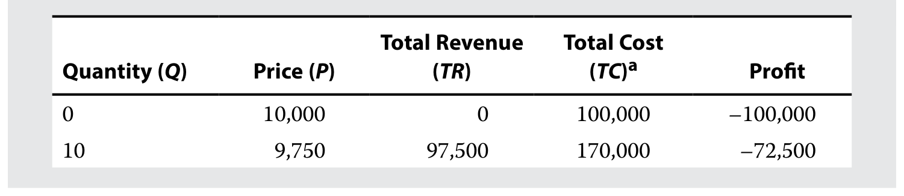 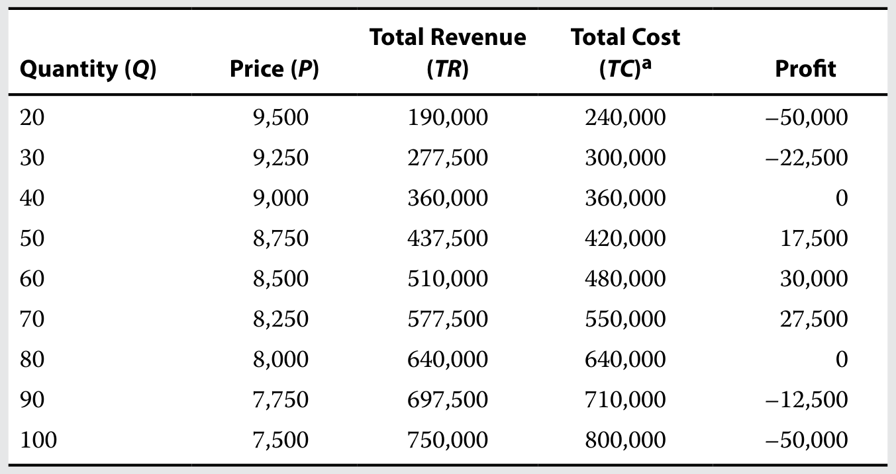

a 包括所有机会成本

a Includes all opportunity costs

1\. WR International 必须销售多少单位，才能首次达到盈亏平衡？

1\. How many units must WR International sell to initially break even?

#### 官方答案与解析 / Official answer and explanation

解答：

Solution:

WR International 在产量为 40 单位时首次达到盈亏平衡，此时 TR 和 TC 均为 360,000。

WR International will initially break even at 40 units of production, where TR and TC equal 360,000.

#### 补充解析 / Supplementary explanation

本题复核锚点（原解摘录）：WR International 在产量为 40 单位时首次达到盈亏平衡，此时 TR 和 TC 均为 360,000。

Review anchor for this item (official excerpt): WR International will initially break even at 40 units of production, where TR and TC equal 360,000.

补充思路：先区分“总利润为负”和“继续生产更不划算”。短期固定成本已经承诺，即使停产也要支付；只要收入能够覆盖可变成本，生产仍可分担固定成本。完全竞争下，P＝ATC 对应盈亏平衡，P＝AVC 对应停产临界点；AVC＜P＜ATC 时企业亏损但通常继续生产。长期所有成本均可调整，持续无法覆盖全部经济成本的企业会退出。

Additional reasoning: Separate an accounting loss from the incremental decision to produce. Committed fixed costs remain even after a short-run shutdown, so revenue above variable cost contributes toward fixed cost. For a competitive firm, P = ATC is breakeven and P = AVC is the shutdown boundary. Between AVC and ATC the firm operates at a loss; persistent inability to cover all economic costs drives long-run exit.

#### 相关知识点 / Related concepts

停产、盈亏平衡与继续经营：TR＝P×Q；经济利润＝TR−TC；短期比较 TR 与 TVC；长期比较 TR 与全部可避免成本。机会成本属于经济成本。

Shutdown, breakeven, and operation: TR = P × Q; economic profit = TR − TC. Compare revenue with variable cost in the short run and with all avoidable costs in the long run. Economic cost includes opportunity cost.

### ECON-LM01-EXAMPLE-102 · 例题 1 · 第 2 题：不完全竞争条件下企业面临向下倾斜的需求曲线时的盈亏平衡分析与利润最大化 Example 1 · 2 — Breakeven Analysis and Profit Maximization When the Firm Faces a Negatively Sloped Demand Curve under Imperfect Competition

正文例题／案例 / Worked example / case · 原版 PDF 页码 / Source PDF pages: 19-20

#### 题目与资料 / Question and data

例 1

EXAMPLE 1

不完全竞争条件下企业面临向下倾斜的需求曲线时的盈亏平衡分析与利润最大化

Breakeven Analysis and Profit Maximization When the Firm Faces a Negatively Sloped Demand Curve under Imperfect Competition

图表 6 列示了 WR International 未来某一时期的收益和成本信息，其中包括所有机会成本。WR International 是一家新成立的公司，为新兴经济体的城市住房市场制造低成本预制住宅单元。（注意，价格每变动 250，数量按每档 10 单位递增。）该企业所在市场为不完全竞争市场，竞争对手较少。

Revenue and cost information for a future period including all opportunity costs is presented in Exhibit 6 for WR International, a newly formed corporation that engages in the manufacturing of low-cost, prefabricated dwelling units for urban housing markets in emerging economies. (Note that quantity increments are in blocks of 10 for a 250 change in price.) The firm has few competitors in a market setting of imperfect competition.

图表 6：WR International 的收益和成本信息

Exhibit 6: Revenue and Cost Information for WR International

 

a 包括所有机会成本

a Includes all opportunity costs

2\. 盈利区间在哪里？

2\. Where is the region of profitability?

#### 官方答案与解析 / Official answer and explanation

解答：

Solution:

盈利区间为大于 40 单位、小于 80 单位。任何低于 40 单位的产量，以及任何高于 80 单位的产量，都会导致经济亏损。

The region of profitability will range from greater than 40 units to less than 80 units. Any production quantity of less than 40 units and any quantity greater than 80 units will result in an economic loss.

#### 补充解析 / Supplementary explanation

本题复核锚点（原解摘录）：盈利区间为大于 40 单位、小于 80 单位。

Review anchor for this item (official excerpt): The region of profitability will range from greater than 40 units to less than 80 units.

补充思路：先用企业数量、产品差异和进入壁垒识别市场结构，再推导需求曲线和长期利润。完全竞争企业是价格接受者；垄断竞争企业凭差异化拥有有限定价权，但自由进入会侵蚀经济利润；垄断或寡头的持续利润还取决于壁垒与潜在竞争。不能只看到“许多企业”就认定完全竞争，也不能把有定价权等同于保证盈利。

Additional reasoning: Identify seller numbers, product differentiation, and entry barriers before inferring demand and long-run profit. Competitive firms take price. Monopolistic competitors have limited pricing power, but entry erodes economic profit. Persistent monopoly or oligopoly profits also depend on barriers and potential competition. Many firms do not automatically imply perfect competition, and pricing power does not guarantee profitability.

#### 相关知识点 / Related concepts

市场结构与定价能力：完全竞争：同质品、低壁垒；垄断竞争：差异化、低壁垒；寡头：少数企业、战略互动；垄断：单一卖方、较强壁垒。

Market structure and pricing power: Perfect competition: homogeneous products and low barriers. Monopolistic competition: differentiation and low barriers. Oligopoly: few firms and strategic interaction. Monopoly: one seller and strong barriers.

### ECON-LM01-EXAMPLE-103 · 例题 1 · 第 3 题：不完全竞争条件下企业面临向下倾斜的需求曲线时的盈亏平衡分析与利润最大化 Example 1 · 3 — Breakeven Analysis and Profit Maximization When the Firm Faces a Negatively Sloped Demand Curve under Imperfect Competition

正文例题／案例 / Worked example / case · 原版 PDF 页码 / Source PDF pages: 19-20

#### 题目与资料 / Question and data

例 1

EXAMPLE 1

不完全竞争条件下企业面临向下倾斜的需求曲线时的盈亏平衡分析与利润最大化

Breakeven Analysis and Profit Maximization When the Firm Faces a Negatively Sloped Demand Curve under Imperfect Competition

图表 6 列示了 WR International 未来某一时期的收益和成本信息，其中包括所有机会成本。WR International 是一家新成立的公司，为新兴经济体的城市住房市场制造低成本预制住宅单元。（注意，价格每变动 250，数量按每档 10 单位递增。）该企业所在市场为不完全竞争市场，竞争对手较少。

Revenue and cost information for a future period including all opportunity costs is presented in Exhibit 6 for WR International, a newly formed corporation that engages in the manufacturing of low-cost, prefabricated dwelling units for urban housing markets in emerging economies. (Note that quantity increments are in blocks of 10 for a 250 change in price.) The firm has few competitors in a market setting of imperfect competition.

图表 6：WR International 的收益和成本信息

Exhibit 6: Revenue and Cost Information for WR International

 

a 包括所有机会成本

a Includes all opportunity costs

3\. 企业在哪一点实现利润最大化？在哪些点出现经济亏损？

3\. At what point will the firm maximize profit? At what points are there economic losses?

#### 官方答案与解析 / Official answer and explanation

解答：

Solution:

在产量为 60 单位时，利润达到最大值 30,000。任何高于或低于 60 单位的产量水平，利润都会较低。在产量从 0 单位至不足 40 单位的区间内，以及产量大于 80 单位时，都会出现经济亏损。

Maximum profit of 30,000 will occur at 60 units. Lower profit will occur at any output level that is higher or lower than 60 units. From 0 units to less than 40 units and for quantities greater than 80 units, economic losses occur.

#### 补充解析 / Supplementary explanation

本题复核锚点（原解摘录）：在产量为 60 单位时，利润达到最大值 30,000。

Review anchor for this item (official excerpt): Maximum profit of 30,000 will occur at 60 units.

补充思路：最优产量要看“下一单位”给利润带来的变化：MR＞MC 时增产增加利润，MR＜MC 时减产增加利润，因此内点最优量满足 MR＝MC，并要求边际利润由正转负。只有在完全竞争下才可进一步写成 P＝MR＝MC。把最低平均成本误当最大利润，或在垄断竞争下直接用 P＝MC，都是把不同决策条件混在一起。

Additional reasoning: Evaluate the profit from the next unit: expand when MR exceeds MC and contract when MR is below MC. An interior optimum has MR = MC with marginal profit turning negative beyond it. Only perfect competition also gives P = MR = MC. Minimum average cost is not generally maximum profit, and a firm with a downward-sloping demand curve cannot replace MR with price.

#### 相关知识点 / Related concepts

利润最大化的边际条件：MR＝ΔTR/ΔQ；MC＝ΔTC/ΔQ；利润最大化与成本最小化是不同问题。求出 Q 后，再从需求曲线求售价。

Marginal profit maximization: MR = ΔTR/ΔQ; MC = ΔTC/ΔQ. Profit maximization differs from average-cost minimization. After finding Q, obtain the selling price from demand.

### ECON-LM01-EXAMPLE-201 · 例题 2 · 第 1 题：停产分析 Example 2 · 1 — Shutdown Analysis

正文例题／案例 / Worked example / case · 原版 PDF 页码 / Source PDF pages: 21

#### 题目与资料 / Question and data

例 2

EXAMPLE 2

停产分析

Shutdown Analysis

在最近一个财务报告期，一家位于伦敦的企业收益为 200 万英镑，TC 为 250 万英镑。总成本已分为或可分为 100 万英镑的 TFC 和 150 万英镑的 TVC。该企业利润表报告的净亏损为 500,000 英镑（忽略税务影响）。在此前的各期，该企业曾报告经营盈利。

For the most recent financial reporting period, a London-based business has revenue of GBP2 million and TC of GBP2.5 million, which are or can be broken down into TFC of GBP1 million and TVC of GBP1.5 million. The net loss on the firm’s income statement is reported as GBP500,000 (ignoring tax implications). In prior periods, the firm had reported profits on its operations.

1\. 企业对于短期内的经营应作出怎样的决策？

1\. What decision should the firm make regarding operations over the short term?

#### 官方答案与解析 / Official answer and explanation

解答：

Solution:

在短期内，企业能够弥补全部 TVC，但只能弥补 100 万英镑 TFC 中的一半。如果企业停止经营，其亏损将为 TFC 的金额，即 100 万英镑；如果继续经营，则可将净亏损降至最低的 500,000 英镑。企业应尝试与债权人协商特殊安排，以继续经营，为业务恢复盈利争取时间。

In the short run, the firm is able to cover all of its TVC but only half of its GBP1 million in TFC. If the business ceases to operate, its loss would be GBP1 million, the amount of TFC, whereas the net loss by operating would be minimized at GBP500,000. The firm should attempt to operate by negotiating special arrangements with creditors to buy time to return operations back to profitability.

#### 补充解析 / Supplementary explanation

本题复核锚点（原解摘录）：在短期内，企业能够弥补全部 TVC，但只能弥补 100 万英镑 TFC 中的一半。

Review anchor for this item (official excerpt): In the short run, the firm is able to cover all of its TVC but only half of its GBP1 million in TFC.

补充思路：先区分“总利润为负”和“继续生产更不划算”。短期固定成本已经承诺，即使停产也要支付；只要收入能够覆盖可变成本，生产仍可分担固定成本。完全竞争下，P＝ATC 对应盈亏平衡，P＝AVC 对应停产临界点；AVC＜P＜ATC 时企业亏损但通常继续生产。长期所有成本均可调整，持续无法覆盖全部经济成本的企业会退出。

Additional reasoning: Separate an accounting loss from the incremental decision to produce. Committed fixed costs remain even after a short-run shutdown, so revenue above variable cost contributes toward fixed cost. For a competitive firm, P = ATC is breakeven and P = AVC is the shutdown boundary. Between AVC and ATC the firm operates at a loss; persistent inability to cover all economic costs drives long-run exit.

#### 相关知识点 / Related concepts

停产、盈亏平衡与继续经营：TR＝P×Q；经济利润＝TR−TC；短期比较 TR 与 TVC；长期比较 TR 与全部可避免成本。机会成本属于经济成本。

Shutdown, breakeven, and operation: TR = P × Q; economic profit = TR − TC. Compare revenue with variable cost in the short run and with all avoidable costs in the long run. Economic cost includes opportunity cost.

### ECON-LM01-EXAMPLE-202 · 例题 2 · 第 2 题：停产分析 Example 2 · 2 — Shutdown Analysis

正文例题／案例 / Worked example / case · 原版 PDF 页码 / Source PDF pages: 21

#### 题目与资料 / Question and data

例 2

EXAMPLE 2

停产分析

Shutdown Analysis

在最近一个财务报告期，一家位于伦敦的企业收益为 200 万英镑，TC 为 250 万英镑。总成本已分为或可分为 100 万英镑的 TFC 和 150 万英镑的 TVC。该企业利润表报告的净亏损为 500,000 英镑（忽略税务影响）。在此前的各期，该企业曾报告经营盈利。

For the most recent financial reporting period, a London-based business has revenue of GBP2 million and TC of GBP2.5 million, which are or can be broken down into TFC of GBP1 million and TVC of GBP1.5 million. The net loss on the firm’s income statement is reported as GBP500,000 (ignoring tax implications). In prior periods, the firm had reported profits on its operations.

2\. 企业对于长期内的经营应作出怎样的决策？

2\. What decision should the firm make regarding operations over the long term?

#### 官方答案与解析 / Official answer and explanation

解答：

Solution:

如果预计收益不足的状况将持续存在，企业应停止经营，清算资产，并尽可能偿还债务。允许企业亏损经营的时间越长，留给股东的剩余价值就越少。

If the revenue shortfall is expected to persist over time, the firm should cease operations, liquidate assets, and pay debts to the extent possible. Any residual for shareholders would decrease the longer the firm is allowed to operate unprofitably.

#### 补充解析 / Supplementary explanation

本题复核锚点（原解摘录）：如果预计收益不足的状况将持续存在，企业应停止经营，清算资产，并尽可能偿还债务。

Review anchor for this item (official excerpt): If the revenue shortfall is expected to persist over time, the firm should cease operations, liquidate assets, and pay debts to the extent possible.

补充思路：先区分“总利润为负”和“继续生产更不划算”。短期固定成本已经承诺，即使停产也要支付；只要收入能够覆盖可变成本，生产仍可分担固定成本。完全竞争下，P＝ATC 对应盈亏平衡，P＝AVC 对应停产临界点；AVC＜P＜ATC 时企业亏损但通常继续生产。长期所有成本均可调整，持续无法覆盖全部经济成本的企业会退出。

Additional reasoning: Separate an accounting loss from the incremental decision to produce. Committed fixed costs remain even after a short-run shutdown, so revenue above variable cost contributes toward fixed cost. For a competitive firm, P = ATC is breakeven and P = AVC is the shutdown boundary. Between AVC and ATC the firm operates at a loss; persistent inability to cover all economic costs drives long-run exit.

本题若限定长期，应把固定投入也视为可以重新选择的成本；短期继续经营的条件不能直接代替长期留在市场的条件。

A long-run condition treats formerly fixed commitments as adjustable. The short-run operating rule cannot substitute for the long-run rule for remaining in the market.

#### 相关知识点 / Related concepts

停产、盈亏平衡与继续经营：TR＝P×Q；经济利润＝TR−TC；短期比较 TR 与 TVC；长期比较 TR 与全部可避免成本。机会成本属于经济成本。

Shutdown, breakeven, and operation: TR = P × Q; economic profit = TR − TC. Compare revenue with variable cost in the short run and with all avoidable costs in the long run. Economic cost includes opportunity cost.

### ECON-LM01-EXAMPLE-203 · 例题 2 · 第 3 题：停产分析 Example 2 · 3 — Shutdown Analysis

正文例题／案例 / Worked example / case · 原版 PDF 页码 / Source PDF pages: 21

#### 题目与资料 / Question and data

例 2

EXAMPLE 2

停产分析

Shutdown Analysis

在最近一个财务报告期，一家位于伦敦的企业收益为 200 万英镑，TC 为 250 万英镑。总成本已分为或可分为 100 万英镑的 TFC 和 150 万英镑的 TVC。该企业利润表报告的净亏损为 500,000 英镑（忽略税务影响）。在此前的各期，该企业曾报告经营盈利。

For the most recent financial reporting period, a London-based business has revenue of GBP2 million and TC of GBP2.5 million, which are or can be broken down into TFC of GBP1 million and TVC of GBP1.5 million. The net loss on the firm’s income statement is reported as GBP500,000 (ignoring tax implications). In prior periods, the firm had reported profits on its operations.

3\. 假设企业情况相同，但收益现在为 130 万英镑，导致净亏损为 120 万英镑。在这种情况下，企业应对经营作出怎样的决策？

3\. Assume the same business scenario except that revenue is now GBP1.3 million, which creates a net loss of GBP1.2 million. What decision should the firm make regarding operations in this case?

#### 官方答案与解析 / Official answer and explanation

解答：

Solution:

企业通过停产可将亏损降至最低，即 100 万英镑的 TFC。如果企业决定继续经营，亏损将增至 120 万英镑。选择停产可以为股东保全 200,000 英镑的股权价值。毫无疑问，如果这种亏损局面持续，企业的预期存续时间将十分短暂。

The firm would minimize loss at GBP1 million of TFC by shutting down. If the firm decided to continue to do business, the loss would increase to GBP1.2 million. Shareholders would save GBP200,000 in equity value by pursuing this option. Unquestionably, the business would have a rather short life expectancy if this loss situation were to continue.

#### 补充解析 / Supplementary explanation

本题复核锚点（原解摘录）：企业通过停产可将亏损降至最低，即 100 万英镑的 TFC。

Review anchor for this item (official excerpt): The firm would minimize loss at GBP1 million of TFC by shutting down.

补充思路：先区分“总利润为负”和“继续生产更不划算”。短期固定成本已经承诺，即使停产也要支付；只要收入能够覆盖可变成本，生产仍可分担固定成本。完全竞争下，P＝ATC 对应盈亏平衡，P＝AVC 对应停产临界点；AVC＜P＜ATC 时企业亏损但通常继续生产。长期所有成本均可调整，持续无法覆盖全部经济成本的企业会退出。

Additional reasoning: Separate an accounting loss from the incremental decision to produce. Committed fixed costs remain even after a short-run shutdown, so revenue above variable cost contributes toward fixed cost. For a competitive firm, P = ATC is breakeven and P = AVC is the shutdown boundary. Between AVC and ATC the firm operates at a loss; persistent inability to cover all economic costs drives long-run exit.

本题要求选择“不成立、最不可能或例外”的项目。先判断各陈述在题设下是否成立，再按这一反向要求选出答案；正确选项可能本身描述的就是错误或不适用情形。

This item asks for a least-likely, inaccurate, or exception case. Evaluate each statement under the assumptions, then apply that reversed selection rule; the credited choice may itself describe the false or inapplicable case.

#### 相关知识点 / Related concepts

停产、盈亏平衡与继续经营：TR＝P×Q；经济利润＝TR−TC；短期比较 TR 与 TVC；长期比较 TR 与全部可避免成本。机会成本属于经济成本。

Shutdown, breakeven, and operation: TR = P × Q; economic profit = TR − TC. Compare revenue with variable cost in the short run and with all avoidable costs in the long run. Economic cost includes opportunity cost.

### ECON-LM01-EXAMPLE-301 · 例题 3 · 第 1 题：长期平均总成本曲线 Example 3 · 1 — Long-Run Average Total Cost Curve

正文例题／案例 / Worked example / case · 原版 PDF 页码 / Source PDF pages: 26

#### 题目与资料 / Question and data

例 3

EXAMPLE 3

长期平均总成本曲线

Long-Run Average Total Cost Curve

图表 12 展示了三家假设的美国汽车制造商——Starr Vehicles（Starr）、Rocket Sports Cars（Rocket）和 General Auto（GenAuto）——的长期平均总成本曲线（LRACUS）及短期平均总成本曲线。图中也标出了在美国汽车市场参与竞争的外资汽车公司的 LRAC 曲线（LRACforeign）。（图表所隐含的市场结构为不完全竞争。）

Exhibit 12 displays the long-run average total cost curve (LRACUS) and the short-run average total cost curves for three hypothetical US-based automobile manufacturers—Starr Vehicles (Starr), Rocket Sports Cars (Rocket), and General Auto (GenAuto). The LRAC curve for foreign-owned automobile companies that compete in the US auto market (LRACforeign) is also indicated in the graph. (The market structure implicit in the exhibit is imperfect competition.)

1\. 图表 12 所示的成本关系，对这三家美国汽车企业的经济和财务分析有何帮助？

1\. To what extent are the cost relationships depicted in Exhibit 12 useful for an economic and financial analysis of the three US-based auto firms?

图表 12：三家汽车制造商的长期平均总成本曲线

Exhibit 12: Long-Run Average Total Cost Curves for Three Auto Manufacturers

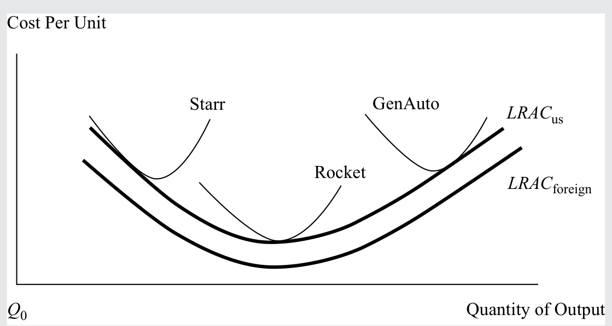

#### 官方答案与解析 / Official answer and explanation

解答：

Solution:

首先可以看出，外国汽车公司的 LRAC 低于美国汽车制造商。这种竞争地位使美国企业在市场上处于成本劣势，也可能处于定价劣势，并可能将市场份额流失给成本较低的外国竞争者。其次，只有 Rocket 在 LRACUS 的最低点经营，而 GenAuto 位于规模不经济区间，Starr 位于曲线的规模经济部分。要提高效率和竞争力，GenAuto 需要缩减规模并进行重组，这意味着沿 LRACUS 曲线向下移动，转向规模更小、但成本更低的产量。相反，Starr 必须扩大规模，通过降低单位成本提高效率和竞争力。从长期投资角度来看，凭借其成本优势，Rocket 相比 GenAuto 和 Starr 更有潜力创造投资价值。长期而言，如果 GenAuto 和 Starr 能够降低 ATC，它们对投资者的吸引力就会增强。但如果这三家美国汽车公司中的任何一家无法达到外国企业的成本竞争力，都可能被逐出市场。在长期内，成本较低的外国汽车制造商将对美国制造商的生存，以及其维持和增加股东财富的能力，构成严峻的竞争挑战。

First, it is observable that the foreign auto companies have a lower LRAC compared with that of the US automobile manufacturers. This competitive position places the US firms at a cost—and possibly, pricing—disadvantage in the market, with the potential to lose market share to the lower-cost foreign competitors. Second, only Rocket operates at the minimum point of the LRACUS, whereas GenAuto is situated in the region of diseconomies of scale and Starr is positioned in the economies of scale portion of the curve. To become more efficient and competitive, GenAuto needs to downsize and restructure, which means moving down the LRACUS curve to a smaller yet lower-cost production volume. In contrast, Starr has to grow in size to become more efficient and competitive by lowering per-unit costs. From a long-term investment prospective and given its cost advantage, Rocket has the potential to create more investment value relative to GenAuto and Starr. Over the long run, if GenAuto and Starr can lower their ATC, they will become more attractive to investors. But if any of the three US auto companies cannot match the cost competitiveness of the foreign firms, they may be driven from the market. In the long run, the lower-cost foreign automakers pose a severe competitive challenge to the survival of the US manufacturers and their ability to maintain and grow shareholders’ wealth.

#### 补充解析 / Supplementary explanation

本题复核锚点（原解摘录）：首先可以看出，外国汽车公司的 LRAC 低于美国汽车制造商。

Review anchor for this item (official excerpt): First, it is observable that the foreign auto companies have a lower LRAC compared with that of the US automobile manufacturers.

补充思路：长期中可以选择工厂规模，LRAC 反映各产量下可选择技术的最低平均成本。规模经济使 LRAC 下降，规模不经济使其上升；这与短期在固定资本上增加劳动力导致的边际报酬递减不同。比较企业成本竞争力时，应同时看最低有效规模、需求能否支持该规模，以及其他企业的成本曲线，而非只比较当前产量。

Additional reasoning: The long run allows plant size to change, and LRAC is the minimum attainable average cost at each output. Economies of scale lower LRAC and diseconomies raise it. This differs from short-run diminishing marginal returns with fixed capital. Cost competitiveness also depends on minimum efficient scale, demand, and competitors’ cost curves.

本题若限定长期，应把固定投入也视为可以重新选择的成本；短期继续经营的条件不能直接代替长期留在市场的条件。

A long-run condition treats formerly fixed commitments as adjustable. The short-run operating rule cannot substitute for the long-run rule for remaining in the market.

#### 相关知识点 / Related concepts

规模经济与长期成本：长期所有投入可变；短期至少一种投入固定。最低有效规模是达到最低长期平均成本的最小规模。

Scale and long-run cost: All inputs vary in the long run; at least one is fixed in the short run. Minimum efficient scale is the smallest output that attains minimum LRAC.

### ECON-LM01-QUESTION_SET-401 · 习题组 · 第 1 题 Question set · 1

正文习题组 / Question set · 原版 PDF 页码 / Source PDF pages: 27

#### 题目与资料 / Question and data

习题组

QUESTION SET

1\. 一家在完全竞争市场中经营的农业企业向消费食品和动物饲料制造商供应小麦。如果该企业能够将产量和单位销量增加 10%，最可能出现的结果是：

1\. An agricultural firm operating in a perfectly competitive market supplies wheat to manufacturers of consumer food products and animal feeds. If the firm were able to expand its production and unit sales by 10%, the most likely result would be:

A. 总收益增加 10%。

A. a 10% increase in total revenue.

B. 平均收益增加 10%。

B. a 10% increase in average revenue.

C. 总收益增加不到 10%。

C. a less than 10% increase in total revenue.

#### 官方答案与解析 / Official answer and explanation

解答：

Solution:

A 正确。在完全竞争市场中，单个企业增加供给不会影响价格。因此，该企业销量的增加会带来收益同比例的增加。

A is correct. In a perfectly competitive market, an increase in supply by a single firm will not affect price. Therefore, an increase in units sold by the firm will be matched proportionately by an increase in revenue.

#### 补充解析 / Supplementary explanation

本题复核锚点（原解摘录）：A 正确。在完全竞争市场中，单个企业增加供给不会影响价格。

Review anchor for this item (official excerpt): A is correct. In a perfectly competitive market, an increase in supply by a single firm will not affect price.

本题官方选项为 A。补充思路：单个完全竞争企业面对既定市场价格，其自身增产不会改变市场价格。因此总收入随销量同比例变化，而平均收入和边际收入仍等于价格。读到产量增长百分比时，不应把总收入的增长误认为每单位收入增长；后者需要价格变化才会发生。

The official choice for this item is A. Additional reasoning: A single competitive firm takes the market price as given. Its own output increase therefore raises total revenue proportionately while average and marginal revenue remain equal to price. A percentage increase in units is a total-revenue effect, not an increase in revenue per unit.

#### 相关知识点 / Related concepts

完全竞争下的收入与价格：TR＝P×Q；AR＝TR/Q＝P；完全竞争企业的MR＝P。行业供给变化和单个企业供给变化的影响不同。

Revenue and price under perfect competition: TR = P×Q; AR = TR/Q = P; a competitive firm has MR = P. An industry-wide supply shift differs from one firm changing output.

### ECON-LM01-QUESTION_SET-402 · 习题组 · 第 2 题 Question set · 2

正文习题组 / Question set · 原版 PDF 页码 / Source PDF pages: 27

#### 题目与资料 / Question and data

习题组

QUESTION SET

2\. 在完全竞争条件下经营的企业，每售出一单位产品的边际收益最可能：

2\. The marginal revenue per unit sold for a firm doing business under conditions of perfect competition will most likely be:

A. 等于平均收益。

A. equal to average revenue.

B. 小于平均收益。

B. less than average revenue.

C. 大于平均收益。

C. greater than average revenue.

#### 官方答案与解析 / Official answer and explanation

A 正确。在完全竞争条件下，无论向市场供应多少数量，企业都是价格接受者，并且 AR = MR = 价格。

A is correct. Under perfect competition, a firm is a price taker at any quantity supplied to the market, and AR = MR = Price.

#### 补充解析 / Supplementary explanation

本题复核锚点（原解摘录）：A 正确。在完全竞争条件下，无论向市场供应多少数量，企业都是价格接受者，并且 AR = MR = 价格。

Review anchor for this item (official excerpt): A is correct. Under perfect competition, a firm is a price taker at any quantity supplied to the market, and AR = MR = Price.

本题官方选项为 A。补充思路：先用企业数量、产品差异和进入壁垒识别市场结构，再推导需求曲线和长期利润。完全竞争企业是价格接受者；垄断竞争企业凭差异化拥有有限定价权，但自由进入会侵蚀经济利润；垄断或寡头的持续利润还取决于壁垒与潜在竞争。不能只看到“许多企业”就认定完全竞争，也不能把有定价权等同于保证盈利。

The official choice for this item is A. Additional reasoning: Identify seller numbers, product differentiation, and entry barriers before inferring demand and long-run profit. Competitive firms take price. Monopolistic competitors have limited pricing power, but entry erodes economic profit. Persistent monopoly or oligopoly profits also depend on barriers and potential competition. Many firms do not automatically imply perfect competition, and pricing power does not guarantee profitability.

#### 相关知识点 / Related concepts

市场结构与定价能力：完全竞争：同质品、低壁垒；垄断竞争：差异化、低壁垒；寡头：少数企业、战略互动；垄断：单一卖方、较强壁垒。

Market structure and pricing power: Perfect competition: homogeneous products and low barriers. Monopolistic competition: differentiation and low barriers. Oligopoly: few firms and strategic interaction. Monopoly: one seller and strong barriers.

### ECON-LM01-QUESTION_SET-403 · 习题组 · 第 3 题 Question set · 3

正文习题组 / Question set · 原版 PDF 页码 / Source PDF pages: 27

#### 题目与资料 / Question and data

习题组

QUESTION SET

3\. 下列哪种情形最不可能意味着利润达到最大值？

3\. A profit maximum is least likely to occur when:

A. 平均总成本达到最低。

A. average total cost is minimized.

B. 边际收益等于边际成本。

B. marginal revenue is equal to marginal cost.

C. 总收益与总成本之差达到最大。

C. the difference between total revenue and total cost is maximized.

#### 官方答案与解析 / Official answer and explanation

A 正确。平均总成本达到最低时的产量，不一定对应利润最大化的产量。

A is correct. The quantity at which average total cost is minimized does not necessarily correspond to a profit maximum.

#### 补充解析 / Supplementary explanation

本题复核锚点（原解摘录）：A 正确。平均总成本达到最低时的产量，不一定对应利润最大化的产量。

Review anchor for this item (official excerpt): A is correct. The quantity at which average total cost is minimized does not necessarily correspond to a profit maximum.

本题官方选项为 A。补充思路：最优产量要看“下一单位”给利润带来的变化：MR＞MC 时增产增加利润，MR＜MC 时减产增加利润，因此内点最优量满足 MR＝MC，并要求边际利润由正转负。只有在完全竞争下才可进一步写成 P＝MR＝MC。把最低平均成本误当最大利润，或在垄断竞争下直接用 P＝MC，都是把不同决策条件混在一起。

The official choice for this item is A. Additional reasoning: Evaluate the profit from the next unit: expand when MR exceeds MC and contract when MR is below MC. An interior optimum has MR = MC with marginal profit turning negative beyond it. Only perfect competition also gives P = MR = MC. Minimum average cost is not generally maximum profit, and a firm with a downward-sloping demand curve cannot replace MR with price.

本题要求选择“不成立、最不可能或例外”的项目。先判断各陈述在题设下是否成立，再按这一反向要求选出答案；正确选项可能本身描述的就是错误或不适用情形。

This item asks for a least-likely, inaccurate, or exception case. Evaluate each statement under the assumptions, then apply that reversed selection rule; the credited choice may itself describe the false or inapplicable case.

#### 相关知识点 / Related concepts

利润最大化的边际条件：MR＝ΔTR/ΔQ；MC＝ΔTC/ΔQ；利润最大化与成本最小化是不同问题。求出 Q 后，再从需求曲线求售价。

Marginal profit maximization: MR = ΔTR/ΔQ; MC = ΔTC/ΔQ. Profit maximization differs from average-cost minimization. After finding Q, obtain the selling price from demand.

### ECON-LM01-QUESTION_SET-404 · 习题组 · 第 4 题 Question set · 4

正文习题组 / Question set · 原版 PDF 页码 / Source PDF pages: 27-28

#### 题目与资料 / Question and data

习题组

QUESTION SET

4\. 在完全竞争条件下经营的企业，其短期生产盈亏平衡点最可能出现在：

4\. The short-term breakeven point of production for a firm operating under perfect competition will most likely occur when:

A. 价格等于平均总成本时。

A. price is equal to average total cost.

B. 边际收益等于边际成本时。

B. marginal revenue is equal to marginal cost.

C. 边际收益等于平均可变成本时。

C. marginal revenue is equal to average variable costs.

#### 官方答案与解析 / Official answer and explanation

解答：

Solution:

A 正确。在完全竞争条件下，价格等于边际收益。当边际收益等于平均总成本时，企业达到盈亏平衡。

A is correct. Under perfect competition, price is equal to marginal revenue. A firm breaks even when marginal revenue equals average total cost.

#### 补充解析 / Supplementary explanation

本题复核锚点（原解摘录）：A 正确。在完全竞争条件下，价格等于边际收益。

Review anchor for this item (official excerpt): A is correct. Under perfect competition, price is equal to marginal revenue.

本题官方选项为 A。补充思路：先用企业数量、产品差异和进入壁垒识别市场结构，再推导需求曲线和长期利润。完全竞争企业是价格接受者；垄断竞争企业凭差异化拥有有限定价权，但自由进入会侵蚀经济利润；垄断或寡头的持续利润还取决于壁垒与潜在竞争。不能只看到“许多企业”就认定完全竞争，也不能把有定价权等同于保证盈利。

The official choice for this item is A. Additional reasoning: Identify seller numbers, product differentiation, and entry barriers before inferring demand and long-run profit. Competitive firms take price. Monopolistic competitors have limited pricing power, but entry erodes economic profit. Persistent monopoly or oligopoly profits also depend on barriers and potential competition. Many firms do not automatically imply perfect competition, and pricing power does not guarantee profitability.

#### 相关知识点 / Related concepts

市场结构与定价能力：完全竞争：同质品、低壁垒；垄断竞争：差异化、低壁垒；寡头：少数企业、战略互动；垄断：单一卖方、较强壁垒。

Market structure and pricing power: Perfect competition: homogeneous products and low barriers. Monopolistic competition: differentiation and low barriers. Oligopoly: few firms and strategic interaction. Monopoly: one seller and strong barriers.

### ECON-LM01-QUESTION_SET-501 · 习题组 · 第 1 题 Question set · 1

正文习题组 / Question set · 原版 PDF 页码 / Source PDF pages: 33

#### 题目与资料 / Question and data

习题组

QUESTION SET

1\. 一种市场结构中存在众多卖者，且每个卖者都具有一定定价权并实行产品差异化。这种市场结构最恰当地描述为：

1\. A market structure characterized by many sellers with each having some pricing power and product differentiation is best described as:

A. 寡头垄断。

A. oligopoly.

B. 完全竞争。

B. perfect competition.

C. 垄断竞争。

C. monopolistic competition.

#### 官方答案与解析 / Official answer and explanation

解答：

Solution:

C 正确。垄断竞争的特点是卖者众多、产品存在差异，以及具有一定定价权。

C is correct. Monopolistic competition is characterized by many sellers, differentiated products, and some pricing power.

#### 补充解析 / Supplementary explanation

本题复核锚点（原解摘录）：C 正确。垄断竞争的特点是卖者众多、产品存在差异，以及具有一定定价权。

Review anchor for this item (official excerpt): C is correct. Monopolistic competition is characterized by many sellers, differentiated products, and some pricing power.

本题官方选项为 C。补充思路：先用企业数量、产品差异和进入壁垒识别市场结构，再推导需求曲线和长期利润。完全竞争企业是价格接受者；垄断竞争企业凭差异化拥有有限定价权，但自由进入会侵蚀经济利润；垄断或寡头的持续利润还取决于壁垒与潜在竞争。不能只看到“许多企业”就认定完全竞争，也不能把有定价权等同于保证盈利。

The official choice for this item is C. Additional reasoning: Identify seller numbers, product differentiation, and entry barriers before inferring demand and long-run profit. Competitive firms take price. Monopolistic competitors have limited pricing power, but entry erodes economic profit. Persistent monopoly or oligopoly profits also depend on barriers and potential competition. Many firms do not automatically imply perfect competition, and pricing power does not guarantee profitability.

#### 相关知识点 / Related concepts

市场结构与定价能力：完全竞争：同质品、低壁垒；垄断竞争：差异化、低壁垒；寡头：少数企业、战略互动；垄断：单一卖方、较强壁垒。

Market structure and pricing power: Perfect competition: homogeneous products and low barriers. Monopolistic competition: differentiation and low barriers. Oligopoly: few firms and strategic interaction. Monopoly: one seller and strong barriers.

### ECON-LM01-QUESTION_SET-502 · 习题组 · 第 2 题 Question set · 2

正文习题组 / Question set · 原版 PDF 页码 / Source PDF pages: 33

#### 题目与资料 / Question and data

习题组

QUESTION SET

2\. 一种市场结构中，销售同质化或标准化产品的卖者数量相对较少。这种结构最恰当地描述为：

2\. A market structure with relatively few sellers of a homogeneous or standardized product is best described as:

A. 寡头垄断。

A. oligopoly.

B. 垄断。

B. monopoly.

C. 完全竞争。

C. perfect competition.

#### 官方答案与解析 / Official answer and explanation

A 正确。由少数卖者销售同质化或标准化产品，是寡头垄断的特征。

A is correct. Few sellers of a homogeneous or standardized product characterizes an oligopoly.

#### 补充解析 / Supplementary explanation

本题复核锚点（原解摘录）：A 正确。由少数卖者销售同质化或标准化产品，是寡头垄断的特征。

Review anchor for this item (official excerpt): A is correct. Few sellers of a homogeneous or standardized product characterizes an oligopoly.

本题官方选项为 A。补充思路：先用企业数量、产品差异和进入壁垒识别市场结构，再推导需求曲线和长期利润。完全竞争企业是价格接受者；垄断竞争企业凭差异化拥有有限定价权，但自由进入会侵蚀经济利润；垄断或寡头的持续利润还取决于壁垒与潜在竞争。不能只看到“许多企业”就认定完全竞争，也不能把有定价权等同于保证盈利。

The official choice for this item is A. Additional reasoning: Identify seller numbers, product differentiation, and entry barriers before inferring demand and long-run profit. Competitive firms take price. Monopolistic competitors have limited pricing power, but entry erodes economic profit. Persistent monopoly or oligopoly profits also depend on barriers and potential competition. Many firms do not automatically imply perfect competition, and pricing power does not guarantee profitability.

#### 相关知识点 / Related concepts

市场结构与定价能力：完全竞争：同质品、低壁垒；垄断竞争：差异化、低壁垒；寡头：少数企业、战略互动；垄断：单一卖方、较强壁垒。

Market structure and pricing power: Perfect competition: homogeneous products and low barriers. Monopolistic competition: differentiation and low barriers. Oligopoly: few firms and strategic interaction. Monopoly: one seller and strong barriers.

### ECON-LM01-QUESTION_SET-601 · 习题组 · 第 1 题 Question set · 1

正文习题组 / Question set · 原版 PDF 页码 / Source PDF pages: 37

#### 题目与资料 / Question and data

习题组

QUESTION SET

1\. 在垄断竞争市场中经营的公司，最可能在产量被设定为满足下列哪一条件时实现利润最大化？

1\. A company doing business in a monopolistically competitive market will most likely maximize profits when its output quantity is set such that:

A. 平均成本最低。

A. average cost is minimized.

B. 边际收益等于平均成本。

B. marginal revenue is equal to average cost.

C. 边际收益等于边际成本。

C. marginal revenue is equal to marginal cost.

#### 官方答案与解析 / Official answer and explanation

解答：

Solution:

C 正确。实现利润最大化的选择，是边际收益等于边际成本时的产量水平。

C is correct. The profit maximizing choice is the level of output at which marginal revenue equals marginal cost.

#### 补充解析 / Supplementary explanation

本题复核锚点（原解摘录）：C 正确。实现利润最大化的选择，是边际收益等于边际成本时的产量水平。

Review anchor for this item (official excerpt): C is correct. The profit maximizing choice is the level of output at which marginal revenue equals marginal cost.

本题官方选项为 C。补充思路：最优产量要看“下一单位”给利润带来的变化：MR＞MC 时增产增加利润，MR＜MC 时减产增加利润，因此内点最优量满足 MR＝MC，并要求边际利润由正转负。只有在完全竞争下才可进一步写成 P＝MR＝MC。把最低平均成本误当最大利润，或在垄断竞争下直接用 P＝MC，都是把不同决策条件混在一起。

The official choice for this item is C. Additional reasoning: Evaluate the profit from the next unit: expand when MR exceeds MC and contract when MR is below MC. An interior optimum has MR = MC with marginal profit turning negative beyond it. Only perfect competition also gives P = MR = MC. Minimum average cost is not generally maximum profit, and a firm with a downward-sloping demand curve cannot replace MR with price.

#### 相关知识点 / Related concepts

利润最大化的边际条件：MR＝ΔTR/ΔQ；MC＝ΔTC/ΔQ；利润最大化与成本最小化是不同问题。求出 Q 后，再从需求曲线求售价。

Marginal profit maximization: MR = ΔTR/ΔQ; MC = ΔTC/ΔQ. Profit maximization differs from average-cost minimization. After finding Q, obtain the selling price from demand.

### ECON-LM01-QUESTION_SET-701 · 习题组 · 第 1 题 Question set · 1

正文习题组 / Question set · 原版 PDF 页码 / Source PDF pages: 47

#### 题目与资料 / Question and data

习题组

QUESTION SET

1\. 寡头垄断定价策略最可能导致需求曲线呈现：

1\. Oligopolistic pricing strategy most likely results in a demand curve that is:

A. 折弯形。

A. kinked.

B. 垂直线。

B. vertical.

C. 水平线。

C. horizontal.

#### 官方答案与解析 / Official answer and explanation

解答：

Solution:

A 正确。寡头垄断者面临两种不同的需求结构，一种对应提价，另一种对应降价。竞争对手会降价以跟随降价，但不会跟随提价。结果是一条折弯需求曲线。

A is correct. The oligopolist faces two different demand structures, one for price increases and another for price decreases. Competitors will lower prices to match a price reduction, but will not match a price increase. The result is a kinked demand curve.

#### 补充解析 / Supplementary explanation

本题复核锚点（原解摘录）：A 正确。寡头垄断者面临两种不同的需求结构，一种对应提价，另一种对应降价。

Review anchor for this item (official excerpt): A is correct. The oligopolist faces two different demand structures, one for price increases and another for price decreases.

本题官方选项为 A。补充思路：寡头决策必须同时考虑竞争者反应。Cournot 模型以竞争对手产量给定为条件选择产量；Nash 均衡要求各方在其他方策略给定时没有单方面改变策略的激励。弯折需求模型描述涨价与降价引发的反应不对称，并解释某一范围内成本变化而价格不变。主导企业模式下，先扣除竞争边缘企业的供给，得到主导企业面对的剩余需求。

The official choice for this item is A. Additional reasoning: An oligopolist must anticipate rivals. Cournot conditions each quantity choice on rivals’ quantities, while Nash equilibrium requires no profitable unilateral deviation. A kinked demand curve represents asymmetric rival responses to price increases and cuts and can explain price rigidity over a cost range. A dominant firm faces residual demand after subtracting fringe supply.

#### 相关知识点 / Related concepts

寡头的战略相互依赖：战略变量可能是价格、产量或产品；“给定竞争者策略的最优回应”是识别均衡的关键。合谋还面临成员偏离与新进入的压力。

Strategic interdependence in oligopoly: The strategic variable may be price, quantity, or product choice. Equilibrium concerns best responses to others’ strategies. Collusion is vulnerable to cheating and entry.

### ECON-LM01-QUESTION_SET-702 · 习题组 · 第 2 题 Question set · 2

正文习题组 / Question set · 原版 PDF 页码 / Source PDF pages: 47

#### 题目与资料 / Question and data

习题组

QUESTION SET

2\. 在下列哪种市场情况下，串谋较不可能出现？

2\. Collusion is less likely in a market when:

A. 产品同质化。

A. the product is homogeneous.

B. 各公司的市场份额相近。

B. companies have similar market shares.

C. 各公司的成本结构相近。

C. the cost structures of companies are similar.

#### 官方答案与解析 / Official answer and explanation

B 正确。当各公司的市场份额相近时，竞争力量往往会超过串谋带来的好处。

B is correct. When companies have similar market shares, competitive forces tend to outweigh the benefits of collusion.

#### 补充解析 / Supplementary explanation

本题复核锚点（原解摘录）：B 正确。当各公司的市场份额相近时，竞争力量往往会超过串谋带来的好处。

Review anchor for this item (official excerpt): B is correct. When companies have similar market shares, competitive forces tend to outweigh the benefits of collusion.

本题官方选项为 B。补充思路：寡头决策必须同时考虑竞争者反应。Cournot 模型以竞争对手产量给定为条件选择产量；Nash 均衡要求各方在其他方策略给定时没有单方面改变策略的激励。弯折需求模型描述涨价与降价引发的反应不对称，并解释某一范围内成本变化而价格不变。主导企业模式下，先扣除竞争边缘企业的供给，得到主导企业面对的剩余需求。

The official choice for this item is B. Additional reasoning: An oligopolist must anticipate rivals. Cournot conditions each quantity choice on rivals’ quantities, while Nash equilibrium requires no profitable unilateral deviation. A kinked demand curve represents asymmetric rival responses to price increases and cuts and can explain price rigidity over a cost range. A dominant firm faces residual demand after subtracting fringe supply.

#### 相关知识点 / Related concepts

寡头的战略相互依赖：战略变量可能是价格、产量或产品；“给定竞争者策略的最优回应”是识别均衡的关键。合谋还面临成员偏离与新进入的压力。

Strategic interdependence in oligopoly: The strategic variable may be price, quantity, or product choice. Equilibrium concerns best responses to others’ strategies. Collusion is vulnerable to cheating and entry.

### ECON-LM01-QUESTION_SET-703 · 习题组 · 第 3 题 Question set · 3

正文习题组 / Question set · 原版 PDF 页码 / Source PDF pages: 47

#### 题目与资料 / Question and data

习题组

QUESTION SET

3\. 某行业由三家公司构成，它们都是小规模制造商，产品容易复制，也没有品牌认知或专利保护。最能代表这些公司行为的模型是：

3\. In an industry composed of three companies, which are small-scale manufacturers of an easily replicable product unprotected by brand recognition or patents, the most representative model of company behavior is:

A. 寡头垄断。

A. oligopoly.

B. 完全竞争。

B. perfect competition.

C. 垄断竞争。

C. monopolistic competition.

#### 官方答案与解析 / Official answer and explanation

B 正确。可信的进入威胁抑制了价格，而且多家在位企业提供的是无差异产品。

B is correct. The credible threat of entry holds down prices and multiple incumbents are offering undifferentiated products.

#### 补充解析 / Supplementary explanation

本题复核锚点（原解摘录）：B 正确。可信的进入威胁抑制了价格，而且多家在位企业提供的是无差异产品。

Review anchor for this item (official excerpt): B is correct. The credible threat of entry holds down prices and multiple incumbents are offering undifferentiated products.

本题官方选项为 B。补充思路：先用企业数量、产品差异和进入壁垒识别市场结构，再推导需求曲线和长期利润。完全竞争企业是价格接受者；垄断竞争企业凭差异化拥有有限定价权，但自由进入会侵蚀经济利润；垄断或寡头的持续利润还取决于壁垒与潜在竞争。不能只看到“许多企业”就认定完全竞争，也不能把有定价权等同于保证盈利。

The official choice for this item is B. Additional reasoning: Identify seller numbers, product differentiation, and entry barriers before inferring demand and long-run profit. Competitive firms take price. Monopolistic competitors have limited pricing power, but entry erodes economic profit. Persistent monopoly or oligopoly profits also depend on barriers and potential competition. Many firms do not automatically imply perfect competition, and pricing power does not guarantee profitability.

#### 相关知识点 / Related concepts

市场结构与定价能力：完全竞争：同质品、低壁垒；垄断竞争：差异化、低壁垒；寡头：少数企业、战略互动；垄断：单一卖方、较强壁垒。

Market structure and pricing power: Perfect competition: homogeneous products and low barriers. Monopolistic competition: differentiation and low barriers. Oligopoly: few firms and strategic interaction. Monopoly: one seller and strong barriers.

### ECON-LM01-QUESTION_SET-704 · 习题组 · 第 4 题 Question set · 4

正文习题组 / Question set · 原版 PDF 页码 / Source PDF pages: 47-48

#### 题目与资料 / Question and data

习题组

QUESTION SET

4\. Deep River Manufacturing 是某食品制造行业中的众多公司之一，其产品在贴标签之前完全相同。Deep River 生产每单位售价 2.20 美元的自有标签品牌产品，也为七家不同的杂货连锁店生产每单位售价 2.00 美元的“商店自有品牌”产品。每家杂货连锁店都同时销售 Deep River 品牌和自身的商店品牌。对 Deep River 所在市场最恰当的描述是：

4\. Deep River Manufacturing is one of many companies in an industry that makes a food product. Deep River units are identical up to the point they are labeled. Deep River produces its labeled brand, which sells for \$2.20 per unit, and “house brands” for seven different grocery chains, which sell for \$2.00 per unit. Each grocery chain sells both the Deep River brand and its house brand. The best characterization of Deep River’s market is:

A. 寡头垄断。

A. oligopoly.

B. 完全竞争。

B. perfect competition.

C. 垄断竞争。

C. monopolistic competition.

#### 官方答案与解析 / Official answer and explanation

C 正确。市场上有许多竞争者，但也存在一定的产品差异化，Deep River 品牌与商店自有品牌之间的价格差异体现了这一点。

C is correct. There are many competitors in the market, but some product differentiation exists, as the price differential between Deep River’s brand and the house brands indicates.

以下信息适用于第 5 题和第 6 题

The following information relates to questions 5 & 6

SigmaSoft 和 ThetaTech 是占据主导地位的计算机系统软件制造商。市场由两部分组成：规模较大、需求对价格敏感的大众市场，以及规模较小、需求对价格远不那么敏感的性能导向市场。SigmaSoft 的产品被认为在技术上更优越。每家公司都可以从以下两种策略中选择一种：

SigmaSoft and ThetaTech are the dominant makers of computer system software. The market has two components: a large mass-market component in which demand is price sensitive, and a smaller performance-oriented component in which demand is much less price sensitive. SigmaSoft’s product is considered to be technically superior. Each company can choose one of two strategies:

开放架构（Open）：以大众市场为重点，允许其他软件供应商为其平台开发产品。

Open architecture (Open): Mass market focus allowing other software venders to develop products for its platform.

专有平台（Prop）：只允许自家的软件应用程序在其平台上运行。

Proprietary (Prop): Allow only its own software applications to run on its platform.

#### 补充解析 / Supplementary explanation

本题复核锚点（原解摘录）：C 正确。市场上有许多竞争者，但也存在一定的产品差异化，Deep River 品牌与商店自有品牌之间的价格差异体现了这一点。

Review anchor for this item (official excerpt): C is correct. There are many competitors in the market, but some product differentiation exists, as the price differential between Deep River’s brand and the house brands indicates.

本题官方选项为 C。补充思路：先用企业数量、产品差异和进入壁垒识别市场结构，再推导需求曲线和长期利润。完全竞争企业是价格接受者；垄断竞争企业凭差异化拥有有限定价权，但自由进入会侵蚀经济利润；垄断或寡头的持续利润还取决于壁垒与潜在竞争。不能只看到“许多企业”就认定完全竞争，也不能把有定价权等同于保证盈利。

The official choice for this item is C. Additional reasoning: Identify seller numbers, product differentiation, and entry barriers before inferring demand and long-run profit. Competitive firms take price. Monopolistic competitors have limited pricing power, but entry erodes economic profit. Persistent monopoly or oligopoly profits also depend on barriers and potential competition. Many firms do not automatically imply perfect competition, and pricing power does not guarantee profitability.

#### 相关知识点 / Related concepts

市场结构与定价能力：完全竞争：同质品、低壁垒；垄断竞争：差异化、低壁垒；寡头：少数企业、战略互动；垄断：单一卖方、较强壁垒。

Market structure and pricing power: Perfect competition: homogeneous products and low barriers. Monopolistic competition: differentiation and low barriers. Oligopoly: few firms and strategic interaction. Monopoly: one seller and strong barriers.

### ECON-LM01-QUESTION_SET-705 · 习题组 · 第 5 题 Question set · 5

正文习题组 / Question set · 原版 PDF 页码 / Source PDF pages: 47-48

#### 题目与资料 / Question and data

习题组

QUESTION SET

5\. 根据每家公司选择的策略，它们的利润如下：

5\. Depending upon the strategy each company selects, their profits would be:

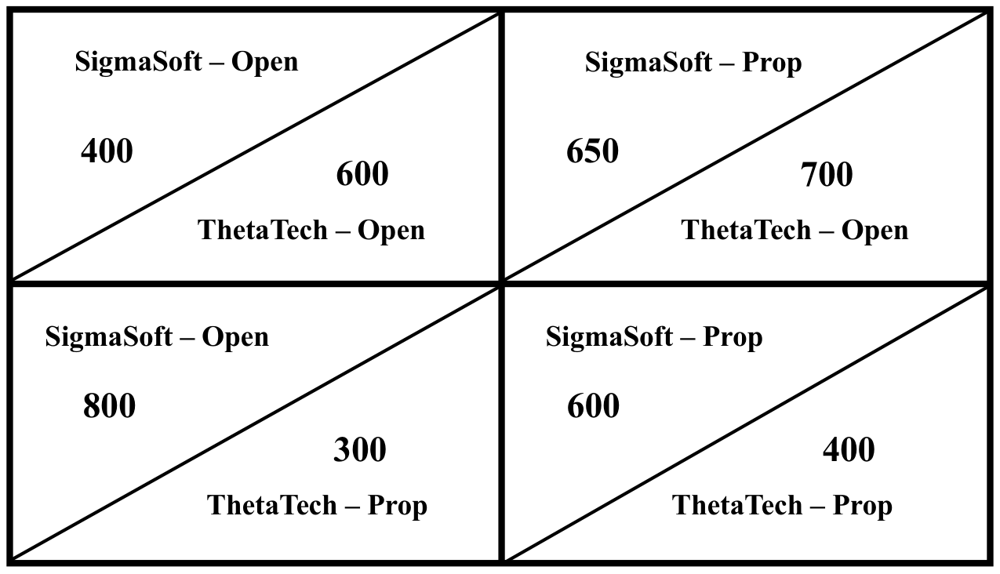

这些公司的纳什均衡为：

The Nash equilibrium for these companies is:

A. SigmaSoft 采用专有平台，ThetaTech 采用专有平台。

A. proprietary for SigmaSoft and proprietary for ThetaTech.

B. SigmaSoft 采用开放架构，ThetaTech 采用专有平台。

B. open architecture for SigmaSoft and proprietary for ThetaTech.

C. SigmaSoft 采用专有平台，ThetaTech 采用开放架构。

C. proprietary for SigmaSoft and open architecture for ThetaTech.

#### 官方答案与解析 / Official answer and explanation

解答：

Solution:

C 正确。在纳什模型中，每家公司选择策略时都会考虑对方的反应。在均衡状态下，两家公司都没有改变策略的动机。无论 SigmaSoft 如何决策，ThetaTech 采用开放架构都更有利。给定这一选择，SigmaSoft 采用专有平台更有利。两家公司都不会单方面改变自己的决策。

C is correct. In the Nash model, each company considers the other’s reaction in selecting its strategy. In equilibrium, neither company has an incentive to change its strategy. ThetaTech is better off with open architecture regardless of what SigmaSoft decides. Given this choice, SigmaSoft is better off with a proprietary platform. Neither company will change its decision unilaterally.

#### 补充解析 / Supplementary explanation

本题复核锚点（原解摘录）：C 正确。在纳什模型中，每家公司选择策略时都会考虑对方的反应。

Review anchor for this item (official excerpt): C is correct. In the Nash model, each company considers the other’s reaction in selecting its strategy.

本题官方选项为 C。补充思路：寡头决策必须同时考虑竞争者反应。Cournot 模型以竞争对手产量给定为条件选择产量；Nash 均衡要求各方在其他方策略给定时没有单方面改变策略的激励。弯折需求模型描述涨价与降价引发的反应不对称，并解释某一范围内成本变化而价格不变。主导企业模式下，先扣除竞争边缘企业的供给，得到主导企业面对的剩余需求。

The official choice for this item is C. Additional reasoning: An oligopolist must anticipate rivals. Cournot conditions each quantity choice on rivals’ quantities, while Nash equilibrium requires no profitable unilateral deviation. A kinked demand curve represents asymmetric rival responses to price increases and cuts and can explain price rigidity over a cost range. A dominant firm faces residual demand after subtracting fringe supply.

#### 相关知识点 / Related concepts

寡头的战略相互依赖：战略变量可能是价格、产量或产品；“给定竞争者策略的最优回应”是识别均衡的关键。合谋还面临成员偏离与新进入的压力。

Strategic interdependence in oligopoly: The strategic variable may be price, quantity, or product choice. Equilibrium concerns best responses to others’ strategies. Collusion is vulnerable to cheating and entry.

### ECON-LM01-EXAMPLE-801 · 例题 4 · 第 1 题：赫芬达尔—赫希曼指数 Example 4 · 1 — The Herfindahl–Hirschman Index

正文例题／案例 / Worked example / case · 原版 PDF 页码 / Source PDF pages: 51

#### 题目与资料 / Question and data

例 4

EXAMPLE 4

赫芬达尔—赫希曼指数

The Herfindahl–Hirschman Index

1\. 假设某市场有 10 家供应商，每家拥有 10% 的市场份额。前四家企业的集中度比率和 HHI 分别是多少？

1\. Suppose a market has 10 suppliers, each of them with 10 percent of the market. What are the concentration ratio and the HHI of the top four firms?

A. 集中度比率为 4%，HHI 为 40

A. Concentration ratio 4 percent and HHI 40

B. 集中度比率为 40%，HHI 为 0.4

B. Concentration ratio 40 percent and HHI 0.4

C. 集中度比率为 40%，HHI 为 0.04

C. Concentration ratio 40 percent and HHI 0.04

#### 官方答案与解析 / Official answer and explanation

解答：

Solution:

C 正确。前四家企业集中度的百分比为

C is correct. The concentration ratio for the top four firms is

HHI 为

and the HHI is

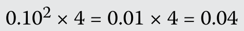

#### 补充解析 / Supplementary explanation

本题复核锚点（原解摘录）：C 正确。前四家企业集中度的百分比为

Review anchor for this item (official excerpt): C is correct. The concentration ratio for the top four firms is

本题官方选项为 C。补充思路：集中度比率直接加总指定前 N 家公司的市场份额；HHI 则先逐家平方再加总，因此对大企业的权重更高。题目若明确只取前三家或前四家，就按该口径计算，不能自行改成全行业。销售额要先除以行业总销售额。注意百分数和小数的量纲：小数份额的 HHI 范围为 0 至 1，百分数份额对应 0 至 10,000。两种指标都不直接衡量潜在进入威胁。

The official choice for this item is C. Additional reasoning: A concentration ratio sums the specified top N shares; HHI sums their squares and weights large firms more heavily. Follow the question’s specified top-N universe. Convert sales to shares before calculation. Decimal shares yield HHI on a 0–1 scale, while percentage shares yield a 0–10,000 scale. Neither statistic directly measures the competitive threat from potential entrants.

#### 相关知识点 / Related concepts

集中度指标的计算与局限：CRₙ＝Σsᵢ；HHI＝Σsᵢ²。合并两个既有企业时，其他份额不变则全行业 HHI 增加 2s₁s₂。

Concentration measures and limitations: CRₙ = Σsᵢ; HHI = Σsᵢ². Merging two firms raises the full-industry HHI by 2s₁s₂ when other shares are unchanged.

### ECON-LM01-QUESTION_SET-902 · 习题组 · 第 1–2 题 Question set · 1–2

正文习题组 / Question set · 原版 PDF 页码 / Source PDF pages: 51-52

#### 题目与资料 / Question and data

习题组

QUESTION SET

1\. 一名分析师收集了某行业的下列市场份额数据：

1\. An analyst gathers the following market share data for an industry:

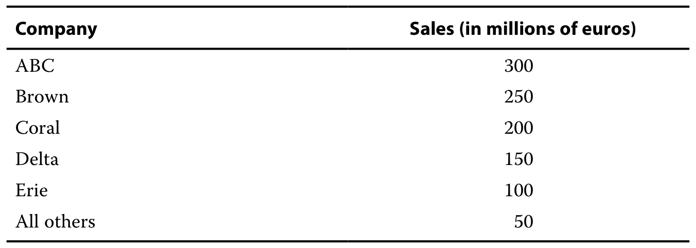

2\. 该行业的四家公司集中度比率最接近：

2\. The industry’s four-company concentration ratio is closest to:

A. 71%。

A. 71%.

B. 86%。

B. 86%.

C. 95%。

C. 95%.

#### 官方答案与解析 / Official answer and explanation

解答：

Solution:

B 正确。该行业前四大公司的销售额占全行业销售额的 86%：

B is correct. The top four companies in the industry account for 86 percent of industry sales:

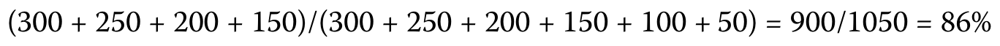

以下信息适用于第 3 题和第 4 题

The following information applies to questions 3 & 4

一名分析师收集了某个由五家公司构成的行业的下列市场份额数据：

An analyst gathered the following market share data for an industry composed of five companies:

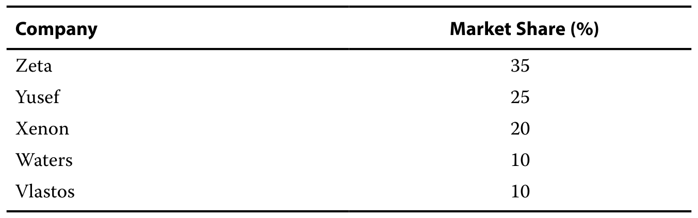

#### 补充解析 / Supplementary explanation

本题复核锚点（原解摘录）：B 正确。该行业前四大公司的销售额占全行业销售额的 86%：

Review anchor for this item (official excerpt): B is correct. The top four companies in the industry account for 86 percent of industry sales:

本题官方选项为 B。补充思路：集中度比率直接加总指定前 N 家公司的市场份额；HHI 则先逐家平方再加总，因此对大企业的权重更高。题目若明确只取前三家或前四家，就按该口径计算，不能自行改成全行业。销售额要先除以行业总销售额。注意百分数和小数的量纲：小数份额的 HHI 范围为 0 至 1，百分数份额对应 0 至 10,000。两种指标都不直接衡量潜在进入威胁。

The official choice for this item is B. Additional reasoning: A concentration ratio sums the specified top N shares; HHI sums their squares and weights large firms more heavily. Follow the question’s specified top-N universe. Convert sales to shares before calculation. Decimal shares yield HHI on a 0–1 scale, while percentage shares yield a 0–10,000 scale. Neither statistic directly measures the competitive threat from potential entrants.

#### 相关知识点 / Related concepts

集中度指标的计算与局限：CRₙ＝Σsᵢ；HHI＝Σsᵢ²。合并两个既有企业时，其他份额不变则全行业 HHI 增加 2s₁s₂。

Concentration measures and limitations: CRₙ = Σsᵢ; HHI = Σsᵢ². Merging two firms raises the full-industry HHI by 2s₁s₂ when other shares are unchanged.

原书把资料引入段单独编号；此处将资料编号与紧接的实际设问并列保留，避免把资料段误计为无答案习题。

### ECON-LM01-QUESTION_SET-903 · 习题组 · 第 3 题 Question set · 3

正文习题组 / Question set · 原版 PDF 页码 / Source PDF pages: 51-52

#### 题目与资料 / Question and data

习题组

QUESTION SET

1\. 一名分析师收集了某行业的下列市场份额数据：

1\. An analyst gathers the following market share data for an industry:

3\. 该行业的三家企业赫芬达尔—赫希曼指数最接近：

3\. The industry’s three-firm Herfindahl–Hirschman index is closest to:

A. 0.185。

A. 0.185.

B. 0.225。

B. 0.225.

C. 0.235。

C. 0.235.

#### 官方答案与解析 / Official answer and explanation

B 正确。三家企业的赫芬达尔—赫希曼指数为

B is correct. The three-firm Herfindahl–Hirschman index is

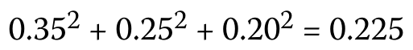

#### 补充解析 / Supplementary explanation

本题复核锚点（原解摘录）：B 正确。三家企业的赫芬达尔—赫希曼指数为

Review anchor for this item (official excerpt): B is correct. The three-firm Herfindahl–Hirschman index is

本题官方选项为 B。补充思路：集中度比率直接加总指定前 N 家公司的市场份额；HHI 则先逐家平方再加总，因此对大企业的权重更高。题目若明确只取前三家或前四家，就按该口径计算，不能自行改成全行业。销售额要先除以行业总销售额。注意百分数和小数的量纲：小数份额的 HHI 范围为 0 至 1，百分数份额对应 0 至 10,000。两种指标都不直接衡量潜在进入威胁。

The official choice for this item is B. Additional reasoning: A concentration ratio sums the specified top N shares; HHI sums their squares and weights large firms more heavily. Follow the question’s specified top-N universe. Convert sales to shares before calculation. Decimal shares yield HHI on a 0–1 scale, while percentage shares yield a 0–10,000 scale. Neither statistic directly measures the competitive threat from potential entrants.

#### 相关知识点 / Related concepts

集中度指标的计算与局限：CRₙ＝Σsᵢ；HHI＝Σsᵢ²。合并两个既有企业时，其他份额不变则全行业 HHI 增加 2s₁s₂。

Concentration measures and limitations: CRₙ = Σsᵢ; HHI = Σsᵢ². Merging two firms raises the full-industry HHI by 2s₁s₂ when other shares are unchanged.

### ECON-LM01-QUESTION_SET-904 · 习题组 · 第 4 题 Question set · 4

正文习题组 / Question set · 原版 PDF 页码 / Source PDF pages: 51-52

#### 题目与资料 / Question and data

习题组

QUESTION SET

1\. 一名分析师收集了某行业的下列市场份额数据：

1\. An analyst gathers the following market share data for an industry:

4\. 赫芬达尔—赫希曼指数的一项缺点是，该指数：

4\. One disadvantage of the Herfindahl–Hirschman index is that the index:

A. 计算困难。

A. is difficult to compute.

B. 无法反映较低的进入壁垒。

B. fails to reflect low barriers to entry.

C. 无法反映行业中并购的影响。

C. fails to reflect the effect of mergers in the industry.

#### 官方答案与解析 / Official answer and explanation

B 正确。赫芬达尔—赫希曼指数无法反映较低的进入壁垒，而这些较低的壁垒可能限制当前市场中公司的市场势力。

B is correct. The Herfindahl–Hirschman index does not reflect low barriers to entry that may restrict the market power of companies currently in the market.

#### 补充解析 / Supplementary explanation

本题复核锚点（原解摘录）：B 正确。赫芬达尔—赫希曼指数无法反映较低的进入壁垒，而这些较低的壁垒可能限制当前市场中公司的市场势力。

Review anchor for this item (official excerpt): B is correct. The Herfindahl–Hirschman index does not reflect low barriers to entry that may restrict the market power of companies currently in the market.

本题官方选项为 B。补充思路：集中度比率直接加总指定前 N 家公司的市场份额；HHI 则先逐家平方再加总，因此对大企业的权重更高。题目若明确只取前三家或前四家，就按该口径计算，不能自行改成全行业。销售额要先除以行业总销售额。注意百分数和小数的量纲：小数份额的 HHI 范围为 0 至 1，百分数份额对应 0 至 10,000。两种指标都不直接衡量潜在进入威胁。

The official choice for this item is B. Additional reasoning: A concentration ratio sums the specified top N shares; HHI sums their squares and weights large firms more heavily. Follow the question’s specified top-N universe. Convert sales to shares before calculation. Decimal shares yield HHI on a 0–1 scale, while percentage shares yield a 0–10,000 scale. Neither statistic directly measures the competitive threat from potential entrants.

#### 相关知识点 / Related concepts

集中度指标的计算与局限：CRₙ＝Σsᵢ；HHI＝Σsᵢ²。合并两个既有企业时，其他份额不变则全行业 HHI 增加 2s₁s₂。

Concentration measures and limitations: CRₙ = Σsᵢ; HHI = Σsᵢ². Merging two firms raises the full-industry HHI by 2s₁s₂ when other shares are unchanged.

### ECON-LM01-PRACTICE-001 · 章末习题 1 Practice problem 1

章末练习 / Practice problem · 原版 PDF 页码 / Source PDF pages: 53, 56

#### 题目与资料 / Question and data

1\. 在完全竞争条件下经营的企业，其生产的短期停产点最可能出现在：

1\. The short-term shutdown point of production for a firm operating under perfect competition will most likely occur when:

A. 价格等于平均总成本时。

A. price is equal to average total cost.

B. 边际收益等于边际成本时。

B. marginal revenue is equal to marginal cost.

C. 边际收益等于平均可变成本时。

C. marginal revenue is equal to average variable costs.

#### 官方答案与解析 / Official answer and explanation

1\. C 正确。当边际收益小于或等于平均可变成本时，企业应停止生产。

1\. C is correct. The firm should shut down production when marginal revenue is less than or equal to average variable cost.

#### 补充解析 / Supplementary explanation

本题复核锚点（原解摘录）：1. C 正确。当边际收益小于或等于平均可变成本时，企业应停止生产。

Review anchor for this item (official excerpt): 1.

本题官方选项为 C。补充思路：先区分“总利润为负”和“继续生产更不划算”。短期固定成本已经承诺，即使停产也要支付；只要收入能够覆盖可变成本，生产仍可分担固定成本。完全竞争下，P＝ATC 对应盈亏平衡，P＝AVC 对应停产临界点；AVC＜P＜ATC 时企业亏损但通常继续生产。长期所有成本均可调整，持续无法覆盖全部经济成本的企业会退出。

The official choice for this item is C. Additional reasoning: Separate an accounting loss from the incremental decision to produce. Committed fixed costs remain even after a short-run shutdown, so revenue above variable cost contributes toward fixed cost. For a competitive firm, P = ATC is breakeven and P = AVC is the shutdown boundary. Between AVC and ATC the firm operates at a loss; persistent inability to cover all economic costs drives long-run exit.

#### 相关知识点 / Related concepts

停产、盈亏平衡与继续经营：TR＝P×Q；经济利润＝TR−TC；短期比较 TR 与 TVC；长期比较 TR 与全部可避免成本。机会成本属于经济成本。

Shutdown, breakeven, and operation: TR = P × Q; economic profit = TR − TC. Compare revenue with variable cost in the short run and with all avoidable costs in the long run. Economic cost includes opportunity cost.

### ECON-LM01-PRACTICE-002 · 章末习题 2 Practice problem 2

章末练习 / Practice problem · 原版 PDF 页码 / Source PDF pages: 53, 56

#### 题目与资料 / Question and data

2\. 在完全竞争条件下，当市场价格等于下列哪条曲线最低点对应的成本时，公司达到盈亏平衡？

2\. Under conditions of perfect competition, a company will break even when market price is equal to the minimum point of the:

A. 平均总成本曲线。

A. average total cost curve.

B. 平均可变成本曲线。

B. average variable cost curve.

C. 短期边际成本曲线。

C. short-run marginal cost curve.

#### 官方答案与解析 / Official answer and explanation

2\. A 正确。如果公司的总收益等于其总成本，就称其达到盈亏平衡。在完全竞争条件下，当市场价格等于平均总成本曲线最低点对应的成本时，公司达到盈亏平衡。

2\. A is correct. A company is said to break even if its total revenue is equal to its total cost. Under conditions of perfect competition, a company will break even when market price is equal to the minimum point of the average total cost curve.

#### 补充解析 / Supplementary explanation

本题复核锚点（原解摘录）：2. A 正确。如果公司的总收益等于其总成本，就称其达到盈亏平衡。

Review anchor for this item (official excerpt): 2.

本题官方选项为 A。补充思路：先区分“总利润为负”和“继续生产更不划算”。短期固定成本已经承诺，即使停产也要支付；只要收入能够覆盖可变成本，生产仍可分担固定成本。完全竞争下，P＝ATC 对应盈亏平衡，P＝AVC 对应停产临界点；AVC＜P＜ATC 时企业亏损但通常继续生产。长期所有成本均可调整，持续无法覆盖全部经济成本的企业会退出。

The official choice for this item is A. Additional reasoning: Separate an accounting loss from the incremental decision to produce. Committed fixed costs remain even after a short-run shutdown, so revenue above variable cost contributes toward fixed cost. For a competitive firm, P = ATC is breakeven and P = AVC is the shutdown boundary. Between AVC and ATC the firm operates at a loss; persistent inability to cover all economic costs drives long-run exit.

#### 相关知识点 / Related concepts

停产、盈亏平衡与继续经营：TR＝P×Q；经济利润＝TR−TC；短期比较 TR 与 TVC；长期比较 TR 与全部可避免成本。机会成本属于经济成本。

Shutdown, breakeven, and operation: TR = P × Q; economic profit = TR − TC. Compare revenue with variable cost in the short run and with all avoidable costs in the long run. Economic cost includes opportunity cost.

### ECON-LM01-PRACTICE-003 · 章末习题 3 Practice problem 3

章末练习 / Practice problem · 原版 PDF 页码 / Source PDF pages: 53, 56

#### 题目与资料 / Question and data

3\. 如果总收益低于下列哪一种总成本，公司会在短期内停止生产？

3\. A company will shut down production in the short run if total revenue is less than total:

A. 固定成本。

A. fixed costs.

B. 可变成本。

B. variable costs.

C. 机会成本。

C. opportunity costs.

#### 官方答案与解析 / Official answer and explanation

3\. B 正确。当总收益低于总可变成本时，公司会在短期内停止生产。

3\. B is correct. A company will shut down production in the short run when total revenue is below total variable costs.

#### 补充解析 / Supplementary explanation

本题复核锚点（原解摘录）：3. B 正确。当总收益低于总可变成本时，公司会在短期内停止生产。

Review anchor for this item (official excerpt): 3.

本题官方选项为 B。补充思路：先区分“总利润为负”和“继续生产更不划算”。短期固定成本已经承诺，即使停产也要支付；只要收入能够覆盖可变成本，生产仍可分担固定成本。完全竞争下，P＝ATC 对应盈亏平衡，P＝AVC 对应停产临界点；AVC＜P＜ATC 时企业亏损但通常继续生产。长期所有成本均可调整，持续无法覆盖全部经济成本的企业会退出。

The official choice for this item is B. Additional reasoning: Separate an accounting loss from the incremental decision to produce. Committed fixed costs remain even after a short-run shutdown, so revenue above variable cost contributes toward fixed cost. For a competitive firm, P = ATC is breakeven and P = AVC is the shutdown boundary. Between AVC and ATC the firm operates at a loss; persistent inability to cover all economic costs drives long-run exit.

#### 相关知识点 / Related concepts

停产、盈亏平衡与继续经营：TR＝P×Q；经济利润＝TR−TC；短期比较 TR 与 TVC；长期比较 TR 与全部可避免成本。机会成本属于经济成本。

Shutdown, breakeven, and operation: TR = P × Q; economic profit = TR − TC. Compare revenue with variable cost in the short run and with all avoidable costs in the long run. Economic cost includes opportunity cost.

### ECON-LM01-PRACTICE-004 · 章末习题 4 Practice problem 4

章末练习 / Practice problem · 原版 PDF 页码 / Source PDF pages: 53, 56

#### 题目与资料 / Question and data

4\. 某公司的总可变成本为 400 万美元，固定成本为 300 万美元。

4\. A company has total variable costs of \$4 million and fixed costs of \$3 million.

根据这些信息，如果总收益至少达到以下哪个数额，公司会在长期内留在市场？

Based on this information, the company will stay in the market in the long term if total revenue is at least:

A. 300 万美元。

A. \$3.0 million.

B. 450 万美元。

B. \$4.5 million.

C. 700 万美元。

C. \$7.0 million.

#### 官方答案与解析 / Official answer and explanation

4\. C 正确。如果总收益大于或等于总成本，公司会在长期内留在市场。由于总成本为 700 万美元，包括 400 万美元的可变成本和 300 万美元的固定成本，因此，只要总收益至少为 700 万美元，公司就会在长期内留在市场。

4\. C is correct. A company will stay in the market in the long term if total revenue is equal to or greater than total cost. Because total costs are \$7 million (\$4 million variable costs and \$3 million fixed costs), the company will stay in the market in the long term if total revenue equals at least \$7 million.

#### 补充解析 / Supplementary explanation

本题复核锚点（原解摘录）：4. C 正确。如果总收益大于或等于总成本，公司会在长期内留在市场。

Review anchor for this item (official excerpt): 4.

本题官方选项为 C。补充思路：先区分“总利润为负”和“继续生产更不划算”。短期固定成本已经承诺，即使停产也要支付；只要收入能够覆盖可变成本，生产仍可分担固定成本。完全竞争下，P＝ATC 对应盈亏平衡，P＝AVC 对应停产临界点；AVC＜P＜ATC 时企业亏损但通常继续生产。长期所有成本均可调整，持续无法覆盖全部经济成本的企业会退出。

The official choice for this item is C. Additional reasoning: Separate an accounting loss from the incremental decision to produce. Committed fixed costs remain even after a short-run shutdown, so revenue above variable cost contributes toward fixed cost. For a competitive firm, P = ATC is breakeven and P = AVC is the shutdown boundary. Between AVC and ATC the firm operates at a loss; persistent inability to cover all economic costs drives long-run exit.

本题若限定长期，应把固定投入也视为可以重新选择的成本；短期继续经营的条件不能直接代替长期留在市场的条件。

A long-run condition treats formerly fixed commitments as adjustable. The short-run operating rule cannot substitute for the long-run rule for remaining in the market.

#### 相关知识点 / Related concepts

停产、盈亏平衡与继续经营：TR＝P×Q；经济利润＝TR−TC；短期比较 TR 与 TVC；长期比较 TR 与全部可避免成本。机会成本属于经济成本。

Shutdown, breakeven, and operation: TR = P × Q; economic profit = TR − TC. Compare revenue with variable cost in the short run and with all avoidable costs in the long run. Economic cost includes opportunity cost.

### ECON-LM01-PRACTICE-005 · 章末习题 5 Practice problem 5

章末练习 / Practice problem · 原版 PDF 页码 / Source PDF pages: 53, 56

#### 题目与资料 / Question and data

5\. 当总收益大于总可变成本、但小于总成本时，在短期内，企业最可能：

5\. When total revenue is greater than total variable costs but less than total costs, in the short term, a firm will most likely:

A. 退出市场。

A. exit the market.

B. 留在市场。

B. stay in the market.

C. 停止生产。

C. shut down production.

#### 官方答案与解析 / Official answer and explanation

5\. B 正确。当总收益足以弥补可变成本，但不能完全弥补总固定成本时，企业能够在短期内生存，但无法在长期内维持财务偿付能力。

5\. B is correct. When total revenue is enough to cover variable costs but not total fixed costs in full, the firm can survive in the short run but would not be able to maintain financial solvency in the long run.

#### 补充解析 / Supplementary explanation

本题复核锚点（原解摘录）：5. B 正确。当总收益足以弥补可变成本，但不能完全弥补总固定成本时，企业能够在短期内生存，但无法在长期内维持财务偿付能力。

Review anchor for this item (official excerpt): 5.

本题官方选项为 B。补充思路：先区分“总利润为负”和“继续生产更不划算”。短期固定成本已经承诺，即使停产也要支付；只要收入能够覆盖可变成本，生产仍可分担固定成本。完全竞争下，P＝ATC 对应盈亏平衡，P＝AVC 对应停产临界点；AVC＜P＜ATC 时企业亏损但通常继续生产。长期所有成本均可调整，持续无法覆盖全部经济成本的企业会退出。

The official choice for this item is B. Additional reasoning: Separate an accounting loss from the incremental decision to produce. Committed fixed costs remain even after a short-run shutdown, so revenue above variable cost contributes toward fixed cost. For a competitive firm, P = ATC is breakeven and P = AVC is the shutdown boundary. Between AVC and ATC the firm operates at a loss; persistent inability to cover all economic costs drives long-run exit.

本题若限定长期，应把固定投入也视为可以重新选择的成本；短期继续经营的条件不能直接代替长期留在市场的条件。

A long-run condition treats formerly fixed commitments as adjustable. The short-run operating rule cannot substitute for the long-run rule for remaining in the market.

#### 相关知识点 / Related concepts

停产、盈亏平衡与继续经营：TR＝P×Q；经济利润＝TR−TC；短期比较 TR 与 TVC；长期比较 TR 与全部可避免成本。机会成本属于经济成本。

Shutdown, breakeven, and operation: TR = P × Q; economic profit = TR − TC. Compare revenue with variable cost in the short run and with all avoidable costs in the long run. Economic cost includes opportunity cost.

### ECON-LM01-PRACTICE-006 · 章末习题 6 Practice problem 6

章末练习 / Practice problem · 原版 PDF 页码 / Source PDF pages: 53, 56

#### 题目与资料 / Question and data

6\. 在完全竞争条件下，长期而言，企业最可能获得：

6\. Under conditions of perfect competition, in the long run, firms will most likely earn:

A. 正常利润。

A. normal profits.

B. 正的经济利润。

B. positive economic profits.

C. 负的经济利润。

C. negative economic profits.

#### 官方答案与解析 / Official answer and explanation

6\. A 正确。竞争会推动价格下降至长期边际成本，从而使企业只能获得正常利润。

6\. A is correct. Competition should drive prices down to long-run marginal cost, resulting in only normal profits being earned.

#### 补充解析 / Supplementary explanation

本题复核锚点（原解摘录）：6. A 正确。竞争会推动价格下降至长期边际成本，从而使企业只能获得正常利润。

Review anchor for this item (official excerpt): 6.

本题官方选项为 A。补充思路：先用企业数量、产品差异和进入壁垒识别市场结构，再推导需求曲线和长期利润。完全竞争企业是价格接受者；垄断竞争企业凭差异化拥有有限定价权，但自由进入会侵蚀经济利润；垄断或寡头的持续利润还取决于壁垒与潜在竞争。不能只看到“许多企业”就认定完全竞争，也不能把有定价权等同于保证盈利。

The official choice for this item is A. Additional reasoning: Identify seller numbers, product differentiation, and entry barriers before inferring demand and long-run profit. Competitive firms take price. Monopolistic competitors have limited pricing power, but entry erodes economic profit. Persistent monopoly or oligopoly profits also depend on barriers and potential competition. Many firms do not automatically imply perfect competition, and pricing power does not guarantee profitability.

正常利润已经包含在机会成本中；“经济利润为零”不表示会计利润必定为零，也不表示所有者没有获得回报。

Normal profit is already included in opportunity cost. Zero economic profit need not mean zero accounting profit or no return to the owner.

#### 相关知识点 / Related concepts

市场结构与定价能力：完全竞争：同质品、低壁垒；垄断竞争：差异化、低壁垒；寡头：少数企业、战略互动；垄断：单一卖方、较强壁垒。

Market structure and pricing power: Perfect competition: homogeneous products and low barriers. Monopolistic competition: differentiation and low barriers. Oligopoly: few firms and strategic interaction. Monopoly: one seller and strong barriers.

### ECON-LM01-PRACTICE-007 · 章末习题 7 Practice problem 7

章末练习 / Practice problem · 原版 PDF 页码 / Source PDF pages: 53-54, 56

#### 题目与资料 / Question and data

7\. 企业提高产量，但单位成本没有任何变化，说明其处于以下哪种情况？

7\. A firm that increases its quantity produced without any change in per-unit cost is experiencing:

A. 规模经济。

A. economies of scale.

B. 规模不经济。

B. diseconomies of scale.

C. 规模报酬不变。

C. constant returns to scale.

#### 官方答案与解析 / Official answer and explanation

7\. C 正确。当产出与投入按相同比例增加时，存在规模报酬不变。

7\. C is correct. Output increases in the same proportion as input increases occur at constant returns to scale.

#### 补充解析 / Supplementary explanation

本题复核锚点（原解摘录）：7. C 正确。当产出与投入按相同比例增加时，存在规模报酬不变。

Review anchor for this item (official excerpt): 7.

本题官方选项为 C。补充思路：长期中可以选择工厂规模，LRAC 反映各产量下可选择技术的最低平均成本。规模经济使 LRAC 下降，规模不经济使其上升；这与短期在固定资本上增加劳动力导致的边际报酬递减不同。比较企业成本竞争力时，应同时看最低有效规模、需求能否支持该规模，以及其他企业的成本曲线，而非只比较当前产量。

The official choice for this item is C. Additional reasoning: The long run allows plant size to change, and LRAC is the minimum attainable average cost at each output. Economies of scale lower LRAC and diseconomies raise it. This differs from short-run diminishing marginal returns with fixed capital. Cost competitiveness also depends on minimum efficient scale, demand, and competitors’ cost curves.

#### 相关知识点 / Related concepts

规模经济与长期成本：长期所有投入可变；短期至少一种投入固定。最低有效规模是达到最低长期平均成本的最小规模。

Scale and long-run cost: All inputs vary in the long run; at least one is fixed in the short run. Minimum efficient scale is the smallest output that attains minimum LRAC.

### ECON-LM01-PRACTICE-008 · 章末习题 8 Practice problem 8

章末练习 / Practice problem · 原版 PDF 页码 / Source PDF pages: 54, 56

#### 题目与资料 / Question and data

8\. 在下列哪种情况下，公司存在规模经济？

8\. A company is experiencing economies of scale when:

A. 单位成本随产量增加而上升。

A. cost per unit increases as output increases.

B. 公司在 LRAC 曲线上斜率为负的某点经营。

B. it is operating at a point on the LRAC curve at which the slope is negative.

C. 公司在长期平均总成本曲线最低点之后的位置经营。

C. it is operating beyond the minimum point on the long-run average total cost curve.

#### 官方答案与解析 / Official answer and explanation

8\. B 正确。如果随着企业产量增加，单位生产成本下降，就存在规模经济。在图形上，这一定义体现为 LRAC 的斜率为负。

8\. B is correct. Economies of scale occur if, as the firm increases output, cost per unit of production falls. Graphically, this definition translates into an LRAC with a negative slope.

#### 补充解析 / Supplementary explanation

本题复核锚点（原解摘录）：8. B 正确。如果随着企业产量增加，单位生产成本下降，就存在规模经济。

Review anchor for this item (official excerpt): 8.

本题官方选项为 B。补充思路：长期中可以选择工厂规模，LRAC 反映各产量下可选择技术的最低平均成本。规模经济使 LRAC 下降，规模不经济使其上升；这与短期在固定资本上增加劳动力导致的边际报酬递减不同。比较企业成本竞争力时，应同时看最低有效规模、需求能否支持该规模，以及其他企业的成本曲线，而非只比较当前产量。

The official choice for this item is B. Additional reasoning: The long run allows plant size to change, and LRAC is the minimum attainable average cost at each output. Economies of scale lower LRAC and diseconomies raise it. This differs from short-run diminishing marginal returns with fixed capital. Cost competitiveness also depends on minimum efficient scale, demand, and competitors’ cost curves.

#### 相关知识点 / Related concepts

规模经济与长期成本：长期所有投入可变；短期至少一种投入固定。最低有效规模是达到最低长期平均成本的最小规模。

Scale and long-run cost: All inputs vary in the long run; at least one is fixed in the short run. Minimum efficient scale is the smallest output that attains minimum LRAC.

### ECON-LM01-PRACTICE-009 · 章末习题 9 Practice problem 9

章末练习 / Practice problem · 原版 PDF 页码 / Source PDF pages: 54, 56

#### 题目与资料 / Question and data

9\. 规模不经济最可能源自：

9\. Diseconomies of scale most likely result from:

A. 劳动力的专业化分工。

A. specialization in the labor force.

B. 业务职能和产品线的重叠。

B. overlap of business functions and product lines.

C. 大量购买资源时获得的价格折扣。

C. discounted prices on resources when buying in larger quantities.

#### 官方答案与解析 / Official answer and explanation

9\. B 正确。随着企业产量增加，如果业务职能和产品线相互重叠或重复，就可能产生规模不经济和更高的平均总成本。

9\. B is correct. As the firm increases output, diseconomies of scale and higher average total costs can result when business functions and product lines overlap or are duplicated.

#### 补充解析 / Supplementary explanation

本题复核锚点（原解摘录）：9. B 正确。随着企业产量增加，如果业务职能和产品线相互重叠或重复，就可能产生规模不经济和更高的平均总成本。

Review anchor for this item (official excerpt): 9.

本题官方选项为 B。补充思路：长期中可以选择工厂规模，LRAC 反映各产量下可选择技术的最低平均成本。规模经济使 LRAC 下降，规模不经济使其上升；这与短期在固定资本上增加劳动力导致的边际报酬递减不同。比较企业成本竞争力时，应同时看最低有效规模、需求能否支持该规模，以及其他企业的成本曲线，而非只比较当前产量。

The official choice for this item is B. Additional reasoning: The long run allows plant size to change, and LRAC is the minimum attainable average cost at each output. Economies of scale lower LRAC and diseconomies raise it. This differs from short-run diminishing marginal returns with fixed capital. Cost competitiveness also depends on minimum efficient scale, demand, and competitors’ cost curves.

#### 相关知识点 / Related concepts

规模经济与长期成本：长期所有投入可变；短期至少一种投入固定。最低有效规模是达到最低长期平均成本的最小规模。

Scale and long-run cost: All inputs vary in the long run; at least one is fixed in the short run. Minimum efficient scale is the smallest output that attains minimum LRAC.

### ECON-LM01-PRACTICE-010 · 章末习题 10 Practice problem 10

章末练习 / Practice problem · 原版 PDF 页码 / Source PDF pages: 54, 56

#### 题目与资料 / Question and data

10\. 某企业处于完全竞争行业，其经营规模超过最小有效规模。为维持长期生存能力，该企业最可能采取的行动是：

10\. A firm is operating beyond minimum efficient scale in a perfectly competitive industry. To maintain long-term viability, the most likely course of action for the firm is to:

A. 维持当前生产水平。

A. operate at the current level of production.

B. 提高生产水平以获得规模经济。

B. increase its level of production to gain economies of scale.

C. 降低生产水平至长期平均总成本曲线的最低点。

C. decrease its level of production to the minimum point on the long-run average total cost curve.

#### 官方答案与解析 / Official answer and explanation

10\. C 正确。经营规模超过长期有效规模的企业会受到规模不经济的影响。它应计划降低生产水平。

10\. C is correct. The firm operating at greater than long-run efficient scale is subject to diseconomies of scale. It should plan to decrease its level of production.

#### 补充解析 / Supplementary explanation

本题复核锚点（原解摘录）：10. C 正确。经营规模超过长期有效规模的企业会受到规模不经济的影响。

Review anchor for this item (official excerpt): 10.

本题官方选项为 C。补充思路：单个完全竞争企业面对既定市场价格，其自身增产不会改变市场价格。因此总收入随销量同比例变化，而平均收入和边际收入仍等于价格。读到产量增长百分比时，不应把总收入的增长误认为每单位收入增长；后者需要价格变化才会发生。

The official choice for this item is C. Additional reasoning: A single competitive firm takes the market price as given. Its own output increase therefore raises total revenue proportionately while average and marginal revenue remain equal to price. A percentage increase in units is a total-revenue effect, not an increase in revenue per unit.

本题若限定长期，应把固定投入也视为可以重新选择的成本；短期继续经营的条件不能直接代替长期留在市场的条件。

A long-run condition treats formerly fixed commitments as adjustable. The short-run operating rule cannot substitute for the long-run rule for remaining in the market.

#### 相关知识点 / Related concepts

完全竞争下的收入与价格：TR＝P×Q；AR＝TR/Q＝P；完全竞争企业的MR＝P。行业供给变化和单个企业供给变化的影响不同。

Revenue and price under perfect competition: TR = P×Q; AR = TR/Q = P; a competitive firm has MR = P. An industry-wide supply shift differs from one firm changing output.

### ECON-LM01-PRACTICE-011 · 章末习题 11 Practice problem 11

章末练习 / Practice problem · 原版 PDF 页码 / Source PDF pages: 54, 56

#### 题目与资料 / Question and data

11\. 在下列哪种市场结构下，公司最可能具有明确定义的供给函数？

11\. Companies most likely have a well-defined supply function when the market structure is:

A. 寡头垄断。

A. oligopoly.

B. 完全竞争。

B. perfect competition.

C. 垄断竞争。

C. monopolistic competition.

#### 官方答案与解析 / Official answer and explanation

11\. B 正确。在完全竞争市场中，公司必须接受市场决定的任何价格。完全竞争市场中公司的边际成本关系决定其供给函数。

11\. B is correct. A company in a perfectly competitive market must accept whatever price the market dictates. The marginal cost schedule of a company in a perfectly competitive market determines its supply function.

#### 补充解析 / Supplementary explanation

本题复核锚点（原解摘录）：11. B 正确。在完全竞争市场中，公司必须接受市场决定的任何价格。

Review anchor for this item (official excerpt): 11.

本题官方选项为 B。补充思路：先用企业数量、产品差异和进入壁垒识别市场结构，再推导需求曲线和长期利润。完全竞争企业是价格接受者；垄断竞争企业凭差异化拥有有限定价权，但自由进入会侵蚀经济利润；垄断或寡头的持续利润还取决于壁垒与潜在竞争。不能只看到“许多企业”就认定完全竞争，也不能把有定价权等同于保证盈利。

The official choice for this item is B. Additional reasoning: Identify seller numbers, product differentiation, and entry barriers before inferring demand and long-run profit. Competitive firms take price. Monopolistic competitors have limited pricing power, but entry erodes economic profit. Persistent monopoly or oligopoly profits also depend on barriers and potential competition. Many firms do not automatically imply perfect competition, and pricing power does not guarantee profitability.

#### 相关知识点 / Related concepts

市场结构与定价能力：完全竞争：同质品、低壁垒；垄断竞争：差异化、低壁垒；寡头：少数企业、战略互动；垄断：单一卖方、较强壁垒。

Market structure and pricing power: Perfect competition: homogeneous products and low barriers. Monopolistic competition: differentiation and low barriers. Oligopoly: few firms and strategic interaction. Monopoly: one seller and strong barriers.

### ECON-LM01-PRACTICE-012 · 章末习题 12 Practice problem 12

章末练习 / Practice problem · 原版 PDF 页码 / Source PDF pages: 54, 56

#### 题目与资料 / Question and data

12\. Aquarius, Inc. 是其所在市场的主导公司和价格领导者。市场中的另一家公司试图通过低于 Aquarius 所制定的价格来获取市场份额。Aquarius 的市场份额最可能：

12\. Aquarius, Inc. is the dominant company and the price leader in its market. One of the other companies in the market attempts to gain market share by undercutting the price set by Aquarius. The market share of Aquarius will most likely:

A. 增加。

A. increase.

B. 减少。

B. decrease.

C. 保持不变。

C. stay the same.

#### 官方答案与解析 / Official answer and explanation

12\. A 正确。随着价格下降，较小的公司会退出市场，而不会低于成本销售。作为价格领导者，Aquarius 的市场份额会增加。

12\. A is correct. As prices decrease, smaller companies will leave the market rather than sell below cost. The market share of Aquarius, the price leader, will increase.

#### 补充解析 / Supplementary explanation

本题复核锚点（原解摘录）：12. A 正确。随着价格下降，较小的公司会退出市场，而不会低于成本销售。

Review anchor for this item (official excerpt): 12.

本题官方选项为 A。补充思路：寡头决策必须同时考虑竞争者反应。Cournot 模型以竞争对手产量给定为条件选择产量；Nash 均衡要求各方在其他方策略给定时没有单方面改变策略的激励。弯折需求模型描述涨价与降价引发的反应不对称，并解释某一范围内成本变化而价格不变。主导企业模式下，先扣除竞争边缘企业的供给，得到主导企业面对的剩余需求。

The official choice for this item is A. Additional reasoning: An oligopolist must anticipate rivals. Cournot conditions each quantity choice on rivals’ quantities, while Nash equilibrium requires no profitable unilateral deviation. A kinked demand curve represents asymmetric rival responses to price increases and cuts and can explain price rigidity over a cost range. A dominant firm faces residual demand after subtracting fringe supply.

#### 相关知识点 / Related concepts

寡头的战略相互依赖：战略变量可能是价格、产量或产品；“给定竞争者策略的最优回应”是识别均衡的关键。合谋还面临成员偏离与新进入的压力。

Strategic interdependence in oligopoly: The strategic variable may be price, quantity, or product choice. Equilibrium concerns best responses to others’ strategies. Collusion is vulnerable to cheating and entry.

### ECON-LM01-PRACTICE-013 · 章末习题 13 Practice problem 13

章末练习 / Practice problem · 原版 PDF 页码 / Source PDF pages: 54-56

#### 题目与资料 / Question and data

13\. 随着时间推移，寡头垄断市场中主导公司的市场份额最可能：

13\. Over time, the market share of the dominant company in an oligopolistic market will most likely:

A. 增加。

A. increase.

B. 减少。

B. decrease.

C. 保持不变。

C. remain the same.

#### 官方答案与解析 / Official answer and explanation

13\. B 正确。由于利润会吸引其他公司进入，主导公司的市场份额往往会下降。

13\. B is correct. The dominant company’s market share tends to decrease as profits attract entry by other companies.

#### 补充解析 / Supplementary explanation

本题复核锚点（原解摘录）：13. B 正确。由于利润会吸引其他公司进入，主导公司的市场份额往往会下降。

Review anchor for this item (official excerpt): 13.

本题官方选项为 B。补充思路：寡头决策必须同时考虑竞争者反应。Cournot 模型以竞争对手产量给定为条件选择产量；Nash 均衡要求各方在其他方策略给定时没有单方面改变策略的激励。弯折需求模型描述涨价与降价引发的反应不对称，并解释某一范围内成本变化而价格不变。主导企业模式下，先扣除竞争边缘企业的供给，得到主导企业面对的剩余需求。

The official choice for this item is B. Additional reasoning: An oligopolist must anticipate rivals. Cournot conditions each quantity choice on rivals’ quantities, while Nash equilibrium requires no profitable unilateral deviation. A kinked demand curve represents asymmetric rival responses to price increases and cuts and can explain price rigidity over a cost range. A dominant firm faces residual demand after subtracting fringe supply.

#### 相关知识点 / Related concepts

寡头的战略相互依赖：战略变量可能是价格、产量或产品；“给定竞争者策略的最优回应”是识别均衡的关键。合谋还面临成员偏离与新进入的压力。

Strategic interdependence in oligopoly: The strategic variable may be price, quantity, or product choice. Equilibrium concerns best responses to others’ strategies. Collusion is vulnerable to cheating and entry.

## LM 2 · 理解商业周期 Understanding Business Cycles 32 条目 · 原题与解析逐条对应 / Paired source questions and explanations

### ECON-LM02-QUESTION_SET-101 · 习题组 · 第 1 题 Question set · 1

正文习题组 / Question set · 原版 PDF 页码 / Source PDF pages: 65

#### 题目与资料 / Question and data

习题组

QUESTION SET

1\. 经济周期中谷底、扩张、峰值和收缩的典型模式具有：

1\. The characteristic business cycle patterns of trough, expansion, peak, and contraction are:

A. 固定周期性。

A. periodic.

B. 反复性。

B. recurrent.

C. 相近的持续时间。

C. of similar duration.

#### 官方答案与解析 / Official answer and explanation

B 正确。经济周期的各个阶段会随着时间反复出现。

B is correct. The stages of the business cycle occur repeatedly over time.

#### 补充解析 / Supplementary explanation

本题复核锚点（原解摘录）：B 正确。经济周期的各个阶段会随着时间反复出现。

Review anchor for this item (official excerpt): B is correct. The stages of the business cycle occur repeatedly over time.

本题官方选项为 B。补充思路：先判断是在描述总产出的水平、增长速度还是相对潜在产出的缺口。扩张、峰值、收缩和谷底有典型的先后顺序，但持续期和强度并不固定。信用条件可以通过融资成本、抵押品价值和银行放贷放大经济波动，因此信用周期与商业周期互相影响，却未必完全同步。

The official choice for this item is B. Additional reasoning: Determine whether the statement concerns output level, growth, or the gap from potential output. Expansion, peak, contraction, and trough form a typical sequence, but duration and intensity vary. Financing costs, collateral values, and lending conditions can amplify fluctuations. Credit and business cycles interact without being perfectly synchronized.

#### 相关知识点 / Related concepts

商业周期与信用周期：周期是围绕长期趋势的波动；潜在产出与实际产出不同。金融加速机制把资产价格、抵押品和信贷供给联系起来。

Business and credit cycles: A cycle fluctuates around a long-run trend. Potential and actual output differ. Financial acceleration links asset prices, collateral, and credit supply.

### ECON-LM02-QUESTION_SET-102 · 习题组 · 第 2 题 Question set · 2

正文习题组 / Question set · 原版 PDF 页码 / Source PDF pages: 65

#### 题目与资料 / Question and data

习题组

QUESTION SET

2\. 在经济周期的收缩阶段，最可能出现的情况是：

2\. During the contraction phase of a business cycle, it is most likely that:

A. 通胀指标稳定。

A. inflation indicators are stable.

B. 相对于潜在产出，总体经济活动正在下降。

B. aggregate economic activity relative to potential output is decreasing.

C. 投资者对政府证券的偏好减弱。

C. investor preference for government securities declines.

#### 官方答案与解析 / Official answer and explanation

B 正确。收缩期间的总体趋势为负向。

B is correct. The net trend during contraction is negative.

#### 补充解析 / Supplementary explanation

本题复核锚点（原解摘录）：B 正确。收缩期间的总体趋势为负向。

Review anchor for this item (official excerpt): B is correct. The net trend during contraction is negative.

本题官方选项为 B。补充思路：先判断是在描述总产出的水平、增长速度还是相对潜在产出的缺口。扩张、峰值、收缩和谷底有典型的先后顺序，但持续期和强度并不固定。信用条件可以通过融资成本、抵押品价值和银行放贷放大经济波动，因此信用周期与商业周期互相影响，却未必完全同步。

The official choice for this item is B. Additional reasoning: Determine whether the statement concerns output level, growth, or the gap from potential output. Expansion, peak, contraction, and trough form a typical sequence, but duration and intensity vary. Financing costs, collateral values, and lending conditions can amplify fluctuations. Credit and business cycles interact without being perfectly synchronized.

#### 相关知识点 / Related concepts

商业周期与信用周期：周期是围绕长期趋势的波动；潜在产出与实际产出不同。金融加速机制把资产价格、抵押品和信贷供给联系起来。

Business and credit cycles: A cycle fluctuates around a long-run trend. Potential and actual output differ. Financial acceleration links asset prices, collateral, and credit supply.

### ECON-LM02-QUESTION_SET-103 · 习题组 · 第 3 题 Question set · 3

正文习题组 / Question set · 原版 PDF 页码 / Source PDF pages: 65

#### 题目与资料 / Question and data

习题组

QUESTION SET

3\. 经济峰值与下列哪项最密切相关？

3\. An economic peak is most closely associated with:

A. 通胀加速。

A. accelerating inflation.

B. 失业稳定。

B. stable unemployment.

C. 资本支出下降。

C. declining capital spending.

#### 官方答案与解析 / Official answer and explanation

A 正确。在峰值时，通胀正在上升。

A is correct. Inflation is rising at peaks.

#### 补充解析 / Supplementary explanation

本题复核锚点（原解摘录）：A 正确。在峰值时，通胀正在上升。

Review anchor for this item (official excerpt): A is correct. Inflation is rising at peaks.

本题官方选项为 A。补充思路：先判断是在描述总产出的水平、增长速度还是相对潜在产出的缺口。扩张、峰值、收缩和谷底有典型的先后顺序，但持续期和强度并不固定。信用条件可以通过融资成本、抵押品价值和银行放贷放大经济波动，因此信用周期与商业周期互相影响，却未必完全同步。

The official choice for this item is A. Additional reasoning: Determine whether the statement concerns output level, growth, or the gap from potential output. Expansion, peak, contraction, and trough form a typical sequence, but duration and intensity vary. Financing costs, collateral values, and lending conditions can amplify fluctuations. Credit and business cycles interact without being perfectly synchronized.

#### 相关知识点 / Related concepts

商业周期与信用周期：周期是围绕长期趋势的波动；潜在产出与实际产出不同。金融加速机制把资产价格、抵押品和信贷供给联系起来。

Business and credit cycles: A cycle fluctuates around a long-run trend. Potential and actual output differ. Financial acceleration links asset prices, collateral, and credit supply.

### ECON-LM02-QUESTION_SET-201 · 习题组 · 第 1 题 Question set · 1

正文习题组 / Question set · 原版 PDF 页码 / Source PDF pages: 67

#### 题目与资料 / Question and data

习题组

QUESTION SET

1\. Carnara Asset Management 的一名高级投资组合经理向初级分析师解释她对经济周期的分析。她作出两项陈述：

1\. A senior portfolio manager at Carnara Asset Management explains her analysis of business cycles to a junior analyst. She makes two statements:

陈述 1　经济周期使用 GDP 衡量活动，而信贷周期结合了信贷规模和定价等一系列金融变量。

Statement 1 Business cycles measure activity by GDP, whereas credit cycles combine a range of financial variables, such as the amount of and pricing of credit.

陈述 2　信贷周期与经济周期互不相关，并服务于不同目的。

Statement 2 Credit cycles and business cycles are unrelated and serve different purposes.

A. 仅陈述 1 正确。

A. Only Statement 1 is true.

B. 仅陈述 2 正确。

B. Only Statement 2 is true.

C. 两项陈述均正确。

C. Both statements are true.

#### 官方答案与解析 / Official answer and explanation

解答：

Solution:

A 正确。只有陈述 1 正确。陈述 2 不正确，因为研究人员已发现金融周期与经济周期之间的联系，这些联系有助于根据信贷周期所处状态，解释经济周期扩张和收缩的幅度。

A is correct. Only Statement 1 is true. Statement 2 is not true because researchers have found linkages between financial and business cycles that help explain the magnitude of business cycle expansions and contractions depending on the state of the credit cycle.

#### 补充解析 / Supplementary explanation

本题复核锚点（原解摘录）：A 正确。只有陈述 1 正确。

Review anchor for this item (official excerpt): A is correct. Only Statement 1 is true.

本题官方选项为 A。补充思路：先判断是在描述总产出的水平、增长速度还是相对潜在产出的缺口。扩张、峰值、收缩和谷底有典型的先后顺序，但持续期和强度并不固定。信用条件可以通过融资成本、抵押品价值和银行放贷放大经济波动，因此信用周期与商业周期互相影响，却未必完全同步。

The official choice for this item is A. Additional reasoning: Determine whether the statement concerns output level, growth, or the gap from potential output. Expansion, peak, contraction, and trough form a typical sequence, but duration and intensity vary. Financing costs, collateral values, and lending conditions can amplify fluctuations. Credit and business cycles interact without being perfectly synchronized.

#### 相关知识点 / Related concepts

商业周期与信用周期：周期是围绕长期趋势的波动；潜在产出与实际产出不同。金融加速机制把资产价格、抵押品和信贷供给联系起来。

Business and credit cycles: A cycle fluctuates around a long-run trend. Potential and actual output differ. Financial acceleration links asset prices, collateral, and credit supply.

### ECON-LM02-QUESTION_SET-202 · 习题组 · 第 2 题 Question set · 2

正文习题组 / Question set · 原版 PDF 页码 / Source PDF pages: 67-68

#### 题目与资料 / Question and data

习题组

QUESTION SET

2\. 分析师最常将信贷周期与经济中的哪个部门联系起来？

2\. With which sector of the economy would analysts most commonly associate credit cycles?

A. 出口

A. Exports

B. 建筑与房地产购置

B. Construction and purchases of property

C. 食品零售

C. Food retail

#### 官方答案与解析 / Official answer and explanation

解答：

Solution:

B 正确。信贷周期与信贷的可获得性有关，而信贷对建筑和房地产购置融资非常重要。

B is correct. Credit cycles are associated with availability of credit, which is important in the financing of construction and the purchase of property.

#### 补充解析 / Supplementary explanation

本题复核锚点（原解摘录）：B 正确。信贷周期与信贷的可获得性有关，而信贷对建筑和房地产购置融资非常重要。

Review anchor for this item (official excerpt): B is correct. Credit cycles are associated with availability of credit, which is important in the financing of construction and the purchase of property.

本题官方选项为 B。补充思路：先判断是在描述总产出的水平、增长速度还是相对潜在产出的缺口。扩张、峰值、收缩和谷底有典型的先后顺序，但持续期和强度并不固定。信用条件可以通过融资成本、抵押品价值和银行放贷放大经济波动，因此信用周期与商业周期互相影响，却未必完全同步。

The official choice for this item is B. Additional reasoning: Determine whether the statement concerns output level, growth, or the gap from potential output. Expansion, peak, contraction, and trough form a typical sequence, but duration and intensity vary. Financing costs, collateral values, and lending conditions can amplify fluctuations. Credit and business cycles interact without being perfectly synchronized.

#### 相关知识点 / Related concepts

商业周期与信用周期：周期是围绕长期趋势的波动；潜在产出与实际产出不同。金融加速机制把资产价格、抵押品和信贷供给联系起来。

Business and credit cycles: A cycle fluctuates around a long-run trend. Potential and actual output differ. Financial acceleration links asset prices, collateral, and credit supply.

### ECON-LM02-QUESTION_SET-203 · 习题组 · 第 3 题 Question set · 3

正文习题组 / Question set · 原版 PDF 页码 / Source PDF pages: 67-68

#### 题目与资料 / Question and data

习题组

QUESTION SET

3\. 分析师跟踪信贷可得性变化的原因是：

3\. The reason analysts follow developments in the availability of credit is that:

A. 私人部门信贷宽松可能加剧资产价格和房地产泡沫，以及随后发生的危机。

A. loose private sector credit may contribute to the extent of asset price and real estate bubbles and subsequent crises.

B. 信贷宽松有助于减轻资产价格和房地产泡沫的程度。

B. loose credit helps reduce the extent of asset price and real estate bubbles.

C. 信贷周期与经济周期具有相同的长度和深度。

C. credit cycles are of same length and depth as business cycles.

#### 官方答案与解析 / Official answer and explanation

A 正确。研究表明，宽松的信贷条件会加剧资产价格和房地产泡沫，而这些泡沫之后往往会发生危机。

A is correct. Studies have shown that loose credit conditions contribute to the extent of asset price and real estate bubbles that tend to be followed by crises.

#### 补充解析 / Supplementary explanation

本题复核锚点（原解摘录）：A 正确。研究表明，宽松的信贷条件会加剧资产价格和房地产泡沫，而这些泡沫之后往往会发生危机。

Review anchor for this item (official excerpt): A is correct. Studies have shown that loose credit conditions contribute to the extent of asset price and real estate bubbles that tend to be followed by crises.

本题官方选项为 A。补充思路：先判断是在描述总产出的水平、增长速度还是相对潜在产出的缺口。扩张、峰值、收缩和谷底有典型的先后顺序，但持续期和强度并不固定。信用条件可以通过融资成本、抵押品价值和银行放贷放大经济波动，因此信用周期与商业周期互相影响，却未必完全同步。

The official choice for this item is A. Additional reasoning: Determine whether the statement concerns output level, growth, or the gap from potential output. Expansion, peak, contraction, and trough form a typical sequence, but duration and intensity vary. Financing costs, collateral values, and lending conditions can amplify fluctuations. Credit and business cycles interact without being perfectly synchronized.

#### 相关知识点 / Related concepts

商业周期与信用周期：周期是围绕长期趋势的波动；潜在产出与实际产出不同。金融加速机制把资产价格、抵押品和信贷供给联系起来。

Business and credit cycles: A cycle fluctuates around a long-run trend. Potential and actual output differ. Financial acceleration links asset prices, collateral, and credit supply.

### ECON-LM02-EXAMPLE-301 · 例题 1 · 第 1 题：资本支出 Example 1 · 1 — Capital Spending

正文例题／案例 / Worked example / case · 原版 PDF 页码 / Source PDF pages: 71

#### 题目与资料 / Question and data

例 1

EXAMPLE 1

资本支出

Capital Spending

1\. 产能利用率是决定公司整体新增资本支出需求的因素之一。下列哪项也是影响资本支出决策的因素？

1\. Levels of capacity utilization are one of the factors that determine companies’ aggregate need for additional capital expenditure. Which of the following is another factor that affects the capital expenditure decision?

A. 失业率

A. The rate of unemployment

B. 经济体的产能构成及其满足需求的能力

B. The composition of the economy’s capacity in relation to how it can satisfy demand

C. 恢复收缩阶段已取消订单的能力

C. The ability to reinstate orders canceled during the contraction stage

#### 官方答案与解析 / Official answer and explanation

解答：

Solution:

B 正确。现有生产能力的构成，可能并非最适合当前需求结构。C 不正确，因为只有在已作出增加资本支出的决策之后，恢复已取消订单的能力才成为相关问题。

B is correct. The composition of the current productive capacity may not be optimal of the current structure of demand. C is incorrect because the ability to re-instate canceled orders is a matter that is relevant once the decision to increase capital expenditure is made.

#### 补充解析 / Supplementary explanation

本题复核锚点（原解摘录）：B 正确。现有生产能力的构成，可能并非最适合当前需求结构。

Review anchor for this item (official excerpt): B is correct. The composition of the current productive capacity may not be optimal of the current structure of demand.

本题官方选项为 B。补充思路：企业通常先调整工时、临时岗位和维护开支，再改变正式员工数量或长期资本计划。复苏时企业可能先提高现有劳动力利用率，因此就业不立即改善；原先退出劳动力市场者重新求职也可能暂时推高失业率。固定资本从规划到建成需要时间，所以资本开支对周期信号的反应与消费不同。

The official choice for this item is B. Additional reasoning: Firms often change hours, temporary labor, and maintenance before permanent employment or long-term capital plans. Recovery can initially raise utilization of existing workers rather than jobs; re-entry into the labor force can temporarily lift measured unemployment. Planning and completion lags make physical-capital spending respond differently from consumption.

#### 相关知识点 / Related concepts

劳动和资本调整的迟滞：失业率＝失业人口/劳动力；退出劳动力市场者不属于失业人口。资本存量的调整慢于库存。

Delayed labor and capital adjustment: Unemployment rate = unemployed/labor force. People outside the labor force are not counted as unemployed. Capital stock adjusts more slowly than inventory.

### ECON-LM02-EXAMPLE-302 · 例题 1 · 第 2 题：资本支出 Example 1 · 2 — Capital Spending

正文例题／案例 / Worked example / case · 原版 PDF 页码 / Source PDF pages: 71

#### 题目与资料 / Question and data

例 1

EXAMPLE 1

资本支出

Capital Spending

2\. 在收缩阶段，技术设备和轻型设备的订单会先于建筑项目下降，原因是：

2\. Orders for technology and light equipment decline before construction projects in a contraction because:

A. 企业不确定周期将向何种方向发展。

A. businesses are uncertain about cyclical directions.

B. 与大型建筑项目相比，设备订单更容易取消。

B. equipment orders are easier to cancel than large construction projects.

C. 企业认为轻型设备的价值低于建筑物和重型机械。

C. businesses value light equipment less than structures and heavy machinery.

#### 官方答案与解析 / Official answer and explanation

B 正确。大型建筑项目的规划和完工通常比设备订单的规划和完成耗时长得多，因此建筑项目受到经济周期的影响可能较小。

B is correct. Because it usually takes much longer to plan and complete large construction projects than it takes to plan and complete equipment orders, construction projects may be less influenced by business cycles.

#### 补充解析 / Supplementary explanation

本题复核锚点（原解摘录）：B 正确。大型建筑项目的规划和完工通常比设备订单的规划和完成耗时长得多，因此建筑项目受到经济周期的影响可能较小。

Review anchor for this item (official excerpt): B is correct. Because it usually takes much longer to plan and complete large construction projects than it takes to plan and complete equipment orders, construction projects may be less influenced by business cycles.

本题官方选项为 B。补充思路：企业通常先调整工时、临时岗位和维护开支，再改变正式员工数量或长期资本计划。复苏时企业可能先提高现有劳动力利用率，因此就业不立即改善；原先退出劳动力市场者重新求职也可能暂时推高失业率。固定资本从规划到建成需要时间，所以资本开支对周期信号的反应与消费不同。

The official choice for this item is B. Additional reasoning: Firms often change hours, temporary labor, and maintenance before permanent employment or long-term capital plans. Recovery can initially raise utilization of existing workers rather than jobs; re-entry into the labor force can temporarily lift measured unemployment. Planning and completion lags make physical-capital spending respond differently from consumption.

#### 相关知识点 / Related concepts

劳动和资本调整的迟滞：失业率＝失业人口/劳动力；退出劳动力市场者不属于失业人口。资本存量的调整慢于库存。

Delayed labor and capital adjustment: Unemployment rate = unemployed/labor force. People outside the labor force are not counted as unemployed. Capital stock adjusts more slowly than inventory.

### ECON-LM02-EXAMPLE-401 · 例题 2 · 第 1 题：库存波动 Example 2 · 1 — Inventory Fluctuation

正文例题／案例 / Worked example / case · 原版 PDF 页码 / Source PDF pages: 72

#### 题目与资料 / Question and data

例 2

EXAMPLE 2

库存波动

Inventory Fluctuation

1\. 虽然库存只占整体经济的一小部分，但库存变化可以显著影响经济增长指标，因为库存：

1\. Although a small part of the overall economy, changes in inventories can influence economic growth measures significantly because they:

A. 反映总体商业情绪。

A. reflect general business sentiment.

B. 往往会大幅增加或减少。

B. tend to move forcefully up or down.

C. 决定可供销售的商品数量。

C. determine the availability of goods for sale.

#### 官方答案与解析 / Official answer and explanation

解答：

Solution:

B 正确。库存水平可能在经济周期中出现剧烈波动。

B is correct. Inventory levels can fluctuate dramatically over the business cycle.

#### 补充解析 / Supplementary explanation

本题复核锚点（原解摘录）：B 正确。库存水平可能在经济周期中出现剧烈波动。

Review anchor for this item (official excerpt): B is correct. Inventory levels can fluctuate dramatically over the business cycle.

本题官方选项为 B。补充思路：库存是流量不匹配的累积结果：本期生产超过销售，库存就增加。周期见顶时，销售往往先放缓而生产尚未削减，库存销售比上升；复苏初期，销售先回升、生产调整滞后，库存可能先被消化。判断时必须区分库存的绝对量、库存增长率和库存销售比，不能把它们当成同一变量。

The official choice for this item is B. Additional reasoning: Inventory accumulates when production exceeds sales. Near a peak, sales often slow before output is cut, raising the inventory–sales ratio. Early in recovery, sales can rebound ahead of production and draw down inventories. Distinguish the inventory level, its growth rate, and the inventory–sales ratio; these need not move together.

#### 相关知识点 / Related concepts

库存与经济周期的时序：期末库存＝期初库存＋本期生产−本期销售；库存销售比＝库存/销售。库存投资的快速变化可显著放大 GDP 波动。

Inventories over the business cycle: Ending inventory = beginning inventory + production − sales. Inventory–sales ratio = inventory/sales. Rapid changes in inventory investment can amplify GDP fluctuations.

### ECON-LM02-EXAMPLE-402 · 例题 2 · 第 2 题：库存波动 Example 2 · 2 — Inventory Fluctuation

正文例题／案例 / Worked example / case · 原版 PDF 页码 / Source PDF pages: 72

#### 题目与资料 / Question and data

例 2

EXAMPLE 2

库存波动

Inventory Fluctuation

2\. 库存通常会在以下哪种情况下增加？

2\. Inventories tend to rise when:

A. 库存销售比较低。

A. inventory–sales ratios are low.

B. 库存销售比较高。

B. inventory–sales ratios are high.

C. 经济活动开始反弹。

C. economic activity begins to rebound.

#### 官方答案与解析 / Official answer and explanation

A 正确。当经济开始复苏时，库存商品的销售可能快于生产，从而导致库存销售比较低。随后，公司需要积累更多库存，以使该比率恢复正常水平。C 不正确，因为在复苏初期，销售增长快于生产，库存很可能下降。

A is correct. When the economy starts to recover, sales of inventories can outpace production, which results in low inventory–sales ratios. Companies then need to accumulate more inventories to restore the ratio to normal level. C is incorrect because in the early stages of a recovery, inventories are likely to fall as sales increase faster than production.

#### 补充解析 / Supplementary explanation

本题复核锚点（原解摘录）：A 正确。当经济开始复苏时，库存商品的销售可能快于生产，从而导致库存销售比较低。

Review anchor for this item (official excerpt): A is correct. When the economy starts to recover, sales of inventories can outpace production, which results in low inventory–sales ratios.

本题官方选项为 A。补充思路：库存是流量不匹配的累积结果：本期生产超过销售，库存就增加。周期见顶时，销售往往先放缓而生产尚未削减，库存销售比上升；复苏初期，销售先回升、生产调整滞后，库存可能先被消化。判断时必须区分库存的绝对量、库存增长率和库存销售比，不能把它们当成同一变量。

The official choice for this item is A. Additional reasoning: Inventory accumulates when production exceeds sales. Near a peak, sales often slow before output is cut, raising the inventory–sales ratio. Early in recovery, sales can rebound ahead of production and draw down inventories. Distinguish the inventory level, its growth rate, and the inventory–sales ratio; these need not move together.

#### 相关知识点 / Related concepts

库存与经济周期的时序：期末库存＝期初库存＋本期生产−本期销售；库存销售比＝库存/销售。库存投资的快速变化可显著放大 GDP 波动。

Inventories over the business cycle: Ending inventory = beginning inventory + production − sales. Inventory–sales ratio = inventory/sales. Rapid changes in inventory investment can amplify GDP fluctuations.

### ECON-LM02-EXAMPLE-403 · 例题 2 · 第 3 题：库存波动 Example 2 · 3 — Inventory Fluctuation

正文例题／案例 / Worked example / case · 原版 PDF 页码 / Source PDF pages: 72

#### 题目与资料 / Question and data

例 2

EXAMPLE 2

库存波动

Inventory Fluctuation

3\. 复苏初期库存往往下降，原因是：

3\. Inventories will often fall early in a recovery because:

A. 企业需要利润。

A. businesses need profit.

B. 销售超过生产。

B. sales outstrip production.

C. 企业由于经济活动增加而提高产量。

C. businesses ramp up production because of increased economic activity.

#### 官方答案与解析 / Official answer and explanation

B 正确。复苏初期，公司提高产量的速度较慢，因为它们首先希望确认衰退已经结束。在衰退期间缩减规模之后，提高产出也需要时间。

B is correct. The companies are slow to increase production in the early recovery phase because they first want to confirm the recession is over. Increasing output also takes time after the downsizing during the recession.

#### 补充解析 / Supplementary explanation

本题复核锚点（原解摘录）：B 正确。复苏初期，公司提高产量的速度较慢，因为它们首先希望确认衰退已经结束。

Review anchor for this item (official excerpt): B is correct. The companies are slow to increase production in the early recovery phase because they first want to confirm the recession is over.

本题官方选项为 B。补充思路：库存是流量不匹配的累积结果：本期生产超过销售，库存就增加。周期见顶时，销售往往先放缓而生产尚未削减，库存销售比上升；复苏初期，销售先回升、生产调整滞后，库存可能先被消化。判断时必须区分库存的绝对量、库存增长率和库存销售比，不能把它们当成同一变量。

The official choice for this item is B. Additional reasoning: Inventory accumulates when production exceeds sales. Near a peak, sales often slow before output is cut, raising the inventory–sales ratio. Early in recovery, sales can rebound ahead of production and draw down inventories. Distinguish the inventory level, its growth rate, and the inventory–sales ratio; these need not move together.

#### 相关知识点 / Related concepts

库存与经济周期的时序：期末库存＝期初库存＋本期生产−本期销售；库存销售比＝库存/销售。库存投资的快速变化可显著放大 GDP 波动。

Inventories over the business cycle: Ending inventory = beginning inventory + production − sales. Inventory–sales ratio = inventory/sales. Rapid changes in inventory investment can amplify GDP fluctuations.

### ECON-LM02-EXAMPLE-404 · 例题 2 · 第 4 题：库存波动 Example 2 · 4 — Inventory Fluctuation

正文例题／案例 / Worked example / case · 原版 PDF 页码 / Source PDF pages: 72-73

#### 题目与资料 / Question and data

例 2

EXAMPLE 2

库存波动

Inventory Fluctuation

4\. 在衰退期间，公司最可能通过以下哪种方式调整其实物资本存量？

4\. In a recession, companies are most likely to adjust their stock of physical capital by:

A. 以急售低价出售实物资本。

A. selling it at fire sale prices.

B. 不对设备进行维护。

B. not maintaining equipment.

C. 迅速取消新建筑设备的订单。

C. quickly canceling orders for new construction equipment.

#### 官方答案与解析 / Official answer and explanation

B 正确。应对经济下行时，实物资本的调整是通过设备老化加上缺乏维护而实现的。

B is correct. Physical capital adjustments to downturns come through aging of equipment plus lack of maintenance.

#### 补充解析 / Supplementary explanation

本题官方选项为 B。补充思路：企业通常先调整工时、临时岗位和维护开支，再改变正式员工数量或长期资本计划。复苏时企业可能先提高现有劳动力利用率，因此就业不立即改善；原先退出劳动力市场者重新求职也可能暂时推高失业率。固定资本从规划到建成需要时间，所以资本开支对周期信号的反应与消费不同。

The official choice for this item is B. Additional reasoning: Firms often change hours, temporary labor, and maintenance before permanent employment or long-term capital plans. Recovery can initially raise utilization of existing workers rather than jobs; re-entry into the labor force can temporarily lift measured unemployment. Planning and completion lags make physical-capital spending respond differently from consumption.

#### 相关知识点 / Related concepts

劳动和资本调整的迟滞：失业率＝失业人口/劳动力；退出劳动力市场者不属于失业人口。资本存量的调整慢于库存。

Delayed labor and capital adjustment: Unemployment rate = unemployed/labor force. People outside the labor force are not counted as unemployed. Capital stock adjusts more slowly than inventory.

### ECON-LM02-EXAMPLE-405 · 例题 2 · 第 5 题：库存波动 Example 2 · 5 — Inventory Fluctuation

正文例题／案例 / Worked example / case · 原版 PDF 页码 / Source PDF pages: 72-73

#### 题目与资料 / Question and data

例 2

EXAMPLE 2

库存波动

Inventory Fluctuation

5\. 库存销售比最可能在以下哪个时期上升？

5\. The inventory–sales ratio is most likely to be rising:

A. 收缩逐步展开时。

A. as a contraction unfolds.

B. 复苏进行一段时间后。

B. partially into a recovery.

C. 接近经济周期顶点时。

C. near the top of an economic cycle.

#### 官方答案与解析 / Official answer and explanation

C 正确。接近周期顶点时，销售在生产被削减之前就开始放缓，导致库存相对于销售增加。

C is correct. Near the top of a cycle, sales begin to slow before production is cut, leading to an increase in inventories relative to sales.

#### 补充解析 / Supplementary explanation

本题官方选项为 C。补充思路：库存是流量不匹配的累积结果：本期生产超过销售，库存就增加。周期见顶时，销售往往先放缓而生产尚未削减，库存销售比上升；复苏初期，销售先回升、生产调整滞后，库存可能先被消化。判断时必须区分库存的绝对量、库存增长率和库存销售比，不能把它们当成同一变量。

The official choice for this item is C. Additional reasoning: Inventory accumulates when production exceeds sales. Near a peak, sales often slow before output is cut, raising the inventory–sales ratio. Early in recovery, sales can rebound ahead of production and draw down inventories. Distinguish the inventory level, its growth rate, and the inventory–sales ratio; these need not move together.

#### 相关知识点 / Related concepts

库存与经济周期的时序：期末库存＝期初库存＋本期生产−本期销售；库存销售比＝库存/销售。库存投资的快速变化可显著放大 GDP 波动。

Inventories over the business cycle: Ending inventory = beginning inventory + production − sales. Inventory–sales ratio = inventory/sales. Rapid changes in inventory investment can amplify GDP fluctuations.

### ECON-LM02-QUESTION_SET-501 · 习题组 · 第 1 题 Question set · 1

正文习题组 / Question set · 原版 PDF 页码 / Source PDF pages: 80

#### 题目与资料 / Question and data

习题组

QUESTION SET

1\. 领先、滞后和同步指标：

1\. Leading, lagging, and coincident indicators are:

A. 在全世界都相同。

A. the same worldwide.

B. 基于对历史周期的观察。

B. based on historical cyclical observations.

C. 基于凯恩斯主义或货币主义理论。

C. based on Keynesian or Monetarist theory.

#### 官方答案与解析 / Official answer and explanation

解答：

Solution:

B 正确。经济指标的识别基于对某个经济体的实证观察。

B is correct. The recognition of economic indicators is based on empirical observations for an economy.

#### 补充解析 / Supplementary explanation

本题复核锚点（原解摘录）：B 正确。经济指标的识别基于对某个经济体的实证观察。

Review anchor for this item (official excerpt): B is correct. The recognition of economic indicators is based on empirical observations for an economy.

本题官方选项为 B。补充思路：分类依据是该指标的转折点相对整体经济转折点的先后关系。领先指标提示未来方向，同步指标描述当期状态，滞后指标确认已形成的变化。单一指标可能发出假信号，使用组合指标与连续变化更稳健。还要区分经济活动发生时间与统计公布时间；发布日期晚不自动代表它属于滞后指标。

The official choice for this item is B. Additional reasoning: Classify by the indicator’s turning point relative to the economy’s turning point. Leading indicators suggest future direction, coincident indicators describe the present, and lagging indicators confirm established changes. Composite evidence and persistent movements are more reliable than one signal. A publication delay is different from an economically lagging relationship.

#### 相关知识点 / Related concepts

领先、同步与滞后指标：领先用于预测，同步用于识别，滞后用于确认；分析应看经济含义、方向与持续性。

Leading, coincident, and lagging indicators: Leading indicators predict, coincident indicators identify, and lagging indicators confirm. Evaluate economic meaning, direction, and persistence.

### ECON-LM02-QUESTION_SET-502 · 习题组 · 第 2 题 Question set · 2

正文习题组 / Question set · 原版 PDF 页码 / Source PDF pages: 80

#### 题目与资料 / Question and data

习题组

QUESTION SET

2\. 扩散指数：

2\. A diffusion index:

A. 衡量增长。

A. measures growth.

B. 反映经济指标的共同变化。

B. reflects the consensus change in economic indicators.

C. 与用于衡量工业生产的指数大致类似。

C. is roughly analogous to the indexes used to measure industrial production.

#### 官方答案与解析 / Official answer and explanation

B 正确。编制扩散指数的目的是反映纳入指数的所有指标变动中蕴含的共同趋势。

B is correct. The diffusion indexes are constructed to reflect the common trends embedded in the movements of all the indicators included in such an index.

#### 补充解析 / Supplementary explanation

本题复核锚点（原解摘录）：B 正确。编制扩散指数的目的是反映纳入指数的所有指标变动中蕴含的共同趋势。

Review anchor for this item (official excerpt): B is correct. The diffusion indexes are constructed to reflect the common trends embedded in the movements of all the indicators included in such an index.

本题官方选项为 B。补充思路：分类依据是该指标的转折点相对整体经济转折点的先后关系。领先指标提示未来方向，同步指标描述当期状态，滞后指标确认已形成的变化。单一指标可能发出假信号，使用组合指标与连续变化更稳健。还要区分经济活动发生时间与统计公布时间；发布日期晚不自动代表它属于滞后指标。

The official choice for this item is B. Additional reasoning: Classify by the indicator’s turning point relative to the economy’s turning point. Leading indicators suggest future direction, coincident indicators describe the present, and lagging indicators confirm established changes. Composite evidence and persistent movements are more reliable than one signal. A publication delay is different from an economically lagging relationship.

#### 相关知识点 / Related concepts

领先、同步与滞后指标：领先用于预测，同步用于识别，滞后用于确认；分析应看经济含义、方向与持续性。

Leading, coincident, and lagging indicators: Leading indicators predict, coincident indicators identify, and lagging indicators confirm. Evaluate economic meaning, direction, and persistence.

### ECON-LM02-QUESTION_SET-503 · 习题组 · 第 3 题 Question set · 3

正文习题组 / Question set · 原版 PDF 页码 / Source PDF pages: 80

#### 题目与资料 / Question and data

习题组

QUESTION SET

3\. 金融分析师 Kevin Durbin 从早间商业新闻中得知，上个月平均每小时收入有所上升。Durbin 最恰当的行动是：

3\. In the morning business news, a financial analyst, Kevin Durbin, learned that average hourly earnings had increased last month. The most appropriate action for Durbin is to:

A. 打电话给客户，通知他们今天有一个良好的交易机会。

A. call his clients to inform them of a good trading opportunity today.

B. 检查其他领先指标，寻找对经济可能出现转折点的确认。

B. examine other leading indicators to see any confirmation of a possible turning point for the economy.

C. 在研究报告中使用这条新闻，来证实他认为经济已从衰退中复苏的判断。

C. use the news in his research report as a confirmation for his belief that the economy has recovered from a recession.

#### 官方答案与解析 / Official answer and explanation

B 正确。金融分析师需要综合来自各项指标的信息，才能可靠地判断经济趋势。

B is correct. Financial analysts need to synthesize the information from various indicators in order to gather a reliable reading of the economic trends.

#### 补充解析 / Supplementary explanation

本题复核锚点（原解摘录）：B 正确。金融分析师需要综合来自各项指标的信息，才能可靠地判断经济趋势。

Review anchor for this item (official excerpt): B is correct. Financial analysts need to synthesize the information from various indicators in order to gather a reliable reading of the economic trends.

本题官方选项为 B。补充思路：分类依据是该指标的转折点相对整体经济转折点的先后关系。领先指标提示未来方向，同步指标描述当期状态，滞后指标确认已形成的变化。单一指标可能发出假信号，使用组合指标与连续变化更稳健。还要区分经济活动发生时间与统计公布时间；发布日期晚不自动代表它属于滞后指标。

The official choice for this item is B. Additional reasoning: Classify by the indicator’s turning point relative to the economy’s turning point. Leading indicators suggest future direction, coincident indicators describe the present, and lagging indicators confirm established changes. Composite evidence and persistent movements are more reliable than one signal. A publication delay is different from an economically lagging relationship.

#### 相关知识点 / Related concepts

领先、同步与滞后指标：领先用于预测，同步用于识别，滞后用于确认；分析应看经济含义、方向与持续性。

Leading, coincident, and lagging indicators: Leading indicators predict, coincident indicators identify, and lagging indicators confirm. Evaluate economic meaning, direction, and persistence.

### ECON-LM02-QUESTION_SET-504 · 习题组 · 第 4 题 Question set · 4

正文习题组 / Question set · 原版 PDF 页码 / Source PDF pages: 80-81

#### 题目与资料 / Question and data

习题组

QUESTION SET

4\. 下表显示了最近两个季度各种经济指标的变化趋势：

4\. The following table shows the trends in various economic indicators in the two most recent quarters:

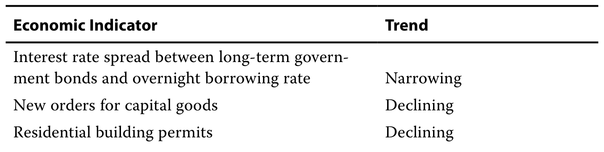 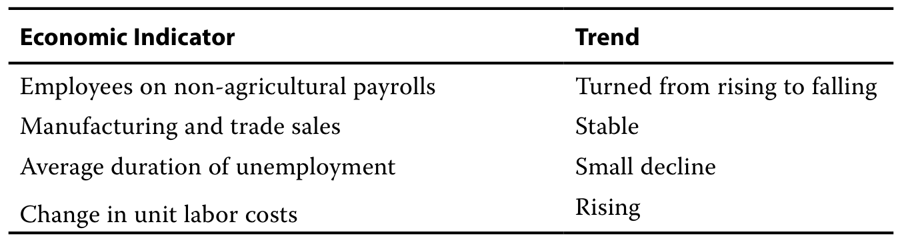

根据这些信息，该经济体最可能正在经历：

Given the information, this economy is most likely experiencing a:

A. 持续衰退。

A. continuing recession.

B. 经济周期的峰值。

B. peak in the business cycle.

C. 从谷底开始的强劲复苏。

C. strong recovery out of a trough.

#### 官方答案与解析 / Official answer and explanation

解答：

Solution:

B 正确。前三项为领先指标，全部指向即将到来的衰退，意味着经济已经达到本轮周期的峰值。非农就业人数以及制造业和贸易销售额为同步指标，这两个变量的趋势进一步表明经济可能开始下降。最后两项均为滞后指标，其趋势说明经济可能仍在增长，也可能已接近峰值。综合三组经济指标发出的信号，经济看起来可能已接近经济周期的峰值。

B is correct. The first three indicators are leading indicators, and all of them are indicating an impending recession, which means the economy has reached the peak in this cycle. Non-agricultural payrolls and manufacturing and trade sales are coincident indicators. The trends in these two variables further indicate that the economy may begin to decline. The trends in the last two indicators—both lagging indicators—indicate that the economy may either continue to grow or it may be close to a peak. Aggregating the signals given by all three groups of economic indicators, it appears the economy may be near the peak of a business cycle.

#### 补充解析 / Supplementary explanation

本题复核锚点（原解摘录）：B 正确。前三项为领先指标，全部指向即将到来的衰退，意味着经济已经达到本轮周期的峰值。

Review anchor for this item (official excerpt): B is correct. The first three indicators are leading indicators, and all of them are indicating an impending recession, which means the economy has reached the peak in this cycle.

本题官方选项为 B。补充思路：分类依据是该指标的转折点相对整体经济转折点的先后关系。领先指标提示未来方向，同步指标描述当期状态，滞后指标确认已形成的变化。单一指标可能发出假信号，使用组合指标与连续变化更稳健。还要区分经济活动发生时间与统计公布时间；发布日期晚不自动代表它属于滞后指标。

The official choice for this item is B. Additional reasoning: Classify by the indicator’s turning point relative to the economy’s turning point. Leading indicators suggest future direction, coincident indicators describe the present, and lagging indicators confirm established changes. Composite evidence and persistent movements are more reliable than one signal. A publication delay is different from an economically lagging relationship.

#### 相关知识点 / Related concepts

领先、同步与滞后指标：领先用于预测，同步用于识别，滞后用于确认；分析应看经济含义、方向与持续性。

Leading, coincident, and lagging indicators: Leading indicators predict, coincident indicators identify, and lagging indicators confirm. Evaluate economic meaning, direction, and persistence.

### ECON-LM02-PRACTICE-001 · 章末习题 1 Practice problem 1

章末练习 / Practice problem · 原版 PDF 页码 / Source PDF pages: 82, 85

#### 题目与资料 / Question and data

1\. 根据经济周期中典型的劳动利用模式，生产率（每工作小时的产出）最可能在以下哪个时期最高？

1\. Based on typical labor utilization patterns across the business cycle, productivity (output per hours worked) is most likely to be highest:

A. 繁荣的顶峰。

A. at the peak of a boom.

B. 扩张逐渐进入成熟期时。

B. into a maturing expansion.

C. 衰退的谷底。

C. at the bottom of a recession.

#### 官方答案与解析 / Official answer and explanation

1\. C 正确。在衰退末期，企业会采用“精益生产”，以最少数量的员工创造最大产出。

1\. C is correct. At the end of a recession, firms will run “lean production” to generate maximum output with the fewest number of workers.

#### 补充解析 / Supplementary explanation

本题复核锚点（原解摘录）：1. C 正确。在衰退末期，企业会采用“精益生产”，以最少数量的员工创造最大产出。

Review anchor for this item (official excerpt): 1.

本题官方选项为 C。补充思路：企业通常先调整工时、临时岗位和维护开支，再改变正式员工数量或长期资本计划。复苏时企业可能先提高现有劳动力利用率，因此就业不立即改善；原先退出劳动力市场者重新求职也可能暂时推高失业率。固定资本从规划到建成需要时间，所以资本开支对周期信号的反应与消费不同。

The official choice for this item is C. Additional reasoning: Firms often change hours, temporary labor, and maintenance before permanent employment or long-term capital plans. Recovery can initially raise utilization of existing workers rather than jobs; re-entry into the labor force can temporarily lift measured unemployment. Planning and completion lags make physical-capital spending respond differently from consumption.

产出/工时必须分别观察分子和分母。企业在复苏初期可能先提高现有员工工时和利用率，随后才招聘，因此生产率与就业人数的拐点可能不同。

Inspect output and hours separately. Early recovery can raise hours and utilization before hiring, so productivity and headcount need not turn at the same time.

#### 相关知识点 / Related concepts

劳动和资本调整的迟滞：失业率＝失业人口/劳动力；退出劳动力市场者不属于失业人口。资本存量的调整慢于库存。

Delayed labor and capital adjustment: Unemployment rate = unemployed/labor force. People outside the labor force are not counted as unemployed. Capital stock adjusts more slowly than inventory.

### ECON-LM02-PRACTICE-002 · 章末习题 2 Practice problem 2

章末练习 / Practice problem · 原版 PDF 页码 / Source PDF pages: 82, 85

#### 题目与资料 / Question and data

2\. 随着经济周期的扩张阶段从早期推进至后期，企业最可能发现下列哪项减少？

2\. As the expansion phase of the business cycle advances from early stage to late stage, businesses most likely experience a decrease in:

A. 劳动成本。

A. labor costs.

B. 资本投资。

B. capital investment.

C. 可获得的合格员工。

C. availability of qualified workers.

#### 官方答案与解析 / Official answer and explanation

2\. C 正确。当经济扩张已得到巩固时，企业往往难以找到合格员工。

2\. C is correct. When an economy’s expansion is well established, businesses often have difficulty finding qualified workers.

#### 补充解析 / Supplementary explanation

本题复核锚点（原解摘录）：2. C 正确。当经济扩张已得到巩固时，企业往往难以找到合格员工。

Review anchor for this item (official excerpt): 2.

本题官方选项为 C。补充思路：先判断是在描述总产出的水平、增长速度还是相对潜在产出的缺口。扩张、峰值、收缩和谷底有典型的先后顺序，但持续期和强度并不固定。信用条件可以通过融资成本、抵押品价值和银行放贷放大经济波动，因此信用周期与商业周期互相影响，却未必完全同步。

The official choice for this item is C. Additional reasoning: Determine whether the statement concerns output level, growth, or the gap from potential output. Expansion, peak, contraction, and trough form a typical sequence, but duration and intensity vary. Financing costs, collateral values, and lending conditions can amplify fluctuations. Credit and business cycles interact without being perfectly synchronized.

#### 相关知识点 / Related concepts

商业周期与信用周期：周期是围绕长期趋势的波动；潜在产出与实际产出不同。金融加速机制把资产价格、抵押品和信贷供给联系起来。

Business and credit cycles: A cycle fluctuates around a long-run trend. Potential and actual output differ. Financial acceleration links asset prices, collateral, and credit supply.

### ECON-LM02-PRACTICE-003 · 章末习题 3 Practice problem 3

章末练习 / Practice problem · 原版 PDF 页码 / Source PDF pages: 82, 85

#### 题目与资料 / Question and data

3\. 一名分析师在经济报告中写道，当前经济周期阶段的特征是通胀压力加速上升、企业借款增加。该分析师最可能指的是：

3\. An analyst writes in an economic report that the current phase of the business cycle is characterized by accelerating inflationary pressures and borrowing by companies. The analyst is most likely referring to the:

A. 经济周期的峰值。

A. peak of the business cycle.

B. 经济周期的收缩阶段。

B. contraction phase of the business cycle.

C. 经济周期的扩张初期。

C. early expansion phase of the business cycle.

#### 官方答案与解析 / Official answer and explanation

3\. A 正确。通胀加速和资本支出迅速增加，通常是经济周期峰值的特征。在这种时期，许多企业通过负债为资本支出融资，以扩大生产能力。

3\. A is correct. Accelerating inflation and rapidly expanding capital expenditures typically characterize the peak of the business cycle. During such times, many businesses finance their capital expenditures with debt to expand their production capacity.

#### 补充解析 / Supplementary explanation

本题复核锚点（原解摘录）：3. A 正确。通胀加速和资本支出迅速增加，通常是经济周期峰值的特征。

Review anchor for this item (official excerpt): 3.

本题官方选项为 A。补充思路：先判断是在描述总产出的水平、增长速度还是相对潜在产出的缺口。扩张、峰值、收缩和谷底有典型的先后顺序，但持续期和强度并不固定。信用条件可以通过融资成本、抵押品价值和银行放贷放大经济波动，因此信用周期与商业周期互相影响，却未必完全同步。

The official choice for this item is A. Additional reasoning: Determine whether the statement concerns output level, growth, or the gap from potential output. Expansion, peak, contraction, and trough form a typical sequence, but duration and intensity vary. Financing costs, collateral values, and lending conditions can amplify fluctuations. Credit and business cycles interact without being perfectly synchronized.

#### 相关知识点 / Related concepts

商业周期与信用周期：周期是围绕长期趋势的波动；潜在产出与实际产出不同。金融加速机制把资产价格、抵押品和信贷供给联系起来。

Business and credit cycles: A cycle fluctuates around a long-run trend. Potential and actual output differ. Financial acceleration links asset prices, collateral, and credit supply.

### ECON-LM02-PRACTICE-004 · 章末习题 4 Practice problem 4

章末练习 / Practice problem · 原版 PDF 页码 / Source PDF pages: 82, 85

#### 题目与资料 / Question and data

4\. 各类组织或研究机构编制的指标指数：

4\. The indicator indexes created by various organizations or research agencies:

A. 只包含领先指标来计算其数值。

A. include only leading indicators to compute their value.

B. 是判断经济周期阶段高度可靠的信号。

B. are highly reliable signals on the phase of business cycles.

C. 其组成和计算公式会随着时间演变。

C. evolve over time in terms of composition and computation formula.

#### 官方答案与解析 / Official answer and explanation

4\. C 正确。随着实证知识的积累，指标指数的组成和方法会不断更新，而且它们当然可以包含领先指标以外的其他指标。

4\. C is correct. The indicator indexes are constantly updated for their composition and methodology based on the accumulation of empirical knowledge, and they can certainly include more than just leading indicators.

#### 补充解析 / Supplementary explanation

本题复核锚点（原解摘录）：4. C 正确。随着实证知识的积累，指标指数的组成和方法会不断更新，而且它们当然可以包含领先指标以外的其他指标。

Review anchor for this item (official excerpt): 4.

本题官方选项为 C。补充思路：分类依据是该指标的转折点相对整体经济转折点的先后关系。领先指标提示未来方向，同步指标描述当期状态，滞后指标确认已形成的变化。单一指标可能发出假信号，使用组合指标与连续变化更稳健。还要区分经济活动发生时间与统计公布时间；发布日期晚不自动代表它属于滞后指标。

The official choice for this item is C. Additional reasoning: Classify by the indicator’s turning point relative to the economy’s turning point. Leading indicators suggest future direction, coincident indicators describe the present, and lagging indicators confirm established changes. Composite evidence and persistent movements are more reliable than one signal. A publication delay is different from an economically lagging relationship.

#### 相关知识点 / Related concepts

领先、同步与滞后指标：领先用于预测，同步用于识别，滞后用于确认；分析应看经济含义、方向与持续性。

Leading, coincident, and lagging indicators: Leading indicators predict, coincident indicators identify, and lagging indicators confirm. Evaluate economic meaning, direction, and persistence.

### ECON-LM02-PRACTICE-005 · 章末习题 5 Practice problem 5

章末练习 / Practice problem · 原版 PDF 页码 / Source PDF pages: 82, 85

#### 题目与资料 / Question and data

5\. 下列哪组经济指标趋势最符合经济从衰退中复苏的情况？

5\. Which one of the following trends in various economic indicators is most consistent with a recovery from a recession?

A. 库存销售比下降，工业生产指数稳定

A. A declining inventory–sales ratio and stable industrial production index

B. 广泛的股票市场指数上涨，单位劳动成本由上升转为下降

B. A rising broad stock market index and unit labor costs turning from increasing to decreasing

C. 每周平均首次申请失业保险人数减少，且实际个人收入总额增加

C. A decrease in average weekly initial claims for unemployment insurance and an increase in aggregate real personal income

#### 官方答案与解析 / Official answer and explanation

5\. C 正确。领先指标——每周平均首次申请失业保险人数——的改善，以及同步指标——实际个人收入总额——的改善，最符合经济复苏。虽然库存销售比下降这一滞后指标与复苏初期相一致，但工业生产指数稳定这一同步指标并不支持该结论。股市指数上涨虽然可能预示经济扩张，但单位劳动成本这一滞后指标已经见顶，这更符合经济衰退的情况。

5\. C is correct. The improving leading indicator, average weekly initial claims for unemployment insurance, and the improving coincident indicator, aggregate real personal income, are most consistent with an economic recovery. Even though a declining inventory-to-sales ratio, a lagging indicator, is consistent with an early recovery, the coincident indicator, the stable industrial production index, does not support that conclusion. Although a rising stock market index can signal economic expansion, the lagging indicator, the unit labor costs, has peaked, which is more consistent with a recession.

#### 补充解析 / Supplementary explanation

本题复核锚点（原解摘录）：5. C 正确。领先指标——每周平均首次申请失业保险人数——的改善，以及同步指标——实际个人收入总额——的改善，最符合经济复苏。

Review anchor for this item (official excerpt): 5.

本题官方选项为 C。补充思路：分类依据是该指标的转折点相对整体经济转折点的先后关系。领先指标提示未来方向，同步指标描述当期状态，滞后指标确认已形成的变化。单一指标可能发出假信号，使用组合指标与连续变化更稳健。还要区分经济活动发生时间与统计公布时间；发布日期晚不自动代表它属于滞后指标。

The official choice for this item is C. Additional reasoning: Classify by the indicator’s turning point relative to the economy’s turning point. Leading indicators suggest future direction, coincident indicators describe the present, and lagging indicators confirm established changes. Composite evidence and persistent movements are more reliable than one signal. A publication delay is different from an economically lagging relationship.

#### 相关知识点 / Related concepts

领先、同步与滞后指标：领先用于预测，同步用于识别，滞后用于确认；分析应看经济含义、方向与持续性。

Leading, coincident, and lagging indicators: Leading indicators predict, coincident indicators identify, and lagging indicators confirm. Evaluate economic meaning, direction, and persistence.

### ECON-LM02-PRACTICE-006 · 章末习题 6 Practice problem 6

章末练习 / Practice problem · 原版 PDF 页码 / Source PDF pages: 82-83, 85

#### 题目与资料 / Question and data

6\. 下列哪项陈述最恰当地描述即时预测？

6\. Which of the following statements gives the best description of nowcasting?

A. 这种方法根据经济变量过去和当前的数值，预测其未来趋势。

A. This method is used to forecast future trends in economic variables based on their past and current values.

B. 这种方法实时监测经济和金融变量，以持续评估当前状况，并估计当前状态。

B. This method is used for real-time monitoring of economic and financial variables to continuously assess current conditions and provide an estimate of the current state.

C. 这种方法研究变量之间过去的关系，以确定哪些变量解释了某个所关注变量的变化路径。

C. This method is used to study past relationships between variables to determine which ones have explained the path of a particular variable of interest.

#### 官方答案与解析 / Official answer and explanation

6\. B 正确。即时预测是使用相关技术来估计当前状态。A 不正确，因为即时预测旨在估计当前，而非预测未来。C 不正确，因为即时预测的重点是估计 GDP 等变量当前、现时的数值。

6\. B is correct. Nowcasting involves the use of techniques to estimate the present state. A is incorrect because nowcasting aims to estimate the present, not forecast the future. C is incorrect because the focus of nowcasting is to estimate the current, present value of a variable, such as GDP.

#### 补充解析 / Supplementary explanation

本题复核锚点（原解摘录）：6. B 正确。即时预测是使用相关技术来估计当前状态。

Review anchor for this item (official excerpt): 6.

本题官方选项为 B。补充思路：即时预测利用已到达的高频或部分信息估计尚未正式发布的当前经济状态。关键是估计对象所属时段：当前值属于 nowcasting，未来值属于 forecasting，解释已发生关系属于历史分析。同样的数据集可以服务不同目的，因此要看问题问的是何时的经济状态。

The official choice for this item is B. Additional reasoning: Nowcasting uses arriving high-frequency or partial information to estimate current conditions before official releases are complete. Classify the exercise by the target period: current conditions are nowcasting, future conditions forecasting, and past relationships historical analysis. The same dataset can serve different purposes.

#### 相关知识点 / Related concepts

即时预测与信息时点：数据发布通常滞后于经济活动发生；即时预测弥补的是信息发布滞后，而不保证预测没有误差。

Nowcasting and information timing: Economic releases lag activity. Nowcasting addresses that information delay without eliminating estimation error.

### ECON-LM02-PRACTICE-007 · 章末习题 7 Practice problem 7

章末练习 / Practice problem · 原版 PDF 页码 / Source PDF pages: 83, 85

#### 题目与资料 / Question and data

7\. 下列哪项陈述最恰当地描述经济指标的特征？

7\. Which of the following statements is the best description of the characteristics of economic indicators?

A. 领先指标之所以重要，是因为它们跟踪整个经济体。

A. Leading indicators are important because they track the entire economy.

B. 滞后指标衡量过去的状况，因此不需要修订。

B. Lagging indicators, in measuring past conditions, do not require revisions.

C. 结合领先指标和同步指标，可以提供有效的预测。

C. A combination of leading and coincident indicators can offer effective forecasts.

#### 官方答案与解析 / Official answer and explanation

7\. C 正确。虽然没有任何单一指标能够作出确定判断，但将多种指标结合起来，这些指标可能分别受到不同经济决定因素的影响，能够提供最有力的经济表现信号。

7\. C is correct. Although no single indicator is definitive, a mix of them—which can be affected by various economic determinants—can offer the strongest signal of performance.

#### 补充解析 / Supplementary explanation

本题复核锚点（原解摘录）：7. C 正确。虽然没有任何单一指标能够作出确定判断，但将多种指标结合起来，这些指标可能分别受到不同经济决定因素的影响，能够提供最有力的经济表现信号。

Review anchor for this item (official excerpt): 7.

本题官方选项为 C。补充思路：分类依据是该指标的转折点相对整体经济转折点的先后关系。领先指标提示未来方向，同步指标描述当期状态，滞后指标确认已形成的变化。单一指标可能发出假信号，使用组合指标与连续变化更稳健。还要区分经济活动发生时间与统计公布时间；发布日期晚不自动代表它属于滞后指标。

The official choice for this item is C. Additional reasoning: Classify by the indicator’s turning point relative to the economy’s turning point. Leading indicators suggest future direction, coincident indicators describe the present, and lagging indicators confirm established changes. Composite evidence and persistent movements are more reliable than one signal. A publication delay is different from an economically lagging relationship.

#### 相关知识点 / Related concepts

领先、同步与滞后指标：领先用于预测，同步用于识别，滞后用于确认；分析应看经济含义、方向与持续性。

Leading, coincident, and lagging indicators: Leading indicators predict, coincident indicators identify, and lagging indicators confirm. Evaluate economic meaning, direction, and persistence.

### ECON-LM02-PRACTICE-008 · 章末习题 8 Practice problem 8

章末练习 / Practice problem · 原版 PDF 页码 / Source PDF pages: 83, 85

#### 题目与资料 / Question and data

8\. 当 10 年期美国国债收益率与短期联邦基金利率之间的利差收窄，同时最优惠贷款利率保持不变时，这组指标最可能预示未来经济：

8\. When the spread between 10-year US Treasury yields and the short-term federal funds rate narrows and at the same time the prime rate stays unchanged, this mix of indicators most likely forecasts future economic:

A. 增长。

A. growth.

B. 下滑。

B. decline.

C. 稳定。

C. stability.

#### 官方答案与解析 / Official answer and explanation

8\. B 正确。这一领先指标的利差收窄，预示短期利率和经济活动将下降。最优惠贷款利率是滞后指标，通常在经济转向之后才发生变化。

8\. B is correct. The narrowing spread of this leading indicator foretells a drop in short-term rates and a fall in economic activity. The prime rate is a lagging indicator and typically moves after the economy turns.

#### 补充解析 / Supplementary explanation

本题复核锚点（原解摘录）：8. B 正确。这一领先指标的利差收窄，预示短期利率和经济活动将下降。

Review anchor for this item (official excerpt): 8.

本题官方选项为 B。补充思路：分类依据是该指标的转折点相对整体经济转折点的先后关系。领先指标提示未来方向，同步指标描述当期状态，滞后指标确认已形成的变化。单一指标可能发出假信号，使用组合指标与连续变化更稳健。还要区分经济活动发生时间与统计公布时间；发布日期晚不自动代表它属于滞后指标。

The official choice for this item is B. Additional reasoning: Classify by the indicator’s turning point relative to the economy’s turning point. Leading indicators suggest future direction, coincident indicators describe the present, and lagging indicators confirm established changes. Composite evidence and persistent movements are more reliable than one signal. A publication delay is different from an economically lagging relationship.

收益率利差收窄常被作为领先信号，但本题同时给出的其他指标可能是同步或滞后信息；应按时间顺序组合证据，不能要求所有指标同时转向。

Yield-spread narrowing is commonly a leading signal; other indicators in the question can be coincident or lagging. Combine evidence by timing rather than requiring all indicators to turn together.

#### 相关知识点 / Related concepts

领先、同步与滞后指标：领先用于预测，同步用于识别，滞后用于确认；分析应看经济含义、方向与持续性。

Leading, coincident, and lagging indicators: Leading indicators predict, coincident indicators identify, and lagging indicators confirm. Evaluate economic meaning, direction, and persistence.

### ECON-LM02-PRACTICE-009 · 章末习题 9 Practice problem 9

章末练习 / Practice problem · 原版 PDF 页码 / Source PDF pages: 83, 85

#### 题目与资料 / Question and data

9\. 当前经济统计显示，服务业通胀几乎没有变化，住宅建筑许可增加，平均失业持续时间延长。对这些数据最恰当的解释是：

9\. Current economic statistics indicating little change in services inflation, rising residential building permits, and increasing average duration of unemployment are best interpreted as:

A. 它们提供了关于经济方向相互冲突的证据。

A. conflicting evidence about the direction of the economy.

B. 它们表明预期未来将出现周期性上行。

B. evidence that a cyclical upturn is expected to occur in the future.

C. 它们表明预期未来将出现周期性下行。

C. evidence that a cyclical downturn is expected to occur in the future.

#### 官方答案与解析 / Official answer and explanation

9\. B 正确。建筑许可增加这一领先指标表明，预计上行将出现或持续。平均失业持续时间延长这一滞后指标表明，下行已经发生；而服务业通胀没有变化，也是一个滞后指标，对经济方向既不发出负面信号，也不发出正面信号。综合来看，这些统计数据表明，可能预期出现周期性上行。

9\. B is correct. Rising building permits—a leading indicator—indicate that an upturn is expected to occur or continue. Increasing average duration of unemployment—a lagging indicator—indicates that a downturn has occurred, whereas the lack of any change in services inflation—also a lagging indicator—is neither negative nor positive for the direction of the economy. Taken together, these statistics indicate that a cyclical upturn may be expected to occur.

#### 补充解析 / Supplementary explanation

本题复核锚点（原解摘录）：9. B 正确。建筑许可增加这一领先指标表明，预计上行将出现或持续。

Review anchor for this item (official excerpt): 9.

本题官方选项为 B。补充思路：企业通常先调整工时、临时岗位和维护开支，再改变正式员工数量或长期资本计划。复苏时企业可能先提高现有劳动力利用率，因此就业不立即改善；原先退出劳动力市场者重新求职也可能暂时推高失业率。固定资本从规划到建成需要时间，所以资本开支对周期信号的反应与消费不同。

The official choice for this item is B. Additional reasoning: Firms often change hours, temporary labor, and maintenance before permanent employment or long-term capital plans. Recovery can initially raise utilization of existing workers rather than jobs; re-entry into the labor force can temporarily lift measured unemployment. Planning and completion lags make physical-capital spending respond differently from consumption.

#### 相关知识点 / Related concepts

劳动和资本调整的迟滞：失业率＝失业人口/劳动力；退出劳动力市场者不属于失业人口。资本存量的调整慢于库存。

Delayed labor and capital adjustment: Unemployment rate = unemployed/labor force. People outside the labor force are not counted as unemployed. Capital stock adjusts more slowly than inventory.

### ECON-LM02-PRACTICE-010 · 章末习题 10 Practice problem 10

章末练习 / Practice problem · 原版 PDF 页码 / Source PDF pages: 83, 85

#### 题目与资料 / Question and data

10\. 相对于各指标此前的数值，如果库存销售比上升、单位劳动成本稳定、实际个人收入下降，则经济周期的峰值最可能：

10\. If relative to prior values of their respective indicators, the inventory–sales ratio has risen, unit labor cost is stable, and real personal income has decreased, it is most likely that a peak in the business cycle:

A. 已经出现。

A. has occurred.

B. 即将出现。

B. is just about to occur.

C. 将在未来某个时候出现。

C. will occur sometime in the future.

#### 官方答案与解析 / Official answer and explanation

10\. A 正确。库存销售比和单位劳动成本都是滞后指标，会在峰值出现一段时间后下降。实际个人收入是同步指标，其下降表明企业活动正在放缓。

10\. A is correct. Both inventory–sales and unit labor costs are lagging indicators that decline somewhat after a peak. Real personal income is a coincident indicator that, by its decline, shows a slowdown in business activity.

#### 补充解析 / Supplementary explanation

本题复核锚点（原解摘录）：10. A 正确。库存销售比和单位劳动成本都是滞后指标，会在峰值出现一段时间后下降。

Review anchor for this item (official excerpt): 10.

本题官方选项为 A。补充思路：库存是流量不匹配的累积结果：本期生产超过销售，库存就增加。周期见顶时，销售往往先放缓而生产尚未削减，库存销售比上升；复苏初期，销售先回升、生产调整滞后，库存可能先被消化。判断时必须区分库存的绝对量、库存增长率和库存销售比，不能把它们当成同一变量。

The official choice for this item is A. Additional reasoning: Inventory accumulates when production exceeds sales. Near a peak, sales often slow before output is cut, raising the inventory–sales ratio. Early in recovery, sales can rebound ahead of production and draw down inventories. Distinguish the inventory level, its growth rate, and the inventory–sales ratio; these need not move together.

#### 相关知识点 / Related concepts

库存与经济周期的时序：期末库存＝期初库存＋本期生产−本期销售；库存销售比＝库存/销售。库存投资的快速变化可显著放大 GDP 波动。

Inventories over the business cycle: Ending inventory = beginning inventory + production − sales. Inventory–sales ratio = inventory/sales. Rapid changes in inventory investment can amplify GDP fluctuations.

### ECON-LM02-PRACTICE-011 · 章末习题 11 Practice problem 11

章末练习 / Practice problem · 原版 PDF 页码 / Source PDF pages: 83, 85

#### 题目与资料 / Question and data

11\. 如果在某一时期，实际个人收入总额、工业产出和标普 500 指数都上升，最准确的结论是，周期性上行：

11\. When aggregate real personal income, industrial output, and the S&P 500 Index all increase in a given period, it is most accurate to conclude that a cyclical upturn is:

A. 正在发生。

A. occurring.

B. 即将结束。

B. about to end.

C. 即将开始。

C. about to begin.

#### 官方答案与解析 / Official answer and explanation

11\. A 正确。实际个人收入总额和工业产出都是同步指标，而标普 500 指数是领先指标。个人收入总额和工业产出上升，表明扩张正在发生；标普 500 指数上升，则表明扩张将发生或预计会持续。综合来看，这些统计数据表明，周期性上行正在发生。

11\. A is correct. Aggregate real personal income and industrial output are coincident indicators, whereas the S&P 500 is a leading indicator. An increase in aggregate personal income and industrial output signals that an expansion is occurring, whereas an increase in the S&P 500 signals that an expansion will occur or is expected to continue. Taken together, these statistics indicate that a cyclical upturn is occurring.

#### 补充解析 / Supplementary explanation

本题复核锚点（原解摘录）：11. A 正确。实际个人收入总额和工业产出都是同步指标，而标普 500 指数是领先指标。

Review anchor for this item (official excerpt): 11.

本题官方选项为 A。补充思路：分类依据是该指标的转折点相对整体经济转折点的先后关系。领先指标提示未来方向，同步指标描述当期状态，滞后指标确认已形成的变化。单一指标可能发出假信号，使用组合指标与连续变化更稳健。还要区分经济活动发生时间与统计公布时间；发布日期晚不自动代表它属于滞后指标。

The official choice for this item is A. Additional reasoning: Classify by the indicator’s turning point relative to the economy’s turning point. Leading indicators suggest future direction, coincident indicators describe the present, and lagging indicators confirm established changes. Composite evidence and persistent movements are more reliable than one signal. A publication delay is different from an economically lagging relationship.

#### 相关知识点 / Related concepts

领先、同步与滞后指标：领先用于预测，同步用于识别，滞后用于确认；分析应看经济含义、方向与持续性。

Leading, coincident, and lagging indicators: Leading indicators predict, coincident indicators identify, and lagging indicators confirm. Evaluate economic meaning, direction, and persistence.

### ECON-LM02-PRACTICE-012 · 章末习题 12 Practice problem 12

章末练习 / Practice problem · 原版 PDF 页码 / Source PDF pages: 83-84, 86

#### 题目与资料 / Question and data

12\. 在实际个人收入总额增加之后，下列哪项最可能增加？

12\. Which of the following is most likely to increase after an increase in aggregate real personal income?

A. 股票价格

A. Equity prices

B. 新建私人住宅建筑许可

B. Building permits for new private housing units

C. 消费者分期付款债务与收入之比

C. The ratio of consumer installment debt to income

#### 官方答案与解析 / Official answer and explanation

12\. C 正确。实际个人收入总额是经济周期的同步指标，消费者分期付款债务与收入之比是滞后指标。在典型经济周期中，消费者分期付款债务比率的上升，会发生在平均总收入增加之后。

12\. C is correct. Aggregate real personal income is a coincident indicator of the business cycle, and the ratio of consumer installment debt to income is a lagging indicator. Increases in the ratio of consumer installment debt follow increases in average aggregate income during the typical business cycle.

#### 补充解析 / Supplementary explanation

本题复核锚点（原解摘录）：12. C 正确。实际个人收入总额是经济周期的同步指标，消费者分期付款债务与收入之比是滞后指标。

Review anchor for this item (official excerpt): 12.

本题官方选项为 C。补充思路：分类依据是该指标的转折点相对整体经济转折点的先后关系。领先指标提示未来方向，同步指标描述当期状态，滞后指标确认已形成的变化。单一指标可能发出假信号，使用组合指标与连续变化更稳健。还要区分经济活动发生时间与统计公布时间；发布日期晚不自动代表它属于滞后指标。

The official choice for this item is C. Additional reasoning: Classify by the indicator’s turning point relative to the economy’s turning point. Leading indicators suggest future direction, coincident indicators describe the present, and lagging indicators confirm established changes. Composite evidence and persistent movements are more reliable than one signal. A publication delay is different from an economically lagging relationship.

#### 相关知识点 / Related concepts

领先、同步与滞后指标：领先用于预测，同步用于识别，滞后用于确认；分析应看经济含义、方向与持续性。

Leading, coincident, and lagging indicators: Leading indicators predict, coincident indicators identify, and lagging indicators confirm. Evaluate economic meaning, direction, and persistence.

### ECON-LM02-PRACTICE-013 · 章末习题 13 Practice problem 13

章末练习 / Practice problem · 原版 PDF 页码 / Source PDF pages: 84, 86

#### 题目与资料 / Question and data

13\. 下列哪项指标最适合用于预测经济的转折点？

13\. Which of the following indicators is most appropriate in predicting a turning point in the economy?

A. 工业生产指数

A. The Industrial Production Index

B. 银行平均最优惠贷款利率

B. The average bank prime lending rate

C. 制造业平均每周工时

C. Average weekly hours, manufacturing

#### 官方答案与解析 / Official answer and explanation

13\. C 正确。领先经济指标的转折点通常先于整体经济的转折点出现。制造业平均每周工时是领先经济指标。工业生产指数是同步经济指标，银行平均最优惠贷款利率是滞后经济指标。

13\. C is correct. Leading economic indicators have turning points that usually precede those of the overall economy. Average weekly hours, manufacturing is a leading economic indicator. The Industrial Production Index is a coincident economic indicator, and the average bank prime lending rate is a lagging economic indicator.

#### 补充解析 / Supplementary explanation

本题复核锚点（原解摘录）：13. C 正确。领先经济指标的转折点通常先于整体经济的转折点出现。

Review anchor for this item (official excerpt): 13.

本题官方选项为 C。补充思路：分类依据是该指标的转折点相对整体经济转折点的先后关系。领先指标提示未来方向，同步指标描述当期状态，滞后指标确认已形成的变化。单一指标可能发出假信号，使用组合指标与连续变化更稳健。还要区分经济活动发生时间与统计公布时间；发布日期晚不自动代表它属于滞后指标。

The official choice for this item is C. Additional reasoning: Classify by the indicator’s turning point relative to the economy’s turning point. Leading indicators suggest future direction, coincident indicators describe the present, and lagging indicators confirm established changes. Composite evidence and persistent movements are more reliable than one signal. A publication delay is different from an economically lagging relationship.

#### 相关知识点 / Related concepts

领先、同步与滞后指标：领先用于预测，同步用于识别，滞后用于确认；分析应看经济含义、方向与持续性。

Leading, coincident, and lagging indicators: Leading indicators predict, coincident indicators identify, and lagging indicators confirm. Evaluate economic meaning, direction, and persistence.

### ECON-LM02-PRACTICE-014 · 章末习题 14 Practice problem 14

章末练习 / Practice problem · 原版 PDF 页码 / Source PDF pages: 84, 86

#### 题目与资料 / Question and data

14\. 失业率被视为滞后指标，原因是：

14\. The unemployment rate is considered a lagging indicator because:

A. 必须先定义新的工作类别，才能统计相关从业者。

A. new job types must be defined to count their workers.

B. 有多名就业成员的家庭，更换工作的速度较慢。

B. multiworker households change jobs at a slower pace.

C. 由于相关成本的存在，企业招聘和解雇员工的反应较慢。

C. businesses are slow to hire and fire due to related costs.

#### 官方答案与解析 / Official answer and explanation

14\. C 正确。这一效应使失业率在衰退开始时上升得较慢，在复苏开始时下降得也较慢。

14\. C is correct. This effect makes unemployment rise more slowly as recessions start and fall more slowly as recoveries begin.

#### 补充解析 / Supplementary explanation

本题复核锚点（原解摘录）：14. C 正确。这一效应使失业率在衰退开始时上升得较慢，在复苏开始时下降得也较慢。

Review anchor for this item (official excerpt): 14.

本题官方选项为 C。补充思路：分类依据是该指标的转折点相对整体经济转折点的先后关系。领先指标提示未来方向，同步指标描述当期状态，滞后指标确认已形成的变化。单一指标可能发出假信号，使用组合指标与连续变化更稳健。还要区分经济活动发生时间与统计公布时间；发布日期晚不自动代表它属于滞后指标。

The official choice for this item is C. Additional reasoning: Classify by the indicator’s turning point relative to the economy’s turning point. Leading indicators suggest future direction, coincident indicators describe the present, and lagging indicators confirm established changes. Composite evidence and persistent movements are more reliable than one signal. A publication delay is different from an economically lagging relationship.

#### 相关知识点 / Related concepts

领先、同步与滞后指标：领先用于预测，同步用于识别，滞后用于确认；分析应看经济含义、方向与持续性。

Leading, coincident, and lagging indicators: Leading indicators predict, coincident indicators identify, and lagging indicators confirm. Evaluate economic meaning, direction, and persistence.

### ECON-LM02-PRACTICE-015 · 章末习题 15 Practice problem 15

章末练习 / Practice problem · 原版 PDF 页码 / Source PDF pages: 84, 86

#### 题目与资料 / Question and data

15\. 在经济复苏期间，失业率的滞后性最可能归因于以下哪项因素？

15\. During an economic recovery, a lagging unemployment rate is most likely attributable to:

A. 企业迅速重新招聘员工。

A. businesses quickly rehiring workers.

B. 新的求职者进入劳动力队伍。

B. new job seekers entering the labor force.

C. 就业不足的劳动者转向薪酬更高的工作。

C. underemployed workers transitioning to higher-paying jobs.

#### 官方答案与解析 / Official answer and explanation

15\. B 正确。在经济复苏期间，新的求职者重新进入劳动力队伍，而由于他们很少能够立刻找到工作，这种回归最初可能推高失业率。

15\. B is correct. In an economic recovery, new job seekers return to the labor force, and because they seldom find work immediately, their return may initially raise the unemployment rate.

#### 补充解析 / Supplementary explanation

本题复核锚点（原解摘录）：15. B 正确。在经济复苏期间，新的求职者重新进入劳动力队伍，而由于他们很少能够立刻找到工作，这种回归最初可能推高失业率。

Review anchor for this item (official excerpt): 15.

本题官方选项为 B。补充思路：企业通常先调整工时、临时岗位和维护开支，再改变正式员工数量或长期资本计划。复苏时企业可能先提高现有劳动力利用率，因此就业不立即改善；原先退出劳动力市场者重新求职也可能暂时推高失业率。固定资本从规划到建成需要时间，所以资本开支对周期信号的反应与消费不同。

The official choice for this item is B. Additional reasoning: Firms often change hours, temporary labor, and maintenance before permanent employment or long-term capital plans. Recovery can initially raise utilization of existing workers rather than jobs; re-entry into the labor force can temporarily lift measured unemployment. Planning and completion lags make physical-capital spending respond differently from consumption.

#### 相关知识点 / Related concepts

劳动和资本调整的迟滞：失业率＝失业人口/劳动力；退出劳动力市场者不属于失业人口。资本存量的调整慢于库存。

Delayed labor and capital adjustment: Unemployment rate = unemployed/labor force. People outside the labor force are not counted as unemployed. Capital stock adjusts more slowly than inventory.

## LM 3 · 财政政策 Fiscal Policy 25 条目 · 原题与解析逐条对应 / Paired source questions and explanations

### ECON-LM03-QUESTION_SET-101 · 习题组 · 第 1 题 Question set · 1

正文习题组 / Question set · 原版 PDF 页码 / Source PDF pages: 90

#### 题目与资料 / Question and data

习题组

QUESTION SET

1\. 下列哪项陈述最恰当地描述货币政策？

1\. Which of the following statements best describes monetary policy?

货币政策：

Monetary policy:

A. 涉及设定广义货币总量的中期目标。

A. involves the setting of medium-term targets for broad money aggregates.

B. 涉及由中央银行调整政府的预算赤字。

B. involves the manipulation by a central bank of the government’s budget deficit.

C. 试图通过影响经济体中的货币和信贷数量，来影响宏观经济。

C. seeks to influence the macroeconomy by influencing the quantity of money and credit in the economy.

#### 官方答案与解析 / Official answer and explanation

解答：

Solution:

C 正确，因为货币政策涉及中央银行旨在影响货币和信贷数量的活动。A 不正确，因为虽然为货币总量设定目标可以作为货币政策工具，但货币政策本身着眼于影响整体经济，也就是宏观经济。

C is correct, as monetary policy involves central bank activities directed toward influencing the quantity of money and credit. Choice A is incorrect because, although the setting of targets for monetary aggregates is a possible tool of monetary policy, monetary policy itself is concerned with influencing the overall, or macro, economy.

#### 补充解析 / Supplementary explanation

本题复核锚点（原解摘录）：C 正确，因为货币政策涉及中央银行旨在影响货币和信贷数量的活动。

Review anchor for this item (official excerpt): C is correct, as monetary policy involves central bank activities directed toward influencing the quantity of money and credit.

本题官方选项为 C。补充思路：赤字是一个时期的收支差额，国债是历年融资累积的存量。李嘉图等价的关键假设是居民预见当前举债意味着未来增税，于是增加储蓄来抵消政府刺激。现实中流动性约束、有限寿命、不确定性和预期误差可能使这种抵消不完全。评价债务负担还应区分本币债与外币债、利息负担与债务总额。

The official choice for this item is C. Additional reasoning: A deficit is a period flow; government debt is an accumulated stock. Ricardian equivalence assumes households anticipate future taxes caused by current borrowing and save enough to offset the stimulus. Liquidity constraints, finite lives, uncertainty, and imperfect expectations can prevent full offset. Debt analysis also distinguishes currency denomination, interest burden, and principal outstanding.

#### 相关知识点 / Related concepts

赤字、国债与李嘉图等价：预算赤字＝支出−收入；债务动态同时受利率、名义增长和基本财政收支影响。李嘉图等价是有条件的理论命题。

Deficits, debt, and Ricardian equivalence: Budget deficit = spending − revenue. Debt dynamics depend on interest rates, nominal growth, and the primary balance. Ricardian equivalence is conditional.

### ECON-LM03-QUESTION_SET-102 · 习题组 · 第 2 题 Question set · 2

正文习题组 / Question set · 原版 PDF 页码 / Source PDF pages: 90

#### 题目与资料 / Question and data

习题组

QUESTION SET

2\. 下列哪项陈述最恰当地描述财政政策？财政政策：

2\. Which of the following statements best describes fiscal policy? Fiscal policy:

A. 被政府用于重新分配财富和收入。

A. is used by governments to redistribute wealth and incomes.

B. 是政府试图在每一年保持预算平衡的做法。

B. is the attempt by governments to balance their budgets from one year to the next.

C. 涉及使用政府支出和税收来影响经济活动。

C. involves the use of government spending and taxation to influence economy activity.

#### 官方答案与解析 / Official answer and explanation

C 正确。注意，政府可能希望通过财政政策重新分配收入并平衡预算，但财政政策的首要目标通常是影响更广泛的经济活动。

C is correct. Note that governments may wish to use fiscal policy to redistribute income and balance their budgets, but the overriding goal of fiscal policy is usually to influence a broader range of economic activity.

#### 补充解析 / Supplementary explanation

本题复核锚点（原解摘录）：C 正确。注意，政府可能希望通过财政政策重新分配收入并平衡预算，但财政政策的首要目标通常是影响更广泛的经济活动。

Review anchor for this item (official excerpt): C is correct. Note that governments may wish to use fiscal policy to redistribute income and balance their budgets, but the overriding goal of fiscal policy is usually to influence a broader range of economic activity.

本题官方选项为 C。补充思路：财政政策直接改变政府支出、税收或转移支付，并可同时影响总需求、收入分配和资源配置。扩张方向通常是增加支出或降低税负；紧缩则相反。自动稳定器随经济状态自然变化，裁量政策则需要决策。识别、立法实施和经济影响分别有时间滞后，所以不能只看政策宣布当天就判断最终效果。

The official choice for this item is C. Additional reasoning: Fiscal policy changes spending, taxes, or transfers and can affect aggregate demand, income distribution, and allocation. More spending or lower taxes is generally expansionary. Automatic stabilizers respond without new decisions, while discretionary measures require policy action. Recognition, implementation, and impact lags separate an announcement from its ultimate effect.

#### 相关知识点 / Related concepts

财政政策工具与政策时滞：财政政策主体是政府；货币政策主要由中央银行实施。评价财政立场时应关注周期调整后的收支，而非只看实际赤字。

Fiscal policy instruments and lags: Governments implement fiscal policy; central banks conduct monetary policy. Assess fiscal stance using cyclically adjusted balances rather than the raw deficit alone.

### ECON-LM03-WORKED_CASE-002 · 政府现金流的来源与用途：英国案例 Sources and Uses of Government Cash Flows: The Case of the United Kingdom

正文讲解案例 / Narrated worked case · 原版 PDF 页码 / Source PDF pages: 94-95

#### 题目与资料 / Question and data

例 1

EXAMPLE 1

政府现金流的来源与用途：英国案例

Sources and Uses of Government Cash Flows: The Case of the United Kingdom

#### 官方答案与解析 / Official answer and explanation

收入和支出的具体构成当然会随时间和国家而有所不同。不过，为说明支出和收入的构成，图表 5 和图表 6 列示了英国 2018/2019 年度的预算预测。预算预计总支出将达到 8,080 亿英镑，而总收入仅为 7,690 亿英镑。因此，政府预计该财政年度的预算缺口为 390 亿英镑，这意味着政府相应需要向英国的私人部门，或其他经济体的私人和公共部门借入 390 亿英镑。

The precise components of revenue and expenditure will of course vary over time and between countries. But, as an example of the breakdown of expenditure and revenue, in Exhibit 5 and Exhibit 6 we have presented the budget projections of the United Kingdom for 2018/2019. The budget projected that total spending would come to GBP808 billion, whereas total revenue would be only GBP769 billion. The government was therefore forecasting a budget shortfall of GBP39 billion for the fiscal year, meaning that it had an associated need to borrow GBP39 billion from the private sector in the United Kingdom or the private and public sectors of other economies.

图表 5：资金用在何处？英国，2018—2019 年

Exhibit 5: Where Does the Money Go? United Kingdom, 2018–2019

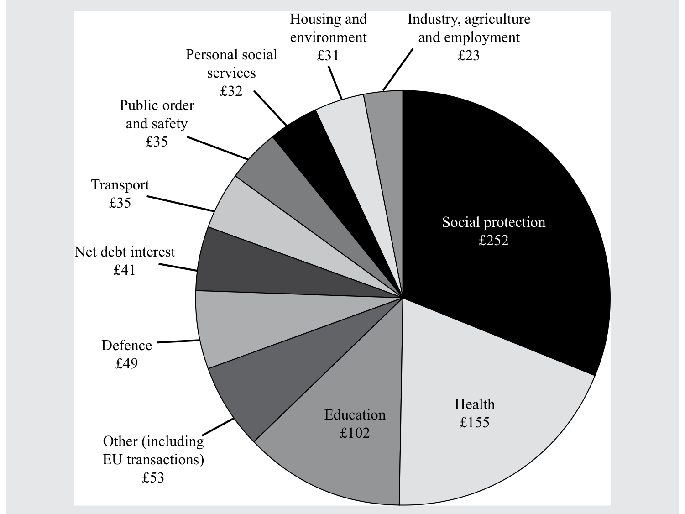

注：所有金额的单位均为十亿英镑。

Note: All values are in billions of pounds.

来源：英国财政部。

Source: HM Treasury, United Kingdom.

图表 6：资金来自何处？英国，2018—2019 年

Exhibit 6: Where Does the Money Come From? United Kingdom, 2018–2019

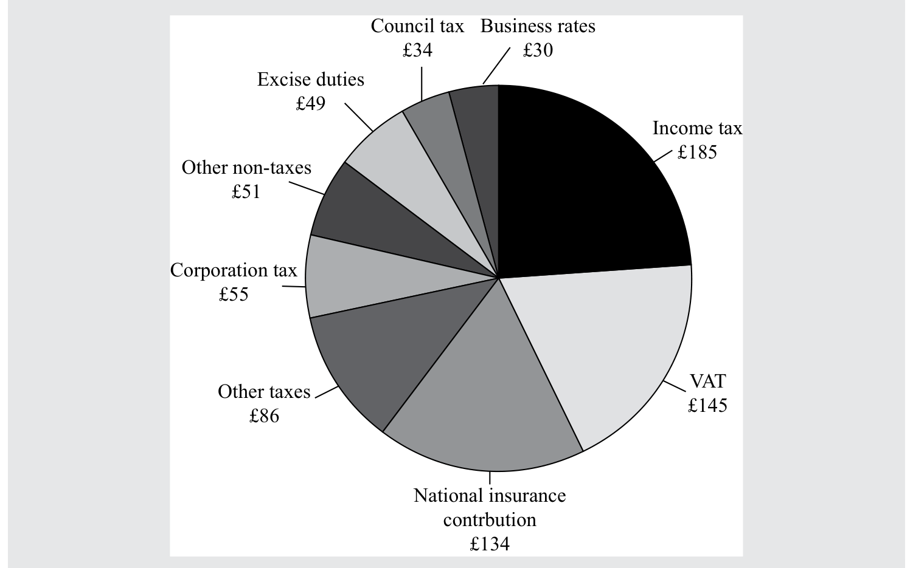

注：所有金额的单位均为十亿英镑。

Note: All values are in billions of pounds.

来源：英国财政部。

Source: HM Treasury, United Kingdom.

#### 补充解析 / Supplementary explanation

本题复核锚点（原解摘录）：收入和支出的具体构成当然会随时间和国家而有所不同。

Review anchor for this item (official excerpt): The precise components of revenue and expenditure will of course vary over time and between countries.

补充思路：财政政策直接改变政府支出、税收或转移支付，并可同时影响总需求、收入分配和资源配置。扩张方向通常是增加支出或降低税负；紧缩则相反。自动稳定器随经济状态自然变化，裁量政策则需要决策。识别、立法实施和经济影响分别有时间滞后，所以不能只看政策宣布当天就判断最终效果。

Additional reasoning: Fiscal policy changes spending, taxes, or transfers and can affect aggregate demand, income distribution, and allocation. More spending or lower taxes is generally expansionary. Automatic stabilizers respond without new decisions, while discretionary measures require policy action. Recognition, implementation, and impact lags separate an announcement from its ultimate effect.

#### 相关知识点 / Related concepts

财政政策工具与政策时滞：财政政策主体是政府；货币政策主要由中央银行实施。评价财政立场时应关注周期调整后的收支，而非只看实际赤字。

Fiscal policy instruments and lags: Governments implement fiscal policy; central banks conduct monetary policy. Assess fiscal stance using cyclically adjusted balances rather than the raw deficit alone.

原教材为连贯讲解型案例，没有独立设问及答案分栏；保留官方案例与演示，未另造题目。

### ECON-LM03-QUESTION_SET-301 · 习题组 · 第 1 题 Question set · 1

正文习题组 / Question set · 原版 PDF 页码 / Source PDF pages: 95

#### 题目与资料 / Question and data

练习题

QUESTION SET

1\. 以下哪一项最不可能是政府财政政策的目标？

1\. The least likely goal of a government’s fiscal policy is to:

A. 再分配收入和财富。

A. redistribute income and wealth.

B. 影响全国总产出。

B. influence aggregate national output.

C. 确保本国货币购买力的稳定。

C. ensure the stability of the purchasing power of its currency.

#### 官方答案与解析 / Official answer and explanation

解答：

Solution:

C 正确。确保购买力稳定是货币政策的目标，而非财政政策的目标。财政政策通过政府支出和税收收入来影响一个经济体的总体总需求水平，进而影响经济活动水平。

C is correct. Ensuring stable purchasing power is a goal of monetary rather than fiscal policy. Fiscal policy involves the use of government spending and tax revenue to affect the overall level of aggregate demand in an economy and hence the level of economic activity.

#### 补充解析 / Supplementary explanation

本题复核锚点（原解摘录）：C 正确。确保购买力稳定是货币政策的目标，而非财政政策的目标。

Review anchor for this item (official excerpt): C is correct. Ensuring stable purchasing power is a goal of monetary rather than fiscal policy.

本题官方选项为 C。补充思路：财政政策直接改变政府支出、税收或转移支付，并可同时影响总需求、收入分配和资源配置。扩张方向通常是增加支出或降低税负；紧缩则相反。自动稳定器随经济状态自然变化，裁量政策则需要决策。识别、立法实施和经济影响分别有时间滞后，所以不能只看政策宣布当天就判断最终效果。

The official choice for this item is C. Additional reasoning: Fiscal policy changes spending, taxes, or transfers and can affect aggregate demand, income distribution, and allocation. More spending or lower taxes is generally expansionary. Automatic stabilizers respond without new decisions, while discretionary measures require policy action. Recognition, implementation, and impact lags separate an announcement from its ultimate effect.

本题要求选择“不成立、最不可能或例外”的项目。先判断各陈述在题设下是否成立，再按这一反向要求选出答案；正确选项可能本身描述的就是错误或不适用情形。

This item asks for a least-likely, inaccurate, or exception case. Evaluate each statement under the assumptions, then apply that reversed selection rule; the credited choice may itself describe the false or inapplicable case.

#### 相关知识点 / Related concepts

财政政策工具与政策时滞：财政政策主体是政府；货币政策主要由中央银行实施。评价财政立场时应关注周期调整后的收支，而非只看实际赤字。

Fiscal policy instruments and lags: Governments implement fiscal policy; central banks conduct monetary policy. Assess fiscal stance using cyclically adjusted balances rather than the raw deficit alone.

### ECON-LM03-QUESTION_SET-302 · 习题组 · 第 2 题 Question set · 2

正文习题组 / Question set · 原版 PDF 页码 / Source PDF pages: 95

#### 题目与资料 / Question and data

练习题

QUESTION SET

2\. 以下哪一项最能代表紧缩性财政政策？

2\. Which of the following best represents a contractionary fiscal policy?

A. 暂停征收工资税

A. Temporary suspension of payroll taxes

B. 为高速铁路投入公共支出

B. Public spending on a high-speed railway

C. 冻结政府的可自由裁量支出

C. Freeze in discretionary government spending

#### 官方答案与解析 / Official answer and explanation

C 正确。冻结政府的可自由裁量支出是紧缩性财政政策的一个例子。

C is correct. A freeze in discretionary government spending is an example of a contractionary fiscal policy.

#### 补充解析 / Supplementary explanation

本题复核锚点（原解摘录）：C 正确。冻结政府的可自由裁量支出是紧缩性财政政策的一个例子。

Review anchor for this item (official excerpt): C is correct. A freeze in discretionary government spending is an example of a contractionary fiscal policy.

本题官方选项为 C。补充思路：财政政策直接改变政府支出、税收或转移支付，并可同时影响总需求、收入分配和资源配置。扩张方向通常是增加支出或降低税负；紧缩则相反。自动稳定器随经济状态自然变化，裁量政策则需要决策。识别、立法实施和经济影响分别有时间滞后，所以不能只看政策宣布当天就判断最终效果。

The official choice for this item is C. Additional reasoning: Fiscal policy changes spending, taxes, or transfers and can affect aggregate demand, income distribution, and allocation. More spending or lower taxes is generally expansionary. Automatic stabilizers respond without new decisions, while discretionary measures require policy action. Recognition, implementation, and impact lags separate an announcement from its ultimate effect.

#### 相关知识点 / Related concepts

财政政策工具与政策时滞：财政政策主体是政府；货币政策主要由中央银行实施。评价财政立场时应关注周期调整后的收支，而非只看实际赤字。

Fiscal policy instruments and lags: Governments implement fiscal policy; central banks conduct monetary policy. Assess fiscal stance using cyclically adjusted balances rather than the raw deficit alone.

### ECON-LM03-QUESTION_SET-303 · 习题组 · 第 3 题 Question set · 3

正文习题组 / Question set · 原版 PDF 页码 / Source PDF pages: 95-96

#### 题目与资料 / Question and data

练习题

QUESTION SET

3\. “现收现付”规则要求，任何减税或增加法定福利支出的措施，都必须通过提高其他税收或减少其他法定福利支出来抵消。这体现了哪一种财政政策立场？

3\. A “pay-as-you-go” rule, which requires that any tax cut or increase in entitlement spending be offset by an increase in other taxes or reduction in other entitlement spending, is an example of which fiscal policy stance?

A. 中性

A. Neutral

B. 扩张性

B. Expansionary

C. 紧缩性

C. Contractionary

#### 官方答案与解析 / Official answer and explanation

解答：

Solution:

A 正确。“现收现付”规则是一种中性政策，因为任何支出的增加或收入的减少都会被抵消。因此，它对预算赤字或盈余没有净影响。

A is correct. A “pay-as-you-go” rule is a neutral policy because any increases in spending or reductions in revenues would be offset. Accordingly, there would be no net impact on the budget deficit/surplus.

#### 补充解析 / Supplementary explanation

本题复核锚点（原解摘录）：A 正确。“现收现付”规则是一种中性政策，因为任何支出的增加或收入的减少都会被抵消。

Review anchor for this item (official excerpt): A is correct. A “pay-as-you-go” rule is a neutral policy because any increases in spending or reductions in revenues would be offset.

本题官方选项为 A。补充思路：财政政策直接改变政府支出、税收或转移支付，并可同时影响总需求、收入分配和资源配置。扩张方向通常是增加支出或降低税负；紧缩则相反。自动稳定器随经济状态自然变化，裁量政策则需要决策。识别、立法实施和经济影响分别有时间滞后，所以不能只看政策宣布当天就判断最终效果。

The official choice for this item is A. Additional reasoning: Fiscal policy changes spending, taxes, or transfers and can affect aggregate demand, income distribution, and allocation. More spending or lower taxes is generally expansionary. Automatic stabilizers respond without new decisions, while discretionary measures require policy action. Recognition, implementation, and impact lags separate an announcement from its ultimate effect.

#### 相关知识点 / Related concepts

财政政策工具与政策时滞：财政政策主体是政府；货币政策主要由中央银行实施。评价财政立场时应关注周期调整后的收支，而非只看实际赤字。

Fiscal policy instruments and lags: Governments implement fiscal policy; central banks conduct monetary policy. Assess fiscal stance using cyclically adjusted balances rather than the raw deficit alone.

### ECON-LM03-QUESTION_SET-401 · 习题组 · 第 1 题 Question set · 1

正文习题组 / Question set · 原版 PDF 页码 / Source PDF pages: 99

#### 题目与资料 / Question and data

练习题

QUESTION SET

1\. 以下哪一项与扩张性财政政策无关？

1\. Which of the following is not associated with an expansionary fiscal policy?

A. 提高资本利得税

A. Rise in capital gains taxes

B. 降低个人所得税

B. Cuts in personal income taxes

C. 政府新增道路建设资本支出

C. New capital spending by the government on road building

#### 官方答案与解析 / Official answer and explanation

解答：

Solution:

A 正确。在其他条件不变时，提高资本利得税会减少可用于支出的收入，进而降低总需求。降低所得税会提高可支配收入，而新建道路会增加就业和收入；这两种情况下，总需求都会上升，因此属于扩张性政策。

A is correct. A rise in capital gains taxes reduces income available for spending and hence reduces aggregate demand, other things being equal. Cutting income tax raises disposable income, while new road building raises employment and incomes; in both cases, aggregate demand rises and hence policy is expansionary.

#### 补充解析 / Supplementary explanation

本题复核锚点（原解摘录）：A 正确。在其他条件不变时，提高资本利得税会减少可用于支出的收入，进而降低总需求。

Review anchor for this item (official excerpt): A is correct. A rise in capital gains taxes reduces income available for spending and hence reduces aggregate demand, other things being equal.

本题官方选项为 A。补充思路：财政政策直接改变政府支出、税收或转移支付，并可同时影响总需求、收入分配和资源配置。扩张方向通常是增加支出或降低税负；紧缩则相反。自动稳定器随经济状态自然变化，裁量政策则需要决策。识别、立法实施和经济影响分别有时间滞后，所以不能只看政策宣布当天就判断最终效果。

The official choice for this item is A. Additional reasoning: Fiscal policy changes spending, taxes, or transfers and can affect aggregate demand, income distribution, and allocation. More spending or lower taxes is generally expansionary. Automatic stabilizers respond without new decisions, while discretionary measures require policy action. Recognition, implementation, and impact lags separate an announcement from its ultimate effect.

#### 相关知识点 / Related concepts

财政政策工具与政策时滞：财政政策主体是政府；货币政策主要由中央银行实施。评价财政立场时应关注周期调整后的收支，而非只看实际赤字。

Fiscal policy instruments and lags: Governments implement fiscal policy; central banks conduct monetary policy. Assess fiscal stance using cyclically adjusted balances rather than the raw deficit alone.

### ECON-LM03-QUESTION_SET-402 · 习题组 · 第 2 题 Question set · 2

正文习题组 / Question set · 原版 PDF 页码 / Source PDF pages: 99

#### 题目与资料 / Question and data

练习题

QUESTION SET

2\. 当经济处于以下哪一种状态时，财政扩张最有可能对总产出产生最大影响？

2\. Fiscal expansions will most likely have the greatest impact on aggregate output when the economy is in which of the following states?

A. 充分就业

A. Full employment

B. 接近充分就业

B. Near full employment

C. 大量失业

C. Considerable unemployment

#### 官方答案与解析 / Official answer and explanation

C 正确。当经济接近充分就业时，提高总需求的财政扩张对产出的影响可能很小，因为闲置未利用的资源（例如劳动力或闲置工厂）很少；相反，物价会面临上涨压力（即通货膨胀）。当存在大量失业时，财政扩张对总产出的影响最大。

C is correct. When an economy is close to full employment, a fiscal expansion raising aggregate demand can have little impact on output because there are few spare unused resources (e.g., labor or idle factories); instead, there will be upward pressure on prices (i.e., inflation). The greatest impact on aggregate output will occur when there is considerable unemployment.

#### 补充解析 / Supplementary explanation

本题复核锚点（原解摘录）：C 正确。当经济接近充分就业时，提高总需求的财政扩张对产出的影响可能很小，因为闲置未利用的资源（例如劳动力或闲置工厂）很少；相反，物价会面临上涨压力（即通货膨胀）。

Review anchor for this item (official excerpt): C is correct. When an economy is close to full employment, a fiscal expansion raising aggregate demand can have little impact on output because there are few spare unused resources (e.g., labor or idle factories); instead, there will be upward pressure on prices (i.e., inflation).

本题官方选项为 C。补充思路：财政政策直接改变政府支出、税收或转移支付，并可同时影响总需求、收入分配和资源配置。扩张方向通常是增加支出或降低税负；紧缩则相反。自动稳定器随经济状态自然变化，裁量政策则需要决策。识别、立法实施和经济影响分别有时间滞后，所以不能只看政策宣布当天就判断最终效果。

The official choice for this item is C. Additional reasoning: Fiscal policy changes spending, taxes, or transfers and can affect aggregate demand, income distribution, and allocation. More spending or lower taxes is generally expansionary. Automatic stabilizers respond without new decisions, while discretionary measures require policy action. Recognition, implementation, and impact lags separate an announcement from its ultimate effect.

#### 相关知识点 / Related concepts

财政政策工具与政策时滞：财政政策主体是政府；货币政策主要由中央银行实施。评价财政立场时应关注周期调整后的收支，而非只看实际赤字。

Fiscal policy instruments and lags: Governments implement fiscal policy; central banks conduct monetary policy. Assess fiscal stance using cyclically adjusted balances rather than the raw deficit alone.

### ECON-LM03-QUESTION_SET-403 · 习题组 · 第 3 题 Question set · 3

正文习题组 / Question set · 原版 PDF 页码 / Source PDF pages: 99

#### 题目与资料 / Question and data

练习题

QUESTION SET

3\. 以下哪一项最有可能是反对将财政赤字用作扩张性工具的理由？

3\. Which one of the following is most likely a reason to not use fiscal deficits as an expansionary tool?

A. 财政赤字可能挤出私人投资。

A. They may crowd out private investment.

B. 财政赤字可能促使税收调整，以减少经济中的扭曲。

B. They may facilitate tax changes to reduce distortions in an economy.

C. 当经济中存在大量失业时，财政赤字可能刺激就业。

C. They may stimulate employment when there is substantial unemployment in an economy.

#### 官方答案与解析 / Official answer and explanation

A 正确。反对扩大财政赤字的一项常见论点是：为弥补赤字而在金融市场上新增的借款，会取代私人部门用于投资的借款（即挤出效应）。

A is correct. A frequent argument against raises in fiscal deficits is that the additional borrowing to fund the deficit in financial markets will displace private sector borrowing for investment (i.e., crowding out).

#### 补充解析 / Supplementary explanation

本题复核锚点（原解摘录）：A 正确。反对扩大财政赤字的一项常见论点是：为弥补赤字而在金融市场上新增的借款，会取代私人部门用于投资的借款（即挤出效应）。

Review anchor for this item (official excerpt): A is correct. A frequent argument against raises in fiscal deficits is that the additional borrowing to fund the deficit in financial markets will displace private sector borrowing for investment (i.e., crowding out).

本题官方选项为 A。补充思路：赤字是一个时期的收支差额，国债是历年融资累积的存量。李嘉图等价的关键假设是居民预见当前举债意味着未来增税，于是增加储蓄来抵消政府刺激。现实中流动性约束、有限寿命、不确定性和预期误差可能使这种抵消不完全。评价债务负担还应区分本币债与外币债、利息负担与债务总额。

The official choice for this item is A. Additional reasoning: A deficit is a period flow; government debt is an accumulated stock. Ricardian equivalence assumes households anticipate future taxes caused by current borrowing and save enough to offset the stimulus. Liquidity constraints, finite lives, uncertainty, and imperfect expectations can prevent full offset. Debt analysis also distinguishes currency denomination, interest burden, and principal outstanding.

#### 相关知识点 / Related concepts

赤字、国债与李嘉图等价：预算赤字＝支出−收入；债务动态同时受利率、名义增长和基本财政收支影响。李嘉图等价是有条件的理论命题。

Deficits, debt, and Ricardian equivalence: Budget deficit = spending − revenue. Debt dynamics depend on interest rates, nominal growth, and the primary balance. Ricardian equivalence is conditional.

### ECON-LM03-QUESTION_SET-404 · 习题组 · 第 4 题 Question set · 4

正文习题组 / Question set · 原版 PDF 页码 / Source PDF pages: 99-100

#### 题目与资料 / Question and data

练习题

QUESTION SET

4\. 反对高水平国家债务的论点最有可能是：

4\. The most likely argument against high national debt levels is that:

A. 债务是对国内同胞所负的债务。

A. the debt is owed internally to fellow citizens.

B. 高债务水平会抑制经济活动。

B. they create disincentives for economic activity.

C. 债务可能为实物资本和人力资本投资提供融资。

C. they may finance investment in physical and human capital.

#### 官方答案与解析 / Official answer and explanation

解答：

Solution:

B 正确。这一观点认为，较高的债务与 GDP 之比可能导致未来税率上升，从而可能抑制经济活动。

B is correct. The belief is that high levels of debt to GDP may lead to higher future tax rates, which may lead to disincentives to economic activity.

#### 补充解析 / Supplementary explanation

本题复核锚点（原解摘录）：B 正确。这一观点认为，较高的债务与 GDP 之比可能导致未来税率上升，从而可能抑制经济活动。

Review anchor for this item (official excerpt): B is correct. The belief is that high levels of debt to GDP may lead to higher future tax rates, which may lead to disincentives to economic activity.

本题官方选项为 B。补充思路：赤字是一个时期的收支差额，国债是历年融资累积的存量。李嘉图等价的关键假设是居民预见当前举债意味着未来增税，于是增加储蓄来抵消政府刺激。现实中流动性约束、有限寿命、不确定性和预期误差可能使这种抵消不完全。评价债务负担还应区分本币债与外币债、利息负担与债务总额。

The official choice for this item is B. Additional reasoning: A deficit is a period flow; government debt is an accumulated stock. Ricardian equivalence assumes households anticipate future taxes caused by current borrowing and save enough to offset the stimulus. Liquidity constraints, finite lives, uncertainty, and imperfect expectations can prevent full offset. Debt analysis also distinguishes currency denomination, interest burden, and principal outstanding.

#### 相关知识点 / Related concepts

赤字、国债与李嘉图等价：预算赤字＝支出−收入；债务动态同时受利率、名义增长和基本财政收支影响。李嘉图等价是有条件的理论命题。

Deficits, debt, and Ricardian equivalence: Budget deficit = spending − revenue. Debt dynamics depend on interest rates, nominal growth, and the primary balance. Ricardian equivalence is conditional.

### ECON-LM03-QUESTION_SET-405 · 习题组 · 第 5 题 Question set · 5

正文习题组 / Question set · 原版 PDF 页码 / Source PDF pages: 99-100

#### 题目与资料 / Question and data

练习题

QUESTION SET

5\. 以下关于财政赤字的表述，哪一项最准确？

5\. Which statement regarding fiscal deficits is most accurate?

A. 根据李嘉图等价，赤字对消费者支出具有乘数效应。

A. According to the Ricardian equivalence, deficits have a multiplicative effect on consumer spending.

B. 政府支出的增加可能导致利率上升，私人部门投资减少。

B. Higher government spending may lead to higher interest rates and lower private sector investing.

C. 中央银行为应对通货紧缩而采取的增加货币供给的措施会减少财政赤字。

C. Central bank actions that grow the money supply to address deflationary conditions decrease fiscal deficits.

#### 官方答案与解析 / Official answer and explanation

B 正确。政府借款可能与私人部门为投资而进行的借款形成竞争。

B is correct. Government borrowing may compete with private sector borrowing for investment purposes.

#### 补充解析 / Supplementary explanation

本题复核锚点（原解摘录）：B 正确。政府借款可能与私人部门为投资而进行的借款形成竞争。

Review anchor for this item (official excerpt): B is correct. Government borrowing may compete with private sector borrowing for investment purposes.

本题官方选项为 B。补充思路：赤字是一个时期的收支差额，国债是历年融资累积的存量。李嘉图等价的关键假设是居民预见当前举债意味着未来增税，于是增加储蓄来抵消政府刺激。现实中流动性约束、有限寿命、不确定性和预期误差可能使这种抵消不完全。评价债务负担还应区分本币债与外币债、利息负担与债务总额。

The official choice for this item is B. Additional reasoning: A deficit is a period flow; government debt is an accumulated stock. Ricardian equivalence assumes households anticipate future taxes caused by current borrowing and save enough to offset the stimulus. Liquidity constraints, finite lives, uncertainty, and imperfect expectations can prevent full offset. Debt analysis also distinguishes currency denomination, interest burden, and principal outstanding.

#### 相关知识点 / Related concepts

赤字、国债与李嘉图等价：预算赤字＝支出−收入；债务动态同时受利率、名义增长和基本财政收支影响。李嘉图等价是有条件的理论命题。

Deficits, debt, and Ricardian equivalence: Budget deficit = spending − revenue. Debt dynamics depend on interest rates, nominal growth, and the primary balance. Ricardian equivalence is conditional.

### ECON-LM03-QUESTION_SET-501 · 习题组 · 第 1 题 Question set · 1

正文习题组 / Question set · 原版 PDF 页码 / Source PDF pages: 102

#### 题目与资料 / Question and data

练习题

QUESTION SET

1\. 以下哪一项不属于财政政策工具？

1\. Which of the following is not a tool of fiscal policy?

A. 增加社会转移支付

A. A rise in social transfer payments

B. 为军队采购新装备

B. The purchase of new equipment for the armed forces

C. 提高购房首付要求

C. An increase in deposit requirements for the buying of houses

#### 官方答案与解析 / Official answer and explanation

解答：

Solution:

C 正确。提高购房首付要求旨在减少购房信贷需求，因此应被视为货币政策工具。若干国家正积极使用这一政策，其他国家的监管机构也在考虑采用它来抑制房价上涨。

C is correct. Rises in deposit requirements for house purchases are intended to reduce the demand for credit for house purchases and hence would be considered a tool of monetary policy. This is a policy used actively in several countries and is under consideration by regulators in other countries to constrain house price inflation.

#### 补充解析 / Supplementary explanation

本题复核锚点（原解摘录）：C 正确。提高购房首付要求旨在减少购房信贷需求，因此应被视为货币政策工具。

Review anchor for this item (official excerpt): C is correct. Rises in deposit requirements for house purchases are intended to reduce the demand for credit for house purchases and hence would be considered a tool of monetary policy.

本题官方选项为 C。补充思路：财政政策直接改变政府支出、税收或转移支付，并可同时影响总需求、收入分配和资源配置。扩张方向通常是增加支出或降低税负；紧缩则相反。自动稳定器随经济状态自然变化，裁量政策则需要决策。识别、立法实施和经济影响分别有时间滞后，所以不能只看政策宣布当天就判断最终效果。

The official choice for this item is C. Additional reasoning: Fiscal policy changes spending, taxes, or transfers and can affect aggregate demand, income distribution, and allocation. More spending or lower taxes is generally expansionary. Automatic stabilizers respond without new decisions, while discretionary measures require policy action. Recognition, implementation, and impact lags separate an announcement from its ultimate effect.

#### 相关知识点 / Related concepts

财政政策工具与政策时滞：财政政策主体是政府；货币政策主要由中央银行实施。评价财政立场时应关注周期调整后的收支，而非只看实际赤字。

Fiscal policy instruments and lags: Governments implement fiscal policy; central banks conduct monetary policy. Assess fiscal stance using cyclically adjusted balances rather than the raw deficit alone.

### ECON-LM03-QUESTION_SET-502 · 习题组 · 第 2 题 Question set · 2

正文习题组 / Question set · 原版 PDF 页码 / Source PDF pages: 102

#### 题目与资料 / Question and data

练习题

QUESTION SET

2\. 以下哪一项不属于间接税？

2\. Which of the following is not an indirect tax?

A. 消费税

A. Excise duty

B. 增值税

B. Value-added tax

C. 雇佣税

C. Employment taxes

#### 官方答案与解析 / Official answer and explanation

C 正确。消费税和增值税（VAT）均针对价格征收，而雇佣税针对劳动收入征收，因此不属于间接税。

C is correct. Both excise duty and value-added tax (VAT) are applied to prices, whereas taxes on employment apply to labor income and hence are not indirect taxes.

#### 补充解析 / Supplementary explanation

本题复核锚点（原解摘录）：C 正确。消费税和增值税（VAT）均针对价格征收，而雇佣税针对劳动收入征收，因此不属于间接税。

Review anchor for this item (official excerpt): C is correct. Both excise duty and value-added tax (VAT) are applied to prices, whereas taxes on employment apply to labor income and hence are not indirect taxes.

本题官方选项为 C。补充思路：财政政策直接改变政府支出、税收或转移支付，并可同时影响总需求、收入分配和资源配置。扩张方向通常是增加支出或降低税负；紧缩则相反。自动稳定器随经济状态自然变化，裁量政策则需要决策。识别、立法实施和经济影响分别有时间滞后，所以不能只看政策宣布当天就判断最终效果。

The official choice for this item is C. Additional reasoning: Fiscal policy changes spending, taxes, or transfers and can affect aggregate demand, income distribution, and allocation. More spending or lower taxes is generally expansionary. Automatic stabilizers respond without new decisions, while discretionary measures require policy action. Recognition, implementation, and impact lags separate an announcement from its ultimate effect.

#### 相关知识点 / Related concepts

财政政策工具与政策时滞：财政政策主体是政府；货币政策主要由中央银行实施。评价财政立场时应关注周期调整后的收支，而非只看实际赤字。

Fiscal policy instruments and lags: Governments implement fiscal policy; central banks conduct monetary policy. Assess fiscal stance using cyclically adjusted balances rather than the raw deficit alone.

### ECON-LM03-QUESTION_SET-503 · 习题组 · 第 3 题 Question set · 3

正文习题组 / Question set · 原版 PDF 页码 / Source PDF pages: 102-103

#### 题目与资料 / Question and data

练习题

QUESTION SET

3\. 以下哪一项表述最准确？

3\. Which of the following statements is most accurate?

A. 直接税有助于抑制酒类消费。

A. Direct taxes are useful for discouraging alcohol consumption.

B. 由于间接税无法迅速调整，因此在财政政策中没有作用。

B. Because indirect taxes cannot be changed quickly, they are of no use in fiscal policy.

C. 政府资本支出决策在规划、实施和执行方面进展缓慢，因此对短期经济稳定作用有限。

C. Government capital spending decisions are slow to plan, implement, and execute and hence are of little use for short-term economic stabilization.

#### 官方答案与解析 / Official answer and explanation

解答：

Solution:

C 正确。资本支出的落实远慢于间接税的调整；而且相对于直接税，间接税对酒类消费的影响更直接。

C is correct. Capital spending is much slower to implement than changes in indirect taxes; and indirect taxes affect alcohol consumption more directly than direct taxes.

#### 补充解析 / Supplementary explanation

本题复核锚点（原解摘录）：C 正确。资本支出的落实远慢于间接税的调整；而且相对于直接税，间接税对酒类消费的影响更直接。

Review anchor for this item (official excerpt): C is correct. Capital spending is much slower to implement than changes in indirect taxes; and indirect taxes affect alcohol consumption more directly than direct taxes.

本题官方选项为 C。补充思路：财政政策直接改变政府支出、税收或转移支付，并可同时影响总需求、收入分配和资源配置。扩张方向通常是增加支出或降低税负；紧缩则相反。自动稳定器随经济状态自然变化，裁量政策则需要决策。识别、立法实施和经济影响分别有时间滞后，所以不能只看政策宣布当天就判断最终效果。

The official choice for this item is C. Additional reasoning: Fiscal policy changes spending, taxes, or transfers and can affect aggregate demand, income distribution, and allocation. More spending or lower taxes is generally expansionary. Automatic stabilizers respond without new decisions, while discretionary measures require policy action. Recognition, implementation, and impact lags separate an announcement from its ultimate effect.

#### 相关知识点 / Related concepts

财政政策工具与政策时滞：财政政策主体是政府；货币政策主要由中央银行实施。评价财政立场时应关注周期调整后的收支，而非只看实际赤字。

Fiscal policy instruments and lags: Governments implement fiscal policy; central banks conduct monetary policy. Assess fiscal stance using cyclically adjusted balances rather than the raw deficit alone.

### ECON-LM03-WORKED_CASE-006 · 政府债务、赤字与李嘉图等价 Government Debt, Deficits, and Ricardo Equivalence

正文讲解案例 / Narrated worked case · 原版 PDF 页码 / Source PDF pages: 106

#### 题目与资料 / Question and data

例 2

EXAMPLE 2

政府债务、赤字与李嘉图等价

Government Debt, Deficits, and Ricardo Equivalence

#### 官方答案与解析 / Official answer and explanation

政府债务总存量，是政府已发行但尚未偿还的欠款凭证总额。当政府税收收入不足以支付支出、必须向公众借款时，便会发行这些凭证。未偿债务的规模等于其累计净借款额，而当期财政赤字或预算赤字会计入未偿债务存量。如果未偿债务存量减少，就出现负赤字，即盈余。

The total stock of government debt is the outstanding stock of IOUs issued by a government and not yet repaid. They are issued when the government has insufficient tax revenues to meet expenditures and has to borrow from the public. The size of the outstanding debt equals the cumulative quantity of net borrowing it has done, and the fiscal or budget deficit is added in the current period to the outstanding stock of debt. If the outstanding stock of debt falls, we have a negative deficit or a surplus.

如果政府在某一年减税 100 亿美元，同时向公众借款 100 亿美元来替代这部分收入，这会对经济产生任何实际影响吗？关键在于人们如何看待这一举措：他们是否意识到，随着时间推移，利息和债券本金必须由未来的税收来偿付？如果意识到了，他们可能会把债券融资视为等同于延迟征税融资；因此，当期减税不会影响支出，因为个人预期未来需要增税来偿还债券，因而会增加储蓄。这被称为李嘉图等价，以经济学家 David Ricardo 的名字命名。如果人们未能正确预期为偿还新增政府债务而需要征收的全部未来税收，那么在债务发行时，他们就会觉得自己更富有，并可能增加支出，从而提高总需求。

If a government reduces taxation by USD10 billion one year and replaces that revenue with borrowing of USD10 billion from the public, will it have any real impact on the economy? The important issue is how people perceive that action: Do they recognize what will happen over time as interest and bond principal have to be repaid out of future taxes? If so, they may think of the bond finance as equivalent to delayed taxation finance; thus, the reduction in current taxation will have no impact on spending because individuals save more in anticipation of higher future taxes to repay the bond. This is called Ricardian equivalence after the economist David Ricardo. If people do not correctly anticipate all the future taxes required to repay the additional government debt, then they feel wealthier when the debt is issued and may increase their spending, adding to aggregate demand.

李嘉图等价在实践中是否成立，归根结底是一个实证问题。考虑到现代经济中任何时候都有众多因素在发生变化，要得出确定性的测算结论相当困难。

Whether Ricardian equivalence holds in practice is ultimately an empirical issue and is difficult to calibrate conclusively given the number of factors that are changing at any time in a modern economy.

#### 补充解析 / Supplementary explanation

本题复核锚点（原解摘录）：政府债务总存量，是政府已发行但尚未偿还的欠款凭证总额。

Review anchor for this item (official excerpt): The total stock of government debt is the outstanding stock of IOUs issued by a government and not yet repaid.

补充思路：赤字是一个时期的收支差额，国债是历年融资累积的存量。李嘉图等价的关键假设是居民预见当前举债意味着未来增税，于是增加储蓄来抵消政府刺激。现实中流动性约束、有限寿命、不确定性和预期误差可能使这种抵消不完全。评价债务负担还应区分本币债与外币债、利息负担与债务总额。

Additional reasoning: A deficit is a period flow; government debt is an accumulated stock. Ricardian equivalence assumes households anticipate future taxes caused by current borrowing and save enough to offset the stimulus. Liquidity constraints, finite lives, uncertainty, and imperfect expectations can prevent full offset. Debt analysis also distinguishes currency denomination, interest burden, and principal outstanding.

#### 相关知识点 / Related concepts

赤字、国债与李嘉图等价：预算赤字＝支出−收入；债务动态同时受利率、名义增长和基本财政收支影响。李嘉图等价是有条件的理论命题。

Deficits, debt, and Ricardian equivalence: Budget deficit = spending − revenue. Debt dynamics depend on interest rates, nominal growth, and the primary balance. Ricardian equivalence is conditional.

原教材为连贯讲解型案例，没有独立设问及答案分栏；保留官方案例与演示，未另造题目。

### ECON-LM03-QUESTION_SET-701 · 习题组 · 第 1 题 Question set · 1

正文习题组 / Question set · 原版 PDF 页码 / Source PDF pages: 106

#### 题目与资料 / Question and data

练习题

QUESTION SET

1\. 以下哪一项最有可能是财政政策工具的一个例子？

1\. Which of the following is the most likely example of a tool of fiscal policy?

A. 由公共部门为发电厂提供融资

A. Public financing of a power plant

B. 对支付体系实施监管

B. Regulation of the payment system

C. 中央银行购买政府债券

C. Central bank’s purchase of government bonds

#### 官方答案与解析 / Official answer and explanation

解答：

Solution:

A 正确。由公共部门为发电厂提供融资，可以被描述为用于刺激投资的财政政策工具。

A is correct. Public financing of a power plant could be described as a fiscal policy tool to stimulate investment.

#### 补充解析 / Supplementary explanation

本题复核锚点（原解摘录）：A 正确。由公共部门为发电厂提供融资，可以被描述为用于刺激投资的财政政策工具。

Review anchor for this item (official excerpt): A is correct. Public financing of a power plant could be described as a fiscal policy tool to stimulate investment.

本题官方选项为 A。补充思路：财政政策直接改变政府支出、税收或转移支付，并可同时影响总需求、收入分配和资源配置。扩张方向通常是增加支出或降低税负；紧缩则相反。自动稳定器随经济状态自然变化，裁量政策则需要决策。识别、立法实施和经济影响分别有时间滞后，所以不能只看政策宣布当天就判断最终效果。

The official choice for this item is A. Additional reasoning: Fiscal policy changes spending, taxes, or transfers and can affect aggregate demand, income distribution, and allocation. More spending or lower taxes is generally expansionary. Automatic stabilizers respond without new decisions, while discretionary measures require policy action. Recognition, implementation, and impact lags separate an announcement from its ultimate effect.

#### 相关知识点 / Related concepts

财政政策工具与政策时滞：财政政策主体是政府；货币政策主要由中央银行实施。评价财政立场时应关注周期调整后的收支，而非只看实际赤字。

Fiscal policy instruments and lags: Governments implement fiscal policy; central banks conduct monetary policy. Assess fiscal stance using cyclically adjusted balances rather than the raw deficit alone.

### ECON-LM03-QUESTION_SET-801 · 习题组 · 第 1 题 Question set · 1

正文习题组 / Question set · 原版 PDF 页码 / Source PDF pages: 109

#### 题目与资料 / Question and data

练习题

QUESTION SET

1\. 以下哪一项表述最不准确？

1\. Which of the following statements is least accurate?

A. 政策制定者能够获得的经济数据存在相当长的时间滞后。

A. The economic data available to policy makers have a considerable time lag.

B. 经济模型总能为经济未来的走势提供明确无误的指引。

B. Economic models always offer an unambiguous guide to the future path of the economy.

C. 外生经济变量的意外变化，使得运用财政政策作为稳定工具变得困难。

C. Surprise changes in exogenous economic variables make it difficult to use fiscal policy as a stabilization tool.

#### 官方答案与解析 / Official answer and explanation

解答：

Solution:

B 正确。模型给出的经济预测始终带有一定的不确定性，因此其提出的建议并不是明确无误或精确的。在财政政策决策作出并实施后，其他变量的意外变化可能会影响经济；如果我们能够完全预见这些变化，就会相应调整财政政策。请注意，官方经济数据确实可能在较长时间的滞后后才能取得，这会使财政判断更加困难。

B is correct. Economic forecasts from models will always have an element of uncertainty attached to them and thus are not unambiguous or precise in their prescriptions. Once a fiscal policy decision has been made and implemented, unforeseen changes in other variables may affect the economy in ways that would lead to changes in the fiscal policy if we had perfect foresight. Note that it is true that official economic data may be available with substantial time lags, making fiscal judgments more difficult.

#### 补充解析 / Supplementary explanation

本题复核锚点（原解摘录）：B 正确。模型给出的经济预测始终带有一定的不确定性，因此其提出的建议并不是明确无误或精确的。

Review anchor for this item (official excerpt): B is correct. Economic forecasts from models will always have an element of uncertainty attached to them and thus are not unambiguous or precise in their prescriptions.

本题官方选项为 B。补充思路：财政政策直接改变政府支出、税收或转移支付，并可同时影响总需求、收入分配和资源配置。扩张方向通常是增加支出或降低税负；紧缩则相反。自动稳定器随经济状态自然变化，裁量政策则需要决策。识别、立法实施和经济影响分别有时间滞后，所以不能只看政策宣布当天就判断最终效果。

The official choice for this item is B. Additional reasoning: Fiscal policy changes spending, taxes, or transfers and can affect aggregate demand, income distribution, and allocation. More spending or lower taxes is generally expansionary. Automatic stabilizers respond without new decisions, while discretionary measures require policy action. Recognition, implementation, and impact lags separate an announcement from its ultimate effect.

本题要求选择“不成立、最不可能或例外”的项目。先判断各陈述在题设下是否成立，再按这一反向要求选出答案；正确选项可能本身描述的就是错误或不适用情形。

This item asks for a least-likely, inaccurate, or exception case. Evaluate each statement under the assumptions, then apply that reversed selection rule; the credited choice may itself describe the false or inapplicable case.

#### 相关知识点 / Related concepts

财政政策工具与政策时滞：财政政策主体是政府；货币政策主要由中央银行实施。评价财政立场时应关注周期调整后的收支，而非只看实际赤字。

Fiscal policy instruments and lags: Governments implement fiscal policy; central banks conduct monetary policy. Assess fiscal stance using cyclically adjusted balances rather than the raw deficit alone.

### ECON-LM03-QUESTION_SET-802 · 习题组 · 第 2 题 Question set · 2

正文习题组 / Question set · 原版 PDF 页码 / Source PDF pages: 109

#### 题目与资料 / Question and data

练习题

QUESTION SET

2\. 以下哪一项表述最不准确？

2\. Which of the following statements is least accurate?

A. 相机抉择的财政调整旨在稳定经济。

A. Discretionary fiscal changes are aimed at stabilizing an economy.

B. 自动财政稳定器包括政府新增的额外道路建设计划。

B. Automatic fiscal stabilizers include new plans for additional road building by the government.

C. 在财政政策实施的语境中，识别时滞常被称为“一边看后视镜一边开车”。

C. In the context of implementing fiscal policy, the recognition lag is often referred to as “driving while looking in the rearview mirror.”

#### 官方答案与解析 / Official answer and explanation

B 正确。新增道路建设计划属于相机抉择措施，而非自动措施。

B is correct. New plans for road building are discretionary and not automatic.

#### 补充解析 / Supplementary explanation

本题复核锚点（原解摘录）：B 正确。新增道路建设计划属于相机抉择措施，而非自动措施。

Review anchor for this item (official excerpt): B is correct. New plans for road building are discretionary and not automatic.

本题官方选项为 B。补充思路：财政政策直接改变政府支出、税收或转移支付，并可同时影响总需求、收入分配和资源配置。扩张方向通常是增加支出或降低税负；紧缩则相反。自动稳定器随经济状态自然变化，裁量政策则需要决策。识别、立法实施和经济影响分别有时间滞后，所以不能只看政策宣布当天就判断最终效果。

The official choice for this item is B. Additional reasoning: Fiscal policy changes spending, taxes, or transfers and can affect aggregate demand, income distribution, and allocation. More spending or lower taxes is generally expansionary. Automatic stabilizers respond without new decisions, while discretionary measures require policy action. Recognition, implementation, and impact lags separate an announcement from its ultimate effect.

本题要求选择“不成立、最不可能或例外”的项目。先判断各陈述在题设下是否成立，再按这一反向要求选出答案；正确选项可能本身描述的就是错误或不适用情形。

This item asks for a least-likely, inaccurate, or exception case. Evaluate each statement under the assumptions, then apply that reversed selection rule; the credited choice may itself describe the false or inapplicable case.

#### 相关知识点 / Related concepts

财政政策工具与政策时滞：财政政策主体是政府；货币政策主要由中央银行实施。评价财政立场时应关注周期调整后的收支，而非只看实际赤字。

Fiscal policy instruments and lags: Governments implement fiscal policy; central banks conduct monetary policy. Assess fiscal stance using cyclically adjusted balances rather than the raw deficit alone.

### ECON-LM03-QUESTION_SET-803 · 习题组 · 第 3 题 Question set · 3

正文习题组 / Question set · 原版 PDF 页码 / Source PDF pages: 109

#### 题目与资料 / Question and data

练习题

QUESTION SET

3\. 以下关于财政刺激的表述，哪一项最准确？

3\. Which of the following statements regarding a fiscal stimulus is most accurate?

A. 宽松货币政策会削弱财政刺激的影响。

A. Accommodative monetary policy reduces the impact of a fiscal stimulus.

B. 不同统计模型会预测财政刺激产生不同的影响。

B. Different statistical models will predict different impacts for a fiscal stimulus.

C. 总能精确预测财政刺激对就业的影响。

C. It is always possible to precisely predict the impact of a fiscal stimulus on employment.

#### 官方答案与解析 / Official answer and explanation

B 正确。不同模型对经济如何运行持有不同看法，包括对财政刺激的影响持有不同看法。

B is correct. Different models embrace differing views on how the economy works, including differing views on the impact of fiscal stimuli.

#### 补充解析 / Supplementary explanation

本题复核锚点（原解摘录）：B 正确。不同模型对经济如何运行持有不同看法，包括对财政刺激的影响持有不同看法。

Review anchor for this item (official excerpt): B is correct. Different models embrace differing views on how the economy works, including differing views on the impact of fiscal stimuli.

本题官方选项为 B。补充思路：财政政策直接改变政府支出、税收或转移支付，并可同时影响总需求、收入分配和资源配置。扩张方向通常是增加支出或降低税负；紧缩则相反。自动稳定器随经济状态自然变化，裁量政策则需要决策。识别、立法实施和经济影响分别有时间滞后，所以不能只看政策宣布当天就判断最终效果。

The official choice for this item is B. Additional reasoning: Fiscal policy changes spending, taxes, or transfers and can affect aggregate demand, income distribution, and allocation. More spending or lower taxes is generally expansionary. Automatic stabilizers respond without new decisions, while discretionary measures require policy action. Recognition, implementation, and impact lags separate an announcement from its ultimate effect.

#### 相关知识点 / Related concepts

财政政策工具与政策时滞：财政政策主体是政府；货币政策主要由中央银行实施。评价财政立场时应关注周期调整后的收支，而非只看实际赤字。

Fiscal policy instruments and lags: Governments implement fiscal policy; central banks conduct monetary policy. Assess fiscal stance using cyclically adjusted balances rather than the raw deficit alone.

### ECON-LM03-QUESTION_SET-804 · 习题组 · 第 4 题 Question set · 4

正文习题组 / Question set · 原版 PDF 页码 / Source PDF pages: 109-110

#### 题目与资料 / Question and data

练习题

QUESTION SET

4\. 以下哪一项表述最准确？

4\. Which of the following statements is most accurate?

A. 预算赤字增加始终具有扩张性。

A. An increase in the budget deficit is always expansionary.

B. 政府支出增加始终具有扩张性。

B. An increase in government spending is always expansionary.

C. 结构性赤字始终大于未实现充分就业时的赤字。

C. The structural deficit is always larger than the deficit below full employment.

#### 官方答案与解析 / Official answer and explanation

解答：

Solution:

A 正确。请注意，政府支出增加的同时，税收收入可能增加得更多，因此不一定具有扩张性。

A is correct. Note that increases in government spending may be accompanied by even bigger rises in tax receipts and hence may not be expansionary.

#### 补充解析 / Supplementary explanation

本题复核锚点（原解摘录）：A 正确。请注意，政府支出增加的同时，税收收入可能增加得更多，因此不一定具有扩张性。

Review anchor for this item (official excerpt): A is correct. Note that increases in government spending may be accompanied by even bigger rises in tax receipts and hence may not be expansionary.

本题官方选项为 A。补充思路：财政政策直接改变政府支出、税收或转移支付，并可同时影响总需求、收入分配和资源配置。扩张方向通常是增加支出或降低税负；紧缩则相反。自动稳定器随经济状态自然变化，裁量政策则需要决策。识别、立法实施和经济影响分别有时间滞后，所以不能只看政策宣布当天就判断最终效果。

The official choice for this item is A. Additional reasoning: Fiscal policy changes spending, taxes, or transfers and can affect aggregate demand, income distribution, and allocation. More spending or lower taxes is generally expansionary. Automatic stabilizers respond without new decisions, while discretionary measures require policy action. Recognition, implementation, and impact lags separate an announcement from its ultimate effect.

经周期调整的预算余额排除经济周期对税收和部分支出的自动影响，因此比未经调整的赤字更适合判断政策本身的松紧变化。

A cyclically adjusted budget removes automatic cyclical effects on taxes and some spending, making it more useful than the raw deficit for assessing the policy stance.

#### 相关知识点 / Related concepts

财政政策工具与政策时滞：财政政策主体是政府；货币政策主要由中央银行实施。评价财政立场时应关注周期调整后的收支，而非只看实际赤字。

Fiscal policy instruments and lags: Governments implement fiscal policy; central banks conduct monetary policy. Assess fiscal stance using cyclically adjusted balances rather than the raw deficit alone.

### ECON-LM03-PRACTICE-001 · 章末习题 1 Practice problem 1

章末练习 / Practice problem · 原版 PDF 页码 / Source PDF pages: 111-112

#### 题目与资料 / Question and data

1\. 挤出是指：

1\. Crowding out refers to a:

A. 利率下降导致私人投资减少。

A. fall in interest rates that reduces private investment.

B. 私人投资增加导致私人消费减少。

B. rise in private investment that reduces private consumption.

C. 政府借款增加，削弱私人部门获得投资资金的能力。

C. rise in government borrowing that reduces the ability of the private sector to access investment funds.

#### 官方答案与解析 / Official answer and explanation

1\. C 正确。利率下降可能会导致投资增加。挤出是指政府借款削弱了私人部门的投资能力。

1\. C is correct. A fall in interest rates is likely to lead to a rise in investment. Crowding out refers to government borrowing that reduces the ability of the private sector to invest.

#### 补充解析 / Supplementary explanation

本题复核锚点（原解摘录）：1. C 正确。利率下降可能会导致投资增加。

Review anchor for this item (official excerpt): 1.

本题官方选项为 C。补充思路：政府扩大借款可能增加对可贷资金的需求，并通过利率或资金可得性挤压私人投资。因此不能只看政府支出的直接需求效应，还要看私人部门是否减少支出。挤出程度取决于经济闲置、金融条件和货币政策配合，不能机械地认定所有财政扩张都被完全抵消。

The official choice for this item is C. Additional reasoning: More government borrowing can increase demand for loanable funds and crowd out private investment through rates or funding availability. The direct spending stimulus must therefore be considered alongside possible private-sector retrenchment. The extent depends on slack, financial conditions, and monetary accommodation; full offset is not automatic.

#### 相关知识点 / Related concepts

政府借款与挤出效应：挤出属于财政扩张的潜在抵消渠道；较低利率通常支持私人投资，与题中挤出方向相反。

Government borrowing and crowding out: Crowding out is a possible offset to fiscal expansion. Lower interest rates normally support private investment, the opposite direction.

### ECON-LM03-PRACTICE-002 · 章末习题 2 Practice problem 2

章末练习 / Practice problem · 原版 PDF 页码 / Source PDF pages: 111-112

#### 题目与资料 / Question and data

2\. 紧缩性财政政策始终会涉及以下哪一项？

2\. A contractionary fiscal policy will always involve which of the following?

A. 平衡预算

A. Balanced budget

B. 减少政府支出

B. Reduction in government spending

C. 预算赤字减少或盈余增加

C. Fall in the budget deficit or rise in the surplus

#### 官方答案与解析 / Official answer and explanation

2\. C 正确。请注意，政府支出减少的同时，可能伴随更大幅度的税收下降，从而使政策具有扩张性。

2\. C is correct. Note that a reduction in government spending could be accompanied by an even bigger fall in taxation, making it be expansionary.

#### 补充解析 / Supplementary explanation

本题复核锚点（原解摘录）：2. C 正确。请注意，政府支出减少的同时，可能伴随更大幅度的税收下降，从而使政策具有扩张性。

Review anchor for this item (official excerpt): 2.

本题官方选项为 C。补充思路：财政政策直接改变政府支出、税收或转移支付，并可同时影响总需求、收入分配和资源配置。扩张方向通常是增加支出或降低税负；紧缩则相反。自动稳定器随经济状态自然变化，裁量政策则需要决策。识别、立法实施和经济影响分别有时间滞后，所以不能只看政策宣布当天就判断最终效果。

The official choice for this item is C. Additional reasoning: Fiscal policy changes spending, taxes, or transfers and can affect aggregate demand, income distribution, and allocation. More spending or lower taxes is generally expansionary. Automatic stabilizers respond without new decisions, while discretionary measures require policy action. Recognition, implementation, and impact lags separate an announcement from its ultimate effect.

#### 相关知识点 / Related concepts

财政政策工具与政策时滞：财政政策主体是政府；货币政策主要由中央银行实施。评价财政立场时应关注周期调整后的收支，而非只看实际赤字。

Fiscal policy instruments and lags: Governments implement fiscal policy; central banks conduct monetary policy. Assess fiscal stance using cyclically adjusted balances rather than the raw deficit alone.

### ECON-LM03-PRACTICE-003 · 章末习题 3 Practice problem 3

章末练习 / Practice problem · 原版 PDF 页码 / Source PDF pages: 111-112

#### 题目与资料 / Question and data

3\. 以下哪一项表述最准确？

3\. Which one of the following statements is most accurate?

A. 李嘉图等价是指个人完全不了解未来的纳税义务。

A. Ricardian equivalence refers to individuals having no idea of future tax liabilities.

B. 政府不允许政治压力影响财政政策，但允许选民影响货币政策。

B. Governments do not allow political pressures to influence fiscal policies but do allow voters to affect monetary policies.

C. 如果经济中失业率很高，宽松的货币政策和财政政策应会使总需求扩张。

C. If there is high unemployment in an economy, then easy monetary and fiscal policies should lead to an expansion in aggregate demand.

#### 官方答案与解析 / Official answer and explanation

3\. C 正确。请注意，政府往往允许利益集团影响财政政策，而李嘉图等价意味着个人能够正确预期未来税收。因此，A 和 B 均不是正确选项。

3\. C is correct. Note that governments often allow pressure groups to affect fiscal policy and that Ricardian equivalence involves individuals correctly anticipating future taxes. Thus, A and B are not correct choices.

#### 补充解析 / Supplementary explanation

本题复核锚点（原解摘录）：3. C 正确。请注意，政府往往允许利益集团影响财政政策，而李嘉图等价意味着个人能够正确预期未来税收。

Review anchor for this item (official excerpt): 3.

本题官方选项为 C。补充思路：赤字是一个时期的收支差额，国债是历年融资累积的存量。李嘉图等价的关键假设是居民预见当前举债意味着未来增税，于是增加储蓄来抵消政府刺激。现实中流动性约束、有限寿命、不确定性和预期误差可能使这种抵消不完全。评价债务负担还应区分本币债与外币债、利息负担与债务总额。

The official choice for this item is C. Additional reasoning: A deficit is a period flow; government debt is an accumulated stock. Ricardian equivalence assumes households anticipate future taxes caused by current borrowing and save enough to offset the stimulus. Liquidity constraints, finite lives, uncertainty, and imperfect expectations can prevent full offset. Debt analysis also distinguishes currency denomination, interest burden, and principal outstanding.

#### 相关知识点 / Related concepts

赤字、国债与李嘉图等价：预算赤字＝支出−收入；债务动态同时受利率、名义增长和基本财政收支影响。李嘉图等价是有条件的理论命题。

Deficits, debt, and Ricardian equivalence: Budget deficit = spending − revenue. Debt dynamics depend on interest rates, nominal growth, and the primary balance. Ricardian equivalence is conditional.

### ECON-LM03-PRACTICE-004 · 章末习题 4 Practice problem 4

章末练习 / Practice problem · 原版 PDF 页码 / Source PDF pages: 111-112

#### 题目与资料 / Question and data

4\. 以下关于财政政策的表述，哪一项最准确？

4\. Which statement regarding fiscal policy is most accurate?

A. 经周期调整的预算赤字是合适的财政政策指标。

A. Cyclically adjusted budget deficits are appropriate indicators of fiscal policy.

B. 为增加企业资本支出，应当降低个人所得税。

B. To raise business capital spending, personal income taxes should be reduced.

C. 预算盈余增加与扩张性财政政策相关。

C. An increase in the budget surplus is associated with expansionary fiscal policy.

#### 官方答案与解析 / Official answer and explanation

4\. A 正确。经周期调整的预算赤字是合适的财政政策指标。它被定义为：如果经济处于充分就业（或充分发挥潜在产出）状态时将存在的赤字。

4\. A is correct. Cyclically adjusted budget deficits are appropriate indicators of fiscal policy. These are defined as the deficit that would exist if the economy was at full employment (or full potential output).

#### 补充解析 / Supplementary explanation

本题复核锚点（原解摘录）：4. A 正确。经周期调整的预算赤字是合适的财政政策指标。

Review anchor for this item (official excerpt): 4.

本题官方选项为 A。补充思路：财政政策直接改变政府支出、税收或转移支付，并可同时影响总需求、收入分配和资源配置。扩张方向通常是增加支出或降低税负；紧缩则相反。自动稳定器随经济状态自然变化，裁量政策则需要决策。识别、立法实施和经济影响分别有时间滞后，所以不能只看政策宣布当天就判断最终效果。

The official choice for this item is A. Additional reasoning: Fiscal policy changes spending, taxes, or transfers and can affect aggregate demand, income distribution, and allocation. More spending or lower taxes is generally expansionary. Automatic stabilizers respond without new decisions, while discretionary measures require policy action. Recognition, implementation, and impact lags separate an announcement from its ultimate effect.

经周期调整的预算余额排除经济周期对税收和部分支出的自动影响，因此比未经调整的赤字更适合判断政策本身的松紧变化。

A cyclically adjusted budget removes automatic cyclical effects on taxes and some spending, making it more useful than the raw deficit for assessing the policy stance.

#### 相关知识点 / Related concepts

财政政策工具与政策时滞：财政政策主体是政府；货币政策主要由中央银行实施。评价财政立场时应关注周期调整后的收支，而非只看实际赤字。

Fiscal policy instruments and lags: Governments implement fiscal policy; central banks conduct monetary policy. Assess fiscal stance using cyclically adjusted balances rather than the raw deficit alone.

### ECON-LM03-PRACTICE-005 · 章末习题 5 Practice problem 5

章末练习 / Practice problem · 原版 PDF 页码 / Source PDF pages: 111-112

#### 题目与资料 / Question and data

5\. 对于财政政策为何不能完全稳定总需求，以下哪一项最不可能是原因？

5\. The least likely explanation for why fiscal policy cannot stabilize aggregate demand completely is that:

A. 私人部门行为会随时间变化。

A. private sector behavior changes over time.

B. 政策调整能够非常迅速地实施。

B. policy changes are implemented very quickly.

C. 财政政策对通胀的关注超过对失业的关注。

C. fiscal policy focuses more on inflation than on unemployment.

#### 官方答案与解析 / Official answer and explanation

5\. B 正确。财政政策受到识别时滞、行动时滞和影响时滞的制约。

5\. B is correct. Fiscal policy is subject to recognition, action, and impact lags.

#### 补充解析 / Supplementary explanation

本题复核锚点（原解摘录）：5. B 正确。财政政策受到识别时滞、行动时滞和影响时滞的制约。

Review anchor for this item (official excerpt): 5.

本题官方选项为 B。补充思路：财政政策直接改变政府支出、税收或转移支付，并可同时影响总需求、收入分配和资源配置。扩张方向通常是增加支出或降低税负；紧缩则相反。自动稳定器随经济状态自然变化，裁量政策则需要决策。识别、立法实施和经济影响分别有时间滞后，所以不能只看政策宣布当天就判断最终效果。

The official choice for this item is B. Additional reasoning: Fiscal policy changes spending, taxes, or transfers and can affect aggregate demand, income distribution, and allocation. More spending or lower taxes is generally expansionary. Automatic stabilizers respond without new decisions, while discretionary measures require policy action. Recognition, implementation, and impact lags separate an announcement from its ultimate effect.

本题要求选择“不成立、最不可能或例外”的项目。先判断各陈述在题设下是否成立，再按这一反向要求选出答案；正确选项可能本身描述的就是错误或不适用情形。

This item asks for a least-likely, inaccurate, or exception case. Evaluate each statement under the assumptions, then apply that reversed selection rule; the credited choice may itself describe the false or inapplicable case.

#### 相关知识点 / Related concepts

财政政策工具与政策时滞：财政政策主体是政府；货币政策主要由中央银行实施。评价财政立场时应关注周期调整后的收支，而非只看实际赤字。

Fiscal policy instruments and lags: Governments implement fiscal policy; central banks conduct monetary policy. Assess fiscal stance using cyclically adjusted balances rather than the raw deficit alone.

## LM 4 · 货币政策 Monetary Policy 34 条目 · 原题与解析逐条对应 / Paired source questions and explanations

### ECON-LM04-WORKED_CASE-001 · 北岩银行挤兑 The Northern Rock Bank Run

正文讲解案例 / Narrated worked case · 原版 PDF 页码 / Source PDF pages: 115-116

#### 题目与资料 / Question and data

例 1

EXAMPLE 1

北岩银行挤兑

The Northern Rock Bank Run

#### 官方答案与解析 / Official answer and explanation

2007 年夏末，美国房价下跌及与之相关的美国次级抵押贷款市场崩溃，成为全球流动性危机的导火索。银行开始囤积现金，除非获得极高、近乎惩罚性的利率，否则拒绝通过同业市场向其他银行放贷。这使英国抵押贷款银行北岩银行陷入严重困境。此前数年，北岩银行大举从货币市场借款，其抵押贷款业务迅速扩张。如今已经清楚，这种扩张是以牺牲贷款质量为代价的。当时的英国监管机构金融服务管理局（FSA）后来在 2008 年的报告中指出，北岩银行的贷款业务既未充分重视抵押贷款借款人的信用质量，也未充分重视用于担保这些抵押贷款的房产价值。由于其银行业务实践极差，且资金来源严重依赖国际资本市场，北岩银行很容易受到全球流动性收缩的冲击。随着流动性危机加深，北岩银行发现自己无法续借到期的货币市场借款。2007 年 9 月 12 日，急需流动性的北岩银行董事会向英国中央银行求助，请求提供所需资金。

In the latter part of the summer of 2007, the fall in US house prices and the related implosion of the US sub-prime mortgage market became the catalyst for a global liquidity crisis. Banks began to hoard cash and refused to lend to other banks at anything other than extremely punitive interest rates through the interbank market. This caused severe difficulties for a UK mortgage bank, Northern Rock. Northern Rock’s mortgage book had expanded rapidly in the preceding years as it borrowed aggressively from the money markets. It is now clear that this expansion was at the expense of loan quality. The then–UK regulatory authority, the Financial Services Authority (FSA), later reported in 2008 that Northern Rock’s lending practices did not pay due regard to either the credit quality of the mortgagees or the values of the properties on which the mortgages were secured. Being at the worst end of banking practice and relying heavily on international capital markets for its funding, Northern Rock was therefore susceptible to a global reduction in liquidity. As the liquidity crisis took hold, Northern Rock found that it could not replace its maturing money market borrowings. On 12 September 2007, in desperate need of liquidity, Northern Rock’s board approached the UK central bank to ask for the necessary funds.

然而，北岩银行流动性状况岌岌可危的消息传到了公众耳中，更关键的是传到了北岩银行零售储户耳中。9 月 14 日，听到消息后，储户开始在北岩银行各分行外排队，试图取出存款。据估计，当天北岩银行储户提取了约 10 亿英镑，占该行存款的 5%。北岩银行网站崩溃，导致“仅限网上操作”账户的投资者无法提款，进一步引发恐慌。接下来两天，又有 10 亿英镑被提走。

However, the news of Northern Rock’s perilous liquidity position became known by the public and, more pertinently, by Northern Rock’s retail depositors. On 14 September, having heard the news, queues began to form outside Northern Rock branches as depositors tried to withdraw their savings. On that day, it was estimated that Northern Rock depositors withdrew around GBP1 billion, representing 5 percent of Northern Rock’s deposits. Further panic ensued as investors in “internet-only” Northern Rock accounts could not withdraw their money because of the collapse of Northern Rock’s website. A further GBP1 billion was withdrawn over the next two days.

北岩银行股价迅速下跌，英国其他类似银行的股价也随之下跌。因此，这场危机有可能波及不止一家银行。为防止风险蔓延，英国财政大臣于 9 月 17 日宣布，英国政府将为北岩银行的全部存款提供担保。这一宣布足以稳定局势；由于向北岩银行提供资金如今就相当于向政府提供资金，存款实际上开始再次增长。

Northern Rock’s share price dropped rapidly, as did the share prices of other similar UK banks. The crisis therefore threatened to engulf more than one bank. To prevent contagion, the chancellor of the exchequer announced on 17 September that the UK government would guarantee all Northern Rock deposits. This announcement was enough to stabilize the situation and given that lending to Northern Rock was now just like lending to the government, deposits actually started to rise again.

最终，英国政府将北岩银行国有化，希望在其资产负债表修复后，未来某个时候能够再将其私有化。

Eventually Northern Rock was nationalized by the UK government, with the hope that at some time in the future it could be privatized once its balance sheet had been repaired.

#### 补充解析 / Supplementary explanation

本题复核锚点（原解摘录）：2007 年夏末，美国房价下跌及与之相关的美国次级抵押贷款市场崩溃，成为全球流动性危机的导火索。

Review anchor for this item (official excerpt): In the latter part of the summer of 2007, the fall in US house prices and the related implosion of the US sub-prime mortgage market became the catalyst for a global liquidity crisis.

补充思路：按传导链理解政策：政策工具改变短期利率与流动性，再影响贷款、资产价格、汇率、消费和投资，最后作用于产出与通胀。央行通常承担货币发行、银行体系流动性支持及支付体系相关职责，但不负责直接制定政府税收。宽松或紧缩的判断应看政策方向相对经济状态，而非只看某个利率的绝对高低。

Additional reasoning: Follow the chain from policy instruments to short-term rates and liquidity, then credit, asset prices, exchange rates, spending, output, and inflation. Central banks commonly issue currency and support banking and payment-system liquidity; they do not directly set government taxes. Judge stance relative to conditions rather than the absolute level of one rate.

#### 相关知识点 / Related concepts

货币政策传导与央行职能：费雪关系区分名义与实际利率；货币传导具有滞后，且供给冲击与需求冲击的政策权衡不同。

Monetary transmission and central-bank functions: The Fisher relationship separates nominal and real rates. Transmission takes time, and supply shocks pose different tradeoffs from demand shocks.

原教材为连贯讲解型案例，没有独立设问及答案分栏；保留官方案例与演示，未另造题目。

### ECON-LM04-QUESTION_SET-201 · 习题组 · 第 1 题 Question set · 1

正文习题组 / Question set · 原版 PDF 页码 / Source PDF pages: 118-119

#### 题目与资料 / Question and data

练习题

QUESTION SET

1\. 中央银行通常不属于：

1\. A central bank is normally not the:

A. 最后贷款人。

A. lender of last resort.

B. 政府和银行的银行。

B. banker to the government and banks.

C. 制定储蓄利息税率的机构。

C. body that sets tax rates on interest on savings.

#### 官方答案与解析 / Official answer and explanation

解答：

Solution:

C 正确。中央银行通常是最后贷款人，也是银行和政府的银行，但所有税率的确定通常属于政府职权，是财政政策问题。

C is correct. A central bank is normally the lender of last resort and the banker to the banks and government, but the determination of all tax rates is normally the preserve of the government and is a fiscal policy issue.

#### 补充解析 / Supplementary explanation

本题复核锚点（原解摘录）：C 正确。中央银行通常是最后贷款人，也是银行和政府的银行，但所有税率的确定通常属于政府职权，是财政政策问题。

Review anchor for this item (official excerpt): C is correct. A central bank is normally the lender of last resort and the banker to the banks and government, but the determination of all tax rates is normally the preserve of the government and is a fiscal policy issue.

本题官方选项为 C。补充思路：按传导链理解政策：政策工具改变短期利率与流动性，再影响贷款、资产价格、汇率、消费和投资，最后作用于产出与通胀。央行通常承担货币发行、银行体系流动性支持及支付体系相关职责，但不负责直接制定政府税收。宽松或紧缩的判断应看政策方向相对经济状态，而非只看某个利率的绝对高低。

The official choice for this item is C. Additional reasoning: Follow the chain from policy instruments to short-term rates and liquidity, then credit, asset prices, exchange rates, spending, output, and inflation. Central banks commonly issue currency and support banking and payment-system liquidity; they do not directly set government taxes. Judge stance relative to conditions rather than the absolute level of one rate.

#### 相关知识点 / Related concepts

货币政策传导与央行职能：费雪关系区分名义与实际利率；货币传导具有滞后，且供给冲击与需求冲击的政策权衡不同。

Monetary transmission and central-bank functions: The Fisher relationship separates nominal and real rates. Transmission takes time, and supply shocks pose different tradeoffs from demand shocks.

### ECON-LM04-QUESTION_SET-202 · 习题组 · 第 2 题 Question set · 2

正文习题组 / Question set · 原版 PDF 页码 / Source PDF pages: 118-119

#### 题目与资料 / Question and data

练习题

QUESTION SET

2\. 以下哪一项最能描述大多数中央银行总体的长期目标？

2\. Which of the following best describes the overarching, long-run objective of most central banks?

A. 物价稳定

A. Price stability

B. 经济快速增长

B. Fast economic growth

C. 经常账户盈余

C. Current account surplus

#### 官方答案与解析 / Official answer and explanation

A 正确。中央银行通常具有多项目标，但最优先的目标几乎总是物价稳定。

A is correct. Central banks normally have a variety of objectives, but the overriding one is nearly always price stability.

#### 补充解析 / Supplementary explanation

本题复核锚点（原解摘录）：A 正确。中央银行通常具有多项目标，但最优先的目标几乎总是物价稳定。

Review anchor for this item (official excerpt): A is correct. Central banks normally have a variety of objectives, but the overriding one is nearly always price stability.

本题官方选项为 A。补充思路：按传导链理解政策：政策工具改变短期利率与流动性，再影响贷款、资产价格、汇率、消费和投资，最后作用于产出与通胀。央行通常承担货币发行、银行体系流动性支持及支付体系相关职责，但不负责直接制定政府税收。宽松或紧缩的判断应看政策方向相对经济状态，而非只看某个利率的绝对高低。

The official choice for this item is A. Additional reasoning: Follow the chain from policy instruments to short-term rates and liquidity, then credit, asset prices, exchange rates, spending, output, and inflation. Central banks commonly issue currency and support banking and payment-system liquidity; they do not directly set government taxes. Judge stance relative to conditions rather than the absolute level of one rate.

#### 相关知识点 / Related concepts

货币政策传导与央行职能：费雪关系区分名义与实际利率；货币传导具有滞后，且供给冲击与需求冲击的政策权衡不同。

Monetary transmission and central-bank functions: The Fisher relationship separates nominal and real rates. Transmission takes time, and supply shocks pose different tradeoffs from demand shocks.

### ECON-LM04-QUESTION_SET-203 · 习题组 · 第 3 题 Question set · 3

正文习题组 / Question set · 原版 PDF 页码 / Source PDF pages: 118-119

#### 题目与资料 / Question and data

练习题

QUESTION SET

3\. 中央银行最不可能承担以下哪项职能？

3\. Which role is a central bank least likely to assume?

A. 最后贷款人

A. Lender of last resort

B. 货币发行者

B. Supplier of the currency

C. 银行的唯一监管者

C. Sole supervisor of banks

#### 官方答案与解析 / Official answer and explanation

C 正确。并非所有中央银行都承担银行监管职能。即使该职能由中央银行承担，责任也可能与一个或多个机构共同分担。

C is correct. The supervision of banks is not a role that all central banks assume. When it is a central bank’s role, responsibility may be shared with one or more entities.

正如前文所讨论，货币体系的一项基本特征是：交换媒介的价值在不同时期之间应当相对稳定。因此可以认为，大多数中央银行维持物价稳定的总体目标，与控制通胀的目标相联系。在探讨中央银行用于控制通胀的工具之前，我们应先考虑通胀可能带来的成本。换言之，我们应当问：为什么中央银行决策者认为，控制一个名义变量如此重要？

As we have discussed, one of the essential features of a monetary system is that the medium of exchange should have a relatively stable value from one period to the next. Arguably then, the overarching goal of most central banks in maintaining price stability is the associated goal of controlling inflation. Before we explore the tools central banks use to control inflation, we should first consider the potential costs of inflation. In other words, we should ask why it is that central bankers believe that it is so important to control a nominal variable.

#### 补充解析 / Supplementary explanation

本题复核锚点（原解摘录）：C 正确。并非所有中央银行都承担银行监管职能。

Review anchor for this item (official excerpt): C is correct. The supervision of banks is not a role that all central banks assume.

本题官方选项为 C。补充思路：按传导链理解政策：政策工具改变短期利率与流动性，再影响贷款、资产价格、汇率、消费和投资，最后作用于产出与通胀。央行通常承担货币发行、银行体系流动性支持及支付体系相关职责，但不负责直接制定政府税收。宽松或紧缩的判断应看政策方向相对经济状态，而非只看某个利率的绝对高低。

The official choice for this item is C. Additional reasoning: Follow the chain from policy instruments to short-term rates and liquidity, then credit, asset prices, exchange rates, spending, output, and inflation. Central banks commonly issue currency and support banking and payment-system liquidity; they do not directly set government taxes. Judge stance relative to conditions rather than the absolute level of one rate.

本题要求选择“不成立、最不可能或例外”的项目。先判断各陈述在题设下是否成立，再按这一反向要求选出答案；正确选项可能本身描述的就是错误或不适用情形。

This item asks for a least-likely, inaccurate, or exception case. Evaluate each statement under the assumptions, then apply that reversed selection rule; the credited choice may itself describe the false or inapplicable case.

#### 相关知识点 / Related concepts

货币政策传导与央行职能：费雪关系区分名义与实际利率；货币传导具有滞后，且供给冲击与需求冲击的政策权衡不同。

Monetary transmission and central-bank functions: The Fisher relationship separates nominal and real rates. Transmission takes time, and supply shocks pose different tradeoffs from demand shocks.

### ECON-LM04-QUESTION_SET-301 · 习题组 · 第 1 题 Question set · 1

正文习题组 / Question set · 原版 PDF 页码 / Source PDF pages: 123

#### 题目与资料 / Question and data

练习题

QUESTION SET

1\. 以下哪些变量最有可能受到中央银行政策利率变化的影响？

1\. Which of the following variables are most likely to be affected by a change in a central bank’s policy rate?

A. 仅资产价格

A. Asset prices only

B. 仅对未来利率的预期

B. Expectations about future interest rates only

C. 资产价格和对未来利率的预期均会受到影响

C. Both asset prices and expectations about future interest rates

#### 官方答案与解析 / Official answer and explanation

解答：

Solution:

C 正确。例如，股票价格可能受到未来政策利率变化预期的影响。换言之，一次利率调整可能被视为未来货币政策立场（紧缩性或扩张性）的信号。

C is correct. The price of equities, for example, might be affected by the expectation of future policy interest rate changes. In other words, a rate change may be taken as a signal of the future stance of monetary policy— contractionary or expansionary.

#### 补充解析 / Supplementary explanation

本题复核锚点（原解摘录）：C 正确。例如，股票价格可能受到未来政策利率变化预期的影响。

Review anchor for this item (official excerpt): C is correct. The price of equities, for example, might be affected by the expectation of future policy interest rate changes.

本题官方选项为 C。补充思路：按传导链理解政策：政策工具改变短期利率与流动性，再影响贷款、资产价格、汇率、消费和投资，最后作用于产出与通胀。央行通常承担货币发行、银行体系流动性支持及支付体系相关职责，但不负责直接制定政府税收。宽松或紧缩的判断应看政策方向相对经济状态，而非只看某个利率的绝对高低。

The official choice for this item is C. Additional reasoning: Follow the chain from policy instruments to short-term rates and liquidity, then credit, asset prices, exchange rates, spending, output, and inflation. Central banks commonly issue currency and support banking and payment-system liquidity; they do not directly set government taxes. Judge stance relative to conditions rather than the absolute level of one rate.

#### 相关知识点 / Related concepts

货币政策传导与央行职能：费雪关系区分名义与实际利率；货币传导具有滞后，且供给冲击与需求冲击的政策权衡不同。

Monetary transmission and central-bank functions: The Fisher relationship separates nominal and real rates. Transmission takes time, and supply shocks pose different tradeoffs from demand shocks.

### ECON-LM04-QUESTION_SET-302 · 习题组 · 第 2 题 Question set · 2

正文习题组 / Question set · 原版 PDF 页码 / Source PDF pages: 123

#### 题目与资料 / Question and data

练习题

QUESTION SET

2\. 中央银行通过设定官方利率，力求直接影响以下哪一项？

2\. Which of the following does a central bank seek to influence directly via the setting of its official interest rate?

A. 进口价格

A. Import prices

B. 国内通胀

B. Domestic inflation

C. 通胀预期

C. Inflation expectations

#### 官方答案与解析 / Official answer and explanation

C 正确。通过设定官方利率，中央银行可以期望直接影响通胀预期，以及其他市场利率、资产价格和汇率（在汇率自由浮动的情况下）。如果能够影响这些因素，中央银行最终或可期待通过汇率变化影响进口价格，并通过影响国内或外部需求来影响国内形成的通胀。问题在于，从官方利率到通胀的传导机制运作复杂，而且会随时间变化。

C is correct. By setting its official interest rate, a central bank could expect to have a direct influence on inflation expectations—as well as on other market interest rates, asset prices, and the exchange rate (where this is freely floating). If it can influence these factors, it might ultimately hope to influence import prices (via changes in the exchange rate) and also domestically generated inflation (via its impact on domestic or external demand). The problem is that the workings of the transmission mechanism—from the official interest rate to inflation—are complex and can change over time.

#### 补充解析 / Supplementary explanation

本题复核锚点（原解摘录）：C 正确。通过设定官方利率，中央银行可以期望直接影响通胀预期，以及其他市场利率、资产价格和汇率（在汇率自由浮动的情况下）。

Review anchor for this item (official excerpt): C is correct. By setting its official interest rate, a central bank could expect to have a direct influence on inflation expectations—as well as on other market interest rates, asset prices, and the exchange rate (where this is freely floating).

本题官方选项为 C。补充思路：按传导链理解政策：政策工具改变短期利率与流动性，再影响贷款、资产价格、汇率、消费和投资，最后作用于产出与通胀。央行通常承担货币发行、银行体系流动性支持及支付体系相关职责，但不负责直接制定政府税收。宽松或紧缩的判断应看政策方向相对经济状态，而非只看某个利率的绝对高低。

The official choice for this item is C. Additional reasoning: Follow the chain from policy instruments to short-term rates and liquidity, then credit, asset prices, exchange rates, spending, output, and inflation. Central banks commonly issue currency and support banking and payment-system liquidity; they do not directly set government taxes. Judge stance relative to conditions rather than the absolute level of one rate.

#### 相关知识点 / Related concepts

货币政策传导与央行职能：费雪关系区分名义与实际利率；货币传导具有滞后，且供给冲击与需求冲击的政策权衡不同。

Monetary transmission and central-bank functions: The Fisher relationship separates nominal and real rates. Transmission takes time, and supply shocks pose different tradeoffs from demand shocks.

### ECON-LM04-QUESTION_SET-303 · 习题组 · 第 3 题 Question set · 3

正文习题组 / Question set · 原版 PDF 页码 / Source PDF pages: 123

#### 题目与资料 / Question and data

练习题

QUESTION SET

3\. 货币政策最不可能包括：

3\. Monetary policy is least likely to include:

A. 设定通胀率目标。

A. setting an inflation rate target.

B. 调整官方利率。

B. changing an official interest rate.

C. 制定转移支付计划。

C. enacting a transfer payment program.

#### 官方答案与解析 / Official answer and explanation

C 正确。转移支付计划属于财政政策，而非货币政策。

C is correct. Transfer payment programs represent fiscal, not monetary policy.

#### 补充解析 / Supplementary explanation

本题复核锚点（原解摘录）：C 正确。转移支付计划属于财政政策，而非货币政策。

Review anchor for this item (official excerpt): C is correct. Transfer payment programs represent fiscal, not monetary policy.

本题官方选项为 C。补充思路：按传导链理解政策：政策工具改变短期利率与流动性，再影响贷款、资产价格、汇率、消费和投资，最后作用于产出与通胀。央行通常承担货币发行、银行体系流动性支持及支付体系相关职责，但不负责直接制定政府税收。宽松或紧缩的判断应看政策方向相对经济状态，而非只看某个利率的绝对高低。

The official choice for this item is C. Additional reasoning: Follow the chain from policy instruments to short-term rates and liquidity, then credit, asset prices, exchange rates, spending, output, and inflation. Central banks commonly issue currency and support banking and payment-system liquidity; they do not directly set government taxes. Judge stance relative to conditions rather than the absolute level of one rate.

本题要求选择“不成立、最不可能或例外”的项目。先判断各陈述在题设下是否成立，再按这一反向要求选出答案；正确选项可能本身描述的就是错误或不适用情形。

This item asks for a least-likely, inaccurate, or exception case. Evaluate each statement under the assumptions, then apply that reversed selection rule; the credited choice may itself describe the false or inapplicable case.

#### 相关知识点 / Related concepts

货币政策传导与央行职能：费雪关系区分名义与实际利率；货币传导具有滞后，且供给冲击与需求冲击的政策权衡不同。

Monetary transmission and central-bank functions: The Fisher relationship separates nominal and real rates. Transmission takes time, and supply shocks pose different tradeoffs from demand shocks.

### ECON-LM04-QUESTION_SET-304 · 习题组 · 第 4 题 Question set · 4

正文习题组 / Question set · 原版 PDF 页码 / Source PDF pages: 123-124

#### 题目与资料 / Question and data

练习题

QUESTION SET

4\. 以下关于中央银行与货币政策的表述，哪一项最准确？

4\. Which is the most accurate statement regarding central banks and monetary policy?

A. 中央银行的活动通常旨在维持物价稳定。

A. Central bank activities are typically intended to maintain price stability.

B. 货币政策通过四条相互独立的渠道作用于经济。

B. Monetary policies work through the economy via four independent channels.

C. 商业银行利率和同业利率与官方利率反向变动。

C. Commercial and interbank interest rates move inversely to official interest rates.

#### 官方答案与解析 / Official answer and explanation

解答：

Solution:

A 正确。中央银行的活动通常旨在维持物价稳定。B 不正确，因为货币政策的传导渠道并非相互独立。

A is correct. Central bank activities are typically intended to maintain price stability. B is not correct because the transmission channels of monetary policy are not independent.

#### 补充解析 / Supplementary explanation

本题复核锚点（原解摘录）：A 正确。中央银行的活动通常旨在维持物价稳定。

Review anchor for this item (official excerpt): A is correct. Central bank activities are typically intended to maintain price stability.

本题官方选项为 A。补充思路：按传导链理解政策：政策工具改变短期利率与流动性，再影响贷款、资产价格、汇率、消费和投资，最后作用于产出与通胀。央行通常承担货币发行、银行体系流动性支持及支付体系相关职责，但不负责直接制定政府税收。宽松或紧缩的判断应看政策方向相对经济状态，而非只看某个利率的绝对高低。

The official choice for this item is A. Additional reasoning: Follow the chain from policy instruments to short-term rates and liquidity, then credit, asset prices, exchange rates, spending, output, and inflation. Central banks commonly issue currency and support banking and payment-system liquidity; they do not directly set government taxes. Judge stance relative to conditions rather than the absolute level of one rate.

#### 相关知识点 / Related concepts

货币政策传导与央行职能：费雪关系区分名义与实际利率；货币传导具有滞后，且供给冲击与需求冲击的政策权衡不同。

Monetary transmission and central-bank functions: The Fisher relationship separates nominal and real rates. Transmission takes time, and supply shocks pose different tradeoffs from demand shocks.

### ECON-LM04-WORKED_CASE-004 · 新西兰《政策目标协议》 New Zealand’s Policy Targets Agreement

正文讲解案例 / Narrated worked case · 原版 PDF 页码 / Source PDF pages: 127-128

#### 题目与资料 / Question and data

例 2

EXAMPLE 2

新西兰《政策目标协议》

New Zealand’s Policy Targets Agreement

#### 官方答案与解析 / Official answer and explanation

“财政部长与新西兰储备银行（本行）行长依据 1989 年《新西兰储备银行法》（本法）第 9 条订立本协议。部长与行长达成如下约定：

“This agreement between the Minister of Finance and the Governor of the Reserve Bank of New Zealand (the Bank) is made under section 9 of the Reserve Bank of New Zealand Act 1989 (the Act). The Minister and the Governor agree as follows:

物价稳定

Price stability

a\. 根据本法第 8 条，储备银行须以维持总体物价水平稳定为目标实施货币政策。

a\. Under Section 8 of the Act the Reserve Bank is required to conduct monetary policy with the goal of maintaining a stable general level of prices.

b\. 政府的经济目标是促进一个持续增长、开放且富有竞争力的经济，以此作为永久提高新西兰人收入和生活水平的最佳途径。物价稳定对支持这一目标发挥重要作用。

b\. The Government’s economic objective is to promote a growing, open and competitive economy as the best means of delivering permanently higher incomes and living standards for New Zealanders. Price stability plays an important part in supporting this objective.

政策目标

Policy target

a\. 在追求总体物价水平稳定的目标时，本行应监测一系列价格指数所衡量的物价。物价稳定目标以新西兰统计局公布的所有类别消费者价格指数（CPI）界定。

a\. In pursuing the objective of a stable general level of prices, the Bank shall monitor prices as measured by a range of price indexes. The price stability target will be defined in terms of the All Groups Consumers Price Index (CPI), as published by Statistics New Zealand.

b\. 就本协议而言，政策目标应为使未来 CPI 通胀率在中期平均保持于 1%—3% 之间。

b\. For the purpose of this agreement, the policy target shall be to keep future CPI inflation outcomes between 1 per cent and 3 per cent on average over the medium term.

通胀围绕目标的波动

Inflation variations around target

a\. 由于多种原因，实际年度 CPI 通胀率会围绕政策目标所关注的中期通胀趋势波动。这些原因包括一系列通常仅产生暂时影响的事件，例如：全球市场上交易的大宗商品价格异常变动引起总体物价水平变化；间接税调整⁹；直接影响价格的重大政府政策变更；或影响经济重要部分的自然灾害。

a\. For a variety of reasons, the actual annual rate of CPI inflation will vary around the medium-term trend of inflation, which is the focus of the policy target. Amongst these reasons, there is a range of events whose impact would normally be temporary. Such events include, for example, shifts in the aggregate price level as a result of exceptional movements in the prices of commodities traded in world markets, changes in indirect taxes,9 significant government policy changes that directly affect prices, or a natural disaster affecting a major part of the economy.

b\. 当第 3(a) 款所述的干扰出现时，本行将采取符合实现其中期目标的应对措施。

b\. When disturbances of the kind described in clause 3(a) arise, the Bank will respond consistent with meeting its medium-term target.

沟通、实施与问责

Communication, implementation, and accountability

a\. 当年度通胀率超出中期目标区间，或预计将出现这种情况时，本行应在依据本法第 15 条作出的政策声明中解释：为何已经出现或预计会出现此类结果，以及为确保通胀结果继续符合中期目标，已采取或拟采取哪些措施。

a\. On occasions when the annual rate of inflation is outside the medium-term target range, or when such occasions are projected, the Bank shall explain in Policy Statements made under section 15 of the Act why such outcomes have occurred, or are projected to occur, and what measures it has taken, or proposes to take, to ensure that inflation outcomes remain consistent with the medium-term target.

b\. 在追求物价稳定目标时，本行应以可持续、一贯且透明的方式实施货币政策，并力求避免产出、利率和汇率出现不必要的波动。

b\. In pursuing its price stability objective, the Bank shall implement monetary policy in a sustainable, consistent, and transparent manner and shall seek to avoid unnecessary instability in output, interest rates and the exchange rate.

c\. 本行应对其在实施货币政策时作出的判断和采取的行动承担全部责任。”

c\. The Bank shall be fully accountable for its judgments and actions in implementing monetary policy.”

来源：新西兰储备银行，http://www.rbnz.govt.nz/。

Source: Reserve Bank of New Zealand, http://www.rbnz.govt.nz/.

#### 补充解析 / Supplementary explanation

本题复核锚点（原解摘录）：“财政部长与新西兰储备银行（本行）行长依据 1989 年《新西兰储备银行法》（本法）第 9 条订立本协议。

Review anchor for this item (official excerpt): “This agreement between the Minister of Finance and the Governor of the Reserve Bank of New Zealand (the Bank) is made under section 9 of the Reserve Bank of New Zealand Act 1989 (the Act).

补充思路：维持固定汇率需要中央银行在外汇市场干预，并让国内利率或货币供给配合目标。资本自由流动时，国内利率难以长期偏离锚定国利率，否则跨境资金流会冲击汇率。因此固定汇率、资本自由流动和独立货币政策三者不能同时完全实现。判断题中“央行可以自由...”的说法，要检查这个约束。

Additional reasoning: A fixed exchange-rate target requires intervention and compatible domestic interest rates or money supply. With free capital mobility, a sustained interest-rate divergence from the anchor country generates flows that pressure the peg. Fixed rates, free capital movement, and full monetary independence cannot all coexist. Test claims of central-bank freedom against that constraint.

#### 相关知识点 / Related concepts

汇率目标与货币政策约束：不可能三角：汇率稳定、资本自由流动、货币政策独立性。外汇储备提供干预能力，但不是无限资源。

Exchange-rate targets and monetary autonomy: The policy trilemma comprises exchange-rate stability, capital mobility, and monetary autonomy. Reserves support intervention but are finite.

原教材为连贯讲解型案例，没有独立设问及答案分栏；保留官方案例与演示，未另造题目。

### ECON-LM04-QUESTION_SET-501 · 习题组 · 第 1 题 Question set · 1

正文习题组 / Question set · 原版 PDF 页码 / Source PDF pages: 130

#### 题目与资料 / Question and data

练习题

QUESTION SET

1\. 一些实行通胀目标制的中央银行可能以低通胀而非零通胀为目标，以下哪一项表述最能说明其原因？

1\. The reason some inflation-targeting banks may target low inflation and not zero percent inflation is best described by which of the following statements?

A. 一定程度的通胀被认为有益于经济。

A. Some inflation is viewed as being good for an economy.

B. 很难完全消除现代经济中的通胀。

B. It is very difficult to eliminate all inflation from a modern economy.

C. 以零通胀为目标，会面临更高的通货紧缩风险。

C. Targeting zero percent inflation runs a higher risk of a deflationary outcome.

#### 官方答案与解析 / Official answer and explanation

解答：

Solution:

C 正确。通胀目标制是一门艺术，而非精确科学。通胀有时会高于目标，有时会低于目标。如果中央银行以零通胀为目标，几乎可以肯定，某些时候通胀率会为负。如果经济主体由此形成通缩心态，中央银行可能难以应对，因为它无法把利率降至远低于零的水平。

C is correct. Inflation targeting is art, not science. Sometimes inflation will be above target and sometimes below. Were central banks to target zero percent, then inflation would almost certainly be negative on some occasions. If a deflationary mindset then sets in among economic agents, it might be difficult for the central bank to respond to this because they cannot cut interest rates much below zero.

#### 补充解析 / Supplementary explanation

本题复核锚点（原解摘录）：C 正确。通胀目标制是一门艺术，而非精确科学。

Review anchor for this item (official excerpt): C is correct. Inflation targeting is art, not science.

本题官方选项为 C。补充思路：通胀目标制的作用来自政策规则与公众预期的共同稳定。可信度依赖制度独立性、透明沟通和政策兑现。低正通胀目标为相对价格调整和名义利率下调保留空间，也缓冲物价统计的测量偏差。目标不是承诺每一时期通胀完全等于某一点，而是在冲击发生后解释政策如何把通胀带回目标。

The official choice for this item is C. Additional reasoning: Inflation targeting stabilizes both policy behavior and expectations. Credibility depends on independence, transparency, and delivery. A low positive target allows room for relative-price adjustment and nominal interest-rate cuts and can accommodate measurement bias. The framework concerns a credible return to target after shocks, not exact equality in every period.

接近零利率时，进一步降低名义政策利率的空间受限；通缩仍可能抬高实际利率。资产购买试图通过期限溢价、资产价格和信用条件继续刺激需求。

Near zero, there is limited room to cut nominal policy rates further, while deflation can still raise real rates. Asset purchases seek additional stimulus through term premia, asset prices, and credit conditions.

#### 相关知识点 / Related concepts

通胀目标制的可信度：名义利率≈实际利率＋预期通胀；预期稳定能够降低通胀冲击的持续性。央行独立性并不取消问责。

Credibility of inflation targeting: Nominal interest ≈ real interest + expected inflation. Anchored expectations limit persistence. Independence does not eliminate accountability.

### ECON-LM04-QUESTION_SET-502 · 习题组 · 第 2 题 Question set · 2

正文习题组 / Question set · 原版 PDF 页码 / Source PDF pages: 130

#### 题目与资料 / Question and data

练习题

QUESTION SET

2\. 经济主体对中央银行给予的信任程度十分重要，原因是：

2\. The degree of credibility that a central bank is afforded by economic agents is important because:

A. 中央银行是最后贷款人。

A. they are the lender of last resort.

B. 中央银行设定的目标可能成为自我实现的预言。

B. they set targets that can become self-fulfilling prophecies.

C. 中央银行是货币的垄断发行者。

C. they are the monopolistic suppliers of the currency.

#### 官方答案与解析 / Official answer and explanation

B 正确。如果中央银行实行通胀目标制，而且经济主体相信其会实现目标，那么这种预期就会被纳入工资谈判等活动之中，并成为自我实现的预言。此外，银行需要确信，在所有其他资金来源都无法获得时，中央银行会向它们放贷；否则，它们可能大幅缩减贷款，导致货币数量和经济活动相应减少。

B is correct. If a central bank operates within an inflation-targeting regime and if economic agents believe that it will achieve its target, this expectation will become embedded into wage negotiations, for example, and become a self-fulfilling prophecy. Also, banks need to be confident that the central bank will lend them money when all other sources are closed to them; otherwise, they might curtail their lending drastically, leading to a commensurate reduction in money and economic activity.

#### 补充解析 / Supplementary explanation

本题复核锚点（原解摘录）：B 正确。如果中央银行实行通胀目标制，而且经济主体相信其会实现目标，那么这种预期就会被纳入工资谈判等活动之中，并成为自我实现的预言。

Review anchor for this item (official excerpt): B is correct. If a central bank operates within an inflation-targeting regime and if economic agents believe that it will achieve its target, this expectation will become embedded into wage negotiations, for example, and become a self-fulfilling prophecy.

本题官方选项为 B。补充思路：按传导链理解政策：政策工具改变短期利率与流动性，再影响贷款、资产价格、汇率、消费和投资，最后作用于产出与通胀。央行通常承担货币发行、银行体系流动性支持及支付体系相关职责，但不负责直接制定政府税收。宽松或紧缩的判断应看政策方向相对经济状态，而非只看某个利率的绝对高低。

The official choice for this item is B. Additional reasoning: Follow the chain from policy instruments to short-term rates and liquidity, then credit, asset prices, exchange rates, spending, output, and inflation. Central banks commonly issue currency and support banking and payment-system liquidity; they do not directly set government taxes. Judge stance relative to conditions rather than the absolute level of one rate.

#### 相关知识点 / Related concepts

货币政策传导与央行职能：费雪关系区分名义与实际利率；货币传导具有滞后，且供给冲击与需求冲击的政策权衡不同。

Monetary transmission and central-bank functions: The Fisher relationship separates nominal and real rates. Transmission takes time, and supply shocks pose different tradeoffs from demand shocks.

### ECON-LM04-QUESTION_SET-503 · 习题组 · 第 3 题 Question set · 3

正文习题组 / Question set · 原版 PDF 页码 / Source PDF pages: 130

#### 题目与资料 / Question and data

练习题

QUESTION SET

3\. 如果一家中央银行自行决定所期望的利率和通胀水平，以及实现通胀目标的期限，那么对其最准确的描述是：

3\. A central bank that decides the desired levels of interest rates and inflation and the horizon over which the inflation objective is to be achieved is most accurately described as being:

A. 既具有目标独立性，也具有操作独立性。

A. target independent and operationally independent.

B. 具有目标独立性，但不具有操作独立性。

B. target independent but not operationally independent.

C. 具有操作独立性，但不具有目标独立性。

C. operationally independent but not target independent.

#### 官方答案与解析 / Official answer and explanation

A 正确。题述中央银行自行设定目标（例如目标通胀率），因此具有目标独立性；它也自行决定如何实现目标（例如实现期限），因此具有操作独立性。

A is correct. The central bank described is target independent because it set its own targets (e.g., the target inflation rate) and operationally independent because it decides how to achieve its targets (e.g., the time horizon).

#### 补充解析 / Supplementary explanation

本题复核锚点（原解摘录）：A 正确。题述中央银行自行设定目标（例如目标通胀率），因此具有目标独立性；它也自行决定如何实现目标（例如实现期限），因此具有操作独立性。

Review anchor for this item (official excerpt): A is correct. The central bank described is target independent because it set its own targets (e.g., the target inflation rate) and operationally independent because it decides how to achieve its targets (e.g., the time horizon).

本题官方选项为 A。补充思路：按传导链理解政策：政策工具改变短期利率与流动性，再影响贷款、资产价格、汇率、消费和投资，最后作用于产出与通胀。央行通常承担货币发行、银行体系流动性支持及支付体系相关职责，但不负责直接制定政府税收。宽松或紧缩的判断应看政策方向相对经济状态，而非只看某个利率的绝对高低。

The official choice for this item is A. Additional reasoning: Follow the chain from policy instruments to short-term rates and liquidity, then credit, asset prices, exchange rates, spending, output, and inflation. Central banks commonly issue currency and support banking and payment-system liquidity; they do not directly set government taxes. Judge stance relative to conditions rather than the absolute level of one rate.

#### 相关知识点 / Related concepts

货币政策传导与央行职能：费雪关系区分名义与实际利率；货币传导具有滞后，且供给冲击与需求冲击的政策权衡不同。

Monetary transmission and central-bank functions: The Fisher relationship separates nominal and real rates. Transmission takes time, and supply shocks pose different tradeoffs from demand shocks.

### ECON-LM04-QUESTION_SET-601 · 习题组 · 第 1 题 Question set · 1

正文习题组 / Question set · 原版 PDF 页码 / Source PDF pages: 132

#### 题目与资料 / Question and data

练习题

QUESTION SET

1\. 当中央银行选择以本币某一具体汇率水平为目标时：

1\. When the central bank chooses to target a specific value for its exchange rate:

A. 它还必须设定国内通胀目标。

A. it must also target domestic inflation.

B. 它还必须设定广义货币增长目标。

B. it must also set targets for broad money growth.

C. 国内经济状况必须随之调整，以配合这一目标。

C. conditions in the domestic economy must adapt to accommodate this target.

#### 官方答案与解析 / Official answer and explanation

解答：

Solution:

C 正确。采用汇率目标，意味着中央银行必须设定能够实现这一目标的利率。如果目标承受压力，无论国内状况如何，国内利率都可能必须提高。中央银行心中也可能有通胀的“目标”水平及广义货币增长的“目标”，但只要它以汇率为目标，就必须容许国内通胀和广义货币趋势自行演变。

C is correct. The adoption of an exchange rate target requires that the central bank set interest rates to achieve this target. If the target comes under pressure, domestic interest rates may have to rise, regardless of domestic conditions. It may have a “target” level of inflation in mind as well as “targets” for broad money growth, but as long as it targets the exchange rate, domestic inflation and broad money trends must simply be allowed to evolve.

#### 补充解析 / Supplementary explanation

本题复核锚点（原解摘录）：C 正确。采用汇率目标，意味着中央银行必须设定能够实现这一目标的利率。

Review anchor for this item (official excerpt): C is correct. The adoption of an exchange rate target requires that the central bank set interest rates to achieve this target.

本题官方选项为 C。补充思路：维持固定汇率需要中央银行在外汇市场干预，并让国内利率或货币供给配合目标。资本自由流动时，国内利率难以长期偏离锚定国利率，否则跨境资金流会冲击汇率。因此固定汇率、资本自由流动和独立货币政策三者不能同时完全实现。判断题中“央行可以自由...”的说法，要检查这个约束。

The official choice for this item is C. Additional reasoning: A fixed exchange-rate target requires intervention and compatible domestic interest rates or money supply. With free capital mobility, a sustained interest-rate divergence from the anchor country generates flows that pressure the peg. Fixed rates, free capital movement, and full monetary independence cannot all coexist. Test claims of central-bank freedom against that constraint.

#### 相关知识点 / Related concepts

汇率目标与货币政策约束：不可能三角：汇率稳定、资本自由流动、货币政策独立性。外汇储备提供干预能力，但不是无限资源。

Exchange-rate targets and monetary autonomy: The policy trilemma comprises exchange-rate stability, capital mobility, and monetary autonomy. Reserves support intervention but are finite.

### ECON-LM04-QUESTION_SET-602 · 习题组 · 第 2 题 Question set · 2

正文习题组 / Question set · 原版 PDF 页码 / Source PDF pages: 132-133

#### 题目与资料 / Question and data

练习题

QUESTION SET

2\. 就货币政策而言，采用汇率目标的预期好处是什么？

2\. With regard to monetary policy, what is the expected benefit of adopting an exchange rate target?

A. 可以自由实施再分配财政政策

A. Freedom to pursue redistributive fiscal policy

B. 可以根据国内状况自由设定利率

B. Freedom to set interest rates according to domestic conditions

C. 能够“输入”其货币被作为盯住目标的经济体的通胀表现

C. Ability to “import” the inflation experience of the economy whose currency is being targeted

#### 官方答案与解析 / Official answer and explanation

解答：

Solution:

C 正确。请注意，利率必须为实现汇率目标而设定，因此从属于汇率目标，并部分取决于外国经济体的经济状况。

C is correct. Note that interest rates have to be set to achieve this target and are therefore subordinate to the exchange rate target and partially dependent on economic conditions in the foreign economy.

#### 补充解析 / Supplementary explanation

本题复核锚点（原解摘录）：C 正确。请注意，利率必须为实现汇率目标而设定，因此从属于汇率目标，并部分取决于外国经济体的经济状况。

Review anchor for this item (official excerpt): C is correct. Note that interest rates have to be set to achieve this target and are therefore subordinate to the exchange rate target and partially dependent on economic conditions in the foreign economy.

本题官方选项为 C。补充思路：维持固定汇率需要中央银行在外汇市场干预，并让国内利率或货币供给配合目标。资本自由流动时，国内利率难以长期偏离锚定国利率，否则跨境资金流会冲击汇率。因此固定汇率、资本自由流动和独立货币政策三者不能同时完全实现。判断题中“央行可以自由...”的说法，要检查这个约束。

The official choice for this item is C. Additional reasoning: A fixed exchange-rate target requires intervention and compatible domestic interest rates or money supply. With free capital mobility, a sustained interest-rate divergence from the anchor country generates flows that pressure the peg. Fixed rates, free capital movement, and full monetary independence cannot all coexist. Test claims of central-bank freedom against that constraint.

#### 相关知识点 / Related concepts

汇率目标与货币政策约束：不可能三角：汇率稳定、资本自由流动、货币政策独立性。外汇储备提供干预能力，但不是无限资源。

Exchange-rate targets and monetary autonomy: The policy trilemma comprises exchange-rate stability, capital mobility, and monetary autonomy. Reserves support intervention but are finite.

### ECON-LM04-QUESTION_SET-603 · 习题组 · 第 3 题 Question set · 3

正文习题组 / Question set · 原版 PDF 页码 / Source PDF pages: 132-133

#### 题目与资料 / Question and data

练习题

QUESTION SET

3\. 以下哪一项最不可能妨碍发展中经济体成功实施货币政策？

3\. Which of the following is least likely to be an impediment to the successful implementation of monetary policy in developing economies?

A. 财政赤字

A. Fiscal deficits

B. 快速的金融创新

B. Rapid financial innovation

C. 缺乏流动性充足的政府债券市场

C. Absence of a liquid government bond market

#### 官方答案与解析 / Official answer and explanation

A 正确。请注意，缺乏流动性充足、可供中央银行开展公开市场操作和／或回购交易的政府债券市场，会妨碍货币政策实施；快速的金融创新也会如此，因为此类创新可能改变货币与经济活动之间的关系。相比之下，财政赤字通常不会妨碍货币政策实施，但如果被认为不可持续，则可能构成障碍。

A is correct. Note that the absence of a liquid government bond market through which a central bank can enact open market operations and/or repo transactions will inhibit the implementation of monetary policy—as would rapid financial innovation because such innovation can change the relationship between money and economic activity. In contrast, fiscal deficits are not normally an impediment to the implementation of monetary policy, although they could be if they were perceived to be unsustainable.

#### 补充解析 / Supplementary explanation

本题复核锚点（原解摘录）：A 正确。请注意，缺乏流动性充足、可供中央银行开展公开市场操作和／或回购交易的政府债券市场，会妨碍货币政策实施；快速的金融创新也会如此，因为此类创新可能改变货币与经济活动之间的关系。

Review anchor for this item (official excerpt): A is correct. Note that the absence of a liquid government bond market through which a central bank can enact open market operations and/or repo transactions will inhibit the implementation of monetary policy—as would rapid financial innovation because such innovation can change the relationship between money and economic activity.

本题官方选项为 A。补充思路：比较政策影响时，先判断支出是否直接进入总需求。政府购买直接增加需求；转移支付或减税先改变可支配收入，再由受益人的边际消费倾向决定支出增加多少。货币政策通过融资条件和资产价格影响支出，两类政策可能相互强化或抵消。题中引用研究的大小关系应在其给定背景下理解。

The official choice for this item is A. Additional reasoning: Ask first whether the action directly enters aggregate demand. Government purchases do so; transfers and tax cuts change disposable income, with the spending effect depending on marginal propensity to consume. Monetary policy affects financing and asset prices. The two policies can reinforce or offset each other, and the cited study’s ranking is contextual.

公开市场购买向银行体系注入准备金；出售则抽走准备金。交易对象是证券，宏观传导关键在于金融体系的流动性和融资条件变化。

Open-market purchases inject reserves and sales drain them. Although securities are traded, the macroeconomic channel is the resulting change in liquidity and financing conditions.

本题要求选择“不成立、最不可能或例外”的项目。先判断各陈述在题设下是否成立，再按这一反向要求选出答案；正确选项可能本身描述的就是错误或不适用情形。

This item asks for a least-likely, inaccurate, or exception case. Evaluate each statement under the assumptions, then apply that reversed selection rule; the credited choice may itself describe the false or inapplicable case.

#### 相关知识点 / Related concepts

财政与货币政策的组合：总需求＝消费＋投资＋政府购买＋净出口；转移支付本身不等于政府购买，储蓄会造成需求泄漏。

Fiscal–monetary policy combinations: Aggregate demand = consumption + investment + government purchases + net exports. Transfers are not government purchases, and saving is a leakage.

### ECON-LM04-QUESTION_SET-604 · 习题组 · 第 4 题 Question set · 4

正文习题组 / Question set · 原版 PDF 页码 / Source PDF pages: 132-133

#### 题目与资料 / Question and data

练习题

QUESTION SET

4\. 一个维持目标汇率的国家，当其通胀率升至高于所盯住国家的通胀率时，最有可能出现以下哪种结果？

4\. A country that maintains a target exchange rate is most likely to have which outcome when its inflation rate rises above the level of the inflation rate in the target country?

A. 短期利率上升

A. Increase in short-term interest rates

B. 国内货币供给增加

B. Increase in the domestic money supply

C. 外汇储备增加

C. Increase in its foreign currency reserves

#### 官方答案与解析 / Official answer and explanation

A 正确。为维护汇率目标，预计利率将会上升。

A is correct. Interest rates are expected to rise to protect the exchange rate target.

#### 补充解析 / Supplementary explanation

本题复核锚点（原解摘录）：A 正确。为维护汇率目标，预计利率将会上升。

Review anchor for this item (official excerpt): A is correct. Interest rates are expected to rise to protect the exchange rate target.

本题官方选项为 A。补充思路：维持固定汇率需要中央银行在外汇市场干预，并让国内利率或货币供给配合目标。资本自由流动时，国内利率难以长期偏离锚定国利率，否则跨境资金流会冲击汇率。因此固定汇率、资本自由流动和独立货币政策三者不能同时完全实现。判断题中“央行可以自由...”的说法，要检查这个约束。

The official choice for this item is A. Additional reasoning: A fixed exchange-rate target requires intervention and compatible domestic interest rates or money supply. With free capital mobility, a sustained interest-rate divergence from the anchor country generates flows that pressure the peg. Fixed rates, free capital movement, and full monetary independence cannot all coexist. Test claims of central-bank freedom against that constraint.

#### 相关知识点 / Related concepts

汇率目标与货币政策约束：不可能三角：汇率稳定、资本自由流动、货币政策独立性。外汇储备提供干预能力，但不是无限资源。

Exchange-rate targets and monetary autonomy: The policy trilemma comprises exchange-rate stability, capital mobility, and monetary autonomy. Reserves support intervention but are finite.

### ECON-LM04-WORKED_CASE-007 · 货币政策的局限：日本案例 The Limits of Monetary Policy: The Case of Japan

正文讲解案例 / Narrated worked case · 原版 PDF 页码 / Source PDF pages: 137-138

#### 题目与资料 / Question and data

例 3

EXAMPLE 3

货币政策的局限：日本案例

The Limits of Monetary Policy: The Case of Japan

#### 官方答案与解析 / Official answer and explanation

背景

The Background

从 20 世纪 50 年代到 80 年代，日本经济的实际增长速度超过其他所有七国集团（G–7）经济体。然而，经济的巨大成功也埋下了随后问题的种子。日本四十年间实现的极高实际增长率，被反映在资产价格之中，尤其是股票和商业房地产价格。20 世纪 80 年代末，日本银行为防止日元兑美元过度升值而实行极度宽松的货币政策，资产价格由此升至更高水平。然而，当 1989—1990 年利率上升、经济放缓时，投资者最终开始相信，资产价格及日本经济其他方面所包含的增长假设并不现实。这一认识导致日本资产价格暴跌。例如，日经 225 股票指数在 1989 年达到 38,915 点；到 2003 年 3 月底，已下跌 80%，降至 7,972 点。资产价格崩溃导致财富大幅缩水。消费者信心也随之急剧下降，消费增长放缓，这不难理解。企业支出也在减少，疲弱的经济环境中银行贷款大幅收缩。尽管许多此类现象在所有经济衰退中都可观察到，通缩的出现进一步恶化了局面。当物价下降时，消费者可能把今天的可自由支配支出推迟到明天；但这样做又会加剧通缩环境。通缩还会提高债务的实际价值；随着通缩持续，借款人发现自身债务的实际价值上升，因而可能相应增加储蓄。这些行动同样会加剧衰退。

Between the 1950s and 1980s, Japan’s economy achieved faster real growth than any other G–7 economy. But the terrific success of the economy sowed the seeds of the problems that were to follow. The very high real growth rates achieved by Japan over four decades became built into asset prices, particularly equity and commercial property prices. Toward the end of the 1980s, asset prices rose to even higher levels when the BoJ followed a very easy monetary policy as it tried to prevent the Japanese yen from appreciating too much against the US dollar. However, when interest rates went up in 1989–1990 and the economy slowed, investors eventually came to believe that the growth assumptions that were built into asset prices and other aspects of the Japanese economy were unrealistic. This realization caused Japanese asset prices to collapse. For example, the Nikkei 225 stock market index reached 38,915 in 1989; by the end of March 2003, it had fallen by 80 percent to 7,972. The collapse in asset prices caused wealth to decline dramatically. Consumer confidence understandably fell sharply too, and consumption growth slowed. Corporate spending also fell, while bank lending contracted sharply in the weak economic climate. Although many of these phenomena are apparent in all recessions, the situation was made worse when deflation set in. In an environment when prices are falling, consumers may put off discretionary spending today until tomorrow; by doing this, however, they exacerbate the deflationary environment. Deflation also raises the real value of debts; as deflation takes hold, borrowers find the real value of their debts rising and may try to increase their savings accordingly. Once again, such actions exacerbate the recessionary conditions.

货币政策的应对

The Monetary Policy Response

面对这种经济下行，传统货币政策的应对是降息，以尝试刺激实际经济活动。日本中央银行——日本银行——将利率从 1990 年的 8% 降至 1996 年的 1%。到 2001 年 2 月，日本政策利率被降至零，并维持在该水平。

Faced with such a downturn, the conventional monetary policy response is to cut interest rates to try to stimulate real economic activity. The Japanese central bank, the BoJ, cut rates from 8 percent in 1990 to 1 percent by 1996. By February 2001, the Japanese policy rate was cut to zero where it stayed.

一旦利率达到或接近零，理论上有两大应对方法，而且二者通常互为补充。首先，中央银行可以努力使市场相信，即使经济和通胀回升，利率仍将在较长时间内保持低位。这往往会降低整条收益率曲线上的利率。其次，中央银行可以尝试通过购买私人部门的资产来增加货币供给，即所谓量化宽松。日本银行在 2001 年同时采取了两项措施：开始实施量化宽松计划，并明确承诺，在通缩转为通胀之前，不会提高短期利率。

Once rates are at or near zero, there are two broad approaches suggested by theory, though the two are usually complementary. First, the central bank can try to convince markets that interest rates will remain low for a long time, even after the economy and inflation pick up. This will tend to lower interest rates along the yield curve. Second, the central bank can try to increase the money supply by purchasing assets from the private sector, so-called quantitative easing. The BoJ did both in 2001. It embarked on a program of quantitative easing supplemented by an explicit promise not to raise short-term interest rates until deflation had given way to inflation.

量化宽松简单来说就是中央银行印钞。在实践中，日本银行通过公开市场操作，在公开市场直接购买政府证券，为银行体系增加准备金。

Quantitative easing simply involves the printing of money by the central bank. In practice, this involved the BoJ using open market operations to add reserves to the banking system through the direct purchase of government securities in the open market.

准备金水平成为新的目标。日本银行货币政策委员会决定准备金水平和应购买的债券数量，而不再就政策利率投票。

The reserve levels became the new target. The BoJ’s monetary policy committee determined the level of reserves and the quantity of bond purchases that should be undertaken, rather than voting on the policy rate.

这一政策是否成功很难判断。如图表 7 所示，虽然通缩曾一度转为通胀，但 2008—2009 年，当日本与世界其他大部分地区一同遭遇严重衰退时，通缩再次出现。此前，日本银行在 2004—2008 年通过减少债券持有量逆转量化宽松政策；此时，它又开始买入债券。

The success of this policy is difficult to judge. As Exhibit 7 shows, although deflation turned to inflation for a while, it returned to deflation in 2008–2009 when the Japanese economy suffered a sharp recession along with much of the rest of the world. At that time, having reversed its QE policy during 2004–2008 by reducing its bond holdings, the BoJ began to buy again.

从 2013 年开始，当其他中央银行着手退出量化宽松计划时，日本银行却加大了资产购买规模。2013 年初，日本银行资产与日本 GDP 之比约为 30%，到 2020 年则上升至超过 170%。经济学家对此存在争论，但可以认为，即使日本银行大幅扩大了量化宽松计划，仍未能消除通缩。日本的经验表明，货币政策的力量可能存在局限。

The BoJ ramped up its asset purchases starting in 2013, when other central banks began to unwind their QE programs. At the beginning of 2013, BoJ Assets to Japanese GDP were approximately 30 percent, but rose to more than 170 percent in 2020. Economists debate the point, but arguably, even the BoJ’s much larger program of QE has not been able to eliminate deflation. The Japanese experience suggests that there may be limits to the power of monetary policy.

图表 7：日本的通胀与通缩

Exhibit 7: Inflation and Deflation in Japan

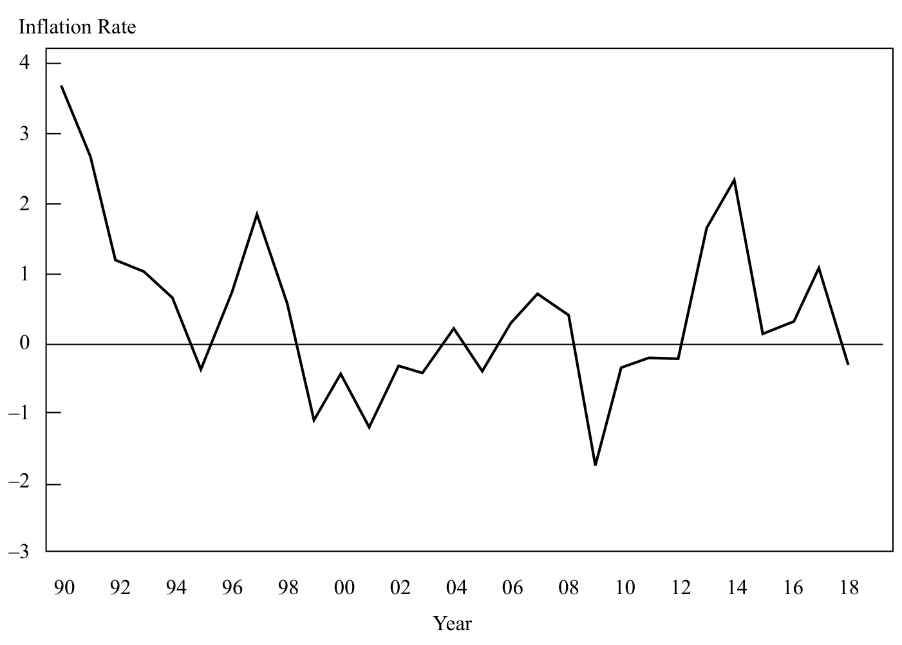

来源：StatBureau，“日本年度及月度通胀表”，www.statbureau.org/en/japan/inflation-tables。

Source: “Japan Annual and Monthly Inflation Tables,” StatBureau, www.statbureau.org/en/japan/ inflation-tables.

#### 补充解析 / Supplementary explanation

本题复核锚点（原解摘录）：从 20 世纪 50 年代到 80 年代，日本经济的实际增长速度超过其他所有七国集团（G–7）经济体。

Review anchor for this item (official excerpt): Between the 1950s and 1980s, Japan’s economy achieved faster real growth than any other G–7 economy.

补充思路：当短期政策利率接近有效下限时，传统降息空间受限。央行可以通过购买长期资产、前瞻指引等影响期限溢价、信用条件和预期。但新增基础货币不必按固定倍数转化为贷款或消费；银行资产负债表、借款需求和信心都影响传导。区分工具的实施方向与最终经济效果，避免把“扩表”直接等同于立即通胀。

Additional reasoning: Near the effective lower bound, conventional rate cuts have limited room. Asset purchases and forward guidance can affect term premiums, credit conditions, and expectations. Additional monetary base does not mechanically become lending or spending; bank balance sheets, demand, and confidence shape transmission. Distinguish the policy action from its ultimate inflation effect.

接近零利率时，进一步降低名义政策利率的空间受限；通缩仍可能抬高实际利率。资产购买试图通过期限溢价、资产价格和信用条件继续刺激需求。

Near zero, there is limited room to cut nominal policy rates further, while deflation can still raise real rates. Asset purchases seek additional stimulus through term premia, asset prices, and credit conditions.

#### 相关知识点 / Related concepts

非常规政策与零利率约束：量化宽松通常扩大央行资产负债表；流动性陷阱削弱利率和货币数量向实际需求的传导。

Unconventional policy and the lower bound: Quantitative easing usually expands the central-bank balance sheet. A liquidity trap weakens transmission from rates and monetary quantities to real demand.

原教材为连贯讲解型案例，没有独立设问及答案分栏；保留官方案例与演示，未另造题目。

### ECON-LM04-QUESTION_SET-801 · 习题组 · 第 1 题 Question set · 1

正文习题组 / Question set · 原版 PDF 页码 / Source PDF pages: 139

#### 题目与资料 / Question and data

练习题

QUESTION SET

1\. 如果一个经济体的 GDP 趋势增长率为 3%，其中央银行的通胀目标为 2%，那么哪一政策利率最符合扩张性货币政策？

1\. If an economy’s trend GDP growth rate is 3 percent and its central bank has a 2 percent inflation target, which policy rate is most consistent with an expansionary monetary policy?

A. 4%

A. 4 percent

B. 5%

B. 5 percent

C. 6%

C. 6 percent

#### 官方答案与解析 / Official answer and explanation

解答：

Solution:

A 正确。中性利率在本例中为 5%，被认为是既不刺激、也不抑制经济基本运行的利率。因此，当政策利率高于中性利率时，货币政策具有紧缩性；低于中性利率时，货币政策具有扩张性。中性利率包括两个组成部分：经济的实际趋势增长率（本例为 3%）和长期预期通胀率（本例为 2%）。

A is correct. The neutral rate of interest, which in this example is 5 percent, is considered to be that rate of interest that neither spurs on nor slows down the underlying economy. As such, when policy rates are above the neutral rate, monetary policy is contractionary; when they are below the neutral rate, monetary policy is expansionary. It has two components: the real trend rate of growth of the underlying economy (in this example, 3 percent) and long-run expected inflation (in this example, 2 percent).

#### 补充解析 / Supplementary explanation

本题复核锚点（原解摘录）：A 正确。中性利率在本例中为 5%，被认为是既不刺激、也不抑制经济基本运行的利率。

Review anchor for this item (official excerpt): A is correct. The neutral rate of interest, which in this example is 5 percent, is considered to be that rate of interest that neither spurs on nor slows down the underlying economy.

本题官方选项为 A。补充思路：按传导链理解政策：政策工具改变短期利率与流动性，再影响贷款、资产价格、汇率、消费和投资，最后作用于产出与通胀。央行通常承担货币发行、银行体系流动性支持及支付体系相关职责，但不负责直接制定政府税收。宽松或紧缩的判断应看政策方向相对经济状态，而非只看某个利率的绝对高低。

The official choice for this item is A. Additional reasoning: Follow the chain from policy instruments to short-term rates and liquidity, then credit, asset prices, exchange rates, spending, output, and inflation. Central banks commonly issue currency and support banking and payment-system liquidity; they do not directly set government taxes. Judge stance relative to conditions rather than the absolute level of one rate.

#### 相关知识点 / Related concepts

货币政策传导与央行职能：费雪关系区分名义与实际利率；货币传导具有滞后，且供给冲击与需求冲击的政策权衡不同。

Monetary transmission and central-bank functions: The Fisher relationship separates nominal and real rates. Transmission takes time, and supply shocks pose different tradeoffs from demand shocks.

### ECON-LM04-QUESTION_SET-802 · 习题组 · 第 2 题 Question set · 2

正文习题组 / Question set · 原版 PDF 页码 / Source PDF pages: 139

#### 题目与资料 / Question and data

练习题

QUESTION SET

2\. 提高中央银行的政策利率，预期可能通过以下哪种方式减轻通胀压力？

2\. An increase in a central bank’s policy rate might be expected to reduce inflationary pressures by:

A. 减少消费者需求。

A. reducing consumer demand.

B. 降低本币的外汇价值。

B. reducing the foreign exchange value of the currency.

C. 推高资产价格，进而增加个人部门的财富。

C. driving up asset prices leading to an increase in personal sector wealth.

#### 官方答案与解析 / Official answer and explanation

A 正确。如果中央银行提高政策利率的影响经由货币市场成功传递至金融部门的其他部分，那么随着抵押贷款及其他信贷利率上升，消费者需求可能下降。在其他条件不变时，这种消费者需求下降应产生多种影响，其中包括减轻消费价格的上涨压力。

A is correct. If an increase in the central bank’s policy rate is successfully transmitted through the money markets to other parts of the financial sector, consumer demand might decline as the rate of interest on mortgages and other credit rises. This decline in consumer demand should, all other things being equal and among other affects, lead to a reduction in upward pressure on consumer prices.

#### 补充解析 / Supplementary explanation

本题复核锚点（原解摘录）：A 正确。如果中央银行提高政策利率的影响经由货币市场成功传递至金融部门的其他部分，那么随着抵押贷款及其他信贷利率上升，消费者需求可能下降。

Review anchor for this item (official excerpt): A is correct. If an increase in the central bank’s policy rate is successfully transmitted through the money markets to other parts of the financial sector, consumer demand might decline as the rate of interest on mortgages and other credit rises.

本题官方选项为 A。补充思路：按传导链理解政策：政策工具改变短期利率与流动性，再影响贷款、资产价格、汇率、消费和投资，最后作用于产出与通胀。央行通常承担货币发行、银行体系流动性支持及支付体系相关职责，但不负责直接制定政府税收。宽松或紧缩的判断应看政策方向相对经济状态，而非只看某个利率的绝对高低。

The official choice for this item is A. Additional reasoning: Follow the chain from policy instruments to short-term rates and liquidity, then credit, asset prices, exchange rates, spending, output, and inflation. Central banks commonly issue currency and support banking and payment-system liquidity; they do not directly set government taxes. Judge stance relative to conditions rather than the absolute level of one rate.

#### 相关知识点 / Related concepts

货币政策传导与央行职能：费雪关系区分名义与实际利率；货币传导具有滞后，且供给冲击与需求冲击的政策权衡不同。

Monetary transmission and central-bank functions: The Fisher relationship separates nominal and real rates. Transmission takes time, and supply shocks pose different tradeoffs from demand shocks.

### ECON-LM04-QUESTION_SET-803 · 习题组 · 第 3 题 Question set · 3

正文习题组 / Question set · 原版 PDF 页码 / Source PDF pages: 139

#### 题目与资料 / Question and data

练习题

QUESTION SET

3\. 以下哪一项表述最能说明货币政策的一项根本局限？货币政策受到限制，是因为中央银行决策者：

3\. Which of the following statements best describes a fundamental limitation of monetary policy? Monetary policy is limited because central bankers:

A. 无法完美控制通胀率。

A. cannot control the inflation rate perfectly.

B. 由政界人士任命，因此从未真正独立。

B. are appointed by politicians and are therefore never truly independent.

C. 无法控制经济主体存入银行的资金数量，也无法控制银行放贷的意愿。

C. cannot control the amount of money that economic agents put in banks, nor the willingness of banks to make loans.

#### 官方答案与解析 / Official answer and explanation

C 正确。中央银行决策者无法控制个人和银行那些会影响货币创造过程的决策。

C is correct. Central bankers do not control the decisions of individuals and banks that can influence the money creation process.

#### 补充解析 / Supplementary explanation

本题复核锚点（原解摘录）：C 正确。中央银行决策者无法控制个人和银行那些会影响货币创造过程的决策。

Review anchor for this item (official excerpt): C is correct. Central bankers do not control the decisions of individuals and banks that can influence the money creation process.

本题官方选项为 C。补充思路：按传导链理解政策：政策工具改变短期利率与流动性，再影响贷款、资产价格、汇率、消费和投资，最后作用于产出与通胀。央行通常承担货币发行、银行体系流动性支持及支付体系相关职责，但不负责直接制定政府税收。宽松或紧缩的判断应看政策方向相对经济状态，而非只看某个利率的绝对高低。

The official choice for this item is C. Additional reasoning: Follow the chain from policy instruments to short-term rates and liquidity, then credit, asset prices, exchange rates, spending, output, and inflation. Central banks commonly issue currency and support banking and payment-system liquidity; they do not directly set government taxes. Judge stance relative to conditions rather than the absolute level of one rate.

#### 相关知识点 / Related concepts

货币政策传导与央行职能：费雪关系区分名义与实际利率；货币传导具有滞后，且供给冲击与需求冲击的政策权衡不同。

Monetary transmission and central-bank functions: The Fisher relationship separates nominal and real rates. Transmission takes time, and supply shocks pose different tradeoffs from demand shocks.

### ECON-LM04-QUESTION_SET-804 · 习题组 · 第 4 题 Question set · 4

正文习题组 / Question set · 原版 PDF 页码 / Source PDF pages: 139-140

#### 题目与资料 / Question and data

练习题

QUESTION SET

4\. 理论上，将政策利率设为等于中性利率，应当促进：

4\. In theory, setting the policy rate equal to the neutral interest rate should promote:

A. 通胀稳定。

A. stable inflation.

B. 预算平衡。

B. balanced budgets.

C. 就业增加。

C. greater employment.

#### 官方答案与解析 / Official answer and explanation

解答：

Solution:

A 正确。中性利率是既不刺激、也不抑制经济基本运行的利率。中性利率应与长期通胀稳定相一致。

A is correct. The neutral rate of interest is that rate of interest that neither stimulates nor slows down the underlying economy. The neutral rate should be consistent with stable long-run inflation.

#### 补充解析 / Supplementary explanation

本题复核锚点（原解摘录）：A 正确。中性利率是既不刺激、也不抑制经济基本运行的利率。

Review anchor for this item (official excerpt): A is correct. The neutral rate of interest is that rate of interest that neither stimulates nor slows down the underlying economy.

本题官方选项为 A。补充思路：按传导链理解政策：政策工具改变短期利率与流动性，再影响贷款、资产价格、汇率、消费和投资，最后作用于产出与通胀。央行通常承担货币发行、银行体系流动性支持及支付体系相关职责，但不负责直接制定政府税收。宽松或紧缩的判断应看政策方向相对经济状态，而非只看某个利率的绝对高低。

The official choice for this item is A. Additional reasoning: Follow the chain from policy instruments to short-term rates and liquidity, then credit, asset prices, exchange rates, spending, output, and inflation. Central banks commonly issue currency and support banking and payment-system liquidity; they do not directly set government taxes. Judge stance relative to conditions rather than the absolute level of one rate.

#### 相关知识点 / Related concepts

货币政策传导与央行职能：费雪关系区分名义与实际利率；货币传导具有滞后，且供给冲击与需求冲击的政策权衡不同。

Monetary transmission and central-bank functions: The Fisher relationship separates nominal and real rates. Transmission takes time, and supply shocks pose different tradeoffs from demand shocks.

### ECON-LM04-QUESTION_SET-901 · 习题组 · 第 1 题 Question set · 1

正文习题组 / Question set · 原版 PDF 页码 / Source PDF pages: 143

#### 题目与资料 / Question and data

练习题

QUESTION SET

1\. 在李嘉图等价成立的世界中，政府最有可能偏好使用货币政策而非财政政策，因为在李嘉图等价下：

1\. In a world in which Ricardian equivalence holds, governments would most likely prefer to use monetary rather than fiscal policy because under Ricardian equivalence:

A. 实际利率对实体经济的影响更强。

A. real interest rates have a more powerful effect on the real economy.

B. 人们对货币政策传导机制的理解更充分。

B. the transmission mechanism of monetary policy is better understood.

C. 财政政策变化的未来影响已被经济主体充分计入当前决策。

C. the future impact of fiscal policy changes are fully discounted by economic agents.

#### 官方答案与解析 / Official answer and explanation

解答：

Solution:

C 正确。如果李嘉图等价成立，经济主体便会预期，任何当前减税的结果都是未来增税，因此会提前增加储蓄，致使减税对消费和投资决策几乎没有影响。在假设货币中性短期内不成立的情况下，政府将被迫使用货币政策来影响实体经济。

C is correct. If Ricardian equivalence holds, then economic agents anticipate that the consequence of any current tax cut will be future tax rises, which leads them to increase their saving in anticipation of this so that the tax cut has little effect on consumption and investment decisions. Governments would be forced to use monetary policy to affect the real economy on the assumption that money neutrality did not hold in the short term.

#### 补充解析 / Supplementary explanation

本题复核锚点（原解摘录）：C 正确。如果李嘉图等价成立，经济主体便会预期，任何当前减税的结果都是未来增税，因此会提前增加储蓄，致使减税对消费和投资决策几乎没有影响。

Review anchor for this item (official excerpt): C is correct. If Ricardian equivalence holds, then economic agents anticipate that the consequence of any current tax cut will be future tax rises, which leads them to increase their saving in anticipation of this so that the tax cut has little effect on consumption and investment decisions.

本题官方选项为 C。补充思路：比较政策影响时，先判断支出是否直接进入总需求。政府购买直接增加需求；转移支付或减税先改变可支配收入，再由受益人的边际消费倾向决定支出增加多少。货币政策通过融资条件和资产价格影响支出，两类政策可能相互强化或抵消。题中引用研究的大小关系应在其给定背景下理解。

The official choice for this item is C. Additional reasoning: Ask first whether the action directly enters aggregate demand. Government purchases do so; transfers and tax cuts change disposable income, with the spending effect depending on marginal propensity to consume. Monetary policy affects financing and asset prices. The two policies can reinforce or offset each other, and the cited study’s ranking is contextual.

#### 相关知识点 / Related concepts

财政与货币政策的组合：总需求＝消费＋投资＋政府购买＋净出口；转移支付本身不等于政府购买，储蓄会造成需求泄漏。

Fiscal–monetary policy combinations: Aggregate demand = consumption + investment + government purchases + net exports. Transfers are not government purchases, and saving is a leakage.

### ECON-LM04-QUESTION_SET-902 · 习题组 · 第 2 题 Question set · 2

正文习题组 / Question set · 原版 PDF 页码 / Source PDF pages: 143

#### 题目与资料 / Question and data

练习题

QUESTION SET

2\. 如果财政政策宽松，而货币政策紧缩，则：

2\. If fiscal policy is easy and monetary policy tight, then:

A. 利率往往会下降，从而强化财政政策立场。

A. interest rates would tend to fall, reinforcing the fiscal policy stance.

B. 政府部门占总

B. the government sector would tend to shrink as a proportion of total

GDP 的比重往往会缩小。

GDP.

C. 政府部门占总

C. the government sector would tend to expand as a proportion of total

GDP 的比重往往会扩大。

GDP.

#### 官方答案与解析 / Official answer and explanation

C 正确。在紧缩货币政策下，实际利率应会上升，抑制私人部门活动；通过财政政策放松而扩大政府活动，可以至少部分抵消这一影响。不过，净结果是公共部门相对于私人部门的规模扩大。

C is correct. With a tight monetary policy, real interest rates should rise and reduce private sector activity, which could be at least partially offset by an expansion in government activity via the loosening of fiscal policy. The net effect, however, would be an expansion in the size of the public sector relative to the private sector.

#### 补充解析 / Supplementary explanation

本题复核锚点（原解摘录）：C 正确。在紧缩货币政策下，实际利率应会上升，抑制私人部门活动；通过财政政策放松而扩大政府活动，可以至少部分抵消这一影响。

Review anchor for this item (official excerpt): C is correct. With a tight monetary policy, real interest rates should rise and reduce private sector activity, which could be at least partially offset by an expansion in government activity via the loosening of fiscal policy.

本题官方选项为 C。补充思路：比较政策影响时，先判断支出是否直接进入总需求。政府购买直接增加需求；转移支付或减税先改变可支配收入，再由受益人的边际消费倾向决定支出增加多少。货币政策通过融资条件和资产价格影响支出，两类政策可能相互强化或抵消。题中引用研究的大小关系应在其给定背景下理解。

The official choice for this item is C. Additional reasoning: Ask first whether the action directly enters aggregate demand. Government purchases do so; transfers and tax cuts change disposable income, with the spending effect depending on marginal propensity to consume. Monetary policy affects financing and asset prices. The two policies can reinforce or offset each other, and the cited study’s ranking is contextual.

#### 相关知识点 / Related concepts

财政与货币政策的组合：总需求＝消费＋投资＋政府购买＋净出口；转移支付本身不等于政府购买，储蓄会造成需求泄漏。

Fiscal–monetary policy combinations: Aggregate demand = consumption + investment + government purchases + net exports. Transfers are not government purchases, and saving is a leakage.

### ECON-LM04-QUESTION_SET-903 · 习题组 · 第 3 题 Question set · 3

正文习题组 / Question set · 原版 PDF 页码 / Source PDF pages: 143

#### 题目与资料 / Question and data

练习题

QUESTION SET

3\. 根据 IMF 的一项研究，以下哪一项对总需求的影响最大？实施相当于 GDP 的 1% 的刺激措施，用于：

3\. Which of the following has the greatest impact on aggregate demand according to an IMF study? 1 percent of GDP stimulus in:

A. 政府支出

A. government spending

B. 增加转移福利

B. rise in transfer benefits

C. 对所有收入水平群体降低劳动所得税

C. cut in labor income tax across all income levels

#### 官方答案与解析 / Official answer and explanation

A 正确。研究明确表明，政府直接支出对 GDP 的影响，大于税收或福利的调整。

A is correct. The study clearly showed that direct spending by the government leads to a larger impact on GDP than changes in taxes or benefits.

#### 补充解析 / Supplementary explanation

本题复核锚点（原解摘录）：A 正确。研究明确表明，政府直接支出对 GDP 的影响，大于税收或福利的调整。

Review anchor for this item (official excerpt): A is correct. The study clearly showed that direct spending by the government leads to a larger impact on GDP than changes in taxes or benefits.

本题官方选项为 A。补充思路：比较政策影响时，先判断支出是否直接进入总需求。政府购买直接增加需求；转移支付或减税先改变可支配收入，再由受益人的边际消费倾向决定支出增加多少。货币政策通过融资条件和资产价格影响支出，两类政策可能相互强化或抵消。题中引用研究的大小关系应在其给定背景下理解。

The official choice for this item is A. Additional reasoning: Ask first whether the action directly enters aggregate demand. Government purchases do so; transfers and tax cuts change disposable income, with the spending effect depending on marginal propensity to consume. Monetary policy affects financing and asset prices. The two policies can reinforce or offset each other, and the cited study’s ranking is contextual.

#### 相关知识点 / Related concepts

财政与货币政策的组合：总需求＝消费＋投资＋政府购买＋净出口；转移支付本身不等于政府购买，储蓄会造成需求泄漏。

Fiscal–monetary policy combinations: Aggregate demand = consumption + investment + government purchases + net exports. Transfers are not government purchases, and saving is a leakage.

### ECON-LM04-QUESTION_SET-904 · 习题组 · 第 4 题 Question set · 4

正文习题组 / Question set · 原版 PDF 页码 / Source PDF pages: 143

#### 题目与资料 / Question and data

练习题

QUESTION SET

4\. 在中央银行独立的条件下，货币政策行动相比财政政策行动，更有可能具备以下哪一特点？

4\. Given an independent central bank, monetary policy actions are more likely than fiscal policy actions to be:

A. 能够迅速实施。

A. implementable quickly.

B. 针对特定群体时有效。

B. effective when a specific group is targeted.

C. 对抗通缩经济时有效。

C. effective when combating a deflationary economy.

#### 官方答案与解析 / Official answer and explanation

A 正确。货币政策行动实施前面临的延迟可能少于财政政策，尤其是在中央银行独立的情况下。

A is correct. Monetary actions may face fewer delays to taking action than fiscal policy, especially when the central bank is independent.

#### 补充解析 / Supplementary explanation

本题复核锚点（原解摘录）：A 正确。货币政策行动实施前面临的延迟可能少于财政政策，尤其是在中央银行独立的情况下。

Review anchor for this item (official excerpt): A is correct. Monetary actions may face fewer delays to taking action than fiscal policy, especially when the central bank is independent.

本题官方选项为 A。补充思路：比较政策影响时，先判断支出是否直接进入总需求。政府购买直接增加需求；转移支付或减税先改变可支配收入，再由受益人的边际消费倾向决定支出增加多少。货币政策通过融资条件和资产价格影响支出，两类政策可能相互强化或抵消。题中引用研究的大小关系应在其给定背景下理解。

The official choice for this item is A. Additional reasoning: Ask first whether the action directly enters aggregate demand. Government purchases do so; transfers and tax cuts change disposable income, with the spending effect depending on marginal propensity to consume. Monetary policy affects financing and asset prices. The two policies can reinforce or offset each other, and the cited study’s ranking is contextual.

接近零利率时，进一步降低名义政策利率的空间受限；通缩仍可能抬高实际利率。资产购买试图通过期限溢价、资产价格和信用条件继续刺激需求。

Near zero, there is limited room to cut nominal policy rates further, while deflation can still raise real rates. Asset purchases seek additional stimulus through term premia, asset prices, and credit conditions.

#### 相关知识点 / Related concepts

财政与货币政策的组合：总需求＝消费＋投资＋政府购买＋净出口；转移支付本身不等于政府购买，储蓄会造成需求泄漏。

Fiscal–monetary policy combinations: Aggregate demand = consumption + investment + government purchases + net exports. Transfers are not government purchases, and saving is a leakage.

### ECON-LM04-QUESTION_SET-905 · 习题组 · 第 5 题 Question set · 5

正文习题组 / Question set · 原版 PDF 页码 / Source PDF pages: 143-144

#### 题目与资料 / Question and data

练习题

QUESTION SET

5\. 哪一种政策组合最有可能有效促进公共部门和私人部门同时增长？

5\. Which policy alternative is most likely to be effective for growing both the public and private sectors?

A. 宽松财政政策／宽松货币政策

A. Easy fiscal/easy monetary policy

B. 宽松财政政策／紧缩货币政策

B. Easy fiscal/tight monetary policy

C. 紧缩财政政策／紧缩货币政策

C. Tight fiscal/tight monetary policy

#### 官方答案与解析 / Official answer and explanation

解答：

Solution:

A 正确。如果财政政策和货币政策都“宽松”，二者的共同影响将具有很强的扩张性，导致总需求增加、利率维持低位，并使私人部门和公共部门都增长。

A is correct. If both fiscal and monetary policies are “easy,” then the joint impact will be highly expansionary, leading to a rise in aggregate demand, low interest rates, and growing private and public sectors.

#### 补充解析 / Supplementary explanation

本题复核锚点（原解摘录）：A 正确。如果财政政策和货币政策都“宽松”，二者的共同影响将具有很强的扩张性，导致总需求增加、利率维持低位，并使私人部门和公共部门都增长。

Review anchor for this item (official excerpt): A is correct. If both fiscal and monetary policies are “easy,” then the joint impact will be highly expansionary, leading to a rise in aggregate demand, low interest rates, and growing private and public sectors.

本题官方选项为 A。补充思路：比较政策影响时，先判断支出是否直接进入总需求。政府购买直接增加需求；转移支付或减税先改变可支配收入，再由受益人的边际消费倾向决定支出增加多少。货币政策通过融资条件和资产价格影响支出，两类政策可能相互强化或抵消。题中引用研究的大小关系应在其给定背景下理解。

The official choice for this item is A. Additional reasoning: Ask first whether the action directly enters aggregate demand. Government purchases do so; transfers and tax cuts change disposable income, with the spending effect depending on marginal propensity to consume. Monetary policy affects financing and asset prices. The two policies can reinforce or offset each other, and the cited study’s ranking is contextual.

#### 相关知识点 / Related concepts

财政与货币政策的组合：总需求＝消费＋投资＋政府购买＋净出口；转移支付本身不等于政府购买，储蓄会造成需求泄漏。

Fiscal–monetary policy combinations: Aggregate demand = consumption + investment + government purchases + net exports. Transfers are not government purchases, and saving is a leakage.

### ECON-LM04-PRACTICE-001 · 章末习题 1 Practice problem 1

章末练习 / Practice problem · 原版 PDF 页码 / Source PDF pages: 146, 148

#### 题目与资料 / Question and data

1\. 中央银行宣布降低官方政策利率时，所期望的影响是以下哪一项增加？

1\. When a central bank announces a decrease in its official policy rate, the desired impact is an increase in:

A. 投资。

A. investment.

B. 同业拆借利率。

B. interbank borrowing rates.

C. 本币相对于其他货币的价值。

C. the national currency’s value in exchange for other currencies.

#### 官方答案与解析 / Official answer and explanation

1\. A 正确。预期投资与官方政策利率呈反向变动。

1\. A is correct. Investment is expected to move inversely with the official policy rate.

#### 补充解析 / Supplementary explanation

本题复核锚点（原解摘录）：1. A 正确。预期投资与官方政策利率呈反向变动。

Review anchor for this item (official excerpt): 1.

本题官方选项为 A。补充思路：按传导链理解政策：政策工具改变短期利率与流动性，再影响贷款、资产价格、汇率、消费和投资，最后作用于产出与通胀。央行通常承担货币发行、银行体系流动性支持及支付体系相关职责，但不负责直接制定政府税收。宽松或紧缩的判断应看政策方向相对经济状态，而非只看某个利率的绝对高低。

The official choice for this item is A. Additional reasoning: Follow the chain from policy instruments to short-term rates and liquidity, then credit, asset prices, exchange rates, spending, output, and inflation. Central banks commonly issue currency and support banking and payment-system liquidity; they do not directly set government taxes. Judge stance relative to conditions rather than the absolute level of one rate.

#### 相关知识点 / Related concepts

货币政策传导与央行职能：费雪关系区分名义与实际利率；货币传导具有滞后，且供给冲击与需求冲击的政策权衡不同。

Monetary transmission and central-bank functions: The Fisher relationship separates nominal and real rates. Transmission takes time, and supply shocks pose different tradeoffs from demand shocks.

### ECON-LM04-PRACTICE-002 · 章末习题 2 Practice problem 2

章末练习 / Practice problem · 原版 PDF 页码 / Source PDF pages: 146, 148

#### 题目与资料 / Question and data

2\. 如果中央银行希望鼓励企业和家庭为投资及消费而借款，最不可能采取哪项行动？

2\. Which action is a central bank least likely to take if it wants to encourage businesses and households to borrow for investment and consumption purposes?

A. 出售长期政府证券

A. Sell long-dated government securities

B. 购买长期政府债券

B. Purchase long-dated government treasuries

C. 购买抵押贷款债券或其他证券

C. Purchase mortgage bonds or other securities

#### 官方答案与解析 / Official answer and explanation

2\. A 正确。在其他条件不变时，这种行动往往会收缩货币供给，并提高利率。

2\. A is correct. Such action would tend to constrict the money supply and increase interest rates, all else being equal.

#### 补充解析 / Supplementary explanation

本题复核锚点（原解摘录）：2. A 正确。在其他条件不变时，这种行动往往会收缩货币供给，并提高利率。

Review anchor for this item (official excerpt): 2.

本题官方选项为 A。补充思路：按传导链理解政策：政策工具改变短期利率与流动性，再影响贷款、资产价格、汇率、消费和投资，最后作用于产出与通胀。央行通常承担货币发行、银行体系流动性支持及支付体系相关职责，但不负责直接制定政府税收。宽松或紧缩的判断应看政策方向相对经济状态，而非只看某个利率的绝对高低。

The official choice for this item is A. Additional reasoning: Follow the chain from policy instruments to short-term rates and liquidity, then credit, asset prices, exchange rates, spending, output, and inflation. Central banks commonly issue currency and support banking and payment-system liquidity; they do not directly set government taxes. Judge stance relative to conditions rather than the absolute level of one rate.

本题要求选择“不成立、最不可能或例外”的项目。先判断各陈述在题设下是否成立，再按这一反向要求选出答案；正确选项可能本身描述的就是错误或不适用情形。

This item asks for a least-likely, inaccurate, or exception case. Evaluate each statement under the assumptions, then apply that reversed selection rule; the credited choice may itself describe the false or inapplicable case.

#### 相关知识点 / Related concepts

货币政策传导与央行职能：费雪关系区分名义与实际利率；货币传导具有滞后，且供给冲击与需求冲击的政策权衡不同。

Monetary transmission and central-bank functions: The Fisher relationship separates nominal and real rates. Transmission takes time, and supply shocks pose different tradeoffs from demand shocks.

### ECON-LM04-PRACTICE-003 · 章末习题 3 Practice problem 3

章末练习 / Practice problem · 原版 PDF 页码 / Source PDF pages: 146, 148

#### 题目与资料 / Question and data

3\. 中央银行反复在公开市场购买政府债券：

3\. A central bank’s repeated open market purchases of government bonds:

A. 会减少货币供给。

A. decreases the money supply.

B. 在大多数国家被禁止。

B. is prohibited in most countries.

C. 与扩张性货币政策一致。

C. is consistent with an expansionary monetary policy.

#### 官方答案与解析 / Official answer and explanation

3\. C 正确。通过公开市场操作购买政府债券，会增加银行准备金和货币供给，符合扩张性货币政策。

3\. C is correct. The purchase of government bonds through open market operations increases banking reserves and the money supply; it is consistent with an expansionary monetary policy.

#### 补充解析 / Supplementary explanation

本题复核锚点（原解摘录）：3. C 正确。通过公开市场操作购买政府债券，会增加银行准备金和货币供给，符合扩张性货币政策。

Review anchor for this item (official excerpt): 3.

本题官方选项为 C。补充思路：按传导链理解政策：政策工具改变短期利率与流动性，再影响贷款、资产价格、汇率、消费和投资，最后作用于产出与通胀。央行通常承担货币发行、银行体系流动性支持及支付体系相关职责，但不负责直接制定政府税收。宽松或紧缩的判断应看政策方向相对经济状态，而非只看某个利率的绝对高低。

The official choice for this item is C. Additional reasoning: Follow the chain from policy instruments to short-term rates and liquidity, then credit, asset prices, exchange rates, spending, output, and inflation. Central banks commonly issue currency and support banking and payment-system liquidity; they do not directly set government taxes. Judge stance relative to conditions rather than the absolute level of one rate.

公开市场购买向银行体系注入准备金；出售则抽走准备金。交易对象是证券，宏观传导关键在于金融体系的流动性和融资条件变化。

Open-market purchases inject reserves and sales drain them. Although securities are traded, the macroeconomic channel is the resulting change in liquidity and financing conditions.

#### 相关知识点 / Related concepts

货币政策传导与央行职能：费雪关系区分名义与实际利率；货币传导具有滞后，且供给冲击与需求冲击的政策权衡不同。

Monetary transmission and central-bank functions: The Fisher relationship separates nominal and real rates. Transmission takes time, and supply shocks pose different tradeoffs from demand shocks.

### ECON-LM04-PRACTICE-004 · 章末习题 4 Practice problem 4

章末练习 / Practice problem · 原版 PDF 页码 / Source PDF pages: 146, 148

#### 题目与资料 / Question and data

4\. 官方利率长期维持在非常接近零的水平，而经济增长却未加快，这最有可能表明：

4\. A prolonged period of an official interest rate very close to zero without an increase in economic growth most likely suggests:

A. 量化宽松必须限制规模才能成功。

A. quantitative easing must be limited to be successful.

B. 货币政策的有效性可能有限。

B. the effectiveness of monetary policy may be limited.

C. 以准备金水平为目标比以利率为目标更重要。

C. targeting reserve levels is more important than targeting interest rates.

#### 官方答案与解析 / Official answer and explanation

4\. B 正确。中央银行降低官方利率，是为了刺激经济。如果官方利率降至零（甚至略低于零），却没有刺激经济增长，就说明货币政策存在局限。

4\. B is correct. A central bank would decrease an official interest rate to stimulate the economy. The setting in which an official interest rate is lowered to zero (or even slightly below zero) without stimulating economic growth suggests that there are limits to monetary policy.

#### 补充解析 / Supplementary explanation

本题复核锚点（原解摘录）：4. B 正确。中央银行降低官方利率，是为了刺激经济。

Review anchor for this item (official excerpt): 4.

本题官方选项为 B。补充思路：当短期政策利率接近有效下限时，传统降息空间受限。央行可以通过购买长期资产、前瞻指引等影响期限溢价、信用条件和预期。但新增基础货币不必按固定倍数转化为贷款或消费；银行资产负债表、借款需求和信心都影响传导。区分工具的实施方向与最终经济效果，避免把“扩表”直接等同于立即通胀。

The official choice for this item is B. Additional reasoning: Near the effective lower bound, conventional rate cuts have limited room. Asset purchases and forward guidance can affect term premiums, credit conditions, and expectations. Additional monetary base does not mechanically become lending or spending; bank balance sheets, demand, and confidence shape transmission. Distinguish the policy action from its ultimate inflation effect.

接近零利率时，进一步降低名义政策利率的空间受限；通缩仍可能抬高实际利率。资产购买试图通过期限溢价、资产价格和信用条件继续刺激需求。

Near zero, there is limited room to cut nominal policy rates further, while deflation can still raise real rates. Asset purchases seek additional stimulus through term premia, asset prices, and credit conditions.

#### 相关知识点 / Related concepts

非常规政策与零利率约束：量化宽松通常扩大央行资产负债表；流动性陷阱削弱利率和货币数量向实际需求的传导。

Unconventional policy and the lower bound: Quantitative easing usually expands the central-bank balance sheet. A liquidity trap weakens transmission from rates and monetary quantities to real demand.

### ECON-LM04-PRACTICE-005 · 章末习题 5 Practice problem 5

章末练习 / Practice problem · 原版 PDF 页码 / Source PDF pages: 146, 148

#### 题目与资料 / Question and data

5\. 提高准备金要求最有可能属于哪一种货币政策？

5\. Raising the reserve requirement is most likely an example of which type of monetary policy?

A. 中性

A. Neutral

B. 扩张性

B. Expansionary

C. 紧缩性

C. Contractionary

#### 官方答案与解析 / Official answer and explanation

5\. C 正确。提高准备金要求应会减缓货币供给增长。

5\. C is correct. Raising reserve requirements should slow money supply growth.

#### 补充解析 / Supplementary explanation

本题复核锚点（原解摘录）：5. C 正确。提高准备金要求应会减缓货币供给增长。

Review anchor for this item (official excerpt): 5.

本题官方选项为 C。补充思路：按传导链理解政策：政策工具改变短期利率与流动性，再影响贷款、资产价格、汇率、消费和投资，最后作用于产出与通胀。央行通常承担货币发行、银行体系流动性支持及支付体系相关职责，但不负责直接制定政府税收。宽松或紧缩的判断应看政策方向相对经济状态，而非只看某个利率的绝对高低。

The official choice for this item is C. Additional reasoning: Follow the chain from policy instruments to short-term rates and liquidity, then credit, asset prices, exchange rates, spending, output, and inflation. Central banks commonly issue currency and support banking and payment-system liquidity; they do not directly set government taxes. Judge stance relative to conditions rather than the absolute level of one rate.

提高准备金要求会减少银行可用于贷款的资金并收紧信用条件；降低要求的方向相反。需要判断的是政策方向，而非仅看央行是否进行了操作。

A higher reserve requirement reduces funds available for lending and tightens credit conditions; lowering it works in the opposite direction. Classify the direction of the action.

#### 相关知识点 / Related concepts

货币政策传导与央行职能：费雪关系区分名义与实际利率；货币传导具有滞后，且供给冲击与需求冲击的政策权衡不同。

Monetary transmission and central-bank functions: The Fisher relationship separates nominal and real rates. Transmission takes time, and supply shocks pose different tradeoffs from demand shocks.

### ECON-LM04-PRACTICE-006 · 章末习题 6 Practice problem 6

章末练习 / Practice problem · 原版 PDF 页码 / Source PDF pages: 146, 148

#### 题目与资料 / Question and data

6\. 以下哪一项限制了中央银行在通缩时期刺激增长的能力？

6\. Which of the following is a limitation on the ability of central banks to stimulate growth in periods of deflation?

A. 李嘉图等价

A. Ricardian equivalence

B. 货币政策与财政政策的相互作用

B. Interaction of monetary and fiscal policy

C. 利率无法降至显著低于零的水平

C. Interest rates cannot fall significantly below zero

#### 官方答案与解析 / Official answer and explanation

6\. C 正确。通缩给传统货币政策带来挑战，因为一旦中央银行为刺激经济而将名义利率降至零（或略低于零），就无法再进一步降息。

6\. C is correct. Deflation poses a challenge to conventional monetary policy because once the central bank has cut nominal interest rates to zero (or slightly less than zero) to stimulate the economy, they cannot cut them further.

#### 补充解析 / Supplementary explanation

本题复核锚点（原解摘录）：6. C 正确。通缩给传统货币政策带来挑战，因为一旦中央银行为刺激经济而将名义利率降至零（或略低于零），就无法再进一步降息。

Review anchor for this item (official excerpt): 6.

本题官方选项为 C。补充思路：当短期政策利率接近有效下限时，传统降息空间受限。央行可以通过购买长期资产、前瞻指引等影响期限溢价、信用条件和预期。但新增基础货币不必按固定倍数转化为贷款或消费；银行资产负债表、借款需求和信心都影响传导。区分工具的实施方向与最终经济效果，避免把“扩表”直接等同于立即通胀。

The official choice for this item is C. Additional reasoning: Near the effective lower bound, conventional rate cuts have limited room. Asset purchases and forward guidance can affect term premiums, credit conditions, and expectations. Additional monetary base does not mechanically become lending or spending; bank balance sheets, demand, and confidence shape transmission. Distinguish the policy action from its ultimate inflation effect.

接近零利率时，进一步降低名义政策利率的空间受限；通缩仍可能抬高实际利率。资产购买试图通过期限溢价、资产价格和信用条件继续刺激需求。

Near zero, there is limited room to cut nominal policy rates further, while deflation can still raise real rates. Asset purchases seek additional stimulus through term premia, asset prices, and credit conditions.

#### 相关知识点 / Related concepts

非常规政策与零利率约束：量化宽松通常扩大央行资产负债表；流动性陷阱削弱利率和货币数量向实际需求的传导。

Unconventional policy and the lower bound: Quantitative easing usually expands the central-bank balance sheet. A liquidity trap weakens transmission from rates and monetary quantities to real demand.

### ECON-LM04-PRACTICE-007 · 章末习题 7 Practice problem 7

章末练习 / Practice problem · 原版 PDF 页码 / Source PDF pages: 146-148

#### 题目与资料 / Question and data

7\. 以下哪一项最不可能限制货币政策的有效性？中央银行无法：

7\. The least likely limitation to the effectiveness of monetary policy is that central banks cannot:

A. 准确确定中性利率。

A. accurately determine the neutral rate of interest.

B. 调控金融机构放贷的意愿。

B. regulate the willingness of financial institutions to lend.

C. 控制经济主体存入银行的金额。

C. control amounts that economic agents deposit into banks.

#### 官方答案与解析 / Official answer and explanation

7\. A 正确。无法精确确定中性利率，并不一定会限制货币政策的力量。

7\. A is correct. The inability to determine exactly the neutral rate of interest does not necessarily limit the power of monetary policy.

#### 补充解析 / Supplementary explanation

本题复核锚点（原解摘录）：7. A 正确。无法精确确定中性利率，并不一定会限制货币政策的力量。

Review anchor for this item (official excerpt): 7.

本题官方选项为 A。补充思路：按传导链理解政策：政策工具改变短期利率与流动性，再影响贷款、资产价格、汇率、消费和投资，最后作用于产出与通胀。央行通常承担货币发行、银行体系流动性支持及支付体系相关职责，但不负责直接制定政府税收。宽松或紧缩的判断应看政策方向相对经济状态，而非只看某个利率的绝对高低。

The official choice for this item is A. Additional reasoning: Follow the chain from policy instruments to short-term rates and liquidity, then credit, asset prices, exchange rates, spending, output, and inflation. Central banks commonly issue currency and support banking and payment-system liquidity; they do not directly set government taxes. Judge stance relative to conditions rather than the absolute level of one rate.

本题要求选择“不成立、最不可能或例外”的项目。先判断各陈述在题设下是否成立，再按这一反向要求选出答案；正确选项可能本身描述的就是错误或不适用情形。

This item asks for a least-likely, inaccurate, or exception case. Evaluate each statement under the assumptions, then apply that reversed selection rule; the credited choice may itself describe the false or inapplicable case.

#### 相关知识点 / Related concepts

货币政策传导与央行职能：费雪关系区分名义与实际利率；货币传导具有滞后，且供给冲击与需求冲击的政策权衡不同。

Monetary transmission and central-bank functions: The Fisher relationship separates nominal and real rates. Transmission takes time, and supply shocks pose different tradeoffs from demand shocks.

### ECON-LM04-PRACTICE-008 · 章末习题 8 Practice problem 8

章末练习 / Practice problem · 原版 PDF 页码 / Source PDF pages: 147-148

#### 题目与资料 / Question and data

8\. 量化宽松，即中央银行向个人或机构购买政府或私人证券，属于哪一种货币政策立场？

8\. Quantitative easing, the purchase of government or private securities by the central banks from individuals or institutions, is an example of which monetary policy stance?

A. 中性

A. Neutral

B. 扩张性

B. Expansionary

C. 紧缩性

C. Contractionary

#### 官方答案与解析 / Official answer and explanation

8\. B 正确。量化宽松属于扩张性货币政策立场。它试图通过大幅增加货币供给来刺激总需求。

8\. B is correct. Quantitative easing is an example of an expansionary monetary policy stance. It attempts to spur aggregate demand by drastically increasing the money supply.

#### 补充解析 / Supplementary explanation

本题复核锚点（原解摘录）：8. B 正确。量化宽松属于扩张性货币政策立场。

Review anchor for this item (official excerpt): 8.

本题官方选项为 B。补充思路：当短期政策利率接近有效下限时，传统降息空间受限。央行可以通过购买长期资产、前瞻指引等影响期限溢价、信用条件和预期。但新增基础货币不必按固定倍数转化为贷款或消费；银行资产负债表、借款需求和信心都影响传导。区分工具的实施方向与最终经济效果，避免把“扩表”直接等同于立即通胀。

The official choice for this item is B. Additional reasoning: Near the effective lower bound, conventional rate cuts have limited room. Asset purchases and forward guidance can affect term premiums, credit conditions, and expectations. Additional monetary base does not mechanically become lending or spending; bank balance sheets, demand, and confidence shape transmission. Distinguish the policy action from its ultimate inflation effect.

接近零利率时，进一步降低名义政策利率的空间受限；通缩仍可能抬高实际利率。资产购买试图通过期限溢价、资产价格和信用条件继续刺激需求。

Near zero, there is limited room to cut nominal policy rates further, while deflation can still raise real rates. Asset purchases seek additional stimulus through term premia, asset prices, and credit conditions.

#### 相关知识点 / Related concepts

非常规政策与零利率约束：量化宽松通常扩大央行资产负债表；流动性陷阱削弱利率和货币数量向实际需求的传导。

Unconventional policy and the lower bound: Quantitative easing usually expands the central-bank balance sheet. A liquidity trap weakens transmission from rates and monetary quantities to real demand.

## LM 5 · 地缘政治导论 Introduction to Geopolitics 38 条目 · 原题与解析逐条对应 / Paired source questions and explanations

### ECON-LM05-EXAMPLE-101 · 例题 1 · 第 1 题：影响合作的因素 Example 1 · 1 — Factors Affecting Cooperation

正文例题／案例 / Worked example / case · 原版 PDF 页码 / Source PDF pages: 154-155

#### 题目与资料 / Question and data

例 1

EXAMPLE 1

影响合作的因素

Factors Affecting Cooperation

1\. 判断正误：地理因素不会影响一国选择合作方式的程度。请说明理由。

1\. True or false: Geographic factors do not influence the extent to which a country will choose a cooperative approach. Explain your reasoning.

A. 正确

A. True

B. 错误

B. False

#### 官方答案与解析 / Official answer and explanation

解答：

Solution:

B 正确。地理因素对于塑造一国维护国家安全的方式，以及其选择合作方式的程度，发挥重要作用。一个由于地理特点而难以获取资源的国家，为实现繁荣需要获得资源，因此可能更倾向于合作；而国内资源丰富的国家，则可能将其资源作为影响国际关系的手段。直接通海的国家，在贸易和运输方面，以及在获取海洋提供的自然资源方面，具有优势。

B is correct. Geographic factors play an important role in shaping a country’s approach to national security and the extent to which it will choose a cooperative approach. A country with limited access to resources because of its geographic characteristics might be more inclined to cooperate as it needs access to resources to thrive, whereas a country rich in internal resources might use its resources as leverage to influence international dynamics. Countries with direct access to the sea have an advantage related to trade and transport as well as the natural resources provided by the ocean.

#### 补充解析 / Supplementary explanation

本题复核锚点（原解摘录）：B 正确。地理因素对于塑造一国维护国家安全的方式，以及其选择合作方式的程度，发挥重要作用。

Review anchor for this item (official excerpt): B is correct. Geographic factors play an important role in shaping a country’s approach to national security and the extent to which it will choose a cooperative approach.

本题官方选项为 B。补充思路：国际合作主要刻画国家之间愿不愿意协调政策，全球化则更强调贸易、资本和生产活动的跨境联系。两者相关但不能混为一谈：经济高度一体化不保证所有政治议题上合作。分类时先分别判断跨境开放程度和合作倾向，再匹配自给自足、双边主义、多边主义或霸权等框架，并注意国家资源禀赋和战略利益。

The official choice for this item is B. Additional reasoning: Cooperation describes willingness to coordinate policy, while globalization concerns cross-border trade, capital, and production links. They are related but distinct: economic integration does not guarantee political cooperation. Classify each dimension separately before applying archetypes such as autarky, bilateralism, multilateralism, or hegemony, considering endowments and strategic interests.

#### 相关知识点 / Related concepts

全球化与合作的两个维度：国家行为者与非国家行为者不同；国际机构可降低协调成本，但合作仍取决于成员利益。

Globalization and cooperation as two dimensions: Distinguish state and non-state actors. International institutions can reduce coordination costs, but cooperation still depends on members’ interests.

### ECON-LM05-EXAMPLE-201 · 例题 2 · 第 1 题：影响合作的因素 Example 2 · 1 — Factors Affecting Cooperation

正文例题／案例 / Worked example / case · 原版 PDF 页码 / Source PDF pages: 155

#### 题目与资料 / Question and data

例 2

EXAMPLE 2

影响合作的因素

Factors Affecting Cooperation

1\. 填空：合作型国家可能关注的两个因素包括\_\_\_\_和\_\_\_。

1\. Fill in the blank: Two factors on which a cooperative country is likely focused include\_\_\_\_ and\_\_\_.

#### 官方答案与解析 / Official answer and explanation

解答：

Solution:

合作型国家可能关注的两个因素包括贸易和标准化。

Two factors on which a cooperative country is likely focused include trade and standardization.

#### 补充解析 / Supplementary explanation

本题复核锚点（原解摘录）：合作型国家可能关注的两个因素包括贸易和标准化。

Review anchor for this item (official excerpt): Two factors on which a cooperative country is likely focused include trade and standardization.

补充思路：国际合作主要刻画国家之间愿不愿意协调政策，全球化则更强调贸易、资本和生产活动的跨境联系。两者相关但不能混为一谈：经济高度一体化不保证所有政治议题上合作。分类时先分别判断跨境开放程度和合作倾向，再匹配自给自足、双边主义、多边主义或霸权等框架，并注意国家资源禀赋和战略利益。

Additional reasoning: Cooperation describes willingness to coordinate policy, while globalization concerns cross-border trade, capital, and production links. They are related but distinct: economic integration does not guarantee political cooperation. Classify each dimension separately before applying archetypes such as autarky, bilateralism, multilateralism, or hegemony, considering endowments and strategic interests.

#### 相关知识点 / Related concepts

全球化与合作的两个维度：国家行为者与非国家行为者不同；国际机构可降低协调成本，但合作仍取决于成员利益。

Globalization and cooperation as two dimensions: Distinguish state and non-state actors. International institutions can reduce coordination costs, but cooperation still depends on members’ interests.

### ECON-LM05-EXAMPLE-301 · 例题 3 · 第 1 题：国家的政治周期 Example 3 · 1 — Country’s Political Cycle

正文例题／案例 / Worked example / case · 原版 PDF 页码 / Source PDF pages: 158

#### 题目与资料 / Question and data

例 3

EXAMPLE 3

国家的政治周期

Country’s Political Cycle

1\. 判断正误：一国政治周期的长短不会影响其优先事项的确定。

1\. True or false: The length of a country’s political cycle does not affect its priority designation.

请说明理由。

Explain your reasoning.

A. 正确

A. True

B. 错误

B. False

#### 官方答案与解析 / Official answer and explanation

解答：

Solution:

B 正确。一国政治周期的长短对优先事项的确定有重要影响，因为任期周期较短的政府缺乏动力关注长期优先事项，即使这些事项有益于社会。例如，澳大利亚的议会任期短于平均水平，这可能影响政府的优先事项。

B is correct. The length of a country’s political cycle has an important impact on priority designation as governments with shorter cycles have little incentive to focus on longer-term priorities, even if those priorities would be beneficial for society. Australia, for example, has shorter than average parliamentary terms, which could potentially affect governmental priorities.

#### 补充解析 / Supplementary explanation

本题复核锚点（原解摘录）：B 正确。一国政治周期的长短对优先事项的确定有重要影响，因为任期周期较短的政府缺乏动力关注长期优先事项，即使这些事项有益于社会。

Review anchor for this item (official excerpt): B is correct. The length of a country’s political cycle has an important impact on priority designation as governments with shorter cycles have little incentive to focus on longer-term priorities, even if those priorities would be beneficial for society.

本题官方选项为 B。补充思路：国家优先级由安全、资源、制度和政治周期共同塑造。工具可以是安全、经济或金融手段，同一种工具既可能用于合作，也可能用于施压。判断影响应沿着实际渠道追踪：制裁影响融资或交易，贸易限制影响成本与销量，安全安排影响风险溢价。不能只按工具名称机械认定风险一定上升或下降。

The official choice for this item is B. Additional reasoning: Security, resources, institutions, and political cycles shape national priorities. Security, economic, and financial instruments can support either cooperation or coercion. Trace the actual channel: sanctions affect financing or transactions, trade restrictions affect costs and sales, and security arrangements affect risk premiums. The instrument’s name alone does not establish the direction of risk.

#### 相关知识点 / Related concepts

国家利益与政策工具：资源禀赋影响依赖关系；软实力通过吸引力和规则影响行为；政治周期影响承诺期限。

National interests and policy instruments: Endowments shape dependencies, soft power works through attraction and rules, and political cycles influence the horizon of commitments.

### ECON-LM05-QUESTION_SET-401 · 习题组 · 第 1 题 Question set · 1

正文习题组 / Question set · 原版 PDF 页码 / Source PDF pages: 159

#### 题目与资料 / Question and data

练习题

QUESTION SET

1\. 以下哪一项在一国利益层级中可能位于最低层？

1\. Which of these is likely lowest on a country’s hierarchy of interests?

A. 关税协调

A. Tariff harmonization

B. 军事决心

B. Military determination

C. 文化项目发展

C. Cultural program development

#### 官方答案与解析 / Official answer and explanation

解答：

Solution:

C 正确。文化项目发展在一国利益层级中可能位于最低层。军事决心（B）通常是国家安全的重要基础，也是国家利益的关键。关税协调（A）可能促进经济活动并改善合作。文化项目虽然重要且有影响力，但与 A 和 B 相比，其优先级可能较低。

C is correct. Cultural program development is likely lowest on a country’s hierarchy of interests. Military determination (B) is often a primary source of national security and key to a country’s national interest. Tariff harmonization (A) may improve economic activity and improve cooperation. Cultural programs are important and influential but likely lower priority compared with A and B.

#### 补充解析 / Supplementary explanation

本题复核锚点（原解摘录）：C 正确。文化项目发展在一国利益层级中可能位于最低层。

Review anchor for this item (official excerpt): C is correct. Cultural program development is likely lowest on a country’s hierarchy of interests.

本题官方选项为 C。补充思路：国家优先级由安全、资源、制度和政治周期共同塑造。工具可以是安全、经济或金融手段，同一种工具既可能用于合作，也可能用于施压。判断影响应沿着实际渠道追踪：制裁影响融资或交易，贸易限制影响成本与销量，安全安排影响风险溢价。不能只按工具名称机械认定风险一定上升或下降。

The official choice for this item is C. Additional reasoning: Security, resources, institutions, and political cycles shape national priorities. Security, economic, and financial instruments can support either cooperation or coercion. Trace the actual channel: sanctions affect financing or transactions, trade restrictions affect costs and sales, and security arrangements affect risk premiums. The instrument’s name alone does not establish the direction of risk.

#### 相关知识点 / Related concepts

国家利益与政策工具：资源禀赋影响依赖关系；软实力通过吸引力和规则影响行为；政治周期影响承诺期限。

National interests and policy instruments: Endowments shape dependencies, soft power works through attraction and rules, and political cycles influence the horizon of commitments.

### ECON-LM05-QUESTION_SET-402 · 习题组 · 第 2 题 Question set · 2

正文习题组 / Question set · 原版 PDF 页码 / Source PDF pages: 159

#### 题目与资料 / Question and data

练习题

QUESTION SET

2\. 一国的以下哪项行动最有可能属于地缘政治合作？

2\. Which of the following actions by a country is most likely a form of geopolitical cooperation?

A. 充当贸易通道

A. Acting as a conduit for trade

B. 参与规则标准化

B. Engaging in rules standardization

C. 选择使用软实力而非军事报复

C. Opting to use soft power over military retaliation

#### 官方答案与解析 / Official answer and explanation

B 正确。政治合作涉及各国为共同目标而努力，就规则和标准化达成协议的各种事项。合作型国家会参与规则标准化，并作出互惠安排。A 不正确，因为像巴拿马那样充当贸易通道，涉及以不合作方式利用本国地理位置，在更广泛的国际关系中施加影响力。C 不正确，因为软实力和军事报复都属于不合作行为；前者是在不使用武力或胁迫的情况下，影响另一国决策的一种较温和方式。

B is correct. Political cooperation is associated with anything related to agreements of rules and standardization, with countries working together toward some shared goal. A cooperative country is one that engages and reciprocates in rules standardization. A is incorrect because acting as a conduit of trade, like Panama, involves non-cooperatively using a country’s geographic location as a lever of power in broader international dynamics. C is incorrect because both soft power and military retaliation are examples of non-cooperative behavior, with the former being a less extreme means to influence another country’s decisions without force or coercion.

#### 补充解析 / Supplementary explanation

本题复核锚点（原解摘录）：B 正确。政治合作涉及各国为共同目标而努力，就规则和标准化达成协议的各种事项。

Review anchor for this item (official excerpt): B is correct. Political cooperation is associated with anything related to agreements of rules and standardization, with countries working together toward some shared goal.

本题官方选项为 B。补充思路：国际合作主要刻画国家之间愿不愿意协调政策，全球化则更强调贸易、资本和生产活动的跨境联系。两者相关但不能混为一谈：经济高度一体化不保证所有政治议题上合作。分类时先分别判断跨境开放程度和合作倾向，再匹配自给自足、双边主义、多边主义或霸权等框架，并注意国家资源禀赋和战略利益。

The official choice for this item is B. Additional reasoning: Cooperation describes willingness to coordinate policy, while globalization concerns cross-border trade, capital, and production links. They are related but distinct: economic integration does not guarantee political cooperation. Classify each dimension separately before applying archetypes such as autarky, bilateralism, multilateralism, or hegemony, considering endowments and strategic interests.

#### 相关知识点 / Related concepts

全球化与合作的两个维度：国家行为者与非国家行为者不同；国际机构可降低协调成本，但合作仍取决于成员利益。

Globalization and cooperation as two dimensions: Distinguish state and non-state actors. International institutions can reduce coordination costs, but cooperation still depends on members’ interests.

### ECON-LM05-QUESTION_SET-403 · 习题组 · 第 3 题 Question set · 3

正文习题组 / Question set · 原版 PDF 页码 / Source PDF pages: 159-160

#### 题目与资料 / Question and data

练习题

QUESTION SET

3\. 以下哪项表述体现了地缘政治风险的一个方面？

3\. Which of the following statements represents an aspect of geopolitical risk?

A. 地缘政治风险建模相对容易标准化。

A. Modeling geopolitical risk is relatively easy to standardize.

B. 一个积极参与的国家，即使不作出互惠回应，也可以被视为合作型国家。

B. An engaged country can be considered cooperative, even if it does not reciprocate.

C. 一国制度的健全程度与其合作关系的持久性有关。

C. The strength of a country’s institutions is relevant to the durability of its cooperative relationships.

#### 官方答案与解析 / Official answer and explanation

解答：

Solution:

C 正确。一国制度越健全，合作关系就可能越持久。A 不正确，因为地缘政治风险建模不容易标准化。B 不正确，因为合作型国家既积极参与，也作出互惠回应。

C is correct. The strength of a country’s institutions can make cooperative relationships more durable. A is incorrect because modeling geopolitical risk is not easily standardized. B is incorrect because a cooperative country is one that is both engaged and reciprocates.

#### 补充解析 / Supplementary explanation

本题复核锚点（原解摘录）：C 正确。一国制度越健全，合作关系就可能越持久。

Review anchor for this item (official excerpt): C is correct. The strength of a country’s institutions can make cooperative relationships more durable.

本题官方选项为 C。补充思路：国际合作主要刻画国家之间愿不愿意协调政策，全球化则更强调贸易、资本和生产活动的跨境联系。两者相关但不能混为一谈：经济高度一体化不保证所有政治议题上合作。分类时先分别判断跨境开放程度和合作倾向，再匹配自给自足、双边主义、多边主义或霸权等框架，并注意国家资源禀赋和战略利益。

The official choice for this item is C. Additional reasoning: Cooperation describes willingness to coordinate policy, while globalization concerns cross-border trade, capital, and production links. They are related but distinct: economic integration does not guarantee political cooperation. Classify each dimension separately before applying archetypes such as autarky, bilateralism, multilateralism, or hegemony, considering endowments and strategic interests.

#### 相关知识点 / Related concepts

全球化与合作的两个维度：国家行为者与非国家行为者不同；国际机构可降低协调成本，但合作仍取决于成员利益。

Globalization and cooperation as two dimensions: Distinguish state and non-state actors. International institutions can reduce coordination costs, but cooperation still depends on members’ interests.

### ECON-LM05-EXAMPLE-501 · 例题 4 · 第 1 题：全球化的特征 Example 4 · 1 — Features of Globalization

正文例题／案例 / Worked example / case · 原版 PDF 页码 / Source PDF pages: 163

#### 题目与资料 / Question and data

例 4

EXAMPLE 4

全球化的特征

Features of Globalization

1\. 用以下词语填空：政府；私人部门；国家层级；次国家层级。

1\. Fill in the blanks using the following words: government; private sector; national; subnational.

虽然政治合作与不合作可以由\_\_\_\_行为体推动，但作为经济和金融合作结果的全球化，主要由公司、个人或组织等\_\_\_\_\_\_\_\_\_行为体开展。自发形成的\_\_\_\_\_\_\_\_\_力量，即使没有\_\_\_\_\_\_\_\_\_支持，也能推动产品或思想交流。填空题

Although political cooperation and non-cooperation can be driven by \_\_\_\_ actors, globalization as the result of economic and financial cooperation is carried out mostly by\_\_\_\_\_\_\_\_\_ actors, such as corporations, individuals, or organizations. Organic \_\_\_\_\_\_\_\_\_ forces can drive the exchange of products or ideas even without \_\_\_\_\_\_\_\_\_ support.fill-in-the-blank

#### 官方答案与解析 / Official answer and explanation

解答：

Solution:

虽然政治合作与不合作可以由国家层级行为体推动，但作为经济和金融合作结果的全球化，主要由公司、个人或组织等次国家层级行为体开展。即使没有政府支持，自发形成的私人部门力量也能推动产品或思想交流。

Although political cooperation and non-cooperation can be driven by national actors, globalization as the result of economic and financial cooperation is carried out mostly by subnational actors, such as corporations, individuals, or organizations. Organic private sector forces can drive the exchange of products or ideas even without government support.

#### 补充解析 / Supplementary explanation

本题复核锚点（原解摘录）：虽然政治合作与不合作可以由国家层级行为体推动，但作为经济和金融合作结果的全球化，主要由公司、个人或组织等次国家层级行为体开展。

Review anchor for this item (official excerpt): Although political cooperation and non-cooperation can be driven by national actors, globalization as the result of economic and financial cooperation is carried out mostly by subnational actors, such as corporations, individuals, or organizations.

补充思路：国际合作主要刻画国家之间愿不愿意协调政策，全球化则更强调贸易、资本和生产活动的跨境联系。两者相关但不能混为一谈：经济高度一体化不保证所有政治议题上合作。分类时先分别判断跨境开放程度和合作倾向，再匹配自给自足、双边主义、多边主义或霸权等框架，并注意国家资源禀赋和战略利益。

Additional reasoning: Cooperation describes willingness to coordinate policy, while globalization concerns cross-border trade, capital, and production links. They are related but distinct: economic integration does not guarantee political cooperation. Classify each dimension separately before applying archetypes such as autarky, bilateralism, multilateralism, or hegemony, considering endowments and strategic interests.

#### 相关知识点 / Related concepts

全球化与合作的两个维度：国家行为者与非国家行为者不同；国际机构可降低协调成本，但合作仍取决于成员利益。

Globalization and cooperation as two dimensions: Distinguish state and non-state actors. International institutions can reduce coordination costs, but cooperation still depends on members’ interests.

### ECON-LM05-EXAMPLE-601 · 例题 5 · 第 1 题：全球化的特征 Example 5 · 1 — Features of Globalization

正文例题／案例 / Worked example / case · 原版 PDF 页码 / Source PDF pages: 163

#### 题目与资料 / Question and data

例 5

EXAMPLE 5

全球化的特征

Features of Globalization

1\. 判断正误：全球化主要由政府行为体开展。

1\. True or False: Globalization is primarily carried out by governmental actors.

请说明理由。

Explain your reasoning.

A. 正确

A. True

B. 错误

B. False

#### 官方答案与解析 / Official answer and explanation

解答：

Solution:

B 正确。全球化主要由公司、个人或组织等非政府行为体开展，是经济和金融合作的结果。例如，跨国公司希望获得竞争优势，因此寻求新市场、人才和学习机会，以及贸易、资本、货币、文化和信息交流。企业将人才业务外包，就是全球化的一个例子。

B is correct. Globalization is primarily carried out by non-governmental actors, such as corporations, individuals, or organizations, and is the result of economic and financial cooperation. Multinational corporations, for example, want a competitive advantage leading them to seek new markets, talent, and learning as well as trade, capital, currency, and cultural and information exchange. Corporate outsourcing of talent is an example of globalization.

#### 补充解析 / Supplementary explanation

本题复核锚点（原解摘录）：B 正确。全球化主要由公司、个人或组织等非政府行为体开展，是经济和金融合作的结果。

Review anchor for this item (official excerpt): B is correct. Globalization is primarily carried out by non-governmental actors, such as corporations, individuals, or organizations, and is the result of economic and financial cooperation.

本题官方选项为 B。补充思路：国际合作主要刻画国家之间愿不愿意协调政策，全球化则更强调贸易、资本和生产活动的跨境联系。两者相关但不能混为一谈：经济高度一体化不保证所有政治议题上合作。分类时先分别判断跨境开放程度和合作倾向，再匹配自给自足、双边主义、多边主义或霸权等框架，并注意国家资源禀赋和战略利益。

The official choice for this item is B. Additional reasoning: Cooperation describes willingness to coordinate policy, while globalization concerns cross-border trade, capital, and production links. They are related but distinct: economic integration does not guarantee political cooperation. Classify each dimension separately before applying archetypes such as autarky, bilateralism, multilateralism, or hegemony, considering endowments and strategic interests.

#### 相关知识点 / Related concepts

全球化与合作的两个维度：国家行为者与非国家行为者不同；国际机构可降低协调成本，但合作仍取决于成员利益。

Globalization and cooperation as two dimensions: Distinguish state and non-state actors. International institutions can reduce coordination costs, but cooperation still depends on members’ interests.

### ECON-LM05-QUESTION_SET-701 · 习题组 · 第 1 题 Question set · 1

正文习题组 / Question set · 原版 PDF 页码 / Source PDF pages: 167

#### 题目与资料 / Question and data

练习题

QUESTION SET

1\. 以下哪项行动最会增加地缘政治风险？

1\. Which of these actions would do the most to increase geopolitical risk?

A. 增加资本流动

A. Increase capital flows

B. 限制外币兑换

B. Restrict foreign currency exchange

C. 开展商品和服务贸易

C. Engage in trade of goods and services

#### 官方答案与解析 / Official answer and explanation

解答：

Solution:

B 正确。限制外币兑换是反全球化的一项特征，可能减少政治和经济合作，从而提高地缘政治风险。A 不正确，因为资本流动增加会降低地缘政治风险。C 不正确，因为贸易增加会降低地缘政治风险。

B is correct. Restricted foreign currency exchange—a characteristic of antiglobalization—would likely reduce political and economic cooperation and thus increase geopolitical risk. A is incorrect because an increase in capital flows would reduce geopolitical risk. C is incorrect because an increase in trade would reduce geopolitical risk.

#### 补充解析 / Supplementary explanation

本题复核锚点（原解摘录）：B 正确。限制外币兑换是反全球化的一项特征，可能减少政治和经济合作，从而提高地缘政治风险。

Review anchor for this item (official excerpt): B is correct. Restricted foreign currency exchange—a characteristic of antiglobalization—would likely reduce political and economic cooperation and thus increase geopolitical risk.

本题官方选项为 B。补充思路：国际合作主要刻画国家之间愿不愿意协调政策，全球化则更强调贸易、资本和生产活动的跨境联系。两者相关但不能混为一谈：经济高度一体化不保证所有政治议题上合作。分类时先分别判断跨境开放程度和合作倾向，再匹配自给自足、双边主义、多边主义或霸权等框架，并注意国家资源禀赋和战略利益。

The official choice for this item is B. Additional reasoning: Cooperation describes willingness to coordinate policy, while globalization concerns cross-border trade, capital, and production links. They are related but distinct: economic integration does not guarantee political cooperation. Classify each dimension separately before applying archetypes such as autarky, bilateralism, multilateralism, or hegemony, considering endowments and strategic interests.

#### 相关知识点 / Related concepts

全球化与合作的两个维度：国家行为者与非国家行为者不同；国际机构可降低协调成本，但合作仍取决于成员利益。

Globalization and cooperation as two dimensions: Distinguish state and non-state actors. International institutions can reduce coordination costs, but cooperation still depends on members’ interests.

### ECON-LM05-QUESTION_SET-801 · 习题组 · 第 1 题 Question set · 1

正文习题组 / Question set · 原版 PDF 页码 / Source PDF pages: 172-173

#### 题目与资料 / Question and data

练习题

QUESTION SET

2010 年 5 月 10 日，希腊政府正式申请国际货币基金组织提供的紧急贷款工具，并向 IMF 总裁发送了以下信函：

On 10 May 2010, the Greek government officially applied for emergency lending facilities extended by the International Monetary Fund. It sent the following letter to the IMF’s Managing Director:

备用安排申请

Request for Stand-By Arrangement

本文件依据截至 2010 年 5 月 10 日星期一完成时可获得的信息编制。文件所表达的观点属于工作人员团队，并不一定反映希腊政府或 IMF 执行董事会的观点。IMF 关于公布工作人员报告和其他文件的政策，允许删除市场敏感信息。

This paper was prepared based on the information available at the time it was completed on Monday, May 10, 2010. The views expressed in this document are those of the staff team and do not necessarily reflect the views of the government of Greece or the Executive Board of the IMF. The policy of publication of staff reports and other documents by the IMF allows for the deletion of market-sensitive information.

2010 年 5 月 3 日 国际货币基金组织总裁 华盛顿特区 随附的《经济和金融政策备忘录》（MEFP）概述了希腊政府和希腊银行将在 2010 年剩余时间及 2011—2013 年期间分别实施的经济和金融政策，旨在向更加开放、更加富有竞争力的经济转型这一艰难时期，增强市场信心，改善希腊财政和金融状况。政府完全致力于执行本文件及其附件规定的政策，未来数年制定严格预算，目标是于 2014 年将财政赤字降至 3% 以下，并使公共债务与 GDP 之比自 2013 年起进入下降轨道；维护希腊金融体系稳定；实施结构性改革，以提高竞争力及经济的生产、储蓄和出口能力。（……）政府坚定决心降低财政赤字，（……）措施包括提高税收征收额并增强公平性，以及限制政府工资总额、法定福利支出和其他支出。鉴于上述努力，并为表明对有效宏观经济政策的承诺，希腊政府请求基金组织通过为期 36 个月、金额相当于 264 亿特别提款权（SDR）的备用安排（SBA），支持这一多年计划。（特别提款权是一篮子四种主要货币：日元（JPY）、美元（USD）、英镑（GBP）和欧元（EUR）。）同时，已向欧元区各国提交总额为 800 亿欧元的金融援助申请。计划的实施将通过所附 MEFP 和《技术谅解备忘录》（TMU）所述的量化绩效标准及结构性基准进行监督。届时，由基金组织通过备用安排支持的该计划，将接受十二次季度审查，（……）第一次审查预计在 2010 年第三个日历季度完成，此后每季度一次，最后一次季度审查预计在 2013 年第二个日历季度完成，以评估计划实施进展，并就为实现目标可能需要采取的任何额外措施达成共识。（……）希腊当局认为，随附备忘录规定的政策足以实现经济计划目标，并随时准备为此采取任何进一步适当措施。当局将按照基金组织关于此类磋商的政策，与基金组织协商，（……）并在修订 MEFP 所列政策之前事先磋商。基金组织为评估计划实施而要求提供的所有信息（……）都将予以提供。

May 3, 2010 Managing Director International Monetary Fund Washington DC The attached Memorandum of Economic and Financial Policies (MEFP) outlines the economic and financial policies that the Greek government and the Bank of Greece, respectively, will implement during the remainder of 2010 and in the period 2011–2013 to strengthen market confidence and Greece’s fiscal and financial position during a difficult transition period toward a more open and competitive economy. The government is fully committed to the policies stipulated in this document and its attachments, to frame tight budgets in the coming years with the aim to reduce the fiscal deficit to below 3 percent in 2014 and achieve a downward trajectory in the public debt-GDP ratio beginning in 2013, to safeguard the stability of the Greek financial system, and to implement structural reforms to boost competitiveness and the economy’s capacity to produce, save, and export. (…) The government is strongly determined to lower the fiscal deficit, (…) by achieving higher and more equitable tax collections, and constraining spending in the government wage bill and entitlement outlays, among other items. In view of these efforts and to signal the commitment to effective macroeconomic policies, the Greek government requests that the Fund supports this multi-year program under a Stand-By Arrangement (SBA) for a period of 36 months in an amount equivalent to SDR26.4 billion. (A SDR (special drawing right) is a basket of four leading currencies: Japanese yen (JPY), US dollar (USD), British pound (GBP), and euro (EUR).) A parallel request for financial assistance to euro area countries for a total amount of EUR80 billion has been sent. The implementation of the program will be monitored through quantitative performance criteria and structural benchmarks as described in the attached MEFP and Technical Memorandum of Understanding (TMU). There will be twelve quarterly reviews of the program supported under the SBA by the Fund, (….) to begin with the first review that is expected to be completed in the course of the third calendar quarter of 2010, and then every quarter thereafter until the last quarterly review envisaged to be completed during the second calendar quarter of 2013, to assess progress in implementing the program and reach understandings on any additional measures that may be needed to achieve its objectives. (….) The Greek authorities believe that the policies set forth in the attached memorandum are adequate to achieve the objectives of the economic program, and stand ready to take any further measures that may become appropriate for this purpose. The authorities will consult with the Fund in accordance with its policies on such consultations, (….) and in advance of revisions to the policies contained in the MEFP. All information requested by the Fund (….) to assess implementation of the program will be provided.

（……）谨致问候，

(….) Sincerely,

George Papaconstantinou George Provopoulos

George Papaconstantinou George Provopoulos

财政部长 希腊银行行长

Minister of Finance Governor of the Bank of Greece

1\. IMF 紧急贷款工具的目标是什么？

1\. What is the objective of the IMF’s emergency lending facilities?

#### 官方答案与解析 / Official answer and explanation

解答：

Solution:

该计划旨在维护希腊金融体系稳定，并实施结构性改革，以提高竞争力及经济的生产、储蓄和出口能力。

The program seeks to safeguard the stability of the Greek financial system and to implement structural reforms to boost competitiveness and the economy’s capacity to produce, save, and export.

#### 补充解析 / Supplementary explanation

本题复核锚点（原解摘录）：该计划旨在维护希腊金融体系稳定，并实施结构性改革，以提高竞争力及经济的生产、储蓄和出口能力。

Review anchor for this item (official excerpt): The program seeks to safeguard the stability of the Greek financial system and to implement structural reforms to boost competitiveness and the economy’s capacity to produce, save, and export.

补充思路：将机构与其核心任务配对：IMF 关注国际货币与金融稳定和国际收支支持，世界银行侧重发展及减贫，WTO 提供国际贸易规则框架。希腊案例中的贷款金额、汇率日期和财政改革条件属于具体方案事实，不应推广成所有 IMF 贷款的统一条款。SDR 金额与美元折算额是同一额度的两种计价。

Additional reasoning: Match institutions to their mandates: the IMF concerns monetary and financial stability and balance-of-payments support, the World Bank development and poverty reduction, and the WTO trade rules. Greece’s amount, conversion date, and fiscal conditions are case-specific rather than universal IMF terms. SDR and US-dollar figures are alternative denominations of the same request.

#### 相关知识点 / Related concepts

国际机构的职责与援助条件：SDR 是特别提款权计价单位；紧急融资通常伴随政策条件。贸易规则、发展融资和宏观稳定支持是不同职能。

International institutions and assistance conditions: SDR means Special Drawing Rights. Emergency support can include policy conditions. Trade rules, development finance, and macroeconomic stabilization are distinct functions.

### ECON-LM05-QUESTION_SET-802 · 习题组 · 第 2 题 Question set · 2

正文习题组 / Question set · 原版 PDF 页码 / Source PDF pages: 172-173

#### 题目与资料 / Question and data

练习题

QUESTION SET

2010 年 5 月 10 日，希腊政府正式申请国际货币基金组织提供的紧急贷款工具，并向 IMF 总裁发送了以下信函：

On 10 May 2010, the Greek government officially applied for emergency lending facilities extended by the International Monetary Fund. It sent the following letter to the IMF’s Managing Director:

备用安排申请

Request for Stand-By Arrangement

本文件依据截至 2010 年 5 月 10 日星期一完成时可获得的信息编制。文件所表达的观点属于工作人员团队，并不一定反映希腊政府或 IMF 执行董事会的观点。IMF 关于公布工作人员报告和其他文件的政策，允许删除市场敏感信息。

This paper was prepared based on the information available at the time it was completed on Monday, May 10, 2010. The views expressed in this document are those of the staff team and do not necessarily reflect the views of the government of Greece or the Executive Board of the IMF. The policy of publication of staff reports and other documents by the IMF allows for the deletion of market-sensitive information.

2010 年 5 月 3 日 国际货币基金组织总裁 华盛顿特区 随附的《经济和金融政策备忘录》（MEFP）概述了希腊政府和希腊银行将在 2010 年剩余时间及 2011—2013 年期间分别实施的经济和金融政策，旨在向更加开放、更加富有竞争力的经济转型这一艰难时期，增强市场信心，改善希腊财政和金融状况。政府完全致力于执行本文件及其附件规定的政策，未来数年制定严格预算，目标是于 2014 年将财政赤字降至 3% 以下，并使公共债务与 GDP 之比自 2013 年起进入下降轨道；维护希腊金融体系稳定；实施结构性改革，以提高竞争力及经济的生产、储蓄和出口能力。（……）政府坚定决心降低财政赤字，（……）措施包括提高税收征收额并增强公平性，以及限制政府工资总额、法定福利支出和其他支出。鉴于上述努力，并为表明对有效宏观经济政策的承诺，希腊政府请求基金组织通过为期 36 个月、金额相当于 264 亿特别提款权（SDR）的备用安排（SBA），支持这一多年计划。（特别提款权是一篮子四种主要货币：日元（JPY）、美元（USD）、英镑（GBP）和欧元（EUR）。）同时，已向欧元区各国提交总额为 800 亿欧元的金融援助申请。计划的实施将通过所附 MEFP 和《技术谅解备忘录》（TMU）所述的量化绩效标准及结构性基准进行监督。届时，由基金组织通过备用安排支持的该计划，将接受十二次季度审查，（……）第一次审查预计在 2010 年第三个日历季度完成，此后每季度一次，最后一次季度审查预计在 2013 年第二个日历季度完成，以评估计划实施进展，并就为实现目标可能需要采取的任何额外措施达成共识。（……）希腊当局认为，随附备忘录规定的政策足以实现经济计划目标，并随时准备为此采取任何进一步适当措施。当局将按照基金组织关于此类磋商的政策，与基金组织协商，（……）并在修订 MEFP 所列政策之前事先磋商。基金组织为评估计划实施而要求提供的所有信息（……）都将予以提供。

May 3, 2010 Managing Director International Monetary Fund Washington DC The attached Memorandum of Economic and Financial Policies (MEFP) outlines the economic and financial policies that the Greek government and the Bank of Greece, respectively, will implement during the remainder of 2010 and in the period 2011–2013 to strengthen market confidence and Greece’s fiscal and financial position during a difficult transition period toward a more open and competitive economy. The government is fully committed to the policies stipulated in this document and its attachments, to frame tight budgets in the coming years with the aim to reduce the fiscal deficit to below 3 percent in 2014 and achieve a downward trajectory in the public debt-GDP ratio beginning in 2013, to safeguard the stability of the Greek financial system, and to implement structural reforms to boost competitiveness and the economy’s capacity to produce, save, and export. (…) The government is strongly determined to lower the fiscal deficit, (…) by achieving higher and more equitable tax collections, and constraining spending in the government wage bill and entitlement outlays, among other items. In view of these efforts and to signal the commitment to effective macroeconomic policies, the Greek government requests that the Fund supports this multi-year program under a Stand-By Arrangement (SBA) for a period of 36 months in an amount equivalent to SDR26.4 billion. (A SDR (special drawing right) is a basket of four leading currencies: Japanese yen (JPY), US dollar (USD), British pound (GBP), and euro (EUR).) A parallel request for financial assistance to euro area countries for a total amount of EUR80 billion has been sent. The implementation of the program will be monitored through quantitative performance criteria and structural benchmarks as described in the attached MEFP and Technical Memorandum of Understanding (TMU). There will be twelve quarterly reviews of the program supported under the SBA by the Fund, (….) to begin with the first review that is expected to be completed in the course of the third calendar quarter of 2010, and then every quarter thereafter until the last quarterly review envisaged to be completed during the second calendar quarter of 2013, to assess progress in implementing the program and reach understandings on any additional measures that may be needed to achieve its objectives. (….) The Greek authorities believe that the policies set forth in the attached memorandum are adequate to achieve the objectives of the economic program, and stand ready to take any further measures that may become appropriate for this purpose. The authorities will consult with the Fund in accordance with its policies on such consultations, (….) and in advance of revisions to the policies contained in the MEFP. All information requested by the Fund (….) to assess implementation of the program will be provided.

（……）谨致问候，

(….) Sincerely,

George Papaconstantinou George Provopoulos

George Papaconstantinou George Provopoulos

财政部长 希腊银行行长

Minister of Finance Governor of the Bank of Greece

2\. IMF 向希腊提供紧急贷款的宏观经济政策条件是什么？

2\. What are the macroeconomic policy conditions under which the IMF provides emergency lending to Greece?

#### 官方答案与解析 / Official answer and explanation

解答：

Solution:

希腊政府必须通过提高税收征收额并增强公平性，以及限制政府工资总额和法定福利支出，来减少该国财政赤字。

The Greek government has to reduce the country’s fiscal deficit by achieving higher and more equitable tax collections as well as constrain spending in the government wage bill and entitlement outlays.

#### 补充解析 / Supplementary explanation

本题复核锚点（原解摘录）：希腊政府必须通过提高税收征收额并增强公平性，以及限制政府工资总额和法定福利支出，来减少该国财政赤字。

Review anchor for this item (official excerpt): The Greek government has to reduce the country’s fiscal deficit by achieving higher and more equitable tax collections as well as constrain spending in the government wage bill and entitlement outlays.

补充思路：将机构与其核心任务配对：IMF 关注国际货币与金融稳定和国际收支支持，世界银行侧重发展及减贫，WTO 提供国际贸易规则框架。希腊案例中的贷款金额、汇率日期和财政改革条件属于具体方案事实，不应推广成所有 IMF 贷款的统一条款。SDR 金额与美元折算额是同一额度的两种计价。

Additional reasoning: Match institutions to their mandates: the IMF concerns monetary and financial stability and balance-of-payments support, the World Bank development and poverty reduction, and the WTO trade rules. Greece’s amount, conversion date, and fiscal conditions are case-specific rather than universal IMF terms. SDR and US-dollar figures are alternative denominations of the same request.

#### 相关知识点 / Related concepts

国际机构的职责与援助条件：SDR 是特别提款权计价单位；紧急融资通常伴随政策条件。贸易规则、发展融资和宏观稳定支持是不同职能。

International institutions and assistance conditions: SDR means Special Drawing Rights. Emergency support can include policy conditions. Trade rules, development finance, and macroeconomic stabilization are distinct functions.

### ECON-LM05-QUESTION_SET-803 · 习题组 · 第 3 题 Question set · 3

正文习题组 / Question set · 原版 PDF 页码 / Source PDF pages: 172-173

#### 题目与资料 / Question and data

练习题

QUESTION SET

2010 年 5 月 10 日，希腊政府正式申请国际货币基金组织提供的紧急贷款工具，并向 IMF 总裁发送了以下信函：

On 10 May 2010, the Greek government officially applied for emergency lending facilities extended by the International Monetary Fund. It sent the following letter to the IMF’s Managing Director:

备用安排申请

Request for Stand-By Arrangement

本文件依据截至 2010 年 5 月 10 日星期一完成时可获得的信息编制。文件所表达的观点属于工作人员团队，并不一定反映希腊政府或 IMF 执行董事会的观点。IMF 关于公布工作人员报告和其他文件的政策，允许删除市场敏感信息。

This paper was prepared based on the information available at the time it was completed on Monday, May 10, 2010. The views expressed in this document are those of the staff team and do not necessarily reflect the views of the government of Greece or the Executive Board of the IMF. The policy of publication of staff reports and other documents by the IMF allows for the deletion of market-sensitive information.

2010 年 5 月 3 日 国际货币基金组织总裁 华盛顿特区 随附的《经济和金融政策备忘录》（MEFP）概述了希腊政府和希腊银行将在 2010 年剩余时间及 2011—2013 年期间分别实施的经济和金融政策，旨在向更加开放、更加富有竞争力的经济转型这一艰难时期，增强市场信心，改善希腊财政和金融状况。政府完全致力于执行本文件及其附件规定的政策，未来数年制定严格预算，目标是于 2014 年将财政赤字降至 3% 以下，并使公共债务与 GDP 之比自 2013 年起进入下降轨道；维护希腊金融体系稳定；实施结构性改革，以提高竞争力及经济的生产、储蓄和出口能力。（……）政府坚定决心降低财政赤字，（……）措施包括提高税收征收额并增强公平性，以及限制政府工资总额、法定福利支出和其他支出。鉴于上述努力，并为表明对有效宏观经济政策的承诺，希腊政府请求基金组织通过为期 36 个月、金额相当于 264 亿特别提款权（SDR）的备用安排（SBA），支持这一多年计划。（特别提款权是一篮子四种主要货币：日元（JPY）、美元（USD）、英镑（GBP）和欧元（EUR）。）同时，已向欧元区各国提交总额为 800 亿欧元的金融援助申请。计划的实施将通过所附 MEFP 和《技术谅解备忘录》（TMU）所述的量化绩效标准及结构性基准进行监督。届时，由基金组织通过备用安排支持的该计划，将接受十二次季度审查，（……）第一次审查预计在 2010 年第三个日历季度完成，此后每季度一次，最后一次季度审查预计在 2013 年第二个日历季度完成，以评估计划实施进展，并就为实现目标可能需要采取的任何额外措施达成共识。（……）希腊当局认为，随附备忘录规定的政策足以实现经济计划目标，并随时准备为此采取任何进一步适当措施。当局将按照基金组织关于此类磋商的政策，与基金组织协商，（……）并在修订 MEFP 所列政策之前事先磋商。基金组织为评估计划实施而要求提供的所有信息（……）都将予以提供。

May 3, 2010 Managing Director International Monetary Fund Washington DC The attached Memorandum of Economic and Financial Policies (MEFP) outlines the economic and financial policies that the Greek government and the Bank of Greece, respectively, will implement during the remainder of 2010 and in the period 2011–2013 to strengthen market confidence and Greece’s fiscal and financial position during a difficult transition period toward a more open and competitive economy. The government is fully committed to the policies stipulated in this document and its attachments, to frame tight budgets in the coming years with the aim to reduce the fiscal deficit to below 3 percent in 2014 and achieve a downward trajectory in the public debt-GDP ratio beginning in 2013, to safeguard the stability of the Greek financial system, and to implement structural reforms to boost competitiveness and the economy’s capacity to produce, save, and export. (…) The government is strongly determined to lower the fiscal deficit, (…) by achieving higher and more equitable tax collections, and constraining spending in the government wage bill and entitlement outlays, among other items. In view of these efforts and to signal the commitment to effective macroeconomic policies, the Greek government requests that the Fund supports this multi-year program under a Stand-By Arrangement (SBA) for a period of 36 months in an amount equivalent to SDR26.4 billion. (A SDR (special drawing right) is a basket of four leading currencies: Japanese yen (JPY), US dollar (USD), British pound (GBP), and euro (EUR).) A parallel request for financial assistance to euro area countries for a total amount of EUR80 billion has been sent. The implementation of the program will be monitored through quantitative performance criteria and structural benchmarks as described in the attached MEFP and Technical Memorandum of Understanding (TMU). There will be twelve quarterly reviews of the program supported under the SBA by the Fund, (….) to begin with the first review that is expected to be completed in the course of the third calendar quarter of 2010, and then every quarter thereafter until the last quarterly review envisaged to be completed during the second calendar quarter of 2013, to assess progress in implementing the program and reach understandings on any additional measures that may be needed to achieve its objectives. (….) The Greek authorities believe that the policies set forth in the attached memorandum are adequate to achieve the objectives of the economic program, and stand ready to take any further measures that may become appropriate for this purpose. The authorities will consult with the Fund in accordance with its policies on such consultations, (….) and in advance of revisions to the policies contained in the MEFP. All information requested by the Fund (….) to assess implementation of the program will be provided.

（……）谨致问候，

(….) Sincerely,

George Papaconstantinou George Provopoulos

George Papaconstantinou George Provopoulos

财政部长 希腊银行行长

Minister of Finance Governor of the Bank of Greece

3\. 希腊向 IMF 请求多少紧急资金？

3\. What is the amount Greece requests from the IMF as emergency funds?

#### 官方答案与解析 / Official answer and explanation

解答：

Solution:

希腊申请了一项金额相当于 264 亿特别提款权的备用安排（按 2010 年 5 月 10 日汇率，约为 395 亿美元）。

Greece applied for a standby arrangement in an amount equivalent to SDR26.4 billion (approximately USD39.5 billion, based on the 10 May 2010 exchange rate).

#### 补充解析 / Supplementary explanation

本题复核锚点（原解摘录）：希腊申请了一项金额相当于 264 亿特别提款权的备用安排（按 2010 年 5 月 10 日汇率，约为 395 亿美元）。

Review anchor for this item (official excerpt): Greece applied for a standby arrangement in an amount equivalent to SDR26.4 billion (approximately USD39.5 billion, based on the 10 May 2010 exchange rate).

补充思路：将机构与其核心任务配对：IMF 关注国际货币与金融稳定和国际收支支持，世界银行侧重发展及减贫，WTO 提供国际贸易规则框架。希腊案例中的贷款金额、汇率日期和财政改革条件属于具体方案事实，不应推广成所有 IMF 贷款的统一条款。SDR 金额与美元折算额是同一额度的两种计价。

Additional reasoning: Match institutions to their mandates: the IMF concerns monetary and financial stability and balance-of-payments support, the World Bank development and poverty reduction, and the WTO trade rules. Greece’s amount, conversion date, and fiscal conditions are case-specific rather than universal IMF terms. SDR and US-dollar figures are alternative denominations of the same request.

#### 相关知识点 / Related concepts

国际机构的职责与援助条件：SDR 是特别提款权计价单位；紧急融资通常伴随政策条件。贸易规则、发展融资和宏观稳定支持是不同职能。

International institutions and assistance conditions: SDR means Special Drawing Rights. Emergency support can include policy conditions. Trade rules, development finance, and macroeconomic stabilization are distinct functions.

### ECON-LM05-QUESTION_SET-804 · 习题组 · 第 4 题 Question set · 4

正文习题组 / Question set · 原版 PDF 页码 / Source PDF pages: 172-173

#### 题目与资料 / Question and data

练习题

QUESTION SET

2010 年 5 月 10 日，希腊政府正式申请国际货币基金组织提供的紧急贷款工具，并向 IMF 总裁发送了以下信函：

On 10 May 2010, the Greek government officially applied for emergency lending facilities extended by the International Monetary Fund. It sent the following letter to the IMF’s Managing Director:

备用安排申请

Request for Stand-By Arrangement

本文件依据截至 2010 年 5 月 10 日星期一完成时可获得的信息编制。文件所表达的观点属于工作人员团队，并不一定反映希腊政府或 IMF 执行董事会的观点。IMF 关于公布工作人员报告和其他文件的政策，允许删除市场敏感信息。

This paper was prepared based on the information available at the time it was completed on Monday, May 10, 2010. The views expressed in this document are those of the staff team and do not necessarily reflect the views of the government of Greece or the Executive Board of the IMF. The policy of publication of staff reports and other documents by the IMF allows for the deletion of market-sensitive information.

2010 年 5 月 3 日 国际货币基金组织总裁 华盛顿特区 随附的《经济和金融政策备忘录》（MEFP）概述了希腊政府和希腊银行将在 2010 年剩余时间及 2011—2013 年期间分别实施的经济和金融政策，旨在向更加开放、更加富有竞争力的经济转型这一艰难时期，增强市场信心，改善希腊财政和金融状况。政府完全致力于执行本文件及其附件规定的政策，未来数年制定严格预算，目标是于 2014 年将财政赤字降至 3% 以下，并使公共债务与 GDP 之比自 2013 年起进入下降轨道；维护希腊金融体系稳定；实施结构性改革，以提高竞争力及经济的生产、储蓄和出口能力。（……）政府坚定决心降低财政赤字，（……）措施包括提高税收征收额并增强公平性，以及限制政府工资总额、法定福利支出和其他支出。鉴于上述努力，并为表明对有效宏观经济政策的承诺，希腊政府请求基金组织通过为期 36 个月、金额相当于 264 亿特别提款权（SDR）的备用安排（SBA），支持这一多年计划。（特别提款权是一篮子四种主要货币：日元（JPY）、美元（USD）、英镑（GBP）和欧元（EUR）。）同时，已向欧元区各国提交总额为 800 亿欧元的金融援助申请。计划的实施将通过所附 MEFP 和《技术谅解备忘录》（TMU）所述的量化绩效标准及结构性基准进行监督。届时，由基金组织通过备用安排支持的该计划，将接受十二次季度审查，（……）第一次审查预计在 2010 年第三个日历季度完成，此后每季度一次，最后一次季度审查预计在 2013 年第二个日历季度完成，以评估计划实施进展，并就为实现目标可能需要采取的任何额外措施达成共识。（……）希腊当局认为，随附备忘录规定的政策足以实现经济计划目标，并随时准备为此采取任何进一步适当措施。当局将按照基金组织关于此类磋商的政策，与基金组织协商，（……）并在修订 MEFP 所列政策之前事先磋商。基金组织为评估计划实施而要求提供的所有信息（……）都将予以提供。

May 3, 2010 Managing Director International Monetary Fund Washington DC The attached Memorandum of Economic and Financial Policies (MEFP) outlines the economic and financial policies that the Greek government and the Bank of Greece, respectively, will implement during the remainder of 2010 and in the period 2011–2013 to strengthen market confidence and Greece’s fiscal and financial position during a difficult transition period toward a more open and competitive economy. The government is fully committed to the policies stipulated in this document and its attachments, to frame tight budgets in the coming years with the aim to reduce the fiscal deficit to below 3 percent in 2014 and achieve a downward trajectory in the public debt-GDP ratio beginning in 2013, to safeguard the stability of the Greek financial system, and to implement structural reforms to boost competitiveness and the economy’s capacity to produce, save, and export. (…) The government is strongly determined to lower the fiscal deficit, (…) by achieving higher and more equitable tax collections, and constraining spending in the government wage bill and entitlement outlays, among other items. In view of these efforts and to signal the commitment to effective macroeconomic policies, the Greek government requests that the Fund supports this multi-year program under a Stand-By Arrangement (SBA) for a period of 36 months in an amount equivalent to SDR26.4 billion. (A SDR (special drawing right) is a basket of four leading currencies: Japanese yen (JPY), US dollar (USD), British pound (GBP), and euro (EUR).) A parallel request for financial assistance to euro area countries for a total amount of EUR80 billion has been sent. The implementation of the program will be monitored through quantitative performance criteria and structural benchmarks as described in the attached MEFP and Technical Memorandum of Understanding (TMU). There will be twelve quarterly reviews of the program supported under the SBA by the Fund, (….) to begin with the first review that is expected to be completed in the course of the third calendar quarter of 2010, and then every quarter thereafter until the last quarterly review envisaged to be completed during the second calendar quarter of 2013, to assess progress in implementing the program and reach understandings on any additional measures that may be needed to achieve its objectives. (….) The Greek authorities believe that the policies set forth in the attached memorandum are adequate to achieve the objectives of the economic program, and stand ready to take any further measures that may become appropriate for this purpose. The authorities will consult with the Fund in accordance with its policies on such consultations, (….) and in advance of revisions to the policies contained in the MEFP. All information requested by the Fund (….) to assess implementation of the program will be provided.

（……）谨致问候，

(….) Sincerely,

George Papaconstantinou George Provopoulos

George Papaconstantinou George Provopoulos

财政部长 希腊银行行长

Minister of Finance Governor of the Bank of Greece

4\. 以下哪个国际贸易组织在全球范围内规范各国之间的跨境交换？

4\. Which of the following international trade organizations regulates cross-border exchange among nations on a global scale?

A. 世界银行集团（世界银行）

A. World Bank Group (World Bank)

B. 世界贸易组织（WTO）

B. World Trade Organization (WTO)

C. 国际货币基金组织（IMF）

C. International Monetary Fund (IMF)

#### 官方答案与解析 / Official answer and explanation

解答：

Solution:

B 正确。WTO 为多国贸易体系提供法律和制度基础，是在全球范围内规范各国跨境贸易关系的唯一国际组织。WTO 的使命是通过提供全球贸易规则的主要制度和监管框架，促进自由贸易。如果没有这些全球贸易规则，就难以想象今天的全球跨国公司会存在。

B is correct. The WTO provides the legal and institutional foundation of the multinational trading system and is the only international organization that regulates cross-border trade relations among nations on a global scale. The WTO’s mission is to foster free trade by providing a major institutional and regulatory framework of global trade rules. Without such global trading rules, today’s global transnational corporations would be hard to conceive.

#### 补充解析 / Supplementary explanation

本题复核锚点（原解摘录）：B 正确。WTO 为多国贸易体系提供法律和制度基础，是在全球范围内规范各国跨境贸易关系的唯一国际组织。

Review anchor for this item (official excerpt): B is correct. The WTO provides the legal and institutional foundation of the multinational trading system and is the only international organization that regulates cross-border trade relations among nations on a global scale.

本题官方选项为 B。补充思路：将机构与其核心任务配对：IMF 关注国际货币与金融稳定和国际收支支持，世界银行侧重发展及减贫，WTO 提供国际贸易规则框架。希腊案例中的贷款金额、汇率日期和财政改革条件属于具体方案事实，不应推广成所有 IMF 贷款的统一条款。SDR 金额与美元折算额是同一额度的两种计价。

The official choice for this item is B. Additional reasoning: Match institutions to their mandates: the IMF concerns monetary and financial stability and balance-of-payments support, the World Bank development and poverty reduction, and the WTO trade rules. Greece’s amount, conversion date, and fiscal conditions are case-specific rather than universal IMF terms. SDR and US-dollar figures are alternative denominations of the same request.

#### 相关知识点 / Related concepts

国际机构的职责与援助条件：SDR 是特别提款权计价单位；紧急融资通常伴随政策条件。贸易规则、发展融资和宏观稳定支持是不同职能。

International institutions and assistance conditions: SDR means Special Drawing Rights. Emergency support can include policy conditions. Trade rules, development finance, and macroeconomic stabilization are distinct functions.

### ECON-LM05-QUESTION_SET-805 · 习题组 · 第 5 题 Question set · 5

正文习题组 / Question set · 原版 PDF 页码 / Source PDF pages: 172-174

#### 题目与资料 / Question and data

练习题

QUESTION SET

2010 年 5 月 10 日，希腊政府正式申请国际货币基金组织提供的紧急贷款工具，并向 IMF 总裁发送了以下信函：

On 10 May 2010, the Greek government officially applied for emergency lending facilities extended by the International Monetary Fund. It sent the following letter to the IMF’s Managing Director:

备用安排申请

Request for Stand-By Arrangement

本文件依据截至 2010 年 5 月 10 日星期一完成时可获得的信息编制。文件所表达的观点属于工作人员团队，并不一定反映希腊政府或 IMF 执行董事会的观点。IMF 关于公布工作人员报告和其他文件的政策，允许删除市场敏感信息。

This paper was prepared based on the information available at the time it was completed on Monday, May 10, 2010. The views expressed in this document are those of the staff team and do not necessarily reflect the views of the government of Greece or the Executive Board of the IMF. The policy of publication of staff reports and other documents by the IMF allows for the deletion of market-sensitive information.

2010 年 5 月 3 日 国际货币基金组织总裁 华盛顿特区 随附的《经济和金融政策备忘录》（MEFP）概述了希腊政府和希腊银行将在 2010 年剩余时间及 2011—2013 年期间分别实施的经济和金融政策，旨在向更加开放、更加富有竞争力的经济转型这一艰难时期，增强市场信心，改善希腊财政和金融状况。政府完全致力于执行本文件及其附件规定的政策，未来数年制定严格预算，目标是于 2014 年将财政赤字降至 3% 以下，并使公共债务与 GDP 之比自 2013 年起进入下降轨道；维护希腊金融体系稳定；实施结构性改革，以提高竞争力及经济的生产、储蓄和出口能力。（……）政府坚定决心降低财政赤字，（……）措施包括提高税收征收额并增强公平性，以及限制政府工资总额、法定福利支出和其他支出。鉴于上述努力，并为表明对有效宏观经济政策的承诺，希腊政府请求基金组织通过为期 36 个月、金额相当于 264 亿特别提款权（SDR）的备用安排（SBA），支持这一多年计划。（特别提款权是一篮子四种主要货币：日元（JPY）、美元（USD）、英镑（GBP）和欧元（EUR）。）同时，已向欧元区各国提交总额为 800 亿欧元的金融援助申请。计划的实施将通过所附 MEFP 和《技术谅解备忘录》（TMU）所述的量化绩效标准及结构性基准进行监督。届时，由基金组织通过备用安排支持的该计划，将接受十二次季度审查，（……）第一次审查预计在 2010 年第三个日历季度完成，此后每季度一次，最后一次季度审查预计在 2013 年第二个日历季度完成，以评估计划实施进展，并就为实现目标可能需要采取的任何额外措施达成共识。（……）希腊当局认为，随附备忘录规定的政策足以实现经济计划目标，并随时准备为此采取任何进一步适当措施。当局将按照基金组织关于此类磋商的政策，与基金组织协商，（……）并在修订 MEFP 所列政策之前事先磋商。基金组织为评估计划实施而要求提供的所有信息（……）都将予以提供。

May 3, 2010 Managing Director International Monetary Fund Washington DC The attached Memorandum of Economic and Financial Policies (MEFP) outlines the economic and financial policies that the Greek government and the Bank of Greece, respectively, will implement during the remainder of 2010 and in the period 2011–2013 to strengthen market confidence and Greece’s fiscal and financial position during a difficult transition period toward a more open and competitive economy. The government is fully committed to the policies stipulated in this document and its attachments, to frame tight budgets in the coming years with the aim to reduce the fiscal deficit to below 3 percent in 2014 and achieve a downward trajectory in the public debt-GDP ratio beginning in 2013, to safeguard the stability of the Greek financial system, and to implement structural reforms to boost competitiveness and the economy’s capacity to produce, save, and export. (…) The government is strongly determined to lower the fiscal deficit, (…) by achieving higher and more equitable tax collections, and constraining spending in the government wage bill and entitlement outlays, among other items. In view of these efforts and to signal the commitment to effective macroeconomic policies, the Greek government requests that the Fund supports this multi-year program under a Stand-By Arrangement (SBA) for a period of 36 months in an amount equivalent to SDR26.4 billion. (A SDR (special drawing right) is a basket of four leading currencies: Japanese yen (JPY), US dollar (USD), British pound (GBP), and euro (EUR).) A parallel request for financial assistance to euro area countries for a total amount of EUR80 billion has been sent. The implementation of the program will be monitored through quantitative performance criteria and structural benchmarks as described in the attached MEFP and Technical Memorandum of Understanding (TMU). There will be twelve quarterly reviews of the program supported under the SBA by the Fund, (….) to begin with the first review that is expected to be completed in the course of the third calendar quarter of 2010, and then every quarter thereafter until the last quarterly review envisaged to be completed during the second calendar quarter of 2013, to assess progress in implementing the program and reach understandings on any additional measures that may be needed to achieve its objectives. (….) The Greek authorities believe that the policies set forth in the attached memorandum are adequate to achieve the objectives of the economic program, and stand ready to take any further measures that may become appropriate for this purpose. The authorities will consult with the Fund in accordance with its policies on such consultations, (….) and in advance of revisions to the policies contained in the MEFP. All information requested by the Fund (….) to assess implementation of the program will be provided.

（……）谨致问候，

(….) Sincerely,

George Papaconstantinou George Provopoulos

George Papaconstantinou George Provopoulos

财政部长 希腊银行行长

Minister of Finance Governor of the Bank of Greece

5\. 以下哪个国际贸易组织的使命是帮助发展中国家消除贫困，并推动有益于环境的经济增长？

5\. Which of the following international trade organizations has a mission to help developing countries fight poverty and enhance environmentally sound economic growth?

A. 世界银行集团（世界银行）

A. World Bank Group (World Bank)

B. 世界贸易组织（WTO）

B. World Trade Organization (WTO)

C. 国际货币基金组织（IMF）

C. International Monetary Fund (IMF)

#### 官方答案与解析 / Official answer and explanation

解答：

Solution:

A 正确。世界银行的使命是帮助发展中国家消除贫困，并推动有益于环境的经济增长。世界银行帮助建设基础经济设施，而这些设施对于发展中国家建立并维持国内金融市场及运作良好的金融业至关重要。

A is correct. The World Bank’s mission is to help developing countries fight poverty and enhance environmentally sound economic growth. The World Bank helps to create the basic economic infrastructure essential for creation and maintenance of domestic financial markets and a well-functioning financial industry in developing countries.

#### 补充解析 / Supplementary explanation

本题复核锚点（原解摘录）：A 正确。世界银行的使命是帮助发展中国家消除贫困，并推动有益于环境的经济增长。

Review anchor for this item (official excerpt): A is correct. The World Bank’s mission is to help developing countries fight poverty and enhance environmentally sound economic growth.

本题官方选项为 A。补充思路：将机构与其核心任务配对：IMF 关注国际货币与金融稳定和国际收支支持，世界银行侧重发展及减贫，WTO 提供国际贸易规则框架。希腊案例中的贷款金额、汇率日期和财政改革条件属于具体方案事实，不应推广成所有 IMF 贷款的统一条款。SDR 金额与美元折算额是同一额度的两种计价。

The official choice for this item is A. Additional reasoning: Match institutions to their mandates: the IMF concerns monetary and financial stability and balance-of-payments support, the World Bank development and poverty reduction, and the WTO trade rules. Greece’s amount, conversion date, and fiscal conditions are case-specific rather than universal IMF terms. SDR and US-dollar figures are alternative denominations of the same request.

#### 相关知识点 / Related concepts

国际机构的职责与援助条件：SDR 是特别提款权计价单位；紧急融资通常伴随政策条件。贸易规则、发展融资和宏观稳定支持是不同职能。

International institutions and assistance conditions: SDR means Special Drawing Rights. Emergency support can include policy conditions. Trade rules, development finance, and macroeconomic stabilization are distinct functions.

### ECON-LM05-QUESTION_SET-806 · 习题组 · 第 6 题 Question set · 6

正文习题组 / Question set · 原版 PDF 页码 / Source PDF pages: 172-174

#### 题目与资料 / Question and data

练习题

QUESTION SET

2010 年 5 月 10 日，希腊政府正式申请国际货币基金组织提供的紧急贷款工具，并向 IMF 总裁发送了以下信函：

On 10 May 2010, the Greek government officially applied for emergency lending facilities extended by the International Monetary Fund. It sent the following letter to the IMF’s Managing Director:

备用安排申请

Request for Stand-By Arrangement

本文件依据截至 2010 年 5 月 10 日星期一完成时可获得的信息编制。文件所表达的观点属于工作人员团队，并不一定反映希腊政府或 IMF 执行董事会的观点。IMF 关于公布工作人员报告和其他文件的政策，允许删除市场敏感信息。

This paper was prepared based on the information available at the time it was completed on Monday, May 10, 2010. The views expressed in this document are those of the staff team and do not necessarily reflect the views of the government of Greece or the Executive Board of the IMF. The policy of publication of staff reports and other documents by the IMF allows for the deletion of market-sensitive information.

2010 年 5 月 3 日 国际货币基金组织总裁 华盛顿特区 随附的《经济和金融政策备忘录》（MEFP）概述了希腊政府和希腊银行将在 2010 年剩余时间及 2011—2013 年期间分别实施的经济和金融政策，旨在向更加开放、更加富有竞争力的经济转型这一艰难时期，增强市场信心，改善希腊财政和金融状况。政府完全致力于执行本文件及其附件规定的政策，未来数年制定严格预算，目标是于 2014 年将财政赤字降至 3% 以下，并使公共债务与 GDP 之比自 2013 年起进入下降轨道；维护希腊金融体系稳定；实施结构性改革，以提高竞争力及经济的生产、储蓄和出口能力。（……）政府坚定决心降低财政赤字，（……）措施包括提高税收征收额并增强公平性，以及限制政府工资总额、法定福利支出和其他支出。鉴于上述努力，并为表明对有效宏观经济政策的承诺，希腊政府请求基金组织通过为期 36 个月、金额相当于 264 亿特别提款权（SDR）的备用安排（SBA），支持这一多年计划。（特别提款权是一篮子四种主要货币：日元（JPY）、美元（USD）、英镑（GBP）和欧元（EUR）。）同时，已向欧元区各国提交总额为 800 亿欧元的金融援助申请。计划的实施将通过所附 MEFP 和《技术谅解备忘录》（TMU）所述的量化绩效标准及结构性基准进行监督。届时，由基金组织通过备用安排支持的该计划，将接受十二次季度审查，（……）第一次审查预计在 2010 年第三个日历季度完成，此后每季度一次，最后一次季度审查预计在 2013 年第二个日历季度完成，以评估计划实施进展，并就为实现目标可能需要采取的任何额外措施达成共识。（……）希腊当局认为，随附备忘录规定的政策足以实现经济计划目标，并随时准备为此采取任何进一步适当措施。当局将按照基金组织关于此类磋商的政策，与基金组织协商，（……）并在修订 MEFP 所列政策之前事先磋商。基金组织为评估计划实施而要求提供的所有信息（……）都将予以提供。

May 3, 2010 Managing Director International Monetary Fund Washington DC The attached Memorandum of Economic and Financial Policies (MEFP) outlines the economic and financial policies that the Greek government and the Bank of Greece, respectively, will implement during the remainder of 2010 and in the period 2011–2013 to strengthen market confidence and Greece’s fiscal and financial position during a difficult transition period toward a more open and competitive economy. The government is fully committed to the policies stipulated in this document and its attachments, to frame tight budgets in the coming years with the aim to reduce the fiscal deficit to below 3 percent in 2014 and achieve a downward trajectory in the public debt-GDP ratio beginning in 2013, to safeguard the stability of the Greek financial system, and to implement structural reforms to boost competitiveness and the economy’s capacity to produce, save, and export. (…) The government is strongly determined to lower the fiscal deficit, (…) by achieving higher and more equitable tax collections, and constraining spending in the government wage bill and entitlement outlays, among other items. In view of these efforts and to signal the commitment to effective macroeconomic policies, the Greek government requests that the Fund supports this multi-year program under a Stand-By Arrangement (SBA) for a period of 36 months in an amount equivalent to SDR26.4 billion. (A SDR (special drawing right) is a basket of four leading currencies: Japanese yen (JPY), US dollar (USD), British pound (GBP), and euro (EUR).) A parallel request for financial assistance to euro area countries for a total amount of EUR80 billion has been sent. The implementation of the program will be monitored through quantitative performance criteria and structural benchmarks as described in the attached MEFP and Technical Memorandum of Understanding (TMU). There will be twelve quarterly reviews of the program supported under the SBA by the Fund, (….) to begin with the first review that is expected to be completed in the course of the third calendar quarter of 2010, and then every quarter thereafter until the last quarterly review envisaged to be completed during the second calendar quarter of 2013, to assess progress in implementing the program and reach understandings on any additional measures that may be needed to achieve its objectives. (….) The Greek authorities believe that the policies set forth in the attached memorandum are adequate to achieve the objectives of the economic program, and stand ready to take any further measures that may become appropriate for this purpose. The authorities will consult with the Fund in accordance with its policies on such consultations, (….) and in advance of revisions to the policies contained in the MEFP. All information requested by the Fund (….) to assess implementation of the program will be provided.

（……）谨致问候，

(….) Sincerely,

George Papaconstantinou George Provopoulos

George Papaconstantinou George Provopoulos

财政部长 希腊银行行长

Minister of Finance Governor of the Bank of Greece

6\. 以下哪个组织通过在 2010 年希腊主权债务危机等情形下防止风险传染，帮助控制全球系统性风险？

6\. Which of the following organizations helps to keep global systemic risk under control by preventing contagion in scenarios such as the 2010 Greek sovereign debt crisis?

A. 世界银行集团（世界银行）

A. World Bank Group (World Bank)

B. 世界贸易组织（WTO）

B. World Trade Organization (WTO)

C. 国际货币基金组织（IMF）

C. International Monetary Fund (IMF)

#### 官方答案与解析 / Official answer and explanation

C 正确。从投资角度看，IMF 有助于控制各国特有的市场风险和全球系统性风险。2010 年希腊主权债务危机曾威胁整个欧洲银行体系的稳定，就是近期的一个例子。IMF 的使命是确保国际货币体系的稳定，即确保使各国能够相互购买商品和服务的汇率和国际支付体系稳定。

C is correct. From an investment perspective, the IMF helps to keep country-specific market risk and global systemic risk under control. The Greek sovereign debt crisis in 2010, which threatened to destabilize the entire European banking system, is a recent example. The IMF’s mission is to ensure the stability of the international monetary system—that is, the system of exchange rates and international payments that enables countries to buy goods and services from each other.

#### 补充解析 / Supplementary explanation

本题复核锚点（原解摘录）：C 正确。从投资角度看，IMF 有助于控制各国特有的市场风险和全球系统性风险。

Review anchor for this item (official excerpt): C is correct. From an investment perspective, the IMF helps to keep country-specific market risk and global systemic risk under control.

本题官方选项为 C。补充思路：先识别风险来源与传播渠道，再分别评估发生概率、冲击幅度和发生速度。事件风险围绕已知日期展开，主题风险缓慢累积，外生冲击较难提前安排。高速度风险更容易通过风险偏好和流动性迅速影响市场；长期主题风险可能逐渐改变盈利和资本成本。对组合而言，相关性、集中暴露与应对时间同样关键。

The official choice for this item is C. Additional reasoning: Identify the source and transmission channel, then assess probability, magnitude, and velocity separately. Event risks center on known dates, thematic risks build over time, and exogenous shocks are harder to schedule. High-velocity risks can rapidly move risk appetite and liquidity, while themes can alter earnings and discount rates gradually. Portfolio correlation, concentrated exposures, and response time also matter.

#### 相关知识点 / Related concepts

地缘政治风险如何进入投资判断：概率×影响可用于粗略排序，但尾部风险和非线性不能只用平均值概括。情景分析应连接收入、成本、折现率与组合暴露。

Translating geopolitical risk into investment analysis: Probability × impact is a rough ranking tool, but averages do not capture tails or nonlinearity. Link scenarios to revenues, costs, discount rates, and exposures.

### ECON-LM05-QUESTION_SET-807 · 习题组 · 第 7 题 Question set · 7

正文习题组 / Question set · 原版 PDF 页码 / Source PDF pages: 172-174

#### 题目与资料 / Question and data

练习题

QUESTION SET

2010 年 5 月 10 日，希腊政府正式申请国际货币基金组织提供的紧急贷款工具，并向 IMF 总裁发送了以下信函：

On 10 May 2010, the Greek government officially applied for emergency lending facilities extended by the International Monetary Fund. It sent the following letter to the IMF’s Managing Director:

备用安排申请

Request for Stand-By Arrangement

本文件依据截至 2010 年 5 月 10 日星期一完成时可获得的信息编制。文件所表达的观点属于工作人员团队，并不一定反映希腊政府或 IMF 执行董事会的观点。IMF 关于公布工作人员报告和其他文件的政策，允许删除市场敏感信息。

This paper was prepared based on the information available at the time it was completed on Monday, May 10, 2010. The views expressed in this document are those of the staff team and do not necessarily reflect the views of the government of Greece or the Executive Board of the IMF. The policy of publication of staff reports and other documents by the IMF allows for the deletion of market-sensitive information.

2010 年 5 月 3 日 国际货币基金组织总裁 华盛顿特区 随附的《经济和金融政策备忘录》（MEFP）概述了希腊政府和希腊银行将在 2010 年剩余时间及 2011—2013 年期间分别实施的经济和金融政策，旨在向更加开放、更加富有竞争力的经济转型这一艰难时期，增强市场信心，改善希腊财政和金融状况。政府完全致力于执行本文件及其附件规定的政策，未来数年制定严格预算，目标是于 2014 年将财政赤字降至 3% 以下，并使公共债务与 GDP 之比自 2013 年起进入下降轨道；维护希腊金融体系稳定；实施结构性改革，以提高竞争力及经济的生产、储蓄和出口能力。（……）政府坚定决心降低财政赤字，（……）措施包括提高税收征收额并增强公平性，以及限制政府工资总额、法定福利支出和其他支出。鉴于上述努力，并为表明对有效宏观经济政策的承诺，希腊政府请求基金组织通过为期 36 个月、金额相当于 264 亿特别提款权（SDR）的备用安排（SBA），支持这一多年计划。（特别提款权是一篮子四种主要货币：日元（JPY）、美元（USD）、英镑（GBP）和欧元（EUR）。）同时，已向欧元区各国提交总额为 800 亿欧元的金融援助申请。计划的实施将通过所附 MEFP 和《技术谅解备忘录》（TMU）所述的量化绩效标准及结构性基准进行监督。届时，由基金组织通过备用安排支持的该计划，将接受十二次季度审查，（……）第一次审查预计在 2010 年第三个日历季度完成，此后每季度一次，最后一次季度审查预计在 2013 年第二个日历季度完成，以评估计划实施进展，并就为实现目标可能需要采取的任何额外措施达成共识。（……）希腊当局认为，随附备忘录规定的政策足以实现经济计划目标，并随时准备为此采取任何进一步适当措施。当局将按照基金组织关于此类磋商的政策，与基金组织协商，（……）并在修订 MEFP 所列政策之前事先磋商。基金组织为评估计划实施而要求提供的所有信息（……）都将予以提供。

May 3, 2010 Managing Director International Monetary Fund Washington DC The attached Memorandum of Economic and Financial Policies (MEFP) outlines the economic and financial policies that the Greek government and the Bank of Greece, respectively, will implement during the remainder of 2010 and in the period 2011–2013 to strengthen market confidence and Greece’s fiscal and financial position during a difficult transition period toward a more open and competitive economy. The government is fully committed to the policies stipulated in this document and its attachments, to frame tight budgets in the coming years with the aim to reduce the fiscal deficit to below 3 percent in 2014 and achieve a downward trajectory in the public debt-GDP ratio beginning in 2013, to safeguard the stability of the Greek financial system, and to implement structural reforms to boost competitiveness and the economy’s capacity to produce, save, and export. (…) The government is strongly determined to lower the fiscal deficit, (…) by achieving higher and more equitable tax collections, and constraining spending in the government wage bill and entitlement outlays, among other items. In view of these efforts and to signal the commitment to effective macroeconomic policies, the Greek government requests that the Fund supports this multi-year program under a Stand-By Arrangement (SBA) for a period of 36 months in an amount equivalent to SDR26.4 billion. (A SDR (special drawing right) is a basket of four leading currencies: Japanese yen (JPY), US dollar (USD), British pound (GBP), and euro (EUR).) A parallel request for financial assistance to euro area countries for a total amount of EUR80 billion has been sent. The implementation of the program will be monitored through quantitative performance criteria and structural benchmarks as described in the attached MEFP and Technical Memorandum of Understanding (TMU). There will be twelve quarterly reviews of the program supported under the SBA by the Fund, (….) to begin with the first review that is expected to be completed in the course of the third calendar quarter of 2010, and then every quarter thereafter until the last quarterly review envisaged to be completed during the second calendar quarter of 2013, to assess progress in implementing the program and reach understandings on any additional measures that may be needed to achieve its objectives. (….) The Greek authorities believe that the policies set forth in the attached memorandum are adequate to achieve the objectives of the economic program, and stand ready to take any further measures that may become appropriate for this purpose. The authorities will consult with the Fund in accordance with its policies on such consultations, (….) and in advance of revisions to the policies contained in the MEFP. All information requested by the Fund (….) to assess implementation of the program will be provided.

（……）谨致问候，

(….) Sincerely,

George Papaconstantinou George Provopoulos

George Papaconstantinou George Provopoulos

财政部长 希腊银行行长

Minister of Finance Governor of the Bank of Greece

7\. 以下哪个国际贸易机构是 1948—1995 年间管理国际贸易的唯一多边机构？

7\. Which of the following international trade bodies was the only multilateral body governing international trade from 1948 to 1995?

A. 世界贸易组织（WTO）

A. World Trade Organization (WTO)

B. 国际贸易组织（ITO）

B. International Trade Organization (ITO)

C. 关税与贸易总协定（GATT）

C. General Agreement on Tariffs and Trade (GATT)

#### 官方答案与解析 / Official answer and explanation

C 正确。GATT 是 1948—1995 年间管理国际贸易的唯一多边机构。它作为一个准制度化、临时性的多边条约体系运作了近半个世纪，其间进行了多轮谈判。

C is correct. The GATT was the only multilateral body governing international trade from 1948 to 1995. It operated for almost half a century as a quasi-institutionalized, provisional system of multilateral treaties and included several rounds of negotiations.

#### 补充解析 / Supplementary explanation

本题复核锚点（原解摘录）：C 正确。GATT 是 1948—1995 年间管理国际贸易的唯一多边机构。

Review anchor for this item (official excerpt): C is correct. The GATT was the only multilateral body governing international trade from 1948 to 1995.

本题官方选项为 C。补充思路：国际合作主要刻画国家之间愿不愿意协调政策，全球化则更强调贸易、资本和生产活动的跨境联系。两者相关但不能混为一谈：经济高度一体化不保证所有政治议题上合作。分类时先分别判断跨境开放程度和合作倾向，再匹配自给自足、双边主义、多边主义或霸权等框架，并注意国家资源禀赋和战略利益。

The official choice for this item is C. Additional reasoning: Cooperation describes willingness to coordinate policy, while globalization concerns cross-border trade, capital, and production links. They are related but distinct: economic integration does not guarantee political cooperation. Classify each dimension separately before applying archetypes such as autarky, bilateralism, multilateralism, or hegemony, considering endowments and strategic interests.

#### 相关知识点 / Related concepts

全球化与合作的两个维度：国家行为者与非国家行为者不同；国际机构可降低协调成本，但合作仍取决于成员利益。

Globalization and cooperation as two dimensions: Distinguish state and non-state actors. International institutions can reduce coordination costs, but cooperation still depends on members’ interests.

### ECON-LM05-EXAMPLE-901 · 例题 6 · 第 1 题：地缘政治风险分析 Example 6 · 1 — Geopolitical Risk Analysis

正文例题／案例 / Worked example / case · 原版 PDF 页码 / Source PDF pages: 176

#### 题目与资料 / Question and data

例 6

EXAMPLE 6

地缘政治风险分析

Geopolitical Risk Analysis

1\. 判断正误：地理因素相对持久，意味着对有关各方的地缘政治风险分析具有根本稳定性。

1\. True or false: The relative permanence of geographic factors implies a fundamental stability in geopolitical risk analysis of the involved parties.

请说明选择理由。

Explain your selection.

A. 正确

A. True

B. 错误

B. False

#### 官方答案与解析 / Official answer and explanation

解答：

Solution:

B 正确。地缘政治风险分析本质上是动态的，分析师需要关注有关各方在相关框架内的位置变化，以评估地缘政治风险的可能性及影响。地缘政治行为体必须在利用全球化可能带来的内在收益和利润收益，与管理众多、且有时未曾预料的后果之间，保持微妙平衡。全球化与合作之间错综复杂的联系，使局面更加复杂。一国在全球化与合作框架中的位置可能不断变化；对地缘政治风险分析而言，重要的不仅是某家公司当前落在哪个象限，还包括其在该象限内的稳定程度。

B is correct. Geopolitical risk analysis is fundamentally dynamic, with analysts needing to be aware of the parties’ movement within the relevant framework to assess the likelihood and impact of geopolitical risk. Geopolitical actors face a delicate balance between harnessing the potential intrinsic and profit gains from globalization while managing the many and sometimes unforeseen consequences. Further complicating the picture is the intricate connection between globalization and cooperation. A country’s place within the globalization and cooperation framework can be a moving target, and for geopolitical risk analysis, it matters not only which quadrant a company falls in today but also its stability within that quadrant.

#### 补充解析 / Supplementary explanation

本题复核锚点（原解摘录）：B 正确。地缘政治风险分析本质上是动态的，分析师需要关注有关各方在相关框架内的位置变化，以评估地缘政治风险的可能性及影响。

Review anchor for this item (official excerpt): B is correct. Geopolitical risk analysis is fundamentally dynamic, with analysts needing to be aware of the parties’ movement within the relevant framework to assess the likelihood and impact of geopolitical risk.

本题官方选项为 B。补充思路：先识别风险来源与传播渠道，再分别评估发生概率、冲击幅度和发生速度。事件风险围绕已知日期展开，主题风险缓慢累积，外生冲击较难提前安排。高速度风险更容易通过风险偏好和流动性迅速影响市场；长期主题风险可能逐渐改变盈利和资本成本。对组合而言，相关性、集中暴露与应对时间同样关键。

The official choice for this item is B. Additional reasoning: Identify the source and transmission channel, then assess probability, magnitude, and velocity separately. Event risks center on known dates, thematic risks build over time, and exogenous shocks are harder to schedule. High-velocity risks can rapidly move risk appetite and liquidity, while themes can alter earnings and discount rates gradually. Portfolio correlation, concentrated exposures, and response time also matter.

#### 相关知识点 / Related concepts

地缘政治风险如何进入投资判断：概率×影响可用于粗略排序，但尾部风险和非线性不能只用平均值概括。情景分析应连接收入、成本、折现率与组合暴露。

Translating geopolitical risk into investment analysis: Probability × impact is a rough ranking tool, but averages do not capture tails or nonlinearity. Link scenarios to revenues, costs, discount rates, and exposures.

### ECON-LM05-EXAMPLE-1001 · 例题 7 · 第 1 题：全球化的关键因素 Example 7 · 1 — Key Globalization Factors

正文例题／案例 / Worked example / case · 原版 PDF 页码 / Source PDF pages: 179

#### 题目与资料 / Question and data

例 7

EXAMPLE 7

全球化的关键因素

Key Globalization Factors

1\. 至少指出两项因素，说明新加坡为何依赖全球化来取得经济成功。

1\. Identify at least two of the factors accounting for Singapore’s reliance on globalization to achieve economic success.

#### 官方答案与解析 / Official answer and explanation

解答：

Solution:

第一，新加坡自然资源有限的要素禀赋，使其生存依赖合作和创新。第二，新加坡地处多条重要全球贸易路线交汇处，有助于使其成为亚洲的世界商业中心。第三，从文化上看，其人口具有高度民族和种族多样性，并熟练掌握全球商务的重要语言英语，从而增强合作能力。最后，新加坡拥有高度稳定的政治制度，政府高度重视促进经济活动和实施有利于商业的制度治理。这些特征使其成为富有吸引力的潜在商业伙伴，并可能受到寻求全球合作者的青睐。

First, Singapore’s factor endowment of limited natural resources makes it dependent on cooperation and innovation to survive. Second, Singapore’s geographic location at the intersection of multiple important global trade routes helps make it an Asian center for world business. Third, culturally it has a highly ethnically and racially diverse population fluent in the key global business language of English, enhancing its collaborative capabilities. Finally, it has highly stable political institutions with high governmental priorities on promoting economic activity and enforcing business-friendly institutional governance. These qualities make it an attractive potential business partner and likely sought out for global cooperation.

#### 补充解析 / Supplementary explanation

本题复核锚点（原解摘录）：第一，新加坡自然资源有限的要素禀赋，使其生存依赖合作和创新。

Review anchor for this item (official excerpt): First, Singapore’s factor endowment of limited natural resources makes it dependent on cooperation and innovation to survive.

补充思路：国际合作主要刻画国家之间愿不愿意协调政策，全球化则更强调贸易、资本和生产活动的跨境联系。两者相关但不能混为一谈：经济高度一体化不保证所有政治议题上合作。分类时先分别判断跨境开放程度和合作倾向，再匹配自给自足、双边主义、多边主义或霸权等框架，并注意国家资源禀赋和战略利益。

Additional reasoning: Cooperation describes willingness to coordinate policy, while globalization concerns cross-border trade, capital, and production links. They are related but distinct: economic integration does not guarantee political cooperation. Classify each dimension separately before applying archetypes such as autarky, bilateralism, multilateralism, or hegemony, considering endowments and strategic interests.

#### 相关知识点 / Related concepts

全球化与合作的两个维度：国家行为者与非国家行为者不同；国际机构可降低协调成本，但合作仍取决于成员利益。

Globalization and cooperation as two dimensions: Distinguish state and non-state actors. International institutions can reduce coordination costs, but cooperation still depends on members’ interests.

### ECON-LM05-QUESTION_SET-1101 · 习题组 · 第 1 题 Question set · 1

正文习题组 / Question set · 原版 PDF 页码 / Source PDF pages: 179

#### 题目与资料 / Question and data

练习题

QUESTION SET

1\. 对于下列相互对比的全球化与合作原型，哪一组反映的国家行为差异最大？

1\. For the following contrasting pairs of archetypes of globalization and cooperation, which one reflects the greatest differences in country behavior?

A. 双边主义与自给自足

A. Bilateralism versus autarky

B. 多边主义与自给自足

B. Multilateralism versus autarky

C. 多边主义与霸权

C. Multilateralism versus hegemony

#### 官方答案与解析 / Official answer and explanation

解答：

Solution:

B 正确。多边主义描述的是参与互利贸易关系和广泛规则协调的国家。自给自足描述的是寻求政治上自立、几乎没有或完全没有对外贸易及金融往来的国家。在图表 7 展示的行为模式中，这两种选择在全球化和合作两个连续谱系上的距离均最远。A 不正确，因为双边或区域方式描述的是利用区域贸易关系、并可能以集团形式面对世界的国家。双边主义与自给自足都具有反全球化倾向。不过，两种方式在合作方面存在差异，自给自足更偏向不合作。C 不正确，因为多边主义描述的是参与互利贸易关系和广泛规则协调的国家；霸权则代表利用对他国的政治或经济影响力来控制资源的国家。如图表 7 所示，多边主义与霸权都倾向全球化，但在合作方面不同，霸权更偏向不合作。

B is correct. Multilateralism describes countries that participate in mutually beneficial trade relationships and extensive rules harmonization. Autarky describes countries seeking political self-sufficiency with little or no external trade or finance. In the Exhibit 7 display of these behavior patterns, these choices are most widely separated on both the globalization and cooperation continuums. A is incorrect because bilateral or regional approaches describe those countries leveraging regional trade relationships and may face the world as a group. Bilateralism shares with autarky a bias against globalization. These approaches diverge, however, regarding cooperation, with autarky being more non-cooperative. C is incorrect because multilateralism describes countries that participate in mutually beneficial trade relationships and extensive rules harmonization. Hegemony represents countries exerting political or economic influence of others to control resources. Multilateralism shares with hegemony an inclination toward globalization, as shown in Exhibit 7, but diverges from hegemony regarding cooperation; hegemony is more non-cooperative.

#### 补充解析 / Supplementary explanation

本题复核锚点（原解摘录）：B 正确。多边主义描述的是参与互利贸易关系和广泛规则协调的国家。

Review anchor for this item (official excerpt): B is correct. Multilateralism describes countries that participate in mutually beneficial trade relationships and extensive rules harmonization.

本题官方选项为 B。补充思路：国际合作主要刻画国家之间愿不愿意协调政策，全球化则更强调贸易、资本和生产活动的跨境联系。两者相关但不能混为一谈：经济高度一体化不保证所有政治议题上合作。分类时先分别判断跨境开放程度和合作倾向，再匹配自给自足、双边主义、多边主义或霸权等框架，并注意国家资源禀赋和战略利益。

The official choice for this item is B. Additional reasoning: Cooperation describes willingness to coordinate policy, while globalization concerns cross-border trade, capital, and production links. They are related but distinct: economic integration does not guarantee political cooperation. Classify each dimension separately before applying archetypes such as autarky, bilateralism, multilateralism, or hegemony, considering endowments and strategic interests.

#### 相关知识点 / Related concepts

全球化与合作的两个维度：国家行为者与非国家行为者不同；国际机构可降低协调成本，但合作仍取决于成员利益。

Globalization and cooperation as two dimensions: Distinguish state and non-state actors. International institutions can reduce coordination costs, but cooperation still depends on members’ interests.

### ECON-LM05-EXAMPLE-1201 · 例题 8 · 第 1 题：地缘政治工具 Example 8 · 1 — Tools of Geopolitics

正文例题／案例 / Worked example / case · 原版 PDF 页码 / Source PDF pages: 182

#### 题目与资料 / Question and data

例 8

EXAMPLE 8

地缘政治工具

Tools of Geopolitics

1\. 判断正误：虽然地缘政治中的金融工具既可以用于合作目的，也可以用于不合作目的，但国家安全工具的典型特征是不合作。请说明选择理由。

1\. True or false: Although geopolitical financial tools can be used for both cooperative and non-cooperative reasons, national security tools are characteristically non-cooperative. Explain your selection.

A. 正确

A. True

B. 错误

B. False

#### 官方答案与解析 / Official answer and explanation

解答：

Solution:

B 正确。在武装冲突等情况下，国家安全工具具有不合作性质。但北约等集体安全协定，也可以合作方式用于降低成员之间，以及成员与外部国家之间发生冲突的可能性。如果金融工具鼓励安全、经济或金融领域的合作，就可能通过合作降低地缘政治风险。它们也可能在国际体系中造成脆弱性，从而倾向不合作。美国的主导地位就是一例：它既促进金融活动，也使其他国家容易受到美国货币政策变化的影响。

B is correct. National security tools are non-cooperative in cases like armed conflict. But collective security agreements, such as NATO, can also be used cooperatively to reduce the possibility of conflict among members and between members and outside states. Financial tools may be cooperative in reducing geopolitical risk if they encourage cooperation in security, economic, or financial arenas. They may also tend to non-cooperation by creating vulnerabilities in the international system. US dominance is one such example, both promoting financial activity and making other countries vulnerable to US monetary policy changes.

#### 补充解析 / Supplementary explanation

本题复核锚点（原解摘录）：B 正确。在武装冲突等情况下，国家安全工具具有不合作性质。

Review anchor for this item (official excerpt): B is correct. National security tools are non-cooperative in cases like armed conflict.

本题官方选项为 B。补充思路：国家优先级由安全、资源、制度和政治周期共同塑造。工具可以是安全、经济或金融手段，同一种工具既可能用于合作，也可能用于施压。判断影响应沿着实际渠道追踪：制裁影响融资或交易，贸易限制影响成本与销量，安全安排影响风险溢价。不能只按工具名称机械认定风险一定上升或下降。

The official choice for this item is B. Additional reasoning: Security, resources, institutions, and political cycles shape national priorities. Security, economic, and financial instruments can support either cooperation or coercion. Trace the actual channel: sanctions affect financing or transactions, trade restrictions affect costs and sales, and security arrangements affect risk premiums. The instrument’s name alone does not establish the direction of risk.

#### 相关知识点 / Related concepts

国家利益与政策工具：资源禀赋影响依赖关系；软实力通过吸引力和规则影响行为；政治周期影响承诺期限。

National interests and policy instruments: Endowments shape dependencies, soft power works through attraction and rules, and political cycles influence the horizon of commitments.

### ECON-LM05-EXAMPLE-1301 · 例题 9 · 第 1 题：地缘政治的金融工具 Example 9 · 1 — Financial Tools of Geopolitics

正文例题／案例 / Worked example / case · 原版 PDF 页码 / Source PDF pages: 183

#### 题目与资料 / Question and data

例 9

EXAMPLE 9

地缘政治的金融工具

Financial Tools of Geopolitics

1\. 描述合作性金融工具在何种条件下可能降低地缘政治风险，同时又在国际体系中造成脆弱性。

1\. Describe the conditions under which cooperative financial tools may decrease geopolitical risk as well as create vulnerabilities in the international system.

#### 官方答案与解析 / Official answer and explanation

解答：

Solution:

#### 补充解析 / Supplementary explanation

补充思路：国家优先级由安全、资源、制度和政治周期共同塑造。工具可以是安全、经济或金融手段，同一种工具既可能用于合作，也可能用于施压。判断影响应沿着实际渠道追踪：制裁影响融资或交易，贸易限制影响成本与销量，安全安排影响风险溢价。不能只按工具名称机械认定风险一定上升或下降。

Additional reasoning: Security, resources, institutions, and political cycles shape national priorities. Security, economic, and financial instruments can support either cooperation or coercion. Trace the actual channel: sanctions affect financing or transactions, trade restrictions affect costs and sales, and security arrangements affect risk premiums. The instrument’s name alone does not establish the direction of risk.

#### 相关知识点 / Related concepts

国家利益与政策工具：资源禀赋影响依赖关系；软实力通过吸引力和规则影响行为；政治周期影响承诺期限。

National interests and policy instruments: Endowments shape dependencies, soft power works through attraction and rules, and political cycles influence the horizon of commitments.

### ECON-LM05-QUESTION_SET-1401 · 习题组 · 第 1 题 Question set · 1

正文习题组 / Question set · 原版 PDF 页码 / Source PDF pages: 185

#### 题目与资料 / Question and data

练习题

QUESTION SET

1\. 判断正误：德国对叙利亚难民危机的反应，是一个比较优势源自地缘政治风险的例子。请说明选择理由。

1\. True or false: Germany’s reaction to the Syrian refugee crisis is an example of comparative advantage stemming from geopolitical risk. Explain your selection.

A. 正确

A. True

B. 错误

B. False

#### 官方答案与解析 / Official answer and explanation

解答：

Solution:

A 正确。地缘政治风险敞口较低的国家，能够吸引劳动力和资本等资源。凭借在欧盟中的强大经济地位及政治领导层的长期稳定，德国能够承担 100 万叙利亚难民的安置工作，同时承受短期迁移成本和国内政治扰动。增加年轻且有才能的移民，改善了德国长期人口结构平衡；由此增加的劳动力和资本存量，可能提高德国的经济增长率。

A is correct. Countries with a lower geopolitical risk exposure have the ability to attract resources, such as labor and capital. With its strong economic position in the EU and longstanding stability of political leadership, Germany was able to undertake the resettlement of one million Syrian refugees to it while assuming the short-term relocation costs and disruption of its domestic politics. This improves its long-term demographic balance by adding young and talented migrants, with the resulting increase in labor and capital stock potentially increasing Germany’s economic growth rate.

#### 补充解析 / Supplementary explanation

本题复核锚点（原解摘录）：A 正确。地缘政治风险敞口较低的国家，能够吸引劳动力和资本等资源。

Review anchor for this item (official excerpt): A is correct. Countries with a lower geopolitical risk exposure have the ability to attract resources, such as labor and capital.

本题官方选项为 A。补充思路：先识别风险来源与传播渠道，再分别评估发生概率、冲击幅度和发生速度。事件风险围绕已知日期展开，主题风险缓慢累积，外生冲击较难提前安排。高速度风险更容易通过风险偏好和流动性迅速影响市场；长期主题风险可能逐渐改变盈利和资本成本。对组合而言，相关性、集中暴露与应对时间同样关键。

The official choice for this item is A. Additional reasoning: Identify the source and transmission channel, then assess probability, magnitude, and velocity separately. Event risks center on known dates, thematic risks build over time, and exogenous shocks are harder to schedule. High-velocity risks can rapidly move risk appetite and liquidity, while themes can alter earnings and discount rates gradually. Portfolio correlation, concentrated exposures, and response time also matter.

#### 相关知识点 / Related concepts

地缘政治风险如何进入投资判断：概率×影响可用于粗略排序，但尾部风险和非线性不能只用平均值概括。情景分析应连接收入、成本、折现率与组合暴露。

Translating geopolitical risk into investment analysis: Probability × impact is a rough ranking tool, but averages do not capture tails or nonlinearity. Link scenarios to revenues, costs, discount rates, and exposures.

### ECON-LM05-QUESTION_SET-1402 · 习题组 · 第 2 题 Question set · 2

正文习题组 / Question set · 原版 PDF 页码 / Source PDF pages: 185-186

#### 题目与资料 / Question and data

练习题

QUESTION SET

2\. 在下表中，将地缘政治工具与其最恰当的例子配对。

2\. In the following table, match the geopolitical tool with the most appropriate example of each tool.

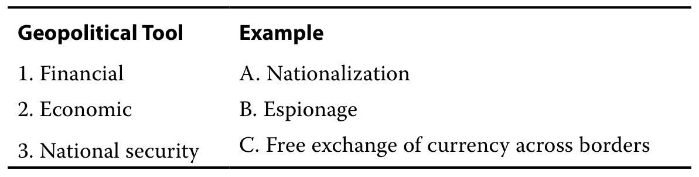

#### 官方答案与解析 / Official answer and explanation

解答：

Solution:

选项 1（金融）与 C（货币自由跨境兑换）配对。

Option 1 (Financial) matches with C (Free exchange of currency across borders).

选项 2（经济）与 A（国有化）配对。

Option 2 (Economic) matches with A (Nationalization).

选项 3（国家安全）与 B（间谍活动）配对。

Option 3 (National security) matches with B (Espionage).

#### 补充解析 / Supplementary explanation

本题复核锚点（原解摘录）：选项 1（金融）与 C（货币自由跨境兑换）配对。

Review anchor for this item (official excerpt): Option 1 (Financial) matches with C (Free exchange of currency across borders).

补充思路：国家优先级由安全、资源、制度和政治周期共同塑造。工具可以是安全、经济或金融手段，同一种工具既可能用于合作，也可能用于施压。判断影响应沿着实际渠道追踪：制裁影响融资或交易，贸易限制影响成本与销量，安全安排影响风险溢价。不能只按工具名称机械认定风险一定上升或下降。

Additional reasoning: Security, resources, institutions, and political cycles shape national priorities. Security, economic, and financial instruments can support either cooperation or coercion. Trace the actual channel: sanctions affect financing or transactions, trade restrictions affect costs and sales, and security arrangements affect risk premiums. The instrument’s name alone does not establish the direction of risk.

#### 相关知识点 / Related concepts

国家利益与政策工具：资源禀赋影响依赖关系；软实力通过吸引力和规则影响行为；政治周期影响承诺期限。

National interests and policy instruments: Endowments shape dependencies, soft power works through attraction and rules, and political cycles influence the horizon of commitments.

### ECON-LM05-EXAMPLE-1501 · 例题 10 · 第 1 题：地缘政治风险与投资者 Example 10 · 1 — Geopolitical Risk and the Investor

正文例题／案例 / Worked example / case · 原版 PDF 页码 / Source PDF pages: 188

#### 题目与资料 / Question and data

例 10

EXAMPLE 10

地缘政治风险与投资者

Geopolitical Risk and the Investor

1\. 下列哪类风险是事先已知的？请选择所有适用项。

1\. Which of the following types of risks are known in advance? Select all that apply.

A. 事件风险

A. Event risk

B. 外生风险

B. Exogenous risk

C. 主题风险

C. Thematic risk

#### 官方答案与解析 / Official answer and explanation

解答：

Solution:

A 和 C 正确。事件风险围绕预定日期演变，而主题风险是在一段时间内不断演变和扩大的已知风险。外生风险则是突然出现或事先未预料到的风险。

A and C are correct. Event risk evolves around set dates, and thematic risk is a known risk that evolves and expands over a period of time. Exogenous risk is a sudden or unanticipated risk.

#### 补充解析 / Supplementary explanation

本题复核锚点（原解摘录）：A 和 C 正确。事件风险围绕预定日期演变，而主题风险是在一段时间内不断演变和扩大的已知风险。

Review anchor for this item (official excerpt): A and C are correct.

补充思路：先识别风险来源与传播渠道，再分别评估发生概率、冲击幅度和发生速度。事件风险围绕已知日期展开，主题风险缓慢累积，外生冲击较难提前安排。高速度风险更容易通过风险偏好和流动性迅速影响市场；长期主题风险可能逐渐改变盈利和资本成本。对组合而言，相关性、集中暴露与应对时间同样关键。

Additional reasoning: Identify the source and transmission channel, then assess probability, magnitude, and velocity separately. Event risks center on known dates, thematic risks build over time, and exogenous shocks are harder to schedule. High-velocity risks can rapidly move risk appetite and liquidity, while themes can alter earnings and discount rates gradually. Portfolio correlation, concentrated exposures, and response time also matter.

事件风险围绕已知日期或事件，如选举；主题风险持续演变；外生冲击通常时间和形式更难预见。可预知发生时间并不等于可准确预测结果。

Event risk centers on a known event or date, such as an election; thematic risk evolves over time; exogenous shocks are harder to anticipate in timing and form. Known timing does not make the outcome certain.

#### 相关知识点 / Related concepts

地缘政治风险如何进入投资判断：概率×影响可用于粗略排序，但尾部风险和非线性不能只用平均值概括。情景分析应连接收入、成本、折现率与组合暴露。

Translating geopolitical risk into investment analysis: Probability × impact is a rough ranking tool, but averages do not capture tails or nonlinearity. Link scenarios to revenues, costs, discount rates, and exposures.

### ECON-LM05-EXAMPLE-1601 · 例题 11 · 第 1 题：地缘政治风险的影响速度与投资者反应 Example 11 · 1 — Geopolitical Risk Velocity and Investor Reaction

正文例题／案例 / Worked example / case · 原版 PDF 页码 / Source PDF pages: 190

#### 题目与资料 / Question and data

例 11

EXAMPLE 11

地缘政治风险的影响速度与投资者反应

Geopolitical Risk Velocity and Investor Reaction

1\. 将地缘政治风险可能的影响速度与下表所列最可能的投资者反应相匹配：

1\. Match the potential velocity of a geopolitical risk with the most likely investor reaction among those listed in the following table:

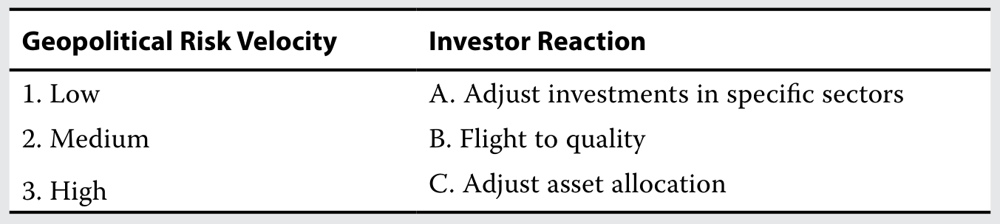

#### 官方答案与解析 / Official answer and explanation

解答：

Solution:

选项 1（低）与 C（调整资产配置）匹配。

Option 1 (Low) matches with C (Adjust asset allocation).

选项 2（中）与 A（调整特定行业的投资）匹配。

Option 2 (Medium) matches with A (Adjust investments in specific sectors).

选项 3（高）与 B（转向优质资产）匹配。

Option 3 (High) matches with B (Flight to quality).

#### 补充解析 / Supplementary explanation

本题复核锚点（原解摘录）：选项 1（低）与 C（调整资产配置）匹配。

Review anchor for this item (official excerpt): Option 1 (Low) matches with C (Adjust asset allocation).

补充思路：先识别风险来源与传播渠道，再分别评估发生概率、冲击幅度和发生速度。事件风险围绕已知日期展开，主题风险缓慢累积，外生冲击较难提前安排。高速度风险更容易通过风险偏好和流动性迅速影响市场；长期主题风险可能逐渐改变盈利和资本成本。对组合而言，相关性、集中暴露与应对时间同样关键。

Additional reasoning: Identify the source and transmission channel, then assess probability, magnitude, and velocity separately. Event risks center on known dates, thematic risks build over time, and exogenous shocks are harder to schedule. High-velocity risks can rapidly move risk appetite and liquidity, while themes can alter earnings and discount rates gradually. Portfolio correlation, concentrated exposures, and response time also matter.

#### 相关知识点 / Related concepts

地缘政治风险如何进入投资判断：概率×影响可用于粗略排序，但尾部风险和非线性不能只用平均值概括。情景分析应连接收入、成本、折现率与组合暴露。

Translating geopolitical risk into investment analysis: Probability × impact is a rough ranking tool, but averages do not capture tails or nonlinearity. Link scenarios to revenues, costs, discount rates, and exposures.

### ECON-LM05-EXAMPLE-1701 · 例题 12 · 第 1 题：地缘政治风险与投资者 Example 12 · 1 — Geopolitical Risk and the Investor

正文例题／案例 / Worked example / case · 原版 PDF 页码 / Source PDF pages: 191

#### 题目与资料 / Question and data

例 12

EXAMPLE 12

地缘政治风险与投资者

Geopolitical Risk and the Investor

1\. 描述投资者在评估地缘政治风险时应考虑的三个方面。

1\. Describe the three areas that an investor should consider when assessing geopolitical risk.

#### 官方答案与解析 / Official answer and explanation

解答：

Solution:

投资者在评估地缘政治风险时应考虑以下三个方面：发生的可能性、产生影响的速度，以及影响的大小和性质。发生的可能性考察地缘政治风险发生的概率。产生影响的速度是指其影响投资者投资组合的快慢。影响可以通过多种方式表现出来，其范围可能局限于个别对象，也可能具有广泛性。

An investor should consider the following three areas when assessing geopolitical risk: the likelihood it will occur, the velocity of its impact, and the size and nature of that impact. The likelihood that it will occur considers the probability that geopolitical risk will occur. The velocity of its impact is the pace at which it affects an investor portfolio. The impact can manifest in many ways and can be discrete in size or broad in nature.

#### 补充解析 / Supplementary explanation

本题复核锚点（原解摘录）：投资者在评估地缘政治风险时应考虑以下三个方面：发生的可能性、产生影响的速度，以及影响的大小和性质。

Review anchor for this item (official excerpt): An investor should consider the following three areas when assessing geopolitical risk: the likelihood it will occur, the velocity of its impact, and the size and nature of that impact.

补充思路：先识别风险来源与传播渠道，再分别评估发生概率、冲击幅度和发生速度。事件风险围绕已知日期展开，主题风险缓慢累积，外生冲击较难提前安排。高速度风险更容易通过风险偏好和流动性迅速影响市场；长期主题风险可能逐渐改变盈利和资本成本。对组合而言，相关性、集中暴露与应对时间同样关键。

Additional reasoning: Identify the source and transmission channel, then assess probability, magnitude, and velocity separately. Event risks center on known dates, thematic risks build over time, and exogenous shocks are harder to schedule. High-velocity risks can rapidly move risk appetite and liquidity, while themes can alter earnings and discount rates gradually. Portfolio correlation, concentrated exposures, and response time also matter.

#### 相关知识点 / Related concepts

地缘政治风险如何进入投资判断：概率×影响可用于粗略排序，但尾部风险和非线性不能只用平均值概括。情景分析应连接收入、成本、折现率与组合暴露。

Translating geopolitical risk into investment analysis: Probability × impact is a rough ranking tool, but averages do not capture tails or nonlinearity. Link scenarios to revenues, costs, discount rates, and exposures.

### ECON-LM05-EXAMPLE-1801 · 例题 13 · 第 1 题：地缘政治风险 Example 13 · 1 — Geopolitical Risk

正文例题／案例 / Worked example / case · 原版 PDF 页码 / Source PDF pages: 194

#### 题目与资料 / Question and data

例 13

EXAMPLE 13

地缘政治风险

Geopolitical Risk

1\. 判断正误：影响速度较高的地缘政治风险最可能对投资分析的输入因素产生持久影响。

1\. True or False: Higher-velocity geopolitical risks are most likely to have a prolonged impact on investor inputs.

说明你作出选择的理由。

Explain your selection.

A. 正确

A. True

B. 错误

B. False

#### 官方答案与解析 / Official answer and explanation

解答：

Solution:

B 正确。影响速度较高的风险最可能通过资产价格的迅速变化表现为市场波动。影响速度较低的地缘政治风险则可能对投资分析的输入因素产生持久影响。2001 年 9 月 11 日美国发生的恐怖袭击，是影响速度较高的地缘政治风险的一个例子，因为市场曾急剧下跌，但在相对较短的时间内反弹。

B is correct. Higher-velocity risks are most likely to manifest in market volatility via prompt changes in asset prices. Lower-velocity geopolitical risks are likely to have a prolonged impact on investor inputs. The terrorist attacks of 11 September 2001 in the United States are an example of a higher-velocity geopolitical risk as the market had a sharp downturn and rebounded in a relatively short amount of time.

#### 补充解析 / Supplementary explanation

本题复核锚点（原解摘录）：B 正确。影响速度较高的风险最可能通过资产价格的迅速变化表现为市场波动。

Review anchor for this item (official excerpt): B is correct. Higher-velocity risks are most likely to manifest in market volatility via prompt changes in asset prices.

本题官方选项为 B。补充思路：先识别风险来源与传播渠道，再分别评估发生概率、冲击幅度和发生速度。事件风险围绕已知日期展开，主题风险缓慢累积，外生冲击较难提前安排。高速度风险更容易通过风险偏好和流动性迅速影响市场；长期主题风险可能逐渐改变盈利和资本成本。对组合而言，相关性、集中暴露与应对时间同样关键。

The official choice for this item is B. Additional reasoning: Identify the source and transmission channel, then assess probability, magnitude, and velocity separately. Event risks center on known dates, thematic risks build over time, and exogenous shocks are harder to schedule. High-velocity risks can rapidly move risk appetite and liquidity, while themes can alter earnings and discount rates gradually. Portfolio correlation, concentrated exposures, and response time also matter.

#### 相关知识点 / Related concepts

地缘政治风险如何进入投资判断：概率×影响可用于粗略排序，但尾部风险和非线性不能只用平均值概括。情景分析应连接收入、成本、折现率与组合暴露。

Translating geopolitical risk into investment analysis: Probability × impact is a rough ranking tool, but averages do not capture tails or nonlinearity. Link scenarios to revenues, costs, discount rates, and exposures.

### ECON-LM05-EXAMPLE-1901 · 例题 14 · 第 1 题：地缘政治风险 Example 14 · 1 — Geopolitical Risk

正文例题／案例 / Worked example / case · 原版 PDF 页码 / Source PDF pages: 195

#### 题目与资料 / Question and data

例 14

EXAMPLE 14

地缘政治风险

Geopolitical Risk

1\. 判断正误：地缘政治风险的发生概率和影响，会影响新兴市场与发达市场之间资产定价折现率的相对水平。

1\. True or false: The probability and impact of geopolitical risks influence relative asset price discount rates across emerging and developed markets.

说明你作出选择的理由。

Explain your selection.

A. 正确

A. True

B. 错误

B. False

#### 官方答案与解析 / Official answer and explanation

解答：

Solution:

A 正确。对于被认为更持续地面临地缘政治干扰风险的国家、地区或行业，投资者可能要求更高的补偿，实际上提高了估值所使用的折现率。当证券投资资金流因地缘政治因素而面临更大波动时，投资者会计入更高的风险溢价。这解释了为什么新兴市场的资产价格通常相对于被认为地缘政治风险威胁较小的发达国家存在折价：后者更可能面临发生概率较低、影响较小的风险。

A is correct. For countries, regions, or sectors perceived to be at more consistent risk of geopolitical disruption, investors may require higher compensation, effectively increasing the discount rate used in valuation. When portfolio investment flows face greater volatility because of geopolitical factors, investors will factor in a higher risk premium. This explains why asset prices in emerging markets typically are maintained at a discount to those in developed countries perceived to have a lower threat of geopolitical risk, with the latter more likely to experience lower probability risks with lesser impacts.

#### 补充解析 / Supplementary explanation

本题复核锚点（原解摘录）：A 正确。对于被认为更持续地面临地缘政治干扰风险的国家、地区或行业，投资者可能要求更高的补偿，实际上提高了估值所使用的折现率。

Review anchor for this item (official excerpt): A is correct. For countries, regions, or sectors perceived to be at more consistent risk of geopolitical disruption, investors may require higher compensation, effectively increasing the discount rate used in valuation.

本题官方选项为 A。补充思路：先识别风险来源与传播渠道，再分别评估发生概率、冲击幅度和发生速度。事件风险围绕已知日期展开，主题风险缓慢累积，外生冲击较难提前安排。高速度风险更容易通过风险偏好和流动性迅速影响市场；长期主题风险可能逐渐改变盈利和资本成本。对组合而言，相关性、集中暴露与应对时间同样关键。

The official choice for this item is A. Additional reasoning: Identify the source and transmission channel, then assess probability, magnitude, and velocity separately. Event risks center on known dates, thematic risks build over time, and exogenous shocks are harder to schedule. High-velocity risks can rapidly move risk appetite and liquidity, while themes can alter earnings and discount rates gradually. Portfolio correlation, concentrated exposures, and response time also matter.

#### 相关知识点 / Related concepts

地缘政治风险如何进入投资判断：概率×影响可用于粗略排序，但尾部风险和非线性不能只用平均值概括。情景分析应连接收入、成本、折现率与组合暴露。

Translating geopolitical risk into investment analysis: Probability × impact is a rough ranking tool, but averages do not capture tails or nonlinearity. Link scenarios to revenues, costs, discount rates, and exposures.

### ECON-LM05-PRACTICE-001 · 章末习题 1 Practice problem 1

章末练习 / Practice problem · 原版 PDF 页码 / Source PDF pages: 197, 199

#### 题目与资料 / Question and data

1\. 关于一国政治合作的下列说法，哪一项最准确？

1\. Which of the following statements regarding a country’s political cooperation is most accurate?

A. 如果一国正处于军事冲突中，那么合作成本更高。

A. If a country is engaged in military conflict, there is a higher cost to cooperation.

B. 国内资源匮乏的国家不太可能依赖政治合作。

B. A country with few internal resources is not likely to rely on political cooperation.

C. 利益优先次序的确定，并不决定政治合作的深度和性质。

C. Interest prioritization does not determine the depth and nature of political cooperation.

#### 官方答案与解析 / Official answer and explanation

1\. A 正确。如果一国正处于军事冲突中，那么合作成本更高。B 错误，因为国内资源匮乏的国家很可能依赖政治合作。C 错误，因为利益优先次序的确定，确实会决定政治合作的深度和性质。

1\. A is correct. If a country is engaged in military conflict, there is a higher cost to cooperation. B is incorrect because a country with few internal resources is likely to rely on political cooperation. C is incorrect because interest prioritization does determine the depth and nature of political cooperation.

#### 补充解析 / Supplementary explanation

本题复核锚点（原解摘录）：1. A 正确。如果一国正处于军事冲突中，那么合作成本更高。

Review anchor for this item (official excerpt): 1.

本题官方选项为 A。补充思路：国际合作主要刻画国家之间愿不愿意协调政策，全球化则更强调贸易、资本和生产活动的跨境联系。两者相关但不能混为一谈：经济高度一体化不保证所有政治议题上合作。分类时先分别判断跨境开放程度和合作倾向，再匹配自给自足、双边主义、多边主义或霸权等框架，并注意国家资源禀赋和战略利益。

The official choice for this item is A. Additional reasoning: Cooperation describes willingness to coordinate policy, while globalization concerns cross-border trade, capital, and production links. They are related but distinct: economic integration does not guarantee political cooperation. Classify each dimension separately before applying archetypes such as autarky, bilateralism, multilateralism, or hegemony, considering endowments and strategic interests.

#### 相关知识点 / Related concepts

全球化与合作的两个维度：国家行为者与非国家行为者不同；国际机构可降低协调成本，但合作仍取决于成员利益。

Globalization and cooperation as two dimensions: Distinguish state and non-state actors. International institutions can reduce coordination costs, but cooperation still depends on members’ interests.

### ECON-LM05-PRACTICE-002 · 章末习题 2 Practice problem 2

章末练习 / Practice problem · 原版 PDF 页码 / Source PDF pages: 197, 199

#### 题目与资料 / Question and data

2\. 全球化某一弊端产生的后果是：

2\. A consequence of one of the disadvantages of globalization is that:

A. 国家之间的薪酬差距缩小。

A. pay differences between countries have narrowed.

B. 新兴市场的贸易流变得更加重要。

B. emerging market trade flows have grown more important.

C. 更广泛的经济和金融合作提高了相互依存程度。

C. greater economic and financial cooperation has increased interdependence.

#### 官方答案与解析 / Official answer and explanation

2\. C 正确。在扩大经济和金融合作的过程中，企业的供应链可能逐渐依赖其他国家的资源。从总体上看，这会使国家本身在某些资源（如稀土金属、钴或铜）方面依赖其他国家。如果供应链中断，包括因政治不合作而发生的中断，企业可能无法自行生产该产品。A 错误，因为国家之间薪酬差距的缩小，是追求全球化的动机所带来的结果，而该动机与全球化的一项优势相关。降低成本是企业提高盈利能力的重要途径。虽然工资差异仍然存在，但正在缩小。B 错误，因为随着新兴市场贸易流增加，发达经济体之间的贸易流占整体贸易的比重持续下降，这是国际投资增加的结果。国际投资增加带来了有益的总体经济效应，例如选择增多、商品质量提高、企业间竞争加剧、效率提高以及劳动力流动性增强。

2\. C is correct. Through the process of greater economic and financial cooperation, companies may become dependent on other countries’ resources for their supply chains. On aggregate, this can result in the nation itself becoming dependent on other nations for certain resources (such as rare earth metals, cobalt, or copper). If there is a disruption to the supply chain, including via a moment of political non-cooperation, then firms may not be able to produce the good themselves. A is incorrect because the narrowing of pay differences between countries results from a motivation to pursue globalization, which is related to one of its advantages. It is an important way for companies to increase profitability by reducing their costs. Although wage differentials remain, they are decreasing. B is incorrect because the proportion of flows between developed economies as a share of overall trade continuing to decline as emerging market trade flows rise is a function of increased international investment. This increased investment has provided beneficial aggregate economic benefits, such as increased choice, higher quality goods, increased competition among firms, higher efficiency, and increased labor mobility.

#### 补充解析 / Supplementary explanation

本题复核锚点（原解摘录）：2. C 正确。在扩大经济和金融合作的过程中，企业的供应链可能逐渐依赖其他国家的资源。

Review anchor for this item (official excerpt): 2.

本题官方选项为 C。补充思路：国际合作主要刻画国家之间愿不愿意协调政策，全球化则更强调贸易、资本和生产活动的跨境联系。两者相关但不能混为一谈：经济高度一体化不保证所有政治议题上合作。分类时先分别判断跨境开放程度和合作倾向，再匹配自给自足、双边主义、多边主义或霸权等框架，并注意国家资源禀赋和战略利益。

The official choice for this item is C. Additional reasoning: Cooperation describes willingness to coordinate policy, while globalization concerns cross-border trade, capital, and production links. They are related but distinct: economic integration does not guarantee political cooperation. Classify each dimension separately before applying archetypes such as autarky, bilateralism, multilateralism, or hegemony, considering endowments and strategic interests.

供应链策略要看实际改变的生产位置与产能安排。增加本国或紧密一体化地区的关键零部件供应，主要是降低外部中断风险；仅增加库存不等于进入新市场。

Classify the strategy by changes in location and capacity. Strengthening essential supply at home or in a closely integrated region primarily reduces disruption exposure; more inventory alone does not imply entry into a new market.

#### 相关知识点 / Related concepts

全球化与合作的两个维度：国家行为者与非国家行为者不同；国际机构可降低协调成本，但合作仍取决于成员利益。

Globalization and cooperation as two dimensions: Distinguish state and non-state actors. International institutions can reduce coordination costs, but cooperation still depends on members’ interests.

### ECON-LM05-PRACTICE-003 · 章末习题 3 Practice problem 3

章末练习 / Practice problem · 原版 PDF 页码 / Source PDF pages: 197, 199

#### 题目与资料 / Question and data

3\. 下列哪项结果最可能是全球化造成的？

3\. Which of the following outcomes is most likely a result of globalization?

A. 收益分配不均

A. Unequal gains

B. 独立性提高

B. Increased independence

C. 获取人才的机会减少

C. Decreased access to talent

#### 官方答案与解析 / Official answer and explanation

3\. A 正确。经济和金融收益的分配不均是全球化的一项成本，因为总体状况改善并不意味着每个人的状况都得到改善。B 错误，因为全球化会带来相互依存：企业的供应链可能逐渐依赖其他国家的资源。C 错误，因为全球化并非减少获取人才的机会；一国实际上可能为了改善获取人才的机会而参与全球化，因为合作与全球化可以增加获取资源的机会。

3\. A is correct. Unequal accrual of economic and financial gains is a cost of globalization because improvement on the aggregate does not mean improvement for everyone. B is incorrect because globalization leads to interdependency as companies may become dependent on other countries’ resources for their supply chains. C is incorrect because rather than decreased access to talent, a country might actually globalize to improve access to talent as cooperation and globalization can lead to increased access to resources.

#### 补充解析 / Supplementary explanation

本题复核锚点（原解摘录）：3. A 正确。经济和金融收益的分配不均是全球化的一项成本，因为总体状况改善并不意味着每个人的状况都得到改善。

Review anchor for this item (official excerpt): 3.

本题官方选项为 A。补充思路：国际合作主要刻画国家之间愿不愿意协调政策，全球化则更强调贸易、资本和生产活动的跨境联系。两者相关但不能混为一谈：经济高度一体化不保证所有政治议题上合作。分类时先分别判断跨境开放程度和合作倾向，再匹配自给自足、双边主义、多边主义或霸权等框架，并注意国家资源禀赋和战略利益。

The official choice for this item is A. Additional reasoning: Cooperation describes willingness to coordinate policy, while globalization concerns cross-border trade, capital, and production links. They are related but distinct: economic integration does not guarantee political cooperation. Classify each dimension separately before applying archetypes such as autarky, bilateralism, multilateralism, or hegemony, considering endowments and strategic interests.

供应链策略要看实际改变的生产位置与产能安排。增加本国或紧密一体化地区的关键零部件供应，主要是降低外部中断风险；仅增加库存不等于进入新市场。

Classify the strategy by changes in location and capacity. Strengthening essential supply at home or in a closely integrated region primarily reduces disruption exposure; more inventory alone does not imply entry into a new market.

#### 相关知识点 / Related concepts

全球化与合作的两个维度：国家行为者与非国家行为者不同；国际机构可降低协调成本，但合作仍取决于成员利益。

Globalization and cooperation as two dimensions: Distinguish state and non-state actors. International institutions can reduce coordination costs, but cooperation still depends on members’ interests.

### ECON-LM05-PRACTICE-004 · 章末习题 4 Practice problem 4

章末练习 / Practice problem · 原版 PDF 页码 / Source PDF pages: 197, 199

#### 题目与资料 / Question and data

4\. 在供应链中断后，一家美国公司扩大了为本地客户储备的关键备件库存，这些备件由其现有加拿大工厂生产。该公司最可能采用的应对策略是：

4\. A US company expanding critical spare part inventories for local customers made at its existing Canadian facility after a supply chain disruption is most likely using the coping tactic of:

A. 将关键生产环节迁回本土。

A. reshoring the essentials.

B. 对生产重新进行全球布局。

B. reglobalizing production.

C. 加大对关键市场的投入。

C. doubling down on key markets.

#### 官方答案与解析 / Official answer and explanation

4\. A 正确。新冠疫情凸显了在国内重建某些关键供应链以应对紧急情况的必要性，确保关键备件供应就是一个类似情形。修订后的《美墨加协定》（USMCA）使美国和加拿大经济紧密融合，因此，在现有加拿大工厂扩大生产，实际上可视为通过生产回流、将生产迁回本国来降低制造风险的例子。B 错误，因为该公司并未通过复制或强化供应链来降低制造风险，而只是继续更充分地利用其现有产能。C 错误，因为虽然生产目的是更好地供应本国市场，但没有证据表明该公司正在扩大其在美国市场的布局，或转移重心以至于放弃其他地方存在的机会。

4\. A is correct. The COVID-19 pandemic has highlighted the need for certain essential supply chains to be rebuilt domestically for emergency situations, with availability of critical spare parts being an analogy. The close integration of the US and Canadian economies through the revised USMCA agreement effectively makes expanded production at an existing Canadian factory an example of reducing manufacturing risk by relocating to home countries via reshoring. B is incorrect because instead of reducing manufacturing risk by duplicating or fortifying its supply chain, the company is simply continuing to use its existing capacity more intensively. C is incorrect because although the production is intended to better supply its home market, there is no evidence that the company is expanding its presence in the US market or shifting its focus to the exclusion of available opportunities elsewhere.

#### 补充解析 / Supplementary explanation

本题复核锚点（原解摘录）：4. A 正确。新冠疫情凸显了在国内重建某些关键供应链以应对紧急情况的必要性，确保关键备件供应就是一个类似情形。

Review anchor for this item (official excerpt): 4.

本题官方选项为 A。补充思路：先识别风险来源与传播渠道，再分别评估发生概率、冲击幅度和发生速度。事件风险围绕已知日期展开，主题风险缓慢累积，外生冲击较难提前安排。高速度风险更容易通过风险偏好和流动性迅速影响市场；长期主题风险可能逐渐改变盈利和资本成本。对组合而言，相关性、集中暴露与应对时间同样关键。

The official choice for this item is A. Additional reasoning: Identify the source and transmission channel, then assess probability, magnitude, and velocity separately. Event risks center on known dates, thematic risks build over time, and exogenous shocks are harder to schedule. High-velocity risks can rapidly move risk appetite and liquidity, while themes can alter earnings and discount rates gradually. Portfolio correlation, concentrated exposures, and response time also matter.

供应链策略要看实际改变的生产位置与产能安排。增加本国或紧密一体化地区的关键零部件供应，主要是降低外部中断风险；仅增加库存不等于进入新市场。

Classify the strategy by changes in location and capacity. Strengthening essential supply at home or in a closely integrated region primarily reduces disruption exposure; more inventory alone does not imply entry into a new market.

#### 相关知识点 / Related concepts

地缘政治风险如何进入投资判断：概率×影响可用于粗略排序，但尾部风险和非线性不能只用平均值概括。情景分析应连接收入、成本、折现率与组合暴露。

Translating geopolitical risk into investment analysis: Probability × impact is a rough ranking tool, but averages do not capture tails or nonlinearity. Link scenarios to revenues, costs, discount rates, and exposures.

### ECON-LM05-PRACTICE-005 · 章末习题 5 Practice problem 5

章末练习 / Practice problem · 原版 PDF 页码 / Source PDF pages: 197, 199

#### 题目与资料 / Question and data

5\. 用于增进国家利益的多层面地缘政治工具的一个例子是：

5\. An example of a geopolitical multifaceted tool for furthering national interests is:

A. 国内运输权。

A. cabotage.

B. 武装冲突。

B. armed conflict.

C. 关键出口行业国有化。

C. nationalization of key export industries.

#### 官方答案与解析 / Official answer and explanation

5\. A 正确。国内运输权是指外国企业在一国境内运输旅客或货物的权利。许多国家——包括签署多边贸易协定的国家——都在各运输子行业对国内运输权施加限制，这意味着航运企业、航空公司及卡车司机不能在另一国境内运输货物或提供运输服务。允许国内运输权需要在实体安全、经济协调等领域进行协调，这是一个高度多边化的过程，属于多层面工具。B 错误，因为武装冲突是国家安全工具最极端的例子。它可以发生在一国内部，也可以发生在对外关系中，并通过直接、主动的方式来施加影响力。C 错误，因为关键出口行业国有化是一种经济工具。这一将某项活动或某个行业从私人控制转为国家控制的过程，是确立经济控制权的一种非合作方式。

5\. A is correct. Cabotage is the right to transport passengers or goods within a country by a foreign firm. Many countries—including those with multilateral trade agreements—impose restrictions on cabotage across transportation subsectors, meaning that shippers, airlines, and truck drivers are not allowed to transport goods and services within another country’s borders. Allowing cabotage requires coordination on areas like physical security and economic coordination, a highly multilateral (multifaceted tool) process. B is incorrect because armed conflict is the most extreme example of a national security tool. It can be either internal or external to a country in taking a direct and active approach to wielding influence. C is incorrect because nationalization of key export industries is an economic tool. This process of transferring an activity or industry from private to state control is a non-cooperative approach to asserting economic control.

#### 补充解析 / Supplementary explanation

本题复核锚点（原解摘录）：5. A 正确。国内运输权是指外国企业在一国境内运输旅客或货物的权利。

Review anchor for this item (official excerpt): 5.

本题官方选项为 A。补充思路：国家优先级由安全、资源、制度和政治周期共同塑造。工具可以是安全、经济或金融手段，同一种工具既可能用于合作，也可能用于施压。判断影响应沿着实际渠道追踪：制裁影响融资或交易，贸易限制影响成本与销量，安全安排影响风险溢价。不能只按工具名称机械认定风险一定上升或下降。

The official choice for this item is A. Additional reasoning: Security, resources, institutions, and political cycles shape national priorities. Security, economic, and financial instruments can support either cooperation or coercion. Trace the actual channel: sanctions affect financing or transactions, trade restrictions affect costs and sales, and security arrangements affect risk premiums. The instrument’s name alone does not establish the direction of risk.

#### 相关知识点 / Related concepts

国家利益与政策工具：资源禀赋影响依赖关系；软实力通过吸引力和规则影响行为；政治周期影响承诺期限。

National interests and policy instruments: Endowments shape dependencies, soft power works through attraction and rules, and political cycles influence the horizon of commitments.

### ECON-LM05-PRACTICE-006 · 章末习题 6 Practice problem 6

章末练习 / Practice problem · 原版 PDF 页码 / Source PDF pages: 197, 200

#### 题目与资料 / Question and data

6\. 下列哪一项最可能被描述为事件风险？

6\. Which of these is most likely to be described as an event risk?

A. 地震

A. An earthquake

B. 选举

B. An election

C. 持续进行的内战

C. An ongoing civil war

#### 官方答案与解析 / Official answer and explanation

6\. B 正确。事件风险围绕预定日期演变，例如选举、新立法，或其他由日期决定、事先已知的重要节点，如节假日或政治纪念日。其他选项无法事先知晓。地震（A）是外生风险的例子。持续进行的内战（C）是主题风险的例子。

6\. B is correct. Event risk evolves around set dates, such as elections and new legislation, or other date-driven milestones, such as holidays or political anniversaries known in advance. The other choices could not be known in advance. An earthquake (A) is an example of an exogenous risk. An ongoing civil war (C) is an example of a thematic risk.

#### 补充解析 / Supplementary explanation

本题复核锚点（原解摘录）：6. B 正确。事件风险围绕预定日期演变，例如选举、新立法，或其他由日期决定、事先已知的重要节点，如节假日或政治纪念日。

Review anchor for this item (official excerpt): 6.

本题官方选项为 B。补充思路：先识别风险来源与传播渠道，再分别评估发生概率、冲击幅度和发生速度。事件风险围绕已知日期展开，主题风险缓慢累积，外生冲击较难提前安排。高速度风险更容易通过风险偏好和流动性迅速影响市场；长期主题风险可能逐渐改变盈利和资本成本。对组合而言，相关性、集中暴露与应对时间同样关键。

The official choice for this item is B. Additional reasoning: Identify the source and transmission channel, then assess probability, magnitude, and velocity separately. Event risks center on known dates, thematic risks build over time, and exogenous shocks are harder to schedule. High-velocity risks can rapidly move risk appetite and liquidity, while themes can alter earnings and discount rates gradually. Portfolio correlation, concentrated exposures, and response time also matter.

事件风险围绕已知日期或事件，如选举；主题风险持续演变；外生冲击通常时间和形式更难预见。可预知发生时间并不等于可准确预测结果。

Event risk centers on a known event or date, such as an election; thematic risk evolves over time; exogenous shocks are harder to anticipate in timing and form. Known timing does not make the outcome certain.

#### 相关知识点 / Related concepts

地缘政治风险如何进入投资判断：概率×影响可用于粗略排序，但尾部风险和非线性不能只用平均值概括。情景分析应连接收入、成本、折现率与组合暴露。

Translating geopolitical risk into investment analysis: Probability × impact is a rough ranking tool, but averages do not capture tails or nonlinearity. Link scenarios to revenues, costs, discount rates, and exposures.

### ECON-LM05-PRACTICE-007 · 章末习题 7 Practice problem 7

章末练习 / Practice problem · 原版 PDF 页码 / Source PDF pages: 197-198, 200

#### 题目与资料 / Question and data

7\. 外生风险最适合被描述为下列哪类风险？

7\. Exogenous risks are best described as those that:

A. 已知，并在一段时间内不断演变和扩大。

A. are known and evolve and expand over a period of time.

B. 围绕预定日期出现，例如选举、新立法，或其他由日期决定的重要节点，如节假日或政治纪念日。

B. revolve around set dates, such as elections, new legislation, or other date-driven milestones, such as holidays or political anniversaries.

C. 突然出现或事先未预料到，并影响一国的合作立场、非国家行为体参与全球化的能力，或同时影响两者。

C. are sudden or unanticipated and impact either a country’s cooperative stance, the ability of non-state actors to globalize, or both.

#### 官方答案与解析 / Official answer and explanation

7\. C 正确。外生风险最适合被描述为突然出现或事先未预料到，并影响一国的合作立场、非国家行为体参与全球化的能力，或同时影响两者的风险。A 错误，因为在一段时间内不断演变和扩大的已知风险是主题风险，而非外生风险。B 错误，因为围绕预定日期——包括选举、新立法或其他由日期决定的重要节点——演变的风险是事件风险，而非外生风险。

7\. C is correct. Exogenous risks are best described as those that are sudden or unanticipated and that affect either a country’s cooperative stance, the ability of non-state actors to globalize, or both. A is incorrect because thematic (not exogenous) risks are known risks that evolve and expand over a period of time. B is incorrect because event (not exogenous) risks are those that evolve around set dates, including elections, new legislation, or other date-driven milestones.

#### 补充解析 / Supplementary explanation

本题复核锚点（原解摘录）：7. C 正确。外生风险最适合被描述为突然出现或事先未预料到，并影响一国的合作立场、非国家行为体参与全球化的能力，或同时影响两者的风险。

Review anchor for this item (official excerpt): 7.

本题官方选项为 C。补充思路：先识别风险来源与传播渠道，再分别评估发生概率、冲击幅度和发生速度。事件风险围绕已知日期展开，主题风险缓慢累积，外生冲击较难提前安排。高速度风险更容易通过风险偏好和流动性迅速影响市场；长期主题风险可能逐渐改变盈利和资本成本。对组合而言，相关性、集中暴露与应对时间同样关键。

The official choice for this item is C. Additional reasoning: Identify the source and transmission channel, then assess probability, magnitude, and velocity separately. Event risks center on known dates, thematic risks build over time, and exogenous shocks are harder to schedule. High-velocity risks can rapidly move risk appetite and liquidity, while themes can alter earnings and discount rates gradually. Portfolio correlation, concentrated exposures, and response time also matter.

事件风险围绕已知日期或事件，如选举；主题风险持续演变；外生冲击通常时间和形式更难预见。可预知发生时间并不等于可准确预测结果。

Event risk centers on a known event or date, such as an election; thematic risk evolves over time; exogenous shocks are harder to anticipate in timing and form. Known timing does not make the outcome certain.

#### 相关知识点 / Related concepts

地缘政治风险如何进入投资判断：概率×影响可用于粗略排序，但尾部风险和非线性不能只用平均值概括。情景分析应连接收入、成本、折现率与组合暴露。

Translating geopolitical risk into investment analysis: Probability × impact is a rough ranking tool, but averages do not capture tails or nonlinearity. Link scenarios to revenues, costs, discount rates, and exposures.

### ECON-LM05-PRACTICE-008 · 章末习题 8 Practice problem 8

章末练习 / Practice problem · 原版 PDF 页码 / Source PDF pages: 198, 200

#### 题目与资料 / Question and data

8\. 关于投资环境中的地缘政治威胁，下列哪项说法最准确？

8\. Which of the following statements about geopolitical threats in the investment environment is most accurate?

A. 地缘政治风险并非始终存在于投资环境中。

A. Geopolitical risk is not always present in the investment environment.

B. 合作程度高、联系紧密的国家容易受到地缘政治风险的影响。

B. Highly collaborative, interconnected countries are vulnerable to geopolitical risk.

C. 对已经处于普遍收缩或经济低迷中的市场，地缘政治风险往往影响较小。

C. Geopolitical risk tends to have less of an impact on markets already experiencing a general contraction or economic downturn.

#### 官方答案与解析 / Official answer and explanation

8\. B 正确。尽管总体而言，合作程度高、全球化程度高的国家遭遇地缘政治风险的可能性较低，因为相对于合作程度较低的国家，合作伙伴使这些风险发生所付出的政治、经济和金融代价更高，但同样的相互联系也可能使它们更容易受到地缘政治风险的影响。A 错误，因为地缘政治风险始终存在于投资环境中。C 错误，因为地缘政治风险对已经处于普遍收缩或经济低迷中的市场往往影响更大。

8\. B is correct. Although highly collaborative and globalized countries are, on balance, less likely to experience geopolitical risk because the political, economic, and financial costs of partners inflicting those risks are higher than less collaborative countries, the same interconnectedness may make them more vulnerable to geopolitical risk. A is incorrect because geopolitical risk is always present in the investment environment. C is incorrect because geopolitical risk tends to have a greater impact on markets already experiencing a general contraction or economic downturn.

#### 补充解析 / Supplementary explanation

本题复核锚点（原解摘录）：8. B 正确。尽管总体而言，合作程度高、全球化程度高的国家遭遇地缘政治风险的可能性较低，因为相对于合作程度较低的国家，合作伙伴使这些风险发生所付出的政治、经济和金融代价更高，但同样的相互联系也可能使它们更容易受到地缘政治风险的影响。

Review anchor for this item (official excerpt): 8.

本题官方选项为 B。补充思路：先识别风险来源与传播渠道，再分别评估发生概率、冲击幅度和发生速度。事件风险围绕已知日期展开，主题风险缓慢累积，外生冲击较难提前安排。高速度风险更容易通过风险偏好和流动性迅速影响市场；长期主题风险可能逐渐改变盈利和资本成本。对组合而言，相关性、集中暴露与应对时间同样关键。

The official choice for this item is B. Additional reasoning: Identify the source and transmission channel, then assess probability, magnitude, and velocity separately. Event risks center on known dates, thematic risks build over time, and exogenous shocks are harder to schedule. High-velocity risks can rapidly move risk appetite and liquidity, while themes can alter earnings and discount rates gradually. Portfolio correlation, concentrated exposures, and response time also matter.

#### 相关知识点 / Related concepts

地缘政治风险如何进入投资判断：概率×影响可用于粗略排序，但尾部风险和非线性不能只用平均值概括。情景分析应连接收入、成本、折现率与组合暴露。

Translating geopolitical risk into investment analysis: Probability × impact is a rough ranking tool, but averages do not capture tails or nonlinearity. Link scenarios to revenues, costs, discount rates, and exposures.

### ECON-LM05-PRACTICE-009 · 章末习题 9 Practice problem 9

章末练习 / Practice problem · 原版 PDF 页码 / Source PDF pages: 198, 200

#### 题目与资料 / Question and data

9\. 从地缘政治风险指数（GPR）中可得出的适用结论是：

9\. An applicable conclusion drawn from the Geopolitical Risk Index (GPR) is that:

A. 较高的地缘政治风险会产生切实的宏观经济影响。

A. high geopolitical risk results in tangible macroeconomic effects.

B. 反复发生的地缘政治风险事件会导致企业投资减少。

B. recurring geopolitical risk events lead to reduced corporate investment.

C. 随着时间推移，实际事件的不利影响大于此类事件发生威胁所产生的影响。

C. the adverse impact of actual events is greater over time than that of the threat of such events.

#### 官方答案与解析 / Official answer and explanation

9\. A 正确。GPR 的创立者发现，较高的地缘政治风险会降低美国的投资、就业和股票市场价格水平。B 错误，因为企业是在特定事件之后减少投资，而这些事件不太可能重复发生。C 错误，因为研究表明，随着时间推移，事件发生威胁的影响大于实际事件本身的影响。

9\. A is correct. The GPR creators found that high levels of geopolitical risk reduce US investment, employment, and price level of the stock market. B is incorrect because firms reduce investment in the wake of idiosyncratic events, which would be unlikely to repeat. C is incorrect because the threat of an event was shown to have a larger impact over time than that of the actual events themselves.

#### 补充解析 / Supplementary explanation

本题复核锚点（原解摘录）：9. A 正确。GPR 的创立者发现，较高的地缘政治风险会降低美国的投资、就业和股票市场价格水平。

Review anchor for this item (official excerpt): 9.

本题官方选项为 A。补充思路：先识别风险来源与传播渠道，再分别评估发生概率、冲击幅度和发生速度。事件风险围绕已知日期展开，主题风险缓慢累积，外生冲击较难提前安排。高速度风险更容易通过风险偏好和流动性迅速影响市场；长期主题风险可能逐渐改变盈利和资本成本。对组合而言，相关性、集中暴露与应对时间同样关键。

The official choice for this item is A. Additional reasoning: Identify the source and transmission channel, then assess probability, magnitude, and velocity separately. Event risks center on known dates, thematic risks build over time, and exogenous shocks are harder to schedule. High-velocity risks can rapidly move risk appetite and liquidity, while themes can alter earnings and discount rates gradually. Portfolio correlation, concentrated exposures, and response time also matter.

#### 相关知识点 / Related concepts

地缘政治风险如何进入投资判断：概率×影响可用于粗略排序，但尾部风险和非线性不能只用平均值概括。情景分析应连接收入、成本、折现率与组合暴露。

Translating geopolitical risk into investment analysis: Probability × impact is a rough ranking tool, but averages do not capture tails or nonlinearity. Link scenarios to revenues, costs, discount rates, and exposures.

### ECON-LM05-PRACTICE-010 · 章末习题 10 Practice problem 10

章末练习 / Practice problem · 原版 PDF 页码 / Source PDF pages: 198, 200

#### 题目与资料 / Question and data

10\. 相比之下，不确定性程度最可能最低的基本地缘政治风险类型是：

10\. The basic geopolitical risk type most likely in comparison to have the smallest degree of uncertainty is:

A. 外生风险。

A. exogenous risk.

B. 事件风险。

B. event risk.

C. 主题风险。

C. thematic risk.

#### 官方答案与解析 / Official answer and explanation

10\. B 正确。事件风险围绕预定日期演变，例如选举、新立法，或其他由日期决定的重要节点，如节假日或政治纪念日。因此，分析师可以将政治日历作为判断事件风险发生情况的可预测起点，并有时间制定适当的应对措施。A 错误，因为外生风险是突然出现且事先未预料到的。例如，突发起义、入侵或自然灾害带来的后果。因此，其影响的发生时间和范围具有最大的不确定性。C 错误，因为主题风险是在一段时间内不断演变和扩大的已知风险。气候变化、具有一定规律的人口迁移、民粹主义势力的崛起以及持续存在的恐怖主义威胁，都属于这一类别。这类风险比外生风险更可预见，但由于风险暴露的时间较长，预先制定的应对措施可能需要不断调整。

10\. B is correct. Event risk evolves around set dates, such as elections or new legislation, or other date-driven milestones, such as holidays or political anniversaries. Analysts can thus look to political calendars as a predictable starting point for determining the occurrence of event risk, with time to devise a suitable response. A is incorrect because exogenous risk is sudden and unanticipated. Examples include sudden uprisings, invasions, or the aftermath of natural disasters. The timing and range of its effects thus have the greatest unknowns. C is incorrect because thematic risks are known risks that evolve and expand over a period of time. Climate change, pattern migration, the rise of populist forces, and the ongoing threat of terrorism fall into this category. These are more foreseeable than exogenous risks, but with their extended interval of exposure, planned responses likely require continual adjustments.

#### 补充解析 / Supplementary explanation

本题复核锚点（原解摘录）：10. B 正确。事件风险围绕预定日期演变，例如选举、新立法，或其他由日期决定的重要节点，如节假日或政治纪念日。

Review anchor for this item (official excerpt): 10.

本题官方选项为 B。补充思路：先识别风险来源与传播渠道，再分别评估发生概率、冲击幅度和发生速度。事件风险围绕已知日期展开，主题风险缓慢累积，外生冲击较难提前安排。高速度风险更容易通过风险偏好和流动性迅速影响市场；长期主题风险可能逐渐改变盈利和资本成本。对组合而言，相关性、集中暴露与应对时间同样关键。

The official choice for this item is B. Additional reasoning: Identify the source and transmission channel, then assess probability, magnitude, and velocity separately. Event risks center on known dates, thematic risks build over time, and exogenous shocks are harder to schedule. High-velocity risks can rapidly move risk appetite and liquidity, while themes can alter earnings and discount rates gradually. Portfolio correlation, concentrated exposures, and response time also matter.

事件风险围绕已知日期或事件，如选举；主题风险持续演变；外生冲击通常时间和形式更难预见。可预知发生时间并不等于可准确预测结果。

Event risk centers on a known event or date, such as an election; thematic risk evolves over time; exogenous shocks are harder to anticipate in timing and form. Known timing does not make the outcome certain.

#### 相关知识点 / Related concepts

地缘政治风险如何进入投资判断：概率×影响可用于粗略排序，但尾部风险和非线性不能只用平均值概括。情景分析应连接收入、成本、折现率与组合暴露。

Translating geopolitical risk into investment analysis: Probability × impact is a rough ranking tool, but averages do not capture tails or nonlinearity. Link scenarios to revenues, costs, discount rates, and exposures.

## LM 6 · 国际贸易 International Trade 27 条目 · 原题与解析逐条对应 / Paired source questions and explanations

### ECON-LM06-QUESTION_SET-101 · 习题组 · 第 1 题 Question set · 1

正文习题组 / Question set · 原版 PDF 页码 / Source PDF pages: 204

#### 题目与资料 / Question and data

问题集

QUESTION SET

考虑两个国家，它们各自生产两种商品。假设相对于木材，生产棉花的成本在棉花国（Cottonland）低于木材国（Lumberland）。

Consider two countries that each produce two goods. Suppose the cost of producing cotton relative to lumber is lower in Cottonland than in Lumberland.

1\. 两国之间的贸易会如何影响木材国的

1\. How would trade between the two countries affect the lumber industry in

木材行业？

Lumberland?

#### 官方答案与解析 / Official answer and explanation

解答：

Solution:

木材国的木材行业将从贸易中受益。由于木材国生产木材相对于生产棉花的成本低于棉花国（即木材在木材国相对便宜），木材国将出口木材，其木材行业将扩张。

The lumber industry in Lumberland would benefit from trade. Because the cost of producing lumber relative to producing cotton is lower in Lumberland than in Cottonland (i.e., lumber is relatively cheap in Lumberland), Lumberland will export lumber and the industry will expand.

#### 补充解析 / Supplementary explanation

本题复核锚点（原解摘录）：木材国的木材行业将从贸易中受益。

Review anchor for this item (official excerpt): The lumber industry in Lumberland would benefit from trade.

补充思路：贸易使国家可以在机会成本较低的生产活动上专业化，再通过交换获得更多消费选择。不过，总收益为正并不保证每个行业都受益：进口竞争行业的生产者或员工可能在短期内损失，而消费者和出口部门受益。因此本题要分别回答国家整体、具体行业和不同利益相关者的结果。

Additional reasoning: Trade allows specialization where opportunity cost is lower and exchange expands consumption possibilities. Positive aggregate gains do not mean every industry benefits. Import-competing producers or workers may lose in the short run while consumers and exporters gain. Separate the national result from the result for a named industry or stakeholder.

#### 相关知识点 / Related concepts

贸易总收益与行业分配：比较优势依据机会成本；贸易收益包含专业化、规模经济、竞争和产品选择等渠道；分配问题不能被总量结论替代。

Aggregate trade gains and industry distribution: Comparative advantage rests on opportunity cost. Gains include specialization, scale, competition, and product variety. An aggregate conclusion does not settle distribution.

### ECON-LM06-QUESTION_SET-102 · 习题组 · 第 2 题 Question set · 2

正文习题组 / Question set · 原版 PDF 页码 / Source PDF pages: 204

#### 题目与资料 / Question and data

问题集

QUESTION SET

考虑两个国家，它们各自生产两种商品。假设相对于木材，生产棉花的成本在棉花国（Cottonland）低于木材国（Lumberland）。

Consider two countries that each produce two goods. Suppose the cost of producing cotton relative to lumber is lower in Cottonland than in Lumberland.

2\. 两国之间的贸易会如何影响棉花国的

2\. How would trade between the two countries affect the lumber industry in

木材行业？

Cottonland?

#### 官方答案与解析 / Official answer and explanation

解答：

Solution:

棉花国的木材行业至少在短期内不会从贸易中受益。由于在棉花国生产木材的成本相对较高，随着从木材国进口木材，本国木材行业将萎缩。

The lumber industry in Cottonland would not benefit from trade, at least in the short run. Because lumber is relatively expensive to produce in Cottonland, the domestic lumber industry will shrink as lumber is imported from Lumberland.

#### 补充解析 / Supplementary explanation

本题复核锚点（原解摘录）：棉花国的木材行业至少在短期内不会从贸易中受益。

Review anchor for this item (official excerpt): The lumber industry in Cottonland would not benefit from trade, at least in the short run.

补充思路：贸易使国家可以在机会成本较低的生产活动上专业化，再通过交换获得更多消费选择。不过，总收益为正并不保证每个行业都受益：进口竞争行业的生产者或员工可能在短期内损失，而消费者和出口部门受益。因此本题要分别回答国家整体、具体行业和不同利益相关者的结果。

Additional reasoning: Trade allows specialization where opportunity cost is lower and exchange expands consumption possibilities. Positive aggregate gains do not mean every industry benefits. Import-competing producers or workers may lose in the short run while consumers and exporters gain. Separate the national result from the result for a named industry or stakeholder.

#### 相关知识点 / Related concepts

贸易总收益与行业分配：比较优势依据机会成本；贸易收益包含专业化、规模经济、竞争和产品选择等渠道；分配问题不能被总量结论替代。

Aggregate trade gains and industry distribution: Comparative advantage rests on opportunity cost. Gains include specialization, scale, competition, and product variety. An aggregate conclusion does not settle distribution.

### ECON-LM06-QUESTION_SET-103 · 习题组 · 第 3 题 Question set · 3

正文习题组 / Question set · 原版 PDF 页码 / Source PDF pages: 204-205

#### 题目与资料 / Question and data

问题集

QUESTION SET

考虑两个国家，它们各自生产两种商品。假设相对于木材，生产棉花的成本在棉花国（Cottonland）低于木材国（Lumberland）。

Consider two countries that each produce two goods. Suppose the cost of producing cotton relative to lumber is lower in Cottonland than in Lumberland.

3\. 从长期来看，棉花国木材行业的工人将会如何？

3\. What would happen to the lumber industry workers in Cottonland in the long run?

#### 官方答案与解析 / Official answer and explanation

解答：

Solution:

两个国家的总体福利效应都为正。然而，在短期内，随着棉花国的木材行业和木材国的棉花行业收缩，棉花国的许多木材生产者（以及木材国的棉花生产者）很可能失去工作。那些掌握了另一个行业同样需要的技能的人，可能很快找到工作。其他人也可能在经过一定再培训后找到工作。从长期看，失业工人应能在扩张中的出口行业找到工作。然而，留在与进口商品竞争的行业中的工人，处境可能永久恶化，因为其行业专用技能如今价值下降。因此，即使从长期看，贸易也未必能改善每个利益相关者的处境。但获益者即使补偿了受损者，处境仍然可以更好，因此开放贸易对总体福利的影响为正。

The overall welfare effect in both countries is positive. However, in the short run, many lumber producers in Cottonland (and cotton producers in Lumberland) are likely to find themselves without jobs as the lumber industry in Cottonland and the cotton industry in Lumberland contract. Those with skills that also are needed in the other industry may find jobs fairly quickly. Others are likely to do so after some re-training. In the long run, displaced workers should be able to find jobs in the expanding export industry. Those who remain in the import-competing industry, however, may be permanently worse off because their industry-specific skills are now less valuable. Thus, even in the long run, trade does not necessarily make every stakeholder better off. But the winners could compensate the losers and still be better off, so the overall welfare effect of opening trade is positive.

#### 补充解析 / Supplementary explanation

本题复核锚点（原解摘录）：两个国家的总体福利效应都为正。

Review anchor for this item (official excerpt): The overall welfare effect in both countries is positive.

补充思路：贸易使国家可以在机会成本较低的生产活动上专业化，再通过交换获得更多消费选择。不过，总收益为正并不保证每个行业都受益：进口竞争行业的生产者或员工可能在短期内损失，而消费者和出口部门受益。因此本题要分别回答国家整体、具体行业和不同利益相关者的结果。

Additional reasoning: Trade allows specialization where opportunity cost is lower and exchange expands consumption possibilities. Positive aggregate gains do not mean every industry benefits. Import-competing producers or workers may lose in the short run while consumers and exporters gain. Separate the national result from the result for a named industry or stakeholder.

#### 相关知识点 / Related concepts

贸易总收益与行业分配：比较优势依据机会成本；贸易收益包含专业化、规模经济、竞争和产品选择等渠道；分配问题不能被总量结论替代。

Aggregate trade gains and industry distribution: Comparative advantage rests on opportunity cost. Gains include specialization, scale, competition, and product variety. An aggregate conclusion does not settle distribution.

### ECON-LM06-QUESTION_SET-104 · 习题组 · 第 4 题 Question set · 4

正文习题组 / Question set · 原版 PDF 页码 / Source PDF pages: 204-205

#### 题目与资料 / Question and data

问题集

QUESTION SET

考虑两个国家，它们各自生产两种商品。假设相对于木材，生产棉花的成本在棉花国（Cottonland）低于木材国（Lumberland）。

Consider two countries that each produce two goods. Suppose the cost of producing cotton relative to lumber is lower in Cottonland than in Lumberland.

4\. “贸易收益”这一表述是什么意思？

4\. What is the meaning of the expression “gains from trade”?

#### 官方答案与解析 / Official answer and explanation

解答：

Solution:

贸易收益是指贸易的总体收益超过贸易带来的损失。这并不意味着所有利益相关者（生产者、消费者和政府）都能从贸易中受益，或获得相同程度的收益。

Gains from trade imply that the overall benefits of trade outweigh the losses from trade. It does not mean that all stakeholders (producers, consumers, government) benefit (or benefit equally) from trade.

#### 补充解析 / Supplementary explanation

本题复核锚点（原解摘录）：贸易收益是指贸易的总体收益超过贸易带来的损失。

Review anchor for this item (official excerpt): Gains from trade imply that the overall benefits of trade outweigh the losses from trade.

补充思路：贸易使国家可以在机会成本较低的生产活动上专业化，再通过交换获得更多消费选择。不过，总收益为正并不保证每个行业都受益：进口竞争行业的生产者或员工可能在短期内损失，而消费者和出口部门受益。因此本题要分别回答国家整体、具体行业和不同利益相关者的结果。

Additional reasoning: Trade allows specialization where opportunity cost is lower and exchange expands consumption possibilities. Positive aggregate gains do not mean every industry benefits. Import-competing producers or workers may lose in the short run while consumers and exporters gain. Separate the national result from the result for a named industry or stakeholder.

#### 相关知识点 / Related concepts

贸易总收益与行业分配：比较优势依据机会成本；贸易收益包含专业化、规模经济、竞争和产品选择等渠道；分配问题不能被总量结论替代。

Aggregate trade gains and industry distribution: Comparative advantage rests on opportunity cost. Gains include specialization, scale, competition, and product variety. An aggregate conclusion does not settle distribution.

### ECON-LM06-QUESTION_SET-105 · 习题组 · 第 5 题 Question set · 5

正文习题组 / Question set · 原版 PDF 页码 / Source PDF pages: 204-205

#### 题目与资料 / Question and data

问题集

QUESTION SET

考虑两个国家，它们各自生产两种商品。假设相对于木材，生产棉花的成本在棉花国（Cottonland）低于木材国（Lumberland）。

Consider two countries that each produce two goods. Suppose the cost of producing cotton relative to lumber is lower in Cottonland than in Lumberland.

5\. 贸易有哪些收益？

5\. What are some of the benefits from trade?

#### 官方答案与解析 / Official answer and explanation

解答：

Solution:

贸易的部分收益包括：基于相对成本优势进行交换和专业化所带来的收益；企业为产品开拓新市场而获得的规模经济收益；家庭和企业可获得的产品种类增多；竞争加剧带来的效率提高；以及更有效率的资源配置。

Some of the benefits from trade include the following: gains from exchange and specialization based on relative cost advantage; gains from economies of scale as the companies add new markets for their products; greater variety of products available to households and firms; greater efficiency from increased competition; and more efficient allocation of resources.

#### 补充解析 / Supplementary explanation

本题复核锚点（原解摘录）：贸易的部分收益包括：基于相对成本优势进行交换和专业化所带来的收益；企业为产品开拓新市场而获得的规模经济收益；家庭和企业可获得的产品种类增多；竞争加剧带来的效率提高；以及更有效率的资源配置。

Review anchor for this item (official excerpt): Some of the benefits from trade include the following: gains from exchange and specialization based on relative cost advantage; gains from economies of scale as the companies add new markets for their products; greater variety of products available to households and firms; greater efficiency from increased competition; and more efficient allocation of resources.

补充思路：贸易使国家可以在机会成本较低的生产活动上专业化，再通过交换获得更多消费选择。不过，总收益为正并不保证每个行业都受益：进口竞争行业的生产者或员工可能在短期内损失，而消费者和出口部门受益。因此本题要分别回答国家整体、具体行业和不同利益相关者的结果。

Additional reasoning: Trade allows specialization where opportunity cost is lower and exchange expands consumption possibilities. Positive aggregate gains do not mean every industry benefits. Import-competing producers or workers may lose in the short run while consumers and exporters gain. Separate the national result from the result for a named industry or stakeholder.

#### 相关知识点 / Related concepts

贸易总收益与行业分配：比较优势依据机会成本；贸易收益包含专业化、规模经济、竞争和产品选择等渠道；分配问题不能被总量结论替代。

Aggregate trade gains and industry distribution: Comparative advantage rests on opportunity cost. Gains include specialization, scale, competition, and product variety. An aggregate conclusion does not settle distribution.

### ECON-LM06-EXAMPLE-201 · 例题 1 · 第 1 题：关税分析 Example 1 · 1 — Analysis of a Tariff

正文例题／案例 / Worked example / case · 原版 PDF 页码 / Source PDF pages: 208

#### 题目与资料 / Question and data

例 1

EXAMPLE 1

关税分析

Analysis of a Tariff

南非生产 110,000 吨纸张，但国内纸张需求为 200,000 吨。纸张的世界价格为每吨 5.00 美元。南非将按自由贸易价格从世界市场进口 90,000 吨纸张。如果南非政府（小国）决定对纸张进口征收 20% 的关税，进口纸张价格将升至 6.00 美元。征收关税后，国内产量增至 130,000 吨，而需求量降至 170,000 吨。

South Africa manufactures 110,000 tons of paper. However, domestic demand for paper is 200,000 tons. The world price for paper is USD5.00 per ton. South Africa will import 90,000 tons of paper from the world market at free trade prices. If the South African government (a small country) decides to impose a tariff of 20 percent on paper imports, the price of imported paper will increase to USD6.00. Domestic production after the imposition of the tariff increases to 130,000 tons, while the quantity demanded declines to 170,000 tons.

1\. 计算对进口纸张征收关税所造成的消费者剩余损失。

1\. Calculate the loss in consumer surplus arising from the imposition of the tariff on imported paper.

#### 官方答案与解析 / Official answer and explanation

解答：

Solution:

消费者剩余损失 =

The loss in consumer surplus =

。该计算结果对应图表 1 中的面积 A + B + C + D。

. This calculation is represented by areas A + B + C + D in Exhibit 1.

#### 补充解析 / Supplementary explanation

本题复核锚点（原解摘录）：。

Review anchor for this item (official excerpt): .

补充思路：先画出国内供给、国内需求和世界价格，再看政策是否抬高国内价格。关税通常使消费者损失、国内生产者得益，政府获得税收；总福利还包含生产与消费扭曲的无谓损失。配额的稀缺租金由许可证持有人取得，未必属于政府；自愿出口限制的租金通常归出口方。不要把收入转移误认为全社会净损失。

Additional reasoning: Start with domestic supply, demand, and the world price. A tariff usually raises domestic prices: consumers lose, producers gain, and the government receives revenue, with additional deadweight production and consumption losses. Quota rents accrue to license holders, not necessarily government; voluntary export restraint rents generally favor exporters. A transfer is not itself a net social loss.

#### 相关知识点 / Related concepts

贸易限制的福利分配：小国关税：政府收入＝每单位税额×进口数量；净福利损失是效率损失三角形。进口配额与关税的租金归属可能不同。

Welfare distribution under trade restrictions: For a small country, tariff revenue equals tariff per unit × imports. Net welfare losses are efficiency-loss triangles. Quotas and tariffs can allocate rents differently.

### ECON-LM06-EXAMPLE-202 · 例题 1 · 第 2 题：关税分析 Example 1 · 2 — Analysis of a Tariff

正文例题／案例 / Worked example / case · 原版 PDF 页码 / Source PDF pages: 208

#### 题目与资料 / Question and data

例 1

EXAMPLE 1

关税分析

Analysis of a Tariff

南非生产 110,000 吨纸张，但国内纸张需求为 200,000 吨。纸张的世界价格为每吨 5.00 美元。南非将按自由贸易价格从世界市场进口 90,000 吨纸张。如果南非政府（小国）决定对纸张进口征收 20% 的关税，进口纸张价格将升至 6.00 美元。征收关税后，国内产量增至 130,000 吨，而需求量降至 170,000 吨。

South Africa manufactures 110,000 tons of paper. However, domestic demand for paper is 200,000 tons. The world price for paper is USD5.00 per ton. South Africa will import 90,000 tons of paper from the world market at free trade prices. If the South African government (a small country) decides to impose a tariff of 20 percent on paper imports, the price of imported paper will increase to USD6.00. Domestic production after the imposition of the tariff increases to 130,000 tons, while the quantity demanded declines to 170,000 tons.

2\. 计算征收关税带来的生产者剩余增加额。

2\. Calculate the gain in producer surplus arising from the imposition of the tariff.

#### 官方答案与解析 / Official answer and explanation

解答：

Solution:

生产者剩余增加额 =

Gain in producer surplus =

；对应图表 1 中的面积 A。

; Area A in Exhibit 1.

#### 补充解析 / Supplementary explanation

补充思路：先画出国内供给、国内需求和世界价格，再看政策是否抬高国内价格。关税通常使消费者损失、国内生产者得益，政府获得税收；总福利还包含生产与消费扭曲的无谓损失。配额的稀缺租金由许可证持有人取得，未必属于政府；自愿出口限制的租金通常归出口方。不要把收入转移误认为全社会净损失。

Additional reasoning: Start with domestic supply, demand, and the world price. A tariff usually raises domestic prices: consumers lose, producers gain, and the government receives revenue, with additional deadweight production and consumption losses. Quota rents accrue to license holders, not necessarily government; voluntary export restraint rents generally favor exporters. A transfer is not itself a net social loss.

#### 相关知识点 / Related concepts

贸易限制的福利分配：小国关税：政府收入＝每单位税额×进口数量；净福利损失是效率损失三角形。进口配额与关税的租金归属可能不同。

Welfare distribution under trade restrictions: For a small country, tariff revenue equals tariff per unit × imports. Net welfare losses are efficiency-loss triangles. Quotas and tariffs can allocate rents differently.

### ECON-LM06-EXAMPLE-203 · 例题 1 · 第 3 题：关税分析 Example 1 · 3 — Analysis of a Tariff

正文例题／案例 / Worked example / case · 原版 PDF 页码 / Source PDF pages: 208

#### 题目与资料 / Question and data

例 1

EXAMPLE 1

关税分析

Analysis of a Tariff

南非生产 110,000 吨纸张，但国内纸张需求为 200,000 吨。纸张的世界价格为每吨 5.00 美元。南非将按自由贸易价格从世界市场进口 90,000 吨纸张。如果南非政府（小国）决定对纸张进口征收 20% 的关税，进口纸张价格将升至 6.00 美元。征收关税后，国内产量增至 130,000 吨，而需求量降至 170,000 吨。

South Africa manufactures 110,000 tons of paper. However, domestic demand for paper is 200,000 tons. The world price for paper is USD5.00 per ton. South Africa will import 90,000 tons of paper from the world market at free trade prices. If the South African government (a small country) decides to impose a tariff of 20 percent on paper imports, the price of imported paper will increase to USD6.00. Domestic production after the imposition of the tariff increases to 130,000 tons, while the quantity demanded declines to 170,000 tons.

3\. 计算征收关税带来的政府收入增加额。

3\. Calculate the gain in government revenue arising from the imposition of the tariff.

#### 官方答案与解析 / Official answer and explanation

解答：

Solution:

政府收入变化 =

Change in government revenue =

；对应图表 1 中的面积 C。

; Area C in Exhibit 1.

#### 补充解析 / Supplementary explanation

补充思路：先画出国内供给、国内需求和世界价格，再看政策是否抬高国内价格。关税通常使消费者损失、国内生产者得益，政府获得税收；总福利还包含生产与消费扭曲的无谓损失。配额的稀缺租金由许可证持有人取得，未必属于政府；自愿出口限制的租金通常归出口方。不要把收入转移误认为全社会净损失。

Additional reasoning: Start with domestic supply, demand, and the world price. A tariff usually raises domestic prices: consumers lose, producers gain, and the government receives revenue, with additional deadweight production and consumption losses. Quota rents accrue to license holders, not necessarily government; voluntary export restraint rents generally favor exporters. A transfer is not itself a net social loss.

#### 相关知识点 / Related concepts

贸易限制的福利分配：小国关税：政府收入＝每单位税额×进口数量；净福利损失是效率损失三角形。进口配额与关税的租金归属可能不同。

Welfare distribution under trade restrictions: For a small country, tariff revenue equals tariff per unit × imports. Net welfare losses are efficiency-loss triangles. Quotas and tariffs can allocate rents differently.

### ECON-LM06-EXAMPLE-204 · 例题 1 · 第 4 题：关税分析 Example 1 · 4 — Analysis of a Tariff

正文例题／案例 / Worked example / case · 原版 PDF 页码 / Source PDF pages: 208

#### 题目与资料 / Question and data

例 1

EXAMPLE 1

关税分析

Analysis of a Tariff

南非生产 110,000 吨纸张，但国内纸张需求为 200,000 吨。纸张的世界价格为每吨 5.00 美元。南非将按自由贸易价格从世界市场进口 90,000 吨纸张。如果南非政府（小国）决定对纸张进口征收 20% 的关税，进口纸张价格将升至 6.00 美元。征收关税后，国内产量增至 130,000 吨，而需求量降至 170,000 吨。

South Africa manufactures 110,000 tons of paper. However, domestic demand for paper is 200,000 tons. The world price for paper is USD5.00 per ton. South Africa will import 90,000 tons of paper from the world market at free trade prices. If the South African government (a small country) decides to impose a tariff of 20 percent on paper imports, the price of imported paper will increase to USD6.00. Domestic production after the imposition of the tariff increases to 130,000 tons, while the quantity demanded declines to 170,000 tons.

4\. 计算征收关税造成的无谓损失。

4\. Calculate the deadweight loss arising from the imposition of the tariff.

#### 官方答案与解析 / Official answer and explanation

解答：

Solution:

关税造成的无谓损失 =

Deadweight loss because of the tariff =

；对应图表 1 中的面积 B + D。

; Areas B + D in Exhibit 1.

#### 补充解析 / Supplementary explanation

本题复核锚点（原解摘录）：关税造成的无谓损失 =

Review anchor for this item (official excerpt): Deadweight loss because of the tariff =

补充思路：先画出国内供给、国内需求和世界价格，再看政策是否抬高国内价格。关税通常使消费者损失、国内生产者得益，政府获得税收；总福利还包含生产与消费扭曲的无谓损失。配额的稀缺租金由许可证持有人取得，未必属于政府；自愿出口限制的租金通常归出口方。不要把收入转移误认为全社会净损失。

Additional reasoning: Start with domestic supply, demand, and the world price. A tariff usually raises domestic prices: consumers lose, producers gain, and the government receives revenue, with additional deadweight production and consumption losses. Quota rents accrue to license holders, not necessarily government; voluntary export restraint rents generally favor exporters. A transfer is not itself a net social loss.

#### 相关知识点 / Related concepts

贸易限制的福利分配：小国关税：政府收入＝每单位税额×进口数量；净福利损失是效率损失三角形。进口配额与关税的租金归属可能不同。

Welfare distribution under trade restrictions: For a small country, tariff revenue equals tariff per unit × imports. Net welfare losses are efficiency-loss triangles. Quotas and tariffs can allocate rents differently.

### ECON-LM06-EXAMPLE-301 · 例题 2 · 第 1 题：贸易限制分析 Example 2 · 1 — Analysis of Trade Restrictions

正文例题／案例 / Worked example / case · 原版 PDF 页码 / Source PDF pages: 210

#### 题目与资料 / Question and data

例 2

EXAMPLE 2

贸易限制分析

Analysis of Trade Restrictions

泰国是一个小国，需要决定对计算机进口征收关税还是实施配额。你正在考虑投资一家作为主要计算机进口商的本地企业。

Thailand, a small country, has to decide whether to impose a tariff or a quota on the import of computers. You are considering investing in a local firm that is a major importer of computers.

1\. 关税将如何影响泰国（进口国）的价格、生产量和进口量？

1\. What will be the impact of a tariff on prices, quantity produced, and quantity imported in Thailand (the importing country)?

#### 官方答案与解析 / Official answer and explanation

解答：

Solution:

泰国这样的小国征收关税，会提高进口国的计算机价格，减少进口量，并增加国内生产。

A tariff imposed by a small country, such as Thailand, raises the price of computers in the importing country, reduces the quantity imported, and increases domestic production.

#### 补充解析 / Supplementary explanation

本题复核锚点（原解摘录）：泰国这样的小国征收关税，会提高进口国的计算机价格，减少进口量，并增加国内生产。

Review anchor for this item (official excerpt): A tariff imposed by a small country, such as Thailand, raises the price of computers in the importing country, reduces the quantity imported, and increases domestic production.

补充思路：先画出国内供给、国内需求和世界价格，再看政策是否抬高国内价格。关税通常使消费者损失、国内生产者得益，政府获得税收；总福利还包含生产与消费扭曲的无谓损失。配额的稀缺租金由许可证持有人取得，未必属于政府；自愿出口限制的租金通常归出口方。不要把收入转移误认为全社会净损失。

Additional reasoning: Start with domestic supply, demand, and the world price. A tariff usually raises domestic prices: consumers lose, producers gain, and the government receives revenue, with additional deadweight production and consumption losses. Quota rents accrue to license holders, not necessarily government; voluntary export restraint rents generally favor exporters. A transfer is not itself a net social loss.

#### 相关知识点 / Related concepts

贸易限制的福利分配：小国关税：政府收入＝每单位税额×进口数量；净福利损失是效率损失三角形。进口配额与关税的租金归属可能不同。

Welfare distribution under trade restrictions: For a small country, tariff revenue equals tariff per unit × imports. Net welfare losses are efficiency-loss triangles. Quotas and tariffs can allocate rents differently.

### ECON-LM06-EXAMPLE-302 · 例题 2 · 第 2 题：贸易限制分析 Example 2 · 2 — Analysis of Trade Restrictions

正文例题／案例 / Worked example / case · 原版 PDF 页码 / Source PDF pages: 210

#### 题目与资料 / Question and data

例 2

EXAMPLE 2

贸易限制分析

Analysis of Trade Restrictions

泰国是一个小国，需要决定对计算机进口征收关税还是实施配额。你正在考虑投资一家作为主要计算机进口商的本地企业。

Thailand, a small country, has to decide whether to impose a tariff or a quota on the import of computers. You are considering investing in a local firm that is a major importer of computers.

2\. 如果泰国征收关税，会如何影响出口国的价格？

2\. If Thailand imposes a tariff, what will the impact be on prices in the exporting country?

#### 官方答案与解析 / Official answer and explanation

解答：

Solution:

小国征收关税不会改变出口国的计算机价格。

A tariff imposed by a small country would not change the price of computers in the exporting country.

#### 补充解析 / Supplementary explanation

本题复核锚点（原解摘录）：小国征收关税不会改变出口国的计算机价格。

Review anchor for this item (official excerpt): A tariff imposed by a small country would not change the price of computers in the exporting country.

补充思路：先画出国内供给、国内需求和世界价格，再看政策是否抬高国内价格。关税通常使消费者损失、国内生产者得益，政府获得税收；总福利还包含生产与消费扭曲的无谓损失。配额的稀缺租金由许可证持有人取得，未必属于政府；自愿出口限制的租金通常归出口方。不要把收入转移误认为全社会净损失。

Additional reasoning: Start with domestic supply, demand, and the world price. A tariff usually raises domestic prices: consumers lose, producers gain, and the government receives revenue, with additional deadweight production and consumption losses. Quota rents accrue to license holders, not necessarily government; voluntary export restraint rents generally favor exporters. A transfer is not itself a net social loss.

#### 相关知识点 / Related concepts

贸易限制的福利分配：小国关税：政府收入＝每单位税额×进口数量；净福利损失是效率损失三角形。进口配额与关税的租金归属可能不同。

Welfare distribution under trade restrictions: For a small country, tariff revenue equals tariff per unit × imports. Net welfare losses are efficiency-loss triangles. Quotas and tariffs can allocate rents differently.

### ECON-LM06-EXAMPLE-303 · 例题 2 · 第 3 题：贸易限制分析 Example 2 · 3 — Analysis of Trade Restrictions

正文例题／案例 / Worked example / case · 原版 PDF 页码 / Source PDF pages: 210

#### 题目与资料 / Question and data

例 2

EXAMPLE 2

贸易限制分析

Analysis of Trade Restrictions

泰国是一个小国，需要决定对计算机进口征收关税还是实施配额。你正在考虑投资一家作为主要计算机进口商的本地企业。

Thailand, a small country, has to decide whether to impose a tariff or a quota on the import of computers. You are considering investing in a local firm that is a major importer of computers.

3\. 关税会如何影响泰国的消费者剩余、生产者剩余和政府收入？

3\. How would a tariff affect consumer surplus, producer surplus, and government revenue in Thailand?

#### 官方答案与解析 / Official answer and explanation

解答：

Solution:

小国征收关税，会减少本国消费者剩余，增加生产者剩余，并增加政府收入。

When a small country imposes a tariff, it reduces consumer surplus, increases producer surplus, and increases government revenue in that country.

#### 补充解析 / Supplementary explanation

本题复核锚点（原解摘录）：小国征收关税，会减少本国消费者剩余，增加生产者剩余，并增加政府收入。

Review anchor for this item (official excerpt): When a small country imposes a tariff, it reduces consumer surplus, increases producer surplus, and increases government revenue in that country.

补充思路：先画出国内供给、国内需求和世界价格，再看政策是否抬高国内价格。关税通常使消费者损失、国内生产者得益，政府获得税收；总福利还包含生产与消费扭曲的无谓损失。配额的稀缺租金由许可证持有人取得，未必属于政府；自愿出口限制的租金通常归出口方。不要把收入转移误认为全社会净损失。

Additional reasoning: Start with domestic supply, demand, and the world price. A tariff usually raises domestic prices: consumers lose, producers gain, and the government receives revenue, with additional deadweight production and consumption losses. Quota rents accrue to license holders, not necessarily government; voluntary export restraint rents generally favor exporters. A transfer is not itself a net social loss.

#### 相关知识点 / Related concepts

贸易限制的福利分配：小国关税：政府收入＝每单位税额×进口数量；净福利损失是效率损失三角形。进口配额与关税的租金归属可能不同。

Welfare distribution under trade restrictions: For a small country, tariff revenue equals tariff per unit × imports. Net welfare losses are efficiency-loss triangles. Quotas and tariffs can allocate rents differently.

### ECON-LM06-EXAMPLE-304 · 例题 2 · 第 4 题：贸易限制分析 Example 2 · 4 — Analysis of Trade Restrictions

正文例题／案例 / Worked example / case · 原版 PDF 页码 / Source PDF pages: 210-211

#### 题目与资料 / Question and data

例 2

EXAMPLE 2

贸易限制分析

Analysis of Trade Restrictions

泰国是一个小国，需要决定对计算机进口征收关税还是实施配额。你正在考虑投资一家作为主要计算机进口商的本地企业。

Thailand, a small country, has to decide whether to impose a tariff or a quota on the import of computers. You are considering investing in a local firm that is a major importer of computers.

4\. 说明关税的净福利效应是否与配额相同。

4\. Explain whether the net welfare effect of a tariff is the same as that of a quota.

#### 官方答案与解析 / Official answer and explanation

解答：

Solution:

如果配额租金被外国政府或外国企业获得，配额可能造成比关税更大的福利损失。

The quota can lead to a greater welfare loss than a tariff if the quota rents are captured by the foreign government or foreign firms.

#### 补充解析 / Supplementary explanation

本题复核锚点（原解摘录）：如果配额租金被外国政府或外国企业获得，配额可能造成比关税更大的福利损失。

Review anchor for this item (official excerpt): The quota can lead to a greater welfare loss than a tariff if the quota rents are captured by the foreign government or foreign firms.

补充思路：先画出国内供给、国内需求和世界价格，再看政策是否抬高国内价格。关税通常使消费者损失、国内生产者得益，政府获得税收；总福利还包含生产与消费扭曲的无谓损失。配额的稀缺租金由许可证持有人取得，未必属于政府；自愿出口限制的租金通常归出口方。不要把收入转移误认为全社会净损失。

Additional reasoning: Start with domestic supply, demand, and the world price. A tariff usually raises domestic prices: consumers lose, producers gain, and the government receives revenue, with additional deadweight production and consumption losses. Quota rents accrue to license holders, not necessarily government; voluntary export restraint rents generally favor exporters. A transfer is not itself a net social loss.

#### 相关知识点 / Related concepts

贸易限制的福利分配：小国关税：政府收入＝每单位税额×进口数量；净福利损失是效率损失三角形。进口配额与关税的租金归属可能不同。

Welfare distribution under trade restrictions: For a small country, tariff revenue equals tariff per unit × imports. Net welfare losses are efficiency-loss triangles. Quotas and tariffs can allocate rents differently.

### ECON-LM06-EXAMPLE-305 · 例题 2 · 第 5 题：贸易限制分析 Example 2 · 5 — Analysis of Trade Restrictions

正文例题／案例 / Worked example / case · 原版 PDF 页码 / Source PDF pages: 210-211

#### 题目与资料 / Question and data

例 2

EXAMPLE 2

贸易限制分析

Analysis of Trade Restrictions

泰国是一个小国，需要决定对计算机进口征收关税还是实施配额。你正在考虑投资一家作为主要计算机进口商的本地企业。

Thailand, a small country, has to decide whether to impose a tariff or a quota on the import of computers. You are considering investing in a local firm that is a major importer of computers.

5\. 关税和配额这两项政策中，哪一项更有利于你可能投资的本地进口商？为什么？

5\. Which policy, a tariff or a quota, would be most beneficial to the local importer in which you may invest and why?

#### 官方答案与解析 / Official answer and explanation

解答：

Solution:

关税会损害进口商的利益，因为它会降低进口商在泰国计算机市场的份额。配额的影响取决于进口商能否获得部分配额租金。假设进口商至少能获得一部分租金，那么配额对他们更有利。

A tariff will hurt importers because it will reduce their share of the computer market in Thailand. The impact of a quota depends on whether or not the importers can capture a share of the quota rents. Assuming importers can capture at least part of the rents, they will be better off with a quota.

#### 补充解析 / Supplementary explanation

本题复核锚点（原解摘录）：关税会损害进口商的利益，因为它会降低进口商在泰国计算机市场的份额。

Review anchor for this item (official excerpt): A tariff will hurt importers because it will reduce their share of the computer market in Thailand.

补充思路：先画出国内供给、国内需求和世界价格，再看政策是否抬高国内价格。关税通常使消费者损失、国内生产者得益，政府获得税收；总福利还包含生产与消费扭曲的无谓损失。配额的稀缺租金由许可证持有人取得，未必属于政府；自愿出口限制的租金通常归出口方。不要把收入转移误认为全社会净损失。

Additional reasoning: Start with domestic supply, demand, and the world price. A tariff usually raises domestic prices: consumers lose, producers gain, and the government receives revenue, with additional deadweight production and consumption losses. Quota rents accrue to license holders, not necessarily government; voluntary export restraint rents generally favor exporters. A transfer is not itself a net social loss.

#### 相关知识点 / Related concepts

贸易限制的福利分配：小国关税：政府收入＝每单位税额×进口数量；净福利损失是效率损失三角形。进口配额与关税的租金归属可能不同。

Welfare distribution under trade restrictions: For a small country, tariff revenue equals tariff per unit × imports. Net welfare losses are efficiency-loss triangles. Quotas and tariffs can allocate rents differently.

### ECON-LM06-EXAMPLE-306 · 例题 2 · 第 6 题：贸易限制分析 Example 2 · 6 — Analysis of Trade Restrictions

正文例题／案例 / Worked example / case · 原版 PDF 页码 / Source PDF pages: 210-211

#### 题目与资料 / Question and data

例 2

EXAMPLE 2

贸易限制分析

Analysis of Trade Restrictions

泰国是一个小国，需要决定对计算机进口征收关税还是实施配额。你正在考虑投资一家作为主要计算机进口商的本地企业。

Thailand, a small country, has to decide whether to impose a tariff or a quota on the import of computers. You are considering investing in a local firm that is a major importer of computers.

6\. 如果泰国与其计算机进口来源国协商实行自愿出口限制，那么对你可能投资的本地进口企业而言，这与进口配额相比是更好还是更差？为什么？

6\. If Thailand were to negotiate a VER with the countries from which it imports computers, would this be better or worse than an import quota for the local importing firm in which you may invest? Why?

#### 官方答案与解析 / Official answer and explanation

解答：

Solution:

自愿出口限制对本地进口商的影响不会优于进口配额，而且很可能更差。在自愿出口限制下，所有配额租金都由出口国获得；而在进口配额下，本地进口商可能取得至少一部分配额租金。

The VER would not be better for the local importer than the import quota and would most likely be worse. Under the VER, all of the quota rents will be captured by the exporting countries whereas with an import quota at least part of the quota rents may be captured by local importers.

#### 补充解析 / Supplementary explanation

本题复核锚点（原解摘录）：自愿出口限制对本地进口商的影响不会优于进口配额，而且很可能更差。

Review anchor for this item (official excerpt): The VER would not be better for the local importer than the import quota and would most likely be worse.

补充思路：先画出国内供给、国内需求和世界价格，再看政策是否抬高国内价格。关税通常使消费者损失、国内生产者得益，政府获得税收；总福利还包含生产与消费扭曲的无谓损失。配额的稀缺租金由许可证持有人取得，未必属于政府；自愿出口限制的租金通常归出口方。不要把收入转移误认为全社会净损失。

Additional reasoning: Start with domestic supply, demand, and the world price. A tariff usually raises domestic prices: consumers lose, producers gain, and the government receives revenue, with additional deadweight production and consumption losses. Quota rents accrue to license holders, not necessarily government; voluntary export restraint rents generally favor exporters. A transfer is not itself a net social loss.

#### 相关知识点 / Related concepts

贸易限制的福利分配：小国关税：政府收入＝每单位税额×进口数量；净福利损失是效率损失三角形。进口配额与关税的租金归属可能不同。

Welfare distribution under trade restrictions: For a small country, tariff revenue equals tariff per unit × imports. Net welfare losses are efficiency-loss triangles. Quotas and tariffs can allocate rents differently.

### ECON-LM06-EXAMPLE-401 · 例题 3 · 第 1 题：贸易集团 Example 3 · 1 — Trading Blocs

正文例题／案例 / Worked example / case · 原版 PDF 页码 / Source PDF pages: 212

#### 题目与资料 / Question and data

例 3

EXAMPLE 3

贸易集团

Trading Blocs

1\. 智利与澳大利亚之间实行自由贸易，但对来自其他国家的进口分别设置各自的贸易壁垒。智利和澳大利亚属于以下哪种安排？

1\. Chile and Australia have a free trade with each other but have separate trade barriers on imports from other countries. Chile and Australia are a part of a(n):

A. 自由贸易区。

A. FTA.

B. 经济联盟。

B. economic union.

C. 关税同盟。

C. customs union.

D. 共同市场。

D. common market.

#### 官方答案与解析 / Official answer and explanation

解答：

Solution:

A 正确。智利与澳大利亚并未组成关税同盟，因为它们对其他贸易伙伴没有共同贸易政策（C 错误）。共同市场或经济联盟要求更高程度的一体化（B 和 D 错误）。

A is correct. Chile and Australia do not a have customs union because they do not have a common trade policy with respect to other trade partners (C is incorrect). A common market or an economic union entail even more integration (B and D are incorrect).

#### 补充解析 / Supplementary explanation

本题复核锚点（原解摘录）：A 正确。智利与澳大利亚并未组成关税同盟，因为它们对其他贸易伙伴没有共同贸易政策（C 错误）。

Review anchor for this item (official excerpt): A is correct. Chile and Australia do not a have customs union because they do not have a common trade policy with respect to other trade partners (C is incorrect).

本题官方选项为 A。补充思路：识别层级要逐项核对承诺。自由贸易区消除成员间壁垒，但各自保留对外贸易政策；关税同盟增加共同对外关税；共同市场进一步允许生产要素流动；经济联盟增加经济政策协调。题干出现“对非成员统一关税”或“劳动力自由流动”时，应直接对应这些新增条件，不能跳级。

The official choice for this item is A. Additional reasoning: Check commitments one by one. A free trade area removes internal barriers while preserving separate external policies. A customs union adds a common external tariff. A common market adds factor mobility, and an economic union adds policy coordination. References to uniform external tariffs or free labor movement identify specific added layers.

#### 相关知识点 / Related concepts

区域一体化的层级：一体化可以创造贸易，也可能把进口从更有效率的非成员转向成员；净收益须结合贸易创造与贸易转移。

Stages of regional integration: Integration can create trade or divert imports from a more efficient outsider. Net benefits depend on both trade creation and diversion.

### ECON-LM06-EXAMPLE-402 · 例题 3 · 第 2 题：贸易集团 Example 3 · 2 — Trading Blocs

正文例题／案例 / Worked example / case · 原版 PDF 页码 / Source PDF pages: 212-213

#### 题目与资料 / Question and data

例 3

EXAMPLE 3

贸易集团

Trading Blocs

2\. 一项区域贸易协定取消对成员国进口的所有关税，并对所有非成员实行共同对外关税，但并未进一步深化经济一体化。这种安排称为：

2\. An RTA that removes all tariffs on imports from member countries, and has common external tariffs against all non-members, but does not advance further in deepening economic integration is called a(n):

A. 自由贸易区。

A. FTA.

B. 经济联盟。

B. economic union.

C. 关税同盟。

C. customs union.

D. 共同市场。

D. common market.

#### 官方答案与解析 / Official answer and explanation

解答：

Solution:

C 正确。基本的自由贸易区不要求实行共同对外关税（A 错误），而共同市场和经济联盟要求在共同对外关税之外实现更深程度的一体化（B 和 D 错误）。

C is correct. A basic FTA does not entail common external tariffs (A is incorrect), whereas a common market and an economic union entail integration beyond common external tariffs (B and D are incorrect).

#### 补充解析 / Supplementary explanation

本题复核锚点（原解摘录）：C 正确。基本的自由贸易区不要求实行共同对外关税（A 错误），而共同市场和经济联盟要求在共同对外关税之外实现更深程度的一体化（B 和 D 错误）。

Review anchor for this item (official excerpt): C is correct. A basic FTA does not entail common external tariffs (A is incorrect), whereas a common market and an economic union entail integration beyond common external tariffs (B and D are incorrect).

本题官方选项为 C。补充思路：识别层级要逐项核对承诺。自由贸易区消除成员间壁垒，但各自保留对外贸易政策；关税同盟增加共同对外关税；共同市场进一步允许生产要素流动；经济联盟增加经济政策协调。题干出现“对非成员统一关税”或“劳动力自由流动”时，应直接对应这些新增条件，不能跳级。

The official choice for this item is C. Additional reasoning: Check commitments one by one. A free trade area removes internal barriers while preserving separate external policies. A customs union adds a common external tariff. A common market adds factor mobility, and an economic union adds policy coordination. References to uniform external tariffs or free labor movement identify specific added layers.

#### 相关知识点 / Related concepts

区域一体化的层级：一体化可以创造贸易，也可能把进口从更有效率的非成员转向成员；净收益须结合贸易创造与贸易转移。

Stages of regional integration: Integration can create trade or divert imports from a more efficient outsider. Net benefits depend on both trade creation and diversion.

### ECON-LM06-QUESTION_SET-501 · 习题组 · 第 1 题 Question set · 1

正文习题组 / Question set · 原版 PDF 页码 / Source PDF pages: 215-216

#### 题目与资料 / Question and data

问题集

QUESTION SET

Bagopia、Cropland 和 Technopia 决定签订区域贸易协定。在第一阶段，它们决定签署自由贸易协定。在成功运行数年之后，它们决定是时候建立共同市场了。

Bagopia, Cropland, and Technopia decide to enter into an RTA. In the first stage, they decide to sign an FTA. After several successful years, they decide that it is time to form a common market.

1\. 自由贸易区是否会使成员国的出口企业成为更有吸引力的投资选择？

1\. Does an FTA make exporting firms in member countries more attractive as investment options?

#### 官方答案与解析 / Official answer and explanation

解答：

Solution:

第一阶段，商品和服务在区域贸易协定成员之间自由流动，称为自由贸易区。它使出口企业成为更有吸引力的投资对象，因为这些企业能够服务成员国市场，而无需承担贸易壁垒带来的额外成本。

The first stage, where there is free movement of goods and services among RTA members, is called an FTA. It makes exporting firms a more attractive investment proposition because they are able to serve markets in member countries without the additional costs imposed by trade barriers.

#### 补充解析 / Supplementary explanation

本题复核锚点（原解摘录）：第一阶段，商品和服务在区域贸易协定成员之间自由流动，称为自由贸易区。

Review anchor for this item (official excerpt): The first stage, where there is free movement of goods and services among RTA members, is called an FTA.

补充思路：比较优势依据相对机会成本，而不是绝对生产效率。即使一国生产两种商品都更有效率，只要相对成本不同，双方仍可通过专业化和贸易获益。求机会成本时保持同一计量方向，如一单位棉花牺牲多少单位另一商品；合理贸易条件需落在两国机会成本之间，才可能使双方都受益。

Additional reasoning: Comparative advantage depends on relative opportunity cost, not absolute productivity. Even if one country is more efficient in both goods, different relative costs can support mutually beneficial specialization. Keep opportunity-cost units consistent. Mutually beneficial terms of trade lie between the countries’ opportunity costs.

#### 相关知识点 / Related concepts

比较优势与贸易收益：绝对优势比较单位资源的产量；比较优势比较放弃的另一种商品。总体收益并不保证国内每个群体都受益。

Comparative advantage and gains from trade: Absolute advantage compares output per resource; comparative advantage compares forgone alternatives. Aggregate gains do not imply every domestic group gains.

### ECON-LM06-QUESTION_SET-502 · 习题组 · 第 2 题 Question set · 2

正文习题组 / Question set · 原版 PDF 页码 / Source PDF pages: 215-216

#### 题目与资料 / Question and data

问题集

QUESTION SET

Bagopia、Cropland 和 Technopia 决定签订区域贸易协定。在第一阶段，它们决定签署自由贸易协定。在成功运行数年之后，它们决定是时候建立共同市场了。

Bagopia, Cropland, and Technopia decide to enter into an RTA. In the first stage, they decide to sign an FTA. After several successful years, they decide that it is time to form a common market.

2\. 与自由贸易区相比，共同市场会如何影响在这些国家开展业务的企业？

2\. How does the common market affect firms doing business in these countries compared with an FTA?

#### 官方答案与解析 / Official answer and explanation

解答：

Solution:

与自由贸易区不同，共同市场允许劳动力和资本等生产要素在成员经济体之间自由流动。与自由贸易区一样，它使企业能够进入规模大得多的市场，并实现商品和服务自由流动。但共同市场允许企业根据比较优势，在共同市场内任意地点安排生产并采购零部件，因此能够比自由贸易区为企业创造更多盈利机会。

Unlike an FTA, a common market allows for free movement of factors of production, such as labor and capital, among the member economies. Like an FTA, it provides access to a much larger market and free movement of goods and services. But the common market can create more profitable opportunities for firms than an FTA by allowing them to locate production in and purchase components from anywhere in the common market according to comparative advantage.

#### 补充解析 / Supplementary explanation

本题复核锚点（原解摘录）：与自由贸易区不同，共同市场允许劳动力和资本等生产要素在成员经济体之间自由流动。

Review anchor for this item (official excerpt): Unlike an FTA, a common market allows for free movement of factors of production, such as labor and capital, among the member economies.

补充思路：识别层级要逐项核对承诺。自由贸易区消除成员间壁垒，但各自保留对外贸易政策；关税同盟增加共同对外关税；共同市场进一步允许生产要素流动；经济联盟增加经济政策协调。题干出现“对非成员统一关税”或“劳动力自由流动”时，应直接对应这些新增条件，不能跳级。

Additional reasoning: Check commitments one by one. A free trade area removes internal barriers while preserving separate external policies. A customs union adds a common external tariff. A common market adds factor mobility, and an economic union adds policy coordination. References to uniform external tariffs or free labor movement identify specific added layers.

#### 相关知识点 / Related concepts

区域一体化的层级：一体化可以创造贸易，也可能把进口从更有效率的非成员转向成员；净收益须结合贸易创造与贸易转移。

Stages of regional integration: Integration can create trade or divert imports from a more efficient outsider. Net benefits depend on both trade creation and diversion.

### ECON-LM06-PRACTICE-001 · 章末习题 1 Practice problem 1

章末练习 / Practice problem · 原版 PDF 页码 / Source PDF pages: 217, 219

#### 题目与资料 / Question and data

1\. 下列哪项表述最准确地描述了国际贸易的收益？

1\. Which of the following statements best describes the benefits of international trade?

A. 各国从交换和专业化中获益。

A. Countries gain from exchange and specialization.

B. 各国出口所得价格更低，而为进口支付的价格更高。

B. Countries receive lower prices for their exports and pay higher prices for imports.

C. 各国从贸易中获益，因为所有个人和企业在长期内都会受益。

C. Countries gain from trade because all individuals and companies benefit in the long term.

#### 官方答案与解析 / Official answer and explanation

1\. A 正确。当贸易使各国能够以更高价格出售出口商品，或以更低价格购买进口商品时，各国便从交换中获益。这会实现更有效率的资源配置，并使人们能够消费种类更多的商品。

1\. A is correct. Countries gain from exchange when trade enables each country to receive a higher price for exported goods or pay a lower price for imported goods. This leads to more efficient resource allocation and allows consumption of a larger variety of goods.

#### 补充解析 / Supplementary explanation

本题复核锚点（原解摘录）：1. A 正确。当贸易使各国能够以更高价格出售出口商品，或以更低价格购买进口商品时，各国便从交换中获益。

Review anchor for this item (official excerpt): 1.

本题官方选项为 A。补充思路：比较优势依据相对机会成本，而不是绝对生产效率。即使一国生产两种商品都更有效率，只要相对成本不同，双方仍可通过专业化和贸易获益。求机会成本时保持同一计量方向，如一单位棉花牺牲多少单位另一商品；合理贸易条件需落在两国机会成本之间，才可能使双方都受益。

The official choice for this item is A. Additional reasoning: Comparative advantage depends on relative opportunity cost, not absolute productivity. Even if one country is more efficient in both goods, different relative costs can support mutually beneficial specialization. Keep opportunity-cost units consistent. Mutually beneficial terms of trade lie between the countries’ opportunity costs.

#### 相关知识点 / Related concepts

比较优势与贸易收益：绝对优势比较单位资源的产量；比较优势比较放弃的另一种商品。总体收益并不保证国内每个群体都受益。

Comparative advantage and gains from trade: Absolute advantage compares output per resource; comparative advantage compares forgone alternatives. Aggregate gains do not imply every domestic group gains.

### ECON-LM06-PRACTICE-002 · 章末习题 2 Practice problem 2

章末练习 / Practice problem · 原版 PDF 页码 / Source PDF pages: 217, 219

#### 题目与资料 / Question and data

2\. 下列哪项表述最准确地描述了国际贸易的成本？

2\. Which of the following statements best describes the costs of international trade?

A. 在某种商品生产上不具备绝对优势的国家，无法从国际贸易中获得显著收益。

A. Countries without an absolute advantage in producing a good cannot benefit significantly from international trade.

B. 资源可能需要流入或流出某个行业，且效率较低的企业可能被迫退出该行业，进而可能导致失业增加。

B. Resources may need to be allocated into or out of an industry and less-efficient companies may be forced to exit an industry, which in turn may lead to higher unemployment.

C. 进口竞争造成发达国家制造业就业岗位流失，意味着发达国家从贸易中获得的收益远小于发展中国家。

C. Loss of manufacturing jobs in developed countries as a result of import competition means that developed countries benefit far less than developing countries from trade.

#### 官方答案与解析 / Official answer and explanation

2\. B 正确，资源可能需要重新配置，流入或流出某个行业，具体取决于该行业是经济中的出口部门，还是与进口商品竞争的部门。在这一调整过程中，效率较低的企业可能被迫退出行业，进而可能导致失业增加，并需要开展再培训，使失业工人能够在扩张中的行业找到工作。

2\. B is correct. Resources may need to be reallocated into or out of an industry, depending on whether that industry is an exporting sector or an import-competing sector of that economy. As a result of this adjustment process, less-efficient companies may be forced to exit the industry, which in turn may lead to higher unemployment and the need for retraining so that displaced workers may find jobs in expanding industries.

#### 补充解析 / Supplementary explanation

本题复核锚点（原解摘录）：2. B 正确，资源可能需要重新配置，流入或流出某个行业，具体取决于该行业是经济中的出口部门，还是与进口商品竞争的部门。

Review anchor for this item (official excerpt): 2.

本题官方选项为 B。补充思路：比较优势依据相对机会成本，而不是绝对生产效率。即使一国生产两种商品都更有效率，只要相对成本不同，双方仍可通过专业化和贸易获益。求机会成本时保持同一计量方向，如一单位棉花牺牲多少单位另一商品；合理贸易条件需落在两国机会成本之间，才可能使双方都受益。

The official choice for this item is B. Additional reasoning: Comparative advantage depends on relative opportunity cost, not absolute productivity. Even if one country is more efficient in both goods, different relative costs can support mutually beneficial specialization. Keep opportunity-cost units consistent. Mutually beneficial terms of trade lie between the countries’ opportunity costs.

#### 相关知识点 / Related concepts

比较优势与贸易收益：绝对优势比较单位资源的产量；比较优势比较放弃的另一种商品。总体收益并不保证国内每个群体都受益。

Comparative advantage and gains from trade: Absolute advantage compares output per resource; comparative advantage compares forgone alternatives. Aggregate gains do not imply every domestic group gains.

### ECON-LM06-PRACTICE-003 · 章末习题 3 Practice problem 3

章末练习 / Practice problem · 原版 PDF 页码 / Source PDF pages: 217, 219

#### 题目与资料 / Question and data

3\. 假设相对于铜，生产茶叶的成本在茶叶国（Tealand）低于

3\. Suppose the cost of producing tea relative to copper is lower in Tealand than in

铜国（Copperland）。开展贸易后，铜国的铜行业最可能：

Copperland. With trade, the copper industry in Copperland would most likely:

A. 扩张。

A. expand.

B. 收缩。

B. contract.

C. 保持稳定。

C. remain stable.

#### 官方答案与解析 / Official answer and explanation

3\. A 正确。铜国的铜行业将从贸易中受益。由于相对于生产茶叶，生产铜的成本在铜国低于茶叶国，因此铜国将出口铜，其铜行业将扩张。

3\. A is correct. The copper industry in Copperland would benefit from trade. Because the cost of producing copper relative to producing tea is lower in Copperland than in Tealand, Copperland will export copper and the industry will expand.

#### 补充解析 / Supplementary explanation

本题复核锚点（原解摘录）：3. A 正确。铜国的铜行业将从贸易中受益。

Review anchor for this item (official excerpt): 3.

本题官方选项为 A。补充思路：比较优势依据相对机会成本，而不是绝对生产效率。即使一国生产两种商品都更有效率，只要相对成本不同，双方仍可通过专业化和贸易获益。求机会成本时保持同一计量方向，如一单位棉花牺牲多少单位另一商品；合理贸易条件需落在两国机会成本之间，才可能使双方都受益。

The official choice for this item is A. Additional reasoning: Comparative advantage depends on relative opportunity cost, not absolute productivity. Even if one country is more efficient in both goods, different relative costs can support mutually beneficial specialization. Keep opportunity-cost units consistent. Mutually beneficial terms of trade lie between the countries’ opportunity costs.

#### 相关知识点 / Related concepts

比较优势与贸易收益：绝对优势比较单位资源的产量；比较优势比较放弃的另一种商品。总体收益并不保证国内每个群体都受益。

Comparative advantage and gains from trade: Absolute advantage compares output per resource; comparative advantage compares forgone alternatives. Aggregate gains do not imply every domestic group gains.

### ECON-LM06-PRACTICE-004 · 章末习题 4 Practice problem 4

章末练习 / Practice problem · 原版 PDF 页码 / Source PDF pages: 217, 219

#### 题目与资料 / Question and data

4\. 哪类贸易限制最可能增加本国政府收入？

4\. Which type of trade restriction would most likely increase domestic government revenue?

A. 关税

A. Tariff

B. 进口配额

B. Import quota

C. 出口补贴

C. Export subsidy

#### 官方答案与解析 / Official answer and explanation

4\. A 正确。征收关税最可能增加本国政府收入。关税是由进口国政府征收的进口税。

4\. A is correct. The imposition of a tariff will most likely increase domestic government revenue. A tariff is a tax on imports collected by the importing country’s government.

#### 补充解析 / Supplementary explanation

本题复核锚点（原解摘录）：4. A 正确。征收关税最可能增加本国政府收入。

Review anchor for this item (official excerpt): 4.

本题官方选项为 A。补充思路：先画出国内供给、国内需求和世界价格，再看政策是否抬高国内价格。关税通常使消费者损失、国内生产者得益，政府获得税收；总福利还包含生产与消费扭曲的无谓损失。配额的稀缺租金由许可证持有人取得，未必属于政府；自愿出口限制的租金通常归出口方。不要把收入转移误认为全社会净损失。

The official choice for this item is A. Additional reasoning: Start with domestic supply, demand, and the world price. A tariff usually raises domestic prices: consumers lose, producers gain, and the government receives revenue, with additional deadweight production and consumption losses. Quota rents accrue to license holders, not necessarily government; voluntary export restraint rents generally favor exporters. A transfer is not itself a net social loss.

#### 相关知识点 / Related concepts

贸易限制的福利分配：小国关税：政府收入＝每单位税额×进口数量；净福利损失是效率损失三角形。进口配额与关税的租金归属可能不同。

Welfare distribution under trade restrictions: For a small country, tariff revenue equals tariff per unit × imports. Net welfare losses are efficiency-loss triangles. Quotas and tariffs can allocate rents differently.

### ECON-LM06-PRACTICE-005 · 章末习题 5 Practice problem 5

章末练习 / Practice problem · 原版 PDF 页码 / Source PDF pages: 217, 219

#### 题目与资料 / Question and data

5\. 下列哪项贸易限制可能给进口国造成最大的福利损失？

5\. Which of the following trade restrictions is likely to result in the greatest welfare loss for the importing country?

A. 关税

A. A tariff

B. 进口配额

B. An import quota

C. 自愿出口限制

C. A voluntary export restraint

#### 官方答案与解析 / Official answer and explanation

5\. C 正确。在自愿出口限制下，由于限制进口数量而产生的价格上涨收益（= 等效配额下的配额租金 = 等效关税下的关税收入），归外国出口商或外国政府所有。

5\. C is correct. With a voluntary export restraint, the price increase induced by restricting the quantity of imports (= quota rent for equivalent quota = tariff revenue for equivalent tariff) accrues to foreign exporters or the foreign government.

#### 补充解析 / Supplementary explanation

本题复核锚点（原解摘录）：5. C 正确。在自愿出口限制下，由于限制进口数量而产生的价格上涨收益（= 等效配额下的配额租金 = 等效关税下的关税收入），归外国出口商或外国政府所有。

Review anchor for this item (official excerpt): 5.

本题官方选项为 C。补充思路：先画出国内供给、国内需求和世界价格，再看政策是否抬高国内价格。关税通常使消费者损失、国内生产者得益，政府获得税收；总福利还包含生产与消费扭曲的无谓损失。配额的稀缺租金由许可证持有人取得，未必属于政府；自愿出口限制的租金通常归出口方。不要把收入转移误认为全社会净损失。

The official choice for this item is C. Additional reasoning: Start with domestic supply, demand, and the world price. A tariff usually raises domestic prices: consumers lose, producers gain, and the government receives revenue, with additional deadweight production and consumption losses. Quota rents accrue to license holders, not necessarily government; voluntary export restraint rents generally favor exporters. A transfer is not itself a net social loss.

#### 相关知识点 / Related concepts

贸易限制的福利分配：小国关税：政府收入＝每单位税额×进口数量；净福利损失是效率损失三角形。进口配额与关税的租金归属可能不同。

Welfare distribution under trade restrictions: For a small country, tariff revenue equals tariff per unit × imports. Net welfare losses are efficiency-loss triangles. Quotas and tariffs can allocate rents differently.

### ECON-LM06-PRACTICE-006 · 章末习题 6 Practice problem 6

章末练习 / Practice problem · 原版 PDF 页码 / Source PDF pages: 217-219

#### 题目与资料 / Question and data

6\. 大国可以：

6\. A large country can:

A. 通过征收关税获益。

A. benefit by imposing a tariff.

B. 通过出口补贴获益。

B. benefit with an export subsidy.

C. 无法从任何贸易限制中获益。

C. not benefit from any trade restriction.

#### 官方答案与解析 / Official answer and explanation

6\. A 正确。根据定义，大国规模足够大，能够影响其进出口商品的世界价格。如果贸易条件改善带来的收益足以超过资源配置低效造成的福利损失，大国就能通过征收关税获益。

6\. A is correct. By definition, a large country is big enough to affect the world price of its imports and exports. A large country can benefit by imposing a tariff if its terms of trade improve by enough to outweigh the welfare loss arising from inefficient allocation of resources.

#### 补充解析 / Supplementary explanation

本题复核锚点（原解摘录）：6. A 正确。根据定义，大国规模足够大，能够影响其进出口商品的世界价格。

Review anchor for this item (official excerpt): 6.

本题官方选项为 A。补充思路：先画出国内供给、国内需求和世界价格，再看政策是否抬高国内价格。关税通常使消费者损失、国内生产者得益，政府获得税收；总福利还包含生产与消费扭曲的无谓损失。配额的稀缺租金由许可证持有人取得，未必属于政府；自愿出口限制的租金通常归出口方。不要把收入转移误认为全社会净损失。

The official choice for this item is A. Additional reasoning: Start with domestic supply, demand, and the world price. A tariff usually raises domestic prices: consumers lose, producers gain, and the government receives revenue, with additional deadweight production and consumption losses. Quota rents accrue to license holders, not necessarily government; voluntary export restraint rents generally favor exporters. A transfer is not itself a net social loss.

大国可能通过关税压低外国出口价格并改善贸易条件，但仍存在生产和消费扭曲损失。只有贸易条件收益超过这些损失时，国家净福利才可能上升。

A large country may improve its terms of trade by lowering the foreign export price through a tariff, but production and consumption distortions remain. National welfare can rise only if the terms-of-trade gain exceeds them.

#### 相关知识点 / Related concepts

贸易限制的福利分配：小国关税：政府收入＝每单位税额×进口数量；净福利损失是效率损失三角形。进口配额与关税的租金归属可能不同。

Welfare distribution under trade restrictions: For a small country, tariff revenue equals tariff per unit × imports. Net welfare losses are efficiency-loss triangles. Quotas and tariffs can allocate rents differently.

### ECON-LM06-PRACTICE-007 · 章末习题 7 Practice problem 7

章末练习 / Practice problem · 原版 PDF 页码 / Source PDF pages: 218-219

#### 题目与资料 / Question and data

7\. 如果巴西与南非之间实行自由贸易，对所有其他国家采取共同贸易政策，但两国之间不允许生产要素自由流动，那么巴西与南非属于：

7\. If Brazil and South Africa have free trade with each other, a common trade policy against all other countries, but no free movement of factors of production between them, then Brazil and South Africa are part of a(n):

A. 关税同盟。

A. customs union.

B. 共同市场。

B. common market.

C. 自由贸易区。

C. FTA.

#### 官方答案与解析 / Official answer and explanation

7\. A 正确。关税同盟是在自由贸易区基础上的进一步发展，不仅允许成员之间商品和服务自由流动，还对非成员制定共同贸易政策。与一体化程度更高的共同市场不同，关税同盟不允许成员之间生产要素自由流动。

7\. A is correct. A customs union extends an FTA by not only allowing free movement of goods and services among members, but also by creating common trade policy against non-members. Unlike a more integrated common market, a customs union does not allow free movement of factors of production among members.

#### 补充解析 / Supplementary explanation

本题复核锚点（原解摘录）：7. A 正确。关税同盟是在自由贸易区基础上的进一步发展，不仅允许成员之间商品和服务自由流动，还对非成员制定共同贸易政策。

Review anchor for this item (official excerpt): 7.

本题官方选项为 A。补充思路：识别层级要逐项核对承诺。自由贸易区消除成员间壁垒，但各自保留对外贸易政策；关税同盟增加共同对外关税；共同市场进一步允许生产要素流动；经济联盟增加经济政策协调。题干出现“对非成员统一关税”或“劳动力自由流动”时，应直接对应这些新增条件，不能跳级。

The official choice for this item is A. Additional reasoning: Check commitments one by one. A free trade area removes internal barriers while preserving separate external policies. A customs union adds a common external tariff. A common market adds factor mobility, and an economic union adds policy coordination. References to uniform external tariffs or free labor movement identify specific added layers.

#### 相关知识点 / Related concepts

区域一体化的层级：一体化可以创造贸易，也可能把进口从更有效率的非成员转向成员；净收益须结合贸易创造与贸易转移。

Stages of regional integration: Integration can create trade or divert imports from a more efficient outsider. Net benefits depend on both trade creation and diversion.

### ECON-LM06-PRACTICE-008 · 章末习题 8 Practice problem 8

章末练习 / Practice problem · 原版 PDF 页码 / Source PDF pages: 218-219

#### 题目与资料 / Question and data

8\. 下列哪项因素最能解释区域贸易协定为何比规模更大的多边贸易协定更受欢迎？

8\. Which of the following factors best explains why regional trading agreements are more popular than larger multilateral trade agreements?

A. 产业调整造成的成本极小

A. Minimal displacement costs

B. 贸易转移使成员受益

B. Trade diversions benefit members

C. 政策协调更快且更容易

C. Quicker and easier policy coordination

#### 官方答案与解析 / Official answer and explanation

8\. C 正确。与多边贸易谈判（例如世界贸易组织框架下的谈判）相比，区域贸易协定的政治争议较少，建立速度也更快。在较小的一组国家之间，政策协调与统一更加容易。

8\. C is correct. Regional trading agreements are politically less contentious and quicker to establish than multilateral trade negotiations (e.g., under the World Trade Organization). Policy coordination and harmonization is easier among a smaller group of countries.

#### 补充解析 / Supplementary explanation

本题复核锚点（原解摘录）：8. C 正确。与多边贸易谈判（例如世界贸易组织框架下的谈判）相比，区域贸易协定的政治争议较少，建立速度也更快。

Review anchor for this item (official excerpt): 8.

本题官方选项为 C。补充思路：识别层级要逐项核对承诺。自由贸易区消除成员间壁垒，但各自保留对外贸易政策；关税同盟增加共同对外关税；共同市场进一步允许生产要素流动；经济联盟增加经济政策协调。题干出现“对非成员统一关税”或“劳动力自由流动”时，应直接对应这些新增条件，不能跳级。

The official choice for this item is C. Additional reasoning: Check commitments one by one. A free trade area removes internal barriers while preserving separate external policies. A customs union adds a common external tariff. A common market adds factor mobility, and an economic union adds policy coordination. References to uniform external tariffs or free labor movement identify specific added layers.

#### 相关知识点 / Related concepts

区域一体化的层级：一体化可以创造贸易，也可能把进口从更有效率的非成员转向成员；净收益须结合贸易创造与贸易转移。

Stages of regional integration: Integration can create trade or divert imports from a more efficient outsider. Net benefits depend on both trade creation and diversion.

## LM 7 · 资本流动与外汇市场 Capital Flows and the FX Market 30 条目 · 原题与解析逐条对应 / Paired source questions and explanations

### ECON-LM07-EXAMPLE-101 · 例题 1 · 第 1 题：名义汇率与实际汇率 Example 1 · 1 — Nominal and Real Exchange Rates

正文例题／案例 / Worked example / case · 原版 PDF 页码 / Source PDF pages: 226-227

#### 题目与资料 / Question and data

例 1

EXAMPLE 1

名义汇率与实际汇率

Nominal and Real Exchange Rates

一位位于澳大利亚悉尼的投资顾问正在会见一位本地客户。该客户希望在国内债券投资组合中加入以港元计价的固定利率长期债券，以实现分散化。客户经常前往香港特别行政区，其许多年度支出以港元计价。然而，她担心境外投资的外汇风险，也担心港元计价投资的回报能否维持其购买力，既包括国内购买力（即支付澳元计价支出的能力），也包括出境旅行的购买力（即前往香港特别行政区时支付港元计价支出的能力）。投资顾问向客户解释了名义汇率与实际汇率变化的影响，并通过以下表述加以说明：

An investment adviser located in Sydney, Australia, is meeting with a local client who is looking to diversify her domestic bond portfolio by adding investments in fixed-rate, long-term bonds denominated in the Hong Kong dollar. The client frequently visits Hong Kong SAR, and many of her annual expenses are denominated in the Hong Kong dollar. The client, however, is concerned about the foreign currency risks of offshore investments and whether the investment return on her Hong Kong-dollar-denominated investments will maintain her purchasing power—both domestically (i.e., for her Australian-dollar-denominated expenses) and for her foreign trips (i.e., Hong Kong-dollar-denominated expenses for her visits to Hong Kong SAR). The investment adviser explains the effect of changes in nominal and real exchange rates to the client and illustrates this explanation by making the following statements:

表述 1　在其他条件不变的情况下，名义 AUD/HKD 汇率上升，会提高你的外国投资以澳元计价的价值。

Statement 1 All else equal, an increase in the nominal AUD/HKD exchange rate will lead to an increase in the Australia-dollar-denominated value of your foreign investment.

表述 2　在其他条件不变的情况下，名义 AUD/HKD 汇率上升，意味着你前往香港特别行政区旅行时的相对购买力提高（假设旅行支出由港元计价债券的收入支付）。

Statement 2 All else equal, an increase in the nominal AUD/HKD exchange rate means that your relative purchasing power for your Hong Kong SAR trips will increase (based on paying for your trip with the income from your Hong Kong-dollar-denominated bonds).

表述 3　在其他条件不变的情况下，澳大利亚通胀率上升，会使实际汇率（AUD/HKD）上升。较高的实际汇率意味着你的澳元计价收入具有更高的相对购买力。

Statement 3 All else equal, an increase in the Australian inflation rate will lead to an increase in the real exchange rate (AUD/HKD). A higher real exchange rate means that the relative purchasing power of your Australian-dollar-denominated income is higher.

表述 4　在其他条件不变的情况下，名义汇率（AUD/

Statement 4 All else equal, a decrease in the nominal exchange rate (AUD/

HKD）下降，会降低实际汇率（AUD/HKD），并提高你的澳元计价收入的相对购买力。为展示通胀和名义汇率变化对相对购买力的影响，顾问采用了以下情景：“假设 AUD/HKD 汇率上升 5%，香港特别行政区的商品和服务价格上涨 5%，而澳大利亚的商品和服务价格上涨 2%。”

HKD) will decrease the real exchange rate (AUD/HKD) and increase the relative purchasing power of your Australian-dollar-denominated income. To demonstrate the effects of the changes in inflation and nominal exchange rates on relative purchasing power, the adviser uses the following scenario: “Suppose that the AUD/HKD exchange rate increases by 5 percent, the price of goods and services in Hong Kong SAR goes up by 5 percent, and the price of Australian goods and services goes up by 2 percent.”

1\. 表述 1：

1\. Statement 1 is:

A. 正确。

A. correct.

B. 错误，因为根据报价惯例，该投资以澳元衡量的价值会下降。

B. incorrect, because based on the quote convention the investment’s value would be decreasing in Australian dollar terms.

C. 错误，因为外国投资的名义澳元价值取决于澳大利亚通胀率的变化。

C. incorrect, because the nominal Australian dollar value of the foreign investments will depend on movements in the Australian inflation rate.

#### 官方答案与解析 / Official answer and explanation

解答：

Solution:

A 正确。根据报价惯例，AUD/HKD 汇率上升意味着基础货币（港元）升值（1 港元能够购买更多澳元）。这会提高港元计价投资以澳元衡量的名义价值。

A is correct. Given the quoting convention, an increase in the AUD/HKD rate means that the base currency (Hong Kong dollar) is appreciating (one Hong Kong dollar will buy more Australian dollars). This increases the nominal value of the Hong Kong-dollar-denominated investments when measured in Australian dollar terms.

#### 补充解析 / Supplementary explanation

本题复核锚点（原解摘录）：A 正确。根据报价惯例，AUD/HKD 汇率上升意味着基础货币（港元）升值（1 港元能够购买更多澳元）。

Review anchor for this item (official excerpt): A is correct. Given the quoting convention, an increase in the AUD/HKD rate means that the base currency (Hong Kong dollar) is appreciating (one Hong Kong dollar will buy more Australian dollars).

本题官方选项为 A。补充思路：先写清报价单位。例如 A/B 表示每 1 单位 B 值多少 A，B 是基准货币，A 是计价货币。报价上升意味着 B 对 A 升值；反向报价必须取倒数。某货币贬值 x%，另一货币的升值幅度为 1/(1−x)−1，不能直接写同样的 x%。实际汇率还需按题目指定的物价指数口径调整名义汇率。

The official choice for this item is A. Additional reasoning: Write the quote’s units first. A/B gives units of A per one B: B is base and A is price currency. A rising quote means B appreciates against A. Reverse a quote by taking its reciprocal. If one currency loses x%, the other gains 1/(1−x)−1, not x%. Real-rate calculations additionally require the stated price-index convention.

#### 相关知识点 / Related concepts

汇率报价与升贬值：对数变化近似对称，但普通百分比变化不对称；实质升值与名义升值在通胀不同的情况下可能不一致。

Exchange-rate quotes and currency changes: Log changes are approximately symmetric, but ordinary percentage changes are not. Real and nominal appreciation can differ when inflation rates differ.

### ECON-LM07-EXAMPLE-102 · 例题 1 · 第 2 题：名义汇率与实际汇率 Example 1 · 2 — Nominal and Real Exchange Rates

正文例题／案例 / Worked example / case · 原版 PDF 页码 / Source PDF pages: 226-227

#### 题目与资料 / Question and data

例 1

EXAMPLE 1

名义汇率与实际汇率

Nominal and Real Exchange Rates

一位位于澳大利亚悉尼的投资顾问正在会见一位本地客户。该客户希望在国内债券投资组合中加入以港元计价的固定利率长期债券，以实现分散化。客户经常前往香港特别行政区，其许多年度支出以港元计价。然而，她担心境外投资的外汇风险，也担心港元计价投资的回报能否维持其购买力，既包括国内购买力（即支付澳元计价支出的能力），也包括出境旅行的购买力（即前往香港特别行政区时支付港元计价支出的能力）。投资顾问向客户解释了名义汇率与实际汇率变化的影响，并通过以下表述加以说明：

An investment adviser located in Sydney, Australia, is meeting with a local client who is looking to diversify her domestic bond portfolio by adding investments in fixed-rate, long-term bonds denominated in the Hong Kong dollar. The client frequently visits Hong Kong SAR, and many of her annual expenses are denominated in the Hong Kong dollar. The client, however, is concerned about the foreign currency risks of offshore investments and whether the investment return on her Hong Kong-dollar-denominated investments will maintain her purchasing power—both domestically (i.e., for her Australian-dollar-denominated expenses) and for her foreign trips (i.e., Hong Kong-dollar-denominated expenses for her visits to Hong Kong SAR). The investment adviser explains the effect of changes in nominal and real exchange rates to the client and illustrates this explanation by making the following statements:

表述 1　在其他条件不变的情况下，名义 AUD/HKD 汇率上升，会提高你的外国投资以澳元计价的价值。

Statement 1 All else equal, an increase in the nominal AUD/HKD exchange rate will lead to an increase in the Australia-dollar-denominated value of your foreign investment.

表述 2　在其他条件不变的情况下，名义 AUD/HKD 汇率上升，意味着你前往香港特别行政区旅行时的相对购买力提高（假设旅行支出由港元计价债券的收入支付）。

Statement 2 All else equal, an increase in the nominal AUD/HKD exchange rate means that your relative purchasing power for your Hong Kong SAR trips will increase (based on paying for your trip with the income from your Hong Kong-dollar-denominated bonds).

表述 3　在其他条件不变的情况下，澳大利亚通胀率上升，会使实际汇率（AUD/HKD）上升。较高的实际汇率意味着你的澳元计价收入具有更高的相对购买力。

Statement 3 All else equal, an increase in the Australian inflation rate will lead to an increase in the real exchange rate (AUD/HKD). A higher real exchange rate means that the relative purchasing power of your Australian-dollar-denominated income is higher.

表述 4　在其他条件不变的情况下，名义汇率（AUD/

Statement 4 All else equal, a decrease in the nominal exchange rate (AUD/

HKD）下降，会降低实际汇率（AUD/HKD），并提高你的澳元计价收入的相对购买力。为展示通胀和名义汇率变化对相对购买力的影响，顾问采用了以下情景：“假设 AUD/HKD 汇率上升 5%，香港特别行政区的商品和服务价格上涨 5%，而澳大利亚的商品和服务价格上涨 2%。”

HKD) will decrease the real exchange rate (AUD/HKD) and increase the relative purchasing power of your Australian-dollar-denominated income. To demonstrate the effects of the changes in inflation and nominal exchange rates on relative purchasing power, the adviser uses the following scenario: “Suppose that the AUD/HKD exchange rate increases by 5 percent, the price of goods and services in Hong Kong SAR goes up by 5 percent, and the price of Australian goods and services goes up by 2 percent.”

2\. 表述 2：

2\. Statement 2 is:

A. 正确。

A. correct.

B. 错误，因为在此情况下购买力不受影响。

B. incorrect, because purchasing power is not affected in this case.

C. 错误，因为根据报价惯例，客户的相对购买力会下降。

C. incorrect, because based on the quote convention, the client’s relative purchasing power would be decreasing.

#### 官方答案与解析 / Official answer and explanation

B 正确。用港元计价收入支付港元计价支出时，AUD/HKD 即期汇率（或任何其他即期汇率）的数值并不相关。事实上，这是货币风险管理的一项基本原则：将资产与负债（或收入与支出）以同一种货币计价，来降低外汇风险敞口。

B is correct. When paying for Hong Kong-dollar-denominated expenses with Hong Kong-dollar-denominated income, the value of the AUD/HKD spot exchange rate (or any other spot exchange rate) would not be relevant. In fact, this is a basic principle of currency risk management: reducing FX risk exposures by denominating assets and liabilities (or income and expenses) in the same currency.

#### 补充解析 / Supplementary explanation

本题复核锚点（原解摘录）：B 正确。用港元计价收入支付港元计价支出时，AUD/HKD 即期汇率（或任何其他即期汇率）的数值并不相关。

Review anchor for this item (official excerpt): B is correct. When paying for Hong Kong-dollar-denominated expenses with Hong Kong-dollar-denominated income, the value of the AUD/HKD spot exchange rate (or any other spot exchange rate) would not be relevant.

本题官方选项为 B。补充思路：先写清报价单位。例如 A/B 表示每 1 单位 B 值多少 A，B 是基准货币，A 是计价货币。报价上升意味着 B 对 A 升值；反向报价必须取倒数。某货币贬值 x%，另一货币的升值幅度为 1/(1−x)−1，不能直接写同样的 x%。实际汇率还需按题目指定的物价指数口径调整名义汇率。

The official choice for this item is B. Additional reasoning: Write the quote’s units first. A/B gives units of A per one B: B is base and A is price currency. A rising quote means B appreciates against A. Reverse a quote by taking its reciprocal. If one currency loses x%, the other gains 1/(1−x)−1, not x%. Real-rate calculations additionally require the stated price-index convention.

#### 相关知识点 / Related concepts

汇率报价与升贬值：对数变化近似对称，但普通百分比变化不对称；实质升值与名义升值在通胀不同的情况下可能不一致。

Exchange-rate quotes and currency changes: Log changes are approximately symmetric, but ordinary percentage changes are not. Real and nominal appreciation can differ when inflation rates differ.

### ECON-LM07-EXAMPLE-103 · 例题 1 · 第 3 题：名义汇率与实际汇率 Example 1 · 3 — Nominal and Real Exchange Rates

正文例题／案例 / Worked example / case · 原版 PDF 页码 / Source PDF pages: 226-228

#### 题目与资料 / Question and data

例 1

EXAMPLE 1

名义汇率与实际汇率

Nominal and Real Exchange Rates

一位位于澳大利亚悉尼的投资顾问正在会见一位本地客户。该客户希望在国内债券投资组合中加入以港元计价的固定利率长期债券，以实现分散化。客户经常前往香港特别行政区，其许多年度支出以港元计价。然而，她担心境外投资的外汇风险，也担心港元计价投资的回报能否维持其购买力，既包括国内购买力（即支付澳元计价支出的能力），也包括出境旅行的购买力（即前往香港特别行政区时支付港元计价支出的能力）。投资顾问向客户解释了名义汇率与实际汇率变化的影响，并通过以下表述加以说明：

An investment adviser located in Sydney, Australia, is meeting with a local client who is looking to diversify her domestic bond portfolio by adding investments in fixed-rate, long-term bonds denominated in the Hong Kong dollar. The client frequently visits Hong Kong SAR, and many of her annual expenses are denominated in the Hong Kong dollar. The client, however, is concerned about the foreign currency risks of offshore investments and whether the investment return on her Hong Kong-dollar-denominated investments will maintain her purchasing power—both domestically (i.e., for her Australian-dollar-denominated expenses) and for her foreign trips (i.e., Hong Kong-dollar-denominated expenses for her visits to Hong Kong SAR). The investment adviser explains the effect of changes in nominal and real exchange rates to the client and illustrates this explanation by making the following statements:

表述 1　在其他条件不变的情况下，名义 AUD/HKD 汇率上升，会提高你的外国投资以澳元计价的价值。

Statement 1 All else equal, an increase in the nominal AUD/HKD exchange rate will lead to an increase in the Australia-dollar-denominated value of your foreign investment.

表述 2　在其他条件不变的情况下，名义 AUD/HKD 汇率上升，意味着你前往香港特别行政区旅行时的相对购买力提高（假设旅行支出由港元计价债券的收入支付）。

Statement 2 All else equal, an increase in the nominal AUD/HKD exchange rate means that your relative purchasing power for your Hong Kong SAR trips will increase (based on paying for your trip with the income from your Hong Kong-dollar-denominated bonds).

表述 3　在其他条件不变的情况下，澳大利亚通胀率上升，会使实际汇率（AUD/HKD）上升。较高的实际汇率意味着你的澳元计价收入具有更高的相对购买力。

Statement 3 All else equal, an increase in the Australian inflation rate will lead to an increase in the real exchange rate (AUD/HKD). A higher real exchange rate means that the relative purchasing power of your Australian-dollar-denominated income is higher.

表述 4　在其他条件不变的情况下，名义汇率（AUD/

Statement 4 All else equal, a decrease in the nominal exchange rate (AUD/

HKD）下降，会降低实际汇率（AUD/HKD），并提高你的澳元计价收入的相对购买力。为展示通胀和名义汇率变化对相对购买力的影响，顾问采用了以下情景：“假设 AUD/HKD 汇率上升 5%，香港特别行政区的商品和服务价格上涨 5%，而澳大利亚的商品和服务价格上涨 2%。”

HKD) will decrease the real exchange rate (AUD/HKD) and increase the relative purchasing power of your Australian-dollar-denominated income. To demonstrate the effects of the changes in inflation and nominal exchange rates on relative purchasing power, the adviser uses the following scenario: “Suppose that the AUD/HKD exchange rate increases by 5 percent, the price of goods and services in Hong Kong SAR goes up by 5 percent, and the price of Australian goods and services goes up by 2 percent.”

3\. 表述 3：

3\. Statement 3 is:

A. 正确。

A. correct.

B. 只有关于实际汇率的部分错误。

B. incorrect with respect to the real exchange rate only.

C. 关于实际汇率和澳元计价收入的购买力两部分均错误。

C. incorrect with respect to both the real exchange rate and the purchasing power of Australian dollar -denominated income.

#### 官方答案与解析 / Official answer and explanation

解答：

Solution:

C 正确。澳大利亚（即本国）通胀率上升，意味着实际汇率（以本币/外币，即 AUD/HKD 表示）会下降，而非上升。此外，实际汇率（RAUD/HKD）上升相当于澳大利亚客户的购买力下降，因为港元计价商品和服务的成本会更高。

C is correct. An increase in the Australian (i.e., domestic) inflation rate means that the real exchange rate (measured in domestic/foreign, or AUD/ HKD, terms) would be decreasing, not increasing. Moreover, an increase in the real exchange rate (RAUD/HKD) would be equivalent to a reduction of the purchasing power of the Australian client: Goods and services denominated in Hong Kong dollar would cost more.

#### 补充解析 / Supplementary explanation

本题复核锚点（原解摘录）：C 正确。澳大利亚（即本国）通胀率上升，意味着实际汇率（以本币/外币，即 AUD/HKD 表示）会下降，而非上升。

Review anchor for this item (official excerpt): C is correct. An increase in the Australian (i.e., domestic) inflation rate means that the real exchange rate (measured in domestic/foreign, or AUD/ HKD, terms) would be decreasing, not increasing.

本题官方选项为 C。补充思路：先写清报价单位。例如 A/B 表示每 1 单位 B 值多少 A，B 是基准货币，A 是计价货币。报价上升意味着 B 对 A 升值；反向报价必须取倒数。某货币贬值 x%，另一货币的升值幅度为 1/(1−x)−1，不能直接写同样的 x%。实际汇率还需按题目指定的物价指数口径调整名义汇率。

The official choice for this item is C. Additional reasoning: Write the quote’s units first. A/B gives units of A per one B: B is base and A is price currency. A rising quote means B appreciates against A. Reverse a quote by taking its reciprocal. If one currency loses x%, the other gains 1/(1−x)−1, not x%. Real-rate calculations additionally require the stated price-index convention.

#### 相关知识点 / Related concepts

汇率报价与升贬值：对数变化近似对称，但普通百分比变化不对称；实质升值与名义升值在通胀不同的情况下可能不一致。

Exchange-rate quotes and currency changes: Log changes are approximately symmetric, but ordinary percentage changes are not. Real and nominal appreciation can differ when inflation rates differ.

### ECON-LM07-EXAMPLE-104 · 例题 1 · 第 4 题：名义汇率与实际汇率 Example 1 · 4 — Nominal and Real Exchange Rates

正文例题／案例 / Worked example / case · 原版 PDF 页码 / Source PDF pages: 226-228

#### 题目与资料 / Question and data

例 1

EXAMPLE 1

名义汇率与实际汇率

Nominal and Real Exchange Rates

一位位于澳大利亚悉尼的投资顾问正在会见一位本地客户。该客户希望在国内债券投资组合中加入以港元计价的固定利率长期债券，以实现分散化。客户经常前往香港特别行政区，其许多年度支出以港元计价。然而，她担心境外投资的外汇风险，也担心港元计价投资的回报能否维持其购买力，既包括国内购买力（即支付澳元计价支出的能力），也包括出境旅行的购买力（即前往香港特别行政区时支付港元计价支出的能力）。投资顾问向客户解释了名义汇率与实际汇率变化的影响，并通过以下表述加以说明：

An investment adviser located in Sydney, Australia, is meeting with a local client who is looking to diversify her domestic bond portfolio by adding investments in fixed-rate, long-term bonds denominated in the Hong Kong dollar. The client frequently visits Hong Kong SAR, and many of her annual expenses are denominated in the Hong Kong dollar. The client, however, is concerned about the foreign currency risks of offshore investments and whether the investment return on her Hong Kong-dollar-denominated investments will maintain her purchasing power—both domestically (i.e., for her Australian-dollar-denominated expenses) and for her foreign trips (i.e., Hong Kong-dollar-denominated expenses for her visits to Hong Kong SAR). The investment adviser explains the effect of changes in nominal and real exchange rates to the client and illustrates this explanation by making the following statements:

表述 1　在其他条件不变的情况下，名义 AUD/HKD 汇率上升，会提高你的外国投资以澳元计价的价值。

Statement 1 All else equal, an increase in the nominal AUD/HKD exchange rate will lead to an increase in the Australia-dollar-denominated value of your foreign investment.

表述 2　在其他条件不变的情况下，名义 AUD/HKD 汇率上升，意味着你前往香港特别行政区旅行时的相对购买力提高（假设旅行支出由港元计价债券的收入支付）。

Statement 2 All else equal, an increase in the nominal AUD/HKD exchange rate means that your relative purchasing power for your Hong Kong SAR trips will increase (based on paying for your trip with the income from your Hong Kong-dollar-denominated bonds).

表述 3　在其他条件不变的情况下，澳大利亚通胀率上升，会使实际汇率（AUD/HKD）上升。较高的实际汇率意味着你的澳元计价收入具有更高的相对购买力。

Statement 3 All else equal, an increase in the Australian inflation rate will lead to an increase in the real exchange rate (AUD/HKD). A higher real exchange rate means that the relative purchasing power of your Australian-dollar-denominated income is higher.

表述 4　在其他条件不变的情况下，名义汇率（AUD/

Statement 4 All else equal, a decrease in the nominal exchange rate (AUD/

HKD）下降，会降低实际汇率（AUD/HKD），并提高你的澳元计价收入的相对购买力。为展示通胀和名义汇率变化对相对购买力的影响，顾问采用了以下情景：“假设 AUD/HKD 汇率上升 5%，香港特别行政区的商品和服务价格上涨 5%，而澳大利亚的商品和服务价格上涨 2%。”

HKD) will decrease the real exchange rate (AUD/HKD) and increase the relative purchasing power of your Australian-dollar-denominated income. To demonstrate the effects of the changes in inflation and nominal exchange rates on relative purchasing power, the adviser uses the following scenario: “Suppose that the AUD/HKD exchange rate increases by 5 percent, the price of goods and services in Hong Kong SAR goes up by 5 percent, and the price of Australian goods and services goes up by 2 percent.”

4\. 表述 4：

4\. Statement 4 is:

A. 正确。

A. correct.

B. 关于实际汇率的部分错误。

B. incorrect with respect to the real exchange rate.

C. 关于澳元计价收入购买力的部分错误。

C. incorrect with respect to the purchasing power of Australian dollar-denominated income.

#### 官方答案与解析 / Official answer and explanation

A 正确。随着 AUD/HKD 即期汇率下降，港元相对于澳元贬值；等价地说，就是澳元相对于港元升值。这会降低实际汇率（RAUD/HKD），并提高这位澳大利亚客户的购买力。

A is correct. As the spot AUD/HKD exchange rate decreases, the Hong Kong dollar is depreciating against the Australian dollar; or equivalently, the Australian dollar is appreciating against the Hong Kong dollar. This is reducing the real exchange rate (RAUD/HKD) and increasing the Australian client’s purchasing power.

#### 补充解析 / Supplementary explanation

本题复核锚点（原解摘录）：A 正确。随着 AUD/HKD 即期汇率下降，港元相对于澳元贬值；等价地说，就是澳元相对于港元升值。

Review anchor for this item (official excerpt): A is correct. As the spot AUD/HKD exchange rate decreases, the Hong Kong dollar is depreciating against the Australian dollar; or equivalently, the Australian dollar is appreciating against the Hong Kong dollar.

本题官方选项为 A。补充思路：先写清报价单位。例如 A/B 表示每 1 单位 B 值多少 A，B 是基准货币，A 是计价货币。报价上升意味着 B 对 A 升值；反向报价必须取倒数。某货币贬值 x%，另一货币的升值幅度为 1/(1−x)−1，不能直接写同样的 x%。实际汇率还需按题目指定的物价指数口径调整名义汇率。

The official choice for this item is A. Additional reasoning: Write the quote’s units first. A/B gives units of A per one B: B is base and A is price currency. A rising quote means B appreciates against A. Reverse a quote by taking its reciprocal. If one currency loses x%, the other gains 1/(1−x)−1, not x%. Real-rate calculations additionally require the stated price-index convention.

#### 相关知识点 / Related concepts

汇率报价与升贬值：对数变化近似对称，但普通百分比变化不对称；实质升值与名义升值在通胀不同的情况下可能不一致。

Exchange-rate quotes and currency changes: Log changes are approximately symmetric, but ordinary percentage changes are not. Real and nominal appreciation can differ when inflation rates differ.

### ECON-LM07-EXAMPLE-105 · 例题 1 · 第 5 题：名义汇率与实际汇率 Example 1 · 5 — Nominal and Real Exchange Rates

正文例题／案例 / Worked example / case · 原版 PDF 页码 / Source PDF pages: 226-228

#### 题目与资料 / Question and data

例 1

EXAMPLE 1

名义汇率与实际汇率

Nominal and Real Exchange Rates

一位位于澳大利亚悉尼的投资顾问正在会见一位本地客户。该客户希望在国内债券投资组合中加入以港元计价的固定利率长期债券，以实现分散化。客户经常前往香港特别行政区，其许多年度支出以港元计价。然而，她担心境外投资的外汇风险，也担心港元计价投资的回报能否维持其购买力，既包括国内购买力（即支付澳元计价支出的能力），也包括出境旅行的购买力（即前往香港特别行政区时支付港元计价支出的能力）。投资顾问向客户解释了名义汇率与实际汇率变化的影响，并通过以下表述加以说明：

An investment adviser located in Sydney, Australia, is meeting with a local client who is looking to diversify her domestic bond portfolio by adding investments in fixed-rate, long-term bonds denominated in the Hong Kong dollar. The client frequently visits Hong Kong SAR, and many of her annual expenses are denominated in the Hong Kong dollar. The client, however, is concerned about the foreign currency risks of offshore investments and whether the investment return on her Hong Kong-dollar-denominated investments will maintain her purchasing power—both domestically (i.e., for her Australian-dollar-denominated expenses) and for her foreign trips (i.e., Hong Kong-dollar-denominated expenses for her visits to Hong Kong SAR). The investment adviser explains the effect of changes in nominal and real exchange rates to the client and illustrates this explanation by making the following statements:

表述 1　在其他条件不变的情况下，名义 AUD/HKD 汇率上升，会提高你的外国投资以澳元计价的价值。

Statement 1 All else equal, an increase in the nominal AUD/HKD exchange rate will lead to an increase in the Australia-dollar-denominated value of your foreign investment.

表述 2　在其他条件不变的情况下，名义 AUD/HKD 汇率上升，意味着你前往香港特别行政区旅行时的相对购买力提高（假设旅行支出由港元计价债券的收入支付）。

Statement 2 All else equal, an increase in the nominal AUD/HKD exchange rate means that your relative purchasing power for your Hong Kong SAR trips will increase (based on paying for your trip with the income from your Hong Kong-dollar-denominated bonds).

表述 3　在其他条件不变的情况下，澳大利亚通胀率上升，会使实际汇率（AUD/HKD）上升。较高的实际汇率意味着你的澳元计价收入具有更高的相对购买力。

Statement 3 All else equal, an increase in the Australian inflation rate will lead to an increase in the real exchange rate (AUD/HKD). A higher real exchange rate means that the relative purchasing power of your Australian-dollar-denominated income is higher.

表述 4　在其他条件不变的情况下，名义汇率（AUD/

Statement 4 All else equal, a decrease in the nominal exchange rate (AUD/

HKD）下降，会降低实际汇率（AUD/HKD），并提高你的澳元计价收入的相对购买力。为展示通胀和名义汇率变化对相对购买力的影响，顾问采用了以下情景：“假设 AUD/HKD 汇率上升 5%，香港特别行政区的商品和服务价格上涨 5%，而澳大利亚的商品和服务价格上涨 2%。”

HKD) will decrease the real exchange rate (AUD/HKD) and increase the relative purchasing power of your Australian-dollar-denominated income. To demonstrate the effects of the changes in inflation and nominal exchange rates on relative purchasing power, the adviser uses the following scenario: “Suppose that the AUD/HKD exchange rate increases by 5 percent, the price of goods and services in Hong Kong SAR goes up by 5 percent, and the price of Australian goods and services goes up by 2 percent.”

5\. 根据顾问提供的情景，并假设港元债券的港元价值不变，客户港元投资以澳元衡量的名义价值会：

5\. Based on the adviser’s scenario and assuming that the Hong Kong dollar value of the Hong Kong dollar bonds remained unchanged, the nominal Australian dollar value of the client’s Hong Kong dollar investments would:

A. 下降约 5%。

A. decrease by about 5 percent.

B. 上升约 5%。

B. increase by about 5 percent.

C. 大致保持不变。

C. remain about the same.

#### 官方答案与解析 / Official answer and explanation

B 正确。AUD/HKD 即期汇率上升 5%，意味着港元相对于澳元升值 5%；在其他条件不变时，港元计价投资以澳元衡量的价值也会上升 5%。

B is correct. As the AUD/HKD spot exchange rate increases by 5 percent, the Hong Kong dollar is appreciating against the Australian dollar by 5 percent and, all else equal, the value of the Hong Kong-dollar-denominated investment is increasing by 5 percent in Australian dollar terms.

#### 补充解析 / Supplementary explanation

本题复核锚点（原解摘录）：B 正确。AUD/HKD 即期汇率上升 5%，意味着港元相对于澳元升值 5%；在其他条件不变时，港元计价投资以澳元衡量的价值也会上升 5%。

Review anchor for this item (official excerpt): B is correct. As the AUD/HKD spot exchange rate increases by 5 percent, the Hong Kong dollar is appreciating against the Australian dollar by 5 percent and, all else equal, the value of the Hong Kong-dollar-denominated investment is increasing by 5 percent in Australian dollar terms.

本题官方选项为 B。补充思路：先写清报价单位。例如 A/B 表示每 1 单位 B 值多少 A，B 是基准货币，A 是计价货币。报价上升意味着 B 对 A 升值；反向报价必须取倒数。某货币贬值 x%，另一货币的升值幅度为 1/(1−x)−1，不能直接写同样的 x%。实际汇率还需按题目指定的物价指数口径调整名义汇率。

The official choice for this item is B. Additional reasoning: Write the quote’s units first. A/B gives units of A per one B: B is base and A is price currency. A rising quote means B appreciates against A. Reverse a quote by taking its reciprocal. If one currency loses x%, the other gains 1/(1−x)−1, not x%. Real-rate calculations additionally require the stated price-index convention.

一方货币下跌与另一方上涨的百分比不对称，因为基期分母不同。若报价下降 d，倒数报价的涨幅为 1/(1−d)−1，而不是直接写 d。

Opposite-currency percentage changes are asymmetric because denominators differ. If a quote falls by d, its reciprocal rises by 1/(1−d)−1, not simply d.

#### 相关知识点 / Related concepts

汇率报价与升贬值：对数变化近似对称，但普通百分比变化不对称；实质升值与名义升值在通胀不同的情况下可能不一致。

Exchange-rate quotes and currency changes: Log changes are approximately symmetric, but ordinary percentage changes are not. Real and nominal appreciation can differ when inflation rates differ.

### ECON-LM07-EXAMPLE-106 · 例题 1 · 第 6 题：名义汇率与实际汇率 Example 1 · 6 — Nominal and Real Exchange Rates

正文例题／案例 / Worked example / case · 原版 PDF 页码 / Source PDF pages: 226-229

#### 题目与资料 / Question and data

例 1

EXAMPLE 1

名义汇率与实际汇率

Nominal and Real Exchange Rates

一位位于澳大利亚悉尼的投资顾问正在会见一位本地客户。该客户希望在国内债券投资组合中加入以港元计价的固定利率长期债券，以实现分散化。客户经常前往香港特别行政区，其许多年度支出以港元计价。然而，她担心境外投资的外汇风险，也担心港元计价投资的回报能否维持其购买力，既包括国内购买力（即支付澳元计价支出的能力），也包括出境旅行的购买力（即前往香港特别行政区时支付港元计价支出的能力）。投资顾问向客户解释了名义汇率与实际汇率变化的影响，并通过以下表述加以说明：

An investment adviser located in Sydney, Australia, is meeting with a local client who is looking to diversify her domestic bond portfolio by adding investments in fixed-rate, long-term bonds denominated in the Hong Kong dollar. The client frequently visits Hong Kong SAR, and many of her annual expenses are denominated in the Hong Kong dollar. The client, however, is concerned about the foreign currency risks of offshore investments and whether the investment return on her Hong Kong-dollar-denominated investments will maintain her purchasing power—both domestically (i.e., for her Australian-dollar-denominated expenses) and for her foreign trips (i.e., Hong Kong-dollar-denominated expenses for her visits to Hong Kong SAR). The investment adviser explains the effect of changes in nominal and real exchange rates to the client and illustrates this explanation by making the following statements:

表述 1　在其他条件不变的情况下，名义 AUD/HKD 汇率上升，会提高你的外国投资以澳元计价的价值。

Statement 1 All else equal, an increase in the nominal AUD/HKD exchange rate will lead to an increase in the Australia-dollar-denominated value of your foreign investment.

表述 2　在其他条件不变的情况下，名义 AUD/HKD 汇率上升，意味着你前往香港特别行政区旅行时的相对购买力提高（假设旅行支出由港元计价债券的收入支付）。

Statement 2 All else equal, an increase in the nominal AUD/HKD exchange rate means that your relative purchasing power for your Hong Kong SAR trips will increase (based on paying for your trip with the income from your Hong Kong-dollar-denominated bonds).

表述 3　在其他条件不变的情况下，澳大利亚通胀率上升，会使实际汇率（AUD/HKD）上升。较高的实际汇率意味着你的澳元计价收入具有更高的相对购买力。

Statement 3 All else equal, an increase in the Australian inflation rate will lead to an increase in the real exchange rate (AUD/HKD). A higher real exchange rate means that the relative purchasing power of your Australian-dollar-denominated income is higher.

表述 4　在其他条件不变的情况下，名义汇率（AUD/

Statement 4 All else equal, a decrease in the nominal exchange rate (AUD/

HKD）下降，会降低实际汇率（AUD/HKD），并提高你的澳元计价收入的相对购买力。为展示通胀和名义汇率变化对相对购买力的影响，顾问采用了以下情景：“假设 AUD/HKD 汇率上升 5%，香港特别行政区的商品和服务价格上涨 5%，而澳大利亚的商品和服务价格上涨 2%。”

HKD) will decrease the real exchange rate (AUD/HKD) and increase the relative purchasing power of your Australian-dollar-denominated income. To demonstrate the effects of the changes in inflation and nominal exchange rates on relative purchasing power, the adviser uses the following scenario: “Suppose that the AUD/HKD exchange rate increases by 5 percent, the price of goods and services in Hong Kong SAR goes up by 5 percent, and the price of Australian goods and services goes up by 2 percent.”

6\. 根据顾问提供的情景，客户澳元计价收入的相对购买力变动最接近：

6\. Based on the adviser’s scenario, the change in the relative purchasing power of the client’s Australian-dollar-denominated income is closest to:

A. –8%。

A. –8 percent.

B. +8%。

B. +8 percent.

C. +12%。

C. +12 percent.

#### 官方答案与解析 / Official answer and explanation

A 正确。实际汇率（RAUD/HKD）可表示如下：

A is correct. The real exchange rate (RAUD/HKD) is expressed as follows:

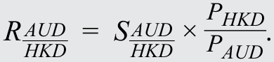

顾问情景中的信息可表示如下：

The information in the adviser’s scenario can be expressed as follows:

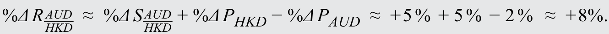

由于实际汇率（以 AUD/HKD 表示）上升约 8%，这位澳大利亚投资者的实际购买力下降了约 8%。从以下事实可以看出这一点：

Because the real exchange rate (expressed in AUD/HKD terms) has gone up by about 8 percent, the real purchasing power of the investor based in Australia has declined by about 8 percent. This can be seen from the fact that

港元在名义上相对于澳元升值，同时香港特别行政区的价格水平也有所上升。香港特别行政区商品和服务的成本（以澳元衡量）因此增加，而投资者收入的小幅增长（2%，假设等于澳大利亚价格水平的变化）只能部分抵消这种成本上升。

Hong Kong dollar has appreciated against the Australian dollar in nominal terms, and the Hong Kong SAR price level has also increased. This increase in the cost of Hong Kong SAR goods and services (measured in Australian dollars) is only partially offset by the small (2 percent) increase in the investor’s income (assumed equal to the change in the Australian price level).

#### 补充解析 / Supplementary explanation

本题复核锚点（原解摘录）：A 正确。实际汇率（RAUD/HKD）可表示如下：

Review anchor for this item (official excerpt): A is correct. The real exchange rate (RAUD/HKD) is expressed as follows:

本题官方选项为 A。补充思路：先写清报价单位。例如 A/B 表示每 1 单位 B 值多少 A，B 是基准货币，A 是计价货币。报价上升意味着 B 对 A 升值；反向报价必须取倒数。某货币贬值 x%，另一货币的升值幅度为 1/(1−x)−1，不能直接写同样的 x%。实际汇率还需按题目指定的物价指数口径调整名义汇率。

The official choice for this item is A. Additional reasoning: Write the quote’s units first. A/B gives units of A per one B: B is base and A is price currency. A rising quote means B appreciates against A. Reverse a quote by taking its reciprocal. If one currency loses x%, the other gains 1/(1−x)−1, not x%. Real-rate calculations additionally require the stated price-index convention.

一方货币下跌与另一方上涨的百分比不对称，因为基期分母不同。若报价下降 d，倒数报价的涨幅为 1/(1−d)−1，而不是直接写 d。

Opposite-currency percentage changes are asymmetric because denominators differ. If a quote falls by d, its reciprocal rises by 1/(1−d)−1, not simply d.

#### 相关知识点 / Related concepts

汇率报价与升贬值：对数变化近似对称，但普通百分比变化不对称；实质升值与名义升值在通胀不同的情况下可能不一致。

Exchange-rate quotes and currency changes: Log changes are approximately symmetric, but ordinary percentage changes are not. Real and nominal appreciation can differ when inflation rates differ.

### ECON-LM07-QUESTION_SET-201 · 习题组 · 第 1 题 Question set · 1

正文习题组 / Question set · 原版 PDF 页码 / Source PDF pages: 229

#### 题目与资料 / Question and data

问题集

QUESTION SET

1\. 实际汇率（以一单位外币对应的本币金额报价）下降，最可能与下列哪项的上升有关？

1\. A decrease in the real exchange rate (quoted in terms of domestic currency per unit of foreign currency) is most likely to be associated with an increase in which of the following?

A. 外国价格水平。

A. Foreign price level.

B. 本国价格水平。

B. Domestic price level.

C. 名义汇率。

C. Nominal exchange rate.

#### 官方答案与解析 / Official answer and explanation

解答：

Solution:

B 正确。实际汇率（以一单位外币对应的本币金额报价）为：

B is correct. The real exchange rate (quoted in terms of domestic currency per unit of foreign currency) is given as follows:

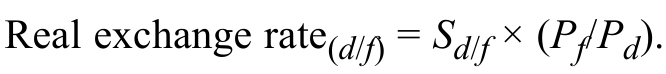

国内价格水平（Pd）上升会降低实际汇率，因为它意味着本币的相对购买力提高。

An increase in the domestic price level (Pd) decreases the real exchange rate because it implies an increase in the relative purchasing power of the domestic currency.

#### 补充解析 / Supplementary explanation

本题复核锚点（原解摘录）：B 正确。实际汇率（以一单位外币对应的本币金额报价）为：

Review anchor for this item (official excerpt): B is correct. The real exchange rate (quoted in terms of domestic currency per unit of foreign currency) is given as follows:

本题官方选项为 B。补充思路：先写清报价单位。例如 A/B 表示每 1 单位 B 值多少 A，B 是基准货币，A 是计价货币。报价上升意味着 B 对 A 升值；反向报价必须取倒数。某货币贬值 x%，另一货币的升值幅度为 1/(1−x)−1，不能直接写同样的 x%。实际汇率还需按题目指定的物价指数口径调整名义汇率。

The official choice for this item is B. Additional reasoning: Write the quote’s units first. A/B gives units of A per one B: B is base and A is price currency. A rising quote means B appreciates against A. Reverse a quote by taking its reciprocal. If one currency loses x%, the other gains 1/(1−x)−1, not x%. Real-rate calculations additionally require the stated price-index convention.

#### 相关知识点 / Related concepts

汇率报价与升贬值：对数变化近似对称，但普通百分比变化不对称；实质升值与名义升值在通胀不同的情况下可能不一致。

Exchange-rate quotes and currency changes: Log changes are approximately symmetric, but ordinary percentage changes are not. Real and nominal appreciation can differ when inflation rates differ.

### ECON-LM07-EXAMPLE-301 · 例题 2 · 第 1 题：市场参与者与交易构成 Example 2 · 1 — Market Participants and Composition of Trades

正文例题／案例 / Worked example / case · 原版 PDF 页码 / Source PDF pages: 234

#### 题目与资料 / Question and data

例 2

EXAMPLE 2

市场参与者与交易构成

Market Participants and Composition of Trades

位于澳大利亚悉尼的投资顾问在向客户介绍外汇市场的一些基本特征时，作出以下表述：

The investment adviser based in Sydney, Australia, makes the following statements to her client when describing some of the basic characteristics of the FX market:

表述 1　“按平均每日成交额衡量，即期交割的外汇交易成交量最大，因为外汇市场主要服务于国际贸易资金流的结算。”

Statement 1 “FX transactions for spot settlement see the most trade volume in terms of average daily turnover because the FX market is primarily focused on settling international trade flows.”

表述 2　“买方最重要的外汇市场参与者是从事国际贸易的企业；卖方最重要的参与者则是为其外汇需求提供服务的本地银行。”

Statement 2 “The most important FX market participants on the buy side are corporations engaged in international trade; on the sell side they are the local banks that service their FX needs.”

1\. 表述 1：

1\. Statement 1 is:

A. 正确。

A. correct.

B. 关于即期交割重要性的部分错误。

B. incorrect with respect to the importance of spot settlements.

C. 关于即期交割和国际贸易资金流重要性的部分均错误。

C. incorrect both with respect to the importance of spot settlements and international trade flows.

#### 官方答案与解析 / Official answer and explanation

解答：

Solution:

C 正确。虽然媒体在讨论外汇时通常关注即期市场，但平均每日成交量的大部分来自外汇掉期市场，因为参与者会展期或调整现有的对冲和投机头寸，或者进行外汇掉期融资。虽然所有国际贸易交易最终确实都会产生某种形式的即期交割，但这通常会在即期交割之前带来大量对冲及投机活动。此外，有一类重要的外汇市场参与者纯粹建立投机头寸，从不打算实际交付或收取交易本金。多数外汇交易量与国际贸易无关，证券投资资金流（跨境资本流动）和投机活动占据主导地位。

C is correct. Although the media generally focus on the spot market when discussing FX, the majority of average daily trade volume involves the FX swap market as market participants either roll over or modify their existing hedging and speculative positions (or engage in FX swap financing). Although it is true that all international trade transactions eventually result in some form of spot settlement, this typically generates a great deal of hedging (and speculative) activity in advance of spot settlement. Moreover, an important group of FX market participants engages in purely speculative positioning with no intention of ever delivering/receiving the principal amount of the trades. Most FX trading volume is not related to international trade: Portfolio flows (cross-border capital movements) and speculative activities dominate.

#### 补充解析 / Supplementary explanation

本题复核锚点（原解摘录）：C 正确。虽然媒体在讨论外汇时通常关注即期市场，但平均每日成交量的大部分来自外汇掉期市场，因为参与者会展期或调整现有的对冲和投机头寸，或者进行外汇掉期融资。

Review anchor for this item (official excerpt): C is correct. Although the media generally focus on the spot market when discussing FX, the majority of average daily trade volume involves the FX swap market as market participants either roll over or modify their existing hedging and speculative positions (or engage in FX swap financing).

本题官方选项为 C。补充思路：报价总是从交易商角度定义：bid 是交易商买入基准货币的价格，ask 是其卖出基准货币的价格。客户卖基准货币得到 bid，买基准货币支付 ask。报价取倒数时必须交换两端，保证新的 bid 仍小于 ask。参与者分类看其提供流动性或使用流动性的角色，而非仅看规模。

The official choice for this item is C. Additional reasoning: Quotes are from the dealer’s perspective: bid is what the dealer pays for base currency, and ask is what it charges. A customer selling base receives bid and buying base pays ask. Reciprocal quotation reverses the endpoints so the new bid remains below ask. Classify participants by liquidity-providing or liquidity-using roles rather than size alone.

#### 相关知识点 / Related concepts

外汇参与者与买卖价：反向 bid＝1/原 ask；反向 ask＝1/原 bid。交易商银行通常属于卖方，投资和对冲需求通常来自买方。

FX participants and bid–ask quotes: Reciprocal bid = 1/original ask; reciprocal ask = 1/original bid. Dealer banks typically form the sell side, while investment and hedging demand typically comes from the buy side.

### ECON-LM07-EXAMPLE-302 · 例题 2 · 第 2 题：市场参与者与交易构成 Example 2 · 2 — Market Participants and Composition of Trades

正文例题／案例 / Worked example / case · 原版 PDF 页码 / Source PDF pages: 234-235

#### 题目与资料 / Question and data

例 2

EXAMPLE 2

市场参与者与交易构成

Market Participants and Composition of Trades

位于澳大利亚悉尼的投资顾问在向客户介绍外汇市场的一些基本特征时，作出以下表述：

The investment adviser based in Sydney, Australia, makes the following statements to her client when describing some of the basic characteristics of the FX market:

表述 1　“按平均每日成交额衡量，即期交割的外汇交易成交量最大，因为外汇市场主要服务于国际贸易资金流的结算。”

Statement 1 “FX transactions for spot settlement see the most trade volume in terms of average daily turnover because the FX market is primarily focused on settling international trade flows.”

表述 2　“买方最重要的外汇市场参与者是从事国际贸易的企业；卖方最重要的参与者则是为其外汇需求提供服务的本地银行。”

Statement 2 “The most important FX market participants on the buy side are corporations engaged in international trade; on the sell side they are the local banks that service their FX needs.”

2\. 表述 2：

2\. Statement 2 is:

A. 正确。

A. correct.

B. 关于从事国际贸易的企业的部分错误。

B. incorrect with respect to corporations engaged in international trade.

C. 关于企业及为其贸易需求提供服务的本地银行的部分均错误。

C. incorrect with respect to both corporations and the local banks that service their trade needs.

#### 官方答案与解析 / Official answer and explanation

解答：

Solution:

C 正确。按平均每日成交额衡量，最重要的外汇市场参与者并非从事国际贸易的企业，而是规模庞大的投资管理机构，既包括私人机构（如养老基金），也包括公共机构（如中央银行储备管理机构或主权财富基金）。高频交易者利用计算机算法自动执行数量极其庞大的投机交易，也产生了很大且不断增长的日成交额（尽管单笔交易金额通常较小，但汇总后资金流规模很大）。在卖方，最大的货币中心银行（例如德意志银行、花旗集团、汇丰、瑞银）正日益主导通过交易商进行的交易活动。就外汇市场平均每日成交额的份额而言，区域性和本地银行正日益被边缘化。

C is correct. The most important FX market participants in terms of average daily turnover are found not among corporations engaged in international trade but among huge investment managers, both private (e.g., pension funds) and public (e.g., central bank reserve managers or sovereign wealth funds). A large and growing amount of daily turnover is also being generated by high-frequency traders who use computer algorithms to automatically execute extremely high numbers of speculative trades (although their individual ticket sizes are generally small, they add up to large aggregate flows). On the sell side, the largest money center banks (e.g., Deutsche Bank, Citigroup, HSBC, UBS) are increasingly dominating the amount of trading activity routed through dealers. Regional and local banks are increasingly being marginalized in terms of their share of average daily turnover in FX markets.

#### 补充解析 / Supplementary explanation

本题复核锚点（原解摘录）：C 正确。按平均每日成交额衡量，最重要的外汇市场参与者并非从事国际贸易的企业，而是规模庞大的投资管理机构，既包括私人机构（如养老基金），也包括公共机构（如中央银行储备管理机构或主权财富基金）。

Review anchor for this item (official excerpt): C is correct. The most important FX market participants in terms of average daily turnover are found not among corporations engaged in international trade but among huge investment managers, both private (e.g., pension funds) and public (e.g., central bank reserve managers or sovereign wealth funds).

本题官方选项为 C。补充思路：报价总是从交易商角度定义：bid 是交易商买入基准货币的价格，ask 是其卖出基准货币的价格。客户卖基准货币得到 bid，买基准货币支付 ask。报价取倒数时必须交换两端，保证新的 bid 仍小于 ask。参与者分类看其提供流动性或使用流动性的角色，而非仅看规模。

The official choice for this item is C. Additional reasoning: Quotes are from the dealer’s perspective: bid is what the dealer pays for base currency, and ask is what it charges. A customer selling base receives bid and buying base pays ask. Reciprocal quotation reverses the endpoints so the new bid remains below ask. Classify participants by liquidity-providing or liquidity-using roles rather than size alone.

#### 相关知识点 / Related concepts

外汇参与者与买卖价：反向 bid＝1/原 ask；反向 ask＝1/原 bid。交易商银行通常属于卖方，投资和对冲需求通常来自买方。

FX participants and bid–ask quotes: Reciprocal bid = 1/original ask; reciprocal ask = 1/original bid. Dealer banks typically form the sell side, while investment and hedging demand typically comes from the buy side.

### ECON-LM07-QUESTION_SET-401 · 习题组 · 第 1 题 Question set · 1

正文习题组 / Question set · 原版 PDF 页码 / Source PDF pages: 235

#### 题目与资料 / Question and data

问题集

QUESTION SET

1\. 下列哪类交易对手最可能被视为外汇市场的卖方参与者？

1\. Which of the following counterparties is most likely to be considered a sell-side FX market participant?

A. 以外币借款的大型企业

A. A large corporation that borrows in foreign currencies

B. 影响跨境资本流动的主权财富基金

B. A sovereign wealth fund that influences cross-border capital flows

C. 与多样化客户群进行外汇交易的跨国银行

C. A multinational bank that trades FX with its diverse client base

#### 官方答案与解析 / Official answer and explanation

C 正确。卖方通常由向买方客户出售外汇及相关工具的大型银行组成。这些银行充当做市商，报出其愿意买入基础货币的汇率（买入价），以及愿意卖出基础货币的汇率（卖出价）。

C is correct. The sell-side parties generally consist of large banks that sell FX and related instruments to buy-side clients. These banks act as market makers, quoting exchange rates at which they will buy (the bid price) or sell (the offer price) the base currency.

#### 补充解析 / Supplementary explanation

本题复核锚点（原解摘录）：C 正确。卖方通常由向买方客户出售外汇及相关工具的大型银行组成。

Review anchor for this item (official excerpt): C is correct. The sell-side parties generally consist of large banks that sell FX and related instruments to buy-side clients.

本题官方选项为 C。补充思路：报价总是从交易商角度定义：bid 是交易商买入基准货币的价格，ask 是其卖出基准货币的价格。客户卖基准货币得到 bid，买基准货币支付 ask。报价取倒数时必须交换两端，保证新的 bid 仍小于 ask。参与者分类看其提供流动性或使用流动性的角色，而非仅看规模。

The official choice for this item is C. Additional reasoning: Quotes are from the dealer’s perspective: bid is what the dealer pays for base currency, and ask is what it charges. A customer selling base receives bid and buying base pays ask. Reciprocal quotation reverses the endpoints so the new bid remains below ask. Classify participants by liquidity-providing or liquidity-using roles rather than size alone.

#### 相关知识点 / Related concepts

外汇参与者与买卖价：反向 bid＝1/原 ask；反向 ask＝1/原 bid。交易商银行通常属于卖方，投资和对冲需求通常来自买方。

FX participants and bid–ask quotes: Reciprocal bid = 1/original ask; reciprocal ask = 1/original bid. Dealer banks typically form the sell side, while investment and hedging demand typically comes from the buy side.

### ECON-LM07-EXAMPLE-501 · 例题 3 · 第 1 题：汇率惯例 Example 3 · 1 — Exchange Rate Conventions

正文例题／案例 / Worked example / case · 原版 PDF 页码 / Source PDF pages: 238

#### 题目与资料 / Question and data

例 3

EXAMPLE 3

汇率惯例

Exchange Rate Conventions

一位位于纽约市的交易商向墨西哥城的客户提供 18.8590 MXN/USD 的即期汇率报价。18.8590 的倒数为 0.0530。

A dealer based in New York City provides a spot exchange rate quote of 18.8590 MXN/USD to a client in Mexico City. The inverse of 18.8590 is 0.0530.

1\. 从这位墨西哥客户的角度看，最准确的说法是：

1\. From the perspective of the Mexican client, the most accurate statement is that the:

A. 直接标价汇率等于 0.0530。

A. direct exchange rate quotation is equal to 0.0530.

B. 直接标价汇率等于 18.8590。

B. direct exchange rate quotation is equal to 18.8590.

C. 间接标价汇率等于 18.8590。

C. indirect exchange rate quotation is equal to 18.8590.

#### 官方答案与解析 / Official answer and explanation

解答：

Solution:

B 正确。直接标价汇率以本币作为标价货币，外币作为基础货币。在 MXN/USD 报价中，墨西哥比索是标价货币，因此对墨西哥客户而言，直接标价为 18.8590（购买 1 美元需要支付 18.8590 墨西哥比索）。理解直接标价汇率的另一种方式是：它就是以本币表示的一单位外币的价格。购买一单位外币，可以视为与购买任何其他物品类似；把一单位外币想象成你用本币购买的另一件商品即可。例如，对居住在加拿大的人而言，一升牛奶的价格可能约为 1.25 加元，而同一时期 1 美元的价格约为 1.30 加元。这种直接标价以本币（在此为加元）作为标价货币，只是给出了所购买的一单位外币的价格。

B is correct. A direct exchange rate uses the domestic currency as the price currency and the foreign currency as the base currency. For an MXN/USD quote, the Mexican peso is the price currency; therefore, the direct quote for the Mexican client is 18.8590 (it costs MXN18.8590 to purchase USD1). Another way of understanding a direct exchange rate quote is that it is the price of one unit of foreign currency in terms of your own currency. This purchase of a unit of foreign currency can be thought of as a purchase much like any other you might make; think of the unit of foreign currency as just another item that you might be purchasing with your domestic currency. For example, for someone based in Canada, a liter of milk might cost about CAD1.25 at a time when USD1 costs about CAD1.30. This direct currency quote uses the domestic currency (the Canadian dollar, in this case) as the price currency and simply gives the price of a unit of foreign currency that is being purchased.

#### 补充解析 / Supplementary explanation

本题复核锚点（原解摘录）：B 正确。直接标价汇率以本币作为标价货币，外币作为基础货币。

Review anchor for this item (official excerpt): B is correct. A direct exchange rate uses the domestic currency as the price currency and the foreign currency as the base currency.

本题官方选项为 B。补充思路：先写清报价单位。例如 A/B 表示每 1 单位 B 值多少 A，B 是基准货币，A 是计价货币。报价上升意味着 B 对 A 升值；反向报价必须取倒数。某货币贬值 x%，另一货币的升值幅度为 1/(1−x)−1，不能直接写同样的 x%。实际汇率还需按题目指定的物价指数口径调整名义汇率。

The official choice for this item is B. Additional reasoning: Write the quote’s units first. A/B gives units of A per one B: B is base and A is price currency. A rising quote means B appreciates against A. Reverse a quote by taking its reciprocal. If one currency loses x%, the other gains 1/(1−x)−1, not x%. Real-rate calculations additionally require the stated price-index convention.

#### 相关知识点 / Related concepts

汇率报价与升贬值：对数变化近似对称，但普通百分比变化不对称；实质升值与名义升值在通胀不同的情况下可能不一致。

Exchange-rate quotes and currency changes: Log changes are approximately symmetric, but ordinary percentage changes are not. Real and nominal appreciation can differ when inflation rates differ.

### ECON-LM07-EXAMPLE-502 · 例题 3 · 第 2 题：汇率惯例 Example 3 · 2 — Exchange Rate Conventions

正文例题／案例 / Worked example / case · 原版 PDF 页码 / Source PDF pages: 238-239

#### 题目与资料 / Question and data

例 3

EXAMPLE 3

汇率惯例

Exchange Rate Conventions

一位位于纽约市的交易商向墨西哥城的客户提供 18.8590 MXN/USD 的即期汇率报价。18.8590 的倒数为 0.0530。

A dealer based in New York City provides a spot exchange rate quote of 18.8590 MXN/USD to a client in Mexico City. The inverse of 18.8590 is 0.0530.

2\. 如果交易商的买入/卖出报价为 18.8580–18.8600 MXN/USD，那么以 USD/MXN 表示的买入/卖出报价最接近：

2\. If the bid/offer quote from the dealer was 18.8580–18.8600 MXN/USD, then the bid/offer quote in USD/MXN terms would be closest to:

A. 0.05302–0.05303。

A. 0.05302–0.05303.

B. 0.05303–0.05302。

B. 0.05303–0.05302.

C. 0.053025–0.053025。

C. 0.053025–0.053025.

#### 官方答案与解析 / Official answer and explanation

解答：

Solution:

A 正确。MXN/USD 报价是交易商为买入（卖出）1 美元所报出的墨西哥比索数量。交易商以 18.8580 墨西哥比索买入 1 美元的买入报价，等同于支付 18.8580 墨西哥比索购买 1 美元。将两边都除以 18.8580，意味着交易商支付（即卖出）1 墨西哥比索购买 0.05303 美元。这就是以 USD/MXN 表示的卖出价：交易商愿意以 0.05303 美元的价格卖出 1 墨西哥比索。以 USD/MXN 表示时，交易商对 1 墨西哥比索的买入价为 0.05302，是将 MXN/USD 卖出价 18.8600 取倒数得到的（

A is correct. An MXN/USD quote is the amount of Mexican pesos the dealer is bidding (offering) to buy (sell) USD1. The dealer’s bid to buy USD1 at MXN18.8580 is equivalent to the dealer paying MXN18.8580 to buy USD1. Dividing both terms by 18.8580 means the dealer is paying (i.e., selling) MXN1 to buy USD0.05303. This is the offer in USD/MXN terms: The dealer offers to sell MXN1 at a price of USD0.05303. In USD/MXN terms, the dealer’s bid for MXN1 is 0.05302, calculated by inverting the offer of 18.8600 in MXN/USD terms (

）。请注意，任何买入/卖出报价中，无论使用哪种基础货币和标价货币，买入价始终低于卖出价。

). Note that in any bid/offer quote, no matter which base or price currencies are used, the bid is always lower than the offer.

#### 补充解析 / Supplementary explanation

本题复核锚点（原解摘录）：A 正确。MXN/USD 报价是交易商为买入（卖出）1 美元所报出的墨西哥比索数量。

Review anchor for this item (official excerpt): A is correct. An MXN/USD quote is the amount of Mexican pesos the dealer is bidding (offering) to buy (sell) USD1.

本题官方选项为 A。补充思路：报价总是从交易商角度定义：bid 是交易商买入基准货币的价格，ask 是其卖出基准货币的价格。客户卖基准货币得到 bid，买基准货币支付 ask。报价取倒数时必须交换两端，保证新的 bid 仍小于 ask。参与者分类看其提供流动性或使用流动性的角色，而非仅看规模。

The official choice for this item is A. Additional reasoning: Quotes are from the dealer’s perspective: bid is what the dealer pays for base currency, and ask is what it charges. A customer selling base receives bid and buying base pays ask. Reciprocal quotation reverses the endpoints so the new bid remains below ask. Classify participants by liquidity-providing or liquidity-using roles rather than size alone.

#### 相关知识点 / Related concepts

外汇参与者与买卖价：反向 bid＝1/原 ask；反向 ask＝1/原 bid。交易商银行通常属于卖方，投资和对冲需求通常来自买方。

FX participants and bid–ask quotes: Reciprocal bid = 1/original ask; reciprocal ask = 1/original bid. Dealer banks typically form the sell side, while investment and hedging demand typically comes from the buy side.

### ECON-LM07-QUESTION_SET-601 · 习题组 · 第 1 题 Question set · 1

正文习题组 / Question set · 原版 PDF 页码 / Source PDF pages: 242

#### 题目与资料 / Question and data

问题集

QUESTION SET

1\. 汇率：

1\. An exchange rate:

A. 最常以实际值报价。

A. is most commonly quoted in real terms.

B. 是以一种货币表示的另一种货币的价格。

B. is the price of one currency in terms of another.

C. 在两种货币之间存在，就能确保两者完全可兑换。

C. between two currencies ensures that they are fully convertible.

#### 官方答案与解析 / Official answer and explanation

解答：

Solution:

B 正确。汇率是一单位基础货币能够购买的标价货币单位数。等价地说，它是购买一单位基础货币所需的标价货币单位数。

B is correct. The exchange rate is the number of units of the price currency that one unit of the base currency will buy. Equivalently, it is the number of units of the price currency required to buy one unit of the base currency.

#### 补充解析 / Supplementary explanation

本题复核锚点（原解摘录）：B 正确。汇率是一单位基础货币能够购买的标价货币单位数。

Review anchor for this item (official excerpt): B is correct. The exchange rate is the number of units of the price currency that one unit of the base currency will buy.

本题官方选项为 B。补充思路：先写清报价单位。例如 A/B 表示每 1 单位 B 值多少 A，B 是基准货币，A 是计价货币。报价上升意味着 B 对 A 升值；反向报价必须取倒数。某货币贬值 x%，另一货币的升值幅度为 1/(1−x)−1，不能直接写同样的 x%。实际汇率还需按题目指定的物价指数口径调整名义汇率。

The official choice for this item is B. Additional reasoning: Write the quote’s units first. A/B gives units of A per one B: B is base and A is price currency. A rising quote means B appreciates against A. Reverse a quote by taking its reciprocal. If one currency loses x%, the other gains 1/(1−x)−1, not x%. Real-rate calculations additionally require the stated price-index convention.

#### 相关知识点 / Related concepts

汇率报价与升贬值：对数变化近似对称，但普通百分比变化不对称；实质升值与名义升值在通胀不同的情况下可能不一致。

Exchange-rate quotes and currency changes: Log changes are approximately symmetric, but ordinary percentage changes are not. Real and nominal appreciation can differ when inflation rates differ.

### ECON-LM07-QUESTION_SET-602 · 习题组 · 第 2 题 Question set · 2

正文习题组 / Question set · 原版 PDF 页码 / Source PDF pages: 242

#### 题目与资料 / Question and data

问题集

QUESTION SET

2\. 下列哪项不是理想货币制度的条件？

2\. Which of the following is not a condition of an ideal currency regime?

A. 货币完全可兑换

A. Fully convertible currencies

B. 完全独立的货币政策

B. Fully independent monetary policy

C. 独立浮动的汇率

C. Independently floating exchange rates

#### 官方答案与解析 / Official answer and explanation

C 正确。理想货币制度应使所有货币之间的汇率可信地固定不变，从而消除商品和服务，以及实物资产和金融资产价格中与货币相关的不确定性。

C is correct. An ideal currency regime would have credibly fixed exchange rates among all currencies. This would eliminate currency-related uncertainty with respect to the prices of goods and services as well as real and financial assets.

#### 补充解析 / Supplementary explanation

本题复核锚点（原解摘录）：C 正确。理想货币制度应使所有货币之间的汇率可信地固定不变，从而消除商品和服务，以及实物资产和金融资产价格中与货币相关的不确定性。

Review anchor for this item (official excerpt): C is correct. An ideal currency regime would have credibly fixed exchange rates among all currencies.

本题官方选项为 C。补充思路：把经常账户与资本融资联系起来：一国购买的外国商品服务超过其出售额，需要相应净融资来源或储备变化。资本管制可能缓解短期资金流动压力并扩大政策空间，但也可能降低长期投资者信任。汇率制度的比较应同时考虑承诺的可信度、储备需求、调整弹性和货币自主性。

The official choice for this item is C. Additional reasoning: Connect the current account to financing: excess purchases from abroad require net financing or reserve changes. Capital controls may relieve short-term flow pressure and create policy space but can weaken long-term investor confidence. Compare regimes on credibility, reserve needs, adjustment flexibility, and monetary autonomy.

#### 相关知识点 / Related concepts

汇率制度与跨境资本流动：国际收支具有会计对应关系；固定汇率与自由资本流动会约束独立货币政策。政策短期效果与长期融资成本应分别分析。

Exchange-rate regimes and capital flows: Balance-of-payments flows have accounting counterparts. Fixed rates and mobile capital constrain independent monetary policy. Separate short-term effects from long-term financing costs.

### ECON-LM07-EXAMPLE-701 · 例题 4 · 第 1 题：汇率制度 Example 4 · 1 — Exchange Rate Regimes

正文例题／案例 / Worked example / case · 原版 PDF 页码 / Source PDF pages: 247-248

#### 题目与资料 / Question and data

例 4

EXAMPLE 4

汇率制度

Exchange Rate Regimes

一位位于美国洛杉矶的投资顾问正在会见一名客户，该客户希望增加国际投资，以使其投资组合更加多元化。为评估国际分散化对客户的适合程度，顾问尝试解释外汇市场的一些特征。顾问指出，汇率制度既会影响国内经济表现，也会影响国际投资所带来的外汇风险大小。

An investment adviser in Los Angeles, United States, is meeting with a client who wishes to diversify her portfolio by including more international investments. To evaluate the suitability of international diversification for the client, the adviser attempts to explain some of the characteristics of FX markets. The adviser points out that exchange rate regimes affect the performance of domestic economies as well as the amount of FX risk posed by international investments.

客户与顾问讨论了在香港特别行政区、巴拿马和加拿大的潜在投资。顾问指出，香港特别行政区、巴拿马和加拿大分别采用货币局、美元化和自由浮动制度。顾问告诉客户，这些制度意味着其投资组合会面临不同程度的外汇风险。

The client and her adviser discuss potential investments in Hong Kong SAR, Panama, and Canada. The adviser notes that the currency regimes of Hong Kong SAR, Panama, and Canada are a currency board, dollarization, and a free float, respectively. The adviser tells his client that these regimes imply different degrees of FX risk for her portfolio.

随后，投资顾问与客户转而讨论在其他采用不同货币制度的市场中的潜在投资。顾问指出，一些市场采用相对于美元的固定平价制度。客户询问，固定平价制度是否意味着其投资组合的外币风险低于货币局制度。顾问回答：“是的，固定平价制度意味着汇率恒定，而且比货币局更可信。”

The discussion between the investment adviser and his client then turns to potential investments in other markets with different currency regimes. The adviser notes that some markets are subject to fixed parity regimes against the US dollar. The client asks whether a fixed parity regime would imply less foreign currency risk for her portfolio than would a currency board. The adviser replies: “Yes, a fixed parity regime means a constant exchange rate and is more credible than a currency board.”

顾问继续解释，一些市场允许汇率变动，但会以不同程度的外汇市场干预来限制汇率波动。他举例指出，中国大陆实行参考美元的爬行盯住制度，但与自由浮动货币的平均每日波动相比，CNY/USD 汇率的平均每日百分比变动非常小。顾问还指出，丹麦实行参考欧元的目标区间制度，而韩国通常采用自由浮动货币制度，但有时会转向管理浮动。中国大陆、丹麦和韩国的货币分别是人民币元（CNY）、丹麦克朗（DKK）和韩元（KRW）。

The adviser goes on to explain that in some markets, exchange rates are allowed to vary, although with different degrees of FX market intervention to limit exchange rate volatility. Citing examples, he notes that the Chinese Mainland has a crawling peg regime with reference to the US dollar, but the average daily percentage changes in the CNY/USD exchange rate are very small compared with the average daily volatility for a freely floating currency. The adviser also indicates that Denmark has a target zone regime with reference to the euro, and South Korea usually follows a freely floating currency regime but sometimes switches to a managed float regime. The currencies of the Chinese Mainland, Denmark, and South Korea are the yuan renminbi (CNY), krone (DKK), and won (KRW), respectively.

1\. 仅根据客户将面临的汇率风险，下列投资地点按风险从高到低排列，哪项正确？

1\. Based solely on the exchange rate risk the client would face, what is the correct ranking (from most to least risky) of the following investment locations?

A. 巴拿马、加拿大、香港特别行政区

A. Panama, Canada, Hong Kong SAR

B. 加拿大、香港特别行政区、巴拿马

B. Canada, Hong Kong SAR, Panama

C. 香港特别行政区、巴拿马、加拿大

C. Hong Kong SAR, Panama, Canada

#### 官方答案与解析 / Official answer and explanation

解答：

Solution:

B 正确。CAD/USD 汇率为浮动汇率，因此，对以美国为本国的投资者而言，加拿大投资会带来汇率风险。虽然香港特别行政区采用货币局制度，HKD/USD 汇率仍存在一定变化，不过其变动幅度远小于浮动汇率制度。相比之下，巴拿马经济实行美元化，即以美元作为本币，因此美国投资者不面临外汇风险。

B is correct. The CAD/USD exchange rate is a floating exchange rate, and Canadian investments would therefore carry exchange rate risk for a US-based investor. Although Hong Kong SAR follows a currency board system, the HKD/USD exchange rate nonetheless does display some variation, albeit much less than in a floating exchange rate regime. In contrast, Panama has a dollarized economy (i.e., it uses the US dollar as the domestic currency); therefore, there is no FX risk for a US investor.

#### 补充解析 / Supplementary explanation

本题复核锚点（原解摘录）：B 正确。CAD/USD 汇率为浮动汇率，因此，对以美国为本国的投资者而言，加拿大投资会带来汇率风险。

Review anchor for this item (official excerpt): B is correct. The CAD/USD exchange rate is a floating exchange rate, and Canadian investments would therefore carry exchange rate risk for a US-based investor.

本题官方选项为 B。补充思路：把经常账户与资本融资联系起来：一国购买的外国商品服务超过其出售额，需要相应净融资来源或储备变化。资本管制可能缓解短期资金流动压力并扩大政策空间，但也可能降低长期投资者信任。汇率制度的比较应同时考虑承诺的可信度、储备需求、调整弹性和货币自主性。

The official choice for this item is B. Additional reasoning: Connect the current account to financing: excess purchases from abroad require net financing or reserve changes. Capital controls may relieve short-term flow pressure and create policy space but can weaken long-term investor confidence. Compare regimes on credibility, reserve needs, adjustment flexibility, and monetary autonomy.

#### 相关知识点 / Related concepts

汇率制度与跨境资本流动：国际收支具有会计对应关系；固定汇率与自由资本流动会约束独立货币政策。政策短期效果与长期融资成本应分别分析。

Exchange-rate regimes and capital flows: Balance-of-payments flows have accounting counterparts. Fixed rates and mobile capital constrain independent monetary policy. Separate short-term effects from long-term financing costs.

### ECON-LM07-EXAMPLE-702 · 例题 4 · 第 2 题：汇率制度 Example 4 · 2 — Exchange Rate Regimes

正文例题／案例 / Worked example / case · 原版 PDF 页码 / Source PDF pages: 247-248

#### 题目与资料 / Question and data

例 4

EXAMPLE 4

汇率制度

Exchange Rate Regimes

一位位于美国洛杉矶的投资顾问正在会见一名客户，该客户希望增加国际投资，以使其投资组合更加多元化。为评估国际分散化对客户的适合程度，顾问尝试解释外汇市场的一些特征。顾问指出，汇率制度既会影响国内经济表现，也会影响国际投资所带来的外汇风险大小。

An investment adviser in Los Angeles, United States, is meeting with a client who wishes to diversify her portfolio by including more international investments. To evaluate the suitability of international diversification for the client, the adviser attempts to explain some of the characteristics of FX markets. The adviser points out that exchange rate regimes affect the performance of domestic economies as well as the amount of FX risk posed by international investments.

客户与顾问讨论了在香港特别行政区、巴拿马和加拿大的潜在投资。顾问指出，香港特别行政区、巴拿马和加拿大分别采用货币局、美元化和自由浮动制度。顾问告诉客户，这些制度意味着其投资组合会面临不同程度的外汇风险。

The client and her adviser discuss potential investments in Hong Kong SAR, Panama, and Canada. The adviser notes that the currency regimes of Hong Kong SAR, Panama, and Canada are a currency board, dollarization, and a free float, respectively. The adviser tells his client that these regimes imply different degrees of FX risk for her portfolio.

随后，投资顾问与客户转而讨论在其他采用不同货币制度的市场中的潜在投资。顾问指出，一些市场采用相对于美元的固定平价制度。客户询问，固定平价制度是否意味着其投资组合的外币风险低于货币局制度。顾问回答：“是的，固定平价制度意味着汇率恒定，而且比货币局更可信。”

The discussion between the investment adviser and his client then turns to potential investments in other markets with different currency regimes. The adviser notes that some markets are subject to fixed parity regimes against the US dollar. The client asks whether a fixed parity regime would imply less foreign currency risk for her portfolio than would a currency board. The adviser replies: “Yes, a fixed parity regime means a constant exchange rate and is more credible than a currency board.”

顾问继续解释，一些市场允许汇率变动，但会以不同程度的外汇市场干预来限制汇率波动。他举例指出，中国大陆实行参考美元的爬行盯住制度，但与自由浮动货币的平均每日波动相比，CNY/USD 汇率的平均每日百分比变动非常小。顾问还指出，丹麦实行参考欧元的目标区间制度，而韩国通常采用自由浮动货币制度，但有时会转向管理浮动。中国大陆、丹麦和韩国的货币分别是人民币元（CNY）、丹麦克朗（DKK）和韩元（KRW）。

The adviser goes on to explain that in some markets, exchange rates are allowed to vary, although with different degrees of FX market intervention to limit exchange rate volatility. Citing examples, he notes that the Chinese Mainland has a crawling peg regime with reference to the US dollar, but the average daily percentage changes in the CNY/USD exchange rate are very small compared with the average daily volatility for a freely floating currency. The adviser also indicates that Denmark has a target zone regime with reference to the euro, and South Korea usually follows a freely floating currency regime but sometimes switches to a managed float regime. The currencies of the Chinese Mainland, Denmark, and South Korea are the yuan renminbi (CNY), krone (DKK), and won (KRW), respectively.

2\. 仅根据其汇率制度，哪一个投资地点最不可能从美国输入通胀或通缩？

2\. Based solely on their FX regimes, which investment location is least likely to import inflation or deflation from the United States?

A. 加拿大

A. Canada

B. 巴拿马

B. Panama

C. 香港特别行政区

C. Hong Kong SAR

#### 官方答案与解析 / Official answer and explanation

A 正确。加元相对于美元独立浮动，使加拿大银行能够调整货币政策以维持价格稳定。香港特别行政区（货币局）和巴拿马（美元化）都无法实施独立货币政策，来缓冲美国货币政策给其经济带来的通胀或通缩后果。

A is correct. The Canadian dollar floats independently against the US dollar leaving the Bank of Canada able to adjust monetary policy to maintain price stability. Neither Hong Kong SAR (currency board) nor Panama (dollarized) can exercise independent monetary policy to buffer its economy from the inflationary or deflationary consequences of US monetary policy.

#### 补充解析 / Supplementary explanation

本题复核锚点（原解摘录）：A 正确。加元相对于美元独立浮动，使加拿大银行能够调整货币政策以维持价格稳定。

Review anchor for this item (official excerpt): A is correct. The Canadian dollar floats independently against the US dollar leaving the Bank of Canada able to adjust monetary policy to maintain price stability.

本题官方选项为 A。补充思路：把经常账户与资本融资联系起来：一国购买的外国商品服务超过其出售额，需要相应净融资来源或储备变化。资本管制可能缓解短期资金流动压力并扩大政策空间，但也可能降低长期投资者信任。汇率制度的比较应同时考虑承诺的可信度、储备需求、调整弹性和货币自主性。

The official choice for this item is A. Additional reasoning: Connect the current account to financing: excess purchases from abroad require net financing or reserve changes. Capital controls may relieve short-term flow pressure and create policy space but can weaken long-term investor confidence. Compare regimes on credibility, reserve needs, adjustment flexibility, and monetary autonomy.

本题要求选择“不成立、最不可能或例外”的项目。先判断各陈述在题设下是否成立，再按这一反向要求选出答案；正确选项可能本身描述的就是错误或不适用情形。

This item asks for a least-likely, inaccurate, or exception case. Evaluate each statement under the assumptions, then apply that reversed selection rule; the credited choice may itself describe the false or inapplicable case.

#### 相关知识点 / Related concepts

汇率制度与跨境资本流动：国际收支具有会计对应关系；固定汇率与自由资本流动会约束独立货币政策。政策短期效果与长期融资成本应分别分析。

Exchange-rate regimes and capital flows: Balance-of-payments flows have accounting counterparts. Fixed rates and mobile capital constrain independent monetary policy. Separate short-term effects from long-term financing costs.

### ECON-LM07-EXAMPLE-703 · 例题 4 · 第 3 题：汇率制度 Example 4 · 3 — Exchange Rate Regimes

正文例题／案例 / Worked example / case · 原版 PDF 页码 / Source PDF pages: 247-249

#### 题目与资料 / Question and data

例 4

EXAMPLE 4

汇率制度

Exchange Rate Regimes

一位位于美国洛杉矶的投资顾问正在会见一名客户，该客户希望增加国际投资，以使其投资组合更加多元化。为评估国际分散化对客户的适合程度，顾问尝试解释外汇市场的一些特征。顾问指出，汇率制度既会影响国内经济表现，也会影响国际投资所带来的外汇风险大小。

An investment adviser in Los Angeles, United States, is meeting with a client who wishes to diversify her portfolio by including more international investments. To evaluate the suitability of international diversification for the client, the adviser attempts to explain some of the characteristics of FX markets. The adviser points out that exchange rate regimes affect the performance of domestic economies as well as the amount of FX risk posed by international investments.

客户与顾问讨论了在香港特别行政区、巴拿马和加拿大的潜在投资。顾问指出，香港特别行政区、巴拿马和加拿大分别采用货币局、美元化和自由浮动制度。顾问告诉客户，这些制度意味着其投资组合会面临不同程度的外汇风险。

The client and her adviser discuss potential investments in Hong Kong SAR, Panama, and Canada. The adviser notes that the currency regimes of Hong Kong SAR, Panama, and Canada are a currency board, dollarization, and a free float, respectively. The adviser tells his client that these regimes imply different degrees of FX risk for her portfolio.

随后，投资顾问与客户转而讨论在其他采用不同货币制度的市场中的潜在投资。顾问指出，一些市场采用相对于美元的固定平价制度。客户询问，固定平价制度是否意味着其投资组合的外币风险低于货币局制度。顾问回答：“是的，固定平价制度意味着汇率恒定，而且比货币局更可信。”

The discussion between the investment adviser and his client then turns to potential investments in other markets with different currency regimes. The adviser notes that some markets are subject to fixed parity regimes against the US dollar. The client asks whether a fixed parity regime would imply less foreign currency risk for her portfolio than would a currency board. The adviser replies: “Yes, a fixed parity regime means a constant exchange rate and is more credible than a currency board.”

顾问继续解释，一些市场允许汇率变动，但会以不同程度的外汇市场干预来限制汇率波动。他举例指出，中国大陆实行参考美元的爬行盯住制度，但与自由浮动货币的平均每日波动相比，CNY/USD 汇率的平均每日百分比变动非常小。顾问还指出，丹麦实行参考欧元的目标区间制度，而韩国通常采用自由浮动货币制度，但有时会转向管理浮动。中国大陆、丹麦和韩国的货币分别是人民币元（CNY）、丹麦克朗（DKK）和韩元（KRW）。

The adviser goes on to explain that in some markets, exchange rates are allowed to vary, although with different degrees of FX market intervention to limit exchange rate volatility. Citing examples, he notes that the Chinese Mainland has a crawling peg regime with reference to the US dollar, but the average daily percentage changes in the CNY/USD exchange rate are very small compared with the average daily volatility for a freely floating currency. The adviser also indicates that Denmark has a target zone regime with reference to the euro, and South Korea usually follows a freely floating currency regime but sometimes switches to a managed float regime. The currencies of the Chinese Mainland, Denmark, and South Korea are the yuan renminbi (CNY), krone (DKK), and won (KRW), respectively.

3\. 顾问关于固定平价制度的回答，在哪一方面错误？

3\. The adviser’s reply about fixed parity regimes is incorrect with regard to:

A. 可信度。

A. credibility.

B. 汇率恒定。

B. a constant exchange rate.

C. 汇率恒定与可信度两方面。

C. both a constant exchange rate and credibility.

#### 官方答案与解析 / Official answer and explanation

解答：

Solution:

C 正确。固定汇率制度并不意味着汇率僵硬地固定在某个恒定水平。实际上，固定汇率制度和货币局制度都允许汇率在所公布平价周围的区间内波动。因此，两种制度至少都涉及少量汇率风险。固定平价制度还使投资者面临额外风险，即平价可能无法维持。在固定平价制度下，外汇储备水平由当局自行决定，而且通常只占国内货币供给的一小部分。由于没有维持平价的法律义务，如果货币当局认为调整平价（使本币法定贬值或法定升值）或允许本币浮动，比其他调整机制（例如财政紧缩）造成的痛苦更小，就可以这样做。相比之下，货币局制度包含维持平价并以储备货币资产全额支持本币的法律承诺。因此，放弃平价的风险很小。

C is correct. A fixed exchange rate regime does not mean that the exchange rate is rigidly fixed at a constant level. In practice, both a fixed-rate regime and a currency board allow the exchange rate to vary within a band around the stated parity level. Thus, both regimes involve at least a modest amount of exchange rate risk. The fixed parity regime exposes the investor to the additional risk that the parity may not be maintained. In a fixed parity regime, the level of foreign currency reserves is discretionary and typically only a small fraction of the domestic money supply. With no legal obligation to maintain the parity, the monetary authority may adjust the parity (devalue or revalue its currency) or allow its currency to float if doing so is deemed to be less painful than other adjustment mechanisms (e.g., fiscal restraint). In contrast, a currency board entails a legal commitment to maintain the parity and to fully back the domestic currency with reserve currency assets. Hence, there is little risk that the parity will be abandoned.

#### 补充解析 / Supplementary explanation

本题复核锚点（原解摘录）：C 正确。固定汇率制度并不意味着汇率僵硬地固定在某个恒定水平。

Review anchor for this item (official excerpt): C is correct. A fixed exchange rate regime does not mean that the exchange rate is rigidly fixed at a constant level.

本题官方选项为 C。补充思路：把经常账户与资本融资联系起来：一国购买的外国商品服务超过其出售额，需要相应净融资来源或储备变化。资本管制可能缓解短期资金流动压力并扩大政策空间，但也可能降低长期投资者信任。汇率制度的比较应同时考虑承诺的可信度、储备需求、调整弹性和货币自主性。

The official choice for this item is C. Additional reasoning: Connect the current account to financing: excess purchases from abroad require net financing or reserve changes. Capital controls may relieve short-term flow pressure and create policy space but can weaken long-term investor confidence. Compare regimes on credibility, reserve needs, adjustment flexibility, and monetary autonomy.

#### 相关知识点 / Related concepts

汇率制度与跨境资本流动：国际收支具有会计对应关系；固定汇率与自由资本流动会约束独立货币政策。政策短期效果与长期融资成本应分别分析。

Exchange-rate regimes and capital flows: Balance-of-payments flows have accounting counterparts. Fixed rates and mobile capital constrain independent monetary policy. Separate short-term effects from long-term financing costs.

### ECON-LM07-EXAMPLE-704 · 例题 4 · 第 4 题：汇率制度 Example 4 · 4 — Exchange Rate Regimes

正文例题／案例 / Worked example / case · 原版 PDF 页码 / Source PDF pages: 247-249

#### 题目与资料 / Question and data

例 4

EXAMPLE 4

汇率制度

Exchange Rate Regimes

一位位于美国洛杉矶的投资顾问正在会见一名客户，该客户希望增加国际投资，以使其投资组合更加多元化。为评估国际分散化对客户的适合程度，顾问尝试解释外汇市场的一些特征。顾问指出，汇率制度既会影响国内经济表现，也会影响国际投资所带来的外汇风险大小。

An investment adviser in Los Angeles, United States, is meeting with a client who wishes to diversify her portfolio by including more international investments. To evaluate the suitability of international diversification for the client, the adviser attempts to explain some of the characteristics of FX markets. The adviser points out that exchange rate regimes affect the performance of domestic economies as well as the amount of FX risk posed by international investments.

客户与顾问讨论了在香港特别行政区、巴拿马和加拿大的潜在投资。顾问指出，香港特别行政区、巴拿马和加拿大分别采用货币局、美元化和自由浮动制度。顾问告诉客户，这些制度意味着其投资组合会面临不同程度的外汇风险。

The client and her adviser discuss potential investments in Hong Kong SAR, Panama, and Canada. The adviser notes that the currency regimes of Hong Kong SAR, Panama, and Canada are a currency board, dollarization, and a free float, respectively. The adviser tells his client that these regimes imply different degrees of FX risk for her portfolio.

随后，投资顾问与客户转而讨论在其他采用不同货币制度的市场中的潜在投资。顾问指出，一些市场采用相对于美元的固定平价制度。客户询问，固定平价制度是否意味着其投资组合的外币风险低于货币局制度。顾问回答：“是的，固定平价制度意味着汇率恒定，而且比货币局更可信。”

The discussion between the investment adviser and his client then turns to potential investments in other markets with different currency regimes. The adviser notes that some markets are subject to fixed parity regimes against the US dollar. The client asks whether a fixed parity regime would imply less foreign currency risk for her portfolio than would a currency board. The adviser replies: “Yes, a fixed parity regime means a constant exchange rate and is more credible than a currency board.”

顾问继续解释，一些市场允许汇率变动，但会以不同程度的外汇市场干预来限制汇率波动。他举例指出，中国大陆实行参考美元的爬行盯住制度，但与自由浮动货币的平均每日波动相比，CNY/USD 汇率的平均每日百分比变动非常小。顾问还指出，丹麦实行参考欧元的目标区间制度，而韩国通常采用自由浮动货币制度，但有时会转向管理浮动。中国大陆、丹麦和韩国的货币分别是人民币元（CNY）、丹麦克朗（DKK）和韩元（KRW）。

The adviser goes on to explain that in some markets, exchange rates are allowed to vary, although with different degrees of FX market intervention to limit exchange rate volatility. Citing examples, he notes that the Chinese Mainland has a crawling peg regime with reference to the US dollar, but the average daily percentage changes in the CNY/USD exchange rate are very small compared with the average daily volatility for a freely floating currency. The adviser also indicates that Denmark has a target zone regime with reference to the euro, and South Korea usually follows a freely floating currency regime but sometimes switches to a managed float regime. The currencies of the Chinese Mainland, Denmark, and South Korea are the yuan renminbi (CNY), krone (DKK), and won (KRW), respectively.

4\. 根据顾问对中国大陆货币制度的

4\. Based on the adviser’s categorization of the currency regime in the Chinese

分类，如果美元相对于韩元贬值，那么最可能正确的是，人民币：

Mainland, if the US dollar is depreciating against the South Korean won, then it is most likely correct that the Chinese yuan is:

A. 相对于韩元固定不变。

A. fixed against the South Korean won.

B. 相对于韩元升值。

B. appreciating against the South Korean won.

C. 相对于韩元贬值。

C. depreciating against the South Korean won.

#### 官方答案与解析 / Official answer and explanation

C 正确。如果人民币采用相对于美元的爬行盯住制度，每日调整幅度很小，而美元相对于韩元贬值，那么人民币最可能也相对于韩元贬值。事实上，这曾是 2010 年后期外汇市场中的一个重要问题：随着美元相对于多数亚洲货币贬值，但相对于人民币贬值幅度较小，许多亚洲国家认为自己正在失去出口竞争优势，因为人民币与美元的联系非常紧密。这促使许多亚洲国家干预外汇市场，抑制本币升值，以避免丧失相对于中国大陆的出口价格优势。

C is correct. If the Chinese yuan is subject to a crawling peg with very small daily adjustments versus the US dollar, and the US dollar is depreciating against the South Korean won, then the Chinese yuan mostlikely would be depreciating against the South Korean won as well. In fact, this was an important issue in FX markets through the latter part of 2010: As the US dollar depreciated against most Asian currencies (and less so against the Chinese yuan), many Asian countries felt that they were losing their competitive export advantage because the Chinese yuan was so closely tied to the US dollar. This led many Asian countries to intervene in FX markets against the strength of their domestic currencies to avoid losing an export pricing advantage against the Chinese Mainland.

#### 补充解析 / Supplementary explanation

本题复核锚点（原解摘录）：C 正确。如果人民币采用相对于美元的爬行盯住制度，每日调整幅度很小，而美元相对于韩元贬值，那么人民币最可能也相对于韩元贬值。

Review anchor for this item (official excerpt): C is correct. If the Chinese yuan is subject to a crawling peg with very small daily adjustments versus the US dollar, and the US dollar is depreciating against the South Korean won, then the Chinese yuan mostlikely would be depreciating against the South Korean won as well.

本题官方选项为 C。补充思路：先写清报价单位。例如 A/B 表示每 1 单位 B 值多少 A，B 是基准货币，A 是计价货币。报价上升意味着 B 对 A 升值；反向报价必须取倒数。某货币贬值 x%，另一货币的升值幅度为 1/(1−x)−1，不能直接写同样的 x%。实际汇率还需按题目指定的物价指数口径调整名义汇率。

The official choice for this item is C. Additional reasoning: Write the quote’s units first. A/B gives units of A per one B: B is base and A is price currency. A rising quote means B appreciates against A. Reverse a quote by taking its reciprocal. If one currency loses x%, the other gains 1/(1−x)−1, not x%. Real-rate calculations additionally require the stated price-index convention.

#### 相关知识点 / Related concepts

汇率报价与升贬值：对数变化近似对称，但普通百分比变化不对称；实质升值与名义升值在通胀不同的情况下可能不一致。

Exchange-rate quotes and currency changes: Log changes are approximately symmetric, but ordinary percentage changes are not. Real and nominal appreciation can differ when inflation rates differ.

### ECON-LM07-EXAMPLE-705 · 例题 4 · 第 5 题：汇率制度 Example 4 · 5 — Exchange Rate Regimes

正文例题／案例 / Worked example / case · 原版 PDF 页码 / Source PDF pages: 247-249

#### 题目与资料 / Question and data

例 4

EXAMPLE 4

汇率制度

Exchange Rate Regimes

一位位于美国洛杉矶的投资顾问正在会见一名客户，该客户希望增加国际投资，以使其投资组合更加多元化。为评估国际分散化对客户的适合程度，顾问尝试解释外汇市场的一些特征。顾问指出，汇率制度既会影响国内经济表现，也会影响国际投资所带来的外汇风险大小。

An investment adviser in Los Angeles, United States, is meeting with a client who wishes to diversify her portfolio by including more international investments. To evaluate the suitability of international diversification for the client, the adviser attempts to explain some of the characteristics of FX markets. The adviser points out that exchange rate regimes affect the performance of domestic economies as well as the amount of FX risk posed by international investments.

客户与顾问讨论了在香港特别行政区、巴拿马和加拿大的潜在投资。顾问指出，香港特别行政区、巴拿马和加拿大分别采用货币局、美元化和自由浮动制度。顾问告诉客户，这些制度意味着其投资组合会面临不同程度的外汇风险。

The client and her adviser discuss potential investments in Hong Kong SAR, Panama, and Canada. The adviser notes that the currency regimes of Hong Kong SAR, Panama, and Canada are a currency board, dollarization, and a free float, respectively. The adviser tells his client that these regimes imply different degrees of FX risk for her portfolio.

随后，投资顾问与客户转而讨论在其他采用不同货币制度的市场中的潜在投资。顾问指出，一些市场采用相对于美元的固定平价制度。客户询问，固定平价制度是否意味着其投资组合的外币风险低于货币局制度。顾问回答：“是的，固定平价制度意味着汇率恒定，而且比货币局更可信。”

The discussion between the investment adviser and his client then turns to potential investments in other markets with different currency regimes. The adviser notes that some markets are subject to fixed parity regimes against the US dollar. The client asks whether a fixed parity regime would imply less foreign currency risk for her portfolio than would a currency board. The adviser replies: “Yes, a fixed parity regime means a constant exchange rate and is more credible than a currency board.”

顾问继续解释，一些市场允许汇率变动，但会以不同程度的外汇市场干预来限制汇率波动。他举例指出，中国大陆实行参考美元的爬行盯住制度，但与自由浮动货币的平均每日波动相比，CNY/USD 汇率的平均每日百分比变动非常小。顾问还指出，丹麦实行参考欧元的目标区间制度，而韩国通常采用自由浮动货币制度，但有时会转向管理浮动。中国大陆、丹麦和韩国的货币分别是人民币元（CNY）、丹麦克朗（DKK）和韩元（KRW）。

The adviser goes on to explain that in some markets, exchange rates are allowed to vary, although with different degrees of FX market intervention to limit exchange rate volatility. Citing examples, he notes that the Chinese Mainland has a crawling peg regime with reference to the US dollar, but the average daily percentage changes in the CNY/USD exchange rate are very small compared with the average daily volatility for a freely floating currency. The adviser also indicates that Denmark has a target zone regime with reference to the euro, and South Korea usually follows a freely floating currency regime but sometimes switches to a managed float regime. The currencies of the Chinese Mainland, Denmark, and South Korea are the yuan renminbi (CNY), krone (DKK), and won (KRW), respectively.

5\. 根据顾问对丹麦货币制度的分类，最准确的推断是：

5\. Based on the adviser’s categorization of Denmark’s currency regime, it would be most correct to infer that the:

A. 允许克朗相对于欧元在固定区间内浮动。

A. krone is allowed to float against the euro within fixed bands.

B. 如果汇率偏离其目标水平，丹麦中央银行就会干预。

B. Danish central bank will intervene if the exchange rate strays from its target level.

C. 目标区间会定期调整，以管理通胀预期。

C. target zone will be adjusted periodically to manage inflation expectations.

#### 官方答案与解析 / Official answer and explanation

A 正确。目标区间意味着，允许欧元与丹麦克朗（DKK）之间的汇率在固定范围内变动（截至 2010 年，DKK/EUR 的目标区间为 ±2.5%）。这并不意味着 DKK/EUR 汇率固定在某一水平（B 错误），也不意味着目标区间会为管理通胀预期而变化（这是对爬行盯住的描述，因此 C 错误）。

A is correct. A target zone means that the exchange rate between the euro and Danish krone (DKK) will be allowed to vary within a fixed band (as of 2010, the target zone for the DKK/EUR is a ±2.5 percent band). This does not mean that the DKK/EUR rate is fixed at a certain level (B is incorrect) or that the target zone will vary to manage inflation expectations (this is a description of a crawling peg, which makes C incorrect).

#### 补充解析 / Supplementary explanation

本题复核锚点（原解摘录）：A 正确。目标区间意味着，允许欧元与丹麦克朗（DKK）之间的汇率在固定范围内变动（截至 2010 年，DKK/EUR 的目标区间为 ±2.5%）。

Review anchor for this item (official excerpt): A is correct. A target zone means that the exchange rate between the euro and Danish krone (DKK) will be allowed to vary within a fixed band (as of 2010, the target zone for the DKK/EUR is a ±2.5 percent band).

本题官方选项为 A。补充思路：把经常账户与资本融资联系起来：一国购买的外国商品服务超过其出售额，需要相应净融资来源或储备变化。资本管制可能缓解短期资金流动压力并扩大政策空间，但也可能降低长期投资者信任。汇率制度的比较应同时考虑承诺的可信度、储备需求、调整弹性和货币自主性。

The official choice for this item is A. Additional reasoning: Connect the current account to financing: excess purchases from abroad require net financing or reserve changes. Capital controls may relieve short-term flow pressure and create policy space but can weaken long-term investor confidence. Compare regimes on credibility, reserve needs, adjustment flexibility, and monetary autonomy.

#### 相关知识点 / Related concepts

汇率制度与跨境资本流动：国际收支具有会计对应关系；固定汇率与自由资本流动会约束独立货币政策。政策短期效果与长期融资成本应分别分析。

Exchange-rate regimes and capital flows: Balance-of-payments flows have accounting counterparts. Fixed rates and mobile capital constrain independent monetary policy. Separate short-term effects from long-term financing costs.

### ECON-LM07-EXAMPLE-706 · 例题 4 · 第 6 题：汇率制度 Example 4 · 6 — Exchange Rate Regimes

正文例题／案例 / Worked example / case · 原版 PDF 页码 / Source PDF pages: 247-248, 250

#### 题目与资料 / Question and data

例 4

EXAMPLE 4

汇率制度

Exchange Rate Regimes

一位位于美国洛杉矶的投资顾问正在会见一名客户，该客户希望增加国际投资，以使其投资组合更加多元化。为评估国际分散化对客户的适合程度，顾问尝试解释外汇市场的一些特征。顾问指出，汇率制度既会影响国内经济表现，也会影响国际投资所带来的外汇风险大小。

An investment adviser in Los Angeles, United States, is meeting with a client who wishes to diversify her portfolio by including more international investments. To evaluate the suitability of international diversification for the client, the adviser attempts to explain some of the characteristics of FX markets. The adviser points out that exchange rate regimes affect the performance of domestic economies as well as the amount of FX risk posed by international investments.

客户与顾问讨论了在香港特别行政区、巴拿马和加拿大的潜在投资。顾问指出，香港特别行政区、巴拿马和加拿大分别采用货币局、美元化和自由浮动制度。顾问告诉客户，这些制度意味着其投资组合会面临不同程度的外汇风险。

The client and her adviser discuss potential investments in Hong Kong SAR, Panama, and Canada. The adviser notes that the currency regimes of Hong Kong SAR, Panama, and Canada are a currency board, dollarization, and a free float, respectively. The adviser tells his client that these regimes imply different degrees of FX risk for her portfolio.

随后，投资顾问与客户转而讨论在其他采用不同货币制度的市场中的潜在投资。顾问指出，一些市场采用相对于美元的固定平价制度。客户询问，固定平价制度是否意味着其投资组合的外币风险低于货币局制度。顾问回答：“是的，固定平价制度意味着汇率恒定，而且比货币局更可信。”

The discussion between the investment adviser and his client then turns to potential investments in other markets with different currency regimes. The adviser notes that some markets are subject to fixed parity regimes against the US dollar. The client asks whether a fixed parity regime would imply less foreign currency risk for her portfolio than would a currency board. The adviser replies: “Yes, a fixed parity regime means a constant exchange rate and is more credible than a currency board.”

顾问继续解释，一些市场允许汇率变动，但会以不同程度的外汇市场干预来限制汇率波动。他举例指出，中国大陆实行参考美元的爬行盯住制度，但与自由浮动货币的平均每日波动相比，CNY/USD 汇率的平均每日百分比变动非常小。顾问还指出，丹麦实行参考欧元的目标区间制度，而韩国通常采用自由浮动货币制度，但有时会转向管理浮动。中国大陆、丹麦和韩国的货币分别是人民币元（CNY）、丹麦克朗（DKK）和韩元（KRW）。

The adviser goes on to explain that in some markets, exchange rates are allowed to vary, although with different degrees of FX market intervention to limit exchange rate volatility. Citing examples, he notes that the Chinese Mainland has a crawling peg regime with reference to the US dollar, but the average daily percentage changes in the CNY/USD exchange rate are very small compared with the average daily volatility for a freely floating currency. The adviser also indicates that Denmark has a target zone regime with reference to the euro, and South Korea usually follows a freely floating currency regime but sometimes switches to a managed float regime. The currencies of the Chinese Mainland, Denmark, and South Korea are the yuan renminbi (CNY), krone (DKK), and won (KRW), respectively.

6\. 根据顾问对韩国货币政策的分类，最准确的推断是韩国的：

6\. Based on the adviser’s categorization of South Korea’s currency policy, it would be most correct to infer that the Korean:

A. 中央银行正在设计逐步退出固定汇率制度的安排。

A. central bank is engineering a gradual exit from a fixed-rate regime.

B. 政府试图将汇率盯住在预先规定的区间内。

B. government is attempting to peg the exchange rate within a predefined zone.

C. 韩元允许浮动，但韩国中央银行会偶尔干预。

C. won is allowed to float, but with occasional intervention by the Korean central bank.

#### 官方答案与解析 / Official answer and explanation

解答：

Solution:

C 正确。与负责许多世界主要货币的货币当局类似，韩国通常采取让市场力量决定汇率的政策，即独立浮动汇率制度。但这并不意味着市场力量是韩元汇率的唯一决定因素。与多数政府一样，当汇率变动被认为不理想时，韩国会干预外汇市场，即采取管理浮动。例如，在 2010 年后期，韩国及许多其他国家干预外汇市场，以减缓本币相对于美元的升值。选项 A 描述的是附带爬行区间的固定平价制度，B 描述的是目标区间制度，因此两项均错误。

C is correct. Similar to the monetary authorities responsible for many of the world’s major currencies, the South Korean policy typically involves letting market forces determine the exchange rate (an independent floating rate regime). But this approach does not mean that market forces are the sole determinant of the won exchange rate. As with most governments, the South Korean policy is to intervene in FX markets when movements in the exchange rate are viewed as undesirable (a managed float). For example, during the latter part of 2010, South Korea and many other countries intervened in FX markets to moderate the appreciation of their currencies against the US dollar. Answer A describes a fixed parity with a crawling bands regime, and B describes a target zone regime: Both answers are incorrect.

#### 补充解析 / Supplementary explanation

本题复核锚点（原解摘录）：C 正确。与负责许多世界主要货币的货币当局类似，韩国通常采取让市场力量决定汇率的政策，即独立浮动汇率制度。

Review anchor for this item (official excerpt): C is correct. Similar to the monetary authorities responsible for many of the world’s major currencies, the South Korean policy typically involves letting market forces determine the exchange rate (an independent floating rate regime).

本题官方选项为 C。补充思路：把经常账户与资本融资联系起来：一国购买的外国商品服务超过其出售额，需要相应净融资来源或储备变化。资本管制可能缓解短期资金流动压力并扩大政策空间，但也可能降低长期投资者信任。汇率制度的比较应同时考虑承诺的可信度、储备需求、调整弹性和货币自主性。

The official choice for this item is C. Additional reasoning: Connect the current account to financing: excess purchases from abroad require net financing or reserve changes. Capital controls may relieve short-term flow pressure and create policy space but can weaken long-term investor confidence. Compare regimes on credibility, reserve needs, adjustment flexibility, and monetary autonomy.

#### 相关知识点 / Related concepts

汇率制度与跨境资本流动：国际收支具有会计对应关系；固定汇率与自由资本流动会约束独立货币政策。政策短期效果与长期融资成本应分别分析。

Exchange-rate regimes and capital flows: Balance-of-payments flows have accounting counterparts. Fixed rates and mobile capital constrain independent monetary policy. Separate short-term effects from long-term financing costs.

### ECON-LM07-QUESTION_SET-801 · 习题组 · 第 1 题 Question set · 1

正文习题组 / Question set · 原版 PDF 页码 / Source PDF pages: 250

#### 题目与资料 / Question and data

问题集

QUESTION SET

1\. 实际上，固定平价制度和目标区间制度都允许汇率在平价周围的区间内浮动。设置该区间最可能的理由是，它允许货币当局：

1\. In practice, both a fixed parity regime and a target zone regime allow the exchange rate to float within a band around the parity level. The most likely rationale for the band is that the band allows the monetary authority to:

A. 减少在外汇市场中的操作。

A. be less active in the currency market.

B. 在货币交易中赚取价差。

B. earn a spread on its currency transactions.

C. 在货币政策上行使更大的自主权。

C. exercise more discretion in monetary policy.

#### 官方答案与解析 / Official answer and explanation

C 正确。固定汇率严重限制独立货币政策的实施。在严格固定汇率下，国内利率、货币总量（例如货币供给）和信贷条件，都由按固定平价买卖货币的要求所决定。即使平价周围只有很窄的区间，货币当局也能够对这些条件行使一定的自主控制。一般而言，区间越宽，货币当局能够独立行使的控制权就越大。

C is correct. Fixed exchange rates impose severe limitations on the exercise of independent monetary policy. With a rigidly fixed exchange rate, domestic interest rates, monetary aggregates (e.g., money supply), and credit conditions are dictated by the requirement to buy/sell the currency at the rigid parity. Even a narrow band around the parity level allows the monetary authority to exercise some discretionary control over these conditions. In general, the wider the band, the more independent control the monetary authority can exercise.

#### 补充解析 / Supplementary explanation

本题复核锚点（原解摘录）：C 正确。固定汇率严重限制独立货币政策的实施。

Review anchor for this item (official excerpt): C is correct. Fixed exchange rates impose severe limitations on the exercise of independent monetary policy.

本题官方选项为 C。补充思路：把经常账户与资本融资联系起来：一国购买的外国商品服务超过其出售额，需要相应净融资来源或储备变化。资本管制可能缓解短期资金流动压力并扩大政策空间，但也可能降低长期投资者信任。汇率制度的比较应同时考虑承诺的可信度、储备需求、调整弹性和货币自主性。

The official choice for this item is C. Additional reasoning: Connect the current account to financing: excess purchases from abroad require net financing or reserve changes. Capital controls may relieve short-term flow pressure and create policy space but can weaken long-term investor confidence. Compare regimes on credibility, reserve needs, adjustment flexibility, and monetary autonomy.

#### 相关知识点 / Related concepts

汇率制度与跨境资本流动：国际收支具有会计对应关系；固定汇率与自由资本流动会约束独立货币政策。政策短期效果与长期融资成本应分别分析。

Exchange-rate regimes and capital flows: Balance-of-payments flows have accounting counterparts. Fixed rates and mobile capital constrain independent monetary policy. Separate short-term effects from long-term financing costs.

### ECON-LM07-QUESTION_SET-802 · 习题组 · 第 2 题 Question set · 2

正文习题组 / Question set · 原版 PDF 页码 / Source PDF pages: 250-251

#### 题目与资料 / Question and data

问题集

QUESTION SET

2\. 一种固定汇率制度，依法要求货币当局持有外汇储备，百分之百支持其发行的本币。这种制度最适合被描述为：

2\. A fixed exchange rate regime in which the monetary authority is legally required to hold FX reserves backing 100 percent of its domestic currency issuance is best described as:

A. 美元化。

A. dollarization.

B. 货币局。

B. a currency board.

C. 货币联盟。

C. a monetary union.

#### 官方答案与解析 / Official answer and explanation

解答：

Solution:

B 正确。在货币局制度下，货币当局依法必须按固定汇率将本币兑换为指定外币。未收到作为交换的外币，就不能发行本币；而且必须持有该外币，作为已发行本币的 100% 储备。因此，该国货币基础（银行准备金加流通中的纸币和硬币）得到外汇储备的全额支持。

B is correct. With a currency board, the monetary authority is legally required to exchange domestic currency for a specified foreign currency at a fixed exchange rate. It cannot issue domestic currency without receiving foreign currency in exchange, and it must hold that foreign currency as a 100 percent reserve against the domestic currency issued. Thus, the country’s monetary base (bank reserves plus notes and coins in circulation) is fully backed by FX reserves.

#### 补充解析 / Supplementary explanation

本题复核锚点（原解摘录）：B 正确。在货币局制度下，货币当局依法必须按固定汇率将本币兑换为指定外币。

Review anchor for this item (official excerpt): B is correct. With a currency board, the monetary authority is legally required to exchange domestic currency for a specified foreign currency at a fixed exchange rate.

本题官方选项为 B。补充思路：把经常账户与资本融资联系起来：一国购买的外国商品服务超过其出售额，需要相应净融资来源或储备变化。资本管制可能缓解短期资金流动压力并扩大政策空间，但也可能降低长期投资者信任。汇率制度的比较应同时考虑承诺的可信度、储备需求、调整弹性和货币自主性。

The official choice for this item is B. Additional reasoning: Connect the current account to financing: excess purchases from abroad require net financing or reserve changes. Capital controls may relieve short-term flow pressure and create policy space but can weaken long-term investor confidence. Compare regimes on credibility, reserve needs, adjustment flexibility, and monetary autonomy.

#### 相关知识点 / Related concepts

汇率制度与跨境资本流动：国际收支具有会计对应关系；固定汇率与自由资本流动会约束独立货币政策。政策短期效果与长期融资成本应分别分析。

Exchange-rate regimes and capital flows: Balance-of-payments flows have accounting counterparts. Fixed rates and mobile capital constrain independent monetary policy. Separate short-term effects from long-term financing costs.

### ECON-LM07-QUESTION_SET-901 · 习题组 · 第 1 题 Question set · 1

正文习题组 / Question set · 原版 PDF 页码 / Source PDF pages: 252

#### 题目与资料 / Question and data

问题集

QUESTION SET

1\. 存在贸易逆差的国家最可能：

1\. A country with a trade deficit will most likely:

A. 存在相互抵消的资本账户顺差。

A. have an offsetting capital account surplus.

B. 拥有足够储蓄为其投资支出融资。

B. save enough to fund its investment spending.

C. 从外国人手中购买资产，以弥补失衡。

C. buy assets from foreigners to fund the imbalance.

#### 官方答案与解析 / Official answer and explanation

解答：

Solution:

A 正确。贸易逆差必须恰好由相应的资本账户顺差抵消，以便为逆差融资。资本账户顺差反映向外国人借款（本国负债增加），和/或向外国人出售资产（本国资产减少）。资本账户顺差通常称为“资本流入”，因为其净效果是外国对本国经济进行投资。

A is correct. A trade deficit must be exactly matched by an offsetting capital account surplus to fund the deficit. A capital account surplus reflects borrowing from foreigners (an increase in domestic liabilities) and/or selling assets to foreigners (a decrease in domestic assets). A capital account surplus is often referred to as a “capital inflow” because the net effect is foreign investment in the domestic economy.

#### 补充解析 / Supplementary explanation

本题复核锚点（原解摘录）：A 正确。贸易逆差必须恰好由相应的资本账户顺差抵消，以便为逆差融资。

Review anchor for this item (official excerpt): A is correct. A trade deficit must be exactly matched by an offsetting capital account surplus to fund the deficit.

本题官方选项为 A。补充思路：把经常账户与资本融资联系起来：一国购买的外国商品服务超过其出售额，需要相应净融资来源或储备变化。资本管制可能缓解短期资金流动压力并扩大政策空间，但也可能降低长期投资者信任。汇率制度的比较应同时考虑承诺的可信度、储备需求、调整弹性和货币自主性。

The official choice for this item is A. Additional reasoning: Connect the current account to financing: excess purchases from abroad require net financing or reserve changes. Capital controls may relieve short-term flow pressure and create policy space but can weaken long-term investor confidence. Compare regimes on credibility, reserve needs, adjustment flexibility, and monetary autonomy.

#### 相关知识点 / Related concepts

汇率制度与跨境资本流动：国际收支具有会计对应关系；固定汇率与自由资本流动会约束独立货币政策。政策短期效果与长期融资成本应分别分析。

Exchange-rate regimes and capital flows: Balance-of-payments flows have accounting counterparts. Fixed rates and mobile capital constrain independent monetary policy. Separate short-term effects from long-term financing costs.

### ECON-LM07-EXAMPLE-1001 · 例题 5 · 第 1 题：历史案例——资本限制：马来西亚 1998—2001 年的资本管制 Example 5 · 1 — Historical Example—Capital Restrictions: Malaysia’s Capital Controls in 1998–2001

正文例题／案例 / Worked example / case · 原版 PDF 页码 / Source PDF pages: 254

#### 题目与资料 / Question and data

例 5

EXAMPLE 5

历史案例——资本限制：马来西亚 1998—2001 年的资本管制

Historical Example—Capital Restrictions: Malaysia’s Capital Controls in 1998–2001

1997 年 7 月泰铢法定贬值之后，东南亚遭遇大规模资本流出，导致当地股票和房地产价格下跌，汇率走低。为应对资本流出，国际货币基金组织敦促该地区许多国家提高利率，使其资产对外国投资者更有吸引力。然而，高利率对国内经济形成沉重压力。面对这一两难局面，马来西亚于 1998 年 9 月 1 日实施资本管制。这些管制禁止国内外账户之间转账，取消向离岸主体提供的信贷安排，禁止在 1999 年 9 月 1 日前汇回投资，并将马来西亚林吉特汇率固定为每美元 3.8 林吉特。1999 年 2 月，对资本流动征税的制度取代了禁止资本汇回的规定。尽管细节复杂，但其净效果是抑制短期资本流动，同时允许长期交易。通过实施资本管制，马来西亚希望恢复货币政策独立性，使其能够降低利率，而不至于因投资者回避马来西亚资产而导致本币贬值。对资本流出的管制确实遏制了投机性资本外流，并允许利率大幅下降。同时，在资本管制的保护下，当局推进银行与企业重组，并在 1999 年和 2000 年实现了强劲的经济复苏。随着经济和金融稳定恢复，针对证券投资流出的行政管制于 1999 年 2 月被一种基于价格的双层退出制度取代，该制度最终于 2001 年 5 月被取消。虽然马来西亚的资本管制确实有助于稳定经济，但也带来了长期成本：该国被移出机构资产管理行业重要基准——MSCI 发达股票市场指数，并被降至新兴市场范畴。马来西亚市场不再被认为与发达股票市场处于同等水平，后者的制度和监管框架为投资者提供更高标准的安全保障。因此，许多市场分析师认为，马来西亚此后更难吸引长期资本净流入。

After the devaluation of the Thai baht in July 1997, Southeast Asia suffered from significant capital outflows that led to falling local equity and real estate prices and declining exchange rates. To counter the outflows of capital, the IMF urged many of the countries in the region to increase interest rates, thus making their assets more attractive to foreign investors. Higher interest rates, however, weighed heavily on the domestic economies. In response to this dilemma, Malaysia imposed capital controls on 1 September 1998. These controls prohibited transfers between domestic and foreign accounts, eliminated credit facilities to offshore parties, prevented repatriation of investment until 1 September 1999, and fixed the exchange rate of the Malaysian ringgit at 3.8 per US dollar. In February 1999, a system of taxes on capital flows replaced the prohibition on repatriation of capital. Although the details were complex, the net effect was to discourage short-term capital flows while permitting long-term transactions. By imposing capital controls, Malaysia hoped to regain monetary independence and to be able to cut interest rates without provoking a fall in the value of its currency as investors avoided Malaysian assets. The imposition of outflow controls indeed curtailed speculative capital outflows and allowed interest rates to be reduced substantially. At the same time, under the umbrella of the capital controls, the authorities pursued bank and corporate restructuring and achieved a strong economic recovery in 1999 and 2000. With the restoration of economic and financial stability, administrative controls on portfolio outflows were replaced by a two-tier, price-based exit system in February 1999, which was finally eliminated in May 2001. Although Malaysia’s capital controls did contribute to a stabilization of its economy, they came with long-term costs associated with the country’s removal from the MSCI developed equity market index, an important benchmark in the institutional asset management industry, and its relegation to the emerging market universe. The Malaysian market was no longer seen as on par with developed equity markets whose institutional and regulatory frameworks provide a higher standard of safety for investors. As a result, a number of market analysts suggested that it became more difficult for Malaysia to attract net long-term capital inflows.

1\. 马来西亚的资本限制是在何种经济环境下实施的？

1\. Under what economic circumstances were Malaysia’s capital restrictions imposed?

#### 官方答案与解析 / Official answer and explanation

解答：

Solution:

受东南亚金融危机影响，马来西亚遭遇大量资本净流出，推高了国内利率水平。

As a result of the Southeast Asian crisis, Malaysia suffered substantial net capital outflows pushing up the domestic interest rate level.

#### 补充解析 / Supplementary explanation

本题复核锚点（原解摘录）：受东南亚金融危机影响，马来西亚遭遇大量资本净流出，推高了国内利率水平。

Review anchor for this item (official excerpt): As a result of the Southeast Asian crisis, Malaysia suffered substantial net capital outflows pushing up the domestic interest rate level.

补充思路：把经常账户与资本融资联系起来：一国购买的外国商品服务超过其出售额，需要相应净融资来源或储备变化。资本管制可能缓解短期资金流动压力并扩大政策空间，但也可能降低长期投资者信任。汇率制度的比较应同时考虑承诺的可信度、储备需求、调整弹性和货币自主性。

Additional reasoning: Connect the current account to financing: excess purchases from abroad require net financing or reserve changes. Capital controls may relieve short-term flow pressure and create policy space but can weaken long-term investor confidence. Compare regimes on credibility, reserve needs, adjustment flexibility, and monetary autonomy.

#### 相关知识点 / Related concepts

汇率制度与跨境资本流动：国际收支具有会计对应关系；固定汇率与自由资本流动会约束独立货币政策。政策短期效果与长期融资成本应分别分析。

Exchange-rate regimes and capital flows: Balance-of-payments flows have accounting counterparts. Fixed rates and mobile capital constrain independent monetary policy. Separate short-term effects from long-term financing costs.

### ECON-LM07-EXAMPLE-1002 · 例题 5 · 第 2 题：历史案例——资本限制：马来西亚 1998—2001 年的资本管制 Example 5 · 2 — Historical Example—Capital Restrictions: Malaysia’s Capital Controls in 1998–2001

正文例题／案例 / Worked example / case · 原版 PDF 页码 / Source PDF pages: 254

#### 题目与资料 / Question and data

例 5

EXAMPLE 5

历史案例——资本限制：马来西亚 1998—2001 年的资本管制

Historical Example—Capital Restrictions: Malaysia’s Capital Controls in 1998–2001

1997 年 7 月泰铢法定贬值之后，东南亚遭遇大规模资本流出，导致当地股票和房地产价格下跌，汇率走低。为应对资本流出，国际货币基金组织敦促该地区许多国家提高利率，使其资产对外国投资者更有吸引力。然而，高利率对国内经济形成沉重压力。面对这一两难局面，马来西亚于 1998 年 9 月 1 日实施资本管制。这些管制禁止国内外账户之间转账，取消向离岸主体提供的信贷安排，禁止在 1999 年 9 月 1 日前汇回投资，并将马来西亚林吉特汇率固定为每美元 3.8 林吉特。1999 年 2 月，对资本流动征税的制度取代了禁止资本汇回的规定。尽管细节复杂，但其净效果是抑制短期资本流动，同时允许长期交易。通过实施资本管制，马来西亚希望恢复货币政策独立性，使其能够降低利率，而不至于因投资者回避马来西亚资产而导致本币贬值。对资本流出的管制确实遏制了投机性资本外流，并允许利率大幅下降。同时，在资本管制的保护下，当局推进银行与企业重组，并在 1999 年和 2000 年实现了强劲的经济复苏。随着经济和金融稳定恢复，针对证券投资流出的行政管制于 1999 年 2 月被一种基于价格的双层退出制度取代，该制度最终于 2001 年 5 月被取消。虽然马来西亚的资本管制确实有助于稳定经济，但也带来了长期成本：该国被移出机构资产管理行业重要基准——MSCI 发达股票市场指数，并被降至新兴市场范畴。马来西亚市场不再被认为与发达股票市场处于同等水平，后者的制度和监管框架为投资者提供更高标准的安全保障。因此，许多市场分析师认为，马来西亚此后更难吸引长期资本净流入。

After the devaluation of the Thai baht in July 1997, Southeast Asia suffered from significant capital outflows that led to falling local equity and real estate prices and declining exchange rates. To counter the outflows of capital, the IMF urged many of the countries in the region to increase interest rates, thus making their assets more attractive to foreign investors. Higher interest rates, however, weighed heavily on the domestic economies. In response to this dilemma, Malaysia imposed capital controls on 1 September 1998. These controls prohibited transfers between domestic and foreign accounts, eliminated credit facilities to offshore parties, prevented repatriation of investment until 1 September 1999, and fixed the exchange rate of the Malaysian ringgit at 3.8 per US dollar. In February 1999, a system of taxes on capital flows replaced the prohibition on repatriation of capital. Although the details were complex, the net effect was to discourage short-term capital flows while permitting long-term transactions. By imposing capital controls, Malaysia hoped to regain monetary independence and to be able to cut interest rates without provoking a fall in the value of its currency as investors avoided Malaysian assets. The imposition of outflow controls indeed curtailed speculative capital outflows and allowed interest rates to be reduced substantially. At the same time, under the umbrella of the capital controls, the authorities pursued bank and corporate restructuring and achieved a strong economic recovery in 1999 and 2000. With the restoration of economic and financial stability, administrative controls on portfolio outflows were replaced by a two-tier, price-based exit system in February 1999, which was finally eliminated in May 2001. Although Malaysia’s capital controls did contribute to a stabilization of its economy, they came with long-term costs associated with the country’s removal from the MSCI developed equity market index, an important benchmark in the institutional asset management industry, and its relegation to the emerging market universe. The Malaysian market was no longer seen as on par with developed equity markets whose institutional and regulatory frameworks provide a higher standard of safety for investors. As a result, a number of market analysts suggested that it became more difficult for Malaysia to attract net long-term capital inflows.

2\. 马来西亚资本限制的最终目标是什么？

2\. What was the ultimate objective of Malaysia’s capital restrictions?

#### 官方答案与解析 / Official answer and explanation

解答：

Solution:

这些限制旨在限制资本流动并改变其方向，使政府能够降低利率，并推进银行和企业重组。

The restrictions were designed to limit and redirect capital flows to allow the government to reduce interest rates and pursue bank and corporate restructurings.

#### 补充解析 / Supplementary explanation

本题复核锚点（原解摘录）：这些限制旨在限制资本流动并改变其方向，使政府能够降低利率，并推进银行和企业重组。

Review anchor for this item (official excerpt): The restrictions were designed to limit and redirect capital flows to allow the government to reduce interest rates and pursue bank and corporate restructurings.

补充思路：把经常账户与资本融资联系起来：一国购买的外国商品服务超过其出售额，需要相应净融资来源或储备变化。资本管制可能缓解短期资金流动压力并扩大政策空间，但也可能降低长期投资者信任。汇率制度的比较应同时考虑承诺的可信度、储备需求、调整弹性和货币自主性。

Additional reasoning: Connect the current account to financing: excess purchases from abroad require net financing or reserve changes. Capital controls may relieve short-term flow pressure and create policy space but can weaken long-term investor confidence. Compare regimes on credibility, reserve needs, adjustment flexibility, and monetary autonomy.

#### 相关知识点 / Related concepts

汇率制度与跨境资本流动：国际收支具有会计对应关系；固定汇率与自由资本流动会约束独立货币政策。政策短期效果与长期融资成本应分别分析。

Exchange-rate regimes and capital flows: Balance-of-payments flows have accounting counterparts. Fixed rates and mobile capital constrain independent monetary policy. Separate short-term effects from long-term financing costs.

### ECON-LM07-EXAMPLE-1003 · 例题 5 · 第 3 题：历史案例——资本限制：马来西亚 1998—2001 年的资本管制 Example 5 · 3 — Historical Example—Capital Restrictions: Malaysia’s Capital Controls in 1998–2001

正文例题／案例 / Worked example / case · 原版 PDF 页码 / Source PDF pages: 254-255

#### 题目与资料 / Question and data

例 5

EXAMPLE 5

历史案例——资本限制：马来西亚 1998—2001 年的资本管制

Historical Example—Capital Restrictions: Malaysia’s Capital Controls in 1998–2001

1997 年 7 月泰铢法定贬值之后，东南亚遭遇大规模资本流出，导致当地股票和房地产价格下跌，汇率走低。为应对资本流出，国际货币基金组织敦促该地区许多国家提高利率，使其资产对外国投资者更有吸引力。然而，高利率对国内经济形成沉重压力。面对这一两难局面，马来西亚于 1998 年 9 月 1 日实施资本管制。这些管制禁止国内外账户之间转账，取消向离岸主体提供的信贷安排，禁止在 1999 年 9 月 1 日前汇回投资，并将马来西亚林吉特汇率固定为每美元 3.8 林吉特。1999 年 2 月，对资本流动征税的制度取代了禁止资本汇回的规定。尽管细节复杂，但其净效果是抑制短期资本流动，同时允许长期交易。通过实施资本管制，马来西亚希望恢复货币政策独立性，使其能够降低利率，而不至于因投资者回避马来西亚资产而导致本币贬值。对资本流出的管制确实遏制了投机性资本外流，并允许利率大幅下降。同时，在资本管制的保护下，当局推进银行与企业重组，并在 1999 年和 2000 年实现了强劲的经济复苏。随着经济和金融稳定恢复，针对证券投资流出的行政管制于 1999 年 2 月被一种基于价格的双层退出制度取代，该制度最终于 2001 年 5 月被取消。虽然马来西亚的资本管制确实有助于稳定经济，但也带来了长期成本：该国被移出机构资产管理行业重要基准——MSCI 发达股票市场指数，并被降至新兴市场范畴。马来西亚市场不再被认为与发达股票市场处于同等水平，后者的制度和监管框架为投资者提供更高标准的安全保障。因此，许多市场分析师认为，马来西亚此后更难吸引长期资本净流入。

After the devaluation of the Thai baht in July 1997, Southeast Asia suffered from significant capital outflows that led to falling local equity and real estate prices and declining exchange rates. To counter the outflows of capital, the IMF urged many of the countries in the region to increase interest rates, thus making their assets more attractive to foreign investors. Higher interest rates, however, weighed heavily on the domestic economies. In response to this dilemma, Malaysia imposed capital controls on 1 September 1998. These controls prohibited transfers between domestic and foreign accounts, eliminated credit facilities to offshore parties, prevented repatriation of investment until 1 September 1999, and fixed the exchange rate of the Malaysian ringgit at 3.8 per US dollar. In February 1999, a system of taxes on capital flows replaced the prohibition on repatriation of capital. Although the details were complex, the net effect was to discourage short-term capital flows while permitting long-term transactions. By imposing capital controls, Malaysia hoped to regain monetary independence and to be able to cut interest rates without provoking a fall in the value of its currency as investors avoided Malaysian assets. The imposition of outflow controls indeed curtailed speculative capital outflows and allowed interest rates to be reduced substantially. At the same time, under the umbrella of the capital controls, the authorities pursued bank and corporate restructuring and achieved a strong economic recovery in 1999 and 2000. With the restoration of economic and financial stability, administrative controls on portfolio outflows were replaced by a two-tier, price-based exit system in February 1999, which was finally eliminated in May 2001. Although Malaysia’s capital controls did contribute to a stabilization of its economy, they came with long-term costs associated with the country’s removal from the MSCI developed equity market index, an important benchmark in the institutional asset management industry, and its relegation to the emerging market universe. The Malaysian market was no longer seen as on par with developed equity markets whose institutional and regulatory frameworks provide a higher standard of safety for investors. As a result, a number of market analysts suggested that it became more difficult for Malaysia to attract net long-term capital inflows.

3\. 该国的资本限制取得了多大成功？

3\. How successful were the country’s capital restrictions?

#### 官方答案与解析 / Official answer and explanation

解答：

Solution:

虽然资本管制有助于稳定马来西亚经济，但也促使投资者改变对马来西亚金融市场的看法，并导致马来西亚股票市场被移出 MSCI 发达股票市场基准范畴。这削弱了国际市场对马来西亚股票的需求，并使该国更难吸引长期资本净流入。

Although the capital controls helped stabilize Malaysia’s economy, they contributed to a change in investors’ perception of Malaysian financial markets and the removal of the Malaysian equity market from the MSCI benchmark universe of developed equity markets. This situation undermined international demand for Malaysian equities and made it more difficult to attract net long-term capital inflows.

#### 补充解析 / Supplementary explanation

本题复核锚点（原解摘录）：虽然资本管制有助于稳定马来西亚经济，但也促使投资者改变对马来西亚金融市场的看法，并导致马来西亚股票市场被移出 MSCI 发达股票市场基准范畴。

Review anchor for this item (official excerpt): Although the capital controls helped stabilize Malaysia’s economy, they contributed to a change in investors’ perception of Malaysian financial markets and the removal of the Malaysian equity market from the MSCI benchmark universe of developed equity markets.

补充思路：把经常账户与资本融资联系起来：一国购买的外国商品服务超过其出售额，需要相应净融资来源或储备变化。资本管制可能缓解短期资金流动压力并扩大政策空间，但也可能降低长期投资者信任。汇率制度的比较应同时考虑承诺的可信度、储备需求、调整弹性和货币自主性。

Additional reasoning: Connect the current account to financing: excess purchases from abroad require net financing or reserve changes. Capital controls may relieve short-term flow pressure and create policy space but can weaken long-term investor confidence. Compare regimes on credibility, reserve needs, adjustment flexibility, and monetary autonomy.

#### 相关知识点 / Related concepts

汇率制度与跨境资本流动：国际收支具有会计对应关系；固定汇率与自由资本流动会约束独立货币政策。政策短期效果与长期融资成本应分别分析。

Exchange-rate regimes and capital flows: Balance-of-payments flows have accounting counterparts. Fixed rates and mobile capital constrain independent monetary policy. Separate short-term effects from long-term financing costs.

### ECON-LM07-PRACTICE-001 · 章末习题 1 Practice problem 1

章末练习 / Practice problem · 原版 PDF 页码 / Source PDF pages: 256-257

#### 题目与资料 / Question and data

1\. 如果本币升值，直接标价汇率将受到什么影响？

1\. What will be the effect on a direct exchange rate quote if the domestic currency appreciates?

A. 上升

A. Increase

B. 下降

B. Decrease

C. 不变

C. No change

#### 官方答案与解析 / Official answer and explanation

1\. B 正确。在直接标价汇率下，本币是标价货币（分子），外币是基础货币（分母）。如果本币升值，购买一单位外币所需的本币单位数就会减少，汇率（每单位外币对应的本币数）下降。例如，如果英镑（GBP）相对于欧元（EUR）升值，那么欧元—英镑汇率（GBP/EUR）可能下降。

1\. B is correct. In the case of a direct exchange rate, the domestic currency is the price currency (the numerator) and the foreign currency is the base currency (the denominator). If the domestic currency appreciates, then fewer units of the domestic currency are required to buy one unit of the foreign currency, and the exchange rate (domestic per foreign) declines. For example, if British pound sterling (GBP) appreciates against the euro (EUR), then euro–sterling (GBP/EUR) might decline.

#### 补充解析 / Supplementary explanation

本题复核锚点（原解摘录）：1. B 正确。在直接标价汇率下，本币是标价货币（分子），外币是基础货币（分母）。

Review anchor for this item (official excerpt): 1.

本题官方选项为 B。补充思路：先写清报价单位。例如 A/B 表示每 1 单位 B 值多少 A，B 是基准货币，A 是计价货币。报价上升意味着 B 对 A 升值；反向报价必须取倒数。某货币贬值 x%，另一货币的升值幅度为 1/(1−x)−1，不能直接写同样的 x%。实际汇率还需按题目指定的物价指数口径调整名义汇率。

The official choice for this item is B. Additional reasoning: Write the quote’s units first. A/B gives units of A per one B: B is base and A is price currency. A rising quote means B appreciates against A. Reverse a quote by taking its reciprocal. If one currency loses x%, the other gains 1/(1−x)−1, not x%. Real-rate calculations additionally require the stated price-index convention.

#### 相关知识点 / Related concepts

汇率报价与升贬值：对数变化近似对称，但普通百分比变化不对称；实质升值与名义升值在通胀不同的情况下可能不一致。

Exchange-rate quotes and currency changes: Log changes are approximately symmetric, but ordinary percentage changes are not. Real and nominal appreciation can differ when inflation rates differ.

### ECON-LM07-PRACTICE-002 · 章末习题 2 Practice problem 2

章末练习 / Practice problem · 原版 PDF 页码 / Source PDF pages: 256-257

#### 题目与资料 / Question and data

2\. 一位来自瑞士的高管入住西班牙一家酒店，经理告诉他，1 欧元可以购买 1.2983 瑞士法郎。从这位高管的角度看，间接标价汇率应为：

2\. An executive from Switzerland checks into a hotel room in Spain and is told by the manager that EUR1 will buy CHF1.2983. From the executive’s perspective, an indirect exchange rate quote would be:

A. 每 1 瑞士法郎兑换 0.7702 欧元。

A. EUR0.7702 per CHF1.

B. 每 1 欧元兑换 0.7702 瑞士法郎。

B. CHF0.7702 per EUR1.

C. 每 1 瑞士法郎兑换 1.2983 欧元。

C. EUR1.2983 per CHF1.

#### 官方答案与解析 / Official answer and explanation

2\. A 正确。间接标价以外币作为标价货币，以本币作为基础货币。要使这位高管的本币瑞士法郎成为基础货币，报价必须写为 EUR/CHF。利用经理提供的信息，间接标价汇率为

2\. A is correct. An indirect quote takes the foreign country as the price currency and the domestic country as the base currency. To get Swiss francs—which is the executive’s domestic currency—as the base currency, the quote must be stated as EUR/CHF. Using the manager’s information, the indirect exchange rate is

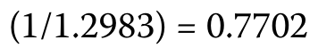

#### 补充解析 / Supplementary explanation

本题复核锚点（原解摘录）：2. A 正确。间接标价以外币作为标价货币，以本币作为基础货币。

Review anchor for this item (official excerpt): 2.

本题官方选项为 A。补充思路：先写清报价单位。例如 A/B 表示每 1 单位 B 值多少 A，B 是基准货币，A 是计价货币。报价上升意味着 B 对 A 升值；反向报价必须取倒数。某货币贬值 x%，另一货币的升值幅度为 1/(1−x)−1，不能直接写同样的 x%。实际汇率还需按题目指定的物价指数口径调整名义汇率。

The official choice for this item is A. Additional reasoning: Write the quote’s units first. A/B gives units of A per one B: B is base and A is price currency. A rising quote means B appreciates against A. Reverse a quote by taking its reciprocal. If one currency loses x%, the other gains 1/(1−x)−1, not x%. Real-rate calculations additionally require the stated price-index convention.

#### 相关知识点 / Related concepts

汇率报价与升贬值：对数变化近似对称，但普通百分比变化不对称；实质升值与名义升值在通胀不同的情况下可能不一致。

Exchange-rate quotes and currency changes: Log changes are approximately symmetric, but ordinary percentage changes are not. Real and nominal appreciation can differ when inflation rates differ.

### ECON-LM07-PRACTICE-003 · 章末习题 3 Practice problem 3

章末练习 / Practice problem · 原版 PDF 页码 / Source PDF pages: 256-257

#### 题目与资料 / Question and data

3\. 过去一个月，瑞士法郎（CHF）相对于英镑（GBP）贬值 12%。英镑相对于瑞士法郎升值了多少？

3\. Over the past month, the Swiss franc (CHF) has depreciated 12 percent against the British pound (GBP). How much has the pound sterling appreciated against the Swiss franc?

A. 12%

A. 12 percent

B. 低于 12%

B. Less than 12 percent

C. 高于 12%

C. More than 12 percent

#### 官方答案与解析 / Official answer and explanation

3\. C 正确。英镑相对于瑞士法郎的升值幅度，可由瑞士法郎相对于英镑贬值 12% 后的价值比例取倒数求得，结果也可表示为百分比：

3\. C is correct. The appreciation of the British pound against the Swiss franc is the inverse of the 12 percent depreciation of the Swiss franc against the pound sterling:

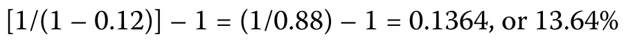

#### 补充解析 / Supplementary explanation

本题复核锚点（原解摘录）：3. C 正确。英镑相对于瑞士法郎的升值幅度，可由瑞士法郎相对于英镑贬值 12% 后的价值比例取倒数求得，结果也可表示为百分比：

Review anchor for this item (official excerpt): 3.

本题官方选项为 C。补充思路：先写清报价单位。例如 A/B 表示每 1 单位 B 值多少 A，B 是基准货币，A 是计价货币。报价上升意味着 B 对 A 升值；反向报价必须取倒数。某货币贬值 x%，另一货币的升值幅度为 1/(1−x)−1，不能直接写同样的 x%。实际汇率还需按题目指定的物价指数口径调整名义汇率。

The official choice for this item is C. Additional reasoning: Write the quote’s units first. A/B gives units of A per one B: B is base and A is price currency. A rising quote means B appreciates against A. Reverse a quote by taking its reciprocal. If one currency loses x%, the other gains 1/(1−x)−1, not x%. Real-rate calculations additionally require the stated price-index convention.

一方货币下跌与另一方上涨的百分比不对称，因为基期分母不同。若报价下降 d，倒数报价的涨幅为 1/(1−d)−1，而不是直接写 d。

Opposite-currency percentage changes are asymmetric because denominators differ. If a quote falls by d, its reciprocal rises by 1/(1−d)−1, not simply d.

#### 相关知识点 / Related concepts

汇率报价与升贬值：对数变化近似对称，但普通百分比变化不对称；实质升值与名义升值在通胀不同的情况下可能不一致。

Exchange-rate quotes and currency changes: Log changes are approximately symmetric, but ordinary percentage changes are not. Real and nominal appreciation can differ when inflation rates differ.

### ECON-LM07-PRACTICE-004 · 章末习题 4 Practice problem 4

章末练习 / Practice problem · 原版 PDF 页码 / Source PDF pages: 256-257

#### 题目与资料 / Question and data

4\. 两种货币之间的汇率已升至 1.4500。如果基础货币相对于标价货币升值 8%，那么这两种货币之间最初的汇率最接近：

4\. An exchange rate between two currencies has increased to 1.4500. If the base currency has appreciated by 8 percent against the price currency, the initial exchange rate between the two currencies was closest to:

A. 1.3340。

A. 1.3340.

B. 1.3426。

B. 1.3426.

C. 1.5660。

C. 1.5660.

#### 官方答案与解析 / Official answer and explanation

4\. B 正确。基础货币的升值百分比，可以通过将升值后的汇率除以初始汇率来计算。在本题中，未知数是初始汇率。初始汇率就是满足以下公式的 X 值：

4\. B is correct. The percentage appreciation of the base currency can be calculated by dividing the appreciated exchange rate by the initial exchange rate. In this case, the unknown is the initial exchange rate. The initial exchange is the value of X that satisfies the formula:

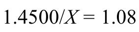

解出 X，得到

Solving for X leads to

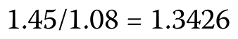

#### 补充解析 / Supplementary explanation

本题复核锚点（原解摘录）：4. B 正确。基础货币的升值百分比，可以通过将升值后的汇率除以初始汇率来计算。

Review anchor for this item (official excerpt): 4.

本题官方选项为 B。补充思路：先写清报价单位。例如 A/B 表示每 1 单位 B 值多少 A，B 是基准货币，A 是计价货币。报价上升意味着 B 对 A 升值；反向报价必须取倒数。某货币贬值 x%，另一货币的升值幅度为 1/(1−x)−1，不能直接写同样的 x%。实际汇率还需按题目指定的物价指数口径调整名义汇率。

The official choice for this item is B. Additional reasoning: Write the quote’s units first. A/B gives units of A per one B: B is base and A is price currency. A rising quote means B appreciates against A. Reverse a quote by taking its reciprocal. If one currency loses x%, the other gains 1/(1−x)−1, not x%. Real-rate calculations additionally require the stated price-index convention.

一方货币下跌与另一方上涨的百分比不对称，因为基期分母不同。若报价下降 d，倒数报价的涨幅为 1/(1−d)−1，而不是直接写 d。

Opposite-currency percentage changes are asymmetric because denominators differ. If a quote falls by d, its reciprocal rises by 1/(1−d)−1, not simply d.

#### 相关知识点 / Related concepts

汇率报价与升贬值：对数变化近似对称，但普通百分比变化不对称；实质升值与名义升值在通胀不同的情况下可能不一致。

Exchange-rate quotes and currency changes: Log changes are approximately symmetric, but ordinary percentage changes are not. Real and nominal appreciation can differ when inflation rates differ.

## LM 8 · 汇率计算 Exchange Rate Calculations 19 条目 · 原题与解析逐条对应 / Paired source questions and explanations

### ECON-LM08-EXAMPLE-101 · 例题 1 · 第 1 题：交叉汇率与百分比变动 Example 1 · 1 — Cross-Rates and Percentage Changes

正文例题／案例 / Worked example / case · 原版 PDF 页码 / Source PDF pages: 261-262

#### 题目与资料 / Question and data

例 1

EXAMPLE 1

交叉汇率与百分比变动

Cross-Rates and Percentage Changes

一名交易商编制的研究报告包含以下即期汇率报价：

A research report produced by a dealer includes the following spot rate quotes:

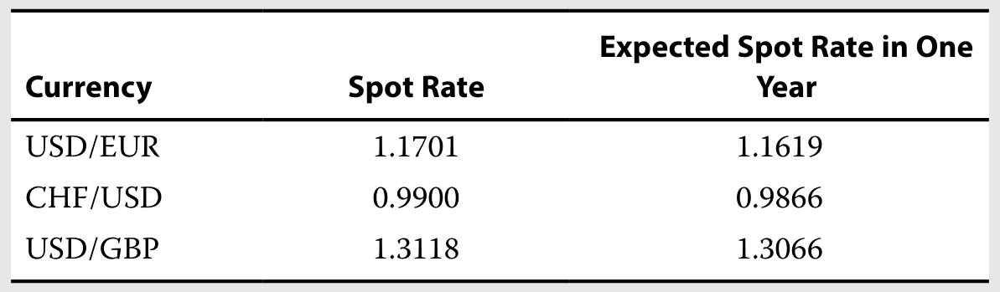

1\. CHF/EUR 即期交叉汇率最接近：

1\. The spot CHF/EUR cross-rate is closest to:

A. 0.8461。

A. 0.8461.

B. 0.8546。

B. 0.8546.

C. 1.1584。

C. 1.1584.

#### 官方答案与解析 / Official answer and explanation

解答：

Solution:

C 正确：

C is correct:

#### 补充解析 / Supplementary explanation

本题官方选项为 C。补充思路：先将每个报价写成带货币单位的分数，再相乘或相除，使中间货币约掉。若运算后单位不是目标货币/基准货币，方向就是错的。跨币种百分比变化还要先求期初与期末交叉汇率，再计算百分比，不能简单把两个升贬值百分比相加减。最后检验报价与倒数报价的乘积是否为 1。

The official choice for this item is C. Additional reasoning: Write each quote as a currency fraction and multiply or divide to cancel the intermediate currency. Wrong final units signal the wrong direction. To find a cross-rate percentage change, compute the beginning and ending cross rates before taking the percentage change; do not simply add component changes. A quote and its reciprocal should multiply to one.

#### 相关知识点 / Related concepts

交叉汇率与单位约分：交叉汇率示例：(A/C)×(C/B)＝A/B；变化率＝期末报价/期初报价−1。

Cross rates and cancellation of currency units: Cross-rate identity: (A/C) × (C/B) = A/B. Percentage change = ending quote/beginning quote − 1.

### ECON-LM08-EXAMPLE-102 · 例题 1 · 第 2 题：交叉汇率与百分比变动 Example 1 · 2 — Cross-Rates and Percentage Changes

正文例题／案例 / Worked example / case · 原版 PDF 页码 / Source PDF pages: 261-262

#### 题目与资料 / Question and data

例 1

EXAMPLE 1

交叉汇率与百分比变动

Cross-Rates and Percentage Changes

一名交易商编制的研究报告包含以下即期汇率报价：

A research report produced by a dealer includes the following spot rate quotes:

2\. GBP/EUR 即期交叉汇率最接近：

2\. The spot GBP/EUR cross-rate is closest to:

A. 0.8920。

A. 0.8920.

B. 1.1211。

B. 1.1211.

C. 1.4653。

C. 1.4653.

#### 官方答案与解析 / Official answer and explanation

A 正确：

A is correct:

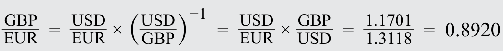

#### 补充解析 / Supplementary explanation

本题官方选项为 A。补充思路：先将每个报价写成带货币单位的分数，再相乘或相除，使中间货币约掉。若运算后单位不是目标货币/基准货币，方向就是错的。跨币种百分比变化还要先求期初与期末交叉汇率，再计算百分比，不能简单把两个升贬值百分比相加减。最后检验报价与倒数报价的乘积是否为 1。

The official choice for this item is A. Additional reasoning: Write each quote as a currency fraction and multiply or divide to cancel the intermediate currency. Wrong final units signal the wrong direction. To find a cross-rate percentage change, compute the beginning and ending cross rates before taking the percentage change; do not simply add component changes. A quote and its reciprocal should multiply to one.

#### 相关知识点 / Related concepts

交叉汇率与单位约分：交叉汇率示例：(A/C)×(C/B)＝A/B；变化率＝期末报价/期初报价−1。

Cross rates and cancellation of currency units: Cross-rate identity: (A/C) × (C/B) = A/B. Percentage change = ending quote/beginning quote − 1.

### ECON-LM08-EXAMPLE-103 · 例题 1 · 第 3 题：交叉汇率与百分比变动 Example 1 · 3 — Cross-Rates and Percentage Changes

正文例题／案例 / Worked example / case · 原版 PDF 页码 / Source PDF pages: 261-262

#### 题目与资料 / Question and data

例 1

EXAMPLE 1

交叉汇率与百分比变动

Cross-Rates and Percentage Changes

一名交易商编制的研究报告包含以下即期汇率报价：

A research report produced by a dealer includes the following spot rate quotes:

3\. 根据研究报告，预计未来一年欧元相对于美元将升值多少？

3\. Based on the research report, the euro is expected to appreciate by how much against the US dollar over the next year?

A. –0.7%

A. –0.7 percent

B. +0.7%

B. +0.7 percent

C. +1.0%

C. +1.0 percent

#### 官方答案与解析 / Official answer and explanation

A 正确。在 USD/EUR 报价中，欧元是基础货币，预期 USD/EUR 汇率下降表示欧元将贬值。一年后，购买 1 欧元所需的美元更少。数学上：

A is correct. The euro is the base currency in the USD/EUR quote, and the expected decrease in the USD/EUR rate indicates that the euro is depreciating. In one year, it will cost less, in US dollars, to buy one euro. Mathematically:

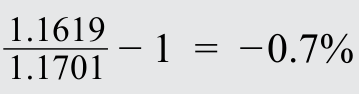

#### 补充解析 / Supplementary explanation

本题复核锚点（原解摘录）：A 正确。在 USD/EUR 报价中，欧元是基础货币，预期 USD/EUR 汇率下降表示欧元将贬值。

Review anchor for this item (official excerpt): A is correct. The euro is the base currency in the USD/EUR quote, and the expected decrease in the USD/EUR rate indicates that the euro is depreciating.

本题官方选项为 A。补充思路：先将每个报价写成带货币单位的分数，再相乘或相除，使中间货币约掉。若运算后单位不是目标货币/基准货币，方向就是错的。跨币种百分比变化还要先求期初与期末交叉汇率，再计算百分比，不能简单把两个升贬值百分比相加减。最后检验报价与倒数报价的乘积是否为 1。

The official choice for this item is A. Additional reasoning: Write each quote as a currency fraction and multiply or divide to cancel the intermediate currency. Wrong final units signal the wrong direction. To find a cross-rate percentage change, compute the beginning and ending cross rates before taking the percentage change; do not simply add component changes. A quote and its reciprocal should multiply to one.

#### 相关知识点 / Related concepts

交叉汇率与单位约分：交叉汇率示例：(A/C)×(C/B)＝A/B；变化率＝期末报价/期初报价−1。

Cross rates and cancellation of currency units: Cross-rate identity: (A/C) × (C/B) = A/B. Percentage change = ending quote/beginning quote − 1.

### ECON-LM08-EXAMPLE-104 · 例题 1 · 第 4 题：交叉汇率与百分比变动 Example 1 · 4 — Cross-Rates and Percentage Changes

正文例题／案例 / Worked example / case · 原版 PDF 页码 / Source PDF pages: 261-262

#### 题目与资料 / Question and data

例 1

EXAMPLE 1

交叉汇率与百分比变动

Cross-Rates and Percentage Changes

一名交易商编制的研究报告包含以下即期汇率报价：

A research report produced by a dealer includes the following spot rate quotes:

4\. 根据研究报告，预计未来一年美元相对于英镑将升值多少？

4\. Based on the research report, how much is the US dollar expected to appreciate against the British pound sterling over the next year?

A. +0.6%

A. +0.6 percent

B. –0.4%

B. –0.4 percent

C. +0.4%

C. +0.4 percent

#### 官方答案与解析 / Official answer and explanation

C 正确。在 USD/GBP 报价中，英镑是基础货币，预期 USD/GBP 汇率下降，意味着英镑预期相对于美元贬值；等价地说，美元预期相对于英镑升值。数学上：

C is correct. The British pound is the base currency in the USD/GBP quote, and the expected decrease in the USD/GBP rate means that the British pound is expected to depreciate against the US dollar. Or equivalently, the US dollar is expected to appreciate against the British pound. Mathematically:

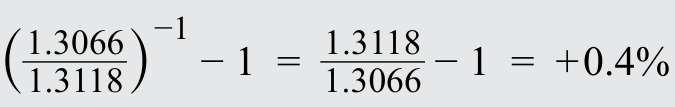

#### 补充解析 / Supplementary explanation

本题复核锚点（原解摘录）：C 正确。在 USD/GBP 报价中，英镑是基础货币，预期 USD/GBP 汇率下降，意味着英镑预期相对于美元贬值；等价地说，美元预期相对于英镑升值。

Review anchor for this item (official excerpt): C is correct. The British pound is the base currency in the USD/GBP quote, and the expected decrease in the USD/GBP rate means that the British pound is expected to depreciate against the US dollar.

本题官方选项为 C。补充思路：先将每个报价写成带货币单位的分数，再相乘或相除，使中间货币约掉。若运算后单位不是目标货币/基准货币，方向就是错的。跨币种百分比变化还要先求期初与期末交叉汇率，再计算百分比，不能简单把两个升贬值百分比相加减。最后检验报价与倒数报价的乘积是否为 1。

The official choice for this item is C. Additional reasoning: Write each quote as a currency fraction and multiply or divide to cancel the intermediate currency. Wrong final units signal the wrong direction. To find a cross-rate percentage change, compute the beginning and ending cross rates before taking the percentage change; do not simply add component changes. A quote and its reciprocal should multiply to one.

#### 相关知识点 / Related concepts

交叉汇率与单位约分：交叉汇率示例：(A/C)×(C/B)＝A/B；变化率＝期末报价/期初报价−1。

Cross rates and cancellation of currency units: Cross-rate identity: (A/C) × (C/B) = A/B. Percentage change = ending quote/beginning quote − 1.

### ECON-LM08-EXAMPLE-105 · 例题 1 · 第 5 题：交叉汇率与百分比变动 Example 1 · 5 — Cross-Rates and Percentage Changes

正文例题／案例 / Worked example / case · 原版 PDF 页码 / Source PDF pages: 261-263

#### 题目与资料 / Question and data

例 1

EXAMPLE 1

交叉汇率与百分比变动

Cross-Rates and Percentage Changes

一名交易商编制的研究报告包含以下即期汇率报价：

A research report produced by a dealer includes the following spot rate quotes:

5\. 预计未来一年，瑞士法郎将：

5\. Over the next year, the Swiss franc is expected to:

A. 相对于英镑贬值。

A. depreciate against the British pound.

B. 相对于欧元贬值。

B. depreciate against the euro.

C. 相对于英镑、欧元和美元均升值。

C. appreciate against the British pound, euro, and US dollar.

#### 官方答案与解析 / Official answer and explanation

解答：

Solution:

C 正确。由于题目不要求计算升值或贬值幅度，可以将瑞士法郎作为标价货币，也可以作为基础货币。在此情况下，使用瑞士法郎作为标价货币更容易。CHF/USD 预计从 0.9900 降至 0.9866，因此瑞士法郎预计走强，即相对于美元升值。CHF/EUR 目前为 1.1584（见第 1 题解答），预计将变为

C is correct: Because the question does not require calculating the magnitude of the appreciation or depreciation, we can use the Swiss franc as either the price currency or the base currency. In this case, it is easier to use the Swiss franc as the price currency. CHF/USD is expected to decline from 0.9900 to 0.9866, so the Swiss franc is expected to be stronger (i.e., it should appreciate against the US dollar). CHF/EUR is currently 1.1584 (see the solution to problem 1) and is expected to be

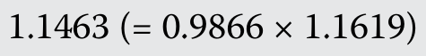

因此瑞士法郎预计相对于欧元升值。CHF/GBP 目前为

so the Swiss franc is expected to appreciate against the euro. CHF/GBP is currently

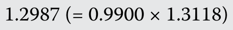

预计将变为

and is expected to be

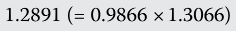

因此瑞士法郎预计也相对于英镑升值。我们也可以通过直观推理得到这一答案。根据研究报告，CHF/USD 汇率预计下降，即美元预计相对于瑞士法郎贬值，或者说瑞士法郎预计相对于美元升值。USD/EUR 和 USD/GBP 汇率也在下降，意味着欧元和英镑预计相对于美元贬值，或者说美元预计相对于欧元和英镑升值。如果瑞士法郎预计相对于美元升值，而美元预计相对于欧元和英镑均升值，那么瑞士法郎预计相对于欧元和英镑也都会升值。

so the Swiss franc is also expected to appreciate against the British pound. Alternatively, we can derive this answer intuitively. According to the research report, the CHF/USD rate is expected to decline: That is, the US dollar is expected to depreciate against the Swiss franc, or alternatively, the Swiss franc is expected to appreciate against the US dollar. The USD/EUR and USD/GBP rates are also decreasing, meaning that the euro and British pound are expected to depreciate against the US dollar, or alternatively, the US dollar is expected to appreciate against the euro and British pound. If the Swiss franc is expected to appreciate against the US dollar and the US dollar is expected to appreciate against both the euro and British pound, it follows that the Swiss franc is expected to appreciate against both the euro and British pound.

#### 补充解析 / Supplementary explanation

本题复核锚点（原解摘录）：C 正确。由于题目不要求计算升值或贬值幅度，可以将瑞士法郎作为标价货币，也可以作为基础货币。

Review anchor for this item (official excerpt): C is correct: Because the question does not require calculating the magnitude of the appreciation or depreciation, we can use the Swiss franc as either the price currency or the base currency.

本题官方选项为 C。补充思路：先将每个报价写成带货币单位的分数，再相乘或相除，使中间货币约掉。若运算后单位不是目标货币/基准货币，方向就是错的。跨币种百分比变化还要先求期初与期末交叉汇率，再计算百分比，不能简单把两个升贬值百分比相加减。最后检验报价与倒数报价的乘积是否为 1。

The official choice for this item is C. Additional reasoning: Write each quote as a currency fraction and multiply or divide to cancel the intermediate currency. Wrong final units signal the wrong direction. To find a cross-rate percentage change, compute the beginning and ending cross rates before taking the percentage change; do not simply add component changes. A quote and its reciprocal should multiply to one.

#### 相关知识点 / Related concepts

交叉汇率与单位约分：交叉汇率示例：(A/C)×(C/B)＝A/B；变化率＝期末报价/期初报价−1。

Cross rates and cancellation of currency units: Cross-rate identity: (A/C) × (C/B) = A/B. Percentage change = ending quote/beginning quote − 1.

### ECON-LM08-EXAMPLE-106 · 例题 1 · 第 6 题：交叉汇率与百分比变动 Example 1 · 6 — Cross-Rates and Percentage Changes

正文例题／案例 / Worked example / case · 原版 PDF 页码 / Source PDF pages: 261, 263

#### 题目与资料 / Question and data

例 1

EXAMPLE 1

交叉汇率与百分比变动

Cross-Rates and Percentage Changes

一名交易商编制的研究报告包含以下即期汇率报价：

A research report produced by a dealer includes the following spot rate quotes:

6\. 根据研究报告，下列哪项按未来一年由强到弱的顺序排列这三种货币？

6\. Based on the research report, which of the following lists the three currencies from strongest to weakest over the next year?

A. 美元、英镑、欧元

A. US dollar, British pound, euro

B. 美元、欧元、英镑

B. US dollar, euro, British pound

C. 欧元、美元、英镑

C. Euro, US dollar, British pound

#### 官方答案与解析 / Official answer and explanation

A 正确。USD/EUR 预计从 1.1701 降至 1.1619，而 USD/GBP 预计从 1.3118 降至 1.3066。因此，美元预计强于欧元和英镑。GBP/EUR 目前为

A is correct. USD/EUR is expected to decline from 1.1701 to 1.1619, while USD/GBP is expected to decline from 1.3118 to 1.3066. So, the US dollar is expected to be stronger than both the euro and British pound. GBP/EUR is currently

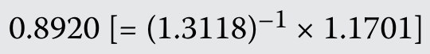 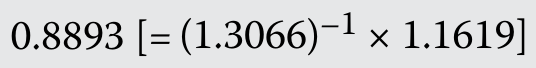

因此英镑预计强于欧元。

so the British pound is expected to be stronger than the euro.

#### 补充解析 / Supplementary explanation

本题复核锚点（原解摘录）：A 正确。USD/EUR 预计从 1.1701 降至 1.1619，而 USD/GBP 预计从 1.3118 降至 1.3066。

Review anchor for this item (official excerpt): A is correct. USD/EUR is expected to decline from 1.1701 to 1.1619, while USD/GBP is expected to decline from 1.3118 to 1.3066.

本题官方选项为 A。补充思路：先将每个报价写成带货币单位的分数，再相乘或相除，使中间货币约掉。若运算后单位不是目标货币/基准货币，方向就是错的。跨币种百分比变化还要先求期初与期末交叉汇率，再计算百分比，不能简单把两个升贬值百分比相加减。最后检验报价与倒数报价的乘积是否为 1。

The official choice for this item is A. Additional reasoning: Write each quote as a currency fraction and multiply or divide to cancel the intermediate currency. Wrong final units signal the wrong direction. To find a cross-rate percentage change, compute the beginning and ending cross rates before taking the percentage change; do not simply add component changes. A quote and its reciprocal should multiply to one.

#### 相关知识点 / Related concepts

交叉汇率与单位约分：交叉汇率示例：(A/C)×(C/B)＝A/B；变化率＝期末报价/期初报价−1。

Cross rates and cancellation of currency units: Cross-rate identity: (A/C) × (C/B) = A/B. Percentage change = ending quote/beginning quote − 1.

### ECON-LM08-EXAMPLE-107 · 例题 1 · 第 7 题：交叉汇率与百分比变动 Example 1 · 7 — Cross-Rates and Percentage Changes

正文例题／案例 / Worked example / case · 原版 PDF 页码 / Source PDF pages: 261, 263

#### 题目与资料 / Question and data

例 1

EXAMPLE 1

交叉汇率与百分比变动

Cross-Rates and Percentage Changes

一名交易商编制的研究报告包含以下即期汇率报价：

A research report produced by a dealer includes the following spot rate quotes:

7\. 根据研究报告，下列哪项按未来一年相对于美元升值百分比从高到低的顺序，排列这三种货币？

7\. Based on the research report, which of the following lists the three currencies in order of appreciating the most to appreciating the least (in percentage terms) against the US dollar over the next year?

A. 英镑、瑞士法郎、欧元

A. British pound, Swiss franc, euro

B. 瑞士法郎、英镑、欧元

B. Swiss franc, British pound, euro

C. 欧元、瑞士法郎、英镑

C. Euro, Swiss franc, British pound

#### 官方答案与解析 / Official answer and explanation

B 正确。USD/EUR 汇率的百分比变动为

B is correct. The USD/EUR rate depreciates by

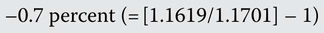

代表基础货币欧元相对于美元贬值。USD/GBP 汇率的百分比变动为

which is the depreciation of the base currency euro against the US dollar. The USD/GBP rate declines

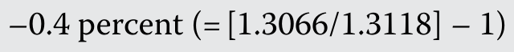

代表英镑相对于美元贬值。将 CHF/USD 汇率取倒数，改为 USD/CHF 报价可知，基础货币瑞士法郎相对于美元的升值百分比为

which is the depreciation of the British pound against the US dollar. Inverting the CHF/USD rate to a USD/CHF convention shows that the base currency Swiss franc appreciates by

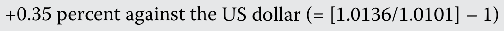

#### 补充解析 / Supplementary explanation

本题复核锚点（原解摘录）：B 正确。USD/EUR 汇率的百分比变动为

Review anchor for this item (official excerpt): B is correct. The USD/EUR rate depreciates by

本题官方选项为 B。补充思路：先将每个报价写成带货币单位的分数，再相乘或相除，使中间货币约掉。若运算后单位不是目标货币/基准货币，方向就是错的。跨币种百分比变化还要先求期初与期末交叉汇率，再计算百分比，不能简单把两个升贬值百分比相加减。最后检验报价与倒数报价的乘积是否为 1。

The official choice for this item is B. Additional reasoning: Write each quote as a currency fraction and multiply or divide to cancel the intermediate currency. Wrong final units signal the wrong direction. To find a cross-rate percentage change, compute the beginning and ending cross rates before taking the percentage change; do not simply add component changes. A quote and its reciprocal should multiply to one.

#### 相关知识点 / Related concepts

交叉汇率与单位约分：交叉汇率示例：(A/C)×(C/B)＝A/B；变化率＝期末报价/期初报价−1。

Cross rates and cancellation of currency units: Cross-rate identity: (A/C) × (C/B) = A/B. Percentage change = ending quote/beginning quote − 1.

### ECON-LM08-EXAMPLE-201 · 例题 2 · 第 1 题：远期汇率计算 Example 2 · 1 — Forward Rate Calculations

正文例题／案例 / Worked example / case · 原版 PDF 页码 / Source PDF pages: 269

#### 题目与资料 / Question and data

例 2

EXAMPLE 2

远期汇率计算

Forward Rate Calculations

一家法国公司最近完成了向英国客户销售商品的交易，预计在 32 天后收到 5,000 万英镑付款。该公司的财务主管希望对冲此笔交易的外汇风险，并从交易商处获得以下汇率信息：

A French company recently finalized a sale of goods to a UK-based client and expects to receive a payment of GBP50 million in 32 days. The corporate treasurer at the French company wants to hedge the FX risk of this transaction and receives the following exchange rate information from a dealer:

1\. 根据汇率信息，财务主管可以通过以下方式对冲

1\. According to the exchange rate information, the treasurer could hedge the

外汇风险：

FX risk by:

A. 以 0.87380 的远期汇率买入欧元（卖出英镑）。

A. buying euro (selling British pounds) at a forward rate of 0.87380.

B. 以 0.87506 的远期汇率买入欧元（卖出英镑）。

B. buying euro (selling British pounds) at a forward rate of 0.87506.

C. 以 0.87506 的远期汇率卖出欧元（买入英镑）。

C. selling euro (buying British pounds) at a forward rate of 0.87506.

#### 官方答案与解析 / Official answer and explanation

解答：

Solution:

B 正确。法国公司希望将英镑兑换为本币欧元，即卖出英镑、买入欧元。远期汇率等于：

B is correct. The French company would want to convert the British pound to its domestic currency, the euro (it wants to sell British pounds and buy euros). The forward rate would be equal to:

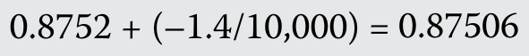

#### 补充解析 / Supplementary explanation

本题复核锚点（原解摘录）：B 正确。法国公司希望将英镑兑换为本币欧元，即卖出英镑、买入欧元。

Review anchor for this item (official excerpt): B is correct. The French company would want to convert the British pound to its domestic currency, the euro (it wants to sell British pounds and buy euros).

本题官方选项为 B。补充思路：远期报价必须使用与即期报价相同的基准货币和计价货币。若 S 为计价货币/基准货币，F＝S×(1+r计价×T)/(1+r基准×T)，前提是题目采用相应的简单利息约定。远期点数是 F−S 的缩放表示，先按报价小数位还原点数再加减。高利率货币在有担保利率平价下通常以远期贴水交易；这不等于对未来即期汇率的无条件预测。

The official choice for this item is B. Additional reasoning: Use the same base/price orientation for spot and forward. With S in price/base units, F = S × (1+r_price × T)/(1+r_base × T) under the corresponding simple-interest convention. Forward points are a scaled F−S, so restore their decimal scale before adding them. Covered parity generally places the higher-rate currency at a forward discount, which is not an unconditional forecast of the future spot rate.

#### 相关知识点 / Related concepts

远期汇率、点数与利率平价：先明确买卖哪一种货币，再选择远期买价或卖价；到期现金流的确定性来自合约锁定，而非汇率预测正确。

Forward rates, points, and interest parity: Identify which currency is bought or sold before choosing forward bid or ask. Hedged cash-flow certainty comes from locking the contract, not from forecasting spot correctly.

### ECON-LM08-EXAMPLE-202 · 例题 2 · 第 2 题：远期汇率计算 Example 2 · 2 — Forward Rate Calculations

正文例题／案例 / Worked example / case · 原版 PDF 页码 / Source PDF pages: 269-270

#### 题目与资料 / Question and data

例 2

EXAMPLE 2

远期汇率计算

Forward Rate Calculations

一家法国公司最近完成了向英国客户销售商品的交易，预计在 32 天后收到 5,000 万英镑付款。该公司的财务主管希望对冲此笔交易的外汇风险，并从交易商处获得以下汇率信息：

A French company recently finalized a sale of goods to a UK-based client and expects to receive a payment of GBP50 million in 32 days. The corporate treasurer at the French company wants to hedge the FX risk of this transaction and receives the following exchange rate information from a dealer:

2\. 根据汇率信息，对所示远期贴水的最佳解释是：

2\. According to the exchange rate information, the best interpretation of the forward discount shown is that:

A. 欧元预计在未来 30 天内贬值。

A. the euro is expected to depreciate over the next 30 days.

B. 英国一个月期利率高于欧元区。

B. one-month UK interest rates are higher than those in the Eurozone.

C. 欧元区一个月期利率高于英

C. one-month Eurozone interest rates are higher than those in the United

国。

Kingdom.

#### 官方答案与解析 / Official answer and explanation

解答：

Solution:

C 正确。远期贴水表明，基础货币所属国家（本例为使用欧元的法国）的利率，高于标价货币所属国家（英国）的利率。

C is correct. A forward discount indicates that interest rates in the base currency country (France, in this case, which uses the euro) are higher than those in the price currency country (the United Kingdom).

#### 补充解析 / Supplementary explanation

本题复核锚点（原解摘录）：C 正确。远期贴水表明，基础货币所属国家（本例为使用欧元的法国）的利率，高于标价货币所属国家（英国）的利率。

Review anchor for this item (official excerpt): C is correct. A forward discount indicates that interest rates in the base currency country (France, in this case, which uses the euro) are higher than those in the price currency country (the United Kingdom).

本题官方选项为 C。补充思路：远期报价必须使用与即期报价相同的基准货币和计价货币。若 S 为计价货币/基准货币，F＝S×(1+r计价×T)/(1+r基准×T)，前提是题目采用相应的简单利息约定。远期点数是 F−S 的缩放表示，先按报价小数位还原点数再加减。高利率货币在有担保利率平价下通常以远期贴水交易；这不等于对未来即期汇率的无条件预测。

The official choice for this item is C. Additional reasoning: Use the same base/price orientation for spot and forward. With S in price/base units, F = S × (1+r_price × T)/(1+r_base × T) under the corresponding simple-interest convention. Forward points are a scaled F−S, so restore their decimal scale before adding them. Covered parity generally places the higher-rate currency at a forward discount, which is not an unconditional forecast of the future spot rate.

#### 相关知识点 / Related concepts

远期汇率、点数与利率平价：先明确买卖哪一种货币，再选择远期买价或卖价；到期现金流的确定性来自合约锁定，而非汇率预测正确。

Forward rates, points, and interest parity: Identify which currency is bought or sold before choosing forward bid or ask. Hedged cash-flow certainty comes from locking the contract, not from forecasting spot correctly.

### ECON-LM08-EXAMPLE-203 · 例题 2 · 第 3 题：远期汇率计算 Example 2 · 3 — Forward Rate Calculations

正文例题／案例 / Worked example / case · 原版 PDF 页码 / Source PDF pages: 269-270

#### 题目与资料 / Question and data

例 2

EXAMPLE 2

远期汇率计算

Forward Rate Calculations

一家法国公司最近完成了向英国客户销售商品的交易，预计在 32 天后收到 5,000 万英镑付款。该公司的财务主管希望对冲此笔交易的外汇风险，并从交易商处获得以下汇率信息：

A French company recently finalized a sale of goods to a UK-based client and expects to receive a payment of GBP50 million in 32 days. The corporate treasurer at the French company wants to hedge the FX risk of this transaction and receives the following exchange rate information from a dealer:

3\. 根据汇率信息，如果 12 个月远期汇率为

3\. According to the exchange rate information, if the 12-month forward rate is

0.87295 GBP/EUR，那么 12 个月远期点数最接近：

0.87295 GBP/EUR, then the 12-month forward points are closest to:

A. –22.5。

A. –22.5.

B. –2.25。

B. –2.25.

C. –0.00225。

C. –0.00225.

#### 官方答案与解析 / Official answer and explanation

A 正确。远期点数等于远期汇率与即期汇率之差经比例调整后的数值。本例中：

A is correct. The number of forward points is equal to the scaled difference between the forward rate and the spot rate. In this case:

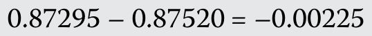

。再乘以 10,000，转换为远期点数。

. This is then multiplied by 10,000 to convert to the number of forward points.

#### 补充解析 / Supplementary explanation

本题复核锚点（原解摘录）：A 正确。远期点数等于远期汇率与即期汇率之差经比例调整后的数值。

Review anchor for this item (official excerpt): A is correct. The number of forward points is equal to the scaled difference between the forward rate and the spot rate.

本题官方选项为 A。补充思路：远期报价必须使用与即期报价相同的基准货币和计价货币。若 S 为计价货币/基准货币，F＝S×(1+r计价×T)/(1+r基准×T)，前提是题目采用相应的简单利息约定。远期点数是 F−S 的缩放表示，先按报价小数位还原点数再加减。高利率货币在有担保利率平价下通常以远期贴水交易；这不等于对未来即期汇率的无条件预测。

The official choice for this item is A. Additional reasoning: Use the same base/price orientation for spot and forward. With S in price/base units, F = S × (1+r_price × T)/(1+r_base × T) under the corresponding simple-interest convention. Forward points are a scaled F−S, so restore their decimal scale before adding them. Covered parity generally places the higher-rate currency at a forward discount, which is not an unconditional forecast of the future spot rate.

远期点数是远期价与即期价的绝对报价差，远期升贴水百分比则是差额除以即期价；需要年化时，还应按题目期限调整。

Forward points are the absolute difference between forward and spot quotes; a percentage premium divides that difference by spot. Annualization additionally depends on the quoted tenor.

#### 相关知识点 / Related concepts

远期汇率、点数与利率平价：先明确买卖哪一种货币，再选择远期买价或卖价；到期现金流的确定性来自合约锁定，而非汇率预测正确。

Forward rates, points, and interest parity: Identify which currency is bought or sold before choosing forward bid or ask. Hedged cash-flow certainty comes from locking the contract, not from forecasting spot correctly.

### ECON-LM08-EXAMPLE-204 · 例题 2 · 第 4 题：远期汇率计算 Example 2 · 4 — Forward Rate Calculations

正文例题／案例 / Worked example / case · 原版 PDF 页码 / Source PDF pages: 269-270

#### 题目与资料 / Question and data

例 2

EXAMPLE 2

远期汇率计算

Forward Rate Calculations

一家法国公司最近完成了向英国客户销售商品的交易，预计在 32 天后收到 5,000 万英镑付款。该公司的财务主管希望对冲此笔交易的外汇风险，并从交易商处获得以下汇率信息：

A French company recently finalized a sale of goods to a UK-based client and expects to receive a payment of GBP50 million in 32 days. The corporate treasurer at the French company wants to hedge the FX risk of this transaction and receives the following exchange rate information from a dealer:

4\. 如果第二位交易商在相同即期汇率基础上，报出 GBP/EUR 的 12 个月远期贴水为 0.30%，那么法国公司可以：

4\. If a second dealer quotes GBP/EUR at a 12-month forward discount of 0.30 percent on the same spot rate, the French company could:

A. 与任一交易商成交，因为两者的 12 个月远期报价相同。

A. trade with either dealer because the 12-month forward quotes are equivalent.

B. 从第二位交易商买入欧元，再卖给第一位交易商，从而锁定 12 个月后的利润。

B. lock in a profit in 12 months by buying euros from the second dealer and selling it to the original dealer.

C. 从第一位交易商买入欧元，再卖给第二位交易商，从而锁定 12 个月后的利润。

C. lock in a profit in 12 months by buying euros from the original dealer and selling it to the second dealer.

#### 官方答案与解析 / Official answer and explanation

B 正确。0.30% 的贴水意味着，第二位交易商愿意按以下汇率远期卖出 12 个月后交割的欧元：

B is correct. A 0.30 percent discount means that the second dealer will sell euros 12 months forward at

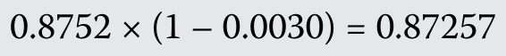

每欧元价格低于第一位交易商的 0.87295 报价。以较低的 12 个月远期汇率（0.87257）买入欧元，并以较高的 12 个月远期汇率（0.87295）远期卖出相同数量、12 个月后交割的欧元，意味着每交易一欧元可获利（

a lower price per euro than the original dealer’s quote of 0.87295. Buying euros at the cheaper 12-month forward rate (0.87257) and selling the same amount of euros 12 months forward at the higher 12-month forward rate (0.87295) means a profit of (

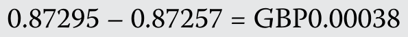

），在两份远期合约于 12 个月后结算时收取。

) per euro transacted, receivable when both forward contracts settle in 12 months.

#### 补充解析 / Supplementary explanation

本题复核锚点（原解摘录）：B 正确。0.30% 的贴水意味着，第二位交易商愿意按以下汇率远期卖出 12 个月后交割的欧元：

Review anchor for this item (official excerpt): B is correct. A 0.30 percent discount means that the second dealer will sell euros 12 months forward at

本题官方选项为 B。补充思路：远期报价必须使用与即期报价相同的基准货币和计价货币。若 S 为计价货币/基准货币，F＝S×(1+r计价×T)/(1+r基准×T)，前提是题目采用相应的简单利息约定。远期点数是 F−S 的缩放表示，先按报价小数位还原点数再加减。高利率货币在有担保利率平价下通常以远期贴水交易；这不等于对未来即期汇率的无条件预测。

The official choice for this item is B. Additional reasoning: Use the same base/price orientation for spot and forward. With S in price/base units, F = S × (1+r_price × T)/(1+r_base × T) under the corresponding simple-interest convention. Forward points are a scaled F−S, so restore their decimal scale before adding them. Covered parity generally places the higher-rate currency at a forward discount, which is not an unconditional forecast of the future spot rate.

远期点数是远期价与即期价的绝对报价差，远期升贴水百分比则是差额除以即期价；需要年化时，还应按题目期限调整。

Forward points are the absolute difference between forward and spot quotes; a percentage premium divides that difference by spot. Annualization additionally depends on the quoted tenor.

#### 相关知识点 / Related concepts

远期汇率、点数与利率平价：先明确买卖哪一种货币，再选择远期买价或卖价；到期现金流的确定性来自合约锁定，而非汇率预测正确。

Forward rates, points, and interest parity: Identify which currency is bought or sold before choosing forward bid or ask. Hedged cash-flow certainty comes from locking the contract, not from forecasting spot correctly.

### ECON-LM08-EXAMPLE-205 · 例题 2 · 第 5 题：远期汇率计算 Example 2 · 5 — Forward Rate Calculations

正文例题／案例 / Worked example / case · 原版 PDF 页码 / Source PDF pages: 269-271

#### 题目与资料 / Question and data

例 2

EXAMPLE 2

远期汇率计算

Forward Rate Calculations

一家法国公司最近完成了向英国客户销售商品的交易，预计在 32 天后收到 5,000 万英镑付款。该公司的财务主管希望对冲此笔交易的外汇风险，并从交易商处获得以下汇率信息：

A French company recently finalized a sale of goods to a UK-based client and expects to receive a payment of GBP50 million in 32 days. The corporate treasurer at the French company wants to hedge the FX risk of this transaction and receives the following exchange rate information from a dealer:

5\. 如果欧元与英镑的 270 天 Libor 利率（年化）分别为 1.370% 和 1.325%，GBP/EUR 即期汇率为 0.8489，那么 270 天远期汇率（FGBP/EUR）的远期点数最接近：

5\. If the 270-day Libor rates (annualized) for the euro and British pound are 1.370 percent and 1.325 percent, respectively, and the spot GBP/EUR exchange rate is 0.8489, then the number of forward points for a 270-day forward rate (FGBP/EUR) is closest to:

A. –22.8。

A. –22.8.

B. –3.8。

B. –3.8.

C. –2.8。

C. –2.8.

#### 官方答案与解析 / Official answer and explanation

C 正确，因为远期汇率计算如下：

C is correct, because the forward rate is calculated as:

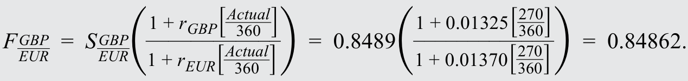

这表明，远期点数为贴水；汇率之差及其等价点数为：

This shows that the forward points are at a discount of:

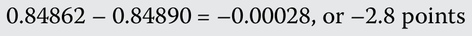

。也可以利用掉期点数公式看出这一点：

. This can also be seen using the swap points formula:

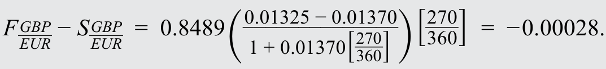

计算得出 –3.8 点，是因为遗漏了天数比例（270/360）；得出 –22.8 点，则是比例换算错误。

The calculation of –3.8 points omits the day count (270/360), and –22.8 points gets the scaling wrong.

#### 补充解析 / Supplementary explanation

本题复核锚点（原解摘录）：C 正确，因为远期汇率计算如下：

Review anchor for this item (official excerpt): C is correct, because the forward rate is calculated as:

本题官方选项为 C。补充思路：远期报价必须使用与即期报价相同的基准货币和计价货币。若 S 为计价货币/基准货币，F＝S×(1+r计价×T)/(1+r基准×T)，前提是题目采用相应的简单利息约定。远期点数是 F−S 的缩放表示，先按报价小数位还原点数再加减。高利率货币在有担保利率平价下通常以远期贴水交易；这不等于对未来即期汇率的无条件预测。

The official choice for this item is C. Additional reasoning: Use the same base/price orientation for spot and forward. With S in price/base units, F = S × (1+r_price × T)/(1+r_base × T) under the corresponding simple-interest convention. Forward points are a scaled F−S, so restore their decimal scale before adding them. Covered parity generally places the higher-rate currency at a forward discount, which is not an unconditional forecast of the future spot rate.

远期点数是远期价与即期价的绝对报价差，远期升贴水百分比则是差额除以即期价；需要年化时，还应按题目期限调整。

Forward points are the absolute difference between forward and spot quotes; a percentage premium divides that difference by spot. Annualization additionally depends on the quoted tenor.

#### 相关知识点 / Related concepts

远期汇率、点数与利率平价：先明确买卖哪一种货币，再选择远期买价或卖价；到期现金流的确定性来自合约锁定，而非汇率预测正确。

Forward rates, points, and interest parity: Identify which currency is bought or sold before choosing forward bid or ask. Hedged cash-flow certainty comes from locking the contract, not from forecasting spot correctly.

### ECON-LM08-PRACTICE-001 · 章末习题 1 Practice problem 1

章末练习 / Practice problem · 原版 PDF 页码 / Source PDF pages: 272, 274

#### 题目与资料 / Question and data

以下信息用于第 1—2 题

The following information relates to questions 1-2

一位交易商提供以下货币的即期汇率报价：

A dealer provides spot rate quotes for the following currencies:

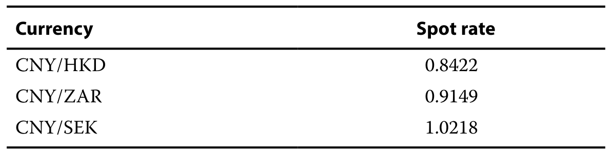

1\. ZAR/HKD 即期交叉汇率最接近：

1\. The spot ZAR/HKD cross-rate is closest to:

A. 0.9205。

A. 0.9205.

B. 1.0864。

B. 1.0864.

C. 1.2978。

C. 1.2978.

#### 官方答案与解析 / Official answer and explanation

1\. A 正确。要得到 ZAR/HKD 交叉汇率，必须先将CNY/ZAR 即期汇率取倒数，再乘以 CNY/HKD 汇率：

1\. A is correct. To get to the ZAR/HKD cross-rate, it is necessary to take the inverse of the CNY/ZAR spot rate and then multiply by the CNY/HKD exchange rate:

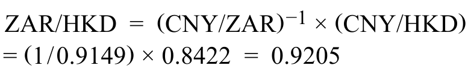

#### 补充解析 / Supplementary explanation

本题复核锚点（原解摘录）：1. A 正确。要得到 ZAR/HKD 交叉汇率，必须先将CNY/ZAR 即期汇率取倒数，再乘以 CNY/HKD 汇率：

Review anchor for this item (official excerpt): 1.

本题官方选项为 A。补充思路：先将每个报价写成带货币单位的分数，再相乘或相除，使中间货币约掉。若运算后单位不是目标货币/基准货币，方向就是错的。跨币种百分比变化还要先求期初与期末交叉汇率，再计算百分比，不能简单把两个升贬值百分比相加减。最后检验报价与倒数报价的乘积是否为 1。

The official choice for this item is A. Additional reasoning: Write each quote as a currency fraction and multiply or divide to cancel the intermediate currency. Wrong final units signal the wrong direction. To find a cross-rate percentage change, compute the beginning and ending cross rates before taking the percentage change; do not simply add component changes. A quote and its reciprocal should multiply to one.

#### 相关知识点 / Related concepts

交叉汇率与单位约分：交叉汇率示例：(A/C)×(C/B)＝A/B；变化率＝期末报价/期初报价−1。

Cross rates and cancellation of currency units: Cross-rate identity: (A/C) × (C/B) = A/B. Percentage change = ending quote/beginning quote − 1.

### ECON-LM08-PRACTICE-002 · 章末习题 2 Practice problem 2

章末练习 / Practice problem · 原版 PDF 页码 / Source PDF pages: 272, 274

#### 题目与资料 / Question and data

以下信息用于第 1—2 题

The following information relates to questions 1-2

一位交易商提供以下货币的即期汇率报价：

A dealer provides spot rate quotes for the following currencies:

2\. 另一位交易商报出的 ZAR/SEK 交叉汇率为 1.1210。可以赚取的套利利润最接近：

2\. Another dealer is quoting the ZAR/SEK cross-rate at 1.1210. The arbitrage profit that can be earned is closest to:

A. 每交易 100 万瑞典克朗，赚取 3,671 南非兰特。

A. ZAR3671 per million Swedish krona traded.

B. 每交易 100 万南非兰特，赚取 4,200 瑞典克朗。

B. SEK4200 per million South African rand traded.

C. 每交易 100 万瑞典克朗，赚取 4,200 南非兰特。

C. ZAR4200 per million Swedish krona traded.

#### 官方答案与解析 / Official answer and explanation

2\. C 正确。第一位交易商的 ZAR/SEK 交叉汇率为

2\. C is correct. The ZAR/SEK cross-rate from the original dealer is

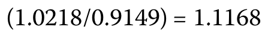

低于第二位交易商的报价。为赚取套利利润，外汇交易者应从第一位交易商处买入瑞典克朗（卖出南非兰特），并向第二位交易商卖出瑞典克朗（买入南非兰特）。交易 100 万瑞典克朗的利润为：

which is lower than the quote from the second dealer. To earn an arbitrage profit, a currency trader would buy Swedish krona (sell South African rand) from the original dealer and sell Swedish krona (buy South African rand) to the second dealer. On SEK1 million, the profit would be:

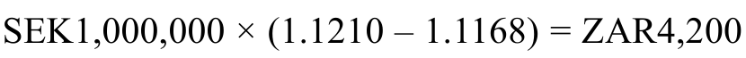

#### 补充解析 / Supplementary explanation

本题复核锚点（原解摘录）：2. C 正确。第一位交易商的 ZAR/SEK 交叉汇率为

Review anchor for this item (official excerpt): 2.

本题官方选项为 C。补充思路：先将每个报价写成带货币单位的分数，再相乘或相除，使中间货币约掉。若运算后单位不是目标货币/基准货币，方向就是错的。跨币种百分比变化还要先求期初与期末交叉汇率，再计算百分比，不能简单把两个升贬值百分比相加减。最后检验报价与倒数报价的乘积是否为 1。

The official choice for this item is C. Additional reasoning: Write each quote as a currency fraction and multiply or divide to cancel the intermediate currency. Wrong final units signal the wrong direction. To find a cross-rate percentage change, compute the beginning and ending cross rates before taking the percentage change; do not simply add component changes. A quote and its reciprocal should multiply to one.

#### 相关知识点 / Related concepts

交叉汇率与单位约分：交叉汇率示例：(A/C)×(C/B)＝A/B；变化率＝期末报价/期初报价−1。

Cross rates and cancellation of currency units: Cross-rate identity: (A/C) × (C/B) = A/B. Percentage change = ending quote/beginning quote − 1.

### ECON-LM08-PRACTICE-003 · 章末习题 3 Practice problem 3

章末练习 / Practice problem · 原版 PDF 页码 / Source PDF pages: 272, 274

#### 题目与资料 / Question and data

3\. 一位交易商列出的 BRL/MXN 即期汇率为 0.1378，六个月远期汇率为 0.14193。六个月远期点数最接近：

3\. A BRL/MXN spot rate is listed by a dealer at 0.1378. The six-month forward rate is 0.14193. The six-month forward points are closest to:

A. –41.3。

A. –41.3.

B. +41.3。

B. +41.3.

C. +299.7。

C. +299.7.

#### 官方答案与解析 / Official answer and explanation

3\. B 正确。远期点数等于远期汇率减去即期汇率，即

3\. B is correct. The number of forward points equals the forward rate minus the spot rate, or

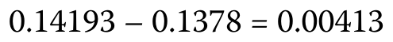

再乘以 10,000，得到以点为单位的远期点数：

multiplied by 10,000:

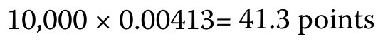

。根据惯例，远期点数经过缩放，使 ±1 个远期点对应即期汇率最后一位小数的 ±1 变化。

. By convention, forward points are scaled so that ±1 forward point corresponds to a change of ±1 in the last decimal place of the spot exchange rate.

#### 补充解析 / Supplementary explanation

本题复核锚点（原解摘录）：3. B 正确。远期点数等于远期汇率减去即期汇率，即

Review anchor for this item (official excerpt): 3.

本题官方选项为 B。补充思路：远期报价必须使用与即期报价相同的基准货币和计价货币。若 S 为计价货币/基准货币，F＝S×(1+r计价×T)/(1+r基准×T)，前提是题目采用相应的简单利息约定。远期点数是 F−S 的缩放表示，先按报价小数位还原点数再加减。高利率货币在有担保利率平价下通常以远期贴水交易；这不等于对未来即期汇率的无条件预测。

The official choice for this item is B. Additional reasoning: Use the same base/price orientation for spot and forward. With S in price/base units, F = S × (1+r_price × T)/(1+r_base × T) under the corresponding simple-interest convention. Forward points are a scaled F−S, so restore their decimal scale before adding them. Covered parity generally places the higher-rate currency at a forward discount, which is not an unconditional forecast of the future spot rate.

远期点数是远期价与即期价的绝对报价差，远期升贴水百分比则是差额除以即期价；需要年化时，还应按题目期限调整。

Forward points are the absolute difference between forward and spot quotes; a percentage premium divides that difference by spot. Annualization additionally depends on the quoted tenor.

#### 相关知识点 / Related concepts

远期汇率、点数与利率平价：先明确买卖哪一种货币，再选择远期买价或卖价；到期现金流的确定性来自合约锁定，而非汇率预测正确。

Forward rates, points, and interest parity: Identify which currency is bought or sold before choosing forward bid or ask. Hedged cash-flow certainty comes from locking the contract, not from forecasting spot correctly.

### ECON-LM08-PRACTICE-004 · 章末习题 4 Practice problem 4

章末练习 / Practice problem · 原版 PDF 页码 / Source PDF pages: 272, 274

#### 题目与资料 / Question and data

4\. 一位交易商列出的三个月 CAD/USD 远期汇率为 1.0123。

4\. A three-month forward exchange rate in CAD/USD is listed by a dealer at 1.0123.

该交易商同时将三个月远期点数按百分比报为 6.8%。CAD/USD 即期汇率最接近：

The dealer also quotes three-month forward points as a percentage at 6.8 percent. The CAD/USD spot rate is closest to:

A. 0.9478。

A. 0.9478.

B. 1.0550。

B. 1.0550.

C. 1.0862。

C. 1.0862.

#### 官方答案与解析 / Official answer and explanation

4\. A 正确。已知远期汇率及以百分比表示的远期点数，计算中的未知数为即期汇率。计算如下：

4\. A is correct. Given the forward rate and forward points as a percentage, the unknown in the calculation is the spot rate. The calculation is as follows:

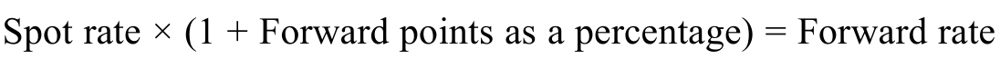 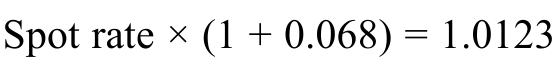 

#### 补充解析 / Supplementary explanation

本题复核锚点（原解摘录）：4. A 正确。已知远期汇率及以百分比表示的远期点数，计算中的未知数为即期汇率。

Review anchor for this item (official excerpt): 4.

本题官方选项为 A。补充思路：远期报价必须使用与即期报价相同的基准货币和计价货币。若 S 为计价货币/基准货币，F＝S×(1+r计价×T)/(1+r基准×T)，前提是题目采用相应的简单利息约定。远期点数是 F−S 的缩放表示，先按报价小数位还原点数再加减。高利率货币在有担保利率平价下通常以远期贴水交易；这不等于对未来即期汇率的无条件预测。

The official choice for this item is A. Additional reasoning: Use the same base/price orientation for spot and forward. With S in price/base units, F = S × (1+r_price × T)/(1+r_base × T) under the corresponding simple-interest convention. Forward points are a scaled F−S, so restore their decimal scale before adding them. Covered parity generally places the higher-rate currency at a forward discount, which is not an unconditional forecast of the future spot rate.

远期点数是远期价与即期价的绝对报价差，远期升贴水百分比则是差额除以即期价；需要年化时，还应按题目期限调整。

Forward points are the absolute difference between forward and spot quotes; a percentage premium divides that difference by spot. Annualization additionally depends on the quoted tenor.

#### 相关知识点 / Related concepts

远期汇率、点数与利率平价：先明确买卖哪一种货币，再选择远期买价或卖价；到期现金流的确定性来自合约锁定，而非汇率预测正确。

Forward rates, points, and interest parity: Identify which currency is bought or sold before choosing forward bid or ask. Hedged cash-flow certainty comes from locking the contract, not from forecasting spot correctly.

### ECON-LM08-PRACTICE-005 · 章末习题 5 Practice problem 5

章末练习 / Practice problem · 原版 PDF 页码 / Source PDF pages: 272-274

#### 题目与资料 / Question and data

5\. 如果远期汇率报价中的基础货币以远期贴水交易，下列哪项说法最准确？

5\. If the base currency in a forward exchange rate quote is trading at a forward discount, which of the following statements is most accurate?

A. 远期点数为正。

A. The forward points will be positive.

B. 远期百分比为负。

B. The forward percentage will be negative.

C. 基础货币预期相对于标价货币升值。

C. The base currency is expected to appreciate versus the price currency.

#### 官方答案与解析 / Official answer and explanation

5\. B 正确。基础货币以远期贴水交易，意味着一单位基础货币在远期交割时的价格低于即期交割时的价格，即远期汇率低于即期汇率。无论以绝对点数还是百分比表示，远期点数都为负。

5\. B is correct. The base currency trading at a forward discount means that 1 unit of the base currency costs less for forward delivery than for spot delivery (i.e., the forward exchange rate is less than the spot exchange rate). The forward points, expressed either as an absolute number of points or as a percentage, are negative.

#### 补充解析 / Supplementary explanation

本题复核锚点（原解摘录）：5. B 正确。基础货币以远期贴水交易，意味着一单位基础货币在远期交割时的价格低于即期交割时的价格，即远期汇率低于即期汇率。

Review anchor for this item (official excerpt): 5.

本题官方选项为 B。补充思路：远期报价必须使用与即期报价相同的基准货币和计价货币。若 S 为计价货币/基准货币，F＝S×(1+r计价×T)/(1+r基准×T)，前提是题目采用相应的简单利息约定。远期点数是 F−S 的缩放表示，先按报价小数位还原点数再加减。高利率货币在有担保利率平价下通常以远期贴水交易；这不等于对未来即期汇率的无条件预测。

The official choice for this item is B. Additional reasoning: Use the same base/price orientation for spot and forward. With S in price/base units, F = S × (1+r_price × T)/(1+r_base × T) under the corresponding simple-interest convention. Forward points are a scaled F−S, so restore their decimal scale before adding them. Covered parity generally places the higher-rate currency at a forward discount, which is not an unconditional forecast of the future spot rate.

远期点数是远期价与即期价的绝对报价差，远期升贴水百分比则是差额除以即期价；需要年化时，还应按题目期限调整。

Forward points are the absolute difference between forward and spot quotes; a percentage premium divides that difference by spot. Annualization additionally depends on the quoted tenor.

#### 相关知识点 / Related concepts

远期汇率、点数与利率平价：先明确买卖哪一种货币，再选择远期买价或卖价；到期现金流的确定性来自合约锁定，而非汇率预测正确。

Forward rates, points, and interest parity: Identify which currency is bought or sold before choosing forward bid or ask. Hedged cash-flow certainty comes from locking the contract, not from forecasting spot correctly.

### ECON-LM08-PRACTICE-006 · 章末习题 6 Practice problem 6

章末练习 / Practice problem · 原版 PDF 页码 / Source PDF pages: 273-274

#### 题目与资料 / Question and data

6\. 远期升水表明：

6\. A forward premium indicates:

A. 对基础货币的需求预期增加。

A. an expected increase in demand for the base currency.

B. 基础货币的利率高于标价货币的利率。

B. the interest rate is higher in the base currency than in the price currency.

C. 标价货币的利率高于基础货币的利率。

C. the interest rate is higher in the price currency than in the base currency.

#### 官方答案与解析 / Official answer and explanation

6\. C 正确。为消除套利机会，即期汇率（S）、远期汇率（F）、基础货币利率（rd）和标价货币利率（rf）必须满足：

6\. C is correct. To eliminate arbitrage opportunities, the spot exchange rate (S), the forward exchange rate (F), the interest rate in the base currency (rd, and the interest rate in the price currency (rf) must satisfy:

根据这一公式，当且仅当标价货币的利率高于基础货币的利率（rf \> rd）时，基础货币才会以远期升水交易（F \> S）。

According to this formula, the base currency will trade at forward premium (F \> S) if, and only if, the interest rate in the price currency is higher than the interest rate in the base currency (rf \> rd).

#### 补充解析 / Supplementary explanation

本题复核锚点（原解摘录）：6. C 正确。为消除套利机会，即期汇率（S）、远期汇率（F）、基础货币利率（rd）和标价货币利率（rf）必须满足：

Review anchor for this item (official excerpt): 6.

本题官方选项为 C。补充思路：远期报价必须使用与即期报价相同的基准货币和计价货币。若 S 为计价货币/基准货币，F＝S×(1+r计价×T)/(1+r基准×T)，前提是题目采用相应的简单利息约定。远期点数是 F−S 的缩放表示，先按报价小数位还原点数再加减。高利率货币在有担保利率平价下通常以远期贴水交易；这不等于对未来即期汇率的无条件预测。

The official choice for this item is C. Additional reasoning: Use the same base/price orientation for spot and forward. With S in price/base units, F = S × (1+r_price × T)/(1+r_base × T) under the corresponding simple-interest convention. Forward points are a scaled F−S, so restore their decimal scale before adding them. Covered parity generally places the higher-rate currency at a forward discount, which is not an unconditional forecast of the future spot rate.

远期点数是远期价与即期价的绝对报价差，远期升贴水百分比则是差额除以即期价；需要年化时，还应按题目期限调整。

Forward points are the absolute difference between forward and spot quotes; a percentage premium divides that difference by spot. Annualization additionally depends on the quoted tenor.

#### 相关知识点 / Related concepts

远期汇率、点数与利率平价：先明确买卖哪一种货币，再选择远期买价或卖价；到期现金流的确定性来自合约锁定，而非汇率预测正确。

Forward rates, points, and interest parity: Identify which currency is bought or sold before choosing forward bid or ask. Hedged cash-flow certainty comes from locking the contract, not from forecasting spot correctly.

### ECON-LM08-PRACTICE-007 · 章末习题 7 Practice problem 7

章末练习 / Practice problem · 原版 PDF 页码 / Source PDF pages: 273-274

#### 题目与资料 / Question and data

7\. JPY/AUD 即期汇率为 82.42，日元利率为 0.15%，澳元利率为 4.95%。如果利率按一年 360 天报价，则 JPY/AUD 的 90 天远期点数最接近：

7\. The JPY/AUD spot exchange rate is 82.42, the Japanese yen interest rate is 0.15 percent, and the Australian dollar interest rate is 4.95 percent. If the interest rates are quoted on the basis of a 360-day year, the 90-day forward points in JPY/AUD would be closest to:

A. –377.0。

A. –377.0.

B. –97.7。

B. –97.7.

C. 98.9。

C. 98.9.

#### 官方答案与解析 / Official answer and explanation

7\. B 正确。远期汇率为：

7\. B is correct. The forward exchange rate is given by:

远期点数如下：

The forward points are as follows:

由于即期汇率报价保留两位小数，远期点数按 100 倍进行缩放。

Because the spot exchange rate is quoted with two decimal places, the forward points are scaled by 100.

#### 补充解析 / Supplementary explanation

本题复核锚点（原解摘录）：7. B 正确。远期汇率为：

Review anchor for this item (official excerpt): 7.

本题官方选项为 B。补充思路：远期报价必须使用与即期报价相同的基准货币和计价货币。若 S 为计价货币/基准货币，F＝S×(1+r计价×T)/(1+r基准×T)，前提是题目采用相应的简单利息约定。远期点数是 F−S 的缩放表示，先按报价小数位还原点数再加减。高利率货币在有担保利率平价下通常以远期贴水交易；这不等于对未来即期汇率的无条件预测。

The official choice for this item is B. Additional reasoning: Use the same base/price orientation for spot and forward. With S in price/base units, F = S × (1+r_price × T)/(1+r_base × T) under the corresponding simple-interest convention. Forward points are a scaled F−S, so restore their decimal scale before adding them. Covered parity generally places the higher-rate currency at a forward discount, which is not an unconditional forecast of the future spot rate.

远期点数是远期价与即期价的绝对报价差，远期升贴水百分比则是差额除以即期价；需要年化时，还应按题目期限调整。

Forward points are the absolute difference between forward and spot quotes; a percentage premium divides that difference by spot. Annualization additionally depends on the quoted tenor.

#### 相关知识点 / Related concepts

远期汇率、点数与利率平价：先明确买卖哪一种货币，再选择远期买价或卖价；到期现金流的确定性来自合约锁定，而非汇率预测正确。

Forward rates, points, and interest parity: Identify which currency is bought or sold before choosing forward bid or ask. Hedged cash-flow certainty comes from locking the contract, not from forecasting spot correctly.

**来源文件 / Source files**  
2027_CFA_L1V2_Econ.pdf  
CFA_2027_Level1_Economics_ZH_EN.epub  
题号以原书为准。集合内的条目编号用于唯一定位，不替代原题号。 / Collection IDs provide unique navigation and do not replace original numbering.
