2027 CFA LEVEL I · VOLUME 04

# 财务报表分析 Financial Statement Analysis

官方教材习题与解析整理  
Bilingual Exercises and Explanations

395 条学习条目 · 12 个含习题学习单元  
395 exercise and worked-example records · 12 modules with exercises

资料来源：你提供的 2027 CFA Program Curriculum Level I 英文原版 PDF 及其双语 EPUB。英文题目、选项、图表与官方解析按原书保留；中文为学习译文，不是 CFA Institute 发布的官方中文译本。

Source: the user-provided 2027 CFA Program Curriculum Level I PDFs and bilingual EPUBs. Original questions, options, visuals, and official explanations are retained. Chinese text is a study translation, not an official CFA Institute translation.

阅读顺序为：题目与资料 → 官方答案与解析 → 补充解析 → 相关知识点。补充解析和知识点为本次整理的学习辅助内容；已发现的原书笔误单独说明。正文叙述式示例沿用原文，未另编新题。

Each record presents the question, official explanation, supplementary explanation, and related concepts together. Added teaching notes are separate from the official text. Identified source errors are annotated; narrated examples are retained without invented questions.

教材年份 / Curriculum year: 2027  
整理日期 / Prepared: 2026-11-07  
每条保留原版 PDF 页码，便于回查 / Source PDF page references included

## LM 1 · 财务报表分析导论 Introduction to Financial Statement Analysis 17 条目 · 原题与解析逐条对应 / Paired source questions and explanations

### FSA-LM01-KNOWLEDGE_CHECK-101 · 知识检查 · 第 1 题 Knowledge check · 1

知识检查 / Knowledge check · 原版 PDF 页码 / Source PDF pages: 28-29

#### 题目与资料 / Question and data

知识检验

KNOWLEDGE CHECK

1\. 2017年9月，总部位于新加坡的科技公司 Sea Ltd 向美国证券交易委员会（SEC）提交注册声明，登记其拟在纽约证券交易所首次公开发行的证券，即美国存托股份，每份代表一股A类普通股。

1\. In September 2017, Sea Ltd, the Singapore-based technology company, filed a registration statement with the US SEC to register its initial public offering of securities (American Depositary Shares, each representing one Class A Ordinary Share) on the New York Stock Exchange.

除了大量财务信息外，注册声明还提供了50多页关于海商有限公司工商的讨论。

In addition to a large amount of financial information, the registration statement provided over 50 pages of discussion on Sea Ltd.’s business and industry.

以下哪些最有可能列入海的登记说明?

Which of the following is most likely to have been included in Sea’s registration statement?

A. 承销商对报价的公平意见

A. Underwriters’ fairness opinion of the offering

B.对企业所涉风险因素的评估

B. Assessment of risk factors involved in the business

C. 业务预计的现金流量和盈利

C. Projected cash flows and earnings for the business

#### 官方答案与解析 / Official answer and explanation

解答：

Solution:

B 正确。

B is correct.

公司在登记报表中提供的信息通常包括：关于拟出售的证券的披露；这些新证券与发行人其他资本证券的关系；年度申报中通常提供的信息；最近审计的财务报表；以及业务所涉的风险因素。

Information provided by companies in registration statements typically includes disclosures about the securities being offered for sale; the relationship of these new securities to the issuer’s other capital securities; the information typically provided in the annual filings; recent audited financial statements; and risk factors involved in the business.

公司提供对开发预测的现金流量和盈利有用的信息，但通常不将这些信息列入登记说明，也不提供承销商的意见。

Companies provide information useful in developing projected cash flows and earnings but do not typically include these in the registration statement, nor do they provide opinions of the underwriters.

一家公司或其官员在前述定期报告之间定期提交其他美国证券交易委员会（SEC）文件，如果发生了重大事件或交易，则定期提交。

A company or its officers make other SEC filings—either periodically, or, if significant events or transactions have occurred, in between the periodic reports noted previously.

就其性质而言，这些表格有时载有及时的信息，可能具有重大的估价影响。

By their nature, these forms sometimes contain timely information that may have significant valuation implications.

\* 8-K表格：除了提交年度报告和临时报告外，美国证券交易委员会（SEC）登记人必须更经常地报告公司的重大事件。

■ Form 8-K: In addition to filing annual and interim reports, SEC registrants must report material corporate events on a more current basis.

表格8-K (6-K为非US注册人)是"当期报告"公司必须向美国证券交易委员会（SEC）申报重大事件，如收购或处置资产公司，证券公司和贸易市场的变化，与会计师和财务报表公司有关的事项，公司治理和管理变化，以及FD条例披露等。6

Form 8-K (6-K for non-US registrants) is the “current report” companies must file with the SEC to announce such major events as acquisitions or disposals of corporate assets, changes in securities and trading markets, matters related to accountants and financial statements, corporate governance and management changes, and Regulation FD disclosures.6

^ 表格 3,4,5，和144: 表格 3,4，和5必须报告证券的受益所有权。

■ Forms 3, 4, 5, and 144: Forms 3, 4, and 5 are required to report beneficial ownership of securities.

注册公司的任何董事或官员以及注册的权益证券类别中超过10%的受益所有人都必须提交这些档案。

These filings are required for any director or officer of a registered company as well as beneficial owners of greater than 10 percent of a class of registered equity securities.

表格3为初始报表，表格4报告变化，表格5为年度报告。

Form 3 is the initial statement, Form 4 reports changes, and Form 5 is the annual report.

表格144是发行人下属机构拟出售受限制证券或证券的通知。

Form 144 is notice of the proposed sale of restricted securities or securities held by an affiliate of the issuer.

这些表格可用于审查公司官员、董事和其他子公司购买和销售收入证券的情况，这些子公司集体被视为公司内幕者。

These forms can be used to examine purchases and sales of securities by officers, directors, and other affiliates of the company, who collectively are regarded as corporate insiders.

\* 11-K表格：这是关于雇员股票购买、储蓄和类似计划的年度报告。

■ Form 11-K: This is the annual report of employee stock purchase, savings, and similar plans.

具有重大雇员福利计划的公司的分析人员可能对此感兴趣，因为它包含的关于这些计划的信息多于公司财务报表披露的信息。

It might be of interest to analysts for companies with significant employee benefit plans because it contains more information about these plans than disclosed in the company’s financial statements.

在美国以外的法域，为了管制证券和资本市场，也存在类似的立法。

In jurisdictions other than the United States, similar legislation exists for the purpose of regulating securities and capital markets.

监管机构负责执行监管，证券监管旨在与上一节所述IOSCO目标保持一致。

Regulatory authorities are responsible for enforcing regulation, and securities regulation is intended to be consistent with the IOSCO objectives described in the previous section.

在每个法域内，监管者将建立或更通常地承认和采用一套或几套特定的会计准则。

Within each jurisdiction, regulators will either establish or, more typically, recognize and adopt a specified set or sets of accounting standards.

监管机构还将制定报告和备案要求。

The regulators will also establish reporting and filing requirements.

IOSCO成员同意合作制定、执行和执行国际公认的和一致的管制标准。

IOSCO members have agreed to cooperate in the development, implementation, and enforcement of internationally recognized and consistent standards of regulation.

#### 补充解析 / Supplementary explanation

本题复核锚点（原解摘录）：公司在登记报表中提供的信息通常包括：关于拟出售的证券的披露；这些新证券与发行人其他资本证券的关系；年度申报中通常提供的信息；最近审计的财务报表；以及业务所涉的风险因素。

Review anchor for this item (official excerpt): Information provided by companies in registration statements typically includes disclosures about the securities being offered for sale; the relationship of these new securities to the issuer’s other capital securities; the information typically provided in the annual filings; recent audited financial statements; and risk factors involved in the business.

本题官方选项为 B。补充思路：先明确分析目的和约束，再收集与处理信息，最后解释结果、形成结论并持续更新。资产负债表描述时点状态，利润表和现金流量表描述期间表现，权益变动表连接期间内的权益变化。分析师通常需要调整和比较，报表比率本身不是最终结论；选择工具应服务于决策问题。

The official choice for this item is B. Additional reasoning: Define purpose and constraints before gathering, processing, interpreting, and updating information. A balance sheet describes a point in time; income and cash-flow statements describe a period; equity changes link equity movements. Ratios require adjustment and interpretation, and analytical tools should serve the decision at hand.

#### 相关知识点 / Related concepts

财务分析的目的与步骤：财务报告与财务分析不同；分析需兼顾历史业绩、当前财务状况与未来现金流能力。

Purpose and sequence of financial analysis: Financial reporting differs from financial analysis. Consider historical performance, present condition, and future cash-generating capacity.

### FSA-LM01-PRACTICE-001 · 章末习题 1 Practice problem 1

章末练习 / Practice problem · 原版 PDF 页码 / Source PDF pages: 44, 47

#### 题目与资料 / Question and data

1\. 比率是财务报表分析框架中哪个步骤的输入?

1\. Ratios are an input into which step in the financial statement analysis framework?

A. 进程数据

A. Process data

B. 收集输入数据

B. Collect input data

C. 分析/解释已处理的数据

C. Analyze/interpret the processed data

#### 官方答案与解析 / Official answer and explanation

1,C号正确

1\. C is correct.

比率是进程信息步骤的产出，但也是对分析/解释数据步骤的投入。

Ratios are an output of the process information step but are an input into the analyze/interpret data step.

#### 补充解析 / Supplementary explanation

本题复核锚点（原解摘录）：比率是进程信息步骤的产出，但也是对分析/解释数据步骤的投入。

Review anchor for this item (official excerpt): Ratios are an output of the process information step but are an input into the analyze/interpret data step.

本题官方选项为 C。补充思路：先明确分析目的和约束，再收集与处理信息，最后解释结果、形成结论并持续更新。资产负债表描述时点状态，利润表和现金流量表描述期间表现，权益变动表连接期间内的权益变化。分析师通常需要调整和比较，报表比率本身不是最终结论；选择工具应服务于决策问题。

The official choice for this item is C. Additional reasoning: Define purpose and constraints before gathering, processing, interpreting, and updating information. A balance sheet describes a point in time; income and cash-flow statements describe a period; equity changes link equity movements. Ratios require adjustment and interpretation, and analytical tools should serve the decision at hand.

#### 相关知识点 / Related concepts

财务分析的目的与步骤：财务报告与财务分析不同；分析需兼顾历史业绩、当前财务状况与未来现金流能力。

Purpose and sequence of financial analysis: Financial reporting differs from financial analysis. Consider historical performance, present condition, and future cash-generating capacity.

### FSA-LM01-PRACTICE-002 · 章末习题 2 Practice problem 2

章末练习 / Practice problem · 原版 PDF 页码 / Source PDF pages: 44, 47

#### 题目与资料 / Question and data

2\. 财务报表分析框架的哪个阶段最可能涉及编写最新报告和建议?

2\. Which phase in the financial statement analysis framework is most likely to involve producing updated reports and recommendations?

A. 后续行动

A. Follow-up

B. 分析/解释已处理的数据

B. Analyze/interpret the processed data

C. 制定和传达结论和建议

C. Develop and communicate conclusions and recommendations

#### 官方答案与解析 / Official answer and explanation

2,A没错

2\. A is correct.

后续阶段涉及收集资料和重复分析，以确定是否需要更新报告和建议。

The follow-up phase involves gathering information and repeating the analysis to determine whether it is necessary to update reports and recommendations.

#### 补充解析 / Supplementary explanation

本题复核锚点（原解摘录）：后续阶段涉及收集资料和重复分析，以确定是否需要更新报告和建议。

Review anchor for this item (official excerpt): The follow-up phase involves gathering information and repeating the analysis to determine whether it is necessary to update reports and recommendations.

本题官方选项为 A。补充思路：先明确分析目的和约束，再收集与处理信息，最后解释结果、形成结论并持续更新。资产负债表描述时点状态，利润表和现金流量表描述期间表现，权益变动表连接期间内的权益变化。分析师通常需要调整和比较，报表比率本身不是最终结论；选择工具应服务于决策问题。

The official choice for this item is A. Additional reasoning: Define purpose and constraints before gathering, processing, interpreting, and updating information. A balance sheet describes a point in time; income and cash-flow statements describe a period; equity changes link equity movements. Ratios require adjustment and interpretation, and analytical tools should serve the decision at hand.

#### 相关知识点 / Related concepts

财务分析的目的与步骤：财务报告与财务分析不同；分析需兼顾历史业绩、当前财务状况与未来现金流能力。

Purpose and sequence of financial analysis: Financial reporting differs from financial analysis. Consider historical performance, present condition, and future cash-generating capacity.

### FSA-LM01-PRACTICE-003 · 章末习题 3 Practice problem 3

章末练习 / Practice problem · 原版 PDF 页码 / Source PDF pages: 44, 47

#### 题目与资料 / Question and data

3.以下哪一个最能描述财务报表分析的角色?

3\. Which of the following best describes the role of financial statement analysis?

A. 提供关于公司业绩的资料

A. To provide information about a company’s performance

B. 提供关于公司财务状况变化的资料

B. To provide information about a company’s changes in financial position

C. 形成对公司未来业绩和财务状况的预期

C. To form expectations about a company’s future performance and financial position

#### 官方答案与解析 / Official answer and explanation

3,C号正确

3\. C is correct.

总的来说，分析人员力求审查公司过去和目前的业绩和财务状况，以形成对其未来业绩和财务状况的预期。

In general, analysts seek to examine the past and current performance and financial position of a company to form expectations about its future performance and financial position.

#### 补充解析 / Supplementary explanation

本题复核锚点（原解摘录）：总的来说，分析人员力求审查公司过去和目前的业绩和财务状况，以形成对其未来业绩和财务状况的预期。

Review anchor for this item (official excerpt): In general, analysts seek to examine the past and current performance and financial position of a company to form expectations about its future performance and financial position.

本题官方选项为 C。补充思路：先明确分析目的和约束，再收集与处理信息，最后解释结果、形成结论并持续更新。资产负债表描述时点状态，利润表和现金流量表描述期间表现，权益变动表连接期间内的权益变化。分析师通常需要调整和比较，报表比率本身不是最终结论；选择工具应服务于决策问题。

The official choice for this item is C. Additional reasoning: Define purpose and constraints before gathering, processing, interpreting, and updating information. A balance sheet describes a point in time; income and cash-flow statements describe a period; equity changes link equity movements. Ratios require adjustment and interpretation, and analytical tools should serve the decision at hand.

#### 相关知识点 / Related concepts

财务分析的目的与步骤：财务报告与财务分析不同；分析需兼顾历史业绩、当前财务状况与未来现金流能力。

Purpose and sequence of financial analysis: Financial reporting differs from financial analysis. Consider historical performance, present condition, and future cash-generating capacity.

### FSA-LM01-PRACTICE-004 · 章末习题 4 Practice problem 4

章末练习 / Practice problem · 原版 PDF 页码 / Source PDF pages: 44, 47

#### 题目与资料 / Question and data

4\. 财务报表分析的主要角色最好描述为：

4\. The primary role of financial statement analysis is best described as:

A. 提供有助于作出投资决策的信息。

A. providing information useful for making investment decisions.

B.为作出经济决策而对公司进行评价。

B. evaluating a company for the purpose of making economic decisions.

C. 使用分析员编写的财务报告来作出经济决策。

C. using financial reports prepared by analysts to make economic decisions.

#### 官方答案与解析 / Official answer and explanation

4,B对

4\. B is correct.

财务报表分析的主要作用是利用公司编制的财务报告来评价其过去，现在，以及潜在的业绩和财务状况，以便作出投资，信贷，以及其他经济决策。

The primary role of financial statement analysis is to use financial reports prepared by companies to evaluate their past, current, and potential performance and financial position for the purpose of making investment, credit, and other economic decisions.

#### 补充解析 / Supplementary explanation

本题复核锚点（原解摘录）：财务报表分析的主要作用是利用公司编制的财务报告来评价其过去，现在，以及潜在的业绩和财务状况，以便作出投资，信贷，以及其他经济决策。

Review anchor for this item (official excerpt): The primary role of financial statement analysis is to use financial reports prepared by companies to evaluate their past, current, and potential performance and financial position for the purpose of making investment, credit, and other economic decisions.

本题官方选项为 B。补充思路：先明确分析目的和约束，再收集与处理信息，最后解释结果、形成结论并持续更新。资产负债表描述时点状态，利润表和现金流量表描述期间表现，权益变动表连接期间内的权益变化。分析师通常需要调整和比较，报表比率本身不是最终结论；选择工具应服务于决策问题。

The official choice for this item is B. Additional reasoning: Define purpose and constraints before gathering, processing, interpreting, and updating information. A balance sheet describes a point in time; income and cash-flow statements describe a period; equity changes link equity movements. Ratios require adjustment and interpretation, and analytical tools should serve the decision at hand.

#### 相关知识点 / Related concepts

财务分析的目的与步骤：财务报告与财务分析不同；分析需兼顾历史业绩、当前财务状况与未来现金流能力。

Purpose and sequence of financial analysis: Financial reporting differs from financial analysis. Consider historical performance, present condition, and future cash-generating capacity.

### FSA-LM01-PRACTICE-005 · 章末习题 5 Practice problem 5

章末练习 / Practice problem · 原版 PDF 页码 / Source PDF pages: 44, 47

#### 题目与资料 / Question and data

5\. 国际财务报告准则目前是由哪个实体开发的?

5\. International Financial Reporting Standards are currently developed by which entity?

A. 国际财务报告准则（IFRS）基金会

A. IFRS Foundation

B. 国际会计准则理事会

B. International Accounting Standards Board

C. 国际证券委员会组织

C. International Organization of Securities Commissions

#### 官方答案与解析 / Official answer and explanation

5,B对

5\. B is correct.

目前国际会计准则理事会(国际会计准则理事会（IASB）)负责开发国际财务报告准则。

The International Accounting Standards Board (IASB) is currently charged with developing International Financial Reporting Standards.

#### 补充解析 / Supplementary explanation

本题复核锚点（原解摘录）：目前国际会计准则理事会(国际会计准则理事会（IASB）)负责开发国际财务报告准则。

Review anchor for this item (official excerpt): The International Accounting Standards Board (IASB) is currently charged with developing International Financial Reporting Standards.

本题官方选项为 B。补充思路：先明确分析目的和约束，再收集与处理信息，最后解释结果、形成结论并持续更新。资产负债表描述时点状态，利润表和现金流量表描述期间表现，权益变动表连接期间内的权益变化。分析师通常需要调整和比较，报表比率本身不是最终结论；选择工具应服务于决策问题。

The official choice for this item is B. Additional reasoning: Define purpose and constraints before gathering, processing, interpreting, and updating information. A balance sheet describes a point in time; income and cash-flow statements describe a period; equity changes link equity movements. Ratios require adjustment and interpretation, and analytical tools should serve the decision at hand.

#### 相关知识点 / Related concepts

财务分析的目的与步骤：财务报告与财务分析不同；分析需兼顾历史业绩、当前财务状况与未来现金流能力。

Purpose and sequence of financial analysis: Financial reporting differs from financial analysis. Consider historical performance, present condition, and future cash-generating capacity.

### FSA-LM01-PRACTICE-006 · 章末习题 6 Practice problem 6

章末练习 / Practice problem · 原版 PDF 页码 / Source PDF pages: 44, 47

#### 题目与资料 / Question and data

6\. 美国公认会计原则（US GAAP）目前是由哪个实体开发的?

6\. US GAAP are currently developed by which entity?

A. 证券交易委员会

A. Securities and Exchange Commission

B. 财务会计准则委员会

B. Financial Accounting Standards Board

C. 上市公司 会计监督委员会

C. Public Company Accounting Oversight Board

#### 官方答案与解析 / Official answer and explanation

6,B对

6\. B is correct.

US 公认会计原则由US 财务会计准则委员会(财务会计准则委员会（FASB）)开发。

US Generally Accepted Accounting Principles are developed by the US Financial Accounting Standards Board (FASB).

#### 补充解析 / Supplementary explanation

本题复核锚点（原解摘录）：US 公认会计原则由US 财务会计准则委员会(财务会计准则委员会（FASB）)开发。

Review anchor for this item (official excerpt): US Generally Accepted Accounting Principles are developed by the US Financial Accounting Standards Board (FASB).

本题官方选项为 B。补充思路：先区分财务报告准则的制定者和证券市场监管者。IASB 制定 IFRS，FASB 制定美国会计准则；证券监管机构负责在其司法管辖区执行相关要求。IOSCO 促进证券监管合作，其目标包括保护投资者、确保公平有效透明的市场以及降低系统性风险，不能将其理解为消除所有投资风险。

The official choice for this item is B. Additional reasoning: Separate accounting standard setters from securities regulators. The IASB develops IFRS and the FASB develops US GAAP; securities authorities enforce requirements within their jurisdictions. IOSCO promotes regulatory cooperation, including investor protection, fair, efficient and transparent markets, and reduction of systemic risk, not elimination of all investment risk.

#### 相关知识点 / Related concepts

准则制定与证券监管的分工：准则制定、法律采用与监管执行是不同环节；投资风险不能由财务报告或监管全部消除。

Standard setting versus securities regulation: Standard setting, legal adoption, and enforcement are different stages. Reporting and regulation do not eliminate investment risk.

### FSA-LM01-PRACTICE-007 · 章末习题 7 Practice problem 7

章末练习 / Practice problem · 原版 PDF 页码 / Source PDF pages: 44-45, 47

#### 题目与资料 / Question and data

7\. 国际证券委员会组织的核心目标是：

7\. A core objective of the International Organization of Securities Commissions is to:

A. 消除系统性风险。

A. eliminate systemic risk.

B. 保护财务报表用户。

B. protect users of financial statements.

C.确保市场公平、高效和透明。

C. ensure that markets are fair, efficient, and transparent.

#### 官方答案与解析 / Official answer and explanation

7,C号正确

7\. C is correct.

IOSCO的核心目标是确保市场公平、高效和透明的。

A core objective of IOSCO is to ensure that markets are fair, efficient, and transparent.

其他核心目标是降低而非消除系统性风险，以及保护投资者；并不是保护所有财务报表使用者。

The other core objectives are to reduce, not eliminate, systemic risk and to protect investors, not all users of financial statements.

#### 补充解析 / Supplementary explanation

本题复核锚点（原解摘录）：IOSCO的核心目标是确保市场公平、高效和透明的。

Review anchor for this item (official excerpt): A core objective of IOSCO is to ensure that markets are fair, efficient, and transparent.

本题官方选项为 C。补充思路：先区分财务报告准则的制定者和证券市场监管者。IASB 制定 IFRS，FASB 制定美国会计准则；证券监管机构负责在其司法管辖区执行相关要求。IOSCO 促进证券监管合作，其目标包括保护投资者、确保公平有效透明的市场以及降低系统性风险，不能将其理解为消除所有投资风险。

The official choice for this item is C. Additional reasoning: Separate accounting standard setters from securities regulators. The IASB develops IFRS and the FASB develops US GAAP; securities authorities enforce requirements within their jurisdictions. IOSCO promotes regulatory cooperation, including investor protection, fair, efficient and transparent markets, and reduction of systemic risk, not elimination of all investment risk.

#### 相关知识点 / Related concepts

准则制定与证券监管的分工：准则制定、法律采用与监管执行是不同环节；投资风险不能由财务报告或监管全部消除。

Standard setting versus securities regulation: Standard setting, legal adoption, and enforcement are different stages. Reporting and regulation do not eliminate investment risk.

### FSA-LM01-PRACTICE-008 · 章末习题 8 Practice problem 8

章末练习 / Practice problem · 原版 PDF 页码 / Source PDF pages: 45, 47

#### 题目与资料 / Question and data

8.以下哪一个最能说明为什么需要财务报表的附注?

8\. Which of the following best describes why the notes that accompany the financial statements are required?

这些说明：

The notes:

A. 允许在编制报表方面有灵活性。

A. permit flexibility in statement preparation.

B. 公司之间的财务报告标准化。

B. standardize financial reporting across companies.

C. 提供理解财务报表所必需的信息。

C. provide information necessary to understand the financial statements.

#### 官方答案与解析 / Official answer and explanation

8,C号正确

8\. C is correct.

这些说明提供了对理解主要陈述中提供的信息至关重要的信息。

The notes provide information that is essential to understanding the information provided in the primary statements.

#### 补充解析 / Supplementary explanation

本题复核锚点（原解摘录）：这些说明提供了对理解主要陈述中提供的信息至关重要的信息。

Review anchor for this item (official excerpt): The notes provide information that is essential to understanding the information provided in the primary statements.

本题官方选项为 C。补充思路：不同文件回答不同问题：报表附注解释会计政策、估计和具体项目；管理层讨论解释战略、经营表现与风险；委托投票文件通常披露董事和高管薪酬等治理信息；独立审计报告说明审计范围及意见。先找最直接负责披露该信息的文件，可排除虽相关但不承担该功能的选项。

The official choice for this item is C. Additional reasoning: Different documents answer different questions. Notes explain policies, estimates, and line items; management commentary discusses strategy, performance, and risks; proxy materials commonly disclose governance and executive compensation; the independent auditor’s report describes the audit and opinion. Choose the document directly responsible for the disclosure.

#### 相关知识点 / Related concepts

信息来源的定位：附注是完整财务报表不可分割的一部分；管理层叙述与独立审计意见的角色不同。

Locating financial information: Notes are integral to complete financial statements. Management narrative and the independent audit opinion serve different roles.

### FSA-LM01-PRACTICE-009 · 章末习题 9 Practice problem 9

章末练习 / Practice problem · 原版 PDF 页码 / Source PDF pages: 45, 47

#### 题目与资料 / Question and data

9\. 会计政策，制备财务报表时所使用的方法和估计，最有可能见于：

9\. Accounting policies, methods, and estimates used in preparing financial statements are most likely to be found in the:

A. 审计员的报告。

A. auditor’s report.

B. 管理评注。

B. management commentary.

C.对财务报表的说明。

C. notes to the financial statements.

#### 官方答案与解析 / Official answer and explanation

9,C号正确

9\. C is correct.

说明中披露了会计政策的选择，方法和估计。

The notes disclose choices in accounting policies, methods, and estimates.

#### 补充解析 / Supplementary explanation

本题复核锚点（原解摘录）：说明中披露了会计政策的选择，方法和估计。

Review anchor for this item (official excerpt): The notes disclose choices in accounting policies, methods, and estimates.

本题官方选项为 C。补充思路：不同文件回答不同问题：报表附注解释会计政策、估计和具体项目；管理层讨论解释战略、经营表现与风险；委托投票文件通常披露董事和高管薪酬等治理信息；独立审计报告说明审计范围及意见。先找最直接负责披露该信息的文件，可排除虽相关但不承担该功能的选项。

The official choice for this item is C. Additional reasoning: Different documents answer different questions. Notes explain policies, estimates, and line items; management commentary discusses strategy, performance, and risks; proxy materials commonly disclose governance and executive compensation; the independent auditor’s report describes the audit and opinion. Choose the document directly responsible for the disclosure.

#### 相关知识点 / Related concepts

信息来源的定位：附注是完整财务报表不可分割的一部分；管理层叙述与独立审计意见的角色不同。

Locating financial information: Notes are integral to complete financial statements. Management narrative and the independent audit opinion serve different roles.

### FSA-LM01-PRACTICE-010 · 章末习题 10 Practice problem 10

章末练习 / Practice problem · 原版 PDF 页码 / Source PDF pages: 45, 47

#### 题目与资料 / Question and data

10.关于管理和董事报酬的信息最有可能出现在：

10\. Information about management and director compensation is most likely to be found in the:

A. 审计员的报告。

A. auditor’s report.

B. 代理声明。

B. proxy statement.

C. 盈利发布。

C. earnings release.

#### 官方答案与解析 / Official answer and explanation

10,B对

10\. B is correct.

管理层补偿的披露通常包括在代理报表中。

Disclosure of management compensation is typically included in the proxy statement.

盈利的发行涉及的是公司盈利，而不是管理人员作为补偿赚取的收入。

An earnings release is about corporate earnings, not what managers earn as compensation.

#### 补充解析 / Supplementary explanation

本题复核锚点（原解摘录）：管理层补偿的披露通常包括在代理报表中。

Review anchor for this item (official excerpt): Disclosure of management compensation is typically included in the proxy statement.

本题官方选项为 B。补充思路：先明确分析目的和约束，再收集与处理信息，最后解释结果、形成结论并持续更新。资产负债表描述时点状态，利润表和现金流量表描述期间表现，权益变动表连接期间内的权益变化。分析师通常需要调整和比较，报表比率本身不是最终结论；选择工具应服务于决策问题。

The official choice for this item is B. Additional reasoning: Define purpose and constraints before gathering, processing, interpreting, and updating information. A balance sheet describes a point in time; income and cash-flow statements describe a period; equity changes link equity movements. Ratios require adjustment and interpretation, and analytical tools should serve the decision at hand.

#### 相关知识点 / Related concepts

财务分析的目的与步骤：财务报告与财务分析不同；分析需兼顾历史业绩、当前财务状况与未来现金流能力。

Purpose and sequence of financial analysis: Financial reporting differs from financial analysis. Consider historical performance, present condition, and future cash-generating capacity.

### FSA-LM01-PRACTICE-011 · 章末习题 11 Practice problem 11

章末练习 / Practice problem · 原版 PDF 页码 / Source PDF pages: 45, 47

#### 题目与资料 / Question and data

11.关于公司的目标、战略和重大风险的信息最有可能出现在：

11\. Information about a company’s objectives, strategies, and significant risks are most likely to be found in the:

A. 审计员的报告。

A. auditor’s report.

B. 管理评注。

B. management commentary.

C.对财务报表的说明。

C. notes to the financial statements.

#### 官方答案与解析 / Official answer and explanation

11,B对

11\. B is correct.

这些是管理评注的组成部分。

These are components of management commentary.

#### 补充解析 / Supplementary explanation

本题复核锚点（原解摘录）：这些是管理评注的组成部分。

Review anchor for this item (official excerpt): These are components of management commentary.

本题官方选项为 B。补充思路：不同文件回答不同问题：报表附注解释会计政策、估计和具体项目；管理层讨论解释战略、经营表现与风险；委托投票文件通常披露董事和高管薪酬等治理信息；独立审计报告说明审计范围及意见。先找最直接负责披露该信息的文件，可排除虽相关但不承担该功能的选项。

The official choice for this item is B. Additional reasoning: Different documents answer different questions. Notes explain policies, estimates, and line items; management commentary discusses strategy, performance, and risks; proxy materials commonly disclose governance and executive compensation; the independent auditor’s report describes the audit and opinion. Choose the document directly responsible for the disclosure.

#### 相关知识点 / Related concepts

信息来源的定位：附注是完整财务报表不可分割的一部分；管理层叙述与独立审计意见的角色不同。

Locating financial information: Notes are integral to complete financial statements. Management narrative and the independent audit opinion serve different roles.

### FSA-LM01-PRACTICE-012 · 章末习题 12 Practice problem 12

章末练习 / Practice problem · 原版 PDF 页码 / Source PDF pages: 45, 47

#### 题目与资料 / Question and data

12\. 分析财务报表时选择哪一种审计意见?

12\. What type of audit opinion is preferred when analyzing financial statements?

A. 反面

A. Adverse

B. 合格

B. Qualified

C.无资格

C. Unqualified

#### 官方答案与解析 / Official answer and explanation

12,C号正确

12\. C is correct.

无保留意见是一种 " 干净的 " 意见，表明财务报表按照适用的会计准则公平反映了公司的业绩和财务状况。

An unqualified opinion is a “clean” opinion and indicates that the financial statements present the company’s performance and financial position fairly in accordance with applicable accounting standards.

#### 补充解析 / Supplementary explanation

本题复核锚点（原解摘录）：无保留意见是一种 " 干净的 " 意见，表明财务报表按照适用的会计准则公平反映了公司的业绩和财务状况。

Review anchor for this item (official excerpt): An unqualified opinion is a “clean” opinion and indicates that the financial statements present the company’s performance and financial position fairly in accordance with applicable accounting standards.

本题官方选项为 C。补充思路：审计提供合理保证，关注报表是否按适用准则在所有重大方面公允列报；它不是对投资价值或无舞弊的保证。无保留意见与保留意见、否定意见、无法表示意见的区别，取决于已发现偏差或证据不足的性质及广泛性。分析师仍需独立评估会计估计、风险和持续经营，而不能把审计结论当成评级结论。

The official choice for this item is C. Additional reasoning: An audit provides reasonable assurance about fair presentation under the applicable framework, not investment merit or the complete absence of fraud. Qualified, adverse, and disclaimer opinions differ by the nature and pervasiveness of misstatements or evidence limitations. Analysts still assess estimates, risk, and going concern independently.

#### 相关知识点 / Related concepts

审计意见的含义：无保留意见并不证明公司经营良好；重大性影响审计判断；关键审计事项不自动构成保留意见。

Meaning of audit opinions: An unmodified opinion does not establish strong operating performance. Materiality shapes audit judgments, and key audit matters do not automatically qualify the opinion.

### FSA-LM01-PRACTICE-013 · 章末习题 13 Practice problem 13

章末练习 / Practice problem · 原版 PDF 页码 / Source PDF pages: 45, 47

#### 题目与资料 / Question and data

13\. 审计员确定，公司财务报表是按适用的会计准则编制的，但存货报告除外。

13\. An auditor determines that a company’s financial statements are prepared in accordance with applicable accounting standards except with respect to inventory reporting.

这一例外最有可能产生审计意见，即：

This exception is most likely to result in an audit opinion that is:

A. 负面。

A. adverse.

B. 合格。

B. qualified.

C.不合格。

C. unqualified.

#### 官方答案与解析 / Official answer and explanation

13,B对

13\. B is correct.

保留审计意见是其中对会计准则有一些范围限制或例外的一种。

A qualified audit opinion is one in which there is some scope limitation or exception to accounting standards.

审计报告对例外情况作了说明，并增加了解释性段落，以便分析员能够确定例外情况的重要性。

Exceptions are described in the audit report with additional explanatory paragraphs so that the analyst can determine the importance of the exception.

#### 补充解析 / Supplementary explanation

本题复核锚点（原解摘录）：保留审计意见是其中对会计准则有一些范围限制或例外的一种。

Review anchor for this item (official excerpt): A qualified audit opinion is one in which there is some scope limitation or exception to accounting standards.

本题官方选项为 B。补充思路：审计提供合理保证，关注报表是否按适用准则在所有重大方面公允列报；它不是对投资价值或无舞弊的保证。无保留意见与保留意见、否定意见、无法表示意见的区别，取决于已发现偏差或证据不足的性质及广泛性。分析师仍需独立评估会计估计、风险和持续经营，而不能把审计结论当成评级结论。

The official choice for this item is B. Additional reasoning: An audit provides reasonable assurance about fair presentation under the applicable framework, not investment merit or the complete absence of fraud. Qualified, adverse, and disclaimer opinions differ by the nature and pervasiveness of misstatements or evidence limitations. Analysts still assess estimates, risk, and going concern independently.

本题要求选择“不成立、最不可能或例外”的项目。先判断各陈述在题设下是否成立，再按这一反向要求选出答案；正确选项可能本身描述的就是错误或不适用情形。

This item asks for a least-likely, inaccurate, or exception case. Evaluate each statement under the assumptions, then apply that reversed selection rule; the credited choice may itself describe the false or inapplicable case.

#### 相关知识点 / Related concepts

审计意见的含义：无保留意见并不证明公司经营良好；重大性影响审计判断；关键审计事项不自动构成保留意见。

Meaning of audit opinions: An unmodified opinion does not establish strong operating performance. Materiality shapes audit judgments, and key audit matters do not automatically qualify the opinion.

### FSA-LM01-PRACTICE-014 · 章末习题 14 Practice problem 14

章末练习 / Practice problem · 原版 PDF 页码 / Source PDF pages: 45-47

#### 题目与资料 / Question and data

14\. 独立审计报告最有可能提供：

14\. An independent audit report is most likely to provide:

A. 绝对保证财务报表的准确性。

A. absolute assurance about the accuracy of the financial statements.

B. 合理保证财务报表的列报公平。

B. reasonable assurance that the financial statements are fairly presented.

C.关于财务报表的透明度的保留意见。

C. a qualified opinion with respect to the transparency of the financial statements.

#### 官方答案与解析 / Official answer and explanation

14,B对

14\. B is correct.

独立的审计报告提供了合理保证，财务报表是公允的呈现，这意味着被审计的财务报表很可能没有重大错误，欺诈，或对财务报表有直接影响的非法行为。

The independent audit report provides reasonable assurance that the financial statements are fairly presented, meaning that there is a high probability that the audited financial statements are free from material error, fraud, or illegal acts that have a direct effect on the financial statements.

#### 补充解析 / Supplementary explanation

本题复核锚点（原解摘录）：独立的审计报告提供了合理保证，财务报表是公允的呈现，这意味着被审计的财务报表很可能没有重大错误，欺诈，或对财务报表有直接影响的非法行为。

Review anchor for this item (official excerpt): The independent audit report provides reasonable assurance that the financial statements are fairly presented, meaning that there is a high probability that the audited financial statements are free from material error, fraud, or illegal acts that have a direct effect on the financial statements.

本题官方选项为 B。补充思路：审计提供合理保证，关注报表是否按适用准则在所有重大方面公允列报；它不是对投资价值或无舞弊的保证。无保留意见与保留意见、否定意见、无法表示意见的区别，取决于已发现偏差或证据不足的性质及广泛性。分析师仍需独立评估会计估计、风险和持续经营，而不能把审计结论当成评级结论。

The official choice for this item is B. Additional reasoning: An audit provides reasonable assurance about fair presentation under the applicable framework, not investment merit or the complete absence of fraud. Qualified, adverse, and disclaimer opinions differ by the nature and pervasiveness of misstatements or evidence limitations. Analysts still assess estimates, risk, and going concern independently.

#### 相关知识点 / Related concepts

审计意见的含义：无保留意见并不证明公司经营良好；重大性影响审计判断；关键审计事项不自动构成保留意见。

Meaning of audit opinions: An unmodified opinion does not establish strong operating performance. Materiality shapes audit judgments, and key audit matters do not automatically qualify the opinion.

### FSA-LM01-PRACTICE-015 · 章末习题 15 Practice problem 15

章末练习 / Practice problem · 原版 PDF 页码 / Source PDF pages: 46-48

#### 题目与资料 / Question and data

15\. 一家公司发布的临时财务报告最有可能是：

15\. Interim financial reports released by a company are most likely to be:

A. 月报。

A. monthly.

B.未审计。

B. unaudited.

C.不合格。

C. unqualified.

#### 官方答案与解析 / Official answer and explanation

15,B对

15\. B is correct.

中期报告通常每半年或每季度提交一次，并需要某些财务信息，包括未审计的财务报表和本报告所涉临时期间的MD&A。

Interim reports are typically provided semiannually or quarterly and require certain financial information, including unaudited financial statements and an MD&A for the interim period covered by the report.

不合格是指一类审计意见。

Unqualified refers to a type of audit opinion.

#### 补充解析 / Supplementary explanation

本题复核锚点（原解摘录）：中期报告通常每半年或每季度提交一次，并需要某些财务信息，包括未审计的财务报表和本报告所涉临时期间的MD&A。

Review anchor for this item (official excerpt): Interim reports are typically provided semiannually or quarterly and require certain financial information, including unaudited financial statements and an MD&A for the interim period covered by the report.

本题官方选项为 B。补充思路：审计提供合理保证，关注报表是否按适用准则在所有重大方面公允列报；它不是对投资价值或无舞弊的保证。无保留意见与保留意见、否定意见、无法表示意见的区别，取决于已发现偏差或证据不足的性质及广泛性。分析师仍需独立评估会计估计、风险和持续经营，而不能把审计结论当成评级结论。

The official choice for this item is B. Additional reasoning: An audit provides reasonable assurance about fair presentation under the applicable framework, not investment merit or the complete absence of fraud. Qualified, adverse, and disclaimer opinions differ by the nature and pervasiveness of misstatements or evidence limitations. Analysts still assess estimates, risk, and going concern independently.

#### 相关知识点 / Related concepts

审计意见的含义：无保留意见并不证明公司经营良好；重大性影响审计判断；关键审计事项不自动构成保留意见。

Meaning of audit opinions: An unmodified opinion does not establish strong operating performance. Materiality shapes audit judgments, and key audit matters do not automatically qualify the opinion.

### FSA-LM01-PRACTICE-016 · 章末习题 16 Practice problem 16

章末练习 / Practice problem · 原版 PDF 页码 / Source PDF pages: 46, 48

#### 题目与资料 / Question and data

16\. 分析员使用的下列信息来源中，在公司年度报告之外找到哪些来源?

16\. Which of the following sources of information used by analysts is found outside a company’s annual report?

A. 审计员的报告

A. Auditor’s report

B. 同行公司分析

B. Peer company analysis

C. 管理讨论和分析

C. Management discussion and analysis

#### 官方答案与解析 / Official answer and explanation

16,B对

16\. B is correct.

在实施财务报表分析时，分析人员应审查所有公司信息来源以及外部来源有关经济、行业、公司和同行(可比较)公司的信息。

When performing financial statement analysis, analysts should review all company sources of information as well as information from external sources regarding the economy, the industry, the company, and peer (comparable) companies.

#### 补充解析 / Supplementary explanation

本题复核锚点（原解摘录）：在实施财务报表分析时，分析人员应审查所有公司信息来源以及外部来源有关经济、行业、公司和同行(可比较)公司的信息。

Review anchor for this item (official excerpt): When performing financial statement analysis, analysts should review all company sources of information as well as information from external sources regarding the economy, the industry, the company, and peer (comparable) companies.

本题官方选项为 B。补充思路：报表数字只是入口，附注解释确认政策、估计、承诺及风险，管理层讨论提供经营背景，分部信息揭示不同业务的表现。将管理层解释与经审计数字和外部信息交叉核对，可以发现叙述与结果不一致之处。分部利润口径可能与合并利润不同，使用时先阅读定义与调节表。

The official choice for this item is B. Additional reasoning: Statements are the starting point. Notes explain policies, estimates, commitments, and risks; MD&A supplies operating context; segment data reveals business differences. Compare management narratives with audited numbers and external evidence. Segment profit measures may differ from consolidated definitions, so review reconciliations before comparison.

#### 相关知识点 / Related concepts

附注、管理层讨论与分部披露：信息来源具有不同审计覆盖范围；合并报表可能掩盖业务差异；相关性和可靠性需共同考察。

Notes, MD&A, and segment disclosures: Different sources have different audit coverage. Consolidated totals can conceal business differences. Assess relevance and reliability together.

## LM 2 · 分析利润表 Analyzing Income Statements 35 条目 · 原题与解析逐条对应 / Paired source questions and explanations

### FSA-LM02-WORKED_CASE-001 · 应用交汇的 收入确认 标准 Applying the Converged Revenue Recognition Standards

正文讲解案例 / Narrated worked case · 原版 PDF 页码 / Source PDF pages: 53-56

#### 题目与资料 / Question and data

示例 1

EXAMPLE 1

应用交汇的 收入确认 标准

Applying the Converged Revenue Recognition Standards

#### 官方答案与解析 / Official answer and explanation

主要责任人与代理人

Principal Versus Agent

MegaDigital是一个在线市场，销售商品并迅速交付给客户。

MegaDigital is an online marketplace that sells goods and delivers them quickly to customers.

对于一些销售收入公司，MegaDigital公司在货物转让给客户之前作为控制产品的本金。

For some sales, MegaDigital acts as a principal in which it controls the product before the goods are transferred to the customer.

在其他的销售收入中，MegaDigital作为代理人，它安排转让由第三方卖方控制的产品。

In other sales, MegaDigital acts as an agent in which it arranges for the transfer of a product controlled by a third-party seller.

在以MegaDigital为主的交易中，收入被记录为产品转让收到的考虑总量。

In transactions in which MegaDigital is the principal, revenue is recorded as the total amount of considerations received for the transfer of the product.

在MegaDigital为代理人的交易中，它只记录收入的考虑部分，这相当于它的收费或佣金。

In transactions in which MegaDigital is the agent, it records revenue only for the portion of the considerations, which amounts to its fee or commission.

这可对共同比和比率分析产生重大影响。

This can have a significant impact on common size and ratio analysis.

收入的利润率较低，但销售收入的利润率较高，而MegaDigital是其中的代理商。

Revenue is lower but profit margins are higher for sales for which MegaDigital is an agent.

Assume MegaDigital作为USD100的本金销售特定产品，为USD70购买。

Assume MegaDigital sells a particular product as a principal for USD100 that it purchased for USD70.

此外，还有其他销售、一般和行政费用的USD10。

Additionally, there are USD10 of other selling, general, and administrative costs.

差额为：

The margins would be:

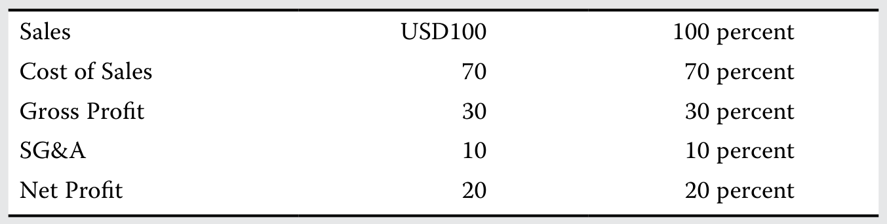

如果MegaDigital以同样的零售价格为同一物品代理，MegaDigital将获得USD30的佣金，并仍然承担USD10的其他费用。

If MegaDigital acts an agent for the same item with the same retail price, MegaDigital would receive a commission of USD30 and still incurs USD10 of other costs.

边际将是：

Margins would be:

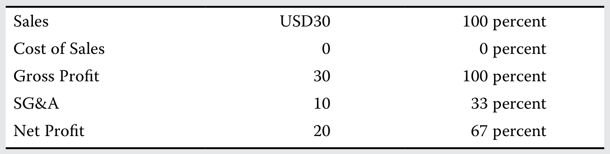

对于作为主要公司和代理公司销售的公司，例如许多电子商务公司，分析员需要评价主要责任人与代理人 销售收入的相对比例，以评价和预测总体利润率。

For companies selling both as a principal and agent, such as many e-commerce companies, an analyst would need to evaluate the relative proportion of principal versus agent sales to evaluate and forecast overall margins.

如果预计销售收入的主要和代理人的组合会改变，这一点尤其重要。

This is especially important if the mix of principal and agent sales is expected to change.

特许/许可

Franchising/Licensing

马占披萨同时经营和特许经营世界各地的披萨快递餐厅。

Mahjong Pizza both operates and franchises pizza delivery restaurants around the world.

收入确认标准要求公司将收入从与客户的合同中分解出来，划分为描述收入和现金流量的性质，数量，时间和不确定性如何受到经济因素影响的类别。

Revenue recognition standards require that the company disaggregate revenue from contracts with customers into categories that depict how the nature, amount, timing, and uncertainty of revenue and cash flows are affected by economic factors.

公司必须提交收入，按收入合并报表分列，以满足这一要求。

Companies must present revenues disaggregated in consolidated statements of income to satisfy this requirement.

麻将披萨列出以下收入分类项目：

Mahjong Pizza presents the following disaggregated revenue items:

公司拥有的商店收入，

■ company-owned stores revenues,

特许使用费和收费，以及

■ franchise royalties and fees, and

• 供应链收入。

■ supply chain revenues.

公司拥有的店铺收入是麻将拥有和经营的店铺的食品零售店铺销售收入。

Company-owned stores revenues are of retail sales of food at stores that Mahjong owns and operates.

特许使用费和手续费由持有经营麻将餐馆许可证的第三方特许经营人收取的手续费组成。

Franchise royalties and fees are comprised of fees from third-party franchisees that are licensed to operate Mahjong restaurants.

通常要求每个特许经营者支付相当于销售收入餐厅的5.5%的费用。

Each franchisee is generally required to pay fees equal to 5.5 percent of restaurant sales.

该公司承认特许使用费为收入，而不是特许经营餐馆的销售收入。

The company recognizes the royalty fee as revenue, not the total sales of the franchisees’ restaurants.

开办新单元的预付费用最初确认为递延收入，随后在每一有关特许经营协议的期限内，一般为10年，按直线分期摊还至收入。

Upfront fees for opening new units are initially recognized as deferred revenue and subsequently amortized to revenue on a straight-line basis over the term of each respective franchise agreement, typically 10 years.

供应链收入主要由食品，设备和特许经营用品的销售收入组成。

Supply chain revenues are primarily composed of sales of food, equipment, and supplies to franchisees.

收入在根据运输条件将相关产品交付或运至特许经营权时予以确认。

Revenues are recognized upon delivery or shipment of the related products to franchisees, based on shipping terms.

软件作为服务或许可证

Software as a Service or License

CReaM软件与服务公司是一家向企业，政府和非营利组织提供客户关系管理软件与服务的技术公司。

CReaM Software and Services is a technology company providing customer relationship management software and services to business, government and not-for-profit organizations.

各组织可以购买软件许可证，并安装在自己的系统中。

Organizations may purchase a software license and install it on their own systems.

此外，他们还可以订阅CReaM的云服务平台，通过该平台，他们可以通过互联网访问CReaM的软件，每月收取订阅费。

Alternatively, they may subscribe to CReaM’s cloud services platform through which they can access CReaM’s software over the internet for a monthly subscription fee.

根据国际财务报告准则（IFRS） 15，如果公司提供使用软件的许可证，公司将占有软件在自己的系统中安装，公司将在许可证期内或在许可证转让时报告收入。

Under IFRS 15, if a company provides a license to use software where the company will take possession of the software for installation on their own system, the company will report revenue either over the term of the license or at the time of the transfer of the license.

如果根据合同或公司正常经营活动，公司应在许可证期内从许可证上报告收入：

Companies should report the revenue from the license over the term of the license, if under the contract or the company’s normal business activities:

● 软件供应商将继续开展对软件有重大影响的活动(如升级/增强),

■ the software provider will continue to undertake activities that significantly affect the software (e.g., upgrades/enhancements),

权利使客户受到这些活动的积极或消极影响，以及

■ the rights expose the customer to positive or negative impacts from those activities, and

这些活动不会导致货物或服务的转让。

■ the activities do not result in a transfer of goods or services.

如果不符合这些标准，则在许可证转让给客户时确认收入。

If these criteria are not met, then the revenue is recognized when the license is transferred to the customer.

中心的年度报告脚注指出：

CReaM’s annual report footnotes state:

收入软件包括与术语和永久软件许可证有关的收入软件，这些软件向客户提供现有软件时提供使用该软件的权利。

Software revenues include revenues associated with term and perpetual software licenses that provide the customer with a right to use the software as it exists when made available.

术语和永久软件许可证的收入一般在向客户提供软件时得到承认。

Revenues from term and perpetual software licenses are generally recognized at the point in time when the software is made available to the customer.

来自软件支持和更新的收入被确认为提供支持和更新，这在合同期内一般是按比例的。

Revenue from software support and updates is recognized as the support and updates are provided, which is generally ratably over the contract term.

根据CReaM许可证的规定，软件 " 原样 " 出售，收入在许可证转让时得到承认。

Under the terms of CReaM’s license, the software is sold “as is” and revenue is recognized at the time of the license transfer.

然而，CReaM公司也为更新提供了支持合同，收入在合同期内得到承认。

CReaM, however, also provides a support contract for updates for which revenue is recognized over the contract term.

CReaM的云端客户端可以访问不断更新的软件。

CReaM’s cloud clients have access to constantly updated software.

CREAM报告：

CReaM reports:

云服务允许客户使用该公司的软件而不占有该软件。

Cloud services allow customers to use the Company’s software without taking possession of the software.

收入一般在合同期内得到承认。

Revenue is generally recognized over the contract term.

该公司的所有订阅服务安排基本上都是不可撤销的，不包含退款类型的规定。

Substantially all of the Company’s subscription service arrangements are non-cancelable and do not contain refund-type provisions.

就CReam而言，分析师必须了解收入在许可软件之间的组成，在这种情况下，收入被承认为一种服务，在这种情况下，收入在一段时间内得到承认。

In the case of CReaM, an analyst must understand the composition of revenue between licensed software in which case revenue is recognized upfront versus software as a service in which case revenue is recognized over time.

长期合同

Long-Term Contracts

装甲车辆公司(AVI)为军事客户制造武器系统和车辆。

Armored Vehicles Inc. (AVI) manufactures weapons systems and vehicles for military customers.

公司签订长期合同，一般持续数年。

The company enters long-term contracts that generally extend over several years.

合同的履约情况随时间推移而得到满足。

Performance on the contracts is satisfied over time.

根据国际财务报告准则（IFRS） 15，如果满足以下标准之一，则随时间推移履行履约义务：1.

Under IFRS 15, a performance obligation is satisfied over time if one of the following criteria is met:

\* 客户在实体履行时同时接受和消费实体业绩提供的福利(例如，日常服务合同)。

■ The customer simultaneously receives and consumes the benefits provided by the entity’s performance as the entity performs (e.g., routine service contracts).

■ 实体的业绩创造或加强客户控制的资产，因为资产是创造或加强的(例如翻修客户拥有和控制的工厂或为政府机构修建道路)。

■ The entity’s performance creates or enhances an asset that the customer controls as the asset is created or enhanced (e.g., refurbishment of a factory owned and controlled by the customer or building a road for a governmental agency).

■ 实体的履约行为不产生实体可替代用途的资产，该实体对迄今已完成的履约行为享有可强制执行的受付权(例如建造一个可能无法出售给另一个客户如武器系统的大型独特资产)。

■ The entity’s performance does not create an asset with alternative use to the entity and the entity has an enforceable right to payment for performance completed to date (e.g., construction of a large unique asset that may not be able to be sold to another customer such as a weapons system).

AVI在合同期内确认长期合同收入，因为工作进展，无论是生产产品，还是提供服务，因为控制权不断转移给客户。

AVI recognizes long-term contract revenue over the contract term as the work progresses, either as products are produced or as services are rendered because of the continuous transfer of control to the customer.

对于其军事合同，合同中的条款支持将控制权持续转移给客户，这些条款允许客户为了方便而单方面终止合同，支付发生的费用加合理利润，并控制任何正在进行的工作。

For its military contracts, this continuous transfer of control to the customer is supported by clauses in the contract that allow the customer to unilaterally terminate the contract for convenience, pay for costs incurred plus a reasonable profit, and take control of any work in process.

在国际财务报告准则（IFRS） 15下，完成进度的程度可以通过产出方法(如完成的考核或单位)或输入方法(如相对于估计总成本发生的费用)来衡量。

Under IFRS 15, the extent of progress towards completion may be measured by output methods (e.g., appraisals or units completed) or input methods (e.g., costs incurred relative to estimated total costs).

AVI报告说，它对长期合同的核算涉及一个估计销售收入总额、每项履约义务的成本和利润的判断过程。

AVI reports that its accounting for long-term contracts involves a judgmental process of estimating total sales, costs and profit for each performance obligation.

销售成本确认为已发生。

Cost of sales is recognized as incurred.

报告为收入的金额是通过在报告为销售成本的金额中加上一定比例的估计利润额来确定的。

The amount reported as revenues is determined by adding a proportionate amount of the estimated profit to the amount reported as cost of sales.

将收入确认为发生的费用，是衡量长期合同进展情况的一个客观尺度，因此最能说明向客户转移控制权的程度。

Recognizing revenue as costs are incurred provides an objective measure of progress on the long-term contract and thereby best depicts the extent of transfer of control to the customer.

例如，AVI有生产武器系统的合同，总价为USD10 百万。

As an example, AVI has a contract to produce a weapons system for a total price of USD10 million.

预计生产该系统的总成本为USD7 百万，估计利润为USD3 百万。

The expected total costs to produce the system is USD7 million and the estimated profit is USD3 million.

该系统需要两年时间才能生产。

The system will take two years to produce.

在合同的第1年中，AVI产生了USD4.2 百万的费用，相当于总估计费用的60%。

In Year 1 of the contract, AVI incurs USD4.2 million of costs representing 60 percent of total estimated costs.

AVI将确认USD6 百万的收入和USD1.8 百万在第1年的利润(两者均为预期收入的60%和利润).

AVI would recognize revenue of USD6 million and profit of USD1.8 million in Year 1 (both 60 percent of expected revenue and profits).

如果系统在第2年完工，实际累计总成本为750万美元，公司将报告收入为400万美元、成本为330万美元，因此第2年利润为70万美元，累计利润为250万美元。

If in Year 2, the system is completed with actual total cumulative costs of USD7.5 million, the company would report revenue of USD4 million and costs of USD3.3 million for a Year 2 profit of USD0.7 million and cumulative profit of USD2.5 million.

账单和持有安排

Bill and Hold Arrangements

除了之前讨论过的长期合同外，AVI还生产一些客户可能无法立即占有的定制装甲车辆(例如，因为缺少存储空间).

In addition to the long-term contracts discussed previously, AVI produces custom armored vehicles that some customers may not be able to take possession of immediately (because, for example, a lack of storage space).

国际财务报告准则（IFRS） 15规定，在这种“票据和持有”安排中，AVI可以根据客户何时获得对产品的控制，确定何时履行了履约义务。

IFRS 15 provides that in such a “bill and hold” arrangement AVI can determine when it has satisfied its performance obligation based on when a customer obtains control of the product.

在国际财务报告准则（IFRS） 15下，这是符合以下所有标准时：1.

Under IFRS 15, this is when all the following criteria are met:

\* 账单和持有安排的理由必须是实质性的(例如，客户已要求作出这种安排)。

■ The reason for the bill and hold arrangement must be substantive (e.g., the customer has requested the arrangement).

■ 产品必须单独确认为属于客户。

■ The product must be identified separately as belonging to the customer.

■目前的产品必须做好向客户实际转让的准备。

■ The product currently must be ready for physical transfer to the customer.

■该实体不能使用该产品或将其引向另一客户。

■ The entity cannot have the ability to use the product or to direct it to another customer.

在AVI的案例中，每辆车都有一个独特的车辆识别号码，完工后，所有权和损失风险已转移给客户。

In AVI’s case, each vehicle is identified by a unique vehicle identification number and upon completion, title and risk of loss has passed to the customer.

AVI在产品准备交付给客户时识别收入，但由客户指示持有交付。

AVI recognizes revenue when the product is ready for delivery to the customer but is directed by the customer to hold delivery.

#### 补充解析 / Supplementary explanation

本题复核锚点（原解摘录）：MegaDigital是一个在线市场，销售商品并迅速交付给客户。

Review anchor for this item (official excerpt): MegaDigital is an online marketplace that sells goods and delivers them quickly to customers.

补充思路：先判断履约义务及控制权何时转移，再决定按时点还是一段时间确认收入。主要责任人与代理人的区别影响总额或净额列报：控制商品或服务后交付给客户的主要责任人通常确认总额，代理人通常确认净佣金。总额列报会改变收入和利润率分母，但不一定改变同一交易的利润金额或现金流。

Additional reasoning: Identify performance obligations and when control transfers before choosing point-in-time or over-time recognition. Principal versus agent status determines gross or net presentation: a principal controls the promised good or service before transfer; an agent generally reports net fees. Gross presentation can change revenue and margin denominators without changing transaction profit or cash flow.

作为代理人通常只把赚取的佣金确认为收入；作为主要责任人则按所控制商品或服务的交易总额确认。现金是否先经过公司账户本身不足以决定总额还是净额列报。

An agent generally recognizes its commission; a principal recognizes the gross transaction amount for goods or services it controls. Cash passing through an account does not by itself determine gross versus net reporting.

#### 相关知识点 / Related concepts

收入确认的经济实质：收入确认关注履约与控制，不以收到现金为唯一标准；合同资产、应收账款和合同负债分别反映不同状态。

Economic substance of revenue recognition: Recognition follows performance and control rather than cash receipt alone. Contract assets, receivables, and contract liabilities represent distinct states.

原教材为连贯讲解型案例，没有独立设问及答案分栏；保留官方案例与演示，未另造题目。

### FSA-LM02-EXAMPLE-201 · 例题 2 · 第 1 题：存货 成本与 收入 的比对 Example 2 · 1 — The Matching of Inventory Costs with Revenues

正文例题／案例 / Worked example / case · 原版 PDF 页码 / Source PDF pages: 57-58

#### 题目与资料 / Question and data

示例 2

EXAMPLE 2

存货 成本与 收入 的比对

The Matching of Inventory Costs with Revenues

Kahn分销有限公司(KDL)，一家假设的公司，购买存货物品转售。

Kahn Distribution Limited (KDL), a hypothetical company, purchases inventory items for resale.

在20X1之初，卡恩手头没有存货。

At the beginning of 20X1, Kahn had no inventory on hand.

在20X1期间，KDL有下列交易：

During 20X1, KDL had the following transactions:

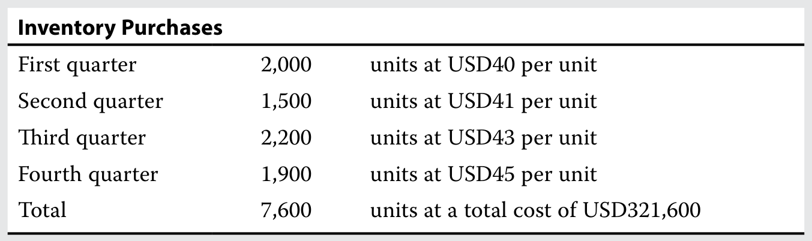

KDL在当年以每台USD50出售存货的5,600单位，并收到现金。

KDL sold 5,600 units of inventory during the year at USD50 per unit and received cash.

KDL确定存货仍有2,000的剩余单元，并明确认定1,900是第四季度购买的单元，100是第三季度购买的单元。

KDL determines that there were 2,000 remaining units of inventory and specifically identifies that 1,900 were those purchased in the fourth quarter and 100 were purchased in the third quarter.

1\. 20X1期间根据存货物品的个别计价法出售或留在存货的这些交易，收入与这些交易相关的费用是什么?

1\. What are the revenue and expense associated with these transactions during 20X1 based on specific identification of inventory items as sold or remaining in inventory?

(假设公司不期望任何产品被退回。)

(Assume that the company does not expect any products to be returned.)

#### 官方答案与解析 / Official answer and explanation

解答：

Solution:

20X1的收入为每台USD280,000的(5,600单位×USD50.

The revenue for 20X1 would be USD280,000 (5,600 units × USD50 per unit).

最初，所购货物的总成本将记录为存货(一种资产)，金额为USD321,600.

Initially, the total cost of the goods purchased would be recorded as inventory (an asset) in the amount of USD321,600.

在20X1期间，出售的5,600单元成本为计入费用(与收入相匹配)，而2,000剩余未售单元成本仍留在存货如下：

During 20X1, the cost of the 5,600 units sold would be expensed (matched against the revenue) while the cost of the 2,000 remaining unsold units would remain in inventory as follows:

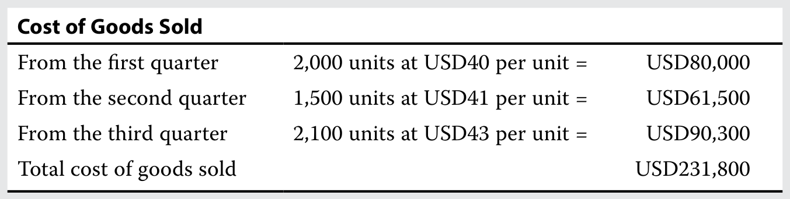 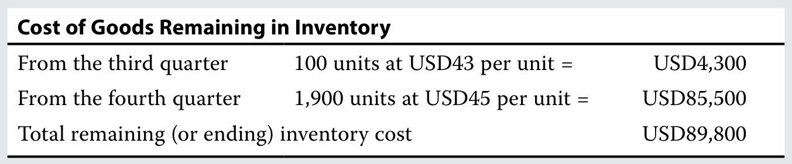

确定总成本核算情况：计算结果如下：(1)。

To confirm that total costs are accounted for: the calculation shown below (1).

所售货物的成本为计入费用对USD280,000的收入如下：

The cost of the goods sold would be expensed against the revenue of USD280,000 as follows:

\(1\) USD231,800 + USD89,800 = USD321,600 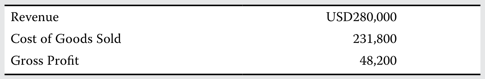

考虑这一问题的另一个办法是，该公司在购买USD321,600时创造了一笔资产(存货)。

An alternative way to think about this is that the company created an asset (inventory) of USD321,600 as it made its purchases.

期末，公司手头的存货值为USD89,800.

At the end of the period, the value of the company’s inventory on hand is USD89,800.

因此，该期间确认的销售成本支出金额应为差额：USD231,800.

Therefore, the amount of the Cost of goods sold expense recognized for the period should be the difference: USD231,800.

其余的存货金额USD89,800将在未来销售存货物品的年份与收入匹配。

The remaining inventory amount of USD89,800 will be matched against revenue in a future year when the inventory items are sold.

#### 补充解析 / Supplementary explanation

本题复核锚点（原解摘录）：20X1的收入为每台USD280,000的(5,600单位×USD50.

Review anchor for this item (official excerpt): The revenue for 20X1 would be USD280,000 (5,600 units × USD50 per unit).

补充思路：先将同一现金支出分为当期费用和资产入账两种路径。资本化通常在初期提高资产、当期利润和权益，随后通过折旧或摊销压低未来利润；费用化则提前确认费用。现金总额不因会计列报改变，但经营与投资现金流分类可能改变。比较公司时必须同时看当期调整和以前年度资本化资产的摊销，不能只把当期资本化金额全部加回。

Additional reasoning: Trace the same expenditure under immediate expense versus asset recognition. Capitalization usually raises initial assets, profit, and equity but creates later depreciation or amortization. Total cash does not change, although operating versus investing classification may. Comparisons need both current-period capitalization and amortization of earlier capitalized spending.

#### 相关知识点 / Related concepts

资本化与费用化的跨期影响：费用化口径调整利润：减去当期资本化支出并加回相关当期摊销，另考虑税效应。符合资本化条件与现金是否已支付是不同问题。

Intertemporal effects of capitalization and expensing: To move toward expensing, subtract current capitalized expenditure and add back related current amortization, considering taxes. Capitalization eligibility is distinct from payment timing.

### FSA-LM02-EXAMPLE-301 · 例题 3 · 第 1 题：General 财务报表 资本化对费用化的影响 Example 3 · 1 — General Financial Statement Impact of Capitalizing versus Expensing

正文例题／案例 / Worked example / case · 原版 PDF 页码 / Source PDF pages: 59-60

#### 题目与资料 / Question and data

示例 3

EXAMPLE 3

General 财务报表 资本化对费用化的影响

General Financial Statement Impact of Capitalizing versus Expensing

假设两家完全相同的(伪)公司CAP Inc.(CAP)和NOW Inc.(NOW)，从EUR1,000现金和EUR1,000 普通股开始。

Assume two identical (hypothetical) companies, CAP Inc. (CAP) and NOW Inc. (NOW), start with EUR1,000 cash and EUR1,000 common stock.

公司每年确认收入共计EUR1,500现金，并将现金支出(不包括购买设备)为EUR500。

Each year the companies recognize total revenues of EUR1,500 cash and make cash expenditures, excluding an equipment purchase, of EUR500.

运营之初，每家公司支付EUR900购买设备。

At the beginning of operations, each company pays EUR900 to purchase equipment.

据CAP估计，设备的使用寿命为三年，估计在三年结束时残值为EUR0。

CAP estimates the equipment will have a useful life of three years and an estimated salvage value of EUR0 at the end of the three years.

NOW估计使用寿命要短得多，而费用设备则立即使用。

NOW estimates a much shorter useful life and expenses the equipment immediately.

公司没有其他资产，在三年内没有进行其他资产采购。

The companies have no other assets and make no other asset purchases during the three-year period.

假设公司不支付股利，现金结存的利息为零，税率为30%，并在财务和税收方面采用同样的会计方法。

Assume the companies pay no dividends, earn zero interest on cash balances, have a tax rate of 30 percent, and use the same accounting method for financial and tax purposes.

图表1左侧列示 CAP 的财务报表：该公司将这项支出资本化，并按直线折旧法每年计提300欧元折旧。成本900欧元减去残值0欧元，得到应计折旧总额900欧元；再除以3年的使用寿命，得到每年折旧300欧元。

The left side of Exhibit 1 shows CAP’s financial statements—that is, with the expenditure capitalized and depreciated at EUR300 per year based on the straight-line method of depreciation (EUR900 cost minus EUR0 salvage value equals EUR900, divided by a three-year life equals EUR300 per year).

展品的右侧显示NOW的财务报表，第一年的全部EUR900支出均作为支出处理。

The right side of the exhibit shows NOW’s financial statements, with the entire EUR900 expenditure treated as an expense in the first year.

所有数额均以欧元计算。

All amounts are in euro.

图表1:资本化与费用化

Exhibit 1: Capitalizing versus Expensing

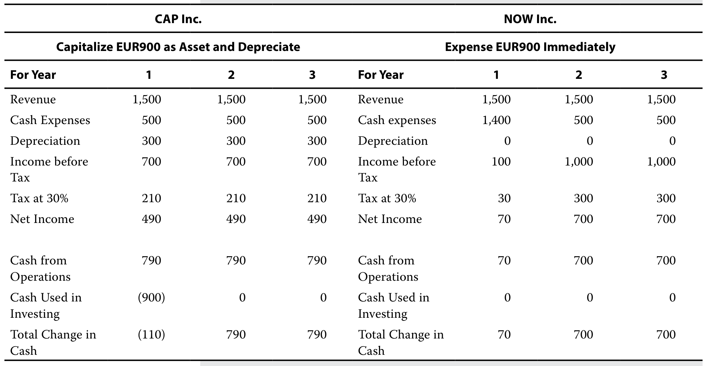 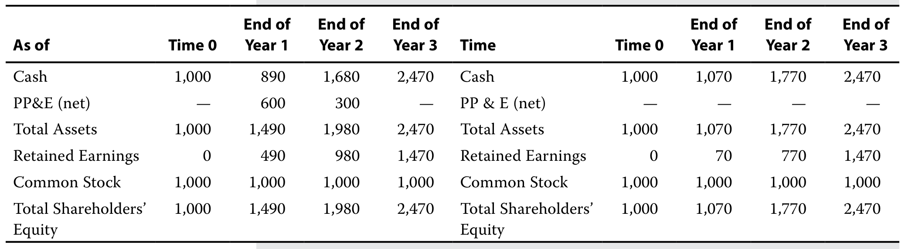

1\. 哪个公司报告这三年里净利润较高?

1\. Which company reports higher net income over the three years?

总共现金流量?

Total cash flow?

业务现金?

Cash from operations?

#### 官方答案与解析 / Official answer and explanation

解答：

Solution:

在这三年中，两个公司都未报告净利润或现金流量的总数较高。

Neither company reports higher total net income or cash flow over the three years.

这三年的净利润的总和与(EUR1,470的总和相同)，无论EUR900是资本化还是计入费用。

The sum of net income over the three years is identical (EUR1,470 total) whether the EUR900 is capitalized or expensed.

另外，(EUR1,470现金总额变化的总和在两种情况下都是一样的。

Also, the sum of the change in cash (EUR1,470 total) is identical under either scenario.

CAP报告业务现金增加EUR900，因为在资本化情况下，EUR900购买被作为投资现金流量处理。

CAP reports higher cash from operations by an amount of EUR900 because, under the capitalization scenario, the EUR900 purchase is treated as an investing cash flow.

注：由于公司对财务和应纳税所得额均采用相同的会计方法，如果没有现金余额的零利息假设，费用化，EUR900本会导致收入增加，NOW的现金流量，因为第一年缴纳的税收比(EUR30对EUR210)的低，本可以让NOW在减税中赚取利息收入。

Note: Because the companies use the same accounting method for both financial and taxable income, absent the assumption of zero interest on cash balances, expensing the EUR900 would have resulted in higher income and cash flow for NOW because the lower taxes paid in the first year (EUR30 versus EUR210) would have allowed NOW to earn interest income on the tax savings.

#### 补充解析 / Supplementary explanation

本题复核锚点（原解摘录）：在这三年中，两个公司都未报告净利润或现金流量的总数较高。

Review anchor for this item (official excerpt): Neither company reports higher total net income or cash flow over the three years.

补充思路：先将同一现金支出分为当期费用和资产入账两种路径。资本化通常在初期提高资产、当期利润和权益，随后通过折旧或摊销压低未来利润；费用化则提前确认费用。现金总额不因会计列报改变，但经营与投资现金流分类可能改变。比较公司时必须同时看当期调整和以前年度资本化资产的摊销，不能只把当期资本化金额全部加回。

Additional reasoning: Trace the same expenditure under immediate expense versus asset recognition. Capitalization usually raises initial assets, profit, and equity but creates later depreciation or amortization. Total cash does not change, although operating versus investing classification may. Comparisons need both current-period capitalization and amortization of earlier capitalized spending.

#### 相关知识点 / Related concepts

资本化与费用化的跨期影响：费用化口径调整利润：减去当期资本化支出并加回相关当期摊销，另考虑税效应。符合资本化条件与现金是否已支付是不同问题。

Intertemporal effects of capitalization and expensing: To move toward expensing, subtract current capitalized expenditure and add back related current amortization, considering taxes. Capitalization eligibility is distinct from payment timing.

### FSA-LM02-EXAMPLE-302 · 例题 3 · 第 2 题：General 财务报表 资本化对费用化的影响 Example 3 · 2 — General Financial Statement Impact of Capitalizing versus Expensing

正文例题／案例 / Worked example / case · 原版 PDF 页码 / Source PDF pages: 59-61

#### 题目与资料 / Question and data

示例 3

EXAMPLE 3

General 财务报表 资本化对费用化的影响

General Financial Statement Impact of Capitalizing versus Expensing

假设两家完全相同的(伪)公司CAP Inc.(CAP)和NOW Inc.(NOW)，从EUR1,000现金和EUR1,000 普通股开始。

Assume two identical (hypothetical) companies, CAP Inc. (CAP) and NOW Inc. (NOW), start with EUR1,000 cash and EUR1,000 common stock.

公司每年确认收入共计EUR1,500现金，并将现金支出(不包括购买设备)为EUR500。

Each year the companies recognize total revenues of EUR1,500 cash and make cash expenditures, excluding an equipment purchase, of EUR500.

运营之初，每家公司支付EUR900购买设备。

At the beginning of operations, each company pays EUR900 to purchase equipment.

据CAP估计，设备的使用寿命为三年，估计在三年结束时残值为EUR0。

CAP estimates the equipment will have a useful life of three years and an estimated salvage value of EUR0 at the end of the three years.

NOW估计使用寿命要短得多，而费用设备则立即使用。

NOW estimates a much shorter useful life and expenses the equipment immediately.

公司没有其他资产，在三年内没有进行其他资产采购。

The companies have no other assets and make no other asset purchases during the three-year period.

假设公司不支付股利，现金结存的利息为零，税率为30%，并在财务和税收方面采用同样的会计方法。

Assume the companies pay no dividends, earn zero interest on cash balances, have a tax rate of 30 percent, and use the same accounting method for financial and tax purposes.

图表1左侧列示 CAP 的财务报表：该公司将这项支出资本化，并按直线折旧法每年计提300欧元折旧。成本900欧元减去残值0欧元，得到应计折旧总额900欧元；再除以3年的使用寿命，得到每年折旧300欧元。

The left side of Exhibit 1 shows CAP’s financial statements—that is, with the expenditure capitalized and depreciated at EUR300 per year based on the straight-line method of depreciation (EUR900 cost minus EUR0 salvage value equals EUR900, divided by a three-year life equals EUR300 per year).

展品的右侧显示NOW的财务报表，第一年的全部EUR900支出均作为支出处理。

The right side of the exhibit shows NOW’s financial statements, with the entire EUR900 expenditure treated as an expense in the first year.

所有数额均以欧元计算。

All amounts are in euro.

图表1:资本化与费用化

Exhibit 1: Capitalizing versus Expensing

 

2.基于净资产收益率（ROE）和净利率，两家公司的盈利能力如何比较?

2\. Based on ROE and net profit margin, how does the profitability of the two companies compare?

#### 官方答案与解析 / Official answer and explanation

解答：

Solution:

一般来说，Ending 股东权益 = Basin 股东权益 + 净利润 + 其他综合收益 – 股利 + 股东的净资本贡献。

In general, Ending shareholders’ equity = Beginning shareholders’ equity + Net income + Other comprehensive income – Dividends + Net capital contributions from shareholders.

因为这个例子中的公司没有其他综合收益，没有支付股利，并且报告没有来自股东，结束留存收益 = Basin 留存收益 + 净利润，结束股东权益 = Basin 股东权益 + 净利润的资本捐款。

Because the companies in this example do not have other comprehensive income, did not pay dividends, and reported no capital contributions from shareholders, Ending retained earnings = Beginning retained earnings + Net income, and Ending shareholders’ equity = Beginning shareholders’ equity + Net income.

净资产收益率（ROE）被计算为净利润除以平均股东权益，净利率被计算为净利润除以总收入。

ROE is calculated as Net income divided by Average shareholders’ equity, and Net profit margin is calculated as Net income divided by Total revenue.

例如，CAP在(1)以下的计算中有第1年 净资产收益率（ROE），在(2)以下的计算中有第1年 净利率。

For example, CAP had Year 1 ROE of the calculation shown below (1), and Year 1 net profit margin of the calculation shown below (2).

\(1\) 39 percent (EUR490/\[(EUR1,000 + EUR1,490)/2\])(2) 33 percent (EUR490/ EUR1,500) 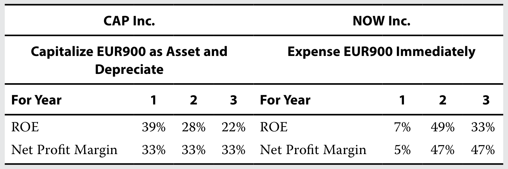

如上所示，与费用化相比，资本化会使第一年的盈利能力比率（ROE和净利率）较高，而使随后几年的盈利能力比率较低。

As shown, compared to expensing, capitalizing results in higher profitability ratios (ROE and net profit margin) in the first year, and lower profitability ratios in subsequent years.

例如，CAP第1年的ROE为39%，高于NOW第1年的7%；但在第2年和第3年，NOW报告的盈利能力更高。

For example, CAP’s Year 1 ROE of 39 percent was higher than NOW’s Year 1 ROE of 7 percent, but in Years 2 and 3, NOW reports superior profitability.

还应注意，NOW从第1年到第2年的净利润增长更快，并不是因为其经营表现优于CAP，而是因为它在会计处理上比CAP更早确认费用。

Note also that NOW’s superior growth in net income between Year 1 and Year 2 is not attributable to superior performance compared to CAP but rather to the accounting decision to recognize the expense sooner than CAP.

一般而言，在其他条件不变时，较早确认费用的会计选择，会使随后期间的增长看起来更高。

In general, all else equal, accounting decisions that result in recognizing expenses sooner will give the appearance of greater subsequent growth.

如果不了解两家公司会计方法的差异，就直接比较其净利润增长，会产生误导。

Comparison of the growth of the two companies’ net incomes without an awareness of the difference in accounting methods would be misleading.

同样，NOW的利润和盈利能力在这三年中表现出更大的波动，并非因为经营表现更加不稳定，而是因为会计处理选择不同。

As a corollary, NOW’s income and profitability exhibit greater volatility across the three years, not because of more volatile performance but rather because of the different accounting decision.

#### 补充解析 / Supplementary explanation

本题复核锚点（原解摘录）：一般来说，Ending 股东权益 = Basin 股东权益 + 净利润 + 其他综合收益 – 股利 + 股东的净资本贡献。

Review anchor for this item (official excerpt): In general, Ending shareholders’ equity = Beginning shareholders’ equity + Net income + Other comprehensive income – Dividends + Net capital contributions from shareholders.

补充思路：预测未来盈利时，要区分持续经营利润、终止经营以及异常或低频项目。共同比利润表以收入为分母，便于发现成本结构和战略差异，但规模标准化并不消除行业或会计政策差异。其他综合收益与当期净利润的列报位置不同，分析权益变化时两者都可能相关。

Additional reasoning: Forecasting requires separating continuing operations, discontinued operations, and unusual or infrequent items. Common-size income statements scale by revenue to expose cost-structure differences, but do not eliminate industry or policy differences. Other comprehensive income is presented outside net income yet can matter when analyzing equity changes.

#### 相关知识点 / Related concepts

利润可持续性与共同比分析：毛利率、营业利润率与净利率覆盖的费用层次不同；持续性判断不能仅凭某项被管理层称为“一次性”。

Earnings persistence and common-size analysis: Gross, operating, and net margins include different cost layers. Persistence should not be judged solely from management’s “one-time” label.

### FSA-LM02-EXAMPLE-303 · 例题 3 · 第 3 题：General 财务报表 资本化对费用化的影响 Example 3 · 3 — General Financial Statement Impact of Capitalizing versus Expensing

正文例题／案例 / Worked example / case · 原版 PDF 页码 / Source PDF pages: 59-61

#### 题目与资料 / Question and data

示例 3

EXAMPLE 3

General 财务报表 资本化对费用化的影响

General Financial Statement Impact of Capitalizing versus Expensing

假设两家完全相同的(伪)公司CAP Inc.(CAP)和NOW Inc.(NOW)，从EUR1,000现金和EUR1,000 普通股开始。

Assume two identical (hypothetical) companies, CAP Inc. (CAP) and NOW Inc. (NOW), start with EUR1,000 cash and EUR1,000 common stock.

公司每年确认收入共计EUR1,500现金，并将现金支出(不包括购买设备)为EUR500。

Each year the companies recognize total revenues of EUR1,500 cash and make cash expenditures, excluding an equipment purchase, of EUR500.

运营之初，每家公司支付EUR900购买设备。

At the beginning of operations, each company pays EUR900 to purchase equipment.

据CAP估计，设备的使用寿命为三年，估计在三年结束时残值为EUR0。

CAP estimates the equipment will have a useful life of three years and an estimated salvage value of EUR0 at the end of the three years.

NOW估计使用寿命要短得多，而费用设备则立即使用。

NOW estimates a much shorter useful life and expenses the equipment immediately.

公司没有其他资产，在三年内没有进行其他资产采购。

The companies have no other assets and make no other asset purchases during the three-year period.

假设公司不支付股利，现金结存的利息为零，税率为30%，并在财务和税收方面采用同样的会计方法。

Assume the companies pay no dividends, earn zero interest on cash balances, have a tax rate of 30 percent, and use the same accounting method for financial and tax purposes.

图表1左侧列示 CAP 的财务报表：该公司将这项支出资本化，并按直线折旧法每年计提300欧元折旧。成本900欧元减去残值0欧元，得到应计折旧总额900欧元；再除以3年的使用寿命，得到每年折旧300欧元。

The left side of Exhibit 1 shows CAP’s financial statements—that is, with the expenditure capitalized and depreciated at EUR300 per year based on the straight-line method of depreciation (EUR900 cost minus EUR0 salvage value equals EUR900, divided by a three-year life equals EUR300 per year).

展品的右侧显示NOW的财务报表，第一年的全部EUR900支出均作为支出处理。

The right side of the exhibit shows NOW’s financial statements, with the entire EUR900 expenditure treated as an expense in the first year.

所有数额均以欧元计算。

All amounts are in euro.

图表1:资本化与费用化

Exhibit 1: Capitalizing versus Expensing

 

3\. 为什么 NOW 在第1年报告现金增加70欧元，而 CAP 报告现金净变动为−110欧元？

3\. Why does NOW report change in cash of EUR70 in Year 1, while CAP reports total change in cash of (EUR110)?

#### 官方答案与解析 / Official answer and explanation

解答：

Solution:

NOW 在第1年报告现金增加70欧元，而 CAP 报告现金减少110欧元，这是因为 NOW 的税款比 CAP 少180欧元，分别为30欧元和210欧元。

NOW reports an increase in cash of EUR70 in Year 1, while CAP reports a decrease in cash of EUR110 because NOW’s taxes were EUR180 lower than CAP’s taxes (EUR30 versus EUR210).

请注意，这个问题假定每个公司为纳税目的使用的会计方法与公司为财务报告使用的会计方法相同。

Note that this problem assumes the accounting method used by each company for its tax purposes is identical to the accounting method used by the company for its financial reporting.

在许多国家，允许公司使用不同的折旧方法进行财务报告和税收，这可能导致递延税。

In many countries, companies are allowed to use different depreciation methods for financial reporting and taxes, which may give rise to deferred taxes.

#### 补充解析 / Supplementary explanation

本题复核锚点（原解摘录）：NOW 在第1年报告现金增加70欧元，而 CAP 报告现金减少110欧元，这是因为 NOW 的税款比 CAP 少180欧元，分别为30欧元和210欧元。

Review anchor for this item (official excerpt): NOW reports an increase in cash of EUR70 in Year 1, while CAP reports a decrease in cash of EUR110 because NOW’s taxes were EUR180 lower than CAP’s taxes (EUR30 versus EUR210).

补充思路：先将同一现金支出分为当期费用和资产入账两种路径。资本化通常在初期提高资产、当期利润和权益，随后通过折旧或摊销压低未来利润；费用化则提前确认费用。现金总额不因会计列报改变，但经营与投资现金流分类可能改变。比较公司时必须同时看当期调整和以前年度资本化资产的摊销，不能只把当期资本化金额全部加回。

Additional reasoning: Trace the same expenditure under immediate expense versus asset recognition. Capitalization usually raises initial assets, profit, and equity but creates later depreciation or amortization. Total cash does not change, although operating versus investing classification may. Comparisons need both current-period capitalization and amortization of earlier capitalized spending.

#### 相关知识点 / Related concepts

资本化与费用化的跨期影响：费用化口径调整利润：减去当期资本化支出并加回相关当期摊销，另考虑税效应。符合资本化条件与现金是否已支付是不同问题。

Intertemporal effects of capitalization and expensing: To move toward expensing, subtract current capitalized expenditure and add back related current amortization, considering taxes. Capitalization eligibility is distinct from payment timing.

### FSA-LM02-EXAMPLE-401 · 例题 4 · 第 1 题：持续采购资本化对费用化的影响 Example 4 · 1 — Impact of Capitalizing versus Expensing for Ongoing Purchases

正文例题／案例 / Worked example / case · 原版 PDF 页码 / Source PDF pages: 62

#### 题目与资料 / Question and data

示例 4

EXAMPLE 4

持续采购资本化对费用化的影响

Impact of Capitalizing versus Expensing for Ongoing Purchases

一家公司在第1年购买了一台GBP300计算机，并充分利用了支出。

A company buys a GBP300 computer in Year 1 and capitalizes the expenditure.

这台电脑的使用寿命为三年，预计残值为0英镑，因此按直线法计算，每年的折旧费用为100英镑。

The computer has a useful life of three years and an expected salvage value of GBP0, so the annual depreciation expense using the straight-line method is GBP100 per year.

与费用化相比，整个GBP300立即，该公司在第1年的税前利润是GBP200更大的。

Compared with expensing the entire GBP300 immediately, the company’s pre-tax profit in Year 1 is GBP200 greater.

1\. 假设公司继续每年以相同价格购买一台相同的计算机。

1\. Assume that the company continues to buy an identical computer each year at the same price.

如果公司对每台计算机都采用相同的会计处理方法，那么资本化相对于费用化的增益效应何时结束?

If the company uses the same accounting treatment for each of the computers, when does the profit-enhancing effect of capitalizing versus expensing end?

#### 官方答案与解析 / Official answer and explanation

解答：

Solution:

资本化对费用化的利润促进效应将在第3年结束。

The profit-enhancing effect of capitalizing versus expensing would end in Year 3.

在第3年中，在Years 1,2，和3购买的三台计算机中，每台计算机的折旧费用将总计计算如下的(1).

In Year 3, the depreciation expense on each of the three computers bought in Years 1, 2, and 3 would total the calculation shown below (1).

因此，第3年的总和折旧费用将完全等于第3年的资本支出。

Therefore, the total depreciation expense for Year 3 will be exactly equal to the capital expenditure in Year 3.

第3年中的费用为GBP300，无论资本化公司还是计入费用公司是年度计算机采购。

The expense in Year 3 would be GBP300, regardless of whether the company capitalized or expensed the annual computer purchases.

\(1\) GBP300 (GBP100 + GBP100 + GBP100)

#### 补充解析 / Supplementary explanation

本题复核锚点（原解摘录）：资本化对费用化的利润促进效应将在第3年结束。

Review anchor for this item (official excerpt): The profit-enhancing effect of capitalizing versus expensing would end in Year 3.

补充思路：先将同一现金支出分为当期费用和资产入账两种路径。资本化通常在初期提高资产、当期利润和权益，随后通过折旧或摊销压低未来利润；费用化则提前确认费用。现金总额不因会计列报改变，但经营与投资现金流分类可能改变。比较公司时必须同时看当期调整和以前年度资本化资产的摊销，不能只把当期资本化金额全部加回。

Additional reasoning: Trace the same expenditure under immediate expense versus asset recognition. Capitalization usually raises initial assets, profit, and equity but creates later depreciation or amortization. Total cash does not change, although operating versus investing classification may. Comparisons need both current-period capitalization and amortization of earlier capitalized spending.

#### 相关知识点 / Related concepts

资本化与费用化的跨期影响：费用化口径调整利润：减去当期资本化支出并加回相关当期摊销，另考虑税效应。符合资本化条件与现金是否已支付是不同问题。

Intertemporal effects of capitalization and expensing: To move toward expensing, subtract current capitalized expenditure and add back related current amortization, considering taxes. Capitalization eligibility is distinct from payment timing.

### FSA-LM02-EXAMPLE-402 · 例题 4 · 第 2 题：持续采购资本化对费用化的影响 Example 4 · 2 — Impact of Capitalizing versus Expensing for Ongoing Purchases

正文例题／案例 / Worked example / case · 原版 PDF 页码 / Source PDF pages: 62-63

#### 题目与资料 / Question and data

示例 4

EXAMPLE 4

持续采购资本化对费用化的影响

Impact of Capitalizing versus Expensing for Ongoing Purchases

一家公司在第1年购买了一台GBP300计算机，并充分利用了支出。

A company buys a GBP300 computer in Year 1 and capitalizes the expenditure.

这台电脑的使用寿命为三年，预计残值为0英镑，因此按直线法计算，每年的折旧费用为100英镑。

The computer has a useful life of three years and an expected salvage value of GBP0, so the annual depreciation expense using the straight-line method is GBP100 per year.

与费用化相比，整个GBP300立即，该公司在第1年的税前利润是GBP200更大的。

Compared with expensing the entire GBP300 immediately, the company’s pre-tax profit in Year 1 is GBP200 greater.

2\. 如果公司在第4年再购买一台相同的电脑，并沿用前几年的会计处理方法，那么将这些支出资本化或费用化，对第4年的利润分别有何影响？

2\. If the company buys another identical computer in Year 4, using the same accounting treatment as the prior years, what is the effect on Year 4 profits of capitalizing versus expensing these expenditures?

#### 官方答案与解析 / Official answer and explanation

解答：

Solution:

对第4年利润没有影响。

There is no impact on Year 4 profits.

与前一年一样，第2、3和4年购入的三台电脑，其折旧费用合计为300英镑，即每台100英镑。（相关计算见下方算式。）

As in the previous year, the depreciation expense on each of the three computers bought in Years 2, 3, and 4 would total the calculation shown below (1).

因此，第4年的总和折旧费用将完全等于第4年的资本支出。

Therefore, the total depreciation expense for Year 4 will be exactly equal to the capital expenditure in Year 4.

税前利润将减少GBP300，而不论资本化公司还是计入费用公司是年度计算机采购。

Pre-tax profits would be reduced by GBP300, regardless of whether the company capitalized or expensed the annual computer purchases.

\(1\) GBP300 (GBP100 + GBP100 + GBP100)

#### 补充解析 / Supplementary explanation

本题复核锚点（原解摘录）：对第4年利润没有影响。

Review anchor for this item (official excerpt): There is no impact on Year 4 profits.

补充思路：先将同一现金支出分为当期费用和资产入账两种路径。资本化通常在初期提高资产、当期利润和权益，随后通过折旧或摊销压低未来利润；费用化则提前确认费用。现金总额不因会计列报改变，但经营与投资现金流分类可能改变。比较公司时必须同时看当期调整和以前年度资本化资产的摊销，不能只把当期资本化金额全部加回。

Additional reasoning: Trace the same expenditure under immediate expense versus asset recognition. Capitalization usually raises initial assets, profit, and equity but creates later depreciation or amortization. Total cash does not change, although operating versus investing classification may. Comparisons need both current-period capitalization and amortization of earlier capitalized spending.

#### 相关知识点 / Related concepts

资本化与费用化的跨期影响：费用化口径调整利润：减去当期资本化支出并加回相关当期摊销，另考虑税效应。符合资本化条件与现金是否已支付是不同问题。

Intertemporal effects of capitalization and expensing: To move toward expensing, subtract current capitalized expenditure and add back related current amortization, considering taxes. Capitalization eligibility is distinct from payment timing.

### FSA-LM02-EXAMPLE-501 · 例题 5 · 第 1 题：资本化利息费用对覆盖率和现金流量的影响 Example 5 · 1 — Effect of Capitalized Interest Costs on Coverage Ratios and Cash Flow

正文例题／案例 / Worked example / case · 原版 PDF 页码 / Source PDF pages: 68-69

#### 题目与资料 / Question and data

示例 5

EXAMPLE 5

资本化利息费用对覆盖率和现金流量的影响

Effect of Capitalized Interest Costs on Coverage Ratios and Cash Flow

Melco度假村娱乐有限公司(NASDAQ:MLCO)是一家设在香港的SAR赌场公司，在NASDAQ股票交易所上市，并在美国公认会计原则（US GAAP）下准备财务报告，在其2017 财务报表的一个脚注中披露了以下信息：" 与重大开发和建筑项目有关的递延融资费用利息和摊销资本化，并计入项目成本。

Melco Resorts & Entertainment Limited (NASDAQ: MLCO), a Hong Kong SAR–based casino company, which is listed on the NASDAQ stock exchange and prepares financial reports under US GAAP, disclosed the following information in one of the footnotes to its 2017 financial statements: “Interest and amortization of deferred financing costs associated with major development and construction projects is capitalized and included in the cost of the project. . . .

截至2017年、2016年及2015年12月31日止年度，发生的利息费用总额分别为267,065美元、252,600美元及253,168美元；其中分别有37,483美元、29,033美元及134,838美元被资本化。

Total interest expenses incurred amounted to \$267,065, \$252,600, and \$253,168, of which \$37,483, \$29,033, and \$134,838 were capitalized during the years ended December 31, 2017, 2016, and 2015, respectively.

摊销(\$26,182,\$48,345和\$38,511的递延融资费用，减去摊销 资本化为零，零，\$5,458)在截止年份分别记录了2017年12月31日，2016和2015的融资费用"(表格20-F存档于2018年4月12日).

Amortization of deferred financing costs of \$26,182, \$48,345, and \$38,511, net of amortization capitalized of nil, nil, and \$5,458, were recorded during the years ended December 31, 2017, 2016, and 2015, respectively” (Form 20-F filed 12 April 2018).

筹资活动现金流量报告了递延融资费用的现金支付情况。

Cash payments for deferred financing costs were reported in cash flows from financing activities.

图表5:Melco度假村和娱乐有限责任公司选定的数据，如报告(US美元)

Exhibit 5: Melco Resorts and Entertainment Limited Selected Data, as Reported (US dollar thousands)

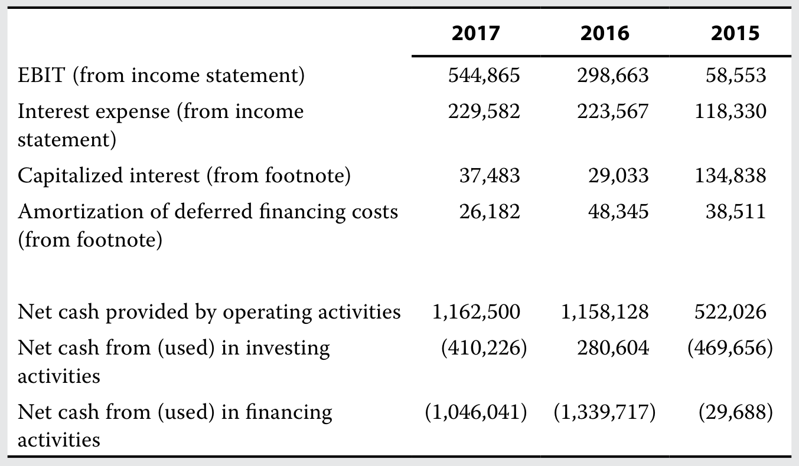

注：息税前利润（EBIT）表示所得税之前的收入(损失)，加上资本化利息中扣除利润表之后的“费用利息”。

Notes: EBIT represents “Income (Loss) Before Income Tax” plus “Interest expenses, net of capitalized interest” from the income statement.

1\. 计算和解释 Melco 的 利息保障倍数 是否具有资本化利息。

1\. Calculate and interpret Melco’s interest coverage ratio with and without capitalized interest.

#### 官方答案与解析 / Official answer and explanation

解答：

Solution:

有资本化利息和无资本化利息的利息覆盖率如下：

Interest coverage ratios with and without capitalized interest were as follows:

用于 2017

For 2017

未对资本化利息作调整时，该比率为2.37；以及（相关计算见下方算式。）

the calculation shown below (1) without adjusting for capitalized interest; and

\(1\) 2.37 (USD544,865 ÷ USD229,582)

调整后的比率为2.14。调整包括在 EBIT 中加回以前资本化利息所产生的折旧，以及将2017年资本化的利息计入利息费用。（相关计算见下方算式。）

the calculation shown below (1), including an adjustment to EBIT for depreciation of previously capitalized interest and an adjustment to interest expense for the amount of interest capitalized in 2017.

\(1\) 2.14 \[(USD544,865 + USD26,182) ÷ (USD229,582 + USD37,483)\]

用于 2016

For 2016

\(a\) 下述(1)的计算，而不对资本化利息进行调整；以及

the calculation shown below (1) without adjusting for capitalized interest; and

\(1\) 1.34 (USD298,663÷ USD223,567)

调整后的比率为1.37。调整包括在 EBIT 中加回以前资本化利息所产生的折旧，以及将2016年资本化的利息计入利息费用。（相关计算见下方算式。）

the calculation shown below (1), including an adjustment to EBIT for depreciation of previously capitalized interest and an adjustment to interest expense for the amount of interest capitalized in 2016.

\(1\) 1.37 \[(USD298,663 + USD48,345) ÷ (USD223,567 + USD29,033)\]

用于 2015

For 2015

\(a\) 下述(1)的计算，而不对资本化利息进行调整；以及

the calculation shown below (1) without adjusting for capitalized interest; and

\(1\) 0.49 (USD58,533÷ USD118,330)

调整后的比率为0.38。调整包括在 EBIT 中加回以前资本化利息所产生的折旧，以及将2015年资本化的利息计入利息费用。（相关计算见下方算式。）

the calculation shown below (1), including an adjustment to EBIT for depreciation of previously capitalized interest and an adjustment to interest expense for the amount of interest capitalized in 2015.

\(1\) 0.38 \[(USD58,533 + USD38,511) ÷ (USD118,330+ USD134,838)\]

这些计算表明，与前两年相比，Melco在2017的利息覆盖率有所提高。

These calculations indicate that Melco’s interest coverage improved in 2017 compared with the previous two years.

在2017和2015，按资本化利息调整后，覆盖率较低。

In both 2017 and 2015, the coverage ratio was lower when adjusted for capitalized interest.

#### 补充解析 / Supplementary explanation

本题复核锚点（原解摘录）：有资本化利息和无资本化利息的利息覆盖率如下：

Review anchor for this item (official excerpt): Interest coverage ratios with and without capitalized interest were as follows:

补充思路：先将同一现金支出分为当期费用和资产入账两种路径。资本化通常在初期提高资产、当期利润和权益，随后通过折旧或摊销压低未来利润；费用化则提前确认费用。现金总额不因会计列报改变，但经营与投资现金流分类可能改变。比较公司时必须同时看当期调整和以前年度资本化资产的摊销，不能只把当期资本化金额全部加回。

Additional reasoning: Trace the same expenditure under immediate expense versus asset recognition. Capitalization usually raises initial assets, profit, and equity but creates later depreciation or amortization. Total cash does not change, although operating versus investing classification may. Comparisons need both current-period capitalization and amortization of earlier capitalized spending.

#### 相关知识点 / Related concepts

资本化与费用化的跨期影响：费用化口径调整利润：减去当期资本化支出并加回相关当期摊销，另考虑税效应。符合资本化条件与现金是否已支付是不同问题。

Intertemporal effects of capitalization and expensing: To move toward expensing, subtract current capitalized expenditure and add back related current amortization, considering taxes. Capitalization eligibility is distinct from payment timing.

### FSA-LM02-EXAMPLE-502 · 例题 5 · 第 2 题：资本化利息费用对覆盖率和现金流量的影响 Example 5 · 2 — Effect of Capitalized Interest Costs on Coverage Ratios and Cash Flow

正文例题／案例 / Worked example / case · 原版 PDF 页码 / Source PDF pages: 68-69

#### 题目与资料 / Question and data

示例 5

EXAMPLE 5

资本化利息费用对覆盖率和现金流量的影响

Effect of Capitalized Interest Costs on Coverage Ratios and Cash Flow

Melco度假村娱乐有限公司(NASDAQ:MLCO)是一家设在香港的SAR赌场公司，在NASDAQ股票交易所上市，并在美国公认会计原则（US GAAP）下准备财务报告，在其2017 财务报表的一个脚注中披露了以下信息：" 与重大开发和建筑项目有关的递延融资费用利息和摊销资本化，并计入项目成本。

Melco Resorts & Entertainment Limited (NASDAQ: MLCO), a Hong Kong SAR–based casino company, which is listed on the NASDAQ stock exchange and prepares financial reports under US GAAP, disclosed the following information in one of the footnotes to its 2017 financial statements: “Interest and amortization of deferred financing costs associated with major development and construction projects is capitalized and included in the cost of the project. . . .

截至2017年、2016年及2015年12月31日止年度，发生的利息费用总额分别为267,065美元、252,600美元及253,168美元；其中分别有37,483美元、29,033美元及134,838美元被资本化。

Total interest expenses incurred amounted to \$267,065, \$252,600, and \$253,168, of which \$37,483, \$29,033, and \$134,838 were capitalized during the years ended December 31, 2017, 2016, and 2015, respectively.

摊销(\$26,182,\$48,345和\$38,511的递延融资费用，减去摊销 资本化为零，零，\$5,458)在截止年份分别记录了2017年12月31日，2016和2015的融资费用"(表格20-F存档于2018年4月12日).

Amortization of deferred financing costs of \$26,182, \$48,345, and \$38,511, net of amortization capitalized of nil, nil, and \$5,458, were recorded during the years ended December 31, 2017, 2016, and 2015, respectively” (Form 20-F filed 12 April 2018).

筹资活动现金流量报告了递延融资费用的现金支付情况。

Cash payments for deferred financing costs were reported in cash flows from financing activities.

图表5:Melco度假村和娱乐有限责任公司选定的数据，如报告(US美元)

Exhibit 5: Melco Resorts and Entertainment Limited Selected Data, as Reported (US dollar thousands)

注：息税前利润（EBIT）表示所得税之前的收入(损失)，加上资本化利息中扣除利润表之后的“费用利息”。

Notes: EBIT represents “Income (Loss) Before Income Tax” plus “Interest expenses, net of capitalized interest” from the income statement.

2\. 计算Melco从2016到2017的经营现金流量的百分比变化。

2\. Calculate Melco’s percentage change in operating cash flow from 2016 to 2017.

假设财务报告不影响所得税的报告，资本化利息对现金流量的运营和投资有什么影响?

Assuming the financial reporting does not affect reporting for income taxes, what were the effects of capitalized interest on operating and investing cash flows?

#### 官方答案与解析 / Official answer and explanation

解答：

Solution:

如果利息是计入费用而不是资本化，那么在所有三年中运行的现金流量将会更低。

If the interest had been expensed rather than capitalized, operating cash flows would have been lower in all three years.

在调整的基础上，但并非未调整的基础上，该公司的经营现金流量在2017中比2016有所下降。

On an adjusted basis, but not an unadjusted basis, the company’s operating cash flow declined in 2017 compared with 2016.

未经调整时，Melco 2017年的经营现金流量较2016年增加0.4%。（相关计算见下方算式。）

On an unadjusted basis, for 2017 compared with 2016, Melco’s operating cash flow increased by 0.4 percent in 2017 the calculation shown below (1).

若将所有利息成本费用化并作出相应调整，Melco 2017年的经营现金流量则下降0.4%。

Including adjustments to expense all interest costs, Melco’s operating cash flow also decreased by 0.4 percent in 2017 {\[USD1,162,500 – USD37,483) ÷ (USD1,158,128 – USD29,033)\] – 1}.

如果利息是计入费用而不是资本化，则现金流量的融资在所有三年中都会更高。

If the interest had been expensed rather than capitalized, financing cash flows would have been higher in all three years.

\(1\) \[(USD1,162,500 ÷ USD1,158,128) – 1\]

#### 补充解析 / Supplementary explanation

本题复核锚点（原解摘录）：如果利息是计入费用而不是资本化，那么在所有三年中运行的现金流量将会更低。

Review anchor for this item (official excerpt): If the interest had been expensed rather than capitalized, operating cash flows would have been lower in all three years.

补充思路：先将同一现金支出分为当期费用和资产入账两种路径。资本化通常在初期提高资产、当期利润和权益，随后通过折旧或摊销压低未来利润；费用化则提前确认费用。现金总额不因会计列报改变，但经营与投资现金流分类可能改变。比较公司时必须同时看当期调整和以前年度资本化资产的摊销，不能只把当期资本化金额全部加回。

Additional reasoning: Trace the same expenditure under immediate expense versus asset recognition. Capitalization usually raises initial assets, profit, and equity but creates later depreciation or amortization. Total cash does not change, although operating versus investing classification may. Comparisons need both current-period capitalization and amortization of earlier capitalized spending.

#### 相关知识点 / Related concepts

资本化与费用化的跨期影响：费用化口径调整利润：减去当期资本化支出并加回相关当期摊销，另考虑税效应。符合资本化条件与现金是否已支付是不同问题。

Intertemporal effects of capitalization and expensing: To move toward expensing, subtract current capitalized expenditure and add back related current amortization, considering taxes. Capitalization eligibility is distinct from payment timing.

### FSA-LM02-EXAMPLE-601 · 例题 6 · 第 1 题：软件开发费用 Example 6 · 1 — Software Development Costs

正文例题／案例 / Worked example / case · 原版 PDF 页码 / Source PDF pages: 71-73

#### 题目与资料 / Question and data

示例 6

EXAMPLE 6

软件开发费用

Software Development Costs

您正在研究一个涉及JHH软件分析的项目，这是一家(伪)软件开发公司，为它在2017的第一个产品确定了技术可行性。

You are working on a project involving the analysis of JHH Software, a (hypothetical) software development company that established technical feasibility for its first product in 2017.

您的分析部分涉及计算某些基于市场的比例，您将使用这个比例来比较JHH与另一家公司的费用所有软件开发支出。

Part of your analysis involves computing certain market-based ratios, which you will use to compare JHH to another company that expenses all of its software development expenditures.

该公司年度报告的有关数据和摘录载于Expoint 7。

Relevant data and excerpts from the company’s annual report are included in Exhibit 7.

图表7:JHH SOFTWARE(US美元，除每股金额外)

Exhibit 7: JHH SOFTWARE (US dollar thousands, except per share amounts)

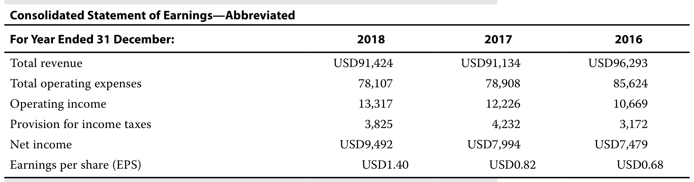 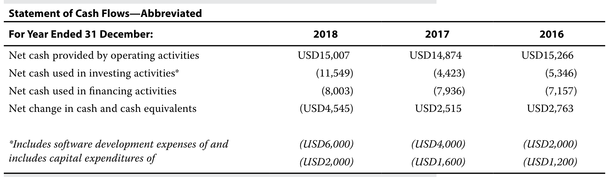 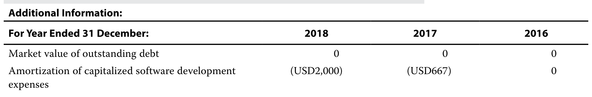 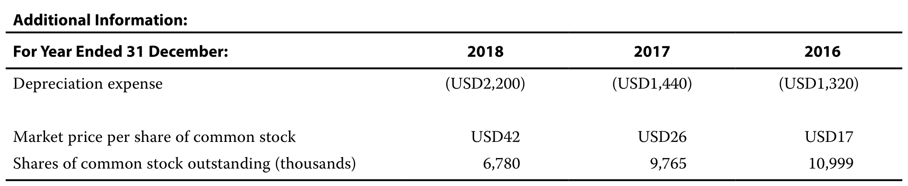

用于软件开发的会计政策脚注披露：与软件产品的概念配制和设计有关的费用是计入费用，用于发生时的研发。

Footnote disclosure of accounting policy for software development: Expenses that are related to the conceptual formulation and design of software products are expensed to research and development as incurred.

公司将技术可行性确定后生产成品所发生的费用资本化。

The company capitalises expenses that are incurred to produce the finished product after technological feasibility has been established.

1.根据2018年12月31日终了财政年度报告的财务报表计算JHH的以下比率，不进行调整。

1\. Compute the following ratios for JHH based on the reported financial statements for fiscal year ended 31 December 2018, with no adjustments.

其次，如果公司拥有计入费用而不是资本化软件投资，确定对这些比率的大致影响。

Next, determine the approximate impact on these ratios if the company had expensed rather than capitalized its investments in software.

(假设财务报告不影响所得税的报告。

(Assume the financial reporting does not affect reporting for income taxes.

实际所得税税率没有变化。)

There would be no change in the effective tax rate.)

A. 市盈率（P/E）:价格/每股收益

A. P/E: Price/Earnings per share

B. 股价与经营现金流量之比（P/CFO）:每股价格/经营现金流量

B. P/CFO: Price/Operating cash flow per share

C. 企业价值与EBITDA之比（EV/EBITDA）:企业价值/息税折旧摊销前利润（EBITDA），其中企业价值定义为公司所有融资来源的总市场价值，包括权益和债务，息税折旧摊销前利润（EBITDA）在利息，税收，折旧和摊销之前是盈利。

C. EV/EBITDA: Enterprise value/EBITDA, where enterprise value is defined as the total market value of all sources of a company’s financing, including equity and debt, and EBITDA is earnings before interest, taxes, depreciation, and amortization.

#### 官方答案与解析 / Official answer and explanation

解答：

Solution:

(US美元为千元，但每股数额除外。)JHH的2019比率见下表：

(US dollars are in thousands, except per share amounts.) JHH’s 2019 ratios are presented in the following table:

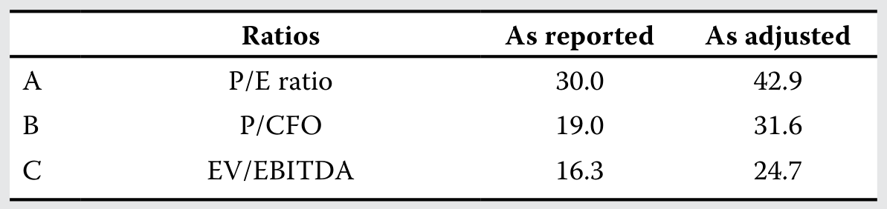

A.根据所报告的资料，市盈率（P/E）比是(1)以下的计算结果。

A. Based on the information as reported, the P/E ratio was the calculation shown below (1).

若将软件开发成本费用化，并据此调整每股收益（EPS），市盈率（P/E）为42.9倍。（相关计算见下方算式。）

Based on EPS adjusted to expense software development costs, the P/E ratio was the calculation shown below (2).

\(1\) 30.0 (USD42 ÷ USD1.40)(2) 42.9 (USD42 ÷ USD0.98)

价格：假设公司权益的市场价值基于其基本面，无论会计差异如何，每股价格为USD42.

Price: Assuming that the market value of the company’s equity is based on its fundamentals, the price per share is USD42, regardless of a difference in accounting.

每股收益（EPS）:如报告所述，每股收益（EPS）为USD1.40.

EPS: As reported, EPS was USD1.40.

调整后的每股收益（EPS）为USD0.98.

Adjusted EPS was USD0.98.

费用化的软件开发成本本可以将JHH的2018 营业利润降低为USD6,000，但该公司本来不会报告往年的软件成本摊销，这本可以将营业利润增加为USD2,000.

Expensing software development costs would have reduced JHH’s 2018 operating income by USD6,000, but the company would have reported no amortization of prior years’ software costs, which would have increased operating income by USD2,000.

USD4,000的净变化将使营业利润从所报告的USD13,317减少为USD9,317.

The net change of USD4,000 would have reduced operating income from the reported USD13,317 to USD9,317.

2018年的实际所得税税率为28.72%。使用这一税率计算，调整后的净利润为6,641美元，而调整前为9,492美元。（相关计算见下方算式。）

The effective tax rate for 2018 the calculation shown below (1) is 28.72%, and using this effective tax rate would give an adjusted net income of the calculation shown below (2), compared to USD9,492 before the adjustment.

因此，每股收益（EPS）将从所报告的USD1.40减少为USD0.98(调整后的净利润 of USD6,641除以6,780股份).

The EPS would therefore be reduced from the reported USD1.40 to USD0.98 (adjusted net income of USD6,641 divided by 6,780 shares).

\(1\) (USD3,825 ÷ USD13,317)(2) USD6,641 \[USD9,317 × (1 – 0.2872)\]

B. 根据报告数据，股价与每股经营现金流量之比（P/CFO）为19.0倍。（相关计算见下方算式。）

B. Based on information as reported, the P/CFO was the calculation shown below (1).

若将软件开发成本费用化，并据此调整经营现金流量（CFO），股价与经营现金流量之比（P/CFO）为31.6倍。（相关计算见下方算式。）

Based on CFO adjusted to expense software development costs, the P/CFO was the calculation shown below (2).

\(1\) 19.0 (USD42 ÷ USD2.21)(2) 31.6 (USD42 ÷ USD1.33)

价格：假设公司权益的市场价值基于其基本面，无论会计差异如何，每股价格为USD42.

Price: Assuming that the market value of the company’s equity is based on its fundamentals, the price per share is USD42, regardless of a difference in accounting.

据报道，每股CFO为USD2.21(总经营现金流量 USD15,007 QQ 6,780股份).

CFO per share, as reported, was USD2.21 (total operating cash flows USD15,007 ÷ 6,780 shares).

经调整，每股CFO为USD1.33.

CFO per share, as adjusted, was USD1.33.

该公司将6,000美元的软件开发成本支出列为投资活动现金流出，因此若将这些成本费用化，经营活动现金流量将减少6,000美元，从报告的15,007美元降至9,007美元。

The company’s USD6,000 expenditure on software development costs was reported as a cash outflow from investing activities, so expensing those costs would reduce cash from operating activities by USD6,000, from the reported USD15,007 to USD9,007.

6,780股分化调整后的经营现金流量总和USD9,007股，每股USD1.33股产生现金流量。

Dividing adjusted total operating cash flow of USD9,007 by 6,780 shares results in cash flow per share of USD1.33.

C. 根据报告数据，企业价值与 EBITDA 之比（EV/EBITDA）为16.3倍。（相关计算见下方算式。）

C. Based on information as reported, the EV/EBITDA was the calculation shown below (1).

若将软件开发成本费用化，并据此调整 EBITDA，则 EV/EBITDA 为24.7倍。（相关计算见下方算式。）

Based on EBITDA adjusted to expense software development costs, the EV/EBITDA was the calculation shown below (2).

\(1\) 16.3 (USD284,760 ÷ USD17,517)(2) 24.7 (USD284,760 ÷ USD11,517)

企业价值：企业价值是公司权益和债务的市场价值之和。

Enterprise Value: Enterprise value is the sum of the market value of the company’s equity and debt.

JHH没有债务，因此企业价值与其权益的市场价值相等。

JHH has no debt, and therefore the enterprise value is equal to the market value of its equity.

其权益的市场价值为每股USD284,760 (USD42×6,780股份。

The market value of its equity is USD284,760 (USD42 per share × 6,780 shares).

报告的 EBITDA 为17,517美元，由息税前利润13,317美元、折旧2,200美元及摊销2,000美元组成。

EBITDA, as reported, was USD17,517 (earnings before interest and taxes of USD13,317 plus USD2,200 depreciation plus USD2,000 amortization).

若将软件开发成本费用化，需要计入6,000美元的开发费用，并剔除以前资本化成本的2,000美元摊销。经调整的 EBITDA 为11,517美元，由息税前利润9,317美元、折旧2,200美元及摊销0美元组成。

EBITDA, adjusted for expensing software development costs by the inclusion of USD6,000 development expense and the exclusion of USD2,000 amortization of prior expense, would be USD11,517 (earnings before interest and taxes of USD9,317 plus USD2,200 depreciation plus USD0 amortization).

#### 补充解析 / Supplementary explanation

本题复核锚点（原解摘录）：(US美元为千元，但每股数额除外。

Review anchor for this item (official excerpt): (US dollars are in thousands, except per share amounts.) JHH’s 2019 ratios are presented in the following table:

补充思路：先将同一现金支出分为当期费用和资产入账两种路径。资本化通常在初期提高资产、当期利润和权益，随后通过折旧或摊销压低未来利润；费用化则提前确认费用。现金总额不因会计列报改变，但经营与投资现金流分类可能改变。比较公司时必须同时看当期调整和以前年度资本化资产的摊销，不能只把当期资本化金额全部加回。

Additional reasoning: Trace the same expenditure under immediate expense versus asset recognition. Capitalization usually raises initial assets, profit, and equity but creates later depreciation or amortization. Total cash does not change, although operating versus investing classification may. Comparisons need both current-period capitalization and amortization of earlier capitalized spending.

#### 相关知识点 / Related concepts

资本化与费用化的跨期影响：费用化口径调整利润：减去当期资本化支出并加回相关当期摊销，另考虑税效应。符合资本化条件与现金是否已支付是不同问题。

Intertemporal effects of capitalization and expensing: To move toward expensing, subtract current capitalized expenditure and add back related current amortization, considering taxes. Capitalization eligibility is distinct from payment timing.

### FSA-LM02-EXAMPLE-602 · 例题 6 · 第 2 题：软件开发费用 Example 6 · 2 — Software Development Costs

正文例题／案例 / Worked example / case · 原版 PDF 页码 / Source PDF pages: 71-73

#### 题目与资料 / Question and data

示例 6

EXAMPLE 6

软件开发费用

Software Development Costs

您正在研究一个涉及JHH软件分析的项目，这是一家(伪)软件开发公司，为它在2017的第一个产品确定了技术可行性。

You are working on a project involving the analysis of JHH Software, a (hypothetical) software development company that established technical feasibility for its first product in 2017.

您的分析部分涉及计算某些基于市场的比例，您将使用这个比例来比较JHH与另一家公司的费用所有软件开发支出。

Part of your analysis involves computing certain market-based ratios, which you will use to compare JHH to another company that expenses all of its software development expenditures.

该公司年度报告的有关数据和摘录载于Expoint 7。

Relevant data and excerpts from the company’s annual report are included in Exhibit 7.

图表7:JHH SOFTWARE(US美元，除每股金额外)

Exhibit 7: JHH SOFTWARE (US dollar thousands, except per share amounts)

   

用于软件开发的会计政策脚注披露：与软件产品的概念配制和设计有关的费用是计入费用，用于发生时的研发。

Footnote disclosure of accounting policy for software development: Expenses that are related to the conceptual formulation and design of software products are expensed to research and development as incurred.

公司将技术可行性确定后生产成品所发生的费用资本化。

The company capitalises expenses that are incurred to produce the finished product after technological feasibility has been established.

2\. 解释比率的变化。

2\. Interpret the changes in the ratios.

#### 官方答案与解析 / Official answer and explanation

解答：

Solution:

费用化软件开发成本将降低历史利润，经营现金流量和息税折旧摊销前利润（EBITDA），从而增加所有市场倍数。

Expensing software development costs would decrease historical profits, operating cash flow, and EBITDA, and would thus increase all market multiples.

因此JHH的股票如果是计入费用而不是资本化的软件开发成本，看起来会更加昂贵。

So JHH’s stock would appear to be more expensive if it expensed rather than capitalized the software development costs.

如果在将JHH与其竞争者比较为费用所有软件开发支出时使用了未调整的市场化比率，那么当差异完全与会计因素有关时，JHH可能显得价格过低。

If the unadjusted market-based ratios were used in the comparison of JHH to its competitor that expenses all software development expenditures, then JHH might appear to be under-priced when the difference is solely related to accounting factors.

JHH经调整的市场比率为比较提供了更好的基础。

JHH’s adjusted market-based ratios provide a better basis for comparison.

#### 补充解析 / Supplementary explanation

本题复核锚点（原解摘录）：费用化软件开发成本将降低历史利润，经营现金流量和息税折旧摊销前利润（EBITDA），从而增加所有市场倍数。

Review anchor for this item (official excerpt): Expensing software development costs would decrease historical profits, operating cash flow, and EBITDA, and would thus increase all market multiples.

补充思路：先将同一现金支出分为当期费用和资产入账两种路径。资本化通常在初期提高资产、当期利润和权益，随后通过折旧或摊销压低未来利润；费用化则提前确认费用。现金总额不因会计列报改变，但经营与投资现金流分类可能改变。比较公司时必须同时看当期调整和以前年度资本化资产的摊销，不能只把当期资本化金额全部加回。

Additional reasoning: Trace the same expenditure under immediate expense versus asset recognition. Capitalization usually raises initial assets, profit, and equity but creates later depreciation or amortization. Total cash does not change, although operating versus investing classification may. Comparisons need both current-period capitalization and amortization of earlier capitalized spending.

#### 相关知识点 / Related concepts

资本化与费用化的跨期影响：费用化口径调整利润：减去当期资本化支出并加回相关当期摊销，另考虑税效应。符合资本化条件与现金是否已支付是不同问题。

Intertemporal effects of capitalization and expensing: To move toward expensing, subtract current capitalized expenditure and add back related current amortization, considering taxes. Capitalization eligibility is distinct from payment timing.

### FSA-LM02-EXAMPLE-701 · 例题 7 · 第 1 题：微软公司——从脚注到财务报表摘录 Example 7 · 1 — Microsoft Corporation—Excerpt from Footnotes to the Financial Statements

正文例题／案例 / Worked example / case · 原版 PDF 页码 / Source PDF pages: 78-79

#### 题目与资料 / Question and data

示例 7

EXAMPLE 7

微软公司——从脚注到财务报表摘录

Microsoft Corporation—Excerpt from Footnotes to the Financial Statements

\[新收入确认\]标准最显著的影响涉及我们软件许可证收入的核算。

The most significant impact of the \[new revenue recognition\] standard relates to our accounting for software license revenue.

具体地说，对于Windows 10，我们主要在计费和交付时识别收入，而不是在相关设备的生命期中按比例识别。

Specifically, for Windows 10, we recognize revenue predominantly at the time of billing and delivery rather than ratably over the life of the related device.

对于某些包括不同的软件许可证和SA的多年商业软件订阅，我们承认在合同执行时而不是在订阅期间的收入许可证。

For certain multi-year commercial software subscriptions that include both distinct software licenses and SA, we recognize license revenue at the time of contract execution rather than over the subscription period.

由于我们的某些商业许可订阅合同的复杂性，标准下要求的实际收入确认处理取决于具体合同条款，在某些情况下，可能因开账单时的承认而有所不同。

Due to the complexity of certain of our commercial license subscription contracts, the actual revenue recognition treatment required under the standard depends on contract-specific terms and in some instances may vary from recognition at the time of billing.

收入确认与我们的硬件，云提供(如Office 365),LinkedIn，以及专业服务)有关，基本没有变化。

Revenue recognition related to our hardware, cloud offerings (such as Office 365), LinkedIn, and professional services remains substantially unchanged.

关于在合并财务报表采用该标准的影响，请参看下文 "对以前报告的结果的影响 "。

Refer to Impacts to Previously Reported Results below for the impact of adoption of the standard in our consolidated financial statements.

图表 10:微软对以前报告的结果的影响

Exhibit 10: Microsoft Impacts to Previously Reported Results

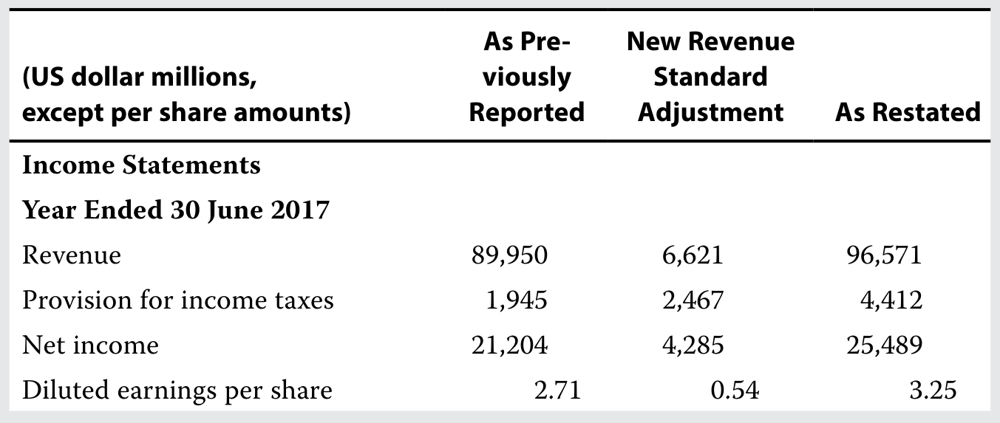

1 IAS 编号8，会计政策，会计估计变更和错误，以及财务会计准则委员会（FASB） ASC主题 250 \[会计变更和错误更正\].

1 IAS No. 8, Accounting Policies, Changes in Accounting Estimates and Errors, and FASB ASC Topic 250 \[Accounting Changes and Error Corrections\].

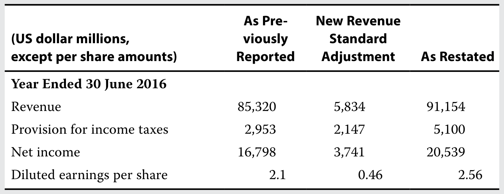

1.基于Experiment 10，描述在新的收入确认标准下，微软的结果是好是坏。

1\. Based on Exhibit 10, describe whether Microsoft’s results appear better or worse under the new revenue recognition standard.

#### 官方答案与解析 / Official answer and explanation

解答：

Solution:

微软的结果在新的收入确认标准下看起来更好。

Microsoft’s results appear better under the new revenue recognition standard.

收入和收入在新标准下较高。

Revenues and income are higher under the new standard.

在新标准下，净利率更高。

The net profit margin is higher under the new standard.

对于2017，净利率是新标准下(1)的计算，相对于旧标准下(2)的计算。

For 2017, the net profit margin is the calculation shown below (1) under the new standard versus the calculation shown below (2) under the old standard.

报道的收入在新标准下增长较快。

Reported revenue grew faster under the new standard.

新标准下的收入增殖是旧标准下(3)与5.4%\[=(89,950/85,320)/– 1)\]的计算。

Revenue growth under the new standard was the calculation shown below (3) compared with 5.4 percent \[= (89,950/85,320) – 1)\] under the old standard.

微软对新收入确认效果的介绍使得分析师能够识别会计准则变化的影响。

Microsoft’s presentation of the effects of the new revenue recognition enables an analyst to identify the impact of the change in accounting standards.

\(1\) 26.4 percent (= 25,489/96,571)(2) 23.6 percent (= 21,204/89,950)(3) 5.9 percent \[= (96,571/91,154) – 1\]

#### 补充解析 / Supplementary explanation

本题复核锚点（原解摘录）：微软的结果在新的收入确认标准下看起来更好。

Review anchor for this item (official excerpt): Microsoft’s results appear better under the new revenue recognition standard.

补充思路：先判断履约义务及控制权何时转移，再决定按时点还是一段时间确认收入。主要责任人与代理人的区别影响总额或净额列报：控制商品或服务后交付给客户的主要责任人通常确认总额，代理人通常确认净佣金。总额列报会改变收入和利润率分母，但不一定改变同一交易的利润金额或现金流。

Additional reasoning: Identify performance obligations and when control transfers before choosing point-in-time or over-time recognition. Principal versus agent status determines gross or net presentation: a principal controls the promised good or service before transfer; an agent generally reports net fees. Gross presentation can change revenue and margin denominators without changing transaction profit or cash flow.

#### 相关知识点 / Related concepts

收入确认的经济实质：收入确认关注履约与控制，不以收到现金为唯一标准；合同资产、应收账款和合同负债分别反映不同状态。

Economic substance of revenue recognition: Recognition follows performance and control rather than cash receipt alone. Contract assets, receivables, and contract liabilities represent distinct states.

### FSA-LM02-EXAMPLE-801 · 例题 8 · 第 1 题：基本每股收益（EPS） 计算 (1) Example 8 · 1 — A Basic EPS Calculation (1)

正文例题／案例 / Worked example / case · 原版 PDF 页码 / Source PDF pages: 82

#### 题目与资料 / Question and data

示例 8

EXAMPLE 8

基本每股收益（EPS） 计算 (1)

A Basic EPS Calculation (1)

1\. 截至2018年12月31日止年度，Shopalot Company 的净利润为1,950,000美元。

1\. For the year ended 31 December 2018, Shopalot Company had net income of USD1,950,000.

公司拥有1,500,000股份流通在外普通股，无优先股，无敞篷车金融工具。

The company had 1,500,000 shares of common stock outstanding, no preferred stock, and no convertible financial instruments.

Shopalot的基本每股收益（EPS）是什么?

What is Shopalot’s basic EPS?

#### 官方答案与解析 / Official answer and explanation

解答：

Solution:

Shopalot的基本每股收益（EPS）是USD1.30 (USD1,950,000除以1,500,000股份).

Shopalot’s basic EPS is USD1.30 (USD1,950,000 divided by 1,500,000 shares).

#### 补充解析 / Supplementary explanation

本题复核锚点（原解摘录）：Shopalot的基本每股收益（EPS）是USD1.30 (USD1,950,000除以1,500,000股份).

Review anchor for this item (official excerpt): Shopalot’s basic EPS is USD1.30 (USD1,950,000 divided by 1,500,000 shares).

补充思路：基本 EPS 用归属于普通股股东的净利润除以加权平均普通股数，优先股股利须先扣除。可转债假设转换时，分母增加转换股数，分子加回税后利息；可转优先股转换时加回股利。期权采用库存股法，只增加“发行股数减可回购股数”的净额。任何会使 EPS 上升的工具是反稀释工具，不能纳入稀释 EPS。

Additional reasoning: Basic EPS divides income available to common shareholders by weighted-average common shares, after preferred dividends. Assumed debt conversion adds shares and after-tax interest; preferred conversion adds back dividends. Treasury-stock treatment of options adds only net shares after hypothetical repurchase. Instruments that raise EPS are antidilutive and are excluded.

#### 相关知识点 / Related concepts

基本与稀释每股收益：基本 EPS＝(净利润−优先股股利)/加权平均普通股；期权增量股数＝N×(1−行权价/平均市价)，仅在满足稀释条件时使用。

Basic and diluted earnings per share: Basic EPS = (net income − preferred dividends)/weighted-average common shares. Incremental option shares = N × (1−exercise price/average market price), subject to dilution tests.

### FSA-LM02-EXAMPLE-901 · 例题 9 · 第 1 题：基本每股收益（EPS） 计算 (2) Example 9 · 1 — A Basic EPS Calculation (2)

正文例题／案例 / Worked example / case · 原版 PDF 页码 / Source PDF pages: 83

#### 题目与资料 / Question and data

示例 9

EXAMPLE 9

基本每股收益（EPS） 计算 (2)

A Basic EPS Calculation (2)

在2018年12月31日结束的一年中，Angler产品拥有USD2,500,000的净利润。

For the year ended 31 December 2018, Angler Products had net income of USD2,500,000.

该公司在优先股上申报并支付了股利的USD200,000.

The company declared and paid USD200,000 of dividends on preferred stock.

13显示的普通股共享信息：

The company also had the common stock share information shown in Exhibit 13:

图表 13:安格勒的 普通股 股份

Exhibit 13: Angler’s Common Stock Shares

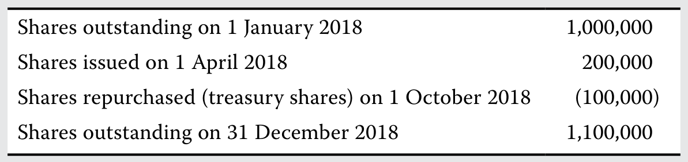

1\. 该公司流通在外股份的加权平均股数是多少？

1\. What is the company’s weighted average number of shares outstanding?

#### 官方答案与解析 / Official answer and explanation

解答：

Solution:

加权平均的流通在外股份号码由每股待售时间长短决定：

The weighted average number of shares outstanding is determined by the length of time each quantity of shares was outstanding:

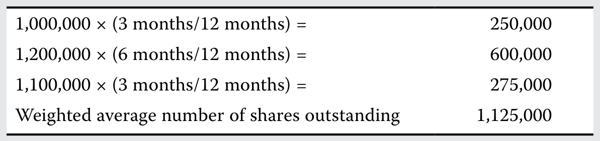

#### 补充解析 / Supplementary explanation

本题复核锚点（原解摘录）：加权平均的流通在外股份号码由每股待售时间长短决定：

Review anchor for this item (official excerpt): The weighted average number of shares outstanding is determined by the length of time each quantity of shares was outstanding:

补充思路：基本 EPS 用归属于普通股股东的净利润除以加权平均普通股数，优先股股利须先扣除。可转债假设转换时，分母增加转换股数，分子加回税后利息；可转优先股转换时加回股利。期权采用库存股法，只增加“发行股数减可回购股数”的净额。任何会使 EPS 上升的工具是反稀释工具，不能纳入稀释 EPS。

Additional reasoning: Basic EPS divides income available to common shareholders by weighted-average common shares, after preferred dividends. Assumed debt conversion adds shares and after-tax interest; preferred conversion adds back dividends. Treasury-stock treatment of options adds only net shares after hypothetical repurchase. Instruments that raise EPS are antidilutive and are excluded.

#### 相关知识点 / Related concepts

基本与稀释每股收益：基本 EPS＝(净利润−优先股股利)/加权平均普通股；期权增量股数＝N×(1−行权价/平均市价)，仅在满足稀释条件时使用。

Basic and diluted earnings per share: Basic EPS = (net income − preferred dividends)/weighted-average common shares. Incremental option shares = N × (1−exercise price/average market price), subject to dilution tests.

### FSA-LM02-EXAMPLE-902 · 例题 9 · 第 2 题：基本每股收益（EPS） 计算 (2) Example 9 · 2 — A Basic EPS Calculation (2)

正文例题／案例 / Worked example / case · 原版 PDF 页码 / Source PDF pages: 83

#### 题目与资料 / Question and data

示例 9

EXAMPLE 9

基本每股收益（EPS） 计算 (2)

A Basic EPS Calculation (2)

在2018年12月31日结束的一年中，Angler产品拥有USD2,500,000的净利润。

For the year ended 31 December 2018, Angler Products had net income of USD2,500,000.

该公司在优先股上申报并支付了股利的USD200,000.

The company declared and paid USD200,000 of dividends on preferred stock.

13显示的普通股共享信息：

The company also had the common stock share information shown in Exhibit 13:

图表 13:安格勒的 普通股 股份

Exhibit 13: Angler’s Common Stock Shares

2\. 该公司的基本每股收益（EPS）是什么?

2\. What is the company’s basic EPS?

#### 官方答案与解析 / Official answer and explanation

解答：

Solution:

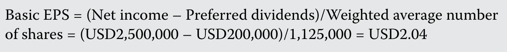

#### 补充解析 / Supplementary explanation

补充思路：基本 EPS 用归属于普通股股东的净利润除以加权平均普通股数，优先股股利须先扣除。可转债假设转换时，分母增加转换股数，分子加回税后利息；可转优先股转换时加回股利。期权采用库存股法，只增加“发行股数减可回购股数”的净额。任何会使 EPS 上升的工具是反稀释工具，不能纳入稀释 EPS。

Additional reasoning: Basic EPS divides income available to common shareholders by weighted-average common shares, after preferred dividends. Assumed debt conversion adds shares and after-tax interest; preferred conversion adds back dividends. Treasury-stock treatment of options adds only net shares after hypothetical repurchase. Instruments that raise EPS are antidilutive and are excluded.

#### 相关知识点 / Related concepts

基本与稀释每股收益：基本 EPS＝(净利润−优先股股利)/加权平均普通股；期权增量股数＝N×(1−行权价/平均市价)，仅在满足稀释条件时使用。

Basic and diluted earnings per share: Basic EPS = (net income − preferred dividends)/weighted-average common shares. Incremental option shares = N × (1−exercise price/average market price), subject to dilution tests.

### FSA-LM02-EXAMPLE-1001 · 例题 10 · 第 1 题：基本每股收益（EPS） 计算 (3) Example 10 · 1 — A Basic EPS Calculation (3)

正文例题／案例 / Worked example / case · 原版 PDF 页码 / Source PDF pages: 83

#### 题目与资料 / Question and data

示例 10

EXAMPLE 10

基本每股收益（EPS） 计算 (3)

A Basic EPS Calculation (3)

1\. 假设事实与"例"9相同，只是在2018年12月1日上，一个先前宣布的2-for-1 股票拆细生效。

1\. Assume the same facts as Example 9 except that on 1 December 2018, a previously declared 2-for-1 stock split took effect.

每个记录的股东都收到两股，以换取他或她拥有的每股当前股份。

Each shareholder of record receives two shares in exchange for each current share that he or she owns.

该公司的基本每股收益（EPS）是什么?

What is the company’s basic EPS?

#### 官方答案与解析 / Official answer and explanation

解答：

Solution:

为了每股收益（EPS）计算的目的，将股票拆细视为在期初发生。

For EPS calculation purposes, a stock split is treated as if it occurred at the beginning of the period.

因此，加权平均股数为2,250,000股，基本每股收益的计算见下方算式（1）。

The weighted average number of shares would, therefore, be 2,250,000, and the basic EPS would be the calculation shown below (1).

\(1\) USD1.02 \[= (USD2,500,000 – USD200,000)/2,250,000\]

#### 补充解析 / Supplementary explanation

本题复核锚点（原解摘录）：为了每股收益（EPS）计算的目的，将股票拆细视为在期初发生。

Review anchor for this item (official excerpt): For EPS calculation purposes, a stock split is treated as if it occurred at the beginning of the period.

补充思路：基本 EPS 用归属于普通股股东的净利润除以加权平均普通股数，优先股股利须先扣除。可转债假设转换时，分母增加转换股数，分子加回税后利息；可转优先股转换时加回股利。期权采用库存股法，只增加“发行股数减可回购股数”的净额。任何会使 EPS 上升的工具是反稀释工具，不能纳入稀释 EPS。

Additional reasoning: Basic EPS divides income available to common shareholders by weighted-average common shares, after preferred dividends. Assumed debt conversion adds shares and after-tax interest; preferred conversion adds back dividends. Treasury-stock treatment of options adds only net shares after hypothetical repurchase. Instruments that raise EPS are antidilutive and are excluded.

拆股和股票股利不增加公司资源，因此 EPS 股数要按适用规则追溯调整；现金增发则按实际流通时间加权，两种处理不能混用。

Splits and stock dividends do not add resources, so share counts are retrospectively adjusted as required. Cash share issues are time-weighted from issuance; do not mix the treatments.

本题要求选择“不成立、最不可能或例外”的项目。先判断各陈述在题设下是否成立，再按这一反向要求选出答案；正确选项可能本身描述的就是错误或不适用情形。

This item asks for a least-likely, inaccurate, or exception case. Evaluate each statement under the assumptions, then apply that reversed selection rule; the credited choice may itself describe the false or inapplicable case.

#### 相关知识点 / Related concepts

基本与稀释每股收益：基本 EPS＝(净利润−优先股股利)/加权平均普通股；期权增量股数＝N×(1−行权价/平均市价)，仅在满足稀释条件时使用。

Basic and diluted earnings per share: Basic EPS = (net income − preferred dividends)/weighted-average common shares. Incremental option shares = N × (1−exercise price/average market price), subject to dilution tests.

### FSA-LM02-EXAMPLE-1101 · 例题 11 · 第 1 题：稀释每股收益（EPS） 使用 优先股 转换法计算 Example 11 · 1 — A Diluted EPS Calculation Using the If-Converted Method for Preferred Stock

正文例题／案例 / Worked example / case · 原版 PDF 页码 / Source PDF pages: 84-85

#### 题目与资料 / Question and data

示例 11

EXAMPLE 11

稀释每股收益（EPS） 使用 优先股 转换法计算

A Diluted EPS Calculation Using the If-Converted Method for Preferred Stock

1\. 截至2018年12月31日止年度，Bright-Warm Utility Company（虚构公司）的净利润为1,750,000美元。

1\. For the year ended 31 December 2018, Bright-Warm Utility Company (fictitious) had net income of USD1,750,000.

该公司流通在外普通股的平均股数为500,000股，可转换优先股为20,000股，且没有其他潜在稀释性证券。

The company had an average of 500,000 shares of common stock outstanding, 20,000 shares of convertible preferred, and no other potentially dilutive securities.

每股优先股支付10美元股利，并可转换为五股该公司的普通股。

Each share of preferred pays a dividend of USD10 per share, and each is convertible into five shares of the company’s common stock.

请计算该公司的基本每股收益及稀释每股收益（EPS）。

Calculate the company’s basic and diluted EPS.

#### 官方答案与解析 / Official answer and explanation

解答：

Solution:

如果可转换优先股的20,000股份各兑换成该公司的普通股的五股，公司本会有额外的100,000股份普通股(首选的20,000股份各共有五股).

If the 20,000 shares of convertible preferred had each converted into five shares of the company’s common stock, the company would have had an additional 100,000 shares of common stock (five shares of common for each of the 20,000 shares of preferred).

如果进行了转换，公司不会为首选的20,000股份每股支付首选的股利，USD200,000,(USD10.

If the conversion had taken place, the company would not have paid preferred dividends of USD200,000 (USD10 per share for each of the 20,000 shares of preferred).

如展览14所示，该公司的基本每股收益（EPS）为USD3.10，其稀释每股收益（EPS）为USD2.92.

As shown in Exhibit 14, the company’s basic EPS was USD3.10 and its diluted EPS was USD2.92.

图表14:使用假定方法计算亮热公用事业公司的稀释每股收益（EPS）:优先股案例

Exhibit 14: Calculation of Diluted EPS for Bright-Warm Utility Company Using the If-Converted Method: Case of Preferred Stock

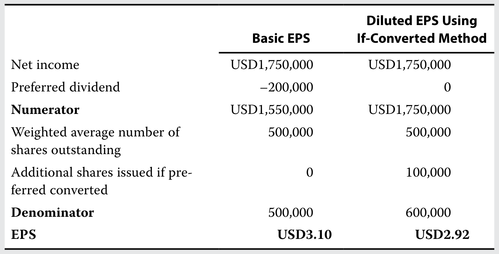

#### 补充解析 / Supplementary explanation

本题复核锚点（原解摘录）：如果可转换优先股的20,000股份各兑换成该公司的普通股的五股，公司本会有额外的100,000股份普通股(首选的20,000股份各共有五股).

Review anchor for this item (official excerpt): If the 20,000 shares of convertible preferred had each converted into five shares of the company’s common stock, the company would have had an additional 100,000 shares of common stock (five shares of common for each of the 20,000 shares of preferred).

补充思路：基本 EPS 用归属于普通股股东的净利润除以加权平均普通股数，优先股股利须先扣除。可转债假设转换时，分母增加转换股数，分子加回税后利息；可转优先股转换时加回股利。期权采用库存股法，只增加“发行股数减可回购股数”的净额。任何会使 EPS 上升的工具是反稀释工具，不能纳入稀释 EPS。

Additional reasoning: Basic EPS divides income available to common shareholders by weighted-average common shares, after preferred dividends. Assumed debt conversion adds shares and after-tax interest; preferred conversion adds back dividends. Treasury-stock treatment of options adds only net shares after hypothetical repurchase. Instruments that raise EPS are antidilutive and are excluded.

#### 相关知识点 / Related concepts

基本与稀释每股收益：基本 EPS＝(净利润−优先股股利)/加权平均普通股；期权增量股数＝N×(1−行权价/平均市价)，仅在满足稀释条件时使用。

Basic and diluted earnings per share: Basic EPS = (net income − preferred dividends)/weighted-average common shares. Incremental option shares = N × (1−exercise price/average market price), subject to dilution tests.

### FSA-LM02-EXAMPLE-1201 · 例题 12 · 第 1 题：稀释每股收益（EPS） 使用 可转换债务 转换法计算 Example 12 · 1 — A Diluted EPS Calculation Using the If-Converted Method for Convertible Debt

正文例题／案例 / Worked example / case · 原版 PDF 页码 / Source PDF pages: 86

#### 题目与资料 / Question and data

示例 12

EXAMPLE 12

稀释每股收益（EPS） 使用 可转换债务 转换法计算

A Diluted EPS Calculation Using the If-Converted Method for Convertible Debt

1\. Oppnox 公司（虚构）截至 2018 年 12 月 31 日止年度的净利润为 USD750,000。

1\. Oppnox Company (fictitious) reported net income of USD750,000 for the year ended 31 December 2018.

该公司的加权平均流通在外普通股为 690,000 股。

The company had a weighted average of 690,000 shares of common stock outstanding.

此外，公司仅有一种潜在稀释性证券：面值 USD50,000、票面利率 6% 的可转换债券，可转换为总计 10,000 股普通股。

In addition, the company has only one potentially dilutive security: USD50,000 of 6 percent convertible bonds, convertible into a total of 10,000 shares.

假设税率为 30%，计算 Oppnox 的基本每股收益和稀释每股收益。

Assuming a tax rate of 30 percent, calculate Oppnox’s basic and diluted EPS.

#### 官方答案与解析 / Official answer and explanation

解答：

Solution:

如果债务证券已经转换，那么债务证券将不再处于未到期状态，相反，普通股的10,000额外股份也将处于未到期状态。

If the debt securities had been converted, the debt securities would no longer be outstanding and instead, an additional 10,000 shares of common stock would be outstanding.

另外，如果债务证券被转换，公司本不会为债务支付USD3,000的利息，因此通用的股东可用的净利润会因计税基础之后的(1)的计算而增加。

Also, if the debt securities had been converted, the company would not have paid interest of USD3,000 on the debt, so net income available to common shareholders would have increased by the calculation shown below (1) on an after-tax basis.

Expoint 15用可转换债务的转换法来说明稀释每股收益（EPS）的计算。

Exhibit 15 illustrates the calculation of diluted EPS using the if-converted method for convertible debt.

\(1\) USD2,100 \[= USD3,000(1 – 0.30)\]

图表15:使用易转换方法计算Oppnox公司的稀释每股收益（EPS）:可转换债券案

Exhibit 15: Calculation of Diluted EPS for Oppnox Company Using the If-Converted Method: Case of a Convertible Bond

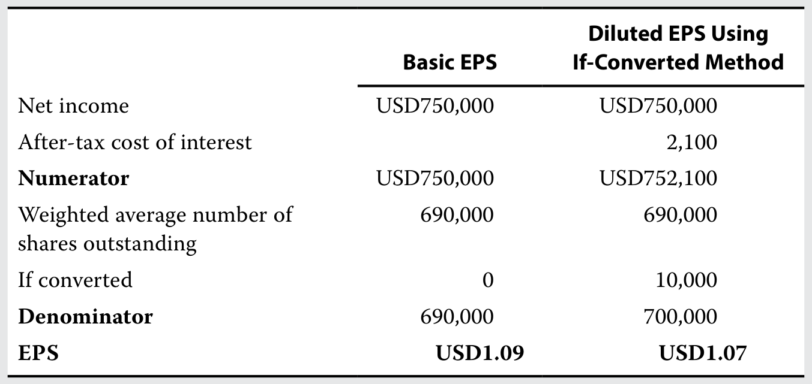

#### 补充解析 / Supplementary explanation

本题复核锚点（原解摘录）：如果债务证券已经转换，那么债务证券将不再处于未到期状态，相反，普通股的10,000额外股份也将处于未到期状态。

Review anchor for this item (official excerpt): If the debt securities had been converted, the debt securities would no longer be outstanding and instead, an additional 10,000 shares of common stock would be outstanding.

补充思路：基本 EPS 用归属于普通股股东的净利润除以加权平均普通股数，优先股股利须先扣除。可转债假设转换时，分母增加转换股数，分子加回税后利息；可转优先股转换时加回股利。期权采用库存股法，只增加“发行股数减可回购股数”的净额。任何会使 EPS 上升的工具是反稀释工具，不能纳入稀释 EPS。

Additional reasoning: Basic EPS divides income available to common shareholders by weighted-average common shares, after preferred dividends. Assumed debt conversion adds shares and after-tax interest; preferred conversion adds back dividends. Treasury-stock treatment of options adds only net shares after hypothetical repurchase. Instruments that raise EPS are antidilutive and are excluded.

假设可转债转换时，应同时增加股数并加回税后利息：少付利息虽增加税前利润，也会增加所得税，不能把税前利息全部加回。

Assumed conversion adds shares and after-tax interest. Avoided interest raises pretax income but also tax, so adding back the full pretax interest would overstate the numerator.

#### 相关知识点 / Related concepts

基本与稀释每股收益：基本 EPS＝(净利润−优先股股利)/加权平均普通股；期权增量股数＝N×(1−行权价/平均市价)，仅在满足稀释条件时使用。

Basic and diluted earnings per share: Basic EPS = (net income − preferred dividends)/weighted-average common shares. Incremental option shares = N × (1−exercise price/average market price), subject to dilution tests.

### FSA-LM02-EXAMPLE-1301 · 例题 13 · 第 1 题：使用库存股法计算期权导致的稀释每股收益 Example 13 · 1 — A Diluted EPS Calculation Using the Treasury Stock Method for Options

正文例题／案例 / Worked example / case · 原版 PDF 页码 / Source PDF pages: 87-88

#### 题目与资料 / Question and data

示例 13

EXAMPLE 13

使用库存股法计算期权导致的稀释每股收益

A Diluted EPS Calculation Using the Treasury Stock Method for Options

1\. Hihotech Company (fical)报告 净利润的USD2.3 百万在结束的一年中为2018年6月30日，并有一个加权平均的800,000的流通在外普通股。

1\. Hihotech Company (fictitious) reported net income of USD2.3 million for the year ended 30 June 2018 and had a weighted average of 800,000 common shares outstanding.

本财政年度初，公司拥有未完成的30,000选项，其中行权价为USD35.

At the beginning of the fiscal year, the company has outstanding 30,000 options with an exercise price of USD35.

没有其他的 潜在稀释性金融工具是杰出的。

No other potentially dilutive financial instruments are outstanding.

本会计年度，公司的市场价格平均为每股USD55.

Over the fiscal year, the company’s market price has averaged USD55 per share.

计算公司的基本每股收益与稀释每股收益（EPS）.

Calculate the company’s basic and diluted EPS.

#### 官方答案与解析 / Official answer and explanation

解答：

Solution:

使用库存股法，我们首先计算出如果所有选项都得到了USD1,050,000 (USD35，每个已行使的30,000选项).

Using the treasury stock method, we first calculate that the company would have received USD1,050,000 (USD35 for each of the 30,000 options exercised) if all the options had been exercised.

这些选项将不再未兑现；相反，30,000的普通股股份将尚未兑现。

The options would no longer be outstanding; instead, 30,000 shares of common stock would be outstanding.

在库存股法下，我们假设在行使选择权时，将会与收到的现金重新购买股份。

Under the treasury stock method, we assume that shares would be repurchased with the cash received upon exercise of the options.

按每股USD55的平均市场价格，USD1,050,000从期权行权收益，公司本可以回购19,091的股票。

At an average market price of USD55 per share, the USD1,050,000 proceeds from option exercise, the company could have repurchased 19,091 shares.

因此，发行的增量股份为10,909(计算为30,000减去19,091)).

Therefore, the incremental number of shares issued is 10,909 (calculated as 30,000 minus 19,091).

对于稀释每股收益（EPS）计算，不修改数字。

For the diluted EPS calculation, no change is made to the numerator.

如展览16所示，该公司的基本每股收益（EPS）为USD2.88，稀释每股收益（EPS）为USD2.84.

As shown in Exhibit 16, the company’s basic EPS was USD2.88 and the diluted EPS was USD2.84.

图表16:使用库存股法计算Hihotech公司稀释每股收益（EPS）:股票期权案

Exhibit 16: Calculation of Diluted EPS for Hihotech Company Using the Treasury Stock Method: Case of Stock Options

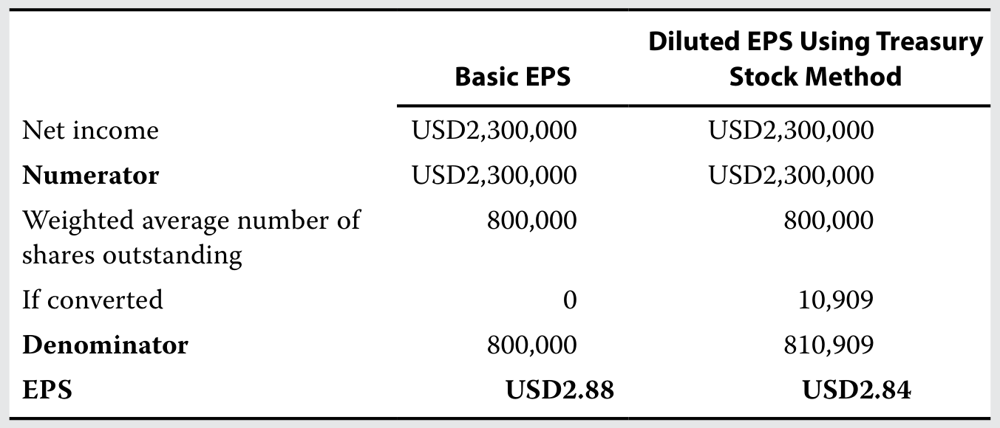

如前所述，国际财务报告准则（IFRS）要求进行类似的计算，但不将其称为“库存股法”。公司必须考虑，任何假定收益都是以该期间平均市场价格发行新股所得。

As noted, IFRS require a similar computation but does not refer to it as the “treasury stock method.” The company is required to consider that any assumed proceeds are received from the issuance of new shares at the average market price for the period.

在计算稀释每股收益（EPS）时，将忽略这些新的“引出”股份，但根据期权合同将发行的新股份的盈余减去新的推定股份后，将计入加权平均的流通在外股份号码。

These new “inferred” shares would be disregarded in the computation of diluted EPS, but the excess of the new shares that would be issued under options contracts minus the new inferred shares would be added to the weighted average number of shares outstanding.

其结果与库存股法相同，如"例14"所示。

The results are the same as the treasury stock method, as shown in Example 14.

#### 补充解析 / Supplementary explanation

本题复核锚点（原解摘录）：使用库存股法，我们首先计算出如果所有选项都得到了USD1,050,000 (USD35，每个已行使的30,000选项).

Review anchor for this item (official excerpt): Using the treasury stock method, we first calculate that the company would have received USD1,050,000 (USD35 for each of the 30,000 options exercised) if all the options had been exercised.

补充思路：基本 EPS 用归属于普通股股东的净利润除以加权平均普通股数，优先股股利须先扣除。可转债假设转换时，分母增加转换股数，分子加回税后利息；可转优先股转换时加回股利。期权采用库存股法，只增加“发行股数减可回购股数”的净额。任何会使 EPS 上升的工具是反稀释工具，不能纳入稀释 EPS。

Additional reasoning: Basic EPS divides income available to common shareholders by weighted-average common shares, after preferred dividends. Assumed debt conversion adds shares and after-tax interest; preferred conversion adds back dividends. Treasury-stock treatment of options adds only net shares after hypothetical repurchase. Instruments that raise EPS are antidilutive and are excluded.

库存股法假设行权收入用于按平均市价回购股票，因此分母只增加净发行股数。若行权价不低于平均市价，一般不会产生应纳入的稀释增量。

The treasury-stock method assumes exercise proceeds repurchase shares at the average market price, so only net new shares enter the denominator. An exercise price at or above market generally creates no includable dilution.

#### 相关知识点 / Related concepts

基本与稀释每股收益：基本 EPS＝(净利润−优先股股利)/加权平均普通股；期权增量股数＝N×(1−行权价/平均市价)，仅在满足稀释条件时使用。

Basic and diluted earnings per share: Basic EPS = (net income − preferred dividends)/weighted-average common shares. Incremental option shares = N × (1−exercise price/average market price), subject to dilution tests.

### FSA-LM02-EXAMPLE-1401 · 例题 14 · 第 1 题：用于 国际财务报告准则（IFRS） 选项的 稀释每股收益（EPS） Example 14 · 1 — Diluted EPS for Options under IFRS

正文例题／案例 / Worked example / case · 原版 PDF 页码 / Source PDF pages: 88

#### 题目与资料 / Question and data

示例 14

EXAMPLE 14

用于 国际财务报告准则（IFRS） 选项的 稀释每股收益（EPS）

Diluted EPS for Options under IFRS

1\. 假设在例13给出的相同事实，在国际财务报告准则（IFRS）下计算流通在外股份的加权平均编号为稀释每股收益（EPS）.

1\. Assuming the same facts given in Example 13, calculate the weighted average number of shares outstanding for diluted EPS under IFRS.

#### 官方答案与解析 / Official answer and explanation

解答：

Solution:

如果行使了这些选择权，该公司本来会得到USD1,050,000。

If the options had been exercised, the company would have received USD1,050,000.

如果从新股发行中收到这一金额，按每股USD55的平均市场价格计算，公司本可以发行19,091股票。

If this amount had been received from the issuance of new shares at the average market price of USD55 per share, the company would have issued 19,091 shares.

国际财务报告准则（IFRS）指公司本会以市场价格发行的19,091股份作为推断的股份。

IFRS refer to the 19,091 shares the company would have issued at market prices as the inferred shares.

在选项(30,000)下发行的股票数量减去推断的股票数量(19,091)等于10,909.

The number of shares issued under options (30,000) minus the number of inferred shares (19,091) equals 10,909.

这一金额被加入加权平均编号流通在外股份的800,000，以获得810,909的稀释股份。

This amount is added to the weighted average number of shares outstanding of 800,000 to get diluted shares of 810,909.

请注意，这与美国公认会计原则（US GAAP）下获得的结果相同；它只是以不同的方式得到的。

Note that this is the same result as that obtained under US GAAP; it is just derived in a different manner.

#### 补充解析 / Supplementary explanation

本题复核锚点（原解摘录）：如果行使了这些选择权，该公司本来会得到USD1,050,000。

Review anchor for this item (official excerpt): If the options had been exercised, the company would have received USD1,050,000.

补充思路：基本 EPS 用归属于普通股股东的净利润除以加权平均普通股数，优先股股利须先扣除。可转债假设转换时，分母增加转换股数，分子加回税后利息；可转优先股转换时加回股利。期权采用库存股法，只增加“发行股数减可回购股数”的净额。任何会使 EPS 上升的工具是反稀释工具，不能纳入稀释 EPS。

Additional reasoning: Basic EPS divides income available to common shareholders by weighted-average common shares, after preferred dividends. Assumed debt conversion adds shares and after-tax interest; preferred conversion adds back dividends. Treasury-stock treatment of options adds only net shares after hypothetical repurchase. Instruments that raise EPS are antidilutive and are excluded.

库存股法假设行权收入用于按平均市价回购股票，因此分母只增加净发行股数。若行权价不低于平均市价，一般不会产生应纳入的稀释增量。

The treasury-stock method assumes exercise proceeds repurchase shares at the average market price, so only net new shares enter the denominator. An exercise price at or above market generally creates no includable dilution.

#### 相关知识点 / Related concepts

基本与稀释每股收益：基本 EPS＝(净利润−优先股股利)/加权平均普通股；期权增量股数＝N×(1−行权价/平均市价)，仅在满足稀释条件时使用。

Basic and diluted earnings per share: Basic EPS = (net income − preferred dividends)/weighted-average common shares. Incremental option shares = N × (1−exercise price/average market price), subject to dilution tests.

### FSA-LM02-EXAMPLE-1501 · 例题 15 · 第 1 题：反稀释的 安全装置 Example 15 · 1 — An Antidilutive Security

正文例题／案例 / Worked example / case · 原版 PDF 页码 / Source PDF pages: 89-90

#### 题目与资料 / Question and data

示例 15

EXAMPLE 15

反稀释的 安全装置

An Antidilutive Security

1\. 2018年12月31日结束的一年中，Dim-Cool Utity Company (ficial)拥有USD1,750,000的净利润。

1\. For the year ended 31 December 2018, Dim-Cool Utility Company (fictitious) had net income of USD1,750,000.

该公司平均拥有流通在外普通股的500,000股份，可转换优先股的20,000股份，没有其他具有潜在稀释作用的的证券股份。

The company had an average of 500,000 shares of common stock outstanding, 20,000 shares of convertible preferred, and no other potentially dilutive securities.

每股首选股支付每股USD10的红利，每股可兑换成公司普通股的三股。

Each share of preferred pays a dividend of USD10 per share, and each is convertible into three shares of the company’s common stock.

该公司的基本每股收益与稀释每股收益（EPS）是什么?

What was the company’s basic and diluted EPS?

#### 官方答案与解析 / Official answer and explanation

解答：

Solution:

如果可转换优先股的20,000股份各自转换为公司普通股的三股，公司本可以另外拥有普通股的60,000股份(首选的20,000股份各共有三股).

If the 20,000 shares of convertible preferred had each converted into three shares of the company’s common stock, the company would have had an additional 60,000 shares of common stock (three shares of common for each of the 20,000 shares of preferred).

如果进行了转换，公司不会为首选的20,000股份每股支付首选的股利，USD200,000,(USD10.

If the conversion had taken place, the company would not have paid preferred dividends of USD200,000 (USD10 per share for each of the 20,000 shares of preferred).

使用若变法的效果是USD3.13的每股收益（EPS），如Explement 17所示。

The effect of using the if-converted method would be EPS of USD3.13, as shown in Exhibit 17.

由于该数值高于公司3.10美元的基本每股收益，这些证券被视为具有反稀释作用，因此计算稀释每股收益时，不计入其转换的影响。

Because this is greater than the company’s basic EPS of USD3.10, the securities are said to be antidilutive and the effect of their conversion would not be included in diluted EPS.

稀释每股收益（EPS）将与基本每股收益（EPS）(即USD3.10))相同。

Diluted EPS would be the same as basic EPS (i.e., USD3.10).

图表17:反稀释的安全设备的计算

Exhibit 17: Calculation for an Antidilutive Security

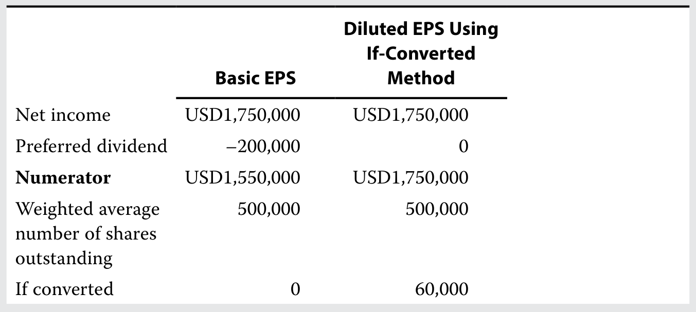 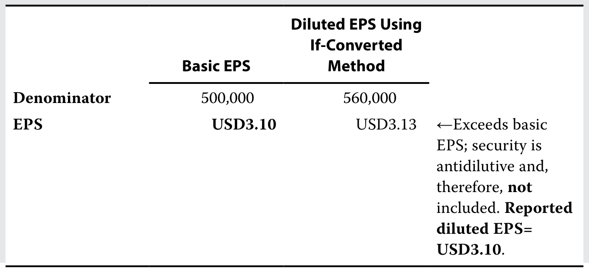

#### 补充解析 / Supplementary explanation

本题复核锚点（原解摘录）：如果可转换优先股的20,000股份各自转换为公司普通股的三股，公司本可以另外拥有普通股的60,000股份(首选的20,000股份各共有三股).

Review anchor for this item (official excerpt): If the 20,000 shares of convertible preferred had each converted into three shares of the company’s common stock, the company would have had an additional 60,000 shares of common stock (three shares of common for each of the 20,000 shares of preferred).

补充思路：基本 EPS 用归属于普通股股东的净利润除以加权平均普通股数，优先股股利须先扣除。可转债假设转换时，分母增加转换股数，分子加回税后利息；可转优先股转换时加回股利。期权采用库存股法，只增加“发行股数减可回购股数”的净额。任何会使 EPS 上升的工具是反稀释工具，不能纳入稀释 EPS。

Additional reasoning: Basic EPS divides income available to common shareholders by weighted-average common shares, after preferred dividends. Assumed debt conversion adds shares and after-tax interest; preferred conversion adds back dividends. Treasury-stock treatment of options adds only net shares after hypothetical repurchase. Instruments that raise EPS are antidilutive and are excluded.

#### 相关知识点 / Related concepts

基本与稀释每股收益：基本 EPS＝(净利润−优先股股利)/加权平均普通股；期权增量股数＝N×(1−行权价/平均市价)，仅在满足稀释条件时使用。

Basic and diluted earnings per share: Basic EPS = (net income − preferred dividends)/weighted-average common shares. Incremental option shares = N × (1−exercise price/average market price), subject to dilution tests.

### FSA-LM02-PRACTICE-001 · 章末习题 1 Practice problem 1

章末练习 / Practice problem · 原版 PDF 页码 / Source PDF pages: 96, 100

#### 题目与资料 / Question and data

1.在国际财务报告准则（IFRS）下，收入包括增加来自以下来源的经济利益：

1\. Under IFRS, income includes increases in economic benefits from:

A. 负债的增加与业主的缴款无关。

A. increases in liabilities not related to owners’ contributions.

B. 资产的增强与业主缴款无关。

B. enhancements of assets not related to owners’ contributions.

C. 业主缴款增加的权益。

C. increases in owners’ equity related to owners’ contributions.

#### 官方答案与解析 / Official answer and explanation

1,B对

1\. B is correct.

在国际财务报告准则（IFRS）下，收入包括来自资产增加的经济利益增加，资产增强，负债减少。

Under IFRS, income includes increases in economic benefits from increases in assets, enhancement of assets, and decreases in liabilities.

#### 补充解析 / Supplementary explanation

本题复核锚点（原解摘录）：在国际财务报告准则（IFRS）下，收入包括来自资产增加的经济利益增加，资产增强，负债减少。

Review anchor for this item (official excerpt): Under IFRS, income includes increases in economic benefits from increases in assets, enhancement of assets, and decreases in liabilities.

本题官方选项为 B。补充思路：收益是导致权益增加的经济利益增加，但所有者投入不属于收益。会计政策变更通常追溯调整可比期间，估计变更则影响当期和未来；这是两种不同处理。读题时先识别所改变的是计量政策、估计参数还是差错，再确定涉及的报告期间，不能把“以前全部年份”与“报告展示的可比年份”混同。

The official choice for this item is B. Additional reasoning: Income increases economic benefits and equity but excludes owner contributions. Accounting policy changes generally restate comparable prior periods; estimate changes affect current and future periods. Identify whether the issue is a policy, estimate, or error before determining the periods affected. All past years and comparative years presented are not equivalent.

#### 相关知识点 / Related concepts

收益定义与会计变更：资产−负债＝权益；权益变化还可能来自所有者交易。政策变化重在可比性，估计变化使用新获得的信息。

Income definitions and accounting changes: Assets − liabilities = equity, but equity also changes through owner transactions. Policy changes focus on comparability; estimate revisions reflect new information.

### FSA-LM02-PRACTICE-002 · 章末习题 2 Practice problem 2

章末练习 / Practice problem · 原版 PDF 页码 / Source PDF pages: 96, 100

#### 题目与资料 / Question and data

2\. Fairplay报道了图表1中显示的有关其产品在2009期间销售的信息，这是其第一年的业务：

2\. Fairplay reported the information shown in Exhibit 1 related to the sale of its products during 2009, which was its first year of business:

图表 1:公平游戏

Exhibit 1: Fairplay

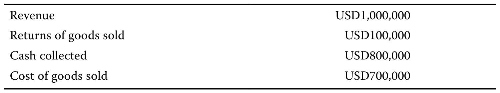

根据权责发生制会计，Fairplay的2009 利润表上报的收入净额是多少?

Under the accrual basis of accounting, how much net revenue would be reported on Fairplay’s 2009 income statement?

A. USD200,000(津巴布韦)

A. USD200,000

B. USD900,000

B. USD900,000

C. USD1,000,000

C. USD1,000,000

#### 官方答案与解析 / Official answer and explanation

2,B对

2\. B is correct.

净收入是该期间销售的商品减去任何回报和备抵后的收入，或USD1,000,000减去USD100,000=USD900,000.

Net revenue is revenue for goods sold during the period less any returns and allowances, or USD1,000,000 minus USD100,000 = USD900,000.

#### 补充解析 / Supplementary explanation

本题复核锚点（原解摘录）：净收入是该期间销售的商品减去任何回报和备抵后的收入，或USD1,000,000减去USD100,000=USD900,000.

Review anchor for this item (official excerpt): Net revenue is revenue for goods sold during the period less any returns and allowances, or USD1,000,000 minus USD100,000 = USD900,000.

本题官方选项为 B。补充思路：先判断履约义务及控制权何时转移，再决定按时点还是一段时间确认收入。主要责任人与代理人的区别影响总额或净额列报：控制商品或服务后交付给客户的主要责任人通常确认总额，代理人通常确认净佣金。总额列报会改变收入和利润率分母，但不一定改变同一交易的利润金额或现金流。

The official choice for this item is B. Additional reasoning: Identify performance obligations and when control transfers before choosing point-in-time or over-time recognition. Principal versus agent status determines gross or net presentation: a principal controls the promised good or service before transfer; an agent generally reports net fees. Gross presentation can change revenue and margin denominators without changing transaction profit or cash flow.

#### 相关知识点 / Related concepts

收入确认的经济实质：收入确认关注履约与控制，不以收到现金为唯一标准；合同资产、应收账款和合同负债分别反映不同状态。

Economic substance of revenue recognition: Recognition follows performance and control rather than cash receipt alone. Contract assets, receivables, and contract liabilities represent distinct states.

原双语文件在 USD 金额附近误加“津巴布韦”字样；USD 在此表示美元，数值及英文原文为准。 / The prior Chinese file inserts an erroneous Zimbabwe label beside USD; USD denotes US dollars here. Use the original English amount.

### FSA-LM02-PRACTICE-003 · 章末习题 3 Practice problem 3

章末练习 / Practice problem · 原版 PDF 页码 / Source PDF pages: 96, 100

#### 题目与资料 / Question and data

3\. Apex发货公司通过互联网为个人发货出售物品。

3\. Apex Consignment sells items over the internet for individuals on a consignment basis.

Apex从所有者那里收到物品，在互联网上列出出售物品，并收到25%任何出售物品的佣金。

Apex receives the items from the owner, lists them for sale on the internet, and receives a 25 percent commission for any items sold.

Apex向买方收取全部金额，并在委托后向所有人支付净金额。

Apex collects the full amount from the buyer and pays the net amount after commission to the owner.

未售出的物品在90天后归还给所有者。

Unsold items are returned to the owner after 90 days.

在2009期间，Apex拥有以下信息：

During 2009, Apex had the following information:

^ 销售收入在托运的2009期间销售的物品总价为EUR2,000,000.

■ Total sales price of items sold during 2009 on consignment was EUR2,000,000.

\*在2009期间，最高层为这些物品保留的佣金总额为EUR500,000。

■ Total commissions retained by Apex during 2009 for these items was EUR500,000.

收入的2009 利润表的顶级报告应该有多少?.

How much revenue should Apex report on its 2009 income statement?

A. EUR500,000(津巴布韦)

A. EUR500,000

B. EUR2,000,000

B. EUR2,000,000

C. EUR1,500,000

C. EUR1,500,000

#### 官方答案与解析 / Official answer and explanation

3,A没错

3\. A is correct.

Apex不是货物所有人，只应将其净佣金报告为收入。

Apex is not the owner of the goods and should only report its net commission as revenue.

#### 补充解析 / Supplementary explanation

本题复核锚点（原解摘录）：Apex不是货物所有人，只应将其净佣金报告为收入。

Review anchor for this item (official excerpt): Apex is not the owner of the goods and should only report its net commission as revenue.

本题官方选项为 A。补充思路：先判断履约义务及控制权何时转移，再决定按时点还是一段时间确认收入。主要责任人与代理人的区别影响总额或净额列报：控制商品或服务后交付给客户的主要责任人通常确认总额，代理人通常确认净佣金。总额列报会改变收入和利润率分母，但不一定改变同一交易的利润金额或现金流。

The official choice for this item is A. Additional reasoning: Identify performance obligations and when control transfers before choosing point-in-time or over-time recognition. Principal versus agent status determines gross or net presentation: a principal controls the promised good or service before transfer; an agent generally reports net fees. Gross presentation can change revenue and margin denominators without changing transaction profit or cash flow.

作为代理人通常只把赚取的佣金确认为收入；作为主要责任人则按所控制商品或服务的交易总额确认。现金是否先经过公司账户本身不足以决定总额还是净额列报。

An agent generally recognizes its commission; a principal recognizes the gross transaction amount for goods or services it controls. Cash passing through an account does not by itself determine gross versus net reporting.

#### 相关知识点 / Related concepts

收入确认的经济实质：收入确认关注履约与控制，不以收到现金为唯一标准；合同资产、应收账款和合同负债分别反映不同状态。

Economic substance of revenue recognition: Recognition follows performance and control rather than cash receipt alone. Contract assets, receivables, and contract liabilities represent distinct states.

原双语文件在 USD 金额附近误加“津巴布韦”字样；USD 在此表示美元，数值及英文原文为准。 / The prior Chinese file inserts an erroneous Zimbabwe label beside USD; USD denotes US dollars here. Use the original English amount.

### FSA-LM02-PRACTICE-004 · 章末习题 4 Practice problem 4

章末练习 / Practice problem · 原版 PDF 页码 / Source PDF pages: 96-97, 100

#### 题目与资料 / Question and data

4\. 一家公司以前是计入费用公司，其获得合同的增量成本。

4\. A company previously expensed the incremental costs of obtaining a contract.

在收入确认上采用2014年5月 国际会计准则理事会（IASB）和财务会计准则委员会（FASB） 趋同后的会计准则，使得该公司的盈利能力最初出现：

All else being equal, adopting the May 2014 IASB and FASB converged accounting standards on revenue recognition makes the company’s profitability initially appear:

A. 低点。

A. lower.

B. 不变。

B. unchanged.

C. 高点。

C. higher.

#### 官方答案与解析 / Official answer and explanation

4\. C 正确。

4\. C is correct.

根据趋同后的会计准则，取得合同的增量成本以及履行合同发生的某些成本必须资本化。

Under the converged accounting standards, the incremental costs of obtaining a contract and certain costs incurred to fulfill a contract must be capitalized.

如果公司在采用这些准则之前将上述增量成本直接计入费用，则在其他条件不变的情况下，采用趋同后的准则会使其盈利能力看起来更高。

If a company expensed these incremental costs in the years prior to adopting the converged standards, all else being equal, its profitability will appear higher under the converged standards.

#### 补充解析 / Supplementary explanation

本题复核锚点（原解摘录）：根据趋同后的会计准则，取得合同的增量成本以及履行合同发生的某些成本必须资本化。

Review anchor for this item (official excerpt): Under the converged accounting standards, the incremental costs of obtaining a contract and certain costs incurred to fulfill a contract must be capitalized.

本题官方选项为 C。补充思路：先判断履约义务及控制权何时转移，再决定按时点还是一段时间确认收入。主要责任人与代理人的区别影响总额或净额列报：控制商品或服务后交付给客户的主要责任人通常确认总额，代理人通常确认净佣金。总额列报会改变收入和利润率分母，但不一定改变同一交易的利润金额或现金流。

The official choice for this item is C. Additional reasoning: Identify performance obligations and when control transfers before choosing point-in-time or over-time recognition. Principal versus agent status determines gross or net presentation: a principal controls the promised good or service before transfer; an agent generally reports net fees. Gross presentation can change revenue and margin denominators without changing transaction profit or cash flow.

作为代理人通常只把赚取的佣金确认为收入；作为主要责任人则按所控制商品或服务的交易总额确认。现金是否先经过公司账户本身不足以决定总额还是净额列报。

An agent generally recognizes its commission; a principal recognizes the gross transaction amount for goods or services it controls. Cash passing through an account does not by itself determine gross versus net reporting.

#### 相关知识点 / Related concepts

收入确认的经济实质：收入确认关注履约与控制，不以收到现金为唯一标准；合同资产、应收账款和合同负债分别反映不同状态。

Economic substance of revenue recognition: Recognition follows performance and control rather than cash receipt alone. Contract assets, receivables, and contract liabilities represent distinct states.

### FSA-LM02-PRACTICE-005 · 章末习题 5 Practice problem 5

章末练习 / Practice problem · 原版 PDF 页码 / Source PDF pages: 97, 100

#### 题目与资料 / Question and data

5.在国际财务报告准则（IFRS）下，火灾中财产损失很可能被归类为：

5\. Under IFRS, a loss from the destruction of property in a fire would most likely be classified as:

A. 继续作业。

A. continuing operations.

B. 终止经营

B. discontinued operations.

C. 其他综合收益

C. other comprehensive income.

#### 官方答案与解析 / Official answer and explanation

5,A没错

5\. A is correct.

火灾可能不多发生，但仍属于继续作业的一部分，并在损益表中加以报告。

A fire may be infrequent, but it would still be part of continuing operations and reported in the profit and loss statement.

终止经营涉及处置一个业务部门的决定。

Discontinued operations relate to a decision to dispose of an operating division.

#### 补充解析 / Supplementary explanation

本题复核锚点（原解摘录）：火灾可能不多发生，但仍属于继续作业的一部分，并在损益表中加以报告。

Review anchor for this item (official excerpt): A fire may be infrequent, but it would still be part of continuing operations and reported in the profit and loss statement.

本题官方选项为 A。补充思路：预测未来盈利时，要区分持续经营利润、终止经营以及异常或低频项目。共同比利润表以收入为分母，便于发现成本结构和战略差异，但规模标准化并不消除行业或会计政策差异。其他综合收益与当期净利润的列报位置不同，分析权益变化时两者都可能相关。

The official choice for this item is A. Additional reasoning: Forecasting requires separating continuing operations, discontinued operations, and unusual or infrequent items. Common-size income statements scale by revenue to expose cost-structure differences, but do not eliminate industry or policy differences. Other comprehensive income is presented outside net income yet can matter when analyzing equity changes.

#### 相关知识点 / Related concepts

利润可持续性与共同比分析：毛利率、营业利润率与净利率覆盖的费用层次不同；持续性判断不能仅凭某项被管理层称为“一次性”。

Earnings persistence and common-size analysis: Gross, operating, and net margins include different cost layers. Persistence should not be judged solely from management’s “one-time” label.

### FSA-LM02-PRACTICE-006 · 章末习题 6 Practice problem 6

章末练习 / Practice problem · 原版 PDF 页码 / Source PDF pages: 97, 100

#### 题目与资料 / Question and data

6\. 公司选择变更会计政策。

6\. A company chooses to change an accounting policy.

这一改变要求，如果可行，公司必须重述其财务报表，用于：

This change requires that, if practical, the company restate its financial statements for:

A. 以往所有期间。

A. all prior periods.

B. 本期和以后各期。

B. current and future periods.

C. 报告所述以前各期间的情况。

C. prior periods shown in a report.

#### 官方答案与解析 / Official answer and explanation

6,C号正确

6\. C is correct.

如果公司改变会计政策，则如果切合实际，则列报公司财务报告中所示所有财政年度的财务报表，仿佛在整个期间采用了新采用的会计政策；这种对改变的追溯性应用使以往任何年度的财务结果在报告内具有可比性。

If a company changes an accounting policy, the financial statements for all fiscal years shown in a company’s financial report are presented, if practical, as if the newly adopted accounting policy had been used throughout the entire period; this retrospective application of the change makes the financial results of any prior years included in the report comparable.

财务报表的说明描述了这一变化，并解释了这一变化的理由。

Notes to the financial statements describe the change and explain the justification for the change.

#### 补充解析 / Supplementary explanation

本题复核锚点（原解摘录）：如果公司改变会计政策，则如果切合实际，则列报公司财务报告中所示所有财政年度的财务报表，仿佛在整个期间采用了新采用的会计政策；这种对改变的追溯性应用使以往任何年度的财务结果在报告内具有可比性。

Review anchor for this item (official excerpt): If a company changes an accounting policy, the financial statements for all fiscal years shown in a company’s financial report are presented, if practical, as if the newly adopted accounting policy had been used throughout the entire period; this retrospective application of the change makes the financial results of any prior years included in the report comparable.

本题官方选项为 C。补充思路：收益是导致权益增加的经济利益增加，但所有者投入不属于收益。会计政策变更通常追溯调整可比期间，估计变更则影响当期和未来；这是两种不同处理。读题时先识别所改变的是计量政策、估计参数还是差错，再确定涉及的报告期间，不能把“以前全部年份”与“报告展示的可比年份”混同。

The official choice for this item is C. Additional reasoning: Income increases economic benefits and equity but excludes owner contributions. Accounting policy changes generally restate comparable prior periods; estimate changes affect current and future periods. Identify whether the issue is a policy, estimate, or error before determining the periods affected. All past years and comparative years presented are not equivalent.

#### 相关知识点 / Related concepts

收益定义与会计变更：资产−负债＝权益；权益变化还可能来自所有者交易。政策变化重在可比性，估计变化使用新获得的信息。

Income definitions and accounting changes: Assets − liabilities = equity, but equity also changes through owner transactions. Policy changes focus on comparability; estimate revisions reflect new information.

### FSA-LM02-PRACTICE-007 · 章末习题 7 Practice problem 7

章末练习 / Practice problem · 原版 PDF 页码 / Source PDF pages: 97, 100

#### 题目与资料 / Question and data

7.对于2009，火烈鸟产品拥有USD1,000,000的净利润。

7\. For 2009, Flamingo Products had net income of USD1,000,000.

在2009年1月1日时，有1,000,000 流通在外股份。

At 1 January 2009, there were 1,000,000 shares outstanding.

在2009年7月1日上，公司发行了100,000新股，每股USD20.

On 1 July 2009, the company issued 100,000 new shares for USD20 per share.

公司向普通的股东支付了股利的USD200,000.

The company paid USD200,000 in dividends to common shareholders.

2009的火烈鸟基本每股收益是什么?

What is Flamingo’s basic earnings per share for 2009?

A. USD0.80(津巴布韦)

A. USD0.80

B. USD0.91

B. USD0.91

C. USD0.95

C. USD0.95

#### 官方答案与解析 / Official answer and explanation

7,C号正确

7\. C is correct.

2009年流通在外股份的加权平均股数为1,050,000股。

The weighted average number of shares outstanding for 2009 is 1,050,000.

基本每股收益将USD1,000,000除以1,050,000，或USD0.95.

Basic earnings per share would be USD1,000,000 divided by 1,050,000, or USD0.95.

#### 补充解析 / Supplementary explanation

本题复核锚点（原解摘录）：2009年流通在外股份的加权平均股数为1,050,000股。

Review anchor for this item (official excerpt): The weighted average number of shares outstanding for 2009 is 1,050,000.

本题官方选项为 C。补充思路：基本 EPS 用归属于普通股股东的净利润除以加权平均普通股数，优先股股利须先扣除。可转债假设转换时，分母增加转换股数，分子加回税后利息；可转优先股转换时加回股利。期权采用库存股法，只增加“发行股数减可回购股数”的净额。任何会使 EPS 上升的工具是反稀释工具，不能纳入稀释 EPS。

The official choice for this item is C. Additional reasoning: Basic EPS divides income available to common shareholders by weighted-average common shares, after preferred dividends. Assumed debt conversion adds shares and after-tax interest; preferred conversion adds back dividends. Treasury-stock treatment of options adds only net shares after hypothetical repurchase. Instruments that raise EPS are antidilutive and are excluded.

#### 相关知识点 / Related concepts

基本与稀释每股收益：基本 EPS＝(净利润−优先股股利)/加权平均普通股；期权增量股数＝N×(1−行权价/平均市价)，仅在满足稀释条件时使用。

Basic and diluted earnings per share: Basic EPS = (net income − preferred dividends)/weighted-average common shares. Incremental option shares = N × (1−exercise price/average market price), subject to dilution tests.

原双语文件在 USD 金额附近误加“津巴布韦”字样；USD 在此表示美元，数值及英文原文为准。 / The prior Chinese file inserts an erroneous Zimbabwe label beside USD; USD denotes US dollars here. Use the original English amount.

### FSA-LM02-PRACTICE-008 · 章末习题 8 Practice problem 8

章末练习 / Practice problem · 原版 PDF 页码 / Source PDF pages: 97, 100

#### 题目与资料 / Question and data

8.本会计年度内无债务或可兑换的证券公司三次公开交易普通股发行。

8\. A company with no debt or convertible securities issued publicly traded common stock three times during the current fiscal year.

该公司在国际财务报告准则（IFRS）和美国公认会计原则（US GAAP）之下：

Under both IFRS and US GAAP, the company’s:

A. 基本每股收益等于稀释每股收益。

A. basic EPS equals its diluted EPS.

B. 资本结构在年底被认为是复杂的。

B. capital structure is considered complex at year-end.

C. 基本每股收益（EPS）是通过使用一个简单的平均值流通在外股份计算出来的。

C. basic EPS is calculated by using a simple average number of shares outstanding.

#### 官方答案与解析 / Official answer and explanation

8,A没错

8\. A is correct.

基本每股收益与稀释每股收益（EPS）对于一个资本结构简单的公司来说是平等的。

Basic and diluted EPS are equal for a company with a simple capital structure.

一家仅发行普通股，无金融工具，有可能可兑换成普通股的公司拥有简单的资本结构。

A company that issues only common stock, with no financial instruments that are potentially convertible into common stock has a simple capital structure.

基本每股收益（EPS）使用加权平均编号流通在外股份计算。

Basic EPS is calculated using the weighted average number of shares outstanding.

#### 补充解析 / Supplementary explanation

本题复核锚点（原解摘录）：基本每股收益与稀释每股收益（EPS）对于一个资本结构简单的公司来说是平等的。

Review anchor for this item (official excerpt): Basic and diluted EPS are equal for a company with a simple capital structure.

本题官方选项为 A。补充思路：基本 EPS 用归属于普通股股东的净利润除以加权平均普通股数，优先股股利须先扣除。可转债假设转换时，分母增加转换股数，分子加回税后利息；可转优先股转换时加回股利。期权采用库存股法，只增加“发行股数减可回购股数”的净额。任何会使 EPS 上升的工具是反稀释工具，不能纳入稀释 EPS。

The official choice for this item is A. Additional reasoning: Basic EPS divides income available to common shareholders by weighted-average common shares, after preferred dividends. Assumed debt conversion adds shares and after-tax interest; preferred conversion adds back dividends. Treasury-stock treatment of options adds only net shares after hypothetical repurchase. Instruments that raise EPS are antidilutive and are excluded.

#### 相关知识点 / Related concepts

基本与稀释每股收益：基本 EPS＝(净利润−优先股股利)/加权平均普通股；期权增量股数＝N×(1−行权价/平均市价)，仅在满足稀释条件时使用。

Basic and diluted earnings per share: Basic EPS = (net income − preferred dividends)/weighted-average common shares. Incremental option shares = N × (1−exercise price/average market price), subject to dilution tests.

### FSA-LM02-PRACTICE-009 · 章末习题 9 Practice problem 9

章末练习 / Practice problem · 原版 PDF 页码 / Source PDF pages: 97, 100

#### 题目与资料 / Question and data

9\. Sublyme公司在财政年度终了时报告净利润为USD200 百万，加权平均为50,000,000为流通在外普通股。

9\. For its fiscal year-end, Sublyme Corporation reported net income of USD200 million and a weighted average of 50,000,000 common shares outstanding.

有一些2,000,000 可转换优先股 流通在外股份每年支付USD5的红利。

There are 2,000,000 convertible preferred shares outstanding that paid an annual dividend of USD5.

每个首选股可兑换成普通股的两股。

Each preferred share is convertible into two shares of the common stock.

稀释每股收益（EPS）最接近：

The diluted EPS is closest to:

A. USD3.52(津巴布韦)

A. USD3.52

B. USD3.65

B. USD3.65

C. USD3.70

C. USD3.70

#### 官方答案与解析 / Official answer and explanation

9,C号正确

9\. C is correct.

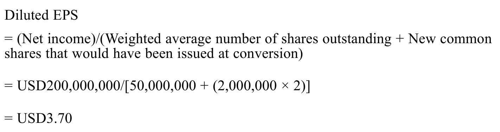

稀释每股收益（EPS）假设优先股未支付，且股权在期初转换。

The diluted EPS assumes that the preferred dividend is not paid and that the shares are converted at the beginning of the period.

#### 补充解析 / Supplementary explanation

本题复核锚点（原解摘录）：稀释每股收益（EPS）假设优先股未支付，且股权在期初转换。

Review anchor for this item (official excerpt): The diluted EPS assumes that the preferred dividend is not paid and that the shares are converted at the beginning of the period.

本题官方选项为 C。补充思路：基本 EPS 用归属于普通股股东的净利润除以加权平均普通股数，优先股股利须先扣除。可转债假设转换时，分母增加转换股数，分子加回税后利息；可转优先股转换时加回股利。期权采用库存股法，只增加“发行股数减可回购股数”的净额。任何会使 EPS 上升的工具是反稀释工具，不能纳入稀释 EPS。

The official choice for this item is C. Additional reasoning: Basic EPS divides income available to common shareholders by weighted-average common shares, after preferred dividends. Assumed debt conversion adds shares and after-tax interest; preferred conversion adds back dividends. Treasury-stock treatment of options adds only net shares after hypothetical repurchase. Instruments that raise EPS are antidilutive and are excluded.

#### 相关知识点 / Related concepts

基本与稀释每股收益：基本 EPS＝(净利润−优先股股利)/加权平均普通股；期权增量股数＝N×(1−行权价/平均市价)，仅在满足稀释条件时使用。

Basic and diluted earnings per share: Basic EPS = (net income − preferred dividends)/weighted-average common shares. Incremental option shares = N × (1−exercise price/average market price), subject to dilution tests.

原双语文件在 USD 金额附近误加“津巴布韦”字样；USD 在此表示美元，数值及英文原文为准。 / The prior Chinese file inserts an erroneous Zimbabwe label beside USD; USD denotes US dollars here. Use the original English amount.

### FSA-LM02-PRACTICE-010 · 章末习题 10 Practice problem 10

章末练习 / Practice problem · 原版 PDF 页码 / Source PDF pages: 97-98, 100-101

#### 题目与资料 / Question and data

10\. 卡尔万水利公司(CWC)在财政年度末报告净利润为USD12 百万，加权平均为2,000,000为流通在外普通股。

10\. For its fiscal year-end, Calvan Water Corporation (CWC) reported net income of USD12 million and a weighted average of 2,000,000 common shares outstanding.

公司以首选的股利支付USD800,000，并有100,000的期权未完成，平均行权价为USD20.

The company paid USD800,000 in preferred dividends and had 100,000 options outstanding with an average exercise price of USD20.

CWC全年的市场价格平均为每股USD25.

CWC’s market price over the year averaged USD25 per share.

CWC的稀释每股收益（EPS）最接近：

CWC’s diluted EPS is closest to:

A. USD5.33(津巴布韦)

A. USD5.33

B. USD5.54

B. USD5.54

C. USD5.94

C. USD5.94

#### 官方答案与解析 / Official answer and explanation

10,B对

10\. B is correct.

计算稀释每股收益（EPS）的公式如下：

The formula to calculate diluted EPS is as follows:

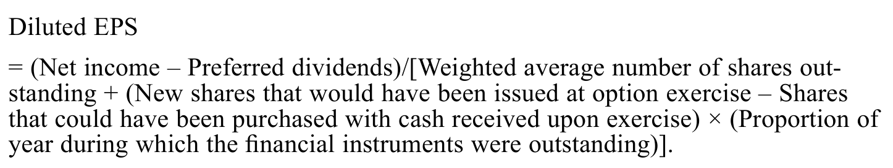

基本假设是，未结期权被行使，然后发行新股的收益被用于回购已经到期的股票：

The underlying assumption is that outstanding options are exercised, and then the proceeds from the issuance of new shares are used to repurchase shares already outstanding:

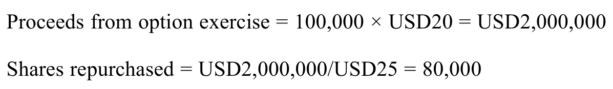

因此，流通在外股份的净增加额是(1)以下的计算。

The net increase in shares outstanding is thus the calculation shown below (1).

因此，CWC的稀释每股收益（EPS） = (2)以下的计算。

Therefore, the diluted EPS for CWC = the calculation shown below (2).

\(1\) 100,000 – 80,000 = 20,000(2) (USD12,000,000 – USD800,000)/2,020,000 = USD5.54

#### 补充解析 / Supplementary explanation

本题复核锚点（原解摘录）：计算稀释每股收益（EPS）的公式如下：

Review anchor for this item (official excerpt): The formula to calculate diluted EPS is as follows:

本题官方选项为 B。补充思路：基本 EPS 用归属于普通股股东的净利润除以加权平均普通股数，优先股股利须先扣除。可转债假设转换时，分母增加转换股数，分子加回税后利息；可转优先股转换时加回股利。期权采用库存股法，只增加“发行股数减可回购股数”的净额。任何会使 EPS 上升的工具是反稀释工具，不能纳入稀释 EPS。

The official choice for this item is B. Additional reasoning: Basic EPS divides income available to common shareholders by weighted-average common shares, after preferred dividends. Assumed debt conversion adds shares and after-tax interest; preferred conversion adds back dividends. Treasury-stock treatment of options adds only net shares after hypothetical repurchase. Instruments that raise EPS are antidilutive and are excluded.

库存股法假设行权收入用于按平均市价回购股票，因此分母只增加净发行股数。若行权价不低于平均市价，一般不会产生应纳入的稀释增量。

The treasury-stock method assumes exercise proceeds repurchase shares at the average market price, so only net new shares enter the denominator. An exercise price at or above market generally creates no includable dilution.

#### 相关知识点 / Related concepts

基本与稀释每股收益：基本 EPS＝(净利润−优先股股利)/加权平均普通股；期权增量股数＝N×(1−行权价/平均市价)，仅在满足稀释条件时使用。

Basic and diluted earnings per share: Basic EPS = (net income − preferred dividends)/weighted-average common shares. Incremental option shares = N × (1−exercise price/average market price), subject to dilution tests.

原双语文件在 USD 金额附近误加“津巴布韦”字样；USD 在此表示美元，数值及英文原文为准。 / The prior Chinese file inserts an erroneous Zimbabwe label beside USD; USD denotes US dollars here. Use the original English amount.

### FSA-LM02-PRACTICE-011 · 章末习题 11 Practice problem 11

章末练习 / Practice problem · 原版 PDF 页码 / Source PDF pages: 98, 101

#### 题目与资料 / Question and data

11\. Laurelli Builders（LB）报告的截至12月31日年末财务数据如图表1所示：

11\. Laurelli Builders (LB) reported the financial data shown in Exhibit 1 for year-end 31 December:

图表1:劳蕾尔利建筑师

Exhibit 1: Laurelli Builders

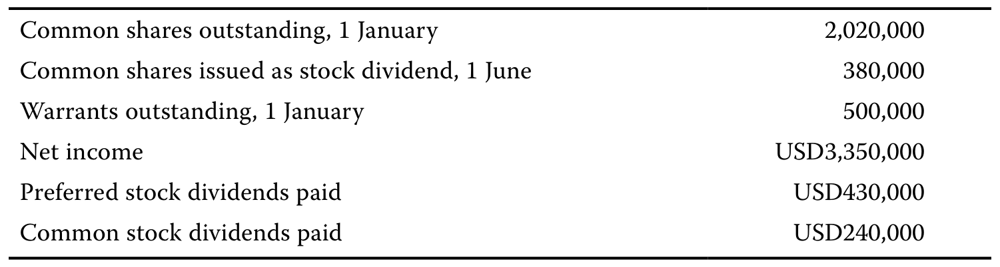

关于LB的每股收益（EPS）的计算，哪一种声明是最准确的?

Which statement about the calculation of LB’s EPS is most accurate?

A. LB的基本每股收益（EPS）为USD1.12.

A. LB’s basic EPS is USD1.12.

B. LB的稀释每股收益（EPS）等于或小于其基本每股收益（EPS）.

B. LB’s diluted EPS is equal to or less than its basic EPS.

C. 加权平均的流通在外股份编号为2,210,000.

C. The weighted average number of shares outstanding is 2,210,000.

#### 官方答案与解析 / Official answer and explanation

11,B对

11\. B is correct.

LB在资本结构中拥有认股权证；如果该年的行权价低于加权平均市场价格，其转换的效果是增加加权平均的流通在外普通股数量，导致稀释每股收益（EPS）低于基本每股收益（EPS）.

LB has warrants in its capital structure; if the exercise price is less than the weighted average market price during the year, the effect of their conversion is to increase the weighted average number of common shares outstanding, causing diluted EPS to be lower than basic EPS.

如果行权价等于加权平均市场价格，则发行的股份数等于回购的股份数。

If the exercise price is equal to the weighted average market price, the number of shares issued equals the number of shares repurchased.

因此，加权平均编号的流通在外普通股不受影响，稀释每股收益（EPS）等于基本每股收益（EPS）.

Therefore, the weighted average number of common shares outstanding is not affected and diluted EPS equals basic EPS.

如果行权价大于加权平均市场价格，其转换的效果是反稀释的。

If the exercise price is greater than the weighted average market price, the effect of their conversion is anti-dilutive.

因此，它们没有包括在基本每股收益（EPS）的计算中。

As such, they are not included in the calculation of basic EPS.

LB的基本每股收益（EPS）是(1)以下的计算。

LB’s basic EPS is the calculation shown below (1).

股利股票被视为追溯至该期间开始时发行。

Stock dividends are treated as having been issued retroactively to the beginning of the period.

\(1\) USD1.22 \[= (USD3,350,000 – USD430,000)/2,400,000\]

#### 补充解析 / Supplementary explanation

本题复核锚点（原解摘录）：LB在资本结构中拥有认股权证；如果该年的行权价低于加权平均市场价格，其转换的效果是增加加权平均的流通在外普通股数量，导致稀释每股收益（EPS）低于基本每股收益（EPS）.

Review anchor for this item (official excerpt): LB has warrants in its capital structure; if the exercise price is less than the weighted average market price during the year, the effect of their conversion is to increase the weighted average number of common shares outstanding, causing diluted EPS to be lower than basic EPS.

本题官方选项为 B。补充思路：基本 EPS 用归属于普通股股东的净利润除以加权平均普通股数，优先股股利须先扣除。可转债假设转换时，分母增加转换股数，分子加回税后利息；可转优先股转换时加回股利。期权采用库存股法，只增加“发行股数减可回购股数”的净额。任何会使 EPS 上升的工具是反稀释工具，不能纳入稀释 EPS。

The official choice for this item is B. Additional reasoning: Basic EPS divides income available to common shareholders by weighted-average common shares, after preferred dividends. Assumed debt conversion adds shares and after-tax interest; preferred conversion adds back dividends. Treasury-stock treatment of options adds only net shares after hypothetical repurchase. Instruments that raise EPS are antidilutive and are excluded.

库存股法假设行权收入用于按平均市价回购股票，因此分母只增加净发行股数。若行权价不低于平均市价，一般不会产生应纳入的稀释增量。

The treasury-stock method assumes exercise proceeds repurchase shares at the average market price, so only net new shares enter the denominator. An exercise price at or above market generally creates no includable dilution.

#### 相关知识点 / Related concepts

基本与稀释每股收益：基本 EPS＝(净利润−优先股股利)/加权平均普通股；期权增量股数＝N×(1−行权价/平均市价)，仅在满足稀释条件时使用。

Basic and diluted earnings per share: Basic EPS = (net income − preferred dividends)/weighted-average common shares. Incremental option shares = N × (1−exercise price/average market price), subject to dilution tests.

### FSA-LM02-PRACTICE-012 · 章末习题 12 Practice problem 12

章末练习 / Practice problem · 原版 PDF 页码 / Source PDF pages: 98, 101

#### 题目与资料 / Question and data

12\. Cell Services Inc. (CSI)在2009的全部时间里平均拥有1,000,000的流通在外股份。

12\. Cell Services Inc. (CSI) had 1,000,000 average shares outstanding during all of 2009.

在2009期间，CSI还存在10,000期权未结，锻造价格各为USD10.

During 2009, CSI also had 10,000 options outstanding with exercise prices of USD10 each.

2009期间CSI的平均股价为USD15.

The average stock price of CSI during 2009 was USD15.

为了计算稀释每股收益，分母中会使用多少股份?

For purposes of computing diluted earnings per share, how many shares would be used in the denominator?

A. 1,003,333

B. 1,006,667

C. 1,010,000

#### 官方答案与解析 / Official answer and explanation

12,A没错

12\. A is correct.

与股票期权，必须使用库存股法。

With stock options, the treasury stock method must be used.

根据这一方法，该公司将获得(1)以下的计算，并将回购(2)以下的计算。

Under that method, the company would receive the calculation shown below (1) and would repurchase the calculation shown below (2).

分母的份额是：

The shares for the denominator would be:

\(1\) USD100,000 (10,000 × USD10)(2) 6,667 shares (USD100,000/USD15) 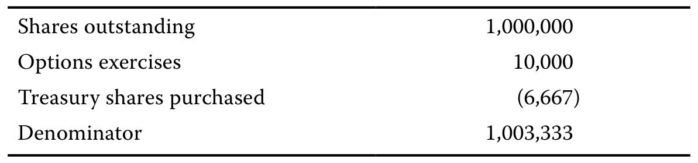

#### 补充解析 / Supplementary explanation

本题复核锚点（原解摘录）：与股票期权，必须使用库存股法。

Review anchor for this item (official excerpt): With stock options, the treasury stock method must be used.

本题官方选项为 A。补充思路：基本 EPS 用归属于普通股股东的净利润除以加权平均普通股数，优先股股利须先扣除。可转债假设转换时，分母增加转换股数，分子加回税后利息；可转优先股转换时加回股利。期权采用库存股法，只增加“发行股数减可回购股数”的净额。任何会使 EPS 上升的工具是反稀释工具，不能纳入稀释 EPS。

The official choice for this item is A. Additional reasoning: Basic EPS divides income available to common shareholders by weighted-average common shares, after preferred dividends. Assumed debt conversion adds shares and after-tax interest; preferred conversion adds back dividends. Treasury-stock treatment of options adds only net shares after hypothetical repurchase. Instruments that raise EPS are antidilutive and are excluded.

库存股法假设行权收入用于按平均市价回购股票，因此分母只增加净发行股数。若行权价不低于平均市价，一般不会产生应纳入的稀释增量。

The treasury-stock method assumes exercise proceeds repurchase shares at the average market price, so only net new shares enter the denominator. An exercise price at or above market generally creates no includable dilution.

#### 相关知识点 / Related concepts

基本与稀释每股收益：基本 EPS＝(净利润−优先股股利)/加权平均普通股；期权增量股数＝N×(1−行权价/平均市价)，仅在满足稀释条件时使用。

Basic and diluted earnings per share: Basic EPS = (net income − preferred dividends)/weighted-average common shares. Incremental option shares = N × (1−exercise price/average market price), subject to dilution tests.

### FSA-LM02-PRACTICE-013 · 章末习题 13 Practice problem 13

章末练习 / Practice problem · 原版 PDF 页码 / Source PDF pages: 98, 101

#### 题目与资料 / Question and data

13\. 计算稀释每股收益（EPS）时，首都结构中后面的证券中哪一个增加加权平均的流通在外普通股编号，而不影响常见的股东可用的净利润?

13\. When calculating diluted EPS, which of the following securities in the capital structure increases the weighted average number of common shares outstanding without affecting net income available to common shareholders?

A. 股票期权(美国)

A. Stock options

B. 可转换债务，即具有稀释作用的

B. Convertible debt that is dilutive

C. 可转换优先股，即具有稀释作用的

C. Convertible preferred stock that is dilutive

#### 官方答案与解析 / Official answer and explanation

13,A没错

13\. A is correct.

当一家公司有股票期权未兑付时，稀释每股收益（EPS）被计算为已经行使了金融工具，且该公司在此期间利用该演练所得收益以加权平均的市场价格以普通股回购尽可能多的股份。

When a company has stock options outstanding, diluted EPS is calculated as if the financial instruments had been exercised and the company had used the proceeds from the exercise to repurchase as many shares possible at the weighted average market price of common stock during the period.

因此，股票期权的转换增加了流通在外普通股的数量，但对常见的股东可用的净利润没有影响。

As a result, the conversion of stock options increases the number of common shares outstanding but has no effect on net income available to common shareholders.

可转换债务的转换将净利润提供给普通股东的税后金额增加为保存的利息费用。

The conversion of convertible debt increases the net income available to common shareholders by the after-tax amount of interest expense saved.

可转换优先股股份的转换将通用的净利润增加为通用的股东的首选股利支付金额；数字变为净利润。

The conversion of convertible preferred shares increases the net income available to common shareholders by the amount of preferred dividends paid; the numerator becomes the net income.

#### 补充解析 / Supplementary explanation

本题复核锚点（原解摘录）：当一家公司有股票期权未兑付时，稀释每股收益（EPS）被计算为已经行使了金融工具，且该公司在此期间利用该演练所得收益以加权平均的市场价格以普通股回购尽可能多的股份。

Review anchor for this item (official excerpt): When a company has stock options outstanding, diluted EPS is calculated as if the financial instruments had been exercised and the company had used the proceeds from the exercise to repurchase as many shares possible at the weighted average market price of common stock during the period.

本题官方选项为 A。补充思路：基本 EPS 用归属于普通股股东的净利润除以加权平均普通股数，优先股股利须先扣除。可转债假设转换时，分母增加转换股数，分子加回税后利息；可转优先股转换时加回股利。期权采用库存股法，只增加“发行股数减可回购股数”的净额。任何会使 EPS 上升的工具是反稀释工具，不能纳入稀释 EPS。

The official choice for this item is A. Additional reasoning: Basic EPS divides income available to common shareholders by weighted-average common shares, after preferred dividends. Assumed debt conversion adds shares and after-tax interest; preferred conversion adds back dividends. Treasury-stock treatment of options adds only net shares after hypothetical repurchase. Instruments that raise EPS are antidilutive and are excluded.

库存股法假设行权收入用于按平均市价回购股票，因此分母只增加净发行股数。若行权价不低于平均市价，一般不会产生应纳入的稀释增量。

The treasury-stock method assumes exercise proceeds repurchase shares at the average market price, so only net new shares enter the denominator. An exercise price at or above market generally creates no includable dilution.

#### 相关知识点 / Related concepts

基本与稀释每股收益：基本 EPS＝(净利润−优先股股利)/加权平均普通股；期权增量股数＝N×(1−行权价/平均市价)，仅在满足稀释条件时使用。

Basic and diluted earnings per share: Basic EPS = (net income − preferred dividends)/weighted-average common shares. Incremental option shares = N × (1−exercise price/average market price), subject to dilution tests.

### FSA-LM02-PRACTICE-014 · 章末习题 14 Practice problem 14

章末练习 / Practice problem · 原版 PDF 页码 / Source PDF pages: 98-99, 101-102

#### 题目与资料 / Question and data

14 哪个语句最准确?

14\. Which statement is most accurate?

一个共同比 利润表：

A common size income statement:

A. 将利润表的每行项目重报为净利润的百分比。

A. restates each line item of the income statement as a percentage of net income.

B. 允许分析师通过去除公司规模的影响来进行横截面分析。

B. allows an analyst to conduct cross-sectional analysis by removing the effect of company size.

C. 将利润表的每个细列项目标准化，但未能帮助分析员查明公司战略的差异。

C. standardizes each line item of the income statement but fails to help an analyst identify differences in companies’ strategies.

#### 官方答案与解析 / Official answer and explanation

14,B对

14\. B is correct.

共同比收益表通过将利润表的每个细列项目表示为收入的百分比，便于跨时间段(时间序列分析)和跨公司(横截面分析)的比较。

Common size income statements facilitate comparison across time periods (time-series analysis) and across companies (cross-sectional analysis) by stating each line item of the income statement as a percentage of revenue.

不同公司的相对业绩可以更容易地评估，因为缩放数字可以消除规模的影响。

The relative performance of different companies can be more easily assessed because scaling the numbers removes the effect of size.

一种共同比 利润表表示利润表上的每个线项，以收入的百分比表示。

A common size income statement states each line item on the income statement as a percentage of revenue.

每一行项的标准化使得共同比 利润表对查明公司战略的不同有用。

The standardization of each line item makes a common size income statement useful for identifying differences in companies’ strategies.

#### 补充解析 / Supplementary explanation

本题复核锚点（原解摘录）：共同比收益表通过将利润表的每个细列项目表示为收入的百分比，便于跨时间段(时间序列分析)和跨公司(横截面分析)的比较。

Review anchor for this item (official excerpt): Common size income statements facilitate comparison across time periods (time-series analysis) and across companies (cross-sectional analysis) by stating each line item of the income statement as a percentage of revenue.

本题官方选项为 B。补充思路：预测未来盈利时，要区分持续经营利润、终止经营以及异常或低频项目。共同比利润表以收入为分母，便于发现成本结构和战略差异，但规模标准化并不消除行业或会计政策差异。其他综合收益与当期净利润的列报位置不同，分析权益变化时两者都可能相关。

The official choice for this item is B. Additional reasoning: Forecasting requires separating continuing operations, discontinued operations, and unusual or infrequent items. Common-size income statements scale by revenue to expose cost-structure differences, but do not eliminate industry or policy differences. Other comprehensive income is presented outside net income yet can matter when analyzing equity changes.

#### 相关知识点 / Related concepts

利润可持续性与共同比分析：毛利率、营业利润率与净利率覆盖的费用层次不同；持续性判断不能仅凭某项被管理层称为“一次性”。

Earnings persistence and common-size analysis: Gross, operating, and net margins include different cost layers. Persistence should not be judged solely from management’s “one-time” label.

## LM 3 · 分析资产负债表 Analyzing Balance Sheets 16 条目 · 原题与解析逐条对应 / Paired source questions and explanations

### FSA-LM03-WORKED_CASE-001 · 跨区 共同比分析 Cross-Sectional Common-Size Analysis

正文讲解案例 / Narrated worked case · 原版 PDF 页码 / Source PDF pages: 122

#### 题目与资料 / Question and data

示例 1

EXAMPLE 1

跨区 共同比分析

Cross-Sectional Common-Size Analysis

#### 官方答案与解析 / Official answer and explanation

Jason Lu正在比较计算机行业的两家公司，以评估其资产负债表中反映的相对财务状况。

Jason Lu is comparing two companies in the computer industry to evaluate their relative financial position as reflected on their balance sheets.

他整理了苹果公司与微软公司的以下纵向共同比数据，列示于图表12。

He has compiled the following vertical common-size data for Apple and Microsoft, which is presented in Exhibit 12.

图表12:横截面分析：综合平衡表(占资产总数的百分比)

Exhibit 12: Cross-Sectional Analysis: Consolidated Balance Sheets (as percent of total assets)

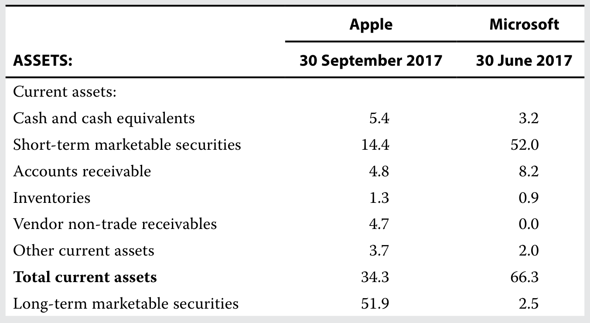

#### 补充解析 / Supplementary explanation

本题复核锚点（原解摘录）：Jason Lu正在比较计算机行业的两家公司，以评估其资产负债表中反映的相对财务状况。

Review anchor for this item (official excerpt): Jason Lu is comparing two companies in the computer industry to evaluate their relative financial position as reflected on their balance sheets.

补充思路：流动分类反映预计变现、消耗或清偿的时间与经营周期，但“流动资产”并不代表所有项目都同样容易变现。现金与可交易证券通常比应收和存货更接近即时支付能力。比较流动比率时，进一步检查资产组成、坏账准备、存货减值与近期负债到期安排。资本结构的偿债能力是另一层长期问题。

Additional reasoning: Current classification reflects timing and the operating cycle, but current assets are not equally liquid. Cash and marketable securities generally provide more immediate payment capacity than receivables or inventory. Compare composition, allowances, write-downs, and maturities alongside liquidity ratios. Long-term solvency is a separate capital-structure issue.

#### 相关知识点 / Related concepts

资产负债表结构与流动性：流动比率、速动比率与现金比率分子依次收窄；负债期限与资产转换周期应匹配。

Balance-sheet structure and liquidity: Current, quick, and cash ratios use progressively narrower numerators. Liability maturity should be matched to asset-conversion timing.

原教材为连贯讲解型案例，没有独立设问及答案分栏；保留官方案例与演示，未另造题目。

### FSA-LM03-PRACTICE-001 · 章末习题 1 Practice problem 1

章末练习 / Practice problem · 原版 PDF 页码 / Source PDF pages: 129, 133

#### 题目与资料 / Question and data

1.除下列情况外，所有情况均为流动资产：

1\. All of the following are current assets except:

A. 现金。

A. cash.

B. 商誉

B. goodwill.

C. 存货

C. inventories.

#### 官方答案与解析 / Official answer and explanation

1,B对

1\. B is correct.

商誉是长期资产，现金和存货是流动资产。

Goodwill is a long-term asset, and cash and inventories are current assets.

#### 补充解析 / Supplementary explanation

本题复核锚点（原解摘录）：商誉是长期资产，现金和存货是流动资产。

Review anchor for this item (official excerpt): Goodwill is a long-term asset, and cash and inventories are current assets.

本题官方选项为 B。补充思路：流动分类反映预计变现、消耗或清偿的时间与经营周期，但“流动资产”并不代表所有项目都同样容易变现。现金与可交易证券通常比应收和存货更接近即时支付能力。比较流动比率时，进一步检查资产组成、坏账准备、存货减值与近期负债到期安排。资本结构的偿债能力是另一层长期问题。

The official choice for this item is B. Additional reasoning: Current classification reflects timing and the operating cycle, but current assets are not equally liquid. Cash and marketable securities generally provide more immediate payment capacity than receivables or inventory. Compare composition, allowances, write-downs, and maturities alongside liquidity ratios. Long-term solvency is a separate capital-structure issue.

本题要求选择“不成立、最不可能或例外”的项目。先判断各陈述在题设下是否成立，再按这一反向要求选出答案；正确选项可能本身描述的就是错误或不适用情形。

This item asks for a least-likely, inaccurate, or exception case. Evaluate each statement under the assumptions, then apply that reversed selection rule; the credited choice may itself describe the false or inapplicable case.

#### 相关知识点 / Related concepts

资产负债表结构与流动性：流动比率、速动比率与现金比率分子依次收窄；负债期限与资产转换周期应匹配。

Balance-sheet structure and liquidity: Current, quick, and cash ratios use progressively narrower numerators. Liability maturity should be matched to asset-conversion timing.

### FSA-LM03-PRACTICE-002 · 章末习题 2 Practice problem 2

章末练习 / Practice problem · 原版 PDF 页码 / Source PDF pages: 129, 133

#### 题目与资料 / Question and data

2\. 商誉的初始测量最有可能受以下因素的影响：

2\. The initial measurement of goodwill is most likely affected by:

A. 收购价格。

A. an acquisition’s purchase price.

B. 被收购公司的账面价值。

B. the acquired company’s book value.

C. 收购方的资产和负债的公允价值。

C. the fair value of the acquirer’s assets and liabilities.

#### 官方答案与解析 / Official answer and explanation

2,A没错

2\. A is correct.

最初，商誉被计量为收购所支付的购买价款与收购(而非收购)公司净资产(可识别的资产减去负债)的公允价值之间的差额。

Initially, goodwill is measured as the difference between the purchase price paid for an acquisition and the fair value of the acquired, not acquiring, company’s net assets (identifiable assets less liabilities).

#### 补充解析 / Supplementary explanation

本题复核锚点（原解摘录）：最初，商誉被计量为收购所支付的购买价款与收购(而非收购)公司净资产(可识别的资产减去负债)的公允价值之间的差额。

Review anchor for this item (official excerpt): Initially, goodwill is measured as the difference between the purchase price paid for an acquisition and the fair value of the acquired, not acquiring, company’s net assets (identifiable assets less liabilities).

本题官方选项为 A。补充思路：并购支付价款超过可辨认净资产公允价值的部分通常形成商誉。能够单独分离或源于合同、法律权利的无形资产应先单独确认，不能全部塞入商誉。商誉不代表可单独出售的资源，其可收回性依赖被收购业务的未来表现。比较资产质量时，应区别有形资产、可辨认无形资产和商誉的估值风险。

The official choice for this item is A. Additional reasoning: Goodwill generally captures consideration above the fair value of identifiable net assets. Separable assets or those arising from contractual or legal rights should be recognized separately first. Goodwill is not a standalone saleable resource; its recoverability depends on future business performance. Distinguish the valuation risk of tangible assets, identifiable intangibles, and goodwill.

#### 相关知识点 / Related concepts

商誉与可辨认无形资产：收购商誉与内部形成的声誉不同；资产确认的可辨认性与管理层声称的价值不是同一条件。

Goodwill and identifiable intangible assets: Acquired goodwill differs from internally generated reputation. Identifiability is not the same as management’s claim that something is valuable.

### FSA-LM03-PRACTICE-003 · 章末习题 3 Practice problem 3

章末练习 / Practice problem · 原版 PDF 页码 / Source PDF pages: 129, 133

#### 题目与资料 / Question and data

3.对于金融的资产分类为交易的证券，如何在股东权益中反映未实现的损益?

3\. For financial assets classified as trading securities, how are unrealized gains and losses reflected in shareholders’ equity?

A.它们不被承认。

A. They are not recognized.

B.它们通过收入流入留存收益。

B. They flow through income into retained earnings.

C. 它们是累积的其他综合收益的组成部分。

C. They are a component of accumulated other comprehensive income.

#### 官方答案与解析 / Official answer and explanation

3,B对

3\. B is correct.

对于被归类为交易证券的财务资产，未实现的损益报告于利润表，并作为留存收益的一部分流入股东权益。

For financial assets classified as trading securities, unrealized gains and losses are reported on the income statement and flow to shareholders’ equity as part of retained earnings.

#### 补充解析 / Supplementary explanation

本题复核锚点（原解摘录）：对于被归类为交易证券的财务资产，未实现的损益报告于利润表，并作为留存收益的一部分流入股东权益。

Review anchor for this item (official excerpt): For financial assets classified as trading securities, unrealized gains and losses are reported on the income statement and flow to shareholders’ equity as part of retained earnings.

本题官方选项为 B。补充思路：账面价值取决于资产类别、用途及适用准则，可能采用历史成本、摊余成本或公允价值。不同计量基础会使同类经济风险在报表中以不同速度反映。应同时追踪计量变动进入净利润还是其他综合收益，以及是否存在减值；不要把账面金额直接等同于可立即变现的市场金额。

The official choice for this item is B. Additional reasoning: Carrying values depend on classification, business purpose, and standards and may use cost, amortized cost, or fair value. Different bases recognize similar risks at different speeds. Track whether changes enter net income or OCI and whether impairment applies; carrying amount is not automatically an immediately realizable market amount.

#### 相关知识点 / Related concepts

资产计量基础与账面价值：资产＝负债＋权益；账面权益是按会计规则计量的净资产，不等于企业市场价值。

Measurement bases and carrying amounts: Assets = liabilities + equity. Book equity is accounting net assets, not the market value of the firm.

### FSA-LM03-PRACTICE-004 · 章末习题 4 Practice problem 4

章末练习 / Practice problem · 原版 PDF 页码 / Source PDF pages: 129, 133

#### 题目与资料 / Question and data

4.对于可出售的财务资产，如何在股东权益中反映未实现损益?

4\. For financial assets classified as available for sale, how are unrealized gains and losses reflected in shareholders’ equity?

A.它们不被承认。

A. They are not recognized.

B，它们流经留存收益。

B. They flow through retained earnings.

C. 它们是累积的其他综合收益的组成部分。

C. They are a component of accumulated other comprehensive income.

#### 官方答案与解析 / Official answer and explanation

4,C号正确

4\. C is correct.

对于被归类为可供出售的财务资产，未实现的损益没有记录在利润表上，而是属于其他综合收益的一部分。

For financial assets classified as available for sale, unrealized gains and losses are not recorded on the income statement and instead are part of other comprehensive income.

累积的其他综合收益是股东权益的一个组成部分。

Accumulated other comprehensive income is a component of shareholders’ equity.

#### 补充解析 / Supplementary explanation

本题复核锚点（原解摘录）：对于被归类为可供出售的财务资产，未实现的损益没有记录在利润表上，而是属于其他综合收益的一部分。

Review anchor for this item (official excerpt): For financial assets classified as available for sale, unrealized gains and losses are not recorded on the income statement and instead are part of other comprehensive income.

本题官方选项为 C。补充思路：账面价值取决于资产类别、用途及适用准则，可能采用历史成本、摊余成本或公允价值。不同计量基础会使同类经济风险在报表中以不同速度反映。应同时追踪计量变动进入净利润还是其他综合收益，以及是否存在减值；不要把账面金额直接等同于可立即变现的市场金额。

The official choice for this item is C. Additional reasoning: Carrying values depend on classification, business purpose, and standards and may use cost, amortized cost, or fair value. Different bases recognize similar risks at different speeds. Track whether changes enter net income or OCI and whether impairment applies; carrying amount is not automatically an immediately realizable market amount.

#### 相关知识点 / Related concepts

资产计量基础与账面价值：资产＝负债＋权益；账面权益是按会计规则计量的净资产，不等于企业市场价值。

Measurement bases and carrying amounts: Assets = liabilities + equity. Book equity is accounting net assets, not the market value of the firm.

### FSA-LM03-PRACTICE-005 · 章末习题 5 Practice problem 5

章末练习 / Practice problem · 原版 PDF 页码 / Source PDF pages: 129, 133

#### 题目与资料 / Question and data

5.关于财务上的资产分类为持有至到期，未实现损益如何在股东权益中反映?

5\. For financial assets classified as held to maturity, how are unrealized gains and losses reflected in shareholders’ equity?

A.它们不被承认。

A. They are not recognized.

B，它们流经留存收益。

B. They flow through retained earnings.

C. 它们是累积的其他综合收益的组成部分。

C. They are a component of accumulated other comprehensive income.

#### 官方答案与解析 / Official answer and explanation

5,A没错

5\. A is correct.

被归类为持有至到期的财务资产在摊余成本计量。

Financial assets classified as held to maturity are measured at amortized cost.

损益只有在实现时才予以确认。

Gains and losses are recognized only when realized.

#### 补充解析 / Supplementary explanation

本题复核锚点（原解摘录）：被归类为持有至到期的财务资产在摊余成本计量。

Review anchor for this item (official excerpt): Financial assets classified as held to maturity are measured at amortized cost.

本题官方选项为 A。补充思路：账面价值取决于资产类别、用途及适用准则，可能采用历史成本、摊余成本或公允价值。不同计量基础会使同类经济风险在报表中以不同速度反映。应同时追踪计量变动进入净利润还是其他综合收益，以及是否存在减值；不要把账面金额直接等同于可立即变现的市场金额。

The official choice for this item is A. Additional reasoning: Carrying values depend on classification, business purpose, and standards and may use cost, amortized cost, or fair value. Different bases recognize similar risks at different speeds. Track whether changes enter net income or OCI and whether impairment applies; carrying amount is not automatically an immediately realizable market amount.

#### 相关知识点 / Related concepts

资产计量基础与账面价值：资产＝负债＋权益；账面权益是按会计规则计量的净资产，不等于企业市场价值。

Measurement bases and carrying amounts: Assets = liabilities + equity. Book equity is accounting net assets, not the market value of the firm.

### FSA-LM03-PRACTICE-006 · 章末习题 6 Practice problem 6

章末练习 / Practice problem · 原版 PDF 页码 / Source PDF pages: 129, 133

#### 题目与资料 / Question and data

6\. 一家公司总的负债为GBP35 百万，总的股东的权益为GBP55 百万。

6\. A company has total liabilities of GBP35 million and total stockholders’ equity of GBP55 million.

负债总数在一个垂直的共同比资产负债表上以一个百分比最接近：

Total liabilities are represented on a vertical common-size balance sheet by a percentage closest to:

A. 35%

A. 35 percent.

B. 39%

B. 39 percent.

C. 64%

C. 64 percent.

#### 官方答案与解析 / Official answer and explanation

6,B对

6\. B is correct.

垂直共同比分析涉及将每个资产负债表项标注为占总资产的百分比。

Vertical common-size analysis involves stating each balance sheet item as a percentage of total assets.

总计资产是总计负债 (GBP35 百万)和总计股东的权益 (GBP55 百万)，即GBP90 百万的总称。

Total assets are the sum of total liabilities (GBP35 million) and total stockholders’ equity (GBP55 million), or GBP90 million.

负债共计在垂直的共同比资产负债表上显示为(1) QQ 39%以下的计算。

Total liabilities are shown on a vertical common-size balance sheet as the calculation shown below (1) ≈ 39%.

\(1\) (GBP35 million ÷ GBP90 million)

#### 补充解析 / Supplementary explanation

本题复核锚点（原解摘录）：垂直共同比分析涉及将每个资产负债表项标注为占总资产的百分比。

Review anchor for this item (official excerpt): Vertical common-size analysis involves stating each balance sheet item as a percentage of total assets.

本题官方选项为 B。补充思路：流动分类反映预计变现、消耗或清偿的时间与经营周期，但“流动资产”并不代表所有项目都同样容易变现。现金与可交易证券通常比应收和存货更接近即时支付能力。比较流动比率时，进一步检查资产组成、坏账准备、存货减值与近期负债到期安排。资本结构的偿债能力是另一层长期问题。

The official choice for this item is B. Additional reasoning: Current classification reflects timing and the operating cycle, but current assets are not equally liquid. Cash and marketable securities generally provide more immediate payment capacity than receivables or inventory. Compare composition, allowances, write-downs, and maturities alongside liquidity ratios. Long-term solvency is a separate capital-structure issue.

#### 相关知识点 / Related concepts

资产负债表结构与流动性：流动比率、速动比率与现金比率分子依次收窄；负债期限与资产转换周期应匹配。

Balance-sheet structure and liquidity: Current, quick, and cash ratios use progressively narrower numerators. Liability maturity should be matched to asset-conversion timing.

### FSA-LM03-PRACTICE-007 · 章末习题 7 Practice problem 7

章末练习 / Practice problem · 原版 PDF 页码 / Source PDF pages: 129-130, 133

#### 题目与资料 / Question and data

7.下列哪一个分析师最有可能从公司共同比分析的资产负债表数个时期中确定?

7\. Which of the following would an analyst most likely be able to determine from a common-size analysis of a company’s balance sheet over several periods?

A. 销售收入的增减

A. An increase or decrease in sales

B. 财务杠杆的增减

B. An increase or decrease in financial leverage

C. 资产的使用效率更高或更低

C. A more efficient or less efficient use of assets

#### 官方答案与解析 / Official answer and explanation

7,B对

7\. B is correct.

一种共同比资产负债表分析提供了资产负债表的构成信息，并随时间而变化。

A common-size balance sheet analysis provides information about the composition of the balance sheet and it changes over time.

因此，它可以提供公司财务杠杆增减信息。

As a result, it can provide information about an increase or decrease in a company’s financial leverage.

#### 补充解析 / Supplementary explanation

本题复核锚点（原解摘录）：一种共同比资产负债表分析提供了资产负债表的构成信息，并随时间而变化。

Review anchor for this item (official excerpt): A common-size balance sheet analysis provides information about the composition of the balance sheet and it changes over time.

本题官方选项为 B。补充思路：流动分类反映预计变现、消耗或清偿的时间与经营周期，但“流动资产”并不代表所有项目都同样容易变现。现金与可交易证券通常比应收和存货更接近即时支付能力。比较流动比率时，进一步检查资产组成、坏账准备、存货减值与近期负债到期安排。资本结构的偿债能力是另一层长期问题。

The official choice for this item is B. Additional reasoning: Current classification reflects timing and the operating cycle, but current assets are not equally liquid. Cash and marketable securities generally provide more immediate payment capacity than receivables or inventory. Compare composition, allowances, write-downs, and maturities alongside liquidity ratios. Long-term solvency is a separate capital-structure issue.

#### 相关知识点 / Related concepts

资产负债表结构与流动性：流动比率、速动比率与现金比率分子依次收窄；负债期限与资产转换周期应匹配。

Balance-sheet structure and liquidity: Current, quick, and cash ratios use progressively narrower numerators. Liability maturity should be matched to asset-conversion timing.

### FSA-LM03-PRACTICE-008 · 章末习题 8 Practice problem 8

章末练习 / Practice problem · 原版 PDF 页码 / Source PDF pages: 130, 133

#### 题目与资料 / Question and data

8\. 将总资产周转额定义为收入除以平均总资产(资产)，所有其他等值，减值减记一公司拥有的长期资产，极有可能导致该公司在下列方面增加：

8\. Defining total asset turnover as revenue divided by average total assets, all else equal, impairment write-downs of long-lived assets owned by a company will most likely result in an increase for that company in:

A. 债务权益比率，但不包括总资产周转额。

A. the debt-to-equity ratio but not the total asset turnover.

B. 资产总周转量，但不包括债务权益比率。

B. the total asset turnover but not the debt-to-equity ratio.

C. 债务权益比率和总资产周转。

C. both the debt-to-equity ratio and the total asset turnover.

#### 官方答案与解析 / Official answer and explanation

8,C号正确

8\. C is correct.

减值减记在债务权益比率的分母中减少权益，但不影响债务，因此债务权益比率预计会增加。

Impairment write-downs reduce equity in the denominator of the debt-to-equity ratio but do not affect debt, so the debt-to-equity ratio is expected to increase.

减值的减记减少了总的资产，但不影响收入。

Impairment write-downs reduce total assets but do not affect revenue.

因此，预计总资产周转额将增加。

Thus, total asset turnover is expected to increase.

#### 补充解析 / Supplementary explanation

本题复核锚点（原解摘录）：减值减记在债务权益比率的分母中减少权益，但不影响债务，因此债务权益比率预计会增加。

Review anchor for this item (official excerpt): Impairment write-downs reduce equity in the denominator of the debt-to-equity ratio but do not affect debt, so the debt-to-equity ratio is expected to increase.

本题官方选项为 C。补充思路：流动分类反映预计变现、消耗或清偿的时间与经营周期，但“流动资产”并不代表所有项目都同样容易变现。现金与可交易证券通常比应收和存货更接近即时支付能力。比较流动比率时，进一步检查资产组成、坏账准备、存货减值与近期负债到期安排。资本结构的偿债能力是另一层长期问题。

The official choice for this item is C. Additional reasoning: Current classification reflects timing and the operating cycle, but current assets are not equally liquid. Cash and marketable securities generally provide more immediate payment capacity than receivables or inventory. Compare composition, allowances, write-downs, and maturities alongside liquidity ratios. Long-term solvency is a separate capital-structure issue.

#### 相关知识点 / Related concepts

资产负债表结构与流动性：流动比率、速动比率与现金比率分子依次收窄；负债期限与资产转换周期应匹配。

Balance-sheet structure and liquidity: Current, quick, and cash ratios use progressively narrower numerators. Liability maturity should be matched to asset-conversion timing.

### FSA-LM03-PRACTICE-009 · 章末习题 9 Practice problem 9

章末练习 / Practice problem · 原版 PDF 页码 / Source PDF pages: 130, 133

#### 题目与资料 / Question and data

9\. 投资者担心公司有能力履行其近期义务，最有可能计算：

9\. An investor concerned about a company’s ability to meet its near-term obligations is most likely to calculate the:

A. 流动比率

A. current ratio.

B.总资本收益。

B. return on total capital.

C. 财务杠杆比率。

C. financial leverage ratio.

#### 官方答案与解析 / Official answer and explanation

9,A没错

9\. A is correct.

流动比率提供了可以相对快速转化为现金的资产和必须在一年内支付的负债的比较。

The current ratio provides a comparison of assets that can be turned into cash relatively quickly and liabilities that must be paid within one year.

其他比率更适于评价长期关切。

The other ratios are more suited to evaluate longer-term concerns.

#### 补充解析 / Supplementary explanation

本题复核锚点（原解摘录）：流动比率提供了可以相对快速转化为现金的资产和必须在一年内支付的负债的比较。

Review anchor for this item (official excerpt): The current ratio provides a comparison of assets that can be turned into cash relatively quickly and liabilities that must be paid within one year.

本题官方选项为 A。补充思路：流动分类反映预计变现、消耗或清偿的时间与经营周期，但“流动资产”并不代表所有项目都同样容易变现。现金与可交易证券通常比应收和存货更接近即时支付能力。比较流动比率时，进一步检查资产组成、坏账准备、存货减值与近期负债到期安排。资本结构的偿债能力是另一层长期问题。

The official choice for this item is A. Additional reasoning: Current classification reflects timing and the operating cycle, but current assets are not equally liquid. Cash and marketable securities generally provide more immediate payment capacity than receivables or inventory. Compare composition, allowances, write-downs, and maturities alongside liquidity ratios. Long-term solvency is a separate capital-structure issue.

三个流动性比率使用相同的流动负债分母，但分子越来越严格：流动比率含存货，速动比率通常排除存货，现金比率进一步排除应收账款。

The liquidity ratios share current liabilities as denominator but progressively restrict the numerator: current includes inventory, quick generally excludes it, and cash additionally excludes receivables.

#### 相关知识点 / Related concepts

资产负债表结构与流动性：流动比率、速动比率与现金比率分子依次收窄；负债期限与资产转换周期应匹配。

Balance-sheet structure and liquidity: Current, quick, and cash ratios use progressively narrower numerators. Liability maturity should be matched to asset-conversion timing.

### FSA-LM03-PRACTICE-010 · 章末习题 10 Practice problem 10

章末练习 / Practice problem · 原版 PDF 页码 / Source PDF pages: 130, 133

#### 题目与资料 / Question and data

10\. 公司流动性最严格的测试是它的：

10\. The most stringent test of a company’s liquidity is its:

A. 现金比率

A. cash ratio.

B. 速动比率

B. quick ratio.

C. 流动比率

C. current ratio.

#### 官方答案与解析 / Official answer and explanation

10,A没错

10\. A is correct.

现金比率决定了公司近期债务的多少可以用现有的现金和可交易证券来清偿。

The cash ratio determines how much of a company’s near-term obligations can be settled with existing amounts of cash and marketable securities.

#### 补充解析 / Supplementary explanation

本题复核锚点（原解摘录）：现金比率决定了公司近期债务的多少可以用现有的现金和可交易证券来清偿。

Review anchor for this item (official excerpt): The cash ratio determines how much of a company’s near-term obligations can be settled with existing amounts of cash and marketable securities.

本题官方选项为 A。补充思路：流动分类反映预计变现、消耗或清偿的时间与经营周期，但“流动资产”并不代表所有项目都同样容易变现。现金与可交易证券通常比应收和存货更接近即时支付能力。比较流动比率时，进一步检查资产组成、坏账准备、存货减值与近期负债到期安排。资本结构的偿债能力是另一层长期问题。

The official choice for this item is A. Additional reasoning: Current classification reflects timing and the operating cycle, but current assets are not equally liquid. Cash and marketable securities generally provide more immediate payment capacity than receivables or inventory. Compare composition, allowances, write-downs, and maturities alongside liquidity ratios. Long-term solvency is a separate capital-structure issue.

三个流动性比率使用相同的流动负债分母，但分子越来越严格：流动比率含存货，速动比率通常排除存货，现金比率进一步排除应收账款。

The liquidity ratios share current liabilities as denominator but progressively restrict the numerator: current includes inventory, quick generally excludes it, and cash additionally excludes receivables.

#### 相关知识点 / Related concepts

资产负债表结构与流动性：流动比率、速动比率与现金比率分子依次收窄；负债期限与资产转换周期应匹配。

Balance-sheet structure and liquidity: Current, quick, and cash ratios use progressively narrower numerators. Liability maturity should be matched to asset-conversion timing.

### FSA-LM03-PRACTICE-011 · 章末习题 11 Practice problem 11

章末练习 / Practice problem · 原版 PDF 页码 / Source PDF pages: 130, 133

#### 题目与资料 / Question and data

11.一个担心公司长期偿债能力的投资者很可能会检查其：

11\. An investor worried about a company’s long-term solvency would most likely examine its:

A. 流动比率

A. current ratio.

B. 净资产收益率

B. return on equity.

C. 债务权益比率

C. debt-to-equity ratio.

#### 官方答案与解析 / Official answer and explanation

11,C号正确

11\. C is correct.

债务权益比率，一个偿债能力比，是金融风险的指标。

The debt-to-equity ratio, a solvency ratio, is an indicator of financial risk.

#### 补充解析 / Supplementary explanation

本题复核锚点（原解摘录）：债务权益比率，一个偿债能力比，是金融风险的指标。

Review anchor for this item (official excerpt): The debt-to-equity ratio, a solvency ratio, is an indicator of financial risk.

本题官方选项为 C。补充思路：流动分类反映预计变现、消耗或清偿的时间与经营周期，但“流动资产”并不代表所有项目都同样容易变现。现金与可交易证券通常比应收和存货更接近即时支付能力。比较流动比率时，进一步检查资产组成、坏账准备、存货减值与近期负债到期安排。资本结构的偿债能力是另一层长期问题。

The official choice for this item is C. Additional reasoning: Current classification reflects timing and the operating cycle, but current assets are not equally liquid. Cash and marketable securities generally provide more immediate payment capacity than receivables or inventory. Compare composition, allowances, write-downs, and maturities alongside liquidity ratios. Long-term solvency is a separate capital-structure issue.

三个流动性比率使用相同的流动负债分母，但分子越来越严格：流动比率含存货，速动比率通常排除存货，现金比率进一步排除应收账款。

The liquidity ratios share current liabilities as denominator but progressively restrict the numerator: current includes inventory, quick generally excludes it, and cash additionally excludes receivables.

#### 相关知识点 / Related concepts

资产负债表结构与流动性：流动比率、速动比率与现金比率分子依次收窄；负债期限与资产转换周期应匹配。

Balance-sheet structure and liquidity: Current, quick, and cash ratios use progressively narrower numerators. Liability maturity should be matched to asset-conversion timing.

### FSA-LM03-PRACTICE-012 · 章末习题 12 Practice problem 12

章末练习 / Practice problem · 原版 PDF 页码 / Source PDF pages: 130-131, 133-134

#### 题目与资料 / Question and data

以下信息涉及问题12-15.

The following information relates to questions 12-15

考虑A公司、B公司在图表1中的共同比资产负债表以及行业平均数。

Consider the common-size balance sheets in Exhibit 1 for Company A, Company B, as well as the industry average.

图表1:资产负债表和工业平均数

Exhibit 1: Balance Sheet and Industry Average

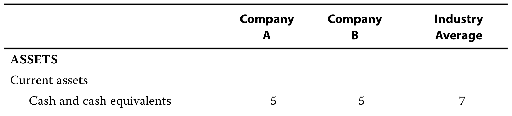 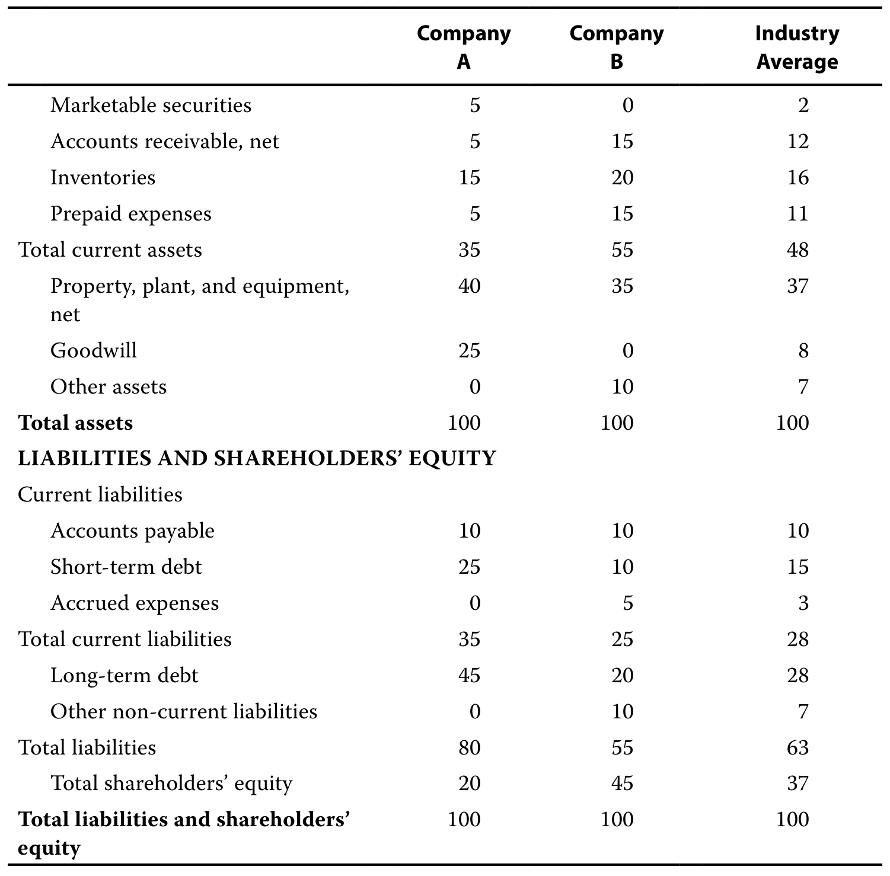

12 哪个声明是对的?

12\. Which statement is correct?

A. A公司的风险低于平均流动性。

A. Company A has below-average liquidity risk.

B. B公司的风险高于平均水平偿债能力。

B. Company B has above-average solvency risk.

C. A公司已进行一项或多项收购。

C. Company A has made one or more acquisitions.

#### 官方答案与解析 / Official answer and explanation

12,C号正确

12\. C is correct.

商誉在A公司的资产负债表上的存在表明它过去进行过一次或多次收购。

The presence of goodwill on Company A’s balance sheet signifies that it has made one or more acquisitions in the past.

A公司目前的现金和快速比率低于部门平均数。

The current, cash, and quick ratios are lower for Company A than for the sector average.

这些较低的流动性比率意味着高于平均的流动性风险。

These lower liquidity ratios imply above-average liquidity risk.

B公司的债务总额、长期债务对权益、债务对权益和财务杠杆的比率低于部门平均数。

The total debt, long-term debt-to-equity, debt-to-equity, and financial leverage ratios are lower for Company B than for the sector average.

这些较低的偿债能力比率意味着低于平均的偿债能力风险。

These lower solvency ratios imply below-average solvency risk.

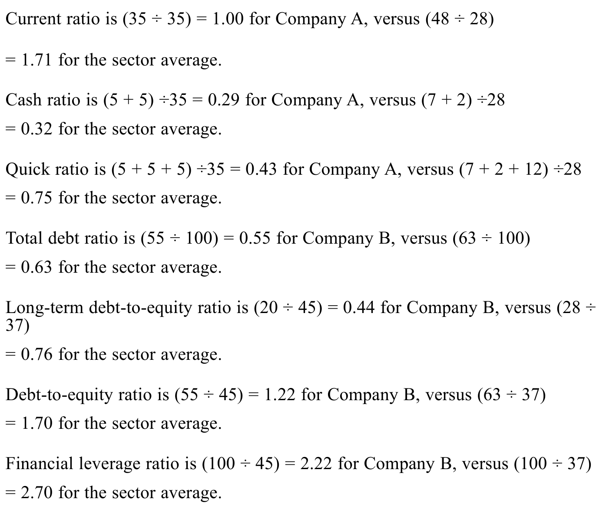

#### 补充解析 / Supplementary explanation

本题复核锚点（原解摘录）：商誉在A公司的资产负债表上的存在表明它过去进行过一次或多次收购。

Review anchor for this item (official excerpt): The presence of goodwill on Company A’s balance sheet signifies that it has made one or more acquisitions in the past.

本题官方选项为 C。补充思路：流动分类反映预计变现、消耗或清偿的时间与经营周期，但“流动资产”并不代表所有项目都同样容易变现。现金与可交易证券通常比应收和存货更接近即时支付能力。比较流动比率时，进一步检查资产组成、坏账准备、存货减值与近期负债到期安排。资本结构的偿债能力是另一层长期问题。

The official choice for this item is C. Additional reasoning: Current classification reflects timing and the operating cycle, but current assets are not equally liquid. Cash and marketable securities generally provide more immediate payment capacity than receivables or inventory. Compare composition, allowances, write-downs, and maturities alongside liquidity ratios. Long-term solvency is a separate capital-structure issue.

三个流动性比率使用相同的流动负债分母，但分子越来越严格：流动比率含存货，速动比率通常排除存货，现金比率进一步排除应收账款。

The liquidity ratios share current liabilities as denominator but progressively restrict the numerator: current includes inventory, quick generally excludes it, and cash additionally excludes receivables.

#### 相关知识点 / Related concepts

资产负债表结构与流动性：流动比率、速动比率与现金比率分子依次收窄；负债期限与资产转换周期应匹配。

Balance-sheet structure and liquidity: Current, quick, and cash ratios use progressively narrower numerators. Liability maturity should be matched to asset-conversion timing.

### FSA-LM03-PRACTICE-013 · 章末习题 13 Practice problem 13

章末练习 / Practice problem · 原版 PDF 页码 / Source PDF pages: 130-131, 134

#### 题目与资料 / Question and data

以下信息涉及问题12-15.

The following information relates to questions 12-15

考虑A公司、B公司在图表1中的共同比资产负债表以及行业平均数。

Consider the common-size balance sheets in Exhibit 1 for Company A, Company B, as well as the industry average.

图表1:资产负债表和工业平均数

Exhibit 1: Balance Sheet and Industry Average

 

13\. A公司的速动比率最接近：

13\. The quick ratio for Company A is closest to:

A. 0.43.

B. 0.57.

C. 1.00.

#### 官方答案与解析 / Official answer and explanation

13,A没错

13\. A is correct.

速动比率的定义是(现金及现金等价物 + 可交易证券 +应收款项) QQ 流动负债。

The quick ratio is defined as (Cash and cash equivalents + Marketable securities + receivables) ÷ Current liabilities.

对于A公司，这一计算法是(1)以下所示的计算法。

For Company A, this calculation is the calculation shown below (1).

\(1\) (5 + 5 + 5) ÷ 35 = 0.43

#### 补充解析 / Supplementary explanation

本题复核锚点（原解摘录）：速动比率的定义是(现金及现金等价物 + 可交易证券 +应收款项) QQ 流动负债。

Review anchor for this item (official excerpt): The quick ratio is defined as (Cash and cash equivalents + Marketable securities + receivables) ÷ Current liabilities.

本题官方选项为 A。补充思路：流动分类反映预计变现、消耗或清偿的时间与经营周期，但“流动资产”并不代表所有项目都同样容易变现。现金与可交易证券通常比应收和存货更接近即时支付能力。比较流动比率时，进一步检查资产组成、坏账准备、存货减值与近期负债到期安排。资本结构的偿债能力是另一层长期问题。

The official choice for this item is A. Additional reasoning: Current classification reflects timing and the operating cycle, but current assets are not equally liquid. Cash and marketable securities generally provide more immediate payment capacity than receivables or inventory. Compare composition, allowances, write-downs, and maturities alongside liquidity ratios. Long-term solvency is a separate capital-structure issue.

三个流动性比率使用相同的流动负债分母，但分子越来越严格：流动比率含存货，速动比率通常排除存货，现金比率进一步排除应收账款。

The liquidity ratios share current liabilities as denominator but progressively restrict the numerator: current includes inventory, quick generally excludes it, and cash additionally excludes receivables.

#### 相关知识点 / Related concepts

资产负债表结构与流动性：流动比率、速动比率与现金比率分子依次收窄；负债期限与资产转换周期应匹配。

Balance-sheet structure and liquidity: Current, quick, and cash ratios use progressively narrower numerators. Liability maturity should be matched to asset-conversion timing.

### FSA-LM03-PRACTICE-014 · 章末习题 14 Practice problem 14

章末练习 / Practice problem · 原版 PDF 页码 / Source PDF pages: 130-131, 134

#### 题目与资料 / Question and data

以下信息涉及问题12-15.

The following information relates to questions 12-15

考虑A公司、B公司在图表1中的共同比资产负债表以及行业平均数。

Consider the common-size balance sheets in Exhibit 1 for Company A, Company B, as well as the industry average.

图表1:资产负债表和工业平均数

Exhibit 1: Balance Sheet and Industry Average

 

14\. B公司的财务杠杆比最接近：

14\. The financial leverage ratio for Company B is closest to:

A. 0.55.

B. 1.22.

C. 2.22.

#### 官方答案与解析 / Official answer and explanation

14,C号正确

14\. C is correct.

财务杠杆率定义为总资产与总权益的比率。

The financial leverage ratio is defined as Total assets ÷ Total equity.

对于B公司，总的资产是100，总的权益是45;因此，财务杠杆比例是(1)以下的计算。

For Company B, total assets are 100 and total equity is 45; hence, the financial leverage ratio is the calculation shown below (1).

\(1\) 100 ÷ 45 = 2.22

#### 补充解析 / Supplementary explanation

本题复核锚点（原解摘录）：财务杠杆率定义为总资产与总权益的比率。

Review anchor for this item (official excerpt): The financial leverage ratio is defined as Total assets ÷ Total equity.

本题官方选项为 C。补充思路：流动分类反映预计变现、消耗或清偿的时间与经营周期，但“流动资产”并不代表所有项目都同样容易变现。现金与可交易证券通常比应收和存货更接近即时支付能力。比较流动比率时，进一步检查资产组成、坏账准备、存货减值与近期负债到期安排。资本结构的偿债能力是另一层长期问题。

The official choice for this item is C. Additional reasoning: Current classification reflects timing and the operating cycle, but current assets are not equally liquid. Cash and marketable securities generally provide more immediate payment capacity than receivables or inventory. Compare composition, allowances, write-downs, and maturities alongside liquidity ratios. Long-term solvency is a separate capital-structure issue.

#### 相关知识点 / Related concepts

资产负债表结构与流动性：流动比率、速动比率与现金比率分子依次收窄；负债期限与资产转换周期应匹配。

Balance-sheet structure and liquidity: Current, quick, and cash ratios use progressively narrower numerators. Liability maturity should be matched to asset-conversion timing.

### FSA-LM03-PRACTICE-015 · 章末习题 15 Practice problem 15

章末练习 / Practice problem · 原版 PDF 页码 / Source PDF pages: 130-132, 134

#### 题目与资料 / Question and data

以下信息涉及问题12-15.

The following information relates to questions 12-15

考虑A公司、B公司在图表1中的共同比资产负债表以及行业平均数。

Consider the common-size balance sheets in Exhibit 1 for Company A, Company B, as well as the industry average.

图表1:资产负债表和工业平均数

Exhibit 1: Balance Sheet and Industry Average

 

15\. 哪个比率表明A公司与B公司相比流动性的风险较低?

15\. Which ratio indicates lower liquidity risk for Company A compared with Company B?

A. 现金比率(美国)

A. Cash ratio

B. 速动比率

B. Quick ratio

C. 流动比率

C. Current ratio

#### 官方答案与解析 / Official answer and explanation

15,A没错

15\. A is correct.

较高的现金比率反映了较低的流动性风险。

A higher cash ratio reflects lower liquidity risk.

现金比率的定义是(Cash + 可交易证券)QQ流动负债。

The cash ratio is defined as (Cash + Marketable securities) ÷ Current liabilities.

A公司现金比率，(1)以下的计算值高于B公司(2)以下的计算值。

Company A’s cash ratio, the calculation shown below (1), is higher than the calculation shown below (2) for Company B.

\(1\) (5 + 5) ÷ 35 = 0.29(2) (5 + 0) ÷ 25 = 0.20

#### 补充解析 / Supplementary explanation

本题复核锚点（原解摘录）：较高的现金比率反映了较低的流动性风险。

Review anchor for this item (official excerpt): A higher cash ratio reflects lower liquidity risk.

本题官方选项为 A。补充思路：流动分类反映预计变现、消耗或清偿的时间与经营周期，但“流动资产”并不代表所有项目都同样容易变现。现金与可交易证券通常比应收和存货更接近即时支付能力。比较流动比率时，进一步检查资产组成、坏账准备、存货减值与近期负债到期安排。资本结构的偿债能力是另一层长期问题。

The official choice for this item is A. Additional reasoning: Current classification reflects timing and the operating cycle, but current assets are not equally liquid. Cash and marketable securities generally provide more immediate payment capacity than receivables or inventory. Compare composition, allowances, write-downs, and maturities alongside liquidity ratios. Long-term solvency is a separate capital-structure issue.

三个流动性比率使用相同的流动负债分母，但分子越来越严格：流动比率含存货，速动比率通常排除存货，现金比率进一步排除应收账款。

The liquidity ratios share current liabilities as denominator but progressively restrict the numerator: current includes inventory, quick generally excludes it, and cash additionally excludes receivables.

#### 相关知识点 / Related concepts

资产负债表结构与流动性：流动比率、速动比率与现金比率分子依次收窄；负债期限与资产转换周期应匹配。

Balance-sheet structure and liquidity: Current, quick, and cash ratios use progressively narrower numerators. Liability maturity should be matched to asset-conversion timing.

## LM 4 · 分析现金流量表 I Analyzing Statements of Cash Flows I 26 条目 · 原题与解析逐条对应 / Paired source questions and explanations

### FSA-LM04-WORKED_CASE-001 · 存货 购销对财务报表的影响 Inventory Purchase and Sale Impact on Financial Statements

正文讲解案例 / Narrated worked case · 原版 PDF 页码 / Source PDF pages: 140

#### 题目与资料 / Question and data

示例 1

EXAMPLE 1

存货 购销对财务报表的影响

Inventory Purchase and Sale Impact on Financial Statements

#### 官方答案与解析 / Official answer and explanation

假想虚构公司ABC是零售商，在1月1日 1,20X1上购入了存货的USD100，在30日中以欠其供应商的账款抵债。

Assume fictional company ABC, a retailer, purchases USD100 of inventory on 1 January 1, 20X1 on credit with payment due to its supplier in 30 days.

2月1日，ABC 以150美元将商品售予客户X，约定最迟于20X1年2月16日付款。

On 1 February, ABC sells the product to Customer X for USD150 with payment due by 16 February, 20X1.

客户X于20X1年2月15日支付商品货款。

Customer X pays for the product on 15 February, 20X1.

这一系列交易将影响到ABC的财务报表，如下文所示：5.

This series of transaction would affect ABC’s financial statements as follows shown in Exhibit 5.

图表 5:ABC的财务报表

Exhibit 5: ABC’s Financial Statements

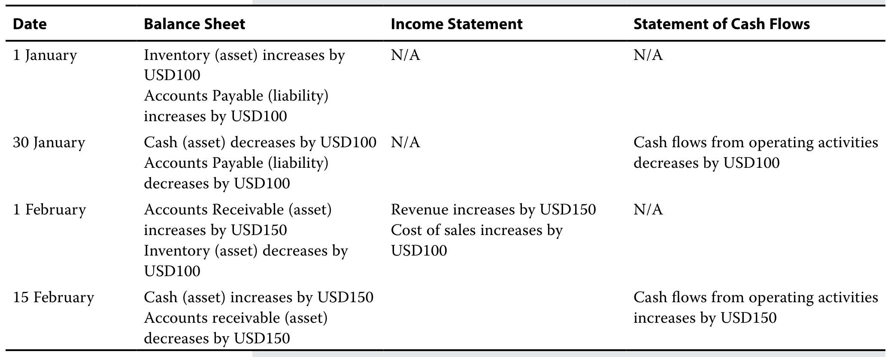

注意现金流量表只有在公司支付或收到现金时才会受到影响，这与利润表上的确认不同。

Note the statement of cash flows is affected only when the company pays or receives cash, which differs from recognition on the income statement.

#### 补充解析 / Supplementary explanation

本题复核锚点（原解摘录）：假想虚构公司ABC是零售商，在1月1日 1,20X1上购入了存货的USD100，在30日中以欠其供应商的账款抵债。

Review anchor for this item (official excerpt): Assume fictional company ABC, a retailer, purchases USD100 of inventory on 1 January 1, 20X1 on credit with payment due to its supplier in 30 days.

补充思路：把每个利润表项目与相关资产负债表账户连接。应收增加意味着已确认收入尚未全部收现，因此从收入扣除应收增加；存货增加意味着采购超过销售成本，应先求采购额，再按应付账款变化调整为付现额。对预付和应计费用，也要判断是现金先发生还是费用先确认，而不是机械记加减号。

Additional reasoning: Connect each income-statement line to its related balance-sheet account. Rising receivables mean recognized revenue exceeds cash collected. Rising inventory means purchases exceed COGS; calculate purchases before adjusting for payables to obtain cash paid. For prepaid and accrued expenses, reason from timing rather than memorizing signs blindly.

#### 相关知识点 / Related concepts

直接法：从权责发生制到收付现金：现金收款≈收入−Δ应收；采购≈销售成本＋Δ存货；付供应商现金≈采购−Δ应付。题目若有核销、并购等，应另作调整。

Direct-method accrual-to-cash conversion: Cash collected ≈ revenue − Δreceivables; purchases ≈ COGS + Δinventory; supplier cash payments ≈ purchases − Δpayables. Write-offs or acquisitions may require further adjustments.

原教材为连贯讲解型案例，没有独立设问及答案分栏；保留官方案例与演示，未另造题目。

### FSA-LM04-WORKED_CASE-002 · 折旧对财务报表的影响 Depreciation Impact on Financial Statements

正文讲解案例 / Narrated worked case · 原版 PDF 页码 / Source PDF pages: 141

#### 题目与资料 / Question and data

示例 2

EXAMPLE 2

折旧对财务报表的影响

Depreciation Impact on Financial Statements

#### 官方答案与解析 / Official answer and explanation

在1月1日上，虚构公司Notion Ltd是一家制造公司，拥有USD100，用于生产一种产品并出售给批发客户的设备。

On 1 January, fictional company Notion Ltd, a manufacturing company, owns USD100 of equipment used in the production of a product that is sold to wholesale customers.

该设备的寿命为10年，没有残值。

The equipment has a 10-year life and no salvage value.

逗号使用直线折旧，因此每年的折旧费用为USD10.

Notion uses straight-line depreciation, so the annual depreciation expense is USD10.

7月1日，Notion Ltd. 对另一项设备进行新的资本投资，其购买价格为200美元，每年折旧费用为50美元。

On 1 July, Notion Ltd. makes a new capital investment for a different piece of equipment with a purchase price of USD200 and annual depreciation expense of USD50.

Notion Ltd.在收到设备时以现金支付设备费用。

Notion Ltd. pays for the equipment in cash upon receipt.

折旧费用在财政年度结束时录制。

Depreciation expense is recorded at the end of the fiscal year.

对Notion Ltd的财务报表的影响摘要见Express 6.

The impact on Notion Ltd.’s financial statements is summarized in Exhibit 6.

图表 6:逗号有限公司 财务报表

Exhibit 6: Notion Ltd. Financial Statement

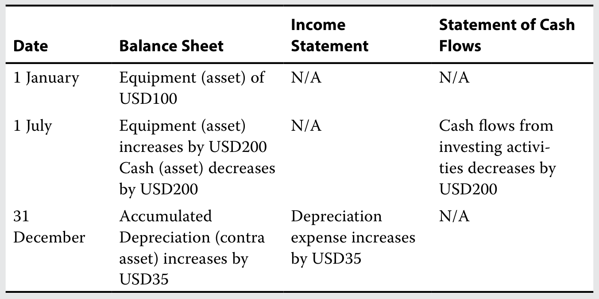

#### 补充解析 / Supplementary explanation

本题复核锚点（原解摘录）：在1月1日上，虚构公司Notion Ltd是一家制造公司，拥有USD100，用于生产一种产品并出售给批发客户的设备。

Review anchor for this item (official excerpt): On 1 January, fictional company Notion Ltd, a manufacturing company, owns USD100 of equipment used in the production of a product that is sold to wholesale customers.

补充思路：从净利润开始，加回已扣除但未流出经营现金的费用，如折旧；剔除应归投资或融资活动的损益；最后调整经营性营运资本。经营资产增加通常吸收现金，经营负债增加通常释放现金。不要把现金本身、借款或股利支付混入经营营运资本调整。非现金投资融资交易应在适当位置披露，而非伪造成现金流。

Additional reasoning: Start with net income, add back noncash expenses, remove gains or losses belonging to investing or financing, then adjust operating working capital. Increases in operating assets generally consume cash; increases in operating liabilities provide cash. Cash itself, borrowings, and dividends are not operating working-capital adjustments. Disclose noncash investing or financing without manufacturing cash flows.

间接法加回折旧是在从净利润剔除非现金费用，并不是说折旧产生现金。处置资产收益也要从经营现金流调整中扣除，因为完整处置收款属于投资现金流。

Adding depreciation under the indirect method reverses a non-cash expense; depreciation does not create cash. A disposal gain is also removed from CFO because the full disposal proceeds belong in investing flows.

#### 相关知识点 / Related concepts

间接法经营现金流：CFO≈净利润＋非现金费用−非经营收益−经营性资产增加＋经营性负债增加。

Indirect-method operating cash flow: CFO ≈ net income + noncash charges − nonoperating gains − increases in operating assets + increases in operating liabilities.

原教材为连贯讲解型案例，没有独立设问及答案分栏；保留官方案例与演示，未另造题目。

### FSA-LM04-WORKED_CASE-003 · 借款对财务报表的影响 Borrowing Impact on Financial Statements

正文讲解案例 / Narrated worked case · 原版 PDF 页码 / Source PDF pages: 141-142

#### 题目与资料 / Question and data

示例 3

EXAMPLE 3

借款对财务报表的影响

Borrowing Impact on Financial Statements

#### 官方答案与解析 / Official answer and explanation

在3月31日上，虚构的日内瓦公司向斯德哥尔摩银行借款USD500(也是虚构的).

On 31 March, fictional Geneva Company borrows USD500 from Stockholm Bank (also fictional).

该贷款约定按10%的利率计提利息，并在9月30日贷款到期时随本金一并支付。

The terms of the loan are interest accrues at 10 percent and payment is due along with principal upon maturity of the loan on 30 September.

因此，Geneva 须于9月30日向 Stockholm Bank 支付525美元，包括500美元贷款本金及25美元利息。对 Geneva 财务报表的影响汇总于图表7。

Accordingly, Geneva is to pay USD525 to Stockholm Bank on 30 September consisting of USD500 in loan principal and USD25 of interest (USD500 loan × 10% × ½ year.) The impact on Geneva’s financial statements is summarized in Exhibit 7.

图表7:日内瓦财务报表

Exhibit 7: Geneva Financial Statement

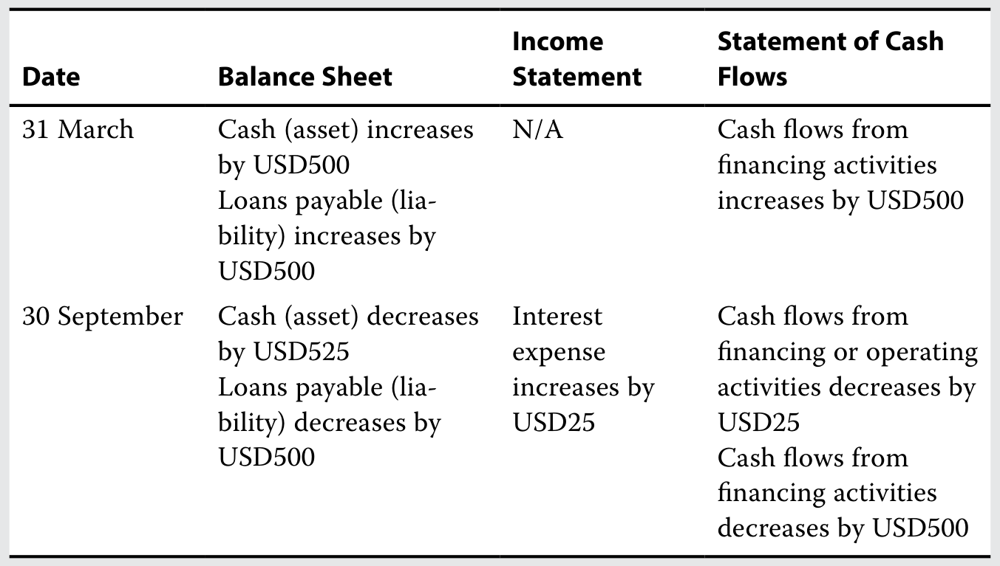

#### 补充解析 / Supplementary explanation

本题复核锚点（原解摘录）：在3月31日上，虚构的日内瓦公司向斯德哥尔摩银行借款USD500(也是虚构的).

Review anchor for this item (official excerpt): On 31 March, fictional Geneva Company borrows USD500 from Stockholm Bank (also fictional).

补充思路：先判断交易的经济性质，再检查所用准则。购买长期经营资产通常属投资，借款与偿还本金通常属融资，核心经营收付属经营。利息与股利在 IFRS 和 US GAAP 下可能存在分类差异，因此跨公司比较应统一口径。现金流类别改变不等于现金总额改变。

Additional reasoning: Identify economic nature and then the reporting framework. Long-lived operating asset purchases are generally investing; borrowing and principal repayment are financing; core business receipts and payments are operating. Interest and dividend classification can differ under IFRS and US GAAP, so normalize comparisons. Reclassification does not change total cash.

#### 相关知识点 / Related concepts

现金流分类与准则差异：经营、投资、融资三类现金净变化与汇率影响等项目共同调节期初至期末现金余额。

Cash-flow classification and standard differences: Operating, investing, and financing flows, along with effects such as currency translation, reconcile opening and closing cash.

原教材为连贯讲解型案例，没有独立设问及答案分栏；保留官方案例与演示，未另造题目。

### FSA-LM04-WORKED_CASE-004 · 设备采购对财务报表的影响 Equipment Purchase Impact on Financial Statements

正文讲解案例 / Narrated worked case · 原版 PDF 页码 / Source PDF pages: 142

#### 题目与资料 / Question and data

示例 4

EXAMPLE 4

设备采购对财务报表的影响

Equipment Purchase Impact on Financial Statements

#### 官方答案与解析 / Official answer and explanation

Assume Mountain Company是一家虚构的制造商，同意在两个月内为Cirrus Corp.(另一家虚构公司)生产定制设备，价格为USD1,000的销售收入。

Assume Mountain Company, a fictional manufacturer, agrees to produce a custom-made piece of equipment for Cirrus Corp. (another fictional company) in two months for a sales price of USD1,000.

10月1日，Cirrus 向 Mountain 支付300美元首付款，并同意在设备于11月30日交付时支付余款700美元。

On 1 October, Cirrus provides Mountain with a down payment of USD300 from Cirrus and agrees to pay the balance of USD700 when the equipment is delivered on 30 November.

Mountain Company 于10月1日收到300美元时确认递延收入；当 Mountain 履行义务并交付设备时，该递延收入将被终止确认。

Mountain Company recognizes deferred revenue when it receives the USD300 on 1 October, which will be derecognized when Mountain fulfills its obligation and delivers the equipment.

对山地公司财务报表的影响摘要见展览8.

The impact on Mountain Company’s financial statement is summarized in Exhibit 8.

图表8:山地公司财务报表

Exhibit 8: Mountain Company Financial Statement

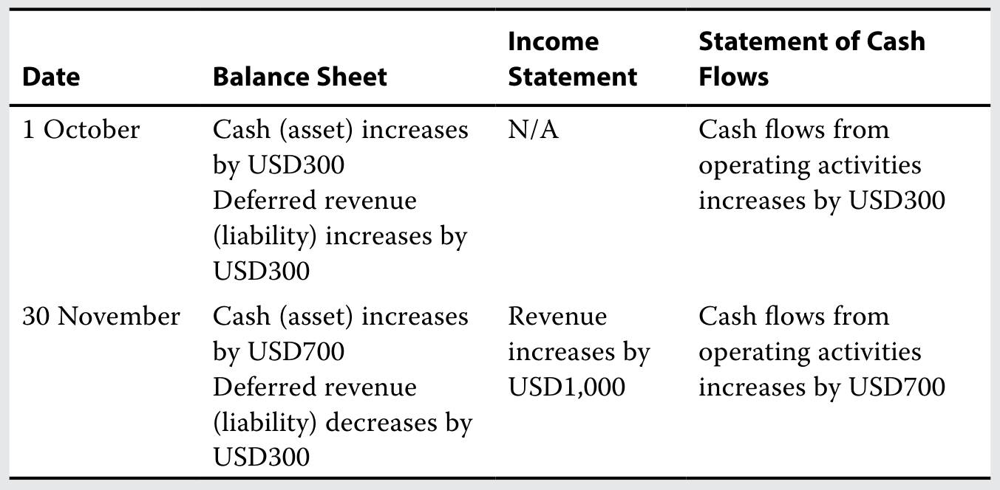

#### 补充解析 / Supplementary explanation

10月1日收到300美元预付款时，Mountain的现金增加300，同时递延收入（合同负债）增加300；设备尚未交付，不能仅因收款就确认这笔销售收入。11月30日履约交付时，按题设确认1,000美元销售收入，用原来的300美元预收款抵付，并收取剩余700美元，合同负债减少300。这体现“先收到现金、后确认收入”。制造设备的相关成本需另按原表处理，不能把预收款直接当成利润。

On 1 October, Mountain’s USD300 receipt increases cash and deferred revenue, or a contract liability, by 300. Receipt alone does not establish revenue because the equipment has not been delivered. On delivery on 30 November, the stated USD1,000 sale is recognized, the 300 advance is applied, the remaining 700 is collected, and the contract liability falls by 300. Cash collection precedes revenue recognition. Manufacturing costs must be handled separately as shown in the source; the advance itself is not profit.

#### 相关知识点 / Related concepts

预收款与递延收入：履约前收款通常产生合同负债；履约后确认收入并结转该负债。它与费用已发生但尚未付款形成的应计负债属于不同的交易链条。

Advances and deferred revenue: collecting cash before performance normally creates a contract liability, which is released when the revenue obligation is fulfilled. This is a different transaction sequence from accruing an expense before paying it.

原教材为连贯讲解型案例，没有独立设问及答案分栏；保留官方案例与演示，未另造题目。

### FSA-LM04-EXAMPLE-501 · 例题 5 · 第 1 题：来自客户的 收到的现金 计算器 Example 5 · 1 — Computing Cash Received from Customers

正文例题／案例 / Worked example / case · 原版 PDF 页码 / Source PDF pages: 145

#### 题目与资料 / Question and data

示例 5

EXAMPLE 5

来自客户的 收到的现金 计算器

Computing Cash Received from Customers

1\. Blue Bayou是一家虚构的广告公司，在最近一年中报道了收入的USD50 百万，总计费用的USD35 百万，以及USD15 百万的净利润。

1\. Blue Bayou, a fictitious advertising company, reported revenues of USD50 million, total expenses of USD35 million, and net income of USD15 million in the most recent year.

如果应收账款减少USD12 百万，公司从客户那里得到多少现金?

If accounts receivable decreased by USD12 million, how much cash did the company receive from customers?

A. USD38 百万(津巴布韦)

A. USD38 million

B. USD50 百万

B. USD50 million

C. USD62 百万

C. USD62 million

#### 官方答案与解析 / Official answer and explanation

解答：

Solution:

C是对的。

C is correct.

USD50 百万的收入加上USD12 百万的应收账款的减少等于来自客户的USD62 百万 收到的现金。

Revenues of USD50 million plus the decrease in accounts receivable of USD12 million equals USD62 million cash received from customers.

应收账款的减少意味着该公司收到的现金比它报告的收入多。

The decrease in accounts receivable means that the company received more in cash than the amount of revenue it reported.

#### 补充解析 / Supplementary explanation

本题复核锚点（原解摘录）：USD50 百万的收入加上USD12 百万的应收账款的减少等于来自客户的USD62 百万 收到的现金。

Review anchor for this item (official excerpt): Revenues of USD50 million plus the decrease in accounts receivable of USD12 million equals USD62 million cash received from customers.

本题官方选项为 C。补充思路：把每个利润表项目与相关资产负债表账户连接。应收增加意味着已确认收入尚未全部收现，因此从收入扣除应收增加；存货增加意味着采购超过销售成本，应先求采购额，再按应付账款变化调整为付现额。对预付和应计费用，也要判断是现金先发生还是费用先确认，而不是机械记加减号。

The official choice for this item is C. Additional reasoning: Connect each income-statement line to its related balance-sheet account. Rising receivables mean recognized revenue exceeds cash collected. Rising inventory means purchases exceed COGS; calculate purchases before adjusting for payables to obtain cash paid. For prepaid and accrued expenses, reason from timing rather than memorizing signs blindly.

应收账款增加意味着确认的收入尚未全部变为现金，因此客户现金收款通常为收入减应收增加；若涉及预收款，还应加入合同负债增加等适用调整。

An increase in receivables means recognized revenue has not fully become cash; customer collections generally equal revenue less that increase. Customer advances can require additional contract-liability adjustments.

#### 相关知识点 / Related concepts

直接法：从权责发生制到收付现金：现金收款≈收入−Δ应收；采购≈销售成本＋Δ存货；付供应商现金≈采购−Δ应付。题目若有核销、并购等，应另作调整。

Direct-method accrual-to-cash conversion: Cash collected ≈ revenue − Δreceivables; purchases ≈ COGS + Δinventory; supplier cash payments ≈ purchases − Δpayables. Write-offs or acquisitions may require further adjustments.

原双语文件在 USD 金额附近误加“津巴布韦”字样；USD 在此表示美元，数值及英文原文为准。 / The prior Chinese file inserts an erroneous Zimbabwe label beside USD; USD denotes US dollars here. Use the original English amount.

### FSA-LM04-EXAMPLE-601 · 例题 6 · 第 1 题：给供应商的 支付的现金 计算 Example 6 · 1 — Computing Cash Paid to Suppliers

正文例题／案例 / Worked example / case · 原版 PDF 页码 / Source PDF pages: 147

#### 题目与资料 / Question and data

示例 6

EXAMPLE 6

给供应商的 支付的现金 计算

Computing Cash Paid to Suppliers

1.奥兰治饮料 Plc.，一个虚构的热带饮料制造商，报告销售成本的年份为USD100 百万。

1\. Orange Beverages Plc., a fictitious manufacturer of tropical drinks, reported cost of goods sold for the year of USD100 million.

总计资产增加USD55 百万，但存货减少USD6 百万。

Total assets increased by USD55 million, but inventory declined by USD6 million.

总计负债增加USD45 百万，但应付账款减少USD2 百万。

Total liabilities increased by USD45 million, but accounts payable decreased by USD2 million.

公司在这一年中向供应商支付了多少现金?

How much cash did the company pay to its suppliers during the year?

A. USD96 百万(津巴布韦)

A. USD96 million

B. USD104 百万

B. USD104 million

C. USD108 百万

C. USD108 million

#### 官方答案与解析 / Official answer and explanation

解答：

Solution:

A是对的。

A is correct.

USD100 百万的销售成本减去USD6 百万的存货的减少等于向USD94 百万供应商购买。

Cost of goods sold of USD100 million less the decrease in inventory of USD6 million equals purchases from suppliers of USD94 million.

USD2 百万的应付账款的减少意味着公司以现金(USD94 百万+USD2 百万)支付USD96 百万。

The decrease in accounts payable of USD2 million means that the company paid USD96 million in cash (USD94 million plus USD2 million).

将支付的现金改为雇员

Cash Paid to Employees

#### 补充解析 / Supplementary explanation

本题复核锚点（原解摘录）：USD100 百万的销售成本减去USD6 百万的存货的减少等于向USD94 百万供应商购买。

Review anchor for this item (official excerpt): Cost of goods sold of USD100 million less the decrease in inventory of USD6 million equals purchases from suppliers of USD94 million.

本题官方选项为 A。补充思路：把每个利润表项目与相关资产负债表账户连接。应收增加意味着已确认收入尚未全部收现，因此从收入扣除应收增加；存货增加意味着采购超过销售成本，应先求采购额，再按应付账款变化调整为付现额。对预付和应计费用，也要判断是现金先发生还是费用先确认，而不是机械记加减号。

The official choice for this item is A. Additional reasoning: Connect each income-statement line to its related balance-sheet account. Rising receivables mean recognized revenue exceeds cash collected. Rising inventory means purchases exceed COGS; calculate purchases before adjusting for payables to obtain cash paid. For prepaid and accrued expenses, reason from timing rather than memorizing signs blindly.

#### 相关知识点 / Related concepts

直接法：从权责发生制到收付现金：现金收款≈收入−Δ应收；采购≈销售成本＋Δ存货；付供应商现金≈采购−Δ应付。题目若有核销、并购等，应另作调整。

Direct-method accrual-to-cash conversion: Cash collected ≈ revenue − Δreceivables; purchases ≈ COGS + Δinventory; supplier cash payments ≈ purchases − Δpayables. Write-offs or acquisitions may require further adjustments.

原双语文件在 USD 金额附近误加“津巴布韦”字样；USD 在此表示美元，数值及英文原文为准。 / The prior Chinese file inserts an erroneous Zimbabwe label beside USD; USD denotes US dollars here. Use the original English amount.

### FSA-LM04-EXAMPLE-701 · 例题 7 · 第 1 题：其他 营业费用 的 支付的现金 计算 Example 7 · 1 — Computing Cash Paid for Other Operating Expenses

正文例题／案例 / Worked example / case · 原版 PDF 页码 / Source PDF pages: 148

#### 题目与资料 / Question and data

示例 7

EXAMPLE 7

其他 营业费用 的 支付的现金 计算

Computing Cash Paid for Other Operating Expenses

1\. 黑色冰，一个虚构的运动服制造商，报告其他营业费用的USD30 百万。

1\. Black Ice, a fictitious sportswear manufacturer, reported other operating expenses of USD30 million.

预付保险费增加了USD4 百万，应付的应计水电费减少了USD7 百万。

Prepaid insurance expense increased by USD4 million, and accrued utilities payable decreased by USD7 million.

保险和公用事业是其他营业费用中仅有的两个组成部分。

Insurance and utilities are the only two components of other operating expenses.

公司在其它营业费用中支付了多少现金?.

How much cash did the company pay in other operating expenses?

A. USD19 百万(津巴布韦)

A. USD19 million

B. USD33 百万

B. USD33 million

C. USD41 百万

C. USD41 million

#### 官方答案与解析 / Official answer and explanation

解答：

Solution:

C是对的。

C is correct.

其他营业费用 of USD30 百万加上预付保险费USD4 百万的增加加上应付USD7 百万的应计水电费的减少等于USD41 百万。

Other operating expenses of USD30 million plus the increase in prepaid insurance expense of USD4 million plus the decrease in accrued utilities payable of USD7 million equals USD41 million.

#### 补充解析 / Supplementary explanation

本题复核锚点（原解摘录）：其他营业费用 of USD30 百万加上预付保险费USD4 百万的增加加上应付USD7 百万的应计水电费的减少等于USD41 百万。

Review anchor for this item (official excerpt): Other operating expenses of USD30 million plus the increase in prepaid insurance expense of USD4 million plus the decrease in accrued utilities payable of USD7 million equals USD41 million.

本题官方选项为 C。补充思路：应付项目增加表示本期确认的费用尚未全部支付，应付项目减少表示本期还偿付了以前确认的费用。因此现金支付＝本期费用＋期初应付−期末应付。购买设备还必须区分下单、交付确认资产以及付款三个时点；资产负债表和现金流量表的确认时点可能不同。

The official choice for this item is C. Additional reasoning: An increase in a payable means part of current expense is unpaid; a decrease means cash also settles earlier accruals. Cash paid therefore equals expense plus opening payable minus closing payable. For equipment, distinguish ordering, asset delivery/recognition, and payment; balance-sheet and cash-flow effects can arise at different times.

#### 相关知识点 / Related concepts

应计费用与现金支付的桥梁：现金支付＝费用−应付增加额；非现金资产取得可以影响资产负债表而不形成当期现金流，须按准则披露。

Bridging accrued expense and cash payments: Cash paid = expense − increase in payables. A non-cash asset acquisition can affect the balance sheet without a current cash flow and requires appropriate disclosure.

原双语文件在 USD 金额附近误加“津巴布韦”字样；USD 在此表示美元，数值及英文原文为准。 / The prior Chinese file inserts an erroneous Zimbabwe label beside USD; USD denotes US dollars here. Use the original English amount.

### FSA-LM04-QUESTION_SET-801 · 习题组 · 第 1 题 Question set · 1

正文习题组 / Question set · 原版 PDF 页码 / Source PDF pages: 155

#### 题目与资料 / Question and data

问题组

QUESTION SET

1\. 铜业公司，一家虚构的酿酒厂和餐馆连锁店，报告出售USD12 百万设备有收益。

1\. Copper, Inc., a fictitious brewery and restaurant chain, reported a gain on the sale of equipment of USD12 million.

此外，该公司的利润表显示USD8 百万的折旧费用，现金流量表显示USD15 百万的资本支出，全部用于购买新设备。

In addition, the company’s income statement shows depreciation expense of USD8 million and the cash flow statement shows capital expenditure of USD15 million, all of which was for the purchase of new equipment.

图表30:铜业公司

Exhibit 30: Copper Inc.

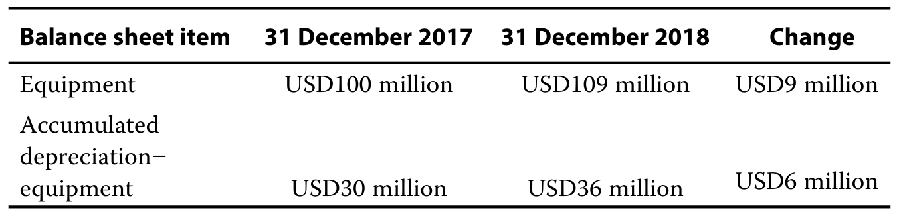

利用比较资产负债表中显示的30信息，该公司从设备销售中获得了多少现金?

Using the information in Exhibit 30 from the comparative balance sheets, how much cash did the company receive from the equipment sale?

A. USD12 百万(津巴布韦)

A. USD12 million

B. USD16 百万

B. USD16 million

C. USD18 百万

C. USD18 million

#### 官方答案与解析 / Official answer and explanation

解答：

Solution:

B 正确。

B is correct.

销售价格(现金流入)减去账面价值等于销售损益；因此，销售损益加上账面价值等于销售价格(现金流入)。

Selling price (cash inflow) minus book value equals gain or loss on sale; therefore, gain or loss on sale plus book value equals selling price (cash inflow).

增益之数以给，USD12 百万。

The amount of gain is given, USD12 million.

为了计算所售设备的账面价值，在设备上找到设备的历史成本和累积的折旧。

To calculate the book value of the equipment sold, find the historical cost of the equipment and the accumulated depreciation on the equipment.

^ USD100 百万设备的期初余额加上购买的USD15 百万设备减去出售设备的USD109 百万设备期末余额等于历史成本，即USD6 百万。

■ Beginning balance of equipment of USD100 million plus equipment purchased of USD15 million minus ending balance of equipment of USD109 million equals historical cost of equipment sold, or USD6 million.

■ 期初设备累计折旧为3,000万美元，加上本年度折旧费用800万美元，再减去期末累计折旧余额3,600万美元，即得到已出售设备的累计折旧200万美元。

■ Beginning accumulated depreciation on equipment of USD30 million plus depreciation expense for the year of USD8 million minus ending balance of accumulated depreciation of USD36 million equals accumulated depreciation on the equipment sold, or USD2 million.

因此，所售设备的账面价值为USD6 百万减USD2 百万，即USD4 百万。

■ Therefore, the book value of the equipment sold was USD6 million minus USD2 million, or USD4 million.

由于设备销售收益为USD12 百万，收到的现金的金额一定是USD16 百万。

■ Because the gain on the sale of equipment was USD12 million, the amount of cash received must have been USD16 million.

#### 补充解析 / Supplementary explanation

本题复核锚点（原解摘录）：销售价格(现金流入)减去账面价值等于销售损益；因此，销售损益加上账面价值等于销售价格(现金流入)。

Review anchor for this item (official excerpt): Selling price (cash inflow) minus book value equals gain or loss on sale; therefore, gain or loss on sale plus book value equals selling price (cash inflow).

本题官方选项为 B。补充思路：先从固定资产原值滚动表求出售资产的历史成本，再从累计折旧滚动表求对应折旧，二者之差为出售时账面价值。现金售价＝账面价值＋处置收益，或减去处置损失。收益只是售价与账面价值的差额，因此不能直接把收益当出售现金流。间接法经营现金流还需剔除该收益或损失以避免重复计入。

The official choice for this item is B. Additional reasoning: Use the gross-asset rollforward to find disposed historical cost, then the accumulated-depreciation rollforward for related depreciation. Their difference is disposed carrying value. Cash proceeds equal carrying value plus gain, or minus loss. A gain is not the proceeds themselves. Under the indirect method, remove the gain or loss from operating cash flow to avoid double counting.

间接法加回折旧是在从净利润剔除非现金费用，并不是说折旧产生现金。处置资产收益也要从经营现金流调整中扣除，因为完整处置收款属于投资现金流。

Adding depreciation under the indirect method reverses a non-cash expense; depreciation does not create cash. A disposal gain is also removed from CFO because the full disposal proceeds belong in investing flows.

#### 相关知识点 / Related concepts

出售固定资产现金流的重建：出售资产原值＝期初原值＋新增原值−期末原值；处置累计折旧＝期初累计折旧＋本期折旧−期末累计折旧。

Reconstructing proceeds from asset disposals: Disposed cost = beginning cost + additions − ending cost. Disposed accumulated depreciation = beginning accumulated depreciation + current depreciation − ending accumulated depreciation.

原双语文件在 USD 金额附近误加“津巴布韦”字样；USD 在此表示美元，数值及英文原文为准。 / The prior Chinese file inserts an erroneous Zimbabwe label beside USD; USD denotes US dollars here. Use the original English amount.

### FSA-LM04-QUESTION_SET-802 · 习题组 · 第 2 题 Question set · 2

正文习题组 / Question set · 原版 PDF 页码 / Source PDF pages: 155-156

#### 题目与资料 / Question and data

问题组

QUESTION SET

2\. Silverago Incorporated，一家国际金属公司，报告在2018出售USD2 百万设备的损失。

2\. Silverago Incorporated, an international metals company, reported a loss on the sale of equipment of USD2 million in 2018.

此外，该公司的利润表显示USD8 百万的折旧费用，现金流量表显示USD10 百万的资本支出，全部用于购买新设备。

In addition, the company’s income statement shows depreciation expense of USD8 million and the cash flow statement shows capital expenditure of USD10 million, all of which was for the purchase of new equipment.

利用比较资产负债表中显示的31信息，该公司从设备销售中获得了多少现金?

Using the information in Exhibit 31 from the comparative balance sheets, how much cash did the company receive from the equipment sale?

图表31:Silverago公司

Exhibit 31: Silverago Inc.

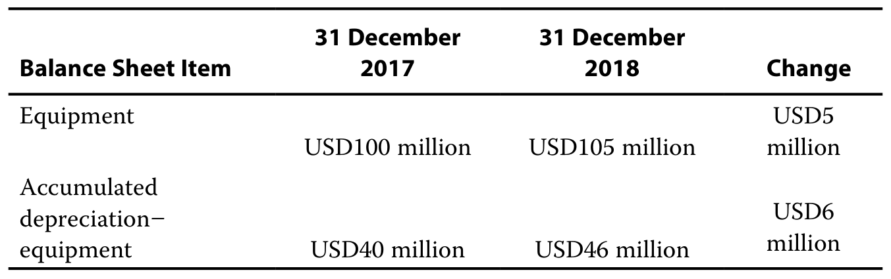

A. USD1 百万(津巴布韦)

A. USD1 million

B. USD2 百万

B. USD2 million

C. USD3 百万

C. USD3 million

#### 官方答案与解析 / Official answer and explanation

解答：

Solution:

A是对的。

A is correct.

销售价格(现金流入)减去账面价值等于销售损益；因此，销售损益加上账面价值等于销售价格(现金流入)。

Selling price (cash inflow) minus book value equals gain or loss on sale; therefore, gain or loss on sale plus book value equals selling price (cash inflow).

损失额为-USD2 百万。

The amount of loss is given—USD2 million.

为了计算所售设备的账面价值，在设备上找到设备的历史成本和累积的折旧。

To calculate the book value of the equipment sold, find the historical cost of the equipment and the accumulated depreciation on the equipment.

^ USD100 百万设备的期初余额加上购买的USD10 百万设备减去USD105 百万设备的期末余额等于所售设备的历史成本，即USD5 百万。

■ Beginning balance of equipment of USD100 million plus equipment purchased of USD10 million minus ending balance of equipment of USD105 million equals the historical cost of equipment sold, or USD5 million.

■ USD40 百万的折旧在USD8 百万年度开始累计，再加折旧费用减去USD46 百万的折旧在所售设备上等于累计的折旧或USD2 百万的期末余额。

■ Beginning accumulated depreciation of USD40 million plus depreciation expense for the year of USD8 million minus ending balance of accumulated depreciation of USD46 million equals accumulated depreciation on the equipment sold, or USD2 million.

因此，所售设备的账面价值为USD5 百万减USD2 百万，即USD3 百万。

■ Therefore, the book value of the equipment sold was USD5 million minus USD2 million, or USD3 million.

■由于设备销售损失为USD2 百万，收到的现金的金额必须是USD1 百万。

■ Because the loss on the sale of equipment was USD2 million, the amount of cash received must have been USD1 million.

#### 补充解析 / Supplementary explanation

本题复核锚点（原解摘录）：销售价格(现金流入)减去账面价值等于销售损益；因此，销售损益加上账面价值等于销售价格(现金流入)。

Review anchor for this item (official excerpt): Selling price (cash inflow) minus book value equals gain or loss on sale; therefore, gain or loss on sale plus book value equals selling price (cash inflow).

本题官方选项为 A。补充思路：先从固定资产原值滚动表求出售资产的历史成本，再从累计折旧滚动表求对应折旧，二者之差为出售时账面价值。现金售价＝账面价值＋处置收益，或减去处置损失。收益只是售价与账面价值的差额，因此不能直接把收益当出售现金流。间接法经营现金流还需剔除该收益或损失以避免重复计入。

The official choice for this item is A. Additional reasoning: Use the gross-asset rollforward to find disposed historical cost, then the accumulated-depreciation rollforward for related depreciation. Their difference is disposed carrying value. Cash proceeds equal carrying value plus gain, or minus loss. A gain is not the proceeds themselves. Under the indirect method, remove the gain or loss from operating cash flow to avoid double counting.

间接法加回折旧是在从净利润剔除非现金费用，并不是说折旧产生现金。处置资产收益也要从经营现金流调整中扣除，因为完整处置收款属于投资现金流。

Adding depreciation under the indirect method reverses a non-cash expense; depreciation does not create cash. A disposal gain is also removed from CFO because the full disposal proceeds belong in investing flows.

#### 相关知识点 / Related concepts

出售固定资产现金流的重建：出售资产原值＝期初原值＋新增原值−期末原值；处置累计折旧＝期初累计折旧＋本期折旧−期末累计折旧。

Reconstructing proceeds from asset disposals: Disposed cost = beginning cost + additions − ending cost. Disposed accumulated depreciation = beginning accumulated depreciation + current depreciation − ending accumulated depreciation.

原双语文件在 USD 金额附近误加“津巴布韦”字样；USD 在此表示美元，数值及英文原文为准。 / The prior Chinese file inserts an erroneous Zimbabwe label beside USD; USD denotes US dollars here. Use the original English amount.

### FSA-LM04-EXAMPLE-901 · 例题 8 · 第 1 题：来自筹资活动的现金流量计算 Example 8 · 1 — Computing Cash Flow from Financing Activity

正文例题／案例 / Worked example / case · 原版 PDF 页码 / Source PDF pages: 157-158

#### 题目与资料 / Question and data

示例 8

EXAMPLE 8

来自筹资活动的现金流量计算

Computing Cash Flow from Financing Activity

1\. Jaderong Plinkett Stores 报告净利润为USD25 百万。

1\. Jaderong Plinkett Stores reported net income of USD25 million.

该公司没有未偿债务。

The company has no outstanding debt.

利用比较资产负债表中显示的33信息(以百万计)，公司应在2018的现金流量表融资部分中报告什么?

Using the information in Exhibit 33 from the comparative balance sheets (in millions), what should the company report in the financing section of the statement of cash flows in 2018?

图表33:Jaderong Plinkett商店

Exhibit 33: Jaderong Plinkett Stores

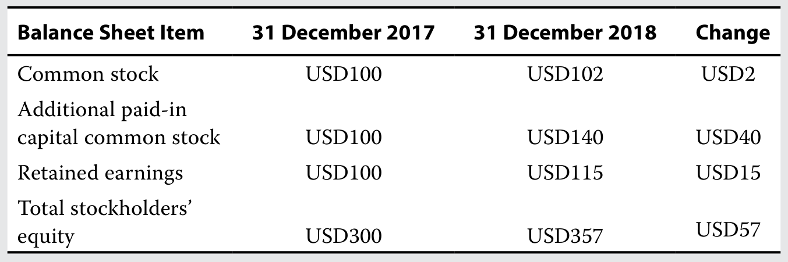

A. 发放普通股的USD42 百万；股利的付款USD10 百万

A. Issuance of common stock of USD42 million; dividends paid of USD10 million

B. 发放普通股 USD38 百万；股利 支付USD10 百万

B. Issuance of common stock of USD38 million; dividends paid of USD10 million

C. 发放普通股 USD42 百万；股利 支付USD40 百万

C. Issuance of common stock of USD42 million; dividends paid of USD40 million

#### 官方答案与解析 / Official answer and explanation

解答：

Solution:

A是对的。

A is correct.

普通股增加的USD42 百万和额外的实缴资本表明，公司在当年发行股票。

The increase of USD42 million in common stock and additional paid-in capital indicates that the company issued stock during the year.

USD15 百万的留存收益的增加表明，公司当年以现金股利支付USD10 百万，确定为USD100 百万的留存收益开始加上净利润的USD25 百万减去结束USD115 百万的留存收益，相当于USD10 百万的现金股利。

The increase in retained earnings of USD15 million indicates that the company paid USD10 million in cash dividends during the year, determined as beginning retained earnings of USD100 million plus net income of USD25 million minus ending retained earnings of USD115 million, which equals USD10 million in cash dividends.

#### 补充解析 / Supplementary explanation

本题复核锚点（原解摘录）：普通股增加的USD42 百万和额外的实缴资本表明，公司在当年发行股票。

Review anchor for this item (official excerpt): The increase of USD42 million in common stock and additional paid-in capital indicates that the company issued stock during the year.

本题官方选项为 A。补充思路：先判断交易的经济性质，再检查所用准则。购买长期经营资产通常属投资，借款与偿还本金通常属融资，核心经营收付属经营。利息与股利在 IFRS 和 US GAAP 下可能存在分类差异，因此跨公司比较应统一口径。现金流类别改变不等于现金总额改变。

The official choice for this item is A. Additional reasoning: Identify economic nature and then the reporting framework. Long-lived operating asset purchases are generally investing; borrowing and principal repayment are financing; core business receipts and payments are operating. Interest and dividend classification can differ under IFRS and US GAAP, so normalize comparisons. Reclassification does not change total cash.

#### 相关知识点 / Related concepts

现金流分类与准则差异：经营、投资、融资三类现金净变化与汇率影响等项目共同调节期初至期末现金余额。

Cash-flow classification and standard differences: Operating, investing, and financing flows, along with effects such as currency translation, reconcile opening and closing cash.

### FSA-LM04-QUESTION_SET-1001 · 习题组 · 第 1 题 Question set · 1

正文习题组 / Question set · 原版 PDF 页码 / Source PDF pages: 159

#### 题目与资料 / Question and data

问题组

QUESTION SET

1\. 美国公认会计原则（US GAAP）下的现金流量表的融资活动实例如下：

1\. Which of the following is an example of a financing activity on the cash flow statement under US GAAP?

A. 支付利息

A. Payment of interest

B.收到股利

B. Receipt of dividends

C. 股利的付款

C. Payment of dividends

#### 官方答案与解析 / Official answer and explanation

解答：

Solution:

C是对的。

C is correct.

支付股利是美国公认会计原则（US GAAP）下的一项融资活动。

Payment of dividends is a financing activity under US GAAP.

支付利息和收取股利包括在美国公认会计原则（US GAAP）下运行的现金流量。

Payment of interest and receipt of dividends are included in operating cash flows under US GAAP.

注意国际财务报告准则（IFRS）允许公司将收取利息和股利作为经营或投资现金流量，并将支付利息和股利作为经营或融资现金流量。

Note that IFRS allow companies to include receipt of interest and dividends as either operating or investing cash flows and to include payment of interest and dividends as either operating or financing cash flows.

#### 补充解析 / Supplementary explanation

本题复核锚点（原解摘录）：支付股利是美国公认会计原则（US GAAP）下的一项融资活动。

Review anchor for this item (official excerpt): Payment of dividends is a financing activity under US GAAP.

本题官方选项为 C。补充思路：先判断交易的经济性质，再检查所用准则。购买长期经营资产通常属投资，借款与偿还本金通常属融资，核心经营收付属经营。利息与股利在 IFRS 和 US GAAP 下可能存在分类差异，因此跨公司比较应统一口径。现金流类别改变不等于现金总额改变。

The official choice for this item is C. Additional reasoning: Identify economic nature and then the reporting framework. Long-lived operating asset purchases are generally investing; borrowing and principal repayment are financing; core business receipts and payments are operating. Interest and dividend classification can differ under IFRS and US GAAP, so normalize comparisons. Reclassification does not change total cash.

#### 相关知识点 / Related concepts

现金流分类与准则差异：经营、投资、融资三类现金净变化与汇率影响等项目共同调节期初至期末现金余额。

Cash-flow classification and standard differences: Operating, investing, and financing flows, along with effects such as currency translation, reconcile opening and closing cash.

### FSA-LM04-QUESTION_SET-1002 · 习题组 · 第 2 题 Question set · 2

正文习题组 / Question set · 原版 PDF 页码 / Source PDF pages: 159

#### 题目与资料 / Question and data

问题组

QUESTION SET

2\. 支付的利息在以下分类为经营现金流量：⁇ , ⁇ , ⁇ , ⁇ , ⁇ , ⁇ , ⁇ , ⁇ , ⁇ , ⁇ , ⁇ , ⁇ , ⁇ , ⁇ , ⁇ , ⁇ , ⁇ , ⁇ , ⁇ , ⁇ , ⁇ , ⁇ , ⁇ , ⁇ , ⁇ , ⁇ , ⁇ , ⁇ , ⁇ , ⁇ , ⁇ , ⁇ , ⁇ , ⁇ , ⁇ , ⁇ , ⁇ , ⁇ , ⁇ , ⁇ , ⁇ , ⁇ , ⁇ , ⁇ , ⁇ , ⁇ , ⁇ , ⁇ , ⁇ , ⁇ , ⁇ , ⁇ , ⁇ , ⁇ , ⁇ , ⁇ , ⁇ , ⁇ , ⁇ , ⁇ , ⁇ , ⁇ , ⁇ , ⁇ , ⁇ , ⁇ , ⁇ , ⁇ , ⁇ , ⁇ , ⁇ , ⁇ , ⁇ , ⁇ , ⁇ , ⁇ , ⁇ , ⁇ , ⁇ , ⁇ , ⁇ , ⁇ , ⁇ , ⁇ , ⁇ , ⁇ , ⁇ , ⁇ , ⁇ , ⁇ , ⁇ , ⁇ , ⁇ , ⁇ , ⁇ , ⁇ , ⁇ , ⁇ , ⁇ , ⁇ , ⁇ , ⁇ , ⁇ , ⁇ , ⁇ , ⁇ , ⁇ , ⁇ , ⁇ , ⁇ , ⁇ , ⁇ , ⁇ , ⁇ , ⁇ , ⁇ , ⁇ , ⁇ , ⁇ , ⁇ , ⁇ , ⁇ , ⁇ , ⁇ , ⁇ , ⁇ , ⁇ , ⁇ , ⁇ , ⁇ , ⁇ , ⁇ , ⁇ , ⁇ , ⁇ , ⁇ , ⁇ , ⁇ , ⁇ , ⁇ , ⁇ , ⁇ , ⁇ , ⁇ , ⁇ , ⁇ , ⁇ , ⁇ , ⁇ , ⁇ , ⁇ , ⁇ , ⁇ , ⁇ , ⁇ , ⁇ , ⁇ , ⁇ , ⁇ , ⁇ , ⁇ , ⁇ , ⁇ , ⁇ , ⁇ , ⁇ , ⁇ , ⁇ , ⁇ , ⁇ , ⁇ , ⁇ , ⁇ , ⁇ , ⁇ , ⁇ , ⁇ , ⁇ , ⁇ , ⁇ , ⁇ , ⁇ , ⁇ , ⁇ , ⁇ , ⁇ , ⁇ , ⁇ , ⁇ , ⁇ , ⁇ , ⁇ , ⁇ , ⁇ , ⁇ , ⁇ , ⁇ , ⁇ , ⁇ , ⁇ , ⁇ , ⁇ , ⁇ , ⁇ , ⁇ , ⁇ , ⁇ , ⁇ , ⁇ , ⁇ , ⁇ , ⁇ , ⁇ , ⁇ , ⁇ , ⁇ , ⁇ , ⁇ , ⁇ , ⁇ , ⁇ , ⁇ , ⁇ , ⁇ , ⁇ , ⁇ , ⁇ , ⁇ , ⁇ , ⁇ , ⁇ , ⁇ , ⁇ , ⁇ , ⁇ , ⁇ , ⁇ , ⁇ , ⁇ , ⁇ , ⁇ , ⁇ , ⁇ , ⁇

2\. Interest paid is classified as an operating cash flow under:

A. 美国公认会计原则（US GAAP）但可在国际财务报告准则（IFRS）下归类为操作或投资现金流量。

A. US GAAP but may be classified as either operating or investing cash flows under IFRS.

B. 国际财务报告准则（IFRS）但在美国公认会计原则（US GAAP）下可归类为操作或投资现金流量。

B. IFRS but may be classified as either operating or investing cash flows under US GAAP.

C. 美国公认会计原则（US GAAP），但可在国际财务报告准则（IFRS）下归类为操作或资助现金流量。

C. US GAAP but may be classified as either operating or financing cash flows under IFRS.

#### 官方答案与解析 / Official answer and explanation

解答：

Solution:

C是对的。

C is correct.

利息费用在美国公认会计原则（US GAAP）下总是被归类为经营现金流量，但可以在国际财务报告准则（IFRS）下被归类为运营或融资现金流量。

Interest expense is always classified as an operating cash flow under US GAAP but may be classified as either an operating or financing cash flow under IFRS.

#### 补充解析 / Supplementary explanation

本题复核锚点（原解摘录）：利息费用在美国公认会计原则（US GAAP）下总是被归类为经营现金流量，但可以在国际财务报告准则（IFRS）下被归类为运营或融资现金流量。

Review anchor for this item (official excerpt): Interest expense is always classified as an operating cash flow under US GAAP but may be classified as either an operating or financing cash flow under IFRS.

本题官方选项为 C。补充思路：先判断交易的经济性质，再检查所用准则。购买长期经营资产通常属投资，借款与偿还本金通常属融资，核心经营收付属经营。利息与股利在 IFRS 和 US GAAP 下可能存在分类差异，因此跨公司比较应统一口径。现金流类别改变不等于现金总额改变。

The official choice for this item is C. Additional reasoning: Identify economic nature and then the reporting framework. Long-lived operating asset purchases are generally investing; borrowing and principal repayment are financing; core business receipts and payments are operating. Interest and dividend classification can differ under IFRS and US GAAP, so normalize comparisons. Reclassification does not change total cash.

#### 相关知识点 / Related concepts

现金流分类与准则差异：经营、投资、融资三类现金净变化与汇率影响等项目共同调节期初至期末现金余额。

Cash-flow classification and standard differences: Operating, investing, and financing flows, along with effects such as currency translation, reconcile opening and closing cash.

### FSA-LM04-QUESTION_SET-1003 · 习题组 · 第 3 题 Question set · 3

正文习题组 / Question set · 原版 PDF 页码 / Source PDF pages: 159-160

#### 题目与资料 / Question and data

问题组

QUESTION SET

3\. 现金流量 收入税须在下列项目下单独披露：

3\. Cash flows from taxes on income must be separately disclosed under:

A. 仅限国际财务报告准则（IFRS）。

A. IFRS only.

B. 美国公认会计原则（US GAAP） 仅此而已。

B. US GAAP only.

C. 国际财务报告准则（IFRS）和美国公认会计原则（US GAAP）两种都使用。

C. both IFRS and US GAAP.

#### 官方答案与解析 / Official answer and explanation

解答：

Solution:

C是对的。

C is correct.

收入税需在国际财务报告准则（IFRS）和美国公认会计原则（US GAAP）下单独披露。

Taxes on income are required to be separately disclosed under IFRS and US GAAP.

披露可能发生在现金流量表或其他地方。

The disclosure may be in the cash flow statement or elsewhere.

#### 补充解析 / Supplementary explanation

本题复核锚点（原解摘录）：收入税需在国际财务报告准则（IFRS）和美国公认会计原则（US GAAP）下单独披露。

Review anchor for this item (official excerpt): Taxes on income are required to be separately disclosed under IFRS and US GAAP.

本题官方选项为 C。补充思路：先判断交易的经济性质，再检查所用准则。购买长期经营资产通常属投资，借款与偿还本金通常属融资，核心经营收付属经营。利息与股利在 IFRS 和 US GAAP 下可能存在分类差异，因此跨公司比较应统一口径。现金流类别改变不等于现金总额改变。

The official choice for this item is C. Additional reasoning: Identify economic nature and then the reporting framework. Long-lived operating asset purchases are generally investing; borrowing and principal repayment are financing; core business receipts and payments are operating. Interest and dividend classification can differ under IFRS and US GAAP, so normalize comparisons. Reclassification does not change total cash.

#### 相关知识点 / Related concepts

现金流分类与准则差异：经营、投资、融资三类现金净变化与汇率影响等项目共同调节期初至期末现金余额。

Cash-flow classification and standard differences: Operating, investing, and financing flows, along with effects such as currency translation, reconcile opening and closing cash.

### FSA-LM04-QUESTION_SET-1004 · 习题组 · 第 4 题 Question set · 4

正文习题组 / Question set · 原版 PDF 页码 / Source PDF pages: 159-160

#### 题目与资料 / Question and data

问题组

QUESTION SET

4.马贝尔公司(MC)在第二季度末报告USD66 百万的应收账款。

4\. Mabel Corporation (MC) reported accounts receivable of USD66 million at the end of its second fiscal quarter.

MC第三季度拥有USD72 百万的收入，并在第三季度末报告了USD55 百万的应收账款。

MC had revenues of USD72 million for its third fiscal quarter and reported accounts receivable of USD55 million at the end of its third fiscal quarter.

根据这些资料，第三季度从客户处收取的现金MC是：

Based on this information, the amount of cash MC collected from customers during the third fiscal quarter is:

A. USD61 百万

A. USD61 million.

B. USD72 百万

B. USD72 million.

C. USD83 百万

C. USD83 million.

#### 官方答案与解析 / Official answer and explanation

解答：

Solution:

C是对的。

C is correct.

季度内从客户收取的现金金额等于开始应收账款+收入减去结束应收账款：以下的计算显示为(1).

The amount of cash collected from customers during the quarter is equal to beginning accounts receivable plus revenues minus ending accounts receivable: the calculation shown below (1).

应收账款的减少表明，按应计制计算，该季度收到的现金大于收入。

A reduction in accounts receivable indicates that cash collected during the quarter was greater than revenue on an accrual basis.

\(1\) USD66 million + USD72 million – USD55 million = USD83 million

#### 补充解析 / Supplementary explanation

本题复核锚点（原解摘录）：季度内从客户收取的现金金额等于开始应收账款+收入减去结束应收账款：以下的计算显示为(1).

Review anchor for this item (official excerpt): The amount of cash collected from customers during the quarter is equal to beginning accounts receivable plus revenues minus ending accounts receivable: the calculation shown below (1).

本题官方选项为 C。补充思路：把每个利润表项目与相关资产负债表账户连接。应收增加意味着已确认收入尚未全部收现，因此从收入扣除应收增加；存货增加意味着采购超过销售成本，应先求采购额，再按应付账款变化调整为付现额。对预付和应计费用，也要判断是现金先发生还是费用先确认，而不是机械记加减号。

The official choice for this item is C. Additional reasoning: Connect each income-statement line to its related balance-sheet account. Rising receivables mean recognized revenue exceeds cash collected. Rising inventory means purchases exceed COGS; calculate purchases before adjusting for payables to obtain cash paid. For prepaid and accrued expenses, reason from timing rather than memorizing signs blindly.

应收账款增加意味着确认的收入尚未全部变为现金，因此客户现金收款通常为收入减应收增加；若涉及预收款，还应加入合同负债增加等适用调整。

An increase in receivables means recognized revenue has not fully become cash; customer collections generally equal revenue less that increase. Customer advances can require additional contract-liability adjustments.

#### 相关知识点 / Related concepts

直接法：从权责发生制到收付现金：现金收款≈收入−Δ应收；采购≈销售成本＋Δ存货；付供应商现金≈采购−Δ应付。题目若有核销、并购等，应另作调整。

Direct-method accrual-to-cash conversion: Cash collected ≈ revenue − Δreceivables; purchases ≈ COGS + Δinventory; supplier cash payments ≈ purchases − Δpayables. Write-offs or acquisitions may require further adjustments.

### FSA-LM04-QUESTION_SET-1005 · 习题组 · 第 5 题 Question set · 5

正文习题组 / Question set · 原版 PDF 页码 / Source PDF pages: 159-160

#### 题目与资料 / Question and data

问题组

QUESTION SET

5\. 红路公司是一家咨询公司，报告在最近一年中，收入总计为USD100 百万，费用总计为USD80 百万，净利润为USD20 百万。

5\. Red Road Company, a consulting company, reported total revenues of USD100 million, total expenses of USD80 million, and net income of USD20 million in the most recent year.

如果应收账款增加USD10 百万，公司从客户那里得到多少现金?.

If accounts receivable increased by USD10 million, how much cash did the company receive from customers?

A. USD90 百万

A. USD90 million.

B. USD100 百万

B. USD100 million.

C. USD110 百万

C. USD110 million.

#### 官方答案与解析 / Official answer and explanation

解答：

Solution:

A是对的。

A is correct.

营业收入1亿美元，减去应收账款增加额1,000万美元，等于向客户收到的现金9,000万美元。

Revenues of USD100 million minus the increase in accounts receivable of USD10 million equal USD90 million cash received from customers.

应收账款的增加意味着该公司收到的现金少于其报告的收入。

The increase in accounts receivable means that the company received less in cash than it reported as revenue.

#### 补充解析 / Supplementary explanation

本题复核锚点（原解摘录）：营业收入1亿美元，减去应收账款增加额1,000万美元，等于向客户收到的现金9,000万美元。

Review anchor for this item (official excerpt): Revenues of USD100 million minus the increase in accounts receivable of USD10 million equal USD90 million cash received from customers.

本题官方选项为 A。补充思路：把每个利润表项目与相关资产负债表账户连接。应收增加意味着已确认收入尚未全部收现，因此从收入扣除应收增加；存货增加意味着采购超过销售成本，应先求采购额，再按应付账款变化调整为付现额。对预付和应计费用，也要判断是现金先发生还是费用先确认，而不是机械记加减号。

The official choice for this item is A. Additional reasoning: Connect each income-statement line to its related balance-sheet account. Rising receivables mean recognized revenue exceeds cash collected. Rising inventory means purchases exceed COGS; calculate purchases before adjusting for payables to obtain cash paid. For prepaid and accrued expenses, reason from timing rather than memorizing signs blindly.

应收账款增加意味着确认的收入尚未全部变为现金，因此客户现金收款通常为收入减应收增加；若涉及预收款，还应加入合同负债增加等适用调整。

An increase in receivables means recognized revenue has not fully become cash; customer collections generally equal revenue less that increase. Customer advances can require additional contract-liability adjustments.

#### 相关知识点 / Related concepts

直接法：从权责发生制到收付现金：现金收款≈收入−Δ应收；采购≈销售成本＋Δ存货；付供应商现金≈采购−Δ应付。题目若有核销、并购等，应另作调整。

Direct-method accrual-to-cash conversion: Cash collected ≈ revenue − Δreceivables; purchases ≈ COGS + Δinventory; supplier cash payments ≈ purchases − Δpayables. Write-offs or acquisitions may require further adjustments.

### FSA-LM04-PRACTICE-001 · 章末习题 1 Practice problem 1

章末练习 / Practice problem · 原版 PDF 页码 / Source PDF pages: 161, 165

#### 题目与资料 / Question and data

1.根据虚构公司Pinkerly Inc.的图表1中的信息，公司为了获得经营现金流量，将对净利润作出什么总的调整?

1\. Based on the information in Exhibit 1 for Pinkerly Inc., a fictitious company, what are the total adjustments that the company would make to net income in order to derive operating cash flow?

图表1:平克利股份有限公司

Exhibit 1: Pinkerly Inc.

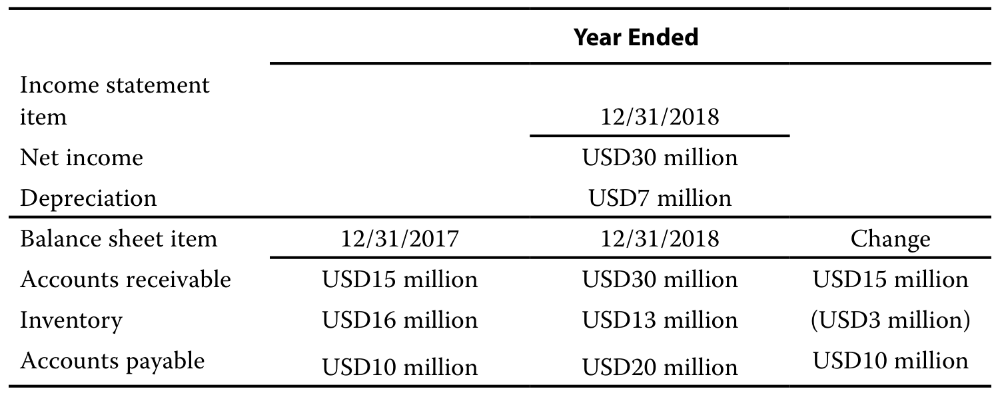

A. 增加USD5 百万

A. Add USD5 million

B. 增加USD21 百万

B. Add USD21 million

C. 减去USD9 百万

C. Subtract USD9 million

#### 官方答案与解析 / Official answer and explanation

1,A没错

1\. A is correct.

为得出经营现金流量，公司将对净利润作以下调整：增加折旧(非现金支出)USD7 百万；增加存货减少的USD3 百万；增加应付账款增加的USD10 百万；减少应收账款增加的USD15 百万。

To derive operating cash flow, the company would make the following adjustments to net income: add depreciation (a non-cash expense) of USD7 million; add the decrease in inventory of USD3 million; add the increase in accounts payable of USD10 million; and subtract the increase in accounts receivable of USD15 million.

总增量USD20 百万总和总减量USD15 百万总和净增量USD5 百万总和。

Total additions of USD20 million and total subtractions of USD15 million result in net total additions of USD5 million.

#### 补充解析 / Supplementary explanation

本题复核锚点（原解摘录）：为得出经营现金流量，公司将对净利润作以下调整：增加折旧(非现金支出)USD7 百万；增加存货减少的USD3 百万；增加应付账款增加的USD10 百万；减少应收账款增加的USD15 百万。

Review anchor for this item (official excerpt): To derive operating cash flow, the company would make the following adjustments to net income: add depreciation (a non-cash expense) of USD7 million; add the decrease in inventory of USD3 million; add the increase in accounts payable of USD10 million; and subtract the increase in accounts receivable of USD15 million.

本题官方选项为 A。补充思路：从净利润开始，加回已扣除但未流出经营现金的费用，如折旧；剔除应归投资或融资活动的损益；最后调整经营性营运资本。经营资产增加通常吸收现金，经营负债增加通常释放现金。不要把现金本身、借款或股利支付混入经营营运资本调整。非现金投资融资交易应在适当位置披露，而非伪造成现金流。

The official choice for this item is A. Additional reasoning: Start with net income, add back noncash expenses, remove gains or losses belonging to investing or financing, then adjust operating working capital. Increases in operating assets generally consume cash; increases in operating liabilities provide cash. Cash itself, borrowings, and dividends are not operating working-capital adjustments. Disclose noncash investing or financing without manufacturing cash flows.

间接法加回折旧是在从净利润剔除非现金费用，并不是说折旧产生现金。处置资产收益也要从经营现金流调整中扣除，因为完整处置收款属于投资现金流。

Adding depreciation under the indirect method reverses a non-cash expense; depreciation does not create cash. A disposal gain is also removed from CFO because the full disposal proceeds belong in investing flows.

#### 相关知识点 / Related concepts

间接法经营现金流：CFO≈净利润＋非现金费用−非经营收益−经营性资产增加＋经营性负债增加。

Indirect-method operating cash flow: CFO ≈ net income + noncash charges − nonoperating gains − increases in operating assets + increases in operating liabilities.

### FSA-LM04-PRACTICE-002 · 章末习题 2 Practice problem 2

章末练习 / Practice problem · 原版 PDF 页码 / Source PDF pages: 161, 165

#### 题目与资料 / Question and data

2.当使用间接法从经营活动计算净现金流量时，在净利润中加入一个加法最有可能发生时有：

2\. When computing net cash flow from operating activities using the indirect method, an addition to net income is most likely to occur when there is a:

A. 出售资产的收益。

A. gain on the sale of an asset.

B. 债务退休的损失。

B. loss on the retirement of debt.

C. 递延所得税负债减少。

C. decrease in a deferred tax liability.

#### 官方答案与解析 / Official answer and explanation

2,B对

2\. B is correct.

净利润是债务退休亏损时追加的，属于非经营亏损。

An addition to net income is made when there is a loss on the retirement of debt, which is a non-operating loss.

出售资产的收益和递延所得税负债的减少均从净收入中扣除。

A gain on the sale of an asset and a decrease in deferred tax liability are both subtracted from net-income.

#### 补充解析 / Supplementary explanation

本题复核锚点（原解摘录）：净利润是债务退休亏损时追加的，属于非经营亏损。

Review anchor for this item (official excerpt): An addition to net income is made when there is a loss on the retirement of debt, which is a non-operating loss.

本题官方选项为 B。补充思路：从净利润开始，加回已扣除但未流出经营现金的费用，如折旧；剔除应归投资或融资活动的损益；最后调整经营性营运资本。经营资产增加通常吸收现金，经营负债增加通常释放现金。不要把现金本身、借款或股利支付混入经营营运资本调整。非现金投资融资交易应在适当位置披露，而非伪造成现金流。

The official choice for this item is B. Additional reasoning: Start with net income, add back noncash expenses, remove gains or losses belonging to investing or financing, then adjust operating working capital. Increases in operating assets generally consume cash; increases in operating liabilities provide cash. Cash itself, borrowings, and dividends are not operating working-capital adjustments. Disclose noncash investing or financing without manufacturing cash flows.

间接法加回折旧是在从净利润剔除非现金费用，并不是说折旧产生现金。处置资产收益也要从经营现金流调整中扣除，因为完整处置收款属于投资现金流。

Adding depreciation under the indirect method reverses a non-cash expense; depreciation does not create cash. A disposal gain is also removed from CFO because the full disposal proceeds belong in investing flows.

#### 相关知识点 / Related concepts

间接法经营现金流：CFO≈净利润＋非现金费用−非经营收益−经营性资产增加＋经营性负债增加。

Indirect-method operating cash flow: CFO ≈ net income + noncash charges − nonoperating gains − increases in operating assets + increases in operating liabilities.

### FSA-LM04-PRACTICE-003 · 章末习题 3 Practice problem 3

章末练习 / Practice problem · 原版 PDF 页码 / Source PDF pages: 161-162, 165

#### 题目与资料 / Question and data

3.一名分析师从一家公司的2018 财务报表收集了图表1中的信息：

3\. An analyst gathered the information in Exhibit 1 from a company’s 2018 financial statements:

图表1:2018 财务报表(US美元，百万美元)

Exhibit 1: 2018 Financial Statement (US dollars, millions)

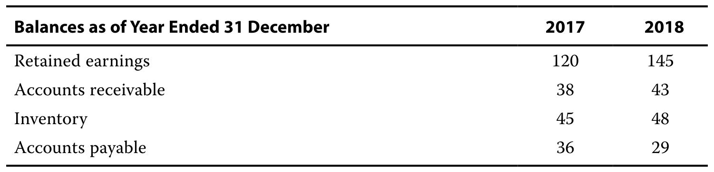

在2018中，公司申报并支付了USD10 百万的股利现金，并将折旧费用记录为USD25 百万。

In 2018, the company declared and paid cash dividends of USD10 million and recorded depreciation expense in the amount of USD25 million.

公司认为股利支付了一项融资活动。

The company considers dividends paid a financing activity.

该公司业务的2018 现金流量(以USD百万计)最接近：

The company’s 2018 cash flow from operations (in USD millions) was closest to:

A. 25.

B. 45.

C. 75.

#### 官方答案与解析 / Official answer and explanation

3,B对

3\. B is correct.

所有美元数额都以百万计。

All dollar amounts are in millions.

2018的净利润(NI)为USD35.

Net income (NI) for 2018 is USD35.

这个数额是留存收益，USD25，加上支付的股利，USD10的增加。

This amount is the increase in retained earnings, USD25, plus the dividends paid, USD10.

USD25的折旧被添加回净利润，应收账款，USD5，以及存货，USD3的增量由于是使用现金而从净利润中扣除。

Depreciation of USD25 is added back to net income, and the increases in accounts receivable, USD5, and in inventory, USD3, are subtracted from net income because they are uses of cash.

应付账款的减少也是使用现金，因此是净利润的减值。

The decrease in accounts payable is also a use of cash and, therefore, a subtraction from net income.

因此，来自操作的现金流量是(1)以下的计算。

Thus, cash flow from operations is the calculation shown below (1).

\(1\) USD25 + USD10 + USD25 – USD5 – USD3 – USD7 = USD45

#### 补充解析 / Supplementary explanation

本题应从净利润重建经营现金流。先用留存收益的变动加回题设股利：25＋10＝35，得到净利润；再加回25的折旧，因为折旧减少利润但不直接支付现金。应收账款增加5、存货增加3都占用现金，应扣除；应付账款减少同样意味着现金支付超过当期采购对应的应计金额，应按题表金额扣除。逐项沿用原题单位，结果对应官方B项。股利在这里用于反推净利润，不能因此把这一步当成经营现金流的股利收付。

Reconstruct operating cash flow from net income. The increase in retained earnings plus dividends gives net income: 25+10=35. Add back depreciation of 25 because it reduced earnings without a current cash payment. Subtract the increases of 5 in receivables and 3 in inventory because they absorb cash. A decrease in accounts payable also uses cash; subtract the amount in the source table. Keep the source units throughout to obtain official choice B. Dividends are used here to recover net income from retained earnings, rather than being inserted as an operating cash payment.

#### 相关知识点 / Related concepts

间接法经营现金流：净利润＋非现金费用−非经营收益，随后扣除经营性资产增加、加上经营性负债增加；减少时符号相反。留存收益桥梁：期末留存收益＝期初留存收益＋净利润−股利（按本题假设）。

Indirect operating cash flow: start with net income, adjust noncash charges and nonoperating gains, subtract increases in operating assets, and add increases in operating liabilities; decreases have opposite signs. Under the question’s assumptions, ending retained earnings equals beginning retained earnings plus net income minus dividends.

### FSA-LM04-PRACTICE-004 · 章末习题 4 Practice problem 4

章末练习 / Practice problem · 原版 PDF 页码 / Source PDF pages: 162, 165

#### 题目与资料 / Question and data

4.根据Sarchive 1公司的资料，公司对净利润进行的净调整总额是多少，以得出经营现金流量?

4\. Based on the information in Exhibit 1 for Star Inc., what are the total net adjustments that the company would make to net income to derive operating cash flow?

图表1:明星股份有限公司。

Exhibit 1: Star Inc.

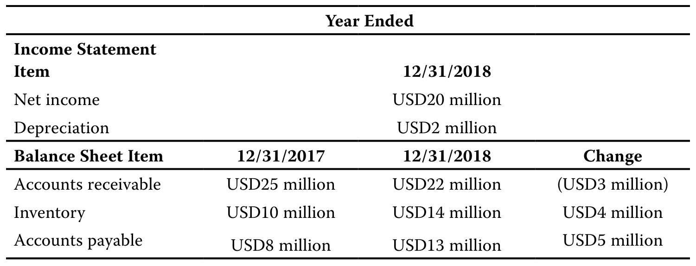

A. 增加USD2 百万

A. Add USD2 million

B. 增加USD6 百万

B. Add USD6 million

C. 减法USD6 百万。

C. Subtract USD6 million.

#### 官方答案与解析 / Official answer and explanation

4,B对

4\. B is correct.

为获得经营现金流量，公司将对净利润作出以下调整：增加折旧(非现金支出)为USD2 百万；增加应收账款减少的USD3 百万；增加应付账款增加的USD5 百万；减少存货增加的USD4 百万。

To derive operating cash flow, the company would make the following adjustments to net income: Add depreciation (a non-cash expense) of USD2 million; add the decrease in accounts receivable of USD3 million; add the increase in accounts payable of USD5 million; and subtract the increase in inventory of USD4 million.

总增加额为USD10 百万，总减少额为USD4 百万，净增加额为USD6 百万。

Total additions would be USD10 million, and total subtractions would be USD4 million, which gives net additions of USD6 million.

#### 补充解析 / Supplementary explanation

本题复核锚点（原解摘录）：为获得经营现金流量，公司将对净利润作出以下调整：增加折旧(非现金支出)为USD2 百万；增加应收账款减少的USD3 百万；增加应付账款增加的USD5 百万；减少存货增加的USD4 百万。

Review anchor for this item (official excerpt): To derive operating cash flow, the company would make the following adjustments to net income: Add depreciation (a non-cash expense) of USD2 million; add the decrease in accounts receivable of USD3 million; add the increase in accounts payable of USD5 million; and subtract the increase in inventory of USD4 million.

本题官方选项为 B。补充思路：从净利润开始，加回已扣除但未流出经营现金的费用，如折旧；剔除应归投资或融资活动的损益；最后调整经营性营运资本。经营资产增加通常吸收现金，经营负债增加通常释放现金。不要把现金本身、借款或股利支付混入经营营运资本调整。非现金投资融资交易应在适当位置披露，而非伪造成现金流。

The official choice for this item is B. Additional reasoning: Start with net income, add back noncash expenses, remove gains or losses belonging to investing or financing, then adjust operating working capital. Increases in operating assets generally consume cash; increases in operating liabilities provide cash. Cash itself, borrowings, and dividends are not operating working-capital adjustments. Disclose noncash investing or financing without manufacturing cash flows.

间接法加回折旧是在从净利润剔除非现金费用，并不是说折旧产生现金。处置资产收益也要从经营现金流调整中扣除，因为完整处置收款属于投资现金流。

Adding depreciation under the indirect method reverses a non-cash expense; depreciation does not create cash. A disposal gain is also removed from CFO because the full disposal proceeds belong in investing flows.

#### 相关知识点 / Related concepts

间接法经营现金流：CFO≈净利润＋非现金费用−非经营收益−经营性资产增加＋经营性负债增加。

Indirect-method operating cash flow: CFO ≈ net income + noncash charges − nonoperating gains − increases in operating assets + increases in operating liabilities.

### FSA-LM04-PRACTICE-005 · 章末习题 5 Practice problem 5

章末练习 / Practice problem · 原版 PDF 页码 / Source PDF pages: 162, 165

#### 题目与资料 / Question and data

5.在2018，一家使用美国公认会计原则（US GAAP）的公司以现金支付USD6 百万的工资，USD2 百万支付利息费用的工资，USD4 百万支付所得税的工资。

5\. In 2018, a company using US GAAP made cash payments of USD6 million for salaries, USD2 million for interest expense, and USD4 million for income taxes.

关于该公司的补充资料见展览1:

Additional information for the company is provided in the Exhibit 1:

图表1:现金支付

Exhibit 1: Cash Payments

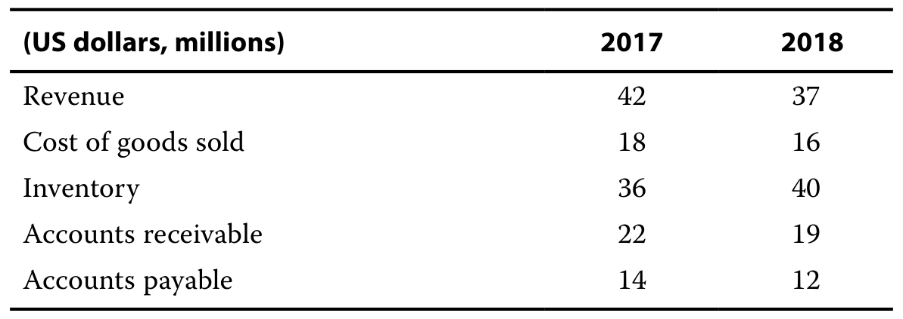

仅根据图表1中的信息，该公司的经营现金流量为2018最接近：.

Based only on the information in Exhibit 1, the company’s operating cash flow for 2018 is closest to:

A. USD6 百万

A. USD6 million.

B. USD10 百万

B. USD10 million.

C. USD14 百万

C. USD14 million.

#### 官方答案与解析 / Official answer and explanation

5,A没错

5\. A is correct.

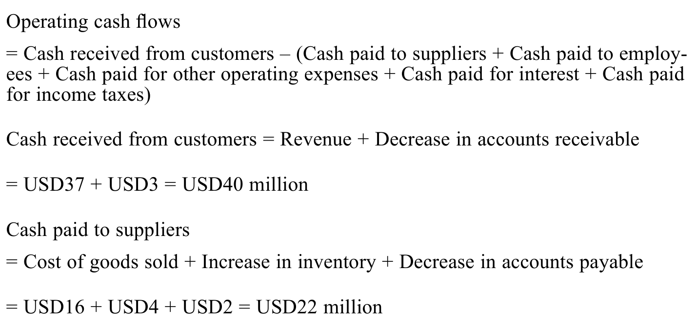

因此，该公司的经营现金流量 = USD40 – USD22 – 支付的现金 工资 – 支付的现金 利息 – 支付的现金 税收 =以下计算值为(1).

Therefore, the company’s operating cash flow = USD40 – USD22 – Cash paid for salaries – Cash paid for interest – Cash paid for taxes = the calculation shown below (1).

\(1\) USD40 – USD22 – USD6 – USD2 – USD4 = USD6 million

#### 补充解析 / Supplementary explanation

本题复核锚点（原解摘录）：因此，该公司的经营现金流量 = USD40 – USD22 – 支付的现金 工资 – 支付的现金 利息 – 支付的现金 税收 =以下计算值为(1).

Review anchor for this item (official excerpt): Therefore, the company’s operating cash flow = USD40 – USD22 – Cash paid for salaries – Cash paid for interest – Cash paid for taxes = the calculation shown below (1).

本题官方选项为 A。补充思路：先判断交易的经济性质，再检查所用准则。购买长期经营资产通常属投资，借款与偿还本金通常属融资，核心经营收付属经营。利息与股利在 IFRS 和 US GAAP 下可能存在分类差异，因此跨公司比较应统一口径。现金流类别改变不等于现金总额改变。

The official choice for this item is A. Additional reasoning: Identify economic nature and then the reporting framework. Long-lived operating asset purchases are generally investing; borrowing and principal repayment are financing; core business receipts and payments are operating. Interest and dividend classification can differ under IFRS and US GAAP, so normalize comparisons. Reclassification does not change total cash.

#### 相关知识点 / Related concepts

现金流分类与准则差异：经营、投资、融资三类现金净变化与汇率影响等项目共同调节期初至期末现金余额。

Cash-flow classification and standard differences: Operating, investing, and financing flows, along with effects such as currency translation, reconcile opening and closing cash.

### FSA-LM04-PRACTICE-006 · 章末习题 6 Practice problem 6

章末练习 / Practice problem · 原版 PDF 页码 / Source PDF pages: 162-163, 165

#### 题目与资料 / Question and data

6\. Green Glory Corp.是一家花园供应批发商，报告销售成本为USD80 百万的年份。

6\. Green Glory Corp., a garden supply wholesaler, reported cost of goods sold for the year of USD80 million.

总计资产增加USD55 百万，包括存货增加的USD5 百万。

Total assets increased by USD55 million, including an increase of USD5 million in inventory.

总计负债增加USD45 百万，包括应付账款增加的USD2 百万。

Total liabilities increased by USD45 million, including an increase of USD2 million in accounts payable.

该公司向供应商提供的支付的现金最接近：

The cash paid by the company to its suppliers is most likely closest to:

A. USD73 百万

A. USD73 million.

B. USD77 百万

B. USD77 million.

C. USD83 百万

C. USD83 million.

#### 官方答案与解析 / Official answer and explanation

6,C号正确

6\. C is correct.

USD80 百万的销售成本加上USD5 百万的存货的增加等于从USD85 百万供应商处购买。

Cost of goods sold of USD80 million plus the increase in inventory of USD5 million equals purchases from suppliers of USD85 million.

USD2 百万的应付账款的增加意味着公司向供应商支付了USD83 百万的现金(USD85 百万减去USD2 百万).

The increase in accounts payable of USD2 million means that the company paid USD83 million in cash (USD85 million minus USD2 million) to its suppliers.

#### 补充解析 / Supplementary explanation

本题复核锚点（原解摘录）：USD80 百万的销售成本加上USD5 百万的存货的增加等于从USD85 百万供应商处购买。

Review anchor for this item (official excerpt): Cost of goods sold of USD80 million plus the increase in inventory of USD5 million equals purchases from suppliers of USD85 million.

本题官方选项为 C。补充思路：把每个利润表项目与相关资产负债表账户连接。应收增加意味着已确认收入尚未全部收现，因此从收入扣除应收增加；存货增加意味着采购超过销售成本，应先求采购额，再按应付账款变化调整为付现额。对预付和应计费用，也要判断是现金先发生还是费用先确认，而不是机械记加减号。

The official choice for this item is C. Additional reasoning: Connect each income-statement line to its related balance-sheet account. Rising receivables mean recognized revenue exceeds cash collected. Rising inventory means purchases exceed COGS; calculate purchases before adjusting for payables to obtain cash paid. For prepaid and accrued expenses, reason from timing rather than memorizing signs blindly.

#### 相关知识点 / Related concepts

直接法：从权责发生制到收付现金：现金收款≈收入−Δ应收；采购≈销售成本＋Δ存货；付供应商现金≈采购−Δ应付。题目若有核销、并购等，应另作调整。

Direct-method accrual-to-cash conversion: Cash collected ≈ revenue − Δreceivables; purchases ≈ COGS + Δinventory; supplier cash payments ≈ purchases − Δpayables. Write-offs or acquisitions may require further adjustments.

### FSA-LM04-PRACTICE-007 · 章末习题 7 Practice problem 7

章末练习 / Practice problem · 原版 PDF 页码 / Source PDF pages: 163, 165-166

#### 题目与资料 / Question and data

7\. 植物制品零售商紫花S.A. 报告销售成本为USD75 百万年。

7\. Purple Fleur S.A., a retailer of floral products, reported cost of goods sold for the year of USD75 million.

总计资产增加USD55 百万，但存货减少USD6 百万。

Total assets increased by USD55 million, but inventory declined by USD6 million.

总计负债增加USD45 百万，应付账款增加USD2 百万。

Total liabilities increased by USD45 million, and accounts payable increased by USD2 million.

该公司向供应商提供的支付的现金最接近：

The cash paid by the company to its suppliers is most likely closest to:

A. USD67 百万

A. USD67 million.

B. USD79 百万

B. USD79 million.

C. USD83 百万

C. USD83 million.

#### 官方答案与解析 / Official answer and explanation

7,A没错

7\. A is correct.

USD75 百万的销售成本减去USD6 百万的存货的减少等于向USD69 百万供应商购买。

Cost of goods sold of USD75 million less the decrease in inventory of USD6 million equals purchases from suppliers of USD69 million.

USD2 百万的应付账款增加意味着公司以现金(USD69 百万减去USD2 百万)支付USD67 百万。

The increase in accounts payable of USD2 million means that the company paid USD67 million in cash (USD69 million minus USD2 million).

#### 补充解析 / Supplementary explanation

本题复核锚点（原解摘录）：USD75 百万的销售成本减去USD6 百万的存货的减少等于向USD69 百万供应商购买。

Review anchor for this item (official excerpt): Cost of goods sold of USD75 million less the decrease in inventory of USD6 million equals purchases from suppliers of USD69 million.

本题官方选项为 A。补充思路：把每个利润表项目与相关资产负债表账户连接。应收增加意味着已确认收入尚未全部收现，因此从收入扣除应收增加；存货增加意味着采购超过销售成本，应先求采购额，再按应付账款变化调整为付现额。对预付和应计费用，也要判断是现金先发生还是费用先确认，而不是机械记加减号。

The official choice for this item is A. Additional reasoning: Connect each income-statement line to its related balance-sheet account. Rising receivables mean recognized revenue exceeds cash collected. Rising inventory means purchases exceed COGS; calculate purchases before adjusting for payables to obtain cash paid. For prepaid and accrued expenses, reason from timing rather than memorizing signs blindly.

#### 相关知识点 / Related concepts

直接法：从权责发生制到收付现金：现金收款≈收入−Δ应收；采购≈销售成本＋Δ存货；付供应商现金≈采购−Δ应付。题目若有核销、并购等，应另作调整。

Direct-method accrual-to-cash conversion: Cash collected ≈ revenue − Δreceivables; purchases ≈ COGS + Δinventory; supplier cash payments ≈ purchases − Δpayables. Write-offs or acquisitions may require further adjustments.

### FSA-LM04-PRACTICE-008 · 章末习题 8 Practice problem 8

章末练习 / Practice problem · 原版 PDF 页码 / Source PDF pages: 163, 166

#### 题目与资料 / Question and data

8\. 女子服装制造商白旗公司报告工资支出为USD20 百万。

8\. White Flag, a women’s clothing manufacturer, reported salaries expense of USD20 million.

应付薪金的期初余额为USD3 百万，应付薪金的期终余额为USD1 百万。

The beginning balance of salaries payable was USD3 million, and the ending balance of salaries payable was USD1 million.

公司在薪水上付了多少钱?

How much cash did the company pay in salaries?

A. USD18 百万(津巴布韦)

A. USD18 million

B. USD21 百万

B. USD21 million

C. USD22 百万

C. USD22 million

#### 官方答案与解析 / Official answer and explanation

8,C号正确

8\. C is correct.

起始工资为USD3 百万加工资费用为USD20 百万减去结束工资为USD1 百万等于USD22 百万。

Beginning salaries payable of USD3 million plus salaries expense of USD20 million minus ending salaries payable of USD1 million equals USD22 million.

另外，USD20 百万的开支加上USD2 百万应支付的工资减少相当于USD22 百万。

Alternatively, the expense of USD20 million plus the USD2 million decrease in salaries payable equals USD22 million.

#### 补充解析 / Supplementary explanation

本题复核锚点（原解摘录）：起始工资为USD3 百万加工资费用为USD20 百万减去结束工资为USD1 百万等于USD22 百万。

Review anchor for this item (official excerpt): Beginning salaries payable of USD3 million plus salaries expense of USD20 million minus ending salaries payable of USD1 million equals USD22 million.

本题官方选项为 C。补充思路：应付项目增加表示本期确认的费用尚未全部支付，应付项目减少表示本期还偿付了以前确认的费用。因此现金支付＝本期费用＋期初应付−期末应付。购买设备还必须区分下单、交付确认资产以及付款三个时点；资产负债表和现金流量表的确认时点可能不同。

The official choice for this item is C. Additional reasoning: An increase in a payable means part of current expense is unpaid; a decrease means cash also settles earlier accruals. Cash paid therefore equals expense plus opening payable minus closing payable. For equipment, distinguish ordering, asset delivery/recognition, and payment; balance-sheet and cash-flow effects can arise at different times.

#### 相关知识点 / Related concepts

应计费用与现金支付的桥梁：现金支付＝费用−应付增加额；非现金资产取得可以影响资产负债表而不形成当期现金流，须按准则披露。

Bridging accrued expense and cash payments: Cash paid = expense − increase in payables. A non-cash asset acquisition can affect the balance sheet without a current cash flow and requires appropriate disclosure.

原双语文件在 USD 金额附近误加“津巴布韦”字样；USD 在此表示美元，数值及英文原文为准。 / The prior Chinese file inserts an erroneous Zimbabwe label beside USD; USD denotes US dollars here. Use the original English amount.

### FSA-LM04-PRACTICE-009 · 章末习题 9 Practice problem 9

章末练习 / Practice problem · 原版 PDF 页码 / Source PDF pages: 163-164, 166

#### 题目与资料 / Question and data

9.一名分析师从一家公司的2018 财务报表收集了图表1中的信息：

9\. An analyst gathered the information in Exhibit 1 from a company’s 2018 financial statements:

图表1:2018 财务报表(US美元，百万美元)

Exhibit 1: 2018 Financial Statements (US dollars, millions)

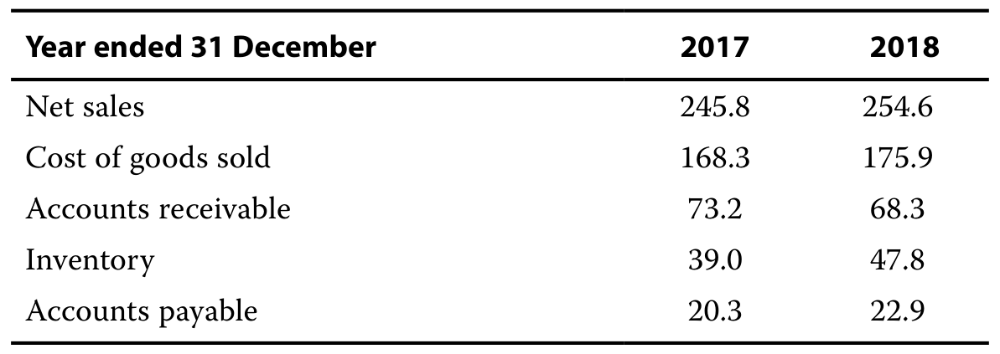

仅根据图表1中的资料，该公司直接格式的2018 现金流量表将包括客户和支付的现金对供应商分别提供的收到的现金的金额(以US百万美元计)，这些金额最接近：.

Based only on the information in Exhibit 1, the company’s 2018 statement of cash flows in the direct format would include amounts (in US dollars millions) for cash received from customers and cash paid to suppliers, respectively, that are closest to:

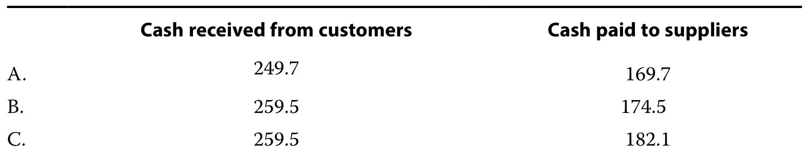

#### 官方答案与解析 / Official answer and explanation

9,C号正确

9\. C is correct.

来自客户的收到的现金 = 销售收入 + 应收账款 = (1)以下的计算。

Cash received from customers = Sales + Decrease in accounts receivable = the calculation shown below (1).

支付的现金致供应商 = 销售成本 + 存货增量 – 应付账款增量 = (2)以下的计算。

Cash paid to suppliers = Cost of goods sold + Increase in inventory – Increase in accounts payable = the calculation shown below (2).

\(1\) 254.6 + 4.9 = 259.5(2) 175.9 + 8.8 – 2.6 = 182.1

#### 补充解析 / Supplementary explanation

本题复核锚点（原解摘录）：来自客户的收到的现金 = 销售收入 + 应收账款 = (1)以下的计算。

Review anchor for this item (official excerpt): Cash received from customers = Sales + Decrease in accounts receivable = the calculation shown below (1).

本题官方选项为 C。补充思路：把每个利润表项目与相关资产负债表账户连接。应收增加意味着已确认收入尚未全部收现，因此从收入扣除应收增加；存货增加意味着采购超过销售成本，应先求采购额，再按应付账款变化调整为付现额。对预付和应计费用，也要判断是现金先发生还是费用先确认，而不是机械记加减号。

The official choice for this item is C. Additional reasoning: Connect each income-statement line to its related balance-sheet account. Rising receivables mean recognized revenue exceeds cash collected. Rising inventory means purchases exceed COGS; calculate purchases before adjusting for payables to obtain cash paid. For prepaid and accrued expenses, reason from timing rather than memorizing signs blindly.

应收账款增加意味着确认的收入尚未全部变为现金，因此客户现金收款通常为收入减应收增加；若涉及预收款，还应加入合同负债增加等适用调整。

An increase in receivables means recognized revenue has not fully become cash; customer collections generally equal revenue less that increase. Customer advances can require additional contract-liability adjustments.

#### 相关知识点 / Related concepts

直接法：从权责发生制到收付现金：现金收款≈收入−Δ应收；采购≈销售成本＋Δ存货；付供应商现金≈采购−Δ应付。题目若有核销、并购等，应另作调整。

Direct-method accrual-to-cash conversion: Cash collected ≈ revenue − Δreceivables; purchases ≈ COGS + Δinventory; supplier cash payments ≈ purchases − Δpayables. Write-offs or acquisitions may require further adjustments.

### FSA-LM04-PRACTICE-010 · 章末习题 10 Practice problem 10

章末练习 / Practice problem · 原版 PDF 页码 / Source PDF pages: 164, 166

#### 题目与资料 / Question and data

10\. Golden Cumulus Corp.，一家商品交易公司，报告了USD19 百万的利息费用和USD6 百万的税收。

10\. Golden Cumulus Corp., a commodities trading company, reported interest expense of USD19 million and taxes of USD6 million.

在此期间，应付利息增加了USD3 百万，应交所得税减少了USD4 百万。

Interest payable increased by USD3 million, and taxes payable decreased by USD4 million over the period.

公司付了多少钱的利息和税?

How much cash did the company pay for interest and taxes?

A. 利息USD22 百万和税收USD10 百万

A. USD22 million for interest and USD10 million for taxes

B. 利息USD16 百万和税款USD2 百万

B. USD16 million for interest and USD2 million for taxes

C. 利息USD16 百万和税收USD10 百万

C. USD16 million for interest and USD10 million for taxes

#### 官方答案与解析 / Official answer and explanation

10,C号正确

10\. C is correct.

USD19 百万的利息费用减去USD3 百万应付利息的增加等于USD16 百万的支付的利息。

Interest expense of USD19 million less the increase in interest payable of USD3 million equals interest paid of USD16 million.

USD6 百万的所得税费用加上USD4 百万的应交所得税的减少等于缴纳的USD10 百万的税款。

Tax expense of USD6 million plus the decrease in taxes payable of USD4 million equals taxes paid of USD10 million.

#### 补充解析 / Supplementary explanation

应付利息增加，说明一部分已计入费用的利息尚未付现，因此利息支付＝19−3＝16百万美元。应付所得税减少，说明本期除了支付当期税费，还偿付了以前期间已计提的税款，因此税款支付＝6＋4＝10百万美元。两项结果对应C。可用负债滚动式检查符号：期末应付款＝期初应付款＋本期费用−本期付现；移项后，付现＝费用−应付款增加额。

An increase in interest payable means some recognized interest has not yet been paid: cash interest is 19−3=USD16 million. A decrease in income taxes payable means cash paid exceeds the current tax expense: cash taxes are 6+4=USD10 million. These results give C. Check the signs using the liability roll-forward: closing payable equals opening payable plus current expense minus cash paid; therefore cash paid equals expense minus the increase in the payable.

#### 相关知识点 / Related concepts

费用与现金支付的调节：在本题不涉及其他调整的条件下，现金支付＝本期费用＋期初应付款−期末应付款。负债增加延后付现，负债减少加大付现。

Expense-to-cash reconciliation: absent other adjustments in this question, cash paid equals current expense plus opening payable minus closing payable. An increasing liability defers cash payment; a decreasing liability increases cash payment.

### FSA-LM04-PRACTICE-011 · 章末习题 11 Practice problem 11

章末练习 / Practice problem · 原版 PDF 页码 / Source PDF pages: 164, 166

#### 题目与资料 / Question and data

11\. 图表中的信息1是从Sweetfall公司财务报表提取的。

11\. The information in Exhibit 1 is extracted from Sweetfall Incorporated’s financial statements.

图表1:甜品瀑布公司

Exhibit 1: Sweetfall Inc.

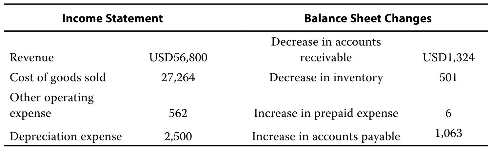

向供应商支付的现金Sweetfall Inc.是：

The amount of cash Sweetfall Inc. paid to suppliers is:

A. USD25,700

A. USD25,700.

B. USD26,702

B. USD26,702.

C. USD27,826

C. USD27,826.

#### 官方答案与解析 / Official answer and explanation

11,A没错

11\. A is correct.

给供应商的支付的现金数额计算如下：

The amount of cash paid to suppliers is calculated as follows:

#### 补充解析 / Supplementary explanation

本题复核锚点（原解摘录）：给供应商的支付的现金数额计算如下：

Review anchor for this item (official excerpt): The amount of cash paid to suppliers is calculated as follows:

本题官方选项为 A。补充思路：把每个利润表项目与相关资产负债表账户连接。应收增加意味着已确认收入尚未全部收现，因此从收入扣除应收增加；存货增加意味着采购超过销售成本，应先求采购额，再按应付账款变化调整为付现额。对预付和应计费用，也要判断是现金先发生还是费用先确认，而不是机械记加减号。

The official choice for this item is A. Additional reasoning: Connect each income-statement line to its related balance-sheet account. Rising receivables mean recognized revenue exceeds cash collected. Rising inventory means purchases exceed COGS; calculate purchases before adjusting for payables to obtain cash paid. For prepaid and accrued expenses, reason from timing rather than memorizing signs blindly.

#### 相关知识点 / Related concepts

直接法：从权责发生制到收付现金：现金收款≈收入−Δ应收；采购≈销售成本＋Δ存货；付供应商现金≈采购−Δ应付。题目若有核销、并购等，应另作调整。

Direct-method accrual-to-cash conversion: Cash collected ≈ revenue − Δreceivables; purchases ≈ COGS + Δinventory; supplier cash payments ≈ purchases − Δpayables. Write-offs or acquisitions may require further adjustments.

## LM 5 · 分析现金流量表 II Analyzing Statements of Cash Flows II 12 条目 · 原题与解析逐条对应 / Paired source questions and explanations

### FSA-LM05-EXAMPLE-101 · 例题 1 · 第 1 题：现金流量表分析 Example 1 · 1 — Analysis of the Cash Flow Statement

正文例题／案例 / Worked example / case · 原版 PDF 页码 / Source PDF pages: 169-172

#### 题目与资料 / Question and data

示例 1

EXAMPLE 1

现金流量表分析

Analysis of the Cash Flow Statement

Derek Yee,CFA，正在准备为Groupe Danone预测现金流量，作为他估值模型的输入。

Derek Yee, CFA, is preparing to forecast cash flow for Groupe Danone as an input into his valuation model.

他回顾了在展览1中展示的达诺内集团为2016和2017的历史现金流量表，以及在展览2中展示的达诺内2017注册文件节录。

He reviews the historical cash flow statement of Groupe Danone for 2016 and 2017, which is presented in Exhibit 1, and excerpts from Danone’s 2017 Registration Document, which is presented in Exhibit 2.

Yee注意到，Groupe Danone按照国际财务报告准则(国际财务报告准则（IFRS）)编制其财务报表。

Yee notes that Groupe Danone prepares its financial statements in conformity with International Financial Reporting Standards (IFRS).

图表 1: Groupe Danone 合并财务报表 综合声明 现金流量(以EUR百万计)

Exhibit 1: Groupe Danone Consolidated Financial Statements Consolidated Statements of Cash Flows (in EUR millions)

 

注：合并后的现金流量表中的数字直接来源于公司备案；由于公司的四舍五入，一些小计可能无法准确总和。

Note: the numbers in the consolidated statement of cash flows were derived straight from company filings; some sub-totals may not sum exactly due to rounding by the company.

图表 2:摘自Danone 2017集团登记声明

Exhibit 2: Excerpt from Groupe Danone 2017 Registration Statement

财务报表的脚注2:

Footnote 2 to the financial statements:

“关于2016年7月7日，Danone宣布签署一项协议，收购WhiteWave食品公司(“WhiteWave”),

“On July 7, 2016, Danone announced the signing of an agreement to acquire The WhiteWave Foods Company (“WhiteWave”), the global leader in plant-based foods and beverages and organic produce.

该收购以现金支付，每股价格为56.25美元；截至协议签署日，对应的企业总价值约为125亿美元，包括债务及WhiteWave的某些其他负债。……“Danone合并财务报表中确认的收购费用，税前合计为5,100万欧元；其中4,800万欧元于2016年计入‘其他营业收益（费用）’，其余部分于2017年确认。

The acquisition in cash, for USD 56.25 per share, represented, as of the date of the agreement, a total enterprise value of approximately USD 12.5 billion, including debt and certain other WhiteWave liabilities. … “Acquisition expenses recognized in Danone’s consolidated financial statements totaled €51 million before tax, of which €48 million was recognized in 2016 in Other operating income (expense), with the balance recognized in 2017.

" WhiteWave对2017的贡献巩固了销售收入，共计€2.7 十亿。

“WhiteWave’s contribution to 2017 consolidated sales totaled €2.7 billion.

如果该交易于2017年1月1日完成，本集团2017年的合并销售收入将为257亿欧元，经常性营业利润将为36亿欧元。

Had the transaction been completed on January 1, 2017, the Group’s 2017 consolidated sales would have been €25.7 billion, with recurring operating income of €3.6 billion.

“同时，在营业利润(支出)下确认的该期间的合并费用共计€91 百万。”

“Meanwhile, integration expenses for the period totaled €91 million, recognized under Other operating income (expense).”

业务概览：“作为转型计划的一部分，Danone旨在稳妥地实现强劲、盈利且可持续的增长，因此制定了2020年的目标，包括同口径销售收入增长率介于4%至5%之间……2020年的经常性营业利润率超过16%……最后，Danone将继续着重提高自由现金流，以帮助降低财务杠杆；目标是到2020年将净债务/EBITDA比率降至3倍以下。

Overview of Activities: “As part of its transformation plan aimed at ensuring a safe journey to deliver strong, profitable and sustainable growth, Danone set objectives for 2020 that include like-for-like sales growth between 4% and 5% …. a recurring operating margin of over 16% in 2020 … Finally, Danone will continue to focus on growing its free cash flow, which will contribute to financial deleverage with an objective of a ratio of Net debt/EBITDA below 3x in 2020.

Danone承诺在2020的12%周围达到投入资本回报率（ROIC）水平。”

Danone is committed to reaching a ROIC level around 12% in 2020.”

1\. Groupe Danone的主要现金来源和用途是什么?

1\. What are the major sources and uses of cash for Groupe Danone?

#### 官方答案与解析 / Official answer and explanation

解答：

Solution:

现金流量的主要类别可归纳如下(以EUR百万计): .

The major categories of cash flows can be summarized as follows (in EUR millions):

2016的Groupe Danone现金的主要来源是2,652的经营活动。

The primary source of cash for Groupe Danone in 2016 was operating activities of 2,652.

当年，该公司在资本支出上花费了925，代表了848从投资活动流出的大部分。

During that year, the company spent 925 on capital expenditures, representing most of the outflow of 848 from investing activities.

然而，在2017,Groupe Danone的现金主要来源于筹资活动。

In 2017, however, the primary source of cash for Groupe Danone was from financing activities.

投资部分显示大量使用2017现金购买投资活动内的子公司。

The investing section shows significant use of cash in 2017 for purchase of subsidiaries within investing activities.

#### 补充解析 / Supplementary explanation

应先比较经营、投资和融资三类净现金流，再下钻到各类的重大项目。2016年经营活动提供2,652百万欧元，是主要现金来源；资本支出925百万欧元是投资支出的重要部分，但投资活动净流出为848百万欧元，说明其他投资现金流有抵销作用，二者不应混同。2017年的主要现金来源转为融资活动，购买子公司成为重大投资用途。预测时应把日常经营产生现金的能力与为并购筹资的一次性流量分别判断。

Compare the net operating, investing, and financing categories before examining major underlying transactions. Operating activities supplied EUR2,652 million in 2016 and were the principal source. Capital expenditure of 925 was a major investing use, but net investing outflow was 848 because other investing flows partly offset it; gross expenditure and net category flow are different measures. In 2017, financing became the principal source while purchases of subsidiaries were a substantial investing use. Forecast recurring operating cash generation separately from acquisition-related financing.

#### 相关知识点 / Related concepts

现金流结构分析：识别主要来源、主要用途、毛额与净额以及持续性；现金增加可能来自经营改善，也可能来自借款或股权融资，必须结合投资用途解释。

Cash-flow structure analysis identifies major sources and uses, gross versus net amounts, and persistence. Higher cash can reflect operating strength or financing proceeds; interpret it alongside investing uses.

### FSA-LM05-EXAMPLE-102 · 例题 1 · 第 2 题：现金流量表分析 Example 1 · 2 — Analysis of the Cash Flow Statement

正文例题／案例 / Worked example / case · 原版 PDF 页码 / Source PDF pages: 169-172

#### 题目与资料 / Question and data

示例 1

EXAMPLE 1

现金流量表分析

Analysis of the Cash Flow Statement

Derek Yee,CFA，正在准备为Groupe Danone预测现金流量，作为他估值模型的输入。

Derek Yee, CFA, is preparing to forecast cash flow for Groupe Danone as an input into his valuation model.

他回顾了在展览1中展示的达诺内集团为2016和2017的历史现金流量表，以及在展览2中展示的达诺内2017注册文件节录。

He reviews the historical cash flow statement of Groupe Danone for 2016 and 2017, which is presented in Exhibit 1, and excerpts from Danone’s 2017 Registration Document, which is presented in Exhibit 2.

Yee注意到，Groupe Danone按照国际财务报告准则(国际财务报告准则（IFRS）)编制其财务报表。

Yee notes that Groupe Danone prepares its financial statements in conformity with International Financial Reporting Standards (IFRS).

图表 1: Groupe Danone 合并财务报表 综合声明 现金流量(以EUR百万计)

Exhibit 1: Groupe Danone Consolidated Financial Statements Consolidated Statements of Cash Flows (in EUR millions)

 

注：合并后的现金流量表中的数字直接来源于公司备案；由于公司的四舍五入，一些小计可能无法准确总和。

Note: the numbers in the consolidated statement of cash flows were derived straight from company filings; some sub-totals may not sum exactly due to rounding by the company.

图表 2:摘自Danone 2017集团登记声明

Exhibit 2: Excerpt from Groupe Danone 2017 Registration Statement

财务报表的脚注2:

Footnote 2 to the financial statements:

“关于2016年7月7日，Danone宣布签署一项协议，收购WhiteWave食品公司(“WhiteWave”),

“On July 7, 2016, Danone announced the signing of an agreement to acquire The WhiteWave Foods Company (“WhiteWave”), the global leader in plant-based foods and beverages and organic produce.

该收购以现金支付，每股价格为56.25美元；截至协议签署日，对应的企业总价值约为125亿美元，包括债务及WhiteWave的某些其他负债。……“Danone合并财务报表中确认的收购费用，税前合计为5,100万欧元；其中4,800万欧元于2016年计入‘其他营业收益（费用）’，其余部分于2017年确认。

The acquisition in cash, for USD 56.25 per share, represented, as of the date of the agreement, a total enterprise value of approximately USD 12.5 billion, including debt and certain other WhiteWave liabilities. … “Acquisition expenses recognized in Danone’s consolidated financial statements totaled €51 million before tax, of which €48 million was recognized in 2016 in Other operating income (expense), with the balance recognized in 2017.

" WhiteWave对2017的贡献巩固了销售收入，共计€2.7 十亿。

“WhiteWave’s contribution to 2017 consolidated sales totaled €2.7 billion.

如果该交易于2017年1月1日完成，本集团2017年的合并销售收入将为257亿欧元，经常性营业利润将为36亿欧元。

Had the transaction been completed on January 1, 2017, the Group’s 2017 consolidated sales would have been €25.7 billion, with recurring operating income of €3.6 billion.

“同时，在营业利润(支出)下确认的该期间的合并费用共计€91 百万。”

“Meanwhile, integration expenses for the period totaled €91 million, recognized under Other operating income (expense).”

业务概览：“作为转型计划的一部分，Danone旨在稳妥地实现强劲、盈利且可持续的增长，因此制定了2020年的目标，包括同口径销售收入增长率介于4%至5%之间……2020年的经常性营业利润率超过16%……最后，Danone将继续着重提高自由现金流，以帮助降低财务杠杆；目标是到2020年将净债务/EBITDA比率降至3倍以下。

Overview of Activities: “As part of its transformation plan aimed at ensuring a safe journey to deliver strong, profitable and sustainable growth, Danone set objectives for 2020 that include like-for-like sales growth between 4% and 5% …. a recurring operating margin of over 16% in 2020 … Finally, Danone will continue to focus on growing its free cash flow, which will contribute to financial deleverage with an objective of a ratio of Net debt/EBITDA below 3x in 2020.

Danone承诺在2020的12%周围达到投入资本回报率（ROIC）水平。”

Danone is committed to reaching a ROIC level around 12% in 2020.”

2.来自经营活动的现金流量是否足以覆盖资本支出?

2\. Is cash flow from operating activities sufficient to cover capital expenditures?

#### 官方答案与解析 / Official answer and explanation

解答：

Solution:

是的，2016和2017都有足够的经营现金流量覆盖通常的资本支出。

Yes, in both 2016 and 2017, there was sufficient operating cash flow to cover usual capital expenditures.

#### 补充解析 / Supplementary explanation

本题复核锚点（原解摘录）：是的，2016和2017都有足够的经营现金流量覆盖通常的资本支出。

Review anchor for this item (official excerpt): Yes, in both 2016 and 2017, there was sufficient operating cash flow to cover usual capital expenditures.

补充思路：先明确是全体资本提供者还是普通股股东的现金流。FCFF 要在资本支出后保留可供债权人和股东的金额，因此从 CFO 出发通常加回税后利息；FCFE 已属于股东口径，还要加入净借款并扣除资本支出。用 FCFF 配 WACC、FCFE 配权益成本，现金流口径和折现率必须一致。

Additional reasoning: Identify whether cash is available to all capital providers or equity holders. Starting from CFO, FCFF generally adds back after-tax interest and subtracts capital expenditure. FCFE subtracts capital expenditure and adds net borrowing. Discount FCFF at WACC and FCFE at the cost of equity; the cash-flow and discount-rate perspectives must match.

#### 相关知识点 / Related concepts

自由现金流的受益对象：FCFF＝CFO＋税后利息−资本支出；FCFE＝CFO−资本支出＋净借款，须按原报表利息分类作一致调整。

Who receives free cash flow: FCFF = CFO + after-tax interest − capex; FCFE = CFO − capex + net borrowing, adjusted consistently for the original interest classification.

### FSA-LM05-EXAMPLE-103 · 例题 1 · 第 3 题：现金流量表分析 Example 1 · 3 — Analysis of the Cash Flow Statement

正文例题／案例 / Worked example / case · 原版 PDF 页码 / Source PDF pages: 169-172

#### 题目与资料 / Question and data

示例 1

EXAMPLE 1

现金流量表分析

Analysis of the Cash Flow Statement

Derek Yee,CFA，正在准备为Groupe Danone预测现金流量，作为他估值模型的输入。

Derek Yee, CFA, is preparing to forecast cash flow for Groupe Danone as an input into his valuation model.

他回顾了在展览1中展示的达诺内集团为2016和2017的历史现金流量表，以及在展览2中展示的达诺内2017注册文件节录。

He reviews the historical cash flow statement of Groupe Danone for 2016 and 2017, which is presented in Exhibit 1, and excerpts from Danone’s 2017 Registration Document, which is presented in Exhibit 2.

Yee注意到，Groupe Danone按照国际财务报告准则(国际财务报告准则（IFRS）)编制其财务报表。

Yee notes that Groupe Danone prepares its financial statements in conformity with International Financial Reporting Standards (IFRS).

图表 1: Groupe Danone 合并财务报表 综合声明 现金流量(以EUR百万计)

Exhibit 1: Groupe Danone Consolidated Financial Statements Consolidated Statements of Cash Flows (in EUR millions)

 

注：合并后的现金流量表中的数字直接来源于公司备案；由于公司的四舍五入，一些小计可能无法准确总和。

Note: the numbers in the consolidated statement of cash flows were derived straight from company filings; some sub-totals may not sum exactly due to rounding by the company.

图表 2:摘自Danone 2017集团登记声明

Exhibit 2: Excerpt from Groupe Danone 2017 Registration Statement

财务报表的脚注2:

Footnote 2 to the financial statements:

“关于2016年7月7日，Danone宣布签署一项协议，收购WhiteWave食品公司(“WhiteWave”),

“On July 7, 2016, Danone announced the signing of an agreement to acquire The WhiteWave Foods Company (“WhiteWave”), the global leader in plant-based foods and beverages and organic produce.

该收购以现金支付，每股价格为56.25美元；截至协议签署日，对应的企业总价值约为125亿美元，包括债务及WhiteWave的某些其他负债。……“Danone合并财务报表中确认的收购费用，税前合计为5,100万欧元；其中4,800万欧元于2016年计入‘其他营业收益（费用）’，其余部分于2017年确认。

The acquisition in cash, for USD 56.25 per share, represented, as of the date of the agreement, a total enterprise value of approximately USD 12.5 billion, including debt and certain other WhiteWave liabilities. … “Acquisition expenses recognized in Danone’s consolidated financial statements totaled €51 million before tax, of which €48 million was recognized in 2016 in Other operating income (expense), with the balance recognized in 2017.

" WhiteWave对2017的贡献巩固了销售收入，共计€2.7 十亿。

“WhiteWave’s contribution to 2017 consolidated sales totaled €2.7 billion.

如果该交易于2017年1月1日完成，本集团2017年的合并销售收入将为257亿欧元，经常性营业利润将为36亿欧元。

Had the transaction been completed on January 1, 2017, the Group’s 2017 consolidated sales would have been €25.7 billion, with recurring operating income of €3.6 billion.

“同时，在营业利润(支出)下确认的该期间的合并费用共计€91 百万。”

“Meanwhile, integration expenses for the period totaled €91 million, recognized under Other operating income (expense).”

业务概览：“作为转型计划的一部分，Danone旨在稳妥地实现强劲、盈利且可持续的增长，因此制定了2020年的目标，包括同口径销售收入增长率介于4%至5%之间……2020年的经常性营业利润率超过16%……最后，Danone将继续着重提高自由现金流，以帮助降低财务杠杆；目标是到2020年将净债务/EBITDA比率降至3倍以下。

Overview of Activities: “As part of its transformation plan aimed at ensuring a safe journey to deliver strong, profitable and sustainable growth, Danone set objectives for 2020 that include like-for-like sales growth between 4% and 5% …. a recurring operating margin of over 16% in 2020 … Finally, Danone will continue to focus on growing its free cash flow, which will contribute to financial deleverage with an objective of a ratio of Net debt/EBITDA below 3x in 2020.

Danone承诺在2020的12%周围达到投入资本回报率（ROIC）水平。”

Danone is committed to reaching a ROIC level around 12% in 2020.”

3\. 净利润与来自经营活动的现金流量有何关系?.

3\. What is the relationship between net income and cash flow from operating activities?

#### 官方答案与解析 / Official answer and explanation

解答：

Solution:

在这两年中，经营现金流量超过了净利润。

In both years, operating cash flow exceeded net income.

这两年的经营现金流量超过净利润是一个积极的迹象。

The fact that operating cash flow exceeds net income in both years is a positive sign.

#### 补充解析 / Supplementary explanation

本题复核锚点（原解摘录）：在这两年中，经营现金流量超过了净利润。

Review anchor for this item (official excerpt): In both years, operating cash flow exceeded net income.

补充思路：把经营现金流与净利润对照，可以观察营运资本和非现金项目是否推动两者背离。资本支出高于折旧可能意味着扩张，但还应考虑价格变化、资产年龄与收购等因素。CFO 足以覆盖资本支出并不说明所有股利和回购都可持续，还需要同时考察融资流入、现金储备和未来投资需求。

Additional reasoning: Compare CFO with net income to identify working-capital and noncash drivers of divergence. Capex above depreciation may indicate expansion, but prices, asset age, and acquisitions also matter. Covering capex with CFO does not by itself establish sustainable dividends and buybacks; consider financing, cash reserves, and future investment needs.

#### 相关知识点 / Related concepts

现金流质量与再投资能力：现金流共同比可按收入或现金流总流入/流出列示，必须先读分母；覆盖比率的分子分母要使用同一期且一致口径。

Cash-flow quality and reinvestment capacity: Common-size cash flows may use revenue or total inflows/outflows, so check the denominator. Coverage ratios require consistent definitions and periods.

### FSA-LM05-EXAMPLE-104 · 例题 1 · 第 4 题：现金流量表分析 Example 1 · 4 — Analysis of the Cash Flow Statement

正文例题／案例 / Worked example / case · 原版 PDF 页码 / Source PDF pages: 169-172

#### 题目与资料 / Question and data

示例 1

EXAMPLE 1

现金流量表分析

Analysis of the Cash Flow Statement

Derek Yee,CFA，正在准备为Groupe Danone预测现金流量，作为他估值模型的输入。

Derek Yee, CFA, is preparing to forecast cash flow for Groupe Danone as an input into his valuation model.

他回顾了在展览1中展示的达诺内集团为2016和2017的历史现金流量表，以及在展览2中展示的达诺内2017注册文件节录。

He reviews the historical cash flow statement of Groupe Danone for 2016 and 2017, which is presented in Exhibit 1, and excerpts from Danone’s 2017 Registration Document, which is presented in Exhibit 2.

Yee注意到，Groupe Danone按照国际财务报告准则(国际财务报告准则（IFRS）)编制其财务报表。

Yee notes that Groupe Danone prepares its financial statements in conformity with International Financial Reporting Standards (IFRS).

图表 1: Groupe Danone 合并财务报表 综合声明 现金流量(以EUR百万计)

Exhibit 1: Groupe Danone Consolidated Financial Statements Consolidated Statements of Cash Flows (in EUR millions)

 

注：合并后的现金流量表中的数字直接来源于公司备案；由于公司的四舍五入，一些小计可能无法准确总和。

Note: the numbers in the consolidated statement of cash flows were derived straight from company filings; some sub-totals may not sum exactly due to rounding by the company.

图表 2:摘自Danone 2017集团登记声明

Exhibit 2: Excerpt from Groupe Danone 2017 Registration Statement

财务报表的脚注2:

Footnote 2 to the financial statements:

“关于2016年7月7日，Danone宣布签署一项协议，收购WhiteWave食品公司(“WhiteWave”),

“On July 7, 2016, Danone announced the signing of an agreement to acquire The WhiteWave Foods Company (“WhiteWave”), the global leader in plant-based foods and beverages and organic produce.

该收购以现金支付，每股价格为56.25美元；截至协议签署日，对应的企业总价值约为125亿美元，包括债务及WhiteWave的某些其他负债。……“Danone合并财务报表中确认的收购费用，税前合计为5,100万欧元；其中4,800万欧元于2016年计入‘其他营业收益（费用）’，其余部分于2017年确认。

The acquisition in cash, for USD 56.25 per share, represented, as of the date of the agreement, a total enterprise value of approximately USD 12.5 billion, including debt and certain other WhiteWave liabilities. … “Acquisition expenses recognized in Danone’s consolidated financial statements totaled €51 million before tax, of which €48 million was recognized in 2016 in Other operating income (expense), with the balance recognized in 2017.

" WhiteWave对2017的贡献巩固了销售收入，共计€2.7 十亿。

“WhiteWave’s contribution to 2017 consolidated sales totaled €2.7 billion.

如果该交易于2017年1月1日完成，本集团2017年的合并销售收入将为257亿欧元，经常性营业利润将为36亿欧元。

Had the transaction been completed on January 1, 2017, the Group’s 2017 consolidated sales would have been €25.7 billion, with recurring operating income of €3.6 billion.

“同时，在营业利润(支出)下确认的该期间的合并费用共计€91 百万。”

“Meanwhile, integration expenses for the period totaled €91 million, recognized under Other operating income (expense).”

业务概览：“作为转型计划的一部分，Danone旨在稳妥地实现强劲、盈利且可持续的增长，因此制定了2020年的目标，包括同口径销售收入增长率介于4%至5%之间……2020年的经常性营业利润率超过16%……最后，Danone将继续着重提高自由现金流，以帮助降低财务杠杆；目标是到2020年将净债务/EBITDA比率降至3倍以下。

Overview of Activities: “As part of its transformation plan aimed at ensuring a safe journey to deliver strong, profitable and sustainable growth, Danone set objectives for 2020 that include like-for-like sales growth between 4% and 5% …. a recurring operating margin of over 16% in 2020 … Finally, Danone will continue to focus on growing its free cash flow, which will contribute to financial deleverage with an objective of a ratio of Net debt/EBITDA below 3x in 2020.

Danone承诺在2020的12%周围达到投入资本回报率（ROIC）水平。”

Danone is committed to reaching a ROIC level around 12% in 2020.”

4\. Groupe Danone拥有什么类型的融资现金流量?

4\. What types of financing cash flows does Groupe Danone have?

#### 官方答案与解析 / Official answer and explanation

解答：

Solution:

脚注披露了一个总价值为USD12.5 十亿的大型收购，其中一些资金来自早先发行的债券的收益，这在2016的融资部分显示为现金流量的融资。

Footnotes disclose a major acquisition with an aggregate value of USD12.5 billion, some of which was funded through proceeds from an earlier bond issuance, which appears as a financing cash flow in the financing section for 2016.

#### 补充解析 / Supplementary explanation

附注把现金流量表中的两类大额项目联系起来：总价值125亿美元的WhiteWave收购，有一部分由较早发行的债券筹资，相关债券发行收入体现在2016年融资现金流。发行债券是筹集资金；购买子公司是使用资金，通常列入投资活动。筹资与交割可以跨越不同会计年度，因此不能只看某一年融资流入，就把它解释为经营现金创造能力增强，也不能要求同年融资流入与并购支出机械相等。

The footnote links major financing and investing transactions: part of the USD12.5 billion WhiteWave acquisition was funded by an earlier bond issue, whose proceeds appear in 2016 financing cash flow. Issuing debt raises funds; acquiring a subsidiary uses funds and is normally an investing activity. Funding and completion can occur in different reporting periods. A financing inflow alone does not demonstrate stronger operating cash generation, and same-year financing receipts need not equal acquisition payments.

#### 相关知识点 / Related concepts

重大投资与融资的联动：结合附注追踪交易目的、资金筹集日与付款日，区分债务本金流入、并购投资流出以及经营性现金流。

Connecting major investing and financing events: use footnotes to trace the transaction purpose, funding date, and payment date, distinguishing debt proceeds, acquisition payments, and operating cash flows.

### FSA-LM05-EXAMPLE-202 · 例题2 · 2：共同比现金流量表分析 Example 2 · 2 — Analysis of a Common-Size Cash Flow Statement

正文例题／案例 / Worked example / case · 原版 PDF 页码 / Source PDF pages: 176-178

#### 题目与资料 / Question and data

示例 2

EXAMPLE 2

分析一个 共同比 现金流量表

Analysis of a Common-Size Cash Flow Statement

1\. 安德鲁·波特正在为一家跨国技术公司苹果公司(Apple Inc.)检查一个缩写为共同比的现金流量表。

1\. Andrew Potter is examining an abbreviated common-size cash flow statement for Apple Inc., a multinational technology company.

共同比 现金流量表在展览6中呈现，是同年通过将每行项目除以总的销售净额来编制的。

The common-size cash flow statement, presented in Exhibit 6, was prepared by dividing each line item by total net sales for the same year.

图表 6: 苹果公司 共同比 声明 现金流量 占总数的百分比 销售净额

Exhibit 6: Apple Inc. Common-Size Statements of Cash Flows as Percentage of Total Net Sales

  

2.根据图表6中的资料，讨论苹果公司的趋势：

2\. Based on the information in Exhibit 6, discuss the trends in Apple’s:

A. 折旧与摊销费用。

A. depreciation and amortization expense.

B. 资本支出

B. capital expenditures.

#### 官方答案与解析 / Official answer and explanation

解答：

Solution:

A. Apple在2015年和2016年的折旧及摊销费用占总营业收入净额的比例，均略低于5%；2017年降至4.4%。

A. Apple’s depreciation and amortization expense was consistently just less than 5 percent of total net revenue in 2015 and 2016, declining to 4.4 percent in 2017.

B. 苹果的资本支出水平大于其折旧和摊销在2016和2017的水平，而其与折旧和摊销在2015的水平大致相同。

B. Apple’s level of capital expenditures is greater than its depreciation and amortization in 2016 and 2017, whereas it was at about the same level as depreciation and amortization in 2015.

在2017中，资本支出接近6%.

In 2017, capital expenditures approached 6 percent.

这表明苹果公司正在做的不仅仅是取代不动产、厂房及设备，并且正在扩大这些投资。

This is an indication that Apple is doing more than replacing property, plant, and equipment, and is expanding those investments.

然而，随着每年来自经营活动的现金超过销售收入的27%，苹果公司从业务中获得了超过现金流量的资金来资助这些支出。

With cash generated from operating activities exceeding 27 percent of sales in every year, however, Apple has more than enough cash flow from operations to fund these expenditures.

#### 补充解析 / Supplementary explanation

本题复核锚点（原解摘录）：A. Apple在2015年和2016年的折旧及摊销费用占总营业收入净额的比例，均略低于5%；2017年降至4.4%。

Review anchor for this item (official excerpt): A.

补充思路：把经营现金流与净利润对照，可以观察营运资本和非现金项目是否推动两者背离。资本支出高于折旧可能意味着扩张，但还应考虑价格变化、资产年龄与收购等因素。CFO 足以覆盖资本支出并不说明所有股利和回购都可持续，还需要同时考察融资流入、现金储备和未来投资需求。

Additional reasoning: Compare CFO with net income to identify working-capital and noncash drivers of divergence. Capex above depreciation may indicate expansion, but prices, asset age, and acquisitions also matter. Covering capex with CFO does not by itself establish sustainable dividends and buybacks; consider financing, cash reserves, and future investment needs.

#### 相关知识点 / Related concepts

现金流质量与再投资能力：现金流共同比可按收入或现金流总流入/流出列示，必须先读分母；覆盖比率的分子分母要使用同一期且一致口径。

Cash-flow quality and reinvestment capacity: Common-size cash flows may use revenue or total inflows/outflows, so check the denominator. Coverage ratios require consistent definitions and periods.

原书编号1为共同资料引入段，保留并与实际设问2—4配对。

### FSA-LM05-EXAMPLE-203 · 例题2 · 3：共同比现金流量表分析 Example 2 · 3 — Analysis of a Common-Size Cash Flow Statement

正文例题／案例 / Worked example / case · 原版 PDF 页码 / Source PDF pages: 176-178

#### 题目与资料 / Question and data

示例 2

EXAMPLE 2

分析一个 共同比 现金流量表

Analysis of a Common-Size Cash Flow Statement

1\. 安德鲁·波特正在为一家跨国技术公司苹果公司(Apple Inc.)检查一个缩写为共同比的现金流量表。

1\. Andrew Potter is examining an abbreviated common-size cash flow statement for Apple Inc., a multinational technology company.

共同比 现金流量表在展览6中呈现，是同年通过将每行项目除以总的销售净额来编制的。

The common-size cash flow statement, presented in Exhibit 6, was prepared by dividing each line item by total net sales for the same year.

图表 6: 苹果公司 共同比 声明 现金流量 占总数的百分比 销售净额

Exhibit 6: Apple Inc. Common-Size Statements of Cash Flows as Percentage of Total Net Sales

  

3\. 将苹果公司的经营现金流量与苹果公司的净利率相比，以收入的百分比比较。

3\. Compare Apple’s operating cash flow as a percentage of revenue with Apple’s net profit margin.

#### 官方答案与解析 / Official answer and explanation

解答：

Solution:

苹果公司的经营现金流量占销售收入的百分比每年远高于净利率。

Apple’s operating cash flow as a percentage of sales is much higher than net profit margin in every year.

然而，这一差距在三年期间似乎正在缩小。

This gap appears to be declining however over the three-year period.

在2015 净利率为22.8%，而经营现金流量占销售收入的百分比为34.8%.

In 2015 net profit margin was 22.8 percent, while operating cash flow as a percentage of sales was 34.8 percent.

至2017时，净利率稍降为21.1%，而经营现金流量占销售收入的百分比则更降为27.7%.

By 2017, the net profit margin declined slightly to 21.1 percent, while the operating cash flow as a percentage of sales declined more to 27.7 percent.

主要的差别似乎是应收款项和存货采购额增加，但被应付账款的增加部分抵销。

The primary difference appears to have been an increase in the level of receivables and inventory purchases, somewhat offset by an increase in accounts payable.

#### 补充解析 / Supplementary explanation

本题复核锚点（原解摘录）：苹果公司的经营现金流量占销售收入的百分比每年远高于净利率。

Review anchor for this item (official excerpt): Apple’s operating cash flow as a percentage of sales is much higher than net profit margin in every year.

补充思路：把经营现金流与净利润对照，可以观察营运资本和非现金项目是否推动两者背离。资本支出高于折旧可能意味着扩张，但还应考虑价格变化、资产年龄与收购等因素。CFO 足以覆盖资本支出并不说明所有股利和回购都可持续，还需要同时考察融资流入、现金储备和未来投资需求。

Additional reasoning: Compare CFO with net income to identify working-capital and noncash drivers of divergence. Capex above depreciation may indicate expansion, but prices, asset age, and acquisitions also matter. Covering capex with CFO does not by itself establish sustainable dividends and buybacks; consider financing, cash reserves, and future investment needs.

#### 相关知识点 / Related concepts

现金流质量与再投资能力：现金流共同比可按收入或现金流总流入/流出列示，必须先读分母；覆盖比率的分子分母要使用同一期且一致口径。

Cash-flow quality and reinvestment capacity: Common-size cash flows may use revenue or total inflows/outflows, so check the denominator. Coverage ratios require consistent definitions and periods.

原书编号1为共同资料引入段，保留并与实际设问2—4配对。

### FSA-LM05-EXAMPLE-204 · 例题2 · 4：共同比现金流量表分析 Example 2 · 4 — Analysis of a Common-Size Cash Flow Statement

正文例题／案例 / Worked example / case · 原版 PDF 页码 / Source PDF pages: 176-178

#### 题目与资料 / Question and data

示例 2

EXAMPLE 2

分析一个 共同比 现金流量表

Analysis of a Common-Size Cash Flow Statement

1\. 安德鲁·波特正在为一家跨国技术公司苹果公司(Apple Inc.)检查一个缩写为共同比的现金流量表。

1\. Andrew Potter is examining an abbreviated common-size cash flow statement for Apple Inc., a multinational technology company.

共同比 现金流量表在展览6中呈现，是同年通过将每行项目除以总的销售净额来编制的。

The common-size cash flow statement, presented in Exhibit 6, was prepared by dividing each line item by total net sales for the same year.

图表 6: 苹果公司 共同比 声明 现金流量 占总数的百分比 销售净额

Exhibit 6: Apple Inc. Common-Size Statements of Cash Flows as Percentage of Total Net Sales

  

4\. 讨论苹果使用其正态的经营现金流量。

4\. Discuss Apple’s use of its positive operating cash flow.

#### 官方答案与解析 / Official answer and explanation

解答：

Solution:

苹果公司每年生成大量经营现金流量，超过净利润。

Apple generated a large amount of operating cash flow each year, exceeding net income.

这款现金流量用于相对适度购买不动产、厂房及设备，大量购买可交易证券(投资)，红利支付和回购自有股票。

This cash flow is used for relatively modest purchases of property, plant, and equipment, substantial purchases of marketable securities (investments), dividend payments and repurchases of its own stock.

#### 补充解析 / Supplementary explanation

本题复核锚点（原解摘录）：苹果公司每年生成大量经营现金流量，超过净利润。

Review anchor for this item (official excerpt): Apple generated a large amount of operating cash flow each year, exceeding net income.

补充思路：把经营现金流与净利润对照，可以观察营运资本和非现金项目是否推动两者背离。资本支出高于折旧可能意味着扩张，但还应考虑价格变化、资产年龄与收购等因素。CFO 足以覆盖资本支出并不说明所有股利和回购都可持续，还需要同时考察融资流入、现金储备和未来投资需求。

Additional reasoning: Compare CFO with net income to identify working-capital and noncash drivers of divergence. Capex above depreciation may indicate expansion, but prices, asset age, and acquisitions also matter. Covering capex with CFO does not by itself establish sustainable dividends and buybacks; consider financing, cash reserves, and future investment needs.

#### 相关知识点 / Related concepts

现金流质量与再投资能力：现金流共同比可按收入或现金流总流入/流出列示，必须先读分母；覆盖比率的分子分母要使用同一期且一致口径。

Cash-flow quality and reinvestment capacity: Common-size cash flows may use revenue or total inflows/outflows, so check the denominator. Coverage ratios require consistent definitions and periods.

原书编号1为共同资料引入段，保留并与实际设问2—4配对。

### FSA-LM05-EXAMPLE-301 · 例题 3 · 第 1 题：现金流量可比较性分析 Example 3 · 1 — A Cash Flow Analysis of Comparables

正文例题／案例 / Worked example / case · 原版 PDF 页码 / Source PDF pages: 181-182

#### 题目与资料 / Question and data

示例 3

EXAMPLE 3

现金流量可比较性分析

A Cash Flow Analysis of Comparables

1\. Andrew Potter为微软和苹果分析经营现金流量趋势，这些趋势在图表10和图表11中展示。

1\. Andrew Potter is analyzing operating cash flow trends for Microsoft and Apple, which are presented in Exhibit 10 and Exhibit 11.

图表10:来自经营活动的现金流量占总净值的百分比收入。

Exhibit 10: Cash Flow from Operating Activities as a Percentage of Total Net Revenue

图表11:来自经营活动的现金流量占平均总数的百分比资产

Exhibit 11: Cash Flow from Operating Activities as a Percentage of Average Total Assets

波特最有可能对这两家公司的相对经营性现金流通能力得出什么结论?

What is Potter most likely to conclude about the relative operating cash-flow-generating ability of these two companies?

#### 官方答案与解析 / Official answer and explanation

解答：

Solution:

在这两种措施——经营现金流量除以收入和经营现金流量除以资产——上，这两家公司都取得了总体的强劲成果。

On both measures—operating cash flow divided by revenue and operating cash flow divided by assets—both companies have overall strong results.

然而，在2016和2017中，微软的现金流量比经营活动更高，占收入的百分比。

However, Microsoft has higher cash flow from operating activities as a percentage of revenues in both 2016 and 2017.

此外，微软也呈上升趋势。

Further, Microsoft has an increasing trend.

虽然苹果公司与微软相比，2015的经营现金流量占收入的百分率较高，但一直呈下降趋势，近两年还低于微软。

While Apple had a higher operating cash flow as a percent of revenue in 2015 compared to Microsoft, it has had a declining trend and was below Microsoft in the two more recent years.

微软的经营现金流量相对于资产与苹果的2017相同，相对稳定，自2015以来略有增长。

Microsoft’s operating cash flow relative to assets is the same as Apple’s in 2017 and relatively stable with a slight increase since 2015.

苹果公司开始这三年的比率要高得多，但出现了下降趋势，其比率现在与微软公司处于同一水平。

Apple started the three years with a much stronger ratio but saw a declining trend such that its ratio is now at the same level as Microsoft.

我们应注意的是，这一比率受到苹果公司多年来因其强大的历史现金流量而在金融工具上所作的大量投资的很大影响。

We should note that this ratio is heavily influenced by substantial investments in financial instruments that Apple has made over the years due to its strong historic cash flow.

#### 补充解析 / Supplementary explanation

本题复核锚点（原解摘录）：在这两种措施——经营现金流量除以收入和经营现金流量除以资产——上，这两家公司都取得了总体的强劲成果。

Review anchor for this item (official excerpt): On both measures—operating cash flow divided by revenue and operating cash flow divided by assets—both companies have overall strong results.

补充思路：把经营现金流与净利润对照，可以观察营运资本和非现金项目是否推动两者背离。资本支出高于折旧可能意味着扩张，但还应考虑价格变化、资产年龄与收购等因素。CFO 足以覆盖资本支出并不说明所有股利和回购都可持续，还需要同时考察融资流入、现金储备和未来投资需求。

Additional reasoning: Compare CFO with net income to identify working-capital and noncash drivers of divergence. Capex above depreciation may indicate expansion, but prices, asset age, and acquisitions also matter. Covering capex with CFO does not by itself establish sustainable dividends and buybacks; consider financing, cash reserves, and future investment needs.

#### 相关知识点 / Related concepts

现金流质量与再投资能力：现金流共同比可按收入或现金流总流入/流出列示，必须先读分母；覆盖比率的分子分母要使用同一期且一致口径。

Cash-flow quality and reinvestment capacity: Common-size cash flows may use revenue or total inflows/outflows, so check the denominator. Coverage ratios require consistent definitions and periods.

### FSA-LM05-PRACTICE-001 · 章末习题 1 Practice problem 1

章末练习 / Practice problem · 原版 PDF 页码 / Source PDF pages: 183-184

#### 题目与资料 / Question and data

1\. 制备共同比 现金流量表的一种适当方法是显示每个行项：

1\. One appropriate method of preparing a common-size cash flow statement is to show each line item:

A. 收入和支出占净收入的百分比。

A. of revenue and expense as a percentage of net revenue.

B.在现金流量表上占净收入的百分比。

B. on the cash flow statement as a percentage of net revenue.

C. 现金流量表占现金流出总额的百分比。

C. on the cash flow statement as a percentage of total cash outflows.

#### 官方答案与解析 / Official answer and explanation

1,B对

1\. B is correct.

制备共同比 现金流量表的一种适当方法是将现金流量表上的每个线项显示为净收入的百分比。

An appropriate method to prepare a common-size cash flow statement is to show each line item on the cash flow statement as a percentage of net revenue.

编制现金流量表的另一种方法是将每个现金流入项目作为总流入量的百分比，将每个现金流出项目作为总流出量的百分比。

An alternative way to prepare a statement of cash flows is to show each item of cash inflow as a percentage of total inflows and each item of cash outflows as a percentage of total outflows.

#### 补充解析 / Supplementary explanation

本题复核锚点（原解摘录）：制备共同比 现金流量表的一种适当方法是将现金流量表上的每个线项显示为净收入的百分比。

Review anchor for this item (official excerpt): An appropriate method to prepare a common-size cash flow statement is to show each line item on the cash flow statement as a percentage of net revenue.

本题官方选项为 B。补充思路：把经营现金流与净利润对照，可以观察营运资本和非现金项目是否推动两者背离。资本支出高于折旧可能意味着扩张，但还应考虑价格变化、资产年龄与收购等因素。CFO 足以覆盖资本支出并不说明所有股利和回购都可持续，还需要同时考察融资流入、现金储备和未来投资需求。

The official choice for this item is B. Additional reasoning: Compare CFO with net income to identify working-capital and noncash drivers of divergence. Capex above depreciation may indicate expansion, but prices, asset age, and acquisitions also matter. Covering capex with CFO does not by itself establish sustainable dividends and buybacks; consider financing, cash reserves, and future investment needs.

#### 相关知识点 / Related concepts

现金流质量与再投资能力：现金流共同比可按收入或现金流总流入/流出列示，必须先读分母；覆盖比率的分子分母要使用同一期且一致口径。

Cash-flow quality and reinvestment capacity: Common-size cash flows may use revenue or total inflows/outflows, so check the denominator. Coverage ratios require consistent definitions and periods.

### FSA-LM05-PRACTICE-002 · 章末习题 2 Practice problem 2

章末练习 / Practice problem · 原版 PDF 页码 / Source PDF pages: 183-184

#### 题目与资料 / Question and data

2.以下哪一种是合适的计算方法企业自由现金流量?

2\. Which of the following is an appropriate method of computing free cash flow to the firm?

A. 将运行的现金流量加到资本支出，并扣除税后利息支付。

A. Add operating cash flows to capital expenditures and deduct after-tax interest payments.

B.在税后利息付款中加入运行中的现金流量，并扣除资本支出。

B. Add operating cash flows to after-tax interest payments and deduct capital expenditures.

C.从现金流量业务中扣除税后利息付款和资本支出。

C. Deduct both after-tax interest payments and capital expenditures from operating cash flows.

#### 官方答案与解析 / Official answer and explanation

2,B对

2\. B is correct.

企业自由现金流量可以计算为运行中的现金流量加上税后利息费用减去资本支出。

Free cash flow to the firm can be computed as operating cash flows plus after-tax interest expense less capital expenditures.

#### 补充解析 / Supplementary explanation

本题复核锚点（原解摘录）：企业自由现金流量可以计算为运行中的现金流量加上税后利息费用减去资本支出。

Review anchor for this item (official excerpt): Free cash flow to the firm can be computed as operating cash flows plus after-tax interest expense less capital expenditures.

本题官方选项为 B。补充思路：先明确是全体资本提供者还是普通股股东的现金流。FCFF 要在资本支出后保留可供债权人和股东的金额，因此从 CFO 出发通常加回税后利息；FCFE 已属于股东口径，还要加入净借款并扣除资本支出。用 FCFF 配 WACC、FCFE 配权益成本，现金流口径和折现率必须一致。

The official choice for this item is B. Additional reasoning: Identify whether cash is available to all capital providers or equity holders. Starting from CFO, FCFF generally adds back after-tax interest and subtracts capital expenditure. FCFE subtracts capital expenditure and adds net borrowing. Discount FCFF at WACC and FCFE at the cost of equity; the cash-flow and discount-rate perspectives must match.

若经营现金流已经扣除了利息，计算 FCFF 时通常加回税后利息，再减资本支出；FCFE 面向普通股股东，还要考虑净借款。首先核对题中的现金流分类口径。

If CFO already deducts interest, FCFF generally adds back after-tax interest and subtracts capex. FCFE concerns common shareholders and includes net borrowing. First verify the question’s cash-flow classification.

#### 相关知识点 / Related concepts

自由现金流的受益对象：FCFF＝CFO＋税后利息−资本支出；FCFE＝CFO−资本支出＋净借款，须按原报表利息分类作一致调整。

Who receives free cash flow: FCFF = CFO + after-tax interest − capex; FCFE = CFO − capex + net borrowing, adjusted consistently for the original interest classification.

### FSA-LM05-PRACTICE-003 · 章末习题 3 Practice problem 3

章末练习 / Practice problem · 原版 PDF 页码 / Source PDF pages: 183-184

#### 题目与资料 / Question and data

3\. 现金流量表分析的第一步应该是：

3\. The first step in cash flow statement analysis should be to:

A.评价现金流量的一致性。

A. evaluate consistency of cash flows.

B. 确定经营现金流量驾驶员。

B. determine operating cash flow drivers.

C. 确定现金的主要来源和使用。

C. identify the major sources and uses of cash.

#### 官方答案与解析 / Official answer and explanation

3,C号正确

3\. C is correct.

全面评估现金的主要来源和使用，应是评价现金流量表的第一步。

An overall assessment of the major sources and uses of cash should be the first step in evaluating a cash flow statement.

#### 补充解析 / Supplementary explanation

本题复核锚点（原解摘录）：全面评估现金的主要来源和使用，应是评价现金流量表的第一步。

Review anchor for this item (official excerpt): An overall assessment of the major sources and uses of cash should be the first step in evaluating a cash flow statement.

本题官方选项为 C。补充思路：把经营现金流与净利润对照，可以观察营运资本和非现金项目是否推动两者背离。资本支出高于折旧可能意味着扩张，但还应考虑价格变化、资产年龄与收购等因素。CFO 足以覆盖资本支出并不说明所有股利和回购都可持续，还需要同时考察融资流入、现金储备和未来投资需求。

The official choice for this item is C. Additional reasoning: Compare CFO with net income to identify working-capital and noncash drivers of divergence. Capex above depreciation may indicate expansion, but prices, asset age, and acquisitions also matter. Covering capex with CFO does not by itself establish sustainable dividends and buybacks; consider financing, cash reserves, and future investment needs.

#### 相关知识点 / Related concepts

现金流质量与再投资能力：现金流共同比可按收入或现金流总流入/流出列示，必须先读分母；覆盖比率的分子分母要使用同一期且一致口径。

Cash-flow quality and reinvestment capacity: Common-size cash flows may use revenue or total inflows/outflows, so check the denominator. Coverage ratios require consistent definitions and periods.

### FSA-LM05-PRACTICE-004 · 章末习题 4 Practice problem 4

章末练习 / Practice problem · 原版 PDF 页码 / Source PDF pages: 183-184

#### 题目与资料 / Question and data

4\. 分析师用经营现金流量的总和、利息和税收作为数字计算出一个比率，并作为分母计算利息金额。

4\. An analyst has calculated a ratio using as the numerator the sum of operating cash flow, interest, and taxes and as the denominator the amount of interest.

这个比例是多少，它测量什么，它表示什么?

What is this ratio, what does it measure, and what does it indicate?

A.这一比率是利息保障倍数，衡量公司履行其利息义务的能力，并表明公司偿债能力。

A. This ratio is an interest coverage ratio, measuring a company’s ability to meet its interest obligations and indicating a company’s solvency.

B.这一比率是有效的税率，用来衡量公司用于征税的经营现金流量的数额，并表明公司在税收管理方面的效率。

B. This ratio is an effective tax ratio, measuring the amount of a company’s operating cash flow used for taxes and indicating a company’s efficiency in tax management.

C.这一比率是运行中的盈利能力比率，衡量产生经营现金流量的税收和利息核算，并表明一家公司的流动性。

C. This ratio is an operating profitability ratio, measuring the operating cash flow generated accounting for taxes and interest and indicating a company’s liquidity.

#### 官方答案与解析 / Official answer and explanation

4,A没错

4\. A is correct.

这一比率是利息保障倍数，衡量公司履行其利息义务的能力，并表明公司的偿债能力。

This ratio is an interest coverage ratio, measuring a company’s ability to meet its interest obligations and indicating a company’s solvency.

这种覆盖率基于现金流量信息；利息保障倍数的另一个常见配体使用基于利润表的息税折旧摊销前利润（EBITDA）作为数字。

This coverage ratio is based on cash flow information; another common formulation of the interest coverage ratio uses EBITDA based on the income statement as the numerator.

#### 补充解析 / Supplementary explanation

分母是利息，因此本题衡量的是以现金流偿付利息的能力。分子将经营现金流加回利息和税款，形成按题设口径的付息付税前经营现金流；再除以利息，得到现金流口径的利息保障倍数，所以选A，属于偿债能力分析。B错在税收效率的比率应围绕税款及相应税基；C错在这里并未用收入作分母来衡量经营利润率。该指标与使用EBIT或EBITDA的利润口径覆盖率相关，但分子口径不同，比较时须保持一致。

The interest denominator identifies the obligation being covered. Adding interest and taxes back to operating cash flow produces the question’s cash measure before those payments; dividing by interest gives cash interest coverage, so A is correct and the measure concerns solvency. B misidentifies the denominator needed for tax efficiency, while C does not describe a margin measured against revenue. The ratio is related to coverage measures based on EBIT or EBITDA but uses a different numerator, so comparisons require consistent definitions.

#### 相关知识点 / Related concepts

现金利息保障倍数＝（经营现金流＋利息＋税款）/利息，按本题定义计算。覆盖率是流量对流量的比较；债务资产比、债务权益比则是存量杠杆指标。

Cash interest coverage=(operating cash flow+interest+taxes)/interest under this question’s definition. Coverage compares flows with flows; debt-to-assets and debt-to-equity are stock measures of leverage.

## LM 6 · 存货分析 Analysis of Inventories 46 条目 · 原题与解析逐条对应 / Paired source questions and explanations

### FSA-LM06-EXAMPLE-101 · 例题 1 · 第 1 题：存货 值的下降和回收核算 Example 1 · 1 — Accounting for Declines and Recoveries of Inventory Value

正文例题／案例 / Worked example / case · 原版 PDF 页码 / Source PDF pages: 188

#### 题目与资料 / Question and data

示例 1

EXAMPLE 1

存货 值的下降和回收核算

Accounting for Declines and Recoveries of Inventory Value

Hatsumei Enterprises，一家假设型公司，根据国际财务报告准则（IFRS）制造计算机并准备其财务报表。

Hatsumei Enterprises, a hypothetical company, manufactures computers and prepares its financial statements in accordance with IFRS.

在2017中，结束存货的成本是EUR5.2 百万，但其可变现净值是EUR4.9 百万。

In 2017, the cost of ending inventory was EUR5.2 million, but its net realizable value was EUR4.9 million.

存货目前的重置成本为EUR4.7 百万。

The current replacement cost of the inventory is EUR4.7 million.

这一数字超过可变现净值减去正常利润率。

This figure exceeds the net realizable value less a normal profit margin.

2018年，Hatsumei存货的可变现净值比其账面金额高50万欧元。

In 2018, the net realizable value of Hatsumei’s inventory was EUR0.5 million greater than the carrying amount.

1\. 减记对哈苏梅的2017 财务报表有什么影响?

1\. What was the effect of the write-down on Hatsumei’s 2017 financial statements?

恢复对哈苏梅的2018 财务报表有什么影响?

What was the effect of the recovery on Hatsumei’s 2018 financial statements?

#### 官方答案与解析 / Official answer and explanation

解答：

Solution:

对于2017，哈苏梅会将其存货记为EUR4.9 百万，并将EUR0.3 百万的值变化记录为利润表的支出。

For 2017, Hatsumei would write down its inventory to EUR4.9 million and record the change in value of EUR0.3 million as an expense on the income statement.

对于2018，哈苏梅将增加其存货的账面金额，并将销售成本减少为EUR0.3 百万(回收量限于原减记).

For 2018, Hatsumei would increase the carrying amount of its inventory and reduce the cost of sales by EUR0.3 million (the recovery is limited to the amount of the original write-down).

#### 补充解析 / Supplementary explanation

本题复核锚点（原解摘录）：对于2017，哈苏梅会将其存货记为EUR4.9 百万，并将EUR0.3 百万的值变化记录为利润表的支出。

Review anchor for this item (official excerpt): For 2017, Hatsumei would write down its inventory to EUR4.9 million and record the change in value of EUR0.3 million as an expense on the income statement.

补充思路：存货减记把成本高于可回收金额的损失提前确认，降低资产与当期利润，并改变毛利率、流动比率和周转率。比较比率时要同时考虑分子分母变化：存货下降本身可使周转率上升，但这未必表示销售效率改善。IFRS 与 US GAAP 对计量细节及转回规定不同，必须按题目指定框架判断。

Additional reasoning: A write-down recognizes loss when cost exceeds recoverable value, reducing assets and current profit and affecting margins, liquidity, and turnover. A smaller inventory denominator can raise turnover without better selling efficiency. IFRS and US GAAP differ in measurement details and reversals; follow the question’s framework.

#### 相关知识点 / Related concepts

存货跌价与可变现净值：可变现净值＝预计售价−完成及出售所需成本；减记后未来销售成本可能较低，跨期盈利比较需调整。

Inventory write-downs and net realizable value: NRV = estimated selling price − completion and selling costs. Future COGS can be lower after a write-down, affecting interperiod earnings comparisons.

### FSA-LM06-EXAMPLE-102 · 例题 1 · 第 2 题：存货 值的下降和回收核算 Example 1 · 2 — Accounting for Declines and Recoveries of Inventory Value

正文例题／案例 / Worked example / case · 原版 PDF 页码 / Source PDF pages: 188

#### 题目与资料 / Question and data

示例 1

EXAMPLE 1

存货 值的下降和回收核算

Accounting for Declines and Recoveries of Inventory Value

Hatsumei Enterprises，一家假设型公司，根据国际财务报告准则（IFRS）制造计算机并准备其财务报表。

Hatsumei Enterprises, a hypothetical company, manufactures computers and prepares its financial statements in accordance with IFRS.

在2017中，结束存货的成本是EUR5.2 百万，但其可变现净值是EUR4.9 百万。

In 2017, the cost of ending inventory was EUR5.2 million, but its net realizable value was EUR4.9 million.

存货目前的重置成本为EUR4.7 百万。

The current replacement cost of the inventory is EUR4.7 million.

这一数字超过可变现净值减去正常利润率。

This figure exceeds the net realizable value less a normal profit margin.

2018年，Hatsumei存货的可变现净值比其账面金额高50万欧元。

In 2018, the net realizable value of Hatsumei’s inventory was EUR0.5 million greater than the carrying amount.

2\. 美国公认会计原则（US GAAP）下，如果哈苏梅采用后进先出法（LIFO）方法，减记对哈苏梅的2017 财务报表和哈苏梅的2018 财务报表的恢复会产生什么影响?

2\. Under US GAAP, if Hatsumei used the LIFO method, what would be the effects of the write-down on Hatsumei’s 2017 financial statements and of the recovery on Hatsumei’s 2018 financial statements?

#### 官方答案与解析 / Official answer and explanation

解答：

Solution:

根据US GAAP，Hatsumei应在2017年将存货减记至470万欧元，并通常将50万欧元的价值减少额计入利润表中的销售成本。

Under US GAAP, for 2017, Hatsumei would write down its inventory to EUR4.7 million and typically include the change in value of EUR0.5 million in cost of goods sold on the income statement.

对于2018，哈苏梅不会逆转减记。

For 2018, Hatsumei would not reverse the write-down.

#### 补充解析 / Supplementary explanation

本题复核锚点（原解摘录）：根据US GAAP，Hatsumei应在2017年将存货减记至470万欧元，并通常将50万欧元的价值减少额计入利润表中的销售成本。

Review anchor for this item (official excerpt): Under US GAAP, for 2017, Hatsumei would write down its inventory to EUR4.7 million and typically include the change in value of EUR0.5 million in cost of goods sold on the income statement.

补充思路：存货减记把成本高于可回收金额的损失提前确认，降低资产与当期利润，并改变毛利率、流动比率和周转率。比较比率时要同时考虑分子分母变化：存货下降本身可使周转率上升，但这未必表示销售效率改善。IFRS 与 US GAAP 对计量细节及转回规定不同，必须按题目指定框架判断。

Additional reasoning: A write-down recognizes loss when cost exceeds recoverable value, reducing assets and current profit and affecting margins, liquidity, and turnover. A smaller inventory denominator can raise turnover without better selling efficiency. IFRS and US GAAP differ in measurement details and reversals; follow the question’s framework.

#### 相关知识点 / Related concepts

存货跌价与可变现净值：可变现净值＝预计售价−完成及出售所需成本；减记后未来销售成本可能较低，跨期盈利比较需调整。

Inventory write-downs and net realizable value: NRV = estimated selling price − completion and selling costs. Future COGS can be lower after a write-down, affecting interperiod earnings comparisons.

### FSA-LM06-EXAMPLE-103 · 例题 1 · 第 3 题：存货 值的下降和回收核算 Example 1 · 3 — Accounting for Declines and Recoveries of Inventory Value

正文例题／案例 / Worked example / case · 原版 PDF 页码 / Source PDF pages: 188

#### 题目与资料 / Question and data

示例 1

EXAMPLE 1

存货 值的下降和回收核算

Accounting for Declines and Recoveries of Inventory Value

Hatsumei Enterprises，一家假设型公司，根据国际财务报告准则（IFRS）制造计算机并准备其财务报表。

Hatsumei Enterprises, a hypothetical company, manufactures computers and prepares its financial statements in accordance with IFRS.

在2017中，结束存货的成本是EUR5.2 百万，但其可变现净值是EUR4.9 百万。

In 2017, the cost of ending inventory was EUR5.2 million, but its net realizable value was EUR4.9 million.

存货目前的重置成本为EUR4.7 百万。

The current replacement cost of the inventory is EUR4.7 million.

这一数字超过可变现净值减去正常利润率。

This figure exceeds the net realizable value less a normal profit margin.

2018年，Hatsumei存货的可变现净值比其账面金额高50万欧元。

In 2018, the net realizable value of Hatsumei’s inventory was EUR0.5 million greater than the carrying amount.

3.如果Hatsumei的存货是农产品而不是计算机，那么恢复对Hatsumei的2018 财务报表有什么影响?

3\. What would be the effect of the recovery on Hatsumei’s 2018 financial statements if Hatsumei’s inventory were agricultural products instead of computers?

#### 官方答案与解析 / Official answer and explanation

解答：

Solution:

如果Hatsumei的存货是农产品，而不是计算机，则存货将按可变现净值计量。因此，Hatsumei会在2018年调增存货价值，并确认50万欧元的收益。

If Hatsumei’s inventory were agricultural products instead of computers, inventory would be measured at net realizable value and Hatsumei, therefore, would increase inventory and record a gain of EUR0.5 million for 2018.

#### 补充解析 / Supplementary explanation

本题复核锚点（原解摘录）：如果Hatsumei的存货是农产品，而不是计算机，则存货将按可变现净值计量。

Review anchor for this item (official excerpt): If Hatsumei’s inventory were agricultural products instead of computers, inventory would be measured at net realizable value and Hatsumei, therefore, would increase inventory and record a gain of EUR0.5 million for 2018.

补充思路：存货分析既要看会计方法，也要看采购、生产和销售的真实变化。存货增速持续超过销售可能提示积压；周转过快也可能反映缺货或供应风险。使用平均存货计算周转率更符合期间销售成本的口径，并与同行及历史趋势比较。期末单点数据容易受到季节性和窗口修饰影响。

Additional reasoning: Inventory analysis combines accounting policy with purchases, production, and sales. Inventory persistently outgrowing revenue may signal accumulation; very fast turnover can indicate stockouts or supply risk. Average inventory is generally better aligned with period COGS. Compare peers and history, recognizing seasonality and possible period-end window dressing.

#### 相关知识点 / Related concepts

存货分析与经营含义：存货周转率＝销售成本/平均存货；存货天数＝期间天数/周转率。毛利率变化需结合价格、成本流转和减记。

Inventory analysis and operating interpretation: Inventory turnover = COGS/average inventory. Days inventory = days in period/turnover. Interpret margins with prices, cost-flow assumptions, and write-downs.

### FSA-LM06-WORKED_CASE-002 · 存货 书写对财务比率的影响 Effect of Inventory Write-Downs on Financial Ratios

正文讲解案例 / Narrated worked case · 原版 PDF 页码 / Source PDF pages: 189

#### 题目与资料 / Question and data

示例 2

EXAMPLE 2

存货 书写对财务比率的影响

Effect of Inventory Write-Downs on Financial Ratios

#### 官方答案与解析 / Official answer and explanation

Volvo集团总部位于瑞典哥德堡，是商用运输产品的主要供应商，产品包括建筑设备、卡车、公共汽车、海事及工业应用的驱动系统，以及飞机发动机零部件。⁴ 图表1和图表2摘录了Volvo的合并财务报表。

The Volvo Group, based in Göteborg, Sweden, is a leading supplier of commercial transport products, such as construction equipment, trucks, busses, and drive systems for marine and industrial applications as well as aircraft engine components.4 Excerpts from Volvo’s consolidated financial statements are shown in Exhibit 1 and Exhibit 2.

有关沃尔沃的存货的说明见展览3。

Notes pertaining to Volvo’s inventories are presented in Exhibit 3.

图表1:沃尔沃集团综合利润表(瑞典克朗，每股数据除外)

Exhibit 1: Volvo Group Consolidated Income Statements (Swedish krona in millions, except per share data)

#### 补充解析 / Supplementary explanation

本题复核锚点（原解摘录）：Volvo集团总部位于瑞典哥德堡，是商用运输产品的主要供应商，产品包括建筑设备、卡车、公共汽车、海事及工业应用的驱动系统，以及飞机发动机零部件。

Review anchor for this item (official excerpt): The Volvo Group, based in Göteborg, Sweden, is a leading supplier of commercial transport products, such as construction equipment, trucks, busses, and drive systems for marine and industrial applications as well as aircraft engine components.4 Excerpts from Volvo’s consolidated financial statements are shown in Exhibit 1 and Exhibit 2.

补充思路：存货减记把成本高于可回收金额的损失提前确认，降低资产与当期利润，并改变毛利率、流动比率和周转率。比较比率时要同时考虑分子分母变化：存货下降本身可使周转率上升，但这未必表示销售效率改善。IFRS 与 US GAAP 对计量细节及转回规定不同，必须按题目指定框架判断。

Additional reasoning: A write-down recognizes loss when cost exceeds recoverable value, reducing assets and current profit and affecting margins, liquidity, and turnover. A smaller inventory denominator can raise turnover without better selling efficiency. IFRS and US GAAP differ in measurement details and reversals; follow the question’s framework.

#### 相关知识点 / Related concepts

存货跌价与可变现净值：可变现净值＝预计售价−完成及出售所需成本；减记后未来销售成本可能较低，跨期盈利比较需调整。

Inventory write-downs and net realizable value: NRV = estimated selling price − completion and selling costs. Future COGS can be lower after a write-down, affecting interperiod earnings comparisons.

原教材为连贯讲解型案例，没有独立设问及答案分栏；保留官方案例与演示，未另造题目。

### FSA-LM06-EXAMPLE-301 · 例题 3 · 第 1 题：使用后进先出法（LIFO）与先进先出法（FIFO）的通货膨胀影响 Example 3 · 1 — Impact of Inflation Using LIFO Compared to FIFO

正文例题／案例 / Worked example / case · 原版 PDF 页码 / Source PDF pages: 194-195

#### 题目与资料 / Question and data

示例 3

EXAMPLE 3

使用后进先出法（LIFO）与先进先出法（FIFO）的通货膨胀影响

Impact of Inflation Using LIFO Compared to FIFO

L公司和F公司在所有方面都是相同的，只是L公司使用后进先出法（LIFO）方法，F公司使用先进先出法（FIFO）方法。

Company L and Company F are identical in all respects except that Company L uses the LIFO method and Company F uses the FIFO method.

每家公司均已经营五年，而且每年维持2,000单位的基础存货。

Each company has been in business for five years and maintains a base inventory of 2,000 units each year.

每年除第一年外，购买的单位数等于售出的单位数。

Each year, except the first year, the number of units purchased equaled the number of units sold.

在这五年中，销售收入单位每年增加10%单位，每年年初的单位购销价格上涨，以反映每年4%的通货膨胀。

Over the five year period, unit sales increased 10 percent each year and the unit purchase and selling prices increased at the beginning of each year to reflect inflation of 4 percent per year.

第一年，20,000单位以每股USD15.00的价格售出，单价为USD8.00.

In the first year, 20,000 units were sold at a price of USD15.00 per unit and the unit purchase price was USD8.00.

1\. 五年中每家公司的年终存货，销售收入，销售成本和毛利是什么?

1\. What was the end-of-year inventory, sales, cost of sales, and gross profit for each company for each of the five years?

#### 官方答案与解析 / Official answer and explanation

解答：

Solution:

a 每年的存货金额均维持在 USD16,000，计算关系见下方原文图。假设第一年购入的存货中有 2,000 件仍留存在期末存货中。 b 第 X 年的销售额按下方公式计算。销量每年增长 10%，销售价格每年上涨 4%；公式采用的基期销量和单价分别为 20,000 件和 USD15。 c 第 X 年的销售成本按下方公式计算。第 1 年售出 20,000 件，单位成本为 USD8。在以后各年，购入数量等于售出数量，并假设售出的存货均为当年购入。购入数量每年增长 10%，购入价格每年上涨 4%。

英文原注及公式 · Original note and formulas

如果公司销售的单位超过一年购买的单位，存货将会减少。

If the company sold more units than it purchased in a year, inventory would decrease.

这被称为后进先出法存货清算。

This is referred to as LIFO liquidation.

售出的超过所购设备的销售成本将反映存货 账面金额。

The cost of sales of the units sold in excess of those purchased would reflect the inventory carrying amount.

在这个例子中，每个售出的单位超过购买的单位将有一个销售成本的USD8和一个更高的毛利。

In this example, each unit sold in excess of those purchased would have a cost of sales of USD8 and a higher gross profit.

a 第 X 年的期末存货按下方公式计算：期末存货数量为 2,000 件，按第 X 年的单位成本计价；单位成本以 USD8 为起点，每年上涨 4%。假设第 X 年购入的存货中有 2,000 件留存至期末。 b 第 X 年销售额的计算式见下方原文图。公式采用的基期销量和单价分别为 20,000 件和 USD15，销量和售价分别每年增长 10% 和 4%。 c 第 1 年的销售成本为 USD160,000，由 20,000 件的销量及 USD8 的单位成本计算得出。不存在期初存货。

英文原注及公式 · Original note and formulas 

#### 补充解析 / Supplementary explanation

本题复核锚点（原解摘录）：如果公司销售的单位超过一年购买的单位，存货将会减少。

Review anchor for this item (official excerpt): If the company sold more units than it purchased in a year, inventory would decrease.

补充思路：存货分析既要看会计方法，也要看采购、生产和销售的真实变化。存货增速持续超过销售可能提示积压；周转过快也可能反映缺货或供应风险。使用平均存货计算周转率更符合期间销售成本的口径，并与同行及历史趋势比较。期末单点数据容易受到季节性和窗口修饰影响。

Additional reasoning: Inventory analysis combines accounting policy with purchases, production, and sales. Inventory persistently outgrowing revenue may signal accumulation; very fast turnover can indicate stockouts or supply risk. Average inventory is generally better aligned with period COGS. Compare peers and history, recognizing seasonality and possible period-end window dressing.

#### 相关知识点 / Related concepts

存货分析与经营含义：存货周转率＝销售成本/平均存货；存货天数＝期间天数/周转率。毛利率变化需结合价格、成本流转和减记。

Inventory analysis and operating interpretation: Inventory turnover = COGS/average inventory. Days inventory = days in period/turnover. Interpret margins with prices, cost-flow assumptions, and write-downs.

### FSA-LM06-EXAMPLE-302 · 例题 3 · 第 2 题：使用后进先出法（LIFO）与先进先出法（FIFO）的通货膨胀影响 Example 3 · 2 — Impact of Inflation Using LIFO Compared to FIFO

正文例题／案例 / Worked example / case · 原版 PDF 页码 / Source PDF pages: 194-196

#### 题目与资料 / Question and data

示例 3

EXAMPLE 3

使用后进先出法（LIFO）与先进先出法（FIFO）的通货膨胀影响

Impact of Inflation Using LIFO Compared to FIFO

L公司和F公司在所有方面都是相同的，只是L公司使用后进先出法（LIFO）方法，F公司使用先进先出法（FIFO）方法。

Company L and Company F are identical in all respects except that Company L uses the LIFO method and Company F uses the FIFO method.

每家公司均已经营五年，而且每年维持2,000单位的基础存货。

Each company has been in business for five years and maintains a base inventory of 2,000 units each year.

每年除第一年外，购买的单位数等于售出的单位数。

Each year, except the first year, the number of units purchased equaled the number of units sold.

在这五年中，销售收入单位每年增加10%单位，每年年初的单位购销价格上涨，以反映每年4%的通货膨胀。

Over the five year period, unit sales increased 10 percent each year and the unit purchase and selling prices increased at the beginning of each year to reflect inflation of 4 percent per year.

第一年，20,000单位以每股USD15.00的价格售出，单价为USD8.00.

In the first year, 20,000 units were sold at a price of USD15.00 per unit and the unit purchase price was USD8.00.

2\. 比较存货周转率比率(基于结束的存货账面金额)和毛利在五年期间和公司之间的差额。

2\. Compare the inventory turnover ratios (based on ending inventory carrying amounts) and gross profit margins over the five-year period and between companies.

#### 官方答案与解析 / Official answer and explanation

解答：

Solution:

 

这两家公司的存货周转率比率每年增加，因为售出的单位增加，而结束存货的单位保持不变。

The inventory turnover ratio increased each year for both companies because the units sold increased, whereas the units in ending inventory remained unchanged.

由于L公司的销售成本因通货膨胀而增加，所以L公司的存货周转率比的增加较高，但存货的账面金额不受通货膨胀的影响。

The increase in the inventory turnover ratio is higher for Company L because Company L’s cost of sales is increasing for inflation, but the inventory carrying amount is unaffected by inflation.

似乎使用后进先出法（LIFO）方法的公司可以更有效地管理其存货，但这是欺骗性的。

It might appear that a company using the LIFO method manages its inventory more effectively, but this is deceptive.

这两家公司的购买量和价格与销售收入相同，仅在所使用的存货计价方法上有所区别。

Both companies have identical quantities and prices of purchases and sales and only differ in the inventory valuation method used.

毛利率在后进先出法（LIFO）下是稳定的，因为销售收入和销售成本均以相同的通货膨胀率递增。

The gross profit margin is stable under LIFO because both sales and cost of sales increase at the same rate of inflation.

毛利率在首年之后在先进先出法（FIFO）方法下略高，因为销售成本的一部分反映了较老的购买价格。

The gross profit margin is slightly higher under the FIFO method after the first year because a proportion of the cost of sales reflects an older purchase price.

#### 补充解析 / Supplementary explanation

本题复核锚点（原解摘录）：这两家公司的存货周转率比率每年增加，因为售出的单位增加，而结束存货的单位保持不变。

Review anchor for this item (official excerpt): The inventory turnover ratio increased each year for both companies because the units sold increased, whereas the units in ending inventory remained unchanged.

补充思路：存货分析既要看会计方法，也要看采购、生产和销售的真实变化。存货增速持续超过销售可能提示积压；周转过快也可能反映缺货或供应风险。使用平均存货计算周转率更符合期间销售成本的口径，并与同行及历史趋势比较。期末单点数据容易受到季节性和窗口修饰影响。

Additional reasoning: Inventory analysis combines accounting policy with purchases, production, and sales. Inventory persistently outgrowing revenue may signal accumulation; very fast turnover can indicate stockouts or supply risk. Average inventory is generally better aligned with period COGS. Compare peers and history, recognizing seasonality and possible period-end window dressing.

在单位成本上升且存货数量稳定或增加时，FIFO 期末存货偏向较新成本、销售成本偏向较旧成本；LIFO 相反。题设条件改变时不能照搬同一方向。

With rising unit costs and stable or increasing quantities, FIFO ending inventory reflects newer costs and COGS older costs; LIFO reverses that pattern. Do not reuse the direction after assumptions change.

#### 相关知识点 / Related concepts

存货分析与经营含义：存货周转率＝销售成本/平均存货；存货天数＝期间天数/周转率。毛利率变化需结合价格、成本流转和减记。

Inventory analysis and operating interpretation: Inventory turnover = COGS/average inventory. Days inventory = days in period/turnover. Interpret margins with prices, cost-flow assumptions, and write-downs.

### FSA-LM06-EXAMPLE-401 · 例题 4 · 第 1 题：单一公司说明 Example 4 · 1 — Single Company Illustration

正文例题／案例 / Worked example / case · 原版 PDF 页码 / Source PDF pages: 198-202

#### 题目与资料 / Question and data

示例 4

EXAMPLE 4

单一公司说明

Single Company Illustration

合并财务报表部分节录和合并财务报表的笔记，为Jollof Inc.，一家提供网络和通信解决方案的假想电信公司。

Selected excerpts from the consolidated financial statements and notes to consolidated financial statements for Jollof Inc., a hypothetical telecommunications company providing networking and communications solutions.

展览4载有合并利润表节录，展览5载有合并资产负债表节录。

Exhibit 4 contains excerpts from the consolidated income statements, and Exhibit 5 contains excerpts from the consolidated balance sheets.

展览6包含从其中三个注释到合并财务报表的节选。

Exhibit 6 contains excerpts from three of the notes to consolidated financial statements.

注1(a) 披露，Jollof的制成品存货和在建工程在成本与可变现净值孰低法估价。

Note 1(a) discloses that Jollof’s finished goods inventories and work in progress are valued at the lower of cost or net realizable value.

注：2(a)披露，存货和正在编制中的工作对乔洛夫税前收入的影响是：2017净减少EUR239 百万，2016净减少EUR156 百万，2015净减少EUR65 百万。

Note 2(a) discloses that the impact of inventory and work in progress write-downs on Jollof’s income before tax was a net reduction of EUR239 million in 2017, a net reduction of EUR156 million in 2016, and a net reduction of EUR65 million in 2015.

存货 减值损失的金额从2015稳步增加至2017，并如展览6的附注3(b)所示，作为Jollof在估值备抵变化的一个构成部分(增加)/逆变而列入。

The inventory impairment loss amounts steadily increased from 2015 to 2017 and are included as a component, (additions)/reversals, of Jollof’s change in valuation allowance as disclosed in Note 3(b) from Exhibit 6.

并注意Jollof在Note 3(b)中披露其在2017年12月31日，2016和2015的估值备抵，有关津贴分配的详细情况载于Note 3(a).

Observe also that Jollof discloses its valuation allowance at 31 December 2017, 2016, and 2015 in Note 3(b) and details on the allocation of the allowance are included in Note 3(a).

EUR549 百万 估值备抵是存货的EUR528 百万津贴总额和在建工程合同在建工程的EUR21 百万津贴总额。

The EUR549 million valuation allowance is the total of a EUR528 million allowance for inventories and a EUR21 million allowance for work in progress on construction contracts.

最后请注意，附注3(a)中截至2017年12月31日的存货净值（不包括建筑合同）为1,845百万欧元，与图表5所列2017年12月31日资产负债表中的“存货及在产品净额”相一致。

Finally, observe that the EUR1,845 million net value for inventories (excluding construction contracts) at 31 December 2017 in Note 3(a) reconciles with the balance sheet amount for inventories and work in progress, net, on 31 December 2017, as presented in Exhibit 5.

存货计价津贴是存货为存货报告的资产负债表(在成本与可变现净值孰低法测量)而作的减记的总额。

The inventory valuation allowance represents the total amount of inventory write-downs taken for the inventory reported on the balance sheet (which is measured at the lower of cost or net realizable value).

因此，分析师可以将存货估值备抵加回资产负债表所报告的存货账面金额，从而确定公司存货的历史成本。

Therefore, an analyst can determine the historical cost of the company’s inventory by adding the inventory valuation allowance to the reported inventory carrying amount on the balance sheet.

估值备抵在规模和占总存货值的百分比上从2015上升至2017.

The valuation allowance increased in magnitude and as a percentage of gross inventory values from 2015 to 2017.

4图表：Jollof公司合并利润表(单位：百万欧元)

Exhibit 4: Jollof Inc. Consolidated Income Statements (in millions of euros)

图表 5:Jollof公司综合资产负债表(单位：百万欧元)

Exhibit 5: Jollof Inc. Consolidated Balance Sheets (in millions of euros)

 

图表 6:Jollof Inc. 合并财务报表的选注

Exhibit 6: Jollof Inc. Selected Notes to Consolidated Financial Statements

注释 1.

Note 1.

重要会计政策摘要：（a）存货及在产品。存货及在产品按成本（适用时包括间接生产成本）与可变现净值孰低计价。

Summary of Significant Accounting Policies (a) Inventories and work in progress Inventories and work in progress are valued at the lower of cost (including indirect production costs where applicable) or net realizable value.

可变现净值是正常活动期间估计的销售收入 收入减少预期完成和销售成本。

Net realizable value is the estimated sales revenue for a normal period of activity less expected completion and selling costs.

注释 2.

Note 2.

\(a\) 存货的估值备抵和在建工程 存货和在建工程的主要不确定性在成本与可变现净值孰低法测量。

Principal uncertainties regarding the use of estimates (a) Valuation allowance for inventories and work in progress Inventories and work in progress are measured at the lower of cost or net realizable value.

对存货和在建工程的估价津贴是根据对需求、技术或市场可预见变化的分析计算的，以便确定过时或超额的存货和在建工程。

Valuation allowances for inventories and work in progress are calculated based on an analysis of foreseeable changes in demand, technology, or the market, in order to determine obsolete or excess inventories and work in progress.

根据有关金额的性质，估价津贴在销售成本或重组费用中核算。

The valuation allowances are accounted for in cost of sales or in restructuring costs, depending on the nature of the amounts concerned.

注释 3.

Note 3.

存货和进行中的工作 (a)净值分析

Inventories and work in progress (a) Analysis of net value

 

\* 列入建筑合同的应付/应收款项。

\* Included in the amounts due from/to construction contracts.

\(b\) 估值备抵的变化

\(b\) Change in valuation allowance

四舍五入的差异可能导致总数与总和和和注中的相应数字略有不同。

Rounding differences may result in totals that are slightly different from the sum and from corresponding numbers in the note.

1\. 计算Jollof的存货周转率，存货周转天数，毛利率，流动比率，债务权益比率的编号，根据报告的数字计算2017和2016的总返回资产。

1\. Calculate Jollof’s inventory turnover, number of days of inventory on hand, gross profit margin, current ratio, debt-to-equity ratio, and return on total assets for 2017 and 2016 based on the numbers reported.

对存货使用平均值，对其他比例项目使用总资产金额和年终数字。

Use an average for inventory and total asset amounts and year-end numbers for other ratio items.

对于债务，仅包括发行的债券和票据，长期；其他长期债务；以及长期债务的当期部分。

For debt, include only bonds and notes issued, long-term; other long-term debt; and current portion of long-term debt.

#### 官方答案与解析 / Official answer and explanation

解答：

Solution:

财务比率如下：

The financial ratios are as follows:

  

#### 补充解析 / Supplementary explanation

本题复核锚点（原解摘录）：财务比率如下：

Review anchor for this item (official excerpt): The financial ratios are as follows:

补充思路：存货分析既要看会计方法，也要看采购、生产和销售的真实变化。存货增速持续超过销售可能提示积压；周转过快也可能反映缺货或供应风险。使用平均存货计算周转率更符合期间销售成本的口径，并与同行及历史趋势比较。期末单点数据容易受到季节性和窗口修饰影响。

Additional reasoning: Inventory analysis combines accounting policy with purchases, production, and sales. Inventory persistently outgrowing revenue may signal accumulation; very fast turnover can indicate stockouts or supply risk. Average inventory is generally better aligned with period COGS. Compare peers and history, recognizing seasonality and possible period-end window dressing.

#### 相关知识点 / Related concepts

存货分析与经营含义：存货周转率＝销售成本/平均存货；存货天数＝期间天数/周转率。毛利率变化需结合价格、成本流转和减记。

Inventory analysis and operating interpretation: Inventory turnover = COGS/average inventory. Days inventory = days in period/turnover. Interpret margins with prices, cost-flow assumptions, and write-downs.

### FSA-LM06-EXAMPLE-402 · 例题 4 · 第 2 题：单一公司说明 Example 4 · 2 — Single Company Illustration

正文例题／案例 / Worked example / case · 原版 PDF 页码 / Source PDF pages: 198-202

#### 题目与资料 / Question and data

示例 4

EXAMPLE 4

单一公司说明

Single Company Illustration

合并财务报表部分节录和合并财务报表的笔记，为Jollof Inc.，一家提供网络和通信解决方案的假想电信公司。

Selected excerpts from the consolidated financial statements and notes to consolidated financial statements for Jollof Inc., a hypothetical telecommunications company providing networking and communications solutions.

展览4载有合并利润表节录，展览5载有合并资产负债表节录。

Exhibit 4 contains excerpts from the consolidated income statements, and Exhibit 5 contains excerpts from the consolidated balance sheets.

展览6包含从其中三个注释到合并财务报表的节选。

Exhibit 6 contains excerpts from three of the notes to consolidated financial statements.

注1(a) 披露，Jollof的制成品存货和在建工程在成本与可变现净值孰低法估价。

Note 1(a) discloses that Jollof’s finished goods inventories and work in progress are valued at the lower of cost or net realizable value.

注：2(a)披露，存货和正在编制中的工作对乔洛夫税前收入的影响是：2017净减少EUR239 百万，2016净减少EUR156 百万，2015净减少EUR65 百万。

Note 2(a) discloses that the impact of inventory and work in progress write-downs on Jollof’s income before tax was a net reduction of EUR239 million in 2017, a net reduction of EUR156 million in 2016, and a net reduction of EUR65 million in 2015.

存货 减值损失的金额从2015稳步增加至2017，并如展览6的附注3(b)所示，作为Jollof在估值备抵变化的一个构成部分(增加)/逆变而列入。

The inventory impairment loss amounts steadily increased from 2015 to 2017 and are included as a component, (additions)/reversals, of Jollof’s change in valuation allowance as disclosed in Note 3(b) from Exhibit 6.

并注意Jollof在Note 3(b)中披露其在2017年12月31日，2016和2015的估值备抵，有关津贴分配的详细情况载于Note 3(a).

Observe also that Jollof discloses its valuation allowance at 31 December 2017, 2016, and 2015 in Note 3(b) and details on the allocation of the allowance are included in Note 3(a).

EUR549 百万 估值备抵是存货的EUR528 百万津贴总额和在建工程合同在建工程的EUR21 百万津贴总额。

The EUR549 million valuation allowance is the total of a EUR528 million allowance for inventories and a EUR21 million allowance for work in progress on construction contracts.

最后请注意，附注3(a)中截至2017年12月31日的存货净值（不包括建筑合同）为1,845百万欧元，与图表5所列2017年12月31日资产负债表中的“存货及在产品净额”相一致。

Finally, observe that the EUR1,845 million net value for inventories (excluding construction contracts) at 31 December 2017 in Note 3(a) reconciles with the balance sheet amount for inventories and work in progress, net, on 31 December 2017, as presented in Exhibit 5.

存货计价津贴是存货为存货报告的资产负债表(在成本与可变现净值孰低法测量)而作的减记的总额。

The inventory valuation allowance represents the total amount of inventory write-downs taken for the inventory reported on the balance sheet (which is measured at the lower of cost or net realizable value).

因此，分析师可以将存货估值备抵加回资产负债表所报告的存货账面金额，从而确定公司存货的历史成本。

Therefore, an analyst can determine the historical cost of the company’s inventory by adding the inventory valuation allowance to the reported inventory carrying amount on the balance sheet.

估值备抵在规模和占总存货值的百分比上从2015上升至2017.

The valuation allowance increased in magnitude and as a percentage of gross inventory values from 2015 to 2017.

4图表：Jollof公司合并利润表(单位：百万欧元)

Exhibit 4: Jollof Inc. Consolidated Income Statements (in millions of euros)

图表 5:Jollof公司综合资产负债表(单位：百万欧元)

Exhibit 5: Jollof Inc. Consolidated Balance Sheets (in millions of euros)

 

图表 6:Jollof Inc. 合并财务报表的选注

Exhibit 6: Jollof Inc. Selected Notes to Consolidated Financial Statements

注释 1.

Note 1.

重要会计政策摘要：（a）存货及在产品。存货及在产品按成本（适用时包括间接生产成本）与可变现净值孰低计价。

Summary of Significant Accounting Policies (a) Inventories and work in progress Inventories and work in progress are valued at the lower of cost (including indirect production costs where applicable) or net realizable value.

可变现净值是正常活动期间估计的销售收入 收入减少预期完成和销售成本。

Net realizable value is the estimated sales revenue for a normal period of activity less expected completion and selling costs.

注释 2.

Note 2.

\(a\) 存货的估值备抵和在建工程 存货和在建工程的主要不确定性在成本与可变现净值孰低法测量。

Principal uncertainties regarding the use of estimates (a) Valuation allowance for inventories and work in progress Inventories and work in progress are measured at the lower of cost or net realizable value.

对存货和在建工程的估价津贴是根据对需求、技术或市场可预见变化的分析计算的，以便确定过时或超额的存货和在建工程。

Valuation allowances for inventories and work in progress are calculated based on an analysis of foreseeable changes in demand, technology, or the market, in order to determine obsolete or excess inventories and work in progress.

根据有关金额的性质，估价津贴在销售成本或重组费用中核算。

The valuation allowances are accounted for in cost of sales or in restructuring costs, depending on the nature of the amounts concerned.

注释 3.

Note 3.

存货和进行中的工作 (a)净值分析

Inventories and work in progress (a) Analysis of net value

 

\* 列入建筑合同的应付/应收款项。

\* Included in the amounts due from/to construction contracts.

\(b\) 估值备抵的变化

\(b\) Change in valuation allowance

四舍五入的差异可能导致总数与总和和和注中的相应数字略有不同。

Rounding differences may result in totals that are slightly different from the sum and from corresponding numbers in the note.

2.基于对问题1的回答，评论从2016到2017的变化。

2\. Based on the answer to question 1, comment on the changes from 2016 to 2017.

#### 官方答案与解析 / Official answer and explanation

解答：

Solution:

从2016到2017，存货周转率的比例下降，存货的天数增加了4.5的天数。

From 2016 to 2017, the inventory turnover ratio declined and the number of days of inventory increased by 4.5 days.

Jollof似乎对存货的管理效率较低。

Jollof appears to be managing inventory less efficiently.

毛利率由2.0%改进而来，从2016的32.1%到2017的34.1%.

The gross profit margin improved by 2.0 percent, from 32.1 percent in 2016 to 34.1 percent in 2017.

流动比率由2016到2017相对不变。

The current ratio is relatively unchanged from 2016 to 2017.

债务权益比率在2017比2016大幅上升。

The debt-to-equity ratio has risen significantly in 2017 compared to 2016.

虽然乔洛夫的债务总额在此期间相对稳定，但由于其净损失对留存收益的累积影响，该公司的权益一直在迅速下降。

Although Jollof’s total debt has been relatively stable during this time period, the company’s equity has been declining rapidly because of the cumulative effect of its net losses on retained earnings.

与2016相比，总资产收益率为负数，在2017出现恶化。

The return on assets is negative and deteriorated in 2017 compared to 2016.

2017净损失较大，总损失较小的资产，导致总资产收益率负数较高。

A larger net loss and lower total assets in 2017 resulted in a higher negative return on assets.

分析师应该调查Jollof的总资产收益率急剧下降的根本原因。

The analyst should investigate the underlying reasons for the sharp decline in Jollof’s return on assets.

从展览4看，Jollof的毛利利润显然不足以支付行政和销售费用以及2016和2017的研发费用。

From Exhibit 4, it is apparent that Jollof’s gross profit margins were insufficient to cover the administrative and selling expenses and research and development costs in 2016 and 2017.

巨大的重组费用和资产减值损失促成了经营活动在2016和2017的损失。

Large restructuring costs and asset impairment losses contributed to the loss from operating activities in both 2016 and 2017.

#### 补充解析 / Supplementary explanation

本题复核锚点（原解摘录）：从2016到2017，存货周转率的比例下降，存货的天数增加了4.5的天数。

Review anchor for this item (official excerpt): From 2016 to 2017, the inventory turnover ratio declined and the number of days of inventory increased by 4.5 days.

补充思路：存货分析既要看会计方法，也要看采购、生产和销售的真实变化。存货增速持续超过销售可能提示积压；周转过快也可能反映缺货或供应风险。使用平均存货计算周转率更符合期间销售成本的口径，并与同行及历史趋势比较。期末单点数据容易受到季节性和窗口修饰影响。

Additional reasoning: Inventory analysis combines accounting policy with purchases, production, and sales. Inventory persistently outgrowing revenue may signal accumulation; very fast turnover can indicate stockouts or supply risk. Average inventory is generally better aligned with period COGS. Compare peers and history, recognizing seasonality and possible period-end window dressing.

单位成本下降时，常见的“FIFO 利润较高”结论会反转：旧成本可能高于新成本。应按实际成本层排列，而不要只记住通胀环境下的口诀。

Falling costs reverse familiar inflation-based comparisons: older costs can exceed newer costs. Order the actual cost layers instead of relying on a rising-price mnemonic.

#### 相关知识点 / Related concepts

存货分析与经营含义：存货周转率＝销售成本/平均存货；存货天数＝期间天数/周转率。毛利率变化需结合价格、成本流转和减记。

Inventory analysis and operating interpretation: Inventory turnover = COGS/average inventory. Days inventory = days in period/turnover. Interpret margins with prices, cost-flow assumptions, and write-downs.

### FSA-LM06-EXAMPLE-403 · 例题 4 · 第 3 题：单一公司说明 Example 4 · 3 — Single Company Illustration

正文例题／案例 / Worked example / case · 原版 PDF 页码 / Source PDF pages: 198-203

#### 题目与资料 / Question and data

示例 4

EXAMPLE 4

单一公司说明

Single Company Illustration

合并财务报表部分节录和合并财务报表的笔记，为Jollof Inc.，一家提供网络和通信解决方案的假想电信公司。

Selected excerpts from the consolidated financial statements and notes to consolidated financial statements for Jollof Inc., a hypothetical telecommunications company providing networking and communications solutions.

展览4载有合并利润表节录，展览5载有合并资产负债表节录。

Exhibit 4 contains excerpts from the consolidated income statements, and Exhibit 5 contains excerpts from the consolidated balance sheets.

展览6包含从其中三个注释到合并财务报表的节选。

Exhibit 6 contains excerpts from three of the notes to consolidated financial statements.

注1(a) 披露，Jollof的制成品存货和在建工程在成本与可变现净值孰低法估价。

Note 1(a) discloses that Jollof’s finished goods inventories and work in progress are valued at the lower of cost or net realizable value.

注：2(a)披露，存货和正在编制中的工作对乔洛夫税前收入的影响是：2017净减少EUR239 百万，2016净减少EUR156 百万，2015净减少EUR65 百万。

Note 2(a) discloses that the impact of inventory and work in progress write-downs on Jollof’s income before tax was a net reduction of EUR239 million in 2017, a net reduction of EUR156 million in 2016, and a net reduction of EUR65 million in 2015.

存货 减值损失的金额从2015稳步增加至2017，并如展览6的附注3(b)所示，作为Jollof在估值备抵变化的一个构成部分(增加)/逆变而列入。

The inventory impairment loss amounts steadily increased from 2015 to 2017 and are included as a component, (additions)/reversals, of Jollof’s change in valuation allowance as disclosed in Note 3(b) from Exhibit 6.

并注意Jollof在Note 3(b)中披露其在2017年12月31日，2016和2015的估值备抵，有关津贴分配的详细情况载于Note 3(a).

Observe also that Jollof discloses its valuation allowance at 31 December 2017, 2016, and 2015 in Note 3(b) and details on the allocation of the allowance are included in Note 3(a).

EUR549 百万 估值备抵是存货的EUR528 百万津贴总额和在建工程合同在建工程的EUR21 百万津贴总额。

The EUR549 million valuation allowance is the total of a EUR528 million allowance for inventories and a EUR21 million allowance for work in progress on construction contracts.

最后请注意，附注3(a)中截至2017年12月31日的存货净值（不包括建筑合同）为1,845百万欧元，与图表5所列2017年12月31日资产负债表中的“存货及在产品净额”相一致。

Finally, observe that the EUR1,845 million net value for inventories (excluding construction contracts) at 31 December 2017 in Note 3(a) reconciles with the balance sheet amount for inventories and work in progress, net, on 31 December 2017, as presented in Exhibit 5.

存货计价津贴是存货为存货报告的资产负债表(在成本与可变现净值孰低法测量)而作的减记的总额。

The inventory valuation allowance represents the total amount of inventory write-downs taken for the inventory reported on the balance sheet (which is measured at the lower of cost or net realizable value).

因此，分析师可以将存货估值备抵加回资产负债表所报告的存货账面金额，从而确定公司存货的历史成本。

Therefore, an analyst can determine the historical cost of the company’s inventory by adding the inventory valuation allowance to the reported inventory carrying amount on the balance sheet.

估值备抵在规模和占总存货值的百分比上从2015上升至2017.

The valuation allowance increased in magnitude and as a percentage of gross inventory values from 2015 to 2017.

4图表：Jollof公司合并利润表(单位：百万欧元)

Exhibit 4: Jollof Inc. Consolidated Income Statements (in millions of euros)

图表 5:Jollof公司综合资产负债表(单位：百万欧元)

Exhibit 5: Jollof Inc. Consolidated Balance Sheets (in millions of euros)

 

图表 6:Jollof Inc. 合并财务报表的选注

Exhibit 6: Jollof Inc. Selected Notes to Consolidated Financial Statements

注释 1.

Note 1.

重要会计政策摘要：（a）存货及在产品。存货及在产品按成本（适用时包括间接生产成本）与可变现净值孰低计价。

Summary of Significant Accounting Policies (a) Inventories and work in progress Inventories and work in progress are valued at the lower of cost (including indirect production costs where applicable) or net realizable value.

可变现净值是正常活动期间估计的销售收入 收入减少预期完成和销售成本。

Net realizable value is the estimated sales revenue for a normal period of activity less expected completion and selling costs.

注释 2.

Note 2.

\(a\) 存货的估值备抵和在建工程 存货和在建工程的主要不确定性在成本与可变现净值孰低法测量。

Principal uncertainties regarding the use of estimates (a) Valuation allowance for inventories and work in progress Inventories and work in progress are measured at the lower of cost or net realizable value.

对存货和在建工程的估价津贴是根据对需求、技术或市场可预见变化的分析计算的，以便确定过时或超额的存货和在建工程。

Valuation allowances for inventories and work in progress are calculated based on an analysis of foreseeable changes in demand, technology, or the market, in order to determine obsolete or excess inventories and work in progress.

根据有关金额的性质，估价津贴在销售成本或重组费用中核算。

The valuation allowances are accounted for in cost of sales or in restructuring costs, depending on the nature of the amounts concerned.

注释 3.

Note 3.

存货和进行中的工作 (a)净值分析

Inventories and work in progress (a) Analysis of net value

 

\* 列入建筑合同的应付/应收款项。

\* Included in the amounts due from/to construction contracts.

\(b\) 估值备抵的变化

\(b\) Change in valuation allowance

四舍五入的差异可能导致总数与总和和和注中的相应数字略有不同。

Rounding differences may result in totals that are slightly different from the sum and from corresponding numbers in the note.

3\. 如果Jollof在2017年、2016年和2015年采用加权平均成本法，而不是先进先出法（FIFO），其报告的销售成本和存货账面金额将受到什么影响？第1问中为Jollof计算的各项财务比率会受到何种方向的影响？

3\. If Jollof had used the weighted average cost method instead of the FIFO method during 2017, 2016, and 2015, what would be the effect on Jollof’s reported cost of sales and inventory carrying amounts? What would be the directional impact on the financial ratios that were calculated for Jollof in Question 1?

#### 官方答案与解析 / Official answer and explanation

解答：

Solution:

如果2015年、2016年及2017年的存货重置成本持续上升，且存货数量保持稳定或增加，那么与采用先进先出法（FIFO）报告的结果相比，Jollof采用加权平均成本法时的销售成本会更高、毛利率会更低（假设不存在足以抵消不同存货计价方法之间差异的存货减记）。

If inventory replacement costs were increasing during 2015, 2016, and 2017 (and inventory quantity levels were stable or increasing), Jollof’s cost of sales would have been higher and its gross profit margin would have been lower under the weighted average cost inventory method than what was reported under the FIFO method (assuming no inventory write-downs that otherwise would neutralize the differences between the inventory valuation methods).

先进先出法将最早购入存货的成本计入销售成本；因此，在存货成本不断上升的情况下，采用先进先出法报告的销售成本会更低。

FIFO allocates the oldest inventory costs to cost of sales; the reported cost of sales would be lower under FIFO given increasing inventory costs.

采用先进先出法时，存货账面金额会高于采用加权平均成本法时的金额，因为较近期购入的存货会按较高的成本保留在期末存货中（同样假设不存在足以抵消不同存货计价方法之间差异的存货减记）。

Inventory carrying amounts would be higher under the FIFO method than under the weighted average cost method because the more recently purchased inventory items would be included in inventory at their higher costs (again assuming no inventory write-downs that otherwise would neutralize the differences between the inventory valuation methods).

因此，Jollof在这些年度采用先进先出法报告的毛利、净利润和留存收益也会更高。

Consequently, Jollof’s reported gross profit, net income, and retained earnings would also be higher for those years under the FIFO method.

对相关比率的影响如下：

The effects on ratios are as follows:

^ 存货周转率率在加权平均成本法下都会更高，因为计数器(销售成本)会更高，分母(存货)会低于Jollof在先进先出法（FIFO）法下报告的分母。

■ The inventory turnover ratios would all be higher under the weighted average cost method because the numerator (cost of sales) would be higher and the denominator (inventory) would be lower than what was reported by Jollof under the FIFO method.

\* 存货在加权平均成本方法下，天数会减少，因为存货周转率比率会更高。

■ The number of days of inventory would be lower under the weighted average cost method because the inventory turnover ratios would be higher.

^ 毛利率率在加权平均成本法下都会更低，因为销售成本法下加权平均成本比先进先出法（FIFO）法下要高。

■ The gross profit margin ratios would all be lower under the weighted average cost method because cost of sales would be higher under the weighted average cost method than under the FIFO method.

在加权平均成本方法下，目前的比率将全部较低，因为存货携带值将低于先进先出法（FIFO）方法(流动负债在两种方法下都是相同的).

■ The current ratios would all be lower under the weighted average cost method because inventory carrying values would be lower than under the FIFO method (current liabilities would be the same under both methods).

■ 采用加权平均成本法时，各项总资产收益率都会较低，因为加到分子（净利润）上的利润增量，其影响大于分母（总资产）增加的影响。例如，假设某公司采用加权平均成本法时，净利润为300万欧元，总资产为1亿欧元。如果公司改用FIFO而使报告的净利润增加100万欧元，那么它报告的总资产也会相应增加100万欧元（税后）。在这个例子中，加权平均成本法下的总资产收益率见〔算式1〕，FIFO下的总资产收益率见〔算式2〕。

■ The return-on-assets ratios would all be lower under the weighted average cost method because the incremental profit added to the numerator (net income) has a greater impact than the incremental increase to the denominator (total assets). By way of example, assume that a company has EUR3 million in net income and EUR100 million in total assets using the weighted average cost method. If the company reports another EUR1 million in net income by using FIFO instead of weighted average cost, it would then also report an additional EUR1 million in total assets (after tax). Based on this example, the return on assets is the calculation shown below (1) under the weighted average cost method and the calculation shown below (2) under the FIFO method.

\(1\) 3.00 percent (EUR3/EUR100)(2) 3.96 percent (EUR4/EUR101)

在加权平均成本方法下，债务与权益比率都将更高，因为留存收益将低于先进先出法（FIFO）方法(又假设没有存货减记，否则将抵消存货计价方法之间的差异)。

■ The debt-to-equity ratios would all be higher under the weighted average cost method because retained earnings would be lower than under the FIFO method (again assuming no inventory write-downs that otherwise would neutralize the differences between the inventory valuation methods).

■相反，如果存货重置成本在2015、2016和2017(以及存货的数量水平稳定或增加)期间下降，则Jollof的销售成本将更低，其毛利和存货在加权平均成本方法下报告的重置成本将高于先进先出法（FIFO）方法下报告的重置成本(假设没有存货减记，否则将抵消存货计价方法之间的差异)。

■ Conversely, if inventory replacement costs were decreasing during 2015, 2016, and 2017 (and inventory quantity levels were stable or increasing), Jollof’s cost of sales would have been lower and its gross profit and inventory would have been higher under the weighted average cost method than were reported under the FIFO method (assuming no inventory write-downs that otherwise would neutralize the differences between the inventory valuation methods).

因此，上述比率评估将得出直接相反的结论。

As a result, the ratio assessment that was performed above would result in directly opposite conclusions.

#### 补充解析 / Supplementary explanation

本题复核锚点（原解摘录）：如果2015年、2016年及2017年的存货重置成本持续上升，且存货数量保持稳定或增加，那么与采用先进先出法（FIFO）报告的结果相比，Jollof采用加权平均成本法时的销售成本会更高、毛利率会更低（假设不存在足以抵消不同存货计价方法之间差异的存货减记）。

Review anchor for this item (official excerpt): If inventory replacement costs were increasing during 2015, 2016, and 2017 (and inventory quantity levels were stable or increasing), Jollof’s cost of sales would have been higher and its gross profit margin would have been lower under the weighted average cost inventory method than what was reported under the FIFO method (assuming no inventory write-downs that otherwise would neutralize the differences between the inventory valuation methods).

补充思路：价格上升且库存数量稳定或增加时，FIFO 通常给出较低销售成本、较高利润和期末存货；LIFO 则相反。把 LIFO 转成 FIFO 时，资产负债表调整用期末 LIFO 储备，利润表调整用储备变化。两者是存量和流量的区别。LIFO 清算会把旧低成本层计入销售成本，可能暂时提高利润，但不代表经营改善。

Additional reasoning: With rising costs and stable or increasing inventory, FIFO generally produces lower COGS and higher profit and ending inventory than LIFO. Converting LIFO to FIFO uses the ending reserve for the balance sheet and the change in reserve for the income statement. LIFO liquidation can release old low-cost layers and temporarily boost profit without operating improvement.

#### 相关知识点 / Related concepts

存货成本流转与LIFO储备：FIFO存货＝LIFO存货＋LIFO储备；FIFO销售成本＝LIFO销售成本−ΔLIFO储备；税和权益调整另计。

Inventory cost flow and the LIFO reserve: FIFO inventory = LIFO inventory + LIFO reserve. FIFO COGS = LIFO COGS − Δreserve. Taxes and equity require additional adjustments.

### FSA-LM06-PRACTICE-001 · 章末习题 1 Practice problem 1

章末练习 / Practice problem · 原版 PDF 页码 / Source PDF pages: 204, 216

#### 题目与资料 / Question and data

1\. 以超过其历史成本的数值载运存货极有可能是允许的，如果：

1\. Carrying inventory at a value above its historical cost would most likely be permitted if:

A. 存货由一个农产品生产者持有。

A. the inventory was held by a producer of agricultural products.

B. 财务报表是使用美国公认会计原则（US GAAP）制备的。

B. financial statements were prepared using US GAAP.

C. 改变是由于前一个减记的逆转。

C. the change resulted from a reversal of a previous write-down.

#### 官方答案与解析 / Official answer and explanation

1,A没错

1\. A is correct.

国际财务报告准则（IFRS）允许农产品和森林产品、收获后的农产品以及矿物和矿物产品的生产者和经销商存货在可变现净值携带，即使高于历史成本。

IFRS allow the inventories of producers and dealers of agricultural and forest products, agricultural produce after harvest, and minerals and mineral products to be carried at net realizable value even if above historical cost.

(美国公认会计原则（US GAAP）治疗类似。)

(US GAAP treatment is similar.)

#### 补充解析 / Supplementary explanation

本题复核锚点（原解摘录）：国际财务报告准则（IFRS）允许农产品和森林产品、收获后的农产品以及矿物和矿物产品的生产者和经销商存货在可变现净值携带，即使高于历史成本。

Review anchor for this item (official excerpt): IFRS allow the inventories of producers and dealers of agricultural and forest products, agricultural produce after harvest, and minerals and mineral products to be carried at net realizable value even if above historical cost.

本题官方选项为 A。补充思路：存货分析既要看会计方法，也要看采购、生产和销售的真实变化。存货增速持续超过销售可能提示积压；周转过快也可能反映缺货或供应风险。使用平均存货计算周转率更符合期间销售成本的口径，并与同行及历史趋势比较。期末单点数据容易受到季节性和窗口修饰影响。

The official choice for this item is A. Additional reasoning: Inventory analysis combines accounting policy with purchases, production, and sales. Inventory persistently outgrowing revenue may signal accumulation; very fast turnover can indicate stockouts or supply risk. Average inventory is generally better aligned with period COGS. Compare peers and history, recognizing seasonality and possible period-end window dressing.

#### 相关知识点 / Related concepts

存货分析与经营含义：存货周转率＝销售成本/平均存货；存货天数＝期间天数/周转率。毛利率变化需结合价格、成本流转和减记。

Inventory analysis and operating interpretation: Inventory turnover = COGS/average inventory. Days inventory = days in period/turnover. Interpret margins with prices, cost-flow assumptions, and write-downs.

### FSA-LM06-PRACTICE-002 · 章末习题 2 Practice problem 2

章末练习 / Practice problem · 原版 PDF 页码 / Source PDF pages: 204, 216

#### 题目与资料 / Question and data

2\. Eric的旧书店根据国际财务报告准则（IFRS）准备其财务报表。

2\. Eric’s Used Book Store prepares its financial statements in accordance with IFRS.

存货是为GBP1 百万购买的，后来标记为GBP550,000.

Inventory was purchased for GBP1 million and later marked down to GBP550,000.

然而其中一本书后来被发现是罕见的可收藏品，存货现在估计值GBP3 百万。

One of the books, however, was later discovered to be a rare collectible item, and the inventory is now worth an estimated GBP3 million.

存货极有可能在资产负债表上报于：

The inventory is most likely reported on the balance sheet at:

A. GBP550,000

A. GBP550,000.

B. GBP1,000,000

B. GBP1,000,000.

C. GBP3,000,000

C. GBP3,000,000.

#### 官方答案与解析 / Official answer and explanation

2,B对

2\. B is correct.

在国际财务报告准则（IFRS）下，如果可变现净值增加，则需要反转减写。

Under IFRS, the reversal of write-downs is required if net realizable value increases.

存货将在GBP1,000,000的资产负债表上报告。

The inventory will be reported on the balance sheet at GBP1,000,000.

存货在成本与可变现净值孰低法报告。

The inventory is reported at the lower of cost or net realizable value.

#### 补充解析 / Supplementary explanation

本题复核锚点（原解摘录）：在国际财务报告准则（IFRS）下，如果可变现净值增加，则需要反转减写。

Review anchor for this item (official excerpt): Under IFRS, the reversal of write-downs is required if net realizable value increases.

本题官方选项为 B。补充思路：存货分析既要看会计方法，也要看采购、生产和销售的真实变化。存货增速持续超过销售可能提示积压；周转过快也可能反映缺货或供应风险。使用平均存货计算周转率更符合期间销售成本的口径，并与同行及历史趋势比较。期末单点数据容易受到季节性和窗口修饰影响。

The official choice for this item is B. Additional reasoning: Inventory analysis combines accounting policy with purchases, production, and sales. Inventory persistently outgrowing revenue may signal accumulation; very fast turnover can indicate stockouts or supply risk. Average inventory is generally better aligned with period COGS. Compare peers and history, recognizing seasonality and possible period-end window dressing.

#### 相关知识点 / Related concepts

存货分析与经营含义：存货周转率＝销售成本/平均存货；存货天数＝期间天数/周转率。毛利率变化需结合价格、成本流转和减记。

Inventory analysis and operating interpretation: Inventory turnover = COGS/average inventory. Days inventory = days in period/turnover. Interpret margins with prices, cost-flow assumptions, and write-downs.

### FSA-LM06-PRACTICE-003 · 章末习题 3 Practice problem 3

章末练习 / Practice problem · 原版 PDF 页码 / Source PDF pages: 204, 216

#### 题目与资料 / Question and data

3\. 费尔南多的Pasta购买了存货，后来将其写下来。

3\. Fernando’s Pasta purchased inventory and later wrote it down.

当前的可变现净值比下书时的值要高。

The current net realizable value is higher than the value when written down.

费尔南多的存货平衡很可能是：

Fernando’s inventory balance will most likely be:

A.如果符合国际财务报告准则（IFRS），则更高。

A. higher if it complies with IFRS.

B.如果符合美国公认会计原则（US GAAP），则更高。

B. higher if it complies with US GAAP.

C. 美国公认会计原则（US GAAP）和国际财务报告准则（IFRS）下相同。

C. the same under US GAAP and IFRS.

#### 官方答案与解析 / Official answer and explanation

3,A没错

3\. A is correct.

国际财务报告准则（IFRS）要求如果净可实现值增加，则反转存货的减记；美国公认会计原则（US GAAP）不允许反转减记。

IFRS requires the reversal of inventory write-downs if net realizable values increase; US GAAP does not permit the reversal of write-downs.

因此，在国际财务报告准则（IFRS）下，费尔南多的存货余额会更高。

Therefore, Fernando’s inventory balance would be higher under IFRS.

#### 补充解析 / Supplementary explanation

本题复核锚点（原解摘录）：国际财务报告准则（IFRS）要求如果净可实现值增加，则反转存货的减记；美国公认会计原则（US GAAP）不允许反转减记。

Review anchor for this item (official excerpt): IFRS requires the reversal of inventory write-downs if net realizable values increase; US GAAP does not permit the reversal of write-downs.

本题官方选项为 A。补充思路：存货减记把成本高于可回收金额的损失提前确认，降低资产与当期利润，并改变毛利率、流动比率和周转率。比较比率时要同时考虑分子分母变化：存货下降本身可使周转率上升，但这未必表示销售效率改善。IFRS 与 US GAAP 对计量细节及转回规定不同，必须按题目指定框架判断。

The official choice for this item is A. Additional reasoning: A write-down recognizes loss when cost exceeds recoverable value, reducing assets and current profit and affecting margins, liquidity, and turnover. A smaller inventory denominator can raise turnover without better selling efficiency. IFRS and US GAAP differ in measurement details and reversals; follow the question’s framework.

#### 相关知识点 / Related concepts

存货跌价与可变现净值：可变现净值＝预计售价−完成及出售所需成本；减记后未来销售成本可能较低，跨期盈利比较需调整。

Inventory write-downs and net realizable value: NRV = estimated selling price − completion and selling costs. Future COGS can be lower after a write-down, affecting interperiod earnings comparisons.

### FSA-LM06-PRACTICE-004 · 章末习题 4 Practice problem 4

章末练习 / Practice problem · 原版 PDF 页码 / Source PDF pages: 204, 216

#### 题目与资料 / Question and data

4\. 存货值的减记对它的可变现净值将产生积极效果：

4\. A write-down of the value of inventory to its net realizable value will have a positive effect on the:

A. 资产负债表

A. balance sheet.

B. 利润表

B. income statement.

C. 存货周转率比率。

C. inventory turnover ratio.

#### 官方答案与解析 / Official answer and explanation

4,C号正确

4\. C is correct.

营运能力比率(如存货周转率和总资产周转)将受到减记至可变现净值的积极影响，因为资产基数(定点器)减少。

Activity ratios (e.g., inventory turnover and total asset turnover) will be positively affected by a write-down to net realizable value because the asset base (denominator) is reduced.

在资产负债表上，存货 账面金额被写到它的可变现净值上，价值损失(溢价)一般在销售成本的利润表上得到反映，从而减少了毛利，营业利润和净利润。

On the balance sheet, the inventory carrying amount is written down to its net realizable value and the loss in value (expense) is generally reflected on the income statement in the cost of goods sold, thus reducing gross profit, operating profit, and net income.

#### 补充解析 / Supplementary explanation

本题复核锚点（原解摘录）：营运能力比率(如存货周转率和总资产周转)将受到减记至可变现净值的积极影响，因为资产基数(定点器)减少。

Review anchor for this item (official excerpt): Activity ratios (e.g., inventory turnover and total asset turnover) will be positively affected by a write-down to net realizable value because the asset base (denominator) is reduced.

本题官方选项为 C。补充思路：存货减记把成本高于可回收金额的损失提前确认，降低资产与当期利润，并改变毛利率、流动比率和周转率。比较比率时要同时考虑分子分母变化：存货下降本身可使周转率上升，但这未必表示销售效率改善。IFRS 与 US GAAP 对计量细节及转回规定不同，必须按题目指定框架判断。

The official choice for this item is C. Additional reasoning: A write-down recognizes loss when cost exceeds recoverable value, reducing assets and current profit and affecting margins, liquidity, and turnover. A smaller inventory denominator can raise turnover without better selling efficiency. IFRS and US GAAP differ in measurement details and reversals; follow the question’s framework.

#### 相关知识点 / Related concepts

存货跌价与可变现净值：可变现净值＝预计售价−完成及出售所需成本；减记后未来销售成本可能较低，跨期盈利比较需调整。

Inventory write-downs and net realizable value: NRV = estimated selling price − completion and selling costs. Future COGS can be lower after a write-down, affecting interperiod earnings comparisons.

### FSA-LM06-PRACTICE-005 · 章末习题 5 Practice problem 5

章末练习 / Practice problem · 原版 PDF 页码 / Source PDF pages: 204, 216

#### 题目与资料 / Question and data

5\. Zimt AG使用先进先出法（FIFO）方法，Nutmeg Inc.使用后进先出法（LIFO）方法。

5\. Zimt AG uses the FIFO method, and Nutmeg Inc. uses the LIFO method.

与更换存货的成本相比，在价格上涨期间，销售成本报告如下：

Compared to the cost of replacing the inventory, during periods of rising prices, the cost of sales reported by:

A. 齐姆特太低了。

A. Zimt is too low.

B. Nutmeg太低了。

B. Nutmeg is too low.

C. Nutmeg太高了。

C. Nutmeg is too high.

#### 官方答案与解析 / Official answer and explanation

5,A没错

5\. A is correct.

Zimt采用先进先出法（FIFO）方法，因此其销售成本代表以(不再可用)较低的价格购买的单元。

Zimt uses the FIFO method, so its cost of sales represents units purchased at a (no longer available) lower price.

努特梅格采用后进先出法（LIFO）方法，因此其销售成本大约等于当前存货的重置成本。

Nutmeg uses the LIFO method, so its cost of sales is approximately equal to the current replacement cost of inventory.

#### 补充解析 / Supplementary explanation

本题复核锚点（原解摘录）：Zimt采用先进先出法（FIFO）方法，因此其销售成本代表以(不再可用)较低的价格购买的单元。

Review anchor for this item (official excerpt): Zimt uses the FIFO method, so its cost of sales represents units purchased at a (no longer available) lower price.

本题官方选项为 A。补充思路：价格上升且库存数量稳定或增加时，FIFO 通常给出较低销售成本、较高利润和期末存货；LIFO 则相反。把 LIFO 转成 FIFO 时，资产负债表调整用期末 LIFO 储备，利润表调整用储备变化。两者是存量和流量的区别。LIFO 清算会把旧低成本层计入销售成本，可能暂时提高利润，但不代表经营改善。

The official choice for this item is A. Additional reasoning: With rising costs and stable or increasing inventory, FIFO generally produces lower COGS and higher profit and ending inventory than LIFO. Converting LIFO to FIFO uses the ending reserve for the balance sheet and the change in reserve for the income statement. LIFO liquidation can release old low-cost layers and temporarily boost profit without operating improvement.

在单位成本上升且存货数量稳定或增加时，FIFO 期末存货偏向较新成本、销售成本偏向较旧成本；LIFO 相反。题设条件改变时不能照搬同一方向。

With rising unit costs and stable or increasing quantities, FIFO ending inventory reflects newer costs and COGS older costs; LIFO reverses that pattern. Do not reuse the direction after assumptions change.

#### 相关知识点 / Related concepts

存货成本流转与LIFO储备：FIFO存货＝LIFO存货＋LIFO储备；FIFO销售成本＝LIFO销售成本−ΔLIFO储备；税和权益调整另计。

Inventory cost flow and the LIFO reserve: FIFO inventory = LIFO inventory + LIFO reserve. FIFO COGS = LIFO COGS − Δreserve. Taxes and equity require additional adjustments.

### FSA-LM06-PRACTICE-006 · 章末习题 6 Practice problem 6

章末练习 / Practice problem · 原版 PDF 页码 / Source PDF pages: 204-205, 216

#### 题目与资料 / Question and data

6\. Zimt AG使用先进先出法（FIFO）方法，Nutmeg Inc.使用后进先出法（LIFO）方法。

6\. Zimt AG uses the FIFO method, and Nutmeg Inc. uses the LIFO method.

与更换存货的成本相比，在价格上涨期间，报告的结束的存货余额有：

Compared to the cost of replacing the inventory, during periods of rising prices the ending inventory balance reported by:

A. 齐姆特太高了。

A. Zimt is too high.

B. Nutmeg太低了。

B. Nutmeg is too low.

C. Nutmeg太高了。

C. Nutmeg is too high.

#### 官方答案与解析 / Official answer and explanation

6,B对

6\. B is correct.

Nutmeg采用后进先出法（LIFO）方法，因此资产负债表上的一些存货是用(不再可用)较低的价格购买的。

Nutmeg uses the LIFO method, and thus some of the inventory on the balance sheet was purchased at a (no longer available) lower price.

Zimt采用先进先出法（FIFO）方法，因此资产负债表的账面价值代表了最近购买的单元，因此大致相当于目前的重置成本。

Zimt uses the FIFO method, so the carrying value on the balance sheet represents the most recently purchased units and thus approximates the current replacement cost.

#### 补充解析 / Supplementary explanation

本题复核锚点（原解摘录）：Nutmeg采用后进先出法（LIFO）方法，因此资产负债表上的一些存货是用(不再可用)较低的价格购买的。

Review anchor for this item (official excerpt): Nutmeg uses the LIFO method, and thus some of the inventory on the balance sheet was purchased at a (no longer available) lower price.

本题官方选项为 B。补充思路：价格上升且库存数量稳定或增加时，FIFO 通常给出较低销售成本、较高利润和期末存货；LIFO 则相反。把 LIFO 转成 FIFO 时，资产负债表调整用期末 LIFO 储备，利润表调整用储备变化。两者是存量和流量的区别。LIFO 清算会把旧低成本层计入销售成本，可能暂时提高利润，但不代表经营改善。

The official choice for this item is B. Additional reasoning: With rising costs and stable or increasing inventory, FIFO generally produces lower COGS and higher profit and ending inventory than LIFO. Converting LIFO to FIFO uses the ending reserve for the balance sheet and the change in reserve for the income statement. LIFO liquidation can release old low-cost layers and temporarily boost profit without operating improvement.

在单位成本上升且存货数量稳定或增加时，FIFO 期末存货偏向较新成本、销售成本偏向较旧成本；LIFO 相反。题设条件改变时不能照搬同一方向。

With rising unit costs and stable or increasing quantities, FIFO ending inventory reflects newer costs and COGS older costs; LIFO reverses that pattern. Do not reuse the direction after assumptions change.

#### 相关知识点 / Related concepts

存货成本流转与LIFO储备：FIFO存货＝LIFO存货＋LIFO储备；FIFO销售成本＝LIFO销售成本−ΔLIFO储备；税和权益调整另计。

Inventory cost flow and the LIFO reserve: FIFO inventory = LIFO inventory + LIFO reserve. FIFO COGS = LIFO COGS − Δreserve. Taxes and equity require additional adjustments.

### FSA-LM06-PRACTICE-007 · 章末习题 7 Practice problem 7

章末练习 / Practice problem · 原版 PDF 页码 / Source PDF pages: 205, 216

#### 题目与资料 / Question and data

7\. 与许多技术公司一样，TechnoTools在价格下降的环境中运作。

7\. Like many technology companies, TechnoTools operates in an environment of declining prices.

如果它使用下列方法计算存货的利润，其报告的利润往往最高：

Its reported profits will tend to be highest if it accounts for inventory using the:

A. 先进先出法（FIFO）方法。

A. FIFO method.

B. 后进先出法（LIFO）方法。

B. LIFO method.

C. 加权平均成本方法。

C. Weighted average cost method.

#### 官方答案与解析 / Official answer and explanation

7,B对

7\. B is correct.

在价格下降的环境中，最新的存货是成本最低的存货。

In a declining price environment, the newest inventory is the lowest-cost inventory.

在这种情况下，使用后进先出法（LIFO）方法(先出售较新的，更便宜的存货)会导致销售成本更低，利润更高。

In such circumstances, using the LIFO method (selling the newer, cheaper inventory first) will result in lower cost of sales and higher profit.

#### 补充解析 / Supplementary explanation

本题复核锚点（原解摘录）：在价格下降的环境中，最新的存货是成本最低的存货。

Review anchor for this item (official excerpt): In a declining price environment, the newest inventory is the lowest-cost inventory.

本题官方选项为 B。补充思路：存货分析既要看会计方法，也要看采购、生产和销售的真实变化。存货增速持续超过销售可能提示积压；周转过快也可能反映缺货或供应风险。使用平均存货计算周转率更符合期间销售成本的口径，并与同行及历史趋势比较。期末单点数据容易受到季节性和窗口修饰影响。

The official choice for this item is B. Additional reasoning: Inventory analysis combines accounting policy with purchases, production, and sales. Inventory persistently outgrowing revenue may signal accumulation; very fast turnover can indicate stockouts or supply risk. Average inventory is generally better aligned with period COGS. Compare peers and history, recognizing seasonality and possible period-end window dressing.

单位成本下降时，常见的“FIFO 利润较高”结论会反转：旧成本可能高于新成本。应按实际成本层排列，而不要只记住通胀环境下的口诀。

Falling costs reverse familiar inflation-based comparisons: older costs can exceed newer costs. Order the actual cost layers instead of relying on a rising-price mnemonic.

#### 相关知识点 / Related concepts

存货分析与经营含义：存货周转率＝销售成本/平均存货；存货天数＝期间天数/周转率。毛利率变化需结合价格、成本流转和减记。

Inventory analysis and operating interpretation: Inventory turnover = COGS/average inventory. Days inventory = days in period/turnover. Interpret margins with prices, cost-flow assumptions, and write-downs.

### FSA-LM06-PRACTICE-008 · 章末习题 8 Practice problem 8

章末练习 / Practice problem · 原版 PDF 页码 / Source PDF pages: 205, 216

#### 题目与资料 / Question and data

8\. 与使用加权平均成本法核算存货相比，在价格普遍上涨的时期，使用先进先出法（FIFO）法的公司流动比率很可能是：

8\. Compared to using the weighted average cost method to account for inventory, during a period in which prices are generally rising, the current ratio of a company using the FIFO method would most likely be:

A. 低点。

A. lower.

B. 高点。

B. higher.

C. 取决于与应付账款的相互作用。

C. dependent upon the interaction with accounts payable.

#### 官方答案与解析 / Official answer and explanation

8,B对

8\. B is correct.

在不断上涨的价格环境下，使用先进先出法（FIFO）方法的公司存货的余额会更高。

In a rising price environment, inventory balances will be higher for the company using the FIFO method.

应付账款是基于应付供应商的金额，而不是基于存货核算的应计金额。

Accounts payable are based on amounts due to suppliers, not the amounts accrued based on inventory accounting.

#### 补充解析 / Supplementary explanation

本题复核锚点（原解摘录）：在不断上涨的价格环境下，使用先进先出法（FIFO）方法的公司存货的余额会更高。

Review anchor for this item (official excerpt): In a rising price environment, inventory balances will be higher for the company using the FIFO method.

本题官方选项为 B。补充思路：价格上升且库存数量稳定或增加时，FIFO 通常给出较低销售成本、较高利润和期末存货；LIFO 则相反。把 LIFO 转成 FIFO 时，资产负债表调整用期末 LIFO 储备，利润表调整用储备变化。两者是存量和流量的区别。LIFO 清算会把旧低成本层计入销售成本，可能暂时提高利润，但不代表经营改善。

The official choice for this item is B. Additional reasoning: With rising costs and stable or increasing inventory, FIFO generally produces lower COGS and higher profit and ending inventory than LIFO. Converting LIFO to FIFO uses the ending reserve for the balance sheet and the change in reserve for the income statement. LIFO liquidation can release old low-cost layers and temporarily boost profit without operating improvement.

在单位成本上升且存货数量稳定或增加时，FIFO 期末存货偏向较新成本、销售成本偏向较旧成本；LIFO 相反。题设条件改变时不能照搬同一方向。

With rising unit costs and stable or increasing quantities, FIFO ending inventory reflects newer costs and COGS older costs; LIFO reverses that pattern. Do not reuse the direction after assumptions change.

#### 相关知识点 / Related concepts

存货成本流转与LIFO储备：FIFO存货＝LIFO存货＋LIFO储备；FIFO销售成本＝LIFO销售成本−ΔLIFO储备；税和权益调整另计。

Inventory cost flow and the LIFO reserve: FIFO inventory = LIFO inventory + LIFO reserve. FIFO COGS = LIFO COGS − Δreserve. Taxes and equity require additional adjustments.

### FSA-LM06-PRACTICE-009 · 章末习题 9 Practice problem 9

章末练习 / Practice problem · 原版 PDF 页码 / Source PDF pages: 205, 216

#### 题目与资料 / Question and data

9\. Zimt AG将其存货在2017中的值写下，并在2018中逆转了减记。

9\. Zimt AG wrote down the value of its inventory in 2017 and reversed the write-down in 2018.

与减记从未发生时会计算的比率相比，Zimt报告说，2017:

Compared to the ratios that would have been calculated if the write-down had never occurred, Zimt’s reported that the 2017:

A. 流动比率太高了。

A. current ratio was too high.

B. 毛比值过高。

B. gross margin was too high.

C. 存货周转率太高了。

C. inventory turnover was too high.

#### 官方答案与解析 / Official answer and explanation

9,C号正确

9\. C is correct.

减记减少了存货的值，在2017增加了销售成本。

The write-down reduced the value of inventory and increased cost of sales in 2017.

数值较高和分母较低意味着所报告的存货周转率比率过高。

The higher numerator and lower denominator mean that the inventory turnover ratio as reported was too high.

毛比值和流动比率都太低了。

Gross margin and the current ratio were both too low.

#### 补充解析 / Supplementary explanation

本题复核锚点（原解摘录）：减记减少了存货的值，在2017增加了销售成本。

Review anchor for this item (official excerpt): The write-down reduced the value of inventory and increased cost of sales in 2017.

本题官方选项为 C。补充思路：存货分析既要看会计方法，也要看采购、生产和销售的真实变化。存货增速持续超过销售可能提示积压；周转过快也可能反映缺货或供应风险。使用平均存货计算周转率更符合期间销售成本的口径，并与同行及历史趋势比较。期末单点数据容易受到季节性和窗口修饰影响。

The official choice for this item is C. Additional reasoning: Inventory analysis combines accounting policy with purchases, production, and sales. Inventory persistently outgrowing revenue may signal accumulation; very fast turnover can indicate stockouts or supply risk. Average inventory is generally better aligned with period COGS. Compare peers and history, recognizing seasonality and possible period-end window dressing.

#### 相关知识点 / Related concepts

存货分析与经营含义：存货周转率＝销售成本/平均存货；存货天数＝期间天数/周转率。毛利率变化需结合价格、成本流转和减记。

Inventory analysis and operating interpretation: Inventory turnover = COGS/average inventory. Days inventory = days in period/turnover. Interpret margins with prices, cost-flow assumptions, and write-downs.

### FSA-LM06-PRACTICE-010 · 章末习题 10 Practice problem 10

章末练习 / Practice problem · 原版 PDF 页码 / Source PDF pages: 205, 216

#### 题目与资料 / Question and data

10\. Zimt AG将其存货在2017中的值写下，并在2018中逆转了减记。

10\. Zimt AG wrote down the value of its inventory in 2017 and reversed the write-down in 2018.

与公司如果从未发生减记的结果相比，Zimt报告说2018:

Compared to the results the company would have reported if the write-down had never occurred, Zimt’s reported that the 2018:

A. 利润被夸大。

A. profit was overstated.

B.来自业务的现金流量被夸大。

B. cash flow from operations was overstated.

C. 年底的存货余额被夸大。

C. year-end inventory balance was overstated.

#### 官方答案与解析 / Official answer and explanation

10,A没错

10\. A is correct.

减记的逆转将销售成本从2018转移到2017.

The reversal of the write-down shifted the cost of sales from 2018 to 2017.

2017 销售成本因减记而较高，2018 销售成本因减记的逆转而较低。

The 2017 cost of sales was higher because of the write-down, and the 2018 cost of sales was lower because of the reversal of the write-down.

因此，所报告的2018利润被夸大。

As a result, the reported 2018 profits were overstated.

存货在2018中的余额是相同的，因为减记和逆转相互取消。

Inventory balance in 2018 is the same because the write-down and reversal cancel each other out.

来自业务的现金流量不受非现金的减记的影响，但2018的利润较高可能导致税收增加，从而降低业务的现金流量。

Cash flow from operations is not affected by the non-cash write-down, but the higher profits in 2018 likely resulted in higher taxes and thus lower cash flow from operations.

#### 补充解析 / Supplementary explanation

本题复核锚点（原解摘录）：减记的逆转将销售成本从2018转移到2017.

Review anchor for this item (official excerpt): The reversal of the write-down shifted the cost of sales from 2018 to 2017.

本题官方选项为 A。补充思路：存货减记把成本高于可回收金额的损失提前确认，降低资产与当期利润，并改变毛利率、流动比率和周转率。比较比率时要同时考虑分子分母变化：存货下降本身可使周转率上升，但这未必表示销售效率改善。IFRS 与 US GAAP 对计量细节及转回规定不同，必须按题目指定框架判断。

The official choice for this item is A. Additional reasoning: A write-down recognizes loss when cost exceeds recoverable value, reducing assets and current profit and affecting margins, liquidity, and turnover. A smaller inventory denominator can raise turnover without better selling efficiency. IFRS and US GAAP differ in measurement details and reversals; follow the question’s framework.

#### 相关知识点 / Related concepts

存货跌价与可变现净值：可变现净值＝预计售价−完成及出售所需成本；减记后未来销售成本可能较低，跨期盈利比较需调整。

Inventory write-downs and net realizable value: NRV = estimated selling price − completion and selling costs. Future COGS can be lower after a write-down, affecting interperiod earnings comparisons.

### FSA-LM06-PRACTICE-011 · 章末习题 11 Practice problem 11

章末练习 / Practice problem · 原版 PDF 页码 / Source PDF pages: 205, 216-217

#### 题目与资料 / Question and data

11\. 与使用先进先出法（FIFO）方法的公司相比，在价格上涨期间，使用后进先出法（LIFO）方法的公司最有可能出现：

11\. Compared to a company that uses the FIFO method, during periods of rising prices a company that uses the LIFO method will most likely appear more:

A. 液体。

A. liquid.

B. 高效率。

B. efficient.

C. 盈利。

C. profitable.

#### 官方答案与解析 / Official answer and explanation

11,B对

11\. B is correct.

后进先出法（LIFO）会导致存货更低，销售成本更高。

LIFO will result in lower inventory and higher cost of sales.

毛比值(盈利能力比)将较低，流动比率(流动性比)将较低，存货周转率(效率比)将更高。

Gross margin (a profitability ratio) will be lower, the current ratio (a liquidity ratio) will be lower, and inventory turnover (an efficiency ratio) will be higher.

#### 补充解析 / Supplementary explanation

本题复核锚点（原解摘录）：后进先出法（LIFO）会导致存货更低，销售成本更高。

Review anchor for this item (official excerpt): LIFO will result in lower inventory and higher cost of sales.

本题官方选项为 B。补充思路：价格上升且库存数量稳定或增加时，FIFO 通常给出较低销售成本、较高利润和期末存货；LIFO 则相反。把 LIFO 转成 FIFO 时，资产负债表调整用期末 LIFO 储备，利润表调整用储备变化。两者是存量和流量的区别。LIFO 清算会把旧低成本层计入销售成本，可能暂时提高利润，但不代表经营改善。

The official choice for this item is B. Additional reasoning: With rising costs and stable or increasing inventory, FIFO generally produces lower COGS and higher profit and ending inventory than LIFO. Converting LIFO to FIFO uses the ending reserve for the balance sheet and the change in reserve for the income statement. LIFO liquidation can release old low-cost layers and temporarily boost profit without operating improvement.

在单位成本上升且存货数量稳定或增加时，FIFO 期末存货偏向较新成本、销售成本偏向较旧成本；LIFO 相反。题设条件改变时不能照搬同一方向。

With rising unit costs and stable or increasing quantities, FIFO ending inventory reflects newer costs and COGS older costs; LIFO reverses that pattern. Do not reuse the direction after assumptions change.

#### 相关知识点 / Related concepts

存货成本流转与LIFO储备：FIFO存货＝LIFO存货＋LIFO储备；FIFO销售成本＝LIFO销售成本−ΔLIFO储备；税和权益调整另计。

Inventory cost flow and the LIFO reserve: FIFO inventory = LIFO inventory + LIFO reserve. FIFO COGS = LIFO COGS − Δreserve. Taxes and equity require additional adjustments.

### FSA-LM06-PRACTICE-012 · 章末习题 12 Practice problem 12

章末练习 / Practice problem · 原版 PDF 页码 / Source PDF pages: 205, 217

#### 题目与资料 / Question and data

12\. Nutmeg, Inc. 使用后进先出法（LIFO）方法核算存货。

12\. Nutmeg, Inc. uses the LIFO method to account for inventory.

在存货单位成本普遍上升，公司购买的存货比出售给客户的多的年份，其报告的毛利率很可能是：

During years in which inventory unit costs are generally rising and in which the company purchases more inventory than it sells to customers, its reported gross profit margin will most likely be:

A. 低于公司使用先进先出法（FIFO）方法时的水平。

A. lower than it would be if the company used the FIFO method.

B.比公司使用先进先出法（FIFO）方法要高。

B. higher than it would be if the company used the FIFO method.

C. 与公司使用先进先出法（FIFO）方法大致相同。

C. about the same as it would be if the company used the FIFO method.

#### 官方答案与解析 / Official answer and explanation

12,A没错

12\. A is correct.

后进先出法（LIFO）在成本与先进先出法（FIFO）相比上升期间会导致存货更低，销售成本更高。

LIFO will result in lower inventory and higher cost of sales in periods of rising costs compared to FIFO.

因此，后进先出法（LIFO）导致毛利率低于先进先出法（FIFO）.

Consequently, LIFO results in a lower gross profit margin than FIFO.

#### 补充解析 / Supplementary explanation

本题复核锚点（原解摘录）：后进先出法（LIFO）在成本与先进先出法（FIFO）相比上升期间会导致存货更低，销售成本更高。

Review anchor for this item (official excerpt): LIFO will result in lower inventory and higher cost of sales in periods of rising costs compared to FIFO.

本题官方选项为 A。补充思路：价格上升且库存数量稳定或增加时，FIFO 通常给出较低销售成本、较高利润和期末存货；LIFO 则相反。把 LIFO 转成 FIFO 时，资产负债表调整用期末 LIFO 储备，利润表调整用储备变化。两者是存量和流量的区别。LIFO 清算会把旧低成本层计入销售成本，可能暂时提高利润，但不代表经营改善。

The official choice for this item is A. Additional reasoning: With rising costs and stable or increasing inventory, FIFO generally produces lower COGS and higher profit and ending inventory than LIFO. Converting LIFO to FIFO uses the ending reserve for the balance sheet and the change in reserve for the income statement. LIFO liquidation can release old low-cost layers and temporarily boost profit without operating improvement.

在单位成本上升且存货数量稳定或增加时，FIFO 期末存货偏向较新成本、销售成本偏向较旧成本；LIFO 相反。题设条件改变时不能照搬同一方向。

With rising unit costs and stable or increasing quantities, FIFO ending inventory reflects newer costs and COGS older costs; LIFO reverses that pattern. Do not reuse the direction after assumptions change.

#### 相关知识点 / Related concepts

存货成本流转与LIFO储备：FIFO存货＝LIFO存货＋LIFO储备；FIFO销售成本＝LIFO销售成本−ΔLIFO储备；税和权益调整另计。

Inventory cost flow and the LIFO reserve: FIFO inventory = LIFO inventory + LIFO reserve. FIFO COGS = LIFO COGS − Δreserve. Taxes and equity require additional adjustments.

### FSA-LM06-PRACTICE-013 · 章末习题 13 Practice problem 13

章末练习 / Practice problem · 原版 PDF 页码 / Source PDF pages: 206, 217

#### 题目与资料 / Question and data

13\. 与使用先进先出法（FIFO）法核算存货相比，在价格上涨期间，使用后进先出法（LIFO）法的公司最有可能报告较高：

13\. Compared to using the FIFO method to account for inventory, during periods of rising prices, a company using the LIFO method is most likely to report higher:

A. 净利润

A. net income.

B. 销售成本

B. cost of sales.

C. 所得税

C. income taxes.

#### 官方答案与解析 / Official answer and explanation

13,B对

13\. B is correct.

在价格上涨期间，使用后进先出法（LIFO）法比先进先出法（FIFO）法提高了销售成本，从而降低了利润和税额。

During periods of rising prices, using the LIFO method increases cost of sales relative to the FIFO method, thus reducing profits and the taxes thereon.

#### 补充解析 / Supplementary explanation

本题复核锚点（原解摘录）：在价格上涨期间，使用后进先出法（LIFO）法比先进先出法（FIFO）法提高了销售成本，从而降低了利润和税额。

Review anchor for this item (official excerpt): During periods of rising prices, using the LIFO method increases cost of sales relative to the FIFO method, thus reducing profits and the taxes thereon.

本题官方选项为 B。补充思路：价格上升且库存数量稳定或增加时，FIFO 通常给出较低销售成本、较高利润和期末存货；LIFO 则相反。把 LIFO 转成 FIFO 时，资产负债表调整用期末 LIFO 储备，利润表调整用储备变化。两者是存量和流量的区别。LIFO 清算会把旧低成本层计入销售成本，可能暂时提高利润，但不代表经营改善。

The official choice for this item is B. Additional reasoning: With rising costs and stable or increasing inventory, FIFO generally produces lower COGS and higher profit and ending inventory than LIFO. Converting LIFO to FIFO uses the ending reserve for the balance sheet and the change in reserve for the income statement. LIFO liquidation can release old low-cost layers and temporarily boost profit without operating improvement.

在单位成本上升且存货数量稳定或增加时，FIFO 期末存货偏向较新成本、销售成本偏向较旧成本；LIFO 相反。题设条件改变时不能照搬同一方向。

With rising unit costs and stable or increasing quantities, FIFO ending inventory reflects newer costs and COGS older costs; LIFO reverses that pattern. Do not reuse the direction after assumptions change.

#### 相关知识点 / Related concepts

存货成本流转与LIFO储备：FIFO存货＝LIFO存货＋LIFO储备；FIFO销售成本＝LIFO销售成本−ΔLIFO储备；税和权益调整另计。

Inventory cost flow and the LIFO reserve: FIFO inventory = LIFO inventory + LIFO reserve. FIFO COGS = LIFO COGS − Δreserve. Taxes and equity require additional adjustments.

### FSA-LM06-PRACTICE-014 · 章末习题 14 Practice problem 14

章末练习 / Practice problem · 原版 PDF 页码 / Source PDF pages: 206, 217

#### 题目与资料 / Question and data

14\. Carey Company在美国公认会计原则（US GAAP）下报，而Jonathan Company在国际财务报告准则（IFRS）下报。

14\. Carey Company reports under US GAAP, whereas Jonathan Company reports under IFRS.

最不可能的是：

It is least likely that:

A. Carey已经反转了一个存货 减记。

A. Carey has reversed an inventory write-down.

B.乔纳森反转了一个存货 减记。

B. Jonathan has reversed an inventory write-down.

C. Jonathan和Carey都采用了先进先出法（FIFO） 存货会计方法。

C. Jonathan and Carey both use the FIFO inventory accounting method.

#### 官方答案与解析 / Official answer and explanation

14,A没错

14\. A is correct.

美国公认会计原则（US GAAP）不允许反转存货的写法。

US GAAP does not permit inventory write-downs to be reversed.

#### 补充解析 / Supplementary explanation

本题复核锚点（原解摘录）：美国公认会计原则（US GAAP）不允许反转存货的写法。

Review anchor for this item (official excerpt): US GAAP does not permit inventory write-downs to be reversed.

本题官方选项为 A。补充思路：存货减记把成本高于可回收金额的损失提前确认，降低资产与当期利润，并改变毛利率、流动比率和周转率。比较比率时要同时考虑分子分母变化：存货下降本身可使周转率上升，但这未必表示销售效率改善。IFRS 与 US GAAP 对计量细节及转回规定不同，必须按题目指定框架判断。

The official choice for this item is A. Additional reasoning: A write-down recognizes loss when cost exceeds recoverable value, reducing assets and current profit and affecting margins, liquidity, and turnover. A smaller inventory denominator can raise turnover without better selling efficiency. IFRS and US GAAP differ in measurement details and reversals; follow the question’s framework.

本题要求选择“不成立、最不可能或例外”的项目。先判断各陈述在题设下是否成立，再按这一反向要求选出答案；正确选项可能本身描述的就是错误或不适用情形。

This item asks for a least-likely, inaccurate, or exception case. Evaluate each statement under the assumptions, then apply that reversed selection rule; the credited choice may itself describe the false or inapplicable case.

#### 相关知识点 / Related concepts

存货跌价与可变现净值：可变现净值＝预计售价−完成及出售所需成本；减记后未来销售成本可能较低，跨期盈利比较需调整。

Inventory write-downs and net realizable value: NRV = estimated selling price − completion and selling costs. Future COGS can be lower after a write-down, affecting interperiod earnings comparisons.

### FSA-LM06-PRACTICE-015 · 章末习题 15 Practice problem 15

章末练习 / Practice problem · 原版 PDF 页码 / Source PDF pages: 206-208, 217

#### 题目与资料 / Question and data

以下资料用于第 15—21 题

The following information relates to questions 15-21

汉斯·安南，CFA，食品与饮料分析师，正在审查世纪巧克力的存货政策，作为他对公司评价的一部分。

Hans Annan, CFA, a food and beverage analyst, is reviewing Century Chocolate’s inventory policies as part of his evaluation of the company.

世纪巧克力公司总部位于瑞士，制造巧克力产品，并购买和转售其他糖果产品，以补充其巧克力线。

Century Chocolate, based in Switzerland, manufactures chocolate products and purchases and resells other confectionery products to complement its chocolate line.

安南去年参观了世纪巧克力的制造设施。

Annan visited Century Chocolate’s manufacturing facility last year.

他了解到，从巴西进口的可可豆是最重要的原料，在建的存货主要包括三个项目：烤可可豆、用豆子生产的浓糊(称为巧克力酒)和一种需要“凝固”才能生产巧克力的甜化混合物。

He learned that cacao beans, imported from Brazil, represent the most significant raw material and that the work-in-progress inventory consists primarily of three items: roasted cacao beans, a thick paste produced from the beans (called chocolate liquor), and a sweetened mixture that needs to be “conched” to produce chocolate.

安南在巡演中得知，凝结过程从低品质产品的几个小时到最高品质的巧克力的六天不等。

On the tour, Annan learned that the conching process ranges from a few hours for lower-quality products to six days for the highest-quality chocolates.

在那里，安南看到该设施的气候控制区，制造的成品(可可和巧克力)和购买的成品在运往客户之前储存起来。

While there, Annan saw the facility’s climate-controlled area where manufactured finished products (cocoa and chocolate) and purchased finished goods are stored prior to shipment to customers.

在参观该设施后，安南曾与Century Cooplocco的CFO讨论过每类存货的费用类型。

After touring the facility, Annan had a discussion with Century Chocolate’s CFO regarding the types of costs that were included in each inventory category.

安南要求他的助手乔安娜·克恩(Joanna Kern)收集一些有关世纪巧克力的财务报表和存货的初步信息。

Annan has asked his assistant, Joanna Kern, to gather some preliminary information regarding Century Chocolate’s financial statements and inventories.

他还要求克恩为世纪巧克力和最近五年的另一家巧克力制造商计算存货周转率比率。

He also asked Kern to calculate the inventory turnover ratios for Century Chocolate and another chocolate manufacturer for the most recent five years.

因此他要求Kern做一些研究，并选择最合适的公司来进行比对。

Annan does not know Century Chocolate’s most direct competitor, so he asks Kern to do some research and select the most appropriate company for the ratio comparison.

Kern回报说，Century Cocolica根据国际财务报告准则（IFRS）准备了它的财务报表。

Kern reports back that Century Chocolate prepares its financial statements in accordance with IFRS.

她告诉安南，政策脚注规定，原材料和购买的成品按购买成本计价，而在建工程和制成品按生产成本计价。

She tells Annan that the policy footnote states that raw materials and purchased finished goods are valued at purchase cost, whereas work in progress and manufactured finished goods are valued at production cost.

原材料存货和购买的成品采用先进先出法（FIFO）法核算，其他存货则采用加权平均成本法核算。

Raw material inventories and purchased finished goods are accounted for using the FIFO method, and the weighted average cost method is used for other inventories.

当存货项目中的可变现净值低于先前计算的价值时，即可确定备抵。

An allowance is established when the net realizable value of any inventory item is lower than the value calculated previously.

克恩为安南提供选定的财务报表和存货数据，用于世纪巧克力。

Kern provides Annan with the selected financial statements and inventory data for Century Chocolate.

Kern所准备的比例将Century Cocolon的存货周转率比例与Gordon's Goodies的比例进行比较，Gordon's Goodies是一家基于US的公司。

The ratio exhibit Kern prepared compares Century Chocolate’s inventory turnover ratios to those of Gordon’s Goodies, a US-based company.

安南返回展品，并告诉克恩选择另一个使用国际财务报告准则（IFRS）而不是美国公认会计原则（US GAAP）报告的竞争对手。

Annan returns the exhibit and tells Kern to select a different competitor that reports using IFRS rather than US GAAP.

安南询问柯恩为何没有说明世纪巧克力是使用永久的还是定期的存货系统。

During this initial review, Annan asks Kern why she has not indicated whether Century Chocolate uses a perpetual or a periodic inventory system.

Kern回答说，她得知Century Corpolate使用一个永恒的系统，但并没有将这一信息列入她的报告，因为存货值在永久或定期的存货系统中是相同的。

Kern replies that she learned that Century Chocolate uses a perpetual system but did not include this information in her report because inventory values would be the same under either a perpetual or periodic inventory system.

安南告诉克恩她错了，并指示她研究此事。

Annan tells Kern she is wrong and directs her to research the matter.

Kern正在修订她的分析，安南回顾最近一个月的可可市场评论，

While Kern is revising her analysis, Annan reviews the most recent month’s Cocoa Market Review from the International Cocoa Organization.

他注意到以下说法：“ICCO日价，即两个期货市场的平均价格，以US美元计算，达到29年最高，以特别提款权(SDR)计算，23年最高(SDR单位包括国际贸易中使用的一篮子主要货币：US美元、欧元、英镑和日元)。” 安南指出，他需要在分析中考虑这一趋势的潜在延续。

He is drawn to the statement that “the ICCO daily price, averaging prices in both futures markets, reached a 29-year high in US dollar terms and a 23-year high in special drawing rights (SDRs) terms (the SDR unit comprises a basket of major currencies used in international trade: US dollar, euro, pound sterling, and yen).” Annan makes a note that he will need to factor the potential continuation of this trend into his analysis.

图表 1:世纪巧克力 财务报表

Exhibit 1: Century Chocolate Financial Statements

     

15\. CFO最不可能作为存货列入的成本是：

15\. The costs least likely to be included by the CFO as inventory are:

A. 巧克力酒的储存费用。

A. storage costs for the chocolate liquor.

B.为可可豆向巴西政府缴纳的消费税。

B. excise taxes paid to the government of Brazil for the cacao beans.

C. 巧克力的储存费用以及待运往客户的成品的购买费用。

C. storage costs for chocolate and purchased finished goods awaiting shipment to customers.

#### 官方答案与解析 / Official answer and explanation

15,C号正确

15\. C is correct.

等待运往客户的存货的储存费用不是购买费用、转换费用，也不是将存货运至其目前位置和状况而发生的其他费用，也不包括在存货中。

The storage costs for inventory awaiting shipment to customers are not costs of purchase, costs of conversion, or other costs incurred in bringing the inventories to their present location and condition and are not included in inventory.

巧克力酒的储存费用发生在生产过程中，因此是转换费用的一部分。

The storage costs for the chocolate liquor occur during the production process and are thus part of the conversion costs.

货物税是购买成本的一部分。

Excise taxes are part of the purchase cost.

#### 补充解析 / Supplementary explanation

本题复核锚点（原解摘录）：等待运往客户的存货的储存费用不是购买费用、转换费用，也不是将存货运至其目前位置和状况而发生的其他费用，也不包括在存货中。

Review anchor for this item (official excerpt): The storage costs for inventory awaiting shipment to customers are not costs of purchase, costs of conversion, or other costs incurred in bringing the inventories to their present location and condition and are not included in inventory.

本题官方选项为 C。补充思路：存货分析既要看会计方法，也要看采购、生产和销售的真实变化。存货增速持续超过销售可能提示积压；周转过快也可能反映缺货或供应风险。使用平均存货计算周转率更符合期间销售成本的口径，并与同行及历史趋势比较。期末单点数据容易受到季节性和窗口修饰影响。

The official choice for this item is C. Additional reasoning: Inventory analysis combines accounting policy with purchases, production, and sales. Inventory persistently outgrowing revenue may signal accumulation; very fast turnover can indicate stockouts or supply risk. Average inventory is generally better aligned with period COGS. Compare peers and history, recognizing seasonality and possible period-end window dressing.

本题要求选择“不成立、最不可能或例外”的项目。先判断各陈述在题设下是否成立，再按这一反向要求选出答案；正确选项可能本身描述的就是错误或不适用情形。

This item asks for a least-likely, inaccurate, or exception case. Evaluate each statement under the assumptions, then apply that reversed selection rule; the credited choice may itself describe the false or inapplicable case.

#### 相关知识点 / Related concepts

存货分析与经营含义：存货周转率＝销售成本/平均存货；存货天数＝期间天数/周转率。毛利率变化需结合价格、成本流转和减记。

Inventory analysis and operating interpretation: Inventory turnover = COGS/average inventory. Days inventory = days in period/turnover. Interpret margins with prices, cost-flow assumptions, and write-downs.

### FSA-LM06-PRACTICE-016 · 章末习题 16 Practice problem 16

章末练习 / Practice problem · 原版 PDF 页码 / Source PDF pages: 206-209, 217

#### 题目与资料 / Question and data

以下资料用于第 15—21 题

The following information relates to questions 15-21

汉斯·安南，CFA，食品与饮料分析师，正在审查世纪巧克力的存货政策，作为他对公司评价的一部分。

Hans Annan, CFA, a food and beverage analyst, is reviewing Century Chocolate’s inventory policies as part of his evaluation of the company.

世纪巧克力公司总部位于瑞士，制造巧克力产品，并购买和转售其他糖果产品，以补充其巧克力线。

Century Chocolate, based in Switzerland, manufactures chocolate products and purchases and resells other confectionery products to complement its chocolate line.

安南去年参观了世纪巧克力的制造设施。

Annan visited Century Chocolate’s manufacturing facility last year.

他了解到，从巴西进口的可可豆是最重要的原料，在建的存货主要包括三个项目：烤可可豆、用豆子生产的浓糊(称为巧克力酒)和一种需要“凝固”才能生产巧克力的甜化混合物。

He learned that cacao beans, imported from Brazil, represent the most significant raw material and that the work-in-progress inventory consists primarily of three items: roasted cacao beans, a thick paste produced from the beans (called chocolate liquor), and a sweetened mixture that needs to be “conched” to produce chocolate.

安南在巡演中得知，凝结过程从低品质产品的几个小时到最高品质的巧克力的六天不等。

On the tour, Annan learned that the conching process ranges from a few hours for lower-quality products to six days for the highest-quality chocolates.

在那里，安南看到该设施的气候控制区，制造的成品(可可和巧克力)和购买的成品在运往客户之前储存起来。

While there, Annan saw the facility’s climate-controlled area where manufactured finished products (cocoa and chocolate) and purchased finished goods are stored prior to shipment to customers.

在参观该设施后，安南曾与Century Cooplocco的CFO讨论过每类存货的费用类型。

After touring the facility, Annan had a discussion with Century Chocolate’s CFO regarding the types of costs that were included in each inventory category.

安南要求他的助手乔安娜·克恩(Joanna Kern)收集一些有关世纪巧克力的财务报表和存货的初步信息。

Annan has asked his assistant, Joanna Kern, to gather some preliminary information regarding Century Chocolate’s financial statements and inventories.

他还要求克恩为世纪巧克力和最近五年的另一家巧克力制造商计算存货周转率比率。

He also asked Kern to calculate the inventory turnover ratios for Century Chocolate and another chocolate manufacturer for the most recent five years.

因此他要求Kern做一些研究，并选择最合适的公司来进行比对。

Annan does not know Century Chocolate’s most direct competitor, so he asks Kern to do some research and select the most appropriate company for the ratio comparison.

Kern回报说，Century Cocolica根据国际财务报告准则（IFRS）准备了它的财务报表。

Kern reports back that Century Chocolate prepares its financial statements in accordance with IFRS.

她告诉安南，政策脚注规定，原材料和购买的成品按购买成本计价，而在建工程和制成品按生产成本计价。

She tells Annan that the policy footnote states that raw materials and purchased finished goods are valued at purchase cost, whereas work in progress and manufactured finished goods are valued at production cost.

原材料存货和购买的成品采用先进先出法（FIFO）法核算，其他存货则采用加权平均成本法核算。

Raw material inventories and purchased finished goods are accounted for using the FIFO method, and the weighted average cost method is used for other inventories.

当存货项目中的可变现净值低于先前计算的价值时，即可确定备抵。

An allowance is established when the net realizable value of any inventory item is lower than the value calculated previously.

克恩为安南提供选定的财务报表和存货数据，用于世纪巧克力。

Kern provides Annan with the selected financial statements and inventory data for Century Chocolate.

Kern所准备的比例将Century Cocolon的存货周转率比例与Gordon's Goodies的比例进行比较，Gordon's Goodies是一家基于US的公司。

The ratio exhibit Kern prepared compares Century Chocolate’s inventory turnover ratios to those of Gordon’s Goodies, a US-based company.

安南返回展品，并告诉克恩选择另一个使用国际财务报告准则（IFRS）而不是美国公认会计原则（US GAAP）报告的竞争对手。

Annan returns the exhibit and tells Kern to select a different competitor that reports using IFRS rather than US GAAP.

安南询问柯恩为何没有说明世纪巧克力是使用永久的还是定期的存货系统。

During this initial review, Annan asks Kern why she has not indicated whether Century Chocolate uses a perpetual or a periodic inventory system.

Kern回答说，她得知Century Corpolate使用一个永恒的系统，但并没有将这一信息列入她的报告，因为存货值在永久或定期的存货系统中是相同的。

Kern replies that she learned that Century Chocolate uses a perpetual system but did not include this information in her report because inventory values would be the same under either a perpetual or periodic inventory system.

安南告诉克恩她错了，并指示她研究此事。

Annan tells Kern she is wrong and directs her to research the matter.

Kern正在修订她的分析，安南回顾最近一个月的可可市场评论，

While Kern is revising her analysis, Annan reviews the most recent month’s Cocoa Market Review from the International Cocoa Organization.

他注意到以下说法：“ICCO日价，即两个期货市场的平均价格，以US美元计算，达到29年最高，以特别提款权(SDR)计算，23年最高(SDR单位包括国际贸易中使用的一篮子主要货币：US美元、欧元、英镑和日元)。” 安南指出，他需要在分析中考虑这一趋势的潜在延续。

He is drawn to the statement that “the ICCO daily price, averaging prices in both futures markets, reached a 29-year high in US dollar terms and a 23-year high in special drawing rights (SDRs) terms (the SDR unit comprises a basket of major currencies used in international trade: US dollar, euro, pound sterling, and yen).” Annan makes a note that he will need to factor the potential continuation of this trend into his analysis.

图表 1:世纪巧克力 财务报表

Exhibit 1: Century Chocolate Financial Statements

     

16\. 世纪巧克力对其购买的制成品选择存货计价方法最可能的理由是什么?

16\. What is the most likely justification for Century Chocolate’s choice of inventory valuation method for its purchased finished goods?

A.这是国际财务报告准则（IFRS）的首选方法。

A. It is the preferred method under IFRS.

B.它向销售成本和存货分配同样的单位成本。

B. It allocates the same per unit cost to both cost of sales and inventory.

C. 结束存货反映了最近购买的货物的成本。

C. Ending inventory reflects the cost of goods purchased most recently.

#### 官方答案与解析 / Official answer and explanation

16,C号正确

16\. C is correct.

先进先出法（FIFO）下的存货的账面金额将更紧密地反映当前替换值，因为存货被假定为包括最近购买的物品。

The carrying amount of inventories under FIFO will more closely reflect current replacement values because inventories are assumed to consist of the most recently purchased items.

先进先出法（FIFO）是国际财务报告准则（IFRS）下一种可接受但并非首选的方法。

FIFO is an acceptable, but not preferred, method under IFRS.

加权平均成本，而非先进先出法（FIFO），是将相同的每单位成本分配到销售成本和存货的成本公式。

Weighted average cost, not FIFO, is the cost formula that allocates the same per unit cost to both cost of sales and inventory.

#### 补充解析 / Supplementary explanation

本题复核锚点（原解摘录）：先进先出法（FIFO）下的存货的账面金额将更紧密地反映当前替换值，因为存货被假定为包括最近购买的物品。

Review anchor for this item (official excerpt): The carrying amount of inventories under FIFO will more closely reflect current replacement values because inventories are assumed to consist of the most recently purchased items.

本题官方选项为 C。补充思路：存货分析既要看会计方法，也要看采购、生产和销售的真实变化。存货增速持续超过销售可能提示积压；周转过快也可能反映缺货或供应风险。使用平均存货计算周转率更符合期间销售成本的口径，并与同行及历史趋势比较。期末单点数据容易受到季节性和窗口修饰影响。

The official choice for this item is C. Additional reasoning: Inventory analysis combines accounting policy with purchases, production, and sales. Inventory persistently outgrowing revenue may signal accumulation; very fast turnover can indicate stockouts or supply risk. Average inventory is generally better aligned with period COGS. Compare peers and history, recognizing seasonality and possible period-end window dressing.

#### 相关知识点 / Related concepts

存货分析与经营含义：存货周转率＝销售成本/平均存货；存货天数＝期间天数/周转率。毛利率变化需结合价格、成本流转和减记。

Inventory analysis and operating interpretation: Inventory turnover = COGS/average inventory. Days inventory = days in period/turnover. Interpret margins with prices, cost-flow assumptions, and write-downs.

### FSA-LM06-PRACTICE-017 · 章末习题 17 Practice problem 17

章末练习 / Practice problem · 原版 PDF 页码 / Source PDF pages: 206-209, 217

#### 题目与资料 / Question and data

以下资料用于第 15—21 题

The following information relates to questions 15-21

汉斯·安南，CFA，食品与饮料分析师，正在审查世纪巧克力的存货政策，作为他对公司评价的一部分。

Hans Annan, CFA, a food and beverage analyst, is reviewing Century Chocolate’s inventory policies as part of his evaluation of the company.

世纪巧克力公司总部位于瑞士，制造巧克力产品，并购买和转售其他糖果产品，以补充其巧克力线。

Century Chocolate, based in Switzerland, manufactures chocolate products and purchases and resells other confectionery products to complement its chocolate line.

安南去年参观了世纪巧克力的制造设施。

Annan visited Century Chocolate’s manufacturing facility last year.

他了解到，从巴西进口的可可豆是最重要的原料，在建的存货主要包括三个项目：烤可可豆、用豆子生产的浓糊(称为巧克力酒)和一种需要“凝固”才能生产巧克力的甜化混合物。

He learned that cacao beans, imported from Brazil, represent the most significant raw material and that the work-in-progress inventory consists primarily of three items: roasted cacao beans, a thick paste produced from the beans (called chocolate liquor), and a sweetened mixture that needs to be “conched” to produce chocolate.

安南在巡演中得知，凝结过程从低品质产品的几个小时到最高品质的巧克力的六天不等。

On the tour, Annan learned that the conching process ranges from a few hours for lower-quality products to six days for the highest-quality chocolates.

在那里，安南看到该设施的气候控制区，制造的成品(可可和巧克力)和购买的成品在运往客户之前储存起来。

While there, Annan saw the facility’s climate-controlled area where manufactured finished products (cocoa and chocolate) and purchased finished goods are stored prior to shipment to customers.

在参观该设施后，安南曾与Century Cooplocco的CFO讨论过每类存货的费用类型。

After touring the facility, Annan had a discussion with Century Chocolate’s CFO regarding the types of costs that were included in each inventory category.

安南要求他的助手乔安娜·克恩(Joanna Kern)收集一些有关世纪巧克力的财务报表和存货的初步信息。

Annan has asked his assistant, Joanna Kern, to gather some preliminary information regarding Century Chocolate’s financial statements and inventories.

他还要求克恩为世纪巧克力和最近五年的另一家巧克力制造商计算存货周转率比率。

He also asked Kern to calculate the inventory turnover ratios for Century Chocolate and another chocolate manufacturer for the most recent five years.

因此他要求Kern做一些研究，并选择最合适的公司来进行比对。

Annan does not know Century Chocolate’s most direct competitor, so he asks Kern to do some research and select the most appropriate company for the ratio comparison.

Kern回报说，Century Cocolica根据国际财务报告准则（IFRS）准备了它的财务报表。

Kern reports back that Century Chocolate prepares its financial statements in accordance with IFRS.

她告诉安南，政策脚注规定，原材料和购买的成品按购买成本计价，而在建工程和制成品按生产成本计价。

She tells Annan that the policy footnote states that raw materials and purchased finished goods are valued at purchase cost, whereas work in progress and manufactured finished goods are valued at production cost.

原材料存货和购买的成品采用先进先出法（FIFO）法核算，其他存货则采用加权平均成本法核算。

Raw material inventories and purchased finished goods are accounted for using the FIFO method, and the weighted average cost method is used for other inventories.

当存货项目中的可变现净值低于先前计算的价值时，即可确定备抵。

An allowance is established when the net realizable value of any inventory item is lower than the value calculated previously.

克恩为安南提供选定的财务报表和存货数据，用于世纪巧克力。

Kern provides Annan with the selected financial statements and inventory data for Century Chocolate.

Kern所准备的比例将Century Cocolon的存货周转率比例与Gordon's Goodies的比例进行比较，Gordon's Goodies是一家基于US的公司。

The ratio exhibit Kern prepared compares Century Chocolate’s inventory turnover ratios to those of Gordon’s Goodies, a US-based company.

安南返回展品，并告诉克恩选择另一个使用国际财务报告准则（IFRS）而不是美国公认会计原则（US GAAP）报告的竞争对手。

Annan returns the exhibit and tells Kern to select a different competitor that reports using IFRS rather than US GAAP.

安南询问柯恩为何没有说明世纪巧克力是使用永久的还是定期的存货系统。

During this initial review, Annan asks Kern why she has not indicated whether Century Chocolate uses a perpetual or a periodic inventory system.

Kern回答说，她得知Century Corpolate使用一个永恒的系统，但并没有将这一信息列入她的报告，因为存货值在永久或定期的存货系统中是相同的。

Kern replies that she learned that Century Chocolate uses a perpetual system but did not include this information in her report because inventory values would be the same under either a perpetual or periodic inventory system.

安南告诉克恩她错了，并指示她研究此事。

Annan tells Kern she is wrong and directs her to research the matter.

Kern正在修订她的分析，安南回顾最近一个月的可可市场评论，

While Kern is revising her analysis, Annan reviews the most recent month’s Cocoa Market Review from the International Cocoa Organization.

他注意到以下说法：“ICCO日价，即两个期货市场的平均价格，以US美元计算，达到29年最高，以特别提款权(SDR)计算，23年最高(SDR单位包括国际贸易中使用的一篮子主要货币：US美元、欧元、英镑和日元)。” 安南指出，他需要在分析中考虑这一趋势的潜在延续。

He is drawn to the statement that “the ICCO daily price, averaging prices in both futures markets, reached a 29-year high in US dollar terms and a 23-year high in special drawing rights (SDRs) terms (the SDR unit comprises a basket of major currencies used in international trade: US dollar, euro, pound sterling, and yen).” Annan makes a note that he will need to factor the potential continuation of this trend into his analysis.

图表 1:世纪巧克力 财务报表

Exhibit 1: Century Chocolate Financial Statements

     

17.在克恩的比较比率分析中，世纪巧克力的2018 存货周转率比最接近：.

17\. In Kern’s comparative ratio analysis, the 2018 inventory turnover ratio for Century Chocolate is closest to:

A. 5.07.

B. 5.42.

C. 5.55.

#### 官方答案与解析 / Official answer and explanation

17,B对

17\. B is correct.

存货周转率 = 销售成本/Average 存货 = (1)以下的计算。

Inventory turnover = Cost of sales/Average inventory = the calculation shown below (1).

平均存货是(2)以下的计算。

Average inventory is the calculation shown below (2).

\(1\) 41,043/7,569.5 = 5.42(2) (8,100 + 7,039)/2 = 7,569.5

#### 补充解析 / Supplementary explanation

本题复核锚点（原解摘录）：存货周转率 = 销售成本/Average 存货 = (1)以下的计算。

Review anchor for this item (official excerpt): Inventory turnover = Cost of sales/Average inventory = the calculation shown below (1).

本题官方选项为 B。补充思路：存货分析既要看会计方法，也要看采购、生产和销售的真实变化。存货增速持续超过销售可能提示积压；周转过快也可能反映缺货或供应风险。使用平均存货计算周转率更符合期间销售成本的口径，并与同行及历史趋势比较。期末单点数据容易受到季节性和窗口修饰影响。

The official choice for this item is B. Additional reasoning: Inventory analysis combines accounting policy with purchases, production, and sales. Inventory persistently outgrowing revenue may signal accumulation; very fast turnover can indicate stockouts or supply risk. Average inventory is generally better aligned with period COGS. Compare peers and history, recognizing seasonality and possible period-end window dressing.

#### 相关知识点 / Related concepts

存货分析与经营含义：存货周转率＝销售成本/平均存货；存货天数＝期间天数/周转率。毛利率变化需结合价格、成本流转和减记。

Inventory analysis and operating interpretation: Inventory turnover = COGS/average inventory. Days inventory = days in period/turnover. Interpret margins with prices, cost-flow assumptions, and write-downs.

### FSA-LM06-PRACTICE-018 · 章末习题 18 Practice problem 18

章末练习 / Practice problem · 原版 PDF 页码 / Source PDF pages: 206-209, 217

#### 题目与资料 / Question and data

以下资料用于第 15—21 题

The following information relates to questions 15-21

汉斯·安南，CFA，食品与饮料分析师，正在审查世纪巧克力的存货政策，作为他对公司评价的一部分。

Hans Annan, CFA, a food and beverage analyst, is reviewing Century Chocolate’s inventory policies as part of his evaluation of the company.

世纪巧克力公司总部位于瑞士，制造巧克力产品，并购买和转售其他糖果产品，以补充其巧克力线。

Century Chocolate, based in Switzerland, manufactures chocolate products and purchases and resells other confectionery products to complement its chocolate line.

安南去年参观了世纪巧克力的制造设施。

Annan visited Century Chocolate’s manufacturing facility last year.

他了解到，从巴西进口的可可豆是最重要的原料，在建的存货主要包括三个项目：烤可可豆、用豆子生产的浓糊(称为巧克力酒)和一种需要“凝固”才能生产巧克力的甜化混合物。

He learned that cacao beans, imported from Brazil, represent the most significant raw material and that the work-in-progress inventory consists primarily of three items: roasted cacao beans, a thick paste produced from the beans (called chocolate liquor), and a sweetened mixture that needs to be “conched” to produce chocolate.

安南在巡演中得知，凝结过程从低品质产品的几个小时到最高品质的巧克力的六天不等。

On the tour, Annan learned that the conching process ranges from a few hours for lower-quality products to six days for the highest-quality chocolates.

在那里，安南看到该设施的气候控制区，制造的成品(可可和巧克力)和购买的成品在运往客户之前储存起来。

While there, Annan saw the facility’s climate-controlled area where manufactured finished products (cocoa and chocolate) and purchased finished goods are stored prior to shipment to customers.

在参观该设施后，安南曾与Century Cooplocco的CFO讨论过每类存货的费用类型。

After touring the facility, Annan had a discussion with Century Chocolate’s CFO regarding the types of costs that were included in each inventory category.

安南要求他的助手乔安娜·克恩(Joanna Kern)收集一些有关世纪巧克力的财务报表和存货的初步信息。

Annan has asked his assistant, Joanna Kern, to gather some preliminary information regarding Century Chocolate’s financial statements and inventories.

他还要求克恩为世纪巧克力和最近五年的另一家巧克力制造商计算存货周转率比率。

He also asked Kern to calculate the inventory turnover ratios for Century Chocolate and another chocolate manufacturer for the most recent five years.

因此他要求Kern做一些研究，并选择最合适的公司来进行比对。

Annan does not know Century Chocolate’s most direct competitor, so he asks Kern to do some research and select the most appropriate company for the ratio comparison.

Kern回报说，Century Cocolica根据国际财务报告准则（IFRS）准备了它的财务报表。

Kern reports back that Century Chocolate prepares its financial statements in accordance with IFRS.

她告诉安南，政策脚注规定，原材料和购买的成品按购买成本计价，而在建工程和制成品按生产成本计价。

She tells Annan that the policy footnote states that raw materials and purchased finished goods are valued at purchase cost, whereas work in progress and manufactured finished goods are valued at production cost.

原材料存货和购买的成品采用先进先出法（FIFO）法核算，其他存货则采用加权平均成本法核算。

Raw material inventories and purchased finished goods are accounted for using the FIFO method, and the weighted average cost method is used for other inventories.

当存货项目中的可变现净值低于先前计算的价值时，即可确定备抵。

An allowance is established when the net realizable value of any inventory item is lower than the value calculated previously.

克恩为安南提供选定的财务报表和存货数据，用于世纪巧克力。

Kern provides Annan with the selected financial statements and inventory data for Century Chocolate.

Kern所准备的比例将Century Cocolon的存货周转率比例与Gordon's Goodies的比例进行比较，Gordon's Goodies是一家基于US的公司。

The ratio exhibit Kern prepared compares Century Chocolate’s inventory turnover ratios to those of Gordon’s Goodies, a US-based company.

安南返回展品，并告诉克恩选择另一个使用国际财务报告准则（IFRS）而不是美国公认会计原则（US GAAP）报告的竞争对手。

Annan returns the exhibit and tells Kern to select a different competitor that reports using IFRS rather than US GAAP.

安南询问柯恩为何没有说明世纪巧克力是使用永久的还是定期的存货系统。

During this initial review, Annan asks Kern why she has not indicated whether Century Chocolate uses a perpetual or a periodic inventory system.

Kern回答说，她得知Century Corpolate使用一个永恒的系统，但并没有将这一信息列入她的报告，因为存货值在永久或定期的存货系统中是相同的。

Kern replies that she learned that Century Chocolate uses a perpetual system but did not include this information in her report because inventory values would be the same under either a perpetual or periodic inventory system.

安南告诉克恩她错了，并指示她研究此事。

Annan tells Kern she is wrong and directs her to research the matter.

Kern正在修订她的分析，安南回顾最近一个月的可可市场评论，

While Kern is revising her analysis, Annan reviews the most recent month’s Cocoa Market Review from the International Cocoa Organization.

他注意到以下说法：“ICCO日价，即两个期货市场的平均价格，以US美元计算，达到29年最高，以特别提款权(SDR)计算，23年最高(SDR单位包括国际贸易中使用的一篮子主要货币：US美元、欧元、英镑和日元)。” 安南指出，他需要在分析中考虑这一趋势的潜在延续。

He is drawn to the statement that “the ICCO daily price, averaging prices in both futures markets, reached a 29-year high in US dollar terms and a 23-year high in special drawing rights (SDRs) terms (the SDR unit comprises a basket of major currencies used in international trade: US dollar, euro, pound sterling, and yen).” Annan makes a note that he will need to factor the potential continuation of this trend into his analysis.

图表 1:世纪巧克力 财务报表

Exhibit 1: Century Chocolate Financial Statements

     

18.关于安南要求Kern选择国际财务报告准则（IFRS）下为比较目的报告的竞争对手的理由，最准确的说法是美国公认会计原则（US GAAP）下：

18\. The most accurate statement regarding Annan’s reasoning for requiring Kern to select a competitor that reports under IFRS for comparative purposes is that under US GAAP:

A. 公允价值用于对存货进行估值。

A. fair values are used to value inventory.

B. 允许后进先出法（LIFO）方法对存货值。

B. the LIFO method is permitted to value inventory.

C. 允许个别计价法方法对存货进行值。

C. the specific identification method is permitted to value inventory.

#### 官方答案与解析 / Official answer and explanation

18,B对

18\. B is correct.

为了比较起见，要求选择一个按照国际财务报告准则（IFRS）报告的竞争对手，因为美国公认会计原则（US GAAP）允许使用后进先出法（LIFO）.

For comparative purposes, the choice of a competitor that reports under IFRS is requested because LIFO is permitted under US GAAP.

#### 补充解析 / Supplementary explanation

本题复核锚点（原解摘录）：为了比较起见，要求选择一个按照国际财务报告准则（IFRS）报告的竞争对手，因为美国公认会计原则（US GAAP）允许使用后进先出法（LIFO）.

Review anchor for this item (official excerpt): For comparative purposes, the choice of a competitor that reports under IFRS is requested because LIFO is permitted under US GAAP.

本题官方选项为 B。补充思路：价格上升且库存数量稳定或增加时，FIFO 通常给出较低销售成本、较高利润和期末存货；LIFO 则相反。把 LIFO 转成 FIFO 时，资产负债表调整用期末 LIFO 储备，利润表调整用储备变化。两者是存量和流量的区别。LIFO 清算会把旧低成本层计入销售成本，可能暂时提高利润，但不代表经营改善。

The official choice for this item is B. Additional reasoning: With rising costs and stable or increasing inventory, FIFO generally produces lower COGS and higher profit and ending inventory than LIFO. Converting LIFO to FIFO uses the ending reserve for the balance sheet and the change in reserve for the income statement. LIFO liquidation can release old low-cost layers and temporarily boost profit without operating improvement.

#### 相关知识点 / Related concepts

存货成本流转与LIFO储备：FIFO存货＝LIFO存货＋LIFO储备；FIFO销售成本＝LIFO销售成本−ΔLIFO储备；税和权益调整另计。

Inventory cost flow and the LIFO reserve: FIFO inventory = LIFO inventory + LIFO reserve. FIFO COGS = LIFO COGS − Δreserve. Taxes and equity require additional adjustments.

### FSA-LM06-PRACTICE-019 · 章末习题 19 Practice problem 19

章末练习 / Practice problem · 原版 PDF 页码 / Source PDF pages: 206-209, 217

#### 题目与资料 / Question and data

以下资料用于第 15—21 题

The following information relates to questions 15-21

汉斯·安南，CFA，食品与饮料分析师，正在审查世纪巧克力的存货政策，作为他对公司评价的一部分。

Hans Annan, CFA, a food and beverage analyst, is reviewing Century Chocolate’s inventory policies as part of his evaluation of the company.

世纪巧克力公司总部位于瑞士，制造巧克力产品，并购买和转售其他糖果产品，以补充其巧克力线。

Century Chocolate, based in Switzerland, manufactures chocolate products and purchases and resells other confectionery products to complement its chocolate line.

安南去年参观了世纪巧克力的制造设施。

Annan visited Century Chocolate’s manufacturing facility last year.

他了解到，从巴西进口的可可豆是最重要的原料，在建的存货主要包括三个项目：烤可可豆、用豆子生产的浓糊(称为巧克力酒)和一种需要“凝固”才能生产巧克力的甜化混合物。

He learned that cacao beans, imported from Brazil, represent the most significant raw material and that the work-in-progress inventory consists primarily of three items: roasted cacao beans, a thick paste produced from the beans (called chocolate liquor), and a sweetened mixture that needs to be “conched” to produce chocolate.

安南在巡演中得知，凝结过程从低品质产品的几个小时到最高品质的巧克力的六天不等。

On the tour, Annan learned that the conching process ranges from a few hours for lower-quality products to six days for the highest-quality chocolates.

在那里，安南看到该设施的气候控制区，制造的成品(可可和巧克力)和购买的成品在运往客户之前储存起来。

While there, Annan saw the facility’s climate-controlled area where manufactured finished products (cocoa and chocolate) and purchased finished goods are stored prior to shipment to customers.

在参观该设施后，安南曾与Century Cooplocco的CFO讨论过每类存货的费用类型。

After touring the facility, Annan had a discussion with Century Chocolate’s CFO regarding the types of costs that were included in each inventory category.

安南要求他的助手乔安娜·克恩(Joanna Kern)收集一些有关世纪巧克力的财务报表和存货的初步信息。

Annan has asked his assistant, Joanna Kern, to gather some preliminary information regarding Century Chocolate’s financial statements and inventories.

他还要求克恩为世纪巧克力和最近五年的另一家巧克力制造商计算存货周转率比率。

He also asked Kern to calculate the inventory turnover ratios for Century Chocolate and another chocolate manufacturer for the most recent five years.

因此他要求Kern做一些研究，并选择最合适的公司来进行比对。

Annan does not know Century Chocolate’s most direct competitor, so he asks Kern to do some research and select the most appropriate company for the ratio comparison.

Kern回报说，Century Cocolica根据国际财务报告准则（IFRS）准备了它的财务报表。

Kern reports back that Century Chocolate prepares its financial statements in accordance with IFRS.

她告诉安南，政策脚注规定，原材料和购买的成品按购买成本计价，而在建工程和制成品按生产成本计价。

She tells Annan that the policy footnote states that raw materials and purchased finished goods are valued at purchase cost, whereas work in progress and manufactured finished goods are valued at production cost.

原材料存货和购买的成品采用先进先出法（FIFO）法核算，其他存货则采用加权平均成本法核算。

Raw material inventories and purchased finished goods are accounted for using the FIFO method, and the weighted average cost method is used for other inventories.

当存货项目中的可变现净值低于先前计算的价值时，即可确定备抵。

An allowance is established when the net realizable value of any inventory item is lower than the value calculated previously.

克恩为安南提供选定的财务报表和存货数据，用于世纪巧克力。

Kern provides Annan with the selected financial statements and inventory data for Century Chocolate.

Kern所准备的比例将Century Cocolon的存货周转率比例与Gordon's Goodies的比例进行比较，Gordon's Goodies是一家基于US的公司。

The ratio exhibit Kern prepared compares Century Chocolate’s inventory turnover ratios to those of Gordon’s Goodies, a US-based company.

安南返回展品，并告诉克恩选择另一个使用国际财务报告准则（IFRS）而不是美国公认会计原则（US GAAP）报告的竞争对手。

Annan returns the exhibit and tells Kern to select a different competitor that reports using IFRS rather than US GAAP.

安南询问柯恩为何没有说明世纪巧克力是使用永久的还是定期的存货系统。

During this initial review, Annan asks Kern why she has not indicated whether Century Chocolate uses a perpetual or a periodic inventory system.

Kern回答说，她得知Century Corpolate使用一个永恒的系统，但并没有将这一信息列入她的报告，因为存货值在永久或定期的存货系统中是相同的。

Kern replies that she learned that Century Chocolate uses a perpetual system but did not include this information in her report because inventory values would be the same under either a perpetual or periodic inventory system.

安南告诉克恩她错了，并指示她研究此事。

Annan tells Kern she is wrong and directs her to research the matter.

Kern正在修订她的分析，安南回顾最近一个月的可可市场评论，

While Kern is revising her analysis, Annan reviews the most recent month’s Cocoa Market Review from the International Cocoa Organization.

他注意到以下说法：“ICCO日价，即两个期货市场的平均价格，以US美元计算，达到29年最高，以特别提款权(SDR)计算，23年最高(SDR单位包括国际贸易中使用的一篮子主要货币：US美元、欧元、英镑和日元)。” 安南指出，他需要在分析中考虑这一趋势的潜在延续。

He is drawn to the statement that “the ICCO daily price, averaging prices in both futures markets, reached a 29-year high in US dollar terms and a 23-year high in special drawing rights (SDRs) terms (the SDR unit comprises a basket of major currencies used in international trade: US dollar, euro, pound sterling, and yen).” Annan makes a note that he will need to factor the potential continuation of this trend into his analysis.

图表 1:世纪巧克力 财务报表

Exhibit 1: Century Chocolate Financial Statements

     

19\. 安南关于永久和定期的存货系统的声明在使用以下哪些成本计算系统时最为重要?

19\. Annan’s statement regarding the perpetual and periodic inventory systems is most significant when which of the following costing systems is used?

A. 后进先出法（LIFO）

A. LIFO

B. 先进先出法（FIFO）

B. FIFO

C. 个别计价法

C. Specific identification

#### 官方答案与解析 / Official answer and explanation

19,A没错

19\. A is correct.

结束的存货的账面金额可能有所不同，因为永久系统将全年连续应用后进先出法（LIFO），随着销售收入的制作而清算层。

The carrying amount of the ending inventory may differ because the perpetual system will apply LIFO continuously throughout the year, liquidating layers as sales are made.

在周期制下，销售收入将从当年的最后一个层开始。

Under the periodic system, the sales will start from the last layer in the year.

在先进先出法（FIFO）下，销售收入会从同一层产生，无论是否使用永久或周期系统。

Under FIFO, the sales will occur from the same layers regardless of whether a perpetual or periodic system is used.

个别计价法识别出实际销售和留在存货的产品，在永久或定期系统下不会有区别。

Specific identification identifies the actual products sold and remaining in inventory, and there will be no difference under a perpetual or periodic system.

#### 补充解析 / Supplementary explanation

本题复核锚点（原解摘录）：结束的存货的账面金额可能有所不同，因为永久系统将全年连续应用后进先出法（LIFO），随着销售收入的制作而清算层。

Review anchor for this item (official excerpt): The carrying amount of the ending inventory may differ because the perpetual system will apply LIFO continuously throughout the year, liquidating layers as sales are made.

本题官方选项为 A。补充思路：存货成本包括购买和使存货达到当前地点及状态所必要的转换及其他成本，销售费用、异常损耗等通常不计入。永续系统持续更新存货，定期系统在期末确定余额；在加权平均和 LIFO 下，两个系统可能产生不同结果。选择估计方法时还应考虑该方法能否合理近似成本，而不只是计算是否便利。

The official choice for this item is A. Additional reasoning: Inventory includes purchase, conversion, and other costs needed to bring it to its present location and condition; selling costs and abnormal waste are generally excluded. Perpetual records update continuously; periodic records determine balances at period-end. Weighted-average and LIFO outcomes may differ across systems. Estimation methods must reasonably approximate cost, not merely be convenient.

#### 相关知识点 / Related concepts

存货成本组成与记录系统：FIFO 的定期与永续结果通常一致；移动加权平均在每次采购后更新单位成本，而期末加权平均使用整个期间采购。

Inventory cost components and recording systems: Periodic and perpetual FIFO generally agree. Moving weighted average updates after purchases; periodic average uses purchases over the full period.

### FSA-LM06-PRACTICE-020 · 章末习题 20 Practice problem 20

章末练习 / Practice problem · 原版 PDF 页码 / Source PDF pages: 206-209, 217

#### 题目与资料 / Question and data

以下资料用于第 15—21 题

The following information relates to questions 15-21

汉斯·安南，CFA，食品与饮料分析师，正在审查世纪巧克力的存货政策，作为他对公司评价的一部分。

Hans Annan, CFA, a food and beverage analyst, is reviewing Century Chocolate’s inventory policies as part of his evaluation of the company.

世纪巧克力公司总部位于瑞士，制造巧克力产品，并购买和转售其他糖果产品，以补充其巧克力线。

Century Chocolate, based in Switzerland, manufactures chocolate products and purchases and resells other confectionery products to complement its chocolate line.

安南去年参观了世纪巧克力的制造设施。

Annan visited Century Chocolate’s manufacturing facility last year.

他了解到，从巴西进口的可可豆是最重要的原料，在建的存货主要包括三个项目：烤可可豆、用豆子生产的浓糊(称为巧克力酒)和一种需要“凝固”才能生产巧克力的甜化混合物。

He learned that cacao beans, imported from Brazil, represent the most significant raw material and that the work-in-progress inventory consists primarily of three items: roasted cacao beans, a thick paste produced from the beans (called chocolate liquor), and a sweetened mixture that needs to be “conched” to produce chocolate.

安南在巡演中得知，凝结过程从低品质产品的几个小时到最高品质的巧克力的六天不等。

On the tour, Annan learned that the conching process ranges from a few hours for lower-quality products to six days for the highest-quality chocolates.

在那里，安南看到该设施的气候控制区，制造的成品(可可和巧克力)和购买的成品在运往客户之前储存起来。

While there, Annan saw the facility’s climate-controlled area where manufactured finished products (cocoa and chocolate) and purchased finished goods are stored prior to shipment to customers.

在参观该设施后，安南曾与Century Cooplocco的CFO讨论过每类存货的费用类型。

After touring the facility, Annan had a discussion with Century Chocolate’s CFO regarding the types of costs that were included in each inventory category.

安南要求他的助手乔安娜·克恩(Joanna Kern)收集一些有关世纪巧克力的财务报表和存货的初步信息。

Annan has asked his assistant, Joanna Kern, to gather some preliminary information regarding Century Chocolate’s financial statements and inventories.

他还要求克恩为世纪巧克力和最近五年的另一家巧克力制造商计算存货周转率比率。

He also asked Kern to calculate the inventory turnover ratios for Century Chocolate and another chocolate manufacturer for the most recent five years.

因此他要求Kern做一些研究，并选择最合适的公司来进行比对。

Annan does not know Century Chocolate’s most direct competitor, so he asks Kern to do some research and select the most appropriate company for the ratio comparison.

Kern回报说，Century Cocolica根据国际财务报告准则（IFRS）准备了它的财务报表。

Kern reports back that Century Chocolate prepares its financial statements in accordance with IFRS.

她告诉安南，政策脚注规定，原材料和购买的成品按购买成本计价，而在建工程和制成品按生产成本计价。

She tells Annan that the policy footnote states that raw materials and purchased finished goods are valued at purchase cost, whereas work in progress and manufactured finished goods are valued at production cost.

原材料存货和购买的成品采用先进先出法（FIFO）法核算，其他存货则采用加权平均成本法核算。

Raw material inventories and purchased finished goods are accounted for using the FIFO method, and the weighted average cost method is used for other inventories.

当存货项目中的可变现净值低于先前计算的价值时，即可确定备抵。

An allowance is established when the net realizable value of any inventory item is lower than the value calculated previously.

克恩为安南提供选定的财务报表和存货数据，用于世纪巧克力。

Kern provides Annan with the selected financial statements and inventory data for Century Chocolate.

Kern所准备的比例将Century Cocolon的存货周转率比例与Gordon's Goodies的比例进行比较，Gordon's Goodies是一家基于US的公司。

The ratio exhibit Kern prepared compares Century Chocolate’s inventory turnover ratios to those of Gordon’s Goodies, a US-based company.

安南返回展品，并告诉克恩选择另一个使用国际财务报告准则（IFRS）而不是美国公认会计原则（US GAAP）报告的竞争对手。

Annan returns the exhibit and tells Kern to select a different competitor that reports using IFRS rather than US GAAP.

安南询问柯恩为何没有说明世纪巧克力是使用永久的还是定期的存货系统。

During this initial review, Annan asks Kern why she has not indicated whether Century Chocolate uses a perpetual or a periodic inventory system.

Kern回答说，她得知Century Corpolate使用一个永恒的系统，但并没有将这一信息列入她的报告，因为存货值在永久或定期的存货系统中是相同的。

Kern replies that she learned that Century Chocolate uses a perpetual system but did not include this information in her report because inventory values would be the same under either a perpetual or periodic inventory system.

安南告诉克恩她错了，并指示她研究此事。

Annan tells Kern she is wrong and directs her to research the matter.

Kern正在修订她的分析，安南回顾最近一个月的可可市场评论，

While Kern is revising her analysis, Annan reviews the most recent month’s Cocoa Market Review from the International Cocoa Organization.

他注意到以下说法：“ICCO日价，即两个期货市场的平均价格，以US美元计算，达到29年最高，以特别提款权(SDR)计算，23年最高(SDR单位包括国际贸易中使用的一篮子主要货币：US美元、欧元、英镑和日元)。” 安南指出，他需要在分析中考虑这一趋势的潜在延续。

He is drawn to the statement that “the ICCO daily price, averaging prices in both futures markets, reached a 29-year high in US dollar terms and a 23-year high in special drawing rights (SDRs) terms (the SDR unit comprises a basket of major currencies used in international trade: US dollar, euro, pound sterling, and yen).” Annan makes a note that he will need to factor the potential continuation of this trend into his analysis.

图表 1:世纪巧克力 财务报表

Exhibit 1: Century Chocolate Financial Statements

     

20\. 忽视任何税收影响，黑甘草果冻豆的可变现净值由2017变为2018，极有可能导致：

20\. Ignoring any tax effect, the change in net realizable value of the black licorice jelly beans from 2017 to 2018 will most likely result in:

A. CHF7,775的毛利增加。

A. an increase in gross profit of CHF7,775.

B. CHF11,670的毛利增加。

B. an increase in gross profit of CHF11,670.

C.对销售成本没有影响，因为在国际财务报告准则（IFRS）下，无法反转减记。

C. no impact on cost of sales because under IFRS, write-downs cannot be reversed.

#### 官方答案与解析 / Official answer and explanation

20,A没错

20\. A is correct.

毛利最有可能增加CHF7,775.

Gross profit will most likely increase by CHF7,775.

可变现净值已经增加，现在已经超过了成本。

The net realizable value has increased and now exceeds the cost.

2017的减记可以反转。

The write-down from 2017 can be reversed.

2017中的减记是(1)以下的计算。

The write-down in 2017 was the calculation shown below (1).

国际财务报告准则（IFRS）需要逆转任何减记，以便随后增加先前减记的存货的值。

IFRS require the reversal of any write-downs for a subsequent increase in value of inventory previously written down.

反转仅限于后续增量的下方或原减记。

The reversal is limited to the lower of the subsequent increase or the original write-down.

存货中仅存77,750公斤；反转为(2)以下的计算。

Only 77,750 kilograms remain in inventory; the reversal is the calculation shown below (2).

减记的任何反转量均确认为销售成本的减值。

The amount of any reversal of a write-down is recognized as a reduction in cost of sales.

这一减少导致毛利的增加。

This reduction results in an increase in gross profit.

\(1\) 9,256 \[92,560 × (4.05 – 3.95)\](2) 77,750 × (4.05 – 3.95) = 7,775

#### 补充解析 / Supplementary explanation

本题复核锚点（原解摘录）：毛利最有可能增加CHF7,775.

Review anchor for this item (official excerpt): Gross profit will most likely increase by CHF7,775.

本题官方选项为 A。补充思路：存货减记把成本高于可回收金额的损失提前确认，降低资产与当期利润，并改变毛利率、流动比率和周转率。比较比率时要同时考虑分子分母变化：存货下降本身可使周转率上升，但这未必表示销售效率改善。IFRS 与 US GAAP 对计量细节及转回规定不同，必须按题目指定框架判断。

The official choice for this item is A. Additional reasoning: A write-down recognizes loss when cost exceeds recoverable value, reducing assets and current profit and affecting margins, liquidity, and turnover. A smaller inventory denominator can raise turnover without better selling efficiency. IFRS and US GAAP differ in measurement details and reversals; follow the question’s framework.

#### 相关知识点 / Related concepts

存货跌价与可变现净值：可变现净值＝预计售价−完成及出售所需成本；减记后未来销售成本可能较低，跨期盈利比较需调整。

Inventory write-downs and net realizable value: NRV = estimated selling price − completion and selling costs. Future COGS can be lower after a write-down, affecting interperiod earnings comparisons.

### FSA-LM06-PRACTICE-021 · 章末习题 21 Practice problem 21

章末练习 / Practice problem · 原版 PDF 页码 / Source PDF pages: 206-209, 217

#### 题目与资料 / Question and data

以下资料用于第 15—21 题

The following information relates to questions 15-21

汉斯·安南，CFA，食品与饮料分析师，正在审查世纪巧克力的存货政策，作为他对公司评价的一部分。

Hans Annan, CFA, a food and beverage analyst, is reviewing Century Chocolate’s inventory policies as part of his evaluation of the company.

世纪巧克力公司总部位于瑞士，制造巧克力产品，并购买和转售其他糖果产品，以补充其巧克力线。

Century Chocolate, based in Switzerland, manufactures chocolate products and purchases and resells other confectionery products to complement its chocolate line.

安南去年参观了世纪巧克力的制造设施。

Annan visited Century Chocolate’s manufacturing facility last year.

他了解到，从巴西进口的可可豆是最重要的原料，在建的存货主要包括三个项目：烤可可豆、用豆子生产的浓糊(称为巧克力酒)和一种需要“凝固”才能生产巧克力的甜化混合物。

He learned that cacao beans, imported from Brazil, represent the most significant raw material and that the work-in-progress inventory consists primarily of three items: roasted cacao beans, a thick paste produced from the beans (called chocolate liquor), and a sweetened mixture that needs to be “conched” to produce chocolate.

安南在巡演中得知，凝结过程从低品质产品的几个小时到最高品质的巧克力的六天不等。

On the tour, Annan learned that the conching process ranges from a few hours for lower-quality products to six days for the highest-quality chocolates.

在那里，安南看到该设施的气候控制区，制造的成品(可可和巧克力)和购买的成品在运往客户之前储存起来。

While there, Annan saw the facility’s climate-controlled area where manufactured finished products (cocoa and chocolate) and purchased finished goods are stored prior to shipment to customers.

在参观该设施后，安南曾与Century Cooplocco的CFO讨论过每类存货的费用类型。

After touring the facility, Annan had a discussion with Century Chocolate’s CFO regarding the types of costs that were included in each inventory category.

安南要求他的助手乔安娜·克恩(Joanna Kern)收集一些有关世纪巧克力的财务报表和存货的初步信息。

Annan has asked his assistant, Joanna Kern, to gather some preliminary information regarding Century Chocolate’s financial statements and inventories.

他还要求克恩为世纪巧克力和最近五年的另一家巧克力制造商计算存货周转率比率。

He also asked Kern to calculate the inventory turnover ratios for Century Chocolate and another chocolate manufacturer for the most recent five years.

因此他要求Kern做一些研究，并选择最合适的公司来进行比对。

Annan does not know Century Chocolate’s most direct competitor, so he asks Kern to do some research and select the most appropriate company for the ratio comparison.

Kern回报说，Century Cocolica根据国际财务报告准则（IFRS）准备了它的财务报表。

Kern reports back that Century Chocolate prepares its financial statements in accordance with IFRS.

她告诉安南，政策脚注规定，原材料和购买的成品按购买成本计价，而在建工程和制成品按生产成本计价。

She tells Annan that the policy footnote states that raw materials and purchased finished goods are valued at purchase cost, whereas work in progress and manufactured finished goods are valued at production cost.

原材料存货和购买的成品采用先进先出法（FIFO）法核算，其他存货则采用加权平均成本法核算。

Raw material inventories and purchased finished goods are accounted for using the FIFO method, and the weighted average cost method is used for other inventories.

当存货项目中的可变现净值低于先前计算的价值时，即可确定备抵。

An allowance is established when the net realizable value of any inventory item is lower than the value calculated previously.

克恩为安南提供选定的财务报表和存货数据，用于世纪巧克力。

Kern provides Annan with the selected financial statements and inventory data for Century Chocolate.

Kern所准备的比例将Century Cocolon的存货周转率比例与Gordon's Goodies的比例进行比较，Gordon's Goodies是一家基于US的公司。

The ratio exhibit Kern prepared compares Century Chocolate’s inventory turnover ratios to those of Gordon’s Goodies, a US-based company.

安南返回展品，并告诉克恩选择另一个使用国际财务报告准则（IFRS）而不是美国公认会计原则（US GAAP）报告的竞争对手。

Annan returns the exhibit and tells Kern to select a different competitor that reports using IFRS rather than US GAAP.

安南询问柯恩为何没有说明世纪巧克力是使用永久的还是定期的存货系统。

During this initial review, Annan asks Kern why she has not indicated whether Century Chocolate uses a perpetual or a periodic inventory system.

Kern回答说，她得知Century Corpolate使用一个永恒的系统，但并没有将这一信息列入她的报告，因为存货值在永久或定期的存货系统中是相同的。

Kern replies that she learned that Century Chocolate uses a perpetual system but did not include this information in her report because inventory values would be the same under either a perpetual or periodic inventory system.

安南告诉克恩她错了，并指示她研究此事。

Annan tells Kern she is wrong and directs her to research the matter.

Kern正在修订她的分析，安南回顾最近一个月的可可市场评论，

While Kern is revising her analysis, Annan reviews the most recent month’s Cocoa Market Review from the International Cocoa Organization.

他注意到以下说法：“ICCO日价，即两个期货市场的平均价格，以US美元计算，达到29年最高，以特别提款权(SDR)计算，23年最高(SDR单位包括国际贸易中使用的一篮子主要货币：US美元、欧元、英镑和日元)。” 安南指出，他需要在分析中考虑这一趋势的潜在延续。

He is drawn to the statement that “the ICCO daily price, averaging prices in both futures markets, reached a 29-year high in US dollar terms and a 23-year high in special drawing rights (SDRs) terms (the SDR unit comprises a basket of major currencies used in international trade: US dollar, euro, pound sterling, and yen).” Annan makes a note that he will need to factor the potential continuation of this trend into his analysis.

图表 1:世纪巧克力 财务报表

Exhibit 1: Century Chocolate Financial Statements

     

21\. 如果ICCO报告中指出的趋势持续，而Century Chocolate计划维持或增加存货数量，那么其原材料存货最可能对财务报表产生以下哪项影响？

21\. If the trend noted in the ICCO report continues and Century Chocolate plans to maintain constant or increasing inventory quantities, the most likely impact on Century Chocolate’s financial statements related to its raw materials inventory will be:

A. 销售成本，更接近于当前重置值。

A. a cost of sales that more closely reflects current replacement values.

B. 向销售成本出售货物的总成本分配较高。

B. a higher allocation of the total cost of goods available for sale to cost of sales.

C. 将可供出售的商品总成本分配给终止存货的较高比例。

C. a higher allocation of the total cost of goods available for sale to ending inventory.

#### 官方答案与解析 / Official answer and explanation

21,C号正确

21\. C is correct.

使用先进先出法（FIFO）方法在物价上涨时对存货进行估值，将会将更多可供销售的商品成本分配到存货的终止(最近购买的，成本较高，假设留在存货)，而较少的则分配到销售成本(成本较低的最老的购买，假设先售).

Using the FIFO method to value inventories when prices are rising will allocate more of the cost of goods available for sale to ending inventories (the most recent purchases, which are at higher costs, are assumed to remain in inventory) and less to cost of sales (the oldest purchases, which are at lower costs, are assumed to be sold first).

#### 补充解析 / Supplementary explanation

本题复核锚点（原解摘录）：使用先进先出法（FIFO）方法在物价上涨时对存货进行估值，将会将更多可供销售的商品成本分配到存货的终止(最近购买的，成本较高，假设留在存货)，而较少的则分配到销售成本(成本较低的最老的购买，假设先售).

Review anchor for this item (official excerpt): Using the FIFO method to value inventories when prices are rising will allocate more of the cost of goods available for sale to ending inventories (the most recent purchases, which are at higher costs, are assumed to remain in inventory) and less to cost of sales (the oldest purchases, which are at lower costs, are assumed to be sold first).

本题官方选项为 C。补充思路：存货分析既要看会计方法，也要看采购、生产和销售的真实变化。存货增速持续超过销售可能提示积压；周转过快也可能反映缺货或供应风险。使用平均存货计算周转率更符合期间销售成本的口径，并与同行及历史趋势比较。期末单点数据容易受到季节性和窗口修饰影响。

The official choice for this item is C. Additional reasoning: Inventory analysis combines accounting policy with purchases, production, and sales. Inventory persistently outgrowing revenue may signal accumulation; very fast turnover can indicate stockouts or supply risk. Average inventory is generally better aligned with period COGS. Compare peers and history, recognizing seasonality and possible period-end window dressing.

在单位成本上升且存货数量稳定或增加时，FIFO 期末存货偏向较新成本、销售成本偏向较旧成本；LIFO 相反。题设条件改变时不能照搬同一方向。

With rising unit costs and stable or increasing quantities, FIFO ending inventory reflects newer costs and COGS older costs; LIFO reverses that pattern. Do not reuse the direction after assumptions change.

本题要求选择“不成立、最不可能或例外”的项目。先判断各陈述在题设下是否成立，再按这一反向要求选出答案；正确选项可能本身描述的就是错误或不适用情形。

This item asks for a least-likely, inaccurate, or exception case. Evaluate each statement under the assumptions, then apply that reversed selection rule; the credited choice may itself describe the false or inapplicable case.

#### 相关知识点 / Related concepts

存货分析与经营含义：存货周转率＝销售成本/平均存货；存货天数＝期间天数/周转率。毛利率变化需结合价格、成本流转和减记。

Inventory analysis and operating interpretation: Inventory turnover = COGS/average inventory. Days inventory = days in period/turnover. Interpret margins with prices, cost-flow assumptions, and write-downs.

### FSA-LM06-PRACTICE-022 · 章末习题 22 Practice problem 22

章末练习 / Practice problem · 原版 PDF 页码 / Source PDF pages: 210-211, 217-218

#### 题目与资料 / Question and data

以下信息涉及问题22-27.

The following information relates to questions 22-27

股票分析师公司Robert Groff正在编写一份关于Crux公司的报告。作为报告的一部分，Groff对Crux及其两个主要竞争对手Rolby公司和Mikko公司Crux和Mikko公司在美国公认会计原则（US GAAP）下的报告和Rolby在国际财务报告准则（IFRS）下的报告进行了财务比较分析。

Robert Groff, an equity analyst, is preparing a report on Crux Corp. As part of his report, Groff makes a comparative financial analysis between Crux and its two main competitors, Rolby Corp. and Mikko Inc. Crux and Mikko report under US GAAP and Rolby reports under IFRS.

格罗夫收集了克吕克斯，罗尔比，和米克科的信息。

Groff gathers information on Crux, Rolby, and Mikko.

关于这三家公司和该行业的有关财务资料见Expot 1。

The relevant financial information on the three companies, and on the industry, is provided in Exhibit 1.

图表1:部分财务信息(百万US美元)

Exhibit 1: Selected Financial Information (millions of US dollars)

  

\*这与存货计价备抵的变化不相符，因为估值备抵的减值反映了出售物品上附加的估值备抵，并因额外必要的减值而增加。

\* This does not match the change in the inventory valuation allowance because the valuation allowance is reduced to reflect the valuation allowance attached to items sold and increased for additional necessary write-downs.

为了比较这三家公司的财务表现，格罗夫决定将后进先出法（LIFO）数字转换为先进先出法（FIFO）数字，并调整数字以假设任何公司都不承认估值备抵。

To compare the financial performance of the three companies, Groff decides to convert LIFO figures into FIFO figures, and adjust figures to assume no valuation allowance is recognized by any company.

22\. Crux的存货周转率比在Groff建议的调整后计算为2018年12月31日，最接近：.

22\. Crux’s inventory turnover ratio computed as of 31 December 2018, after the adjustments suggested by Groff, is closest to:

A. 5.67.

B. 5.83.

C. 6.13.

#### 官方答案与解析 / Official answer and explanation

22,B对

22\. B is correct.

Crux调整后的存货周转率比率必须使用销售成本(销售成本)在先进先出法（FIFO）下计算，不包括增加估值津贴的费用。

Crux’s adjusted inventory turnover ratio must be computed using cost of goods sold (COGS) under FIFO and excluding charges for increases in valuation allowances.

注：减去后进先出法准备的变化等于加上后进先出法准备的减少。

Note: Minus the change in LIFO reserve is equivalent to plus the decrease in LIFO reserve.

经调整的存货周转率比在先进先出法（FIFO）下使用平均存货计算。

The adjusted inventory turnover ratio is computed using average inventory under FIFO.

因此，调整后的存货周转率比率等于：

Therefore, adjusted inventory turnover ratio equals:

#### 补充解析 / Supplementary explanation

本题复核锚点（原解摘录）：Crux调整后的存货周转率比率必须使用销售成本(销售成本)在先进先出法（FIFO）下计算，不包括增加估值津贴的费用。

Review anchor for this item (official excerpt): Crux’s adjusted inventory turnover ratio must be computed using cost of goods sold (COGS) under FIFO and excluding charges for increases in valuation allowances.

本题官方选项为 B。补充思路：存货分析既要看会计方法，也要看采购、生产和销售的真实变化。存货增速持续超过销售可能提示积压；周转过快也可能反映缺货或供应风险。使用平均存货计算周转率更符合期间销售成本的口径，并与同行及历史趋势比较。期末单点数据容易受到季节性和窗口修饰影响。

The official choice for this item is B. Additional reasoning: Inventory analysis combines accounting policy with purchases, production, and sales. Inventory persistently outgrowing revenue may signal accumulation; very fast turnover can indicate stockouts or supply risk. Average inventory is generally better aligned with period COGS. Compare peers and history, recognizing seasonality and possible period-end window dressing.

把 LIFO 转为 FIFO 时，存货加上期末 LIFO 储备，而当期销售成本减去储备的当期增加。余额影响资产负债表，余额变动影响利润表，不能互换。

Converting LIFO to FIFO adds ending LIFO reserve to inventory and subtracts the period’s reserve increase from COGS. The balance affects the balance sheet; the change affects the income statement.

#### 相关知识点 / Related concepts

存货分析与经营含义：存货周转率＝销售成本/平均存货；存货天数＝期间天数/周转率。毛利率变化需结合价格、成本流转和减记。

Inventory analysis and operating interpretation: Inventory turnover = COGS/average inventory. Days inventory = days in period/turnover. Interpret margins with prices, cost-flow assumptions, and write-downs.

### FSA-LM06-PRACTICE-023 · 章末习题 23 Practice problem 23

章末练习 / Practice problem · 原版 PDF 页码 / Source PDF pages: 210-211, 218

#### 题目与资料 / Question and data

以下信息涉及问题22-27.

The following information relates to questions 22-27

股票分析师公司Robert Groff正在编写一份关于Crux公司的报告。作为报告的一部分，Groff对Crux及其两个主要竞争对手Rolby公司和Mikko公司Crux和Mikko公司在美国公认会计原则（US GAAP）下的报告和Rolby在国际财务报告准则（IFRS）下的报告进行了财务比较分析。

Robert Groff, an equity analyst, is preparing a report on Crux Corp. As part of his report, Groff makes a comparative financial analysis between Crux and its two main competitors, Rolby Corp. and Mikko Inc. Crux and Mikko report under US GAAP and Rolby reports under IFRS.

格罗夫收集了克吕克斯，罗尔比，和米克科的信息。

Groff gathers information on Crux, Rolby, and Mikko.

关于这三家公司和该行业的有关财务资料见Expot 1。

The relevant financial information on the three companies, and on the industry, is provided in Exhibit 1.

图表1:部分财务信息(百万US美元)

Exhibit 1: Selected Financial Information (millions of US dollars)

  

\*这与存货计价备抵的变化不相符，因为估值备抵的减值反映了出售物品上附加的估值备抵，并因额外必要的减值而增加。

\* This does not match the change in the inventory valuation allowance because the valuation allowance is reduced to reflect the valuation allowance attached to items sold and increased for additional necessary write-downs.

为了比较这三家公司的财务表现，格罗夫决定将后进先出法（LIFO）数字转换为先进先出法（FIFO）数字，并调整数字以假设任何公司都不承认估值备抵。

To compare the financial performance of the three companies, Groff decides to convert LIFO figures into FIFO figures, and adjust figures to assume no valuation allowance is recognized by any company.

23.罗尔比的净利率在格洛夫建议的调整后，在结束的一年里，2018年12月31日最接近：

23\. Rolby’s net profit margin for the year ended 31 December 2018, after the adjustments suggested by Groff, is closest to:

A. 6.01%

A. 6.01 percent.

B. 6.20%

B. 6.20 percent.

C. 6.28%

C. 6.28 percent.

#### 官方答案与解析 / Official answer and explanation

23,B对

23\. B is correct.

Rollby调整后的净利率必须在先进先出法（FIFO）下使用净利润(NI)进行计算，不包括增加估价津贴的费用。

Rolby’s adjusted net profit margin must be computed using net income (NI) under FIFO and excluding charges for increases in valuation allowances.

因此，调整后的净利率等于：

Therefore, adjusted net profit margin equals:

#### 补充解析 / Supplementary explanation

本题复核锚点（原解摘录）：Rollby调整后的净利率必须在先进先出法（FIFO）下使用净利润(NI)进行计算，不包括增加估价津贴的费用。

Review anchor for this item (official excerpt): Rolby’s adjusted net profit margin must be computed using net income (NI) under FIFO and excluding charges for increases in valuation allowances.

本题官方选项为 B。补充思路：价格上升且库存数量稳定或增加时，FIFO 通常给出较低销售成本、较高利润和期末存货；LIFO 则相反。把 LIFO 转成 FIFO 时，资产负债表调整用期末 LIFO 储备，利润表调整用储备变化。两者是存量和流量的区别。LIFO 清算会把旧低成本层计入销售成本，可能暂时提高利润，但不代表经营改善。

The official choice for this item is B. Additional reasoning: With rising costs and stable or increasing inventory, FIFO generally produces lower COGS and higher profit and ending inventory than LIFO. Converting LIFO to FIFO uses the ending reserve for the balance sheet and the change in reserve for the income statement. LIFO liquidation can release old low-cost layers and temporarily boost profit without operating improvement.

把 LIFO 转为 FIFO 时，存货加上期末 LIFO 储备，而当期销售成本减去储备的当期增加。余额影响资产负债表，余额变动影响利润表，不能互换。

Converting LIFO to FIFO adds ending LIFO reserve to inventory and subtracts the period’s reserve increase from COGS. The balance affects the balance sheet; the change affects the income statement.

#### 相关知识点 / Related concepts

存货成本流转与LIFO储备：FIFO存货＝LIFO存货＋LIFO储备；FIFO销售成本＝LIFO销售成本−ΔLIFO储备；税和权益调整另计。

Inventory cost flow and the LIFO reserve: FIFO inventory = LIFO inventory + LIFO reserve. FIFO COGS = LIFO COGS − Δreserve. Taxes and equity require additional adjustments.

### FSA-LM06-PRACTICE-024 · 章末习题 24 Practice problem 24

章末练习 / Practice problem · 原版 PDF 页码 / Source PDF pages: 210-211, 218

#### 题目与资料 / Question and data

以下信息涉及问题22-27.

The following information relates to questions 22-27

股票分析师公司Robert Groff正在编写一份关于Crux公司的报告。作为报告的一部分，Groff对Crux及其两个主要竞争对手Rolby公司和Mikko公司Crux和Mikko公司在美国公认会计原则（US GAAP）下的报告和Rolby在国际财务报告准则（IFRS）下的报告进行了财务比较分析。

Robert Groff, an equity analyst, is preparing a report on Crux Corp. As part of his report, Groff makes a comparative financial analysis between Crux and its two main competitors, Rolby Corp. and Mikko Inc. Crux and Mikko report under US GAAP and Rolby reports under IFRS.

格罗夫收集了克吕克斯，罗尔比，和米克科的信息。

Groff gathers information on Crux, Rolby, and Mikko.

关于这三家公司和该行业的有关财务资料见Expot 1。

The relevant financial information on the three companies, and on the industry, is provided in Exhibit 1.

图表1:部分财务信息(百万US美元)

Exhibit 1: Selected Financial Information (millions of US dollars)

  

\*这与存货计价备抵的变化不相符，因为估值备抵的减值反映了出售物品上附加的估值备抵，并因额外必要的减值而增加。

\* This does not match the change in the inventory valuation allowance because the valuation allowance is reduced to reflect the valuation allowance attached to items sold and increased for additional necessary write-downs.

为了比较这三家公司的财务表现，格罗夫决定将后进先出法（LIFO）数字转换为先进先出法（FIFO）数字，并调整数字以假设任何公司都不承认估值备抵。

To compare the financial performance of the three companies, Groff decides to convert LIFO figures into FIFO figures, and adjust figures to assume no valuation allowance is recognized by any company.

24\. 与其未调整的债务权益比率相比，米科的债务权益比率作为2018年12月31日，在格罗夫建议的调整之后是：

24\. Compared with its unadjusted debt-to-equity ratio, Mikko’s debt-to-equity ratio as of 31 December 2018, after the adjustments suggested by Groff, is:

A. 低点。

A. lower.

B. 高点。

B. higher.

C. 一样。

C. the same.

#### 官方答案与解析 / Official answer and explanation

24,A没错

24\. A is correct.

Mikko调整后的债务权益比率更低，因为债务(数字)不变，调整后的股东权益(定点器)也更高。

Mikko’s adjusted debt-to-equity ratio is lower because the debt (numerator) is unchanged and the adjusted shareholders’ equity (denominator) is higher.

调整后的股东权益对应于先进先出法（FIFO）下的股东权益，不包括估值津贴增加费。

The adjusted shareholders’ equity corresponds to shareholders’ equity under FIFO, excluding charges for increases in valuation allowances.

因此，经调整的股东权益高于报告(未调整)的股东权益。

Therefore, adjusted shareholders’ equity is higher than reported (unadjusted) shareholders’ equity.

#### 补充解析 / Supplementary explanation

本题复核锚点（原解摘录）：Mikko调整后的债务权益比率更低，因为债务(数字)不变，调整后的股东权益(定点器)也更高。

Review anchor for this item (official excerpt): Mikko’s adjusted debt-to-equity ratio is lower because the debt (numerator) is unchanged and the adjusted shareholders’ equity (denominator) is higher.

本题官方选项为 A。补充思路：价格上升且库存数量稳定或增加时，FIFO 通常给出较低销售成本、较高利润和期末存货；LIFO 则相反。把 LIFO 转成 FIFO 时，资产负债表调整用期末 LIFO 储备，利润表调整用储备变化。两者是存量和流量的区别。LIFO 清算会把旧低成本层计入销售成本，可能暂时提高利润，但不代表经营改善。

The official choice for this item is A. Additional reasoning: With rising costs and stable or increasing inventory, FIFO generally produces lower COGS and higher profit and ending inventory than LIFO. Converting LIFO to FIFO uses the ending reserve for the balance sheet and the change in reserve for the income statement. LIFO liquidation can release old low-cost layers and temporarily boost profit without operating improvement.

把 LIFO 转为 FIFO 时，存货加上期末 LIFO 储备，而当期销售成本减去储备的当期增加。余额影响资产负债表，余额变动影响利润表，不能互换。

Converting LIFO to FIFO adds ending LIFO reserve to inventory and subtracts the period’s reserve increase from COGS. The balance affects the balance sheet; the change affects the income statement.

#### 相关知识点 / Related concepts

存货成本流转与LIFO储备：FIFO存货＝LIFO存货＋LIFO储备；FIFO销售成本＝LIFO销售成本−ΔLIFO储备；税和权益调整另计。

Inventory cost flow and the LIFO reserve: FIFO inventory = LIFO inventory + LIFO reserve. FIFO COGS = LIFO COGS − Δreserve. Taxes and equity require additional adjustments.

### FSA-LM06-PRACTICE-025 · 章末习题 25 Practice problem 25

章末练习 / Practice problem · 原版 PDF 页码 / Source PDF pages: 210-211, 218

#### 题目与资料 / Question and data

以下信息涉及问题22-27.

The following information relates to questions 22-27

股票分析师公司Robert Groff正在编写一份关于Crux公司的报告。作为报告的一部分，Groff对Crux及其两个主要竞争对手Rolby公司和Mikko公司Crux和Mikko公司在美国公认会计原则（US GAAP）下的报告和Rolby在国际财务报告准则（IFRS）下的报告进行了财务比较分析。

Robert Groff, an equity analyst, is preparing a report on Crux Corp. As part of his report, Groff makes a comparative financial analysis between Crux and its two main competitors, Rolby Corp. and Mikko Inc. Crux and Mikko report under US GAAP and Rolby reports under IFRS.

格罗夫收集了克吕克斯，罗尔比，和米克科的信息。

Groff gathers information on Crux, Rolby, and Mikko.

关于这三家公司和该行业的有关财务资料见Expot 1。

The relevant financial information on the three companies, and on the industry, is provided in Exhibit 1.

图表1:部分财务信息(百万US美元)

Exhibit 1: Selected Financial Information (millions of US dollars)

  

\*这与存货计价备抵的变化不相符，因为估值备抵的减值反映了出售物品上附加的估值备抵，并因额外必要的减值而增加。

\* This does not match the change in the inventory valuation allowance because the valuation allowance is reduced to reflect the valuation allowance attached to items sold and increased for additional necessary write-downs.

为了比较这三家公司的财务表现，格罗夫决定将后进先出法（LIFO）数字转换为先进先出法（FIFO）数字，并调整数字以假设任何公司都不承认估值备抵。

To compare the financial performance of the three companies, Groff decides to convert LIFO figures into FIFO figures, and adjust figures to assume no valuation allowance is recognized by any company.

25\. 哪个公司的毛利率最能反映该行业目前的成本?

25\. Which company’s gross profit margin would best reflect current costs of the industry?

A. Crux

A. Crux.

B.罗比。

B. Rolby.

C.米克科

C. Mikko.

#### 官方答案与解析 / Official answer and explanation

25,C号正确

25\. C is correct.

Mikko和Crux的毛比率比Rolby更好地反映该行业目前的毛比，因为两者都使用后进先出法（LIFO）.

Mikko’s and Crux’s gross margin ratios would better reflect the current gross margin of the industry than Rolby because both use LIFO.

后进先出法（LIFO）确认最近购买的单元成本为销售成本；因此，它更好地反映了重置成本。

LIFO recognizes as cost of goods sold the cost of the most recently purchased units; therefore, it better reflects replacement cost.

然而，Mikko的毛比值最好地反映了该行业目前的毛比值，因为Crux的后进先出法准备正在下降。

However, Mikko’s gross margin ratio best reflects the current gross margin of the industry because Crux’s LIFO reserve is decreasing.

这可以反映Crux的后进先出法存货清算，它会扭曲毛利率。

This could reflect a LIFO liquidation by Crux which would distort gross profit margin.

#### 补充解析 / Supplementary explanation

本题复核锚点（原解摘录）：Mikko和Crux的毛比率比Rolby更好地反映该行业目前的毛比，因为两者都使用后进先出法（LIFO）.

Review anchor for this item (official excerpt): Mikko’s and Crux’s gross margin ratios would better reflect the current gross margin of the industry than Rolby because both use LIFO.

本题官方选项为 C。补充思路：价格上升且库存数量稳定或增加时，FIFO 通常给出较低销售成本、较高利润和期末存货；LIFO 则相反。把 LIFO 转成 FIFO 时，资产负债表调整用期末 LIFO 储备，利润表调整用储备变化。两者是存量和流量的区别。LIFO 清算会把旧低成本层计入销售成本，可能暂时提高利润，但不代表经营改善。

The official choice for this item is C. Additional reasoning: With rising costs and stable or increasing inventory, FIFO generally produces lower COGS and higher profit and ending inventory than LIFO. Converting LIFO to FIFO uses the ending reserve for the balance sheet and the change in reserve for the income statement. LIFO liquidation can release old low-cost layers and temporarily boost profit without operating improvement.

把 LIFO 转为 FIFO 时，存货加上期末 LIFO 储备，而当期销售成本减去储备的当期增加。余额影响资产负债表，余额变动影响利润表，不能互换。

Converting LIFO to FIFO adds ending LIFO reserve to inventory and subtracts the period’s reserve increase from COGS. The balance affects the balance sheet; the change affects the income statement.

#### 相关知识点 / Related concepts

存货成本流转与LIFO储备：FIFO存货＝LIFO存货＋LIFO储备；FIFO销售成本＝LIFO销售成本−ΔLIFO储备；税和权益调整另计。

Inventory cost flow and the LIFO reserve: FIFO inventory = LIFO inventory + LIFO reserve. FIFO COGS = LIFO COGS − Δreserve. Taxes and equity require additional adjustments.

### FSA-LM06-PRACTICE-026 · 章末习题 26 Practice problem 26

章末练习 / Practice problem · 原版 PDF 页码 / Source PDF pages: 210-211, 218

#### 题目与资料 / Question and data

以下信息涉及问题22-27.

The following information relates to questions 22-27

股票分析师公司Robert Groff正在编写一份关于Crux公司的报告。作为报告的一部分，Groff对Crux及其两个主要竞争对手Rolby公司和Mikko公司Crux和Mikko公司在美国公认会计原则（US GAAP）下的报告和Rolby在国际财务报告准则（IFRS）下的报告进行了财务比较分析。

Robert Groff, an equity analyst, is preparing a report on Crux Corp. As part of his report, Groff makes a comparative financial analysis between Crux and its two main competitors, Rolby Corp. and Mikko Inc. Crux and Mikko report under US GAAP and Rolby reports under IFRS.

格罗夫收集了克吕克斯，罗尔比，和米克科的信息。

Groff gathers information on Crux, Rolby, and Mikko.

关于这三家公司和该行业的有关财务资料见Expot 1。

The relevant financial information on the three companies, and on the industry, is provided in Exhibit 1.

图表1:部分财务信息(百万US美元)

Exhibit 1: Selected Financial Information (millions of US dollars)

  

\*这与存货计价备抵的变化不相符，因为估值备抵的减值反映了出售物品上附加的估值备抵，并因额外必要的减值而增加。

\* This does not match the change in the inventory valuation allowance because the valuation allowance is reduced to reflect the valuation allowance attached to items sold and increased for additional necessary write-downs.

为了比较这三家公司的财务表现，格罗夫决定将后进先出法（LIFO）数字转换为先进先出法（FIFO）数字，并调整数字以假设任何公司都不承认估值备抵。

To compare the financial performance of the three companies, Groff decides to convert LIFO figures into FIFO figures, and adjust figures to assume no valuation allowance is recognized by any company.

26.在通货膨胀、通货紧缩或稳定价格的情况下，罗尔比的估值方法是否显示毛利率比克鲁斯高?

26\. Would Rolby’s valuation method show a higher gross profit margin than Crux’s under an inflationary, a deflationary, or a stable price scenario?

A. 稳定

A. Stable

B. 通货膨胀

B. Inflationary

C. 通货紧缩

C. Deflationary

#### 官方答案与解析 / Official answer and explanation

26,B对

26\. B is correct.

在通胀环境中，先进先出法（FIFO）下的毛利率高于后进先出法（LIFO），因为FIFO将最早购入、可供出售的存货单位的成本计入销售成本。

The FIFO method shows a higher gross profit margin than the LIFO method in an inflationary scenario, because FIFO allocates to cost of goods sold the cost of the oldest units available for sale.

在通货膨胀环境下，这些单位的成本最低。

In an inflationary environment, these units are the ones with the lowest cost.

#### 补充解析 / Supplementary explanation

本题复核锚点（原解摘录）：在通胀环境中，先进先出法（FIFO）下的毛利率高于后进先出法（LIFO），因为FIFO将最早购入、可供出售的存货单位的成本计入销售成本。

Review anchor for this item (official excerpt): The FIFO method shows a higher gross profit margin than the LIFO method in an inflationary scenario, because FIFO allocates to cost of goods sold the cost of the oldest units available for sale.

本题官方选项为 B。补充思路：价格上升且库存数量稳定或增加时，FIFO 通常给出较低销售成本、较高利润和期末存货；LIFO 则相反。把 LIFO 转成 FIFO 时，资产负债表调整用期末 LIFO 储备，利润表调整用储备变化。两者是存量和流量的区别。LIFO 清算会把旧低成本层计入销售成本，可能暂时提高利润，但不代表经营改善。

The official choice for this item is B. Additional reasoning: With rising costs and stable or increasing inventory, FIFO generally produces lower COGS and higher profit and ending inventory than LIFO. Converting LIFO to FIFO uses the ending reserve for the balance sheet and the change in reserve for the income statement. LIFO liquidation can release old low-cost layers and temporarily boost profit without operating improvement.

在单位成本上升且存货数量稳定或增加时，FIFO 期末存货偏向较新成本、销售成本偏向较旧成本；LIFO 相反。题设条件改变时不能照搬同一方向。

With rising unit costs and stable or increasing quantities, FIFO ending inventory reflects newer costs and COGS older costs; LIFO reverses that pattern. Do not reuse the direction after assumptions change.

#### 相关知识点 / Related concepts

存货成本流转与LIFO储备：FIFO存货＝LIFO存货＋LIFO储备；FIFO销售成本＝LIFO销售成本−ΔLIFO储备；税和权益调整另计。

Inventory cost flow and the LIFO reserve: FIFO inventory = LIFO inventory + LIFO reserve. FIFO COGS = LIFO COGS − Δreserve. Taxes and equity require additional adjustments.

### FSA-LM06-PRACTICE-027 · 章末习题 27 Practice problem 27

章末练习 / Practice problem · 原版 PDF 页码 / Source PDF pages: 210-211, 219

#### 题目与资料 / Question and data

以下信息涉及问题22-27.

The following information relates to questions 22-27

股票分析师公司Robert Groff正在编写一份关于Crux公司的报告。作为报告的一部分，Groff对Crux及其两个主要竞争对手Rolby公司和Mikko公司Crux和Mikko公司在美国公认会计原则（US GAAP）下的报告和Rolby在国际财务报告准则（IFRS）下的报告进行了财务比较分析。

Robert Groff, an equity analyst, is preparing a report on Crux Corp. As part of his report, Groff makes a comparative financial analysis between Crux and its two main competitors, Rolby Corp. and Mikko Inc. Crux and Mikko report under US GAAP and Rolby reports under IFRS.

格罗夫收集了克吕克斯，罗尔比，和米克科的信息。

Groff gathers information on Crux, Rolby, and Mikko.

关于这三家公司和该行业的有关财务资料见Expot 1。

The relevant financial information on the three companies, and on the industry, is provided in Exhibit 1.

图表1:部分财务信息(百万US美元)

Exhibit 1: Selected Financial Information (millions of US dollars)

  

\*这与存货计价备抵的变化不相符，因为估值备抵的减值反映了出售物品上附加的估值备抵，并因额外必要的减值而增加。

\* This does not match the change in the inventory valuation allowance because the valuation allowance is reduced to reflect the valuation allowance attached to items sold and increased for additional necessary write-downs.

为了比较这三家公司的财务表现，格罗夫决定将后进先出法（LIFO）数字转换为先进先出法（FIFO）数字，并调整数字以假设任何公司都不承认估值备抵。

To compare the financial performance of the three companies, Groff decides to convert LIFO figures into FIFO figures, and adjust figures to assume no valuation allowance is recognized by any company.

27\. 存货 减记 通常哪一组比率显得比较有利?

27\. Which group of ratios usually appears more favorable with an inventory write-down?

A. 营运能力比率(美国)

A. Activity ratios

B. 偿债能力比率

B. Solvency ratios

C. 盈利能力比率

C. Profitability ratios

#### 官方答案与解析 / Official answer and explanation

27,A没错

27\. A is correct.

存货 减记增加销售成本并减少利润，减少存货和资产的账面价值。

An inventory write-down increases the cost of sales and reduces profit and reduces the carrying value of inventory and assets.

这对盈利能力和偿债能力比率产生了负面影响。

This has a negative effect on profitability and solvency ratios.

然而，营运能力比率似乎受到一个减记的正面影响，因为无论总的资产还是存货(分解器)，资产基数都有所减少。

However, activity ratios appear positively affected by a write-down because the asset base, whether total assets or inventory (denominator), is reduced.

资产总周转额中的数字销售收入不变，存货周转率中的数字销售成本增加。

The numerator, sales, in total asset turnover is unchanged, and the numerator, cost of sales, in inventory turnover is increased.

因此，由于减记的结果，更替率较高，似乎更有利。

Thus, turnover ratios are higher and appear more favorable as the result of the write-down.

#### 补充解析 / Supplementary explanation

本题复核锚点（原解摘录）：存货 减记增加销售成本并减少利润，减少存货和资产的账面价值。

Review anchor for this item (official excerpt): An inventory write-down increases the cost of sales and reduces profit and reduces the carrying value of inventory and assets.

本题官方选项为 A。补充思路：存货分析既要看会计方法，也要看采购、生产和销售的真实变化。存货增速持续超过销售可能提示积压；周转过快也可能反映缺货或供应风险。使用平均存货计算周转率更符合期间销售成本的口径，并与同行及历史趋势比较。期末单点数据容易受到季节性和窗口修饰影响。

The official choice for this item is A. Additional reasoning: Inventory analysis combines accounting policy with purchases, production, and sales. Inventory persistently outgrowing revenue may signal accumulation; very fast turnover can indicate stockouts or supply risk. Average inventory is generally better aligned with period COGS. Compare peers and history, recognizing seasonality and possible period-end window dressing.

#### 相关知识点 / Related concepts

存货分析与经营含义：存货周转率＝销售成本/平均存货；存货天数＝期间天数/周转率。毛利率变化需结合价格、成本流转和减记。

Inventory analysis and operating interpretation: Inventory turnover = COGS/average inventory. Days inventory = days in period/turnover. Interpret margins with prices, cost-flow assumptions, and write-downs.

### FSA-LM06-PRACTICE-028 · 章末习题 28 Practice problem 28

章末练习 / Practice problem · 原版 PDF 页码 / Source PDF pages: 212-213, 219

#### 题目与资料 / Question and data

以下信息涉及问题28-37.

The following information relates to questions 28-37

ZP公司是一家总部设在日本的(伪)跨国公司，在许多证券交易所进行交易。

ZP Corporation is a (hypothetical) multinational corporation headquartered in Japan that trades on numerous stock exchanges.

ZP根据美国公认会计原则（US GAAP）准备其合并财务报表。

ZP prepares its consolidated financial statements in accordance with US GAAP.

以下摘自ZP的2018年度报告。

Excerpts from ZP’s 2018 annual report are presented below.

图表 1:ZP公司 财务报表

Exhibit 1: ZP Corporation Financial Statements

 

图表2:摘自2018年度报告，部分披露

Exhibit 2: Excerpt from the 2018 Annual Report, Selected Disclosures

   

28\. 管理讨论和分析(MD&A)表明，原材料、其他生产材料和零件的价格上升。

28\. The management discussion and analysis (MD&A) indicated that the prices of raw material, other production materials, and parts increased.

根据Note 2中描述的存货计价方法，存货的分类最不准确地反映当前价格?

Based on the inventory valuation methods described in Note 2, which inventory classification would least accurately reflect current prices?

A. 原材料

A. Raw materials

B. 成品

B. Finished goods

C. 正在开展的工作

C. Work in process

#### 官方答案与解析 / Official answer and explanation

28,B对

28\. B is correct.

成品最不准确地反映现行价格，因为有些成品是根据最后入货、先出货(“后进先出法（LIFO）”)的基数估价的。

Finished goods least accurately reflect current prices because some of the finished goods are valued under the last-in, first-out (“LIFO”) basis.

可供出售的最新单元的费用分配给销售成本，留下了存货最古老单元(成本较低).

The costs of the newest units available for sale are allocated to cost of goods sold, leaving the oldest units (at lower costs) in inventory.

ZP使用加权平均成本方法对原材料进行值值和在工艺中的工作进行值值值。

ZP values raw materials and work in process using the weighted average cost method.

虽然不能充分反映当前价格，但一些通货膨胀效应将被纳入存货值。

While not fully reflecting current prices, some inflationary effect will be included in the inventory values.

#### 补充解析 / Supplementary explanation

本题复核锚点（原解摘录）：成品最不准确地反映现行价格，因为有些成品是根据最后入货、先出货(“后进先出法（LIFO）”)的基数估价的。

Review anchor for this item (official excerpt): Finished goods least accurately reflect current prices because some of the finished goods are valued under the last-in, first-out (“LIFO”) basis.

本题官方选项为 B。补充思路：存货分析既要看会计方法，也要看采购、生产和销售的真实变化。存货增速持续超过销售可能提示积压；周转过快也可能反映缺货或供应风险。使用平均存货计算周转率更符合期间销售成本的口径，并与同行及历史趋势比较。期末单点数据容易受到季节性和窗口修饰影响。

The official choice for this item is B. Additional reasoning: Inventory analysis combines accounting policy with purchases, production, and sales. Inventory persistently outgrowing revenue may signal accumulation; very fast turnover can indicate stockouts or supply risk. Average inventory is generally better aligned with period COGS. Compare peers and history, recognizing seasonality and possible period-end window dressing.

在单位成本上升且存货数量稳定或增加时，FIFO 期末存货偏向较新成本、销售成本偏向较旧成本；LIFO 相反。题设条件改变时不能照搬同一方向。

With rising unit costs and stable or increasing quantities, FIFO ending inventory reflects newer costs and COGS older costs; LIFO reverses that pattern. Do not reuse the direction after assumptions change.

本题要求选择“不成立、最不可能或例外”的项目。先判断各陈述在题设下是否成立，再按这一反向要求选出答案；正确选项可能本身描述的就是错误或不适用情形。

This item asks for a least-likely, inaccurate, or exception case. Evaluate each statement under the assumptions, then apply that reversed selection rule; the credited choice may itself describe the false or inapplicable case.

#### 相关知识点 / Related concepts

存货分析与经营含义：存货周转率＝销售成本/平均存货；存货天数＝期间天数/周转率。毛利率变化需结合价格、成本流转和减记。

Inventory analysis and operating interpretation: Inventory turnover = COGS/average inventory. Days inventory = days in period/turnover. Interpret margins with prices, cost-flow assumptions, and write-downs.

### FSA-LM06-PRACTICE-029 · 章末习题 29 Practice problem 29

章末练习 / Practice problem · 原版 PDF 页码 / Source PDF pages: 212-214, 219

#### 题目与资料 / Question and data

以下信息涉及问题28-37.

The following information relates to questions 28-37

ZP公司是一家总部设在日本的(伪)跨国公司，在许多证券交易所进行交易。

ZP Corporation is a (hypothetical) multinational corporation headquartered in Japan that trades on numerous stock exchanges.

ZP根据美国公认会计原则（US GAAP）准备其合并财务报表。

ZP prepares its consolidated financial statements in accordance with US GAAP.

以下摘自ZP的2018年度报告。

Excerpts from ZP’s 2018 annual report are presented below.

图表 1:ZP公司 财务报表

Exhibit 1: ZP Corporation Financial Statements

 

图表2:摘自2018年度报告，部分披露

Exhibit 2: Excerpt from the 2018 Annual Report, Selected Disclosures

   

29.根据图表2,2018年度报告，如果公司使用先进先出法（FIFO） 存货计价方法，而不是后进先出法（LIFO） 存货计价方法的部分存货，则2017 存货值将最接近：

29\. According to Exhibit 2, the 2018 Annual Report, if the company had used the FIFO inventory valuation method instead of the LIFO inventory valuation method for a portion of its inventory, the 2017 inventory value would be closest to:

A. JPY104,698 百万

A. JPY104,698 million.

B. JPY506,125 百万

B. JPY506,125 million.

C. JPY618,692 百万

C. JPY618,692 million.

#### 官方答案与解析 / Official answer and explanation

29,C号正确

29\. C is correct.

先进先出法（FIFO） 存货 = 已报告的存货 + 后进先出法准备 = (1)以下的计算。

FIFO inventory = Reported inventory + LIFO reserve = the calculation shown below (1).

后进先出法准备在注释中的注释2中向合并财务报表披露。

The LIFO reserve is disclosed in Note 2 of the notes to consolidated financial statements.

\(1\) JPY608,572 + 10,120 = JPY618,692

#### 补充解析 / Supplementary explanation

本题复核锚点（原解摘录）：先进先出法（FIFO） 存货 = 已报告的存货 + 后进先出法准备 = (1)以下的计算。

Review anchor for this item (official excerpt): FIFO inventory = Reported inventory + LIFO reserve = the calculation shown below (1).

本题官方选项为 C。补充思路：价格上升且库存数量稳定或增加时，FIFO 通常给出较低销售成本、较高利润和期末存货；LIFO 则相反。把 LIFO 转成 FIFO 时，资产负债表调整用期末 LIFO 储备，利润表调整用储备变化。两者是存量和流量的区别。LIFO 清算会把旧低成本层计入销售成本，可能暂时提高利润，但不代表经营改善。

The official choice for this item is C. Additional reasoning: With rising costs and stable or increasing inventory, FIFO generally produces lower COGS and higher profit and ending inventory than LIFO. Converting LIFO to FIFO uses the ending reserve for the balance sheet and the change in reserve for the income statement. LIFO liquidation can release old low-cost layers and temporarily boost profit without operating improvement.

把 LIFO 转为 FIFO 时，存货加上期末 LIFO 储备，而当期销售成本减去储备的当期增加。余额影响资产负债表，余额变动影响利润表，不能互换。

Converting LIFO to FIFO adds ending LIFO reserve to inventory and subtracts the period’s reserve increase from COGS. The balance affects the balance sheet; the change affects the income statement.

#### 相关知识点 / Related concepts

存货成本流转与LIFO储备：FIFO存货＝LIFO存货＋LIFO储备；FIFO销售成本＝LIFO销售成本−ΔLIFO储备；税和权益调整另计。

Inventory cost flow and the LIFO reserve: FIFO inventory = LIFO inventory + LIFO reserve. FIFO COGS = LIFO COGS − Δreserve. Taxes and equity require additional adjustments.

### FSA-LM06-PRACTICE-030 · 章末习题 30 Practice problem 30

章末练习 / Practice problem · 原版 PDF 页码 / Source PDF pages: 212-214, 219

#### 题目与资料 / Question and data

以下信息涉及问题28-37.

The following information relates to questions 28-37

ZP公司是一家总部设在日本的(伪)跨国公司，在许多证券交易所进行交易。

ZP Corporation is a (hypothetical) multinational corporation headquartered in Japan that trades on numerous stock exchanges.

ZP根据美国公认会计原则（US GAAP）准备其合并财务报表。

ZP prepares its consolidated financial statements in accordance with US GAAP.

以下摘自ZP的2018年度报告。

Excerpts from ZP’s 2018 annual report are presented below.

图表 1:ZP公司 财务报表

Exhibit 1: ZP Corporation Financial Statements

 

图表2:摘自2018年度报告，部分披露

Exhibit 2: Excerpt from the 2018 Annual Report, Selected Disclosures

   

30.如果ZP根据国际财务报告准则（IFRS）准备了它的财务报表，2018的存货周转率比(使用平均存货)将是：

30\. If ZP had prepared its financial statement in accordance with IFRS, the inventory turnover ratio (using average inventory) for 2018 would be:

A. 低点。

A. lower.

B. 高点。

B. higher.

C. 一样。

C. the same.

#### 官方答案与解析 / Official answer and explanation

30,A没错

30\. A is correct.

存货周转率比例会更低。

The inventory turnover ratio would be lower.

在先进先出法（FIFO）下，平均存货会更高，销售的产品成本会因后进先出法准备的增加而降低。

The average inventory would be higher under FIFO and cost of products sold would be lower by the increase in LIFO reserve.

国际财务报告准则（IFRS）不允许使用后进先出法（LIFO）.

LIFO is not permitted under IFRS.

#### 补充解析 / Supplementary explanation

本题复核锚点（原解摘录）：存货周转率比例会更低。

Review anchor for this item (official excerpt): The inventory turnover ratio would be lower.

本题官方选项为 A。补充思路：存货分析既要看会计方法，也要看采购、生产和销售的真实变化。存货增速持续超过销售可能提示积压；周转过快也可能反映缺货或供应风险。使用平均存货计算周转率更符合期间销售成本的口径，并与同行及历史趋势比较。期末单点数据容易受到季节性和窗口修饰影响。

The official choice for this item is A. Additional reasoning: Inventory analysis combines accounting policy with purchases, production, and sales. Inventory persistently outgrowing revenue may signal accumulation; very fast turnover can indicate stockouts or supply risk. Average inventory is generally better aligned with period COGS. Compare peers and history, recognizing seasonality and possible period-end window dressing.

把 LIFO 转为 FIFO 时，存货加上期末 LIFO 储备，而当期销售成本减去储备的当期增加。余额影响资产负债表，余额变动影响利润表，不能互换。

Converting LIFO to FIFO adds ending LIFO reserve to inventory and subtracts the period’s reserve increase from COGS. The balance affects the balance sheet; the change affects the income statement.

#### 相关知识点 / Related concepts

存货分析与经营含义：存货周转率＝销售成本/平均存货；存货天数＝期间天数/周转率。毛利率变化需结合价格、成本流转和减记。

Inventory analysis and operating interpretation: Inventory turnover = COGS/average inventory. Days inventory = days in period/turnover. Interpret margins with prices, cost-flow assumptions, and write-downs.

### FSA-LM06-PRACTICE-031 · 章末习题 31 Practice problem 31

章末练习 / Practice problem · 原版 PDF 页码 / Source PDF pages: 212-214, 219

#### 题目与资料 / Question and data

以下信息涉及问题28-37.

The following information relates to questions 28-37

ZP公司是一家总部设在日本的(伪)跨国公司，在许多证券交易所进行交易。

ZP Corporation is a (hypothetical) multinational corporation headquartered in Japan that trades on numerous stock exchanges.

ZP根据美国公认会计原则（US GAAP）准备其合并财务报表。

ZP prepares its consolidated financial statements in accordance with US GAAP.

以下摘自ZP的2018年度报告。

Excerpts from ZP’s 2018 annual report are presented below.

图表 1:ZP公司 财务报表

Exhibit 1: ZP Corporation Financial Statements

 

图表2:摘自2018年度报告，部分披露

Exhibit 2: Excerpt from the 2018 Annual Report, Selected Disclosures

   

31\. 存货的浓度水平从2017下降到2018，除了以下所有原因外：.

31\. Inventory levels decreased from 2017 to 2018 for all of the following reasons except:

A. 后进先出法存货清算

A. LIFO liquidation.

B. 减少的销售收入体积。

B. decreased sales volume.

C. 外币换算率的波动。

C. fluctuations in foreign currency translation rates.

#### 官方答案与解析 / Official answer and explanation

31,A没错

31\. A is correct.

2018期间没有发生后进先出法存货清算；后进先出法准备从2017的JPY10,120 百万增加到2018的JPY19,660 百万。

No LIFO liquidation occurred during 2018; the LIFO reserve increased from JPY10,120 million in 2017 to JPY19,660 million in 2018.

管理层在MD&A中指出，存货的减少反映了销售收入量的减少和外币换算率的波动的影响。

Management stated in the MD&A that the decrease in inventories reflected the impact of decreased sales volumes and fluctuations in foreign currency translation rates.

#### 补充解析 / Supplementary explanation

本题复核锚点（原解摘录）：2018期间没有发生后进先出法存货清算；后进先出法准备从2017的JPY10,120 百万增加到2018的JPY19,660 百万。

Review anchor for this item (official excerpt): No LIFO liquidation occurred during 2018; the LIFO reserve increased from JPY10,120 million in 2017 to JPY19,660 million in 2018.

本题官方选项为 A。补充思路：存货分析既要看会计方法，也要看采购、生产和销售的真实变化。存货增速持续超过销售可能提示积压；周转过快也可能反映缺货或供应风险。使用平均存货计算周转率更符合期间销售成本的口径，并与同行及历史趋势比较。期末单点数据容易受到季节性和窗口修饰影响。

The official choice for this item is A. Additional reasoning: Inventory analysis combines accounting policy with purchases, production, and sales. Inventory persistently outgrowing revenue may signal accumulation; very fast turnover can indicate stockouts or supply risk. Average inventory is generally better aligned with period COGS. Compare peers and history, recognizing seasonality and possible period-end window dressing.

把 LIFO 转为 FIFO 时，存货加上期末 LIFO 储备，而当期销售成本减去储备的当期增加。余额影响资产负债表，余额变动影响利润表，不能互换。

Converting LIFO to FIFO adds ending LIFO reserve to inventory and subtracts the period’s reserve increase from COGS. The balance affects the balance sheet; the change affects the income statement.

本题要求选择“不成立、最不可能或例外”的项目。先判断各陈述在题设下是否成立，再按这一反向要求选出答案；正确选项可能本身描述的就是错误或不适用情形。

This item asks for a least-likely, inaccurate, or exception case. Evaluate each statement under the assumptions, then apply that reversed selection rule; the credited choice may itself describe the false or inapplicable case.

#### 相关知识点 / Related concepts

存货分析与经营含义：存货周转率＝销售成本/平均存货；存货天数＝期间天数/周转率。毛利率变化需结合价格、成本流转和减记。

Inventory analysis and operating interpretation: Inventory turnover = COGS/average inventory. Days inventory = days in period/turnover. Interpret margins with prices, cost-flow assumptions, and write-downs.

### FSA-LM06-PRACTICE-032 · 章末习题 32 Practice problem 32

章末练习 / Practice problem · 原版 PDF 页码 / Source PDF pages: 212-214, 219

#### 题目与资料 / Question and data

以下信息涉及问题28-37.

The following information relates to questions 28-37

ZP公司是一家总部设在日本的(伪)跨国公司，在许多证券交易所进行交易。

ZP Corporation is a (hypothetical) multinational corporation headquartered in Japan that trades on numerous stock exchanges.

ZP根据美国公认会计原则（US GAAP）准备其合并财务报表。

ZP prepares its consolidated financial statements in accordance with US GAAP.

以下摘自ZP的2018年度报告。

Excerpts from ZP’s 2018 annual report are presented below.

图表 1:ZP公司 财务报表

Exhibit 1: ZP Corporation Financial Statements

 

图表2:摘自2018年度报告，部分披露

Exhibit 2: Excerpt from the 2018 Annual Report, Selected Disclosures

   

32\. 哪些观察最有可能是只看2图表中所报告的信息的结果，Note 9?

32\. Which observation is most likely a result of looking only at the information reported in Exhibit 2, Note 9?

A. 竞争加剧，导致销售收入机组更低。

A. Increased competition has led to lower unit sales.

B. 用品价格大幅上涨。

B. There have been significant price increases in supplies.

C. 管理层预计销售收入在2019期间将进一步下滑。

C. Management expects a further downturn in sales during 2019.

#### 官方答案与解析 / Official answer and explanation

32,C号正确

32\. C is correct.

与2017相比，存货的成品和原材料在2018中较低。

Finished goods and raw materials inventories are lower in 2018 when compared to 2017.

存货的下降水平一般表明预期的业务收缩。

Reduced levels of inventory typically indicate an anticipated business contraction.

#### 补充解析 / Supplementary explanation

本题复核锚点（原解摘录）：与2017相比，存货的成品和原材料在2018中较低。

Review anchor for this item (official excerpt): Finished goods and raw materials inventories are lower in 2018 when compared to 2017.

本题官方选项为 C。补充思路：存货分析既要看会计方法，也要看采购、生产和销售的真实变化。存货增速持续超过销售可能提示积压；周转过快也可能反映缺货或供应风险。使用平均存货计算周转率更符合期间销售成本的口径，并与同行及历史趋势比较。期末单点数据容易受到季节性和窗口修饰影响。

The official choice for this item is C. Additional reasoning: Inventory analysis combines accounting policy with purchases, production, and sales. Inventory persistently outgrowing revenue may signal accumulation; very fast turnover can indicate stockouts or supply risk. Average inventory is generally better aligned with period COGS. Compare peers and history, recognizing seasonality and possible period-end window dressing.

#### 相关知识点 / Related concepts

存货分析与经营含义：存货周转率＝销售成本/平均存货；存货天数＝期间天数/周转率。毛利率变化需结合价格、成本流转和减记。

Inventory analysis and operating interpretation: Inventory turnover = COGS/average inventory. Days inventory = days in period/turnover. Interpret margins with prices, cost-flow assumptions, and write-downs.

### FSA-LM06-PRACTICE-033 · 章末习题 33 Practice problem 33

章末练习 / Practice problem · 原版 PDF 页码 / Source PDF pages: 212-214, 219

#### 题目与资料 / Question and data

以下信息涉及问题28-37.

The following information relates to questions 28-37

ZP公司是一家总部设在日本的(伪)跨国公司，在许多证券交易所进行交易。

ZP Corporation is a (hypothetical) multinational corporation headquartered in Japan that trades on numerous stock exchanges.

ZP根据美国公认会计原则（US GAAP）准备其合并财务报表。

ZP prepares its consolidated financial statements in accordance with US GAAP.

以下摘自ZP的2018年度报告。

Excerpts from ZP’s 2018 annual report are presented below.

图表 1:ZP公司 财务报表

Exhibit 1: ZP Corporation Financial Statements

 

图表2:摘自2018年度报告，部分披露

Exhibit 2: Excerpt from the 2018 Annual Report, Selected Disclosures

   

33\. 图表2，注2表示，“存货在2017年12月31日和2018的后进先出法（LIFO）基础上分别总价值为JPY94,578 百万和JPY50,037 百万。”据此，后进先出法准备很可能：

33\. Exhibit 2, Note 2, indicates that “inventories valued on the LIFO basis totaled JPY94,578 million and JPY50,037 million at 31 December 2017 and 2018, respectively.” Based on this, the LIFO reserve should most likely:

A. 增加额。

A. increase.

B. 减少

B. decrease.

C. 保持不变。

C. remain the same.

#### 官方答案与解析 / Official answer and explanation

33,B对

33\. B is correct.

2018中后进先出法（LIFO） 存货的减少，通常表明存货的售出单位比生产或购买的多。

The decrease in LIFO inventory in 2018 would typically indicate that more inventory units were sold than produced or purchased.

因此，人们预计一些较老的后进先出法（LIFO）层和后进先出法准备层的清算将会减少。

Accordingly, one would expect a liquidation of some of the older LIFO layers and the LIFO reserve to decrease.

在实际操作中，后进先出法准备由2017的JPY10,120 百万增加至2018的JPY19,660 百万。

In actuality, the LIFO reserve increased from JPY10,120 million in 2017 to JPY19,660 million in 2018.

正如MD&A所指出，这是无法预料的，很可能是由于原材料、其他生产材料和部分外币价格上涨造成的。分析员应设法确认这一解释。

This is not to be expected and is likely caused by the increase in prices of raw materials, other production materials, and parts of foreign currencies as noted in the MD&A. An analyst should seek to confirm this explanation.

#### 补充解析 / Supplementary explanation

本题复核锚点（原解摘录）：2018中后进先出法（LIFO） 存货的减少，通常表明存货的售出单位比生产或购买的多。

Review anchor for this item (official excerpt): The decrease in LIFO inventory in 2018 would typically indicate that more inventory units were sold than produced or purchased.

本题官方选项为 B。补充思路：价格上升且库存数量稳定或增加时，FIFO 通常给出较低销售成本、较高利润和期末存货；LIFO 则相反。把 LIFO 转成 FIFO 时，资产负债表调整用期末 LIFO 储备，利润表调整用储备变化。两者是存量和流量的区别。LIFO 清算会把旧低成本层计入销售成本，可能暂时提高利润，但不代表经营改善。

The official choice for this item is B. Additional reasoning: With rising costs and stable or increasing inventory, FIFO generally produces lower COGS and higher profit and ending inventory than LIFO. Converting LIFO to FIFO uses the ending reserve for the balance sheet and the change in reserve for the income statement. LIFO liquidation can release old low-cost layers and temporarily boost profit without operating improvement.

把 LIFO 转为 FIFO 时，存货加上期末 LIFO 储备，而当期销售成本减去储备的当期增加。余额影响资产负债表，余额变动影响利润表，不能互换。

Converting LIFO to FIFO adds ending LIFO reserve to inventory and subtracts the period’s reserve increase from COGS. The balance affects the balance sheet; the change affects the income statement.

本题要求选择“不成立、最不可能或例外”的项目。先判断各陈述在题设下是否成立，再按这一反向要求选出答案；正确选项可能本身描述的就是错误或不适用情形。

This item asks for a least-likely, inaccurate, or exception case. Evaluate each statement under the assumptions, then apply that reversed selection rule; the credited choice may itself describe the false or inapplicable case.

#### 相关知识点 / Related concepts

存货成本流转与LIFO储备：FIFO存货＝LIFO存货＋LIFO储备；FIFO销售成本＝LIFO销售成本−ΔLIFO储备；税和权益调整另计。

Inventory cost flow and the LIFO reserve: FIFO inventory = LIFO inventory + LIFO reserve. FIFO COGS = LIFO COGS − Δreserve. Taxes and equity require additional adjustments.

### FSA-LM06-PRACTICE-034 · 章末习题 34 Practice problem 34

章末练习 / Practice problem · 原版 PDF 页码 / Source PDF pages: 212-214, 219

#### 题目与资料 / Question and data

以下信息涉及问题28-37.

The following information relates to questions 28-37

ZP公司是一家总部设在日本的(伪)跨国公司，在许多证券交易所进行交易。

ZP Corporation is a (hypothetical) multinational corporation headquartered in Japan that trades on numerous stock exchanges.

ZP根据美国公认会计原则（US GAAP）准备其合并财务报表。

ZP prepares its consolidated financial statements in accordance with US GAAP.

以下摘自ZP的2018年度报告。

Excerpts from ZP’s 2018 annual report are presented below.

图表 1:ZP公司 财务报表

Exhibit 1: ZP Corporation Financial Statements

 

图表2:摘自2018年度报告，部分披露

Exhibit 2: Excerpt from the 2018 Annual Report, Selected Disclosures

   

34.在展览2中，工业和商业风险节录指出，“竞争加剧可能导致销售收入单位减少，生产能力过剩和存货过剩。

34\. In Exhibit 2, the Industry and Business Risk excerpt states that, “Increased competition may lead to lower unit sales and excess production capacity and excess inventory.

这可能导致价格进一步下降。” 价格下降的压力可能导致存货的价值高于目前的市场价格或可变现净值。

This may result in a further downward price pressure.” The downward price pressure could lead to inventory that is valued above current market prices or net realizable value.

任何存货的减记都不太可能对使用下列方法估价的存货产生重大影响：使用或使用任何一种方法，或使用一种方法，或使用一种方法，或使用一种方法，或使用一种方法，或使用一种方法，或使用一种方法，或使用一种方法，或使用一种方法，或使用一种方法，或使用一种方法，或使用一种方法，或使用一种方法，或使用一种方法，或用一种方法，或用一种方法，或用一种方法，或用一种方法，或用一种方法，或用一种方法，或用一种方法，或用一种方法，或用一种方法，或一种方法，或用一种方法，或用一种方法，或用一种方法，或一种方法，或用一种方法，或用一种方法，或用一种方法，或用一种方法，或用一种方法，或用一种方法，或一种方法，或一种方法，使用一种方法，使用一种方法，或一种方法，使用一种方法，或一种方法，使用一种方法，使用一种方法，使用一种方法，使用一种方法，使用一种方法，使用一种方法，使用一种方法，使用一种方法，使用一种方法，使用一种方法，可以使用一种方法，使用一种方法，使用一种方法，可以使用一种，使用一种方法，可以使用一种方法，使用一种方法，使用一种，一种，使用一种方法，使用一种方法，使用一种方法，一种方法，可以使用一种方法，使用一种方法，一种，一种，一种方法，一种方法，可以使用一种方法，可以使用一种，一种，一种，可以使用一种，可以使用。，使用一种方法，一种，一种，一种，一种，一种，一种，一种，一种，一种，一种，一种，一种方法，一种，一种，一种方法，一种，一种，一种，一种，一种，一种，一种，一种，一种，一种，一种，一种，一种，一种，一种，一种，一种，一种，一种，一种，一种，一种，一种，一种，一种，一种，一种，一种，一种，一种，一种，一种，一种，一种，一种，一种，一种，一种，一种，一种，一种，一种，一种，一种，一种，一种，一种，一种，一种，一种，一种，一种，一种，一种，一种，一种，一种，一种，一种，一种，

Any write-downs of inventory are least likely to have a significant effect on the inventory valued using:

A. 加权平均成本

A. weighted average cost.

B. 先进先出法（FIFO）

B. first-in, first-out (FIFO).

C. 后进先出法（LIFO）

C. last-in, first-out (LIFO).

#### 官方答案与解析 / Official answer and explanation

34,C号正确

34\. C is correct.

在存货成本上升的时期，使用先进先出法（FIFO）值的存货比使用后进先出法（LIFO）值的存货值的值会相对较高。

In a period of rising inventory costs, inventory valued using FIFO would have relatively higher values compared to inventory valued using LIFO.

因此，存货值降低到NRV的任何标记，对使用后进先出法（LIFO）方法估价的存货的影响最小，因为这些标记已经保守地估价了。

Thus, any mark downs of inventory values to NRV would have the least impact on inventories valued using the LIFO method as they are already conservatively valued.

#### 补充解析 / Supplementary explanation

本题复核锚点（原解摘录）：在存货成本上升的时期，使用先进先出法（FIFO）值的存货比使用后进先出法（LIFO）值的存货值的值会相对较高。

Review anchor for this item (official excerpt): In a period of rising inventory costs, inventory valued using FIFO would have relatively higher values compared to inventory valued using LIFO.

本题官方选项为 C。补充思路：存货减记把成本高于可回收金额的损失提前确认，降低资产与当期利润，并改变毛利率、流动比率和周转率。比较比率时要同时考虑分子分母变化：存货下降本身可使周转率上升，但这未必表示销售效率改善。IFRS 与 US GAAP 对计量细节及转回规定不同，必须按题目指定框架判断。

The official choice for this item is C. Additional reasoning: A write-down recognizes loss when cost exceeds recoverable value, reducing assets and current profit and affecting margins, liquidity, and turnover. A smaller inventory denominator can raise turnover without better selling efficiency. IFRS and US GAAP differ in measurement details and reversals; follow the question’s framework.

在单位成本上升且存货数量稳定或增加时，FIFO 期末存货偏向较新成本、销售成本偏向较旧成本；LIFO 相反。题设条件改变时不能照搬同一方向。

With rising unit costs and stable or increasing quantities, FIFO ending inventory reflects newer costs and COGS older costs; LIFO reverses that pattern. Do not reuse the direction after assumptions change.

本题要求选择“不成立、最不可能或例外”的项目。先判断各陈述在题设下是否成立，再按这一反向要求选出答案；正确选项可能本身描述的就是错误或不适用情形。

This item asks for a least-likely, inaccurate, or exception case. Evaluate each statement under the assumptions, then apply that reversed selection rule; the credited choice may itself describe the false or inapplicable case.

#### 相关知识点 / Related concepts

存货跌价与可变现净值：可变现净值＝预计售价−完成及出售所需成本；减记后未来销售成本可能较低，跨期盈利比较需调整。

Inventory write-downs and net realizable value: NRV = estimated selling price − completion and selling costs. Future COGS can be lower after a write-down, affecting interperiod earnings comparisons.

### FSA-LM06-PRACTICE-035 · 章末习题 35 Practice problem 35

章末练习 / Practice problem · 原版 PDF 页码 / Source PDF pages: 212-215, 220

#### 题目与资料 / Question and data

以下信息涉及问题28-37.

The following information relates to questions 28-37

ZP公司是一家总部设在日本的(伪)跨国公司，在许多证券交易所进行交易。

ZP Corporation is a (hypothetical) multinational corporation headquartered in Japan that trades on numerous stock exchanges.

ZP根据美国公认会计原则（US GAAP）准备其合并财务报表。

ZP prepares its consolidated financial statements in accordance with US GAAP.

以下摘自ZP的2018年度报告。

Excerpts from ZP’s 2018 annual report are presented below.

图表 1:ZP公司 财务报表

Exhibit 1: ZP Corporation Financial Statements

 

图表2:摘自2018年度报告，部分披露

Exhibit 2: Excerpt from the 2018 Annual Report, Selected Disclosures

   

35.在存货单位成本上升期间，一个使用先进先出法（FIFO）方法而不是后进先出法（LIFO）方法的公司将报告较低：

35\. During periods of rising inventory unit costs, a company using the FIFO method rather than the LIFO method will report a lower:

A. 流动比率

A. current ratio.

B. 存货周转率

B. inventory turnover.

C. 毛利率

C. gross profit margin.

#### 官方答案与解析 / Official answer and explanation

35,B对

35\. B is correct.

在存货成本上升的时期，使用先进先出法（FIFO）方法的公司会向销售成本分配更低的金额，与后进先出法（LIFO）方法相比，将更多的金额分配给结束存货。

During a period of rising inventory costs, a company using the FIFO method will allocate a lower amount to cost of goods sold and a higher amount to ending inventory as compared with the LIFO method.

存货周转率比例是销售成本与结束存货的比例。

The inventory turnover ratio is the ratio of cost of sales to ending inventory.

使用先进先出法（FIFO）方法的公司将产生比后进先出法（LIFO）方法更低的存货周转率比。

A company using the FIFO method will produce a lower inventory turnover ratio as compared with the LIFO method.

流动比率(流动资产/流动负债)和毛利率\[毛利/销售收入 =(销售收入减去销售成本)/销售收入\]在存货单位成本上升期间，先进先出法（FIFO）方法比后进先出法（LIFO）方法要高。

The current ratio (current assets/current liabilities) and the gross profit margin \[gross profit/sales = (sales less cost of goods sold)/sales\] will be higher under the FIFO method than under the LIFO method in periods of rising inventory unit costs.

#### 补充解析 / Supplementary explanation

本题复核锚点（原解摘录）：在存货成本上升的时期，使用先进先出法（FIFO）方法的公司会向销售成本分配更低的金额，与后进先出法（LIFO）方法相比，将更多的金额分配给结束存货。

Review anchor for this item (official excerpt): During a period of rising inventory costs, a company using the FIFO method will allocate a lower amount to cost of goods sold and a higher amount to ending inventory as compared with the LIFO method.

本题官方选项为 B。补充思路：价格上升且库存数量稳定或增加时，FIFO 通常给出较低销售成本、较高利润和期末存货；LIFO 则相反。把 LIFO 转成 FIFO 时，资产负债表调整用期末 LIFO 储备，利润表调整用储备变化。两者是存量和流量的区别。LIFO 清算会把旧低成本层计入销售成本，可能暂时提高利润，但不代表经营改善。

The official choice for this item is B. Additional reasoning: With rising costs and stable or increasing inventory, FIFO generally produces lower COGS and higher profit and ending inventory than LIFO. Converting LIFO to FIFO uses the ending reserve for the balance sheet and the change in reserve for the income statement. LIFO liquidation can release old low-cost layers and temporarily boost profit without operating improvement.

在单位成本上升且存货数量稳定或增加时，FIFO 期末存货偏向较新成本、销售成本偏向较旧成本；LIFO 相反。题设条件改变时不能照搬同一方向。

With rising unit costs and stable or increasing quantities, FIFO ending inventory reflects newer costs and COGS older costs; LIFO reverses that pattern. Do not reuse the direction after assumptions change.

#### 相关知识点 / Related concepts

存货成本流转与LIFO储备：FIFO存货＝LIFO存货＋LIFO储备；FIFO销售成本＝LIFO销售成本−ΔLIFO储备；税和权益调整另计。

Inventory cost flow and the LIFO reserve: FIFO inventory = LIFO inventory + LIFO reserve. FIFO COGS = LIFO COGS − Δreserve. Taxes and equity require additional adjustments.

### FSA-LM06-PRACTICE-036 · 章末习题 36 Practice problem 36

章末练习 / Practice problem · 原版 PDF 页码 / Source PDF pages: 212-213, 215, 220

#### 题目与资料 / Question and data

以下信息涉及问题28-37.

The following information relates to questions 28-37

ZP公司是一家总部设在日本的(伪)跨国公司，在许多证券交易所进行交易。

ZP Corporation is a (hypothetical) multinational corporation headquartered in Japan that trades on numerous stock exchanges.

ZP根据美国公认会计原则（US GAAP）准备其合并财务报表。

ZP prepares its consolidated financial statements in accordance with US GAAP.

以下摘自ZP的2018年度报告。

Excerpts from ZP’s 2018 annual report are presented below.

图表 1:ZP公司 财务报表

Exhibit 1: ZP Corporation Financial Statements

 

图表2:摘自2018年度报告，部分披露

Exhibit 2: Excerpt from the 2018 Annual Report, Selected Disclosures

   

36\. 与使用先进先出法（FIFO）方法的公司相比，在存货成本上升的时期，使用后进先出法（LIFO）方法的公司最有可能出现：

36\. Compared with a company that uses the FIFO method, during a period of rising unit inventory costs, a company using the LIFO method will most likely appear more:

A. 液体。

A. liquid.

B. 高效率。

B. efficient.

C. 盈利。

C. profitable.

#### 官方答案与解析 / Official answer and explanation

36,B对

36\. B is correct.

在存货价格上涨期间，使用后进先出法（LIFO）方法的公司会比使用先进先出法（FIFO）方法的公司拥有更高的销售成本和较低的存货。

During a period of rising inventory prices, a company using the LIFO method will have higher cost of goods sold and a lower inventory compared with a company using the FIFO method.

公司使用后进先出法（LIFO）方法的存货周转率比会更高，因此显得效率更高。

The inventory turnover ratio will be higher for the company using the LIFO method, thus making it appear more efficient.

流动资产和毛利率对于使用后进先出法（LIFO）方法的公司来说会更低，从而使得它看起来液体较少，利润较少。

Current assets and gross profit margin will be lower for the company using the LIFO method, thus making it appear to be less liquid and less profitable.

#### 补充解析 / Supplementary explanation

本题复核锚点（原解摘录）：在存货价格上涨期间，使用后进先出法（LIFO）方法的公司会比使用先进先出法（FIFO）方法的公司拥有更高的销售成本和较低的存货。

Review anchor for this item (official excerpt): During a period of rising inventory prices, a company using the LIFO method will have higher cost of goods sold and a lower inventory compared with a company using the FIFO method.

本题官方选项为 B。补充思路：价格上升且库存数量稳定或增加时，FIFO 通常给出较低销售成本、较高利润和期末存货；LIFO 则相反。把 LIFO 转成 FIFO 时，资产负债表调整用期末 LIFO 储备，利润表调整用储备变化。两者是存量和流量的区别。LIFO 清算会把旧低成本层计入销售成本，可能暂时提高利润，但不代表经营改善。

The official choice for this item is B. Additional reasoning: With rising costs and stable or increasing inventory, FIFO generally produces lower COGS and higher profit and ending inventory than LIFO. Converting LIFO to FIFO uses the ending reserve for the balance sheet and the change in reserve for the income statement. LIFO liquidation can release old low-cost layers and temporarily boost profit without operating improvement.

在单位成本上升且存货数量稳定或增加时，FIFO 期末存货偏向较新成本、销售成本偏向较旧成本；LIFO 相反。题设条件改变时不能照搬同一方向。

With rising unit costs and stable or increasing quantities, FIFO ending inventory reflects newer costs and COGS older costs; LIFO reverses that pattern. Do not reuse the direction after assumptions change.

#### 相关知识点 / Related concepts

存货成本流转与LIFO储备：FIFO存货＝LIFO存货＋LIFO储备；FIFO销售成本＝LIFO销售成本−ΔLIFO储备；税和权益调整另计。

Inventory cost flow and the LIFO reserve: FIFO inventory = LIFO inventory + LIFO reserve. FIFO COGS = LIFO COGS − Δreserve. Taxes and equity require additional adjustments.

### FSA-LM06-PRACTICE-037 · 章末习题 37 Practice problem 37

章末练习 / Practice problem · 原版 PDF 页码 / Source PDF pages: 212-213, 215, 220

#### 题目与资料 / Question and data

以下信息涉及问题28-37.

The following information relates to questions 28-37

ZP公司是一家总部设在日本的(伪)跨国公司，在许多证券交易所进行交易。

ZP Corporation is a (hypothetical) multinational corporation headquartered in Japan that trades on numerous stock exchanges.

ZP根据美国公认会计原则（US GAAP）准备其合并财务报表。

ZP prepares its consolidated financial statements in accordance with US GAAP.

以下摘自ZP的2018年度报告。

Excerpts from ZP’s 2018 annual report are presented below.

图表 1:ZP公司 财务报表

Exhibit 1: ZP Corporation Financial Statements

 

图表2:摘自2018年度报告，部分披露

Exhibit 2: Excerpt from the 2018 Annual Report, Selected Disclosures

   

37.在存货单位成本不断下降和存货数量恒定或增加的时期，哪一种存货方法最可能导致更高的债务权益比率?

37\. In a period of declining inventory unit costs and constant or increasing inventory quantities, which inventory method is most likely to result in a higher debt-to-equity ratio?

A. 后进先出法（LIFO）

A. LIFO

B. 先进先出法（FIFO）

B. FIFO

C. 加权平均成本

C. Weighted average cost

#### 官方答案与解析 / Official answer and explanation

37,B对

37\. B is correct.

在存货单位成本不断下降，存货数量不变或不断增加的环境下，先进先出法（FIFO）(与加权平均成本或后进先出法（LIFO）相比)将拥有更高的销售成本和较低的净利润和存货。

In an environment of declining inventory unit costs and constant or increasing inventory quantities, FIFO (in comparison with weighted average cost or LIFO) will have higher cost of goods sold and lower net income and inventory.

由于存货和净利润都较低，所以总的权益更低，导致债务权益比率更高。

Because both inventory and net income are lower, total equity is lower, resulting in a higher debt-to-equity ratio.

#### 补充解析 / Supplementary explanation

本题复核锚点（原解摘录）：在存货单位成本不断下降，存货数量不变或不断增加的环境下，先进先出法（FIFO）(与加权平均成本或后进先出法（LIFO）相比)将拥有更高的销售成本和较低的净利润和存货。

Review anchor for this item (official excerpt): In an environment of declining inventory unit costs and constant or increasing inventory quantities, FIFO (in comparison with weighted average cost or LIFO) will have higher cost of goods sold and lower net income and inventory.

本题官方选项为 B。补充思路：价格上升且库存数量稳定或增加时，FIFO 通常给出较低销售成本、较高利润和期末存货；LIFO 则相反。把 LIFO 转成 FIFO 时，资产负债表调整用期末 LIFO 储备，利润表调整用储备变化。两者是存量和流量的区别。LIFO 清算会把旧低成本层计入销售成本，可能暂时提高利润，但不代表经营改善。

The official choice for this item is B. Additional reasoning: With rising costs and stable or increasing inventory, FIFO generally produces lower COGS and higher profit and ending inventory than LIFO. Converting LIFO to FIFO uses the ending reserve for the balance sheet and the change in reserve for the income statement. LIFO liquidation can release old low-cost layers and temporarily boost profit without operating improvement.

单位成本下降时，常见的“FIFO 利润较高”结论会反转：旧成本可能高于新成本。应按实际成本层排列，而不要只记住通胀环境下的口诀。

Falling costs reverse familiar inflation-based comparisons: older costs can exceed newer costs. Order the actual cost layers instead of relying on a rising-price mnemonic.

#### 相关知识点 / Related concepts

存货成本流转与LIFO储备：FIFO存货＝LIFO存货＋LIFO储备；FIFO销售成本＝LIFO销售成本−ΔLIFO储备；税和权益调整另计。

Inventory cost flow and the LIFO reserve: FIFO inventory = LIFO inventory + LIFO reserve. FIFO COGS = LIFO COGS − Δreserve. Taxes and equity require additional adjustments.

## LM 7 · 长期资产分析 Analysis of Long-Term Assets 39 条目 · 原题与解析逐条对应 / Paired source questions and explanations

### FSA-LM07-EXAMPLE-101 · 例题 1 · 第 1 题：软件开发费用 Example 1 · 1 — Software Development Costs

正文例题／案例 / Worked example / case · 原版 PDF 页码 / Source PDF pages: 224

#### 题目与资料 / Question and data

示例 1

EXAMPLE 1

软件开发费用

Software Development Costs

REH AG是一家在国际财务报告准则（IFRS）下报告的虚构公司，在2019年12月31日终了的财政年度内每月发生EUR1,000的支出，用于开发内部使用的软件。

REH AG, a fictional company that reports under IFRS, incurs expenditures of EUR1,000 per month during the fiscal year ended 31 December 2019 to develop software for internal use.

1\. 如果公司能够证明该软件在2月1日已符合无形资产的确认条件，与直到12月1日才符合条件相比，会计处理会有何不同？

1\. What is the accounting impact of the company being able to demonstrate that the software met the criteria for recognition as an intangible asset on 1 February versus 1 December?

#### 官方答案与解析 / Official answer and explanation

解答：

Solution:

如果公司能够证明该软件在2月1日已符合无形资产的确认条件，则1月份支出的1,000欧元，应在截至2019年12月31日止财政年度的利润表中确认为费用。

If the company is able to demonstrate that the software met the criteria for recognition as an intangible asset on 1 February, the company would recognize the EUR1,000 expended in January as an expense on the income statement for the fiscal year ended 31 December 2019.

其他EUR11,000支出将确认为无形资产(在资产负债表上)。

The other EUR11,000 of expenditures would be recognized as an intangible asset (on the balance sheet).

相反，如果公司直到12月1日才能证明该软件符合无形资产的确认条件，则1月至11月支出的11,000欧元，应在截至2019年12月31日止财政年度的利润表中确认为费用，其余1,000欧元支出则确认为无形资产。

Alternatively, if the company is not able to demonstrate that the software met the criteria for recognition as an intangible asset until 1 December, the company would recognize the EUR11,000 expensed in January through November as an expense on the income statement for the fiscal year ended 31 December 2019, with the other EUR1,000 of expenditures recognized as an intangible asset.

4 IAS 38，无形资产，8段，定义。

4 IAS 38, Intangible Assets, paragraph 8, Definitions.

5 财务会计准则委员会(财务会计准则委员会（FASB）) 会计准则编纂(ASC),350-40-25科，非物质-商誉和其他-内部使用软件-确认；和财务会计准则委员会（FASB） ASC科，985-20-25科，软件-软件成本待售，租赁，或市场-确认-确认，分别具体说明美国公认会计原则（US GAAP）对内部使用软件和待售软件的软件开发成本核算。

5 Financial Accounting Standards Board (FASB) Accounting Standards Codification (ASC), Section 350-40-25, Intangibles—Goodwill and Other – Internal-Use Software – Recognition; and FASB ASC, Section 985-20-25, Software – Costs of Software to be Sold, Leased, or Marketed – Recognition, specify US GAAP accounting for software development costs for software for internal use and for software to be sold, respectively.

#### 补充解析 / Supplementary explanation

本题复核锚点（原解摘录）：如果公司能够证明该软件在2月1日已符合无形资产的确认条件，则1月份支出的1,000欧元，应在截至2019年12月31日止财政年度的利润表中确认为费用。

Review anchor for this item (official excerpt): If the company is able to demonstrate that the software met the criteria for recognition as an intangible asset on 1 February, the company would recognize the EUR1,000 expended in January as an expense on the income statement for the fiscal year ended 31 December 2019.

补充思路：先确定支出能否形成未来经济利益并满足确认条件，再决定资本化或费用化。处置时用收到的对价与处置日账面价值比较，历史成本本身不是损益比较基准。内部研究、开发与外购无形资产的处理可能不同。分析资产回报时，同时考虑资产口径、利润口径及并购带来的可比性影响。

Additional reasoning: Determine recognition eligibility before capitalizing. On disposal, compare consideration with carrying value at the disposal date, not original cost. Internal research, development, and purchased intangibles may be treated differently. Return measures require compatible asset and earnings definitions and attention to acquisition effects.

#### 相关知识点 / Related concepts

长期资产确认和处置：处置损益＝对价−处置日账面价值；账面价值＝成本−累计折旧/摊销−累计减值（并考虑适用重估）。

Recognition and disposal of long-lived assets: Disposal gain/loss = consideration − carrying value. Carrying value = cost − accumulated depreciation/amortization − impairment, with applicable revaluation adjustments.

### FSA-LM07-EXAMPLE-102 · 例题 1 · 第 2 题：软件开发费用 Example 1 · 2 — Software Development Costs

正文例题／案例 / Worked example / case · 原版 PDF 页码 / Source PDF pages: 224-225

#### 题目与资料 / Question and data

示例 1

EXAMPLE 1

软件开发费用

Software Development Costs

REH AG是一家在国际财务报告准则（IFRS）下报告的虚构公司，在2019年12月31日终了的财政年度内每月发生EUR1,000的支出，用于开发内部使用的软件。

REH AG, a fictional company that reports under IFRS, incurs expenditures of EUR1,000 per month during the fiscal year ended 31 December 2019 to develop software for internal use.

2.如果该公司在美国公认会计原则（US GAAP）下报告并在2018中确定项目可能完成，用于履行该功能的软件打算如何对待支出?

2\. How would the treatment of expenditures differ if the company reported under US GAAP and it had established in 2018 that the project was likely to be completed and the software used to perform the function intended?

#### 官方答案与解析 / Official answer and explanation

解答：

Solution:

在美国公认会计原则（US GAAP）下，公司将利用EUR12,000开发用于内部使用的全部软件。

Under US GAAP, the company would capitalize the entire EUR12,000 spent to develop software for internal use.

#### 补充解析 / Supplementary explanation

本题复核锚点（原解摘录）：在美国公认会计原则（US GAAP）下，公司将利用EUR12,000开发用于内部使用的全部软件。

Review anchor for this item (official excerpt): Under US GAAP, the company would capitalize the entire EUR12,000 spent to develop software for internal use.

补充思路：先确定支出能否形成未来经济利益并满足确认条件，再决定资本化或费用化。处置时用收到的对价与处置日账面价值比较，历史成本本身不是损益比较基准。内部研究、开发与外购无形资产的处理可能不同。分析资产回报时，同时考虑资产口径、利润口径及并购带来的可比性影响。

Additional reasoning: Determine recognition eligibility before capitalizing. On disposal, compare consideration with carrying value at the disposal date, not original cost. Internal research, development, and purchased intangibles may be treated differently. Return measures require compatible asset and earnings definitions and attention to acquisition effects.

#### 相关知识点 / Related concepts

长期资产确认和处置：处置损益＝对价−处置日账面价值；账面价值＝成本−累计折旧/摊销−累计减值（并考虑适用重估）。

Recognition and disposal of long-lived assets: Disposal gain/loss = consideration − carrying value. Carrying value = cost − accumulated depreciation/amortization − impairment, with applicable revaluation adjustments.

### FSA-LM07-EXAMPLE-201 · 例题 2 · 第 1 题：不动产、厂房及设备的减值 Example 2 · 1 — Impairment of Property, Plant, and Equipment

正文例题／案例 / Worked example / case · 原版 PDF 页码 / Source PDF pages: 227-228

#### 题目与资料 / Question and data

示例 2

EXAMPLE 2

不动产、厂房及设备的减值

Impairment of Property, Plant, and Equipment

萨塞克斯(英語：Sussex)是英国的一家虚构制造公司，拥有一台用于生产单一产品的机器。

Sussex, a fictional manufacturing company in the United Kingdom, owns a machine it uses to produce a single product.

自推出竞争产品以来，对该产品的需求已大幅下降。

The demand for the product has declined substantially since the introduction of a competing product.

该公司收集了有关该机器的下列资料：

The company has assembled the following information with respect to the machine:

1.在国际财务报告准则（IFRS）下，公司会为机器报告什么?

1\. Under IFRS, what would the company report for the machine?

#### 官方答案与解析 / Official answer and explanation

解答：

Solution:

在国际财务报告准则（IFRS）下，公司将账面金额 (GBP18,000)与其公允价值减出售成本 (GBP15,000)及其使用中值较高的(GBP16,000)进行比较。

Under IFRS, the company would compare the carrying amount (GBP18,000) with the higher of its fair value less costs to sell (GBP15,000) and its value in use (GBP16,000).

账面金额超过使用中的值，两个量中越高，则GBP2,000.

The carrying amount exceeds the value in use, the higher of the two amounts, by GBP2,000.

该机将写到£16,000的可收回金额，在利润表中报告损失的£2,000.

The machine would be written down to the recoverable amount of £16,000, and a loss of £2,000 would be reported in the income statement.

该机的账面金额现为GBP16,000.

The carrying amount of the machine is now GBP16,000.

将在GBP16,000的账面金额的基础上开发一个新的折旧时间表。

A new depreciation schedule based on the carrying amount of GBP16,000 would be developed.

#### 补充解析 / Supplementary explanation

本题复核锚点（原解摘录）：在国际财务报告准则（IFRS）下，公司将账面金额 (GBP18,000)与其公允价值减出售成本 (GBP15,000)及其使用中值较高的(GBP16,000)进行比较。

Review anchor for this item (official excerpt): Under IFRS, the company would compare the carrying amount (GBP18,000) with the higher of its fair value less costs to sell (GBP15,000) and its value in use (GBP16,000).

补充思路：减值判断要先识别适用准则。IFRS 的可收回金额通常为使用价值与公允价值减处置成本两者较高者；US GAAP 对持有使用的长期资产通常先做未折现现金流可收回性测试，再以公允价值计量减值。测试门槛和损失金额不能混用。减值降低资产及当期利润，并可能减少未来折旧。

Additional reasoning: Identify the framework first. Under IFRS, recoverable amount is generally the higher of value in use and fair value less disposal costs. US GAAP for held-for-use long-lived assets generally uses an undiscounted-cash-flow recoverability screen before measuring impairment against fair value. Do not mix the screening threshold and loss measure. Impairment reduces assets and current earnings and can lower later depreciation.

判断减值先识别准则及资产类型，再比较账面价值与适用的可收回金额或公允价值。是否允许未来转回也依赖准则，不能把存货规则直接套到长期资产。

Identify the standard and asset type before comparing carrying amount with the applicable recoverable amount or fair value. Reversal rules also differ, so inventory rules cannot simply be applied to long-lived assets.

#### 相关知识点 / Related concepts

长期资产减值与重估：使用价值采用折现现金流；不同准则的转回和重估规定不同。减值后的高ROA可能来自分母降低，不能直接解读为经营改善。

Long-lived asset impairment and revaluation: Value in use uses discounted cash flows. Reversals and revaluation rules differ by framework. A higher post-impairment ROA may reflect a lower denominator.

### FSA-LM07-EXAMPLE-202 · 例题 2 · 第 2 题：不动产、厂房及设备的减值 Example 2 · 2 — Impairment of Property, Plant, and Equipment

正文例题／案例 / Worked example / case · 原版 PDF 页码 / Source PDF pages: 227-228

#### 题目与资料 / Question and data

示例 2

EXAMPLE 2

不动产、厂房及设备的减值

Impairment of Property, Plant, and Equipment

萨塞克斯(英語：Sussex)是英国的一家虚构制造公司，拥有一台用于生产单一产品的机器。

Sussex, a fictional manufacturing company in the United Kingdom, owns a machine it uses to produce a single product.

自推出竞争产品以来，对该产品的需求已大幅下降。

The demand for the product has declined substantially since the introduction of a competing product.

该公司收集了有关该机器的下列资料：

The company has assembled the following information with respect to the machine:

2在美国公认会计原则（US GAAP）下，公司会为机器报告什么?

2\. Under US GAAP, what would the company report for the machine?

#### 官方答案与解析 / Official answer and explanation

解答：

Solution:

在美国公认会计原则（US GAAP）下，将账面金额 (GBP18,000)与预期未来未贴现的现金流量 (GBP19,000)进行比较。

Under US GAAP, the carrying amount (GBP18,000) is compared with the undiscounted expected future cash flows (GBP19,000).

账面金额比预期未来未贴现的现金流量要小，因此账面金额被认为是可回收的。

The carrying amount is less than the undiscounted expected future cash flows, so the carrying amount is considered recoverable.

该机器将继续在GBP18,000运载，不报告损失。

The machine would continue to be carried at GBP18,000, and no loss would be reported.

#### 补充解析 / Supplementary explanation

本题复核锚点（原解摘录）：在美国公认会计原则（US GAAP）下，将账面金额 (GBP18,000)与预期未来未贴现的现金流量 (GBP19,000)进行比较。

Review anchor for this item (official excerpt): Under US GAAP, the carrying amount (GBP18,000) is compared with the undiscounted expected future cash flows (GBP19,000).

补充思路：减值判断要先识别适用准则。IFRS 的可收回金额通常为使用价值与公允价值减处置成本两者较高者；US GAAP 对持有使用的长期资产通常先做未折现现金流可收回性测试，再以公允价值计量减值。测试门槛和损失金额不能混用。减值降低资产及当期利润，并可能减少未来折旧。

Additional reasoning: Identify the framework first. Under IFRS, recoverable amount is generally the higher of value in use and fair value less disposal costs. US GAAP for held-for-use long-lived assets generally uses an undiscounted-cash-flow recoverability screen before measuring impairment against fair value. Do not mix the screening threshold and loss measure. Impairment reduces assets and current earnings and can lower later depreciation.

判断减值先识别准则及资产类型，再比较账面价值与适用的可收回金额或公允价值。是否允许未来转回也依赖准则，不能把存货规则直接套到长期资产。

Identify the standard and asset type before comparing carrying amount with the applicable recoverable amount or fair value. Reversal rules also differ, so inventory rules cannot simply be applied to long-lived assets.

#### 相关知识点 / Related concepts

长期资产减值与重估：使用价值采用折现现金流；不同准则的转回和重估规定不同。减值后的高ROA可能来自分母降低，不能直接解读为经营改善。

Long-lived asset impairment and revaluation: Value in use uses discounted cash flows. Reversals and revaluation rules differ by framework. A higher post-impairment ROA may reflect a lower denominator.

### FSA-LM07-EXAMPLE-301 · 例题 3 · 第 1 题：不动产、厂房及设备的减值 Example 3 · 1 — Impairment of Property, Plant, and Equipment

正文例题／案例 / Worked example / case · 原版 PDF 页码 / Source PDF pages: 228-229

#### 题目与资料 / Question and data

示例 3

EXAMPLE 3

不动产、厂房及设备的减值

Impairment of Property, Plant, and Equipment

埃塞克斯(英語：Essex)是英国的一家虚构制造公司，拥有一台它用来生产单一产品的机器。

Essex, a fictional manufacturing company in the United Kingdom, owns a machine it uses to produce a single product.

自推出竞争产品以来，对该产品的需求已大幅下降。

The demand for the product has declined substantially since the introduction of a competing product.

该公司收集了有关该机器的下列资料：

The company has assembled the following information with respect to the machine:

1.在国际财务报告准则（IFRS）下，公司会为机器报告什么?

1\. Under IFRS, what would the company report for the machine?

#### 官方答案与解析 / Official answer and explanation

解答：

Solution:

在国际财务报告准则（IFRS）下，公司将账面金额 (GBP18,000)与其公允价值减出售成本 (GBP8,000)及其使用中值较高的(GBP14,000)进行比较。

Under IFRS, the company would compare the carrying amount (GBP18,000) with the higher of its fair value less costs to sell (GBP8,000) and its value in use (GBP14,000).

账面金额超过使用中的值，两个量中越高，则GBP4,000.

The carrying amount exceeds the value in use, the higher of the two amounts, by GBP4,000.

该机将写到GBP14,000的可收回金额，在利润表中报告损失的GBP4,000.

The machine would be written down to the recoverable amount of GBP14,000, and a loss of GBP4,000 would be reported in the income statement.

该机的账面金额现为GBP14,000.

The carrying amount of the machine is now GBP14,000.

将在GBP14,000的账面金额的基础上开发一个新的折旧时间表。

A new depreciation schedule based on the carrying amount of GBP14,000 would be developed.

#### 补充解析 / Supplementary explanation

本题复核锚点（原解摘录）：在国际财务报告准则（IFRS）下，公司将账面金额 (GBP18,000)与其公允价值减出售成本 (GBP8,000)及其使用中值较高的(GBP14,000)进行比较。

Review anchor for this item (official excerpt): Under IFRS, the company would compare the carrying amount (GBP18,000) with the higher of its fair value less costs to sell (GBP8,000) and its value in use (GBP14,000).

补充思路：减值判断要先识别适用准则。IFRS 的可收回金额通常为使用价值与公允价值减处置成本两者较高者；US GAAP 对持有使用的长期资产通常先做未折现现金流可收回性测试，再以公允价值计量减值。测试门槛和损失金额不能混用。减值降低资产及当期利润，并可能减少未来折旧。

Additional reasoning: Identify the framework first. Under IFRS, recoverable amount is generally the higher of value in use and fair value less disposal costs. US GAAP for held-for-use long-lived assets generally uses an undiscounted-cash-flow recoverability screen before measuring impairment against fair value. Do not mix the screening threshold and loss measure. Impairment reduces assets and current earnings and can lower later depreciation.

判断减值先识别准则及资产类型，再比较账面价值与适用的可收回金额或公允价值。是否允许未来转回也依赖准则，不能把存货规则直接套到长期资产。

Identify the standard and asset type before comparing carrying amount with the applicable recoverable amount or fair value. Reversal rules also differ, so inventory rules cannot simply be applied to long-lived assets.

#### 相关知识点 / Related concepts

长期资产减值与重估：使用价值采用折现现金流；不同准则的转回和重估规定不同。减值后的高ROA可能来自分母降低，不能直接解读为经营改善。

Long-lived asset impairment and revaluation: Value in use uses discounted cash flows. Reversals and revaluation rules differ by framework. A higher post-impairment ROA may reflect a lower denominator.

### FSA-LM07-EXAMPLE-302 · 例题 3 · 第 2 题：不动产、厂房及设备的减值 Example 3 · 2 — Impairment of Property, Plant, and Equipment

正文例题／案例 / Worked example / case · 原版 PDF 页码 / Source PDF pages: 228-229

#### 题目与资料 / Question and data

示例 3

EXAMPLE 3

不动产、厂房及设备的减值

Impairment of Property, Plant, and Equipment

埃塞克斯(英語：Essex)是英国的一家虚构制造公司，拥有一台它用来生产单一产品的机器。

Essex, a fictional manufacturing company in the United Kingdom, owns a machine it uses to produce a single product.

自推出竞争产品以来，对该产品的需求已大幅下降。

The demand for the product has declined substantially since the introduction of a competing product.

该公司收集了有关该机器的下列资料：

The company has assembled the following information with respect to the machine:

2在美国公认会计原则（US GAAP）下，公司会为机器报告什么?

2\. Under US GAAP, what would the company report for the machine?

#### 官方答案与解析 / Official answer and explanation

解答：

Solution:

在美国公认会计原则（US GAAP）下，将账面金额 (GBP18,000)与预期未来未贴现的现金流量 (GBP16,000)进行比较。

Under US GAAP, the carrying amount (GBP18,000) is compared with the undiscounted expected future cash flows (GBP16,000).

账面金额超过未贴现的预期未来现金流量，因此账面金额被认为是不可回收的。

The carrying amount exceeds the undiscounted expected future cash flows, so the carrying amount is considered not recoverable.

该机将写到GBP10,000的公允价值，在利润表中将报告损失的GBP8,000.

The machine would be written down to fair value of GBP10,000, and a loss of GBP8,000 would be reported in the income statement.

该机的账面金额现为GBP10,000.

The carrying amount of the machine is now GBP10,000.

将在GBP10,000的账面金额的基础上开发一个新的折旧时间表。

A new depreciation schedule based on the carrying amount of GBP10,000 would be developed.

#### 补充解析 / Supplementary explanation

本题复核锚点（原解摘录）：在美国公认会计原则（US GAAP）下，将账面金额 (GBP18,000)与预期未来未贴现的现金流量 (GBP16,000)进行比较。

Review anchor for this item (official excerpt): Under US GAAP, the carrying amount (GBP18,000) is compared with the undiscounted expected future cash flows (GBP16,000).

补充思路：减值判断要先识别适用准则。IFRS 的可收回金额通常为使用价值与公允价值减处置成本两者较高者；US GAAP 对持有使用的长期资产通常先做未折现现金流可收回性测试，再以公允价值计量减值。测试门槛和损失金额不能混用。减值降低资产及当期利润，并可能减少未来折旧。

Additional reasoning: Identify the framework first. Under IFRS, recoverable amount is generally the higher of value in use and fair value less disposal costs. US GAAP for held-for-use long-lived assets generally uses an undiscounted-cash-flow recoverability screen before measuring impairment against fair value. Do not mix the screening threshold and loss measure. Impairment reduces assets and current earnings and can lower later depreciation.

判断减值先识别准则及资产类型，再比较账面价值与适用的可收回金额或公允价值。是否允许未来转回也依赖准则，不能把存货规则直接套到长期资产。

Identify the standard and asset type before comparing carrying amount with the applicable recoverable amount or fair value. Reversal rules also differ, so inventory rules cannot simply be applied to long-lived assets.

#### 相关知识点 / Related concepts

长期资产减值与重估：使用价值采用折现现金流；不同准则的转回和重估规定不同。减值后的高ROA可能来自分母降低，不能直接解读为经营改善。

Long-lived asset impairment and revaluation: Value in use uses discounted cash flows. Reversals and revaluation rules differ by framework. A higher post-impairment ROA may reflect a lower denominator.

### FSA-LM07-EXAMPLE-401 · 例题 4 · 第 1 题：长期资产销售损益的计算 Example 4 · 1 — Calculation of Gain or Loss on the Sale of Long-Lived Assets

正文例题／案例 / Worked example / case · 原版 PDF 页码 / Source PDF pages: 230-231

#### 题目与资料 / Question and data

示例 4

EXAMPLE 4

长期资产销售损益的计算

Calculation of Gain or Loss on the Sale of Long-Lived Assets

1\. Moussilauke Diners Inc.是一家虚构的公司，正在修改菜单，以侧重于更健康的食品。

1\. Moussilauke Diners Inc., a fictional company, is revamping its menus to focus on healthier food items.

公司销售450使用披萨烤箱购买\$3.1 百万。

The company sells 450 used pizza ovens for \$3.1 million.

在销售时，烤箱有一个账面金额，在累积的折旧中反映了\$5.1 百万和\$3.2 百万的原始成本。

At the time of sale, the oven had a carrying amount that reflected an original cost of \$5.1 million and \$3.2 million in accumulated depreciation.

出售烤箱的增减是多少?

What would be the reported gain or loss from selling the ovens?

A. \$0.1 百万损失

A. \$0.1 million loss

9 财务会计准则委员会（FASB） ASC,360-10-35，不动产、厂房及设备 - 综合-后续计量。

9 FASB ASC, Section 360-10-35, Property, Plant, and Equipment–Overall–Subsequent Measurement.

B. \$1.2 百万收益

B. \$1.2 million gain

C. \$3.1 百万收益

C. \$3.1 million gain

#### 官方答案与解析 / Official answer and explanation

解答：

Solution:

B 正确。

B is correct.

烤箱中有一个账面金额，其计算结果如下：(1), Moussilauke以\$3.1 百万的价格出售了烤箱，从而获得了\$1.2 百万的销售收益。

The ovens had a carrying amount of the calculation shown below (1), and Moussilauke sold the ovens at a price of \$3.1 million, resulting in a gain on the sale of \$1.2 million.

忽略税，出售的现金流量为\$3.1 百万，将报告为投资的现金流入。

Ignoring taxes, the cash flow from the sale is \$3.1 million, which would be reported as a cash inflow from investing.

\(1\) \$5.1 – \$3.2 = \$1.9 million

#### 补充解析 / Supplementary explanation

本题复核锚点（原解摘录）：烤箱中有一个账面金额，其计算结果如下：(1), Moussilauke以\$3.1 百万的价格出售了烤箱，从而获得了\$1.2 百万的销售收益。

Review anchor for this item (official excerpt): The ovens had a carrying amount of the calculation shown below (1), and Moussilauke sold the ovens at a price of \$3.1 million, resulting in a gain on the sale of \$1.2 million.

本题官方选项为 B。补充思路：折旧是成本分配，并不是每年直接重估市场价值。延长使用寿命或提高残值通常减少本期折旧、提高当期利润，同时提高账面资产。资产年龄估计常用累计折旧/当期折旧，剩余寿命用净固定资产/当期折旧，但前提是折旧方法、资产组合与购置节奏较稳定；这些比率是近似分析工具。

The official choice for this item is B. Additional reasoning: Depreciation allocates cost rather than directly revaluing market prices each year. Longer useful life or higher residual value generally lowers current expense and raises profit and carrying value. Age and remaining-life ratios based on depreciation are approximations that rely on relatively stable methods, asset mix, and acquisition patterns.

#### 相关知识点 / Related concepts

折旧估计与资产年龄：直线折旧＝(成本−残值)/寿命；估计变更通常未来适用。非折旧土地应从相关资产年龄比率中剔除。

Depreciation estimates and asset age: Straight-line depreciation = (cost − residual value)/life. Estimate changes are generally prospective. Exclude nondepreciable land from relevant age ratios.

### FSA-LM07-EXAMPLE-501 · 例题 5 · 第 1 题：财务报表 显示和披露 长期资产 Example 5 · 1 — Financial Statement Presentation and Disclosures for Long-Lived Assets

正文例题／案例 / Worked example / case · 原版 PDF 页码 / Source PDF pages: 234-238

#### 题目与资料 / Question and data

示例 5

EXAMPLE 5

财务报表 显示和披露 长期资产

Financial Statement Presentation and Disclosures for Long-Lived Assets

以下展品包括总部设在法国的国际电信公司Orange SA的2017年12月31日年终年度报告节录。

The following exhibits include excerpts from the annual report for the year ended 31 December 2017 of Orange SA, an international telecommunications company based in France.

图表3:橙色SA,2017 合并财务报表

Exhibit 3: Orange SA, 2017 Consolidated Financial Statement

利润表合并项目摘录(百万欧元)(注意仅列出选定的细列项目/数据，以示说明)

Excerpt from Consolidated Income Statement (euro millions) (Note that only selected line items/data are shown for illustrative purposes)

16 IAS 1，第102段。

16 IAS 1, paragraph 102.

图表4:橙色SA,2017 合并财务报表的笔记。

Exhibit 4: Orange SA, 2017 Notes to the Consolidated Financial Statement

摘录自注释 7.2 商誉

Excerpt from Note 7.2 Goodwill

 

摘自Note 7.3 用于确定截至2017年12月31日的可收回金额的关键假设\* 用于确定主要合并业务的可收回金额的参数如下：

Excerpt\* from Note 7.3 Key assumptions used to determine recoverable amounts as of 31 December 2017\* The parameters used for the determination of recoverable amount of the main consolidated operations are set forth below:

摘自Note 7.4可回收量的敏感性，截至2017年12月31日\* 所呈现的灵敏度水平使财务报表的读者可以在自己的评估中估计影响。

Excerpt from Note 7.4 Sensitivity of recoverable amounts as of 31 December 2017\* The level of sensitivity presented allows readers of the financial statements to estimate the impact in their own assessment.

\* 摘取的表格只列出选定的假设和选定的国家。

\* Table extracted presents only selected assumptions and selected countries.

该公司的年度报告提供了更详细的情况。

The company’s annual report provides more detail.

“商誉不进行摊销。商誉至少每年进行一次减值测试；如果出现可能发生减值的迹象，则应更频繁地进行测试……这些测试在每个现金产出单元（CGU）或现金产出单元组的层面进行……为判断是否应确认减值损失，应将现金产出单元或单元组的资产与负债账面价值，与其可收回金额进行比较；Orange主要以使用价值确定可收回金额……使用价值是预期未来现金流量的现值。现金流量预测依据经济和监管假设、牌照续期假设，以及本集团管理层编制的经营和投资活动预测……”摘自附注8.3“其他无形资产——账面净值”。

“Goodwill is not amortized. It is tested for impairment at least annually and more frequently when there is an indication that it may be impaired .... These tests are performed at the level of each Cash Generating Unit (CGU) (or group of CGUs)... To determine whether an impairment loss should be recognized, the carrying value of the assets and liabilities of the CGUs or groups of CGUs is compared to recoverable amount, for which Orange uses mostly the value in use…. Value in use is the present value of the future expected cash flows. Cash flow projections are based on economic and regulatory assumptions, license renewal assumptions and forecast trading and investment activity drawn up by the Group’s management…” Excerpt from Note 8.3 Other intangible assets—Net book value

摘自Note 8.4 不动产、厂场和设备-Net 账面价值

Excerpt from Note 8.4 Property, plant and equipment—Net book value

图表5:橙色SA,2017 集团财务状况分析和盈利

Exhibit 5: Orange SA, 2017 Analysis of the Group’s Financial Position and Earnings

“橙色集团营业利润在2016中为4,077 百万欧元，而从历史上看，2015中为4,742 百万欧元，降幅为14.0%或665 百万欧元。

“Orange group operating income stood at 4,077 million euros in 2016, compared with 4,742 million euros in 2015 on a historical basis, a drop of 14.0% or 665 million euros.

按历史计算，这一下降主要是由于：

This drop on a historical basis was largely attributable to:

■ 2016年确认商誉减值损失772百万欧元……以及固定资产减值损失207百万欧元……主要涉及：

■ the recognition, in 2016, of 772 million euros in impairment loss of goodwill ... and 207 million euros in impairment loss of fixed assets ... primarily relating to:

\*波兰(507 百万欧元)。

● Poland for 507 million euros.

这个减值损失主要反映了ADSL市场竞争力的下降，移动市场中收入假设的恶化，以及由于评级机构降低国家主权评级的税后贴现率的提高。

This impairment loss mainly reflects a decline in competitiveness in the ADSL market, a deterioration in revenue assumptions in the mobile market and an increase in the post-tax discount rate due to the downgrading of the country’s sovereign rating by the rating agencies,

\*埃及(232 百万欧元)。

● Egypt for 232 million euros.

这项减值损失反映了2016年授予的4G牌照的财务条款、埃及镑大幅贬值，以及政治和经济不确定性上升的影响，

This impairment loss reflects the financial terms of the 4G license awarded in 2016, the sharp depreciation of the Egyptian pound and increased political and economic uncertainty,

在刚果(DRC)，为109 百万欧元。

● in the Congo (DRC), for 109 million euros.

减值损失反映了政治和经济的不确定性，购买力下降，对电信产品和服务的消费产生了连锁效应，监管负担加重(特别是与实施客户识别有关),

This impairment loss reflects political and economic uncertainty, a decline in purchasing power with a knock-on effect on the consumption of telecommunications products and services and an increased regulatory burden (particularly connected with the implementation of customer identification),

\* 喀麦隆(90 百万欧元)。

● Cameroon for 90 million euros.

减值损失反映了在短信服务以及Over-The-Top(OTT)供应商的VoIP激增和移动市场竞争加剧之后，收入的语音下降，

This impairment loss reflects a decline in voice revenues following the surge in messaging services and in VoIP of Over-The-Top (OTT) providers and heightened competition in the mobile market,

\* 尼日尔(26 百万欧元);

● and Niger for 26 million euros;

■ 以及折旧及摊销增加263百万欧元。”

■ and the 263 million euro increase in depreciation and amortization.”

1\. 橙色总的资产与2017年12月31日的比例是多少，由商誉和其他无形资产代表?

1\. What proportion of Orange’s total assets as of 31 December 2017 is represented by goodwill and other intangible assets?

#### 官方答案与解析 / Official answer and explanation

解答：

Solution:

截至2017年12月31日，商誉代表橙色总和资产的(1)以下的计算。

As of 31 December 2017, goodwill represents the calculation shown below (1) of Orange’s total assets.

其他无形资产代表(2)以下的计算。

Other intangible assets represent the calculation shown below (2).

数据来自该公司在展览3中的资产负债表。

Data are from the company’s balance sheet in Exhibit 3.

\(1\) 28.6 percent (= 27,095 ÷ 94,714)(2) 15.1 percent (= 14,339 ÷ 94,714)

#### 补充解析 / Supplementary explanation

本题复核锚点（原解摘录）：截至2017年12月31日，商誉代表橙色总和资产的(1)以下的计算。

Review anchor for this item (official excerpt): As of 31 December 2017, goodwill represents the calculation shown below (1) of Orange’s total assets.

补充思路：先确定支出能否形成未来经济利益并满足确认条件，再决定资本化或费用化。处置时用收到的对价与处置日账面价值比较，历史成本本身不是损益比较基准。内部研究、开发与外购无形资产的处理可能不同。分析资产回报时，同时考虑资产口径、利润口径及并购带来的可比性影响。

Additional reasoning: Determine recognition eligibility before capitalizing. On disposal, compare consideration with carrying value at the disposal date, not original cost. Internal research, development, and purchased intangibles may be treated differently. Return measures require compatible asset and earnings definitions and attention to acquisition effects.

#### 相关知识点 / Related concepts

长期资产确认和处置：处置损益＝对价−处置日账面价值；账面价值＝成本−累计折旧/摊销−累计减值（并考虑适用重估）。

Recognition and disposal of long-lived assets: Disposal gain/loss = consideration − carrying value. Carrying value = cost − accumulated depreciation/amortization − impairment, with applicable revaluation adjustments.

### FSA-LM07-EXAMPLE-502 · 例题 5 · 第 2 题：财务报表 显示和披露 长期资产 Example 5 · 2 — Financial Statement Presentation and Disclosures for Long-Lived Assets

正文例题／案例 / Worked example / case · 原版 PDF 页码 / Source PDF pages: 234-238

#### 题目与资料 / Question and data

示例 5

EXAMPLE 5

财务报表 显示和披露 长期资产

Financial Statement Presentation and Disclosures for Long-Lived Assets

以下展品包括总部设在法国的国际电信公司Orange SA的2017年12月31日年终年度报告节录。

The following exhibits include excerpts from the annual report for the year ended 31 December 2017 of Orange SA, an international telecommunications company based in France.

图表3:橙色SA,2017 合并财务报表

Exhibit 3: Orange SA, 2017 Consolidated Financial Statement

利润表合并项目摘录(百万欧元)(注意仅列出选定的细列项目/数据，以示说明)

Excerpt from Consolidated Income Statement (euro millions) (Note that only selected line items/data are shown for illustrative purposes)

16 IAS 1，第102段。

16 IAS 1, paragraph 102.

图表4:橙色SA,2017 合并财务报表的笔记。

Exhibit 4: Orange SA, 2017 Notes to the Consolidated Financial Statement

摘录自注释 7.2 商誉

Excerpt from Note 7.2 Goodwill

 

摘自Note 7.3 用于确定截至2017年12月31日的可收回金额的关键假设\* 用于确定主要合并业务的可收回金额的参数如下：

Excerpt\* from Note 7.3 Key assumptions used to determine recoverable amounts as of 31 December 2017\* The parameters used for the determination of recoverable amount of the main consolidated operations are set forth below:

摘自Note 7.4可回收量的敏感性，截至2017年12月31日\* 所呈现的灵敏度水平使财务报表的读者可以在自己的评估中估计影响。

Excerpt from Note 7.4 Sensitivity of recoverable amounts as of 31 December 2017\* The level of sensitivity presented allows readers of the financial statements to estimate the impact in their own assessment.

\* 摘取的表格只列出选定的假设和选定的国家。

\* Table extracted presents only selected assumptions and selected countries.

该公司的年度报告提供了更详细的情况。

The company’s annual report provides more detail.

“商誉不进行摊销。商誉至少每年进行一次减值测试；如果出现可能发生减值的迹象，则应更频繁地进行测试……这些测试在每个现金产出单元（CGU）或现金产出单元组的层面进行……为判断是否应确认减值损失，应将现金产出单元或单元组的资产与负债账面价值，与其可收回金额进行比较；Orange主要以使用价值确定可收回金额……使用价值是预期未来现金流量的现值。现金流量预测依据经济和监管假设、牌照续期假设，以及本集团管理层编制的经营和投资活动预测……”摘自附注8.3“其他无形资产——账面净值”。

“Goodwill is not amortized. It is tested for impairment at least annually and more frequently when there is an indication that it may be impaired .... These tests are performed at the level of each Cash Generating Unit (CGU) (or group of CGUs)... To determine whether an impairment loss should be recognized, the carrying value of the assets and liabilities of the CGUs or groups of CGUs is compared to recoverable amount, for which Orange uses mostly the value in use…. Value in use is the present value of the future expected cash flows. Cash flow projections are based on economic and regulatory assumptions, license renewal assumptions and forecast trading and investment activity drawn up by the Group’s management…” Excerpt from Note 8.3 Other intangible assets—Net book value

摘自Note 8.4 不动产、厂场和设备-Net 账面价值

Excerpt from Note 8.4 Property, plant and equipment—Net book value

图表5:橙色SA,2017 集团财务状况分析和盈利

Exhibit 5: Orange SA, 2017 Analysis of the Group’s Financial Position and Earnings

“橙色集团营业利润在2016中为4,077 百万欧元，而从历史上看，2015中为4,742 百万欧元，降幅为14.0%或665 百万欧元。

“Orange group operating income stood at 4,077 million euros in 2016, compared with 4,742 million euros in 2015 on a historical basis, a drop of 14.0% or 665 million euros.

按历史计算，这一下降主要是由于：

This drop on a historical basis was largely attributable to:

■ 2016年确认商誉减值损失772百万欧元……以及固定资产减值损失207百万欧元……主要涉及：

■ the recognition, in 2016, of 772 million euros in impairment loss of goodwill ... and 207 million euros in impairment loss of fixed assets ... primarily relating to:

\*波兰(507 百万欧元)。

● Poland for 507 million euros.

这个减值损失主要反映了ADSL市场竞争力的下降，移动市场中收入假设的恶化，以及由于评级机构降低国家主权评级的税后贴现率的提高。

This impairment loss mainly reflects a decline in competitiveness in the ADSL market, a deterioration in revenue assumptions in the mobile market and an increase in the post-tax discount rate due to the downgrading of the country’s sovereign rating by the rating agencies,

\*埃及(232 百万欧元)。

● Egypt for 232 million euros.

这项减值损失反映了2016年授予的4G牌照的财务条款、埃及镑大幅贬值，以及政治和经济不确定性上升的影响，

This impairment loss reflects the financial terms of the 4G license awarded in 2016, the sharp depreciation of the Egyptian pound and increased political and economic uncertainty,

在刚果(DRC)，为109 百万欧元。

● in the Congo (DRC), for 109 million euros.

减值损失反映了政治和经济的不确定性，购买力下降，对电信产品和服务的消费产生了连锁效应，监管负担加重(特别是与实施客户识别有关),

This impairment loss reflects political and economic uncertainty, a decline in purchasing power with a knock-on effect on the consumption of telecommunications products and services and an increased regulatory burden (particularly connected with the implementation of customer identification),

\* 喀麦隆(90 百万欧元)。

● Cameroon for 90 million euros.

减值损失反映了在短信服务以及Over-The-Top(OTT)供应商的VoIP激增和移动市场竞争加剧之后，收入的语音下降，

This impairment loss reflects a decline in voice revenues following the surge in messaging services and in VoIP of Over-The-Top (OTT) providers and heightened competition in the mobile market,

\* 尼日尔(26 百万欧元);

● and Niger for 26 million euros;

■ 以及折旧及摊销增加263百万欧元。”

■ and the 263 million euro increase in depreciation and amortization.”

2.在2016年12月结束的一年中，公司减值损失的最大组成部分是什么?

2\. What is the largest component of the company’s impairment losses during the year ending December 2016?

#### 官方答案与解析 / Official answer and explanation

解答：

Solution:

商誉上的EUR772 减值损失和资产固定的EUR207 百万 减值损失的最大部件与波兰的EUR507 百万损失有关。

The largest component of the EUR772 impairment loss on goodwill and the EUR207 million impairment loss of fixed assets related to a EUR507 million loss in Poland.

该公司将损失归因于其ADSL技术市场竞争力下降，收入假设减少，以及该国债务评级降级导致贴现率提高。

The company attributed the loss to a decline in the competitiveness of the market for its ADSL technology, a reduction in revenue assumptions, and an increase in the discount rate resulting from the downgrading of the country’s debt rating.

从展览4:\[该公司的财务报表将ADSL(对称数字订户线)定义为"传统电话网络上的宽带数据传输技术。

From Exhibit 4: \[The company’s financial statements define ADSL (Asymmetrical Digital Subscriber Line) as a “broadband data transmission technology on the traditional telephone network.

它通过扭曲的对联铜电缆(建筑物中最常见的电话线类型)，使宽带数据传输(首先是互联网接入)成为可能。”

It enables broadband data transmission (first and foremost Internet access) via twisted paired copper cable (the most common type of telephone line found in buildings).”\]

#### 补充解析 / Supplementary explanation

本题复核锚点（原解摘录）：商誉上的EUR772 减值损失和资产固定的EUR207 百万 减值损失的最大部件与波兰的EUR507 百万损失有关。

Review anchor for this item (official excerpt): The largest component of the EUR772 impairment loss on goodwill and the EUR207 million impairment loss of fixed assets related to a EUR507 million loss in Poland.

补充思路：减值判断要先识别适用准则。IFRS 的可收回金额通常为使用价值与公允价值减处置成本两者较高者；US GAAP 对持有使用的长期资产通常先做未折现现金流可收回性测试，再以公允价值计量减值。测试门槛和损失金额不能混用。减值降低资产及当期利润，并可能减少未来折旧。

Additional reasoning: Identify the framework first. Under IFRS, recoverable amount is generally the higher of value in use and fair value less disposal costs. US GAAP for held-for-use long-lived assets generally uses an undiscounted-cash-flow recoverability screen before measuring impairment against fair value. Do not mix the screening threshold and loss measure. Impairment reduces assets and current earnings and can lower later depreciation.

判断减值先识别准则及资产类型，再比较账面价值与适用的可收回金额或公允价值。是否允许未来转回也依赖准则，不能把存货规则直接套到长期资产。

Identify the standard and asset type before comparing carrying amount with the applicable recoverable amount or fair value. Reversal rules also differ, so inventory rules cannot simply be applied to long-lived assets.

#### 相关知识点 / Related concepts

长期资产减值与重估：使用价值采用折现现金流；不同准则的转回和重估规定不同。减值后的高ROA可能来自分母降低，不能直接解读为经营改善。

Long-lived asset impairment and revaluation: Value in use uses discounted cash flows. Reversals and revaluation rules differ by framework. A higher post-impairment ROA may reflect a lower denominator.

### FSA-LM07-EXAMPLE-503 · 例题 5 · 第 3 题：财务报表 显示和披露 长期资产 Example 5 · 3 — Financial Statement Presentation and Disclosures for Long-Lived Assets

正文例题／案例 / Worked example / case · 原版 PDF 页码 / Source PDF pages: 234-238

#### 题目与资料 / Question and data

示例 5

EXAMPLE 5

财务报表 显示和披露 长期资产

Financial Statement Presentation and Disclosures for Long-Lived Assets

以下展品包括总部设在法国的国际电信公司Orange SA的2017年12月31日年终年度报告节录。

The following exhibits include excerpts from the annual report for the year ended 31 December 2017 of Orange SA, an international telecommunications company based in France.

图表3:橙色SA,2017 合并财务报表

Exhibit 3: Orange SA, 2017 Consolidated Financial Statement

利润表合并项目摘录(百万欧元)(注意仅列出选定的细列项目/数据，以示说明)

Excerpt from Consolidated Income Statement (euro millions) (Note that only selected line items/data are shown for illustrative purposes)

16 IAS 1，第102段。

16 IAS 1, paragraph 102.

图表4:橙色SA,2017 合并财务报表的笔记。

Exhibit 4: Orange SA, 2017 Notes to the Consolidated Financial Statement

摘录自注释 7.2 商誉

Excerpt from Note 7.2 Goodwill

 

摘自Note 7.3 用于确定截至2017年12月31日的可收回金额的关键假设\* 用于确定主要合并业务的可收回金额的参数如下：

Excerpt\* from Note 7.3 Key assumptions used to determine recoverable amounts as of 31 December 2017\* The parameters used for the determination of recoverable amount of the main consolidated operations are set forth below:

摘自Note 7.4可回收量的敏感性，截至2017年12月31日\* 所呈现的灵敏度水平使财务报表的读者可以在自己的评估中估计影响。

Excerpt from Note 7.4 Sensitivity of recoverable amounts as of 31 December 2017\* The level of sensitivity presented allows readers of the financial statements to estimate the impact in their own assessment.

\* 摘取的表格只列出选定的假设和选定的国家。

\* Table extracted presents only selected assumptions and selected countries.

该公司的年度报告提供了更详细的情况。

The company’s annual report provides more detail.

“商誉不进行摊销。商誉至少每年进行一次减值测试；如果出现可能发生减值的迹象，则应更频繁地进行测试……这些测试在每个现金产出单元（CGU）或现金产出单元组的层面进行……为判断是否应确认减值损失，应将现金产出单元或单元组的资产与负债账面价值，与其可收回金额进行比较；Orange主要以使用价值确定可收回金额……使用价值是预期未来现金流量的现值。现金流量预测依据经济和监管假设、牌照续期假设，以及本集团管理层编制的经营和投资活动预测……”摘自附注8.3“其他无形资产——账面净值”。

“Goodwill is not amortized. It is tested for impairment at least annually and more frequently when there is an indication that it may be impaired .... These tests are performed at the level of each Cash Generating Unit (CGU) (or group of CGUs)... To determine whether an impairment loss should be recognized, the carrying value of the assets and liabilities of the CGUs or groups of CGUs is compared to recoverable amount, for which Orange uses mostly the value in use…. Value in use is the present value of the future expected cash flows. Cash flow projections are based on economic and regulatory assumptions, license renewal assumptions and forecast trading and investment activity drawn up by the Group’s management…” Excerpt from Note 8.3 Other intangible assets—Net book value

摘自Note 8.4 不动产、厂场和设备-Net 账面价值

Excerpt from Note 8.4 Property, plant and equipment—Net book value

图表5:橙色SA,2017 集团财务状况分析和盈利

Exhibit 5: Orange SA, 2017 Analysis of the Group’s Financial Position and Earnings

“橙色集团营业利润在2016中为4,077 百万欧元，而从历史上看，2015中为4,742 百万欧元，降幅为14.0%或665 百万欧元。

“Orange group operating income stood at 4,077 million euros in 2016, compared with 4,742 million euros in 2015 on a historical basis, a drop of 14.0% or 665 million euros.

按历史计算，这一下降主要是由于：

This drop on a historical basis was largely attributable to:

■ 2016年确认商誉减值损失772百万欧元……以及固定资产减值损失207百万欧元……主要涉及：

■ the recognition, in 2016, of 772 million euros in impairment loss of goodwill ... and 207 million euros in impairment loss of fixed assets ... primarily relating to:

\*波兰(507 百万欧元)。

● Poland for 507 million euros.

这个减值损失主要反映了ADSL市场竞争力的下降，移动市场中收入假设的恶化，以及由于评级机构降低国家主权评级的税后贴现率的提高。

This impairment loss mainly reflects a decline in competitiveness in the ADSL market, a deterioration in revenue assumptions in the mobile market and an increase in the post-tax discount rate due to the downgrading of the country’s sovereign rating by the rating agencies,

\*埃及(232 百万欧元)。

● Egypt for 232 million euros.

这项减值损失反映了2016年授予的4G牌照的财务条款、埃及镑大幅贬值，以及政治和经济不确定性上升的影响，

This impairment loss reflects the financial terms of the 4G license awarded in 2016, the sharp depreciation of the Egyptian pound and increased political and economic uncertainty,

在刚果(DRC)，为109 百万欧元。

● in the Congo (DRC), for 109 million euros.

减值损失反映了政治和经济的不确定性，购买力下降，对电信产品和服务的消费产生了连锁效应，监管负担加重(特别是与实施客户识别有关),

This impairment loss reflects political and economic uncertainty, a decline in purchasing power with a knock-on effect on the consumption of telecommunications products and services and an increased regulatory burden (particularly connected with the implementation of customer identification),

\* 喀麦隆(90 百万欧元)。

● Cameroon for 90 million euros.

减值损失反映了在短信服务以及Over-The-Top(OTT)供应商的VoIP激增和移动市场竞争加剧之后，收入的语音下降，

This impairment loss reflects a decline in voice revenues following the surge in messaging services and in VoIP of Over-The-Top (OTT) providers and heightened competition in the mobile market,

\* 尼日尔(26 百万欧元);

● and Niger for 26 million euros;

■ 以及折旧及摊销增加263百万欧元。”

■ and the 263 million euro increase in depreciation and amortization.”

3\. 公司披露，它通过将一个单位的资产和负债的账面价值与 " 可收回金额 " 的账面价值进行比较，确定是否应当确认一个减值损失，与该公司估计其使用中的价值相等。

3\. The company discloses that it determines whether an impairment loss should be recognized by comparing the carrying value of a unit’s assets and liabilities to the “recoverable amount,” equal to the company’s estimate of its value in use.

公司如何确定使用中的价值?

How does the company determine value in use?

#### 官方答案与解析 / Official answer and explanation

解答：

Solution:

该公司在减值测试中确定使用价值——它作为单位的资产和负债“可收回金额”使用——作为未来预期的现金流量的现值。

The company determines value in use – which it uses as a unit’s assets and liabilities “recoverable amount” in impairment testing – as the present value of the future expected cash flows.

现金流量预测基于管理层的假设。

The cash flow projections are based on management’s assumptions.

出自展览4中的Note 7.4.

From Note 7.4 in Exhibit 4.

#### 补充解析 / Supplementary explanation

本题复核锚点（原解摘录）：该公司在减值测试中确定使用价值——它作为单位的资产和负债“可收回金额”使用——作为未来预期的现金流量的现值。

Review anchor for this item (official excerpt): The company determines value in use – which it uses as a unit’s assets and liabilities “recoverable amount” in impairment testing – as the present value of the future expected cash flows.

补充思路：减值判断要先识别适用准则。IFRS 的可收回金额通常为使用价值与公允价值减处置成本两者较高者；US GAAP 对持有使用的长期资产通常先做未折现现金流可收回性测试，再以公允价值计量减值。测试门槛和损失金额不能混用。减值降低资产及当期利润，并可能减少未来折旧。

Additional reasoning: Identify the framework first. Under IFRS, recoverable amount is generally the higher of value in use and fair value less disposal costs. US GAAP for held-for-use long-lived assets generally uses an undiscounted-cash-flow recoverability screen before measuring impairment against fair value. Do not mix the screening threshold and loss measure. Impairment reduces assets and current earnings and can lower later depreciation.

判断减值先识别准则及资产类型，再比较账面价值与适用的可收回金额或公允价值。是否允许未来转回也依赖准则，不能把存货规则直接套到长期资产。

Identify the standard and asset type before comparing carrying amount with the applicable recoverable amount or fair value. Reversal rules also differ, so inventory rules cannot simply be applied to long-lived assets.

#### 相关知识点 / Related concepts

长期资产减值与重估：使用价值采用折现现金流；不同准则的转回和重估规定不同。减值后的高ROA可能来自分母降低，不能直接解读为经营改善。

Long-lived asset impairment and revaluation: Value in use uses discounted cash flows. Reversals and revaluation rules differ by framework. A higher post-impairment ROA may reflect a lower denominator.

### FSA-LM07-EXAMPLE-504 · 例题 5 · 第 4 题：财务报表 显示和披露 长期资产 Example 5 · 4 — Financial Statement Presentation and Disclosures for Long-Lived Assets

正文例题／案例 / Worked example / case · 原版 PDF 页码 / Source PDF pages: 234-239

#### 题目与资料 / Question and data

示例 5

EXAMPLE 5

财务报表 显示和披露 长期资产

Financial Statement Presentation and Disclosures for Long-Lived Assets

以下展品包括总部设在法国的国际电信公司Orange SA的2017年12月31日年终年度报告节录。

The following exhibits include excerpts from the annual report for the year ended 31 December 2017 of Orange SA, an international telecommunications company based in France.

图表3:橙色SA,2017 合并财务报表

Exhibit 3: Orange SA, 2017 Consolidated Financial Statement

利润表合并项目摘录(百万欧元)(注意仅列出选定的细列项目/数据，以示说明)

Excerpt from Consolidated Income Statement (euro millions) (Note that only selected line items/data are shown for illustrative purposes)

16 IAS 1，第102段。

16 IAS 1, paragraph 102.

图表4:橙色SA,2017 合并财务报表的笔记。

Exhibit 4: Orange SA, 2017 Notes to the Consolidated Financial Statement

摘录自注释 7.2 商誉

Excerpt from Note 7.2 Goodwill

 

摘自Note 7.3 用于确定截至2017年12月31日的可收回金额的关键假设\* 用于确定主要合并业务的可收回金额的参数如下：

Excerpt\* from Note 7.3 Key assumptions used to determine recoverable amounts as of 31 December 2017\* The parameters used for the determination of recoverable amount of the main consolidated operations are set forth below:

摘自Note 7.4可回收量的敏感性，截至2017年12月31日\* 所呈现的灵敏度水平使财务报表的读者可以在自己的评估中估计影响。

Excerpt from Note 7.4 Sensitivity of recoverable amounts as of 31 December 2017\* The level of sensitivity presented allows readers of the financial statements to estimate the impact in their own assessment.

\* 摘取的表格只列出选定的假设和选定的国家。

\* Table extracted presents only selected assumptions and selected countries.

该公司的年度报告提供了更详细的情况。

The company’s annual report provides more detail.

“商誉不进行摊销。商誉至少每年进行一次减值测试；如果出现可能发生减值的迹象，则应更频繁地进行测试……这些测试在每个现金产出单元（CGU）或现金产出单元组的层面进行……为判断是否应确认减值损失，应将现金产出单元或单元组的资产与负债账面价值，与其可收回金额进行比较；Orange主要以使用价值确定可收回金额……使用价值是预期未来现金流量的现值。现金流量预测依据经济和监管假设、牌照续期假设，以及本集团管理层编制的经营和投资活动预测……”摘自附注8.3“其他无形资产——账面净值”。

“Goodwill is not amortized. It is tested for impairment at least annually and more frequently when there is an indication that it may be impaired .... These tests are performed at the level of each Cash Generating Unit (CGU) (or group of CGUs)... To determine whether an impairment loss should be recognized, the carrying value of the assets and liabilities of the CGUs or groups of CGUs is compared to recoverable amount, for which Orange uses mostly the value in use…. Value in use is the present value of the future expected cash flows. Cash flow projections are based on economic and regulatory assumptions, license renewal assumptions and forecast trading and investment activity drawn up by the Group’s management…” Excerpt from Note 8.3 Other intangible assets—Net book value

摘自Note 8.4 不动产、厂场和设备-Net 账面价值

Excerpt from Note 8.4 Property, plant and equipment—Net book value

图表5:橙色SA,2017 集团财务状况分析和盈利

Exhibit 5: Orange SA, 2017 Analysis of the Group’s Financial Position and Earnings

“橙色集团营业利润在2016中为4,077 百万欧元，而从历史上看，2015中为4,742 百万欧元，降幅为14.0%或665 百万欧元。

“Orange group operating income stood at 4,077 million euros in 2016, compared with 4,742 million euros in 2015 on a historical basis, a drop of 14.0% or 665 million euros.

按历史计算，这一下降主要是由于：

This drop on a historical basis was largely attributable to:

■ 2016年确认商誉减值损失772百万欧元……以及固定资产减值损失207百万欧元……主要涉及：

■ the recognition, in 2016, of 772 million euros in impairment loss of goodwill ... and 207 million euros in impairment loss of fixed assets ... primarily relating to:

\*波兰(507 百万欧元)。

● Poland for 507 million euros.

这个减值损失主要反映了ADSL市场竞争力的下降，移动市场中收入假设的恶化，以及由于评级机构降低国家主权评级的税后贴现率的提高。

This impairment loss mainly reflects a decline in competitiveness in the ADSL market, a deterioration in revenue assumptions in the mobile market and an increase in the post-tax discount rate due to the downgrading of the country’s sovereign rating by the rating agencies,

\*埃及(232 百万欧元)。

● Egypt for 232 million euros.

这项减值损失反映了2016年授予的4G牌照的财务条款、埃及镑大幅贬值，以及政治和经济不确定性上升的影响，

This impairment loss reflects the financial terms of the 4G license awarded in 2016, the sharp depreciation of the Egyptian pound and increased political and economic uncertainty,

在刚果(DRC)，为109 百万欧元。

● in the Congo (DRC), for 109 million euros.

减值损失反映了政治和经济的不确定性，购买力下降，对电信产品和服务的消费产生了连锁效应，监管负担加重(特别是与实施客户识别有关),

This impairment loss reflects political and economic uncertainty, a decline in purchasing power with a knock-on effect on the consumption of telecommunications products and services and an increased regulatory burden (particularly connected with the implementation of customer identification),

\* 喀麦隆(90 百万欧元)。

● Cameroon for 90 million euros.

减值损失反映了在短信服务以及Over-The-Top(OTT)供应商的VoIP激增和移动市场竞争加剧之后，收入的语音下降，

This impairment loss reflects a decline in voice revenues following the surge in messaging services and in VoIP of Over-The-Top (OTT) providers and heightened competition in the mobile market,

\* 尼日尔(26 百万欧元);

● and Niger for 26 million euros;

■ 以及折旧及摊销增加263百万欧元。”

■ and the 263 million euro increase in depreciation and amortization.”

4.如果该公司将永久增长率估计数降低到1%，那么该公司在法国、西班牙、波兰、比利时和罗马尼亚的经营估计可收回价值将改变多少金额?

4\. By what amount would the estimated recoverable value of the company’s operations in France, Spain, Poland, Belgium, and Romania change if the company decreased its estimate of the perpetuity growth rate by 1 percent?

如果公司将税后贴现率估计数增加1%，这些业务的估计可收回价值将改变多少?

By what amount would the estimated recoverable value of these operations change if the company increased its estimate of the post-tax discount rate by 1 percent?

#### 官方答案与解析 / Official answer and explanation

解答：

Solution:

如果公司将永久增长率的估计值减少1%, 公司在下列地点经营的估计可收回价值：

If the company decreased its estimate of the perpetuity growth rate by 1 percent, the estimated recoverable value of the company’s operations in

法国、西班牙、波兰、比利时和罗马尼亚将按(1)以下的计算减少。

France, Spain, Poland, Belgium and Romania would be reduced by the calculation shown below (1).

估计增长的下降减少了现金流量的现值。

A decrease in estimated growth decreases the present value of the cash flows.

如果公司将税后贴现率的估计数增加1%，这些业务的估计可收回价值将按(2)以下的计算减少。

If the company increased its estimate of the post-tax discount rate by 1 percent, the estimated recoverable value of these operations would be reduced by the calculation shown below (2).

贴现率的提高降低了现值的现金流量。

An increase in the discount rate decreases the present value of cash flows.

数据来自展览4中的Note 7.4.

Data are from Note 7.4 in Exhibit 4.

\(1\) EUR13.2 billion (=10.4 + 1.6 + 0.6 + 0.3 + 0.3)(2) EUR14.6 billion (=11.4 + 2.0 + 0.6 + 0.3 + 0.3)

#### 补充解析 / Supplementary explanation

本题复核锚点（原解摘录）：如果公司将永久增长率的估计值减少1%, 公司在下列地点经营的估计可收回价值：

Review anchor for this item (official excerpt): If the company decreased its estimate of the perpetuity growth rate by 1 percent, the estimated recoverable value of the company’s operations in

补充思路：减值判断要先识别适用准则。IFRS 的可收回金额通常为使用价值与公允价值减处置成本两者较高者；US GAAP 对持有使用的长期资产通常先做未折现现金流可收回性测试，再以公允价值计量减值。测试门槛和损失金额不能混用。减值降低资产及当期利润，并可能减少未来折旧。

Additional reasoning: Identify the framework first. Under IFRS, recoverable amount is generally the higher of value in use and fair value less disposal costs. US GAAP for held-for-use long-lived assets generally uses an undiscounted-cash-flow recoverability screen before measuring impairment against fair value. Do not mix the screening threshold and loss measure. Impairment reduces assets and current earnings and can lower later depreciation.

判断减值先识别准则及资产类型，再比较账面价值与适用的可收回金额或公允价值。是否允许未来转回也依赖准则，不能把存货规则直接套到长期资产。

Identify the standard and asset type before comparing carrying amount with the applicable recoverable amount or fair value. Reversal rules also differ, so inventory rules cannot simply be applied to long-lived assets.

#### 相关知识点 / Related concepts

长期资产减值与重估：使用价值采用折现现金流；不同准则的转回和重估规定不同。减值后的高ROA可能来自分母降低，不能直接解读为经营改善。

Long-lived asset impairment and revaluation: Value in use uses discounted cash flows. Reversals and revaluation rules differ by framework. A higher post-impairment ROA may reflect a lower denominator.

### FSA-LM07-EXAMPLE-505 · 例题 5 · 第 5 题：财务报表 显示和披露 长期资产 Example 5 · 5 — Financial Statement Presentation and Disclosures for Long-Lived Assets

正文例题／案例 / Worked example / case · 原版 PDF 页码 / Source PDF pages: 234-239

#### 题目与资料 / Question and data

示例 5

EXAMPLE 5

财务报表 显示和披露 长期资产

Financial Statement Presentation and Disclosures for Long-Lived Assets

以下展品包括总部设在法国的国际电信公司Orange SA的2017年12月31日年终年度报告节录。

The following exhibits include excerpts from the annual report for the year ended 31 December 2017 of Orange SA, an international telecommunications company based in France.

图表3:橙色SA,2017 合并财务报表

Exhibit 3: Orange SA, 2017 Consolidated Financial Statement

利润表合并项目摘录(百万欧元)(注意仅列出选定的细列项目/数据，以示说明)

Excerpt from Consolidated Income Statement (euro millions) (Note that only selected line items/data are shown for illustrative purposes)

16 IAS 1，第102段。

16 IAS 1, paragraph 102.

图表4:橙色SA,2017 合并财务报表的笔记。

Exhibit 4: Orange SA, 2017 Notes to the Consolidated Financial Statement

摘录自注释 7.2 商誉

Excerpt from Note 7.2 Goodwill

 

摘自Note 7.3 用于确定截至2017年12月31日的可收回金额的关键假设\* 用于确定主要合并业务的可收回金额的参数如下：

Excerpt\* from Note 7.3 Key assumptions used to determine recoverable amounts as of 31 December 2017\* The parameters used for the determination of recoverable amount of the main consolidated operations are set forth below:

摘自Note 7.4可回收量的敏感性，截至2017年12月31日\* 所呈现的灵敏度水平使财务报表的读者可以在自己的评估中估计影响。

Excerpt from Note 7.4 Sensitivity of recoverable amounts as of 31 December 2017\* The level of sensitivity presented allows readers of the financial statements to estimate the impact in their own assessment.

\* 摘取的表格只列出选定的假设和选定的国家。

\* Table extracted presents only selected assumptions and selected countries.

该公司的年度报告提供了更详细的情况。

The company’s annual report provides more detail.

“商誉不进行摊销。商誉至少每年进行一次减值测试；如果出现可能发生减值的迹象，则应更频繁地进行测试……这些测试在每个现金产出单元（CGU）或现金产出单元组的层面进行……为判断是否应确认减值损失，应将现金产出单元或单元组的资产与负债账面价值，与其可收回金额进行比较；Orange主要以使用价值确定可收回金额……使用价值是预期未来现金流量的现值。现金流量预测依据经济和监管假设、牌照续期假设，以及本集团管理层编制的经营和投资活动预测……”摘自附注8.3“其他无形资产——账面净值”。

“Goodwill is not amortized. It is tested for impairment at least annually and more frequently when there is an indication that it may be impaired .... These tests are performed at the level of each Cash Generating Unit (CGU) (or group of CGUs)... To determine whether an impairment loss should be recognized, the carrying value of the assets and liabilities of the CGUs or groups of CGUs is compared to recoverable amount, for which Orange uses mostly the value in use…. Value in use is the present value of the future expected cash flows. Cash flow projections are based on economic and regulatory assumptions, license renewal assumptions and forecast trading and investment activity drawn up by the Group’s management…” Excerpt from Note 8.3 Other intangible assets—Net book value

摘自Note 8.4 不动产、厂场和设备-Net 账面价值

Excerpt from Note 8.4 Property, plant and equipment—Net book value

图表5:橙色SA,2017 集团财务状况分析和盈利

Exhibit 5: Orange SA, 2017 Analysis of the Group’s Financial Position and Earnings

“橙色集团营业利润在2016中为4,077 百万欧元，而从历史上看，2015中为4,742 百万欧元，降幅为14.0%或665 百万欧元。

“Orange group operating income stood at 4,077 million euros in 2016, compared with 4,742 million euros in 2015 on a historical basis, a drop of 14.0% or 665 million euros.

按历史计算，这一下降主要是由于：

This drop on a historical basis was largely attributable to:

■ 2016年确认商誉减值损失772百万欧元……以及固定资产减值损失207百万欧元……主要涉及：

■ the recognition, in 2016, of 772 million euros in impairment loss of goodwill ... and 207 million euros in impairment loss of fixed assets ... primarily relating to:

\*波兰(507 百万欧元)。

● Poland for 507 million euros.

这个减值损失主要反映了ADSL市场竞争力的下降，移动市场中收入假设的恶化，以及由于评级机构降低国家主权评级的税后贴现率的提高。

This impairment loss mainly reflects a decline in competitiveness in the ADSL market, a deterioration in revenue assumptions in the mobile market and an increase in the post-tax discount rate due to the downgrading of the country’s sovereign rating by the rating agencies,

\*埃及(232 百万欧元)。

● Egypt for 232 million euros.

这项减值损失反映了2016年授予的4G牌照的财务条款、埃及镑大幅贬值，以及政治和经济不确定性上升的影响，

This impairment loss reflects the financial terms of the 4G license awarded in 2016, the sharp depreciation of the Egyptian pound and increased political and economic uncertainty,

在刚果(DRC)，为109 百万欧元。

● in the Congo (DRC), for 109 million euros.

减值损失反映了政治和经济的不确定性，购买力下降，对电信产品和服务的消费产生了连锁效应，监管负担加重(特别是与实施客户识别有关),

This impairment loss reflects political and economic uncertainty, a decline in purchasing power with a knock-on effect on the consumption of telecommunications products and services and an increased regulatory burden (particularly connected with the implementation of customer identification),

\* 喀麦隆(90 百万欧元)。

● Cameroon for 90 million euros.

减值损失反映了在短信服务以及Over-The-Top(OTT)供应商的VoIP激增和移动市场竞争加剧之后，收入的语音下降，

This impairment loss reflects a decline in voice revenues following the surge in messaging services and in VoIP of Over-The-Top (OTT) providers and heightened competition in the mobile market,

\* 尼日尔(26 百万欧元);

● and Niger for 26 million euros;

■ 以及折旧及摊销增加263百万欧元。”

■ and the 263 million euro increase in depreciation and amortization.”

5.其他无形资产的最大组件是2017年12月31日是什么?

5\. What are the largest components of other intangible assets as of 31 December 2017?

截至2017年12月31日，不动产、厂场和设备的最大组成部分是什么?

What is the largest component of property, plant and equipment as of 31 December 2017?

#### 官方答案与解析 / Official answer and explanation

解答：

Solution:

截至2017年12月31日为止，其他无形资产最大的部件是电信许可证、软件和橙色品牌，分别报告于EUR6,233 百万、EUR3,946 百万和EUR3,133 百万。

The largest components of other intangible assets as of 31 December 2017 are telecommunications licenses, software, and the Orange brand, reported at EUR6,233 million, EUR3,946 million, and EUR3,133 million, respectively.

不动产、厂房及设备截至2017年12月31日的最大组成部分是网络和终端(EUR22,880 百万).

The largest component of property, plant, and equipment as of 31 December 2017 is network and terminals (EUR22,880 million).

数据来自展览4中的Notes 8.3和8.4.

Data are from Notes 8.3 and 8.4 in Exhibit 4.

#### 补充解析 / Supplementary explanation

本题复核锚点（原解摘录）：截至2017年12月31日为止，其他无形资产最大的部件是电信许可证、软件和橙色品牌，分别报告于EUR6,233 百万、EUR3,946 百万和EUR3,133 百万。

Review anchor for this item (official excerpt): The largest components of other intangible assets as of 31 December 2017 are telecommunications licenses, software, and the Orange brand, reported at EUR6,233 million, EUR3,946 million, and EUR3,133 million, respectively.

补充思路：先确定支出能否形成未来经济利益并满足确认条件，再决定资本化或费用化。处置时用收到的对价与处置日账面价值比较，历史成本本身不是损益比较基准。内部研究、开发与外购无形资产的处理可能不同。分析资产回报时，同时考虑资产口径、利润口径及并购带来的可比性影响。

Additional reasoning: Determine recognition eligibility before capitalizing. On disposal, compare consideration with carrying value at the disposal date, not original cost. Internal research, development, and purchased intangibles may be treated differently. Return measures require compatible asset and earnings definitions and attention to acquisition effects.

#### 相关知识点 / Related concepts

长期资产确认和处置：处置损益＝对价−处置日账面价值；账面价值＝成本−累计折旧/摊销−累计减值（并考虑适用重估）。

Recognition and disposal of long-lived assets: Disposal gain/loss = consideration − carrying value. Carrying value = cost − accumulated depreciation/amortization − impairment, with applicable revaluation adjustments.

### FSA-LM07-EXAMPLE-601 · 例题 6 · 第 1 题：利用固定资产披露信息比较各公司的固定资产周转率及可折旧资产的平均已使用年限 Example 6 · 1 — Using Fixed Asset Disclosure to Compare Companies’ Fixed Asset Turnover and Average Age of Depreciable Assets

正文例题／案例 / Worked example / case · 原版 PDF 页码 / Source PDF pages: 240-242

#### 题目与资料 / Question and data

示例 6

EXAMPLE 6

利用固定资产披露信息比较各公司的固定资产周转率及可折旧资产的平均已使用年限

Using Fixed Asset Disclosure to Compare Companies’ Fixed Asset Turnover and Average Age of Depreciable Assets

将下列三家国际电信公司的不动产、厂房及设备视为：

Consider the property, plant, and equipment for the following three international telecommunications companies:

^ 橙色SA(我们之前讨论过)，自1997起，已在Euronext Paris(符号ORA)和纽约证券交易所(符号ORAN)上市。

■ Orange SA, which we discussed previously, has been listed on Euronext Paris (symbol ORA) and on the New York Stock Exchange (symbol ORAN) since 1997.

在2017年12月31日，法国政府保留了股份资本的22.95%.

At 31 December 2017, the French government retained 22.95 percent of the share capital.

^ BCE Inc.，加拿大最大的通讯公司，提供无线，有线，互联网，TV，以及全加拿大的商业通讯。

■ BCE Inc., Canada’s largest communications company, provides wireless, wireline, Internet, TV, and business communications across Canada.

BCE的股票在多伦多证券交易所和纽约证券交易所公开交易(TSX,NYSE:BCE).

BCE’s shares are publicly traded on the Toronto Stock Exchange and on the New York Stock Exchange (TSX, NYSE: BCE).

Verizon通信公司是一家基于US的全球通信、信息和娱乐产品和服务供应商，服务于消费者、企业和政府机构。

■ Verizon Communications Inc. is a US-based global provider of communications, information, and entertainment products and services to consumers, businesses, and governmental agencies.

Verizon的股票在纽约证券交易所和NASDAQ全球选择市场(同名VZ)上市。

Verizon’s shares are listed on the New York Stock Exchange and the NASDAQ Global Select Market (symbol VZ).

图表6:公司财务报表的选定资料

Exhibit 6: Selected Information from the Companies’ Financial Statements

资料来源：公司2017年度财务报告。

Sources: Companies’ 2017 Annual Financial Reports."

1.根据Express 5中每个公司的数据，估计PPE的总使用寿命，年龄和剩余使用寿命。

1\. Based on the data for each company in Exhibit 5, estimate the total useful life, age, and remaining useful life of PPE.

#### 官方答案与解析 / Official answer and explanation

解答：

Solution:

下表列示了各公司不动产、厂房及设备（PPE）的预计总使用年限、估计已使用年限及预计剩余使用年限。

The following table presents the estimated total useful life, estimated age, and estimated remaining useful life of PPE for each of the companies.

使用Verizon的数据(百万美元)来显示计算结果。

The computations are demonstrated using Verizon’s data (\$ in millions).

PPE的估计总使用年限为历史成本 PPE USD246,498除以每年的折旧费用 USD14,741，给出了16.7的年限。

The estimated total useful life of PPE is total historical cost of PPE of USD246,498 divided by annual depreciation expense of USD14,741, giving 16.7 years.

估计年龄和估计剩余寿命是通过将USD157,930的累积折旧和USD88,568的净额PPE除以每年折旧费用的USD14,741，分别给出10.7和6.0的年限来获得的。

Estimated age and estimated remaining life are obtained by dividing accumulated depreciation of USD157,930 and net PPE of USD88,568 by the annual depreciation expense of USD14,741, giving 10.7 years and 6.0 years, respectively.

理想的情况是，这个例子中说明的资产寿命估计数应排除有资料时不可折旧的土地；然而，Orange和BCE都报告土地和建筑物为综合数额。

Ideally, the estimates of asset lives illustrated in this example should exclude land, which is not depreciable, when the information is available; however, both Orange and BCE report Land and Buildings as a combined amount.

我们将利用Verizon(上表似乎单独披露了Verizon的土地)来说明对土地进行调整的估计数。

We will use Verizon, for which land appeared to be disclosed separately in the above table, to illustrate the estimates with adjusting for land.

为了说明排除土地(不包括Verizon的土地)的计算结果，16.7年的非陆地PPE估计总使用寿命\[(总费用EUR246,498减去USD806)除以每年的折旧费用，EUR14,741 百万)\]。

As an illustration of the calculations to exclude land, excluding Verizon’s land would give an estimated total useful life for the non-land PPE of 16.7 years \[(total cost EUR246,498 minus land cost of USD806) divided by annual depreciation expense of EUR14,741 million\].

由于土地是Verizon PPE的很小一部分，因此与包括土地在内的估计数相比，估计数基本上没有变化。

The estimate is essentially unchanged from the estimate including land because land represents such a small component of Verizon’s PPE.

#### 补充解析 / Supplementary explanation

本题复核锚点（原解摘录）：下表列示了各公司不动产、厂房及设备（PPE）的预计总使用年限、估计已使用年限及预计剩余使用年限。

Review anchor for this item (official excerpt): The following table presents the estimated total useful life, estimated age, and estimated remaining useful life of PPE for each of the companies.

补充思路：折旧是成本分配，并不是每年直接重估市场价值。延长使用寿命或提高残值通常减少本期折旧、提高当期利润，同时提高账面资产。资产年龄估计常用累计折旧/当期折旧，剩余寿命用净固定资产/当期折旧，但前提是折旧方法、资产组合与购置节奏较稳定；这些比率是近似分析工具。

Additional reasoning: Depreciation allocates cost rather than directly revaluing market prices each year. Longer useful life or higher residual value generally lowers current expense and raises profit and carrying value. Age and remaining-life ratios based on depreciation are approximations that rely on relatively stable methods, asset mix, and acquisition patterns.

#### 相关知识点 / Related concepts

折旧估计与资产年龄：直线折旧＝(成本−残值)/寿命；估计变更通常未来适用。非折旧土地应从相关资产年龄比率中剔除。

Depreciation estimates and asset age: Straight-line depreciation = (cost − residual value)/life. Estimate changes are generally prospective. Exclude nondepreciable land from relevant age ratios.

### FSA-LM07-EXAMPLE-602 · 例题 6 · 第 2 题：利用固定资产披露信息比较各公司的固定资产周转率及可折旧资产的平均已使用年限 Example 6 · 2 — Using Fixed Asset Disclosure to Compare Companies’ Fixed Asset Turnover and Average Age of Depreciable Assets

正文例题／案例 / Worked example / case · 原版 PDF 页码 / Source PDF pages: 240-242

#### 题目与资料 / Question and data

示例 6

EXAMPLE 6

利用固定资产披露信息比较各公司的固定资产周转率及可折旧资产的平均已使用年限

Using Fixed Asset Disclosure to Compare Companies’ Fixed Asset Turnover and Average Age of Depreciable Assets

将下列三家国际电信公司的不动产、厂房及设备视为：

Consider the property, plant, and equipment for the following three international telecommunications companies:

^ 橙色SA(我们之前讨论过)，自1997起，已在Euronext Paris(符号ORA)和纽约证券交易所(符号ORAN)上市。

■ Orange SA, which we discussed previously, has been listed on Euronext Paris (symbol ORA) and on the New York Stock Exchange (symbol ORAN) since 1997.

在2017年12月31日，法国政府保留了股份资本的22.95%.

At 31 December 2017, the French government retained 22.95 percent of the share capital.

^ BCE Inc.，加拿大最大的通讯公司，提供无线，有线，互联网，TV，以及全加拿大的商业通讯。

■ BCE Inc., Canada’s largest communications company, provides wireless, wireline, Internet, TV, and business communications across Canada.

BCE的股票在多伦多证券交易所和纽约证券交易所公开交易(TSX,NYSE:BCE).

BCE’s shares are publicly traded on the Toronto Stock Exchange and on the New York Stock Exchange (TSX, NYSE: BCE).

Verizon通信公司是一家基于US的全球通信、信息和娱乐产品和服务供应商，服务于消费者、企业和政府机构。

■ Verizon Communications Inc. is a US-based global provider of communications, information, and entertainment products and services to consumers, businesses, and governmental agencies.

Verizon的股票在纽约证券交易所和NASDAQ全球选择市场(同名VZ)上市。

Verizon’s shares are listed on the New York Stock Exchange and the NASDAQ Global Select Market (symbol VZ).

图表6:公司财务报表的选定资料

Exhibit 6: Selected Information from the Companies’ Financial Statements

资料来源：公司2017年度财务报告。

Sources: Companies’ 2017 Annual Financial Reports."

2\. 解释估计的总使用寿命、年龄和剩余寿命。

2\. Interpret the estimates of estimated total useful life, age, and remaining life.

哪些项目可能影响这三个公司的比较?

What items might affect comparisons across the three companies?

#### 官方答案与解析 / Official answer and explanation

解答：

Solution:

估计的总使用寿命表明，橙色和BCE比Verizon的PPE在更长的时间内贬值：橙色和BCE的20.6和22.8年，而Verizon的16.7年。

The estimated total useful life suggests that Orange and BCE depreciate PPE over a much longer period than Verizon: 20.6 and 22.8 years for Orange and BCE, respectively, versus 16.7 years for Verizon.

设备的估计年代表明，Verizon拥有最新的PPE，估计年龄为10.7.

The estimated age of the equipment suggests that Verizon has the newest PPE with an estimated age of 10.7 years.

此外，这些估计表明，Orange的资产使用年限已有约73%过去了，计算为15.0年除以20.6年；等价的计算是70,427百万欧元除以97,092百万欧元。

Additionally, the estimates suggest that around 73 percent of Orange’s assets’ useful lives have passed (15.0 years ÷ 20.6 years, or equivalently, EUR70,427 million ÷ EUR97,092 million).

相比之下，BCE和Verizon的PPE的使用寿命分别是65和64%左右。

In comparison, around 65 and 64 percent of the useful lives of the PPE of BCE and Verizon, respectively, have passed.

可能影响公司之间比较的项目包括业务差异，如公司业务构成的差异以及收购和剥离活动的差异。

Items that can affect comparisons across the companies include business differences, such as differences in composition of the companies’ operations and differences in acquisition and divestiture activity.

这一结果在某种程度上可以与公司脚注中披露的使用年限和资产组合相比较；然而，披露(例如披露的资产类别)的差异可能影响比较。

This result can be compared, to an extent, to the useful lives and asset mix disclosed in the companies’ footnotes; however, differences in disclosures (e.g., in the categories of assets disclosed) can affect comparisons.

#### 补充解析 / Supplementary explanation

本题复核锚点（原解摘录）：估计的总使用寿命表明，橙色和BCE比Verizon的PPE在更长的时间内贬值：橙色和BCE的20.6和22.8年，而Verizon的16.7年。

Review anchor for this item (official excerpt): The estimated total useful life suggests that Orange and BCE depreciate PPE over a much longer period than Verizon: 20.6 and 22.8 years for Orange and BCE, respectively, versus 16.7 years for Verizon.

补充思路：折旧是成本分配，并不是每年直接重估市场价值。延长使用寿命或提高残值通常减少本期折旧、提高当期利润，同时提高账面资产。资产年龄估计常用累计折旧/当期折旧，剩余寿命用净固定资产/当期折旧，但前提是折旧方法、资产组合与购置节奏较稳定；这些比率是近似分析工具。

Additional reasoning: Depreciation allocates cost rather than directly revaluing market prices each year. Longer useful life or higher residual value generally lowers current expense and raises profit and carrying value. Age and remaining-life ratios based on depreciation are approximations that rely on relatively stable methods, asset mix, and acquisition patterns.

#### 相关知识点 / Related concepts

折旧估计与资产年龄：直线折旧＝(成本−残值)/寿命；估计变更通常未来适用。非折旧土地应从相关资产年龄比率中剔除。

Depreciation estimates and asset age: Straight-line depreciation = (cost − residual value)/life. Estimate changes are generally prospective. Exclude nondepreciable land from relevant age ratios.

### FSA-LM07-EXAMPLE-603 · 例题 6 · 第 3 题：利用固定资产披露信息比较各公司的固定资产周转率及可折旧资产的平均已使用年限 Example 6 · 3 — Using Fixed Asset Disclosure to Compare Companies’ Fixed Asset Turnover and Average Age of Depreciable Assets

正文例题／案例 / Worked example / case · 原版 PDF 页码 / Source PDF pages: 240-242

#### 题目与资料 / Question and data

示例 6

EXAMPLE 6

利用固定资产披露信息比较各公司的固定资产周转率及可折旧资产的平均已使用年限

Using Fixed Asset Disclosure to Compare Companies’ Fixed Asset Turnover and Average Age of Depreciable Assets

将下列三家国际电信公司的不动产、厂房及设备视为：

Consider the property, plant, and equipment for the following three international telecommunications companies:

^ 橙色SA(我们之前讨论过)，自1997起，已在Euronext Paris(符号ORA)和纽约证券交易所(符号ORAN)上市。

■ Orange SA, which we discussed previously, has been listed on Euronext Paris (symbol ORA) and on the New York Stock Exchange (symbol ORAN) since 1997.

在2017年12月31日，法国政府保留了股份资本的22.95%.

At 31 December 2017, the French government retained 22.95 percent of the share capital.

^ BCE Inc.，加拿大最大的通讯公司，提供无线，有线，互联网，TV，以及全加拿大的商业通讯。

■ BCE Inc., Canada’s largest communications company, provides wireless, wireline, Internet, TV, and business communications across Canada.

BCE的股票在多伦多证券交易所和纽约证券交易所公开交易(TSX,NYSE:BCE).

BCE’s shares are publicly traded on the Toronto Stock Exchange and on the New York Stock Exchange (TSX, NYSE: BCE).

Verizon通信公司是一家基于US的全球通信、信息和娱乐产品和服务供应商，服务于消费者、企业和政府机构。

■ Verizon Communications Inc. is a US-based global provider of communications, information, and entertainment products and services to consumers, businesses, and governmental agencies.

Verizon的股票在纽约证券交易所和NASDAQ全球选择市场(同名VZ)上市。

Verizon’s shares are listed on the New York Stock Exchange and the NASDAQ Global Select Market (symbol VZ).

图表6:公司财务报表的选定资料

Exhibit 6: Selected Information from the Companies’ Financial Statements

资料来源：公司2017年度财务报告。

Sources: Companies’ 2017 Annual Financial Reports."

3.每家公司的2017 折旧费用与当年的资本支出相比如何?

3\. How does each company’s 2017 depreciation expense compare to its capital expenditures for the year?

#### 官方答案与解析 / Official answer and explanation

解答：

Solution:

所有三家公司的资本支出超过其折旧费用。

All three companies’ capital expenditure exceeds its depreciation expense.

四舍五入到最近的10%，资本支出占折旧的百分比是橙色的120%,BCE的140%，和Verizon的120%.

Rounding to the nearest 10 percent, capital expenditure as a percentage of depreciation is 120 percent for Orange, 140 percent for BCE, and 120 percent for Verizon.

所有三家公司都在以比PPE更快的速度取代PPE，这与公司老一些的资产基础相一致。

All three companies are replacing PPE at a faster rate than the PPE is being depreciated, consistent with the companies’ somewhat older asset base.

#### 补充解析 / Supplementary explanation

本题复核锚点（原解摘录）：所有三家公司的资本支出超过其折旧费用。

Review anchor for this item (official excerpt): All three companies’ capital expenditure exceeds its depreciation expense.

补充思路：折旧是成本分配，并不是每年直接重估市场价值。延长使用寿命或提高残值通常减少本期折旧、提高当期利润，同时提高账面资产。资产年龄估计常用累计折旧/当期折旧，剩余寿命用净固定资产/当期折旧，但前提是折旧方法、资产组合与购置节奏较稳定；这些比率是近似分析工具。

Additional reasoning: Depreciation allocates cost rather than directly revaluing market prices each year. Longer useful life or higher residual value generally lowers current expense and raises profit and carrying value. Age and remaining-life ratios based on depreciation are approximations that rely on relatively stable methods, asset mix, and acquisition patterns.

#### 相关知识点 / Related concepts

折旧估计与资产年龄：直线折旧＝(成本−残值)/寿命；估计变更通常未来适用。非折旧土地应从相关资产年龄比率中剔除。

Depreciation estimates and asset age: Straight-line depreciation = (cost − residual value)/life. Estimate changes are generally prospective. Exclude nondepreciable land from relevant age ratios.

### FSA-LM07-EXAMPLE-604 · 例题 6 · 第 4 题：利用固定资产披露信息比较各公司的固定资产周转率及可折旧资产的平均已使用年限 Example 6 · 4 — Using Fixed Asset Disclosure to Compare Companies’ Fixed Asset Turnover and Average Age of Depreciable Assets

正文例题／案例 / Worked example / case · 原版 PDF 页码 / Source PDF pages: 240-242

#### 题目与资料 / Question and data

示例 6

EXAMPLE 6

利用固定资产披露信息比较各公司的固定资产周转率及可折旧资产的平均已使用年限

Using Fixed Asset Disclosure to Compare Companies’ Fixed Asset Turnover and Average Age of Depreciable Assets

将下列三家国际电信公司的不动产、厂房及设备视为：

Consider the property, plant, and equipment for the following three international telecommunications companies:

^ 橙色SA(我们之前讨论过)，自1997起，已在Euronext Paris(符号ORA)和纽约证券交易所(符号ORAN)上市。

■ Orange SA, which we discussed previously, has been listed on Euronext Paris (symbol ORA) and on the New York Stock Exchange (symbol ORAN) since 1997.

在2017年12月31日，法国政府保留了股份资本的22.95%.

At 31 December 2017, the French government retained 22.95 percent of the share capital.

^ BCE Inc.，加拿大最大的通讯公司，提供无线，有线，互联网，TV，以及全加拿大的商业通讯。

■ BCE Inc., Canada’s largest communications company, provides wireless, wireline, Internet, TV, and business communications across Canada.

BCE的股票在多伦多证券交易所和纽约证券交易所公开交易(TSX,NYSE:BCE).

BCE’s shares are publicly traded on the Toronto Stock Exchange and on the New York Stock Exchange (TSX, NYSE: BCE).

Verizon通信公司是一家基于US的全球通信、信息和娱乐产品和服务供应商，服务于消费者、企业和政府机构。

■ Verizon Communications Inc. is a US-based global provider of communications, information, and entertainment products and services to consumers, businesses, and governmental agencies.

Verizon的股票在纽约证券交易所和NASDAQ全球选择市场(同名VZ)上市。

Verizon’s shares are listed on the New York Stock Exchange and the NASDAQ Global Select Market (symbol VZ).

图表6:公司财务报表的选定资料

Exhibit 6: Selected Information from the Companies’ Financial Statements

资料来源：公司2017年度财务报告。

Sources: Companies’ 2017 Annual Financial Reports."

4\. 计算和比较各公司的固定资产周转额。

4\. Calculate and compare fixed asset turnover for each company.

#### 官方答案与解析 / Official answer and explanation

解答：

Solution:

固定资产周转额计算为收入总额除以PPE平均净值。

Fixed asset turnover is calculated as total revenues divided by average net PPE.

橙色的固定资产周转额为(1)以下的计算。

Orange’s fixed asset turnover is the calculation shown below (1).

BCE的固定资产营业额为1.0,Verizon的固定资产营业额为1.5.

BCE’s fixed asset turnover is 1.0, and Verizon’s fixed asset turnover is 1.5.

橙色和Verizon的固定资产周转率较高表明，与BCE公司相比，这些公司能够以固定的资产每单位投资产生更多的销售收入公司。

Orange’s and Verizon’s higher levels of fixed asset turnover indicate these companies, compared to BCE, are able to generate more sales per unit of investment in fixed assets.

\(1\) 1.6 (= 41,096/((26,665 + 25,912)/2))

#### 补充解析 / Supplementary explanation

本题复核锚点（原解摘录）：固定资产周转额计算为收入总额除以PPE平均净值。

Review anchor for this item (official excerpt): Fixed asset turnover is calculated as total revenues divided by average net PPE.

补充思路：先确定支出能否形成未来经济利益并满足确认条件，再决定资本化或费用化。处置时用收到的对价与处置日账面价值比较，历史成本本身不是损益比较基准。内部研究、开发与外购无形资产的处理可能不同。分析资产回报时，同时考虑资产口径、利润口径及并购带来的可比性影响。

Additional reasoning: Determine recognition eligibility before capitalizing. On disposal, compare consideration with carrying value at the disposal date, not original cost. Internal research, development, and purchased intangibles may be treated differently. Return measures require compatible asset and earnings definitions and attention to acquisition effects.

#### 相关知识点 / Related concepts

长期资产确认和处置：处置损益＝对价−处置日账面价值；账面价值＝成本−累计折旧/摊销−累计减值（并考虑适用重估）。

Recognition and disposal of long-lived assets: Disposal gain/loss = consideration − carrying value. Carrying value = cost − accumulated depreciation/amortization − impairment, with applicable revaluation adjustments.

### FSA-LM07-PRACTICE-001 · 章末习题 1 Practice problem 1

章末练习 / Practice problem · 原版 PDF 页码 / Source PDF pages: 243, 250

#### 题目与资料 / Question and data

以下信息涉及问题1-3.

The following information relates to questions 1-3

一名分析员正在研究WLP公司制造设备的减值，该公司是一家以UK为基础的公司，根据国际财务报告准则（IFRS）报告。

An analyst is studying the impairment of the manufacturing equipment of WLP Corp., a UK-based corporation that reports under IFRS.

他收集了有关设备的下列资料：

He gathers the following information about the equipment:

1\. 根据上述信息，WLP需要就该制造设备在利润表中确认的减值损失，最接近以下哪一金额？

1\. Based on this information, the amount of impairment loss that WLP will need to report on its income statement related to the manufacturing equipment is closest to:

A. GBP2,300,000

A. GBP2,300,000.

B. GBP3,100,000

B. GBP3,100,000.

C. GBP4,600,000

C. GBP4,600,000.

#### 官方答案与解析 / Official answer and explanation

1,B对

1\. B is correct.

减值损失等于GBP3,100,000，计算法为：

The impairment loss equals GBP3,100,000, calculated as:

#### 补充解析 / Supplementary explanation

本题复核锚点（原解摘录）：减值损失等于GBP3,100,000，计算法为：

Review anchor for this item (official excerpt): The impairment loss equals GBP3,100,000, calculated as:

本题官方选项为 B。补充思路：减值判断要先识别适用准则。IFRS 的可收回金额通常为使用价值与公允价值减处置成本两者较高者；US GAAP 对持有使用的长期资产通常先做未折现现金流可收回性测试，再以公允价值计量减值。测试门槛和损失金额不能混用。减值降低资产及当期利润，并可能减少未来折旧。

The official choice for this item is B. Additional reasoning: Identify the framework first. Under IFRS, recoverable amount is generally the higher of value in use and fair value less disposal costs. US GAAP for held-for-use long-lived assets generally uses an undiscounted-cash-flow recoverability screen before measuring impairment against fair value. Do not mix the screening threshold and loss measure. Impairment reduces assets and current earnings and can lower later depreciation.

判断减值先识别准则及资产类型，再比较账面价值与适用的可收回金额或公允价值。是否允许未来转回也依赖准则，不能把存货规则直接套到长期资产。

Identify the standard and asset type before comparing carrying amount with the applicable recoverable amount or fair value. Reversal rules also differ, so inventory rules cannot simply be applied to long-lived assets.

#### 相关知识点 / Related concepts

长期资产减值与重估：使用价值采用折现现金流；不同准则的转回和重估规定不同。减值后的高ROA可能来自分母降低，不能直接解读为经营改善。

Long-lived asset impairment and revaluation: Value in use uses discounted cash flows. Reversals and revaluation rules differ by framework. A higher post-impairment ROA may reflect a lower denominator.

### FSA-LM07-PRACTICE-002 · 章末习题 2 Practice problem 2

章末练习 / Practice problem · 原版 PDF 页码 / Source PDF pages: 243, 250

#### 题目与资料 / Question and data

以下信息涉及问题1-3.

The following information relates to questions 1-3

一名分析员正在研究WLP公司制造设备的减值，该公司是一家以UK为基础的公司，根据国际财务报告准则（IFRS）报告。

An analyst is studying the impairment of the manufacturing equipment of WLP Corp., a UK-based corporation that reports under IFRS.

他收集了有关设备的下列资料：

He gathers the following information about the equipment:

2.在国际财务报告准则（IFRS）下，不动产、厂房及设备资产上的减值损失被计量为账面金额超过该资产：

2\. Under IFRS, an impairment loss on a property, plant, and equipment asset is measured as the excess of the carrying amount over the asset’s:

A. 公允价值

A. fair value.

B. 可收回金额

B. recoverable amount.

C. 未来预期的未贴现的现金流量。

C. undiscounted expected future cash flows.

#### 官方答案与解析 / Official answer and explanation

2,B对

2\. B is correct.

在国际财务报告准则（IFRS）下，一个减值损失被测量为账面金额超过该资产可收回金额。

Under IFRS, an impairment loss is measured as the excess of the carrying amount over the asset’s recoverable amount.

可收回金额是该资产公允价值减出售成本及其使用价值中较高者。

The recoverable amount is the higher of the asset’s fair value less costs to sell and its value in use.

使用中的值是对预期未来现金流量的一种折现度量。

Value in use is a discounted measure of expected future cash flows.

在美国公认会计原则（US GAAP）下，评估可回收性与测量减值损失是分开的。

Under US GAAP, assessing recoverability is separate from measuring the impairment loss.

如果该资产的账面金额超过其未贴现的预期未来现金流量，则该资产的账面金额被视为无法收回，减值损失被计量为该资产的账面金额超过该资产的公允价值。

If the asset’s carrying amount exceeds its undiscounted expected future cash flows, the asset’s carrying amount is considered unrecoverable and the impairment loss is measured as the excess of the carrying amount over the asset’s fair value.

#### 补充解析 / Supplementary explanation

本题复核锚点（原解摘录）：在国际财务报告准则（IFRS）下，一个减值损失被测量为账面金额超过该资产可收回金额。

Review anchor for this item (official excerpt): Under IFRS, an impairment loss is measured as the excess of the carrying amount over the asset’s recoverable amount.

本题官方选项为 B。补充思路：减值判断要先识别适用准则。IFRS 的可收回金额通常为使用价值与公允价值减处置成本两者较高者；US GAAP 对持有使用的长期资产通常先做未折现现金流可收回性测试，再以公允价值计量减值。测试门槛和损失金额不能混用。减值降低资产及当期利润，并可能减少未来折旧。

The official choice for this item is B. Additional reasoning: Identify the framework first. Under IFRS, recoverable amount is generally the higher of value in use and fair value less disposal costs. US GAAP for held-for-use long-lived assets generally uses an undiscounted-cash-flow recoverability screen before measuring impairment against fair value. Do not mix the screening threshold and loss measure. Impairment reduces assets and current earnings and can lower later depreciation.

判断减值先识别准则及资产类型，再比较账面价值与适用的可收回金额或公允价值。是否允许未来转回也依赖准则，不能把存货规则直接套到长期资产。

Identify the standard and asset type before comparing carrying amount with the applicable recoverable amount or fair value. Reversal rules also differ, so inventory rules cannot simply be applied to long-lived assets.

#### 相关知识点 / Related concepts

长期资产减值与重估：使用价值采用折现现金流；不同准则的转回和重估规定不同。减值后的高ROA可能来自分母降低，不能直接解读为经营改善。

Long-lived asset impairment and revaluation: Value in use uses discounted cash flows. Reversals and revaluation rules differ by framework. A higher post-impairment ROA may reflect a lower denominator.

### FSA-LM07-PRACTICE-003 · 章末习题 3 Practice problem 3

章末练习 / Practice problem · 原版 PDF 页码 / Source PDF pages: 243, 250

#### 题目与资料 / Question and data

以下信息涉及问题1-3.

The following information relates to questions 1-3

一名分析员正在研究WLP公司制造设备的减值，该公司是一家以UK为基础的公司，根据国际财务报告准则（IFRS）报告。

An analyst is studying the impairment of the manufacturing equipment of WLP Corp., a UK-based corporation that reports under IFRS.

他收集了有关设备的下列资料：

He gathers the following information about the equipment:

3\. 无形资产的减值有限定生命影响：

3\. The impairment of intangible assets with finite lives affects:

A.只有资产负债表号

A. only the balance sheet.

B.只有利润表号

B. only the income statement.

C. 资产负债表和利润表两种车型。

C. both the balance sheet and the income statement.

#### 官方答案与解析 / Official answer and explanation

3,C号正确

3\. C is correct.

资产负债表上的资产的账面金额减去减值损失的金额，减值损失在利润表上报告。

The carrying amount of the asset on the balance sheet is reduced by the amount of the impairment loss, and the impairment loss is reported on the income statement.

#### 补充解析 / Supplementary explanation

本题复核锚点（原解摘录）：资产负债表上的资产的账面金额减去减值损失的金额，减值损失在利润表上报告。

Review anchor for this item (official excerpt): The carrying amount of the asset on the balance sheet is reduced by the amount of the impairment loss, and the impairment loss is reported on the income statement.

本题官方选项为 C。补充思路：减值判断要先识别适用准则。IFRS 的可收回金额通常为使用价值与公允价值减处置成本两者较高者；US GAAP 对持有使用的长期资产通常先做未折现现金流可收回性测试，再以公允价值计量减值。测试门槛和损失金额不能混用。减值降低资产及当期利润，并可能减少未来折旧。

The official choice for this item is C. Additional reasoning: Identify the framework first. Under IFRS, recoverable amount is generally the higher of value in use and fair value less disposal costs. US GAAP for held-for-use long-lived assets generally uses an undiscounted-cash-flow recoverability screen before measuring impairment against fair value. Do not mix the screening threshold and loss measure. Impairment reduces assets and current earnings and can lower later depreciation.

判断减值先识别准则及资产类型，再比较账面价值与适用的可收回金额或公允价值。是否允许未来转回也依赖准则，不能把存货规则直接套到长期资产。

Identify the standard and asset type before comparing carrying amount with the applicable recoverable amount or fair value. Reversal rules also differ, so inventory rules cannot simply be applied to long-lived assets.

#### 相关知识点 / Related concepts

长期资产减值与重估：使用价值采用折现现金流；不同准则的转回和重估规定不同。减值后的高ROA可能来自分母降低，不能直接解读为经营改善。

Long-lived asset impairment and revaluation: Value in use uses discounted cash flows. Reversals and revaluation rules differ by framework. A higher post-impairment ROA may reflect a lower denominator.

### FSA-LM07-PRACTICE-004 · 章末习题 4 Practice problem 4

章末练习 / Practice problem · 原版 PDF 页码 / Source PDF pages: 243-245, 250

#### 题目与资料 / Question and data

以下信息涉及问题4-7.

The following information relates to questions 4-7

梅兰妮·哈特(Melanie Hart,CFA)是一名运输分析师。

Melanie Hart, CFA, is a transportation analyst.

哈特被要求撰写阿尔泰山铁路公司(AMRC)的调查报告。

Hart has been asked to write a research report on Altai Mountain Rail Company (AMRC).

与铁路业的其他公司一样，AMRC的运营是资本密集型的，对长寿有形的资产作为不动产、厂房及设备进行大量投资。

Like other companies in the railroad industry, AMRC’s operations are capital intensive, with significant investments in long-lived tangible assets as property, plant, and equipment.

2021年11月，AMRC董事会聘请了一个新的团队来管理公司。

In November of 2021, AMRC’s board of directors hired a new team to manage the company.

在审查该公司的2022年度报告时，哈特对新管理层作出的一些会计选择感到关切。

In reviewing the company’s 2022 annual report, Hart is concerned about some of the accounting choices that the new management has made.

这些选择不同于以前的管理层和共同的行业做法。

These choices differ from those of the previous management and from common industry practice.

哈特强调了该公司年度报告中的以下声明：

Hart has highlighted the following statements from the company’s annual report:

报表1 “2022中，AMRC在轨道更换和类似改进方面花费了大量资金。

Statement 1 “In 2022, AMRC spent significant amounts on track replacement and similar improvements.

AMRC 计入费用而不是资本化是这些支出的很大一部分。”

AMRC expensed rather than capitalized a significant proportion of these expenditures.”

报表2 “AMRC在财务和税务报告时使用折旧的直线方法核算工厂和设备。”

Statement 2 “AMRC uses the straight-line method of depreciation for both financial and tax reporting purposes to account for plant and equipment.”

报表3 “在2022中，AMRC在机车编队中承认€50 百万的减值损失。

Statement 3 “In 2022, AMRC recognized an impairment loss of €50 million on a fleet of locomotives.

减值损失在利润表被报告为"其他收入"，在资产负债表上减少了资产的账面金额。

The impairment loss was reported as ‘other income’ in the income statement and reduced the carrying amount of the assets on the balance sheet.”

展览1和展览2包含AMRC的2022合并的利润表和资产负债表。

Exhibit 1 and Exhibit 2 contain AMRC’s 2022 consolidated income statement and balance sheet.

AMRC根据国际财务报告准则准备其财务报表。

AMRC prepares its financial statements in accordance with International Financial Reporting Standards.

图表1:综合收入报表

Exhibit 1: Consolidated Statement of Income

图表2:合并资产负债表

Exhibit 2: Consolidated Balance Sheet

 

4.关于报表1，管理部门决定支出而不是利用这些支出最有可能产生以下哪些影响?

4\. With respect to Statement 1, which of the following is the most likely effect of management’s decision to expense rather than capitalize these expenditures?

A. 2022 净利率比支出为资本化的要高。

A. 2022 net profit margin is higher than if the expenditures had been capitalized.

B. 2022总资产周转额低于支出为资本化时。

B. 2022 total asset turnover is lower than if the expenditures had been capitalized.

C. 未来利润增长将高于支出被资本化后的增长。

C. Future profit growth will be higher than if the expenditures had been capitalized.

#### 官方答案与解析 / Official answer and explanation

4,C号正确

4\. C is correct.

费用化，而不是资本化，对长期资产的投资将导致本年度的费用和下净利润和下净利率。

Expensing, rather than capitalizing, an investment in long-term assets will result in higher expenses and lower net income and net profit margin in the current year.

未来年份的收入不包括与这些支出有关的折旧费用。

Future years’ incomes will not include depreciation expense related to these expenditures.

因此，盈利能力的逐年增长将更高。

Consequently, year-to-year growth in profitability will be higher.

如果费用是资本化，则资产的账面金额会更高，2022的总资产周转率会更低。

If the expenses had been capitalized, the carrying amount of the assets would have been higher and the 2022 total asset turnover would have been lower.

#### 补充解析 / Supplementary explanation

本题复核锚点（原解摘录）：费用化，而不是资本化，对长期资产的投资将导致本年度的费用和下净利润和下净利率。

Review anchor for this item (official excerpt): Expensing, rather than capitalizing, an investment in long-term assets will result in higher expenses and lower net income and net profit margin in the current year.

本题官方选项为 C。补充思路：先确定支出能否形成未来经济利益并满足确认条件，再决定资本化或费用化。处置时用收到的对价与处置日账面价值比较，历史成本本身不是损益比较基准。内部研究、开发与外购无形资产的处理可能不同。分析资产回报时，同时考虑资产口径、利润口径及并购带来的可比性影响。

The official choice for this item is C. Additional reasoning: Determine recognition eligibility before capitalizing. On disposal, compare consideration with carrying value at the disposal date, not original cost. Internal research, development, and purchased intangibles may be treated differently. Return measures require compatible asset and earnings definitions and attention to acquisition effects.

#### 相关知识点 / Related concepts

长期资产确认和处置：处置损益＝对价−处置日账面价值；账面价值＝成本−累计折旧/摊销−累计减值（并考虑适用重估）。

Recognition and disposal of long-lived assets: Disposal gain/loss = consideration − carrying value. Carrying value = cost − accumulated depreciation/amortization − impairment, with applicable revaluation adjustments.

### FSA-LM07-PRACTICE-005 · 章末习题 5 Practice problem 5

章末练习 / Practice problem · 原版 PDF 页码 / Source PDF pages: 243-245, 250

#### 题目与资料 / Question and data

以下信息涉及问题4-7.

The following information relates to questions 4-7

梅兰妮·哈特(Melanie Hart,CFA)是一名运输分析师。

Melanie Hart, CFA, is a transportation analyst.

哈特被要求撰写阿尔泰山铁路公司(AMRC)的调查报告。

Hart has been asked to write a research report on Altai Mountain Rail Company (AMRC).

与铁路业的其他公司一样，AMRC的运营是资本密集型的，对长寿有形的资产作为不动产、厂房及设备进行大量投资。

Like other companies in the railroad industry, AMRC’s operations are capital intensive, with significant investments in long-lived tangible assets as property, plant, and equipment.

2021年11月，AMRC董事会聘请了一个新的团队来管理公司。

In November of 2021, AMRC’s board of directors hired a new team to manage the company.

在审查该公司的2022年度报告时，哈特对新管理层作出的一些会计选择感到关切。

In reviewing the company’s 2022 annual report, Hart is concerned about some of the accounting choices that the new management has made.

这些选择不同于以前的管理层和共同的行业做法。

These choices differ from those of the previous management and from common industry practice.

哈特强调了该公司年度报告中的以下声明：

Hart has highlighted the following statements from the company’s annual report:

报表1 “2022中，AMRC在轨道更换和类似改进方面花费了大量资金。

Statement 1 “In 2022, AMRC spent significant amounts on track replacement and similar improvements.

AMRC 计入费用而不是资本化是这些支出的很大一部分。”

AMRC expensed rather than capitalized a significant proportion of these expenditures.”

报表2 “AMRC在财务和税务报告时使用折旧的直线方法核算工厂和设备。”

Statement 2 “AMRC uses the straight-line method of depreciation for both financial and tax reporting purposes to account for plant and equipment.”

报表3 “在2022中，AMRC在机车编队中承认€50 百万的减值损失。

Statement 3 “In 2022, AMRC recognized an impairment loss of €50 million on a fleet of locomotives.

减值损失在利润表被报告为"其他收入"，在资产负债表上减少了资产的账面金额。

The impairment loss was reported as ‘other income’ in the income statement and reduced the carrying amount of the assets on the balance sheet.”

展览1和展览2包含AMRC的2022合并的利润表和资产负债表。

Exhibit 1 and Exhibit 2 contain AMRC’s 2022 consolidated income statement and balance sheet.

AMRC根据国际财务报告准则准备其财务报表。

AMRC prepares its financial statements in accordance with International Financial Reporting Standards.

图表1:综合收入报表

Exhibit 1: Consolidated Statement of Income

图表2:合并资产负债表

Exhibit 2: Consolidated Balance Sheet

 

5.关于2报表，如果AMRC在财务报告和纳税报告方面都改用加速的折旧方法，那么2023最可能产生的影响是什么?

5\. With respect to Statement 2, what would be the most likely effect in 2023 if AMRC were to switch to an accelerated depreciation method for both financial and tax reporting?

A. 净利率将增加。

A. Net profit margin would increase.

B. 资产周转总额将减少。

B. Total asset turnover would decrease.

来自经营活动的现金流量将会增加。

C. Cash flow from operating activities would increase.

#### 官方答案与解析 / Official answer and explanation

5,C号正确

5\. C is correct.

换用加速的折旧方法将增加折旧费用并减少税前收入，应交所得税和净利润。

Switching to an accelerated depreciation method would increase depreciation expense and decrease income before taxes, taxes payable, and net income.

经营活动的现金流量会增加，因为由此可以节省税款。

Cash flow from operating activities would increase because of the resulting tax savings.

#### 补充解析 / Supplementary explanation

本题复核锚点（原解摘录）：换用加速的折旧方法将增加折旧费用并减少税前收入，应交所得税和净利润。

Review anchor for this item (official excerpt): Switching to an accelerated depreciation method would increase depreciation expense and decrease income before taxes, taxes payable, and net income.

本题官方选项为 C。补充思路：折旧是成本分配，并不是每年直接重估市场价值。延长使用寿命或提高残值通常减少本期折旧、提高当期利润，同时提高账面资产。资产年龄估计常用累计折旧/当期折旧，剩余寿命用净固定资产/当期折旧，但前提是折旧方法、资产组合与购置节奏较稳定；这些比率是近似分析工具。

The official choice for this item is C. Additional reasoning: Depreciation allocates cost rather than directly revaluing market prices each year. Longer useful life or higher residual value generally lowers current expense and raises profit and carrying value. Age and remaining-life ratios based on depreciation are approximations that rely on relatively stable methods, asset mix, and acquisition patterns.

#### 相关知识点 / Related concepts

折旧估计与资产年龄：直线折旧＝(成本−残值)/寿命；估计变更通常未来适用。非折旧土地应从相关资产年龄比率中剔除。

Depreciation estimates and asset age: Straight-line depreciation = (cost − residual value)/life. Estimate changes are generally prospective. Exclude nondepreciable land from relevant age ratios.

### FSA-LM07-PRACTICE-006 · 章末习题 6 Practice problem 6

章末练习 / Practice problem · 原版 PDF 页码 / Source PDF pages: 243-245, 250

#### 题目与资料 / Question and data

以下信息涉及问题4-7.

The following information relates to questions 4-7

梅兰妮·哈特(Melanie Hart,CFA)是一名运输分析师。

Melanie Hart, CFA, is a transportation analyst.

哈特被要求撰写阿尔泰山铁路公司(AMRC)的调查报告。

Hart has been asked to write a research report on Altai Mountain Rail Company (AMRC).

与铁路业的其他公司一样，AMRC的运营是资本密集型的，对长寿有形的资产作为不动产、厂房及设备进行大量投资。

Like other companies in the railroad industry, AMRC’s operations are capital intensive, with significant investments in long-lived tangible assets as property, plant, and equipment.

2021年11月，AMRC董事会聘请了一个新的团队来管理公司。

In November of 2021, AMRC’s board of directors hired a new team to manage the company.

在审查该公司的2022年度报告时，哈特对新管理层作出的一些会计选择感到关切。

In reviewing the company’s 2022 annual report, Hart is concerned about some of the accounting choices that the new management has made.

这些选择不同于以前的管理层和共同的行业做法。

These choices differ from those of the previous management and from common industry practice.

哈特强调了该公司年度报告中的以下声明：

Hart has highlighted the following statements from the company’s annual report:

报表1 “2022中，AMRC在轨道更换和类似改进方面花费了大量资金。

Statement 1 “In 2022, AMRC spent significant amounts on track replacement and similar improvements.

AMRC 计入费用而不是资本化是这些支出的很大一部分。”

AMRC expensed rather than capitalized a significant proportion of these expenditures.”

报表2 “AMRC在财务和税务报告时使用折旧的直线方法核算工厂和设备。”

Statement 2 “AMRC uses the straight-line method of depreciation for both financial and tax reporting purposes to account for plant and equipment.”

报表3 “在2022中，AMRC在机车编队中承认€50 百万的减值损失。

Statement 3 “In 2022, AMRC recognized an impairment loss of €50 million on a fleet of locomotives.

减值损失在利润表被报告为"其他收入"，在资产负债表上减少了资产的账面金额。

The impairment loss was reported as ‘other income’ in the income statement and reduced the carrying amount of the assets on the balance sheet.”

展览1和展览2包含AMRC的2022合并的利润表和资产负债表。

Exhibit 1 and Exhibit 2 contain AMRC’s 2022 consolidated income statement and balance sheet.

AMRC根据国际财务报告准则准备其财务报表。

AMRC prepares its financial statements in accordance with International Financial Reporting Standards.

图表1:综合收入报表

Exhibit 1: Consolidated Statement of Income

图表2:合并资产负债表

Exhibit 2: Consolidated Balance Sheet

 

6.关于3报表，减值损失最有可能产生什么效果?

6\. With respect to Statement 3, what is the most likely effect of the impairment loss?

A. 2022之前的年份中的净利润很可能被低报。

A. Net income in years prior to 2022 was likely understated.

B. 2022之后数年的净利润率可能超过2022 净利率。

B. Net profit margins in years after 2022 will likely exceed the 2022 net profit margin.

C. 现金流量来自2022的经营活动，由于减值损失的缘故，可能更低。

C. Cash flow from operating activities in 2022 was likely lower due to the impairment loss.

#### 官方答案与解析 / Official answer and explanation

6,B对

6\. B is correct.

2022 净利润和净利率由于减值损失而更低。

2022 net income and net profit margin are lower because of the impairment loss.

因此，之后各年的净利率可能较高。

Consequently, net profit margins in subsequent years are likely to be higher.

减值损失表明以前年度确认的折旧费用不足，导致以前年度的净利润被高估。

An impairment loss suggests that insufficient depreciation expense was recognized in prior years, and net income was overstated in prior years.

减值损失属于非现金项目，不影响经营活动现金流量。

The impairment loss is a non-cash item and will not affect operating cash flows.

#### 补充解析 / Supplementary explanation

本题复核锚点（原解摘录）：2022 净利润和净利率由于减值损失而更低。

Review anchor for this item (official excerpt): 2022 net income and net profit margin are lower because of the impairment loss.

本题官方选项为 B。补充思路：减值判断要先识别适用准则。IFRS 的可收回金额通常为使用价值与公允价值减处置成本两者较高者；US GAAP 对持有使用的长期资产通常先做未折现现金流可收回性测试，再以公允价值计量减值。测试门槛和损失金额不能混用。减值降低资产及当期利润，并可能减少未来折旧。

The official choice for this item is B. Additional reasoning: Identify the framework first. Under IFRS, recoverable amount is generally the higher of value in use and fair value less disposal costs. US GAAP for held-for-use long-lived assets generally uses an undiscounted-cash-flow recoverability screen before measuring impairment against fair value. Do not mix the screening threshold and loss measure. Impairment reduces assets and current earnings and can lower later depreciation.

判断减值先识别准则及资产类型，再比较账面价值与适用的可收回金额或公允价值。是否允许未来转回也依赖准则，不能把存货规则直接套到长期资产。

Identify the standard and asset type before comparing carrying amount with the applicable recoverable amount or fair value. Reversal rules also differ, so inventory rules cannot simply be applied to long-lived assets.

#### 相关知识点 / Related concepts

长期资产减值与重估：使用价值采用折现现金流；不同准则的转回和重估规定不同。减值后的高ROA可能来自分母降低，不能直接解读为经营改善。

Long-lived asset impairment and revaluation: Value in use uses discounted cash flows. Reversals and revaluation rules differ by framework. A higher post-impairment ROA may reflect a lower denominator.

### FSA-LM07-PRACTICE-007 · 章末习题 7 Practice problem 7

章末练习 / Practice problem · 原版 PDF 页码 / Source PDF pages: 243-246, 250

#### 题目与资料 / Question and data

以下信息涉及问题4-7.

The following information relates to questions 4-7

梅兰妮·哈特(Melanie Hart,CFA)是一名运输分析师。

Melanie Hart, CFA, is a transportation analyst.

哈特被要求撰写阿尔泰山铁路公司(AMRC)的调查报告。

Hart has been asked to write a research report on Altai Mountain Rail Company (AMRC).

与铁路业的其他公司一样，AMRC的运营是资本密集型的，对长寿有形的资产作为不动产、厂房及设备进行大量投资。

Like other companies in the railroad industry, AMRC’s operations are capital intensive, with significant investments in long-lived tangible assets as property, plant, and equipment.

2021年11月，AMRC董事会聘请了一个新的团队来管理公司。

In November of 2021, AMRC’s board of directors hired a new team to manage the company.

在审查该公司的2022年度报告时，哈特对新管理层作出的一些会计选择感到关切。

In reviewing the company’s 2022 annual report, Hart is concerned about some of the accounting choices that the new management has made.

这些选择不同于以前的管理层和共同的行业做法。

These choices differ from those of the previous management and from common industry practice.

哈特强调了该公司年度报告中的以下声明：

Hart has highlighted the following statements from the company’s annual report:

报表1 “2022中，AMRC在轨道更换和类似改进方面花费了大量资金。

Statement 1 “In 2022, AMRC spent significant amounts on track replacement and similar improvements.

AMRC 计入费用而不是资本化是这些支出的很大一部分。”

AMRC expensed rather than capitalized a significant proportion of these expenditures.”

报表2 “AMRC在财务和税务报告时使用折旧的直线方法核算工厂和设备。”

Statement 2 “AMRC uses the straight-line method of depreciation for both financial and tax reporting purposes to account for plant and equipment.”

报表3 “在2022中，AMRC在机车编队中承认€50 百万的减值损失。

Statement 3 “In 2022, AMRC recognized an impairment loss of €50 million on a fleet of locomotives.

减值损失在利润表被报告为"其他收入"，在资产负债表上减少了资产的账面金额。

The impairment loss was reported as ‘other income’ in the income statement and reduced the carrying amount of the assets on the balance sheet.”

展览1和展览2包含AMRC的2022合并的利润表和资产负债表。

Exhibit 1 and Exhibit 2 contain AMRC’s 2022 consolidated income statement and balance sheet.

AMRC根据国际财务报告准则准备其财务报表。

AMRC prepares its financial statements in accordance with International Financial Reporting Standards.

图表1:综合收入报表

Exhibit 1: Consolidated Statement of Income

图表2:合并资产负债表

Exhibit 2: Consolidated Balance Sheet

 

7.基于图表1，公司工厂和设备在2022末期平均剩余使用寿命的最佳估计是：

7\. Based on Exhibit 1, the best estimate of the average remaining useful life of the company’s plant and equipment at the end of 2022 is:

A. 20.75岁月。

A. 20.75 years.

B. 24.25岁月。

B. 24.25 years.

C. 30.00 岁数。

C. 30.00 years.

#### 官方答案与解析 / Official answer and explanation

7,A没错

7\. A is correct.

估计的剩余使用寿命为20.75年，计算如下：

The estimated average remaining useful life is 20.75 years, calculated as:

#### 补充解析 / Supplementary explanation

本题复核锚点（原解摘录）：估计的剩余使用寿命为20.75年，计算如下：

Review anchor for this item (official excerpt): The estimated average remaining useful life is 20.75 years, calculated as:

本题官方选项为 A。补充思路：折旧是成本分配，并不是每年直接重估市场价值。延长使用寿命或提高残值通常减少本期折旧、提高当期利润，同时提高账面资产。资产年龄估计常用累计折旧/当期折旧，剩余寿命用净固定资产/当期折旧，但前提是折旧方法、资产组合与购置节奏较稳定；这些比率是近似分析工具。

The official choice for this item is A. Additional reasoning: Depreciation allocates cost rather than directly revaluing market prices each year. Longer useful life or higher residual value generally lowers current expense and raises profit and carrying value. Age and remaining-life ratios based on depreciation are approximations that rely on relatively stable methods, asset mix, and acquisition patterns.

#### 相关知识点 / Related concepts

折旧估计与资产年龄：直线折旧＝(成本−残值)/寿命；估计变更通常未来适用。非折旧土地应从相关资产年龄比率中剔除。

Depreciation estimates and asset age: Straight-line depreciation = (cost − residual value)/life. Estimate changes are generally prospective. Exclude nondepreciable land from relevant age ratios.

### FSA-LM07-PRACTICE-008 · 章末习题 8 Practice problem 8

章末练习 / Practice problem · 原版 PDF 页码 / Source PDF pages: 246-247, 250-251

#### 题目与资料 / Question and data

以下信息涉及问题8-13.

The following information relates to questions 8-13

Brian Jordan正在Orion投资顾问公司面试一个初级股票分析师职位。

Brian Jordan is interviewing for a junior equity analyst position at Orion Investment Advisors.

作为采访过程的一部分，猎户座的研究总监玛丽·本(Mary Benn)向约旦提供了阿尔法和贝塔两个假想公司的资料，并请他评论这两家公司的财务报表和比率。

As part of the interview process, Mary Benn, Orion’s Director of Research, provides Jordan with information about two hypothetical companies, Alpha and Beta, and asks him to comment on the companies’ financial statements and ratios.

这两家公司都按照国际财务报告准则(国际财务报告准则（IFRS）)编制其财务报表，除会计选择外，在所有方面都是相同的。

Both companies prepare their financial statements in accordance with International Financial Reporting Standards (IFRS) and are identical in all respects except for their accounting choices.

约旦被告知，在本财政年度开始时，两家公司都购买了一个新的计算机系统，并开始建造新的制造厂供自己使用。

Jordan is told that, at the beginning of the current fiscal year, both companies purchased a major new computer system and began building new manufacturing plants for their own use.

Alpha 资本化和Beta 计入费用 计算机系统的成本；Alpha 资本化和Beta 计入费用 制造厂的建造相关的利息成本。

Alpha capitalized and Beta expensed the cost of the computer system; Alpha capitalized and Beta expensed the interest costs associated with the construction of the manufacturing plants.

贝恩问约旦，“这些决定对每个公司当前财政年度的财务报表和比率产生了什么影响? ”约旦回答说，“阿尔法决定利用新计算机系统的成本，而不是费用化，导致本财政年度的净利润更低，总的资产更低，现金流量也比经营活动更高。

Benn asks Jordan, “What was the impact of these decisions on each company’s current fiscal year financial statements and ratios?” Jordan responds, “Alpha’s decision to capitalize the cost of its new computer system instead of expensing it results in lower net income, lower total assets, and higher cash flow from operating activities in the current fiscal year.

阿尔法决定利用它的利息成本而不是费用化，这导致固定资产周转率降低，利息保障倍数更高。约旦被告知，阿尔法使用直线折旧方法，Beta使用加速折旧方法；两家公司估计长期资产的使用寿命相同。

Alpha’s decision to capitalize its interest costs instead of expensing them results in a lower fixed asset turnover ratio and a higher interest coverage ratio.” Jordan is told that Alpha uses the straight-line depreciation method and Beta uses an accelerated depreciation method; both companies estimate the same useful lives for long-lived assets.

其行业中的许多公司采用生产单位法。

Many companies in their industry use the units-of-production method.

Benn问约旦，“财务报表对折旧方法的影响是什么，你如何确定公司需要重新投资其生产能力? ”约旦回答说，“所有其它事情都是平等的，直线折旧方法导致净利率随着时间推移变化最小，而加速的折旧方法则导致净利率逐渐下降的趋势。

Benn asks Jordan, “What are the financial statement implications of each depreciation method, and how do you determine a company’s need to reinvest in its productive capacity?” Jordan replies, “All other things being equal, the straight-line depreciation method results in the least variability of net profit margin over time, while an accelerated depreciation method results in a declining trend in net profit margin over time.

生产单位可产生相当可变性的净利率趋势。

The units-of-production can result in a net profit margin trend that is quite variable.

我用三步法来估计公司是否有必要重新投资其生产能力。

I use a three-step approach to estimate a company’s need to reinvest in its productive capacity.

首先，我估计资产的平均年龄是用净不动产、厂房及设备除以每年的折旧费用。

First, I estimate the average age of the assets by dividing net property, plant, and equipment by annual depreciation expense.

第二，我估计资产的平均剩余使用寿命，将累积的折旧除以折旧费用。

Second, I estimate the average remaining useful life of the assets by dividing accumulated depreciation by depreciation expense.

第三，为了确定总的使用寿命，我补充了资产的平均剩余使用寿命和平均使用年限的估计数。”约旦被告知，在本财政年度结束时，Alpha对一家制造厂重新估值；这使其报告的账面金额增加了15%。

Third, I add the estimates of the average remaining useful life and the average age of the assets in order to determine the total useful life.” Jordan is told that at the end of the current fiscal year, Alpha revalued a manufacturing plant; this increased its reported carrying amount by 15 percent.

该植物之前没有向下的重估。

There was no previous downward revaluation of the plant.

Beta记录了一个制造厂的减值损失；这降低了它的载货价值10%.

Beta recorded an impairment loss on a manufacturing plant; this reduced its carrying value by 10 percent.

本恩问约旦“这些决定对每个公司当前财政年度金融比率有何影响? ”约旦回答说，“贝塔的减值损失将其债务增加到总的资产和固定资产周转率，并将其现金流量从经营活动中降低。

Benn asks Jordan “What was the impact of these decisions on each company’s current fiscal year financial ratios?” Jordan responds, “Beta’s impairment loss increases its debt to total assets and fixed asset turnover ratios, and lowers its cash flow from operating activities.

阿尔法的重估增加了对资本的债务和总资产收益率比率，并减少了它的净资产收益率。

Alpha’s revaluation increases its debt to capital and return on assets ratios, and reduces its return on equity.”

8.约旦对Alpha决定利用新计算机系统成本所产生的财务报表影响的反应是正确的：

8\. Jordan’s response about the financial statement impact of Alpha’s decision to capitalize the cost of its new computer system is correct with respect to:

A. 下方为净利润。

A. lower net income.

B. 低于总和的资产

B. lower total assets.

从经营活动得到更高的现金流量。

C. higher cash flow from operating activities.

#### 官方答案与解析 / Official answer and explanation

8,C号正确

8\. C is correct.

利用新计算机系统成本的决定导致现金流量比经营活动更高；支出报告为投资活动的流出。

The decision to capitalize the costs of the new computer system results in higher cash flow from operating activities; the expenditure is reported as an outflow of investing activities.

公司将资本化金额在资产使用寿命内分配为折旧或摊销费用，而不是支出年份的费用化。

The company allocates the capitalized amount over the asset’s useful life as depreciation or amortization expense rather than expensing it in the year of expenditure.

本财政年度，净利润和总计资产较高。

Net income and total assets are higher in the current fiscal year.

#### 补充解析 / Supplementary explanation

本题复核锚点（原解摘录）：利用新计算机系统成本的决定导致现金流量比经营活动更高；支出报告为投资活动的流出。

Review anchor for this item (official excerpt): The decision to capitalize the costs of the new computer system results in higher cash flow from operating activities; the expenditure is reported as an outflow of investing activities.

本题官方选项为 C。补充思路：先确定支出能否形成未来经济利益并满足确认条件，再决定资本化或费用化。处置时用收到的对价与处置日账面价值比较，历史成本本身不是损益比较基准。内部研究、开发与外购无形资产的处理可能不同。分析资产回报时，同时考虑资产口径、利润口径及并购带来的可比性影响。

The official choice for this item is C. Additional reasoning: Determine recognition eligibility before capitalizing. On disposal, compare consideration with carrying value at the disposal date, not original cost. Internal research, development, and purchased intangibles may be treated differently. Return measures require compatible asset and earnings definitions and attention to acquisition effects.

#### 相关知识点 / Related concepts

长期资产确认和处置：处置损益＝对价−处置日账面价值；账面价值＝成本−累计折旧/摊销−累计减值（并考虑适用重估）。

Recognition and disposal of long-lived assets: Disposal gain/loss = consideration − carrying value. Carrying value = cost − accumulated depreciation/amortization − impairment, with applicable revaluation adjustments.

### FSA-LM07-PRACTICE-009 · 章末习题 9 Practice problem 9

章末练习 / Practice problem · 原版 PDF 页码 / Source PDF pages: 246-247, 251

#### 题目与资料 / Question and data

以下信息涉及问题8-13.

The following information relates to questions 8-13

Brian Jordan正在Orion投资顾问公司面试一个初级股票分析师职位。

Brian Jordan is interviewing for a junior equity analyst position at Orion Investment Advisors.

作为采访过程的一部分，猎户座的研究总监玛丽·本(Mary Benn)向约旦提供了阿尔法和贝塔两个假想公司的资料，并请他评论这两家公司的财务报表和比率。

As part of the interview process, Mary Benn, Orion’s Director of Research, provides Jordan with information about two hypothetical companies, Alpha and Beta, and asks him to comment on the companies’ financial statements and ratios.

这两家公司都按照国际财务报告准则(国际财务报告准则（IFRS）)编制其财务报表，除会计选择外，在所有方面都是相同的。

Both companies prepare their financial statements in accordance with International Financial Reporting Standards (IFRS) and are identical in all respects except for their accounting choices.

约旦被告知，在本财政年度开始时，两家公司都购买了一个新的计算机系统，并开始建造新的制造厂供自己使用。

Jordan is told that, at the beginning of the current fiscal year, both companies purchased a major new computer system and began building new manufacturing plants for their own use.

Alpha 资本化和Beta 计入费用 计算机系统的成本；Alpha 资本化和Beta 计入费用 制造厂的建造相关的利息成本。

Alpha capitalized and Beta expensed the cost of the computer system; Alpha capitalized and Beta expensed the interest costs associated with the construction of the manufacturing plants.

贝恩问约旦，“这些决定对每个公司当前财政年度的财务报表和比率产生了什么影响? ”约旦回答说，“阿尔法决定利用新计算机系统的成本，而不是费用化，导致本财政年度的净利润更低，总的资产更低，现金流量也比经营活动更高。

Benn asks Jordan, “What was the impact of these decisions on each company’s current fiscal year financial statements and ratios?” Jordan responds, “Alpha’s decision to capitalize the cost of its new computer system instead of expensing it results in lower net income, lower total assets, and higher cash flow from operating activities in the current fiscal year.

阿尔法决定利用它的利息成本而不是费用化，这导致固定资产周转率降低，利息保障倍数更高。约旦被告知，阿尔法使用直线折旧方法，Beta使用加速折旧方法；两家公司估计长期资产的使用寿命相同。

Alpha’s decision to capitalize its interest costs instead of expensing them results in a lower fixed asset turnover ratio and a higher interest coverage ratio.” Jordan is told that Alpha uses the straight-line depreciation method and Beta uses an accelerated depreciation method; both companies estimate the same useful lives for long-lived assets.

其行业中的许多公司采用生产单位法。

Many companies in their industry use the units-of-production method.

Benn问约旦，“财务报表对折旧方法的影响是什么，你如何确定公司需要重新投资其生产能力? ”约旦回答说，“所有其它事情都是平等的，直线折旧方法导致净利率随着时间推移变化最小，而加速的折旧方法则导致净利率逐渐下降的趋势。

Benn asks Jordan, “What are the financial statement implications of each depreciation method, and how do you determine a company’s need to reinvest in its productive capacity?” Jordan replies, “All other things being equal, the straight-line depreciation method results in the least variability of net profit margin over time, while an accelerated depreciation method results in a declining trend in net profit margin over time.

生产单位可产生相当可变性的净利率趋势。

The units-of-production can result in a net profit margin trend that is quite variable.

我用三步法来估计公司是否有必要重新投资其生产能力。

I use a three-step approach to estimate a company’s need to reinvest in its productive capacity.

首先，我估计资产的平均年龄是用净不动产、厂房及设备除以每年的折旧费用。

First, I estimate the average age of the assets by dividing net property, plant, and equipment by annual depreciation expense.

第二，我估计资产的平均剩余使用寿命，将累积的折旧除以折旧费用。

Second, I estimate the average remaining useful life of the assets by dividing accumulated depreciation by depreciation expense.

第三，为了确定总的使用寿命，我补充了资产的平均剩余使用寿命和平均使用年限的估计数。”约旦被告知，在本财政年度结束时，Alpha对一家制造厂重新估值；这使其报告的账面金额增加了15%。

Third, I add the estimates of the average remaining useful life and the average age of the assets in order to determine the total useful life.” Jordan is told that at the end of the current fiscal year, Alpha revalued a manufacturing plant; this increased its reported carrying amount by 15 percent.

该植物之前没有向下的重估。

There was no previous downward revaluation of the plant.

Beta记录了一个制造厂的减值损失；这降低了它的载货价值10%.

Beta recorded an impairment loss on a manufacturing plant; this reduced its carrying value by 10 percent.

本恩问约旦“这些决定对每个公司当前财政年度金融比率有何影响? ”约旦回答说，“贝塔的减值损失将其债务增加到总的资产和固定资产周转率，并将其现金流量从经营活动中降低。

Benn asks Jordan “What was the impact of these decisions on each company’s current fiscal year financial ratios?” Jordan responds, “Beta’s impairment loss increases its debt to total assets and fixed asset turnover ratios, and lowers its cash flow from operating activities.

阿尔法的重估增加了对资本的债务和总资产收益率比率，并减少了它的净资产收益率。

Alpha’s revaluation increases its debt to capital and return on assets ratios, and reduces its return on equity.”

9.约旦对Alpha决定利用利息成本所产生的比率影响的反应很可能正确：

9\. Jordan’s response about the ratio impact of Alpha’s decision to capitalize interest costs is most likely correct with respect to the:

A. 利息保障倍数

A. interest coverage ratio.

B. 固定资产周转率。

B. fixed asset turnover ratio.

C. 利息范围和固定资产周转率。

C. interest coverage and fixed asset turnover ratios.

#### 官方答案与解析 / Official answer and explanation

9,B对

9\. B is correct.

阿尔法的固定资产周转额将较低，因为资本化利息将作为正在建造的资产的一部分出现在资产负债表上。

Alpha’s fixed asset turnover will be lower because the capitalized interest will appear on the balance sheet as part of the asset being constructed.

因此，固定的资产将较高，固定资产周转率(总的收入/平均净固定资产)将低于其拥有的计入费用这些成本。

Therefore, fixed assets will be higher and the fixed asset turnover ratio (total revenue/average net fixed assets) will be lower than if it had expensed these costs.

资本化利息出现在资产负债表上，作为所建资产的一部分，而不是在所涉期间报告为利息费用。

Capitalized interest appears on the balance sheet as part of the asset being constructed instead of being reported as interest expense in the period incurred.

然而，利息保障倍数应当基于利息支付，而不是利息费用(息税前利润/利息支付)，并且应当保持不变。

However, the interest coverage ratio should be based on interest payments, not interest expense (earnings before interest and taxes/interest payments) and should be unchanged.

为了提供公司利息覆盖面的真实情况，在计算利息覆盖面比率时，应使用全部利息支出，包括资本化部分和计入费用部分。

To provide a true picture of a company’s interest coverage, the entire amount of interest expenditure, both the capitalized portion and the expensed portion, should be used in calculating interest coverage ratios.

#### 补充解析 / Supplementary explanation

本题复核锚点（原解摘录）：阿尔法的固定资产周转额将较低，因为资本化利息将作为正在建造的资产的一部分出现在资产负债表上。

Review anchor for this item (official excerpt): Alpha’s fixed asset turnover will be lower because the capitalized interest will appear on the balance sheet as part of the asset being constructed.

本题官方选项为 B。补充思路：先确定支出能否形成未来经济利益并满足确认条件，再决定资本化或费用化。处置时用收到的对价与处置日账面价值比较，历史成本本身不是损益比较基准。内部研究、开发与外购无形资产的处理可能不同。分析资产回报时，同时考虑资产口径、利润口径及并购带来的可比性影响。

The official choice for this item is B. Additional reasoning: Determine recognition eligibility before capitalizing. On disposal, compare consideration with carrying value at the disposal date, not original cost. Internal research, development, and purchased intangibles may be treated differently. Return measures require compatible asset and earnings definitions and attention to acquisition effects.

#### 相关知识点 / Related concepts

长期资产确认和处置：处置损益＝对价−处置日账面价值；账面价值＝成本−累计折旧/摊销−累计减值（并考虑适用重估）。

Recognition and disposal of long-lived assets: Disposal gain/loss = consideration − carrying value. Carrying value = cost − accumulated depreciation/amortization − impairment, with applicable revaluation adjustments.

### FSA-LM07-PRACTICE-010 · 章末习题 10 Practice problem 10

章末练习 / Practice problem · 原版 PDF 页码 / Source PDF pages: 246-247, 251

#### 题目与资料 / Question and data

以下信息涉及问题8-13.

The following information relates to questions 8-13

Brian Jordan正在Orion投资顾问公司面试一个初级股票分析师职位。

Brian Jordan is interviewing for a junior equity analyst position at Orion Investment Advisors.

作为采访过程的一部分，猎户座的研究总监玛丽·本(Mary Benn)向约旦提供了阿尔法和贝塔两个假想公司的资料，并请他评论这两家公司的财务报表和比率。

As part of the interview process, Mary Benn, Orion’s Director of Research, provides Jordan with information about two hypothetical companies, Alpha and Beta, and asks him to comment on the companies’ financial statements and ratios.

这两家公司都按照国际财务报告准则(国际财务报告准则（IFRS）)编制其财务报表，除会计选择外，在所有方面都是相同的。

Both companies prepare their financial statements in accordance with International Financial Reporting Standards (IFRS) and are identical in all respects except for their accounting choices.

约旦被告知，在本财政年度开始时，两家公司都购买了一个新的计算机系统，并开始建造新的制造厂供自己使用。

Jordan is told that, at the beginning of the current fiscal year, both companies purchased a major new computer system and began building new manufacturing plants for their own use.

Alpha 资本化和Beta 计入费用 计算机系统的成本；Alpha 资本化和Beta 计入费用 制造厂的建造相关的利息成本。

Alpha capitalized and Beta expensed the cost of the computer system; Alpha capitalized and Beta expensed the interest costs associated with the construction of the manufacturing plants.

贝恩问约旦，“这些决定对每个公司当前财政年度的财务报表和比率产生了什么影响? ”约旦回答说，“阿尔法决定利用新计算机系统的成本，而不是费用化，导致本财政年度的净利润更低，总的资产更低，现金流量也比经营活动更高。

Benn asks Jordan, “What was the impact of these decisions on each company’s current fiscal year financial statements and ratios?” Jordan responds, “Alpha’s decision to capitalize the cost of its new computer system instead of expensing it results in lower net income, lower total assets, and higher cash flow from operating activities in the current fiscal year.

阿尔法决定利用它的利息成本而不是费用化，这导致固定资产周转率降低，利息保障倍数更高。约旦被告知，阿尔法使用直线折旧方法，Beta使用加速折旧方法；两家公司估计长期资产的使用寿命相同。

Alpha’s decision to capitalize its interest costs instead of expensing them results in a lower fixed asset turnover ratio and a higher interest coverage ratio.” Jordan is told that Alpha uses the straight-line depreciation method and Beta uses an accelerated depreciation method; both companies estimate the same useful lives for long-lived assets.

其行业中的许多公司采用生产单位法。

Many companies in their industry use the units-of-production method.

Benn问约旦，“财务报表对折旧方法的影响是什么，你如何确定公司需要重新投资其生产能力? ”约旦回答说，“所有其它事情都是平等的，直线折旧方法导致净利率随着时间推移变化最小，而加速的折旧方法则导致净利率逐渐下降的趋势。

Benn asks Jordan, “What are the financial statement implications of each depreciation method, and how do you determine a company’s need to reinvest in its productive capacity?” Jordan replies, “All other things being equal, the straight-line depreciation method results in the least variability of net profit margin over time, while an accelerated depreciation method results in a declining trend in net profit margin over time.

生产单位可产生相当可变性的净利率趋势。

The units-of-production can result in a net profit margin trend that is quite variable.

我用三步法来估计公司是否有必要重新投资其生产能力。

I use a three-step approach to estimate a company’s need to reinvest in its productive capacity.

首先，我估计资产的平均年龄是用净不动产、厂房及设备除以每年的折旧费用。

First, I estimate the average age of the assets by dividing net property, plant, and equipment by annual depreciation expense.

第二，我估计资产的平均剩余使用寿命，将累积的折旧除以折旧费用。

Second, I estimate the average remaining useful life of the assets by dividing accumulated depreciation by depreciation expense.

第三，为了确定总的使用寿命，我补充了资产的平均剩余使用寿命和平均使用年限的估计数。”约旦被告知，在本财政年度结束时，Alpha对一家制造厂重新估值；这使其报告的账面金额增加了15%。

Third, I add the estimates of the average remaining useful life and the average age of the assets in order to determine the total useful life.” Jordan is told that at the end of the current fiscal year, Alpha revalued a manufacturing plant; this increased its reported carrying amount by 15 percent.

该植物之前没有向下的重估。

There was no previous downward revaluation of the plant.

Beta记录了一个制造厂的减值损失；这降低了它的载货价值10%.

Beta recorded an impairment loss on a manufacturing plant; this reduced its carrying value by 10 percent.

本恩问约旦“这些决定对每个公司当前财政年度金融比率有何影响? ”约旦回答说，“贝塔的减值损失将其债务增加到总的资产和固定资产周转率，并将其现金流量从经营活动中降低。

Benn asks Jordan “What was the impact of these decisions on each company’s current fiscal year financial ratios?” Jordan responds, “Beta’s impairment loss increases its debt to total assets and fixed asset turnover ratios, and lowers its cash flow from operating activities.

阿尔法的重估增加了对资本的债务和总资产收益率比率，并减少了它的净资产收益率。

Alpha’s revaluation increases its debt to capital and return on assets ratios, and reduces its return on equity.”

10.约旦对不同折旧方法对净利率影响的反应很可能不正确：

10\. Jordan’s response about the impact of the different depreciation methods on net profit margin is most likely incorrect with respect to:

A. 加速折旧。

A. accelerated depreciation.

B. 直线折旧。

B. straight-line depreciation.

C. 生产单位折旧。

C. units-of-production depreciation.

#### 官方答案与解析 / Official answer and explanation

10,A没错

10\. A is correct.

加速的折旧会导致净利率随时间推移而改善，而不是下降，因为折旧费用的数量每年都会下降。

Accelerated depreciation will result in an improving, not declining, net profit margin over time, because the amount of depreciation expense declines each year.

在直线折旧下，折旧费用的数量每年保持不变。

Under straight-line depreciation, the amount of depreciation expense will remain the same each year.

根据生产单位方法，每年报告的折旧费用数量随生产的单位数量而变化。

Under the units-of-production method, the amount of depreciation expense reported each year varies with the number of units produced.

#### 补充解析 / Supplementary explanation

本题复核锚点（原解摘录）：加速的折旧会导致净利率随时间推移而改善，而不是下降，因为折旧费用的数量每年都会下降。

Review anchor for this item (official excerpt): Accelerated depreciation will result in an improving, not declining, net profit margin over time, because the amount of depreciation expense declines each year.

本题官方选项为 A。补充思路：折旧是成本分配，并不是每年直接重估市场价值。延长使用寿命或提高残值通常减少本期折旧、提高当期利润，同时提高账面资产。资产年龄估计常用累计折旧/当期折旧，剩余寿命用净固定资产/当期折旧，但前提是折旧方法、资产组合与购置节奏较稳定；这些比率是近似分析工具。

The official choice for this item is A. Additional reasoning: Depreciation allocates cost rather than directly revaluing market prices each year. Longer useful life or higher residual value generally lowers current expense and raises profit and carrying value. Age and remaining-life ratios based on depreciation are approximations that rely on relatively stable methods, asset mix, and acquisition patterns.

#### 相关知识点 / Related concepts

折旧估计与资产年龄：直线折旧＝(成本−残值)/寿命；估计变更通常未来适用。非折旧土地应从相关资产年龄比率中剔除。

Depreciation estimates and asset age: Straight-line depreciation = (cost − residual value)/life. Estimate changes are generally prospective. Exclude nondepreciable land from relevant age ratios.

### FSA-LM07-PRACTICE-011 · 章末习题 11 Practice problem 11

章末练习 / Practice problem · 原版 PDF 页码 / Source PDF pages: 246-247, 251

#### 题目与资料 / Question and data

以下信息涉及问题8-13.

The following information relates to questions 8-13

Brian Jordan正在Orion投资顾问公司面试一个初级股票分析师职位。

Brian Jordan is interviewing for a junior equity analyst position at Orion Investment Advisors.

作为采访过程的一部分，猎户座的研究总监玛丽·本(Mary Benn)向约旦提供了阿尔法和贝塔两个假想公司的资料，并请他评论这两家公司的财务报表和比率。

As part of the interview process, Mary Benn, Orion’s Director of Research, provides Jordan with information about two hypothetical companies, Alpha and Beta, and asks him to comment on the companies’ financial statements and ratios.

这两家公司都按照国际财务报告准则(国际财务报告准则（IFRS）)编制其财务报表，除会计选择外，在所有方面都是相同的。

Both companies prepare their financial statements in accordance with International Financial Reporting Standards (IFRS) and are identical in all respects except for their accounting choices.

约旦被告知，在本财政年度开始时，两家公司都购买了一个新的计算机系统，并开始建造新的制造厂供自己使用。

Jordan is told that, at the beginning of the current fiscal year, both companies purchased a major new computer system and began building new manufacturing plants for their own use.

Alpha 资本化和Beta 计入费用 计算机系统的成本；Alpha 资本化和Beta 计入费用 制造厂的建造相关的利息成本。

Alpha capitalized and Beta expensed the cost of the computer system; Alpha capitalized and Beta expensed the interest costs associated with the construction of the manufacturing plants.

贝恩问约旦，“这些决定对每个公司当前财政年度的财务报表和比率产生了什么影响? ”约旦回答说，“阿尔法决定利用新计算机系统的成本，而不是费用化，导致本财政年度的净利润更低，总的资产更低，现金流量也比经营活动更高。

Benn asks Jordan, “What was the impact of these decisions on each company’s current fiscal year financial statements and ratios?” Jordan responds, “Alpha’s decision to capitalize the cost of its new computer system instead of expensing it results in lower net income, lower total assets, and higher cash flow from operating activities in the current fiscal year.

阿尔法决定利用它的利息成本而不是费用化，这导致固定资产周转率降低，利息保障倍数更高。约旦被告知，阿尔法使用直线折旧方法，Beta使用加速折旧方法；两家公司估计长期资产的使用寿命相同。

Alpha’s decision to capitalize its interest costs instead of expensing them results in a lower fixed asset turnover ratio and a higher interest coverage ratio.” Jordan is told that Alpha uses the straight-line depreciation method and Beta uses an accelerated depreciation method; both companies estimate the same useful lives for long-lived assets.

其行业中的许多公司采用生产单位法。

Many companies in their industry use the units-of-production method.

Benn问约旦，“财务报表对折旧方法的影响是什么，你如何确定公司需要重新投资其生产能力? ”约旦回答说，“所有其它事情都是平等的，直线折旧方法导致净利率随着时间推移变化最小，而加速的折旧方法则导致净利率逐渐下降的趋势。

Benn asks Jordan, “What are the financial statement implications of each depreciation method, and how do you determine a company’s need to reinvest in its productive capacity?” Jordan replies, “All other things being equal, the straight-line depreciation method results in the least variability of net profit margin over time, while an accelerated depreciation method results in a declining trend in net profit margin over time.

生产单位可产生相当可变性的净利率趋势。

The units-of-production can result in a net profit margin trend that is quite variable.

我用三步法来估计公司是否有必要重新投资其生产能力。

I use a three-step approach to estimate a company’s need to reinvest in its productive capacity.

首先，我估计资产的平均年龄是用净不动产、厂房及设备除以每年的折旧费用。

First, I estimate the average age of the assets by dividing net property, plant, and equipment by annual depreciation expense.

第二，我估计资产的平均剩余使用寿命，将累积的折旧除以折旧费用。

Second, I estimate the average remaining useful life of the assets by dividing accumulated depreciation by depreciation expense.

第三，为了确定总的使用寿命，我补充了资产的平均剩余使用寿命和平均使用年限的估计数。”约旦被告知，在本财政年度结束时，Alpha对一家制造厂重新估值；这使其报告的账面金额增加了15%。

Third, I add the estimates of the average remaining useful life and the average age of the assets in order to determine the total useful life.” Jordan is told that at the end of the current fiscal year, Alpha revalued a manufacturing plant; this increased its reported carrying amount by 15 percent.

该植物之前没有向下的重估。

There was no previous downward revaluation of the plant.

Beta记录了一个制造厂的减值损失；这降低了它的载货价值10%.

Beta recorded an impairment loss on a manufacturing plant; this reduced its carrying value by 10 percent.

本恩问约旦“这些决定对每个公司当前财政年度金融比率有何影响? ”约旦回答说，“贝塔的减值损失将其债务增加到总的资产和固定资产周转率，并将其现金流量从经营活动中降低。

Benn asks Jordan “What was the impact of these decisions on each company’s current fiscal year financial ratios?” Jordan responds, “Beta’s impairment loss increases its debt to total assets and fixed asset turnover ratios, and lowers its cash flow from operating activities.

阿尔法的重估增加了对资本的债务和总资产收益率比率，并减少了它的净资产收益率。

Alpha’s revaluation increases its debt to capital and return on assets ratios, and reduces its return on equity.”

11.约旦对估计公司生产能力再投资需要的方法所作的答复，在估计下列情况时很可能是正确的：

11\. Jordan’s response about his approach to estimating a company’s need to reinvest in its productive capacity is most likely correct regarding estimating the:

A. 资产基数的平均年龄。

A. average age of the asset base.

B. 资产基础的总使用寿命。

B. total useful life of the asset base.

C. 资产基础的平均剩余使用寿命。

C. average remaining useful life of the asset base.

#### 官方答案与解析 / Official answer and explanation

11,B对

11\. B is correct.

公司资产的估计平均总使用寿命是通过增加平均剩余使用寿命和资产平均年龄的估计计算的。

The estimated average total useful life of a company’s assets is calculated by adding the estimates of the average remaining useful life and the average age of the assets.

资产的平均年龄通过将累积的折旧除以折旧费用来估计。

The average age of the assets is estimated by dividing accumulated depreciation by depreciation expense.

资产基础的平均剩余使用寿命按净不动产、厂房及设备除以年度折旧费用来估算。

The average remaining useful life of the asset base is estimated by dividing net property, plant, and equipment by annual depreciation expense.

#### 补充解析 / Supplementary explanation

本题复核锚点（原解摘录）：公司资产的估计平均总使用寿命是通过增加平均剩余使用寿命和资产平均年龄的估计计算的。

Review anchor for this item (official excerpt): The estimated average total useful life of a company’s assets is calculated by adding the estimates of the average remaining useful life and the average age of the assets.

本题官方选项为 B。补充思路：折旧是成本分配，并不是每年直接重估市场价值。延长使用寿命或提高残值通常减少本期折旧、提高当期利润，同时提高账面资产。资产年龄估计常用累计折旧/当期折旧，剩余寿命用净固定资产/当期折旧，但前提是折旧方法、资产组合与购置节奏较稳定；这些比率是近似分析工具。

The official choice for this item is B. Additional reasoning: Depreciation allocates cost rather than directly revaluing market prices each year. Longer useful life or higher residual value generally lowers current expense and raises profit and carrying value. Age and remaining-life ratios based on depreciation are approximations that rely on relatively stable methods, asset mix, and acquisition patterns.

#### 相关知识点 / Related concepts

折旧估计与资产年龄：直线折旧＝(成本−残值)/寿命；估计变更通常未来适用。非折旧土地应从相关资产年龄比率中剔除。

Depreciation estimates and asset age: Straight-line depreciation = (cost − residual value)/life. Estimate changes are generally prospective. Exclude nondepreciable land from relevant age ratios.

### FSA-LM07-PRACTICE-012 · 章末习题 12 Practice problem 12

章末练习 / Practice problem · 原版 PDF 页码 / Source PDF pages: 246-247, 251

#### 题目与资料 / Question and data

以下信息涉及问题8-13.

The following information relates to questions 8-13

Brian Jordan正在Orion投资顾问公司面试一个初级股票分析师职位。

Brian Jordan is interviewing for a junior equity analyst position at Orion Investment Advisors.

作为采访过程的一部分，猎户座的研究总监玛丽·本(Mary Benn)向约旦提供了阿尔法和贝塔两个假想公司的资料，并请他评论这两家公司的财务报表和比率。

As part of the interview process, Mary Benn, Orion’s Director of Research, provides Jordan with information about two hypothetical companies, Alpha and Beta, and asks him to comment on the companies’ financial statements and ratios.

这两家公司都按照国际财务报告准则(国际财务报告准则（IFRS）)编制其财务报表，除会计选择外，在所有方面都是相同的。

Both companies prepare their financial statements in accordance with International Financial Reporting Standards (IFRS) and are identical in all respects except for their accounting choices.

约旦被告知，在本财政年度开始时，两家公司都购买了一个新的计算机系统，并开始建造新的制造厂供自己使用。

Jordan is told that, at the beginning of the current fiscal year, both companies purchased a major new computer system and began building new manufacturing plants for their own use.

Alpha 资本化和Beta 计入费用 计算机系统的成本；Alpha 资本化和Beta 计入费用 制造厂的建造相关的利息成本。

Alpha capitalized and Beta expensed the cost of the computer system; Alpha capitalized and Beta expensed the interest costs associated with the construction of the manufacturing plants.

贝恩问约旦，“这些决定对每个公司当前财政年度的财务报表和比率产生了什么影响? ”约旦回答说，“阿尔法决定利用新计算机系统的成本，而不是费用化，导致本财政年度的净利润更低，总的资产更低，现金流量也比经营活动更高。

Benn asks Jordan, “What was the impact of these decisions on each company’s current fiscal year financial statements and ratios?” Jordan responds, “Alpha’s decision to capitalize the cost of its new computer system instead of expensing it results in lower net income, lower total assets, and higher cash flow from operating activities in the current fiscal year.

阿尔法决定利用它的利息成本而不是费用化，这导致固定资产周转率降低，利息保障倍数更高。约旦被告知，阿尔法使用直线折旧方法，Beta使用加速折旧方法；两家公司估计长期资产的使用寿命相同。

Alpha’s decision to capitalize its interest costs instead of expensing them results in a lower fixed asset turnover ratio and a higher interest coverage ratio.” Jordan is told that Alpha uses the straight-line depreciation method and Beta uses an accelerated depreciation method; both companies estimate the same useful lives for long-lived assets.

其行业中的许多公司采用生产单位法。

Many companies in their industry use the units-of-production method.

Benn问约旦，“财务报表对折旧方法的影响是什么，你如何确定公司需要重新投资其生产能力? ”约旦回答说，“所有其它事情都是平等的，直线折旧方法导致净利率随着时间推移变化最小，而加速的折旧方法则导致净利率逐渐下降的趋势。

Benn asks Jordan, “What are the financial statement implications of each depreciation method, and how do you determine a company’s need to reinvest in its productive capacity?” Jordan replies, “All other things being equal, the straight-line depreciation method results in the least variability of net profit margin over time, while an accelerated depreciation method results in a declining trend in net profit margin over time.

生产单位可产生相当可变性的净利率趋势。

The units-of-production can result in a net profit margin trend that is quite variable.

我用三步法来估计公司是否有必要重新投资其生产能力。

I use a three-step approach to estimate a company’s need to reinvest in its productive capacity.

首先，我估计资产的平均年龄是用净不动产、厂房及设备除以每年的折旧费用。

First, I estimate the average age of the assets by dividing net property, plant, and equipment by annual depreciation expense.

第二，我估计资产的平均剩余使用寿命，将累积的折旧除以折旧费用。

Second, I estimate the average remaining useful life of the assets by dividing accumulated depreciation by depreciation expense.

第三，为了确定总的使用寿命，我补充了资产的平均剩余使用寿命和平均使用年限的估计数。”约旦被告知，在本财政年度结束时，Alpha对一家制造厂重新估值；这使其报告的账面金额增加了15%。

Third, I add the estimates of the average remaining useful life and the average age of the assets in order to determine the total useful life.” Jordan is told that at the end of the current fiscal year, Alpha revalued a manufacturing plant; this increased its reported carrying amount by 15 percent.

该植物之前没有向下的重估。

There was no previous downward revaluation of the plant.

Beta记录了一个制造厂的减值损失；这降低了它的载货价值10%.

Beta recorded an impairment loss on a manufacturing plant; this reduced its carrying value by 10 percent.

本恩问约旦“这些决定对每个公司当前财政年度金融比率有何影响? ”约旦回答说，“贝塔的减值损失将其债务增加到总的资产和固定资产周转率，并将其现金流量从经营活动中降低。

Benn asks Jordan “What was the impact of these decisions on each company’s current fiscal year financial ratios?” Jordan responds, “Beta’s impairment loss increases its debt to total assets and fixed asset turnover ratios, and lowers its cash flow from operating activities.

阿尔法的重估增加了对资本的债务和总资产收益率比率，并减少了它的净资产收益率。

Alpha’s revaluation increases its debt to capital and return on assets ratios, and reduces its return on equity.”

12.约旦对Beta的减值损失的影响的反应，对于其：

12\. Jordan’s response about the effect of Beta’s impairment loss is incorrect with respect to the impact on its:

A. 债务总额资产。

A. debt to total assets.

B. 固定资产周转额。

B. fixed asset turnover.

C. 现金流量来自经营活动。

C. cash flow from operating activities.

#### 官方答案与解析 / Official answer and explanation

12,C号正确

12\. C is correct.

减值损失是一种非现金收费，不会影响来自经营活动的现金流量。

The impairment loss is a non-cash charge and will not affect cash flow from operating activities.

资产债务总额和固定资产周转率将会增加，因为减值损失将减少资产的账面金额，从而减少资产总额。

The debt to total assets and fixed asset turnover ratios will increase, because the impairment loss will reduce the carrying amount of fixed assets and therefore total assets.

#### 补充解析 / Supplementary explanation

本题复核锚点（原解摘录）：减值损失是一种非现金收费，不会影响来自经营活动的现金流量。

Review anchor for this item (official excerpt): The impairment loss is a non-cash charge and will not affect cash flow from operating activities.

本题官方选项为 C。补充思路：减值判断要先识别适用准则。IFRS 的可收回金额通常为使用价值与公允价值减处置成本两者较高者；US GAAP 对持有使用的长期资产通常先做未折现现金流可收回性测试，再以公允价值计量减值。测试门槛和损失金额不能混用。减值降低资产及当期利润，并可能减少未来折旧。

The official choice for this item is C. Additional reasoning: Identify the framework first. Under IFRS, recoverable amount is generally the higher of value in use and fair value less disposal costs. US GAAP for held-for-use long-lived assets generally uses an undiscounted-cash-flow recoverability screen before measuring impairment against fair value. Do not mix the screening threshold and loss measure. Impairment reduces assets and current earnings and can lower later depreciation.

判断减值先识别准则及资产类型，再比较账面价值与适用的可收回金额或公允价值。是否允许未来转回也依赖准则，不能把存货规则直接套到长期资产。

Identify the standard and asset type before comparing carrying amount with the applicable recoverable amount or fair value. Reversal rules also differ, so inventory rules cannot simply be applied to long-lived assets.

#### 相关知识点 / Related concepts

长期资产减值与重估：使用价值采用折现现金流；不同准则的转回和重估规定不同。减值后的高ROA可能来自分母降低，不能直接解读为经营改善。

Long-lived asset impairment and revaluation: Value in use uses discounted cash flows. Reversals and revaluation rules differ by framework. A higher post-impairment ROA may reflect a lower denominator.

### FSA-LM07-PRACTICE-013 · 章末习题 13 Practice problem 13

章末练习 / Practice problem · 原版 PDF 页码 / Source PDF pages: 246-247, 251

#### 题目与资料 / Question and data

以下信息涉及问题8-13.

The following information relates to questions 8-13

Brian Jordan正在Orion投资顾问公司面试一个初级股票分析师职位。

Brian Jordan is interviewing for a junior equity analyst position at Orion Investment Advisors.

作为采访过程的一部分，猎户座的研究总监玛丽·本(Mary Benn)向约旦提供了阿尔法和贝塔两个假想公司的资料，并请他评论这两家公司的财务报表和比率。

As part of the interview process, Mary Benn, Orion’s Director of Research, provides Jordan with information about two hypothetical companies, Alpha and Beta, and asks him to comment on the companies’ financial statements and ratios.

这两家公司都按照国际财务报告准则(国际财务报告准则（IFRS）)编制其财务报表，除会计选择外，在所有方面都是相同的。

Both companies prepare their financial statements in accordance with International Financial Reporting Standards (IFRS) and are identical in all respects except for their accounting choices.

约旦被告知，在本财政年度开始时，两家公司都购买了一个新的计算机系统，并开始建造新的制造厂供自己使用。

Jordan is told that, at the beginning of the current fiscal year, both companies purchased a major new computer system and began building new manufacturing plants for their own use.

Alpha 资本化和Beta 计入费用 计算机系统的成本；Alpha 资本化和Beta 计入费用 制造厂的建造相关的利息成本。

Alpha capitalized and Beta expensed the cost of the computer system; Alpha capitalized and Beta expensed the interest costs associated with the construction of the manufacturing plants.

贝恩问约旦，“这些决定对每个公司当前财政年度的财务报表和比率产生了什么影响? ”约旦回答说，“阿尔法决定利用新计算机系统的成本，而不是费用化，导致本财政年度的净利润更低，总的资产更低，现金流量也比经营活动更高。

Benn asks Jordan, “What was the impact of these decisions on each company’s current fiscal year financial statements and ratios?” Jordan responds, “Alpha’s decision to capitalize the cost of its new computer system instead of expensing it results in lower net income, lower total assets, and higher cash flow from operating activities in the current fiscal year.

阿尔法决定利用它的利息成本而不是费用化，这导致固定资产周转率降低，利息保障倍数更高。约旦被告知，阿尔法使用直线折旧方法，Beta使用加速折旧方法；两家公司估计长期资产的使用寿命相同。

Alpha’s decision to capitalize its interest costs instead of expensing them results in a lower fixed asset turnover ratio and a higher interest coverage ratio.” Jordan is told that Alpha uses the straight-line depreciation method and Beta uses an accelerated depreciation method; both companies estimate the same useful lives for long-lived assets.

其行业中的许多公司采用生产单位法。

Many companies in their industry use the units-of-production method.

Benn问约旦，“财务报表对折旧方法的影响是什么，你如何确定公司需要重新投资其生产能力? ”约旦回答说，“所有其它事情都是平等的，直线折旧方法导致净利率随着时间推移变化最小，而加速的折旧方法则导致净利率逐渐下降的趋势。

Benn asks Jordan, “What are the financial statement implications of each depreciation method, and how do you determine a company’s need to reinvest in its productive capacity?” Jordan replies, “All other things being equal, the straight-line depreciation method results in the least variability of net profit margin over time, while an accelerated depreciation method results in a declining trend in net profit margin over time.

生产单位可产生相当可变性的净利率趋势。

The units-of-production can result in a net profit margin trend that is quite variable.

我用三步法来估计公司是否有必要重新投资其生产能力。

I use a three-step approach to estimate a company’s need to reinvest in its productive capacity.

首先，我估计资产的平均年龄是用净不动产、厂房及设备除以每年的折旧费用。

First, I estimate the average age of the assets by dividing net property, plant, and equipment by annual depreciation expense.

第二，我估计资产的平均剩余使用寿命，将累积的折旧除以折旧费用。

Second, I estimate the average remaining useful life of the assets by dividing accumulated depreciation by depreciation expense.

第三，为了确定总的使用寿命，我补充了资产的平均剩余使用寿命和平均使用年限的估计数。”约旦被告知，在本财政年度结束时，Alpha对一家制造厂重新估值；这使其报告的账面金额增加了15%。

Third, I add the estimates of the average remaining useful life and the average age of the assets in order to determine the total useful life.” Jordan is told that at the end of the current fiscal year, Alpha revalued a manufacturing plant; this increased its reported carrying amount by 15 percent.

该植物之前没有向下的重估。

There was no previous downward revaluation of the plant.

Beta记录了一个制造厂的减值损失；这降低了它的载货价值10%.

Beta recorded an impairment loss on a manufacturing plant; this reduced its carrying value by 10 percent.

本恩问约旦“这些决定对每个公司当前财政年度金融比率有何影响? ”约旦回答说，“贝塔的减值损失将其债务增加到总的资产和固定资产周转率，并将其现金流量从经营活动中降低。

Benn asks Jordan “What was the impact of these decisions on each company’s current fiscal year financial ratios?” Jordan responds, “Beta’s impairment loss increases its debt to total assets and fixed asset turnover ratios, and lowers its cash flow from operating activities.

阿尔法的重估增加了对资本的债务和总资产收益率比率，并减少了它的净资产收益率。

Alpha’s revaluation increases its debt to capital and return on assets ratios, and reduces its return on equity.”

13.约旦对Alpha的重估的影响的反应，对于其对它的影响很可能是正确的：

13\. Jordan’s response about the effect of Alpha’s revaluation is most likely correct with respect to the impact on its:

A. 净资产收益率

A. return on equity.

B. 总资产收益率

B. return on assets.

C. 债务与资本的比率。

C. debt to capital ratio.

#### 官方答案与解析 / Official answer and explanation

13,A没错

13\. A is correct.

在资产重估中，资产的账面金额会增加。

In an asset revaluation, the carrying amount of the assets increases.

资产账面金额的增加绕过利润表，报告为其他综合收益，并在重估盈余标题下出现在权益中。

The increase in the asset’s carrying amount bypasses the income statement and is reported as other comprehensive income and appears in equity under the heading of revaluation surplus.

因此，股东权益会增加，但净利润不会受到影响，所以净资产收益率会下降。

Therefore, shareholders’ equity will increase but net income will not be affected, so return on equity will decline.

总资产收益率和债务与资本的比率也将下降。

Return on assets and debt to capital ratios will also decrease.

#### 补充解析 / Supplementary explanation

本题复核锚点（原解摘录）：在资产重估中，资产的账面金额会增加。

Review anchor for this item (official excerpt): In an asset revaluation, the carrying amount of the assets increases.

本题官方选项为 A。补充思路：减值判断要先识别适用准则。IFRS 的可收回金额通常为使用价值与公允价值减处置成本两者较高者；US GAAP 对持有使用的长期资产通常先做未折现现金流可收回性测试，再以公允价值计量减值。测试门槛和损失金额不能混用。减值降低资产及当期利润，并可能减少未来折旧。

The official choice for this item is A. Additional reasoning: Identify the framework first. Under IFRS, recoverable amount is generally the higher of value in use and fair value less disposal costs. US GAAP for held-for-use long-lived assets generally uses an undiscounted-cash-flow recoverability screen before measuring impairment against fair value. Do not mix the screening threshold and loss measure. Impairment reduces assets and current earnings and can lower later depreciation.

向上重估不代表经营现金流增加；资产账面价值变大可能使周转率和资产回报率下降，并通过未来折旧影响利润。先区分重估日与以后期间的效果。

An upward revaluation does not increase operating cash flow. Larger asset balances can lower turnover and ROA, and higher future depreciation can reduce earnings. Separate immediate from subsequent effects.

#### 相关知识点 / Related concepts

长期资产减值与重估：使用价值采用折现现金流；不同准则的转回和重估规定不同。减值后的高ROA可能来自分母降低，不能直接解读为经营改善。

Long-lived asset impairment and revaluation: Value in use uses discounted cash flows. Reversals and revaluation rules differ by framework. A higher post-impairment ROA may reflect a lower denominator.

### FSA-LM07-PRACTICE-014 · 章末习题 14 Practice problem 14

章末练习 / Practice problem · 原版 PDF 页码 / Source PDF pages: 248, 251

#### 题目与资料 / Question and data

以下信息涉及问题14-19.

The following information relates to questions 14-19

BETTO S.A.的一名财务分析员正在分析2021年12月31日上出售85,000阿根廷比索(ARS)的车辆的结果。

A financial analyst at BETTO S.A. is analyzing the result of the sale of a vehicle for 85,000 Argentine pesos (ARS) on 31 December 2021.

分析师汇编了有关该车辆的下列信息：

The analyst compiles the following information about the vehicle:

14\. 出售车辆的结果很可能是：

14\. The result of the sale of the vehicle is most likely:

A. 损失ARS 15,000.

A. a loss of ARS 15,000.

B. ARS 15,000的增益。

B. a gain of ARS 15,000.

C. ARS 18,333的增益。

C. a gain of ARS 18,333.

#### 官方答案与解析 / Official answer and explanation

14,B对

14\. B is correct.

车辆销售结果为15,000收益，计算为：

The result on the sale of the vehicle is a gain of 15,000, calculated as:

#### 补充解析 / Supplementary explanation

本题复核锚点（原解摘录）：车辆销售结果为15,000收益，计算为：

Review anchor for this item (official excerpt): The result on the sale of the vehicle is a gain of 15,000, calculated as:

本题官方选项为 B。补充思路：先确定支出能否形成未来经济利益并满足确认条件，再决定资本化或费用化。处置时用收到的对价与处置日账面价值比较，历史成本本身不是损益比较基准。内部研究、开发与外购无形资产的处理可能不同。分析资产回报时，同时考虑资产口径、利润口径及并购带来的可比性影响。

The official choice for this item is B. Additional reasoning: Determine recognition eligibility before capitalizing. On disposal, compare consideration with carrying value at the disposal date, not original cost. Internal research, development, and purchased intangibles may be treated differently. Return measures require compatible asset and earnings definitions and attention to acquisition effects.

#### 相关知识点 / Related concepts

长期资产确认和处置：处置损益＝对价−处置日账面价值；账面价值＝成本−累计折旧/摊销−累计减值（并考虑适用重估）。

Recognition and disposal of long-lived assets: Disposal gain/loss = consideration − carrying value. Carrying value = cost − accumulated depreciation/amortization − impairment, with applicable revaluation adjustments.

### FSA-LM07-PRACTICE-015 · 章末习题 15 Practice problem 15

章末练习 / Practice problem · 原版 PDF 页码 / Source PDF pages: 248, 251

#### 题目与资料 / Question and data

以下信息涉及问题14-19.

The following information relates to questions 14-19

BETTO S.A.的一名财务分析员正在分析2021年12月31日上出售85,000阿根廷比索(ARS)的车辆的结果。

A financial analyst at BETTO S.A. is analyzing the result of the sale of a vehicle for 85,000 Argentine pesos (ARS) on 31 December 2021.

分析师汇编了有关该车辆的下列信息：

The analyst compiles the following information about the vehicle:

15\. CROCO S.p.A出售一项无形资产，其历史成本收购为EUR12 百万，累计成本摊销为EUR2 百万，并报告销售损失EUR3.2 百万。

15\. CROCO S.p.A sells an intangible asset with a historical acquisition cost of EUR12 million and an accumulated amortization of EUR2 million and reports a loss on the sale of EUR3.2 million.

下列哪些数额最有可能是资产的出售价格?

Which of the following amounts is most likely the sale price of the asset?

A. EUR6.8 百万(津巴布韦)

A. EUR6.8 million

B. EUR8.8 百万

B. EUR8.8 million

C. EUR13.2 百万

C. EUR13.2 million

#### 官方答案与解析 / Official answer and explanation

15,A没错

15\. A is correct.

出售损益=销售收益 – 账面金额。

Gain or loss on the sale = Sale proceeds – Carrying amount.

重新排列这个等式，销售收益=账面金额 + 销售损益。

Rearranging this equation, Sale proceeds = Carrying amount + Gain or loss on sale.

因此，销售价格=(1)以下的计算。

Thus, Sale price = the calculation shown below (1).

\(1\) (12 million – 2 million) + (–3.2 million) = 6.8 million

#### 补充解析 / Supplementary explanation

本题复核锚点（原解摘录）：出售损益=销售收益 – 账面金额。

Review anchor for this item (official excerpt): Gain or loss on the sale = Sale proceeds – Carrying amount.

本题官方选项为 A。补充思路：先确定支出能否形成未来经济利益并满足确认条件，再决定资本化或费用化。处置时用收到的对价与处置日账面价值比较，历史成本本身不是损益比较基准。内部研究、开发与外购无形资产的处理可能不同。分析资产回报时，同时考虑资产口径、利润口径及并购带来的可比性影响。

The official choice for this item is A. Additional reasoning: Determine recognition eligibility before capitalizing. On disposal, compare consideration with carrying value at the disposal date, not original cost. Internal research, development, and purchased intangibles may be treated differently. Return measures require compatible asset and earnings definitions and attention to acquisition effects.

#### 相关知识点 / Related concepts

长期资产确认和处置：处置损益＝对价−处置日账面价值；账面价值＝成本−累计折旧/摊销−累计减值（并考虑适用重估）。

Recognition and disposal of long-lived assets: Disposal gain/loss = consideration − carrying value. Carrying value = cost − accumulated depreciation/amortization − impairment, with applicable revaluation adjustments.

原双语文件在 USD 金额附近误加“津巴布韦”字样；USD 在此表示美元，数值及英文原文为准。 / The prior Chinese file inserts an erroneous Zimbabwe label beside USD; USD denotes US dollars here. Use the original English amount.

### FSA-LM07-PRACTICE-016 · 章末习题 16 Practice problem 16

章末练习 / Practice problem · 原版 PDF 页码 / Source PDF pages: 248, 251

#### 题目与资料 / Question and data

以下信息涉及问题14-19.

The following information relates to questions 14-19

BETTO S.A.的一名财务分析员正在分析2021年12月31日上出售85,000阿根廷比索(ARS)的车辆的结果。

A financial analyst at BETTO S.A. is analyzing the result of the sale of a vehicle for 85,000 Argentine pesos (ARS) on 31 December 2021.

分析师汇编了有关该车辆的下列信息：

The analyst compiles the following information about the vehicle:

16\. 重估型号已经应用的长期资产的销售损益，最有可能使用销售收入收益减去：

16\. The gain or loss on a sale of a long-lived asset to which the revaluation model has been applied is most likely calculated using sales proceeds less:

A. 账面金额

A. carrying amount.

B. 账面金额 调整为 减值。

B. carrying amount adjusted for impairment.

C. 历史成本 累积的折旧净额。

C. historical cost net of accumulated depreciation.

#### 官方答案与解析 / Official answer and explanation

16,A没错

16\. A is correct.

长期资产的出售损益按销售收入在出售时的收益减去该资产的账面金额计算。

The gain or loss on the sale of long-lived assets is computed as the sales proceeds minus the carrying amount of the asset at the time of sale.

在报告长期资产的成本和重估模型下，情况就是如此。

This is true under the cost and revaluation models of reporting long-lived assets.

在没有减值损失的情况下，在成本模型下，账面金额将等于历史成本扣除累积的折旧。

In the absence of impairment losses, under the cost model, the carrying amount will equal historical cost net of accumulated depreciation.

#### 补充解析 / Supplementary explanation

本题复核锚点（原解摘录）：长期资产的出售损益按销售收入在出售时的收益减去该资产的账面金额计算。

Review anchor for this item (official excerpt): The gain or loss on the sale of long-lived assets is computed as the sales proceeds minus the carrying amount of the asset at the time of sale.

本题官方选项为 A。补充思路：减值判断要先识别适用准则。IFRS 的可收回金额通常为使用价值与公允价值减处置成本两者较高者；US GAAP 对持有使用的长期资产通常先做未折现现金流可收回性测试，再以公允价值计量减值。测试门槛和损失金额不能混用。减值降低资产及当期利润，并可能减少未来折旧。

The official choice for this item is A. Additional reasoning: Identify the framework first. Under IFRS, recoverable amount is generally the higher of value in use and fair value less disposal costs. US GAAP for held-for-use long-lived assets generally uses an undiscounted-cash-flow recoverability screen before measuring impairment against fair value. Do not mix the screening threshold and loss measure. Impairment reduces assets and current earnings and can lower later depreciation.

向上重估不代表经营现金流增加；资产账面价值变大可能使周转率和资产回报率下降，并通过未来折旧影响利润。先区分重估日与以后期间的效果。

An upward revaluation does not increase operating cash flow. Larger asset balances can lower turnover and ROA, and higher future depreciation can reduce earnings. Separate immediate from subsequent effects.

#### 相关知识点 / Related concepts

长期资产减值与重估：使用价值采用折现现金流；不同准则的转回和重估规定不同。减值后的高ROA可能来自分母降低，不能直接解读为经营改善。

Long-lived asset impairment and revaluation: Value in use uses discounted cash flows. Reversals and revaluation rules differ by framework. A higher post-impairment ROA may reflect a lower denominator.

### FSA-LM07-PRACTICE-017 · 章末习题 17 Practice problem 17

章末练习 / Practice problem · 原版 PDF 页码 / Source PDF pages: 248, 251

#### 题目与资料 / Question and data

以下信息涉及问题14-19.

The following information relates to questions 14-19

BETTO S.A.的一名财务分析员正在分析2021年12月31日上出售85,000阿根廷比索(ARS)的车辆的结果。

A financial analyst at BETTO S.A. is analyzing the result of the sale of a vehicle for 85,000 Argentine pesos (ARS) on 31 December 2021.

分析师汇编了有关该车辆的下列信息：

The analyst compiles the following information about the vehicle:

17\. 根据IFRS，公司必须在财务报表及附注中披露以下有关不动产、厂房及设备的信息，但哪一项除外？

17\. According to IFRS, all of the following pieces of information about property, plant, and equipment must be disclosed in a company’s financial statements and footnotes except for:

A. 使用寿命。

A. useful lives.

B. 收购枣。

B. acquisition dates.

C. 处置量。

C. amount of disposals.

#### 官方答案与解析 / Official answer and explanation

17,B对

17\. B is correct.

国际财务报告准则（IFRS）不要求披露收购日期。

IFRS do not require acquisition dates to be disclosed.

#### 补充解析 / Supplementary explanation

本题复核锚点（原解摘录）：国际财务报告准则（IFRS）不要求披露收购日期。

Review anchor for this item (official excerpt): IFRS do not require acquisition dates to be disclosed.

本题官方选项为 B。补充思路：先确定支出能否形成未来经济利益并满足确认条件，再决定资本化或费用化。处置时用收到的对价与处置日账面价值比较，历史成本本身不是损益比较基准。内部研究、开发与外购无形资产的处理可能不同。分析资产回报时，同时考虑资产口径、利润口径及并购带来的可比性影响。

The official choice for this item is B. Additional reasoning: Determine recognition eligibility before capitalizing. On disposal, compare consideration with carrying value at the disposal date, not original cost. Internal research, development, and purchased intangibles may be treated differently. Return measures require compatible asset and earnings definitions and attention to acquisition effects.

本题要求选择“不成立、最不可能或例外”的项目。先判断各陈述在题设下是否成立，再按这一反向要求选出答案；正确选项可能本身描述的就是错误或不适用情形。

This item asks for a least-likely, inaccurate, or exception case. Evaluate each statement under the assumptions, then apply that reversed selection rule; the credited choice may itself describe the false or inapplicable case.

#### 相关知识点 / Related concepts

长期资产确认和处置：处置损益＝对价−处置日账面价值；账面价值＝成本−累计折旧/摊销−累计减值（并考虑适用重估）。

Recognition and disposal of long-lived assets: Disposal gain/loss = consideration − carrying value. Carrying value = cost − accumulated depreciation/amortization − impairment, with applicable revaluation adjustments.

### FSA-LM07-PRACTICE-018 · 章末习题 18 Practice problem 18

章末练习 / Practice problem · 原版 PDF 页码 / Source PDF pages: 248-249, 252

#### 题目与资料 / Question and data

以下信息涉及问题14-19.

The following information relates to questions 14-19

BETTO S.A.的一名财务分析员正在分析2021年12月31日上出售85,000阿根廷比索(ARS)的车辆的结果。

A financial analyst at BETTO S.A. is analyzing the result of the sale of a vehicle for 85,000 Argentine pesos (ARS) on 31 December 2021.

分析师汇编了有关该车辆的下列信息：

The analyst compiles the following information about the vehicle:

18\. 根据IFRS，公司必须在财务报表及附注中披露以下有关无形资产的信息，但哪一项除外？

18\. According to IFRS, all of the following pieces of information about intangible assets must be disclosed in a company’s financial statements and footnotes except for:

A. 公允价值

A. fair value.

B. 减值损失

B. impairment loss.

C. 摊销费率。

C. amortization rate.

#### 官方答案与解析 / Official answer and explanation

18,A没错

18\. A is correct.

国际财务报告准则（IFRS）不要求披露无形资产的公允价值。

IFRS do not require fair value of intangible assets to be disclosed.

#### 补充解析 / Supplementary explanation

本题复核锚点（原解摘录）：国际财务报告准则（IFRS）不要求披露无形资产的公允价值。

Review anchor for this item (official excerpt): IFRS do not require fair value of intangible assets to be disclosed.

本题官方选项为 A。补充思路：先确定支出能否形成未来经济利益并满足确认条件，再决定资本化或费用化。处置时用收到的对价与处置日账面价值比较，历史成本本身不是损益比较基准。内部研究、开发与外购无形资产的处理可能不同。分析资产回报时，同时考虑资产口径、利润口径及并购带来的可比性影响。

The official choice for this item is A. Additional reasoning: Determine recognition eligibility before capitalizing. On disposal, compare consideration with carrying value at the disposal date, not original cost. Internal research, development, and purchased intangibles may be treated differently. Return measures require compatible asset and earnings definitions and attention to acquisition effects.

判断减值先识别准则及资产类型，再比较账面价值与适用的可收回金额或公允价值。是否允许未来转回也依赖准则，不能把存货规则直接套到长期资产。

Identify the standard and asset type before comparing carrying amount with the applicable recoverable amount or fair value. Reversal rules also differ, so inventory rules cannot simply be applied to long-lived assets.

本题要求选择“不成立、最不可能或例外”的项目。先判断各陈述在题设下是否成立，再按这一反向要求选出答案；正确选项可能本身描述的就是错误或不适用情形。

This item asks for a least-likely, inaccurate, or exception case. Evaluate each statement under the assumptions, then apply that reversed selection rule; the credited choice may itself describe the false or inapplicable case.

#### 相关知识点 / Related concepts

长期资产确认和处置：处置损益＝对价−处置日账面价值；账面价值＝成本−累计折旧/摊销−累计减值（并考虑适用重估）。

Recognition and disposal of long-lived assets: Disposal gain/loss = consideration − carrying value. Carrying value = cost − accumulated depreciation/amortization − impairment, with applicable revaluation adjustments.

### FSA-LM07-PRACTICE-019 · 章末习题 19 Practice problem 19

章末练习 / Practice problem · 原版 PDF 页码 / Source PDF pages: 248-249, 252

#### 题目与资料 / Question and data

以下信息涉及问题14-19.

The following information relates to questions 14-19

BETTO S.A.的一名财务分析员正在分析2021年12月31日上出售85,000阿根廷比索(ARS)的车辆的结果。

A financial analyst at BETTO S.A. is analyzing the result of the sale of a vehicle for 85,000 Argentine pesos (ARS) on 31 December 2021.

分析师汇编了有关该车辆的下列信息：

The analyst compiles the following information about the vehicle:

19\. 根据US GAAP，以下哪一项是长期无形资产必须在财务报表中披露的信息？

19\. Which of the following is a required financial statement disclosure for long-lived intangible assets under US GAAP?

A. 资产的使用寿命

A. The useful lives of assets

B. 减值损失的逆转

B. The reversal of impairment losses

C. 今后五个财政年度的估计摊销费用

C. Estimated amortization expense for the next five fiscal years

#### 官方答案与解析 / Official answer and explanation

19,C号正确

19\. C is correct.

在美国公认会计原则（US GAAP）下，公司被要求披露未来五个财政年度的估计摊销费用。

Under US GAAP, companies are required to disclose the estimated amortization expense for the next five fiscal years.

在美国公认会计原则（US GAAP）下，没有反转减值损失。

Under US GAAP, there is no reversal of impairment losses.

根据国际财务报告准则（IFRS）的要求，需要披露使用寿命——无限或无限期和额外的有关细节。

Disclosure of the useful lives—finite or indefinite and additional related details—is required under IFRS.

#### 补充解析 / Supplementary explanation

本题复核锚点（原解摘录）：在美国公认会计原则（US GAAP）下，公司被要求披露未来五个财政年度的估计摊销费用。

Review anchor for this item (official excerpt): Under US GAAP, companies are required to disclose the estimated amortization expense for the next five fiscal years.

本题官方选项为 C。补充思路：先确定支出能否形成未来经济利益并满足确认条件，再决定资本化或费用化。处置时用收到的对价与处置日账面价值比较，历史成本本身不是损益比较基准。内部研究、开发与外购无形资产的处理可能不同。分析资产回报时，同时考虑资产口径、利润口径及并购带来的可比性影响。

The official choice for this item is C. Additional reasoning: Determine recognition eligibility before capitalizing. On disposal, compare consideration with carrying value at the disposal date, not original cost. Internal research, development, and purchased intangibles may be treated differently. Return measures require compatible asset and earnings definitions and attention to acquisition effects.

判断减值先识别准则及资产类型，再比较账面价值与适用的可收回金额或公允价值。是否允许未来转回也依赖准则，不能把存货规则直接套到长期资产。

Identify the standard and asset type before comparing carrying amount with the applicable recoverable amount or fair value. Reversal rules also differ, so inventory rules cannot simply be applied to long-lived assets.

#### 相关知识点 / Related concepts

长期资产确认和处置：处置损益＝对价−处置日账面价值；账面价值＝成本−累计折旧/摊销−累计减值（并考虑适用重估）。

Recognition and disposal of long-lived assets: Disposal gain/loss = consideration − carrying value. Carrying value = cost − accumulated depreciation/amortization − impairment, with applicable revaluation adjustments.

### FSA-LM07-PRACTICE-020 · 章末习题 20 Practice problem 20

章末练习 / Practice problem · 原版 PDF 页码 / Source PDF pages: 249, 252

#### 题目与资料 / Question and data

以下信息涉及问题20-23.

The following information relates to questions 20-23

一名分析师阅读了某家按照IFRS编制报表的公司的财务报表及附注后，识别出以下三项无形资产：

After reading the financial statements and footnotes of a company that reports under IFRS, an analyst identified the following three intangible assets:

产品专利有效期为40年；

■ product patent expiring in 40 years;

\* 版权，无失效日期；

■ copyright with no expiration date; and

^ 商誉在企业合并中收购了2多年前。

■ goodwill acquired 2 years ago in a business combination.

20\. 三个资产中哪一个是使用年限有限的无形资产?

20\. Which of the three assets is an intangible asset with a finite useful life?

A. 专利

A. Patent

B. 商誉

B. Goodwill

C. 版权

C. Copyright

#### 官方答案与解析 / Official answer and explanation

20,A没错

20\. A is correct.

产品专利的有效期确定，是指使用寿命有限的无形资产。

A product patent with a defined expiration date is an intangible asset with a finite useful life.

著作权无到期日的，是具有无限期使用年限的无形资产。

A copyright with no expiration date is an intangible asset with an indefinite useful life.

商誉在国际财务报告准则（IFRS）下不再被视为无形资产，被认为具有无限期的使用寿命。

Goodwill is no longer considered an intangible asset under IFRS and is considered to have an indefinite useful life.

#### 补充解析 / Supplementary explanation

本题复核锚点（原解摘录）：产品专利的有效期确定，是指使用寿命有限的无形资产。

Review anchor for this item (official excerpt): A product patent with a defined expiration date is an intangible asset with a finite useful life.

本题官方选项为 A。补充思路：折旧是成本分配，并不是每年直接重估市场价值。延长使用寿命或提高残值通常减少本期折旧、提高当期利润，同时提高账面资产。资产年龄估计常用累计折旧/当期折旧，剩余寿命用净固定资产/当期折旧，但前提是折旧方法、资产组合与购置节奏较稳定；这些比率是近似分析工具。

The official choice for this item is A. Additional reasoning: Depreciation allocates cost rather than directly revaluing market prices each year. Longer useful life or higher residual value generally lowers current expense and raises profit and carrying value. Age and remaining-life ratios based on depreciation are approximations that rely on relatively stable methods, asset mix, and acquisition patterns.

#### 相关知识点 / Related concepts

折旧估计与资产年龄：直线折旧＝(成本−残值)/寿命；估计变更通常未来适用。非折旧土地应从相关资产年龄比率中剔除。

Depreciation estimates and asset age: Straight-line depreciation = (cost − residual value)/life. Estimate changes are generally prospective. Exclude nondepreciable land from relevant age ratios.

### FSA-LM07-PRACTICE-021 · 章末习题 21 Practice problem 21

章末练习 / Practice problem · 原版 PDF 页码 / Source PDF pages: 249, 252

#### 题目与资料 / Question and data

以下信息涉及问题20-23.

The following information relates to questions 20-23

一名分析师阅读了某家按照IFRS编制报表的公司的财务报表及附注后，识别出以下三项无形资产：

After reading the financial statements and footnotes of a company that reports under IFRS, an analyst identified the following three intangible assets:

产品专利有效期为40年；

■ product patent expiring in 40 years;

\* 版权，无失效日期；

■ copyright with no expiration date; and

^ 商誉在企业合并中收购了2多年前。

■ goodwill acquired 2 years ago in a business combination.

21\. 无形资产有限使用寿命与无形资产大不相同，在会计处理下列事项方面使用寿命无限：

21\. Intangible assets with finite useful lives mostly differ from intangible assets with infinite useful lives with respect to accounting treatment of:

A. 重估

A. revaluation.

B. 减值

B. impairment.

C. 摊销

C. amortization.

#### 官方答案与解析 / Official answer and explanation

21,C号正确

21\. C is correct.

使用寿命有限的无形资产予以摊销，而使用寿命无限期的无形资产不予摊销。

An intangible asset with a finite useful life is amortized, whereas an intangible asset with an indefinite useful life is not amortized.

相反，它们是在历史成本的资产负债表上携带的，并且每年至少为减值进行测试。

Rather, they are carried on the balance sheet at historical cost and are tested at least annually for impairment.

#### 补充解析 / Supplementary explanation

本题复核锚点（原解摘录）：使用寿命有限的无形资产予以摊销，而使用寿命无限期的无形资产不予摊销。

Review anchor for this item (official excerpt): An intangible asset with a finite useful life is amortized, whereas an intangible asset with an indefinite useful life is not amortized.

本题官方选项为 C。补充思路：先确定支出能否形成未来经济利益并满足确认条件，再决定资本化或费用化。处置时用收到的对价与处置日账面价值比较，历史成本本身不是损益比较基准。内部研究、开发与外购无形资产的处理可能不同。分析资产回报时，同时考虑资产口径、利润口径及并购带来的可比性影响。

The official choice for this item is C. Additional reasoning: Determine recognition eligibility before capitalizing. On disposal, compare consideration with carrying value at the disposal date, not original cost. Internal research, development, and purchased intangibles may be treated differently. Return measures require compatible asset and earnings definitions and attention to acquisition effects.

向上重估不代表经营现金流增加；资产账面价值变大可能使周转率和资产回报率下降，并通过未来折旧影响利润。先区分重估日与以后期间的效果。

An upward revaluation does not increase operating cash flow. Larger asset balances can lower turnover and ROA, and higher future depreciation can reduce earnings. Separate immediate from subsequent effects.

#### 相关知识点 / Related concepts

长期资产确认和处置：处置损益＝对价−处置日账面价值；账面价值＝成本−累计折旧/摊销−累计减值（并考虑适用重估）。

Recognition and disposal of long-lived assets: Disposal gain/loss = consideration − carrying value. Carrying value = cost − accumulated depreciation/amortization − impairment, with applicable revaluation adjustments.

### FSA-LM07-PRACTICE-022 · 章末习题 22 Practice problem 22

章末练习 / Practice problem · 原版 PDF 页码 / Source PDF pages: 249, 252

#### 题目与资料 / Question and data

以下信息涉及问题20-23.

The following information relates to questions 20-23

一名分析师阅读了某家按照IFRS编制报表的公司的财务报表及附注后，识别出以下三项无形资产：

After reading the financial statements and footnotes of a company that reports under IFRS, an analyst identified the following three intangible assets:

产品专利有效期为40年；

■ product patent expiring in 40 years;

\* 版权，无失效日期；

■ copyright with no expiration date; and

^ 商誉在企业合并中收购了2多年前。

■ goodwill acquired 2 years ago in a business combination.

22\. 无形资产发生的费用一般是计入费用，当它们是：

22\. Costs incurred for intangible assets are generally expensed when they are:

A. 内部发展。

A. internally developed.

B. 个人获得。

B. individually acquired.

C.在企业合并获得。

C. acquired in a business combination.

#### 官方答案与解析 / Official answer and explanation

22,A没错

22\. A is correct.

内部开发无形资产的成本在发生时一般为计入费用。

The costs to internally develop intangible assets are generally expensed when incurred.

#### 补充解析 / Supplementary explanation

本题复核锚点（原解摘录）：内部开发无形资产的成本在发生时一般为计入费用。

Review anchor for this item (official excerpt): The costs to internally develop intangible assets are generally expensed when incurred.

本题官方选项为 A。补充思路：先确定支出能否形成未来经济利益并满足确认条件，再决定资本化或费用化。处置时用收到的对价与处置日账面价值比较，历史成本本身不是损益比较基准。内部研究、开发与外购无形资产的处理可能不同。分析资产回报时，同时考虑资产口径、利润口径及并购带来的可比性影响。

The official choice for this item is A. Additional reasoning: Determine recognition eligibility before capitalizing. On disposal, compare consideration with carrying value at the disposal date, not original cost. Internal research, development, and purchased intangibles may be treated differently. Return measures require compatible asset and earnings definitions and attention to acquisition effects.

#### 相关知识点 / Related concepts

长期资产确认和处置：处置损益＝对价−处置日账面价值；账面价值＝成本−累计折旧/摊销−累计减值（并考虑适用重估）。

Recognition and disposal of long-lived assets: Disposal gain/loss = consideration − carrying value. Carrying value = cost − accumulated depreciation/amortization − impairment, with applicable revaluation adjustments.

### FSA-LM07-PRACTICE-023 · 章末习题 23 Practice problem 23

章末练习 / Practice problem · 原版 PDF 页码 / Source PDF pages: 249, 252

#### 题目与资料 / Question and data

以下信息涉及问题20-23.

The following information relates to questions 20-23

一名分析师阅读了某家按照IFRS编制报表的公司的财务报表及附注后，识别出以下三项无形资产：

After reading the financial statements and footnotes of a company that reports under IFRS, an analyst identified the following three intangible assets:

产品专利有效期为40年；

■ product patent expiring in 40 years;

\* 版权，无失效日期；

■ copyright with no expiration date; and

^ 商誉在企业合并中收购了2多年前。

■ goodwill acquired 2 years ago in a business combination.

23.在美国公认会计原则（US GAAP）下，当资产在企业合并中被收购时，商誉最可能来自：

23\. Under US GAAP, when assets are acquired in a business combination, goodwill most likely arises from:

A. 合同或法律权利。

A. contractual or legal rights.

与被收购公司分离的B. 资产。

B. assets that can be separated from the acquired company.

C. 既不属于有形资产，也不属于可辨认无形资产的资产。

C. assets that are neither tangible nor identifiable intangible assets.

#### 官方答案与解析 / Official answer and explanation

23,C号正确

23\. C is correct.

在国际财务报告准则（IFRS）和美国公认会计原则（US GAAP）两种情况下，如果一项物品是在企业合并中购置的，不能确认为有形资产或可识别的无形资产，则确认为商誉。

Under both IFRS and US GAAP, if an item is acquired in a business combination and cannot be recognized as a tangible asset or identifiable intangible asset, it is recognized as goodwill.

在美国公认会计原则（US GAAP）下，由合同或法律权利产生的资产和可以与被收购公司分离的资产与商誉分别确认。

Under US GAAP, assets arising from contractual or legal rights and assets that can be separated from the acquired company are recognized separately from goodwill.

#### 补充解析 / Supplementary explanation

本题复核锚点（原解摘录）：在国际财务报告准则（IFRS）和美国公认会计原则（US GAAP）两种情况下，如果一项物品是在企业合并中购置的，不能确认为有形资产或可识别的无形资产，则确认为商誉。

Review anchor for this item (official excerpt): Under both IFRS and US GAAP, if an item is acquired in a business combination and cannot be recognized as a tangible asset or identifiable intangible asset, it is recognized as goodwill.

本题官方选项为 C。补充思路：先确定支出能否形成未来经济利益并满足确认条件，再决定资本化或费用化。处置时用收到的对价与处置日账面价值比较，历史成本本身不是损益比较基准。内部研究、开发与外购无形资产的处理可能不同。分析资产回报时，同时考虑资产口径、利润口径及并购带来的可比性影响。

The official choice for this item is C. Additional reasoning: Determine recognition eligibility before capitalizing. On disposal, compare consideration with carrying value at the disposal date, not original cost. Internal research, development, and purchased intangibles may be treated differently. Return measures require compatible asset and earnings definitions and attention to acquisition effects.

#### 相关知识点 / Related concepts

长期资产确认和处置：处置损益＝对价−处置日账面价值；账面价值＝成本−累计折旧/摊销−累计减值（并考虑适用重估）。

Recognition and disposal of long-lived assets: Disposal gain/loss = consideration − carrying value. Carrying value = cost − accumulated depreciation/amortization − impairment, with applicable revaluation adjustments.

## LM 8 · 长期负债与权益专题 Topics in Long-Term Liabilities and Equity 27 条目 · 原题与解析逐条对应 / Paired source questions and explanations

### FSA-LM08-EXAMPLE-101 · 例题 1 · 第 1 题：租赁识别和分类 Example 1 · 1 — Lease Identification and Classification

正文例题／案例 / Worked example / case · 原版 PDF 页码 / Source PDF pages: 257

#### 题目与资料 / Question and data

示例 1

EXAMPLE 1

租赁识别和分类

Lease Identification and Classification

C公司与D公司签订合同，要求C公司在接下来的两年中每结束时向D公司支付JPY100 百万，以便在该期间独家使用特定机器。

Company C enters a contract with Company D that requires Company C to pay JPY100 million at the end of each of the next two years to Company D for exclusive use of a specific machine over that time period.

付款中的现值是JPY186 百万。

The present value of the payments is JPY186 million.

合同结束时，C公司将把机器还给D公司。合同不包含购买选项。

At the end of the contract, Company C will return the machine to Company D. The contract does not contain a purchase option.

该机在许多应用中可以被许多类型的客户使用。

The machine can be used in many applications by many types of customers.

该机器的剩余使用寿命为4年，公允价值为1.9亿日元。

The remaining useful life of the machine is four years, and its fair value is JPY190 million.

1 这份合同是：

1\. This contract is:

A.不是租约。

A. not a lease.

B.一个经营租赁。

B. an operating lease.

C.一个融资租赁。

C. a finance lease.

#### 官方答案与解析 / Official answer and explanation

解答：

Solution:

C是对的。

C is correct.

这一合同是一种租约，因为确定了具体资产，C公司将专门使用，C公司将有能力指导其使用。

This contract is a lease because a specific asset is identified, Company C will exclusively use it, and Company C will have the ability to direct its use.

这份合同是融资租赁，因为五项标准之一

The contract is a finance lease because one of the five criteria

#### 补充解析 / Supplementary explanation

本题复核锚点（原解摘录）：这一合同是一种租约，因为确定了具体资产，C公司将专门使用，C公司将有能力指导其使用。

Review anchor for this item (official excerpt): This contract is a lease because a specific asset is identified, Company C will exclusively use it, and Company C will have the ability to direct its use.

本题官方选项为 C。补充思路：租赁负债初始计量通常反映未来租赁付款的现值，后续按利息增加并随付款减少；使用权资产则按适用模型折旧或摊销。费用列报与现金流分类会随准则和租赁类型不同而变化。比较杠杆或利润率时，先统一租赁口径，不能仅凭法律上没有购买资产就忽略融资性质。

The official choice for this item is C. Additional reasoning: A lease liability generally begins at the present value of lease payments, then grows with interest and falls with payments. The right-of-use asset is depreciated or amortized under the applicable model. Expense presentation and cash-flow classification depend on framework and lease type. Normalize lease treatment before comparing leverage and margins.

#### 相关知识点 / Related concepts

租赁的负债与使用权：租赁付款包含融资和资产使用的经济成分；现值折现率、租期与付款范围是关键估计。

Lease liabilities and right-of-use assets: Lease payments contain financing and asset-use components. Discount rate, lease term, and included payments are key estimates.

### FSA-LM08-EXAMPLE-201 · 例题 2 · 第 1 题：对资产负债表和利润表的租赁影响 Example 2 · 1 — Lease Impact on Balance Sheet and Income Statement

正文例题／案例 / Worked example / case · 原版 PDF 页码 / Source PDF pages: 259

#### 题目与资料 / Question and data

示例 2

EXAMPLE 2

对资产负债表和利润表的租赁影响

Lease Impact on Balance Sheet and Income Statement

Proton Enterprises是一家假设的德国制造商。它获提供的机器租赁条件如下：租期5年，内含利率10%，每年租赁付款100,000欧元，于每年年末支付。

Proton Enterprises, a hypothetical manufacturer based in Germany, is offered the following terms to lease a machine: five-year lease with an implied interest rate of 10 percent and an annual lease payment of EUR100,000 per year payable at the end of each year.

因此，机械的现值是EUR379,079(在Microsoft Excel中，公式为=PV(10%,5,-100,000)).

The present value of the machinery is therefore EUR379,079 (in Microsoft Excel, the formula is =PV(10%,5,-100,000).

该资产将在五年租赁期内按直线分期摊销。

The asset will be amortized over the five-year lease term on a straight-line basis.

Proton根据国际财务报告准则（IFRS）报告。

Proton reports under IFRS.

1.本年年初租借对Proton的资产负债表有什么影响?

1\. What would be the impact of this lease on Proton’s balance sheet at the beginning of the year?

#### 官方答案与解析 / Official answer and explanation

解答：

Solution:

Proton将报告EUR379,079 租赁负债和使用权（ROU）的资产。

Proton would report a EUR379,079 lease liability and ROU asset.

#### 补充解析 / Supplementary explanation

本题复核锚点（原解摘录）：Proton将报告EUR379,079 租赁负债和使用权（ROU）的资产。

Review anchor for this item (official excerpt): Proton would report a EUR379,079 lease liability and ROU asset.

补充思路：租赁负债初始计量通常反映未来租赁付款的现值，后续按利息增加并随付款减少；使用权资产则按适用模型折旧或摊销。费用列报与现金流分类会随准则和租赁类型不同而变化。比较杠杆或利润率时，先统一租赁口径，不能仅凭法律上没有购买资产就忽略融资性质。

Additional reasoning: A lease liability generally begins at the present value of lease payments, then grows with interest and falls with payments. The right-of-use asset is depreciated or amortized under the applicable model. Expense presentation and cash-flow classification depend on framework and lease type. Normalize lease treatment before comparing leverage and margins.

#### 相关知识点 / Related concepts

租赁的负债与使用权：租赁付款包含融资和资产使用的经济成分；现值折现率、租期与付款范围是关键估计。

Lease liabilities and right-of-use assets: Lease payments contain financing and asset-use components. Discount rate, lease term, and included payments are key estimates.

### FSA-LM08-EXAMPLE-202 · 例题 2 · 第 2 题：对资产负债表和利润表的租赁影响 Example 2 · 2 — Lease Impact on Balance Sheet and Income Statement

正文例题／案例 / Worked example / case · 原版 PDF 页码 / Source PDF pages: 259-260

#### 题目与资料 / Question and data

示例 2

EXAMPLE 2

对资产负债表和利润表的租赁影响

Lease Impact on Balance Sheet and Income Statement

Proton Enterprises是一家假设的德国制造商。它获提供的机器租赁条件如下：租期5年，内含利率10%，每年租赁付款100,000欧元，于每年年末支付。

Proton Enterprises, a hypothetical manufacturer based in Germany, is offered the following terms to lease a machine: five-year lease with an implied interest rate of 10 percent and an annual lease payment of EUR100,000 per year payable at the end of each year.

因此，机械的现值是EUR379,079(在Microsoft Excel中，公式为=PV(10%,5,-100,000)).

The present value of the machinery is therefore EUR379,079 (in Microsoft Excel, the formula is =PV(10%,5,-100,000).

该资产将在五年租赁期内按直线分期摊销。

The asset will be amortized over the five-year lease term on a straight-line basis.

Proton根据国际财务报告准则（IFRS）报告。

Proton reports under IFRS.

2\. 租借对Proton的利润表在下一年会产生什么影响?

2\. What would be the impact of this lease on Proton’s income statement during the following year?

#### 官方答案与解析 / Official answer and explanation

解答：

Solution:

利息费用和摊销费用在利润表上报告。

Interest expense and amortization expense are reported on the income statement.

在第2年中，利息费用为EUR31,699，摊销费用为EUR 75,816，如下表所示：

In Year 2, interest expense is EUR31,699 and amortization expense is EUR 75,816, as illustrated in the following tables:

 

注：由于四舍五入，总数不得总和。

Note: Totals may not sum due to rounding.

#### 补充解析 / Supplementary explanation

本题复核锚点（原解摘录）：利息费用和摊销费用在利润表上报告。

Review anchor for this item (official excerpt): Interest expense and amortization expense are reported on the income statement.

补充思路：租赁负债初始计量通常反映未来租赁付款的现值，后续按利息增加并随付款减少；使用权资产则按适用模型折旧或摊销。费用列报与现金流分类会随准则和租赁类型不同而变化。比较杠杆或利润率时，先统一租赁口径，不能仅凭法律上没有购买资产就忽略融资性质。

Additional reasoning: A lease liability generally begins at the present value of lease payments, then grows with interest and falls with payments. The right-of-use asset is depreciated or amortized under the applicable model. Expense presentation and cash-flow classification depend on framework and lease type. Normalize lease treatment before comparing leverage and margins.

#### 相关知识点 / Related concepts

租赁的负债与使用权：租赁付款包含融资和资产使用的经济成分；现值折现率、租期与付款范围是关键估计。

Lease liabilities and right-of-use assets: Lease payments contain financing and asset-use components. Discount rate, lease term, and included payments are key estimates.

### FSA-LM08-EXAMPLE-203 · 例题 2 · 第 3 题：对资产负债表和利润表的租赁影响 Example 2 · 3 — Lease Impact on Balance Sheet and Income Statement

正文例题／案例 / Worked example / case · 原版 PDF 页码 / Source PDF pages: 259-260

#### 题目与资料 / Question and data

示例 2

EXAMPLE 2

对资产负债表和利润表的租赁影响

Lease Impact on Balance Sheet and Income Statement

Proton Enterprises是一家假设的德国制造商。它获提供的机器租赁条件如下：租期5年，内含利率10%，每年租赁付款100,000欧元，于每年年末支付。

Proton Enterprises, a hypothetical manufacturer based in Germany, is offered the following terms to lease a machine: five-year lease with an implied interest rate of 10 percent and an annual lease payment of EUR100,000 per year payable at the end of each year.

因此，机械的现值是EUR379,079(在Microsoft Excel中，公式为=PV(10%,5,-100,000)).

The present value of the machinery is therefore EUR379,079 (in Microsoft Excel, the formula is =PV(10%,5,-100,000).

该资产将在五年租赁期内按直线分期摊销。

The asset will be amortized over the five-year lease term on a straight-line basis.

Proton根据国际财务报告准则（IFRS）报告。

Proton reports under IFRS.

3\. 租借对Proton的现金流量表在下一年会产生什么影响?

3\. What would be the impact of this lease on Proton’s statement of cash flows during the following year?

#### 官方答案与解析 / Official answer and explanation

解答：

Solution:

本金还款报告为筹资活动下现金流量表下的现金流出，根据Proton的报告政策，利息费用下运行报告或筹资活动下现金流量表下运行报告。

Principal repayments are reported as a cash outflow under financing activities on the statement of cash flows, and depending on Proton’s reporting policies, interest expense is reported under operating or financing activities on the statement of cash flows.

从前几表来看，第2年本金还款为EUR68,301，利息费用为EUR31,699，共计EUR100,000.

From the previous tables, Year 2 principal repayment is EUR68,301 and interest expense is EUR31,699, for a total of EUR100,000.

#### 补充解析 / Supplementary explanation

本题复核锚点（原解摘录）：本金还款报告为筹资活动下现金流量表下的现金流出，根据Proton的报告政策，利息费用下运行报告或筹资活动下现金流量表下运行报告。

Review anchor for this item (official excerpt): Principal repayments are reported as a cash outflow under financing activities on the statement of cash flows, and depending on Proton’s reporting policies, interest expense is reported under operating or financing activities on the statement of cash flows.

补充思路：租赁负债初始计量通常反映未来租赁付款的现值，后续按利息增加并随付款减少；使用权资产则按适用模型折旧或摊销。费用列报与现金流分类会随准则和租赁类型不同而变化。比较杠杆或利润率时，先统一租赁口径，不能仅凭法律上没有购买资产就忽略融资性质。

Additional reasoning: A lease liability generally begins at the present value of lease payments, then grows with interest and falls with payments. The right-of-use asset is depreciated or amortized under the applicable model. Expense presentation and cash-flow classification depend on framework and lease type. Normalize lease treatment before comparing leverage and margins.

#### 相关知识点 / Related concepts

租赁的负债与使用权：租赁付款包含融资和资产使用的经济成分；现值折现率、租期与付款范围是关键估计。

Lease liabilities and right-of-use assets: Lease payments contain financing and asset-use components. Discount rate, lease term, and included payments are key estimates.

### FSA-LM08-EXAMPLE-301 · 例题 3 · 第 1 题：承租人 会计 - 经营租赁 under 美国公认会计原则（US GAAP） Example 3 · 1 — Lessee Accounting—Operating Lease under US GAAP

正文例题／案例 / Worked example / case · 原版 PDF 页码 / Source PDF pages: 261-262

#### 题目与资料 / Question and data

示例 3

EXAMPLE 3

承租人 会计 - 经营租赁 under 美国公认会计原则（US GAAP）

Lessee Accounting—Operating Lease under US GAAP

如果Proton Enterprises将例2中的机械租赁归类为经营租赁，请考虑其会计处理会有何不同。

Consider the differences in accounting if Proton Enterprises classified the lease of the machinery from Example 2 as an operating lease.

1.它的财务报表会有什么不同，如果有的话?

1\. How would its financial statements differ, if at all?

#### 官方答案与解析 / Official answer and explanation

解答：

Solution:

第一步是在经营租赁假想下构建租赁负债和使用权（ROU）资产摊销表格。

The first step is to construct the lease liability and ROU asset amortization tables under an operating lease scenario.

租赁负债 摊销与融资租赁列的FO. 1 – FO. 4在例2中相同。

The lease liability amortization is the same as the finance lease columns FO.1–FO.4 in Example 2.

现在我们可以在融资租赁与经营租赁两种情景下比较财务报表的影响。

Now we can compare the financial statement impacts under both finance and operating lease scenarios.

 

使用权（ROU）资产在融资租赁下的每个时期都较低，因为摊销费用更高。

The ROU asset is lower in each period under a finance lease because the amortization expense is higher.

1-3年份的融资租赁总支出较高，但4和5年份的总支出较低。

Total expense is higher for a finance lease in Years 1–3 but lower in Years 4 and 5.

最大的区别是分类；摊销和利息分别以融资租赁为单位列报，而经营租赁费用是业务支出。

The largest difference is classification; amortization and interest are presented separately for a finance lease, whereas operating lease expense is an operating expense.

现金流量表的差额只在分类上，因为在这两种情况下，总现金流出额等于租赁付款。

The difference on the statement of cash flows is only in classification, because in both cases the total cash outflow is equal to the lease payment.

#### 补充解析 / Supplementary explanation

本题复核锚点（原解摘录）：第一步是在经营租赁假想下构建租赁负债和使用权（ROU）资产摊销表格。

Review anchor for this item (official excerpt): The first step is to construct the lease liability and ROU asset amortization tables under an operating lease scenario.

补充思路：租赁负债初始计量通常反映未来租赁付款的现值，后续按利息增加并随付款减少；使用权资产则按适用模型折旧或摊销。费用列报与现金流分类会随准则和租赁类型不同而变化。比较杠杆或利润率时，先统一租赁口径，不能仅凭法律上没有购买资产就忽略融资性质。

Additional reasoning: A lease liability generally begins at the present value of lease payments, then grows with interest and falls with payments. The right-of-use asset is depreciated or amortized under the applicable model. Expense presentation and cash-flow classification depend on framework and lease type. Normalize lease treatment before comparing leverage and margins.

#### 相关知识点 / Related concepts

租赁的负债与使用权：租赁付款包含融资和资产使用的经济成分；现值折现率、租期与付款范围是关键估计。

Lease liabilities and right-of-use assets: Lease payments contain financing and asset-use components. Discount rate, lease term, and included payments are key estimates.

### FSA-LM08-EXAMPLE-302 · 例题 3 · 第 2 题：承租人 会计 - 经营租赁 under 美国公认会计原则（US GAAP） Example 3 · 2 — Lessee Accounting—Operating Lease under US GAAP

正文例题／案例 / Worked example / case · 原版 PDF 页码 / Source PDF pages: 261-263

#### 题目与资料 / Question and data

示例 3

EXAMPLE 3

承租人 会计 - 经营租赁 under 美国公认会计原则（US GAAP）

Lessee Accounting—Operating Lease under US GAAP

如果Proton Enterprises将例2中的机械租赁归类为经营租赁，请考虑其会计处理会有何不同。

Consider the differences in accounting if Proton Enterprises classified the lease of the machinery from Example 2 as an operating lease.

2\. 分类法，所有其他的等值，将如何影响EBITDA 利润率，总资产周转量，以及每股现金流量?

2\. How would the classification, all else equal, affect EBITDA margin, total asset turnover, and cash flow per share?

#### 官方答案与解析 / Official answer and explanation

解答：

Solution:

下表显示分类如何影响所示财务比率。

The following table shows how the classification affects the indicated financial ratios.

#### 补充解析 / Supplementary explanation

本题复核锚点（原解摘录）：下表显示分类如何影响所示财务比率。

Review anchor for this item (official excerpt): The following table shows how the classification affects the indicated financial ratios.

补充思路：租赁负债初始计量通常反映未来租赁付款的现值，后续按利息增加并随付款减少；使用权资产则按适用模型折旧或摊销。费用列报与现金流分类会随准则和租赁类型不同而变化。比较杠杆或利润率时，先统一租赁口径，不能仅凭法律上没有购买资产就忽略融资性质。

Additional reasoning: A lease liability generally begins at the present value of lease payments, then grows with interest and falls with payments. The right-of-use asset is depreciated or amortized under the applicable model. Expense presentation and cash-flow classification depend on framework and lease type. Normalize lease treatment before comparing leverage and margins.

#### 相关知识点 / Related concepts

租赁的负债与使用权：租赁付款包含融资和资产使用的经济成分；现值折现率、租期与付款范围是关键估计。

Lease liabilities and right-of-use assets: Lease payments contain financing and asset-use components. Discount rate, lease term, and included payments are key estimates.

### FSA-LM08-EXAMPLE-401 · 例题 4 · 第 1 题：出租人会计处理 Example 4 · 1 — Lessor Accounting

正文例题／案例 / Worked example / case · 原版 PDF 页码 / Source PDF pages: 264-265

#### 题目与资料 / Question and data

示例 4

EXAMPLE 4

出租人会计处理

Lessor Accounting

让我们从出租人的角度来审查Proton从Ector 2和Ector 3的机器租赁。

Let’s examine Proton’s machine lease from Example 2 and Example 3 from the perspective of the lessor.

假定租赁前不久资产账面价值为EUR350,000，累积的折旧为零，出租人选择在五年内按直线折旧。

Assume that the carrying value of the asset immediately prior to the lease is EUR350,000, accumulated depreciation is zero, and the lessor elects to depreciate it on a straight-line basis over five years.

1\. 出租人的财务报表受到将租赁分类为融资或经营租赁的影响如何?

1\. How are the lessor’s financial statements affected by the classification of the lease as a finance or operating lease?

#### 官方答案与解析 / Official answer and explanation

解答：

Solution:

资产负债表上的区别是实质性的，因为融资租赁要求出租人对资产进行去认并承认租赁应收款，而经营租赁 出租人则继续确认该资产，并在使用寿命内对其进行折旧。

The difference on the balance sheet is material, because a finance lease requires the lessor to de-recognize the asset and recognize a lease receivable, whereas an operating lease lessor continues to recognize the asset and depreciate it over its useful life.

在这种情况下，在租赁付款的现值远高于资产的账面价值的情况下，融资租赁的分类导致资产的大幅上升。

In this case, where the present value of the lease payments is well above the carrying value of the asset, the finance lease classification results in a significant increase in assets.

利润表上的区别也是实质性的，因为融资租赁 出租人在有效利息法下确认利息为收入，而经营租赁 出租人则承认直线租赁为收入。

The difference on the income statement is also material, because a finance lease lessor recognizes interest revenue under the effective interest method whereas the operating lease lessor recognizes straight-line lease revenue.

然而，现金流量表对于财务或经营租赁下的出租人来说并无不同：租赁付款产生的全部现金流入在经营活动下确认。

The statement of cash flows, however, is no different for the lessor under a finance or operating lease: The entire cash inflow from the lease payment is recognized under operating activities.

 

#### 补充解析 / Supplementary explanation

本题必须站在出租人角度。融资租赁下，出租人终止确认机器，改为确认租赁应收款（相关净投资），随后按实际利率法确认利息收入；经营租赁下，机器留在出租人资产负债表中并持续折旧，租金收入按规定在租期内确认。本例租赁款现值显著高于原账面价值350,000欧元，因此融资租赁分类使确认的资产金额明显较高。官方还指出，本例两种分类下收到的租赁款均列为经营现金流，因此利润和资产的差异不代表实际收款额改变。

Use the lessor’s perspective. Under a finance lease, the lessor derecognizes the machine, recognizes a lease receivable or related net investment, and subsequently earns interest using the effective interest method. Under an operating lease, the machine remains on the lessor’s balance sheet, is depreciated, and generates lease income over the term. Here the present value of payments is well above the EUR350,000 carrying amount, so finance-lease classification produces materially higher recognized assets. The source also classifies all lease receipts as operating cash flows under both alternatives in this example; accounting differences do not change the receipts themselves.

#### 相关知识点 / Related concepts

出租人租赁会计：融资租赁侧重租赁净投资与利息收入；经营租赁保留标的资产、确认折旧和租金收入。先确认分析视角，再讨论确认、计量与现金流列示。

Lessor accounting: finance leases emphasize the net investment and interest income; operating leases retain the underlying asset and recognize depreciation and lease income. Establish the accounting perspective before analyzing recognition, measurement, and cash-flow presentation.

### FSA-LM08-EXAMPLE-501 · 例题 5 · 第 1 题：BT集团的养老金计划 Example 5 · 1 — BT Group’s Pension Plan

正文例题／案例 / Worked example / case · 原版 PDF 页码 / Source PDF pages: 269

#### 题目与资料 / Question and data

示例 5

EXAMPLE 5

BT集团的养老金计划

BT Group’s Pension Plan

使用图表3节选中的信息来回答以下问题：

Use information in the excerpts in Exhibit 3 to answer the following questions:

1\. BT设有哪些类型的养老金计划？

1\. What type(s) of pension plans does BT have?

#### 官方答案与解析 / Official answer and explanation

解答：

Solution:

说明3“重大会计政策摘要”表明，该公司既有固定的缴款，也有设定受益养老金计划。

Note 3 “Summary of Significant Accounting Policies” indicates that the company has both defined contribution and defined benefit pension plans.

#### 补充解析 / Supplementary explanation

本题复核锚点（原解摘录）：说明3“重大会计政策摘要”表明，该公司既有固定的缴款，也有设定受益养老金计划。

Review anchor for this item (official excerpt): Note 3 “Summary of Significant Accounting Policies” indicates that the company has both defined contribution and defined benefit pension plans.

补充思路：确定缴费计划主要承诺缴费金额，确定福利计划承诺未来福利，因而估计和投资风险承担不同。确定福利计划的资金状况比较计划资产公允价值与福利义务现值；资产大于义务通常为盈余，反之为缺口。折现率、工资增长和寿命假设都会影响义务，现金缴费也不等同于当期会计费用。

Additional reasoning: Defined-contribution plans promise contributions, whereas defined-benefit plans promise future benefits and allocate actuarial and investment risks differently. Funded status compares plan assets at fair value with the present value of benefit obligations. Discount rates, salary growth, and longevity affect obligations, and cash contributions differ from accounting expense.

设定提存计划通常把投资风险交给员工；设定受益计划则由雇主承担承诺福利的相关风险。比较公司的负担时，要区分当期缴费和未来福利义务。

Defined-contribution plans generally place investment risk on employees; defined-benefit promises expose the employer. Separate current contributions from future benefit obligations when comparing burdens.

#### 相关知识点 / Related concepts

养老金计划与资金状况：资金状况＝计划资产−福利义务；折现率上升通常降低义务现值，其他条件不变。

Pension obligations and funded status: Funded status = plan assets − benefit obligation. A higher discount rate generally reduces the obligation’s present value, other things equal.

### FSA-LM08-EXAMPLE-502 · 例题 5 · 第 2 题：BT集团的养老金计划 Example 5 · 2 — BT Group’s Pension Plan

正文例题／案例 / Worked example / case · 原版 PDF 页码 / Source PDF pages: 269

#### 题目与资料 / Question and data

示例 5

EXAMPLE 5

BT集团的养老金计划

BT Group’s Pension Plan

使用图表3节选中的信息来回答以下问题：

Use information in the excerpts in Exhibit 3 to answer the following questions:

2\. BT的总非流动负债与其退休金义务有关的比例是多少?

2\. What proportion of BT’s total non-current liabilities are related to its retirement benefit obligations?

#### 官方答案与解析 / Official answer and explanation

解答：

Solution:

2018年、2017年和2016年，退休福利义务分别占BT非流动负债总额的29%、39%和30%。

Retirement benefit obligations represent 29 percent, 39 percent, and 30 percent of BT’s total non-current liabilities for the years 2018, 2017, and 2016.

使用2018来说明，在(1)下方的计算。

Using 2018 to illustrate, the calculation shown below (1).

(GBP，百万)

(GBP million)

\(1\) GBP6,371/GBP22,270 = 29%

#### 补充解析 / Supplementary explanation

本题复核锚点（原解摘录）：2018年、2017年和2016年，退休福利义务分别占BT非流动负债总额的29%、39%和30%。

Review anchor for this item (official excerpt): Retirement benefit obligations represent 29 percent, 39 percent, and 30 percent of BT’s total non-current liabilities for the years 2018, 2017, and 2016.

补充思路：确定缴费计划主要承诺缴费金额，确定福利计划承诺未来福利，因而估计和投资风险承担不同。确定福利计划的资金状况比较计划资产公允价值与福利义务现值；资产大于义务通常为盈余，反之为缺口。折现率、工资增长和寿命假设都会影响义务，现金缴费也不等同于当期会计费用。

Additional reasoning: Defined-contribution plans promise contributions, whereas defined-benefit plans promise future benefits and allocate actuarial and investment risks differently. Funded status compares plan assets at fair value with the present value of benefit obligations. Discount rates, salary growth, and longevity affect obligations, and cash contributions differ from accounting expense.

#### 相关知识点 / Related concepts

养老金计划与资金状况：资金状况＝计划资产−福利义务；折现率上升通常降低义务现值，其他条件不变。

Pension obligations and funded status: Funded status = plan assets − benefit obligation. A higher discount rate generally reduces the obligation’s present value, other things equal.

### FSA-LM08-EXAMPLE-503 · 例题 5 · 第 3 题：BT集团的养老金计划 Example 5 · 3 — BT Group’s Pension Plan

正文例题／案例 / Worked example / case · 原版 PDF 页码 / Source PDF pages: 269

#### 题目与资料 / Question and data

示例 5

EXAMPLE 5

BT集团的养老金计划

BT Group’s Pension Plan

使用图表3节选中的信息来回答以下问题：

Use information in the excerpts in Exhibit 3 to answer the following questions:

3\. 说明如何计算BT的退休金义务。

3\. Describe how BT’s retirement benefit obligation is calculated.

#### 官方答案与解析 / Official answer and explanation

解答：

Solution:

说明3 " 重大会计政策摘要 " 表示，BT的退休福利义务计算为设定受益义务的现值减去计划资产的公允价值。

Note 3 “Summary of Significant Accounting Policies” indicates that BT’s Retirement benefit obligation is calculated as the present value of the defined benefit obligation minus the fair value of the plan assets.

根据20号说明“退休福利计划”的数据，可以计算每年的退休福利债务。

Using data from Note 20 “Retirement Benefit Plans” the retirement benefit obligation for each year can be calculated.

使用2018来说明，在(1)下方的计算。

Using 2018 to illustrate, the calculation shown below (1).

\(1\) GBP57,327 − GBP50,956 = GBP6,371 (GBP million)

#### 补充解析 / Supplementary explanation

本题复核锚点（原解摘录）：说明3 " 重大会计政策摘要 " 表示，BT的退休福利义务计算为设定受益义务的现值减去计划资产的公允价值。

Review anchor for this item (official excerpt): Note 3 “Summary of Significant Accounting Policies” indicates that BT’s Retirement benefit obligation is calculated as the present value of the defined benefit obligation minus the fair value of the plan assets.

补充思路：确定缴费计划主要承诺缴费金额，确定福利计划承诺未来福利，因而估计和投资风险承担不同。确定福利计划的资金状况比较计划资产公允价值与福利义务现值；资产大于义务通常为盈余，反之为缺口。折现率、工资增长和寿命假设都会影响义务，现金缴费也不等同于当期会计费用。

Additional reasoning: Defined-contribution plans promise contributions, whereas defined-benefit plans promise future benefits and allocate actuarial and investment risks differently. Funded status compares plan assets at fair value with the present value of benefit obligations. Discount rates, salary growth, and longevity affect obligations, and cash contributions differ from accounting expense.

设定提存计划通常把投资风险交给员工；设定受益计划则由雇主承担承诺福利的相关风险。比较公司的负担时，要区分当期缴费和未来福利义务。

Defined-contribution plans generally place investment risk on employees; defined-benefit promises expose the employer. Separate current contributions from future benefit obligations when comparing burdens.

#### 相关知识点 / Related concepts

养老金计划与资金状况：资金状况＝计划资产−福利义务；折现率上升通常降低义务现值，其他条件不变。

Pension obligations and funded status: Funded status = plan assets − benefit obligation. A higher discount rate generally reduces the obligation’s present value, other things equal.

### FSA-LM08-EXAMPLE-601 · 例题 6 · 第 1 题：披露股票期权的当前赔偿费用、估价和未来赔偿费用 Example 6 · 1 — Disclosure of Stock Options’ Current Compensation Expense, Vesting, and Future Compensation Expense

正文例题／案例 / Worked example / case · 原版 PDF 页码 / Source PDF pages: 274

#### 题目与资料 / Question and data

示例 6

EXAMPLE 6

披露股票期权的当前赔偿费用、估价和未来赔偿费用

Disclosure of Stock Options’ Current Compensation Expense, Vesting, and Future Compensation Expense

图表6:摘自可口可乐公司财务报表说明中的注解12-悬浮补偿计划。

Exhibit 6: Excerpts from Note 12—Stock Compensation Plans in the Notes to Financial Statements of Coca Cola, Inc.

我们公司根据其股份支付薪酬计划向该公司的某些雇员提供长期权益奖项。

Our Company grants long-term equity awards under its stock-based compensation plans to certain employees of the Company.

股份支付薪酬总开支分别为\$337 百万，\$141 百万和\$201 百万，分别是2021,2020和2019.

Total stock-based compensation expense was \$337 million, \$141 million and \$201 million in 2021, 2020 and 2019, respectively.

在2020，对于由于我们的战略调整倡议而接受自愿从公司离职的某些雇员，公司修改了在2020之前发放的尚未发放的权益赔偿金，以便这些雇员到2021年12月31日为止，我们拥有与根据我们的计划发放的未过期的股份支付薪酬赔偿金有关的未确认总赔偿费用\$335 百万，我们预计在加权平均期限内，将1.9年确认为基于库存的补偿费用。

In 2020, for certain employees who accepted voluntary separation from the Company as a result of our strategic realignment initiatives, the Company modified their outstanding equity awards granted prior to 2020 so that the employees As of December 31, 2021, we had \$335 million of total unrecognized compensation cost related to nonvested stock-based compensation awards granted under our plans, which we expect to recognize over a weighted-average period of 1.9 years as stock‑based compensation expense.

这一预计费用不包括今后根据库存裁定的赔偿金的影响。

This expected cost does not include the impact of any future stockbased compensation awards.

资料来源：可口可乐股份有限公司，表格10-K，存档日期2022年2月22日。

Source: Coca Cola, Inc. Form 10-K, filed 22 February 2022.

利用来自可口可乐公司财务报表笔记的图表6中的资料，确定如下：

Using the information in Exhibit 6, from Coca Cola, Inc.’s Notes to Financial Statements, determine the following:

1\. 与已经给予的选项有关的赔偿费用总额，这些选项将在今后几年确认为选项背书。

1\. Total compensation expense relating to options already granted that will be recognized in future years as options vest.

#### 官方答案与解析 / Official answer and explanation

解答：

Solution:

Coca Cola, Inc.披露，与股票期权有关的未确认赔偿费用已经获得，但尚未获得，总额为USD335 百万。

Coca Cola, Inc. discloses that unrecognized compensation expense relating to stock options already granted, but not yet vested, totals USD335 million.

#### 补充解析 / Supplementary explanation

本题复核锚点（原解摘录）：Coca Cola, Inc.披露，与股票期权有关的未确认赔偿费用已经获得，但尚未获得，总额为USD335 百万。

Review anchor for this item (official excerpt): Coca Cola, Inc. discloses that unrecognized compensation expense relating to stock options already granted, but not yet vested, totals USD335 million.

补充思路：股权薪酬虽然通常不在授予日产生现金流出，仍是获得员工服务的成本。授予日估值和归属期间决定费用确认，未归属部分的未确认薪酬需要在未来服务期间分摊。期权数量、行权价和估值假设会影响费用与潜在稀释；“非现金”并不代表没有经济成本。

Additional reasoning: Equity compensation is a cost of employee services even when no cash leaves at grant. Grant-date valuation and vesting determine recognition, with unrecognized cost allocated over future service periods. Option count, strike, and valuation assumptions affect expense and dilution. Noncash does not mean economically costless.

股份支付虽然不一定立即支付现金，仍是员工服务的经济成本，并可能稀释现有股东。授予日计量、归属期费用确认和行权时股数变化属于不同步骤。

Share-based pay can avoid immediate cash outflow yet remains an economic cost of employee services and may dilute owners. Grant-date measurement, vesting-period expense, and exercise-related shares are separate steps.

#### 相关知识点 / Related concepts

股份支付的确认与稀释：应区分授予、归属、行权三个时点；未确认薪酬/剩余归属期可用于粗略估计未来费用，但应按题设确认条件调整。

Share-based compensation and dilution: Distinguish grant, vesting, and exercise. Unrecognized cost/remaining vesting period is a rough future-expense estimate, subject to the stated conditions.

### FSA-LM08-EXAMPLE-602 · 例题 6 · 第 2 题：披露股票期权的当前赔偿费用、估价和未来赔偿费用 Example 6 · 2 — Disclosure of Stock Options’ Current Compensation Expense, Vesting, and Future Compensation Expense

正文例题／案例 / Worked example / case · 原版 PDF 页码 / Source PDF pages: 274

#### 题目与资料 / Question and data

示例 6

EXAMPLE 6

披露股票期权的当前赔偿费用、估价和未来赔偿费用

Disclosure of Stock Options’ Current Compensation Expense, Vesting, and Future Compensation Expense

图表6:摘自可口可乐公司财务报表说明中的注解12-悬浮补偿计划。

Exhibit 6: Excerpts from Note 12—Stock Compensation Plans in the Notes to Financial Statements of Coca Cola, Inc.

我们公司根据其股份支付薪酬计划向该公司的某些雇员提供长期权益奖项。

Our Company grants long-term equity awards under its stock-based compensation plans to certain employees of the Company.

股份支付薪酬总开支分别为\$337 百万，\$141 百万和\$201 百万，分别是2021,2020和2019.

Total stock-based compensation expense was \$337 million, \$141 million and \$201 million in 2021, 2020 and 2019, respectively.

在2020，对于由于我们的战略调整倡议而接受自愿从公司离职的某些雇员，公司修改了在2020之前发放的尚未发放的权益赔偿金，以便这些雇员到2021年12月31日为止，我们拥有与根据我们的计划发放的未过期的股份支付薪酬赔偿金有关的未确认总赔偿费用\$335 百万，我们预计在加权平均期限内，将1.9年确认为基于库存的补偿费用。

In 2020, for certain employees who accepted voluntary separation from the Company as a result of our strategic realignment initiatives, the Company modified their outstanding equity awards granted prior to 2020 so that the employees As of December 31, 2021, we had \$335 million of total unrecognized compensation cost related to nonvested stock-based compensation awards granted under our plans, which we expect to recognize over a weighted-average period of 1.9 years as stock‑based compensation expense.

这一预计费用不包括今后根据库存裁定的赔偿金的影响。

This expected cost does not include the impact of any future stockbased compensation awards.

资料来源：可口可乐股份有限公司，表格10-K，存档日期2022年2月22日。

Source: Coca Cola, Inc. Form 10-K, filed 22 February 2022.

利用来自可口可乐公司财务报表笔记的图表6中的资料，确定如下：

Using the information in Exhibit 6, from Coca Cola, Inc.’s Notes to Financial Statements, determine the following:

2\. 与已经给予的选择有关的2022和2023的近似赔偿费用。

2\. Approximate compensation expense in 2022 and 2023 relating to options already granted.

#### 官方答案与解析 / Official answer and explanation

解答：

Solution:

已经获得的选项将保留到下一个1.9年。

The options already granted will vest over the next 1.9 years.

已经发放的与股票期权有关的赔偿费用，将按(1)以下的计算，在2022和USD159 百万以下的计算，在2023和(USD335合计减去USD176和计入费用在2022).

Compensation expense related to stock options already granted will be the calculation shown below (1) in 2022 and USD159 million in 2023 (USD335 total less USD176 expensed in 2022).

今后给予的新选择可能会增加报告的补偿费用总额。

New options granted in the future will likely raise the total reported compensation expense.

\(1\) USD176 million (USD335/1.9 years)

#### 补充解析 / Supplementary explanation

本题复核锚点（原解摘录）：已经获得的选项将保留到下一个1.9年。

Review anchor for this item (official excerpt): The options already granted will vest over the next 1.9 years.

补充思路：股权薪酬虽然通常不在授予日产生现金流出，仍是获得员工服务的成本。授予日估值和归属期间决定费用确认，未归属部分的未确认薪酬需要在未来服务期间分摊。期权数量、行权价和估值假设会影响费用与潜在稀释；“非现金”并不代表没有经济成本。

Additional reasoning: Equity compensation is a cost of employee services even when no cash leaves at grant. Grant-date valuation and vesting determine recognition, with unrecognized cost allocated over future service periods. Option count, strike, and valuation assumptions affect expense and dilution. Noncash does not mean economically costless.

股份支付虽然不一定立即支付现金，仍是员工服务的经济成本，并可能稀释现有股东。授予日计量、归属期费用确认和行权时股数变化属于不同步骤。

Share-based pay can avoid immediate cash outflow yet remains an economic cost of employee services and may dilute owners. Grant-date measurement, vesting-period expense, and exercise-related shares are separate steps.

#### 相关知识点 / Related concepts

股份支付的确认与稀释：应区分授予、归属、行权三个时点；未确认薪酬/剩余归属期可用于粗略估计未来费用，但应按题设确认条件调整。

Share-based compensation and dilution: Distinguish grant, vesting, and exercise. Unrecognized cost/remaining vesting period is a rough future-expense estimate, subject to the stated conditions.

### FSA-LM08-PRACTICE-001 · 章末习题 1 Practice problem 1

章末练习 / Practice problem · 原版 PDF 页码 / Source PDF pages: 284, 287

#### 题目与资料 / Question and data

1.以下哪些是用股票期权补偿雇员的潜在缺点?

1\. Which of the following is a potential drawback of compensating employees with stock options?

A. 补助金可能使雇员面临风险。

A. The grant may make employees adverse to risk.

B. 补助金可能使雇员寻求更多的风险。

B. The grant may make employees seek more risk.

C. 以上两项都是潜在的缺点：

C. Both of the above are potential drawbacks.:

#### 官方答案与解析 / Official answer and explanation

1,C号正确

1\. C is correct.

股票期权赠款可能导致管理人员要么面临不利的风险，要么产生相反的效果(即鼓励过度承担风险)。

Stock option grants may lead managers to be either risk adverse or have the opposite effect (i.e., encourage excessive risk taking).

因此，B和C都是潜在的缺点。

Therefore, B and C are both potential drawbacks.

#### 补充解析 / Supplementary explanation

本题复核锚点（原解摘录）：股票期权赠款可能导致管理人员要么面临不利的风险，要么产生相反的效果(即鼓励过度承担风险)。

Review anchor for this item (official excerpt): Stock option grants may lead managers to be either risk adverse or have the opposite effect (i.e., encourage excessive risk taking).

本题官方选项为 C。补充思路：股权薪酬虽然通常不在授予日产生现金流出，仍是获得员工服务的成本。授予日估值和归属期间决定费用确认，未归属部分的未确认薪酬需要在未来服务期间分摊。期权数量、行权价和估值假设会影响费用与潜在稀释；“非现金”并不代表没有经济成本。

The official choice for this item is C. Additional reasoning: Equity compensation is a cost of employee services even when no cash leaves at grant. Grant-date valuation and vesting determine recognition, with unrecognized cost allocated over future service periods. Option count, strike, and valuation assumptions affect expense and dilution. Noncash does not mean economically costless.

股份支付虽然不一定立即支付现金，仍是员工服务的经济成本，并可能稀释现有股东。授予日计量、归属期费用确认和行权时股数变化属于不同步骤。

Share-based pay can avoid immediate cash outflow yet remains an economic cost of employee services and may dilute owners. Grant-date measurement, vesting-period expense, and exercise-related shares are separate steps.

#### 相关知识点 / Related concepts

股份支付的确认与稀释：应区分授予、归属、行权三个时点；未确认薪酬/剩余归属期可用于粗略估计未来费用，但应按题设确认条件调整。

Share-based compensation and dilution: Distinguish grant, vesting, and exercise. Unrecognized cost/remaining vesting period is a rough future-expense estimate, subject to the stated conditions.

### FSA-LM08-PRACTICE-002 · 章末习题 2 Practice problem 2

章末练习 / Practice problem · 原版 PDF 页码 / Source PDF pages: 284, 287

#### 题目与资料 / Question and data

2\. 股份支付薪酬计划通常包括以下哪些目标?

2\. Which of the following is typically an objective of a share-based compensation plan?

A. 吸引新雇员

A. Attracting new employees

B. 尽量扩大行政补偿

B. Maximizing executive compensation

C. 使雇员的利益与管理层的利益相一致

C. Alignment of employees’ interest with those of management

#### 官方答案与解析 / Official answer and explanation

2\. 正确的答案是A. 员工薪酬计划的目标包括吸引新员工，保留和激励现有员工，并使员工权益与股东的员工权益一致。

2\. The correct answer is A. The objectives of employee compensation plans include attracting new employees, retaining and motivating existing employees and aligning employee interests with those of shareholders.

答B，最大限度的行政补偿通常不是股份支付薪酬方案的目标。

Answer B, maximizing executive compensation is not typically an objective of a share-based compensation programs.

回答C是不正确的，因为一个目标是使雇员的利益与股东相一致，而不一定是管理。

Answer C is not correct because an objective is to align employee interests with shareholders, not necessarily management.

#### 补充解析 / Supplementary explanation

本题复核锚点（原解摘录）：2. 正确的答案是A. 员工薪酬计划的目标包括吸引新员工，保留和激励现有员工，并使员工权益与股东的员工权益一致。

Review anchor for this item (official excerpt): 2.

补充思路：股权薪酬虽然通常不在授予日产生现金流出，仍是获得员工服务的成本。授予日估值和归属期间决定费用确认，未归属部分的未确认薪酬需要在未来服务期间分摊。期权数量、行权价和估值假设会影响费用与潜在稀释；“非现金”并不代表没有经济成本。

Additional reasoning: Equity compensation is a cost of employee services even when no cash leaves at grant. Grant-date valuation and vesting determine recognition, with unrecognized cost allocated over future service periods. Option count, strike, and valuation assumptions affect expense and dilution. Noncash does not mean economically costless.

股份支付虽然不一定立即支付现金，仍是员工服务的经济成本，并可能稀释现有股东。授予日计量、归属期费用确认和行权时股数变化属于不同步骤。

Share-based pay can avoid immediate cash outflow yet remains an economic cost of employee services and may dilute owners. Grant-date measurement, vesting-period expense, and exercise-related shares are separate steps.

#### 相关知识点 / Related concepts

股份支付的确认与稀释：应区分授予、归属、行权三个时点；未确认薪酬/剩余归属期可用于粗略估计未来费用，但应按题设确认条件调整。

Share-based compensation and dilution: Distinguish grant, vesting, and exercise. Unrecognized cost/remaining vesting period is a rough future-expense estimate, subject to the stated conditions.

### FSA-LM08-PRACTICE-003 · 章末习题 3 Practice problem 3

章末练习 / Practice problem · 原版 PDF 页码 / Source PDF pages: 284, 287

#### 题目与资料 / Question and data

3.以下哪些声明是真实的?

3\. Which of the following statements is true?

A. 股份支付薪酬无须作为支出处理，因为没有现金兑换。

A. Share-based compensation does not have to be treated as an expense, when no cash is exchanged.

B. 股份支付薪酬方案可以采取多种形式，包括权益定居方案和现金定居方案。

B. Share-based compensation programs can take a variety of forms, including those that are equity-settled and those that are cash settled.

C. 雇员只要工作时间足够长，可以选择背包，就可获得股票期权津贴。

C. Employees will receive a benefit of the stock option as long as they work long enough for the option to vest.

#### 官方答案与解析 / Official answer and explanation

3\. 正确的答案是B. 股份支付薪酬程序有多种类型；有些结果是向员工发行股票，有些则是根据公司股票价值进行现金支付。

3\. The correct answer is B. There are numerous types of share-based compensation programs; some result in the issuance of shares to employees, and others result in a cash payment based on the value of company shares.

答复A是不正确的，因为即使赠款时没有现金交换，补偿费用也根据赠款的公允价值确认。

Answer A is not correct because even if no cash is exchanged at the time of grant, the compensation expense is recognized based on the fair value of the grant.

答复C不正确，因为在某些情况下，雇员可能得不到股票期权的好处。

Answer C is not correct because, in some cases, employees may not receive the benefit of a stock option.

例如，如果股票期权在行权价超过公司股票的市场价值时到期，则接受者可能无法从赠款中受益。

For example, if the stock option expires when the exercise price exceeds the market value of the company’s stock, the recipient may not benefit from the grant.

#### 补充解析 / Supplementary explanation

本题复核锚点（原解摘录）：3. 正确的答案是B. 股份支付薪酬程序有多种类型；有些结果是向员工发行股票，有些则是根据公司股票价值进行现金支付。

Review anchor for this item (official excerpt): 3.

补充思路：股权薪酬虽然通常不在授予日产生现金流出，仍是获得员工服务的成本。授予日估值和归属期间决定费用确认，未归属部分的未确认薪酬需要在未来服务期间分摊。期权数量、行权价和估值假设会影响费用与潜在稀释；“非现金”并不代表没有经济成本。

Additional reasoning: Equity compensation is a cost of employee services even when no cash leaves at grant. Grant-date valuation and vesting determine recognition, with unrecognized cost allocated over future service periods. Option count, strike, and valuation assumptions affect expense and dilution. Noncash does not mean economically costless.

股份支付虽然不一定立即支付现金，仍是员工服务的经济成本，并可能稀释现有股东。授予日计量、归属期费用确认和行权时股数变化属于不同步骤。

Share-based pay can avoid immediate cash outflow yet remains an economic cost of employee services and may dilute owners. Grant-date measurement, vesting-period expense, and exercise-related shares are separate steps.

#### 相关知识点 / Related concepts

股份支付的确认与稀释：应区分授予、归属、行权三个时点；未确认薪酬/剩余归属期可用于粗略估计未来费用，但应按题设确认条件调整。

Share-based compensation and dilution: Distinguish grant, vesting, and exercise. Unrecognized cost/remaining vesting period is a rough future-expense estimate, subject to the stated conditions.

### FSA-LM08-PRACTICE-004 · 章末习题 4 Practice problem 4

章末练习 / Practice problem · 原版 PDF 页码 / Source PDF pages: 284, 287

#### 题目与资料 / Question and data

4.以下哪一项是股票赠款和股票期权赠款之间的差额?

4\. Which of the following is a difference between a stock grant and a stock option grant?

A. 股票授予的公允价值通常以赠款日的市场价值为基础，但选项赠款的公允价值必须估算。

A. Whereas the fair value of stock grants is usually based on the market value at the date of the grant, the fair value of option grants must be estimated.

B. 公司通过在雇员服务期内分配补偿费用来核算股票授予，而股票期权的补偿费用立即是计入费用。

B. Companies account for stock grants by allocating compensation expense over the employee service period, whereas compensation expense for stock options is expensed immediately.

C. 补偿费用是根据赠款日股票份额的市场价值确定的，而选择权价值的衡量日期是雇员行使选择权时。

C. Compensation expense is determined based on the market value of a share of stock on the grant date, whereas the measurement date for the value of an option is when the employee exercises the option.

#### 官方答案与解析 / Official answer and explanation

4,A没错

4\. A is correct.

股票赠款的补偿按照股票赠款日的市场价值计算。

The compensation for a stock grant is based on the market value at the date of the stock grant.

对一个股票期权来说，该值尚未确定，必须估算。

For a stock option, the value is not definitively known and must be estimated.

答复B是不正确的，因为公司通过在服务期间(往往是背包期)分配赠款价值，对股票授予和期权赠款进行核算。

Answer B is not correct because companies account for both stock grants and option grants by allocating the value of the grant over the service period (often the vesting period).

答复C是不正确的，因为对于分享补助金和选择补助金，补助金的价值都根据补助金日期确定。

Answer C is not correct because for both a share grant and an option grant, the value of the grant is determined based on the date of the grant.

#### 补充解析 / Supplementary explanation

本题复核锚点（原解摘录）：股票赠款的补偿按照股票赠款日的市场价值计算。

Review anchor for this item (official excerpt): The compensation for a stock grant is based on the market value at the date of the stock grant.

本题官方选项为 A。补充思路：股权薪酬虽然通常不在授予日产生现金流出，仍是获得员工服务的成本。授予日估值和归属期间决定费用确认，未归属部分的未确认薪酬需要在未来服务期间分摊。期权数量、行权价和估值假设会影响费用与潜在稀释；“非现金”并不代表没有经济成本。

The official choice for this item is A. Additional reasoning: Equity compensation is a cost of employee services even when no cash leaves at grant. Grant-date valuation and vesting determine recognition, with unrecognized cost allocated over future service periods. Option count, strike, and valuation assumptions affect expense and dilution. Noncash does not mean economically costless.

股份支付虽然不一定立即支付现金，仍是员工服务的经济成本，并可能稀释现有股东。授予日计量、归属期费用确认和行权时股数变化属于不同步骤。

Share-based pay can avoid immediate cash outflow yet remains an economic cost of employee services and may dilute owners. Grant-date measurement, vesting-period expense, and exercise-related shares are separate steps.

#### 相关知识点 / Related concepts

股份支付的确认与稀释：应区分授予、归属、行权三个时点；未确认薪酬/剩余归属期可用于粗略估计未来费用，但应按题设确认条件调整。

Share-based compensation and dilution: Distinguish grant, vesting, and exercise. Unrecognized cost/remaining vesting period is a rough future-expense estimate, subject to the stated conditions.

### FSA-LM08-PRACTICE-005 · 章末习题 5 Practice problem 5

章末练习 / Practice problem · 原版 PDF 页码 / Source PDF pages: 284, 287

#### 题目与资料 / Question and data

5\. 假设虚构的ABC公司对其股份薪酬计划作出以下披露：“2021年、2020年和2019年授予股份的平均公允价值分别为USD20.86、USD16.42和USD17.80。”如果公司在2021年授予18,000股股份，归属期为三年，那么针对2021年授予的股份，每年应确认的薪酬费用是多少？

5\. Assume ABC Company, a fictional company provides the following disclosure about its stock compensation plans: “The average fair value of shares granted was USD20.86, USD16.42, and USD17.80 in 2021, 2020, and 2019 respectively.” If the company granted 18,000 shares, with a three-year vesting period in 2021, what is the annual compensation expense for the 2021 shares granted?

A. USD125,160(津巴布韦)

A. USD125,160

B. USD339,480

B. USD339,480

C. USD375,480

C. USD375,480

#### 官方答案与解析 / Official answer and explanation

5\. 正确答案为A，计算如下：18,000股份×按赠款日平均为公允价值的USD20.86=USD375,480总赔偿。

5\. The correct answer is A, calculated as follows: 18,000 shares × by average fair value at grant date of USD20.86 = USD375,480 total compensation.

除以三年的留置期，结果为USD125,160年度补偿费用。

Divide this amount by the three-year vesting period, and the result is USD125,160 annual compensation expense.

#### 补充解析 / Supplementary explanation

本题复核锚点（原解摘录）：5. 正确答案为A，计算如下：18,000股份×按赠款日平均为公允价值的USD20.86=USD375,480总赔偿。

Review anchor for this item (official excerpt): 5.

补充思路：股权薪酬虽然通常不在授予日产生现金流出，仍是获得员工服务的成本。授予日估值和归属期间决定费用确认，未归属部分的未确认薪酬需要在未来服务期间分摊。期权数量、行权价和估值假设会影响费用与潜在稀释；“非现金”并不代表没有经济成本。

Additional reasoning: Equity compensation is a cost of employee services even when no cash leaves at grant. Grant-date valuation and vesting determine recognition, with unrecognized cost allocated over future service periods. Option count, strike, and valuation assumptions affect expense and dilution. Noncash does not mean economically costless.

#### 相关知识点 / Related concepts

股份支付的确认与稀释：应区分授予、归属、行权三个时点；未确认薪酬/剩余归属期可用于粗略估计未来费用，但应按题设确认条件调整。

Share-based compensation and dilution: Distinguish grant, vesting, and exercise. Unrecognized cost/remaining vesting period is a rough future-expense estimate, subject to the stated conditions.

原双语文件在 USD 金额附近误加“津巴布韦”字样；USD 在此表示美元，数值及英文原文为准。 / The prior Chinese file inserts an erroneous Zimbabwe label beside USD; USD denotes US dollars here. Use the original English amount.

### FSA-LM08-PRACTICE-006 · 章末习题 6 Practice problem 6

章末练习 / Practice problem · 原版 PDF 页码 / Source PDF pages: 285, 287

#### 题目与资料 / Question and data

6\. Assume XYZ公司在其股票赔偿说明中披露了以下信息：截至2021年12月31日，我们有与未核实的股份支付薪酬裁定额有关的未确认的USD630 百万赔偿费用。

6\. Assume XYZ Company discloses the following information in its Stock Compensation note: As of 31 December 2021, we had USD630 million of unrecognized compensation cost related to nonvested stock-based compensation awards granted under our plan.

我们预计将在加权平均为3.2年的期间内，将这项成本确认为股份支付薪酬费用。

We expect to recognize this cost over a weighted average period of 3.2 years as stock-based compensation expense.

2025的预期补偿费用是多少?

What is the expected compensation expense in 2025?

A. USD39 百万(津巴布韦)

A. USD39 million

B. USD197 百万

B. USD197 million

C. USD630 百万

C. USD630 million

#### 官方答案与解析 / Official answer and explanation

6\. 正确答案是：A. USD39 百万计算如下：(1)每年的计算如下：2022年，2023年，2024年。

6\. The correct answer is A. USD39 million calculated as follows: the calculation shown below (1) per year for years 2022, 2023, and 2024.

2025的剩余金额为USD39 百万：计算结果如下：(2).

The amount remaining in 2025 would be USD39 million: the calculation shown below (2).

\(1\) USD630 million/3.2 years = USD197 million(2) USD630 − USD197 − USD197 − USD197 = USD39 million

#### 补充解析 / Supplementary explanation

本题复核锚点（原解摘录）：6. 正确答案是：A. USD39 百万计算如下：(1)每年的计算如下：2022年，2023年，2024年。

Review anchor for this item (official excerpt): 6.

补充思路：股权薪酬虽然通常不在授予日产生现金流出，仍是获得员工服务的成本。授予日估值和归属期间决定费用确认，未归属部分的未确认薪酬需要在未来服务期间分摊。期权数量、行权价和估值假设会影响费用与潜在稀释；“非现金”并不代表没有经济成本。

Additional reasoning: Equity compensation is a cost of employee services even when no cash leaves at grant. Grant-date valuation and vesting determine recognition, with unrecognized cost allocated over future service periods. Option count, strike, and valuation assumptions affect expense and dilution. Noncash does not mean economically costless.

#### 相关知识点 / Related concepts

股份支付的确认与稀释：应区分授予、归属、行权三个时点；未确认薪酬/剩余归属期可用于粗略估计未来费用，但应按题设确认条件调整。

Share-based compensation and dilution: Distinguish grant, vesting, and exercise. Unrecognized cost/remaining vesting period is a rough future-expense estimate, subject to the stated conditions.

原双语文件在 USD 金额附近误加“津巴布韦”字样；USD 在此表示美元，数值及英文原文为准。 / The prior Chinese file inserts an erroneous Zimbabwe label beside USD; USD denotes US dollars here. Use the original English amount.

### FSA-LM08-PRACTICE-007 · 章末习题 7 Practice problem 7

章末练习 / Practice problem · 原版 PDF 页码 / Source PDF pages: 285, 287

#### 题目与资料 / Question and data

7.从财政第2019年开始，对于任期超过一年的租赁，承租人报告使用权资产，租赁负债报告资产负债表：

7\. Beginning with fiscal year 2019, for leases with a term longer than one year, lessees report a right-to-use asset and a lease liability on the balance sheet:

A. 仅用于融资租赁。

A. only for finance leases.

B. 仅供经营租赁使用。

B. only for operating leases.

C. 用于两个融资租赁与经营租赁。

C. for both finance and operating leases.

#### 官方答案与解析 / Official answer and explanation

7,C号正确

7\. C is correct.

从财政第2019年开始，承租人报告所有租赁超过一年的使用权资产和租赁负债。

Beginning with fiscal year 2019, lessees report a right-of-use asset and a lease liability for all leases longer than one year.

国际财务报告准则（IFRS）对基础资产价值低的租赁存在例外。

An exception under IFRS exists for leases when the underlying asset is of low value.

#### 补充解析 / Supplementary explanation

本题复核锚点（原解摘录）：从财政第2019年开始，承租人报告所有租赁超过一年的使用权资产和租赁负债。

Review anchor for this item (official excerpt): Beginning with fiscal year 2019, lessees report a right-of-use asset and a lease liability for all leases longer than one year.

本题官方选项为 C。补充思路：租赁负债初始计量通常反映未来租赁付款的现值，后续按利息增加并随付款减少；使用权资产则按适用模型折旧或摊销。费用列报与现金流分类会随准则和租赁类型不同而变化。比较杠杆或利润率时，先统一租赁口径，不能仅凭法律上没有购买资产就忽略融资性质。

The official choice for this item is C. Additional reasoning: A lease liability generally begins at the present value of lease payments, then grows with interest and falls with payments. The right-of-use asset is depreciated or amortized under the applicable model. Expense presentation and cash-flow classification depend on framework and lease type. Normalize lease treatment before comparing leverage and margins.

#### 相关知识点 / Related concepts

租赁的负债与使用权：租赁付款包含融资和资产使用的经济成分；现值折现率、租期与付款范围是关键估计。

Lease liabilities and right-of-use assets: Lease payments contain financing and asset-use components. Discount rate, lease term, and included payments are key estimates.

### FSA-LM08-PRACTICE-008 · 章末习题 8 Practice problem 8

章末练习 / Practice problem · 原版 PDF 页码 / Source PDF pages: 285, 287

#### 题目与资料 / Question and data

8.对于一个出租人，租赁资产出现在资产负债表上，并在租赁被归类为：

8\. For a lessor, the leased asset appears on the balance sheet and continues to be depreciated when the lease is classified as:

A.一个融资租赁。

A. a finance lease.

B. 销售收入型租赁。

B. a sales-type lease.

C.一个经营租赁。

C. an operating lease.

#### 官方答案与解析 / Official answer and explanation

8,C号正确

8\. C is correct.

当一项租约被归类为经营租赁时，其基础资产仍留在出租人的资产负债表上。

When a lease is classified as an operating lease, the underlying asset remains on the lessor’s balance sheet.

出租人将记录一个折旧费用，随着时间的推移，它会降低资产的价值。

The lessor will record a depreciation expense that reduces the asset’s value over time.

#### 补充解析 / Supplementary explanation

题目问的是出租人的资产负债表。经营租赁下，出租人仍把标的资产作为自身资产列示，并在使用寿命内计提折旧，所以C正确。租金收款并不意味着将机器等资产出售；只有在满足相应融资或销售型租赁分类时，才按对应规则转为租赁净投资等项目。承租人确认使用权资产的规则不能替代本题出租人的处理。

The question concerns the lessor’s balance sheet. For an operating lease, the lessor continues to recognize the underlying asset and depreciates it over its useful life, making C correct. Collecting rent does not by itself constitute sale of the machine or other asset. Conversion to a lease investment follows the relevant finance or sales-type classification rules. A lessee’s right-of-use asset model does not answer this lessor question.

#### 相关知识点 / Related concepts

经营租赁出租人：标的资产继续确认，折旧继续计提；租金收入按照租赁会计规定在租期内确认。

Operating lessor: continue recognizing and depreciating the underlying asset, while recognizing lease income over the term in accordance with the lease-accounting requirements.

### FSA-LM08-PRACTICE-009 · 章末习题 9 Practice problem 9

章末练习 / Practice problem · 原版 PDF 页码 / Source PDF pages: 285, 287

#### 题目与资料 / Question and data

9.在美国公认会计原则（US GAAP）下，出租人报告的收入在租赁开始日的租借量如果分类为：

9\. Under US GAAP, a lessor’s reported revenues at lease inception will be highest if the lease is classified as:

A. 销售收入型租赁。

A. a sales-type lease.

B.一个经营租赁。

B. an operating lease.

C. 直接融资租赁。

C. a direct financing lease.

#### 官方答案与解析 / Official answer and explanation

9,A没错

9\. A is correct.

销售收入型租赁将租赁视为资产的出售，收入在出售时记录与租赁资产价值相等。

A sales-type lease treats the lease as a sale of the asset, and revenue is recorded at the time of sale equal to the value of the leased asset.

在直接融资租赁下，只有利息收入报告为所得。

Under a direct financing lease, only interest income is reported as earned.

在经营租赁下，从租赁收据中提取的收入在收取时报告。

Under an operating lease, revenue from lease receipts is reported when collected.

#### 补充解析 / Supplementary explanation

关键限定是“出租人”“US GAAP”和“租赁开始日”。销售型租赁将安排视为资产销售，出租人可在起租日按销售型租赁规则确认销售收入，因此本题A的起租日收入最高。直接融资租赁主要在以后期间确认融资收益，经营租赁则在租期内确认租金收入，不能把未来全部租金提前当作起租日收入。比较的是收入确认时点，而不是整段租期最终收到的现金总额。

The decisive qualifiers are lessor, US GAAP, and lease inception. A sales-type lease is treated as a sale of the asset and recognizes sales revenue under the sales-type rules at inception, so A reports the greatest inception revenue in this question. A direct financing lease primarily generates financing income in subsequent periods, while an operating lease earns lease income over the term. Future rentals should not all be recognized as inception revenue. The comparison concerns recognition timing, not total cash collected over the lease.

#### 相关知识点 / Related concepts

出租人销售型、直接融资与经营租赁：区分起租日销售收入/销售利润与以后期间融资收益或租金收入；收入确认并不等于现金收取。

Lessor sales-type, direct financing, and operating leases differ in inception sales revenue or selling profit and subsequent financing or rental income. Revenue recognition and cash collection are separate events.

### FSA-LM08-PRACTICE-010 · 章末习题 10 Practice problem 10

章末练习 / Practice problem · 原版 PDF 页码 / Source PDF pages: 285, 287-288

#### 题目与资料 / Question and data

10.在国际财务报告准则（IFRS）和美国公认会计原则（US GAAP）下，出租人在经营租赁中确认：

10\. Under both IFRS and US GAAP, a lessor in an operating lease recognizes:

A.在租赁开始日销售利润。

A. selling profit at lease inception.

B. 租赁资产，包括在租赁开始日的应收租约和有关残值。

B. a lease asset comprising the lease receivable and relevant residual value at lease inception.

C. 租借收据作为收入和有关费用，包括折旧，作为租借期的费用。

C. lease receipts as income and related costs, including depreciation, as expenses over the lease term.

#### 官方答案与解析 / Official answer and explanation

10,C号正确

10\. C is correct.

美国公认会计原则（US GAAP）下的经营租赁的出租人会计处理与国际财务报告准则（IFRS）的类似：在租赁期内，出租人确认租赁收据为收入，并确认相关费用，包括租赁资产的折旧为费用。

Lessor accounting for an operating lease under US GAAP is similar to that under IFRS: Over the lease term, the lessor recognizes lease receipts as income and recognizes related costs, including depreciation of the leased asset, as expenses.

根据国际财务报告准则（IFRS），在融资租赁——而不是经营租赁——的成立时，出租人对基本租赁资产不予承认，并承认由租赁应收款和相关残值组成的租赁资产。

Under IFRS, at inception of a finance lease—not an operating lease—the lessor derecognizes the underlying leased asset and recognizes a lease asset comprising the lease receivable and relevant residual value.

此外，国际财务报告准则（IFRS）报告式的出租人将在所有未归类为经营租赁的租赁开始时确认销售利润。

Further, an IFRS-reporting lessor will recognize selling profit at the beginning of all leases that are not classified as operating leases.

相比之下，美国公认会计原则（US GAAP）-报告出租人将在租期开始时仅确认销售收入型租赁的销售利润。

In contrast, a US GAAP–reporting lessor will recognize selling profit only on sales-type leases at the beginning of the lease term.

#### 补充解析 / Supplementary explanation

经营租赁出租人一方面在租期内确认租金收入，另一方面继续确认标的资产及相关成本，包括折旧，所以C正确。不能把经营租赁收入直接视为利润，也不能用承租人的利息加使用权资产摊销模式描述出租人。融资租赁或US GAAP销售型租赁下终止确认资产、确认租赁净投资及可能的销售利润，属于其他分类的处理，应与本题分开判断。

An operating lessor recognizes lease income over the lease term while continuing to recognize the underlying asset and related costs, including depreciation, so C is correct. Rental income is not the same as profit. Nor should the lessee’s interest-plus-right-of-use-amortization model be applied to the lessor. Derecognition, lease investment recognition, and any selling profit under a finance or US GAAP sales-type lease belong to different classifications.

#### 相关知识点 / Related concepts

经营租赁损益：租金收入减去相关费用后才形成利润；出租人资产确认、折旧与租金收入确认应作为一套相互联系的处理。

Operating-lease profit requires deducting related expenses from lease income. The lessor’s asset recognition, depreciation, and lease-income recognition form a connected accounting treatment.

### FSA-LM08-PRACTICE-011 · 章末习题 11 Practice problem 11

章末练习 / Practice problem · 原版 PDF 页码 / Source PDF pages: 285, 288

#### 题目与资料 / Question and data

11\. 与融资租赁相比，经营租赁：

11\. Compared with a finance lease, an operating lease:

A. 与租赁资产类似。

A. is similar to renting an asset.

B. 相当于购买一项资产。

B. is equivalent to the purchase of an asset.

C.对租赁资产的大部分经济寿命有期限。

C. has a term for the majority of the economic life of the leased asset.

#### 官方答案与解析 / Official answer and explanation

11,A没错

11\. A is correct.

经营租赁是一种允许承租人在一段时间内使用某项资产的协议。

An operating lease is an agreement that allows the lessee to use an asset for a period of time.

因此，经营租赁类似于租借资产，而融资租赁相当于由出租人直接融资的承租人购买资产。

Thus, an operating lease is similar to renting an asset, whereas a finance lease is equivalent to the purchase of an asset by the lessee that is directly financed by the lessor.

#### 补充解析 / Supplementary explanation

本题复核锚点（原解摘录）：经营租赁是一种允许承租人在一段时间内使用某项资产的协议。

Review anchor for this item (official excerpt): An operating lease is an agreement that allows the lessee to use an asset for a period of time.

本题官方选项为 A。补充思路：租赁负债初始计量通常反映未来租赁付款的现值，后续按利息增加并随付款减少；使用权资产则按适用模型折旧或摊销。费用列报与现金流分类会随准则和租赁类型不同而变化。比较杠杆或利润率时，先统一租赁口径，不能仅凭法律上没有购买资产就忽略融资性质。

The official choice for this item is A. Additional reasoning: A lease liability generally begins at the present value of lease payments, then grows with interest and falls with payments. The right-of-use asset is depreciated or amortized under the applicable model. Expense presentation and cash-flow classification depend on framework and lease type. Normalize lease treatment before comparing leverage and margins.

#### 相关知识点 / Related concepts

租赁的负债与使用权：租赁付款包含融资和资产使用的经济成分；现值折现率、租期与付款范围是关键估计。

Lease liabilities and right-of-use assets: Lease payments contain financing and asset-use components. Discount rate, lease term, and included payments are key estimates.

### FSA-LM08-PRACTICE-012 · 章末习题 12 Practice problem 12

章末练习 / Practice problem · 原版 PDF 页码 / Source PDF pages: 285-286, 288

#### 题目与资料 / Question and data

12.在美国公认会计原则（US GAAP）下，一个承租人在成立后对一个长期融资租赁的核算将包括：

12\. Under US GAAP, a lessee’s accounting for a long-term finance lease after inception will include:

A. 承认单一租赁费用。

A. recognizing a single lease expense.

B.在使用权资产上录制折旧费用。

B. recording depreciation expense on the right-of-use asset.

C. 将租赁负债的余额增加一部分租赁付款。

C. increasing the balance of the lease liability by a portion of the lease payment.

#### 官方答案与解析 / Official answer and explanation

12,B对

12\. B is correct.

一个承租人在美国公认会计原则（US GAAP）下和租赁开始日之后对一个长期融资租赁的核算包括将折旧费用记录在使用权资产上，将利息费用确认在租赁负债上，并减少租赁负债代表偿还租赁负债的租赁付款部分的余额。

A lessee’s accounting for a long-term finance lease under US GAAP and after lease inception includes recording depreciation expense on the right-of-use asset, recognizing interest expense on the lease liability, and reducing the balance of the lease liability for the portion of the lease payments that represents repayment of the lease liability.

承租人在美国公认会计原则（US GAAP）下核算的经营租赁，在租赁开始日之后将确认单一租赁费用，这是租期成本的直线分配。

A lessee’s accounting for an operating lease under US GAAP and after lease inception will recognize a single lease expense, which is a straight-line allocation of the cost of the lease over its term.

#### 补充解析 / Supplementary explanation

本题复核锚点（原解摘录）：一个承租人在美国公认会计原则（US GAAP）下和租赁开始日之后对一个长期融资租赁的核算包括将折旧费用记录在使用权资产上，将利息费用确认在租赁负债上，并减少租赁负债代表偿还租赁负债的租赁付款部分的余额。

Review anchor for this item (official excerpt): A lessee’s accounting for a long-term finance lease under US GAAP and after lease inception includes recording depreciation expense on the right-of-use asset, recognizing interest expense on the lease liability, and reducing the balance of the lease liability for the portion of the lease payments that represents repayment of the lease liability.

本题官方选项为 B。补充思路：租赁负债初始计量通常反映未来租赁付款的现值，后续按利息增加并随付款减少；使用权资产则按适用模型折旧或摊销。费用列报与现金流分类会随准则和租赁类型不同而变化。比较杠杆或利润率时，先统一租赁口径，不能仅凭法律上没有购买资产就忽略融资性质。

The official choice for this item is B. Additional reasoning: A lease liability generally begins at the present value of lease payments, then grows with interest and falls with payments. The right-of-use asset is depreciated or amortized under the applicable model. Expense presentation and cash-flow classification depend on framework and lease type. Normalize lease treatment before comparing leverage and margins.

#### 相关知识点 / Related concepts

租赁的负债与使用权：租赁付款包含融资和资产使用的经济成分；现值折现率、租期与付款范围是关键估计。

Lease liabilities and right-of-use assets: Lease payments contain financing and asset-use components. Discount rate, lease term, and included payments are key estimates.

### FSA-LM08-PRACTICE-013 · 章末习题 13 Practice problem 13

章末练习 / Practice problem · 原版 PDF 页码 / Source PDF pages: 286, 288

#### 题目与资料 / Question and data

13.一公司签订融资租赁协议，从明年开始获得一笔资产的使用权，租赁付款为EUR19,000,000.

13\. A company enters into a finance lease agreement to acquire the use of an asset for three years with lease payments of EUR19,000,000 starting next year.

租赁资产的公允市值为EUR49,000,000，租赁付款的现值为EUR47,250,188.

The leased asset has a fair market value of EUR49,000,000 and the present value of the lease payments is EUR47,250,188.

基于这一信息，公司在租赁开始日的资产负债表上报的租赁负债值最接近：

Based on this information, the value of the lease liability reported on the company’s balance sheet at lease inception is closest to:

A. EUR47,250,188

A. EUR47,250,188.

B. EUR49,000,000

B. EUR49,000,000.

C. EUR57,000,000

C. EUR57,000,000.

#### 官方答案与解析 / Official answer and explanation

13,A没错

13\. A is correct.

根据国际财务报告准则（IFRS）和美国公认会计原则（US GAAP）的修订报告标准，承租人必须在其租赁的每一个初始时确认一个资产和租赁负债(短期租赁除外).

Under the revised reporting standards under IFRS and US GAAP, a lessee must recognize an asset and a lease liability at inception of each of its leases (with an exception for short-term leases).

承租人在其资产负债表上报告了使用权(使用权（ROU）)资产和租赁负债，后者基本上计算为固定租赁付款的现值。

The lessee reports a right-of-use (ROU) asset and a lease liability, calculated essentially as the present value of fixed lease payments, on its balance sheet.

因此，在租赁开始日，公司将在EUR47,250,188的资产负债表上记录一个租赁负债。

Thus, at lease inception, the company will record a lease liability on the balance sheet of EUR47,250,188.

#### 补充解析 / Supplementary explanation

本题复核锚点（原解摘录）：根据国际财务报告准则（IFRS）和美国公认会计原则（US GAAP）的修订报告标准，承租人必须在其租赁的每一个初始时确认一个资产和租赁负债(短期租赁除外).

Review anchor for this item (official excerpt): Under the revised reporting standards under IFRS and US GAAP, a lessee must recognize an asset and a lease liability at inception of each of its leases (with an exception for short-term leases).

本题官方选项为 A。补充思路：租赁负债初始计量通常反映未来租赁付款的现值，后续按利息增加并随付款减少；使用权资产则按适用模型折旧或摊销。费用列报与现金流分类会随准则和租赁类型不同而变化。比较杠杆或利润率时，先统一租赁口径，不能仅凭法律上没有购买资产就忽略融资性质。

The official choice for this item is A. Additional reasoning: A lease liability generally begins at the present value of lease payments, then grows with interest and falls with payments. The right-of-use asset is depreciated or amortized under the applicable model. Expense presentation and cash-flow classification depend on framework and lease type. Normalize lease treatment before comparing leverage and margins.

#### 相关知识点 / Related concepts

租赁的负债与使用权：租赁付款包含融资和资产使用的经济成分；现值折现率、租期与付款范围是关键估计。

Lease liabilities and right-of-use assets: Lease payments contain financing and asset-use components. Discount rate, lease term, and included payments are key estimates.

### FSA-LM08-PRACTICE-014 · 章末习题 14 Practice problem 14

章末练习 / Practice problem · 原版 PDF 页码 / Source PDF pages: 286, 288

#### 题目与资料 / Question and data

14\. Penben公司有一个确定养老金计划。

14\. Penben Corporation has a defined benefit pension plan.

截至12月31日，其养老金义务为1,000万欧元，养老金资产为900万欧元。

At 31 December, its pension obligation is EUR10 million and pension assets are EUR9 million.

在国际财务报告准则（IFRS）或美国公认会计原则（US GAAP）下，对资产负债表的报告最接近以下哪一种?

Under either IFRS or US GAAP, the reporting on the balance sheet would be closest to which of the following?

A. EUR10 百万显示为负债，EUR9 百万显示为资产。

A. EUR10 million is shown as a liability, and EUR9 million appears as an asset.

B. EUR1 百万作为养老金债务净额列示。

B. EUR1 million is shown as a net pension obligation.

C. 养老金资产和债务不需要在资产负债表上显示，而只在脚注中披露。

C. Pension assets and obligations are not required to be shown on the balance sheet but only disclosed in footnotes.

#### 官方答案与解析 / Official answer and explanation

14,B对

14\. B is correct.

公司将报告净养老金义务EUR1 百万等于养老金义务(EUR10 百万)减去计划资产 (EUR9 百万)。

The company will report a net pension obligation of EUR1 million equal to the pension obligation (EUR10 million) less the plan assets (EUR9 million).

#### 补充解析 / Supplementary explanation

本题复核锚点（原解摘录）：公司将报告净养老金义务EUR1 百万等于养老金义务(EUR10 百万)减去计划资产 (EUR9 百万)。

Review anchor for this item (official excerpt): The company will report a net pension obligation of EUR1 million equal to the pension obligation (EUR10 million) less the plan assets (EUR9 million).

本题官方选项为 B。补充思路：确定缴费计划主要承诺缴费金额，确定福利计划承诺未来福利，因而估计和投资风险承担不同。确定福利计划的资金状况比较计划资产公允价值与福利义务现值；资产大于义务通常为盈余，反之为缺口。折现率、工资增长和寿命假设都会影响义务，现金缴费也不等同于当期会计费用。

The official choice for this item is B. Additional reasoning: Defined-contribution plans promise contributions, whereas defined-benefit plans promise future benefits and allocate actuarial and investment risks differently. Funded status compares plan assets at fair value with the present value of benefit obligations. Discount rates, salary growth, and longevity affect obligations, and cash contributions differ from accounting expense.

设定提存计划通常把投资风险交给员工；设定受益计划则由雇主承担承诺福利的相关风险。比较公司的负担时，要区分当期缴费和未来福利义务。

Defined-contribution plans generally place investment risk on employees; defined-benefit promises expose the employer. Separate current contributions from future benefit obligations when comparing burdens.

#### 相关知识点 / Related concepts

养老金计划与资金状况：资金状况＝计划资产−福利义务；折现率上升通常降低义务现值，其他条件不变。

Pension obligations and funded status: Funded status = plan assets − benefit obligation. A higher discount rate generally reduces the obligation’s present value, other things equal.

### FSA-LM08-PRACTICE-015 · 章末习题 15 Practice problem 15

章末练习 / Practice problem · 原版 PDF 页码 / Source PDF pages: 286, 288

#### 题目与资料 / Question and data

15\. 下述信息与一家向雇员提供设定受益计划的公司有关：

15\. The information below is associated with a company that offers its employees a defined benefit plan:

根据这些资料，该公司的资产负债表将提供净养老金：

Based on this information, the company’s balance sheet will present a net pension:

A. USD300,000,000的资产。

A. asset of USD300,000,000.

B. USD1,400,000,000的资产。

B. asset of USD1,400,000,000.

C. USD1,100,000,000的赔偿责任。

C. liability of USD1,100,000,000.

#### 官方答案与解析 / Official answer and explanation

15,A没错

15\. A is correct.

一家提供设定受益计划的公司向养恤基金付款，退休人员由该基金支付。

A company that offers a defined benefit plan makes payments into a pension fund and the retirees are paid from the fund.

公司向基金支付的款项被投资，直到他们需要支付退休人员为止。

The payments that a company makes into the fund are invested until they are needed to pay retirees.

如果基金资产的公允价值高于估计养老金义务的现值，则计划有盈余，公司资产负债表将反映养老金净资产。

If the fair value of the fund’s assets is higher than the present value of the estimated pension obligation, the plan has a surplus and the company’s balance sheet will reflect a net pension asset.

基金资产的公允价值为15亿美元，而预计养老金义务的现值为12亿美元，因此公司将在资产负债表中列示3亿美元的养老金净资产。

Because the fair value of the fund’s assets is USD1,500,000,000 and the present value of estimated pension obligations is USD1,200,000,000, the company will present a net pension asset of USD300,000,000 on its balance sheet.

#### 补充解析 / Supplementary explanation

本题复核锚点（原解摘录）：一家提供设定受益计划的公司向养恤基金付款，退休人员由该基金支付。

Review anchor for this item (official excerpt): A company that offers a defined benefit plan makes payments into a pension fund and the retirees are paid from the fund.

本题官方选项为 A。补充思路：确定缴费计划主要承诺缴费金额，确定福利计划承诺未来福利，因而估计和投资风险承担不同。确定福利计划的资金状况比较计划资产公允价值与福利义务现值；资产大于义务通常为盈余，反之为缺口。折现率、工资增长和寿命假设都会影响义务，现金缴费也不等同于当期会计费用。

The official choice for this item is A. Additional reasoning: Defined-contribution plans promise contributions, whereas defined-benefit plans promise future benefits and allocate actuarial and investment risks differently. Funded status compares plan assets at fair value with the present value of benefit obligations. Discount rates, salary growth, and longevity affect obligations, and cash contributions differ from accounting expense.

设定提存计划通常把投资风险交给员工；设定受益计划则由雇主承担承诺福利的相关风险。比较公司的负担时，要区分当期缴费和未来福利义务。

Defined-contribution plans generally place investment risk on employees; defined-benefit promises expose the employer. Separate current contributions from future benefit obligations when comparing burdens.

#### 相关知识点 / Related concepts

养老金计划与资金状况：资金状况＝计划资产−福利义务；折现率上升通常降低义务现值，其他条件不变。

Pension obligations and funded status: Funded status = plan assets − benefit obligation. A higher discount rate generally reduces the obligation’s present value, other things equal.

## LM 9 · 所得税分析 Analysis of Income Taxes 51 条目 · 原题与解析逐条对应 / Paired source questions and explanations

### FSA-LM09-WORKED_CASE-101 · 例题 1 · 第 1 题：计计计计计税基础础础础础和账面金额的资产和负债的差异 Example 1 · 1 — Differences in Tax Base and Carrying Amount of Assets and Liabilities

正文讲解案例 / Narrated worked case · 原版 PDF 页码 / Source PDF pages: 293

#### 题目与资料 / Question and data

示例 1

EXAMPLE 1

计计计计计税基础础础础础和账面金额的资产和负债的差异

Differences in Tax Base and Carrying Amount of Assets and Liabilities

图表2:计计计计计税基础础础础础和账面金额

Exhibit 2: Tax Base and Carrying Amounts

#### 官方答案与解析 / Official answer and explanation

1\. 股利应收款：由于不征税，账面金额等于股利应收款的计计税基础础。

1\. Dividends receivable: As a result of non-taxability, the carrying amount equals the tax base of dividends receivable.

这构成永久性差异，不会导致任何递延所得税资产或责任的承认。

This constitutes a permanent difference and will not result in the recognition of any deferred tax asset or liability.

暂时的差别构成一种差别，在将来某个日期，这种差别将被扭转。

A temporary difference constitutes a difference that will, at some future date, be reversed.

虽然税务和会计目的的确认时间不同，但最终完整的账面金额将是计入费用/确认为收入。

Although the timing of recognition is different for tax and accounting purposes, in the end the full carrying amount will be expensed/recognized as income.

永久的分歧永远不会被扭转。

A permanent difference will never be reversed.

根据税收立法，子公司的股利不确认为收入。

Based on tax legislation, dividends from a subsidiary are not recognized as income.

因此，在计算应纳税所得额时，不会将任何金额反映为红利收入，股利应收的计计税基础础必须是收到的总额，即EUR1,000,000.

Therefore, no amount will be reflected as dividend income when calculating the taxable income, and the tax base of dividends receivable must be the total amount received, namely EUR1,000,000.

应纳税所得额和会计利润将会与股利的应收金额永久不同，甚至对未来的财务报表，作为对资产负债表反射的留存收益的一种影响。

The taxable income and accounting profit will permanently differ with the amount of dividends receivable, even on future financial statements as an effect on the retained earnings reflected on the balance sheet.

#### 补充解析 / Supplementary explanation

本题复核锚点（原解摘录）：1. 股利应收款：由于不征税，账面金额等于股利应收款的计计税基础础。

Review anchor for this item (official excerpt): 1.

补充思路：先判断差异以后是否转回，再判断转回时是多交税还是少交税。资产账面价值高于计税基础通常产生应税暂时性差异和递延所得税负债；低于计税基础通常对应递延所得税资产。负债的方向相反。永久性差异影响有效税率，却通常不形成递延税。不要把“本期税额较少”误认为没有税负，可能只是把税推迟到以后。

Additional reasoning: First ask whether the difference reverses, then whether reversal raises or lowers future tax. An asset’s carrying amount above its tax base generally creates a taxable temporary difference and DTL; the reverse generally creates DTA. Liability directions reverse. Permanent differences affect effective tax rates but generally do not create deferred tax. Lower current tax can represent deferral rather than elimination.

递延税资产能否确认还取决于未来是否有足够应税利润可利用扣除额。确认条件的变化会影响当期税费用和利润，即使本期应交税款没有相同变化。

A deferred tax asset also depends on sufficient future taxable profit to use deductions. Changes in recognition can affect current tax expense and earnings without the same change in current tax payable.

#### 相关知识点 / Related concepts

计税基础、暂时性差异与递延税：递延税余额≈暂时性差异×预计转回税率；所得税费用＝当期应付税＋ΔDTL−ΔDTA（按适用列报范围调整）。

Tax bases, temporary differences, and deferred tax: Deferred tax ≈ temporary difference × expected reversal tax rate. Tax expense = current tax payable + ΔDTL − ΔDTA, adjusted for the applicable presentation scope.

原教材此编号为案例中的分析分项；题设与该分项官方分析配对展示，没有另造设问。

### FSA-LM09-WORKED_CASE-102 · 例题 1 · 第 2 题：计计计计计税基础础础础础和账面金额的资产和负债的差异 Example 1 · 2 — Differences in Tax Base and Carrying Amount of Assets and Liabilities

正文讲解案例 / Narrated worked case · 原版 PDF 页码 / Source PDF pages: 293

#### 题目与资料 / Question and data

示例 1

EXAMPLE 1

计计计计计税基础础础础础和账面金额的资产和负债的差异

Differences in Tax Base and Carrying Amount of Assets and Liabilities

图表2:计计计计计税基础础础础础和账面金额

Exhibit 2: Tax Base and Carrying Amounts

#### 官方答案与解析 / Official answer and explanation

2\. 开发成本：账面金额与计计税基础础之间的差额是一个暂时性的差异，未来将逆转。

2\. Development costs: The difference between the carrying amount and tax base is a temporary difference that, in the future, will reverse.

在本财政年度，它将产生一个递延所得税负债。

In this fiscal year, it will result in a deferred tax liability.

#### 补充解析 / Supplementary explanation

本题复核锚点（原解摘录）：2. 开发成本：账面金额与计计税基础础之间的差额是一个暂时性的差异，未来将逆转。

Review anchor for this item (official excerpt): 2.

补充思路：先判断差异以后是否转回，再判断转回时是多交税还是少交税。资产账面价值高于计税基础通常产生应税暂时性差异和递延所得税负债；低于计税基础通常对应递延所得税资产。负债的方向相反。永久性差异影响有效税率，却通常不形成递延税。不要把“本期税额较少”误认为没有税负，可能只是把税推迟到以后。

Additional reasoning: First ask whether the difference reverses, then whether reversal raises or lowers future tax. An asset’s carrying amount above its tax base generally creates a taxable temporary difference and DTL; the reverse generally creates DTA. Liability directions reverse. Permanent differences affect effective tax rates but generally do not create deferred tax. Lower current tax can represent deferral rather than elimination.

对资产，账面价值大于计税基础通常形成应纳税暂时性差异；对负债，方向通常相反。先把项目归为资产或负债，再判断差额最终使未来税款增加还是减少。

For an asset, carrying amount above tax base generally creates a taxable temporary difference; liability direction is generally reversed. Classify the item first and trace whether reversal raises or lowers future tax.

#### 相关知识点 / Related concepts

计税基础、暂时性差异与递延税：递延税余额≈暂时性差异×预计转回税率；所得税费用＝当期应付税＋ΔDTL−ΔDTA（按适用列报范围调整）。

Tax bases, temporary differences, and deferred tax: Deferred tax ≈ temporary difference × expected reversal tax rate. Tax expense = current tax payable + ΔDTL − ΔDTA, adjusted for the applicable presentation scope.

原教材此编号为案例中的分析分项；题设与该分项官方分析配对展示，没有另造设问。

### FSA-LM09-WORKED_CASE-103 · 例题 1 · 第 3 题：计计计计计税基础础础础础和账面金额的资产和负债的差异 Example 1 · 3 — Differences in Tax Base and Carrying Amount of Assets and Liabilities

正文讲解案例 / Narrated worked case · 原版 PDF 页码 / Source PDF pages: 293

#### 题目与资料 / Question and data

示例 1

EXAMPLE 1

计计计计计税基础础础础础和账面金额的资产和负债的差异

Differences in Tax Base and Carrying Amount of Assets and Liabilities

图表2:计计计计计税基础础础础础和账面金额

Exhibit 2: Tax Base and Carrying Amounts

#### 官方答案与解析 / Official answer and explanation

3\. 研究成本：账面金额与计计税基础础的差值是暂时的差值，导致递延所得税资产。

3\. Research costs: The difference between the carrying amount and tax base is a temporary difference that results in a deferred tax asset.

记得递延所得税资产是因多缴税款(当应纳税所得额大于会计利润时)而产生，预计从未来业务中收回。

Remember that a deferred tax asset arises because of an excess amount paid for taxes (when taxable income is greater than accounting profit), which is expected to be recovered from future operations.

根据会计原则，全额扣除后，会计利润会减少，而应纳税所得额会减少，因为计入费用会减少。

Based on accounting principles, the full amount was deducted resulting in a lower accounting profit, while the taxable income by implication, should be greater because of the lower amount expensed.

#### 补充解析 / Supplementary explanation

本题复核锚点（原解摘录）：3. 研究成本：账面金额与计计税基础础的差值是暂时的差值，导致递延所得税资产。

Review anchor for this item (official excerpt): 3.

补充思路：先判断差异以后是否转回，再判断转回时是多交税还是少交税。资产账面价值高于计税基础通常产生应税暂时性差异和递延所得税负债；低于计税基础通常对应递延所得税资产。负债的方向相反。永久性差异影响有效税率，却通常不形成递延税。不要把“本期税额较少”误认为没有税负，可能只是把税推迟到以后。

Additional reasoning: First ask whether the difference reverses, then whether reversal raises or lowers future tax. An asset’s carrying amount above its tax base generally creates a taxable temporary difference and DTL; the reverse generally creates DTA. Liability directions reverse. Permanent differences affect effective tax rates but generally do not create deferred tax. Lower current tax can represent deferral rather than elimination.

递延税资产能否确认还取决于未来是否有足够应税利润可利用扣除额。确认条件的变化会影响当期税费用和利润，即使本期应交税款没有相同变化。

A deferred tax asset also depends on sufficient future taxable profit to use deductions. Changes in recognition can affect current tax expense and earnings without the same change in current tax payable.

#### 相关知识点 / Related concepts

计税基础、暂时性差异与递延税：递延税余额≈暂时性差异×预计转回税率；所得税费用＝当期应付税＋ΔDTL−ΔDTA（按适用列报范围调整）。

Tax bases, temporary differences, and deferred tax: Deferred tax ≈ temporary difference × expected reversal tax rate. Tax expense = current tax payable + ΔDTL − ΔDTA, adjusted for the applicable presentation scope.

原教材此编号为案例中的分析分项；题设与该分项官方分析配对展示，没有另造设问。

### FSA-LM09-WORKED_CASE-104 · 例题 1 · 第 4 题：计计计计计税基础础础础础和账面金额的资产和负债的差异 Example 1 · 4 — Differences in Tax Base and Carrying Amount of Assets and Liabilities

正文讲解案例 / Narrated worked case · 原版 PDF 页码 / Source PDF pages: 293

#### 题目与资料 / Question and data

示例 1

EXAMPLE 1

计计计计计税基础础础础础和账面金额的资产和负债的差异

Differences in Tax Base and Carrying Amount of Assets and Liabilities

图表2:计计计计计税基础础础础础和账面金额

Exhibit 2: Tax Base and Carrying Amounts

#### 官方答案与解析 / Official answer and explanation

4\. 应收账款：该资产账面金额与计计计计税基础础础础的差额是一个暂时的差额，会导致递延所得税负债。

4\. Accounts receivable: The difference between the carrying amount and tax base of the asset is a temporary difference that will result in a deferred tax liability.

#### 补充解析 / Supplementary explanation

本题复核锚点（原解摘录）：4. 应收账款：该资产账面金额与计计计计税基础础础础的差额是一个暂时的差额，会导致递延所得税负债。

Review anchor for this item (official excerpt): 4.

补充思路：先判断差异以后是否转回，再判断转回时是多交税还是少交税。资产账面价值高于计税基础通常产生应税暂时性差异和递延所得税负债；低于计税基础通常对应递延所得税资产。负债的方向相反。永久性差异影响有效税率，却通常不形成递延税。不要把“本期税额较少”误认为没有税负，可能只是把税推迟到以后。

Additional reasoning: First ask whether the difference reverses, then whether reversal raises or lowers future tax. An asset’s carrying amount above its tax base generally creates a taxable temporary difference and DTL; the reverse generally creates DTA. Liability directions reverse. Permanent differences affect effective tax rates but generally do not create deferred tax. Lower current tax can represent deferral rather than elimination.

对资产，账面价值大于计税基础通常形成应纳税暂时性差异；对负债，方向通常相反。先把项目归为资产或负债，再判断差额最终使未来税款增加还是减少。

For an asset, carrying amount above tax base generally creates a taxable temporary difference; liability direction is generally reversed. Classify the item first and trace whether reversal raises or lowers future tax.

#### 相关知识点 / Related concepts

计税基础、暂时性差异与递延税：递延税余额≈暂时性差异×预计转回税率；所得税费用＝当期应付税＋ΔDTL−ΔDTA（按适用列报范围调整）。

Tax bases, temporary differences, and deferred tax: Deferred tax ≈ temporary difference × expected reversal tax rate. Tax expense = current tax payable + ΔDTL − ΔDTA, adjusted for the applicable presentation scope.

原教材此编号为案例中的分析分项；题设与该分项官方分析配对展示，没有另造设问。

### FSA-LM09-WORKED_CASE-201 · 例题 2 · 第 1 题：计计计计计税基础础础础础和账面金额的资产和负债的差异 Example 2 · 1 — Differences in Tax Base and Carrying Amount of Assets and Liabilities

正文讲解案例 / Narrated worked case · 原版 PDF 页码 / Source PDF pages: 294

#### 题目与资料 / Question and data

示例 2

EXAMPLE 2

计计计计计税基础础础础础和账面金额的资产和负债的差异

Differences in Tax Base and Carrying Amount of Assets and Liabilities

图表3:计计计计税基础础础础和账面金额

Exhibit 3: Tax Base and Carrying Amounts

#### 官方答案与解析 / Official answer and explanation

1\. 捐赠：据推测，税收立法不允许为纳税目的扣除捐赠。

1\. Donations: It was assumed that tax legislation does not allow donations to be deducted for tax purposes.

捐款不产生暂时性差异，因此，递延所得税资产或负债将不予确认。

No temporary difference results from donations, and thus a deferred tax asset or liability will not be recognized.

这构成一种永久的差别。

This constitutes a permanent difference.

#### 补充解析 / Supplementary explanation

本题复核锚点（原解摘录）：1. 捐赠：据推测，税收立法不允许为纳税目的扣除捐赠。

Review anchor for this item (official excerpt): 1.

补充思路：先判断差异以后是否转回，再判断转回时是多交税还是少交税。资产账面价值高于计税基础通常产生应税暂时性差异和递延所得税负债；低于计税基础通常对应递延所得税资产。负债的方向相反。永久性差异影响有效税率，却通常不形成递延税。不要把“本期税额较少”误认为没有税负，可能只是把税推迟到以后。

Additional reasoning: First ask whether the difference reverses, then whether reversal raises or lowers future tax. An asset’s carrying amount above its tax base generally creates a taxable temporary difference and DTL; the reverse generally creates DTA. Liability directions reverse. Permanent differences affect effective tax rates but generally do not create deferred tax. Lower current tax can represent deferral rather than elimination.

递延税资产能否确认还取决于未来是否有足够应税利润可利用扣除额。确认条件的变化会影响当期税费用和利润，即使本期应交税款没有相同变化。

A deferred tax asset also depends on sufficient future taxable profit to use deductions. Changes in recognition can affect current tax expense and earnings without the same change in current tax payable.

#### 相关知识点 / Related concepts

计税基础、暂时性差异与递延税：递延税余额≈暂时性差异×预计转回税率；所得税费用＝当期应付税＋ΔDTL−ΔDTA（按适用列报范围调整）。

Tax bases, temporary differences, and deferred tax: Deferred tax ≈ temporary difference × expected reversal tax rate. Tax expense = current tax payable + ΔDTL − ΔDTA, adjusted for the applicable presentation scope.

原教材此编号为案例中的分析分项；题设与该分项官方分析配对展示，没有另造设问。

### FSA-LM09-WORKED_CASE-202 · 例题 2 · 第 2 题：计计计计计税基础础础础础和账面金额的资产和负债的差异 Example 2 · 2 — Differences in Tax Base and Carrying Amount of Assets and Liabilities

正文讲解案例 / Narrated worked case · 原版 PDF 页码 / Source PDF pages: 294

#### 题目与资料 / Question and data

示例 2

EXAMPLE 2

计计计计计税基础础础础础和账面金额的资产和负债的差异

Differences in Tax Base and Carrying Amount of Assets and Liabilities

图表3:计计计计税基础础础础和账面金额

Exhibit 3: Tax Base and Carrying Amounts

#### 官方答案与解析 / Official answer and explanation

2\. 收到的利息 提前：收到的利息 提前产生暂时性差异，产生一个递延所得税资产。

2\. Interest received in advance: Interest received in advance results in a temporary difference that gives rise to a deferred tax asset.

产生递延所得税资产的原因是多付税款(当应纳税所得额大于会计利润时)，预计从未来业务中收回。

A deferred tax asset arises because of an excess amount paid for taxes (when taxable income is greater than accounting profit), which is expected to be recovered from future operations.

#### 补充解析 / Supplementary explanation

本题复核锚点（原解摘录）：2. 收到的利息 提前：收到的利息 提前产生暂时性差异，产生一个递延所得税资产。

Review anchor for this item (official excerpt): 2.

补充思路：先判断差异以后是否转回，再判断转回时是多交税还是少交税。资产账面价值高于计税基础通常产生应税暂时性差异和递延所得税负债；低于计税基础通常对应递延所得税资产。负债的方向相反。永久性差异影响有效税率，却通常不形成递延税。不要把“本期税额较少”误认为没有税负，可能只是把税推迟到以后。

Additional reasoning: First ask whether the difference reverses, then whether reversal raises or lowers future tax. An asset’s carrying amount above its tax base generally creates a taxable temporary difference and DTL; the reverse generally creates DTA. Liability directions reverse. Permanent differences affect effective tax rates but generally do not create deferred tax. Lower current tax can represent deferral rather than elimination.

递延税资产能否确认还取决于未来是否有足够应税利润可利用扣除额。确认条件的变化会影响当期税费用和利润，即使本期应交税款没有相同变化。

A deferred tax asset also depends on sufficient future taxable profit to use deductions. Changes in recognition can affect current tax expense and earnings without the same change in current tax payable.

#### 相关知识点 / Related concepts

计税基础、暂时性差异与递延税：递延税余额≈暂时性差异×预计转回税率；所得税费用＝当期应付税＋ΔDTL−ΔDTA（按适用列报范围调整）。

Tax bases, temporary differences, and deferred tax: Deferred tax ≈ temporary difference × expected reversal tax rate. Tax expense = current tax payable + ΔDTL − ΔDTA, adjusted for the applicable presentation scope.

原教材此编号为案例中的分析分项；题设与该分项官方分析配对展示，没有另造设问。

### FSA-LM09-WORKED_CASE-203 · 例题 2 · 第 3 题：计计计计计税基础础础础础和账面金额的资产和负债的差异 Example 2 · 3 — Differences in Tax Base and Carrying Amount of Assets and Liabilities

正文讲解案例 / Narrated worked case · 原版 PDF 页码 / Source PDF pages: 294

#### 题目与资料 / Question and data

示例 2

EXAMPLE 2

计计计计计税基础础础础础和账面金额的资产和负债的差异

Differences in Tax Base and Carrying Amount of Assets and Liabilities

图表3:计计计计税基础础础础和账面金额

Exhibit 3: Tax Base and Carrying Amounts

#### 官方答案与解析 / Official answer and explanation

3\. 预付租金：账面金额与计计计计税基础础础础的差额是暂时的差额，导致递延所得税资产的确认。

3\. Rent received in advance: The difference between the carrying amount and tax base is a temporary difference that leads to the recognition of a deferred tax asset.

#### 补充解析 / Supplementary explanation

本题复核锚点（原解摘录）：3. 预付租金：账面金额与计计计计税基础础础础的差额是暂时的差额，导致递延所得税资产的确认。

Review anchor for this item (official excerpt): 3.

补充思路：先判断差异以后是否转回，再判断转回时是多交税还是少交税。资产账面价值高于计税基础通常产生应税暂时性差异和递延所得税负债；低于计税基础通常对应递延所得税资产。负债的方向相反。永久性差异影响有效税率，却通常不形成递延税。不要把“本期税额较少”误认为没有税负，可能只是把税推迟到以后。

Additional reasoning: First ask whether the difference reverses, then whether reversal raises or lowers future tax. An asset’s carrying amount above its tax base generally creates a taxable temporary difference and DTL; the reverse generally creates DTA. Liability directions reverse. Permanent differences affect effective tax rates but generally do not create deferred tax. Lower current tax can represent deferral rather than elimination.

递延税资产能否确认还取决于未来是否有足够应税利润可利用扣除额。确认条件的变化会影响当期税费用和利润，即使本期应交税款没有相同变化。

A deferred tax asset also depends on sufficient future taxable profit to use deductions. Changes in recognition can affect current tax expense and earnings without the same change in current tax payable.

#### 相关知识点 / Related concepts

计税基础、暂时性差异与递延税：递延税余额≈暂时性差异×预计转回税率；所得税费用＝当期应付税＋ΔDTL−ΔDTA（按适用列报范围调整）。

Tax bases, temporary differences, and deferred tax: Deferred tax ≈ temporary difference × expected reversal tax rate. Tax expense = current tax payable + ΔDTL − ΔDTA, adjusted for the applicable presentation scope.

原教材此编号为案例中的分析分项；题设与该分项官方分析配对展示，没有另造设问。

### FSA-LM09-WORKED_CASE-204 · 例题 2 · 第 4 题：计计计计计税基础础础础础和账面金额的资产和负债的差异 Example 2 · 4 — Differences in Tax Base and Carrying Amount of Assets and Liabilities

正文讲解案例 / Narrated worked case · 原版 PDF 页码 / Source PDF pages: 294

#### 题目与资料 / Question and data

示例 2

EXAMPLE 2

计计计计计税基础础础础础和账面金额的资产和负债的差异

Differences in Tax Base and Carrying Amount of Assets and Liabilities

图表3:计计计计税基础础础础和账面金额

Exhibit 3: Tax Base and Carrying Amounts

#### 官方答案与解析 / Official answer and explanation

4\. 贷款：由于贷款或支付的利息，没有暂时性差异，因此不确认递延税项。

4\. Loan: There are no temporary differences, as a result of the loan or interest paid, and thus no deferred tax item is recognized.

#### 补充解析 / Supplementary explanation

本题复核锚点（原解摘录）：4. 贷款：由于贷款或支付的利息，没有暂时性差异，因此不确认递延税项。

Review anchor for this item (official excerpt): 4.

补充思路：先判断差异以后是否转回，再判断转回时是多交税还是少交税。资产账面价值高于计税基础通常产生应税暂时性差异和递延所得税负债；低于计税基础通常对应递延所得税资产。负债的方向相反。永久性差异影响有效税率，却通常不形成递延税。不要把“本期税额较少”误认为没有税负，可能只是把税推迟到以后。

Additional reasoning: First ask whether the difference reverses, then whether reversal raises or lowers future tax. An asset’s carrying amount above its tax base generally creates a taxable temporary difference and DTL; the reverse generally creates DTA. Liability directions reverse. Permanent differences affect effective tax rates but generally do not create deferred tax. Lower current tax can represent deferral rather than elimination.

对资产，账面价值大于计税基础通常形成应纳税暂时性差异；对负债，方向通常相反。先把项目归为资产或负债，再判断差额最终使未来税款增加还是减少。

For an asset, carrying amount above tax base generally creates a taxable temporary difference; liability direction is generally reversed. Classify the item first and trace whether reversal raises or lowers future tax.

#### 相关知识点 / Related concepts

计税基础、暂时性差异与递延税：递延税余额≈暂时性差异×预计转回税率；所得税费用＝当期应付税＋ΔDTL−ΔDTA（按适用列报范围调整）。

Tax bases, temporary differences, and deferred tax: Deferred tax ≈ temporary difference × expected reversal tax rate. Tax expense = current tax payable + ΔDTL − ΔDTA, adjusted for the applicable presentation scope.

原教材此编号为案例中的分析分项；题设与该分项官方分析配对展示，没有另造设问。

### FSA-LM09-QUESTION_SET-301 · 习题组 · 第 1 题 Question set · 1

正文习题组 / Question set · 原版 PDF 页码 / Source PDF pages: 295

#### 题目与资料 / Question and data

问题组

QUESTION SET

1.当会计准则要求确认税法不允许的支出时，结果如下：

1\. When accounting standards require recognition of an expense that is not permitted under tax laws, the result is a:

A. 递延所得税负债

A. deferred tax liability.

B. 暂时性差异。

B. temporary difference.

C. 永久性差别。

C. permanent difference.

#### 官方答案与解析 / Official answer and explanation

解答：

Solution:

C是对的。

C is correct.

不得为纳税目的扣减的会计项目不会倒置，从而产生永久性差异。

Accounting items that are not deductible for tax purposes will not be reversed and thus result in permanent differences.

#### 补充解析 / Supplementary explanation

本题复核锚点（原解摘录）：不得为纳税目的扣减的会计项目不会倒置，从而产生永久性差异。

Review anchor for this item (official excerpt): Accounting items that are not deductible for tax purposes will not be reversed and thus result in permanent differences.

本题官方选项为 C。补充思路：先判断差异以后是否转回，再判断转回时是多交税还是少交税。资产账面价值高于计税基础通常产生应税暂时性差异和递延所得税负债；低于计税基础通常对应递延所得税资产。负债的方向相反。永久性差异影响有效税率，却通常不形成递延税。不要把“本期税额较少”误认为没有税负，可能只是把税推迟到以后。

The official choice for this item is C. Additional reasoning: First ask whether the difference reverses, then whether reversal raises or lowers future tax. An asset’s carrying amount above its tax base generally creates a taxable temporary difference and DTL; the reverse generally creates DTA. Liability directions reverse. Permanent differences affect effective tax rates but generally do not create deferred tax. Lower current tax can represent deferral rather than elimination.

#### 相关知识点 / Related concepts

计税基础、暂时性差异与递延税：递延税余额≈暂时性差异×预计转回税率；所得税费用＝当期应付税＋ΔDTL−ΔDTA（按适用列报范围调整）。

Tax bases, temporary differences, and deferred tax: Deferred tax ≈ temporary difference × expected reversal tax rate. Tax expense = current tax payable + ΔDTL − ΔDTA, adjusted for the applicable presentation scope.

### FSA-LM09-QUESTION_SET-302 · 习题组 · 第 2 题 Question set · 2

正文习题组 / Question set · 原版 PDF 页码 / Source PDF pages: 295

#### 题目与资料 / Question and data

问题组

QUESTION SET

2.当某些支出导致税收抵免直接减少税收时，公司很可能记录：

2\. When certain expenditures result in tax credits that directly reduce taxes, the company will most likely record:

A.一个递延所得税资产。

A. a deferred tax asset.

B.一个递延所得税负债。

B. a deferred tax liability.

C.无递延所得税资产或责任。

C. no deferred tax asset or liability.

#### 官方答案与解析 / Official answer and explanation

解答：

Solution:

C是对的。

C is correct.

直接减税的税收抵免是永久性的差额，永久性差异不产生递延税。

Tax credits that directly reduce taxes are a permanent difference, and permanent differences do not give rise to deferred tax.

#### 补充解析 / Supplementary explanation

本题规定税收抵免直接降低应纳税额，并不在未来反向增加应税所得或税款，因此属于永久性差异，C正确。判断时先问“以后会不会转回”，再考虑递延税；不能看到税收优惠就自动记录递延税资产。这里讨论的是题设已经用于当期抵税的安排，不能把尚未使用、可结转至未来的税收抵免的确认规则直接套进来。

The question’s tax credit directly reduces tax without a future reversal that raises taxable income or tax, so it is a permanent difference and C is correct. Ask whether the effect reverses before considering deferred tax; a tax benefit does not automatically create a deferred tax asset. This question concerns the stated current tax reduction, rather than the separate recognition rules for unused tax credits carried forward.

#### 相关知识点 / Related concepts

永久性差异：对会计与税务结果造成不会在未来转回的差异，可影响实际税率，通常不因该差异本身确认递延所得税。

Permanent differences do not reverse in later periods. They can affect the effective tax rate without themselves giving rise to deferred tax.

### FSA-LM09-QUESTION_SET-303 · 习题组 · 第 3 题 Question set · 3

正文习题组 / Question set · 原版 PDF 页码 / Source PDF pages: 295

#### 题目与资料 / Question and data

问题组

QUESTION SET

3.在早期的2018，桑伯恩公司必须支付税务机关EUR37,000在2017赚取的收入。

3\. In early 2018, Sanborn Company must pay the tax authority EUR37,000 on the income it earned in 2017.

这一数额很可能记录在该公司的2017年12月31日 财务报表上：

This amount was most likely recorded on the company’s 31 December 2017 financial statements as:

A. 应交所得税

A. taxes payable.

B. 所得税费用

B. income tax expense.

C.一个递延所得税负债。

C. a deferred tax liability.

#### 官方答案与解析 / Official answer and explanation

解答：

Solution:

A是对的。

A is correct.

公司在近期内必须缴纳的税款是应交所得税。

The taxes a company must pay in the immediate future are taxes payable.

#### 补充解析 / Supplementary explanation

37,000欧元与2017年已经赚取的收入对应，只是到2018年初才缴纳，因此在2017年确认为当期应付所得税，选A。付款日在下一会计年度并不自动使税款成为递延所得税；递延税需要账面金额与税基之间可在未来转回的暂时性差异等条件。2018年实际缴纳这笔款项时，通常减少现金和既有应付税款，而不是再次确认同一笔2017年的所得税费用。

The EUR37,000 relates to income already earned in 2017 and is merely paid in early 2018, so it is current income taxes payable in 2017, making A correct. Payment in a later reporting year does not by itself create deferred tax. Deferred tax requires a relevant temporary difference or other qualifying future tax consequence. Paying this liability in 2018 normally reduces cash and the existing tax payable rather than recording the same 2017 tax expense again.

#### 相关知识点 / Related concepts

当期应付所得税与递延所得税：前者是按当期应税所得计算但尚未缴纳的税款；后者反映符合确认条件的未来税务影响。缴款时间差本身不足以区分二者。

Current taxes payable are taxes computed on current taxable income but not yet paid. Deferred taxes represent qualifying future tax effects. The payment date alone does not establish that distinction.

### FSA-LM09-WORKED_CASE-004 · 瑞斯顿合作伙伴 Reston Partners

正文讲解案例 / Narrated worked case · 原版 PDF 页码 / Source PDF pages: 296-299

#### 题目与资料 / Question and data

示例 3

EXAMPLE 3

瑞斯顿合作伙伴

Reston Partners

#### 官方答案与解析 / Official answer and explanation

图表4中的信息涉及一家假想的公司，Reston Partners。

The information in Exhibit 4 pertains to a hypothetical company, Reston Partners.

图表 4:Reston 合作伙伴合并 利润表

Exhibit 4: Reston Partners Consolidated Income Statement

 

该利润表上的Reston Partners的财务表现和会计利润是基于适合Reston Partners经营的法域的会计原则。

The financial performance and accounting profit of Reston Partners on this income statement is based on accounting principles appropriate for the jurisdiction in which Reston Partners operates.

用于计算会计利润(税前利润)的原则可能不同于适用于税收目的的原则(计算应纳税所得额).

The principles used to calculate accounting profit (profit before tax) may differ from the principles applied for tax purposes (the calculation of taxable income).

不过，为了说明问题，假设除折旧外，所有收入和费用在利润表上均以相同的税务和会计用途处理。

For illustrative purposes, however, assume that all income and expenses on the income statement are treated identically for tax and accounting purposes except depreciation.

折旧型机车与Reston Partners拥有的设备有关。

The depreciation is related to equipment owned by Reston Partners.

简而言之，假设设备是在第1年开始时购买的。

For simplicity, assume that the equipment was purchased at the beginning of Year 1.

因此，应计算全年的折旧和计入费用。

Depreciation should thus be calculated and expensed for the full year.

假设会计准则允许设备按10年使用年限采用直线法计提折旧，而相关税收管辖区的税务规则规定，设备应按7年使用年限采用直线法计提折旧。

Assume that accounting standards permit equipment to be depreciated on a straight-line basis over a 10-year period, whereas the tax standards in the jurisdiction specify that equipment should be depreciated on a straight-line basis over a seven-year period.

简而言之，在设备使用寿命结束时，假设残值为GBP0。

For simplicity, assume a salvage value of GBP0 at the end of the equipment’s useful life.

这两种方法都将导致资产在相应的纳税或会计期间全部折旧。

Both methods will result in the full depreciation of the asset over the respective tax or accounting life.

设备最初是为GBP20,000购买的。

The equipment was originally purchased for GBP20,000.

根据会计准则，在接下来的10年中，公司将确认(1)以下的计算中的年度折旧是其利润表的费用，并用于确定会计利润。

In accordance with accounting standards, over the next 10 years the company will recognize annual depreciation of the calculation shown below (1) as an expense on its income statement and for the determination of accounting profit.

然而，为了税收目的，公司每年将确认折旧中(2)以下的计算。

For tax purposes, however, the company will recognize the calculation shown below (2) in depreciation each year.

因此，每个财政年度，与设备使用有关的折旧费用在税收和核算方面将有所不同(计计税基础础 vs. 账面金额)，导致会计利润和应纳税所得额产生差异。

Each fiscal year the depreciation expense related to the use of the equipment will, therefore, differ for tax and accounting purposes (tax base vs. carrying amount), resulting in a difference between accounting profit and taxable income.

\(1\) GBP2,000 (GBP20,000 ÷ 10)(2) GBP2,857 (GBP20,000 ÷ 7)

之前的利润表反映了会计利润(折旧为每年的GBP2,000).

The previous income statement reflects accounting profit (depreciation at GBP2,000 per year).

展览5显示每个财政年度的应纳税所得额。

Exhibit 5 shows the taxable income for each fiscal year.

图表5:应纳税所得额(英国镑)

Exhibit 5: Taxable Income (British pound millions)

设备的账面金额和计计计计税基础础础础在图表6中显示：

The carrying amount and tax base for the equipment is shown in Exhibit 6:

设备图表6:计计计计税基础础础础(英国镑)

Exhibit 6: Tax Base for Equipment (British pound millions)

在资产负债表的每个日期，必须确定所有资产和负债的计计税基础础和账面金额。

At each balance sheet date, the tax base and carrying amount of all assets and liabilities must be determined.

Reston Partners的应交所得税将以每个财政年度的应纳税所得额为基础。

The income tax payable by Reston Partners will be based on the taxable income of each fiscal year.

如果假设税率为30%，那么1,2,3等年份的应交所得税分别是(1)以下的计算，(2)以下的计算，(3)以下的计算。

If a tax rate of 30 percent is assumed, then the income taxes payable for years 1, 2, and 3 are the calculation shown below (1), the calculation shown below (2), and the calculation shown below (3), respectively.

\(1\) GBP1,153 (30% × 3,843)(2) GBP4,327 (30% × 14,423)(3) GBP7,753 (30% × 25,843)

不过，要记住，如果纳税义务是根据会计利润计算的，则由于设备的计计税基础础和账面金额之间的差异而有所不同。

Remember, though, that if the tax obligation is calculated based on accounting profits, it will differ because of the differences between the tax base and the carrying amount of equipment.

上表反映了每个财政年度的差异。

The difference in each fiscal year is reflected in the table above.

在每一财政年度，设备的账面金额超过其计计税基础础。

In each fiscal year the carrying amount of the equipment exceeds its tax base.

因此，为征税目的，资产计计税基础础低于财务会计原则规定的账面价值。

For tax purposes, therefore, the asset tax base is less than its carrying value under financial accounting principles.

如展览7所示，差额为递延所得税负债。

The difference results in a deferred tax liability as shown in Exhibit 7.

图表7:递延所得税负债(英国镑)

Exhibit 7: Deferred Tax Liability (British pound millions)

设备的计计税基础础和账面金额的比较显示了递延所得税负债在特定的资产负债表日期应该是什么。

The comparison of the tax base and carrying amount of equipment shows what the deferred tax liability should be on a particular balance sheet date.

在每一财政年度，在计算为核算目的编制的利润表报告的所得税费用时，只应列入递延所得税负债的变化。

In each fiscal year, only the change in the deferred tax liability should be included in the calculation of the income tax expense reported on the income statement prepared for accounting purposes.

在利润表上，该公司的所得税费用将是递延所得税负债和应交所得税变化的总和。

On the income statement, the company’s income tax expense will be the sum of change in the deferred tax liability and the income tax payable.

图表8:递延所得税负债(英国镑)

Exhibit 8: Deferred Tax Liability (British pound millions)

注意，由于折旧的不同处理是暂时的差别，利润表上的所得税是会计利润的30%，虽然只有一部分是应交所得税，其余是递延所得税负债。

Note that because the different treatment of depreciation is a temporary difference, the income tax on the income statement is 30 percent of the accounting profit, although only a part is income tax payable and the rest is a deferred tax liability.

包括所得税在内的Reston Partners的合并利润表在图表9中展示：

The consolidated income statement of Reston Partners including income tax is presented in Exhibit 9:

图表9:Reston Partners 综合利润表(英国镑)

Exhibit 9: Reston Partners Consolidated Income Statement (British pound millions)

向税务当局支付的任何款项都将减少应交所得税的赔偿责任，并反映在该公司的现金流量表上。

Any amount paid to the tax authorities will reduce the liability for income tax payable and be reflected on the statement of cash flows of the company.

#### 补充解析 / Supplementary explanation

本题复核锚点（原解摘录）：图表4中的信息涉及一家假想的公司，Reston Partners。

Review anchor for this item (official excerpt): The information in Exhibit 4 pertains to a hypothetical company, Reston Partners.

补充思路：先判断差异以后是否转回，再判断转回时是多交税还是少交税。资产账面价值高于计税基础通常产生应税暂时性差异和递延所得税负债；低于计税基础通常对应递延所得税资产。负债的方向相反。永久性差异影响有效税率，却通常不形成递延税。不要把“本期税额较少”误认为没有税负，可能只是把税推迟到以后。

Additional reasoning: First ask whether the difference reverses, then whether reversal raises or lowers future tax. An asset’s carrying amount above its tax base generally creates a taxable temporary difference and DTL; the reverse generally creates DTA. Liability directions reverse. Permanent differences affect effective tax rates but generally do not create deferred tax. Lower current tax can represent deferral rather than elimination.

递延税资产能否确认还取决于未来是否有足够应税利润可利用扣除额。确认条件的变化会影响当期税费用和利润，即使本期应交税款没有相同变化。

A deferred tax asset also depends on sufficient future taxable profit to use deductions. Changes in recognition can affect current tax expense and earnings without the same change in current tax payable.

#### 相关知识点 / Related concepts

计税基础、暂时性差异与递延税：递延税余额≈暂时性差异×预计转回税率；所得税费用＝当期应付税＋ΔDTL−ΔDTA（按适用列报范围调整）。

Tax bases, temporary differences, and deferred tax: Deferred tax ≈ temporary difference × expected reversal tax rate. Tax expense = current tax payable + ΔDTL − ΔDTA, adjusted for the applicable presentation scope.

原教材为连贯讲解型案例，没有独立设问及答案分栏；保留官方案例与演示，未另造题目。

### FSA-LM09-QUESTION_SET-501 · 习题组 · 第 1 题 Question set · 1

正文习题组 / Question set · 原版 PDF 页码 / Source PDF pages: 299-300

#### 题目与资料 / Question and data

问题组

QUESTION SET

1\. 使用折旧的直线方法进行报告，并加快折旧的征税，极有可能导致：

1\. Using the straight-line method of depreciation for reporting purposes and accelerated depreciation for tax purposes would most likely result in a:

A. 递延所得税资产

A. deferred tax asset.

B. 估值备抵

B. valuation allowance.

C. 暂时性差异。

C. temporary difference.

#### 官方答案与解析 / Official answer and explanation

解答：

Solution:

C是对的。

C is correct.

由于税收与财务会计之间的差异会随着时间推移而纠正，因此由此产生的递延所得税负债，其费用由利润表支付，但税务当局尚未支付，将是一个暂时的差额。

Because the differences between tax and financial accounting will correct over time, the resulting deferred tax liability, for which the expense was charged to the income statement but the tax authority has not yet been paid, will be a temporary difference.

只有怀疑公司今后是否有能力赚取足够的收入以要求缴纳税款，才会产生估值备抵。

A valuation allowance would only arise if there was doubt over the company’s ability to earn sufficient income in the future to require paying the tax.

#### 补充解析 / Supplementary explanation

本题复核锚点（原解摘录）：由于税收与财务会计之间的差异会随着时间推移而纠正，因此由此产生的递延所得税负债，其费用由利润表支付，但税务当局尚未支付，将是一个暂时的差额。

Review anchor for this item (official excerpt): Because the differences between tax and financial accounting will correct over time, the resulting deferred tax liability, for which the expense was charged to the income statement but the tax authority has not yet been paid, will be a temporary difference.

本题官方选项为 C。补充思路：先判断差异以后是否转回，再判断转回时是多交税还是少交税。资产账面价值高于计税基础通常产生应税暂时性差异和递延所得税负债；低于计税基础通常对应递延所得税资产。负债的方向相反。永久性差异影响有效税率，却通常不形成递延税。不要把“本期税额较少”误认为没有税负，可能只是把税推迟到以后。

The official choice for this item is C. Additional reasoning: First ask whether the difference reverses, then whether reversal raises or lowers future tax. An asset’s carrying amount above its tax base generally creates a taxable temporary difference and DTL; the reverse generally creates DTA. Liability directions reverse. Permanent differences affect effective tax rates but generally do not create deferred tax. Lower current tax can represent deferral rather than elimination.

递延税资产能否确认还取决于未来是否有足够应税利润可利用扣除额。确认条件的变化会影响当期税费用和利润，即使本期应交税款没有相同变化。

A deferred tax asset also depends on sufficient future taxable profit to use deductions. Changes in recognition can affect current tax expense and earnings without the same change in current tax payable.

#### 相关知识点 / Related concepts

计税基础、暂时性差异与递延税：递延税余额≈暂时性差异×预计转回税率；所得税费用＝当期应付税＋ΔDTL−ΔDTA（按适用列报范围调整）。

Tax bases, temporary differences, and deferred tax: Deferred tax ≈ temporary difference × expected reversal tax rate. Tax expense = current tax payable + ΔDTL − ΔDTA, adjusted for the applicable presentation scope.

### FSA-LM09-QUESTION_SET-502 · 习题组 · 第 2 题 Question set · 2

正文习题组 / Question set · 原版 PDF 页码 / Source PDF pages: 299-300

#### 题目与资料 / Question and data

问题组

QUESTION SET

2\. 所得税费用报道，一家公司的利润表等于应交所得税，加上以下的净增长：

2\. Income tax expense reported on a company’s income statement equals taxes payable, plus the net increase in:

A. 递延所得税资产与递延所得税负债。

A. deferred tax assets and deferred tax liabilities.

B. 递延所得税资产，减去递延所得税负债的净增长。

B. deferred tax assets, less the net increase in deferred tax liabilities.

C. 递延所得税负债，减去递延所得税资产的净增加。

C. deferred tax liabilities, less the net increase in deferred tax assets.

#### 官方答案与解析 / Official answer and explanation

解答：

Solution:

C是对的。

C is correct.

所报告的所得税费用比所付税额高，则将增加递延所得税负债，而所报告的所得税费用比所付税额低，则将增加递延所得税资产。

Higher reported tax expense relative to taxes paid will increase the deferred tax liability, whereas lower reported tax expense relative to taxes paid increases the deferred tax asset.

#### 补充解析 / Supplementary explanation

本题复核锚点（原解摘录）：所报告的所得税费用比所付税额高，则将增加递延所得税负债，而所报告的所得税费用比所付税额低，则将增加递延所得税资产。

Review anchor for this item (official excerpt): Higher reported tax expense relative to taxes paid will increase the deferred tax liability, whereas lower reported tax expense relative to taxes paid increases the deferred tax asset.

本题官方选项为 C。补充思路：先判断差异以后是否转回，再判断转回时是多交税还是少交税。资产账面价值高于计税基础通常产生应税暂时性差异和递延所得税负债；低于计税基础通常对应递延所得税资产。负债的方向相反。永久性差异影响有效税率，却通常不形成递延税。不要把“本期税额较少”误认为没有税负，可能只是把税推迟到以后。

The official choice for this item is C. Additional reasoning: First ask whether the difference reverses, then whether reversal raises or lowers future tax. An asset’s carrying amount above its tax base generally creates a taxable temporary difference and DTL; the reverse generally creates DTA. Liability directions reverse. Permanent differences affect effective tax rates but generally do not create deferred tax. Lower current tax can represent deferral rather than elimination.

递延税资产能否确认还取决于未来是否有足够应税利润可利用扣除额。确认条件的变化会影响当期税费用和利润，即使本期应交税款没有相同变化。

A deferred tax asset also depends on sufficient future taxable profit to use deductions. Changes in recognition can affect current tax expense and earnings without the same change in current tax payable.

#### 相关知识点 / Related concepts

计税基础、暂时性差异与递延税：递延税余额≈暂时性差异×预计转回税率；所得税费用＝当期应付税＋ΔDTL−ΔDTA（按适用列报范围调整）。

Tax bases, temporary differences, and deferred tax: Deferred tax ≈ temporary difference × expected reversal tax rate. Tax expense = current tax payable + ΔDTL − ΔDTA, adjusted for the applicable presentation scope.

### FSA-LM09-QUESTION_SET-503 · 习题组 · 第 3 题 Question set · 3

正文习题组 / Question set · 原版 PDF 页码 / Source PDF pages: 299-300

#### 题目与资料 / Question and data

问题组

QUESTION SET

3\. 分析人员应将预期会逆转的递延所得税负债视为：

3\. Analysts should treat deferred tax liabilities that are expected to reverse as:

A. 权益

A. equity.

B. 负债

B. liabilities.

C. 既不是负债，也不是权益。

C. neither liabilities nor equity.

#### 官方答案与解析 / Official answer and explanation

解答：

Solution:

B 正确。

B is correct.

如果预计负债将逆转(因此需要支付现金税)，递延税即为未来负债。

If the liability is expected to reverse (and thus require a cash tax payment) the deferred tax represents a future liability.

#### 补充解析 / Supplementary explanation

本题复核锚点（原解摘录）：如果预计负债将逆转(因此需要支付现金税)，递延税即为未来负债。

Review anchor for this item (official excerpt): If the liability is expected to reverse (and thus require a cash tax payment) the deferred tax represents a future liability.

本题官方选项为 B。补充思路：先判断差异以后是否转回，再判断转回时是多交税还是少交税。资产账面价值高于计税基础通常产生应税暂时性差异和递延所得税负债；低于计税基础通常对应递延所得税资产。负债的方向相反。永久性差异影响有效税率，却通常不形成递延税。不要把“本期税额较少”误认为没有税负，可能只是把税推迟到以后。

The official choice for this item is B. Additional reasoning: First ask whether the difference reverses, then whether reversal raises or lowers future tax. An asset’s carrying amount above its tax base generally creates a taxable temporary difference and DTL; the reverse generally creates DTA. Liability directions reverse. Permanent differences affect effective tax rates but generally do not create deferred tax. Lower current tax can represent deferral rather than elimination.

#### 相关知识点 / Related concepts

计税基础、暂时性差异与递延税：递延税余额≈暂时性差异×预计转回税率；所得税费用＝当期应付税＋ΔDTL−ΔDTA（按适用列报范围调整）。

Tax bases, temporary differences, and deferred tax: Deferred tax ≈ temporary difference × expected reversal tax rate. Tax expense = current tax payable + ΔDTL − ΔDTA, adjusted for the applicable presentation scope.

### FSA-LM09-QUESTION_SET-504 · 习题组 · 第 4 题 Question set · 4

正文习题组 / Question set · 原版 PDF 页码 / Source PDF pages: 299-300

#### 题目与资料 / Question and data

问题组

QUESTION SET

4.当会计准则要求资产立即成为计入费用时，但税收规则要求物品必须是资本化并摊销时，公司极有可能记录：

4\. When accounting standards require an asset to be expensed immediately but tax rules require the item to be capitalized and amortized, the company will most likely record:

A.一个递延所得税资产。

A. a deferred tax asset.

B.一个递延所得税负债。

B. a deferred tax liability.

C.无递延所得税资产或责任。

C. no deferred tax asset or liability.

#### 官方答案与解析 / Official answer and explanation

解答：

Solution:

A是对的。

A is correct.

资本化将产生一个资产，其正值为计计税基础础，零的账面价值。

The capitalization will result in an asset with a positive tax base and zero carrying value.

摊销表示差异是暂时的。

The amortization means the difference is temporary.

由于某项资产存在暂时性差异，导致计计税基础础比账面价值高，因此创建了递延所得税资产。

Because there is a temporary difference on an asset resulting in a higher tax base than carrying value, a deferred tax asset is created.

#### 补充解析 / Supplementary explanation

本题复核锚点（原解摘录）：资本化将产生一个资产，其正值为计计税基础础，零的账面价值。

Review anchor for this item (official excerpt): The capitalization will result in an asset with a positive tax base and zero carrying value.

本题官方选项为 A。补充思路：先判断差异以后是否转回，再判断转回时是多交税还是少交税。资产账面价值高于计税基础通常产生应税暂时性差异和递延所得税负债；低于计税基础通常对应递延所得税资产。负债的方向相反。永久性差异影响有效税率，却通常不形成递延税。不要把“本期税额较少”误认为没有税负，可能只是把税推迟到以后。

The official choice for this item is A. Additional reasoning: First ask whether the difference reverses, then whether reversal raises or lowers future tax. An asset’s carrying amount above its tax base generally creates a taxable temporary difference and DTL; the reverse generally creates DTA. Liability directions reverse. Permanent differences affect effective tax rates but generally do not create deferred tax. Lower current tax can represent deferral rather than elimination.

递延税资产能否确认还取决于未来是否有足够应税利润可利用扣除额。确认条件的变化会影响当期税费用和利润，即使本期应交税款没有相同变化。

A deferred tax asset also depends on sufficient future taxable profit to use deductions. Changes in recognition can affect current tax expense and earnings without the same change in current tax payable.

#### 相关知识点 / Related concepts

计税基础、暂时性差异与递延税：递延税余额≈暂时性差异×预计转回税率；所得税费用＝当期应付税＋ΔDTL−ΔDTA（按适用列报范围调整）。

Tax bases, temporary differences, and deferred tax: Deferred tax ≈ temporary difference × expected reversal tax rate. Tax expense = current tax payable + ΔDTL − ΔDTA, adjusted for the applicable presentation scope.

### FSA-LM09-QUESTION_SET-505 · 习题组 · 第 5 题 Question set · 5

正文习题组 / Question set · 原版 PDF 页码 / Source PDF pages: 299-300

#### 题目与资料 / Question and data

问题组

QUESTION SET

5\. 公司发生资本支出，为会计目的可在五年内摊销，但为税务目的可在四年内摊销。

5\. A company incurs a capital expenditure that may be amortized over five years for accounting purposes, but over four years for tax purposes.

该公司很可能记录：

The company will most likely record:

A.一个递延所得税资产。

A. a deferred tax asset.

B.一个递延所得税负债。

B. a deferred tax liability.

C.无递延所得税资产或责任。

C. no deferred tax asset or liability.

#### 官方答案与解析 / Official answer and explanation

解答：

Solution:

B 正确。

B is correct.

其差额为暂时性，计计税基础础(因为摊销速度较快)将低于资产的账面价值。

The difference is temporary, and the tax base will be lower (because of more rapid amortization) than the carrying value of the asset.

结果是递延所得税负债。

The result will be a deferred tax liability.

#### 补充解析 / Supplementary explanation

本题复核锚点（原解摘录）：其差额为暂时性，计计税基础础(因为摊销速度较快)将低于资产的账面价值。

Review anchor for this item (official excerpt): The difference is temporary, and the tax base will be lower (because of more rapid amortization) than the carrying value of the asset.

本题官方选项为 B。补充思路：先判断差异以后是否转回，再判断转回时是多交税还是少交税。资产账面价值高于计税基础通常产生应税暂时性差异和递延所得税负债；低于计税基础通常对应递延所得税资产。负债的方向相反。永久性差异影响有效税率，却通常不形成递延税。不要把“本期税额较少”误认为没有税负，可能只是把税推迟到以后。

The official choice for this item is B. Additional reasoning: First ask whether the difference reverses, then whether reversal raises or lowers future tax. An asset’s carrying amount above its tax base generally creates a taxable temporary difference and DTL; the reverse generally creates DTA. Liability directions reverse. Permanent differences affect effective tax rates but generally do not create deferred tax. Lower current tax can represent deferral rather than elimination.

递延税资产能否确认还取决于未来是否有足够应税利润可利用扣除额。确认条件的变化会影响当期税费用和利润，即使本期应交税款没有相同变化。

A deferred tax asset also depends on sufficient future taxable profit to use deductions. Changes in recognition can affect current tax expense and earnings without the same change in current tax payable.

#### 相关知识点 / Related concepts

计税基础、暂时性差异与递延税：递延税余额≈暂时性差异×预计转回税率；所得税费用＝当期应付税＋ΔDTL−ΔDTA（按适用列报范围调整）。

Tax bases, temporary differences, and deferred tax: Deferred tax ≈ temporary difference × expected reversal tax rate. Tax expense = current tax payable + ΔDTL − ΔDTA, adjusted for the applicable presentation scope.

### FSA-LM09-QUESTION_SET-506 · 习题组 · 第 6 题 Question set · 6

正文习题组 / Question set · 原版 PDF 页码 / Source PDF pages: 299, 301

#### 题目与资料 / Question and data

问题组

QUESTION SET

6\. 公司接受客户的预付款项，这些款项立即应纳税，但在公司履行其义务之前不会为会计目的予以确认。

6\. A company receives advance payments from customers that are immediately taxable but will not be recognized for accounting purposes until the company fulfills its obligation.

该公司很可能记录：

The company will most likely record:

A.一个递延所得税资产。

A. a deferred tax asset.

B.一个递延所得税负债。

B. a deferred tax liability.

C.无递延所得税资产或责任。

C. no deferred tax asset or liability.

#### 官方答案与解析 / Official answer and explanation

解答：

Solution:

A是对的。

A is correct.

预付款项是公司的一项负债。

The advances represent a liability for the company.

负债的账面价值超过计计税基础础(现为零).

The carrying value of the liability exceeds the tax base (which is now zero).

当负债的账面价值超过其计计税基础础时，产生递延所得税资产。

A deferred tax asset arises when the carrying value of a liability exceeds its tax base.

图表10中的资料涉及7-9的问题。

The information in Exhibit 10 pertains to questions 7–9.

产生递延所得税资产与负债的暂时性差异的税收影响如下(US美元：

The tax effects of temporary differences that give rise to deferred tax assets and liabilities are as follows (US dollar thousands):

图表10:征税资产和负债

Exhibit 10: Tax Assets and Liabilities

#### 补充解析 / Supplementary explanation

本题复核锚点（原解摘录）：预付款项是公司的一项负债。

Review anchor for this item (official excerpt): The advances represent a liability for the company.

本题官方选项为 A。补充思路：先判断差异以后是否转回，再判断转回时是多交税还是少交税。资产账面价值高于计税基础通常产生应税暂时性差异和递延所得税负债；低于计税基础通常对应递延所得税资产。负债的方向相反。永久性差异影响有效税率，却通常不形成递延税。不要把“本期税额较少”误认为没有税负，可能只是把税推迟到以后。

The official choice for this item is A. Additional reasoning: First ask whether the difference reverses, then whether reversal raises or lowers future tax. An asset’s carrying amount above its tax base generally creates a taxable temporary difference and DTL; the reverse generally creates DTA. Liability directions reverse. Permanent differences affect effective tax rates but generally do not create deferred tax. Lower current tax can represent deferral rather than elimination.

递延税资产能否确认还取决于未来是否有足够应税利润可利用扣除额。确认条件的变化会影响当期税费用和利润，即使本期应交税款没有相同变化。

A deferred tax asset also depends on sufficient future taxable profit to use deductions. Changes in recognition can affect current tax expense and earnings without the same change in current tax payable.

本题要求选择“不成立、最不可能或例外”的项目。先判断各陈述在题设下是否成立，再按这一反向要求选出答案；正确选项可能本身描述的就是错误或不适用情形。

This item asks for a least-likely, inaccurate, or exception case. Evaluate each statement under the assumptions, then apply that reversed selection rule; the credited choice may itself describe the false or inapplicable case.

#### 相关知识点 / Related concepts

计税基础、暂时性差异与递延税：递延税余额≈暂时性差异×预计转回税率；所得税费用＝当期应付税＋ΔDTL−ΔDTA（按适用列报范围调整）。

Tax bases, temporary differences, and deferred tax: Deferred tax ≈ temporary difference × expected reversal tax rate. Tax expense = current tax payable + ΔDTL − ΔDTA, adjusted for the applicable presentation scope.

### FSA-LM09-QUESTION_SET-507 · 习题组 · 第 7 题 Question set · 7

正文习题组 / Question set · 原版 PDF 页码 / Source PDF pages: 299, 301

#### 题目与资料 / Question and data

问题组

QUESTION SET

7\. 减少法定所得税税率很可能有利于该公司：

7\. A reduction in the statutory tax rate would most likely benefit the company’s:

A. 利润表与资产负债表。

A. income statement and balance sheet.

B. 利润表，不包括资产负债表。

B. income statement but not the balance sheet.

C. 资产负债表但不包括利润表。

C. balance sheet but not the income statement.

#### 官方答案与解析 / Official answer and explanation

解答：

Solution:

A是对的。

A is correct.

降低税率将增加利润表的净利润，由于公司拥有递延所得税负债净额，资产负债表的净负债状况也将改善(较小).

A lower tax rate would increase net income on the income statement, and because the company has a net deferred tax liability, the net liability position on the balance sheet would also improve (be smaller).

#### 补充解析 / Supplementary explanation

本题复核锚点（原解摘录）：降低税率将增加利润表的净利润，由于公司拥有递延所得税负债净额，资产负债表的净负债状况也将改善(较小).

Review anchor for this item (official excerpt): A lower tax rate would increase net income on the income statement, and because the company has a net deferred tax liability, the net liability position on the balance sheet would also improve (be smaller).

本题官方选项为 A。补充思路：递延税资产的经济价值取决于未来是否有足够应税利润利用它。估值备抵增加通常降低净递延税资产并提高税费，释放备抵则可能临时提高利润。税率变更需要重估递延税余额，影响可能与当前应付税不同。解释有效税率时，应分开永久差异、境内外利润组合、税率变化和一次性项目。

The official choice for this item is A. Additional reasoning: A DTA is valuable only if future taxable income allows its use. Increasing a valuation allowance generally lowers net DTA and raises tax expense; releasing it can temporarily boost earnings. Tax-rate changes remeasure deferred balances separately from current tax. Explain effective rates through permanent differences, geographic profit mix, rate changes, and one-off items.

#### 相关知识点 / Related concepts

递延税资产可实现性与税率调节：有效税率＝所得税费用/税前会计利润；法定税率与现金税率分别回答不同问题。

DTA realizability and tax-rate reconciliation: Effective tax rate = income tax expense/pretax accounting profit. Statutory and cash tax rates answer different questions.

### FSA-LM09-QUESTION_SET-508 · 习题组 · 第 8 题 Question set · 8

正文习题组 / Question set · 原版 PDF 页码 / Source PDF pages: 299, 301-302

#### 题目与资料 / Question and data

问题组

QUESTION SET

8.如果估值备抵在第3年与在第2年时相同，公司会报告USD115更高：

8\. If the valuation allowance had been the same in Year 3 as it was in Year 2, the company would have reported USD115 higher:

A. 净利润

A. net income.

B. 递延所得税资产

B. deferred tax assets.

C. 所得税费用

C. income tax expense.

#### 官方答案与解析 / Official answer and explanation

解答：

Solution:

C是对的。

C is correct.

估值备抵的减少导致所得税规定的相应减少。

The reduction in the valuation allowance resulted in a corresponding reduction in the income tax provision.

#### 补充解析 / Supplementary explanation

本题复核锚点（原解摘录）：估值备抵的减少导致所得税规定的相应减少。

Review anchor for this item (official excerpt): The reduction in the valuation allowance resulted in a corresponding reduction in the income tax provision.

本题官方选项为 C。补充思路：递延税资产的经济价值取决于未来是否有足够应税利润利用它。估值备抵增加通常降低净递延税资产并提高税费，释放备抵则可能临时提高利润。税率变更需要重估递延税余额，影响可能与当前应付税不同。解释有效税率时，应分开永久差异、境内外利润组合、税率变化和一次性项目。

The official choice for this item is C. Additional reasoning: A DTA is valuable only if future taxable income allows its use. Increasing a valuation allowance generally lowers net DTA and raises tax expense; releasing it can temporarily boost earnings. Tax-rate changes remeasure deferred balances separately from current tax. Explain effective rates through permanent differences, geographic profit mix, rate changes, and one-off items.

递延税资产能否确认还取决于未来是否有足够应税利润可利用扣除额。确认条件的变化会影响当期税费用和利润，即使本期应交税款没有相同变化。

A deferred tax asset also depends on sufficient future taxable profit to use deductions. Changes in recognition can affect current tax expense and earnings without the same change in current tax payable.

#### 相关知识点 / Related concepts

递延税资产可实现性与税率调节：有效税率＝所得税费用/税前会计利润；法定税率与现金税率分别回答不同问题。

DTA realizability and tax-rate reconciliation: Effective tax rate = income tax expense/pretax accounting profit. Statutory and cash tax rates answer different questions.

### FSA-LM09-QUESTION_SET-509 · 习题组 · 第 9 题 Question set · 9

正文习题组 / Question set · 原版 PDF 页码 / Source PDF pages: 299, 302

#### 题目与资料 / Question and data

问题组

QUESTION SET

9\. 相对于第3年中的所得税规定，该公司的现金纳税是：

9\. Relative to the provision for income taxes in Year 3, the company’s cash tax payments were:

A. 低点。

A. lower.

B. 高点。

B. higher.

C. 一样。

C. the same.

#### 官方答案与解析 / Official answer and explanation

解答：

Solution:

B 正确。

B is correct.

第3年的递延所得税负债净额比第2年小，表明公司除了支付第3年规定的税款外，还缴纳了以前期间延期的税款。

The net deferred tax liability was smaller in Year 3 than it was in Year 2, indicating that in addition to meeting the tax payments provided for in Year 3 the company also paid taxes that had been deferred in prior periods.

#### 补充解析 / Supplementary explanation

本题复核锚点（原解摘录）：第3年的递延所得税负债净额比第2年小，表明公司除了支付第3年规定的税款外，还缴纳了以前期间延期的税款。

Review anchor for this item (official excerpt): The net deferred tax liability was smaller in Year 3 than it was in Year 2, indicating that in addition to meeting the tax payments provided for in Year 3 the company also paid taxes that had been deferred in prior periods.

本题官方选项为 B。补充思路：利润表所得税费用由当期税项和递延税项共同构成，不能把本期应付税款直接当作所得税费用。先确定递延部分是费用还是收益，再按符号合并；递延税收益会使当期税费用低于当期税款。题中的数字应按原表的正负号和公司列报口径使用。

The official choice for this item is B. Additional reasoning: Income-statement tax expense includes both current and deferred tax. Current tax payable alone is therefore insufficient. Determine whether the deferred component is an expense or benefit before combining it; a deferred benefit makes tax expense lower than current tax. Preserve the signs and presentation in the source exhibit.

#### 相关知识点 / Related concepts

所得税费用与当期税款：所得税费用＝当期税费用＋递延税费用；简化情况下递延税费用＝递延税负债增加−递延税资产增加。

Tax expense versus current tax payable: Income tax expense = current tax expense + deferred tax expense. In a simplified case, deferred expense = increase in DTL − increase in DTA.

### FSA-LM09-EXAMPLE-601 · 例题 4 · 第 1 题：税率估计数 Example 4 · 1 — Tax Rate Estimates

正文例题／案例 / Worked example / case · 原版 PDF 页码 / Source PDF pages: 303-304

#### 题目与资料 / Question and data

示例 4

EXAMPLE 4

税率估计数

Tax Rate Estimates

假想公司ABC在A国和B国经营。A国税率为40%, B国税率为10%.

ABC, a hypothetical company, operates in Countries A and B. The tax rate in Country A is 40 percent, and the tax rate in Country B is 10 percent.

在第一年，公司在每个国家的税收前产生相等的利润，如Express 11所示。

In the first year, the company generates an equal amount of profit before tax in each country, as shown in Exhibit 11.

图表11:不同管辖区的税率

Exhibit 11: Tax Rates That Differ by Jurisdiction

1.如果A国税前利润稳定但B国税前利润每年增长15%，那么未来三年实际所得税税率将会发生什么情况?

1\. What will happen to the effective tax rate for the next three years if the profit before tax in Country A is stable but the profit before tax in Country B grows 15 percent annually?

#### 官方答案与解析 / Official answer and explanation

解答：

Solution:

实际所得税税率将逐渐下降，因为该国每年的税率较低，将产生较高比例的利润。

The effective tax rate will gradually decline because a higher proportion of profit will be generated in the country with the lower tax rate each year.

在展览12中，实际所得税税率从开始的25%下降到第三年的22%.

In Exhibit 12, the effective tax rate declines from 25 percent in the beginning to 22 percent in the third year.

12: 税率估算问题工作表

Exhibit 12: Worksheet for Tax Rate Estimates Problem

#### 补充解析 / Supplementary explanation

本题复核锚点（原解摘录）：实际所得税税率将逐渐下降，因为该国每年的税率较低，将产生较高比例的利润。

Review anchor for this item (official excerpt): The effective tax rate will gradually decline because a higher proportion of profit will be generated in the country with the lower tax rate each year.

补充思路：递延税资产的经济价值取决于未来是否有足够应税利润利用它。估值备抵增加通常降低净递延税资产并提高税费，释放备抵则可能临时提高利润。税率变更需要重估递延税余额，影响可能与当前应付税不同。解释有效税率时，应分开永久差异、境内外利润组合、税率变化和一次性项目。

Additional reasoning: A DTA is valuable only if future taxable income allows its use. Increasing a valuation allowance generally lowers net DTA and raises tax expense; releasing it can temporarily boost earnings. Tax-rate changes remeasure deferred balances separately from current tax. Explain effective rates through permanent differences, geographic profit mix, rate changes, and one-off items.

#### 相关知识点 / Related concepts

递延税资产可实现性与税率调节：有效税率＝所得税费用/税前会计利润；法定税率与现金税率分别回答不同问题。

DTA realizability and tax-rate reconciliation: Effective tax rate = income tax expense/pretax accounting profit. Statutory and cash tax rates answer different questions.

### FSA-LM09-EXAMPLE-602 · 例题 4 · 第 2 题：税率估计数 Example 4 · 2 — Tax Rate Estimates

正文例题／案例 / Worked example / case · 原版 PDF 页码 / Source PDF pages: 303-305

#### 题目与资料 / Question and data

示例 4

EXAMPLE 4

税率估计数

Tax Rate Estimates

假想公司ABC在A国和B国经营。A国税率为40%, B国税率为10%.

ABC, a hypothetical company, operates in Countries A and B. The tax rate in Country A is 40 percent, and the tax rate in Country B is 10 percent.

在第一年，公司在每个国家的税收前产生相等的利润，如Express 11所示。

In the first year, the company generates an equal amount of profit before tax in each country, as shown in Exhibit 11.

图表11:不同管辖区的税率

Exhibit 11: Tax Rates That Differ by Jurisdiction

2.如果A国的税务当局允许更早地为征税目的收取一些费用(例如加速折旧)，则评估今后三年的现金税和有效税率。

2\. Evaluate the cash tax and effective tax rates for the next three years if the tax authorities in Country A allow some costs (e.g., accelerated depreciation) to be taken sooner for tax purposes.

具体地说，对于A国来说，结果是本年度(第0年)所缴税额的50%减少，但次年(第1年)和以后各年所缴税额的相同增加。

Specifically, assume for Country A, the result is a 50 percent reduction in taxes paid in the current year (Year 0) but an increase in taxes paid by the same amount in the following year (Year 1) and in subsequent years.

在A国和15%国税前年度利润增长中，在B国保税前假定稳定利润。

Assume stable profit before tax in Country A and 15 percent annual before-tax-profit growth in Country B.

#### 官方答案与解析 / Official answer and explanation

解答：

Solution:

综合现金税率（图表13的最后一行）在第一年为15%，随后几年将回升。

The combined cash tax rate (last line in Exhibit 13) will be 15 percent in the first year and then rebound in subsequent years.

只有第一年的税率才能从递延税款中获益；在以后各年，某一年的递延税款将被上一年递延税款的增加额所抵消。

Only the rate for the first year will benefit from a tax deferral; in subsequent years, the deferral for a given year will be offset by the addition of the amount postponed from the previous year.

合并的实际所得税税率将不受推迟的影响。

The combined effective tax rate will be unaffected by the deferral.

如Express 13所示，从第二年(第1年)开始，由于应纳税所得额的增长发生在税率较低的B国，合并的现金税和有效税率随时间推移而下降。

As shown in Exhibit 13, beginning with the second year (Year 1), the combined cash tax and effective tax rates decline over time because the growth in taxable income occurs in Country B, which has the lower tax rate.

13: 税率估算问题工作表

Exhibit 13: Worksheet for Tax Rate Estimates Problem

 

#### 补充解析 / Supplementary explanation

本题复核锚点（原解摘录）：综合现金税率（图表13的最后一行）在第一年为15%，随后几年将回升。

Review anchor for this item (official excerpt): The combined cash tax rate (last line in Exhibit 13) will be 15 percent in the first year and then rebound in subsequent years.

补充思路：递延税资产的经济价值取决于未来是否有足够应税利润利用它。估值备抵增加通常降低净递延税资产并提高税费，释放备抵则可能临时提高利润。税率变更需要重估递延税余额，影响可能与当前应付税不同。解释有效税率时，应分开永久差异、境内外利润组合、税率变化和一次性项目。

Additional reasoning: A DTA is valuable only if future taxable income allows its use. Increasing a valuation allowance generally lowers net DTA and raises tax expense; releasing it can temporarily boost earnings. Tax-rate changes remeasure deferred balances separately from current tax. Explain effective rates through permanent differences, geographic profit mix, rate changes, and one-off items.

#### 相关知识点 / Related concepts

递延税资产可实现性与税率调节：有效税率＝所得税费用/税前会计利润；法定税率与现金税率分别回答不同问题。

DTA realizability and tax-rate reconciliation: Effective tax rate = income tax expense/pretax accounting profit. Statutory and cash tax rates answer different questions.

### FSA-LM09-EXAMPLE-603 · 例题 4 · 第 3 题：税率估计数 Example 4 · 3 — Tax Rate Estimates

正文例题／案例 / Worked example / case · 原版 PDF 页码 / Source PDF pages: 303, 305

#### 题目与资料 / Question and data

示例 4

EXAMPLE 4

税率估计数

Tax Rate Estimates

假想公司ABC在A国和B国经营。A国税率为40%, B国税率为10%.

ABC, a hypothetical company, operates in Countries A and B. The tax rate in Country A is 40 percent, and the tax rate in Country B is 10 percent.

在第一年，公司在每个国家的税收前产生相等的利润，如Express 11所示。

In the first year, the company generates an equal amount of profit before tax in each country, as shown in Exhibit 11.

图表11:不同管辖区的税率

Exhibit 11: Tax Rates That Differ by Jurisdiction

3\. 重复实施税率估计问题，但现在假设B国而不是A国允许为征税目的提前收取一些费用，上述税收效应适用于B国。在A国征税之前继续承担稳定的利润，B国15%的年利润增长。

3\. Repeat the exercise of the Tax Rate Estimates Problem, but now assume that Country B, rather than Country A, allows some costs to be taken sooner for tax purposes and that the tax effect described applies to Country B. Continue to assume stable profit before tax in Country A and 15 percent annual profit growth in Country B.

#### 官方答案与解析 / Official answer and explanation

解答：

Solution:

合并后的实际所得税税率与展览12和展览13没有变化。

The combined effective tax rate is unchanged from Exhibit 12 and Exhibit 13.

然而，由于假定B国将出现增长，年度推迟征税将导致B国的现金税率低于B国的实际所得税税率。因此，如Expition 14所示，综合现金税率将低于第0年的实际所得税税率。

Because of the growth assumed for Country B, however, the annual tax postponement will result in a lower cash tax rate in Country B than the effective tax rate in Country B. Consequently, as shown in Exhibit 14, the combined cash tax rate will be less than the effective tax rate in Year 0.

14: 税率估算问题工作表

Exhibit 14: Worksheet for Tax Rate Estimates Problem

#### 补充解析 / Supplementary explanation

本题复核锚点（原解摘录）：合并后的实际所得税税率与展览12和展览13没有变化。

Review anchor for this item (official excerpt): The combined effective tax rate is unchanged from Exhibit 12 and Exhibit 13.

补充思路：递延税资产的经济价值取决于未来是否有足够应税利润利用它。估值备抵增加通常降低净递延税资产并提高税费，释放备抵则可能临时提高利润。税率变更需要重估递延税余额，影响可能与当前应付税不同。解释有效税率时，应分开永久差异、境内外利润组合、税率变化和一次性项目。

Additional reasoning: A DTA is valuable only if future taxable income allows its use. Increasing a valuation allowance generally lowers net DTA and raises tax expense; releasing it can temporarily boost earnings. Tax-rate changes remeasure deferred balances separately from current tax. Explain effective rates through permanent differences, geographic profit mix, rate changes, and one-off items.

#### 相关知识点 / Related concepts

递延税资产可实现性与税率调节：有效税率＝所得税费用/税前会计利润；法定税率与现金税率分别回答不同问题。

DTA realizability and tax-rate reconciliation: Effective tax rate = income tax expense/pretax accounting profit. Statutory and cash tax rates answer different questions.

### FSA-LM09-WORKED_CASE-007 · 约翰逊& Johnson Johnson & Johnson

正文讲解案例 / Narrated worked case · 原版 PDF 页码 / Source PDF pages: 306

#### 题目与资料 / Question and data

示例 5

EXAMPLE 5

约翰逊& Johnson

Johnson & Johnson

#### 官方答案与解析 / Official answer and explanation

图表15列示了强生公司（JNJ）的实际所得税税率与现金税率之间的差异。

The difference between the effective tax rate and the cash tax rate for Johnson & Johnson (JNJ) is shown in Exhibit 15.

图表15:约翰逊和约翰逊盈利综合说明(US美元)

Exhibit 15: Johnson & Johnson Consolidated Statement of Earnings (US dollar millions)

JNJ的所得税费用表示2021为USD1,898 百万。

JNJ’s income tax expense for 2021 was USD1,898 million.

因此，JNJ的实际所得税税率是(1)以下的计算。

Accordingly, JNJ’s effective tax rate was the calculation shown below (1).

这大大低于JNJ作为US公司的21%的法定所得税税率。

This is substantially lower than JNJ’s statutory tax rate of 21 percent as a US corporation.

JNJ在给财务报表的笔记中将其法定所得税税率与实际所得税税率的调节表明，这种差异的主要驱动因素是美国境外业务的税率较低。

JNJ’s reconciliation of its statutory tax rate to its effective tax rate reported in its notes to financial statements shows that the primary driver of this differences is a lower tax rate on its business outside the United States.

\(1\) 8.3 percent (USD1,898/USD22,776) 

#### 补充解析 / Supplementary explanation

本题复核锚点（原解摘录）：图表15列示了强生公司（JNJ）的实际所得税税率与现金税率之间的差异。

Review anchor for this item (official excerpt): The difference between the effective tax rate and the cash tax rate for Johnson & Johnson (JNJ) is shown in Exhibit 15.

补充思路：递延税资产的经济价值取决于未来是否有足够应税利润利用它。估值备抵增加通常降低净递延税资产并提高税费，释放备抵则可能临时提高利润。税率变更需要重估递延税余额，影响可能与当前应付税不同。解释有效税率时，应分开永久差异、境内外利润组合、税率变化和一次性项目。

Additional reasoning: A DTA is valuable only if future taxable income allows its use. Increasing a valuation allowance generally lowers net DTA and raises tax expense; releasing it can temporarily boost earnings. Tax-rate changes remeasure deferred balances separately from current tax. Explain effective rates through permanent differences, geographic profit mix, rate changes, and one-off items.

#### 相关知识点 / Related concepts

递延税资产可实现性与税率调节：有效税率＝所得税费用/税前会计利润；法定税率与现金税率分别回答不同问题。

DTA realizability and tax-rate reconciliation: Effective tax rate = income tax expense/pretax accounting profit. Statutory and cash tax rates answer different questions.

原教材为连贯讲解型案例，没有独立设问及答案分栏；保留官方案例与演示，未另造题目。

### FSA-LM09-QUESTION_SET-801 · 习题组 · 第 1 题 Question set · 1

正文习题组 / Question set · 原版 PDF 页码 / Source PDF pages: 306-307

#### 题目与资料 / Question and data

问题组

QUESTION SET

1.以下哪一个最能描述法定所得税税率?

1\. Which of the following best describes a statutory tax rate?

A.该期间以现金支付的税款除以税前收入

A. Tax paid in cash that period divided by pre-tax income

B. 公司所在国的所得税费率

B. Corporate income tax rate in the country in which the company is domiciled

C. 报告所得税费用的利润表除以税前收入

C. Reported income tax expense amount on the income statement divided by the pre-tax income

#### 官方答案与解析 / Official answer and explanation

解答：

Solution:

B 正确。

B is correct.

法定所得税税率是公司所在国的公司所得税的费率。

The statutory tax rate is the corporate income tax rate in the country in which the company is domiciled.

A不正确，因为它描述了现金税率。

A is incorrect because it describes the cash tax rate.

C是不正确的，因为它描述了实际所得税税率。

C is incorrect because it describes the effective tax rate.

请根据以下信息，以及沃尔玛 2021 年 Form 10-K 中的图表 16 和图表 17，回答第 2 题和第 3 题：

Please use the following information and Exhibit 16 and Exhibit 17 from Walmart’s 2021 Form 10-K to answer questions 2 and 3:

沃尔玛报告总的收入为USD572,762 百万，税前收入为USD18,696 百万，合并后的净利润为USD13,940 百万。

Walmart reported total revenues of USD572,762 million, income before taxes of USD18,696 million and consolidated net income of USD13,940 million.

此外，它还在其税务脚注中披露了以下信息：

In addition, it disclosed the following information in its tax footnote:

图表 16:沃尔玛的2021表格 10-K

Exhibit 16: Walmart’s 2021 Form 10-K

 

关于所得税的规定摘要如下：

A summary of the provision for income taxes is as follows:

图表 17:沃尔玛的2021表格 10-K

Exhibit 17: Walmart’s 2021 Form 10-K

#### 补充解析 / Supplementary explanation

本题复核锚点（原解摘录）：法定所得税税率是公司所在国的公司所得税的费率。

Review anchor for this item (official excerpt): The statutory tax rate is the corporate income tax rate in the country in which the company is domiciled.

本题官方选项为 B。补充思路：递延税资产的经济价值取决于未来是否有足够应税利润利用它。估值备抵增加通常降低净递延税资产并提高税费，释放备抵则可能临时提高利润。税率变更需要重估递延税余额，影响可能与当前应付税不同。解释有效税率时，应分开永久差异、境内外利润组合、税率变化和一次性项目。

The official choice for this item is B. Additional reasoning: A DTA is valuable only if future taxable income allows its use. Increasing a valuation allowance generally lowers net DTA and raises tax expense; releasing it can temporarily boost earnings. Tax-rate changes remeasure deferred balances separately from current tax. Explain effective rates through permanent differences, geographic profit mix, rate changes, and one-off items.

#### 相关知识点 / Related concepts

递延税资产可实现性与税率调节：有效税率＝所得税费用/税前会计利润；法定税率与现金税率分别回答不同问题。

DTA realizability and tax-rate reconciliation: Effective tax rate = income tax expense/pretax accounting profit. Statutory and cash tax rates answer different questions.

### FSA-LM09-QUESTION_SET-802 · 习题组 · 第 2 题 Question set · 2

正文习题组 / Question set · 原版 PDF 页码 / Source PDF pages: 306, 308

#### 题目与资料 / Question and data

问题组

QUESTION SET

2.根据图表16和图表17中的信息，沃尔玛的实际所得税税率最接近：.

2\. Based on the information in Exhibit 16 and Exhibit 17, Walmart’s effective tax rate is closest to:

A. 25.4%

A. 25.4 percent.

B. 29.5%

B. 29.5 percent.

C. 34.1%

C. 34.1 percent.

#### 官方答案与解析 / Official answer and explanation

解答：

Solution:

A是对的。

A is correct.

实际所得税税率是按所得税 (USD4,756 百万)除以税前总收入的(USD18,696 百万)计算。

The effective tax rate is calculated as the total provision for income taxes (USD4,756 million) divided by Total income before taxes (USD18,696 million).

#### 补充解析 / Supplementary explanation

本题复核锚点（原解摘录）：实际所得税税率是按所得税 (USD4,756 百万)除以税前总收入的(USD18,696 百万)计算。

Review anchor for this item (official excerpt): The effective tax rate is calculated as the total provision for income taxes (USD4,756 million) divided by Total income before taxes (USD18,696 million).

本题官方选项为 A。补充思路：递延税资产的经济价值取决于未来是否有足够应税利润利用它。估值备抵增加通常降低净递延税资产并提高税费，释放备抵则可能临时提高利润。税率变更需要重估递延税余额，影响可能与当前应付税不同。解释有效税率时，应分开永久差异、境内外利润组合、税率变化和一次性项目。

The official choice for this item is A. Additional reasoning: A DTA is valuable only if future taxable income allows its use. Increasing a valuation allowance generally lowers net DTA and raises tax expense; releasing it can temporarily boost earnings. Tax-rate changes remeasure deferred balances separately from current tax. Explain effective rates through permanent differences, geographic profit mix, rate changes, and one-off items.

#### 相关知识点 / Related concepts

递延税资产可实现性与税率调节：有效税率＝所得税费用/税前会计利润；法定税率与现金税率分别回答不同问题。

DTA realizability and tax-rate reconciliation: Effective tax rate = income tax expense/pretax accounting profit. Statutory and cash tax rates answer different questions.

### FSA-LM09-QUESTION_SET-803 · 习题组 · 第 3 题 Question set · 3

正文习题组 / Question set · 原版 PDF 页码 / Source PDF pages: 306, 308

#### 题目与资料 / Question and data

问题组

QUESTION SET

3.根据图表16和图表17中的资料，沃尔玛的现金税率最接近：

3\. Based on the information in Exhibit 16 and Exhibit 17, Walmart’s cash tax rate is closest to:

A. 25.4%

A. 25.4 percent.

B. 29.5%

B. 29.5 percent.

C. 34.1%

C. 34.1 percent.

#### 官方答案与解析 / Official answer and explanation

解答：

Solution:

B 正确。

B is correct.

现金税税率为现时的所得税费用 (USD5,515 百万)除以税前总收入的(USD18,696 百万).

The cash tax rate is calculated as the current tax expense (USD5,515 million) divided by Total income before taxes (USD18,696 million).

请使用以下信息回答问题 4和 5: ⁇ ⁇ ⁇ ⁇ ⁇ ⁇ ⁇ ⁇ ⁇ ⁇ ⁇ ⁇ ⁇ ⁇ ⁇ ⁇ ⁇ ⁇ ⁇ ⁇ ⁇ ⁇ ⁇ ⁇ ⁇ ⁇ ⁇ ⁇ ⁇ ⁇

Please use the following information to answer questions 4 and 5 below:

Neutrino是一家假想公司，位于美国境内，在爱尔兰有重大业务。

Neutrino is a hypothetical company that is domiciled in the United States and that has significant operations in Ireland.

美国的法定所得税税率为21%，爱尔兰的法定所得税税率为12%.

The Statutory Tax rate in the United States is 21 percent, and the statutory tax rate in Ireland is 12 percent.

假设Neutrino在20X1年度内在每个国家的税收前赚取USD1,000的利润。

Assume that Neutrino earns USD1,000 in profit before taxes in each country during year 20X1.

#### 补充解析 / Supplementary explanation

本题复核锚点（原解摘录）：现金税税率为现时的所得税费用 (USD5,515 百万)除以税前总收入的(USD18,696 百万).

Review anchor for this item (official excerpt): The cash tax rate is calculated as the current tax expense (USD5,515 million) divided by Total income before taxes (USD18,696 million).

本题官方选项为 B。补充思路：递延税资产的经济价值取决于未来是否有足够应税利润利用它。估值备抵增加通常降低净递延税资产并提高税费，释放备抵则可能临时提高利润。税率变更需要重估递延税余额，影响可能与当前应付税不同。解释有效税率时，应分开永久差异、境内外利润组合、税率变化和一次性项目。

The official choice for this item is B. Additional reasoning: A DTA is valuable only if future taxable income allows its use. Increasing a valuation allowance generally lowers net DTA and raises tax expense; releasing it can temporarily boost earnings. Tax-rate changes remeasure deferred balances separately from current tax. Explain effective rates through permanent differences, geographic profit mix, rate changes, and one-off items.

#### 相关知识点 / Related concepts

递延税资产可实现性与税率调节：有效税率＝所得税费用/税前会计利润；法定税率与现金税率分别回答不同问题。

DTA realizability and tax-rate reconciliation: Effective tax rate = income tax expense/pretax accounting profit. Statutory and cash tax rates answer different questions.

### FSA-LM09-QUESTION_SET-804 · 习题组 · 第 4 题 Question set · 4

正文习题组 / Question set · 原版 PDF 页码 / Source PDF pages: 306, 308

#### 题目与资料 / Question and data

问题组

QUESTION SET

4\. 假设Neutrino的有效税率和法定税率之间没有其他差异，Neutrino合并的实际所得税税率最接近：

4\. Assuming that there are no other differences between Neutrino’s effective and statutory tax rates, Neutrino’s combined effective tax rate is closest to:

A. 12.0%

A. 12.0 percent.

B. 16.5%

B. 16.5 percent.

C. 21.0%

C. 21.0 percent.

#### 官方答案与解析 / Official answer and explanation

解答：

Solution:

B 正确。

B is correct.

税额计算如下：(1)以下的计算；实际所得税税率 = (2)以下的计算。

Taxes are calculated as: the calculation shown below (1); Effective tax rate = the calculation shown below (2).

\(1\) (USD1,000 × 21%) + (USD1,000 × 12%) = USD330(2) USD330/USD2,000 = 16.5%

#### 补充解析 / Supplementary explanation

本题复核锚点（原解摘录）：税额计算如下：(1)以下的计算；实际所得税税率 = (2)以下的计算。

Review anchor for this item (official excerpt): Taxes are calculated as: the calculation shown below (1); Effective tax rate = the calculation shown below (2).

本题官方选项为 B。补充思路：递延税资产的经济价值取决于未来是否有足够应税利润利用它。估值备抵增加通常降低净递延税资产并提高税费，释放备抵则可能临时提高利润。税率变更需要重估递延税余额，影响可能与当前应付税不同。解释有效税率时，应分开永久差异、境内外利润组合、税率变化和一次性项目。

The official choice for this item is B. Additional reasoning: A DTA is valuable only if future taxable income allows its use. Increasing a valuation allowance generally lowers net DTA and raises tax expense; releasing it can temporarily boost earnings. Tax-rate changes remeasure deferred balances separately from current tax. Explain effective rates through permanent differences, geographic profit mix, rate changes, and one-off items.

#### 相关知识点 / Related concepts

递延税资产可实现性与税率调节：有效税率＝所得税费用/税前会计利润；法定税率与现金税率分别回答不同问题。

DTA realizability and tax-rate reconciliation: Effective tax rate = income tax expense/pretax accounting profit. Statutory and cash tax rates answer different questions.

### FSA-LM09-QUESTION_SET-805 · 习题组 · 第 5 题 Question set · 5

正文习题组 / Question set · 原版 PDF 页码 / Source PDF pages: 306, 308-309

#### 题目与资料 / Question and data

问题组

QUESTION SET

5\. 假设在下一年（20X2 年）1 月 1 日，Neutrino 收购了注册地位于韩国的 EFG 公司。

5\. Assume on January 1 the following year, 20X2, Neutrino acquires company EFG, which is domiciled in South Korea.

韩国的法定所得税税率为25%.

The statutory tax rate in South Korea is 25 percent.

EFG以20X2的利润赚取USD500.

EFG earns USD500 in profits in 20X2.

假设US和爱尔兰的业务每增加25%的税前利润，则20X2中用于合并实体的实际所得税税率最接近：

Assuming US and Ireland operations each increase pre-tax profits by 25 percent, the effective tax rate in 20X2 for the consolidated entity is closest to:

A. 6.5%

A. 6.5 percent.

B. 17.9%

B. 17.9 percent.

C. 22.0%

C. 22.0 percent.

#### 官方答案与解析 / Official answer and explanation

解答：

Solution:

B 正确。

B is correct.

20X2中用于合并实体的实际所得税税率计算如下：

The effective tax rate in 20X2 for the consolidated entity is calculated as follows:

#### 补充解析 / Supplementary explanation

本题复核锚点（原解摘录）：20X2中用于合并实体的实际所得税税率计算如下：

Review anchor for this item (official excerpt): The effective tax rate in 20X2 for the consolidated entity is calculated as follows:

本题官方选项为 B。补充思路：递延税资产的经济价值取决于未来是否有足够应税利润利用它。估值备抵增加通常降低净递延税资产并提高税费，释放备抵则可能临时提高利润。税率变更需要重估递延税余额，影响可能与当前应付税不同。解释有效税率时，应分开永久差异、境内外利润组合、税率变化和一次性项目。

The official choice for this item is B. Additional reasoning: A DTA is valuable only if future taxable income allows its use. Increasing a valuation allowance generally lowers net DTA and raises tax expense; releasing it can temporarily boost earnings. Tax-rate changes remeasure deferred balances separately from current tax. Explain effective rates through permanent differences, geographic profit mix, rate changes, and one-off items.

#### 相关知识点 / Related concepts

递延税资产可实现性与税率调节：有效税率＝所得税费用/税前会计利润；法定税率与现金税率分别回答不同问题。

DTA realizability and tax-rate reconciliation: Effective tax rate = income tax expense/pretax accounting profit. Statutory and cash tax rates answer different questions.

### FSA-LM09-EXAMPLE-901 · 例题 6 · 第 1 题：金融分析 Example 6 · 1 — Financial Analysis

正文例题／案例 / Worked example / case · 原版 PDF 页码 / Source PDF pages: 313-314

#### 题目与资料 / Question and data

示例 6

EXAMPLE 6

金融分析

Financial Analysis

使用 财务报表 图表中 MU 提供的 18 – Exhibit 20 中的信息和披露来回答以下问题 :

Use the financial statement information and disclosures provided by MU in Exhibit 18–Exhibit 20 to answer the following questions:

1\. MU 披露，2017 年递延所得税资产总额为 USD3,782 百万，并为其计提了 USD2,321 百万的估值备抵（见图表 20）。

1\. MU discloses a valuation allowance of USD2,321 million (see Exhibit 20) against gross deferred assets of USD3,782 million in 2017.

估值备抵的存在是否对MU的未来盈利前景有任何影响?.

Does the existence of this valuation allowance have any implications concerning MU’s future earnings prospects?

#### 官方答案与解析 / Official answer and explanation

解答：

Solution:

根据展览20,MU的递延所得税资产逐渐失效，直到2037 (2018到2037的运行净损失结转和税收抵免的结转。

According to Exhibit 20, MU’s deferred tax assets expire gradually until 2037 (2018 to 2037 for the net operating loss carryforwards and the tax credit carryforwards).

由于公司还比较年轻，因此这些过期很可能大多数都发生在这一时期的末期。

Because the company is still relatively young, it is likely that most of these expirations occur toward the end of that period.

由于累计US税净经营亏损结转USD3.88 十亿共计，估值备抵可能意味着在接下来的20年里，MU没有合理预期能赚取USD3.88 十亿的收入。

Because cumulative US tax net operating loss carryforwards total USD3.88 billion, the valuation allowance could imply that MU is not reasonably expected to earn USD3.88 billion over the next 20 years.

然而，正如我们在展览18中看到的那样，MU为2017和2015赚取了利润，从而表明如果该公司今后继续产生利润，那么津贴可以向下调整，从而使得递延所得税资产更有可能被承认。

However, as we can see in Exhibit 18, MU earned a profit for 2017 and 2015, thereby showing that the allowance could be adjusted downward if the company continues to generate profits in the future and making it more likely than not that the deferred tax asset would be recognized.

#### 补充解析 / Supplementary explanation

本题复核锚点（原解摘录）：根据展览20,MU的递延所得税资产逐渐失效，直到2037 (2018到2037的运行净损失结转和税收抵免的结转。

Review anchor for this item (official excerpt): According to Exhibit 20, MU’s deferred tax assets expire gradually until 2037 (2018 to 2037 for the net operating loss carryforwards and the tax credit carryforwards).

补充思路：递延税资产的经济价值取决于未来是否有足够应税利润利用它。估值备抵增加通常降低净递延税资产并提高税费，释放备抵则可能临时提高利润。税率变更需要重估递延税余额，影响可能与当前应付税不同。解释有效税率时，应分开永久差异、境内外利润组合、税率变化和一次性项目。

Additional reasoning: A DTA is valuable only if future taxable income allows its use. Increasing a valuation allowance generally lowers net DTA and raises tax expense; releasing it can temporarily boost earnings. Tax-rate changes remeasure deferred balances separately from current tax. Explain effective rates through permanent differences, geographic profit mix, rate changes, and one-off items.

递延税资产能否确认还取决于未来是否有足够应税利润可利用扣除额。确认条件的变化会影响当期税费用和利润，即使本期应交税款没有相同变化。

A deferred tax asset also depends on sufficient future taxable profit to use deductions. Changes in recognition can affect current tax expense and earnings without the same change in current tax payable.

#### 相关知识点 / Related concepts

递延税资产可实现性与税率调节：有效税率＝所得税费用/税前会计利润；法定税率与现金税率分别回答不同问题。

DTA realizability and tax-rate reconciliation: Effective tax rate = income tax expense/pretax accounting profit. Statutory and cash tax rates answer different questions.

### FSA-LM09-EXAMPLE-902 · 例题 6 · 第 2 题：金融分析 Example 6 · 2 — Financial Analysis

正文例题／案例 / Worked example / case · 原版 PDF 页码 / Source PDF pages: 313-314

#### 题目与资料 / Question and data

示例 6

EXAMPLE 6

金融分析

Financial Analysis

使用 财务报表 图表中 MU 提供的 18 – Exhibit 20 中的信息和披露来回答以下问题 :

Use the financial statement information and disclosures provided by MU in Exhibit 18–Exhibit 20 to answer the following questions:

2\. MU的递延所得税资产和递延所得税负债如果联邦法定所得税税率改为21%，将受到怎样的影响?

2\. How would MU’s deferred tax assets and deferred tax liabilities be affected if the federal statutory tax rate was changed to 21 percent?

#### 官方答案与解析 / Official answer and explanation

解答：

Solution:

MU的递延所得税资产的总比递延所得税负债的总比USD749 百万多。

MU’s total deferred tax assets exceed total deferred tax liabilities by USD749 million.

将联邦法定所得税税率从目前的35%的速率改为21%，将使这些被推迟的资产净值降低。

A change in the federal statutory tax rate to 21 percent from the current rate of 35 percent would make these net deferred assets less valuable.

另外，由于未来有可能将递延所得税资产 估值备抵向下调整(见关于1)解决方案的讨论)，其影响可能要大得多。

Also, because it is possible that the deferred tax asset valuation allowance could be adjusted downward in the future (see discussion to solution 1), the impact could be far greater in magnitude.

#### 补充解析 / Supplementary explanation

本题复核锚点（原解摘录）：MU的递延所得税资产的总比递延所得税负债的总比USD749 百万多。

Review anchor for this item (official excerpt): MU’s total deferred tax assets exceed total deferred tax liabilities by USD749 million.

补充思路：递延税资产的经济价值取决于未来是否有足够应税利润利用它。估值备抵增加通常降低净递延税资产并提高税费，释放备抵则可能临时提高利润。税率变更需要重估递延税余额，影响可能与当前应付税不同。解释有效税率时，应分开永久差异、境内外利润组合、税率变化和一次性项目。

Additional reasoning: A DTA is valuable only if future taxable income allows its use. Increasing a valuation allowance generally lowers net DTA and raises tax expense; releasing it can temporarily boost earnings. Tax-rate changes remeasure deferred balances separately from current tax. Explain effective rates through permanent differences, geographic profit mix, rate changes, and one-off items.

递延税资产能否确认还取决于未来是否有足够应税利润可利用扣除额。确认条件的变化会影响当期税费用和利润，即使本期应交税款没有相同变化。

A deferred tax asset also depends on sufficient future taxable profit to use deductions. Changes in recognition can affect current tax expense and earnings without the same change in current tax payable.

#### 相关知识点 / Related concepts

递延税资产可实现性与税率调节：有效税率＝所得税费用/税前会计利润；法定税率与现金税率分别回答不同问题。

DTA realizability and tax-rate reconciliation: Effective tax rate = income tax expense/pretax accounting profit. Statutory and cash tax rates answer different questions.

### FSA-LM09-EXAMPLE-903 · 例题 6 · 第 3 题：金融分析 Example 6 · 3 — Financial Analysis

正文例题／案例 / Worked example / case · 原版 PDF 页码 / Source PDF pages: 313-314

#### 题目与资料 / Question and data

示例 6

EXAMPLE 6

金融分析

Financial Analysis

使用 财务报表 图表中 MU 提供的 18 – Exhibit 20 中的信息和披露来回答以下问题 :

Use the financial statement information and disclosures provided by MU in Exhibit 18–Exhibit 20 to answer the following questions:

3.如果MU没有使用估值备抵，报告盈利会怎样受到影响?

3\. How would reported earnings have been affected if MU were not using a valuation allowance?

#### 官方答案与解析 / Official answer and explanation

解答：

Solution:

图表20的披露表明，估值备抵的增加，使2017年利润表中报告的所得税计提额增加了6,400万美元。

The disclosure in Exhibit 20 shows that the increase in the valuation allowance increased the income tax provision as reported on the income statement by USD64 million in 2017.

未来年度如果进一步减少估值备抵，也可能相应降低报告的所得税费用；但为财务报告目的计提的估值备抵，不会影响实际所得税金额（参见第1题解答的讨论）。

Additional potential reductions in the valuation allowance could similarly reduce reported income taxes (actual income taxes would not be affected by a valuation allowance established for financial reporting) in future years (see discussion to solution 1).

#### 补充解析 / Supplementary explanation

本题复核锚点（原解摘录）：图表20的披露表明，估值备抵的增加，使2017年利润表中报告的所得税计提额增加了6,400万美元。

Review anchor for this item (official excerpt): The disclosure in Exhibit 20 shows that the increase in the valuation allowance increased the income tax provision as reported on the income statement by USD64 million in 2017.

补充思路：递延税资产的经济价值取决于未来是否有足够应税利润利用它。估值备抵增加通常降低净递延税资产并提高税费，释放备抵则可能临时提高利润。税率变更需要重估递延税余额，影响可能与当前应付税不同。解释有效税率时，应分开永久差异、境内外利润组合、税率变化和一次性项目。

Additional reasoning: A DTA is valuable only if future taxable income allows its use. Increasing a valuation allowance generally lowers net DTA and raises tax expense; releasing it can temporarily boost earnings. Tax-rate changes remeasure deferred balances separately from current tax. Explain effective rates through permanent differences, geographic profit mix, rate changes, and one-off items.

递延税资产能否确认还取决于未来是否有足够应税利润可利用扣除额。确认条件的变化会影响当期税费用和利润，即使本期应交税款没有相同变化。

A deferred tax asset also depends on sufficient future taxable profit to use deductions. Changes in recognition can affect current tax expense and earnings without the same change in current tax payable.

#### 相关知识点 / Related concepts

递延税资产可实现性与税率调节：有效税率＝所得税费用/税前会计利润；法定税率与现金税率分别回答不同问题。

DTA realizability and tax-rate reconciliation: Effective tax rate = income tax expense/pretax accounting profit. Statutory and cash tax rates answer different questions.

### FSA-LM09-EXAMPLE-904 · 例题 6 · 第 4 题：金融分析 Example 6 · 4 — Financial Analysis

正文例题／案例 / Worked example / case · 原版 PDF 页码 / Source PDF pages: 313-314

#### 题目与资料 / Question and data

示例 6

EXAMPLE 6

金融分析

Financial Analysis

使用 财务报表 图表中 MU 提供的 18 – Exhibit 20 中的信息和披露来回答以下问题 :

Use the financial statement information and disclosures provided by MU in Exhibit 18–Exhibit 20 to answer the following questions:

4\. MU的USD3.88 十亿在2017的净经营损失中如何结转(见图表20)会影响收购方公司愿意提供的估价)?

4\. How would MU’s USD3.88 billion in net operating loss carryforwards in 2017 (see Exhibit 20) affect the valuation that an acquiring company would be willing to offer?

#### 官方答案与解析 / Official answer and explanation

解答：

Solution:

如果一个收购方公司是盈利的，它可能能够使用MU的可结转税务亏损来抵消它自己的税收负债。

If an acquiring company is profitable, it may be able to use MU’s tax loss carryforwards to offset its own tax liabilities.

根据收购方的税率和预期的实现时间，收购方的价值是结转的现值。

The value to an acquirer would be the present value of the carryforwards, based on the acquirer’s tax rate and expected timing of realization.

收购方公司的税率越高，而收购方的利润越高，它就能越快受益。

The higher the acquiring company’s tax rate, and the more profitable the acquirer, the sooner it would be able to benefit.

因此，目前税率较高的收购方理论上愿意支付高于税率较低的收购方。

Therefore, an acquirer with a high current tax rate would theoretically be willing to pay more than an acquirer with a lower tax rate.

#### 补充解析 / Supplementary explanation

本题复核锚点（原解摘录）：如果一个收购方公司是盈利的，它可能能够使用MU的可结转税务亏损来抵消它自己的税收负债。

Review anchor for this item (official excerpt): If an acquiring company is profitable, it may be able to use MU’s tax loss carryforwards to offset its own tax liabilities.

补充思路：递延税资产的经济价值取决于未来是否有足够应税利润利用它。估值备抵增加通常降低净递延税资产并提高税费，释放备抵则可能临时提高利润。税率变更需要重估递延税余额，影响可能与当前应付税不同。解释有效税率时，应分开永久差异、境内外利润组合、税率变化和一次性项目。

Additional reasoning: A DTA is valuable only if future taxable income allows its use. Increasing a valuation allowance generally lowers net DTA and raises tax expense; releasing it can temporarily boost earnings. Tax-rate changes remeasure deferred balances separately from current tax. Explain effective rates through permanent differences, geographic profit mix, rate changes, and one-off items.

#### 相关知识点 / Related concepts

递延税资产可实现性与税率调节：有效税率＝所得税费用/税前会计利润；法定税率与现金税率分别回答不同问题。

DTA realizability and tax-rate reconciliation: Effective tax rate = income tax expense/pretax accounting profit. Statutory and cash tax rates answer different questions.

### FSA-LM09-EXAMPLE-905 · 例题 6 · 第 5 题：金融分析 Example 6 · 5 — Financial Analysis

正文例题／案例 / Worked example / case · 原版 PDF 页码 / Source PDF pages: 313-315

#### 题目与资料 / Question and data

示例 6

EXAMPLE 6

金融分析

Financial Analysis

使用 财务报表 图表中 MU 提供的 18 – Exhibit 20 中的信息和披露来回答以下问题 :

Use the financial statement information and disclosures provided by MU in Exhibit 18–Exhibit 20 to answer the following questions:

5\. 分析师在什么情况下应该认为MU的递延所得税负债是债务还是权益?

5\. Under what circumstances should the analyst consider MU’s deferred tax liability as debt or as equity?

在何种情况下，分析师在计算债务权益比率时，应将MU的递延所得税负债排除在债务和权益之外?

Under what circumstances should the analyst exclude MU’s deferred tax liability from both debt and equity when calculating the debt-to-equity ratio?

#### 官方答案与解析 / Official answer and explanation

解答：

Solution:

如果预计负债将随着随后的纳税付款而逆转，分析师应将递延所得税负债归类为债务。

The analyst should classify the deferred tax liability as debt if the liability is expected to reverse with subsequent tax payment.

如果预计负债不会逆转，预计不会出现现金流出，负债应作为权益处理。

If the liability is not expected to reverse, there is no expectation of a cash outflow and the liability should be treated as equity.

例如，未来的公司损失可能排除支付任何所得税，或者税法的改变可能导致从未支付的税。

By way of example, future company losses may preclude the payment of any income taxes, or changes in tax laws could result in taxes that are never paid.

在暂时性差异逆转导致的纳税数额和时间不确定时，递延所得税负债应同时排除在债务和权益之外。

The deferred tax liability should be excluded from both debt and equity when both the amounts and timing of tax payments resulting from the reversals of temporary differences are uncertain.

#### 补充解析 / Supplementary explanation

本题复核锚点（原解摘录）：如果预计负债将随着随后的纳税付款而逆转，分析师应将递延所得税负债归类为债务。

Review anchor for this item (official excerpt): The analyst should classify the deferred tax liability as debt if the liability is expected to reverse with subsequent tax payment.

补充思路：先判断差异以后是否转回，再判断转回时是多交税还是少交税。资产账面价值高于计税基础通常产生应税暂时性差异和递延所得税负债；低于计税基础通常对应递延所得税资产。负债的方向相反。永久性差异影响有效税率，却通常不形成递延税。不要把“本期税额较少”误认为没有税负，可能只是把税推迟到以后。

Additional reasoning: First ask whether the difference reverses, then whether reversal raises or lowers future tax. An asset’s carrying amount above its tax base generally creates a taxable temporary difference and DTL; the reverse generally creates DTA. Liability directions reverse. Permanent differences affect effective tax rates but generally do not create deferred tax. Lower current tax can represent deferral rather than elimination.

#### 相关知识点 / Related concepts

计税基础、暂时性差异与递延税：递延税余额≈暂时性差异×预计转回税率；所得税费用＝当期应付税＋ΔDTL−ΔDTA（按适用列报范围调整）。

Tax bases, temporary differences, and deferred tax: Deferred tax ≈ temporary difference × expected reversal tax rate. Tax expense = current tax payable + ΔDTL − ΔDTA, adjusted for the applicable presentation scope.

### FSA-LM09-QUESTION_SET-1001 · 习题组 · 第 1 题 Question set · 1

正文习题组 / Question set · 原版 PDF 页码 / Source PDF pages: 315

#### 题目与资料 / Question and data

问题组

QUESTION SET

1\. 在下列哪种情况下，应将递延所得税负债视为权益？

1\. Deferred tax liabilities should be treated as equity when:

A.它们不会逆转。

A. they are not expected to reverse.

B. 纳税时间不确定。

B. the timing of tax payments is uncertain.

C. 纳税数额不确定。

C. the amount of tax payments is uncertain.

#### 官方答案与解析 / Official answer and explanation

解答：

Solution:

A是对的。

A is correct.

如果负债不会逆转，今后将不按规定纳税，“负债”应作为权益处理。

If the liability will not reverse, there will be no required tax payment in the future and the “liability” should be treated as equity.

#### 补充解析 / Supplementary explanation

本题复核锚点（原解摘录）：如果负债不会逆转，今后将不按规定纳税，“负债”应作为权益处理。

Review anchor for this item (official excerpt): If the liability will not reverse, there will be no required tax payment in the future and the “liability” should be treated as equity.

本题官方选项为 A。补充思路：先判断差异以后是否转回，再判断转回时是多交税还是少交税。资产账面价值高于计税基础通常产生应税暂时性差异和递延所得税负债；低于计税基础通常对应递延所得税资产。负债的方向相反。永久性差异影响有效税率，却通常不形成递延税。不要把“本期税额较少”误认为没有税负，可能只是把税推迟到以后。

The official choice for this item is A. Additional reasoning: First ask whether the difference reverses, then whether reversal raises or lowers future tax. An asset’s carrying amount above its tax base generally creates a taxable temporary difference and DTL; the reverse generally creates DTA. Liability directions reverse. Permanent differences affect effective tax rates but generally do not create deferred tax. Lower current tax can represent deferral rather than elimination.

#### 相关知识点 / Related concepts

计税基础、暂时性差异与递延税：递延税余额≈暂时性差异×预计转回税率；所得税费用＝当期应付税＋ΔDTL−ΔDTA（按适用列报范围调整）。

Tax bases, temporary differences, and deferred tax: Deferred tax ≈ temporary difference × expected reversal tax rate. Tax expense = current tax payable + ΔDTL − ΔDTA, adjusted for the applicable presentation scope.

### FSA-LM09-QUESTION_SET-1002 · 习题组 · 第 2 题 Question set · 2

正文习题组 / Question set · 原版 PDF 页码 / Source PDF pages: 315-316

#### 题目与资料 / Question and data

问题组

QUESTION SET

2.当纳税时间和金额都不确定时，分析人员应将递延所得税负债视为：

2\. When both the timing and amount of tax payments are uncertain, analysts should treat deferred tax liabilities as:

A. 权益

A. equity.

B. 负债

B. liabilities.

C. 既不是负债，也不是权益。

C. neither liabilities nor equity.

#### 官方答案与解析 / Official answer and explanation

解答：

Solution:

C是对的。

C is correct.

在暂时性差异逆转导致的纳税数额和时间不确定时，递延所得税负债应同时排除在债务和权益之外。

The deferred tax liability should be excluded from both debt and equity when both the amounts and timing of tax payments resulting from the reversals of temporary differences are uncertain.

说明一：所得税

Note I: Income Taxes

所得税之前的盈利的组件在Express 23中显示：

The components of earnings before income taxes are shown in Exhibit 23:

图表23:所得税之前的盈利(US美元)

Exhibit 23: Earnings before Income Taxes (US dollar thousands)

所得税的备抵部分见Express 24:

The components of the provision for income taxes are shown in Exhibit 24:

图表24:所得税(US美元)经费

Exhibit 24: Provision for Income Taxes (US dollar thousands)

 

#### 补充解析 / Supplementary explanation

本题复核锚点（原解摘录）：在暂时性差异逆转导致的纳税数额和时间不确定时，递延所得税负债应同时排除在债务和权益之外。

Review anchor for this item (official excerpt): The deferred tax liability should be excluded from both debt and equity when both the amounts and timing of tax payments resulting from the reversals of temporary differences are uncertain.

本题官方选项为 C。补充思路：先判断差异以后是否转回，再判断转回时是多交税还是少交税。资产账面价值高于计税基础通常产生应税暂时性差异和递延所得税负债；低于计税基础通常对应递延所得税资产。负债的方向相反。永久性差异影响有效税率，却通常不形成递延税。不要把“本期税额较少”误认为没有税负，可能只是把税推迟到以后。

The official choice for this item is C. Additional reasoning: First ask whether the difference reverses, then whether reversal raises or lowers future tax. An asset’s carrying amount above its tax base generally creates a taxable temporary difference and DTL; the reverse generally creates DTA. Liability directions reverse. Permanent differences affect effective tax rates but generally do not create deferred tax. Lower current tax can represent deferral rather than elimination.

#### 相关知识点 / Related concepts

计税基础、暂时性差异与递延税：递延税余额≈暂时性差异×预计转回税率；所得税费用＝当期应付税＋ΔDTL−ΔDTA（按适用列报范围调整）。

Tax bases, temporary differences, and deferred tax: Deferred tax ≈ temporary difference × expected reversal tax rate. Tax expense = current tax payable + ΔDTL − ΔDTA, adjusted for the applicable presentation scope.

### FSA-LM09-QUESTION_SET-1003 · 习题组 · 第 3 题 Question set · 3

正文习题组 / Question set · 原版 PDF 页码 / Source PDF pages: 315-316

#### 题目与资料 / Question and data

问题组

QUESTION SET

3.在第3年中，该公司的美国公认会计原则（US GAAP） 利润表记录了所得税最接近：

3\. In Year 3, the company’s US GAAP income statement recorded a provision for income taxes closest to:

A. USD30,632

A. USD30,632.

B. USD54,144

B. USD54,144.

C. USD58,772

C. USD58,772.

#### 官方答案与解析 / Official answer and explanation

解答：

Solution:

B 正确。

B is correct.

第3年中的所得税规定是USD54,144，由当前所得税中的USD58,772组成，其中USD4,628被推迟。

The income tax provision in Year 3 was USD54,144, consisting of USD58,772 in current income taxes, of which USD4,628 were deferred.

#### 补充解析 / Supplementary explanation

本题复核锚点（原解摘录）：第3年中的所得税规定是USD54,144，由当前所得税中的USD58,772组成，其中USD4,628被推迟。

Review anchor for this item (official excerpt): The income tax provision in Year 3 was USD54,144, consisting of USD58,772 in current income taxes, of which USD4,628 were deferred.

本题官方选项为 B。补充思路：利润表所得税费用由当期税项和递延税项共同构成，不能把本期应付税款直接当作所得税费用。先确定递延部分是费用还是收益，再按符号合并；递延税收益会使当期税费用低于当期税款。题中的数字应按原表的正负号和公司列报口径使用。

The official choice for this item is B. Additional reasoning: Income-statement tax expense includes both current and deferred tax. Current tax payable alone is therefore insufficient. Determine whether the deferred component is an expense or benefit before combining it; a deferred benefit makes tax expense lower than current tax. Preserve the signs and presentation in the source exhibit.

#### 相关知识点 / Related concepts

所得税费用与当期税款：所得税费用＝当期税费用＋递延税费用；简化情况下递延税费用＝递延税负债增加−递延税资产增加。

Tax expense versus current tax payable: Income tax expense = current tax expense + deferred tax expense. In a simplified case, deferred expense = increase in DTL − increase in DTA.

### FSA-LM09-QUESTION_SET-1004 · 习题组 · 第 4 题 Question set · 4

正文习题组 / Question set · 原版 PDF 页码 / Source PDF pages: 315-316

#### 题目与资料 / Question and data

问题组

QUESTION SET

4\. 该公司的实际所得税税率最高出现在：

4\. The company’s effective tax rate was highest in:

A. 第1年

A. Year 1.

B. 第2年

B. Year 2.

C. 第3年

C. Year 3.

#### 官方答案与解析 / Official answer and explanation

解答：

Solution:

B 正确。

B is correct.

(1)以下的计算结果中的实际所得税税率高于第1年和第3年的有效比率。

The effective tax rate of the calculation shown below (1) was higher than the effective rates in Year 1 and Year 3.

\(1\) 30.1 percent (USD56,860/USD189,167)

#### 补充解析 / Supplementary explanation

本题复核锚点（原解摘录）：(1)以下的计算结果中的实际所得税税率高于第1年和第3年的有效比率。

Review anchor for this item (official excerpt): The effective tax rate of the calculation shown below (1) was higher than the effective rates in Year 1 and Year 3.

本题官方选项为 B。补充思路：递延税资产的经济价值取决于未来是否有足够应税利润利用它。估值备抵增加通常降低净递延税资产并提高税费，释放备抵则可能临时提高利润。税率变更需要重估递延税余额，影响可能与当前应付税不同。解释有效税率时，应分开永久差异、境内外利润组合、税率变化和一次性项目。

The official choice for this item is B. Additional reasoning: A DTA is valuable only if future taxable income allows its use. Increasing a valuation allowance generally lowers net DTA and raises tax expense; releasing it can temporarily boost earnings. Tax-rate changes remeasure deferred balances separately from current tax. Explain effective rates through permanent differences, geographic profit mix, rate changes, and one-off items.

#### 相关知识点 / Related concepts

递延税资产可实现性与税率调节：有效税率＝所得税费用/税前会计利润；法定税率与现金税率分别回答不同问题。

DTA realizability and tax-rate reconciliation: Effective tax rate = income tax expense/pretax accounting profit. Statutory and cash tax rates answer different questions.

### FSA-LM09-QUESTION_SET-1005 · 习题组 · 第 5 题 Question set · 5

正文习题组 / Question set · 原版 PDF 页码 / Source PDF pages: 315-317

#### 题目与资料 / Question and data

问题组

QUESTION SET

5\. 相对于公司关于US收入的实际所得税税率，公司关于国外收入的实际所得税税率是：

5\. Relative to the company’s effective tax rate on US income, the company’s effective tax rate on foreign income was:

A. 提交年份较低。

A. lower in each year presented.

B. 所介绍的每年较高。

B. higher in each year presented.

C. 某些时期较高，另一些时期较低。

C. higher in some periods and lower in others.

#### 官方答案与解析 / Official answer and explanation

解答：

Solution:

A是对的。

A is correct.

在第3年中，关于外国业务的实际所得税税率是(1)以下的计算，有效的US税率是(2)以下的计算。

In Year 3 the effective tax rate on foreign operations was the calculation shown below (1), and the effective US tax rate was the calculation shown below (2).

在第2年中，对外业务的实际所得税税率是26.2%,US的费率是35.9%.

In Year 2 the effective tax rate on foreign operations was 26.2 percent, and the US rate was 35.9 percent.

在第1年中，外国利率为24.1%,US为35.5%.

In Year 1 the foreign rate was 24.1 percent, and the US rate was 35.5 percent.

\(1\) 24.2 percent \[(USD28,140 + USD124)/USD116,704\](2) \[(USD30,632 − USD4,752)/USD88,157\] = 29.4 percent

一家公司为所得税编列的经费产生了有效的税率，可归因于在会计原则变化的累积影响之前因继续经营而造成的损失，这种变化不同于联邦法定的所得税费率34%, 其摘要见Express 25。

A company’s provision for income taxes resulted in effective tax rates attributable to loss from continuing operations before cumulative effect of change in accounting principles that varied from the statutory federal income tax rate of 34 percent, as summarized in Exhibit 25.

25:有效税率

Exhibit 25: Effective Tax Rates

#### 补充解析 / Supplementary explanation

本题复核锚点（原解摘录）：在第3年中，关于外国业务的实际所得税税率是(1)以下的计算，有效的US税率是(2)以下的计算。

Review anchor for this item (official excerpt): In Year 3 the effective tax rate on foreign operations was the calculation shown below (1), and the effective US tax rate was the calculation shown below (2).

本题官方选项为 A。补充思路：递延税资产的经济价值取决于未来是否有足够应税利润利用它。估值备抵增加通常降低净递延税资产并提高税费，释放备抵则可能临时提高利润。税率变更需要重估递延税余额，影响可能与当前应付税不同。解释有效税率时，应分开永久差异、境内外利润组合、税率变化和一次性项目。

The official choice for this item is A. Additional reasoning: A DTA is valuable only if future taxable income allows its use. Increasing a valuation allowance generally lowers net DTA and raises tax expense; releasing it can temporarily boost earnings. Tax-rate changes remeasure deferred balances separately from current tax. Explain effective rates through permanent differences, geographic profit mix, rate changes, and one-off items.

#### 相关知识点 / Related concepts

递延税资产可实现性与税率调节：有效税率＝所得税费用/税前会计利润；法定税率与现金税率分别回答不同问题。

DTA realizability and tax-rate reconciliation: Effective tax rate = income tax expense/pretax accounting profit. Statutory and cash tax rates answer different questions.

### FSA-LM09-QUESTION_SET-1006 · 习题组 · 第 6 题 Question set · 6

正文习题组 / Question set · 原版 PDF 页码 / Source PDF pages: 315, 317

#### 题目与资料 / Question and data

问题组

QUESTION SET

6.在第3年中，该公司的净利润(亏损)最接近：

6\. In Year 3, the company’s net income (loss) was closest to:

A. (USD217,000)

A. (USD217,000).

B. (USD329,000)

B. (USD329,000).

C. (USD556,000)

C. (USD556,000).

#### 官方答案与解析 / Official answer and explanation

解答：

Solution:

C是对的。

C is correct.

法定利率为34%的所得税规定是USD112,000的一项好处，说明税前收入是(1)以下的计算损失。

The income tax provision at the statutory rate of 34 percent is a benefit of USD112,000, suggesting that the pre-tax income was a loss of the calculation shown below (1).

所得税规定为USD227,000.

The income tax provision was USD227,000.

\(2\) 的计算。

the calculation shown below (2).

\(1\) USD112,000/0.34 = (USD329,412)(2) (USD329,412) − USD227,000 = (USD556,412)

#### 补充解析 / Supplementary explanation

本题复核锚点（原解摘录）：法定利率为34%的所得税规定是USD112,000的一项好处，说明税前收入是(1)以下的计算损失。

Review anchor for this item (official excerpt): The income tax provision at the statutory rate of 34 percent is a benefit of USD112,000, suggesting that the pre-tax income was a loss of the calculation shown below (1).

本题官方选项为 C。补充思路：利润表所得税费用由当期税项和递延税项共同构成，不能把本期应付税款直接当作所得税费用。先确定递延部分是费用还是收益，再按符号合并；递延税收益会使当期税费用低于当期税款。题中的数字应按原表的正负号和公司列报口径使用。

The official choice for this item is C. Additional reasoning: Income-statement tax expense includes both current and deferred tax. Current tax payable alone is therefore insufficient. Determine whether the deferred component is an expense or benefit before combining it; a deferred benefit makes tax expense lower than current tax. Preserve the signs and presentation in the source exhibit.

#### 相关知识点 / Related concepts

所得税费用与当期税款：所得税费用＝当期税费用＋递延税费用；简化情况下递延税费用＝递延税负债增加−递延税资产增加。

Tax expense versus current tax payable: Income tax expense = current tax expense + deferred tax expense. In a simplified case, deferred expense = increase in DTL − increase in DTA.

### FSA-LM09-QUESTION_SET-1007 · 习题组 · 第 7 题 Question set · 7

正文习题组 / Question set · 原版 PDF 页码 / Source PDF pages: 315, 317

#### 题目与资料 / Question and data

问题组

QUESTION SET

7\. 第 3 年 USD357,000 的调整最可能导致以下哪种结果？

7\. The USD357,000 adjustment in Year 3 most likely resulted in:

A. 递延所得税资产的增加。

A. an increase in deferred tax assets.

B. 递延所得税负债的增加。

B. an increase in deferred tax liabilities.

C.无更改为递延所得税资产与负债。

C. no change to deferred tax assets and liabilities.

#### 官方答案与解析 / Official answer and explanation

解答：

Solution:

C是对的。

C is correct.

为税收目的不能扣除的费用会计产生永久性差额，因此不产生递延税。

Accounting expenses that are not deductible for tax purposes result in a permanent difference, and thus do not give rise to deferred taxes.

#### 补充解析 / Supplementary explanation

本题复核锚点（原解摘录）：为税收目的不能扣除的费用会计产生永久性差额，因此不产生递延税。

Review anchor for this item (official excerpt): Accounting expenses that are not deductible for tax purposes result in a permanent difference, and thus do not give rise to deferred taxes.

本题官方选项为 C。补充思路：先判断差异以后是否转回，再判断转回时是多交税还是少交税。资产账面价值高于计税基础通常产生应税暂时性差异和递延所得税负债；低于计税基础通常对应递延所得税资产。负债的方向相反。永久性差异影响有效税率，却通常不形成递延税。不要把“本期税额较少”误认为没有税负，可能只是把税推迟到以后。

The official choice for this item is C. Additional reasoning: First ask whether the difference reverses, then whether reversal raises or lowers future tax. An asset’s carrying amount above its tax base generally creates a taxable temporary difference and DTL; the reverse generally creates DTA. Liability directions reverse. Permanent differences affect effective tax rates but generally do not create deferred tax. Lower current tax can represent deferral rather than elimination.

递延税资产能否确认还取决于未来是否有足够应税利润可利用扣除额。确认条件的变化会影响当期税费用和利润，即使本期应交税款没有相同变化。

A deferred tax asset also depends on sufficient future taxable profit to use deductions. Changes in recognition can affect current tax expense and earnings without the same change in current tax payable.

#### 相关知识点 / Related concepts

计税基础、暂时性差异与递延税：递延税余额≈暂时性差异×预计转回税率；所得税费用＝当期应付税＋ΔDTL−ΔDTA（按适用列报范围调整）。

Tax bases, temporary differences, and deferred tax: Deferred tax ≈ temporary difference × expected reversal tax rate. Tax expense = current tax payable + ΔDTL − ΔDTA, adjusted for the applicable presentation scope.

### FSA-LM09-QUESTION_SET-1008 · 习题组 · 第 8 题 Question set · 8

正文习题组 / Question set · 原版 PDF 页码 / Source PDF pages: 315, 317

#### 题目与资料 / Question and data

问题组

QUESTION SET

8.在所介绍的三年中，估值备抵对递延所得税资产的变化最有可能表明：

8\. Over the three years presented, changes in the valuation allowance for deferred tax assets were most likely indicative of:

A. 未来盈利能力的前景减少。

A. decreased prospect for future profitability.

B. 未来盈利能力的前景增加。

B. increased prospects for future profitability.

C. 资产的载荷值高于其计计计计税基础础础础。

C. assets being carried at a higher value than their tax base.

#### 官方答案与解析 / Official answer and explanation

解答：

Solution:

B 正确。

B is correct.

在三年时间里，估值备抵的变化使累计的所得税减少USD1,670,000.

Over the three-year period, changes in the valuation allowance reduced cumulative income taxes by USD1,670,000.

减少估值备抵的原因是，该公司“更有可能”赚取足够的应纳税所得额抵消递延所得税资产。

The reductions to the valuation allowance were a result of the company being “more likely than not” to earn sufficient taxable income to offset the deferred tax assets.

#### 补充解析 / Supplementary explanation

官方指出，三年内估值备抵的减少使累计所得税减少1,670,000美元。估值备抵减少，表示公司认为未来更有可能取得足够的应税利润来利用递延税资产，因此B正确。就该调整本身而言，递延税资产净额上升、所得税费用下降、净利润上升；这不等于当期主营业务盈利能力同比改善，也不能单凭这一调整断定已收到现金。分析持续利润时，应把估值判断变化造成的税费影响单独识别。

The source states that valuation-allowance reductions lowered cumulative income taxes by USD1,670,000 over three years. A smaller allowance indicates improved expectations of sufficient future taxable income to realize deferred tax assets, making B correct. The adjustment itself increases the net deferred tax asset, reduces tax expense, and raises net income. It does not establish an equivalent improvement in current operating performance or an immediate cash receipt. Isolate this estimate-driven tax effect when assessing sustainable earnings.

#### 相关知识点 / Related concepts

递延税资产可实现性：US GAAP下估值备抵减少会提高递延税资产净额，并可能减少税费；判断依据是未来可用于抵扣的应税所得及适用税法。

Deferred tax asset realizability: under US GAAP, reducing a valuation allowance raises the net deferred tax asset and may reduce tax expense. The assessment depends on future usable taxable income and applicable tax rules.

### FSA-LM09-PRACTICE-001 · 章末习题 1 Practice problem 1

章末练习 / Practice problem · 原版 PDF 页码 / Source PDF pages: 318, 321

#### 题目与资料 / Question and data

1.本年度，迈克尔斯公司拥有账面金额为USD3,500,000，计计计税基础础础为USD5,000,000为应收账款。

1\. In the current year, Michaels Company has a carrying amount of USD3,500,000 and tax base of USD5,000,000 for accounts receivable.

迈克尔斯很可能会认识到：

Michaels will most likely recognize:

A.一个递延所得税资产。

A. a deferred tax asset.

B.一个递延所得税负债。

B. a deferred tax liability.

C.无递延所得税资产或责任。

C. no deferred tax asset or liability.

#### 官方答案与解析 / Official answer and explanation

1,A没错

1\. A is correct.

由于这个资产的账面金额小于计计税基础础，所以这个差异是暂时的差，会导致递延所得税资产。

Because the carrying amount is less than the tax base for this asset, this difference is a temporary difference that will result in a deferred tax asset.

B是不正确的，因为如果账面金额大于资产基数，则会适用递延所得税负债。

B is incorrect because a deferred tax liability would apply if the carrying amount was greater than the asset base.

C是不正确的，因为这不是永久性的区别，因此会有递延所得税资产或递延所得税负债。

C is incorrect because this is not a permanent difference thus there will be either a deferred tax asset or deferred tax liability.

#### 补充解析 / Supplementary explanation

本题复核锚点（原解摘录）：由于这个资产的账面金额小于计计税基础础，所以这个差异是暂时的差，会导致递延所得税资产。

Review anchor for this item (official excerpt): Because the carrying amount is less than the tax base for this asset, this difference is a temporary difference that will result in a deferred tax asset.

本题官方选项为 A。补充思路：先判断差异以后是否转回，再判断转回时是多交税还是少交税。资产账面价值高于计税基础通常产生应税暂时性差异和递延所得税负债；低于计税基础通常对应递延所得税资产。负债的方向相反。永久性差异影响有效税率，却通常不形成递延税。不要把“本期税额较少”误认为没有税负，可能只是把税推迟到以后。

The official choice for this item is A. Additional reasoning: First ask whether the difference reverses, then whether reversal raises or lowers future tax. An asset’s carrying amount above its tax base generally creates a taxable temporary difference and DTL; the reverse generally creates DTA. Liability directions reverse. Permanent differences affect effective tax rates but generally do not create deferred tax. Lower current tax can represent deferral rather than elimination.

递延税资产能否确认还取决于未来是否有足够应税利润可利用扣除额。确认条件的变化会影响当期税费用和利润，即使本期应交税款没有相同变化。

A deferred tax asset also depends on sufficient future taxable profit to use deductions. Changes in recognition can affect current tax expense and earnings without the same change in current tax payable.

#### 相关知识点 / Related concepts

计税基础、暂时性差异与递延税：递延税余额≈暂时性差异×预计转回税率；所得税费用＝当期应付税＋ΔDTL−ΔDTA（按适用列报范围调整）。

Tax bases, temporary differences, and deferred tax: Deferred tax ≈ temporary difference × expected reversal tax rate. Tax expense = current tax payable + ΔDTL − ΔDTA, adjusted for the applicable presentation scope.

### FSA-LM09-PRACTICE-002 · 章末习题 2 Practice problem 2

章末练习 / Practice problem · 原版 PDF 页码 / Source PDF pages: 318, 321

#### 题目与资料 / Question and data

2\. James Company已经从最近安装太阳能电池板而获得了USD500,000的税收抵免，这些太阳能电池板将直接减少其税收。

2\. James Company has received USD500,000 of tax credits from the recent installation of solar panels that will directly reduce their taxes.

以下哪一个最能说明这些税收抵免?

Which of the following best describes these tax credits?

A. 永久差别

A. Permanent difference

B.应纳税的暂时性差异

B. Taxable temporary difference

C.可扣减的暂时性差异

C. Deductible temporary difference

#### 官方答案与解析 / Official answer and explanation

2,A没错

2\. A is correct.

永久性差异是税法与会计准则之间的差异，在未来某个日期不会被逆转。

Permanent differences are differences between tax laws and accounting standards that will not be reversed at some future date.

由于这些差异不会在未来某个日期被扭转，因此不会导致递延税。

Because they will not be reversed at a future date, these differences do not give rise to deferred tax.

这些项目包括直接减少税收的支出的税款抵免，例如与购买太阳能有关的税款抵免。

These items include tax credits for expenditures that directly reduce taxes, such as tax credits related to the purchase of solar power.

B是不正确的，因为应纳税暂时性差异导致递延所得税负债的识别。

B is incorrect because taxable temporary differences result in the recognition of deferred tax liabilities.

C是不正确的，因为可抵扣暂时性差异导致一个递延所得税资产。

C is incorrect because deductible temporary differences result in a deferred tax asset.

#### 补充解析 / Supplementary explanation

安装太阳能设备取得500,000美元税收抵免，本题明确其直接抵减税款。该优惠不属于将某项收入或费用延后纳税的时间差，因此按题设是永久性差异，A正确。税收抵免应与“税前扣除额”区分：抵免直接减少税额，而扣除额先减少应税所得，再通过适用税率影响税额。不得仅因本期税款减少，就把500,000美元全额记为递延税资产。

The solar installation produces a USD500,000 tax credit that directly reduces tax in the stated question. It is not a timing difference postponing taxation of income or deduction of an expense, so A identifies it as a permanent difference. Distinguish a credit from a deduction: a credit directly reduces tax, whereas a deduction reduces taxable income and affects tax through the applicable rate. A current tax reduction does not justify recognizing the entire USD500,000 as a deferred tax asset.

#### 相关知识点 / Related concepts

税收抵免与税前扣除：抵免直接作用于税额，扣除作用于应税所得。本题立即抵税且不在未来转回，属于永久性差异；未来结转项目需另行分析。

Tax credits act directly on tax; deductions act on taxable income. The immediate, nonreversing credit in this question is permanent, while carryforward items require separate analysis.

### FSA-LM09-PRACTICE-003 · 章末习题 3 Practice problem 3

章末练习 / Practice problem · 原版 PDF 页码 / Source PDF pages: 318, 321

#### 题目与资料 / Question and data

3.请为塞缪尔斯公司使用图表1中选定的数据。

3\. Please use the selected data in Exhibit 1 for the Samuels Corporation.

图表1:Samuels 公司的选定数据(US美元)

Exhibit 1: Selected Data for Samuels Company (US dollar millions)

假设35%税率和以下塞缪尔斯公司选定数据，该公司第3年的递延所得税负债最接近：.

Assuming a 35 percent tax rate and the selected data below for the Samuels Company, the company’s deferred tax liability in Year 3 is closest to:

A. USD450

A. USD450.

B. USD750

B. USD750.

C. USD900

C. USD900.

#### 官方答案与解析 / Official answer and explanation

3,A没错

3\. A is correct.

USD450的计算方式为：(1)以下的计算方式。

USD450 is calculated as: the calculation shown below (1).

\(1\) (USD7,000 − USD5,714) × 0.35 = USD450

B是不正确的，因为它错误地将递延所得税负债从Years 2和3相加：以下的计算显示为(1).

B is incorrect because it incorrectly sums the deferred tax liabilities from Years 2 and 3: the calculation shown below (1).

C是不正确的，因为它错误地将递延所得税负债从1年，2年和3年中相提并论：以下为(2)的计算。

C is incorrect because it incorrectly sums the deferred tax liabilities from Years 1, 2 and 3: the calculation shown below (2).

\(1\) (USD7,000 − USD5,714) × 0.35 + (USD8,000 − USD7,143) × 0.35 = USD750(2) (USD7,000 − USD5,714) × 0.35 + (USD8,000 − USD7,143) × 0.35 + (USD9,000 − USD8,571) × 0.35 = USD900

#### 补充解析 / Supplementary explanation

本题复核锚点（原解摘录）：USD450的计算方式为：(1)以下的计算方式。

Review anchor for this item (official excerpt): USD450 is calculated as: the calculation shown below (1).

本题官方选项为 A。补充思路：先判断差异以后是否转回，再判断转回时是多交税还是少交税。资产账面价值高于计税基础通常产生应税暂时性差异和递延所得税负债；低于计税基础通常对应递延所得税资产。负债的方向相反。永久性差异影响有效税率，却通常不形成递延税。不要把“本期税额较少”误认为没有税负，可能只是把税推迟到以后。

The official choice for this item is A. Additional reasoning: First ask whether the difference reverses, then whether reversal raises or lowers future tax. An asset’s carrying amount above its tax base generally creates a taxable temporary difference and DTL; the reverse generally creates DTA. Liability directions reverse. Permanent differences affect effective tax rates but generally do not create deferred tax. Lower current tax can represent deferral rather than elimination.

#### 相关知识点 / Related concepts

计税基础、暂时性差异与递延税：递延税余额≈暂时性差异×预计转回税率；所得税费用＝当期应付税＋ΔDTL−ΔDTA（按适用列报范围调整）。

Tax bases, temporary differences, and deferred tax: Deferred tax ≈ temporary difference × expected reversal tax rate. Tax expense = current tax payable + ΔDTL − ΔDTA, adjusted for the applicable presentation scope.

### FSA-LM09-PRACTICE-004 · 章末习题 4 Practice problem 4

章末练习 / Practice problem · 原版 PDF 页码 / Source PDF pages: 318, 321

#### 题目与资料 / Question and data

4\. 应交所得税中增加了以下哪些，以确定公司在利润表上报的所得税费用?

4\. Which of the following is added to income tax payable to determine the company’s income tax expense as reported on the income statement?

A. 递延所得税资产(美国)

A. Deferred tax assets

B. 递延所得税负债

B. Deferred tax liabilities

C. 递延所得税资产与负债的变化

C. Changes in deferred tax assets and liabilities

#### 官方答案与解析 / Official answer and explanation

4,C号正确

4\. C is correct.

递延所得税资产与负债的变化被添加到应交所得税中，以确定公司在利润表上报告的所得税费用(或信用).

The changes in deferred tax assets and liabilities are added to income tax payable to determine the company’s income tax expense (or credit) as it is reported on the income statement.

A和B是不正确的，因为是递延所得税资产与负债的变化被添加到应交所得税中。

A and B are incorrect because it is the changes in deferred tax assets and liabilities that are added to income tax payable.

#### 补充解析 / Supplementary explanation

本题复核锚点（原解摘录）：递延所得税资产与负债的变化被添加到应交所得税中，以确定公司在利润表上报告的所得税费用(或信用).

Review anchor for this item (official excerpt): The changes in deferred tax assets and liabilities are added to income tax payable to determine the company’s income tax expense (or credit) as it is reported on the income statement.

本题官方选项为 C。补充思路：先判断差异以后是否转回，再判断转回时是多交税还是少交税。资产账面价值高于计税基础通常产生应税暂时性差异和递延所得税负债；低于计税基础通常对应递延所得税资产。负债的方向相反。永久性差异影响有效税率，却通常不形成递延税。不要把“本期税额较少”误认为没有税负，可能只是把税推迟到以后。

The official choice for this item is C. Additional reasoning: First ask whether the difference reverses, then whether reversal raises or lowers future tax. An asset’s carrying amount above its tax base generally creates a taxable temporary difference and DTL; the reverse generally creates DTA. Liability directions reverse. Permanent differences affect effective tax rates but generally do not create deferred tax. Lower current tax can represent deferral rather than elimination.

递延税资产能否确认还取决于未来是否有足够应税利润可利用扣除额。确认条件的变化会影响当期税费用和利润，即使本期应交税款没有相同变化。

A deferred tax asset also depends on sufficient future taxable profit to use deductions. Changes in recognition can affect current tax expense and earnings without the same change in current tax payable.

#### 相关知识点 / Related concepts

计税基础、暂时性差异与递延税：递延税余额≈暂时性差异×预计转回税率；所得税费用＝当期应付税＋ΔDTL−ΔDTA（按适用列报范围调整）。

Tax bases, temporary differences, and deferred tax: Deferred tax ≈ temporary difference × expected reversal tax rate. Tax expense = current tax payable + ΔDTL − ΔDTA, adjusted for the applicable presentation scope.

### FSA-LM09-PRACTICE-005 · 章末习题 5 Practice problem 5

章末练习 / Practice problem · 原版 PDF 页码 / Source PDF pages: 318-319, 321

#### 题目与资料 / Question and data

5\. Jamison公司在美国境内，在联合王国和澳大利亚有重大业务。

5\. Jamison Corp. is domiciled in the United States and has significant operations in the United Kingdom and Australia.

法定税率为美国21%，英国19%，澳大利亚30%.

The statutory tax rates are 21 percent in the United States, 19 percent in the United Kingdom, and 30 percent in Australia.

该公司在美国USD2,000,000税前产生利润，

The company generates Profit before tax of USD2,000,000 in the United States,

英国的USD500,000和澳大利亚的USD750,000.

USD500,000 in the United Kingdom, and USD750,000 in Australia.

Jamison的有效税率和法定税率之间没有其他差别。

There are no other differences between Jamison’s effective and statutory tax rates.

Jamison的组合实际所得税税率最接近：

Jamison’s combined effective tax rate is closest to:

A. 21.0%

A. 21.0 percent.

B. 22.8%

B. 22.8 percent.

C. 23.3%

C. 23.3 percent.

#### 官方答案与解析 / Official answer and explanation

5,B对

5\. B is correct.

合并的实际所得税税率计算为：

The combined effective tax rate is calculated as:

实际所得税税率是开展活动的国家与每个国家产生的利润不同的税率的混合。

The effective tax rate is a blend of the different tax rates of the countries in which the activities take place in relation to the profit generated in each country.

A是不正确的，因为21.0%是US中的法定所得税税率，没有纳入英国和澳大利亚的法定税率。

A is incorrect because 21.0 percent is the statutory tax rate in the US and does not incorporate statutory tax rates in the United Kingdom and Australia.

C是不正确的，因为23.3%是所有三种法定税率的简单平均值。

C is incorrect because 23.3 percent is the simple average of all three statutory tax rates.

#### 补充解析 / Supplementary explanation

本题复核锚点（原解摘录）：合并的实际所得税税率计算为：

Review anchor for this item (official excerpt): The combined effective tax rate is calculated as:

本题官方选项为 B。补充思路：递延税资产的经济价值取决于未来是否有足够应税利润利用它。估值备抵增加通常降低净递延税资产并提高税费，释放备抵则可能临时提高利润。税率变更需要重估递延税余额，影响可能与当前应付税不同。解释有效税率时，应分开永久差异、境内外利润组合、税率变化和一次性项目。

The official choice for this item is B. Additional reasoning: A DTA is valuable only if future taxable income allows its use. Increasing a valuation allowance generally lowers net DTA and raises tax expense; releasing it can temporarily boost earnings. Tax-rate changes remeasure deferred balances separately from current tax. Explain effective rates through permanent differences, geographic profit mix, rate changes, and one-off items.

#### 相关知识点 / Related concepts

递延税资产可实现性与税率调节：有效税率＝所得税费用/税前会计利润；法定税率与现金税率分别回答不同问题。

DTA realizability and tax-rate reconciliation: Effective tax rate = income tax expense/pretax accounting profit. Statutory and cash tax rates answer different questions.

### FSA-LM09-PRACTICE-006 · 章末习题 6 Practice problem 6

章末练习 / Practice problem · 原版 PDF 页码 / Source PDF pages: 319, 321

#### 题目与资料 / Question and data

6.以下哪些关于税率的报表是正确的?

6\. Which of the following statements about tax rates is correct?

A. 实际所得税税率一般用于预测现金流量。

A. The effective tax rate is typically used for forecasting cash flows.

B. 现金税率与在利润表上预测盈利有关。

B. The cash tax rate is relevant for projecting earnings on the income statement.

C. 公司所得税费用等于当期税加递延所得税资产与负债的变动总和。

C. A company’s income tax expense equals the sum of current taxes plus the change in deferred tax assets and liabilities.

#### 官方答案与解析 / Official answer and explanation

6,C号正确

6\. C is correct.

一公司的所得税费用等于当期税(即目前应付的金额)的总和加上递延所得税资产与负债的变化。

A company’s income tax expense equals the sum of current taxes (i.e., the amount currently payable) plus the change in deferred tax assets and liabilities.

A是不正确的，因为现金税率通常用于预测现金流量。

A is incorrect because the cash tax rate is typically used for forecasting cash flows.

B是不正确的，因为实际所得税税率与在利润表上投影盈利有关。

B is incorrect because the effective tax rate is relevant for projecting earnings on the income statement.

#### 补充解析 / Supplementary explanation

本题复核锚点（原解摘录）：一公司的所得税费用等于当期税(即目前应付的金额)的总和加上递延所得税资产与负债的变化。

Review anchor for this item (official excerpt): A company’s income tax expense equals the sum of current taxes (i.e., the amount currently payable) plus the change in deferred tax assets and liabilities.

本题官方选项为 C。补充思路：递延税资产的经济价值取决于未来是否有足够应税利润利用它。估值备抵增加通常降低净递延税资产并提高税费，释放备抵则可能临时提高利润。税率变更需要重估递延税余额，影响可能与当前应付税不同。解释有效税率时，应分开永久差异、境内外利润组合、税率变化和一次性项目。

The official choice for this item is C. Additional reasoning: A DTA is valuable only if future taxable income allows its use. Increasing a valuation allowance generally lowers net DTA and raises tax expense; releasing it can temporarily boost earnings. Tax-rate changes remeasure deferred balances separately from current tax. Explain effective rates through permanent differences, geographic profit mix, rate changes, and one-off items.

递延税资产能否确认还取决于未来是否有足够应税利润可利用扣除额。确认条件的变化会影响当期税费用和利润，即使本期应交税款没有相同变化。

A deferred tax asset also depends on sufficient future taxable profit to use deductions. Changes in recognition can affect current tax expense and earnings without the same change in current tax payable.

#### 相关知识点 / Related concepts

递延税资产可实现性与税率调节：有效税率＝所得税费用/税前会计利润；法定税率与现金税率分别回答不同问题。

DTA realizability and tax-rate reconciliation: Effective tax rate = income tax expense/pretax accounting profit. Statutory and cash tax rates answer different questions.

### FSA-LM09-PRACTICE-007 · 章末习题 7 Practice problem 7

章末练习 / Practice problem · 原版 PDF 页码 / Source PDF pages: 319-322

#### 题目与资料 / Question and data

以下资料用于第 7—8 题

The following information relates to questions 7-8

请为Marcy公司使用展览1和展览2中选定的披露数据。

Please use the selected disclosure data in Exhibit 1 and Exhibit 2 for the Marcy Corporation.

附注 I：所得税。税前利润的构成如图表 1 所示：

Note I: Income Taxes The components of earnings before income taxes are as shown in Exhibit 1:

图表1:所得税之前的盈利(US美元)

Exhibit 1: Earnings before Income Taxes (US dollars thousands)

所得税的备抵部分如图表2所示：

The components of the provision for income taxes are as shown in Exhibit 2:

图表2:所得税(US美元)经费

Exhibit 2: Provision for Income Taxes (US dollars thousands)

 

7.马西的实际所得税税率在以下地区最低：

7\. Marcy’s effective tax rate was lowest in:

A. 第1年

A. Year 1.

B. 第2年

B. Year 2.

C. 第3年

C. Year 3.

#### 官方答案与解析 / Official answer and explanation

7,C号正确

7\. C is correct.

在第3年中，(1)以下的计算结果中的实际所得税税率低于第1年和第2年中的有效税率。

The effective tax rate of the calculation shown below (1) in Year 3 was lower than the effective tax rates in Year 1 and Year 2.

A是不正确的，因为它的实际所得税税率的30.1%比第3年高。

A is incorrect because its effective tax rate of 30.1 percent is higher than that of Year 3.

B是不正确的，因为其实际所得税税率的26.1%比第3年高。

B is incorrect because its effective tax rate of 26.1 percent is higher than that of Year 3.

\(1\) 24.5 percent (USD42,986/USD175,284)

#### 补充解析 / Supplementary explanation

本题复核锚点（原解摘录）：在第3年中，(1)以下的计算结果中的实际所得税税率低于第1年和第2年中的有效税率。

Review anchor for this item (official excerpt): The effective tax rate of the calculation shown below (1) in Year 3 was lower than the effective tax rates in Year 1 and Year 2.

本题官方选项为 C。补充思路：递延税资产的经济价值取决于未来是否有足够应税利润利用它。估值备抵增加通常降低净递延税资产并提高税费，释放备抵则可能临时提高利润。税率变更需要重估递延税余额，影响可能与当前应付税不同。解释有效税率时，应分开永久差异、境内外利润组合、税率变化和一次性项目。

The official choice for this item is C. Additional reasoning: A DTA is valuable only if future taxable income allows its use. Increasing a valuation allowance generally lowers net DTA and raises tax expense; releasing it can temporarily boost earnings. Tax-rate changes remeasure deferred balances separately from current tax. Explain effective rates through permanent differences, geographic profit mix, rate changes, and one-off items.

#### 相关知识点 / Related concepts

递延税资产可实现性与税率调节：有效税率＝所得税费用/税前会计利润；法定税率与现金税率分别回答不同问题。

DTA realizability and tax-rate reconciliation: Effective tax rate = income tax expense/pretax accounting profit. Statutory and cash tax rates answer different questions.

### FSA-LM09-PRACTICE-008 · 章末习题 8 Practice problem 8

章末练习 / Practice problem · 原版 PDF 页码 / Source PDF pages: 319-320, 322

#### 题目与资料 / Question and data

以下资料用于第 7—8 题

The following information relates to questions 7-8

请为Marcy公司使用展览1和展览2中选定的披露数据。

Please use the selected disclosure data in Exhibit 1 and Exhibit 2 for the Marcy Corporation.

附注 I：所得税。税前利润的构成如图表 1 所示：

Note I: Income Taxes The components of earnings before income taxes are as shown in Exhibit 1:

图表1:所得税之前的盈利(US美元)

Exhibit 1: Earnings before Income Taxes (US dollars thousands)

所得税的备抵部分如图表2所示：

The components of the provision for income taxes are as shown in Exhibit 2:

图表2:所得税(US美元)经费

Exhibit 2: Provision for Income Taxes (US dollars thousands)

 

8\. 相对于Marcy关于国外收入的实际所得税税率，该公司关于US收入的实际所得税税率是：

8\. Relative to Marcy’s effective tax rate on foreign income, the company’s effective tax rate on US income was:

A. 提交年份较低。

A. lower in each year presented.

B. 所介绍的每年较高。

B. higher in each year presented.

C. 某些时期较高，另一些时期较低。

C. higher in some periods and lower in others.

#### 官方答案与解析 / Official answer and explanation

8,C号正确

8\. C is correct.

在第1年中，关于外国业务的实际所得税税率是(1)以下的计算，有效的US税率是(2)以下的计算。

In Year 1, the effective tax rate on foreign operations was the calculation shown below (1), and the effective US tax rate was the calculation shown below (2).

在第2年中，对外运营的实际所得税税率为25.6%,US的费率为26.4%.

In Year 2, the effective tax rate on foreign operations was 25.6 percent, and the US rate was 26.4 percent.

在第3年中，外国利率为25.7%,US为24.0%.

In Year 3, the foreign rate was 25.7 percent, and the US rate was 24.0 percent.

\(1\) 37.6 percent \[(USD17,591 + USD262)/USD47,542\](2) \[(USD31,143 − USD5,325)/USD97,321\] = 26.5 percent

#### 补充解析 / Supplementary explanation

本题复核锚点（原解摘录）：在第1年中，关于外国业务的实际所得税税率是(1)以下的计算，有效的US税率是(2)以下的计算。

Review anchor for this item (official excerpt): In Year 1, the effective tax rate on foreign operations was the calculation shown below (1), and the effective US tax rate was the calculation shown below (2).

本题官方选项为 C。补充思路：递延税资产的经济价值取决于未来是否有足够应税利润利用它。估值备抵增加通常降低净递延税资产并提高税费，释放备抵则可能临时提高利润。税率变更需要重估递延税余额，影响可能与当前应付税不同。解释有效税率时，应分开永久差异、境内外利润组合、税率变化和一次性项目。

The official choice for this item is C. Additional reasoning: A DTA is valuable only if future taxable income allows its use. Increasing a valuation allowance generally lowers net DTA and raises tax expense; releasing it can temporarily boost earnings. Tax-rate changes remeasure deferred balances separately from current tax. Explain effective rates through permanent differences, geographic profit mix, rate changes, and one-off items.

#### 相关知识点 / Related concepts

递延税资产可实现性与税率调节：有效税率＝所得税费用/税前会计利润；法定税率与现金税率分别回答不同问题。

DTA realizability and tax-rate reconciliation: Effective tax rate = income tax expense/pretax accounting profit. Statutory and cash tax rates answer different questions.

## LM 10 · 财务报告质量 Financial Reporting Quality 42 条目 · 原题与解析逐条对应 / Paired source questions and explanations

### FSA-LM10-EXAMPLE-101 · 例题 1 · 第 1 题：财务报告质量 Example 1 · 1 — Quality of Financial Reports

正文例题／案例 / Worked example / case · 原版 PDF 页码 / Source PDF pages: 330-331

#### 题目与资料 / Question and data

示例 1

EXAMPLE 1

财务报告质量

Quality of Financial Reports

PACCAR Inc. 设计，制造，并分销在肯沃思，彼得比尔特和DAF名牌下在全球销售的卡车及相关的后销零件。

PACCAR Inc. designs, manufactures, and distributes trucks and related aftermarket parts that are sold worldwide under the Kenworth, Peterbilt, and DAF nameplates.

在2013中，US 美国证券交易委员会（SEC）向PACCAR收取了各种会计缺陷费，这些缺陷“在金融危机中将财务报告向投资者渗透 ”。美国证券交易委员会（SEC）的投诉引用了该公司的2009 分部报告。

In 2013, the US SEC charged PACCAR for various accounting deficiencies that “clouded their financial reporting to investors in the midst of the financial crisis.” The SEC complaint cites the company’s 2009 segment reporting.

展览4摘录了PACCAR的财务报表的说明，并摘录了PACCAR年度报告的管理讨论和分析(MD&A)。

Exhibit 4 presents an excerpt from the notes to PACCAR’s financial statements and an excerpt from the management discussion and analysis (MD&A) of PACCAR’s annual report.

图表4:PACCAR的2009 财务报表和年度报告

Exhibit 4: PACCAR’S 2009 Financial Statements and Annual Report

A.注摘录

A. Excerpt from Notes

S. SEGMENT和RELATED Information PACCAR主要分两部分运作，即卡车和金融服务。

S. SEGMENT AND RELATED INFORMATION PACCAR operates in two principal segments, Truck and Financial Services.

卡车部分包括制造卡车和分配有关的市场后销零件，这两部分都是通过独立经销商网络出售的。

The Truck segment includes the manufacture of trucks and the distribution of related aftermarket parts, both of which are sold through a network of independent dealers. . . .

金融服务部分由向卡车顾客和经销商提供的融资和租赁产品和服务组成.所有其他部分包括PACCAR的工业绞盘制造业务。

The Financial Services segment is composed of finance and leasing products and services provided to truck customers and dealers … Included in All Other is PACCAR’s industrial winch manufacturing business.

这一类别中还有不属于可报告部分的其他销售收入、收入和费用，包括一部分公司开支。

Also within this category are other sales, income and expenses not attributable to a reportable segment, including a portion of corporate expense.

按业务部门分列的税前收入(百万USD)

Pre-tax Income by Business Segment (USD millions)

B. MD&A 销售净额和收入摘录以及卡车和售后零件的毛利润如下。

B. Excerpt from MD&A Net sales and revenues and gross margins for truck units and aftermarket parts are provided below.

市场后销部分的总利润包括直接的收入和成本，但不包括某些卡车部分成本。

The aftermarket parts gross margin includes direct revenues and costs, but excludes certain truck segment costs.

 

1.根据从财务报表的注解中摘录的段数据，PACCAR的卡车段在2009盈利吗?.

1\. Based on the segment data excerpted from the notes to the financial statements, was PACCAR’s truck segment profitable in 2009?

#### 官方答案与解析 / Official answer and explanation

解答：

Solution:

是的，在给财务报表的说明中提供的段数据表明，卡车段在2009中挣得USD25.9 百万。

Yes, the segment data presented in the note to the financial statements indicates that the truck segment earned USD25.9 million in 2009.

#### 补充解析 / Supplementary explanation

本题复核锚点（原解摘录）：是的，在给财务报表的说明中提供的段数据表明，卡车段在2009中挣得USD25.9 百万。

Review anchor for this item (official excerpt): Yes, the segment data presented in the note to the financial statements indicates that the truck segment earned USD25.9 million in 2009.

补充思路：财务报告质量关注信息是否忠实、相关且符合规则；盈利质量更关注盈利是否可持续、是否提供合理回报。符合 GAAP 也可能包含偏激估计或缺乏持续性的利润。使用调整后业绩指标时，逐项追溯被排除费用、是否每年重复以及与准则利润的调节，不能把公司自选的“核心”标签当成客观结论。

Additional reasoning: Reporting quality concerns faithful, relevant, compliant information; earnings quality concerns persistence and adequate returns. GAAP-compliant figures can still rely on aggressive estimates or nonpersistent gains. For adjusted measures, inspect excluded costs, recurrence, and reconciliation to standard earnings rather than accepting management’s “core” label.

#### 相关知识点 / Related concepts

报告质量与盈利质量：高质量列报不保证高盈利能力；高利润也不保证高质量。可持续经营现金支持通常增强盈利可信度。

Reporting quality and earnings quality: High-quality reporting does not guarantee high profitability, and high profit does not guarantee quality. Sustainable operating-cash support strengthens earnings credibility.

### FSA-LM10-EXAMPLE-102 · 例题 1 · 第 2 题：财务报告质量 Example 1 · 2 — Quality of Financial Reports

正文例题／案例 / Worked example / case · 原版 PDF 页码 / Source PDF pages: 330-331

#### 题目与资料 / Question and data

示例 1

EXAMPLE 1

财务报告质量

Quality of Financial Reports

PACCAR Inc. 设计，制造，并分销在肯沃思，彼得比尔特和DAF名牌下在全球销售的卡车及相关的后销零件。

PACCAR Inc. designs, manufactures, and distributes trucks and related aftermarket parts that are sold worldwide under the Kenworth, Peterbilt, and DAF nameplates.

在2013中，US 美国证券交易委员会（SEC）向PACCAR收取了各种会计缺陷费，这些缺陷“在金融危机中将财务报告向投资者渗透 ”。美国证券交易委员会（SEC）的投诉引用了该公司的2009 分部报告。

In 2013, the US SEC charged PACCAR for various accounting deficiencies that “clouded their financial reporting to investors in the midst of the financial crisis.” The SEC complaint cites the company’s 2009 segment reporting.

展览4摘录了PACCAR的财务报表的说明，并摘录了PACCAR年度报告的管理讨论和分析(MD&A)。

Exhibit 4 presents an excerpt from the notes to PACCAR’s financial statements and an excerpt from the management discussion and analysis (MD&A) of PACCAR’s annual report.

图表4:PACCAR的2009 财务报表和年度报告

Exhibit 4: PACCAR’S 2009 Financial Statements and Annual Report

A.注摘录

A. Excerpt from Notes

S. SEGMENT和RELATED Information PACCAR主要分两部分运作，即卡车和金融服务。

S. SEGMENT AND RELATED INFORMATION PACCAR operates in two principal segments, Truck and Financial Services.

卡车部分包括制造卡车和分配有关的市场后销零件，这两部分都是通过独立经销商网络出售的。

The Truck segment includes the manufacture of trucks and the distribution of related aftermarket parts, both of which are sold through a network of independent dealers. . . .

金融服务部分由向卡车顾客和经销商提供的融资和租赁产品和服务组成.所有其他部分包括PACCAR的工业绞盘制造业务。

The Financial Services segment is composed of finance and leasing products and services provided to truck customers and dealers … Included in All Other is PACCAR’s industrial winch manufacturing business.

这一类别中还有不属于可报告部分的其他销售收入、收入和费用，包括一部分公司开支。

Also within this category are other sales, income and expenses not attributable to a reportable segment, including a portion of corporate expense.

按业务部门分列的税前收入(百万USD)

Pre-tax Income by Business Segment (USD millions)

B. MD&A 销售净额和收入摘录以及卡车和售后零件的毛利润如下。

B. Excerpt from MD&A Net sales and revenues and gross margins for truck units and aftermarket parts are provided below.

市场后销部分的总利润包括直接的收入和成本，但不包括某些卡车部分成本。

The aftermarket parts gross margin includes direct revenues and costs, but excludes certain truck segment costs.

 

2.根据MD&A中提供的卡车总比值数据，PACCAR的卡车部分在2009是否盈利?

2\. Based on the data about the truck’s gross margin presented in the MD&A, was PACCAR’s truck segment profitable in 2009?

#### 官方答案与解析 / Official answer and explanation

解答：

Solution:

否，MD&A中提供的段数据表明，卡车段的毛差为负数。

No, the segment data presented in the MD&A indicates that the truck segment had a negative gross margin.

#### 补充解析 / Supplementary explanation

本题复核锚点（原解摘录）：否，MD&A中提供的段数据表明，卡车段的毛差为负数。

Review anchor for this item (official excerpt): No, the segment data presented in the MD&A indicates that the truck segment had a negative gross margin.

补充思路：财务报告质量关注信息是否忠实、相关且符合规则；盈利质量更关注盈利是否可持续、是否提供合理回报。符合 GAAP 也可能包含偏激估计或缺乏持续性的利润。使用调整后业绩指标时，逐项追溯被排除费用、是否每年重复以及与准则利润的调节，不能把公司自选的“核心”标签当成客观结论。

Additional reasoning: Reporting quality concerns faithful, relevant, compliant information; earnings quality concerns persistence and adequate returns. GAAP-compliant figures can still rely on aggressive estimates or nonpersistent gains. For adjusted measures, inspect excluded costs, recurrence, and reconciliation to standard earnings rather than accepting management’s “core” label.

#### 相关知识点 / Related concepts

报告质量与盈利质量：高质量列报不保证高盈利能力；高利润也不保证高质量。可持续经营现金支持通常增强盈利可信度。

Reporting quality and earnings quality: High-quality reporting does not guarantee high profitability, and high profit does not guarantee quality. Sustainable operating-cash support strengthens earnings credibility.

### FSA-LM10-EXAMPLE-103 · 例题 1 · 第 3 题：财务报告质量 Example 1 · 3 — Quality of Financial Reports

正文例题／案例 / Worked example / case · 原版 PDF 页码 / Source PDF pages: 330-331

#### 题目与资料 / Question and data

示例 1

EXAMPLE 1

财务报告质量

Quality of Financial Reports

PACCAR Inc. 设计，制造，并分销在肯沃思，彼得比尔特和DAF名牌下在全球销售的卡车及相关的后销零件。

PACCAR Inc. designs, manufactures, and distributes trucks and related aftermarket parts that are sold worldwide under the Kenworth, Peterbilt, and DAF nameplates.

在2013中，US 美国证券交易委员会（SEC）向PACCAR收取了各种会计缺陷费，这些缺陷“在金融危机中将财务报告向投资者渗透 ”。美国证券交易委员会（SEC）的投诉引用了该公司的2009 分部报告。

In 2013, the US SEC charged PACCAR for various accounting deficiencies that “clouded their financial reporting to investors in the midst of the financial crisis.” The SEC complaint cites the company’s 2009 segment reporting.

展览4摘录了PACCAR的财务报表的说明，并摘录了PACCAR年度报告的管理讨论和分析(MD&A)。

Exhibit 4 presents an excerpt from the notes to PACCAR’s financial statements and an excerpt from the management discussion and analysis (MD&A) of PACCAR’s annual report.

图表4:PACCAR的2009 财务报表和年度报告

Exhibit 4: PACCAR’S 2009 Financial Statements and Annual Report

A.注摘录

A. Excerpt from Notes

S. SEGMENT和RELATED Information PACCAR主要分两部分运作，即卡车和金融服务。

S. SEGMENT AND RELATED INFORMATION PACCAR operates in two principal segments, Truck and Financial Services.

卡车部分包括制造卡车和分配有关的市场后销零件，这两部分都是通过独立经销商网络出售的。

The Truck segment includes the manufacture of trucks and the distribution of related aftermarket parts, both of which are sold through a network of independent dealers. . . .

金融服务部分由向卡车顾客和经销商提供的融资和租赁产品和服务组成.所有其他部分包括PACCAR的工业绞盘制造业务。

The Financial Services segment is composed of finance and leasing products and services provided to truck customers and dealers … Included in All Other is PACCAR’s industrial winch manufacturing business.

这一类别中还有不属于可报告部分的其他销售收入、收入和费用，包括一部分公司开支。

Also within this category are other sales, income and expenses not attributable to a reportable segment, including a portion of corporate expense.

按业务部门分列的税前收入(百万USD)

Pre-tax Income by Business Segment (USD millions)

B. MD&A 销售净额和收入摘录以及卡车和售后零件的毛利润如下。

B. Excerpt from MD&A Net sales and revenues and gross margins for truck units and aftermarket parts are provided below.

市场后销部分的总利润包括直接的收入和成本，但不包括某些卡车部分成本。

The aftermarket parts gross margin includes direct revenues and costs, but excludes certain truck segment costs.

 

3\. 说明演示与MD&A演示的主要区别是什么?

3\. What is the main difference between the note presentation and the MD&A presentation?

#### 官方答案与解析 / Official answer and explanation

解答：

Solution:

注解列报和MD&A列报的主要区别在于，后市零件业务与说明中的卡车业务相结合，但在MD&A中分离.尽管数据在两份披露中并不完全可比(因为说明显示的是税前收入，MD&A显示的是毛利)，但两份披露对PACCAR从卡车销售收入获得的利润呈现了不同的画面。

The main difference between the note presentation and the MD&A presentation is that the aftermarket parts business is combined with the trucks business in the notes but is separated in the MD&A. Although the data are not exactly comparable in the two disclosures (because the note shows income before taxes and the MD&A shows gross profit), the two disclosures present a different picture of PACCAR’s profits from truck sales.

#### 补充解析 / Supplementary explanation

本题复核锚点（原解摘录）：注解列报和MD&A列报的主要区别在于，后市零件业务与说明中的卡车业务相结合，但在MD&A中分离.尽管数据在两份披露中并不完全可比(因为说明显示的是税前收入，MD&A显示的是毛利)，但两份披露对PACCAR从卡车销售收入获得的利润呈现了不同的画面。

Review anchor for this item (official excerpt): The main difference between the note presentation and the MD&A presentation is that the aftermarket parts business is combined with the trucks business in the notes but is separated in the MD&A.

补充思路：同一批采购与销售可以因成本流转假设不同而得到不同的销售成本和期末存货。先确定可供销售总成本，再按 FIFO 或加权平均分配；两者之和必须始终等于可供销售成本。收入相同的情况下，期末存货较高意味着当期销售成本较低、毛利较高，这不代表实际现金增加。

Additional reasoning: The same purchases and sales can produce different COGS and ending inventory under different cost-flow assumptions. Allocate total goods-available cost using FIFO or weighted average; COGS plus ending inventory must reconcile to that total. With unchanged revenue, higher ending inventory means lower COGS and higher gross profit, not more cash.

#### 相关知识点 / Related concepts

存货成本假设对报告利润的影响：毛利＝收入−销售成本；成本流转假设不一定等于实物流转。方法差异影响利润可比性但本身不证明违规。

Inventory cost assumptions and reported profit: Gross profit = revenue − COGS. Cost-flow assumptions need not match physical flow. Method differences affect comparability but do not alone prove misconduct.

### FSA-LM10-EXAMPLE-104 · 例题 1 · 第 4 题：财务报告质量 Example 1 · 4 — Quality of Financial Reports

正文例题／案例 / Worked example / case · 原版 PDF 页码 / Source PDF pages: 330-331

#### 题目与资料 / Question and data

示例 1

EXAMPLE 1

财务报告质量

Quality of Financial Reports

PACCAR Inc. 设计，制造，并分销在肯沃思，彼得比尔特和DAF名牌下在全球销售的卡车及相关的后销零件。

PACCAR Inc. designs, manufactures, and distributes trucks and related aftermarket parts that are sold worldwide under the Kenworth, Peterbilt, and DAF nameplates.

在2013中，US 美国证券交易委员会（SEC）向PACCAR收取了各种会计缺陷费，这些缺陷“在金融危机中将财务报告向投资者渗透 ”。美国证券交易委员会（SEC）的投诉引用了该公司的2009 分部报告。

In 2013, the US SEC charged PACCAR for various accounting deficiencies that “clouded their financial reporting to investors in the midst of the financial crisis.” The SEC complaint cites the company’s 2009 segment reporting.

展览4摘录了PACCAR的财务报表的说明，并摘录了PACCAR年度报告的管理讨论和分析(MD&A)。

Exhibit 4 presents an excerpt from the notes to PACCAR’s financial statements and an excerpt from the management discussion and analysis (MD&A) of PACCAR’s annual report.

图表4:PACCAR的2009 财务报表和年度报告

Exhibit 4: PACCAR’S 2009 Financial Statements and Annual Report

A.注摘录

A. Excerpt from Notes

S. SEGMENT和RELATED Information PACCAR主要分两部分运作，即卡车和金融服务。

S. SEGMENT AND RELATED INFORMATION PACCAR operates in two principal segments, Truck and Financial Services.

卡车部分包括制造卡车和分配有关的市场后销零件，这两部分都是通过独立经销商网络出售的。

The Truck segment includes the manufacture of trucks and the distribution of related aftermarket parts, both of which are sold through a network of independent dealers. . . .

金融服务部分由向卡车顾客和经销商提供的融资和租赁产品和服务组成.所有其他部分包括PACCAR的工业绞盘制造业务。

The Financial Services segment is composed of finance and leasing products and services provided to truck customers and dealers … Included in All Other is PACCAR’s industrial winch manufacturing business.

这一类别中还有不属于可报告部分的其他销售收入、收入和费用，包括一部分公司开支。

Also within this category are other sales, income and expenses not attributable to a reportable segment, including a portion of corporate expense.

按业务部门分列的税前收入(百万USD)

Pre-tax Income by Business Segment (USD millions)

B. MD&A 销售净额和收入摘录以及卡车和售后零件的毛利润如下。

B. Excerpt from MD&A Net sales and revenues and gross margins for truck units and aftermarket parts are provided below.

市场后销部分的总利润包括直接的收入和成本，但不包括某些卡车部分成本。

The aftermarket parts gross margin includes direct revenues and costs, but excludes certain truck segment costs.

 

4\. 美国证券交易委员会（SEC）的起诉书指出：“PACCAR 未按分部报告要求，将售后零部件业务的经营业绩与卡车销售业务分开报告。设立这些要求，是为了确保投资者能够像公司高管一样了解公司的情况。”PACCAR 的情况属于财务报告质量问题、盈余质量问题，还是两者兼有？

4\. The SEC complaint stated that “PACCAR failed to report the operating results of its aftermarket parts business separately from its truck sales business as required under segment reporting requirements, which are in place to ensure that investors gain the same insight into a company as its executives.” Is the PACCAR situation an example of issues with financial reporting quality, earnings quality, or both?

#### 官方答案与解析 / Official answer and explanation

解答：

Solution:

PACCAR的情况似乎是财务报告质量和盈余质量两个问题的例子。

The PACCAR situation appears to be an example of issues with both financial reporting quality and earnings quality.

卡车销售收入的大幅下降和负总比值反映了盈余质量的不佳。

The substantial decrease in truck sales and the negative gross margin reflect poor earnings quality.

未能披露清晰的片段信息，是劣质财务报告质量的例子。

The failure to disclose clear segment information is an instance of poor financial reporting quality.

#### 补充解析 / Supplementary explanation

本题复核锚点（原解摘录）：PACCAR的情况似乎是财务报告质量和盈余质量两个问题的例子。

Review anchor for this item (official excerpt): The PACCAR situation appears to be an example of issues with both financial reporting quality and earnings quality.

补充思路：财务报告质量关注信息是否忠实、相关且符合规则；盈利质量更关注盈利是否可持续、是否提供合理回报。符合 GAAP 也可能包含偏激估计或缺乏持续性的利润。使用调整后业绩指标时，逐项追溯被排除费用、是否每年重复以及与准则利润的调节，不能把公司自选的“核心”标签当成客观结论。

Additional reasoning: Reporting quality concerns faithful, relevant, compliant information; earnings quality concerns persistence and adequate returns. GAAP-compliant figures can still rely on aggressive estimates or nonpersistent gains. For adjusted measures, inspect excluded costs, recurrence, and reconciliation to standard earnings rather than accepting management’s “core” label.

#### 相关知识点 / Related concepts

报告质量与盈利质量：高质量列报不保证高盈利能力；高利润也不保证高质量。可持续经营现金支持通常增强盈利可信度。

Reporting quality and earnings quality: High-quality reporting does not guarantee high profitability, and high profit does not guarantee quality. Sustainable operating-cash support strengthens earnings credibility.

### FSA-LM10-EXAMPLE-201 · 例题 2 · 第 1 题：介绍非公认会计原则（GAAP）金融措施 Example 2 · 1 — Presentation of Non-GAAP Financial Measures

正文例题／案例 / Worked example / case · 原版 PDF 页码 / Source PDF pages: 334-336

#### 题目与资料 / Question and data

示例 2

EXAMPLE 2

介绍非公认会计原则（GAAP）金融措施

Presentation of Non-GAAP Financial Measures

全球医疗产品制造商Convatec Group PLC(Convatec)通过在2016的伦敦证券交易所的初始公开报价(IPO)筹集了USD1.8 十亿。

Convatec Group PLC (Convatec), a global medical products manufacturer, raised USD1.8 billion through an initial public offering (IPO) on the London Stock Exchange in 2016.

该公司是私营权益公司从2008的布里斯托尔-迈尔斯·斯基布购买USD4.1 十亿的。

The company had been purchased by private equity firms from Bristol-Myers Squibb in 2008 for USD4.1 billion.

展览7展示了公司在伦敦证券交易所的监管备案摘要，宣布了第2016年的全部结果。

Exhibit 7 presents excerpts from the company’s regulatory filing at the London Stock Exchange announcing its full year 2016 results.

图表 7:Convatec新闻稿全文 第2016年结果节录

Exhibit 7: Excerpt from Convatec’s Press Release for Full Year 2016 Results

A. 取得有力成果，执行战略CEO Review按不变货币计算，收入将4%增长到\$1,688 百万，经调整的息税折旧摊销前利润（EBITDA）为\$508 百万，以不变货币计算上升6.5%.

A. Strong results, delivering on strategy CEO Review At constant currency, revenue grew 4% to \$1,688 million and adjusted EBITDA was \$508 million, up 6.5% at constant currency. . .

\[注\] 固定货币增长\`CER ' 是通过在相关期间使用2015外汇汇率重报2016结果计算出来的。

\[Footnote\] Constant currency growth ‘CER’ is calculated by restating 2016 results using 2015 foreign exchange rates for the relevant period.

2016年12月31日(百万USD)终了年度合并损益报表

Consolidated Statement of Profit or Loss for the year ended 31 December 2016 (USD millions)

 

B.非国际财务报告准则（IFRS）金融信息 发布内容包括某些未根据国际财务报告准则（IFRS）定义或确认的金融措施。

B. Non-IFRS Financial Information This release contains certain financial measures that are not defined or recognised under IFRS.

这些措施被称为"调整措施".

These measures are referred to as "Adjusted" measures. . . .

这些指标并不是 IFRS 下衡量财务表现或流动性的指标，不应替代依据 IFRS 得出的流动性或营业利润指标。

These measures are not measurements of financial performance or liquidity under IFRS and should not replace measures of liquidity or operating profit that are derived in accordance with IFRS.

C. 调整后的盈利对账

C. Reconciliation to adjusted earnings

\(a\) 是指扣除(一) 收购相关摊销费用的调整数。

\(a\) Represents an adjustment to exclude (i) acquisition-related amortisation expense ...

(二)加速折旧.与关闭某些制造设施有关，(三)减值收费和资产注销与不动产、厂场和设备有关，以及无形资产。

\(ii\) accelerated depreciation ... related to the closure of certain manufacturing facilities, and (iii) impairment charges and assets write offs related to property, plant and equipment and intangible assets ....

\(b\) 重组费用和其他相关费用。

\(b\) Represents restructuring costs and other related costs ...

\(c\) 补救费用，包括与FDA活动有关的监管合规费用、IT增强费用以及与专家组的合规职能和加强其金融控制环境有关的活动有关的专业服务费。

\(c\) Represents remediation costs which include regulatory compliance costs related to FDA activities, IT enhancement costs, and professional service fees associated with activities that were undertaken in respect of the Group’s compliance function and to strengthen its control environment within finance.

(d)主要与(一) 公司发展活动和(二) 2015普通课程多年期专利相关诉讼的解决有关的费用.。

\(d\) Represents costs primarily related to (i) corporate development activities and (ii) a settlement of ordinary course multi-year patent-related litigations in 2015 ....

(e)为排除(一) 债务注销损失和注销递延融资费用而作的调整.和(二) 与外汇有关的交易。

\(e\) Represents adjustments to exclude (i) loss on extinguishment of debt and write off of deferred financing fees … and (ii) foreign exchange related transactions.

\(f\) 调整数，以不包括(一) 股份支付薪酬 支出.来自IPO前雇员权益的赠款，以及(二) IPO前所有权结构的相关费用，包括对北欧资本和Avista的管理费(参见说明6 关联方交易，以供参考)。

\(f\) Represents an adjustment to exclude (i) share-based compensation expense ... arising from pre-IPO employee equity grants and (ii) pre-IPO ownership structure related costs, including management fees to Nordic Capital and Avista (refer to Note 6 Related Party Transactions for further information).

\(g\) 与IPO有关的费用，主要咨询费。

\(g\) Represents IPO related costs, primary advisory fees.

\(h\) 调整后的所得税费用/福利为扣除税额调整后的所得税(额外)福利。

\(h\) Adjusted income tax expense/benefit is income tax (expense) benefit net of tax adjustments.

D. 调整后的息税折旧摊销前利润（EBITDA）

D. Adjusted EBITDA

调整后的息税折旧摊销前利润（EBITDA）被定义为调整后的息税前利润（EBIT）. 进一步调整，排除(一)软件和R&D摊销，(二)折旧和(三)IPO 股份支付薪酬后。

Adjusted EBITDA is defined as Adjusted EBIT . . . further adjusted to exclude (i) software and R&D amortisation, (ii) depreciation and (iii) post-IPO share-based compensation.

下表核对了专家组调整后的息税前利润（EBIT）与调整后的息税折旧摊销前利润（EBITDA）。

The following table reconciles the Group’s Adjusted EBIT to Adjusted EBITDA.

1.根据图表7提供的资料，解释Convatec新闻稿所载的以下两项披露之间的差异：

1\. Based on the information provided in Exhibit 7, explain the differences between the following two disclosures contained in Convatec’s press release:

A. CEO对2016结果的审查称，收入将4%增长为USD1,688 百万。

A. CEO Review of 2016 results states that revenue grew 4 percent to USD1,688 million.

B. Convatec的利润或损失综合报表显示2016 收入的USD1,688.3 百万和2015的收入的USD1,650.4 百万。

B. Convatec’s Consolidated Statement of Profit or Loss shows 2016 revenues of USD1,688.3 million and 2015 revenues of USD1,650.4 million.

#### 官方答案与解析 / Official answer and explanation

解答：

Solution:

该公司报告的收入的利润表与国际财务报告准则(国际财务报告准则（IFRS）)一致。

The amount of revenue reported on the company’s income statement conforms to International Financial Reporting Standards (IFRS).

使用利润表的金额，公司的总的收入因(1)以下的计算而增加。

Using the amounts from the income statement, the company’s total revenue increased by the calculation shown below (1).

在CEO审查中收入增长率为4%，是一种非国际财务报告准则（IFRS）计量法，以"固定货币"为基础计算，脚注描述为使用2016 收入的比较，以2015的汇率重报。

The revenue growth rate of 4 percent in the CEO review is a non-IFRS measure, calculated on a “constant currency” basis, which the footnote describes as a comparison using 2016 revenues restated at 2015 foreign exchange rates.

\(1\) 2.3% (= USD1,688.3/USD1,650.4 – 1)

#### 补充解析 / Supplementary explanation

本题复核锚点（原解摘录）：该公司报告的收入的利润表与国际财务报告准则(国际财务报告准则（IFRS）)一致。

Review anchor for this item (official excerpt): The amount of revenue reported on the company’s income statement conforms to International Financial Reporting Standards (IFRS).

补充思路：管理层可以通过资本化、使用寿命、残值、减值和准备金估计改变费用时间分布。分析重点是把经济活动与估计变化分开：利润提高可能来自费用延后，未来会留下摊销或减值压力。反过来，当期大额“洗大澡”费用也可能为未来释放准备或降低费用创造空间，比较趋势时要注意跨期转移。

Additional reasoning: Capitalization, useful lives, residual values, impairments, and reserves can shift expense timing. Separate operating change from estimate change: delayed expense can lift current profit but create future amortization or impairment pressure. Large current “big bath” charges can also lower future expenses or enable reserve releases. Consider interperiod transfers when interpreting trends.

若收入增长显著快于现金收款并伴随应收账款恶化，需要进一步核对信用政策、退货条款和确认时点。该组合是调查线索，不能仅凭单一比率直接断言欺诈。

Revenue outpacing collections alongside weaker receivables warrants checking credit policy, returns, and recognition timing. This combination is an investigation signal, not proof of fraud from one ratio.

#### 相关知识点 / Related concepts

通过费用与估计影响利润：会计估计具有判断空间；分析需追踪附注政策、估计变更和现金支出的对应关系。

Earnings effects of expenses and estimates: Accounting estimates involve judgment. Trace policies, estimate changes, and their relationship to cash expenditure.

### FSA-LM10-EXAMPLE-202 · 例题 2 · 第 2 题：介绍非公认会计原则（GAAP）金融措施 Example 2 · 2 — Presentation of Non-GAAP Financial Measures

正文例题／案例 / Worked example / case · 原版 PDF 页码 / Source PDF pages: 334-337

#### 题目与资料 / Question and data

示例 2

EXAMPLE 2

介绍非公认会计原则（GAAP）金融措施

Presentation of Non-GAAP Financial Measures

全球医疗产品制造商Convatec Group PLC(Convatec)通过在2016的伦敦证券交易所的初始公开报价(IPO)筹集了USD1.8 十亿。

Convatec Group PLC (Convatec), a global medical products manufacturer, raised USD1.8 billion through an initial public offering (IPO) on the London Stock Exchange in 2016.

该公司是私营权益公司从2008的布里斯托尔-迈尔斯·斯基布购买USD4.1 十亿的。

The company had been purchased by private equity firms from Bristol-Myers Squibb in 2008 for USD4.1 billion.

展览7展示了公司在伦敦证券交易所的监管备案摘要，宣布了第2016年的全部结果。

Exhibit 7 presents excerpts from the company’s regulatory filing at the London Stock Exchange announcing its full year 2016 results.

图表 7:Convatec新闻稿全文 第2016年结果节录

Exhibit 7: Excerpt from Convatec’s Press Release for Full Year 2016 Results

A. 取得有力成果，执行战略CEO Review按不变货币计算，收入将4%增长到\$1,688 百万，经调整的息税折旧摊销前利润（EBITDA）为\$508 百万，以不变货币计算上升6.5%.

A. Strong results, delivering on strategy CEO Review At constant currency, revenue grew 4% to \$1,688 million and adjusted EBITDA was \$508 million, up 6.5% at constant currency. . .

\[注\] 固定货币增长\`CER ' 是通过在相关期间使用2015外汇汇率重报2016结果计算出来的。

\[Footnote\] Constant currency growth ‘CER’ is calculated by restating 2016 results using 2015 foreign exchange rates for the relevant period.

2016年12月31日(百万USD)终了年度合并损益报表

Consolidated Statement of Profit or Loss for the year ended 31 December 2016 (USD millions)

 

B.非国际财务报告准则（IFRS）金融信息 发布内容包括某些未根据国际财务报告准则（IFRS）定义或确认的金融措施。

B. Non-IFRS Financial Information This release contains certain financial measures that are not defined or recognised under IFRS.

这些措施被称为"调整措施".

These measures are referred to as "Adjusted" measures. . . .

这些指标并不是 IFRS 下衡量财务表现或流动性的指标，不应替代依据 IFRS 得出的流动性或营业利润指标。

These measures are not measurements of financial performance or liquidity under IFRS and should not replace measures of liquidity or operating profit that are derived in accordance with IFRS.

C. 调整后的盈利对账

C. Reconciliation to adjusted earnings

\(a\) 是指扣除(一) 收购相关摊销费用的调整数。

\(a\) Represents an adjustment to exclude (i) acquisition-related amortisation expense ...

(二)加速折旧.与关闭某些制造设施有关，(三)减值收费和资产注销与不动产、厂场和设备有关，以及无形资产。

\(ii\) accelerated depreciation ... related to the closure of certain manufacturing facilities, and (iii) impairment charges and assets write offs related to property, plant and equipment and intangible assets ....

\(b\) 重组费用和其他相关费用。

\(b\) Represents restructuring costs and other related costs ...

\(c\) 补救费用，包括与FDA活动有关的监管合规费用、IT增强费用以及与专家组的合规职能和加强其金融控制环境有关的活动有关的专业服务费。

\(c\) Represents remediation costs which include regulatory compliance costs related to FDA activities, IT enhancement costs, and professional service fees associated with activities that were undertaken in respect of the Group’s compliance function and to strengthen its control environment within finance.

(d)主要与(一) 公司发展活动和(二) 2015普通课程多年期专利相关诉讼的解决有关的费用.。

\(d\) Represents costs primarily related to (i) corporate development activities and (ii) a settlement of ordinary course multi-year patent-related litigations in 2015 ....

(e)为排除(一) 债务注销损失和注销递延融资费用而作的调整.和(二) 与外汇有关的交易。

\(e\) Represents adjustments to exclude (i) loss on extinguishment of debt and write off of deferred financing fees … and (ii) foreign exchange related transactions.

\(f\) 调整数，以不包括(一) 股份支付薪酬 支出.来自IPO前雇员权益的赠款，以及(二) IPO前所有权结构的相关费用，包括对北欧资本和Avista的管理费(参见说明6 关联方交易，以供参考)。

\(f\) Represents an adjustment to exclude (i) share-based compensation expense ... arising from pre-IPO employee equity grants and (ii) pre-IPO ownership structure related costs, including management fees to Nordic Capital and Avista (refer to Note 6 Related Party Transactions for further information).

\(g\) 与IPO有关的费用，主要咨询费。

\(g\) Represents IPO related costs, primary advisory fees.

\(h\) 调整后的所得税费用/福利为扣除税额调整后的所得税(额外)福利。

\(h\) Adjusted income tax expense/benefit is income tax (expense) benefit net of tax adjustments.

D. 调整后的息税折旧摊销前利润（EBITDA）

D. Adjusted EBITDA

调整后的息税折旧摊销前利润（EBITDA）被定义为调整后的息税前利润（EBIT）. 进一步调整，排除(一)软件和R&D摊销，(二)折旧和(三)IPO 股份支付薪酬后。

Adjusted EBITDA is defined as Adjusted EBIT . . . further adjusted to exclude (i) software and R&D amortisation, (ii) depreciation and (iii) post-IPO share-based compensation.

下表核对了专家组调整后的息税前利润（EBIT）与调整后的息税折旧摊销前利润（EBITDA）。

The following table reconciles the Group’s Adjusted EBIT to Adjusted EBITDA.

2.根据所提供的资料，解释Convatecs的盈利发布中包含的以下两项披露之间的差异：

2\. Based on the information provided, explain the differences between the following two disclosures contained in Convatecs’s earnings release:

A. CEO对2016结果的审查表明，经过调整的息税折旧摊销前利润（EBITDA）是USD508 百万，以不变货币上调6.5%.

A. The CEO Review of 2016 results states that adjusted EBITDA was USD508 million, up 6.5 percent at constant currency.

B. Convatec的利润或损失综合报表显示2016净损失USD202.8 百万和2015净损失USD93.4 百万。

B. Convatec’s Consolidated Statement of Profit or Loss shows 2016 net loss of USD202.8 million and 2015 net loss of USD93.4 million.

#### 官方答案与解析 / Official answer and explanation

解答：

Solution:

该公司的利润表报告的数额符合国际财务报告准则（IFRS）。

The amounts reported on the company’s income statement conform to IFRS.

根据利润表金额，公司 2016 年报告亏损 USD202.8 百万，超过 2015 年亏损 USD93.4 百万的两倍。

Using amounts from the income statement, the company reported a loss in 2016 of USD202.8 million, which was more than twice as large a loss as the USD93.4 million loss reported in 2015.

同样根据利润表，公司 2016 年报告营业利润（其他位置称为 EBIT）USD154.0 百万，较所比较的营业利润 USD230.4 百万下降 33.2%（原文将比较年度同样写为 2016 年）。

Also referring to the income statement, the company reported 2016 operating profit (referred to elsewhere as EBIT) of USD154.0 million, a decline of 33.2 percent from the USD230.4 million operating profit reported in 2016.

相比之下，CEO审查中突出的调整后的息税折旧摊销前利润（EBITDA）金额在国际财务报告准则（IFRS）中既没有定义也没有确认。

In contrast, the adjusted EBITDA amount highlighted in the CEO Review is neither defined nor recognized under IFRS.

这是非国际财务报告准则（IFRS）措施。

It is a non-IFRS measure.

为计算调整后 EBITDA，公司先从 EBIT（节选 II 和 III 中称为营业利润）USD154.0 出发，加回 IFRS 要求确认的八项不同费用，得到调整后 EBIT，即 USD472.2 百万。

To create the adjusted EBITDA, the company first begins with EBIT (called Operating profit in excerpts II and III) of USD154.0 and creates adjusted EBIT (USD472.2 million) by adding back eight different expenses that IFRS requires the company to recognize.

这些调整列于(a)至(g)项的第一次表格调节之下。

These adjustments are listed beneath the first tabular reconciliation in items (a) through (g).

在开发了经过调整的息税前利润（EBIT）后，公司通过再增加三个不同的费用来创建经过调整的息税折旧摊销前利润（EBITDA） (USD507.6 百万)，国际财务报告准则（IFRS）要求公司承认。

After developing Adjusted EBIT, the company creates adjusted EBITDA (USD507.6 million) by adding back a further three different expenses that IFRS requires the company to recognize.

总而言之，披露A和B之间有三个关键区别：(1) 最重要的是，披露A是指非国际财务报告准则（IFRS）度量，而不是IF.

Overall, there are three key differences between Disclosures A and B: (1) Most important, disclosure A refers to a non-IFRS metric rather than an IF

RS符合度量衡；(2) 披露A是指营业利润，它是正面的，而不是净利润，是负面的；(3) 披露A突出了一种积极的经济结果——即在货币调整的基础上的增长。

RS-compliant metric; (2) Disclosure A refers to operating profit, which was positive, rather than to net income, which was negative; and (3) Disclosure A highlights a positive economic outcome—that is, an increase, on a currency-adjusted basis.

分析师应该知道盈利公告能够描绘公司结果正面的另一种方式。

An analyst should be aware of the alternative means by which earnings announcements can paint a positive picture of companies’ results.

#### 补充解析 / Supplementary explanation

本题复核锚点（原解摘录）：该公司的利润表报告的数额符合国际财务报告准则（IFRS）。

Review anchor for this item (official excerpt): The amounts reported on the company’s income statement conform to IFRS.

补充思路：财务报告质量关注信息是否忠实、相关且符合规则；盈利质量更关注盈利是否可持续、是否提供合理回报。符合 GAAP 也可能包含偏激估计或缺乏持续性的利润。使用调整后业绩指标时，逐项追溯被排除费用、是否每年重复以及与准则利润的调节，不能把公司自选的“核心”标签当成客观结论。

Additional reasoning: Reporting quality concerns faithful, relevant, compliant information; earnings quality concerns persistence and adequate returns. GAAP-compliant figures can still rely on aggressive estimates or nonpersistent gains. For adjusted measures, inspect excluded costs, recurrence, and reconciliation to standard earnings rather than accepting management’s “core” label.

#### 相关知识点 / Related concepts

报告质量与盈利质量：高质量列报不保证高盈利能力；高利润也不保证高质量。可持续经营现金支持通常增强盈利可信度。

Reporting quality and earnings quality: High-quality reporting does not guarantee high profitability, and high profit does not guarantee quality. Sustainable operating-cash support strengthens earnings credibility.

### FSA-LM10-EXAMPLE-301 · 例题 3 · 第 1 题：评估 财务报告质量 光谱 Example 3 · 1 — Spectrum for Assessing Quality of Financial Reports

正文例题／案例 / Worked example / case · 原版 PDF 页码 / Source PDF pages: 338-339

#### 题目与资料 / Question and data

示例 3

EXAMPLE 3

评估 财务报告质量 光谱

Spectrum for Assessing Quality of Financial Reports

金融分析师杰克·莱克(Jake Lake)在几家(伪)公司的财务报告中发现了几件物品。

Jake Lake, a financial analyst, has identified several items in the financial reports of several (hypothetical) companies.

在 财务报告质量 频谱中描述其中的每个项。

Describe each of these items in the context of the financial reporting quality spectrum.

1\. ABC Co.的2018 盈利共计USD233 百万，包括出售其利润较低的分部之一的USD100 百万收益。

1\. ABC Co.’s 2018 earnings totaled USD233 million, including a USD100 million gain from selling one of its less profitable divisions.

前三年，ABC的盈利总共是USD120 百万，USD107 百万和USD111 百万。

ABC’s earnings for the prior three years totaled USD120 million, USD107 million, and USD111 million.

该公司的财务报告极其清晰和详细，该公司的盈利公告凸显了USD100 百万增益的一次性性质。

The company’s financial reports are extremely clear and detailed, and the company’s earnings announcement highlights the one-time nature of the USD100 million gain.

#### 官方答案与解析 / Official answer and explanation

解答：

Solution:

ABC的2018总的盈余质量可以看作是低的，因为盈利的近一半来源于一种不可持续的活动，即销售一个分裂。

ABC’s 2018 total earnings quality can be viewed as low because nearly half of the earnings are derived from a non-sustainable activity, namely the sale of a division.

ABC的盈余质量在2018的继续作业可能很高，因为每年的金额相当一致，不过分析员将作进一步分析，确认盈余质量。

ABC’s quality of earnings in 2018 from continuing operations may be high because the amounts are fairly consistent from year to year, although an analyst would undertake further analysis to confirm earnings quality.

一般来说，财务报告的用户应该超越底线净利润。

In general, a user of financial reports should look beyond the bottom-line net income.

所提供的说明表明，公司的报告质量很高；报告清晰而详细，并突出了USD100 百万收益的一次性性质。

The description provided suggests that the company’s reporting quality is high; the reports are clear and detailed, and the one-time nature of the USD100 million gain is highlighted.

#### 补充解析 / Supplementary explanation

本题复核锚点（原解摘录）：ABC的2018总的盈余质量可以看作是低的，因为盈利的近一半来源于一种不可持续的活动，即销售一个分裂。

Review anchor for this item (official excerpt): ABC’s 2018 total earnings quality can be viewed as low because nearly half of the earnings are derived from a non-sustainable activity, namely the sale of a division.

补充思路：财务报告质量关注信息是否忠实、相关且符合规则；盈利质量更关注盈利是否可持续、是否提供合理回报。符合 GAAP 也可能包含偏激估计或缺乏持续性的利润。使用调整后业绩指标时，逐项追溯被排除费用、是否每年重复以及与准则利润的调节，不能把公司自选的“核心”标签当成客观结论。

Additional reasoning: Reporting quality concerns faithful, relevant, compliant information; earnings quality concerns persistence and adequate returns. GAAP-compliant figures can still rely on aggressive estimates or nonpersistent gains. For adjusted measures, inspect excluded costs, recurrence, and reconciliation to standard earnings rather than accepting management’s “core” label.

#### 相关知识点 / Related concepts

报告质量与盈利质量：高质量列报不保证高盈利能力；高利润也不保证高质量。可持续经营现金支持通常增强盈利可信度。

Reporting quality and earnings quality: High-quality reporting does not guarantee high profitability, and high profit does not guarantee quality. Sustainable operating-cash support strengthens earnings credibility.

### FSA-LM10-EXAMPLE-302 · 例题 3 · 第 2 题：评估 财务报告质量 光谱 Example 3 · 2 — Spectrum for Assessing Quality of Financial Reports

正文例题／案例 / Worked example / case · 原版 PDF 页码 / Source PDF pages: 338-339

#### 题目与资料 / Question and data

示例 3

EXAMPLE 3

评估 财务报告质量 光谱

Spectrum for Assessing Quality of Financial Reports

金融分析师杰克·莱克(Jake Lake)在几家(伪)公司的财务报告中发现了几件物品。

Jake Lake, a financial analyst, has identified several items in the financial reports of several (hypothetical) companies.

在 财务报告质量 频谱中描述其中的每个项。

Describe each of these items in the context of the financial reporting quality spectrum.

2\. DEF Co.披露，在2018中，其设备的折旧寿命由3年改为15年。

2\. DEF Co. discloses that, in 2018, it changed the depreciable life of its equipment from 3 years to 15 years.

设备是该公司资产的很大一部分。

Equipment represents a substantial component of the company’s assets.

该公司的披露表明，根据其管辖的会计准则，该变更是允许的，但仅对变更作了有限的解释。

The company’s disclosures indicate that the change is permissible under the accounting standards of its jurisdiction, but it provides only limited explanation of the change.

#### 官方答案与解析 / Official answer and explanation

解答：

Solution:

DEF的会计选择似乎在允许的会计准则范围内，但其作用是大幅降低折旧费用，从而增加该年的盈利。

DEF’s accounting choice appears to be within permissible accounting standards, but its effect is to substantially lower depreciation expense and thus to increase earnings for the year.

报告的盈利的质量值得怀疑。

The quality of reported earnings is questionable.

虽然新的盈利水平可能是可持续的，但未来时期的盈利的类似增加可能无法实现，因为仅仅通过改变会计估计来增加盈利很可能是不可持续的。

Although the new level of earnings may be sustainable, similar increases in earnings for future periods might not be achievable, because increasing earnings solely by changing accounting estimates is likely not sustainable.

此外，所提供的说明表明，公司的报告质量很低，因为它只是对这一变化作了有限的解释。

In addition, the description provided suggests that the company’s reporting quality is low because it offers only a limited explanation for the change.

#### 补充解析 / Supplementary explanation

本题复核锚点（原解摘录）：DEF的会计选择似乎在允许的会计准则范围内，但其作用是大幅降低折旧费用，从而增加该年的盈利。

Review anchor for this item (official excerpt): DEF’s accounting choice appears to be within permissible accounting standards, but its effect is to substantially lower depreciation expense and thus to increase earnings for the year.

补充思路：管理层可以通过资本化、使用寿命、残值、减值和准备金估计改变费用时间分布。分析重点是把经济活动与估计变化分开：利润提高可能来自费用延后，未来会留下摊销或减值压力。反过来，当期大额“洗大澡”费用也可能为未来释放准备或降低费用创造空间，比较趋势时要注意跨期转移。

Additional reasoning: Capitalization, useful lives, residual values, impairments, and reserves can shift expense timing. Separate operating change from estimate change: delayed expense can lift current profit but create future amortization or impairment pressure. Large current “big bath” charges can also lower future expenses or enable reserve releases. Consider interperiod transfers when interpreting trends.

#### 相关知识点 / Related concepts

通过费用与估计影响利润：会计估计具有判断空间；分析需追踪附注政策、估计变更和现金支出的对应关系。

Earnings effects of expenses and estimates: Accounting estimates involve judgment. Trace policies, estimate changes, and their relationship to cash expenditure.

### FSA-LM10-EXAMPLE-303 · 例题 3 · 第 3 题：评估 财务报告质量 光谱 Example 3 · 3 — Spectrum for Assessing Quality of Financial Reports

正文例题／案例 / Worked example / case · 原版 PDF 页码 / Source PDF pages: 338-339

#### 题目与资料 / Question and data

示例 3

EXAMPLE 3

评估 财务报告质量 光谱

Spectrum for Assessing Quality of Financial Reports

金融分析师杰克·莱克(Jake Lake)在几家(伪)公司的财务报告中发现了几件物品。

Jake Lake, a financial analyst, has identified several items in the financial reports of several (hypothetical) companies.

在 财务报告质量 频谱中描述其中的每个项。

Describe each of these items in the context of the financial reporting quality spectrum.

3\. GHI公司过去五年的R&D支出约为销售收入的3%.

3\. GHI Co.’s R&D expenditures for the past five years have been approximately 3 percent of sales.

在2018，公司大幅削减了R&D的支出。

In 2018, the company significantly reduced its R&D expenditures.

如果没有R&D支出的减少，公司本来会报告损失。

Without the reduction in R&D expenditures, the company would have reported a loss.

未披露任何解释。

No explanation is disclosed.

#### 官方答案与解析 / Official answer and explanation

解答：

Solution:

GHI减少R&D的操作选择可能反映真实的盈余管理，因为这一变化使得公司能够避免报告损失。

GHI’s operational choice to reduce its R&D may reflect real earnings management because the change enabled the company to avoid reporting a loss.

此外，所提供的说明表明，公司的报告质量低，因为它没有说明变化的原因。

In addition, the description provided suggests that the company’s reporting quality is low because it does not offer an explanation for the change.

#### 补充解析 / Supplementary explanation

本题复核锚点（原解摘录）：GHI减少R&D的操作选择可能反映真实的盈余管理，因为这一变化使得公司能够避免报告损失。

Review anchor for this item (official excerpt): GHI’s operational choice to reduce its R&D may reflect real earnings management because the change enabled the company to avoid reporting a loss.

补充思路：财务报告质量关注信息是否忠实、相关且符合规则；盈利质量更关注盈利是否可持续、是否提供合理回报。符合 GAAP 也可能包含偏激估计或缺乏持续性的利润。使用调整后业绩指标时，逐项追溯被排除费用、是否每年重复以及与准则利润的调节，不能把公司自选的“核心”标签当成客观结论。

Additional reasoning: Reporting quality concerns faithful, relevant, compliant information; earnings quality concerns persistence and adequate returns. GAAP-compliant figures can still rely on aggressive estimates or nonpersistent gains. For adjusted measures, inspect excluded costs, recurrence, and reconciliation to standard earnings rather than accepting management’s “core” label.

#### 相关知识点 / Related concepts

报告质量与盈利质量：高质量列报不保证高盈利能力；高利润也不保证高质量。可持续经营现金支持通常增强盈利可信度。

Reporting quality and earnings quality: High-quality reporting does not guarantee high profitability, and high profit does not guarantee quality. Sustainable operating-cash support strengthens earnings credibility.

### FSA-LM10-EXAMPLE-401 · 例题 4 · 第 1 题：财务报告操纵：动机与约束机制 Example 4 · 1 — Financial Reporting Manipulation: Motivations and Disciplining Mechanisms

正文例题／案例 / Worked example / case · 原版 PDF 页码 / Source PDF pages: 351-352

#### 题目与资料 / Question and data

示例 4

EXAMPLE 4

财务报告操纵：动机与约束机制

Financial Reporting Manipulation: Motivations and Disciplining Mechanisms

在以下两种情况下，确定(1)因素，这些因素可能促使公司的管理人员操纵所报告的财务数额，确定(2)适用机制，以约束不良的财务报告质量。

For each of the following two scenarios, identify (1) factors that might motivate the company’s managers to manipulate reported financial amounts and (2) applicable mechanisms that could discipline poor financial reporting quality.

1\. ABC公司是一家私营公司。

1\. ABC Co. is a private company.

NTBig银行向ABC公司贷款。

Bank NTBig has made a loan to ABC Co.

ABC需要保持最小的2.0 利息保障倍数。

ABC is required to maintain a minimum 2.0 interest coverage ratio.

在其最近的财务报告中，ABC报告了息税前利润的USD1,200和USD600的利息费用。

In its most recent financial reports, ABC reported earnings before interest and taxes of USD1,200 and interest expense of USD600.

该公司在报告的说明中披露，该公司在这一年中改变了不动产、厂房及设备的估计使用寿命。

In the report’s notes, the company discloses that it changed the estimated useful life of its property, plant, and equipment during the year.

由于这一估算的变化，折旧大约比USD150低。

Depreciation was approximately USD150 lower as a result of this change in estimate.

#### 官方答案与解析 / Official answer and explanation

解答：

Solution:

维持2.0的最低利息保障倍数的必要性可能促使ABC的管理人员操纵报告的财务数额。

The need to maintain a minimum interest coverage ratio of 2.0 might motivate ABC’s managers to manipulate reported financial amounts.

该公司根据报告数额的覆盖率完全等于2.0。

The company’s coverage ratio based on the reported amounts is exactly equal to 2.0.

如果ABC的管理人员没有改变不动产、厂房及设备的估计使用寿命，那么覆盖率就会低于要求的水平。

If ABC’s managers had not changed the estimated useful life of the property, plant, and equipment, the coverage ratio would have fallen below the required level.

潜在的惩戒机制包括审计师，它将评估可折旧生命估计的合理性。

The potential disciplining mechanisms include the auditors, who will assess the reasonableness of the depreciable lives estimates.

此外，放款人将仔细审查估计数的变动，因为公司仅勉强达到最低的覆盖比率，如果没有会计估计数的变动，就不会达到最低比率。

In addition, the lenders will carefully scrutinize the change in estimate because the company only barely achieved the minimum coverage ratio and would not have achieved the minimum without the change in accounting estimate.

#### 补充解析 / Supplementary explanation

本题复核锚点（原解摘录）：维持2.0的最低利息保障倍数的必要性可能促使ABC的管理人员操纵报告的财务数额。

Review anchor for this item (official excerpt): The need to maintain a minimum interest coverage ratio of 2.0 might motivate ABC’s managers to manipulate reported financial amounts.

补充思路：管理层可以通过资本化、使用寿命、残值、减值和准备金估计改变费用时间分布。分析重点是把经济活动与估计变化分开：利润提高可能来自费用延后，未来会留下摊销或减值压力。反过来，当期大额“洗大澡”费用也可能为未来释放准备或降低费用创造空间，比较趋势时要注意跨期转移。

Additional reasoning: Capitalization, useful lives, residual values, impairments, and reserves can shift expense timing. Separate operating change from estimate change: delayed expense can lift current profit but create future amortization or impairment pressure. Large current “big bath” charges can also lower future expenses or enable reserve releases. Consider interperiod transfers when interpreting trends.

#### 相关知识点 / Related concepts

通过费用与估计影响利润：会计估计具有判断空间；分析需追踪附注政策、估计变更和现金支出的对应关系。

Earnings effects of expenses and estimates: Accounting estimates involve judgment. Trace policies, estimate changes, and their relationship to cash expenditure.

### FSA-LM10-EXAMPLE-402 · 例题 4 · 第 2 题：财务报告操纵：动机与约束机制 Example 4 · 2 — Financial Reporting Manipulation: Motivations and Disciplining Mechanisms

正文例题／案例 / Worked example / case · 原版 PDF 页码 / Source PDF pages: 351-352

#### 题目与资料 / Question and data

示例 4

EXAMPLE 4

财务报告操纵：动机与约束机制

Financial Reporting Manipulation: Motivations and Disciplining Mechanisms

在以下两种情况下，确定(1)因素，这些因素可能促使公司的管理人员操纵所报告的财务数额，确定(2)适用机制，以约束不良的财务报告质量。

For each of the following two scenarios, identify (1) factors that might motivate the company’s managers to manipulate reported financial amounts and (2) applicable mechanisms that could discipline poor financial reporting quality.

2\. DEF Co. 是一家上市公司。对于最近一个季度，分析师每股收益预测的平均值为2.50美元。在季度业绩公告中，DEF 报告净利润为3,458,780美元，流通在外普通股为1,378,000股。DEF 的主要产品是一种硬件设备，售价中包含免费的两年服务合同。公司根据管理层的估计，将部分收入分配给硬件设备并立即确认，将另一部分收入分配给服务合同，递延至合同的两年期间内确认。披露信息显示，与过去相比，公司将更高比例的收入分配给了硬件部分，估计这使税后净利润增加27,000美元。

2\. DEF Co. is a publicly traded company. For the most recent quarter, the average of analysts’ forecasts for earnings per share was USD2.50. In its quarterly earnings announcement, DEF reported net income of USD3,458,780. The number of common shares outstanding was 1,378,000. DEF’s main product is a hardware device that includes a free two-year service contract in the selling price. Based on management estimates, the company allocates a portion of revenues to the hardware device, which it recognizes immediately, and a portion to the service contract, which it defers and recognizes over the two years of the contract. Based on the disclosures, a higher percentage of revenue was allocated to hardware than in the past, with an estimated after-tax impact on net income of USD27,000.

#### 官方答案与解析 / Official answer and explanation

解答：

Solution:

想要达到或超过分析师对每股收益的预测平均数，可能会促使DEF公司的管理人员操纵所报告的财务数额。

The desire to meet or exceed the average of analysts’ forecasts for earnings per share might motivate DEF Co.’s managers to manipulate reported financial amounts.

如以下计算所示，将收入的更大部分分配给硬件的影响使公司能够超过USD0.01的分析师的每股收益预测。

As illustrated in the following calculations, the impact of allocating a greater portion of revenue to hardware enabled the company to exceed analysts’ earnings per share forecasts by USD0.01.

潜在的惩戒机制包括审计师、市场监管者、金融分析员和金融记者。

Potential disciplining mechanisms include the auditors, market regulators, financial analysts, and financial journalists.

#### 补充解析 / Supplementary explanation

本题复核锚点（原解摘录）：想要达到或超过分析师对每股收益的预测平均数，可能会促使DEF公司的管理人员操纵所报告的财务数额。

Review anchor for this item (official excerpt): The desire to meet or exceed the average of analysts’ forecasts for earnings per share might motivate DEF Co.’s managers to manipulate reported financial amounts.

补充思路：财务报告质量关注信息是否忠实、相关且符合规则；盈利质量更关注盈利是否可持续、是否提供合理回报。符合 GAAP 也可能包含偏激估计或缺乏持续性的利润。使用调整后业绩指标时，逐项追溯被排除费用、是否每年重复以及与准则利润的调节，不能把公司自选的“核心”标签当成客观结论。

Additional reasoning: Reporting quality concerns faithful, relevant, compliant information; earnings quality concerns persistence and adequate returns. GAAP-compliant figures can still rely on aggressive estimates or nonpersistent gains. For adjusted measures, inspect excluded costs, recurrence, and reconciliation to standard earnings rather than accepting management’s “core” label.

若收入增长显著快于现金收款并伴随应收账款恶化，需要进一步核对信用政策、退货条款和确认时点。该组合是调查线索，不能仅凭单一比率直接断言欺诈。

Revenue outpacing collections alongside weaker receivables warrants checking credit policy, returns, and recognition timing. This combination is an investigation signal, not proof of fraud from one ratio.

#### 相关知识点 / Related concepts

报告质量与盈利质量：高质量列报不保证高盈利能力；高利润也不保证高质量。可持续经营现金支持通常增强盈利可信度。

Reporting quality and earnings quality: High-quality reporting does not guarantee high profitability, and high profit does not guarantee quality. Sustainable operating-cash support strengthens earnings credibility.

### FSA-LM10-WORKED_CASE-005 · 非 GAAP 指标的滥用与错误报告 Misuse and Misreporting of Non-GAAP Measures

正文讲解案例 / Narrated worked case · 原版 PDF 页码 / Source PDF pages: 355

#### 题目与资料 / Question and data

示例 5

EXAMPLE 5

非 GAAP 指标的滥用与错误报告

Misuse and Misreporting of Non-GAAP Measures

#### 官方答案与解析 / Official answer and explanation

Groupon 是一家在线折扣商家。该公司于2011年首次提交 S-1 注册文件时，时任首席执行官 Andrew Mason 在题为“我们不以传统方式衡量自身”的章节中，提前向潜在投资者作出提示，并介绍了 Groupon 的调整后合并分部营业利润指标（调整后 CSOI）。图表12摘录了“非 GAAP 财务指标”章节中的内容，该章节提供了更详细的解释。图表13同样来自首次注册文件，列示了 CSOI 与最具可比性的美国 GAAP 指标之间的调节。在审查中，SEC 认为在线营销费用属于经常性的经营成本。Groupon 则回应称，营销成本类似于获客成本，并非经常性成本；随着时间推移，“我们降低营销投入的速度将与此前提高投入的速度一样快，从而减少营销费用中的获客部分”。\[20\] 最终，在经历大量负面报道之后，Groupon 修改了其非 GAAP 指标。图表14摘录了经 SEC 审查后于11月提交的最终招股说明书。请利用这三个图表回答后续问题。

Groupon is an online discount merchant. In the company’s initial S-1 registration statement in 2011, then-CEO Andrew Mason gave prospective investors an upfront warning in a section entitled “We don’t measure ourselves in conventional ways”, which described Groupon’s adjusted consolidated segment operating income (adjusted CSOI) measure. Exhibit 12 provides excerpts from a section entitled “Non-GAAP Financial Measures,” which offered a more detailed explanation. Exhibit 13, also from the initial registration statement, shows a reconciliation of CSOI to the most comparable US GAAP measure. In its review, the SEC took the position that online marketing expenses were a recurring cost of business. Groupon responded that the marketing costs were similar to acquisition costs, not recurring costs, and that “we’ll ramp down marketing just as fast as we ramped it up, reducing the customer acquisition part of our marketing expenses” as time passes.20 Eventually, and after much negative publicity, Groupon changed its non- GAAP measure. Exhibit 14 shows an excerpt from the final prospectus filed in November, after the SEC’s review. Use the three exhibits to answer the questions that follow.

图表 12：Groupon 的“非 GAAP 财务指标”

Exhibit 12: Groupon’s “Non-GAAP Financial Measures”

6月提交的 S-1 文件中的披露

Disclosures from June S-1 Filing

#### 补充解析 / Supplementary explanation

本题复核锚点（原解摘录）：Groupon 是一家在线折扣商家。

Review anchor for this item (official excerpt): Groupon is an online discount merchant.

补充思路：财务报告质量关注信息是否忠实、相关且符合规则；盈利质量更关注盈利是否可持续、是否提供合理回报。符合 GAAP 也可能包含偏激估计或缺乏持续性的利润。使用调整后业绩指标时，逐项追溯被排除费用、是否每年重复以及与准则利润的调节，不能把公司自选的“核心”标签当成客观结论。

Additional reasoning: Reporting quality concerns faithful, relevant, compliant information; earnings quality concerns persistence and adequate returns. GAAP-compliant figures can still rely on aggressive estimates or nonpersistent gains. For adjusted measures, inspect excluded costs, recurrence, and reconciliation to standard earnings rather than accepting management’s “core” label.

#### 相关知识点 / Related concepts

报告质量与盈利质量：高质量列报不保证高盈利能力；高利润也不保证高质量。可持续经营现金支持通常增强盈利可信度。

Reporting quality and earnings quality: High-quality reporting does not guarantee high profitability, and high profit does not guarantee quality. Sustainable operating-cash support strengthens earnings credibility.

原教材为连贯讲解型案例，没有独立设问及答案分栏；保留官方案例与演示，未另造题目。

### FSA-LM10-EXAMPLE-601 · 例题 6 · 第 1 题：成本流转假设的影响 Example 6 · 1 — Effect of Cost Flow Assumption

正文例题／案例 / Worked example / case · 原版 PDF 页码 / Source PDF pages: 360-361

#### 题目与资料 / Question and data

示例 6

EXAMPLE 6

成本流转假设的影响

Effect of Cost Flow Assumption

一家公司开始在一个财政年度开始时没有存货的营业，并在此期间以不断上涨的价格五次购买商品进行转售。

A company starts operations with no inventory at the beginning of a fiscal year and makes purchases of a good for resale five times during the period at increasing prices.

每次购买的货品数量相同。

Each purchase is for the same number of units of the good.

采购和可供出售的货物的成本见下表。

The purchases, and the cost of goods available for sale, appear in the following table.

通知，到期末，单位物价上涨140%.

Notice that the price per unit has increased by 140 percent by the end of the period.

本期间，公司以每件250美元的价格售出所购商品，仅剩五件未售出。

During the period, the company sells, at USD250 each, all of the goods purchased except for five of them.

虽然期末存货数量都是五件，分配至这五件商品的成本却可能有很大差异。

Although the ending inventory consists of five units, the cost attached to those units can vary greatly.

1.如果公司采用存货成本计算法的先进先出法（FIFO）方法，结束的存货和销售成本是什么?

1\. What are the ending inventory and cost of goods sold if the company uses the FIFO method of inventory costing?

#### 官方答案与解析 / Official answer and explanation

解答：

Solution:

如果公司采用存货成本计算法的先进先出法（FIFO）方法是USD1,200和USD3,150，则结束的存货和销售成本。

The ending inventory and cost of goods sold if the company uses the FIFO method of inventory costing are USD1,200 and USD3,150.

#### 补充解析 / Supplementary explanation

本题复核锚点（原解摘录）：如果公司采用存货成本计算法的先进先出法（FIFO）方法是USD1,200和USD3,150，则结束的存货和销售成本。

Review anchor for this item (official excerpt): The ending inventory and cost of goods sold if the company uses the FIFO method of inventory costing are USD1,200 and USD3,150.

补充思路：同一批采购与销售可以因成本流转假设不同而得到不同的销售成本和期末存货。先确定可供销售总成本，再按 FIFO 或加权平均分配；两者之和必须始终等于可供销售成本。收入相同的情况下，期末存货较高意味着当期销售成本较低、毛利较高，这不代表实际现金增加。

Additional reasoning: The same purchases and sales can produce different COGS and ending inventory under different cost-flow assumptions. Allocate total goods-available cost using FIFO or weighted average; COGS plus ending inventory must reconcile to that total. With unchanged revenue, higher ending inventory means lower COGS and higher gross profit, not more cash.

#### 相关知识点 / Related concepts

存货成本假设对报告利润的影响：毛利＝收入−销售成本；成本流转假设不一定等于实物流转。方法差异影响利润可比性但本身不证明违规。

Inventory cost assumptions and reported profit: Gross profit = revenue − COGS. Cost-flow assumptions need not match physical flow. Method differences affect comparability but do not alone prove misconduct.

### FSA-LM10-EXAMPLE-602 · 例题 6 · 第 2 题：成本流转假设的影响 Example 6 · 2 — Effect of Cost Flow Assumption

正文例题／案例 / Worked example / case · 原版 PDF 页码 / Source PDF pages: 360-361

#### 题目与资料 / Question and data

示例 6

EXAMPLE 6

成本流转假设的影响

Effect of Cost Flow Assumption

一家公司开始在一个财政年度开始时没有存货的营业，并在此期间以不断上涨的价格五次购买商品进行转售。

A company starts operations with no inventory at the beginning of a fiscal year and makes purchases of a good for resale five times during the period at increasing prices.

每次购买的货品数量相同。

Each purchase is for the same number of units of the good.

采购和可供出售的货物的成本见下表。

The purchases, and the cost of goods available for sale, appear in the following table.

通知，到期末，单位物价上涨140%.

Notice that the price per unit has increased by 140 percent by the end of the period.

本期间，公司以每件250美元的价格售出所购商品，仅剩五件未售出。

During the period, the company sells, at USD250 each, all of the goods purchased except for five of them.

虽然期末存货数量都是五件，分配至这五件商品的成本却可能有很大差异。

Although the ending inventory consists of five units, the cost attached to those units can vary greatly.

2.如果公司采用存货成本计算的加权平均法，则结束的存货和销售成本是什么?

2\. What are the ending inventory and cost of goods sold if the company uses the weighted-average method of inventory costing?

#### 官方答案与解析 / Official answer and explanation

解答：

Solution:

如果公司使用存货成本计算法的加权平均法是USD870和USD3,480，则结束的存货和销售成本。

The ending inventory and cost of goods sold if the company uses the weighted-average method of inventory costing are USD870 and USD3,480.

#### 补充解析 / Supplementary explanation

本题复核锚点（原解摘录）：如果公司使用存货成本计算法的加权平均法是USD870和USD3,480，则结束的存货和销售成本。

Review anchor for this item (official excerpt): The ending inventory and cost of goods sold if the company uses the weighted-average method of inventory costing are USD870 and USD3,480.

补充思路：同一批采购与销售可以因成本流转假设不同而得到不同的销售成本和期末存货。先确定可供销售总成本，再按 FIFO 或加权平均分配；两者之和必须始终等于可供销售成本。收入相同的情况下，期末存货较高意味着当期销售成本较低、毛利较高，这不代表实际现金增加。

Additional reasoning: The same purchases and sales can produce different COGS and ending inventory under different cost-flow assumptions. Allocate total goods-available cost using FIFO or weighted average; COGS plus ending inventory must reconcile to that total. With unchanged revenue, higher ending inventory means lower COGS and higher gross profit, not more cash.

#### 相关知识点 / Related concepts

存货成本假设对报告利润的影响：毛利＝收入−销售成本；成本流转假设不一定等于实物流转。方法差异影响利润可比性但本身不证明违规。

Inventory cost assumptions and reported profit: Gross profit = revenue − COGS. Cost-flow assumptions need not match physical flow. Method differences affect comparability but do not alone prove misconduct.

### FSA-LM10-EXAMPLE-603 · 例题 6 · 第 3 题：成本流转假设的影响 Example 6 · 3 — Effect of Cost Flow Assumption

正文例题／案例 / Worked example / case · 原版 PDF 页码 / Source PDF pages: 360-361

#### 题目与资料 / Question and data

示例 6

EXAMPLE 6

成本流转假设的影响

Effect of Cost Flow Assumption

一家公司开始在一个财政年度开始时没有存货的营业，并在此期间以不断上涨的价格五次购买商品进行转售。

A company starts operations with no inventory at the beginning of a fiscal year and makes purchases of a good for resale five times during the period at increasing prices.

每次购买的货品数量相同。

Each purchase is for the same number of units of the good.

采购和可供出售的货物的成本见下表。

The purchases, and the cost of goods available for sale, appear in the following table.

通知，到期末，单位物价上涨140%.

Notice that the price per unit has increased by 140 percent by the end of the period.

本期间，公司以每件250美元的价格售出所购商品，仅剩五件未售出。

During the period, the company sells, at USD250 each, all of the goods purchased except for five of them.

虽然期末存货数量都是五件，分配至这五件商品的成本却可能有很大差异。

Although the ending inventory consists of five units, the cost attached to those units can vary greatly.

3\. 比较在两种方法下计算的销售成本和毛利。

3\. Compare cost of goods sold and gross profit calculated under the two methods.

#### 官方答案与解析 / Official answer and explanation

解答：

Solution:

下表显示存货成本计价方法——先进先出法（FIFO）相对于加权平均的选择如何影响销售成本和毛利。

The following table shows how the choice of inventory costing methods— FIFO versus weighted average—affects the cost of goods sold and gross profit.

注：平均存货成本等于可供出售商品成本除以购入数量，计算结果为每件174美元。期末有五件存货，因此存货价值为870美元。（相关计算见下方算式。）

Note: Average inventory cost is calculated as Cost of goods available for sale/Units purchased = the calculation shown below (1). There are five units in ending inventory, yielding an inventory value of \$870.

\(1\) \$4,350/25 = \$174

根据公司使用的成本流假设，期末的存货是USD870(在加权平均法下)或USD1,200(在先进先出法（FIFO）下).

Depending on which cost flow assumption the company uses, the end-of-period inventory is either USD870 (under the weighted-average method) or USD1,200 (under FIFO).

方法的选择导致毛利的USD330与毛利率的6.6%的区别。

The choice of method results in a difference of USD330 in gross profit and 6.6 percent in gross profit margin.

#### 补充解析 / Supplementary explanation

本题复核锚点（原解摘录）：下表显示存货成本计价方法——先进先出法（FIFO）相对于加权平均的选择如何影响销售成本和毛利。

Review anchor for this item (official excerpt): The following table shows how the choice of inventory costing methods— FIFO versus weighted average—affects the cost of goods sold and gross profit.

补充思路：同一批采购与销售可以因成本流转假设不同而得到不同的销售成本和期末存货。先确定可供销售总成本，再按 FIFO 或加权平均分配；两者之和必须始终等于可供销售成本。收入相同的情况下，期末存货较高意味着当期销售成本较低、毛利较高，这不代表实际现金增加。

Additional reasoning: The same purchases and sales can produce different COGS and ending inventory under different cost-flow assumptions. Allocate total goods-available cost using FIFO or weighted average; COGS plus ending inventory must reconcile to that total. With unchanged revenue, higher ending inventory means lower COGS and higher gross profit, not more cash.

#### 相关知识点 / Related concepts

存货成本假设对报告利润的影响：毛利＝收入−销售成本；成本流转假设不一定等于实物流转。方法差异影响利润可比性但本身不证明违规。

Inventory cost assumptions and reported profit: Gross profit = revenue − COGS. Cost-flow assumptions need not match physical flow. Method differences affect comparability but do not alone prove misconduct.

### FSA-LM10-PRACTICE-001 · 章末习题 1 Practice problem 1

章末练习 / Practice problem · 原版 PDF 页码 / Source PDF pages: 385, 389

#### 题目与资料 / Question and data

1\. 与盈余质量相对，财务报告质量最有可能涉及：

1\. In contrast to earnings quality, financial reporting quality most likely pertains to:

A. 可持续的盈利。

A. sustainable earnings.

B. 有关资料。

B. relevant information.

C. 投资的充分回报。

C. adequate return on investment.

#### 官方答案与解析 / Official answer and explanation

1\. B 正确。

1\. B is correct.

财务报告质量是指财务报告中所含信息的质量。

Financial reporting quality pertains to the quality of information in financial reports.

高质量的财务报告提供对决策有用的信息；这些信息具有相关性，并如实反映公司经营活动的经济实质。

High-quality financial reporting provides decision-useful information, which is relevant and faithfully represents the economic reality of the company’s activities.

高质量的盈余具有可持续性，并能提供足够的回报。

Earnings of high quality are sustainable and provide an adequate level of return.

质量最高的财务报告同时具备较高的财务报告质量和盈余质量。

Highest-quality financial reports reflect both high financial reporting quality and high earnings quality.

#### 补充解析 / Supplementary explanation

本题复核锚点（原解摘录）：财务报告质量是指财务报告中所含信息的质量。

Review anchor for this item (official excerpt): Financial reporting quality pertains to the quality of information in financial reports.

本题官方选项为 B。补充思路：财务报告质量关注信息是否忠实、相关且符合规则；盈利质量更关注盈利是否可持续、是否提供合理回报。符合 GAAP 也可能包含偏激估计或缺乏持续性的利润。使用调整后业绩指标时，逐项追溯被排除费用、是否每年重复以及与准则利润的调节，不能把公司自选的“核心”标签当成客观结论。

The official choice for this item is B. Additional reasoning: Reporting quality concerns faithful, relevant, compliant information; earnings quality concerns persistence and adequate returns. GAAP-compliant figures can still rely on aggressive estimates or nonpersistent gains. For adjusted measures, inspect excluded costs, recurrence, and reconciliation to standard earnings rather than accepting management’s “core” label.

#### 相关知识点 / Related concepts

报告质量与盈利质量：高质量列报不保证高盈利能力；高利润也不保证高质量。可持续经营现金支持通常增强盈利可信度。

Reporting quality and earnings quality: High-quality reporting does not guarantee high profitability, and high profit does not guarantee quality. Sustainable operating-cash support strengthens earnings credibility.

### FSA-LM10-PRACTICE-002 · 章末习题 2 Practice problem 2

章末练习 / Practice problem · 原版 PDF 页码 / Source PDF pages: 385, 389

#### 题目与资料 / Question and data

2\. 低质量财务报告提供的信息极有可能：

2\. The information provided by a low-quality financial report will most likely:

A. 减少公司价值。

A. decrease company value.

B. 表示盈利不可持续。

B. indicate earnings are not sustainable.

C. 妨碍对盈余质量的评估。

C. impede the assessment of earnings quality.

#### 官方答案与解析 / Official answer and explanation

2\. C 正确。

2\. C is correct.

财务报告质量是指财务报告中所含信息的质量。

Financial reporting quality pertains to the quality of the information contained in financial reports.

高质量的财务报告提供对决策有用、如实反映公司经济实质的信息。

High-quality financial reports provide decision-useful information that faithfully represents the economic reality of the company.

低质量的财务报告会妨碍对盈余质量的评估。

Low-quality financial reports impede assessment of earnings quality.

财务报告质量不同于盈余质量；后者涉及公司实际经济活动产生的盈余和现金，以及由此形成的财务状况。

Financial reporting quality is distinguishable from earnings quality, which pertains to the earnings and cash generated by the company’s actual economic activities and the resulting financial condition.

低质量的盈余不具有可持续性，并会降低公司价值。

Low-quality earnings are not sustainable and decrease company value.

#### 补充解析 / Supplementary explanation

本题复核锚点（原解摘录）：财务报告质量是指财务报告中所含信息的质量。

Review anchor for this item (official excerpt): Financial reporting quality pertains to the quality of the information contained in financial reports.

本题官方选项为 C。补充思路：财务报告质量关注信息是否忠实、相关且符合规则；盈利质量更关注盈利是否可持续、是否提供合理回报。符合 GAAP 也可能包含偏激估计或缺乏持续性的利润。使用调整后业绩指标时，逐项追溯被排除费用、是否每年重复以及与准则利润的调节，不能把公司自选的“核心”标签当成客观结论。

The official choice for this item is C. Additional reasoning: Reporting quality concerns faithful, relevant, compliant information; earnings quality concerns persistence and adequate returns. GAAP-compliant figures can still rely on aggressive estimates or nonpersistent gains. For adjusted measures, inspect excluded costs, recurrence, and reconciliation to standard earnings rather than accepting management’s “core” label.

#### 相关知识点 / Related concepts

报告质量与盈利质量：高质量列报不保证高盈利能力；高利润也不保证高质量。可持续经营现金支持通常增强盈利可信度。

Reporting quality and earnings quality: High-quality reporting does not guarantee high profitability, and high profit does not guarantee quality. Sustainable operating-cash support strengthens earnings credibility.

### FSA-LM10-PRACTICE-003 · 章末习题 3 Practice problem 3

章末练习 / Practice problem · 原版 PDF 页码 / Source PDF pages: 385, 389

#### 题目与资料 / Question and data

3.为了正确评估公司过去的业绩，分析师要求：

3\. To properly assess a company’s past performance, an analyst requires:

A. 高的盈余质量(美国高地).

A. high earnings quality.

B. 高的财务报告质量号机车。

B. high financial reporting quality.

C. 既高盈余质量，高财务报告质量。

C. both high earnings quality and high financial reporting quality.

#### 官方答案与解析 / Official answer and explanation

3\. B 正确。

3\. B is correct.

财务报告质量是指财务报告中所含信息的质量。

Financial reporting quality pertains to the quality of the information contained in financial reports.

如果财务报告质量较低，所提供的信息对评估公司业绩就没有多大帮助。

If financial reporting quality is low, the information provided is of little use in assessing the company’s performance.

财务报告质量不同于盈余质量；后者涉及公司实际经济活动产生的盈余和现金，以及由此形成的财务状况。

Financial reporting quality is distinguishable from earnings quality, which pertains to the earnings and cash generated by the company’s actual economic activities and the resulting financial condition.

#### 补充解析 / Supplementary explanation

本题复核锚点（原解摘录）：财务报告质量是指财务报告中所含信息的质量。

Review anchor for this item (official excerpt): Financial reporting quality pertains to the quality of the information contained in financial reports.

本题官方选项为 B。补充思路：财务报告质量关注信息是否忠实、相关且符合规则；盈利质量更关注盈利是否可持续、是否提供合理回报。符合 GAAP 也可能包含偏激估计或缺乏持续性的利润。使用调整后业绩指标时，逐项追溯被排除费用、是否每年重复以及与准则利润的调节，不能把公司自选的“核心”标签当成客观结论。

The official choice for this item is B. Additional reasoning: Reporting quality concerns faithful, relevant, compliant information; earnings quality concerns persistence and adequate returns. GAAP-compliant figures can still rely on aggressive estimates or nonpersistent gains. For adjusted measures, inspect excluded costs, recurrence, and reconciliation to standard earnings rather than accepting management’s “core” label.

#### 相关知识点 / Related concepts

报告质量与盈利质量：高质量列报不保证高盈利能力；高利润也不保证高质量。可持续经营现金支持通常增强盈利可信度。

Reporting quality and earnings quality: High-quality reporting does not guarantee high profitability, and high profit does not guarantee quality. Sustainable operating-cash support strengthens earnings credibility.

### FSA-LM10-PRACTICE-004 · 章末习题 4 Practice problem 4

章末练习 / Practice problem · 原版 PDF 页码 / Source PDF pages: 385, 389

#### 题目与资料 / Question and data

4\. 低质量的盈利最可能反映：

4\. Low quality earnings most likely reflect:

A. 低质量的财务报告。

A. low-quality financial reporting.

B. 公司活动不可持续。

B. company activities which are unsustainable.

C.不忠实代表公司活动的信息。

C. information that does not faithfully represent company activities.

#### 官方答案与解析 / Official answer and explanation

4\. B 正确。

4\. B is correct.

盈余质量涉及公司实际经济活动产生的盈余和现金，以及由此形成的财务状况。

Earnings quality pertains to the earnings and cash generated by the company’s actual economic activities and the resulting financial condition.

低质量的盈余很可能无法长期持续，原因可能是公司预计未来无法产生相同水平的盈余，也可能是盈余带来的投资回报不足以维持公司的经营。

Low-quality earnings are likely not sustainable over time because the company does not expect to generate the same level of earnings in the future or because earnings will not generate sufficient return on investment to sustain the company.

不可持续的盈余会降低公司价值。

Earnings that are not sustainable decrease company value.

盈余质量不同于财务报告质量；后者是指财务报告中所含信息的质量。

Earnings quality is distinguishable from financial reporting quality, which pertains to the quality of the information contained in financial reports.

#### 补充解析 / Supplementary explanation

本题复核锚点（原解摘录）：盈余质量涉及公司实际经济活动产生的盈余和现金，以及由此形成的财务状况。

Review anchor for this item (official excerpt): Earnings quality pertains to the earnings and cash generated by the company’s actual economic activities and the resulting financial condition.

本题官方选项为 B。补充思路：财务报告质量关注信息是否忠实、相关且符合规则；盈利质量更关注盈利是否可持续、是否提供合理回报。符合 GAAP 也可能包含偏激估计或缺乏持续性的利润。使用调整后业绩指标时，逐项追溯被排除费用、是否每年重复以及与准则利润的调节，不能把公司自选的“核心”标签当成客观结论。

The official choice for this item is B. Additional reasoning: Reporting quality concerns faithful, relevant, compliant information; earnings quality concerns persistence and adequate returns. GAAP-compliant figures can still rely on aggressive estimates or nonpersistent gains. For adjusted measures, inspect excluded costs, recurrence, and reconciliation to standard earnings rather than accepting management’s “core” label.

#### 相关知识点 / Related concepts

报告质量与盈利质量：高质量列报不保证高盈利能力；高利润也不保证高质量。可持续经营现金支持通常增强盈利可信度。

Reporting quality and earnings quality: High-quality reporting does not guarantee high profitability, and high profit does not guarantee quality. Sustainable operating-cash support strengthens earnings credibility.

### FSA-LM10-PRACTICE-005 · 章末习题 5 Practice problem 5

章末练习 / Practice problem · 原版 PDF 页码 / Source PDF pages: 385, 389

#### 题目与资料 / Question and data

5.来自非经常性活动的盈利最有可能表明：

5\. Earnings that result from non-recurring activities most likely indicate:

A. 质量较低的盈利。

A. lower-quality earnings.

B. 带有偏向的会计选择

B. biased accounting choices.

C. 质量较低的财务报告。

C. lower-quality financial reporting.

#### 官方答案与解析 / Official answer and explanation

5\. A 正确。

5\. A is correct.

非经常性活动产生的盈余不具有可持续性。

Earnings that result from non-recurring activities are unsustainable.

不可持续的盈余属于质量较低的盈余。

Unsustainable earnings are an example of lower-quality earnings.

确认非经常性活动产生的盈余，既不属于有偏的会计选择，也不意味着财务报告质量较低，因为这种确认如实反映了经济事项。

Recognizing earnings that result from non-recurring activities is neither a biased accounting choice nor indicative of lower quality financial reporting because it faithfully represents economic events.

#### 补充解析 / Supplementary explanation

本题复核锚点（原解摘录）：非经常性活动产生的盈余不具有可持续性。

Review anchor for this item (official excerpt): Earnings that result from non-recurring activities are unsustainable.

本题官方选项为 A。补充思路：财务报告质量关注信息是否忠实、相关且符合规则；盈利质量更关注盈利是否可持续、是否提供合理回报。符合 GAAP 也可能包含偏激估计或缺乏持续性的利润。使用调整后业绩指标时，逐项追溯被排除费用、是否每年重复以及与准则利润的调节，不能把公司自选的“核心”标签当成客观结论。

The official choice for this item is A. Additional reasoning: Reporting quality concerns faithful, relevant, compliant information; earnings quality concerns persistence and adequate returns. GAAP-compliant figures can still rely on aggressive estimates or nonpersistent gains. For adjusted measures, inspect excluded costs, recurrence, and reconciliation to standard earnings rather than accepting management’s “core” label.

#### 相关知识点 / Related concepts

报告质量与盈利质量：高质量列报不保证高盈利能力；高利润也不保证高质量。可持续经营现金支持通常增强盈利可信度。

Reporting quality and earnings quality: High-quality reporting does not guarantee high profitability, and high profit does not guarantee quality. Sustainable operating-cash support strengthens earnings credibility.

### FSA-LM10-PRACTICE-006 · 章末习题 6 Practice problem 6

章末练习 / Practice problem · 原版 PDF 页码 / Source PDF pages: 385, 389

#### 题目与资料 / Question and data

6\. 财务报告的哪些属性最有可能被评价为财务报告频谱中的最佳属性?

6\. Which attribute of financial reports would most likely be evaluated as optimal in the financial reporting spectrum?

A. 稳健会计选择

A. Conservative accounting choices

B. 可持续和充分的回返

B. Sustainable and adequate returns

C.强调的备考 盈利措施

C. Emphasized pro forma earnings measures

#### 官方答案与解析 / Official answer and explanation

6\. B 正确。

6\. B is correct.

处于财务报告质量连续谱最顶端的报告符合公认会计原则（GAAP）、对决策有用，而且其盈余可持续并能提供足够的回报。

At the top of the quality spectrum of financial reports are reports that conform to GAAP, are decision useful, and have earnings that are sustainable and offer adequate returns.

换言之，这些报告同时具有较高的财务报告质量和盈余质量。

In other words, these reports have both high financial reporting quality and high earnings quality.

#### 补充解析 / Supplementary explanation

本题复核锚点（原解摘录）：处于财务报告质量连续谱最顶端的报告符合公认会计原则（GAAP）、对决策有用，而且其盈余可持续并能提供足够的回报。

Review anchor for this item (official excerpt): At the top of the quality spectrum of financial reports are reports that conform to GAAP, are decision useful, and have earnings that are sustainable and offer adequate returns.

本题官方选项为 B。补充思路：财务报告质量关注信息是否忠实、相关且符合规则；盈利质量更关注盈利是否可持续、是否提供合理回报。符合 GAAP 也可能包含偏激估计或缺乏持续性的利润。使用调整后业绩指标时，逐项追溯被排除费用、是否每年重复以及与准则利润的调节，不能把公司自选的“核心”标签当成客观结论。

The official choice for this item is B. Additional reasoning: Reporting quality concerns faithful, relevant, compliant information; earnings quality concerns persistence and adequate returns. GAAP-compliant figures can still rely on aggressive estimates or nonpersistent gains. For adjusted measures, inspect excluded costs, recurrence, and reconciliation to standard earnings rather than accepting management’s “core” label.

#### 相关知识点 / Related concepts

报告质量与盈利质量：高质量列报不保证高盈利能力；高利润也不保证高质量。可持续经营现金支持通常增强盈利可信度。

Reporting quality and earnings quality: High-quality reporting does not guarantee high profitability, and high profit does not guarantee quality. Sustainable operating-cash support strengthens earnings credibility.

### FSA-LM10-PRACTICE-007 · 章末习题 7 Practice problem 7

章末练习 / Practice problem · 原版 PDF 页码 / Source PDF pages: 385, 389

#### 题目与资料 / Question and data

7\. 最低质量水平的财务报告反映：

7\. Financial reports of the lowest level of quality reflect:

A. 虚构事件。

A. fictitious events.

B. 带有偏向的会计选择

B. biased accounting choices.

C. 不符合公认会计原则（GAAP）的会计核算。

C. accounting that is non-compliant with GAAP.

#### 官方答案与解析 / Official answer and explanation

7\. A 正确。

7\. A is correct.

根据决策有用性和盈余质量，财务报告的质量构成一个从高到低的连续谱（见图表 2）。

Financial reports span a quality continuum from high to low based on decision-usefulness and earnings quality (see Exhibit 2).

质量最低的报告描述的是虚构事项，可能歪曲公司的业绩，也可能掩盖以欺诈手段侵占公司资产的行为。

The lowest-quality reports portray fictitious events, which may misrepresent the company’s performance or obscure fraudulent misappropriation of the company’s assets.

#### 补充解析 / Supplementary explanation

本题复核锚点（原解摘录）：根据决策有用性和盈余质量，财务报告的质量构成一个从高到低的连续谱（见图表 2）。

Review anchor for this item (official excerpt): Financial reports span a quality continuum from high to low based on decision-usefulness and earnings quality (see Exhibit 2).

本题官方选项为 A。补充思路：财务报告质量关注信息是否忠实、相关且符合规则；盈利质量更关注盈利是否可持续、是否提供合理回报。符合 GAAP 也可能包含偏激估计或缺乏持续性的利润。使用调整后业绩指标时，逐项追溯被排除费用、是否每年重复以及与准则利润的调节，不能把公司自选的“核心”标签当成客观结论。

The official choice for this item is A. Additional reasoning: Reporting quality concerns faithful, relevant, compliant information; earnings quality concerns persistence and adequate returns. GAAP-compliant figures can still rely on aggressive estimates or nonpersistent gains. For adjusted measures, inspect excluded costs, recurrence, and reconciliation to standard earnings rather than accepting management’s “core” label.

#### 相关知识点 / Related concepts

报告质量与盈利质量：高质量列报不保证高盈利能力；高利润也不保证高质量。可持续经营现金支持通常增强盈利可信度。

Reporting quality and earnings quality: High-quality reporting does not guarantee high profitability, and high profit does not guarantee quality. Sustainable operating-cash support strengthens earnings credibility.

### FSA-LM10-PRACTICE-008 · 章末习题 8 Practice problem 8

章末练习 / Practice problem · 原版 PDF 页码 / Source PDF pages: 386, 389

#### 题目与资料 / Question and data

8.当盈利通过将研发(R&D)投资推迟到下一个报告期而增加时，这一选择被考虑为：

8\. When earnings are increased by deferring research and development (R&D) investments until the next reporting period, this choice is considered:

A. 不符合规定的会计核算。

A. non-compliant accounting.

B. 盈余管理由于一个真实的行动。

B. earnings management as a result of a real action.

C. 盈余管理由于会计选择。

C. earnings management as a result of an accounting choice.

#### 官方答案与解析 / Official answer and explanation

8\. B 正确。

8\. B is correct.

将研发投资推迟至下一个报告期间，是通过实际行动进行盈余管理的一个例子。

Deferring R&D investments into the next reporting period is an example of earnings management by taking a real action.

#### 补充解析 / Supplementary explanation

本题复核锚点（原解摘录）：将研发投资推迟至下一个报告期间，是通过实际行动进行盈余管理的一个例子。

Review anchor for this item (official excerpt): Deferring R&D investments into the next reporting period is an example of earnings management by taking a real action.

本题官方选项为 B。补充思路：财务报告质量关注信息是否忠实、相关且符合规则；盈利质量更关注盈利是否可持续、是否提供合理回报。符合 GAAP 也可能包含偏激估计或缺乏持续性的利润。使用调整后业绩指标时，逐项追溯被排除费用、是否每年重复以及与准则利润的调节，不能把公司自选的“核心”标签当成客观结论。

The official choice for this item is B. Additional reasoning: Reporting quality concerns faithful, relevant, compliant information; earnings quality concerns persistence and adequate returns. GAAP-compliant figures can still rely on aggressive estimates or nonpersistent gains. For adjusted measures, inspect excluded costs, recurrence, and reconciliation to standard earnings rather than accepting management’s “core” label.

#### 相关知识点 / Related concepts

报告质量与盈利质量：高质量列报不保证高盈利能力；高利润也不保证高质量。可持续经营现金支持通常增强盈利可信度。

Reporting quality and earnings quality: High-quality reporting does not guarantee high profitability, and high profit does not guarantee quality. Sustainable operating-cash support strengthens earnings credibility.

### FSA-LM10-PRACTICE-009 · 章末习题 9 Practice problem 9

章末练习 / Practice problem · 原版 PDF 页码 / Source PDF pages: 386, 389-390

#### 题目与资料 / Question and data

9\. 高质量财务报告可能反映：

9\. A high-quality financial report may reflect:

A. 盈利 滑动。

A. earnings smoothing.

B. 低的盈余质量号机车。

B. low earnings quality.

C. 少报资产减值。

C. understatement of asset impairment.

#### 官方答案与解析 / Official answer and explanation

9\. B 正确。

9\. B is correct.

高质量的财务报告提供有用的信息，即具有相关性并如实反映实际业绩的信息。

High-quality financial reports offer useful information, meaning information that is relevant and faithfully represents actual performance.

尽管较低的盈余质量可能并不理想，但只要报告的盈余反映了实际业绩，就与高质量的财务报告相容。

Although low earnings quality may not be desirable, if the reported earnings are representative of actual performance, they are consistent with high-quality financial reporting.

质量最高的财务报告同时具备较高的财务报告质量和盈余质量。

Highest-quality financial reports reflect both high financial reporting quality and high earnings quality.

#### 补充解析 / Supplementary explanation

本题复核锚点（原解摘录）：高质量的财务报告提供有用的信息，即具有相关性并如实反映实际业绩的信息。

Review anchor for this item (official excerpt): High-quality financial reports offer useful information, meaning information that is relevant and faithfully represents actual performance.

本题官方选项为 B。补充思路：财务报告质量关注信息是否忠实、相关且符合规则；盈利质量更关注盈利是否可持续、是否提供合理回报。符合 GAAP 也可能包含偏激估计或缺乏持续性的利润。使用调整后业绩指标时，逐项追溯被排除费用、是否每年重复以及与准则利润的调节，不能把公司自选的“核心”标签当成客观结论。

The official choice for this item is B. Additional reasoning: Reporting quality concerns faithful, relevant, compliant information; earnings quality concerns persistence and adequate returns. GAAP-compliant figures can still rely on aggressive estimates or nonpersistent gains. For adjusted measures, inspect excluded costs, recurrence, and reconciliation to standard earnings rather than accepting management’s “core” label.

#### 相关知识点 / Related concepts

报告质量与盈利质量：高质量列报不保证高盈利能力；高利润也不保证高质量。可持续经营现金支持通常增强盈利可信度。

Reporting quality and earnings quality: High-quality reporting does not guarantee high profitability, and high profit does not guarantee quality. Sustainable operating-cash support strengthens earnings credibility.

### FSA-LM10-PRACTICE-010 · 章末习题 10 Practice problem 10

章末练习 / Practice problem · 原版 PDF 页码 / Source PDF pages: 386, 390

#### 题目与资料 / Question and data

10.如果某一会计选择被认为具有侵略性，那么报告期内的财务表现很可能：

10\. If a particular accounting choice is considered aggressive in nature, then the financial performance for the reporting period would most likely:

A. 保持中立。

A. be neutral.

B. 显示向上偏差。

B. exhibit an upward bias.

C. 呈现向下偏差。

C. exhibit a downward bias.

#### 官方答案与解析 / Official answer and explanation

10\. B 正确。

10\. B is correct.

激进的会计选择旨在通过夸大当期报告的收入、盈余或经营现金流量，美化公司报告的业绩。

Aggressive accounting choices aim to enhance the company’s reported performance by inflating the amount of revenues, earnings, or operating cash flow reported in the period.

因此，该期间的财务业绩最有可能存在向上的偏差。

Consequently, the financial performance for that period would most likely exhibit an upward bias.

#### 补充解析 / Supplementary explanation

本题复核锚点（原解摘录）：激进的会计选择旨在通过夸大当期报告的收入、盈余或经营现金流量，美化公司报告的业绩。

Review anchor for this item (official excerpt): Aggressive accounting choices aim to enhance the company’s reported performance by inflating the amount of revenues, earnings, or operating cash flow reported in the period.

本题官方选项为 B。补充思路：财务报告质量关注信息是否忠实、相关且符合规则；盈利质量更关注盈利是否可持续、是否提供合理回报。符合 GAAP 也可能包含偏激估计或缺乏持续性的利润。使用调整后业绩指标时，逐项追溯被排除费用、是否每年重复以及与准则利润的调节，不能把公司自选的“核心”标签当成客观结论。

The official choice for this item is B. Additional reasoning: Reporting quality concerns faithful, relevant, compliant information; earnings quality concerns persistence and adequate returns. GAAP-compliant figures can still rely on aggressive estimates or nonpersistent gains. For adjusted measures, inspect excluded costs, recurrence, and reconciliation to standard earnings rather than accepting management’s “core” label.

若收入增长显著快于现金收款并伴随应收账款恶化，需要进一步核对信用政策、退货条款和确认时点。该组合是调查线索，不能仅凭单一比率直接断言欺诈。

Revenue outpacing collections alongside weaker receivables warrants checking credit policy, returns, and recognition timing. This combination is an investigation signal, not proof of fraud from one ratio.

#### 相关知识点 / Related concepts

报告质量与盈利质量：高质量列报不保证高盈利能力；高利润也不保证高质量。可持续经营现金支持通常增强盈利可信度。

Reporting quality and earnings quality: High-quality reporting does not guarantee high profitability, and high profit does not guarantee quality. Sustainable operating-cash support strengthens earnings credibility.

### FSA-LM10-PRACTICE-011 · 章末习题 11 Practice problem 11

章末练习 / Practice problem · 原版 PDF 页码 / Source PDF pages: 386, 390

#### 题目与资料 / Question and data

11\. 稳健会计的选择极有可能导致：

11\. Conservative accounting choices will most likely lead to:

A. 后期报告的盈利减少。

A. decreased reported earnings in later periods.

B. 报告所涉期间报告的盈利有所增加。

B. increased reported earnings in the period under review.

C. 据报本期间结束时资产负债表的债务增加。

C. increased debt reported on the balance sheet at the end of the current period.

#### 官方答案与解析 / Official answer and explanation

11\. C 正确。如果某项会计选择使所考察当期报告的业绩和财务状况变差，就被视为保守的会计选择。保守的选择可能增加资产负债表上报告的债务金额，也可能降低当期报告的收入、盈余或经营现金流量，并增加以后期间的这些金额。

11\. C is correct. Accounting choices are considered conservative if they decrease the company’s reported performance and financial position in the current period under review. Conservative choices may increase the amount of debt reported on the balance sheet. They may decrease the revenues, earnings, or operating cash flow reported for the period and increase those amounts in later periods.

#### 补充解析 / Supplementary explanation

本题复核锚点（原解摘录）：11. C 正确。如果某项会计选择使所考察当期报告的业绩和财务状况变差，就被视为保守的会计选择。

Review anchor for this item (official excerpt): 11.

本题官方选项为 C。补充思路：保守处理通常较早确认损失或费用、较晚确认收益，可能减少高估表现带来的诉讼风险；但它仍是一种方向性偏差，不等于中立、完全无偏的报告。它也可能降低当期利润并为以后期间形成较高利润的空间，因此不能只凭“谨慎”一词认定盈利更可靠。

The official choice for this item is C. Additional reasoning: Conservative treatment tends to recognize losses or expenses earlier and gains later, potentially reducing litigation risk from overstatement. It is nevertheless a directional bias rather than neutrality. It may depress current earnings and create room for stronger later earnings, so the label “prudent” does not by itself establish higher earnings quality.

若收入增长显著快于现金收款并伴随应收账款恶化，需要进一步核对信用政策、退货条款和确认时点。该组合是调查线索，不能仅凭单一比率直接断言欺诈。

Revenue outpacing collections alongside weaker receivables warrants checking credit policy, returns, and recognition timing. This combination is an investigation signal, not proof of fraud from one ratio.

#### 相关知识点 / Related concepts

保守会计与中立性：保守性可能提高某些债权保护或降低诉讼成本，但与财务报告中立性存在张力；应结合具体估计分析。

Conservatism and neutrality: Conservatism may protect creditors or reduce litigation costs but can conflict with neutrality; assess the particular estimate.

### FSA-LM10-PRACTICE-012 · 章末习题 12 Practice problem 12

章末练习 / Practice problem · 原版 PDF 页码 / Source PDF pages: 386, 390

#### 题目与资料 / Question and data

12.以下哪些最有可能被认为是会计保守主义的潜在好处?

12\. Which of the following is most likely to be considered a potential benefit of accounting conservatism?

A. 诉讼费用的减少

A. A reduction in litigation costs

B. 较少偏见的财务报告

B. Less biased financial reporting

C. 本期报告的执行情况增加

C. An increase in current period reported performance

#### 官方答案与解析 / Official answer and explanation

12\. A 正确。

12\. A is correct.

保守性会降低发生诉讼的可能性，进而降低诉讼成本。

Conservatism reduces the possibility of litigation and, by extension, litigation costs.

公司因低估好消息或夸大坏消息而被起诉的情况即使存在，也极为罕见。

Rarely, if ever, is a company sued because it understated good news or overstated bad news.

会计保守性是一种财务报告偏差，会使公司报告的业绩降低。

Accounting conservatism is a type of bias in financial reporting that decreases a company’s reported performance.

保守性与中立性这一特征直接冲突。

Conservatism directly conflicts with the characteristic of neutrality.

#### 补充解析 / Supplementary explanation

本题复核锚点（原解摘录）：保守性会降低发生诉讼的可能性，进而降低诉讼成本。

Review anchor for this item (official excerpt): Conservatism reduces the possibility of litigation and, by extension, litigation costs.

本题官方选项为 A。补充思路：保守处理通常较早确认损失或费用、较晚确认收益，可能减少高估表现带来的诉讼风险；但它仍是一种方向性偏差，不等于中立、完全无偏的报告。它也可能降低当期利润并为以后期间形成较高利润的空间，因此不能只凭“谨慎”一词认定盈利更可靠。

The official choice for this item is A. Additional reasoning: Conservative treatment tends to recognize losses or expenses earlier and gains later, potentially reducing litigation risk from overstatement. It is nevertheless a directional bias rather than neutrality. It may depress current earnings and create room for stronger later earnings, so the label “prudent” does not by itself establish higher earnings quality.

#### 相关知识点 / Related concepts

保守会计与中立性：保守性可能提高某些债权保护或降低诉讼成本，但与财务报告中立性存在张力；应结合具体估计分析。

Conservatism and neutrality: Conservatism may protect creditors or reduce litigation costs but can conflict with neutrality; assess the particular estimate.

### FSA-LM10-PRACTICE-013 · 章末习题 13 Practice problem 13

章末练习 / Practice problem · 原版 PDF 页码 / Source PDF pages: 386, 390

#### 题目与资料 / Question and data

13.以下哪一种声明最有可能描述一种促使管理者发布低质量的财务报告的情况?

13\. Which of the following statements most likely describes a situation that would motivate a manager to issue low-quality financial reports?

经理有：

The manager has:

A. 大幅增加产品的市场份额。

A. increased the market share of products significantly.

B. 赚取的补偿与股票价格业绩挂钩。

B. earned compensation that is linked to stock price performance.

C.使该公司的盈利能力达到高于竞争对手的水平。

C. brought the company’s profitability to a level higher than competitors.

#### 官方答案与解析 / Official answer and explanation

13\. B 正确。

13\. B is correct.

管理人员往往有动机达到或超过市场预期，尤其是在管理层薪酬与股价上涨或报告盈余挂钩时。

Managers often have incentives to meet or beat market expectations, particularly if management compensation is linked to increases in share prices or to reported earnings.

#### 补充解析 / Supplementary explanation

本题复核锚点（原解摘录）：管理人员往往有动机达到或超过市场预期，尤其是在管理层薪酬与股价上涨或报告盈余挂钩时。

Review anchor for this item (official excerpt): Managers often have incentives to meet or beat market expectations, particularly if management compensation is linked to increases in share prices or to reported earnings.

本题官方选项为 B。补充思路：财务报告质量关注信息是否忠实、相关且符合规则；盈利质量更关注盈利是否可持续、是否提供合理回报。符合 GAAP 也可能包含偏激估计或缺乏持续性的利润。使用调整后业绩指标时，逐项追溯被排除费用、是否每年重复以及与准则利润的调节，不能把公司自选的“核心”标签当成客观结论。

The official choice for this item is B. Additional reasoning: Reporting quality concerns faithful, relevant, compliant information; earnings quality concerns persistence and adequate returns. GAAP-compliant figures can still rely on aggressive estimates or nonpersistent gains. For adjusted measures, inspect excluded costs, recurrence, and reconciliation to standard earnings rather than accepting management’s “core” label.

#### 相关知识点 / Related concepts

报告质量与盈利质量：高质量列报不保证高盈利能力；高利润也不保证高质量。可持续经营现金支持通常增强盈利可信度。

Reporting quality and earnings quality: High-quality reporting does not guarantee high profitability, and high profit does not guarantee quality. Sustainable operating-cash support strengthens earnings credibility.

### FSA-LM10-PRACTICE-014 · 章末习题 14 Practice problem 14

章末练习 / Practice problem · 原版 PDF 页码 / Source PDF pages: 386, 390

#### 题目与资料 / Question and data

14.以下哪些关切最有可能促使管理者做出稳健会计的选择?

14\. Which of the following concerns would most likely motivate a manager to make conservative accounting choices?

A. 关注未来职业机会

A. Attention to future career opportunities

B. 本期违反债务契约的风险

B. Debt covenant violation risk in the current period

C. 商业环境中的意外力量

C. Unexpected strength in the business environment

#### 官方答案与解析 / Official answer and explanation

14\. C 正确。在业绩出乎意料地强劲的期间，管理人员可能有动机通过推迟确认收入或提前确认费用来低报盈余，以增加下一期间超过预期的可能性。这被称为为下一期间“储存”一部分盈余。

14\. C is correct. Managers may be motivated to understate earnings in a period with unexpected strong performance by delaying revenue recognition or accelerating expense recognition to increase the probability of exceeding expectations in a subsequent period (referred to as “banking” some earnings for the next period.)

#### 补充解析 / Supplementary explanation

本题复核锚点（原解摘录）：14. C 正确。在业绩出乎意料地强劲的期间，管理人员可能有动机通过推迟确认收入或提前确认费用来低报盈余，以增加下一期间超过预期的可能性。

Review anchor for this item (official excerpt): 14.

本题官方选项为 C。补充思路：保守处理通常较早确认损失或费用、较晚确认收益，可能减少高估表现带来的诉讼风险；但它仍是一种方向性偏差，不等于中立、完全无偏的报告。它也可能降低当期利润并为以后期间形成较高利润的空间，因此不能只凭“谨慎”一词认定盈利更可靠。

The official choice for this item is C. Additional reasoning: Conservative treatment tends to recognize losses or expenses earlier and gains later, potentially reducing litigation risk from overstatement. It is nevertheless a directional bias rather than neutrality. It may depress current earnings and create room for stronger later earnings, so the label “prudent” does not by itself establish higher earnings quality.

若收入增长显著快于现金收款并伴随应收账款恶化，需要进一步核对信用政策、退货条款和确认时点。该组合是调查线索，不能仅凭单一比率直接断言欺诈。

Revenue outpacing collections alongside weaker receivables warrants checking credit policy, returns, and recognition timing. This combination is an investigation signal, not proof of fraud from one ratio.

#### 相关知识点 / Related concepts

保守会计与中立性：保守性可能提高某些债权保护或降低诉讼成本，但与财务报告中立性存在张力；应结合具体估计分析。

Conservatism and neutrality: Conservatism may protect creditors or reduce litigation costs but can conflict with neutrality; assess the particular estimate.

### FSA-LM10-PRACTICE-015 · 章末习题 15 Practice problem 15

章末练习 / Practice problem · 原版 PDF 页码 / Source PDF pages: 387, 390

#### 题目与资料 / Question and data

15.以下哪些条件最能解释为什么公司经理在发行低质量的财务报告之前会获得法律，会计和董事会一级的批准?

15\. Which of the following conditions best explains why a company’s manager would obtain legal, accounting, and board level approval prior to issuing low-quality financial reports?

A. 动机

A. Motivation

B. 机会

B. Opportunity

C. 合理化

C. Rationalization

#### 官方答案与解析 / Official answer and explanation

15\. C 正确。

15\. C is correct.

个人出具低质量财务报告时，通常存在机会、动机和自我合理化这三个条件。

Typically, conditions of opportunity, motivation, and rationalization exist when individuals issue low-quality financial reports.

自我合理化是指一个人对某项选择感到不安，需要找到理由来说服自己。

Rationalization occurs when an individual is concerned about a choice and needs to be able to justify it to herself or himself.

如果管理人员对财务报告中的某项选择感到不安，可能会征求其他人的意见，以说服自己这种做法是可以接受的。

If the manager is concerned about a choice in a financial report, the manager may ask for other opinions to convince herself or himself that it is okay.

#### 补充解析 / Supplementary explanation

本题复核锚点（原解摘录）：个人出具低质量财务报告时，通常存在机会、动机和自我合理化这三个条件。

Review anchor for this item (official excerpt): Typically, conditions of opportunity, motivation, and rationalization exist when individuals issue low-quality financial reports.

本题官方选项为 C。补充思路：财务报告质量关注信息是否忠实、相关且符合规则；盈利质量更关注盈利是否可持续、是否提供合理回报。符合 GAAP 也可能包含偏激估计或缺乏持续性的利润。使用调整后业绩指标时，逐项追溯被排除费用、是否每年重复以及与准则利润的调节，不能把公司自选的“核心”标签当成客观结论。

The official choice for this item is C. Additional reasoning: Reporting quality concerns faithful, relevant, compliant information; earnings quality concerns persistence and adequate returns. GAAP-compliant figures can still rely on aggressive estimates or nonpersistent gains. For adjusted measures, inspect excluded costs, recurrence, and reconciliation to standard earnings rather than accepting management’s “core” label.

#### 相关知识点 / Related concepts

报告质量与盈利质量：高质量列报不保证高盈利能力；高利润也不保证高质量。可持续经营现金支持通常增强盈利可信度。

Reporting quality and earnings quality: High-quality reporting does not guarantee high profitability, and high profit does not guarantee quality. Sustainable operating-cash support strengthens earnings credibility.

### FSA-LM10-PRACTICE-016 · 章末习题 16 Practice problem 16

章末练习 / Practice problem · 原版 PDF 页码 / Source PDF pages: 387, 390

#### 题目与资料 / Question and data

16\. 一家公司正经历一个强大的财务表现时期。

16\. A company is experiencing a period of strong financial performance.

为了增加在下一个报告期间超过分析员的盈利预测的可能性，该公司很可能在报告所述期间作出会计选择，即：

To increase the likelihood of exceeding analysts’ earnings forecasts in the next reporting period, the company would most likely undertake accounting choices for the period under review that:

A. 报告为收入。

A. inflate reported revenue.

B. 延迟费用确认。

B. delay expense recognition.

C. 加速费用确认。

C. accelerate expense recognition.

#### 官方答案与解析 / Official answer and explanation

16\. C 正确。

16\. C is correct.

在财务业绩强劲的期间，管理人员可能采用某些会计选择，以增加下一期间超过盈余预测的可能性。

In a period of strong financial performance, managers may pursue accounting choices that increase the probability of exceeding earnings forecasts for the next period.

通过提前确认费用或推迟确认收入，管理人员可以压低当期的财务业绩，从而抬高下一期间的盈余，增加超过目标的可能性。

By accelerating expense recognition or delaying revenue recognition, managers may reduce financial performance in the current period in order to inflate earnings in the next period and increase the likelihood of exceeding targets.

#### 补充解析 / Supplementary explanation

本题复核锚点（原解摘录）：在财务业绩强劲的期间，管理人员可能采用某些会计选择，以增加下一期间超过盈余预测的可能性。

Review anchor for this item (official excerpt): In a period of strong financial performance, managers may pursue accounting choices that increase the probability of exceeding earnings forecasts for the next period.

本题官方选项为 C。补充思路：财务报告质量关注信息是否忠实、相关且符合规则；盈利质量更关注盈利是否可持续、是否提供合理回报。符合 GAAP 也可能包含偏激估计或缺乏持续性的利润。使用调整后业绩指标时，逐项追溯被排除费用、是否每年重复以及与准则利润的调节，不能把公司自选的“核心”标签当成客观结论。

The official choice for this item is C. Additional reasoning: Reporting quality concerns faithful, relevant, compliant information; earnings quality concerns persistence and adequate returns. GAAP-compliant figures can still rely on aggressive estimates or nonpersistent gains. For adjusted measures, inspect excluded costs, recurrence, and reconciliation to standard earnings rather than accepting management’s “core” label.

若收入增长显著快于现金收款并伴随应收账款恶化，需要进一步核对信用政策、退货条款和确认时点。该组合是调查线索，不能仅凭单一比率直接断言欺诈。

Revenue outpacing collections alongside weaker receivables warrants checking credit policy, returns, and recognition timing. This combination is an investigation signal, not proof of fraud from one ratio.

#### 相关知识点 / Related concepts

报告质量与盈利质量：高质量列报不保证高盈利能力；高利润也不保证高质量。可持续经营现金支持通常增强盈利可信度。

Reporting quality and earnings quality: High-quality reporting does not guarantee high profitability, and high profit does not guarantee quality. Sustainable operating-cash support strengthens earnings credibility.

### FSA-LM10-PRACTICE-017 · 章末习题 17 Practice problem 17

章末练习 / Practice problem · 原版 PDF 页码 / Source PDF pages: 387, 390

#### 题目与资料 / Question and data

17.下列哪些情况代表着发行低品质的财务报告的动机，而不是机会?

17\. Which of the following situations represents a motivation, rather than an opportunity, to issue low-quality financial reports?

A. 贫穷的内部控制

A. Poor internal controls

B. 寻找个人奖金

B. Search for a personal bonus

C. 意向性董事会

C. Inattentive board of directors

#### 官方答案与解析 / Official answer and explanation

17\. B 正确。

17\. B is correct.

动机可能源于为达到某些标准而承受的压力，其原因既可能是个人利益，例如获得奖金，也可能是公司层面的考虑，例如担忧未来融资。

Motivation can result from pressure to meet some criteria for personal reasons, such as a bonus, or corporate reasons, such as concern about future financing.

薄弱的内部控制以及疏于监督的董事会，会为出具低质量财务报告提供机会。

Poor internal controls and an inattentive board of directors offer opportunities to issue low-quality financial reports.

#### 补充解析 / Supplementary explanation

本题复核锚点（原解摘录）：动机可能源于为达到某些标准而承受的压力，其原因既可能是个人利益，例如获得奖金，也可能是公司层面的考虑，例如担忧未来融资。

Review anchor for this item (official excerpt): Motivation can result from pressure to meet some criteria for personal reasons, such as a bonus, or corporate reasons, such as concern about future financing.

本题官方选项为 B。补充思路：财务报告质量关注信息是否忠实、相关且符合规则；盈利质量更关注盈利是否可持续、是否提供合理回报。符合 GAAP 也可能包含偏激估计或缺乏持续性的利润。使用调整后业绩指标时，逐项追溯被排除费用、是否每年重复以及与准则利润的调节，不能把公司自选的“核心”标签当成客观结论。

The official choice for this item is B. Additional reasoning: Reporting quality concerns faithful, relevant, compliant information; earnings quality concerns persistence and adequate returns. GAAP-compliant figures can still rely on aggressive estimates or nonpersistent gains. For adjusted measures, inspect excluded costs, recurrence, and reconciliation to standard earnings rather than accepting management’s “core” label.

#### 相关知识点 / Related concepts

报告质量与盈利质量：高质量列报不保证高盈利能力；高利润也不保证高质量。可持续经营现金支持通常增强盈利可信度。

Reporting quality and earnings quality: High-quality reporting does not guarantee high profitability, and high profit does not guarantee quality. Sustainable operating-cash support strengthens earnings credibility.

### FSA-LM10-PRACTICE-018 · 章末习题 18 Practice problem 18

章末练习 / Practice problem · 原版 PDF 页码 / Source PDF pages: 387, 390

#### 题目与资料 / Question and data

18.下列哪些情况最有可能促使管理人员增加所报告的盈利?

18\. Which of the following situations will most likely motivate managers to inflate reported earnings?

A. 违反契约的债券的可能性

A. Possibility of bond covenant violation

B. 超过分析员预测的盈利

B. Earnings that have exceeded analysts’ forecasts

C. 上一年期间增长的盈利

C. Earnings that have grown from the prior-year period

#### 官方答案与解析 / Official answer and explanation

18\. A 正确。

18\. A is correct.

可能违反债券契约条款，会促使管理人员夸大报告期间的盈余。

The possibility of bond covenant violations may motivate managers to inflate earnings in the reporting period.

这样做可能使公司避免承担违反债券契约条款的后果。

In so doing, the company may be able to avoid the consequences associated with violating bond covenants.

#### 补充解析 / Supplementary explanation

本题复核锚点（原解摘录）：可能违反债券契约条款，会促使管理人员夸大报告期间的盈余。

Review anchor for this item (official excerpt): The possibility of bond covenant violations may motivate managers to inflate earnings in the reporting period.

本题官方选项为 A。补充思路：财务报告质量关注信息是否忠实、相关且符合规则；盈利质量更关注盈利是否可持续、是否提供合理回报。符合 GAAP 也可能包含偏激估计或缺乏持续性的利润。使用调整后业绩指标时，逐项追溯被排除费用、是否每年重复以及与准则利润的调节，不能把公司自选的“核心”标签当成客观结论。

The official choice for this item is A. Additional reasoning: Reporting quality concerns faithful, relevant, compliant information; earnings quality concerns persistence and adequate returns. GAAP-compliant figures can still rely on aggressive estimates or nonpersistent gains. For adjusted measures, inspect excluded costs, recurrence, and reconciliation to standard earnings rather than accepting management’s “core” label.

#### 相关知识点 / Related concepts

报告质量与盈利质量：高质量列报不保证高盈利能力；高利润也不保证高质量。可持续经营现金支持通常增强盈利可信度。

Reporting quality and earnings quality: High-quality reporting does not guarantee high profitability, and high profit does not guarantee quality. Sustainable operating-cash support strengthens earnings credibility.

### FSA-LM10-PRACTICE-019 · 章末习题 19 Practice problem 19

章末练习 / Practice problem · 原版 PDF 页码 / Source PDF pages: 387, 390-391

#### 题目与资料 / Question and data

19.以下哪一个最能说明管理层发行低质量的财务报告的机会?

19\. Which of the following best describes an opportunity for management to issue low-quality financial reports?

A. 董事会效率低下

A. Ineffective board of directors

B. 达到某种业绩水平的压力

B. Pressure to achieve some performance level

C. 公司对未来融资的关切

C. Corporate concerns about financing in the future

#### 官方答案与解析 / Official answer and explanation

19\. A 正确。

19\. A is correct.

出具低质量财务报告的机会既包括内部条件，例如董事会未能有效履职，也包括外部条件，例如会计准则为不同的会计选择提供了空间。

Opportunities to issue low-quality financial reports include internal conditions, such as an ineffective board of directors, and external conditions, such as accounting standards that provide scope for divergent choices.

达到某种业绩水平的压力，以及公司对未来融资的担忧，都是出具低质量财务报告的动机。

Pressure to achieve a certain level of performance and corporate concerns about future financing are examples of motivations to issue low-quality financial reports.

出具低质量财务报告时，通常存在三个条件：机会、动机和自我合理化。

Typically, three conditions exist when low-quality financial reports are issued: opportunity, motivation, and rationalization.

#### 补充解析 / Supplementary explanation

本题复核锚点（原解摘录）：出具低质量财务报告的机会既包括内部条件，例如董事会未能有效履职，也包括外部条件，例如会计准则为不同的会计选择提供了空间。

Review anchor for this item (official excerpt): Opportunities to issue low-quality financial reports include internal conditions, such as an ineffective board of directors, and external conditions, such as accounting standards that provide scope for divergent choices.

本题官方选项为 A。补充思路：财务报告质量关注信息是否忠实、相关且符合规则；盈利质量更关注盈利是否可持续、是否提供合理回报。符合 GAAP 也可能包含偏激估计或缺乏持续性的利润。使用调整后业绩指标时，逐项追溯被排除费用、是否每年重复以及与准则利润的调节，不能把公司自选的“核心”标签当成客观结论。

The official choice for this item is A. Additional reasoning: Reporting quality concerns faithful, relevant, compliant information; earnings quality concerns persistence and adequate returns. GAAP-compliant figures can still rely on aggressive estimates or nonpersistent gains. For adjusted measures, inspect excluded costs, recurrence, and reconciliation to standard earnings rather than accepting management’s “core” label.

#### 相关知识点 / Related concepts

报告质量与盈利质量：高质量列报不保证高盈利能力；高利润也不保证高质量。可持续经营现金支持通常增强盈利可信度。

Reporting quality and earnings quality: High-quality reporting does not guarantee high profitability, and high profit does not guarantee quality. Sustainable operating-cash support strengthens earnings credibility.

### FSA-LM10-PRACTICE-020 · 章末习题 20 Practice problem 20

章末练习 / Practice problem · 原版 PDF 页码 / Source PDF pages: 387, 391

#### 题目与资料 / Question and data

20\. 公司审计意见的财务报告最有可能旨在：

20\. An audit opinion of a company’s financial reports is most likely intended to:

A. 发现欺诈行为。

A. detect fraud.

B. 披露错报。

B. reveal misstatements.

C.确保财务资料的提供公平。

C. ensure that financial information is presented fairly.

#### 官方答案与解析 / Official answer and explanation

20\. C 正确。

20\. C is correct.

审计旨在对公司财务报告是否公允列报提供保证，从而对财务报告质量形成约束。

An audit is intended to provide assurance that the company’s financial reports are presented fairly, thus providing discipline regarding financial reporting quality.

监管机构通常要求上市公司的财务报表接受独立审计师的审计，以对财务报表是否符合会计准则提供保证。

Regulatory agencies usually require that the financial statements of publicly traded companies be audited by an independent auditor to provide assurance that the financial statements conform to accounting standards.

非上市公司也可能自愿取得审计意见，或应外部相关方的要求取得审计意见。

Privately held companies may also choose to obtain audit opinions either voluntarily or because an outside party requires it.

审计通常并非以发现舞弊为目的。

An audit is not typically intended to detect fraud.

审计以抽样为基础，所抽取的样本可能未能揭示错报。

An audit is based on sampling and it is possible that the sample might not reveal misstatements.

#### 补充解析 / Supplementary explanation

本题复核锚点（原解摘录）：审计旨在对公司财务报告是否公允列报提供保证，从而对财务报告质量形成约束。

Review anchor for this item (official excerpt): An audit is intended to provide assurance that the company’s financial reports are presented fairly, thus providing discipline regarding financial reporting quality.

本题官方选项为 C。补充思路：财务报告质量关注信息是否忠实、相关且符合规则；盈利质量更关注盈利是否可持续、是否提供合理回报。符合 GAAP 也可能包含偏激估计或缺乏持续性的利润。使用调整后业绩指标时，逐项追溯被排除费用、是否每年重复以及与准则利润的调节，不能把公司自选的“核心”标签当成客观结论。

The official choice for this item is C. Additional reasoning: Reporting quality concerns faithful, relevant, compliant information; earnings quality concerns persistence and adequate returns. GAAP-compliant figures can still rely on aggressive estimates or nonpersistent gains. For adjusted measures, inspect excluded costs, recurrence, and reconciliation to standard earnings rather than accepting management’s “core” label.

#### 相关知识点 / Related concepts

报告质量与盈利质量：高质量列报不保证高盈利能力；高利润也不保证高质量。可持续经营现金支持通常增强盈利可信度。

Reporting quality and earnings quality: High-quality reporting does not guarantee high profitability, and high profit does not guarantee quality. Sustainable operating-cash support strengthens earnings credibility.

### FSA-LM10-PRACTICE-021 · 章末习题 21 Practice problem 21

章末练习 / Practice problem · 原版 PDF 页码 / Source PDF pages: 387-388, 391

#### 题目与资料 / Question and data

21.如果公司在美国证券交易委员会（SEC）的备案中使用非公认会计原则（GAAP）金融措施，那么公司必须：

21\. If a company uses a non-GAAP financial measure in an SEC filing, then the company must:

A.如果在盈利释放中使用非公认会计原则（GAAP）措施，则更突出该措施。

A. give more prominence to the non-GAAP measure if it is used in earnings releases.

B.对非公认会计原则（GAAP）措施与等效的公认会计原则（GAAP）措施进行核对。

B. provide a reconciliation of the non-GAAP measure and equivalent GAAP measure.

C.从任何非公认会计原则（GAAP） 流动性措施中排除需要现金结算的费用。

C. exclude charges requiring cash settlement from any non-GAAP liquidity measures.

#### 官方答案与解析 / Official answer and explanation

21\. B 正确。

21\. B is correct.

如果公司在向美国证券交易委员会（SEC）提交的文件中使用非公认会计原则（non-GAAP）财务指标，就必须在该文件中以同等醒目的方式列示与其最直接可比的 GAAP 指标。

If a company uses a non-GAAP financial measure in an SEC filing, it is required to provide the most directly comparable GAAP measure with equivalent prominence in the filing.

此外，公司还必须提供该 non-GAAP 指标与相应 GAAP 指标之间的调节。

In addition, the company is required to provide a reconciliation between the non-GAAP measure and the equivalent GAAP measure.

同样，国际财务报告准则（IFRS）要求对财务报告中包含的任何非 IFRS 指标作出定义，并解释其可能具有的相关性。

Similarly, IFRS requires that any non-IFRS measures included in financial reports must be defined and their potential relevance explained.

非 IFRS 指标必须与 IFRS 指标进行调节。

The non-IFRS measures must be reconciled with IFRS measures.

#### 补充解析 / Supplementary explanation

本题复核锚点（原解摘录）：如果公司在向美国证券交易委员会（SEC）提交的文件中使用非公认会计原则（non-GAAP）财务指标，就必须在该文件中以同等醒目的方式列示与其最直接可比的 GAAP 指标。

Review anchor for this item (official excerpt): If a company uses a non-GAAP financial measure in an SEC filing, it is required to provide the most directly comparable GAAP measure with equivalent prominence in the filing.

本题官方选项为 B。补充思路：财务报告质量关注信息是否忠实、相关且符合规则；盈利质量更关注盈利是否可持续、是否提供合理回报。符合 GAAP 也可能包含偏激估计或缺乏持续性的利润。使用调整后业绩指标时，逐项追溯被排除费用、是否每年重复以及与准则利润的调节，不能把公司自选的“核心”标签当成客观结论。

The official choice for this item is B. Additional reasoning: Reporting quality concerns faithful, relevant, compliant information; earnings quality concerns persistence and adequate returns. GAAP-compliant figures can still rely on aggressive estimates or nonpersistent gains. For adjusted measures, inspect excluded costs, recurrence, and reconciliation to standard earnings rather than accepting management’s “core” label.

#### 相关知识点 / Related concepts

报告质量与盈利质量：高质量列报不保证高盈利能力；高利润也不保证高质量。可持续经营现金支持通常增强盈利可信度。

Reporting quality and earnings quality: High-quality reporting does not guarantee high profitability, and high profit does not guarantee quality. Sustainable operating-cash support strengthens earnings credibility.

### FSA-LM10-PRACTICE-022 · 章末习题 22 Practice problem 22

章末练习 / Practice problem · 原版 PDF 页码 / Source PDF pages: 388, 391

#### 题目与资料 / Question and data

22.希望在本报告所述期间增加盈利的公司可以选择：

22\. A company wishing to increase earnings in the reporting period may choose to:

A. 减少可折旧的资产的使用寿命。

A. decrease the useful life of depreciable assets.

B. 无法收回的应收账款应收款估计数较低。

B. lower estimates of uncollectible accounts receivables.

C. 将购买归类为支出而不是资本支出。

C. classify a purchase as an expense rather than a capital expenditure.

#### 官方答案与解析 / Official answer and explanation

22\. B 正确。

22\. B is correct.

如果公司想提高报告盈余，管理人员可以减少无法收回的应收款项的准备，以及当期报告的相关费用。

If a company wants to increase reported earnings, the company’s managers may reduce the allowance for uncollected accounts and the related expense reported for the period.

缩短应计折旧资产的使用寿命会增加折旧费用，降低报告期间的盈余。

Decreasing the useful life of depreciable assets would increase depreciation expense and decrease earnings in the reporting period.

将一项购置支出列为费用而非资本性支出，也会降低报告期间的盈余。

Classifying a purchase as an expense, rather than capital expenditure, would decrease earnings in the reporting period.

采用权责发生制会计可能导致财务报告中包含估计，因为在确认某项事项时，与之相关的全部事实可能尚未明确。

The use of accrual accounting may result in estimates in financial reports, because all facts associated with events may not be known at the time of recognition.

这些估计可以以实际情况为依据，也可能受到公司的操纵，以呈现其希望展示的财务状况。

These estimates can be grounded in reality or managed by the company to present a desired financial picture.

#### 补充解析 / Supplementary explanation

本题复核锚点（原解摘录）：如果公司想提高报告盈余，管理人员可以减少无法收回的应收款项的准备，以及当期报告的相关费用。

Review anchor for this item (official excerpt): If a company wants to increase reported earnings, the company’s managers may reduce the allowance for uncollected accounts and the related expense reported for the period.

本题官方选项为 B。补充思路：财务报告质量关注信息是否忠实、相关且符合规则；盈利质量更关注盈利是否可持续、是否提供合理回报。符合 GAAP 也可能包含偏激估计或缺乏持续性的利润。使用调整后业绩指标时，逐项追溯被排除费用、是否每年重复以及与准则利润的调节，不能把公司自选的“核心”标签当成客观结论。

The official choice for this item is B. Additional reasoning: Reporting quality concerns faithful, relevant, compliant information; earnings quality concerns persistence and adequate returns. GAAP-compliant figures can still rely on aggressive estimates or nonpersistent gains. For adjusted measures, inspect excluded costs, recurrence, and reconciliation to standard earnings rather than accepting management’s “core” label.

若收入增长显著快于现金收款并伴随应收账款恶化，需要进一步核对信用政策、退货条款和确认时点。该组合是调查线索，不能仅凭单一比率直接断言欺诈。

Revenue outpacing collections alongside weaker receivables warrants checking credit policy, returns, and recognition timing. This combination is an investigation signal, not proof of fraud from one ratio.

#### 相关知识点 / Related concepts

报告质量与盈利质量：高质量列报不保证高盈利能力；高利润也不保证高质量。可持续经营现金支持通常增强盈利可信度。

Reporting quality and earnings quality: High-quality reporting does not guarantee high profitability, and high profit does not guarantee quality. Sustainable operating-cash support strengthens earnings credibility.

### FSA-LM10-PRACTICE-023 · 章末习题 23 Practice problem 23

章末练习 / Practice problem · 原版 PDF 页码 / Source PDF pages: 388, 391

#### 题目与资料 / Question and data

23\. 哪种技术最有可能增加操作提供的现金流量?

23\. Which technique most likely increases the cash flow provided by operations?

A. 延长应付账款信贷期

A. Stretching the accounts payable credit period

B. 对所有非现金折扣摊销对利息资本化

B. Applying all non-cash discount amortization against interest capitalized

C. 将支付的利息的分类从融资转向经营现金流量

C. Shifting classification of interest paid from financing to operating cash flows

#### 官方答案与解析 / Official answer and explanation

23\. A 正确。

23\. A is correct.

管理人员可以通过延长应付账款的信用期限，暂时呈现较高的经营现金流量。

Managers can temporarily show a higher cash flow from operations by stretching the accounts payable credit period.

换言之，管理人员将付款推迟至下一个会计期间。

In other words, the managers delay payments until the next accounting period.

将全部非现金折价摊销冲抵资本化利息，会使报告的利息费用和经营现金流出增加，因而降低经营活动提供的现金流量。

Applying all non-cash discount amortization against interest capitalized causes reported interest expenses and operating cash outflow to be higher, resulting in a lower cash flow provided by operations.

将已付利息从筹资现金流量改列为经营现金流量，也会降低经营活动提供的现金流量。

Shifting the classification of interest paid from financing to operating cash flows lowers the cash flow provided by operations.

#### 补充解析 / Supplementary explanation

本题复核锚点（原解摘录）：管理人员可以通过延长应付账款的信用期限，暂时呈现较高的经营现金流量。

Review anchor for this item (official excerpt): Managers can temporarily show a higher cash flow from operations by stretching the accounts payable credit period.

本题官方选项为 A。补充思路：管理层可以通过资本化、使用寿命、残值、减值和准备金估计改变费用时间分布。分析重点是把经济活动与估计变化分开：利润提高可能来自费用延后，未来会留下摊销或减值压力。反过来，当期大额“洗大澡”费用也可能为未来释放准备或降低费用创造空间，比较趋势时要注意跨期转移。

The official choice for this item is A. Additional reasoning: Capitalization, useful lives, residual values, impairments, and reserves can shift expense timing. Separate operating change from estimate change: delayed expense can lift current profit but create future amortization or impairment pressure. Large current “big bath” charges can also lower future expenses or enable reserve releases. Consider interperiod transfers when interpreting trends.

#### 相关知识点 / Related concepts

通过费用与估计影响利润：会计估计具有判断空间；分析需追踪附注政策、估计变更和现金支出的对应关系。

Earnings effects of expenses and estimates: Accounting estimates involve judgment. Trace policies, estimate changes, and their relationship to cash expenditure.

### FSA-LM10-PRACTICE-024 · 章末习题 24 Practice problem 24

章末练习 / Practice problem · 原版 PDF 页码 / Source PDF pages: 388, 391

#### 题目与资料 / Question and data

24\. 收入确认的比阿斯最有可能被怀疑：

24\. Bias in revenue recognition would least likely be suspected if:

A. 公司从事易货交易。

A. the firm engages in barter transactions.

B. 报告的收入高于上一季度。

B. reported revenue is higher than the previous quarter.

C. 收入在向客户发运货物之前得到承认。

C. revenue is recognized before goods are shipped to customers.

#### 官方答案与解析 / Official answer and explanation

24\. B 正确。

24\. B is correct.

收入确认中的偏差可能导致财务报告所呈列的信息受到操纵。

Bias in revenue recognition can lead to manipulation of information presented in financial reports.

仅判断收入高于还是低于上一期间，并不足以确定收入确认是否存在偏差。

Addressing the question as to whether revenue is higher or lower than the previous period is insufficient to determine if there is bias in revenue recognition.

还必须执行其他分析程序，以识别会计违规行为的警示信号。

Additional analytical procedures must be performed to identify warning signals of accounting malfeasance.

易货交易难以准确估值，因此可能导致收入确认出现偏差。

Barter transactions are difficult to value properly and may result in bias in revenue recognition.

某些政策使提前确认收入更为容易，例如在货物发运给客户之前确认收入；这类政策可能是会计违规行为的警示信号。

Policies that make it easier to prematurely recognize revenue, such as before goods are shipped to customers, may be a warning sign of accounting malfeasance.

#### 补充解析 / Supplementary explanation

本题复核锚点（原解摘录）：收入确认中的偏差可能导致财务报告所呈列的信息受到操纵。

Review anchor for this item (official excerpt): Bias in revenue recognition can lead to manipulation of information presented in financial reports.

本题官方选项为 B。补充思路：收入提前确认会先抬高利润和应收，而经营现金流可能跟不上。把应收增速、回款天数、退货准备和合同条款联动分析，可以识别收入质量问题。单一比率异常不是舞弊证明，还应排除季节性、业务组合、并购和信用政策变化等合理解释。关键是将确认时点与实际履约和控制权转移核对。

The official choice for this item is B. Additional reasoning: Premature recognition can raise profit and receivables before cash follows. Analyze receivable growth, collection days, return provisions, and contract terms together. One abnormal ratio is not proof of fraud; consider seasonality, mix, acquisitions, and credit-policy changes. The key is matching recognition to performance and control transfer.

若收入增长显著快于现金收款并伴随应收账款恶化，需要进一步核对信用政策、退货条款和确认时点。该组合是调查线索，不能仅凭单一比率直接断言欺诈。

Revenue outpacing collections alongside weaker receivables warrants checking credit policy, returns, and recognition timing. This combination is an investigation signal, not proof of fraud from one ratio.

本题要求选择“不成立、最不可能或例外”的项目。先判断各陈述在题设下是否成立，再按这一反向要求选出答案；正确选项可能本身描述的就是错误或不适用情形。

This item asks for a least-likely, inaccurate, or exception case. Evaluate each statement under the assumptions, then apply that reversed selection rule; the credited choice may itself describe the false or inapplicable case.

#### 相关知识点 / Related concepts

激进收入确认的信号：应收增速持续高于销售增速是调查信号；持续性与多项证据的一致性比单年异常更有信息量。

Signals of aggressive revenue recognition: Receivables persistently outgrowing sales warrant investigation. Persistence and corroborating evidence are more informative than a single-year anomaly.

### FSA-LM10-PRACTICE-025 · 章末习题 25 Practice problem 25

章末练习 / Practice problem · 原版 PDF 页码 / Source PDF pages: 388, 391

#### 题目与资料 / Question and data

25.以下哪一种表示公司可能过早地确认收入?

25\. Which of the following is an indication that a company may be recognizing revenue prematurely?

相对于其竞争对手，该公司：

Relative to its competitors, the company’s:

A. 资产周转额正在减少。

A. asset turnover is decreasing.

B. 应收账款周转率正在增加。

B. receivables turnover is increasing.

C. 应收账款周转天数正在增加。

C. days sales outstanding is increasing.

#### 官方答案与解析 / Official answer and explanation

25\. C 正确。

25\. C is correct.

如果一家公司的应收账款周转天数（DSO）相对于竞争对手持续上升，可能表明收入被提前确认，甚至可能表明收入是虚构的。

If a company’s days sales outstanding (DSO) is increasing relative to competitors, this may be a signal that revenues are being recorded prematurely or are even fictitious.

可以执行许多分析程序，以取得财务报告信息受到操纵的证据。

Numerous analytical procedures can be performed to provide evidence of manipulation of information in financial reporting.

这些警示信号通常与收入确认政策和费用确认政策中的偏差有关。

These warning signs are often linked to bias associated with revenue recognition and expense recognition policies.

#### 补充解析 / Supplementary explanation

本题复核锚点（原解摘录）：如果一家公司的应收账款周转天数（DSO）相对于竞争对手持续上升，可能表明收入被提前确认，甚至可能表明收入是虚构的。

Review anchor for this item (official excerpt): If a company’s days sales outstanding (DSO) is increasing relative to competitors, this may be a signal that revenues are being recorded prematurely or are even fictitious.

本题官方选项为 C。补充思路：收入提前确认会先抬高利润和应收，而经营现金流可能跟不上。把应收增速、回款天数、退货准备和合同条款联动分析，可以识别收入质量问题。单一比率异常不是舞弊证明，还应排除季节性、业务组合、并购和信用政策变化等合理解释。关键是将确认时点与实际履约和控制权转移核对。

The official choice for this item is C. Additional reasoning: Premature recognition can raise profit and receivables before cash follows. Analyze receivable growth, collection days, return provisions, and contract terms together. One abnormal ratio is not proof of fraud; consider seasonality, mix, acquisitions, and credit-policy changes. The key is matching recognition to performance and control transfer.

若收入增长显著快于现金收款并伴随应收账款恶化，需要进一步核对信用政策、退货条款和确认时点。该组合是调查线索，不能仅凭单一比率直接断言欺诈。

Revenue outpacing collections alongside weaker receivables warrants checking credit policy, returns, and recognition timing. This combination is an investigation signal, not proof of fraud from one ratio.

#### 相关知识点 / Related concepts

激进收入确认的信号：应收增速持续高于销售增速是调查信号；持续性与多项证据的一致性比单年异常更有信息量。

Signals of aggressive revenue recognition: Receivables persistently outgrowing sales warrant investigation. Persistence and corroborating evidence are more informative than a single-year anomaly.

### FSA-LM10-PRACTICE-026 · 章末习题 26 Practice problem 26

章末练习 / Practice problem · 原版 PDF 页码 / Source PDF pages: 388, 392

#### 题目与资料 / Question and data

26.以下哪一种最有可能表示公司可能正在使用侵略性的权责发生制会计政策将目前的费用转移到以后的时期?

26\. Which of the following would most likely signal that a company may be using aggressive accrual accounting policies to shift current expenses to later periods?

在过去的五年里，现金流量与净利润的比例是：

Over the last five-year period, the ratio of cash flow to net income has:

A.每年增加。

A. increased each year.

B.每年减少。

B. decreased each year.

C. 逐年波动。

C. fluctuated from year to year.

#### 官方答案与解析 / Official answer and explanation

26\. B 正确。

26\. B is correct.

如果一家公司的现金流量与净利润之比持续低于 1，或者随着时间推移反复下降，可能表明公司通过激进的权责发生制会计政策操纵财务报告信息。

If the ratio of cash flow to net income for a company is consistently below 1 or has declined repeatedly over time, this may be a signal of manipulation of information in financial reports through aggressive accrual accounting policies.

当净利润持续高于经营活动提供的现金时，一种可能的解释是，公司正在采用激进的权责发生制会计政策，将当期费用推迟至以后期间。

When net income is consistently higher than cash provided by operations, one possible explanation is that the company may be using aggressive accrual accounting policies to shift current expenses to later periods.

#### 补充解析 / Supplementary explanation

本题复核锚点（原解摘录）：如果一家公司的现金流量与净利润之比持续低于 1，或者随着时间推移反复下降，可能表明公司通过激进的权责发生制会计政策操纵财务报告信息。

Review anchor for this item (official excerpt): If the ratio of cash flow to net income for a company is consistently below 1 or has declined repeatedly over time, this may be a signal of manipulation of information in financial reports through aggressive accrual accounting policies.

本题官方选项为 B。补充思路：管理层可以通过资本化、使用寿命、残值、减值和准备金估计改变费用时间分布。分析重点是把经济活动与估计变化分开：利润提高可能来自费用延后，未来会留下摊销或减值压力。反过来，当期大额“洗大澡”费用也可能为未来释放准备或降低费用创造空间，比较趋势时要注意跨期转移。

The official choice for this item is B. Additional reasoning: Capitalization, useful lives, residual values, impairments, and reserves can shift expense timing. Separate operating change from estimate change: delayed expense can lift current profit but create future amortization or impairment pressure. Large current “big bath” charges can also lower future expenses or enable reserve releases. Consider interperiod transfers when interpreting trends.

#### 相关知识点 / Related concepts

通过费用与估计影响利润：会计估计具有判断空间；分析需追踪附注政策、估计变更和现金支出的对应关系。

Earnings effects of expenses and estimates: Accounting estimates involve judgment. Trace policies, estimate changes, and their relationship to cash expenditure.

### FSA-LM10-PRACTICE-027 · 章末习题 27 Practice problem 27

章末练习 / Practice problem · 原版 PDF 页码 / Source PDF pages: 388, 392

#### 题目与资料 / Question and data

27.对盈利公司进行大量重组费用审查的分析人员应：

27\. An analyst reviewing a firm with a large reported restructuring charge to earnings should:

A. 费用在往年报告为夸大其词。

A. view expenses reported in prior years as overstated.

B.不理会它，因为它只与过去的事件有关。

B. disregard it because it is solely related to past events.

C. 考虑对往年的盈利作出备考调整。

C. consider making pro forma adjustments to prior years’ earnings.

#### 官方答案与解析 / Official answer and explanation

27\. C 正确。

27\. C is correct.

为了根据历史盈余趋势进行外推，分析师应考虑对以前年度的盈余作出备考分析调整，将当期的重组费用和减值费用按合理比例分摊至以前年度。

To extrapolate historical earnings trends, an analyst should consider making pro forma analytical adjustments of prior years’ earnings to reflect in those prior years a reasonable share of the current period’s restructuring and impairment charges.

#### 补充解析 / Supplementary explanation

本题复核锚点（原解摘录）：为了根据历史盈余趋势进行外推，分析师应考虑对以前年度的盈余作出备考分析调整，将当期的重组费用和减值费用按合理比例分摊至以前年度。

Review anchor for this item (official excerpt): To extrapolate historical earnings trends, an analyst should consider making pro forma analytical adjustments of prior years’ earnings to reflect in those prior years a reasonable share of the current period’s restructuring and impairment charges.

本题官方选项为 C。补充思路：管理层可以通过资本化、使用寿命、残值、减值和准备金估计改变费用时间分布。分析重点是把经济活动与估计变化分开：利润提高可能来自费用延后，未来会留下摊销或减值压力。反过来，当期大额“洗大澡”费用也可能为未来释放准备或降低费用创造空间，比较趋势时要注意跨期转移。

The official choice for this item is C. Additional reasoning: Capitalization, useful lives, residual values, impairments, and reserves can shift expense timing. Separate operating change from estimate change: delayed expense can lift current profit but create future amortization or impairment pressure. Large current “big bath” charges can also lower future expenses or enable reserve releases. Consider interperiod transfers when interpreting trends.

#### 相关知识点 / Related concepts

通过费用与估计影响利润：会计估计具有判断空间；分析需追踪附注政策、估计变更和现金支出的对应关系。

Earnings effects of expenses and estimates: Accounting estimates involve judgment. Trace policies, estimate changes, and their relationship to cash expenditure.

## LM 11 · 财务分析技术 Financial Analysis Techniques 41 条目 · 原题与解析逐条对应 / Paired source questions and explanations

### FSA-LM11-WORKED_CASE-001 · 财务表现所反映的战略 Strategy Reflected in Financial Performance

正文讲解案例 / Narrated worked case · 原版 PDF 页码 / Source PDF pages: 398-399

#### 题目与资料 / Question and data

示例 1

EXAMPLE 1

财务表现所反映的战略

Strategy Reflected in Financial Performance

#### 官方答案与解析 / Official answer and explanation

苹果公司从事计算机硬件、移动设备、操作系统及相关产品和服务的设计、制造与销售，并经营实体零售店和网上商店。微软通过多种渠道开发、授权和支持软件产品、服务及技术设备，近年来这些渠道也包括零售店。图表 2 和图表 3 列示了两家公司 2015 至 2017 年的部分财务数据。苹果的财年（FY）在 9 月的最后一个星期六结束，例如 FY2017 截至 2017 年 9 月 30 日。微软的财年截至 6 月 30 日，例如 FY2017 截至 2017 年 6 月 30 日。

Apple Inc. engages in the design, manufacture, and sale of computer hardware, mobile devices, operating systems and related products, and services. It also operates retail and online stores. Microsoft develops, licenses, and supports software products, services, and technology devices through a variety of channels including retail stores in recent years. Selected financial data for 2015 through 2017 for these two companies are given in Exhibit 2 and Exhibit 3. Apple’s fiscal year (FY) ends on the final Saturday in September (for example, FY2017 ended on 30 September 2017). Microsoft’s fiscal year ends on 30 June (for example, FY2017 ended on 30 June 2017).

图表 2：苹果公司部分财务数据（百万美元）

Exhibit 2: Selected Financial Data for Apple (US dollar millions)

图表 3：微软公司部分财务数据（百万美元）\*

Exhibit 3: Selected Financial Data for Microsoft (US dollar millions)\*

\*由于收入确认和租赁会计准则的变更，微软收入换作2017和2016，后来在该公司的2018 10-K报告中进行了修改。

\* Microsoft revenue for 2017 and 2016 were subsequently revised in the company’s 2018 10-K report due to changes in revenue recognition and lease accounting standards.

资料来源：10-K为苹果公司和微软公司提供的报告。

Source: 10-K reports for Apple and Microsoft.

苹果报告的销售净额从 FY2015 到 FY2016 下降 7.7%，从 FY2016 到 FY2017 增长 6.3%，因此在这三年内总体略有下降。毛利从 FY2015 到 FY2016 下降 10.0%，从 FY2016 到 FY2017 增长 4.7%，在这三年内总体也有所下降。公司的营业利润呈现类似趋势。

Apple reported a 7.7 percent decrease in net sales from FY2015 to FY2016 and an increase of 6.3 percent from FY2016 to FY2017 for an overall slight decline over the three-year period. Gross margin decreased 10.0 percent from FY2015 to FY2016 and increased 4.7 percent from FY2016 to FY2017. This also represented an overall decline in gross margin over the three-year period. The company’s operating income exhibited similar trends.

微软报告的销售净额从 FY2015 到 FY2016 下降 8.8%，从 FY2016 到 FY2017 增长 5.4%，因此在这三年内总体略有下降。毛利从 FY2015 到 FY2016 下降 13.2%，从 FY2016 到 FY2017 增长 6.0%。与苹果相似，微软在这三年内的毛利总体下降。相比之下，微软的营业利润在每一年以及整个三年期间都实现了增长，营业利润总体增长 23%。

Microsoft reported an 8.8 percent decrease in net sales from FY2015 to FY2016 and an increase of 5.4 percent from FY2016 to FY2017 for an overall slight decline over the three-year period. Gross margin decreased 13.2 percent from FY2015 to FY2016 and increased 6.0 percent from FY2016 to FY2017. Similar to Apple, this represented an overall decline in gross margin over the three-year period. Microsoft’s operating income, in contrast, exhibited growth each year and for the three-year period. Overall growth in operating income was 23 percent.

苹果和微软的销售额与毛利都呈现类似的负面趋势，为什么微软的营业利润仍然增长？苹果从 FY2015 到 FY2016 的销售额、毛利和营业利润下降，是由 iPhone 销量下滑及外币相对于美元走弱造成的。FY2017 的 iPhone、Mac 电脑和服务销售出现反弹，但外币持续疲软抵消了部分增长。微软在 FY2016 也因设备和 Windows 软件的销售而出现收入与毛利下降，并受到外币走弱的不利影响。微软在 FY2017 的收入与毛利增长，主要由收购领英（LinkedIn）、Microsoft Office 软件销售增长以及云服务销售增长推动。微软营业利润持续增长的推动因素，是减值、整合与重组费用在这三年内大幅下降。微软在 FY2015 确认了与手机业务相关的 10 十亿美元费用，在 FY2016 和 FY2017 又分别确认了 1.1 十亿美元和 306 百万美元费用。如果没有这些大额减记，微软在这三年内的营业利润趋势将与苹果相似。

What caused Microsoft’s growth in operating income while Apple and Microsoft had similar negative trends in sales and gross margin? Apple’s decline in sales, gross margin, and operating income from FY2015 to FY2016 was caused by declines in iPhone sales and weakness in foreign currencies relative to the US dollar. FY2017 saw a rebound in sales of iPhones, Mac computers, and services offset somewhat by continued weaknesses in foreign currencies. Microsoft similarly had declines in revenue and gross margin from sales of its devices and Windows software in FY2016, as well as negative impacts from foreign currency weakness. Microsoft’s increase in revenue and gross margin in FY2017 was driven by the acquisition of LinkedIn, higher sales of Microsoft Office software, and higher sales of cloud services. The driver in the continuous increase in operating income for Microsoft was a large decline over the three-year period in impairment, integration, and restructuring charges. Microsoft recorded a USD10 billion charge in FY2015 related to its phone business, and there were further charges of USD1.1 billion in FY2016 and USD306 million in FY2017. Absent these large write-offs, Microsoft would have had a trend similar to Apple’s in operating income over the three-year period.

#### 补充解析 / Supplementary explanation

本题复核锚点（原解摘录）：苹果公司从事计算机硬件、移动设备、操作系统及相关产品和服务的设计、制造与销售，并经营实体零售店和网上商店。

Review anchor for this item (official excerpt): Apple Inc. engages in the design, manufacture, and sale of computer hardware, mobile devices, operating systems and related products, and services.

补充思路：财务比率只有在基准下才有意义：同一企业历史、可比同行及经济环境共同构成解释框架。共同比消除规模差异，却不消除商业模式、准则和季节性差异。预测应由业务驱动因素连接各报表，并用敏感性或情景分析表达不确定性；一个精确小数不是对未来的精确承诺。

Additional reasoning: Ratios need benchmarks from history, peers, and economic conditions. Common-size analysis removes scale but not differences in models, standards, or seasonality. Forecasts should connect business drivers across statements and express uncertainty through sensitivity or scenarios. Decimal precision is not predictive certainty.

#### 相关知识点 / Related concepts

比较分析、预测与情景：先处理可比性再解释差异；相关关系不证明因果关系，历史均值也不保证适用于新环境。

Comparative analysis and forecasting: Normalize comparability before interpretation. Correlation does not establish causation, and a historical average may not fit a changed environment.

原教材为连贯讲解型案例，没有独立设问及答案分栏；保留官方案例与演示，未另造题目。

### FSA-LM11-EXAMPLE-201 · 例题 2 · 第 1 题：比率分析 Example 2 · 1 — Ratio Analysis

正文例题／案例 / Worked example / case · 原版 PDF 页码 / Source PDF pages: 400-401

#### 题目与资料 / Question and data

示例 2

EXAMPLE 2

比率分析

Ratio Analysis

一名分析师正在研究两家在全球个人电脑市场占有较大份额的国际公司的盈利能力：宏碁公司（Acer Inc.）和联想集团（Lenovo Group Limited）。

An analyst is examining the profitability of two international companies with large shares of the global personal computer market: Acer Inc. and Lenovo Group Limited.

宏碁采取以实惠价格销售产品的战略。

Acer has pursued a strategy of selling its products at affordable prices.

相比之下，联想通过强调其商用个人电脑的优良工程品质，力求获得更高的售价。

In contrast, Lenovo aims to achieve higher selling prices by stressing the high engineering quality of its personal computers for business use.

宏碁以新台币（TWD）报告，联想以美元（USD）报告。

Acer reports in New Taiwan dollars (TWD) and Lenovo reports in US dollars (USD).

宏碁的财年截至 12 月 31 日。

For Acer, fiscal year end is 31 December.

联想的财年截至 3 月 31 日，因此 FY2017 截至 2018 年 3 月 31 日。

For Lenovo, fiscal year end is 31 March; thus, FY2017 ended 31 March 2018.

分析师收集了展览4中显示的数据。

The analyst collects the data shown in Exhibit 4.

利用这一信息回答以下问题：

Use this information to answer the following questions:

图表 4：宏碁与联想的盈利能力比较

Exhibit 4: Acer versus Lenova Profitability

 

注：联想的财年截至 3 月 31 日。

Note: Fiscal years for Lenovo end 31 March.

因此，FY2017 表示截至 2018 年 3 月 31 日的财年；以前年度也按相同方式对应。

Thus, FY2017 represents the fiscal year ended 31 March 2018; the same applies respectively for prior years.

1.根据收入的金额，以US美元计算，在财政上报告的第2017年中，哪个公司比较大?

1\. Which company is larger based on the amount of revenue, in US dollars, reported in fiscal year 2017?

对于FY2017，假设相关，平均汇率为30.95 TWD/USD.

For FY2017, assume the relevant, average exchange rate was 30.95 TWD/USD.

#### 官方答案与解析 / Official answer and explanation

解答：

Solution:

勒诺沃以US美元计算，比基于FY2017 收入的Acer大得多。

Lenovo is much larger than Acer based on FY2017 revenues in US dollar terms.

勒诺沃的FY2017 收入的USD45.35 十亿比Acer的计算要高得多，其计算结果如下：(1).

Lenovo’s FY2017 revenues of USD45.35 billion are considerably higher than Acer’s the calculation shown below (1).

Acer:按假定的平均汇率30.95 TWD/USD,Acer的FY2017 收入等值于(2)以下的计算。

Acer: At the assumed average exchange rate of 30.95 TWD/USD, Acer’s FY2017 revenues are equivalent to the calculation shown below (2).

勒诺沃：勒诺沃的FY2017 收入共计USD45.35 十亿。

Lenovo: Lenovo’s FY2017 revenues totaled USD45.35 billion.

注：要比较以不同货币报告的公司的规模，就必须在某一时间点使用汇率将报告的数字转换成共同货币。

Note: Comparing the size of companies reporting in different currencies requires translating reported numbers into a common currency using exchange rates at some point in time.

这种解决方案使用财政期平均汇率将Acer的收入转换为数十亿US美元。

This solution converts the revenues of Acer to billions of US dollars using the average exchange rate of the fiscal period.

将勒诺沃的收入转换为新台湾元同样也是信息性(并得出同样的结论).

It would be equally informative (and would yield the same conclusion) to convert the revenues of Lenovo to New Taiwan dollars.

\(1\) USD7.67 billion (= TWD237.275 million/30.95)(2) USD7.67 billion (= TWD237.275 million ÷ 30.95 TWD/USD)

#### 补充解析 / Supplementary explanation

本题复核锚点（原解摘录）：勒诺沃以US美元计算，比基于FY2017 收入的Acer大得多。

Review anchor for this item (official excerpt): Lenovo is much larger than Acer based on FY2017 revenues in US dollar terms.

补充思路：财务比率只有在基准下才有意义：同一企业历史、可比同行及经济环境共同构成解释框架。共同比消除规模差异，却不消除商业模式、准则和季节性差异。预测应由业务驱动因素连接各报表，并用敏感性或情景分析表达不确定性；一个精确小数不是对未来的精确承诺。

Additional reasoning: Ratios need benchmarks from history, peers, and economic conditions. Common-size analysis removes scale but not differences in models, standards, or seasonality. Forecasts should connect business drivers across statements and express uncertainty through sensitivity or scenarios. Decimal precision is not predictive certainty.

#### 相关知识点 / Related concepts

比较分析、预测与情景：先处理可比性再解释差异；相关关系不证明因果关系，历史均值也不保证适用于新环境。

Comparative analysis and forecasting: Normalize comparability before interpretation. Correlation does not establish causation, and a historical average may not fit a changed environment.

### FSA-LM11-EXAMPLE-202 · 例题 2 · 第 2 题：比率分析 Example 2 · 2 — Ratio Analysis

正文例题／案例 / Worked example / case · 原版 PDF 页码 / Source PDF pages: 400-402

#### 题目与资料 / Question and data

示例 2

EXAMPLE 2

比率分析

Ratio Analysis

一名分析师正在研究两家在全球个人电脑市场占有较大份额的国际公司的盈利能力：宏碁公司（Acer Inc.）和联想集团（Lenovo Group Limited）。

An analyst is examining the profitability of two international companies with large shares of the global personal computer market: Acer Inc. and Lenovo Group Limited.

宏碁采取以实惠价格销售产品的战略。

Acer has pursued a strategy of selling its products at affordable prices.

相比之下，联想通过强调其商用个人电脑的优良工程品质，力求获得更高的售价。

In contrast, Lenovo aims to achieve higher selling prices by stressing the high engineering quality of its personal computers for business use.

宏碁以新台币（TWD）报告，联想以美元（USD）报告。

Acer reports in New Taiwan dollars (TWD) and Lenovo reports in US dollars (USD).

宏碁的财年截至 12 月 31 日。

For Acer, fiscal year end is 31 December.

联想的财年截至 3 月 31 日，因此 FY2017 截至 2018 年 3 月 31 日。

For Lenovo, fiscal year end is 31 March; thus, FY2017 ended 31 March 2018.

分析师收集了展览4中显示的数据。

The analyst collects the data shown in Exhibit 4.

利用这一信息回答以下问题：

Use this information to answer the following questions:

图表 4：宏碁与联想的盈利能力比较

Exhibit 4: Acer versus Lenova Profitability

 

注：联想的财年截至 3 月 31 日。

Note: Fiscal years for Lenovo end 31 March.

因此，FY2017 表示截至 2018 年 3 月 31 日的财年；以前年度也按相同方式对应。

Thus, FY2017 represents the fiscal year ended 31 March 2018; the same applies respectively for prior years.

2\. 哪个公司收入的增长率从FY2016提高到FY2017?

2\. Which company had the higher revenue growth from FY2016 to FY2017?

FY2013改为FY2017?.

FY2013 to FY2017?

#### 官方答案与解析 / Official answer and explanation

解答：

Solution:

勒诺沃的收入的增长比阿塞尔在最近的财政年度和五年期间要高得多。

The growth in Lenovo’s revenue was much higher than Acer’s in the most recent fiscal year and for the five-year period.

该表显示了两个增长指标。

The table shows two growth metrics.

使用 Acer 的 收入 数据对计算进行说明：

Calculations are illustrated using the revenue data for Acer:

Acer的收入对FY2016对FY2017的变化是1.96%按(1)以下的计算计算计算，或相当于(2)以下的计算。

The change in Acer’s revenue for FY2016 versus FY2017 is 1.96 percent calculated as the calculation shown below (1) or equivalently the calculation shown below (2).

Acer的收入从FY2013改为FY2017，是34.11%的衰落。

The change in Acer’s revenue from FY2013 to FY2017 is a decline of 34.11 percent.

\(1\) (237,275 – 232,724) ÷ 232,724(2) (237,275 ÷ 232,724) – 1

#### 补充解析 / Supplementary explanation

本题复核锚点（原解摘录）：勒诺沃的收入的增长比阿塞尔在最近的财政年度和五年期间要高得多。

Review anchor for this item (official excerpt): The growth in Lenovo’s revenue was much higher than Acer’s in the most recent fiscal year and for the five-year period.

补充思路：财务比率只有在基准下才有意义：同一企业历史、可比同行及经济环境共同构成解释框架。共同比消除规模差异，却不消除商业模式、准则和季节性差异。预测应由业务驱动因素连接各报表，并用敏感性或情景分析表达不确定性；一个精确小数不是对未来的精确承诺。

Additional reasoning: Ratios need benchmarks from history, peers, and economic conditions. Common-size analysis removes scale but not differences in models, standards, or seasonality. Forecasts should connect business drivers across statements and express uncertainty through sensitivity or scenarios. Decimal precision is not predictive certainty.

#### 相关知识点 / Related concepts

比较分析、预测与情景：先处理可比性再解释差异；相关关系不证明因果关系，历史均值也不保证适用于新环境。

Comparative analysis and forecasting: Normalize comparability before interpretation. Correlation does not establish causation, and a historical average may not fit a changed environment.

### FSA-LM11-EXAMPLE-203 · 例题 2 · 第 3 题：比率分析 Example 2 · 3 — Ratio Analysis

正文例题／案例 / Worked example / case · 原版 PDF 页码 / Source PDF pages: 400-402

#### 题目与资料 / Question and data

示例 2

EXAMPLE 2

比率分析

Ratio Analysis

一名分析师正在研究两家在全球个人电脑市场占有较大份额的国际公司的盈利能力：宏碁公司（Acer Inc.）和联想集团（Lenovo Group Limited）。

An analyst is examining the profitability of two international companies with large shares of the global personal computer market: Acer Inc. and Lenovo Group Limited.

宏碁采取以实惠价格销售产品的战略。

Acer has pursued a strategy of selling its products at affordable prices.

相比之下，联想通过强调其商用个人电脑的优良工程品质，力求获得更高的售价。

In contrast, Lenovo aims to achieve higher selling prices by stressing the high engineering quality of its personal computers for business use.

宏碁以新台币（TWD）报告，联想以美元（USD）报告。

Acer reports in New Taiwan dollars (TWD) and Lenovo reports in US dollars (USD).

宏碁的财年截至 12 月 31 日。

For Acer, fiscal year end is 31 December.

联想的财年截至 3 月 31 日，因此 FY2017 截至 2018 年 3 月 31 日。

For Lenovo, fiscal year end is 31 March; thus, FY2017 ended 31 March 2018.

分析师收集了展览4中显示的数据。

The analyst collects the data shown in Exhibit 4.

利用这一信息回答以下问题：

Use this information to answer the following questions:

图表 4：宏碁与联想的盈利能力比较

Exhibit 4: Acer versus Lenova Profitability

 

注：联想的财年截至 3 月 31 日。

Note: Fiscal years for Lenovo end 31 March.

因此，FY2017 表示截至 2018 年 3 月 31 日的财年；以前年度也按相同方式对应。

Thus, FY2017 represents the fiscal year ended 31 March 2018; the same applies respectively for prior years.

3.根据盈利能力，公司如何比较?.

3\. How do the companies compare, based on profitability?

#### 官方答案与解析 / Official answer and explanation

解答：

Solution:

盈利能力可以通过比较毛利与收入的金额和净利润与收入的金额来评估。

Profitability can be assessed by comparing the amount of gross profit to revenue and the amount of net income to revenue.

下表列出这两个盈利能力比率-毛利率(毛利除以收入)和净利率(净利润除以收入)——每年使用。

The following table presents these two profitability ratios—gross profit margin (gross profit divided by revenue) and net profit margin (net income divided by revenue)—for each year.

 

净利润率表明，两家公司的盈利能力相对较低。

The net profit margins indicate that both companies’ profitability is relatively low.

Acer的净利率比Lenovo在五年中的三年要低。

Acer’s net profit margin is lower than Lenovo’s in three out of the five years.

Acer的毛利率每年增加，但仍大大低于Lenovo。

Acer’s gross profit margin increased each year but remains significantly below that of Lenovo.

勒诺沃的毛利率从FY2013增长到FY2015，然后在FY2016和FY2017下降。

Lenovo’s gross profit margin grew from FY2013 to FY2015 and then declined in FY2016 and FY2017.

总体而言，Lenovo公司是利润较高的公司，这可能是由于规模较大和规模经济相称。

Overall, Lenovo is the more profitable company, likely attributable to its larger size and commensurate economies of scale.

(与其它个人计算机公司相比，莱诺沃在个人计算机市场中所占的份额最大。)

(Lenovo has the largest share of the personal computer market relative to other personal computer companies.)

#### 补充解析 / Supplementary explanation

本题复核锚点（原解摘录）：盈利能力可以通过比较毛利与收入的金额和净利润与收入的金额来评估。

Review anchor for this item (official excerpt): Profitability can be assessed by comparing the amount of gross profit to revenue and the amount of net income to revenue.

补充思路：财务比率只有在基准下才有意义：同一企业历史、可比同行及经济环境共同构成解释框架。共同比消除规模差异，却不消除商业模式、准则和季节性差异。预测应由业务驱动因素连接各报表，并用敏感性或情景分析表达不确定性；一个精确小数不是对未来的精确承诺。

Additional reasoning: Ratios need benchmarks from history, peers, and economic conditions. Common-size analysis removes scale but not differences in models, standards, or seasonality. Forecasts should connect business drivers across statements and express uncertainty through sensitivity or scenarios. Decimal precision is not predictive certainty.

#### 相关知识点 / Related concepts

比较分析、预测与情景：先处理可比性再解释差异；相关关系不证明因果关系，历史均值也不保证适用于新环境。

Comparative analysis and forecasting: Normalize comparability before interpretation. Correlation does not establish causation, and a historical average may not fit a changed environment.

### FSA-LM11-EXAMPLE-301 · 例题 3 · 第 1 题：解读财务比率 Example 3 · 1 — Interpreting a Financial Ratio

正文例题／案例 / Worked example / case · 原版 PDF 页码 / Source PDF pages: 404

#### 题目与资料 / Question and data

示例 3

EXAMPLE 3

解读财务比率

Interpreting a Financial Ratio

一家US保险公司报告说，其“综合比率”是通过将损失除以损失和费用按所得净保险费确定。

A US insurance company reports that its “combined ratio” is determined by dividing losses and expenses incurred by net premiums earned.

它报告以下综合比率：

It reports the following combined ratios:

图表 5：综合成本率

Exhibit 5: Combined Ratio

1\. 解释这个比例是用来衡量和比较图表中显示的每个年份报告的结果的。

1\. Explain what this ratio is measuring and compare the results reported for each of the years shown in the chart.

分析人员在就这些信息作出结论之前，可能想审查哪些其他信息?

What other information might an analyst want to review before making any conclusions on this information?

#### 官方答案与解析 / Official answer and explanation

解答：

Solution:

综合比值为盈利能力度量衡。

The combined ratio is a profitability measure.

这一比率说明收入每美元(净利润)产生多少费用(损失和费用)。

The ratio is explaining how much costs (losses and expenses) were incurred for every dollar of revenue (net premiums earned).

基本公式表明，这一比率的较低值更好。

The underlying formula indicates that a lower value for this ratio is better.

第5年比为90.1%，表示每挣净保费一美元，费用为USD0.901，得出毛利为\$0.099.

The year 5 ratio of 90.1 percent means that for every dollar of net premiums earned, the costs were USD0.901, yielding a gross profit of \$0.099.

大于100%的比率表示总损失。

Ratios greater than 100 percent indicate an overall loss.

对数据的审查表明，这一比率似乎没有一贯的趋势。

A review of the data indicates that there does not seem to be a consistent trend in this ratio.

5和3的年份实现了利润。

Profits were achieved in years 5 and 3.

4和2年份的结果显示，成本最高的是大约104%.

The results for years 4 and 2 show the most significant costs at approximately 104 percent.

分析员希望与管理层进一步讨论这些数据，并了解基本业务的特点。

The analyst would want to discuss this data further with management and understand the characteristics of the underlying business.

他或她想知道结果为何如此不稳定。

He or she would want to understand why the results are so volatile.

分析员还希望确定该比率应用作基准。

The analyst would also want to determine what should be used as a benchmark for this ratio.

#### 补充解析 / Supplementary explanation

本题复核锚点（原解摘录）：综合比值为盈利能力度量衡。

Review anchor for this item (official excerpt): The combined ratio is a profitability measure.

补充思路：财务比率只有在基准下才有意义：同一企业历史、可比同行及经济环境共同构成解释框架。共同比消除规模差异，却不消除商业模式、准则和季节性差异。预测应由业务驱动因素连接各报表，并用敏感性或情景分析表达不确定性；一个精确小数不是对未来的精确承诺。

Additional reasoning: Ratios need benchmarks from history, peers, and economic conditions. Common-size analysis removes scale but not differences in models, standards, or seasonality. Forecasts should connect business drivers across statements and express uncertainty through sensitivity or scenarios. Decimal precision is not predictive certainty.

#### 相关知识点 / Related concepts

比较分析、预测与情景：先处理可比性再解释差异；相关关系不证明因果关系，历史均值也不保证适用于新环境。

Comparative analysis and forecasting: Normalize comparability before interpretation. Correlation does not establish causation, and a historical average may not fit a changed environment.

### FSA-LM11-EXAMPLE-401 · 例题 4 · 第 1 题：过去 12 个月 Example 4 · 1 — Trailing 12 Months

正文例题／案例 / Worked example / case · 原版 PDF 页码 / Source PDF pages: 406

#### 题目与资料 / Question and data

示例 4

EXAMPLE 4

过去 12 个月

Trailing 12 Months

1\. 在 7 月 15 日，一名分析师正在研究一家财年截至 12 月 31 日的公司。

1\. On 15 July, an analyst is examining a company with a fiscal year ending on 31 December.

请使用下列数据计算该公司截至 2018 年 6 月 30 日的过去十二个月（TTM）盈余：

Use the following data to calculate the company’s TTM earnings (for the period ended 30 June 2018):

■ 截至 2017 年 12 月 31 日的全年盈余：USD1,200；

■ Earnings for the year ended 31 December 2017: USD1,200;

■ 截至 2017 年 6 月 30 日的六个月盈余：USD550；以及

■ Earnings for the six months ended 30 June 2017: USD550; and

■ 截至 2018 年 6 月 30 日的六个月盈余：USD750。

■ Earnings for the six months ended 30 June 2018: USD750.

#### 官方答案与解析 / Official answer and explanation

解答：

Solution:

该公司的TTM 盈利为USD1,400，按USD1,200 – USD550+USD750计算。

The company’s TTM earnings is USD1,400, calculated as USD1,200 – USD550 + USD750.

#### 补充解析 / Supplementary explanation

本题复核锚点（原解摘录）：该公司的TTM 盈利为USD1,400，按USD1,200 – USD550+USD750计算。

Review anchor for this item (official excerpt): The company’s TTM earnings is USD1,400, calculated as USD1,200 – USD550 + USD750.

补充思路：将最近完整年度中已经过时的同期部分扣除，再加入最新可比期间，即可得到滚动十二个月数据。这样避免把同一半年计算两次，也避免直接把有季节性的半年数据乘二。本题应保持三个金额采用相同单位、会计口径和期间长度。

Additional reasoning: Subtract the stale corresponding interim period from the latest full year, then add the current comparable interim period. This creates twelve months without double-counting and avoids simply doubling seasonal half-year results. Keep all three inputs on consistent units, accounting bases, and period lengths.

#### 相关知识点 / Related concepts

滚动十二个月指标：TTM＝上年全年−上年同期累计＋本年同期累计；适用于收入、利润等期间流量，不直接用于某日资产负债余额。

Trailing twelve-month measures: TTM = prior full year − prior comparable interim period + current interim period. It applies to period flows, not directly to balance-sheet stocks.

### FSA-LM11-WORKED_CASE-005 · 运用增长情况的比较信息（脚注 1） Use of Comparative Growth Information1

正文讲解案例 / Narrated worked case · 原版 PDF 页码 / Source PDF pages: 413

#### 题目与资料 / Question and data

示例 5

EXAMPLE 5

运用增长情况的比较信息（脚注 1）

Use of Comparative Growth Information1

#### 官方答案与解析 / Official answer and explanation

在1996年7月，Sunbeam，一家US公司，引进了新的管理层来扭转公司。

In July 1996, Sunbeam, a US company, brought in new management to turn the company around.

次年，1997以1996为基数，根据报告的数字观测到以下数据：

In the following year, 1997, using 1996 as the base, the following was observed based on reported numbers:

图表 13：Sunbeam 的营业收入

Exhibit 13: Sunbeam Revenue

通常比较可取的做法是，观察存货和应收款的增长速度比收入的增长速度慢(或类似).

It is generally more desirable to observe inventory and receivables growing at a slower (or similar) rate than revenue growth.

应收款增长快于收入可以表明运营问题，如对收入确认的信用标准较低或激进会计政策。

Receivables growing faster than revenue can indicate operational issues, such as lower credit standards or aggressive accounting policies for revenue recognition.

同样，存货的生长速度比收入快，这可以表明过时或激进会计政策存在操作问题，例如不适当地多报存货以增加利润。

Similarly, inventory growing faster than revenue can indicate an operational problem with obsolescence or aggressive accounting policies, such as an improper overstatement of inventory to increase profits.

在这种情况下，解释载于激进会计政策中。

In this case, the explanation lay in aggressive accounting policies.

Sunbeam后来被美国证券交易委员会指控不当加速了收入的识别，并从事其他做法，例如在装运前向存货的客户开账单。

Sunbeam was later charged by the US Securities and Exchange Commission with improperly accelerating the recognition of revenue and engaging in other practices, such as billing customers for inventory prior to shipment.

#### 补充解析 / Supplementary explanation

本题复核锚点（原解摘录）：在1996年7月，Sunbeam，一家US公司，引进了新的管理层来扭转公司。

Review anchor for this item (official excerpt): In July 1996, Sunbeam, a US company, brought in new management to turn the company around.

补充思路：周转率的分子应与资产产生的流量对应：应收用销售，存货用销售成本，总资产用销售。先检查平均余额、期间长度与计量政策，再比较效率。比率改善未必全是好消息，可能来自资产减记、紧缩信用或库存不足；需结合利润率、增长及现金流判断是否可持续。

Additional reasoning: Match each balance to its relevant activity flow: revenue for receivables, COGS for inventory, and revenue for total assets. Check average balances, period length, and policies first. Better turnover can result from write-downs, tight credit, or insufficient inventory, so assess margins, growth, and cash flow for sustainability.

#### 相关知识点 / Related concepts

经营效率比率与周期：活动比率把资产存量与期间流量连接；天数指标通常＝期间天数/对应周转率。

Operating efficiency ratios and cycles: Activity ratios connect balance-sheet stocks with period flows. Days measures generally equal days in the period divided by turnover.

原教材为连贯讲解型案例，没有独立设问及答案分栏；保留官方案例与演示，未另造题目。

### FSA-LM11-EXAMPLE-601 · 例题 6 · 第 1 题：营运能力比率的计算 Example 6 · 1 — Computation of Activity Ratios

正文例题／案例 / Worked example / case · 原版 PDF 页码 / Source PDF pages: 419

#### 题目与资料 / Question and data

示例 6

EXAMPLE 6

营运能力比率的计算

Computation of Activity Ratios

1\. 一名分析师希望评估联想集团在截至 2018 年 3 月 31 日的财年（FY2017）收回贸易应收款项的效率。

1\. An analyst would like to evaluate Lenovo Group’s efficiency in collecting its trade accounts receivable during the fiscal year ended 31 March 2018 (FY2017).

分析师从联想的年度报告及中期报告中收集了图表 18 所列的以下信息：

The analyst gathers the following information in Exhibit 18 from Lenovo’s annual and interim reports:

图表 18：联想

Exhibit 18: Lenovo

计算联想在截至 2018 年 3 月 31 日的财年的应收账款周转率和应收账款周转天数（DSO）。

Calculate Lenovo’s receivables turnover and number of days of sales outstanding (DSO) for the fiscal year ended 31 March 2018.

#### 官方答案与解析 / Official answer and explanation

解答：

Solution:

在截至 2018 年 3 月 31 日的财年，联想收回应收款项平均需要 38 天。

On average, it took Lenovo 38 days to collect receivables during the fiscal year ended 31 March 2018.

#### 补充解析 / Supplementary explanation

本题复核锚点（原解摘录）：在截至 2018 年 3 月 31 日的财年，联想收回应收款项平均需要 38 天。

Review anchor for this item (official excerpt): On average, it took Lenovo 38 days to collect receivables during the fiscal year ended 31 March 2018.

补充思路：周转率的分子应与资产产生的流量对应：应收用销售，存货用销售成本，总资产用销售。先检查平均余额、期间长度与计量政策，再比较效率。比率改善未必全是好消息，可能来自资产减记、紧缩信用或库存不足；需结合利润率、增长及现金流判断是否可持续。

Additional reasoning: Match each balance to its relevant activity flow: revenue for receivables, COGS for inventory, and revenue for total assets. Check average balances, period length, and policies first. Better turnover can result from write-downs, tight credit, or insufficient inventory, so assess margins, growth, and cash flow for sustainability.

周转率把期间流量与资产存量相比，通常用平均余额。期末余额异常波动时，只用期末数会改变结果；若题目明确指定替代口径，应按题意一致计算。

Turnover compares a period flow with an asset stock, usually an average balance. An unusual closing balance can distort the result; consistently use any alternative convention explicitly specified.

#### 相关知识点 / Related concepts

经营效率比率与周期：活动比率把资产存量与期间流量连接；天数指标通常＝期间天数/对应周转率。

Operating efficiency ratios and cycles: Activity ratios connect balance-sheet stocks with period flows. Days measures generally equal days in the period divided by turnover.

### FSA-LM11-WORKED_CASE-007 · 评估一项营运能力比率 Evaluation of an Activity Ratio

正文讲解案例 / Narrated worked case · 原版 PDF 页码 / Source PDF pages: 420-421

#### 题目与资料 / Question and data

示例 7

EXAMPLE 7

评估一项营运能力比率

Evaluation of an Activity Ratio

#### 官方答案与解析 / Official answer and explanation

一名分析师计算了联想在截至 2018 年及 2017 年 3 月 31 日的两个财年的平均应收账款周转天数（DSO）：

An analyst has computed the average DSO for Lenovo for fiscal years ended 31 March 2018 and 2017:

图表 19：平均应收账款周转天数（DSO）

Exhibit 19: Average DSO

收入从截至 2017 年 3 月 31 日的财年（FY2016）的 43.035 十亿美元，增至截至 2018 年 3 月 31 日的财年（FY2017）的 45.350 十亿美元。

Revenue increased from USD43.035 billion for fiscal year ended 31 March 2017 (FY2016) to USD45.350 billion for fiscal year ended 31 March 2018 (FY2017).

分析师希望进一步了解公司从 FY2016 到 FY2017 的应收账款周转天数（DSO）变化，以及这一增加是否表明客户的信用质量存在问题。

The analyst would like to better understand the change in the company’s DSO from FY2016 to FY2017 and whether the increase is indicative of any issues with the customers’ credit quality.

分析师从联想的年度报告中收集应收账款账龄信息，并计算各账龄区间的应收账款占比。

The analyst collects accounts receivable aging information from Lenovo’s annual reports and computes the percentage of accounts receivable by days outstanding.

图表 20 列示了这些信息：

This information is presented in Exhibit 20:

图表 20：应收账款

Exhibit 20: Accounts Receivable

 

注：Lenovo的脚注显示，一般贸易客户的信贷条件从0到120天不等。

Note: Lenovo’s footnotes disclose that general trade customers are provided with credit terms ranging from 0 to 120 days.

这些数据表明，与 FY2016 相比，FY2017 的应收账款总额（扣除减值后的净额）增长 11%，而销售总额仅增长 5.4%。此外，在这三年内，账龄超过 30 天的所有类别的应收账款占比都上升了，说明客户确实需要更长时间才能付款。相反，减值准备（对无法收回应收款项的估计）占应收账款总额的比例却下降了。综合这些信息，公司可能正在有意增加对客户的融资，以推动销售增长；公司也可能低估了减值。分析师应对此作进一步调查。

These data indicate that total accounts receivable increased by 11 percent (net, after impairment) in FY2017 versus FY2016, while total sales increased by only 5.4 percent. Further, the percentage of receivables in all categories older than 30 days has increased over the three-year period, indicating that customers are indeed taking longer to pay. Conversely, the provision for impairment (estimate of uncollectible accounts) has declined as a percent of total receivables. Considering all this information, the company may be increasing customer financing purposely to drive its sales growth. They also may be underestimating the impairment. This should be investigated further by the analyst.

#### 补充解析 / Supplementary explanation

本题复核锚点（原解摘录）：一名分析师计算了联想在截至 2018 年及 2017 年 3 月 31 日的两个财年的平均应收账款周转天数（DSO）：

Review anchor for this item (official excerpt): An analyst has computed the average DSO for Lenovo for fiscal years ended 31 March 2018 and 2017:

补充思路：周转率的分子应与资产产生的流量对应：应收用销售，存货用销售成本，总资产用销售。先检查平均余额、期间长度与计量政策，再比较效率。比率改善未必全是好消息，可能来自资产减记、紧缩信用或库存不足；需结合利润率、增长及现金流判断是否可持续。

Additional reasoning: Match each balance to its relevant activity flow: revenue for receivables, COGS for inventory, and revenue for total assets. Check average balances, period length, and policies first. Better turnover can result from write-downs, tight credit, or insufficient inventory, so assess margins, growth, and cash flow for sustainability.

#### 相关知识点 / Related concepts

经营效率比率与周期：活动比率把资产存量与期间流量连接；天数指标通常＝期间天数/对应周转率。

Operating efficiency ratios and cycles: Activity ratios connect balance-sheet stocks with period flows. Days measures generally equal days in the period divided by turnover.

原教材为连贯讲解型案例，没有独立设问及答案分栏；保留官方案例与演示，未另造题目。

### FSA-LM11-WORKED_CASE-008 · 营运能力比率评估 Evaluation of Activity Ratios

正文讲解案例 / Narrated worked case · 原版 PDF 页码 / Source PDF pages: 422-423

#### 题目与资料 / Question and data

示例 8

EXAMPLE 8

营运能力比率评估

Evaluation of Activity Ratios

#### 官方答案与解析 / Official answer and explanation

ZZZ Company是一家假想的制造公司。

ZZZ Company is a hypothetical manufacturing company.

作为管理层运行效率分析的一部分，一位分析师从一个数据提供者那里收集了以下营运能力比率：

As part of an analysis of management’s operating efficiency, an analyst collects the following activity ratios from a data provider:

图表 21：营运效率

Exhibit 21: Operating Efficiency

这些比率表明，公司在这四年内的三项营运能力指标都有改善。

These ratios indicate that the company has improved on all three measures of activity over the four-year period.

公司似乎更高效地管理存货、更快地收回应收款项，并相对于总资产创造了更高水平的收入。

The company appears to be managing its inventory more efficiently, is collecting receivables faster, and is generating a higher level of revenues relative to total assets.

总体趋势看起来良好，但到目前为止，分析师只是确定了发生了什么。

The overall trend appears good, but thus far, the analyst has only determined what happened.

更重要的问题是这些比率为什么改善，因为理解有利变化和不利变化都有助于判断公司未来的业绩。

A more important question is why the ratios improved, because understanding good changes as well as bad ones facilitates judgments about the company’s future performance.

为回答这一问题，分析师检查公司的财务报告，以及关于行业和经济的外部信息。

To answer this question, the analyst examines company financial reports as well as external information about the industry and economy.

在检查年度报告时，分析师发现公司在 2018 年第四季度经历了一次“存货调整”，并针对存货市价下跌和陈旧过时计提了相当于年末存货价值约 15% 的准备，而上一年的准备约为 6%。

In examining the annual report, the analyst notes that in the fourth quarter of 2018, the company experienced an “inventory correction” and that the company recorded an allowance for the decline in market value and obsolescence of inventory of about 15 percent of year-end inventory value (compared with about a 6 percent allowance in the prior year).

存货价值的这一下降，在很大程度上解释了存货周转天数（DOH）为何从 2017 年的 40.70 降至 2018 年的 35.68。

This reduction in the value of inventory accounts for a large portion of the decline in DOH from 40.70 in 2017 to 35.68 in 2018.

管理层声称存货陈旧过时是短期问题；分析师可以观察以后中期期间的 DOH，以核实这一说法。

Management claims that this inventory obsolescence is a short-term issue; analysts can watch DOH in future interim periods to confirm this assertion.

无论如何，在其他条件相同的情况下，分析师很可能预期未来的 DOH 会回升至更接近 40 天的水平。

In any event, all else being equal, the analyst would likely expect DOH to return to a level closer to 40 days going forward.

从总资产周转量中可以得出更积极的解释。

More positive interpretations can be drawn from the total asset turnover.

分析师发现该公司的收入增加量超过35%，而总的资产只增加约6%.

The analyst finds that the company’s revenues increased more than 35 percent, whereas total assets increased only by about 6 percent.

根据有关工业和经济的外部信息，分析师将增加的收入归因于该行业的总体增长和公司市场份额的增加。

Based on external information about the industry and economy, the analyst attributes the increased revenues both to overall growth in the industry and to the company’s increased market share.

管理层能够实现收入的增长，资产的增幅相对较小，导致资产总周转量的改善。

Management was able to achieve growth in revenues with a comparatively modest increase in assets, leading to an improvement in total asset turnover.

进一步说明，资产周转增加的部分原因是DOH和DSO较低。

Note further that part of the reason for the increase in asset turnover is lower DOH and DSO.

#### 补充解析 / Supplementary explanation

本题复核锚点（原解摘录）：ZZZ Company是一家假想的制造公司。

Review anchor for this item (official excerpt): ZZZ Company is a hypothetical manufacturing company.

补充思路：周转率的分子应与资产产生的流量对应：应收用销售，存货用销售成本，总资产用销售。先检查平均余额、期间长度与计量政策，再比较效率。比率改善未必全是好消息，可能来自资产减记、紧缩信用或库存不足；需结合利润率、增长及现金流判断是否可持续。

Additional reasoning: Match each balance to its relevant activity flow: revenue for receivables, COGS for inventory, and revenue for total assets. Check average balances, period length, and policies first. Better turnover can result from write-downs, tight credit, or insufficient inventory, so assess margins, growth, and cash flow for sustainability.

周转率把期间流量与资产存量相比，通常用平均余额。期末余额异常波动时，只用期末数会改变结果；若题目明确指定替代口径，应按题意一致计算。

Turnover compares a period flow with an asset stock, usually an average balance. An unusual closing balance can distort the result; consistently use any alternative convention explicitly specified.

#### 相关知识点 / Related concepts

经营效率比率与周期：活动比率把资产存量与期间流量连接；天数指标通常＝期间天数/对应周转率。

Operating efficiency ratios and cycles: Activity ratios connect balance-sheet stocks with period flows. Days measures generally equal days in the period divided by turnover.

原教材为连贯讲解型案例，没有独立设问及答案分栏；保留官方案例与演示，未另造题目。

### FSA-LM11-WORKED_CASE-009 · 流动性指标评估 Evaluation of Liquidity Measures

正文讲解案例 / Narrated worked case · 原版 PDF 页码 / Source PDF pages: 425-426

#### 题目与资料 / Question and data

示例 9

EXAMPLE 9

流动性指标评估

Evaluation of Liquidity Measures

#### 官方答案与解析 / Official answer and explanation

一位分析师正在评估苹果公司的流动性，并计算应收款天数，即存货和应付账款，以及总体的现金转换周期，如Express 23所示：

An analyst is evaluating the liquidity of Apple and calculates the number of days of receivables, inventory, and accounts payable, as well as the overall cash conversion cycle, as shown in Exhibit 23:

图表 23：苹果公司的流动性

Exhibit 23: Liquidity of Apple

最小的DOH表示苹果公司维持精益存货，这可归因于公司生产外包的商业模式的关键方面。

The minimal DOH indicates that Apple maintains lean inventories, which is attributable to key aspects of the company’s business model where manufacturing is outsourced.

孤立地说，应付天数的增加(从FY2015的86天增加到FY2017的112天)可能表明无法支付供应商；然而，就苹果公司而言，资产负债表(此处未显示)表明该公司拥有超过USD70 十亿的现金和短期投资，如果苹果公司选择支付，这将超过更快支付供应商。

In isolation, the increase in number of days payable (from 86 days in FY2015 to 112 days in FY2017) might suggest an inability to pay suppliers; however, in Apple’s case, the balance sheet (not shown here) indicates that the company has more than USD70 billion of cash and short-term investments, which would be more than enough to pay suppliers sooner if Apple chose to do so.

相反，苹果利用了供应商提供的优惠信贷条件。

Instead, Apple takes advantage of the favorable credit terms granted by its suppliers.

总的影响是现金周期为负数，结果有些不寻常。

The overall effect is a negative cash cycle, a somewhat unusual result.

苹果公司没有像大多数公司那样要求额外资本为营运资本提供资金，而是在该三年期间拥有超过50天的超额现金投资(反映于资产负债表作为短期投资)，它正在获取而不是支付利息。

Instead of requiring additional capital to fund working capital as is the case for most companies, Apple has excess cash to invest for over 50 days during that three-year period (reflected on the balance sheet as short-term investments) on which it is earning, rather than paying, interest.

#### 补充解析 / Supplementary explanation

本题复核锚点（原解摘录）：一位分析师正在评估苹果公司的流动性，并计算应收款天数，即存货和应付账款，以及总体的现金转换周期，如Express 23所示：

Review anchor for this item (official excerpt): An analyst is evaluating the liquidity of Apple and calculates the number of days of receivables, inventory, and accounts payable, as well as the overall cash conversion cycle, as shown in Exhibit 23:

补充思路：周转率的分子应与资产产生的流量对应：应收用销售，存货用销售成本，总资产用销售。先检查平均余额、期间长度与计量政策，再比较效率。比率改善未必全是好消息，可能来自资产减记、紧缩信用或库存不足；需结合利润率、增长及现金流判断是否可持续。

Additional reasoning: Match each balance to its relevant activity flow: revenue for receivables, COGS for inventory, and revenue for total assets. Check average balances, period length, and policies first. Better turnover can result from write-downs, tight credit, or insufficient inventory, so assess margins, growth, and cash flow for sustainability.

#### 相关知识点 / Related concepts

经营效率比率与周期：活动比率把资产存量与期间流量连接；天数指标通常＝期间天数/对应周转率。

Operating efficiency ratios and cycles: Activity ratios connect balance-sheet stocks with period flows. Days measures generally equal days in the period divided by turnover.

原教材为连贯讲解型案例，没有独立设问及答案分栏；保留官方案例与演示，未另造题目。

### FSA-LM11-WORKED_CASE-010 · 财务指标的取值范围与分析背景 Bounds and Context of Financial Measures

正文讲解案例 / Narrated worked case · 原版 PDF 页码 / Source PDF pages: 426-428

#### 题目与资料 / Question and data

示例 10

EXAMPLE 10

财务指标的取值范围与分析背景

Bounds and Context of Financial Measures

#### 官方答案与解析 / Official answer and explanation

前面的例子集中于现金转换周期，许多公司认为它是关键的绩效衡量标准。

The previous example focused on the cash conversion cycle, which many companies identify as a key performance metric.

现金转换周期的天数越少，一般认为越好。

The less positive the number of days in the cash conversion cycle, typically, the better it is considered to be.

然而，这始终是事实吗?

However, is this always true?

这个例子考虑了以下问题：如果现金转换周期中较大的负天数被认为是一个理想的性能衡量标准，那么确定一个大负的现金转换周期公司是否必然意味着良好的性能?

This example considers the following question: If a larger negative number of days in a cash conversion cycle is considered to be a desirable performance metric, does identifying a company with a large negative cash conversion cycle necessarily imply good performance?

以历史为例，作为技术公司的National Data computer在2005至2009期间，其现金转换周期的负日数很大。

Using a historical example, National Datacomputer, a technology company, had large negative number of days in its cash conversion cycle during the 2005 to 2009 period.

在2008，它的现金转换周期是–275.5的日子。

In 2008, its cash conversion cycle was –275.5 days.

图表 24：National Datacomputer Inc.（百万美元）

Exhibit 24: National Datacomputer Inc. (US dollar millions)

 

\* 计算时使用销售成本作为购买的近似值。

\*Calculated using Cost of goods sold as an approximation of purchases.

终止存货 2008和2009报告为\$0 百万；因此，2009的存货周转率无法测量。

Ending inventories 2008 and 2009 are reported as \$0 million; therefore, inventory turnover for 2009 cannot be measured.

然而，由于存货和日均销售收入，2009中的DOH为0.00.

However, given inventory and average sales per day, DOH in 2009 is 0.00.

资料来源：来自Compustat的原始数据。

Source: Raw data from Compustat.

计算比率。

Ratios calculated.

由于该公司的应付账款在此期间大幅增长，国家数据计算机的现金转换周期为负数。

National Datacomputer had a negative cash conversion cycle because the company’s accounts payable increased substantially over the period.

从2005的大约66天增加到295的2008天，以偿付贸易债权人显然是负面信号。

An increase from approximately 66 days in 2005 to 295 days in 2008 to pay trade creditors is clearly a negative signal.

此外，该公司的存货也消失了，这很可能是因为该公司没有足够的现金购买新的存货，无法从供应商那里获得额外的信贷。

In addition, the company’s inventories disappeared, most likely because the company did not have enough cash to purchase new inventory and was unable to get additional credit from its suppliers.

当然，一位分析师会立即注意到这些数据的负面趋势，以及公司财务报表全公司的额外数据。

Of course, an analyst would have immediately noted the negative trends in these data, as well as additional data throughout the company’s financial statements.

该公司在管理讨论和分析(MD&A)中明确报告风险如下：

In its management discussion and analysis (MD&A), the company clearly reports the risks as follows:

因为我们历史上曾有过亏损，而且从业务中只产生有限的现金，所以迄今为止，我们主要通过出售证券和出售2009的一个产品线来资助我们的经营活动。

Because we have historically had losses and only a limited amount of cash has been generated from operations, we have funded our operating activities to date primarily from the sale of securities and from the sale of a product line in 2009.

为了继续资助我们的业务，我们可能需要通过出售证券来筹集额外的资本。

In order to continue to fund our operations, we may need to raise additional capital, through the sale of securities.

我们不能确定，任何这种资金都能够以可接受的条件提供，或者根本不可能。

We cannot be certain that any such financing will be available on acceptable terms, or at all.

此外，如果能得到额外的权益融资，可能就是具有稀释作用的对我们的普通股的持有者，而债务融资如果能得到的话，可能涉及限制性盟约和担保权益在我们的全部或基本上全部资产的融资。

Moreover, additional equity financing, if available, would likely be dilutive to the holders of our common stock, and debt financing, if available, would likely involve restrictive covenants and a security interest in all or substantially all of our assets.

如果我们在需要时得不到可接受的资金，我们可能没有足够的资源来资助我们的正常业务，这将对我们的业务产生重大的不利影响。

If we fail to obtain acceptable financing when needed, we may not have sufficient resources to fund our normal operations which would have a material adverse effect on our business.

如果WE ARE UNABLE从OPERATIONS或RAISE Capital ADDITIONAL THERE变成GENERATE ADEQUATE 营运资本是附属的DOUBT ABOUT 将COMPANY的ABILITY变成CONTINUE作为持续经营。

IF WE ARE UNABLE TO GENERATE ADEQUATE WORKING CAPITAL FROM OPERATIONS OR RAISE ADDITIONAL CAPITAL THERE IS SUBSTANTIAL DOUBT ABOUT THE COMPANY’S ABILITY TO CONTINUE AS A GOING CONCERN.

(公司加的强调)

(emphasis added by company)

随后，该公司的2010 Form 10-K报告：

Subsequently, the company’s 2010 Form 10-K reported:

在2011年1月公司，由于我们无力履行财政义务，而且一项给予我们分配某些产品权的关键分配协议即将丧失，我们的担保放款人(“担保方”)在发生违约时，根据担保方与2010年1月10日公司签订的资产购买协议(“套购协议”)的条款，将我们的某些资产(现金和应收账款除外)出售给Micronet有限公司(“Micronet”)，这是一家非附属公司。

In January 2011, due to our inability to meet our financial obligations and the impending loss of a critical distribution agreement granting us the right to distribute certain products, our secured lenders (“Secured Parties”) acting upon an event of default, sold certain of our assets (other than cash and accounts receivable) to Micronet, Ltd. (“Micronet”), an unaffiliated corporation pursuant to the terms of an asset purchase agreement between the Secured Parties and Micronet dated January 10, 2010 (the “Asset Purchase Agreement”).

为了促使微网签订协议，该公司还就某些商业事项提供了某些陈述和保证。

In order to induce Micronet to enter into the agreement, the Company also provided certain representations and warranties regarding certain business matters.

总而言之，总是需要考虑合理性范围内的比率，并了解比率变化背后的原因。

In summary, it is always necessary to consider ratios within bounds of reasonability and to understand the reasons underlying changes in ratios.

比率不仅必须计算，而且必须由分析员加以解释。

Ratios must not only be calculated but also must be interpreted by an analyst.

资料来源：表格10-K，国家数据计算机公司，2009,p.

Source: Form 10-K, National Datacomputer Inc., 2009, p.

7; Form 10-K，国家数据计算机公司，2010.

7; Form 10-K, National Datacomputer Inc., 2010.

#### 补充解析 / Supplementary explanation

本题复核锚点（原解摘录）：前面的例子集中于现金转换周期，许多公司认为它是关键的绩效衡量标准。

Review anchor for this item (official excerpt): The previous example focused on the cash conversion cycle, which many companies identify as a key performance metric.

补充思路：周转率的分子应与资产产生的流量对应：应收用销售，存货用销售成本，总资产用销售。先检查平均余额、期间长度与计量政策，再比较效率。比率改善未必全是好消息，可能来自资产减记、紧缩信用或库存不足；需结合利润率、增长及现金流判断是否可持续。

Additional reasoning: Match each balance to its relevant activity flow: revenue for receivables, COGS for inventory, and revenue for total assets. Check average balances, period length, and policies first. Better turnover can result from write-downs, tight credit, or insufficient inventory, so assess margins, growth, and cash flow for sustainability.

周转率把期间流量与资产存量相比，通常用平均余额。期末余额异常波动时，只用期末数会改变结果；若题目明确指定替代口径，应按题意一致计算。

Turnover compares a period flow with an asset stock, usually an average balance. An unusual closing balance can distort the result; consistently use any alternative convention explicitly specified.

#### 相关知识点 / Related concepts

经营效率比率与周期：活动比率把资产存量与期间流量连接；天数指标通常＝期间天数/对应周转率。

Operating efficiency ratios and cycles: Activity ratios connect balance-sheet stocks with period flows. Days measures generally equal days in the period divided by turnover.

原教材为连贯讲解型案例，没有独立设问及答案分栏；保留官方案例与演示，未另造题目。

### FSA-LM11-EXAMPLE-1101 · 例题 11 · 第 1 题：偿债能力比率评估 Example 11 · 1 — Evaluation of Solvency Ratios

正文例题／案例 / Worked example / case · 原版 PDF 页码 / Source PDF pages: 430-431

#### 题目与资料 / Question and data

示例 11

EXAMPLE 11

偿债能力比率评估

Evaluation of Solvency Ratios

一名信用分析师正在根据截至 2017 年 3 月 31 日的年度财务报表，评估南非公用事业公司 Eskom 的偿债能力。

A credit analyst is evaluating the solvency of Eskom, a South African public utility based on financial statements for the year ended 31 March 2017.

图表 26 的数据来自该公司的 2017 年年度报告：

The data in Exhibit 26 are gathered from the company’s 2017 annual report:

图表 26：Eskom 2017 年年度报告

Exhibit 26: Eskom 2017 Annual Report

1\. 计算公司财务杠杆对2016和2017的比例。

1\. Calculate the company’s financial leverage ratios for 2016 and 2017.

#### 官方答案与解析 / Official answer and explanation

解答：

Solution:

(峰值为百万Rand. ) 2017，资产的平均总和为(1)以下的计算，权益的平均总和为(2)以下的计算。

(Amounts are millions of Rand.) For 2017, average total assets were the calculation shown below (1), and average total equity was the calculation shown below (2).

因此，财务杠杆是(3)以下的计算结果。

Thus, financial leverage was the calculation shown below (3).

对2016来说，财务杠杆是4.07.

For 2016, financial leverage was 4.07.

\(1\) (710,009 + 663,170)/2 = 686,590(2) (175,942 + 182,352)/2 = 179,147(3) 686,590/179,942 = 3.83 

#### 补充解析 / Supplementary explanation

本题复核锚点（原解摘录）：(峰值为百万Rand. ) 2017，资产的平均总和为(1)以下的计算，权益的平均总和为(2)以下的计算。

Review anchor for this item (official excerpt): (Amounts are millions of Rand.) For 2017, average total assets were the calculation shown below (1), and average total equity was the calculation shown below (2).

补充思路：ROE 上升可能来自利润率、资产周转或财务杠杆增加，经济含义并不相同。用杜邦分解把总体比率拆成驱动因素，再结合经营风险与资本结构判断质量。平均资产和平均权益与期间利润更匹配；若权益很小或为负，ROE 可能失去通常解释。不要把高杠杆带来的高 ROE 当成经营效率提高。

Additional reasoning: ROE can rise through margins, asset turnover, or leverage, each with a different meaning. DuPont decomposition isolates drivers before assessing operating risk and capital structure. Average assets and equity align with period earnings; very small or negative equity can make conventional ROE interpretation misleading. Leverage-driven ROE is not necessarily greater operating efficiency.

#### 相关知识点 / Related concepts

杜邦分解与回报来源：ROE＝净利率×总资产周转率×权益乘数；扩展分解还可拆税负、利息负担与营业利润率。

DuPont decomposition and sources of returns: ROE = net margin × total asset turnover × equity multiplier. Expanded decomposition also separates tax burden, interest burden, and operating margin.

### FSA-LM11-EXAMPLE-1102 · 例题 11 · 第 2 题：偿债能力比率评估 Example 11 · 2 — Evaluation of Solvency Ratios

正文例题／案例 / Worked example / case · 原版 PDF 页码 / Source PDF pages: 430-431

#### 题目与资料 / Question and data

示例 11

EXAMPLE 11

偿债能力比率评估

Evaluation of Solvency Ratios

一名信用分析师正在根据截至 2017 年 3 月 31 日的年度财务报表，评估南非公用事业公司 Eskom 的偿债能力。

A credit analyst is evaluating the solvency of Eskom, a South African public utility based on financial statements for the year ended 31 March 2017.

图表 26 的数据来自该公司的 2017 年年度报告：

The data in Exhibit 26 are gathered from the company’s 2017 annual report:

图表 26：Eskom 2017 年年度报告

Exhibit 26: Eskom 2017 Annual Report

2\. 解释问题1中计算出的财务杠杆比率。

2\. Interpret the financial leverage ratio calculated in question 1.

#### 官方答案与解析 / Official answer and explanation

解答：

Solution:

2017年，权益总额中的每1南非兰特平均支持3.83南非兰特的资产总额。

For 2017, every South African rand in total equity supported ZAR3.83 in total assets, on average.

按这一指标衡量，财务杠杆从2016年至2017年有所下降。

Financial leverage decreased from 2016 to 2017 on this measure.

#### 补充解析 / Supplementary explanation

本题复核锚点（原解摘录）：2017年，权益总额中的每1南非兰特平均支持3.83南非兰特的资产总额。

Review anchor for this item (official excerpt): For 2017, every South African rand in total equity supported ZAR3.83 in total assets, on average.

补充思路：ROE 上升可能来自利润率、资产周转或财务杠杆增加，经济含义并不相同。用杜邦分解把总体比率拆成驱动因素，再结合经营风险与资本结构判断质量。平均资产和平均权益与期间利润更匹配；若权益很小或为负，ROE 可能失去通常解释。不要把高杠杆带来的高 ROE 当成经营效率提高。

Additional reasoning: ROE can rise through margins, asset turnover, or leverage, each with a different meaning. DuPont decomposition isolates drivers before assessing operating risk and capital structure. Average assets and equity align with period earnings; very small or negative equity can make conventional ROE interpretation misleading. Leverage-driven ROE is not necessarily greater operating efficiency.

#### 相关知识点 / Related concepts

杜邦分解与回报来源：ROE＝净利率×总资产周转率×权益乘数；扩展分解还可拆税负、利息负担与营业利润率。

DuPont decomposition and sources of returns: ROE = net margin × total asset turnover × equity multiplier. Expanded decomposition also separates tax burden, interest burden, and operating margin.

### FSA-LM11-EXAMPLE-1103 · 例题 11 · 第 3 题：偿债能力比率评估 Example 11 · 3 — Evaluation of Solvency Ratios

正文例题／案例 / Worked example / case · 原版 PDF 页码 / Source PDF pages: 430-431

#### 题目与资料 / Question and data

示例 11

EXAMPLE 11

偿债能力比率评估

Evaluation of Solvency Ratios

一名信用分析师正在根据截至 2017 年 3 月 31 日的年度财务报表，评估南非公用事业公司 Eskom 的偿债能力。

A credit analyst is evaluating the solvency of Eskom, a South African public utility based on financial statements for the year ended 31 March 2017.

图表 26 的数据来自该公司的 2017 年年度报告：

The data in Exhibit 26 are gathered from the company’s 2017 annual report:

图表 26：Eskom 2017 年年度报告

Exhibit 26: Eskom 2017 Annual Report

3\. 公司三年来的债务对资产，债务对资本，债务对权益的比例是多少?

3\. What are the company’s debt-to-assets, debt-to-capital, and debt-to-equity ratios for the three years?

#### 官方答案与解析 / Official answer and explanation

解答：

Solution:

(数额是百万南非兰特，但比率除外。)

(Amounts are millions of South African rand other than ratios.)

#### 补充解析 / Supplementary explanation

对每个年度分别从原表取债务D、总资产A和权益E：债务资产比＝D/A，债务资本比＝D/(D＋E)，债务权益比＝D/E。计算时三个指标应沿用相同的债务口径；不能在一个比率里只用有息借款，在另一个里把所有负债加入债务。原表金额单位是百万南非兰特，比率的分子分母单位相消。这里是期末杠杆结构比较，不需要像利润率或周转率那样把某个年度流量与平均资产配对。

For each year, take debt D, total assets A, and equity E from the source exhibit. Calculate debt-to-assets as D/A, debt-to-capital as D/(D+E), and debt-to-equity as D/E. Apply the same definition of debt across the three measures; do not switch between interest-bearing debt and total liabilities without justification. Source amounts are in millions of South African rand, which cancel in the ratios. These are period-end capital-structure comparisons, unlike flow-to-average-stock profitability or turnover measures.

#### 相关知识点 / Related concepts

偿债能力的存量比率：D/A、D/(D＋E)、D/E分别以资产、债务加权益及权益为分母。其他负债存在时，总资产通常不等于题设债务加权益。

Stock measures of solvency use assets, debt plus equity, or equity as their denominators. When other liabilities exist, total assets need not equal the question’s debt plus equity.

### FSA-LM11-EXAMPLE-1104 · 例题 11 · 第 4 题：偿债能力比率评估 Example 11 · 4 — Evaluation of Solvency Ratios

正文例题／案例 / Worked example / case · 原版 PDF 页码 / Source PDF pages: 430-431

#### 题目与资料 / Question and data

示例 11

EXAMPLE 11

偿债能力比率评估

Evaluation of Solvency Ratios

一名信用分析师正在根据截至 2017 年 3 月 31 日的年度财务报表，评估南非公用事业公司 Eskom 的偿债能力。

A credit analyst is evaluating the solvency of Eskom, a South African public utility based on financial statements for the year ended 31 March 2017.

图表 26 的数据来自该公司的 2017 年年度报告：

The data in Exhibit 26 are gathered from the company’s 2017 annual report:

图表 26：Eskom 2017 年年度报告

Exhibit 26: Eskom 2017 Annual Report

4，这三年的明显趋势是什么?

4\. What is the discernable trend over the three years?

#### 官方答案与解析 / Official answer and explanation

解答：

Solution:

从上述三项指标来看，公司的杠杆在2015年至2016年下降，随后在2016年至2017年上升。

On all three metrics, the company’s leverage decreased from 2015 to 2016 and increased from 2016 to 2017.

2016年杠杆下降，是因为次级债务转换为权益，以及公司额外发行了权益工具。

For 2016 the decrease in leverage resulted from a conversion of subordinated debt into equity as well as additional issuance of equity.

但是，2017年的债务相对于资产、资本和权益再次上升，表明公司的偿债能力减弱。

However, in 2017 debt levels increased again relative to assets, capital, and equity indicating that the company’s solvency has weakened.

从债权人的角度看，偿债能力越弱、债务越高，履行债务义务时发生违约的风险就越高。

From a creditor’s perspective, lower solvency (higher debt) indicates higher risk of default on obligations.

#### 补充解析 / Supplementary explanation

原解的三项指标给出同一方向：2015至2016年杠杆下降，2016至2017年杠杆上升。2016年的次级债转股同时降低债务并提高权益，加上新增股权发行，能够解释比率改善；这不只是分母偶然变大。2017年债务相对于资产、资本和权益均上升，表明偿债缓冲减弱。从债权人角度，这是违约风险可能上升的信号，但仍应结合经营现金流、利息保障和债务到期安排判断实际风险。

All three source measures show leverage falling from 2015 to 2016 and rising from 2016 to 2017. Conversion of subordinated debt into equity reduced debt and increased equity in 2016; additional equity issuance reinforced the improvement. In 2017, debt rose relative to assets, capital, and equity, reducing the solvency cushion. For creditors this signals potentially greater default risk, although operating cash flow, interest coverage, and debt maturities remain necessary for a fuller risk assessment.

#### 相关知识点 / Related concepts

杠杆趋势解释：比率变化应拆为分子和分母的交易原因；债转股同时改变两端。存量杠杆与现金流覆盖率互补，不能只凭单个比率量化违约概率。

Explaining leverage trends requires identifying transactions affecting both numerator and denominator; debt-to-equity conversion affects both. Stock leverage and cash-flow coverage are complementary, and one ratio alone does not quantify default probability.

### FSA-LM11-EXAMPLE-1201 · 例题 12 · 第 1 题：盈利能力比率评估 Example 12 · 1 — Evaluation of Profitability Ratios

正文例题／案例 / Worked example / case · 原版 PDF 页码 / Source PDF pages: 434-435

#### 题目与资料 / Question and data

示例 12

EXAMPLE 12

盈利能力比率评估

Evaluation of Profitability Ratios

回顾例 1，分析发现苹果的毛利在 FY2015 至 FY2017 的三年期间有所下降。

Recall from Example 1 that an analysis found that Apple’s gross margin declined over the three-year period FY2015 to FY2017.

一名分析师希望使用五年的期间进一步研究苹果的盈利能力。

An analyst would like to further explore Apple’s profitability using a five-year period.

他从苹果的年度报告中收集以下收入数据，并计算以下盈利能力比率，结果见图表 28：

He gathers the following revenue data and calculates the following profitability ratios from information in Apple’s annual reports, as shown in Exhibit 28:

图表 28：苹果公司的盈利能力比率（百万美元）

Exhibit 28: Profitability Ratios for Apple (US dollar millions)

 

1\. 评估苹果的盈利能力比率在这五年期间的总体趋势。

1\. Evaluate the overall trend in Apple’s profitability ratios for the five-year period.

#### 官方答案与解析 / Official answer and explanation

解答：

Solution:

销售收入通过2015稳步增长，在2016下降，在2017有所反弹。

Sales had increased steadily through 2015, dropped in 2016, and rebounded somewhat in 2017.

如例1所示，2016的销售收入的下降与iPhone 销售收入的下降和外币疲软有关。

As noted in Example 1, the sales decline in 2016 was related to a decline in iPhone sales and weakness in foreign currencies.

边际也从2013上升到2015，并在2016下降。

Margins also rose from 2013 to 2015 and declined in 2016.

然而，尽管2017的销售收入有所增加，但所有利润均略有下降，表明成本的上升速度比销售收入快。

However, in spite of the increase in sales in 2017, all margins declined slightly indicating costs were rising faster than sales.

尽管波动很大，但苹果公司的底线净利率在五年期间相对稳定。

In spite of the fluctuations, Apple’s bottom line net profit margin was relatively stable over the five-year period.

#### 补充解析 / Supplementary explanation

本题复核锚点（原解摘录）：销售收入通过2015稳步增长，在2016下降，在2017有所反弹。

Review anchor for this item (official excerpt): Sales had increased steadily through 2015, dropped in 2016, and rebounded somewhat in 2017.

补充思路：财务比率只有在基准下才有意义：同一企业历史、可比同行及经济环境共同构成解释框架。共同比消除规模差异，却不消除商业模式、准则和季节性差异。预测应由业务驱动因素连接各报表，并用敏感性或情景分析表达不确定性；一个精确小数不是对未来的精确承诺。

Additional reasoning: Ratios need benchmarks from history, peers, and economic conditions. Common-size analysis removes scale but not differences in models, standards, or seasonality. Forecasts should connect business drivers across statements and express uncertainty through sensitivity or scenarios. Decimal precision is not predictive certainty.

#### 相关知识点 / Related concepts

比较分析、预测与情景：先处理可比性再解释差异；相关关系不证明因果关系，历史均值也不保证适用于新环境。

Comparative analysis and forecasting: Normalize comparability before interpretation. Correlation does not establish causation, and a historical average may not fit a changed environment.

### FSA-LM11-QUESTION_SET-1301 · 习题组 · 第 1 题 Question set · 1

正文习题组 / Question set · 原版 PDF 页码 / Source PDF pages: 435

#### 题目与资料 / Question and data

问题组

QUESTION SET

1.一个公司最有可能用来衡量其履行短期义务的能力的比例是多少?

1\. Which ratio would a company most likely use to measure its ability to meet short-term obligations?

A. 流动比率(美国)

A. Current ratio

B. 应付账款周转率

B. Payables turnover

C. 毛利率

C. Gross profit margin

#### 官方答案与解析 / Official answer and explanation

解答：

Solution:

A是对的。

A is correct.

流动比率是一个流动性比例。

The current ratio is a liquidity ratio.

它比较了预计在年内转换成现金的流动资产净额，而同期到期的负债净额。

It compares the net amount of current assets expected to be converted into cash within the year with liabilities falling due in the same period.

1.0的流动比率表示公司只要有足够的流动资产支付流动负债。

A current ratio of 1.0 would indicate that the company would have just enough current assets to pay current liabilities.

#### 补充解析 / Supplementary explanation

流动比率＝流动资产/流动负债，直接比较预计在较短期间变现的资源与相应到期义务，所以A属于短期流动性指标。比率较高通常意味着账面缓冲较大，但还要看存货能否及时出售、应收账款能否收回，以及资产回款与负债到期是否匹配。即使比率超过1，也不能机械推断企业在每个付款日都有足够现金。

The current ratio is current assets divided by current liabilities. It compares relatively near-term resources with obligations due over the corresponding horizon, so A is a short-term liquidity measure. A higher ratio generally indicates a larger book-value cushion, but inventory saleability, receivable collectibility, and the timing of receipts versus maturities still matter. A ratio above one does not ensure sufficient cash on every payment date.

#### 相关知识点 / Related concepts

流动性与偿债能力：流动性关注短期现金支付，偿债能力关注较长期债务承担能力；流动比率、速动比率和现金比率的资产覆盖范围不同。

Liquidity concerns near-term payments; solvency concerns the ability to meet longer-term debt commitments. Current, quick, and cash ratios differ in the assets they include.

### FSA-LM11-QUESTION_SET-1302 · 习题组 · 第 2 题 Question set · 2

正文习题组 / Question set · 原版 PDF 页码 / Source PDF pages: 435

#### 题目与资料 / Question and data

问题组

QUESTION SET

2.下列哪些比率最有助于确定公司是否有能力支付租金和利息?

2\. Which of the following ratios would be most useful in determining a company’s ability to cover its lease and interest payments?

A. 总资产收益率（ROA）

A. ROA

B. 资产周转总额

B. Total asset turnover

C. 固定收费范围

C. Fixed charge coverage

#### 官方答案与解析 / Official answer and explanation

解答：

Solution:

C是对的。

C is correct.

固定收费覆盖率是指将已知的固定收费或义务与公司产生的营业利润或现金流量的计量联系起来的覆盖率。

The fixed charge coverage ratio is a coverage ratio that relates known fixed charges or obligations to a measure of operating profit or cash flow generated by the company.

覆盖范围比率是偿债能力比率的一个类别，它衡量一家公司是否有能力支付与债务和租赁有关的付款。

Coverage ratios, a category of solvency ratios, measure the ability of a company to cover its payments related to debt and leases.

#### 补充解析 / Supplementary explanation

题目同时关注利息和租赁费用等固定支付义务，因此应使用固定费用保障倍数，选C。利息保障倍数只围绕利息，可能遗漏租赁合同形成的固定负担。计算时必须保证分子在扣除相应固定费用之前、分母包括同一组固定费用；例如教材常用（EBIT＋租赁费用）/（利息费用＋租赁费用）的口径。它评估以盈利覆盖固定支付义务的能力，不是资产周转效率指标。

The question includes interest and lease costs among fixed obligations, so fixed-charge coverage, C, is appropriate. Interest coverage alone can omit the fixed burden from lease contracts. Match the numerator before the relevant fixed costs to a denominator containing those same costs; a common curriculum formulation is (EBIT+lease payments)/(interest+lease payments). The ratio assesses earnings coverage of fixed obligations rather than asset turnover efficiency.

#### 相关知识点 / Related concepts

固定费用保障倍数：将利息及题设租赁等固定费用纳入统一的覆盖框架；应先确认费用是否已从分子利润中扣除，避免重复加回或遗漏。

Fixed-charge coverage includes interest and the specified lease or other fixed charges in a consistent coverage framework. Check which charges have already been deducted in the numerator to prevent double additions or omissions.

### FSA-LM11-QUESTION_SET-1303 · 习题组 · 第 3 题 Question set · 3

正文习题组 / Question set · 原版 PDF 页码 / Source PDF pages: 435-436

#### 题目与资料 / Question and data

问题组

QUESTION SET

3\. 假设其他变量没有变化，以下哪些变量会减少总资产收益率（ROA）?

3\. Assuming no changes in other variables, which of the following would decrease ROA?

A. 资产平均增长率

A. An increase in average assets

B. 利息费用的减少

B. A decrease in interest expense

C. 实际所得税税率的减少

C. A decrease in the effective tax rate

#### 官方答案与解析 / Official answer and explanation

解答：

Solution:

A是对的。

A is correct.

假设其他变量没有变化，平均资产(分母增加)的增加会减少总资产收益率（ROA）.

Assuming no changes in other variables, an increase in average assets (an increase in the denominator) would decrease ROA.

实际所得税税率或利息费用的减少，假设其他变量没有变化，将会增加总资产收益率（ROA）.

A decrease in either the effective tax rate or interest expense, assuming no changes in other variables, would increase ROA.

#### 补充解析 / Supplementary explanation

本题复核锚点（原解摘录）：假设其他变量没有变化，平均资产(分母增加)的增加会减少总资产收益率（ROA）.

Review anchor for this item (official excerpt): Assuming no changes in other variables, an increase in average assets (an increase in the denominator) would decrease ROA.

本题官方选项为 A。补充思路：ROE 上升可能来自利润率、资产周转或财务杠杆增加，经济含义并不相同。用杜邦分解把总体比率拆成驱动因素，再结合经营风险与资本结构判断质量。平均资产和平均权益与期间利润更匹配；若权益很小或为负，ROE 可能失去通常解释。不要把高杠杆带来的高 ROE 当成经营效率提高。

The official choice for this item is A. Additional reasoning: ROE can rise through margins, asset turnover, or leverage, each with a different meaning. DuPont decomposition isolates drivers before assessing operating risk and capital structure. Average assets and equity align with period earnings; very small or negative equity can make conventional ROE interpretation misleading. Leverage-driven ROE is not necessarily greater operating efficiency.

#### 相关知识点 / Related concepts

杜邦分解与回报来源：ROE＝净利率×总资产周转率×权益乘数；扩展分解还可拆税负、利息负担与营业利润率。

DuPont decomposition and sources of returns: ROE = net margin × total asset turnover × equity multiplier. Expanded decomposition also separates tax burden, interest burden, and operating margin.

### FSA-LM11-WORKED_CASE-014 · 多种比率 A Variety of Ratios

正文讲解案例 / Narrated worked case · 原版 PDF 页码 / Source PDF pages: 436-437

#### 题目与资料 / Question and data

示例 13

EXAMPLE 13

多种比率

A Variety of Ratios

#### 官方答案与解析 / Official answer and explanation

一名分析师正在评估加拿大一家制造公司的流动性，并获得了图表29中显示的流动性比率：

An analyst is evaluating the liquidity of a Canadian manufacturing company and obtains the liquidity ratios shown in Exhibit 29:

图表 29：流动性比率

Exhibit 29: Liquidity Ratios

这些比率反映了公司流动性的矛盾情况。

The ratios present a contradictory picture of the company’s liquidity.

根据其流动比率从1.6增加到2.1的情况，该公司似乎拥有强势，改进的流动性；然而，根据速动比率从1.0下降到0.8的情况，其流动性似乎在恶化。

Based on the increase in its current ratio from 1.6 to 2.1, the company appears to have strong and improving liquidity; however, based on the decline of the quick ratio from 1.0 to 0.8, its liquidity appears to be deteriorating.

由于这两个比率都具有完全相同的分母流动负债，其差异必须是一些资产的变化的结果，这些资产包含在流动比率中，但不包含在速动比率中(如存货).

Because both ratios have exactly the same denominator, current liabilities, the difference must be the result of changes in some asset that is included in the current ratio but not in the quick ratio (e.g., inventories).

分析师收集营运能力比率在展览30:

The analyst collects the activity ratios in Exhibit 30:

图表 30：营运能力比率

Exhibit 30: Activity Ratios

该公司的DOH日从30日恶化为55日，这意味着公司持有的存货日与销售收入日相比数量越来越大。

The company’s DOH has deteriorated from 30 days to 55 days, meaning that the company is holding increasingly larger amounts of inventory relative to sales.

DSO的减少意味着该公司收取应收款的速度更快。

The decrease in DSO implies that the company is collecting receivables faster.

如果这些收款所得作为现金持有，对流动比率或速动比率都无影响。

If the proceeds from these collections were held as cash, there would be no effect on either the current ratio or the quick ratio.

然而，如果集资所得用于购买存货，则不会对流动比率产生影响，速动比率的下降(即本例所示的图案).

However, if the proceeds from the collections were used to purchase inventory, there would be no effect on the current ratio and a decline in the quick ratio (i.e., the pattern shown in this example).

整体而言，比率表明流动性正在下降，公司可能存在需要解决的存货问题。

Collectively, the ratios suggest that liquidity is declining and that the company may have an inventory problem that needs to be addressed.

#### 补充解析 / Supplementary explanation

本题复核锚点（原解摘录）：一名分析师正在评估加拿大一家制造公司的流动性，并获得了图表29中显示的流动性比率：

Review anchor for this item (official excerpt): An analyst is evaluating the liquidity of a Canadian manufacturing company and obtains the liquidity ratios shown in Exhibit 29:

补充思路：财务比率只有在基准下才有意义：同一企业历史、可比同行及经济环境共同构成解释框架。共同比消除规模差异，却不消除商业模式、准则和季节性差异。预测应由业务驱动因素连接各报表，并用敏感性或情景分析表达不确定性；一个精确小数不是对未来的精确承诺。

Additional reasoning: Ratios need benchmarks from history, peers, and economic conditions. Common-size analysis removes scale but not differences in models, standards, or seasonality. Forecasts should connect business drivers across statements and express uncertainty through sensitivity or scenarios. Decimal precision is not predictive certainty.

#### 相关知识点 / Related concepts

比较分析、预测与情景：先处理可比性再解释差异；相关关系不证明因果关系，历史均值也不保证适用于新环境。

Comparative analysis and forecasting: Normalize comparability before interpretation. Correlation does not establish causation, and a historical average may not fit a changed environment.

原教材为连贯讲解型案例，没有独立设问及答案分栏；保留官方案例与演示，未另造题目。

### FSA-LM11-EXAMPLE-1501 · 例题 14 · 第 1 题：两家公司的比较（1） Example 14 · 1 — A Comparison of Two Companies (1)

正文例题／案例 / Worked example / case · 原版 PDF 页码 / Source PDF pages: 437-438

#### 题目与资料 / Question and data

示例 14

EXAMPLE 14

两家公司的比较（1）

A Comparison of Two Companies (1)

一名分析员为两个假设的公司收集31图表中的信息。

An analyst collects the information in Exhibit 31 for two hypothetical companies.

图表 31：公司比较

Exhibit 31: Company Comparison

 

注：比率以小数点后二位数表示，四舍五入。

Note: Ratios are expressed in terms of two decimal places and are rounded.

因此，预期的关系可能并不完美。

Therefore, expected relationships may not hold perfectly.

1.下列哪一种选择最能说明分析师对公司效率可能作出的合理结论?

1\. Which of the following choices best describes reasonable conclusions an analyst might make about the companies’ efficiency?

A.在FY5中，安森仅4.76的DOH表示在存货的管理效率低于克拉伦斯，克拉伦斯拥有39.73的DOH.

A. In FY5, Anson’s DOH of only 4.76 indicated that it was less efficient at inventory management than Clarence, which had DOH of 39.73.

B.在过去四年中，安森在效率方面比克拉伦斯有更大的改进，其总资产周转率从0.84增加到1.11就表明了这一点。

B. Over the past four years, Anson has shown greater improvement in efficiency than Clarence, as indicated by its total asset turnover ratio increasing from 0.84 to 1.11.

C.在FY5中，克拉伦斯的应收账款周转率的8.35时间表明它在应收款管理方面比安森更有效率，安森拥有10.75的应收账款周转率。

C. In FY5, Clarence’s receivables turnover of 8.35 times indicated that it was more efficient at receivables management than Anson, which had receivables turnover of 10.75.

#### 官方答案与解析 / Official answer and explanation

解答：

Solution:

B 正确。

B is correct.

在过去四年中，安森比克拉伦斯表现出更大的效率提高，其总资产周转率从0.84增加到1.11就表明了这一点。

Over the past four years, Anson has shown greater improvement in efficiency than Clarence, as indicated by its total asset turnover ratio increasing from 0.84 to 1.11.

在同一时期，克拉伦斯的总资产周转率从1.38下降到1.06.

Over the same period of time, Clarence’s total asset turnover ratio has declined from 1.38 to 1.06.

选择A和C是不正确的，因为DOH和应收账款周转率被误解了。

Choices A and C are incorrect because DOH and receivables turnover are misinterpreted.

#### 补充解析 / Supplementary explanation

本题复核锚点（原解摘录）：在过去四年中，安森比克拉伦斯表现出更大的效率提高，其总资产周转率从0.84增加到1.11就表明了这一点。

Review anchor for this item (official excerpt): Over the past four years, Anson has shown greater improvement in efficiency than Clarence, as indicated by its total asset turnover ratio increasing from 0.84 to 1.11.

本题官方选项为 B。补充思路：周转率的分子应与资产产生的流量对应：应收用销售，存货用销售成本，总资产用销售。先检查平均余额、期间长度与计量政策，再比较效率。比率改善未必全是好消息，可能来自资产减记、紧缩信用或库存不足；需结合利润率、增长及现金流判断是否可持续。

The official choice for this item is B. Additional reasoning: Match each balance to its relevant activity flow: revenue for receivables, COGS for inventory, and revenue for total assets. Check average balances, period length, and policies first. Better turnover can result from write-downs, tight credit, or insufficient inventory, so assess margins, growth, and cash flow for sustainability.

周转率把期间流量与资产存量相比，通常用平均余额。期末余额异常波动时，只用期末数会改变结果；若题目明确指定替代口径，应按题意一致计算。

Turnover compares a period flow with an asset stock, usually an average balance. An unusual closing balance can distort the result; consistently use any alternative convention explicitly specified.

#### 相关知识点 / Related concepts

经营效率比率与周期：活动比率把资产存量与期间流量连接；天数指标通常＝期间天数/对应周转率。

Operating efficiency ratios and cycles: Activity ratios connect balance-sheet stocks with period flows. Days measures generally equal days in the period divided by turnover.

### FSA-LM11-EXAMPLE-1601 · 例题 15 · 第 1 题：两家公司的比较（2） Example 15 · 1 — A Comparison of Two Companies (2)

正文例题／案例 / Worked example / case · 原版 PDF 页码 / Source PDF pages: 441

#### 题目与资料 / Question and data

示例 15

EXAMPLE 15

两家公司的比较（2）

A Comparison of Two Companies (2)

1\. 参考了Anson Industries和Clarence Corporation在Eleased 14中的数据，在以下哪些选择中，最能描述分析师可能就公司净资产收益率（ROE）作出的合理结论?

1\. Referring to the data for Anson Industries and Clarence Corporation in Example 14, which of the following choices best describes reasonable conclusions an analyst might make about the companies’ ROE?

A. Anson的存货周转率的76.69表示它比克拉伦斯更有利可图。

A. Anson’s inventory turnover of 76.69 indicates it is more profitable than Clarence.

B. 克拉伦斯在FY5的优势净资产收益率（ROE）的主要驱动力是其更高效地使用资产。

B. The main driver of Clarence’s superior ROE in FY5 is its more efficient use of assets.

C. 克拉伦斯在FY5的优越净资产收益率（ROE）的主要驱动力是它更多地使用债务融资和更高的净利率。

C. The main drivers of Clarence’s superior ROE in FY5 are its greater use of debt financing and higher net profit margin.

#### 官方答案与解析 / Official answer and explanation

解答：

Solution:

C 正确。

C is correct.

Clarence 在 FY5 的净资产收益率（ROE）较高，达到 9.28%，而 Anson 仅为 5.92%；其主要推动因素是 Clarence 使用了更多的债务融资，杠杆为 2.00，而 Anson 为 1.60，并且 Clarence 的净利率较高，为 4.38%，而 Anson 仅为 3.33%。

The main driver of Clarence’s superior ROE (9.28 percent compared with only 5.92 percent for Anson) in FY5 is its greater use of debt financing (leverage of 2.00 compared with Anson’s leverage of 1.60) and higher net profit margin (4.38 percent compared with only 3.33 percent for Anson).

A 不正确，因为存货周转率不是盈利能力的直接指标。

A is incorrect because inventory turnover is not a direct indicator of profitability.

存货周转率上升可能表明存货运用更高效，进而可能影响盈利能力；但是，即使公司销售商品没有获利，只要销售了更多商品，也可能出现存货周转率上升。

An increase in inventory turnover may indicate more efficient use of inventory which in turn could affect profitability; however, an increase in inventory turnover would also be observed if a company was selling more goods even if it was not selling those goods at a profit.

B 不正确，因为 Clarence 的资产使用效率低于 Anson：Clarence 的资产周转率为 1.06，而 Anson 为 1.11。

B is incorrect because Clarence has less efficient use of assets than Anson, indicated by turnover of 1.06 for Clarence compared with Anson’s turnover of 1.11.

#### 补充解析 / Supplementary explanation

本题复核锚点（原解摘录）：Clarence 在 FY5 的净资产收益率（ROE）较高，达到 9.28%，而 Anson 仅为 5.92%；其主要推动因素是 Clarence 使用了更多的债务融资，杠杆为 2.00，而 Anson 为 1.60，并且 Clarence 的净利率较高，为 4.38%，而 Anson 仅为 3.33%。

Review anchor for this item (official excerpt): The main driver of Clarence’s superior ROE (9.28 percent compared with only 5.92 percent for Anson) in FY5 is its greater use of debt financing (leverage of 2.00 compared with Anson’s leverage of 1.60) and higher net profit margin (4.38 percent compared with only 3.33 percent for Anson).

本题官方选项为 C。补充思路：ROE 上升可能来自利润率、资产周转或财务杠杆增加，经济含义并不相同。用杜邦分解把总体比率拆成驱动因素，再结合经营风险与资本结构判断质量。平均资产和平均权益与期间利润更匹配；若权益很小或为负，ROE 可能失去通常解释。不要把高杠杆带来的高 ROE 当成经营效率提高。

The official choice for this item is C. Additional reasoning: ROE can rise through margins, asset turnover, or leverage, each with a different meaning. DuPont decomposition isolates drivers before assessing operating risk and capital structure. Average assets and equity align with period earnings; very small or negative equity can make conventional ROE interpretation misleading. Leverage-driven ROE is not necessarily greater operating efficiency.

较高 ROE 可能来自利润率、资产效率，也可能仅来自更高杠杆。只有把组成部分分开，才能判断回报提高是否同时伴随偿债风险增加。

Higher ROE may reflect margins, asset efficiency, or simply more leverage. Decompose it to see whether stronger returns also involve greater solvency risk.

#### 相关知识点 / Related concepts

杜邦分解与回报来源：ROE＝净利率×总资产周转率×权益乘数；扩展分解还可拆税负、利息负担与营业利润率。

DuPont decomposition and sources of returns: ROE = net margin × total asset turnover × equity multiplier. Expanded decomposition also separates tax burden, interest burden, and operating margin.

### FSA-LM11-EXAMPLE-1701 · 例题 16 · 第 1 题：净资产收益率的五因素分解 Example 16 · 1 — Five-Way Decomposition of ROE

正文例题／案例 / Worked example / case · 原版 PDF 页码 / Source PDF pages: 443

#### 题目与资料 / Question and data

示例 16

EXAMPLE 16

净资产收益率的五因素分解

Five-Way Decomposition of ROE

检查阿姆斯特丹PLC(一家假想公司)的一位分析师希望了解在四年时间内推动净资产收益率（ROE）趋势的因素。

An analyst examining Amsterdam PLC (a hypothetical company) wishes to understand the factors driving the trend in ROE over a four-year period.

分析师从阿姆斯特丹的年度报告获取并计算了下列数据：

The analyst obtains and calculates the following data from Amsterdam’s annual reports:

图表 35：Amsterdam 的年度报告

Exhibit 35: Amsterdam’s Annual Reports

1 分析师能得出什么结论?

1\. What might the analyst conclude?

#### 官方答案与解析 / Official answer and explanation

解答：

Solution:

税务负担措施各不相同，没有明显的趋势。

The tax burden measure has varied, with no obvious trend.

在最近一年的2017，税收占税前利润的百分比下降。

In the most recent year, 2017, taxes declined as a percentage of pretax profit.

(因为税收负担反映了税后利润与税前利润的关系，所以从2016的52.10%增加到60.50%的2017表明，税收占税前利润的百分比下降。)平均税率的下降可能是由于新立法的税率降低或者税收管辖权较低的收入。

(Because the tax burden reflects the relation of after-tax profits to pretax profits, the increase from 52.10 percent in 2016 to 60.50 percent in 2017 indicates that taxes declined as a percentage of pretax profits.) This decline in average tax rates could be a result of lower tax rates from new legislation or revenue in a lower tax jurisdiction.

在这四年中，利息负担一直相当稳定，表明公司保持相当稳定的资本结构。

The interest burden has remained fairly constant over the four-year period indicating that the company maintains a fairly constant capital structure.

在此期间，营业利润率(息税前利润（EBIT）差值)下降，表明该公司的经营利润较低。

Operating margin (EBIT margin) declined over the period, indicating the company’s operations were less profitable.

这一下降一般与2017的石油价格下降和2016和2017的炼油工业毛利润下降相一致。

This decline is generally consistent with declines in oil prices in 2017 and declines in refining industry gross margins in 2016 and 2017.

2017公司的效率(资产营业额)下降。

The company’s efficiency (asset turnover) decreased in 2017.

该公司的杠杆作用保持不变，与不断的利息负担相一致。

The company’s leverage remained constant, consistent with the constant interest burden.

总的来说，净资产收益率（ROE）的趋势(近年来大幅下降)是由于经营利润减少和资产周转减少。

Overall, the trend in ROE (declining substantially over the recent years) resulted from decreases in operating profits and a lower asset turnover.

需要对造成这些变化的原因进行更多的研究，以发展对公司未来业绩的期望。

Additional research on the causes of these changes is required to develop expectations about the company’s future performance.

#### 补充解析 / Supplementary explanation

本题复核锚点（原解摘录）：税务负担措施各不相同，没有明显的趋势。

Review anchor for this item (official excerpt): The tax burden measure has varied, with no obvious trend.

补充思路：ROE 上升可能来自利润率、资产周转或财务杠杆增加，经济含义并不相同。用杜邦分解把总体比率拆成驱动因素，再结合经营风险与资本结构判断质量。平均资产和平均权益与期间利润更匹配；若权益很小或为负，ROE 可能失去通常解释。不要把高杠杆带来的高 ROE 当成经营效率提高。

Additional reasoning: ROE can rise through margins, asset turnover, or leverage, each with a different meaning. DuPont decomposition isolates drivers before assessing operating risk and capital structure. Average assets and equity align with period earnings; very small or negative equity can make conventional ROE interpretation misleading. Leverage-driven ROE is not necessarily greater operating efficiency.

较高 ROE 可能来自利润率、资产效率，也可能仅来自更高杠杆。只有把组成部分分开，才能判断回报提高是否同时伴随偿债风险增加。

Higher ROE may reflect margins, asset efficiency, or simply more leverage. Decompose it to see whether stronger returns also involve greater solvency risk.

#### 相关知识点 / Related concepts

杜邦分解与回报来源：ROE＝净利率×总资产周转率×权益乘数；扩展分解还可拆税负、利息负担与营业利润率。

DuPont decomposition and sources of returns: ROE = net margin × total asset turnover × equity multiplier. Expanded decomposition also separates tax burden, interest burden, and operating margin.

### FSA-LM11-PRACTICE-001 · 章末习题 1 Practice problem 1

章末练习 / Practice problem · 原版 PDF 页码 / Source PDF pages: 448, 455

#### 题目与资料 / Question and data

1\. 公司财务结果与其他同业公司同期的比较称为：

1\. Comparison of a company’s financial results to other peer companies for the same time period is called:

A. 时间序列分析。

A. time-series analysis.

B. 共同比分析

B. common-size analysis.

C. 横截面分析

C. cross-sectional analysis.

#### 官方答案与解析 / Official answer and explanation

1\. C 正确。

1\. C is correct.

横截面分析是在同一期间内比较不同公司。

Cross-sectional analysis involves the comparison of companies with each other for the same time period.

时间序列分析或趋势分析是比较不同期间的财务数据。

Time-series or trend analysis is the comparison of financial data across different time periods.

共同比分析是将财务数据相对于某一财务报表项目或基准列示。

Common-size analysis involves expressing financial data in relation to a single financial statement item, or base.

#### 补充解析 / Supplementary explanation

本题复核锚点（原解摘录）：横截面分析是在同一期间内比较不同公司。

Review anchor for this item (official excerpt): Cross-sectional analysis involves the comparison of companies with each other for the same time period.

本题官方选项为 C。补充思路：财务比率只有在基准下才有意义：同一企业历史、可比同行及经济环境共同构成解释框架。共同比消除规模差异，却不消除商业模式、准则和季节性差异。预测应由业务驱动因素连接各报表，并用敏感性或情景分析表达不确定性；一个精确小数不是对未来的精确承诺。

The official choice for this item is C. Additional reasoning: Ratios need benchmarks from history, peers, and economic conditions. Common-size analysis removes scale but not differences in models, standards, or seasonality. Forecasts should connect business drivers across statements and express uncertainty through sensitivity or scenarios. Decimal precision is not predictive certainty.

#### 相关知识点 / Related concepts

比较分析、预测与情景：先处理可比性再解释差异；相关关系不证明因果关系，历史均值也不保证适用于新环境。

Comparative analysis and forecasting: Normalize comparability before interpretation. Correlation does not establish causation, and a historical average may not fit a changed environment.

### FSA-LM11-PRACTICE-002 · 章末习题 2 Practice problem 2

章末练习 / Practice problem · 原版 PDF 页码 / Source PDF pages: 448, 455

#### 题目与资料 / Question and data

2.一位分析师观察到一家公司的存货周转率减少。

2\. An analyst observes a decrease in a company’s inventory turnover.

以下哪一个最有可能解释这一趋势?

Which of the following would most likely explain this trend?

A. 公司安装了新的存货管理系统，从而可以提高存货的管理效率。

A. The company installed a new inventory management system, allowing more efficient inventory management.

B.由于去年过时的存货出现问题，该公司于期初注销了大量的存货。

B. Due to problems with obsolescent inventory last year, the company wrote off a large amount of its inventory at the beginning of the period.

C. 公司安装了一个新的存货管理系统，但遇到一些业务困难，导致向供应商发出重复订单。

C. The company installed a new inventory management system but experienced some operational difficulties resulting in duplicate orders being placed with suppliers.

#### 官方答案与解析 / Official answer and explanation

2\. C 正确。

2\. C is correct.

公司存货管理系统的问题造成重复订货，通常会使存货增加，从而降低存货周转率。

The company’s problems with its inventory management system causing duplicate orders would likely result in a higher amount of inventory and, therefore, would result in a decrease in inventory turnover.

更高效的存货管理系统，以及在期初核销存货，均可能降低当期平均存货（存货周转率的分母），因此会提高该比率，而非使其下降。

A more efficient inventory management system and a write-off of inventory at the beginning of the period would both likely decrease the average inventory for the period (the denominator of the inventory turnover ratio), thus increasing the ratio rather than decreasing it.

#### 补充解析 / Supplementary explanation

本题复核锚点（原解摘录）：公司存货管理系统的问题造成重复订货，通常会使存货增加，从而降低存货周转率。

Review anchor for this item (official excerpt): The company’s problems with its inventory management system causing duplicate orders would likely result in a higher amount of inventory and, therefore, would result in a decrease in inventory turnover.

本题官方选项为 C。补充思路：周转率的分子应与资产产生的流量对应：应收用销售，存货用销售成本，总资产用销售。先检查平均余额、期间长度与计量政策，再比较效率。比率改善未必全是好消息，可能来自资产减记、紧缩信用或库存不足；需结合利润率、增长及现金流判断是否可持续。

The official choice for this item is C. Additional reasoning: Match each balance to its relevant activity flow: revenue for receivables, COGS for inventory, and revenue for total assets. Check average balances, period length, and policies first. Better turnover can result from write-downs, tight credit, or insufficient inventory, so assess margins, growth, and cash flow for sustainability.

周转率把期间流量与资产存量相比，通常用平均余额。期末余额异常波动时，只用期末数会改变结果；若题目明确指定替代口径，应按题意一致计算。

Turnover compares a period flow with an asset stock, usually an average balance. An unusual closing balance can distort the result; consistently use any alternative convention explicitly specified.

#### 相关知识点 / Related concepts

经营效率比率与周期：活动比率把资产存量与期间流量连接；天数指标通常＝期间天数/对应周转率。

Operating efficiency ratios and cycles: Activity ratios connect balance-sheet stocks with period flows. Days measures generally equal days in the period divided by turnover.

### FSA-LM11-PRACTICE-003 · 章末习题 3 Practice problem 3

章末练习 / Practice problem · 原版 PDF 页码 / Source PDF pages: 448, 455

#### 题目与资料 / Question and data

3.以下哪一个能最好地解释应收账款周转率的增加?

3\. Which of the following would best explain an increase in receivables turnover?

A. 公司去年通过了新的信贷政策，并开始向信用历史不佳的客户提供信贷。

A. The company adopted new credit policies last year and began offering credit to customers with weak credit histories.

B.由于旧的信用评分系统存在错误问题，该公司积累了大量的无法收回的应收账款，并注销了大量应收款项。

B. Due to problems with an error in its old credit scoring system, the company had accumulated a substantial amount of uncollectible accounts and wrote off a large amount of its receivables.

C.为了与其最近的竞争者提出的条件相符，公司采用了新的付款条件，现在要求净付款在30日之内，而不是15日之内，这是公司原先的要求。

C. To match the terms offered by its closest competitor, the company adopted new payment terms now requiring net payment within 30 days rather than 15 days, which had been its previous requirement.

#### 官方答案与解析 / Official answer and explanation

3\. B 正确。

3\. B is correct.

核销应收账款会降低平均应收账款余额（应收账款周转率的分母），从而提高该比率。

A write-off of receivables would decrease the average amount of accounts receivable (the denominator of the receivables turnover ratio), thus increasing this ratio.

信用较弱的客户更可能延迟付款或造成收款困难，通常会增加平均应收账款余额，从而降低应收账款周转率。

Customers with weaker credit are more likely to make payments more slowly or to pose collection difficulties, which would likely increase the average amount of accounts receivable and thus decrease receivables turnover.

延长付款期限通常也会增加平均应收账款余额，从而降低应收账款周转率。

Longer payment terms would likely increase the average amount of accounts receivable and thus decrease receivables turnover.

#### 补充解析 / Supplementary explanation

本题复核锚点（原解摘录）：核销应收账款会降低平均应收账款余额（应收账款周转率的分母），从而提高该比率。

Review anchor for this item (official excerpt): A write-off of receivables would decrease the average amount of accounts receivable (the denominator of the receivables turnover ratio), thus increasing this ratio.

本题官方选项为 B。补充思路：周转率的分子应与资产产生的流量对应：应收用销售，存货用销售成本，总资产用销售。先检查平均余额、期间长度与计量政策，再比较效率。比率改善未必全是好消息，可能来自资产减记、紧缩信用或库存不足；需结合利润率、增长及现金流判断是否可持续。

The official choice for this item is B. Additional reasoning: Match each balance to its relevant activity flow: revenue for receivables, COGS for inventory, and revenue for total assets. Check average balances, period length, and policies first. Better turnover can result from write-downs, tight credit, or insufficient inventory, so assess margins, growth, and cash flow for sustainability.

周转率把期间流量与资产存量相比，通常用平均余额。期末余额异常波动时，只用期末数会改变结果；若题目明确指定替代口径，应按题意一致计算。

Turnover compares a period flow with an asset stock, usually an average balance. An unusual closing balance can distort the result; consistently use any alternative convention explicitly specified.

#### 相关知识点 / Related concepts

经营效率比率与周期：活动比率把资产存量与期间流量连接；天数指标通常＝期间天数/对应周转率。

Operating efficiency ratios and cycles: Activity ratios connect balance-sheet stocks with period flows. Days measures generally equal days in the period divided by turnover.

### FSA-LM11-PRACTICE-004 · 章末习题 4 Practice problem 4

章末练习 / Practice problem · 原版 PDF 页码 / Source PDF pages: 448, 455

#### 题目与资料 / Question and data

4\. 布朗公司在最近一个财政年度平均有销售收入未缴纳日数为19.

4\. Brown Corporation had average days of sales outstanding of 19 days in the most recent fiscal year.

布朗希望改进其信贷政策和征收做法，并缩短下一财政年度的征收期，以与工业平均15日相匹配。

Brown wants to improve its credit policies and collection practices and decrease its collection period in the next fiscal year to match the industry average of 15 days.

最近的财政年度的信贷销售收入为\$300 百万，布朗预计下一财政年度的信贷销售收入将增加到\$390 百万。

Credit sales in the most recent fiscal year were \$300 million, and Brown expects credit sales to increase to \$390 million in the next fiscal year.

为了实现布朗缩短收集期的目标，必须发生的应收账款平均平衡的变化最接近：

To achieve Brown’s goal of decreasing the collection period, the change in the average accounts receivable balance that must occur is closest to:

A. +USD0.41 百万。(中文(简体) ).

A. +USD0.41 million.

B. –USD0.41 百万

B. –USD0.41 million.

C. –USD1.22 百万

C. –USD1.22 million.

#### 官方答案与解析 / Official answer and explanation

4\. A 正确。必须计算实际与目标平均应收账款余额，才能确定所需的变动。平均应收账款余额可通过日均赊销额乘以应收账款周转天数（DSO）计算。最近一个财年的平均应收账款余额为 〔算式1〕。下一财年的目标平均应收账款余额为 〔算式2〕。这意味着增加 〔算式3〕。另一种方法是先计算周转率，再用销售额除以周转率，求得平均应收账款余额。周转率等于 365 除以 DSO。最近一个财年的周转率为 〔算式4〕，下一财年的目标周转率为 〔算式5〕。相应的平均应收账款余额分别为 〔算式6〕 和 〔算式7〕。应收账款因此增加 USD0.41 million。

4\. A is correct. The average accounts receivable balances (actual and desired) must be calculated to determine the desired change. The average accounts receivable balance can be calculated as an average day’s credit sales times the DSO. For the most recent fiscal year, the average accounts receivable balance is the calculation shown below (1). The desired average accounts receivable balance for the next fiscal year is the calculation shown below (2). This is an increase of the calculation shown below (3). An alternative approach is to calculate the turnover and divide sales by turnover to determine the average accounts receivable balance. Turnover equals 365 divided by DSO. Turnover is the calculation shown below (4) for the most recent fiscal year and is targeted to be the calculation shown below (5) for the next fiscal year. The average accounts receivable balances are the calculation shown below (6), and the calculation shown below (7). The change is an increase in receivables of USD0.41 million

\(1\) USD15.62 million \[= (USD300,000,000/365) × 19\](2) USD16.03 million (= (USD390,000,000/365) × 15)(3) USD0.41 million (= 16.03 million – 15.62 million)(4) 19.21 (= 365/19)(5) 24.33 (= 365/15)(6) USD15.62 million (= USD300,000,000/19.21)(7) USD16.03 million (= USD390,000,000/24.33)

#### 补充解析 / Supplementary explanation

本题复核锚点（原解摘录）：4. A 正确。必须计算实际与目标平均应收账款余额，才能确定所需的变动。

Review anchor for this item (official excerpt): 4.

本题官方选项为 A。补充思路：周转率的分子应与资产产生的流量对应：应收用销售，存货用销售成本，总资产用销售。先检查平均余额、期间长度与计量政策，再比较效率。比率改善未必全是好消息，可能来自资产减记、紧缩信用或库存不足；需结合利润率、增长及现金流判断是否可持续。

The official choice for this item is A. Additional reasoning: Match each balance to its relevant activity flow: revenue for receivables, COGS for inventory, and revenue for total assets. Check average balances, period length, and policies first. Better turnover can result from write-downs, tight credit, or insufficient inventory, so assess margins, growth, and cash flow for sustainability.

#### 相关知识点 / Related concepts

经营效率比率与周期：活动比率把资产存量与期间流量连接；天数指标通常＝期间天数/对应周转率。

Operating efficiency ratios and cycles: Activity ratios connect balance-sheet stocks with period flows. Days measures generally equal days in the period divided by turnover.

### FSA-LM11-PRACTICE-005 · 章末习题 5 Practice problem 5

章末练习 / Practice problem · 原版 PDF 页码 / Source PDF pages: 449, 455

#### 题目与资料 / Question and data

以下资料用于第 5 题

The following information relates to question 5

分析师有兴趣评估Sphellion PLC的效率和流动性。

An analyst is interested in assessing both the efficiency and liquidity of Spherion PLC.

分析师收集了1展览中用于Sphellion的数据：

The analyst has collected the data in Exhibit 1 for Spherion:

图表 1：Spherion 的数据

Exhibit 1: Spherion Data

5.根据图表1中的数据，分析师最不可能得出什么结论?

5\. Based on the data in Exhibit 1, what is the analyst least likely to conclude?

A. 存货管理促进了流动性的改进。

A. Inventory management has contributed to improved liquidity.

B. 应付款项的管理有助于流动性的改进。

B. Management of payables has contributed to improved liquidity.

C. 应收款的管理有助于流动性的改进。

C. Management of receivables has contributed to improved liquidity.

#### 官方答案与解析 / Official answer and explanation

5\. C 正确。

5\. C is correct.

分析师不太可能得出陈述 C 的结论，因为应收账款周转天数从 FY1 的 23 天增至 FY2 的 25 天，再增至 FY3 的 28 天，表明这段期间内收回应收账款所需的时间变长。

The analyst is unlikely to reach the conclusion given in Statement C because days of sales outstanding increased from 23 days in FY1 to 25 days in FY2 to 28 days in FY3, indicating that the time required to collect receivables has increased over the period.

这不利于 Spherion 的流动性。

This is a negative factor for Spherion’s liquidity.

相比之下，从 FY1 到 FY3，存货周转天数下降，有利于流动性。

By contrast, days of inventory on hand dropped over the period FY1 to FY3, a positive for liquidity.

公司的应付账款周转天数从 35 天增至 40 天，缩短了现金转换周期，也有助于改善流动性。

The company’s increase in days payable, from 35 days to 40 days, shortened its cash conversion cycle, thus also contributing to improved liquidity.

#### 补充解析 / Supplementary explanation

本题复核锚点（原解摘录）：分析师不太可能得出陈述 C 的结论，因为应收账款周转天数从 FY1 的 23 天增至 FY2 的 25 天，再增至 FY3 的 28 天，表明这段期间内收回应收账款所需的时间变长。

Review anchor for this item (official excerpt): The analyst is unlikely to reach the conclusion given in Statement C because days of sales outstanding increased from 23 days in FY1 to 25 days in FY2 to 28 days in FY3, indicating that the time required to collect receivables has increased over the period.

本题官方选项为 C。补充思路：周转率的分子应与资产产生的流量对应：应收用销售，存货用销售成本，总资产用销售。先检查平均余额、期间长度与计量政策，再比较效率。比率改善未必全是好消息，可能来自资产减记、紧缩信用或库存不足；需结合利润率、增长及现金流判断是否可持续。

The official choice for this item is C. Additional reasoning: Match each balance to its relevant activity flow: revenue for receivables, COGS for inventory, and revenue for total assets. Check average balances, period length, and policies first. Better turnover can result from write-downs, tight credit, or insufficient inventory, so assess margins, growth, and cash flow for sustainability.

本题要求选择“不成立、最不可能或例外”的项目。先判断各陈述在题设下是否成立，再按这一反向要求选出答案；正确选项可能本身描述的就是错误或不适用情形。

This item asks for a least-likely, inaccurate, or exception case. Evaluate each statement under the assumptions, then apply that reversed selection rule; the credited choice may itself describe the false or inapplicable case.

#### 相关知识点 / Related concepts

经营效率比率与周期：活动比率把资产存量与期间流量连接；天数指标通常＝期间天数/对应周转率。

Operating efficiency ratios and cycles: Activity ratios connect balance-sheet stocks with period flows. Days measures generally equal days in the period divided by turnover.

### FSA-LM11-PRACTICE-006 · 章末习题 6 Practice problem 6

章末练习 / Practice problem · 原版 PDF 页码 / Source PDF pages: 449, 455

#### 题目与资料 / Question and data

以下资料用于第 5 题

The following information relates to question 5

分析师有兴趣评估Sphellion PLC的效率和流动性。

An analyst is interested in assessing both the efficiency and liquidity of Spherion PLC.

分析师收集了1展览中用于Sphellion的数据：

The analyst has collected the data in Exhibit 1 for Spherion:

图表 1：Spherion 的数据

Exhibit 1: Spherion Data

6.为了评估公司履行其长期义务的能力，分析员很可能审查：

6\. To assess a company’s ability to fulfill its long-term obligations, an analyst would most likely examine:

A. 营运能力比率

A. activity ratios.

B. 流动性比率

B. liquidity ratios.

C. 偿债能力比率

C. solvency ratios.

#### 官方答案与解析 / Official answer and explanation

6\. C 正确。

6\. C is correct.

偿债能力比率用于评估公司履行长期债务义务的能力。

Solvency ratios are used to evaluate the ability of a company to meet its long-term obligations.

分析师更可能使用营运能力比率评估公司运用资产的效率。

An analyst is more likely to use activity ratios to evaluate how efficiently a company uses its assets.

分析师更可能使用流动性比率评估公司履行短期债务义务的能力。

An analyst is more likely to use liquidity ratios to evaluate the ability of a company to meet its short-term obligations.

#### 补充解析 / Supplementary explanation

本题复核锚点（原解摘录）：偿债能力比率用于评估公司履行长期债务义务的能力。

Review anchor for this item (official excerpt): Solvency ratios are used to evaluate the ability of a company to meet its long-term obligations.

本题官方选项为 C。补充思路：流动性看近期付款能力，偿债能力看长期承担债务的能力。债务比率描述资本结构存量，利息覆盖率描述期间利润或现金对融资费用的支持。高覆盖率仍可能掩盖本金集中到期，低债务率也可能伴随流动性不足。跨公司比较须统一债务定义、租赁处理和覆盖率分子。

The official choice for this item is C. Additional reasoning: Liquidity concerns near-term payments; solvency concerns long-term debt capacity. Debt ratios describe financing stocks, while coverage ratios measure earnings or cash support for financing costs. Strong interest coverage can coexist with a maturity wall, and low leverage can coexist with poor liquidity. Normalize debt, leases, and coverage definitions.

#### 相关知识点 / Related concepts

偿债能力与流动性分析：利息覆盖率常用 EBIT/利息或题目指定现金口径；分子选择不同，结果不可直接混比。

Solvency and liquidity analysis: Interest coverage often uses EBIT/interest or a specified cash measure. Different numerators are not directly comparable.

### FSA-LM11-PRACTICE-007 · 章末习题 7 Practice problem 7

章末练习 / Practice problem · 原版 PDF 页码 / Source PDF pages: 449-450, 455-456

#### 题目与资料 / Question and data

以下资料用于第 7—8 题

The following information relates to questions 7-8

一名分析员正在评估顶层制造的偿债能力和流动性，并收集了图表1中的数据：

An analyst is evaluating the solvency and liquidity of Apex Manufacturing and has collected the data in Exhibit 1:

图表 1：Apex Manufacturing 的偿债能力与流动性（百万欧元）

Exhibit 1: Solvency and Liquidity of Apex Manufacturing (euro millions)

以下资料用于第 5 题

The following information relates to question 5

分析师有兴趣评估Sphellion PLC的效率和流动性。

An analyst is interested in assessing both the efficiency and liquidity of Spherion PLC.

分析师收集了1展览中用于Sphellion的数据：

The analyst has collected the data in Exhibit 1 for Spherion:

图表 1：Spherion 的数据

Exhibit 1: Spherion Data

7.以下哪些是分析师最可能的结论?

7\. Which of the following would be the analyst’s most likely conclusion?

A. 公司流动性越来越低，其债务权益比率从0.35增加到0.50从FY3增加到FY5就是证明。

A. The company is becoming less liquid, as evidenced by the increase in its debt-to-equity ratio from 0.35 to 0.50 from FY3 to FY5.

B. 该公司的流动性越来越强，其债务权益比率从0.35增加到0.50，从FY3增加到FY5就是证明。

B. The company is becoming increasingly more liquid, as evidenced by the increase in its debt-to-equity ratio from 0.35 to 0.50 from FY3 to FY5.

C. 该公司的溶剂越来越少，其债务权益比率从0.35增加到0.50从FY3增加到FY5就是证明。

C. The company is becoming increasingly less solvent, as evidenced by the increase in its debt-to-equity ratio from 0.35 to 0.50 from FY3 to FY5.

#### 官方答案与解析 / Official answer and explanation

7\. C 正确。

7\. C is correct.

公司的偿债能力正在持续减弱，证据是其债务权益比率从 FY3 的 0.35 上升至 FY5 的 0.50。

The company is becoming increasingly less solvent, as evidenced by its debt-to-equity ratio increasing from 0.35 to 0.50 from FY3 to FY5.

公司的债务和权益金额不能直接说明其流动性状况。

The amount of a company’s debt and equity do not provide direct information about the company’s liquidity position.

债务权益比率如下：

Debt to equity:

#### 补充解析 / Supplementary explanation

债务权益比从FY3的0.35升至FY5的0.50，表示每单位账面权益承担的债务更多，因此长期偿债能力减弱，C正确。这个结论依赖债务相对权益的变化，而不是只看债务金额或权益金额各自是否增长。流动性还需要流动资产、流动负债和现金回收时点等信息，不能由D/E的方向直接判断。

Debt-to-equity rose from 0.35 in FY3 to 0.50 in FY5, indicating more debt for each unit of book equity and weaker solvency, so C is correct. The conclusion depends on debt relative to equity, not merely whether either absolute balance increased. Liquidity requires information about current assets, current liabilities, and cash timing; the direction of D/E alone does not establish it.

#### 相关知识点 / Related concepts

债务权益比D/E：衡量债务相对权益的杠杆结构；在其他条件相同时，提高该比率减少债权人的权益缓冲。

Debt-to-equity measures debt relative to the equity cushion. Other things equal, a higher ratio leaves creditors with less equity support per unit of debt.

### FSA-LM11-PRACTICE-008 · 章末习题 8 Practice problem 8

章末练习 / Practice problem · 原版 PDF 页码 / Source PDF pages: 449-450, 456

#### 题目与资料 / Question and data

以下资料用于第 7—8 题

The following information relates to questions 7-8

一名分析员正在评估顶层制造的偿债能力和流动性，并收集了图表1中的数据：

An analyst is evaluating the solvency and liquidity of Apex Manufacturing and has collected the data in Exhibit 1:

图表 1：Apex Manufacturing 的偿债能力与流动性（百万欧元）

Exhibit 1: Solvency and Liquidity of Apex Manufacturing (euro millions)

以下资料用于第 5 题

The following information relates to question 5

分析师有兴趣评估Sphellion PLC的效率和流动性。

An analyst is interested in assessing both the efficiency and liquidity of Spherion PLC.

分析师收集了1展览中用于Sphellion的数据：

The analyst has collected the data in Exhibit 1 for Spherion:

图表 1：Spherion 的数据

Exhibit 1: Spherion Data

8\. 财务数据最合理的解释是什么?

8\. What would be the most reasonable explanation of the financial data?

A. 公司权益的下降是该公司共同股份市场价值下降的结果。

A. The decline in the company’s equity results from a decline in the market value of this company’s common shares.

B. EUR250公司的债务从FY3增加到FY5，这表明放款人认为该公司的信用越来越高。

B. The EUR250 increase in the company’s debt from FY3 to FY5 indicates that lenders are viewing the company as increasingly creditworthy.

C. 公司权益的下降表明，公司可能蒙受损失，支付超过收入的股利，或重新购买股份。

C. The decline in the company’s equity indicates that the company may be incurring losses, paying dividends greater than income, or repurchasing shares.

#### 官方答案与解析 / Official answer and explanation

8\. C 正确。公司权益减少，表明公司可能发生亏损、支付的股利超过净利润，或回购了股份。回顾权益的勾稽关系：期初权益 – 回购股份 + 综合收益 – 股利 = 期末权益。公司权益的账面价值不受其普通股市场价值变化的影响。贷款增加不一定说明贷款人认为公司的信用状况正在改善。评估信用状况的依据是公司偿还债务的意愿和能力，而非公司债务增加了多少。（公司的财务实力反映在其偿债能力、流动性、盈利能力、效率以及信用分析的其他方面。）

8\. C is correct. The decline in the company’s equity indicates that the company may be incurring losses, paying dividends greater than income, or repurchasing shares. Recall that Beginning equity – Shares repurchased + Comprehensive income – Dividends = Ending equity. The book value of a company’s equity is not affected by changes in the market value of its common stock. An increased amount of lending does not necessarily indicate that lenders view a company as increasingly creditworthy. Creditworthiness is not evaluated based on how much a company has increased its debt but rather on its willingness and ability to pay its obligations. (Its financial strength is indicated by its solvency, liquidity, profitability, efficiency, and other aspects of credit analysis.)

#### 补充解析 / Supplementary explanation

权益减少可能由亏损、股利超过利润或股票回购引起，所以应选原解C。可以列出调节式：期末权益＝期初权益＋综合收益＋发行股份等所有者投入−股利−股票回购，并根据题设简化。股价在二级市场下跌通常不会直接减少发行人的账面权益；新增贷款也不自动证明信用质量改善。分析权益下降时，要先找出损益和所有者交易的来源，再判断对偿债能力的影响。

Equity can fall because of losses, dividends exceeding earnings, or share repurchases, supporting official choice C. A useful roll-forward is ending equity equals beginning equity plus comprehensive income plus share issuance or other owner contributions, minus dividends and buybacks, simplified to the question’s facts. A secondary-market share-price decline does not normally directly reduce the issuer’s book equity. Additional borrowing is not automatic evidence of better credit quality. Identify earnings and owner transactions before interpreting solvency effects.

#### 相关知识点 / Related concepts

账面权益调节：区分综合收益、所有者投入和向所有者分配；账面权益与股票市场价值是不同量。

Book-equity reconciliation distinguishes comprehensive income, owner contributions, and distributions. Book equity and equity market value are different quantities.

### FSA-LM11-PRACTICE-009 · 章末习题 9 Practice problem 9

章末练习 / Practice problem · 原版 PDF 页码 / Source PDF pages: 449-450, 456

#### 题目与资料 / Question and data

以下资料用于第 5 题

The following information relates to question 5

分析师有兴趣评估Sphellion PLC的效率和流动性。

An analyst is interested in assessing both the efficiency and liquidity of Spherion PLC.

分析师收集了1展览中用于Sphellion的数据：

The analyst has collected the data in Exhibit 1 for Spherion:

图表 1：Spherion 的数据

Exhibit 1: Spherion Data

9.一位分析师观察到了1图表中两家公司的数据：

9\. An analyst observes the data in Exhibit 1 for two companies:

图表 1：数据比较（美元）

Exhibit 1: Data Comparison (US dollars)

以下哪一种选择最能说明分析师可能就两家公司支付当前和长期债务的能力作出的合理结论?

Which of the following choices best describes reasonable conclusions that the analyst might make about the two companies’ ability to pay their current and long-term obligations?

A. A公司4.0的流动比率表示它比B公司更液态，B公司流动比率只是1.2，但B公司更具溶剂，其下游的债务权益比率就表明了这一点。

A. Company A’s current ratio of 4.0 indicates it is more liquid than Company B, whose current ratio is only 1.2, but Company B is more solvent, as indicated by its lower debt-to-equity ratio.

B. A公司流动比率的0.25表示其液力低于B公司，B公司流动比率为0.83,A公司也较少溶剂，如200%的债务权益比率与B公司债务权益比率相比只有30%.

B. Company A’s current ratio of 0.25 indicates it is less liquid than Company B, whose current ratio is 0.83, and Company A is also less solvent, as indicated by a debt-to-equity ratio of 200 percent compared with Company B’s debt-to-equity ratio of only 30 percent.

C. A公司流动比率的4.0表示其液体比B公司多，B公司流动比率只有1.2,A公司也更具溶剂，如200%的债务权益比率与B公司的债务权益比率相比只有30%.

C. Company A’s current ratio of 4.0 indicates it is more liquid than Company B, whose current ratio is only 1.2, and Company A is also more solvent, as indicated by a debt-to-equity ratio of 200 percent compared with Company B’s debt-to-equity ratio of only 30 percent.

#### 官方答案与解析 / Official answer and explanation

9,A没错(1)以下的计算中A公司的流动比率表示它比B公司更液态，B公司的流动比率只是(2)以下的计算。B公司更具有溶剂性，其下方的债务权益比率在(3)下方的计算中与A公司下方的债务权益比率在(4)下方的计算中表示。

9\. A is correct. Company A’s current ratio of the calculation shown below (1) indicates it is more liquid than Company B, whose current ratio is only the calculation shown below (2). Company B is more solvent, as indicated by its lower debt-to-equity ratio of the calculation shown below (3) compared with Company A’s debt-to-equity ratio of the calculation shown below (4).

\(1\) 4.0 (= USD40,000/USD10,000)(2) 1.2 (=USD60,000/USD50,000)(3) 30 percent (= USD150,000/USD500,000)(4) 200 percent (= USD60,000/USD30,000)

#### 补充解析 / Supplementary explanation

本题复核锚点（原解摘录）：9,A没错(1)以下的计算中A公司的流动比率表示它比B公司更液态，B公司的流动比率只是(2)以下的计算。

Review anchor for this item (official excerpt): 9.

本题官方选项为 A。补充思路：流动性看近期付款能力，偿债能力看长期承担债务的能力。债务比率描述资本结构存量，利息覆盖率描述期间利润或现金对融资费用的支持。高覆盖率仍可能掩盖本金集中到期，低债务率也可能伴随流动性不足。跨公司比较须统一债务定义、租赁处理和覆盖率分子。

The official choice for this item is A. Additional reasoning: Liquidity concerns near-term payments; solvency concerns long-term debt capacity. Debt ratios describe financing stocks, while coverage ratios measure earnings or cash support for financing costs. Strong interest coverage can coexist with a maturity wall, and low leverage can coexist with poor liquidity. Normalize debt, leases, and coverage definitions.

#### 相关知识点 / Related concepts

偿债能力与流动性分析：利息覆盖率常用 EBIT/利息或题目指定现金口径；分子选择不同，结果不可直接混比。

Solvency and liquidity analysis: Interest coverage often uses EBIT/interest or a specified cash measure. Different numerators are not directly comparable.

### FSA-LM11-PRACTICE-010 · 章末习题 10 Practice problem 10

章末练习 / Practice problem · 原版 PDF 页码 / Source PDF pages: 449, 451-452, 456

#### 题目与资料 / Question and data

以下资料用于第 10—13 题

The following information relates to questions 10-13

以下数据见于一家大国际公司的五年汇总。

The following data appear in the five-year summary of a major international company.

企业合并与另一大制造商在FY13发生。

A business combination with another major manufacturer took place in FY13.

图表 1：某大型跨国公司五年摘要

Exhibit 1: Five-Year Summary of a Major International Company

 

以下资料用于第 5 题

The following information relates to question 5

分析师有兴趣评估Sphellion PLC的效率和流动性。

An analyst is interested in assessing both the efficiency and liquidity of Spherion PLC.

分析师收集了1展览中用于Sphellion的数据：

The analyst has collected the data in Exhibit 1 for Spherion:

图表 1：Spherion 的数据

Exhibit 1: Spherion Data

10\. 公司年终总的资产 FY9是GBP3,500 百万。

10\. The company’s total assets at year-end FY9 were GBP3,500 million.

以下哪些选择最能说明分析师对公司效率可能作出的合理结论?

Which of the following choices best describes reasonable conclusions an analyst might make about the company’s efficiency?

A.如流动比率所示，将FY14与FY10相比较，公司的效率下降。

A. Comparing FY14 with FY10, the company’s efficiency deteriorated, as indicated by its current ratio.

B. 将FY14与FY10相比较，由于资产增长快于营业额收入增长，公司的效率下降。

B. Comparing FY14 with FY10, the company’s efficiency deteriorated due to asset growth faster than turnover revenue growth.

C. 将FY14与FY10作比较，公司的效率提高了，这表现为总资产周转率为0.86，而0.64则为。

C. Comparing FY14 with FY10, the company’s efficiency improved, as indicated by a total asset turnover ratio of 0.86 compared with 0.64.

#### 官方答案与解析 / Official answer and explanation

10\. B 正确。公司的效率下降，证据是总资产周转率从 FY10 的 〔算式1〕 下降至 FY14 的 〔算式2〕。总资产周转率下降，是因为平均总资产从 FY10 的 〔算式3〕 增至 FY14 的 GBP13,024.5，增幅为 230%；而营业收入从 FY10 的 GBP4,390 增至 FY14 的 GBP11,366，增幅仅为 159%。流动比率并非效率指标。

10\. B is correct. The company’s efficiency deteriorated, as indicated by the decline in its total asset turnover ratio from the calculation shown below (1) for FY10 to the calculation shown below (2) for FY14. The decline in the total asset turnover ratio resulted from an increase in average total assets from the calculation shown below (3) for FY10 to GBP13,024.5 for FY14, an increase of 230 percent, compared with an increase in revenue from GBP4,390 in FY10 to GBP11,366 in FY14, an increase of only 159 percent. The current ratio is not an indicator of efficiency.

\(1\) 1.11 {= 4,390/\[(4,384 + 3,500)/2\]}(2) 0.87 {= 11,366/\[(12,250 + 13,799)/2\]}(3) GBP3,942 \[= (4,384 + 3,500)/2\]

#### 补充解析 / Supplementary explanation

本题应比较收入与平均总资产的增长。官方给出FY10至FY14平均总资产增长230%，收入增长159%；资产扩张快于收入，因而收入/平均总资产下降，说明每单位资产产生的收入减少，B正确。要用平均总资产配对年度收入，而不是把期末资产或债务比率代入。流动比率说明短期流动性，不能替代经营效率指标；收入绝对增长也不保证资产使用效率提高。

Compare revenue growth with growth in average total assets. The source reports average total assets increasing 230% from FY10 to FY14 while revenue increased 159%. Assets expanded faster, so revenue divided by average total assets fell: less revenue was generated per unit of assets, making B correct. Match annual revenue with average assets rather than substituting closing assets or debt ratios. The current ratio measures liquidity, and absolute revenue growth alone does not establish improving asset efficiency.

#### 相关知识点 / Related concepts

总资产周转率＝收入/平均总资产，属于经营效率指标。比较增长率可以判断比率方向，但需保持年度、合并范围和计量口径一致。

Total asset turnover=revenue/average total assets, an operating-efficiency measure. Relative growth rates reveal its direction when periods, consolidation scope, and measurement definitions are consistent.

### FSA-LM11-PRACTICE-011 · 章末习题 11 Practice problem 11

章末练习 / Practice problem · 原版 PDF 页码 / Source PDF pages: 449, 451-452, 456

#### 题目与资料 / Question and data

以下资料用于第 10—13 题

The following information relates to questions 10-13

以下数据见于一家大国际公司的五年汇总。

The following data appear in the five-year summary of a major international company.

企业合并与另一大制造商在FY13发生。

A business combination with another major manufacturer took place in FY13.

图表 1：某大型跨国公司五年摘要

Exhibit 1: Five-Year Summary of a Major International Company

 

以下资料用于第 5 题

The following information relates to question 5

分析师有兴趣评估Sphellion PLC的效率和流动性。

An analyst is interested in assessing both the efficiency and liquidity of Spherion PLC.

分析师收集了1展览中用于Sphellion的数据：

The analyst has collected the data in Exhibit 1 for Spherion:

图表 1：Spherion 的数据

Exhibit 1: Spherion Data

11.下列哪些选择最能说明分析师对公司的偿债能力可能作出的合理结论?

11\. Which of the following choices best describes reasonable conclusions an analyst might make about the company’s solvency?

A. 将FY14与FY10进行比较，公司的偿债能力有所改善，其利润增长到GBP 645 百万就表明了这一点。

A. Comparing FY14 with FY10, the company’s solvency improved, as indicated by the growth in its profits to GBP 645 million.

B. 将FY14与FY10相比较，该公司的偿债能力恶化了，这表现为利息覆盖率从10.6降至8.4。

B. Comparing FY14 with FY10, the company’s solvency deteriorated, as indicated by a decrease in interest coverage from 10.6 to 8.4.

C. 将FY14与FY10进行比较，该公司的偿债能力有所改善，其债务与资产的比率从0.14增加到0.27。

C. Comparing FY14 with FY10, the company’s solvency improved, as indicated by an increase in its debt-to-assets ratio from 0.14 to 0.27.

#### 官方答案与解析 / Official answer and explanation

11\. B 正确。与 FY10 相比，FY14 的偿债能力恶化，证据是利息保障倍数从 FY10 的 〔算式1〕 下降至 FY14 的 〔算式2〕。债务资产比率从 FY10 的 〔算式3〕 上升至 FY14 的 〔算式4〕。这同样表明偿债能力恶化。单看利润金额不足以评估偿债能力。

11\. B is correct. Comparing FY14 with FY10, the company’s solvency deteriorated, as indicated by a decrease in interest coverage from the calculation shown below (1) in FY10 to the calculation shown below (2) in FY14. The debt-to-asset ratio increased from the calculation shown below (3) in FY10 to the calculation shown below (4) in FY14. This is also indicative of deteriorating solvency. In isolation, the amount of profits does not provide enough information to assess solvency.

\(1\) 10.6 (= 844/80)(2) 8.4 (= 1,579/188)(3) 0.14 (= 602/4,384)(4) 0.27 (= 3,707/13,799)

#### 补充解析 / Supplementary explanation

本题复核锚点（原解摘录）：11. B 正确。与 FY10 相比，FY14 的偿债能力恶化，证据是利息保障倍数从 FY10 的 〔算式1〕 下降至 FY14 的 〔算式2〕。

Review anchor for this item (official excerpt): 11.

本题官方选项为 B。补充思路：流动性看近期付款能力，偿债能力看长期承担债务的能力。债务比率描述资本结构存量，利息覆盖率描述期间利润或现金对融资费用的支持。高覆盖率仍可能掩盖本金集中到期，低债务率也可能伴随流动性不足。跨公司比较须统一债务定义、租赁处理和覆盖率分子。

The official choice for this item is B. Additional reasoning: Liquidity concerns near-term payments; solvency concerns long-term debt capacity. Debt ratios describe financing stocks, while coverage ratios measure earnings or cash support for financing costs. Strong interest coverage can coexist with a maturity wall, and low leverage can coexist with poor liquidity. Normalize debt, leases, and coverage definitions.

#### 相关知识点 / Related concepts

偿债能力与流动性分析：利息覆盖率常用 EBIT/利息或题目指定现金口径；分子选择不同，结果不可直接混比。

Solvency and liquidity analysis: Interest coverage often uses EBIT/interest or a specified cash measure. Different numerators are not directly comparable.

### FSA-LM11-PRACTICE-012 · 章末习题 12 Practice problem 12

章末练习 / Practice problem · 原版 PDF 页码 / Source PDF pages: 449, 451-452, 456

#### 题目与资料 / Question and data

以下资料用于第 10—13 题

The following information relates to questions 10-13

以下数据见于一家大国际公司的五年汇总。

The following data appear in the five-year summary of a major international company.

企业合并与另一大制造商在FY13发生。

A business combination with another major manufacturer took place in FY13.

图表 1：某大型跨国公司五年摘要

Exhibit 1: Five-Year Summary of a Major International Company

 

以下资料用于第 5 题

The following information relates to question 5

分析师有兴趣评估Sphellion PLC的效率和流动性。

An analyst is interested in assessing both the efficiency and liquidity of Spherion PLC.

分析师收集了1展览中用于Sphellion的数据：

The analyst has collected the data in Exhibit 1 for Spherion:

图表 1：Spherion 的数据

Exhibit 1: Spherion Data

12.下列哪些选择最能说明分析师对公司的流动性可能作出的合理结论?

12\. Which of the following choices best describes reasonable conclusions an analyst might make about the company’s liquidity?

A. 将FY14与FY10相比较，该公司的流动性有所改善，其流动比率从0.71增加到0.75就表明了这一点。

A. Comparing FY14 with FY10, the company’s liquidity improved, as indicated by an increase in its current ratio from 0.71 to 0.75.

B. 将FY14与FY10相比较，该公司的流动性恶化了，这表现为利息覆盖率从10.6降至8.4。

B. Comparing FY14 with FY10, the company’s liquidity deteriorated, as indicated by a decrease in interest coverage from 10.6 to 8.4.

C. 将FY14与FY10进行比较，该公司的流动性有所改善，其债务与资产的比率从0.14增加到0.27。

C. Comparing FY14 with FY10, the company’s liquidity improved, as indicated by an increase in its debt-to-assets ratio from 0.14 to 0.27.

#### 官方答案与解析 / Official answer and explanation

12\. A 正确。与 FY10 相比，FY14 的流动性有所改善，证据是流动比率从 FY10 的 〔算式1〕 上升至 FY14 的 〔算式2〕。但仅比较现金比率，则会发现其从 FY10 的 〔算式3〕 降至 FY14 的 〔算式4〕，显示流动性下降。债务资产比率和利息保障倍数衡量的是偿债能力，而非流动性。

12\. A is correct. Comparing FY14 with FY10, the company’s liquidity improved, as indicated by an increase in its current ratio from the calculation shown below (1) in FY10 to the calculation shown below (2) in FY14. Note, however, comparing only the cash ratio shows a decline in liquidity from the calculation shown below (3) in FY10 to the calculation shown below (4) in FY14. Debt-to-assets ratio and interest coverage are measures of solvency not liquidity.

\(1\) 0.71 \[= (316 + 558)/1,223\](2) 0.75 \[= (682 + 1,634)/3,108\](3) 0.26 (= 316/1,223)(4) 0.22 (= 682/3,108)

#### 补充解析 / Supplementary explanation

本题复核锚点（原解摘录）：12. A 正确。与 FY10 相比，FY14 的流动性有所改善，证据是流动比率从 FY10 的 〔算式1〕 上升至 FY14 的 〔算式2〕。

Review anchor for this item (official excerpt): 12.

本题官方选项为 A。补充思路：流动性看近期付款能力，偿债能力看长期承担债务的能力。债务比率描述资本结构存量，利息覆盖率描述期间利润或现金对融资费用的支持。高覆盖率仍可能掩盖本金集中到期，低债务率也可能伴随流动性不足。跨公司比较须统一债务定义、租赁处理和覆盖率分子。

The official choice for this item is A. Additional reasoning: Liquidity concerns near-term payments; solvency concerns long-term debt capacity. Debt ratios describe financing stocks, while coverage ratios measure earnings or cash support for financing costs. Strong interest coverage can coexist with a maturity wall, and low leverage can coexist with poor liquidity. Normalize debt, leases, and coverage definitions.

#### 相关知识点 / Related concepts

偿债能力与流动性分析：利息覆盖率常用 EBIT/利息或题目指定现金口径；分子选择不同，结果不可直接混比。

Solvency and liquidity analysis: Interest coverage often uses EBIT/interest or a specified cash measure. Different numerators are not directly comparable.

### FSA-LM11-PRACTICE-013 · 章末习题 13 Practice problem 13

章末练习 / Practice problem · 原版 PDF 页码 / Source PDF pages: 449, 451-452, 456

#### 题目与资料 / Question and data

以下资料用于第 10—13 题

The following information relates to questions 10-13

以下数据见于一家大国际公司的五年汇总。

The following data appear in the five-year summary of a major international company.

企业合并与另一大制造商在FY13发生。

A business combination with another major manufacturer took place in FY13.

图表 1：某大型跨国公司五年摘要

Exhibit 1: Five-Year Summary of a Major International Company

 

以下资料用于第 5 题

The following information relates to question 5

分析师有兴趣评估Sphellion PLC的效率和流动性。

An analyst is interested in assessing both the efficiency and liquidity of Spherion PLC.

分析师收集了1展览中用于Sphellion的数据：

The analyst has collected the data in Exhibit 1 for Spherion:

图表 1：Spherion 的数据

Exhibit 1: Spherion Data

13.下列哪些选择最能说明分析师对公司的盈利能力可能作出的合理结论?

13\. Which of the following choices best describes reasonable conclusions an analyst might make about the company’s profitability?

A. 将FY14与FY10相比较，该公司的盈利能力有所改善，其债务与资产比率从0.14增加到0.27。

A. Comparing FY14 with FY10, the company’s profitability improved, as indicated by an increase in its debt-to-assets ratio from 0.14 to 0.27.

B. 将FY14与FY10相比较，该公司的盈利能力有所改善，其股东权益增长为GBP6,165 百万就表明了这一点。

B. Comparing FY14 with FY10, the company’s profitability improved, as indicated by the growth in its shareholders’ equity to GBP6,165 million.

C. 将FY14与FY10相比较，该公司的盈利能力恶化，其净利率从11.0%减少到5.7%就表明了这一点。

C. Comparing FY14 with FY10, the company’s profitability deteriorated, as indicated by a decrease in its net profit margin from 11.0 percent to 5.7 percent.

#### 官方答案与解析 / Official answer and explanation

13,C号正确将FY14与FY10相比较，该公司的盈利能力恶化，其净利率从(1)以下的计算减少为(2)以下的计算。债务对资产比率是偿债能力的衡量标准，而不是盈利能力的指标。孤立的股东权益的生长不能提供足够的信息来评估盈利能力。

13\. C is correct. Comparing FY14 with FY10, the company’s profitability deteriorated, as indicated by a decrease in its net profit margin from the calculation shown below (1) to the calculation shown below (2). Debt-to-assets ratio is a measure of solvency not an indicator of profitability. Growth in shareholders’ equity, in isolation, does not provide enough information to assess profitability.

\(1\) 11.0 percent (= 484/4,390)(2) 5.7 percent (= 645/11,366)

#### 补充解析 / Supplementary explanation

净利率＝净利润/收入。原解指出FY10至FY14净利率下降，因此每一单位销售收入最终保留下来的净利润减少，盈利能力变弱，C正确。债务资产比关注融资结构和偿债能力；权益余额增长可能来自融资或留存，并不能单独证明利润率改善。判断净利率变化的原因还应查看营业成本、利息、税费和一次性项目，但本题依据已经给出的趋势即可选择。

Net profit margin is net income divided by revenue. The source states that it declined from FY10 to FY14, so less bottom-line profit was retained per unit of sales and profitability weakened, making C correct. Debt-to-assets measures financing structure and solvency. Growth in equity can arise from financing or retention and does not itself establish stronger margins. Cost, interest, tax, and unusual-item analysis can explain the decline, but the stated trend is sufficient for this answer.

#### 相关知识点 / Related concepts

盈利能力指标与杠杆指标的区分：净利率衡量销售最终转化为净利润的比例；它不等同于ROE、资产周转率或债务资产比。

Distinguish profitability from leverage: net margin measures the proportion of sales converted into net income, rather than ROE, asset turnover, or debt-to-assets.

### FSA-LM11-PRACTICE-014 · 章末习题 14 Practice problem 14

章末练习 / Practice problem · 原版 PDF 页码 / Source PDF pages: 449, 453, 456-457

#### 题目与资料 / Question and data

以下资料用于第 5 题

The following information relates to question 5

分析师有兴趣评估Sphellion PLC的效率和流动性。

An analyst is interested in assessing both the efficiency and liquidity of Spherion PLC.

分析师收集了1展览中用于Sphellion的数据：

The analyst has collected the data in Exhibit 1 for Spherion:

图表 1：Spherion 的数据

Exhibit 1: Spherion Data

14\. 分析师为一家公司在Express 1中汇编数据：

14\. An analyst compiles the data in Exhibit 1 for a company:

图表 1：净利率

Exhibit 1: Net Profit Margin

仅根据上述信息，最恰当的结论是，在FY13至FY15期间，该公司的：

Based only on the information above, the most appropriate conclusion is that, over the period FY13 to FY15, the company’s:

A. 净利率和财务杠杆已经减少。

A. net profit margin and financial leverage have decreased.

B. 净利率和财务杠杆有所增加。

B. net profit margin and financial leverage have increased.

C. 净利率减少，但其财务杠杆增加。

C. net profit margin has decreased but its financial leverage has increased.

#### 官方答案与解析 / Official answer and explanation

14\. C 正确。

14\. C is correct.

公司的净利率下降，财务杠杆上升。

The company’s net profit margin has decreased and its financial leverage has increased.

ROA = 净利率 × 总资产周转率。

ROA = Net profit margin × Total asset turnover.

尽管总资产周转率上升，该期间的 ROA 仍然下降，因此净利率必然下降。

ROA decreased over the period despite the increase in total asset turnover; therefore, the net profit margin must have decreased.

ROE = 总资产收益率 × 财务杠杆。

ROE = Return on assets × Financial leverage.

尽管 ROA 下降，该期间的 ROE 仍然上升，因此财务杠杆必然上升。

ROE increased over the period despite the drop in ROA; therefore, financial leverage must have increased.

#### 补充解析 / Supplementary explanation

本题复核锚点（原解摘录）：公司的净利率下降，财务杠杆上升。

Review anchor for this item (official excerpt): The company’s net profit margin has decreased and its financial leverage has increased.

本题官方选项为 C。补充思路：ROE 上升可能来自利润率、资产周转或财务杠杆增加，经济含义并不相同。用杜邦分解把总体比率拆成驱动因素，再结合经营风险与资本结构判断质量。平均资产和平均权益与期间利润更匹配；若权益很小或为负，ROE 可能失去通常解释。不要把高杠杆带来的高 ROE 当成经营效率提高。

The official choice for this item is C. Additional reasoning: ROE can rise through margins, asset turnover, or leverage, each with a different meaning. DuPont decomposition isolates drivers before assessing operating risk and capital structure. Average assets and equity align with period earnings; very small or negative equity can make conventional ROE interpretation misleading. Leverage-driven ROE is not necessarily greater operating efficiency.

较高 ROE 可能来自利润率、资产效率，也可能仅来自更高杠杆。只有把组成部分分开，才能判断回报提高是否同时伴随偿债风险增加。

Higher ROE may reflect margins, asset efficiency, or simply more leverage. Decompose it to see whether stronger returns also involve greater solvency risk.

#### 相关知识点 / Related concepts

杜邦分解与回报来源：ROE＝净利率×总资产周转率×权益乘数；扩展分解还可拆税负、利息负担与营业利润率。

DuPont decomposition and sources of returns: ROE = net margin × total asset turnover × equity multiplier. Expanded decomposition also separates tax burden, interest burden, and operating margin.

### FSA-LM11-PRACTICE-015 · 章末习题 15 Practice problem 15

章末练习 / Practice problem · 原版 PDF 页码 / Source PDF pages: 449, 453, 457

#### 题目与资料 / Question and data

以下资料用于第 5 题

The following information relates to question 5

分析师有兴趣评估Sphellion PLC的效率和流动性。

An analyst is interested in assessing both the efficiency and liquidity of Spherion PLC.

分析师收集了1展览中用于Sphellion的数据：

The analyst has collected the data in Exhibit 1 for Spherion:

图表 1：Spherion 的数据

Exhibit 1: Spherion Data

15\. 用于Integra SA的净资产收益率（ROE）的分解如下：

15\. A decomposition of ROE for Integra SA is as follows:

图表 1：Integra SA 的净资产收益率

Exhibit 1: Integra SA ROE

以下哪些选择最能说明分析师根据净资产收益率（ROE）分解法可能作出的合理结论?

Which of the following choices best describes reasonable conclusions an analyst might make based on this ROE decomposition?

A. 盈利能力和流动性的位置在FY12都有所改善。

A. Profitability and the liquidity position both improved in FY12.

B. FY12较高的平均税率抵消了盈利能力的改善，净资产收益率（ROE）保持不变。

B. The higher average tax rate in FY12 offset the improvement in profitability, leaving ROE unchanged.

C. FY12中较高的平均税率抵消了效率的提高，净资产收益率（ROE）保持不变。

C. The higher average tax rate in FY12 offset the improvement in efficiency, leaving ROE unchanged.

#### 官方答案与解析 / Official answer and explanation

15\. C 正确。

15\. C is correct.

FY12 的平均税率上升，表现为税负因子的数值下降（税负因子等于一减去平均税率）；这一影响抵消了资产周转率提高所反映的效率改善，使 ROE 保持不变。

The increase in the average tax rate in FY12, as indicated by the decrease in the value of the tax burden (the tax burden equals one minus the average tax rate), offset the improvement in efficiency indicated by higher asset turnover) leaving ROE unchanged.

衡量盈利能力的 EBIT 利润率在 FY12 未发生变化，题目也未提供流动性方面的信息。

The EBIT margin, measuring profitability, was unchanged in FY12 and no information is given on liquidity.

#### 补充解析 / Supplementary explanation

本题复核锚点（原解摘录）：FY12 的平均税率上升，表现为税负因子的数值下降（税负因子等于一减去平均税率）；这一影响抵消了资产周转率提高所反映的效率改善，使 ROE 保持不变。

Review anchor for this item (official excerpt): The increase in the average tax rate in FY12, as indicated by the decrease in the value of the tax burden (the tax burden equals one minus the average tax rate), offset the improvement in efficiency indicated by higher asset turnover) leaving ROE unchanged.

本题官方选项为 C。补充思路：ROE 上升可能来自利润率、资产周转或财务杠杆增加，经济含义并不相同。用杜邦分解把总体比率拆成驱动因素，再结合经营风险与资本结构判断质量。平均资产和平均权益与期间利润更匹配；若权益很小或为负，ROE 可能失去通常解释。不要把高杠杆带来的高 ROE 当成经营效率提高。

The official choice for this item is C. Additional reasoning: ROE can rise through margins, asset turnover, or leverage, each with a different meaning. DuPont decomposition isolates drivers before assessing operating risk and capital structure. Average assets and equity align with period earnings; very small or negative equity can make conventional ROE interpretation misleading. Leverage-driven ROE is not necessarily greater operating efficiency.

较高 ROE 可能来自利润率、资产效率，也可能仅来自更高杠杆。只有把组成部分分开，才能判断回报提高是否同时伴随偿债风险增加。

Higher ROE may reflect margins, asset efficiency, or simply more leverage. Decompose it to see whether stronger returns also involve greater solvency risk.

#### 相关知识点 / Related concepts

杜邦分解与回报来源：ROE＝净利率×总资产周转率×权益乘数；扩展分解还可拆税负、利息负担与营业利润率。

DuPont decomposition and sources of returns: ROE = net margin × total asset turnover × equity multiplier. Expanded decomposition also separates tax burden, interest burden, and operating margin.

### FSA-LM11-PRACTICE-016 · 章末习题 16 Practice problem 16

章末练习 / Practice problem · 原版 PDF 页码 / Source PDF pages: 449, 454, 457

#### 题目与资料 / Question and data

以下资料用于第 5 题

The following information relates to question 5

分析师有兴趣评估Sphellion PLC的效率和流动性。

An analyst is interested in assessing both the efficiency and liquidity of Spherion PLC.

分析师收集了1展览中用于Sphellion的数据：

The analyst has collected the data in Exhibit 1 for Spherion:

图表 1：Spherion 的数据

Exhibit 1: Spherion Data

16\. A公司和B公司的净资产收益率（ROE）分解如下：

16\. A decomposition of ROE for Company A and Company B is as follows:

图表 1：A 公司与 B 公司的净资产收益率

Exhibit 1: ROE for Company A and Company B

分析师最有可能得出以下结论：

An analyst is most likely to conclude that:

A. A公司的净资产收益率（ROE）比FY15的B公司高，与数据一致的一个解释是，A公司可能购买了新的、效率更高的设备。

A. Company A’s ROE is higher than Company B’s in FY15, and one explanation consistent with the data is that Company A may have purchased new, more efficient equipment.

B.两家公司净资产收益率（ROE）在FY15的差别很小，A公司的净资产收益率（ROE）仍然与B公司的净资产收益率（ROE）相似，主要原因是A公司增加了财务杠杆。

B. the difference between the two companies’ ROE in FY15 is very small and Company A’s ROE remains similar to Company B’s ROE mainly due to Company A increasing its financial leverage.

C. A公司的净资产收益率（ROE）比FY15的B公司要高，与数据一致的一个解释是，A公司已经从战略上转向利润率更高的产品组合。

C. Company A’s ROE is higher than Company B’s in FY15, and one explanation consistent with the data is that Company A has made a strategic shift to a product mix with higher profit margins.

#### 官方答案与解析 / Official answer and explanation

16\. B 正确。

16\. B is correct.

两家公司在 FY15 的 ROE 差异很小，主要原因是 A 公司提高了财务杠杆，表现为资产／权益比率从 2 增至 4。

The difference between the two companies’ ROE in FY15 is very small and is mainly the result of Company A’s increase in its financial leverage, indicated by the increase in its Assets/Equity ratio from 2 to 4.

效率对两家公司 ROE 的影响相同，因为两家公司的资产周转率均为 1.5。

The impact of efficiency on ROE is identical for the two companies, as indicated by both companies’ asset turnover ratios of 1.5.

此外，如果 A 公司购买较新的设备，以替换已计提折旧的旧设备，那么在销售额不变的假设下，其资产周转率（销售额／资产）会下降。

Furthermore, if Company A had purchased newer equipment to replace older, depreciated equipment, then the company’s asset turnover ratio (computed as sales/assets) would have declined, assuming constant sales.

A 公司的营业利润率从 10% 显著降至 7%；在其他条件不变时，这并不表明公司正在销售更多高利润率产品。

Company A has experienced a significant decline in its operating margin, from 10 percent to 7 percent which, all else equal, would not suggest that it is selling more products with higher profit margins.

#### 补充解析 / Supplementary explanation

本题复核锚点（原解摘录）：两家公司在 FY15 的 ROE 差异很小，主要原因是 A 公司提高了财务杠杆，表现为资产／权益比率从 2 增至 4。

Review anchor for this item (official excerpt): The difference between the two companies’ ROE in FY15 is very small and is mainly the result of Company A’s increase in its financial leverage, indicated by the increase in its Assets/Equity ratio from 2 to 4.

本题官方选项为 B。补充思路：ROE 上升可能来自利润率、资产周转或财务杠杆增加，经济含义并不相同。用杜邦分解把总体比率拆成驱动因素，再结合经营风险与资本结构判断质量。平均资产和平均权益与期间利润更匹配；若权益很小或为负，ROE 可能失去通常解释。不要把高杠杆带来的高 ROE 当成经营效率提高。

The official choice for this item is B. Additional reasoning: ROE can rise through margins, asset turnover, or leverage, each with a different meaning. DuPont decomposition isolates drivers before assessing operating risk and capital structure. Average assets and equity align with period earnings; very small or negative equity can make conventional ROE interpretation misleading. Leverage-driven ROE is not necessarily greater operating efficiency.

较高 ROE 可能来自利润率、资产效率，也可能仅来自更高杠杆。只有把组成部分分开，才能判断回报提高是否同时伴随偿债风险增加。

Higher ROE may reflect margins, asset efficiency, or simply more leverage. Decompose it to see whether stronger returns also involve greater solvency risk.

#### 相关知识点 / Related concepts

杜邦分解与回报来源：ROE＝净利率×总资产周转率×权益乘数；扩展分解还可拆税负、利息负担与营业利润率。

DuPont decomposition and sources of returns: ROE = net margin × total asset turnover × equity multiplier. Expanded decomposition also separates tax burden, interest burden, and operating margin.

### FSA-LM11-PRACTICE-017 · 章末习题 17 Practice problem 17

章末练习 / Practice problem · 原版 PDF 页码 / Source PDF pages: 449, 454, 457

#### 题目与资料 / Question and data

以下资料用于第 5 题

The following information relates to question 5

分析师有兴趣评估Sphellion PLC的效率和流动性。

An analyst is interested in assessing both the efficiency and liquidity of Spherion PLC.

分析师收集了1展览中用于Sphellion的数据：

The analyst has collected the data in Exhibit 1 for Spherion:

图表 1：Spherion 的数据

Exhibit 1: Spherion Data

17\. 在制定预测时，分析人员极有可能：

17\. When developing forecasts, analysts should most likely:

A. 发展完全依靠财务分析结果的可能性。

A. develop possibilities relying exclusively on the results of financial analysis.

B. 旨在利用财务分析的结果，作出极其准确的预测。

B. aim to develop extremely precise forecasts using the results of financial analysis.

C. 利用财务分析、其他信息分析和判断的结果。

C. use the results of financial analysis, analysis of other information, and judgment.

#### 官方答案与解析 / Official answer and explanation

17\. C 正确。

17\. C is correct.

分析师的财务分析结果，以及对其他信息的分析和分析师的判断，都是形成预测不可或缺的组成部分。

The results of an analyst’s financial analysis are integral to the process of developing forecasts, along with the analysis of other information and judgment of the analysts.

预测不应局限于单一的点估计，而应考虑一系列可能结果。

Forecasts are not limited to a single point estimate but should involve a range of possibilities.

#### 补充解析 / Supplementary explanation

本题复核锚点（原解摘录）：分析师的财务分析结果，以及对其他信息的分析和分析师的判断，都是形成预测不可或缺的组成部分。

Review anchor for this item (official excerpt): The results of an analyst’s financial analysis are integral to the process of developing forecasts, along with the analysis of other information and judgment of the analysts.

本题官方选项为 C。补充思路：财务比率只有在基准下才有意义：同一企业历史、可比同行及经济环境共同构成解释框架。共同比消除规模差异，却不消除商业模式、准则和季节性差异。预测应由业务驱动因素连接各报表，并用敏感性或情景分析表达不确定性；一个精确小数不是对未来的精确承诺。

The official choice for this item is C. Additional reasoning: Ratios need benchmarks from history, peers, and economic conditions. Common-size analysis removes scale but not differences in models, standards, or seasonality. Forecasts should connect business drivers across statements and express uncertainty through sensitivity or scenarios. Decimal precision is not predictive certainty.

#### 相关知识点 / Related concepts

比较分析、预测与情景：先处理可比性再解释差异；相关关系不证明因果关系，历史均值也不保证适用于新环境。

Comparative analysis and forecasting: Normalize comparability before interpretation. Correlation does not establish causation, and a historical average may not fit a changed environment.

## LM 12 · 财务报表建模导论 Introduction to Financial Statement Modeling 43 条目 · 原题与解析逐条对应 / Paired source questions and explanations

### FSA-LM12-WORKED_CASE-001 · 缓解过度自信：人头马君度的情景分析 Mitigating Overconfidence: Scenario Analysis for Rémy

正文讲解案例 / Narrated worked case · 原版 PDF 页码 / Source PDF pages: 475-476

#### 题目与资料 / Question and data

示例 1

EXAMPLE 1

缓解过度自信：人头马君度的情景分析

Mitigating Overconfidence: Scenario Analysis for Rémy

#### 官方答案与解析 / Official answer and explanation

在之前的课中，为Rémy Cointreau Group构建了一个财务报表模型，该模型只包含一组预测数字，或一种情景。

In the prior lesson, a financial statement model was constructed for Rémy Cointreau Group that includes only one set of forecasted numbers, or one scenario.

创造更多的情景是一个重要的建模步骤，因为最重要的变量的结果范围比单一点要广泛。

Creating several more scenarios is an important modeling step because the range of outcomes for the most important variable is wider than a single point.

预测自由现金流量时，三个重要变量是干邑业务分部的有机销售增长率、息税前利润率，以及净营运资本占销售额的比例。

Three important variables in the forecast of free cash flow are organic sales growth in the Cognac segment, EBIT margin, and net working capital as a percentage of sales.

采用电子表格模型的一个好处是，可以很容易地修改预测，从而计算出不同的自由现金流量估计。

A benefit of the spreadsheet-driven model is that the forecasts can be easily modified to calculate different free cash flow estimates.

图表15列示了基准情景下2024年企业自由现金流量预测所用的输入值及预测结果，以及另两种情景的相应数值。

The base case inputs and forecast for 2024E free cash flow to the firm, as well as figures for two different scenarios, are shown in Exhibit 15.

替代情景1假设，干邑业务分部的有机增长率维持2021财年的水平，息税前利润率为23.6%，即新冠疫情前的水平，营运资本占销售额的86%，这也对应疫情前2019财年的水平。

Alternative Scenario 1 assumes that the Cognac segment’s organic growth remains the same as its FY2021 rate, an EBIT margin of 23.6 percent, where it was before the COVID-19 pandemic, and working capital of 86 percent of sales, also the pre-pandemic level from FY2019.

替代情景2假设，干邑业务分部的有机增长率与基准情景相同，但息税前利润率为25.0%，营运资本占销售额的90%。

Alternative Scenario 2 assumes the same Cognac segment organic growth rate as the base case but an EBIT margin of 25.0 percent and working capital of 90 percent of sales.

该情景反映了强劲的增长，同时，为支持这种增长，公司会在销售和营销费用及陈年干邑存货方面进行大量再投资。

This scenario reflects strong growth but a high level of reinvestment in sales and marketing costs and aged cognac inventory to support that growth.

如图表15所示，由于关键变量的合理输入值存在较宽的取值范围，2022至2024年的自由现金流量预测也呈现较大的区间。

As Exhibit 15 demonstrates, there is a wide range of free cash flow estimates for 2022E–2024E because of a wide range of reasonable inputs for key variables.

图表 15：计算企业自由现金流量，作为现金流折现估值模型的基础（百万欧元）

Exhibit 15: Calculating Free Cash Flow to the Firm as Basis for a DCF Valuation Model (euro millions)

控制错觉

Illusion of Control

#### 补充解析 / Supplementary explanation

本题复核锚点（原解摘录）：在之前的课中，为Rémy Cointreau Group构建了一个财务报表模型，该模型只包含一组预测数字，或一种情景。

Review anchor for this item (official excerpt): In the prior lesson, a financial statement model was constructed for Rémy Cointreau Group that includes only one set of forecasted numbers, or one scenario.

补充思路：预测应区别可观察事实与分析师假设。锚定会过度依赖初始值，过度自信会把合理结果范围压得过窄，确认偏差会忽略反向证据。用明确的驱动因素、可比较基准和多情景估计检查结论。敏感性分析一次改变某个输入，情景分析则改变一组相互一致的经济假设。

Additional reasoning: Separate observations from assumptions. Anchoring overweights initial estimates, overconfidence narrows plausible ranges, and confirmation bias neglects contrary evidence. Explicit drivers, benchmarks, and scenarios help challenge conclusions. Sensitivity analysis varies an input, whereas scenario analysis changes a coherent set of assumptions.

#### 相关知识点 / Related concepts

预测偏差与不确定性：模型的精度受输入质量约束；对高不确定变量报告范围与驱动因素，比只报告单点更有解释力。

Forecast bias and uncertainty: Model precision is limited by input quality. Ranges and drivers are more informative than a single point for highly uncertain variables.

原教材为连贯讲解型案例，没有独立设问及答案分栏；保留官方案例与演示，未另造题目。

### FSA-LM12-WORKED_CASE-002 · 控制错觉：模型应有多复杂？ Illusion of Control: How Much Model Complexity?

正文讲解案例 / Narrated worked case · 原版 PDF 页码 / Source PDF pages: 476-477

#### 题目与资料 / Question and data

示例 2

EXAMPLE 2

控制错觉：模型应有多复杂？

Illusion of Control: How Much Model Complexity?

#### 官方答案与解析 / Official answer and explanation

雷米·孔特雷欧小组定期按分部和地理区域(欧洲/中东/非洲、美洲和亚太)报告收入的情况。

Rémy Cointreau Group regularly reports revenues by segment and by geographic region (Europe/Middle East/Africa, the Americas, and Asia Pacific).

它不按地理区域披露收入区段(如亚太地区的科尼亚克区段收入)，也不披露销售收入频道的收入区段，如零售商对酒吧和餐馆，旅行零售等。

It does not disclose segment revenue by geographic region (e.g., the Cognac segment revenue in the Asia Pacific region), nor does it disclose revenue by sales channel, such as retailers versus bars and restaurants, travel retail, and so on.

然而，该公司在季刊业绩电话会议中，经常多次提及特定区域的分部增长率和特定渠道的增长率，尽管没有披露实际数字。

In its quarterly earnings calls, however, the company often makes numerous references to segment growth rates in specific regions and growth rates of specific channels, even though the actual numbers are not disclosed.

这种做法很常见，特别是在COVID-19大流行期间，因为出现了大型的销售收入通道转移：大多数地区的旅游零售量下降\>90%，销售收入从酒吧和餐馆转移到零售商供家庭消费，不同时期的地理特征受到该流行病的影响。

Such a practice is common, especially during the COVID-19 pandemic because large sales channel shifts occurred: travel retail in most regions experienced declines \>90 percent, sales shifted from bars and restaurants to retailers for at-home consumption, and different geographies were affected by the pandemic at different times.

分析人员可能会试图收集管理层在其业绩电话会议上披露的所有这些增长率和其他传闻数字，也许通过将这些数字与第三方对销售收入的估计相结合，为Rémy建立一个广泛的收入模型，其中每个部分被细分为地理区域和销售收入渠道。

An analyst might be tempted to collect all these growth rates and other anecdotal figures that management discloses on its earnings calls and, perhaps by combining them with third-party estimates of sales, to build an extensive revenue model for Rémy in which each segment is broken out into geographic regions and sales channels.

虽然这种努力可能有助于设定预期并随着时间的推移进行监测，但以这种方式建造收入预测将带来若干问题，可能不会在实质上提高准确性。

Although such an endeavor might be useful to set expectations and to monitor over time, building the revenue forecast in this way would introduce several problems and probably not materially improve accuracy.

首先，由于模型中使用的数据没有定期披露，因此无法检查实际数据与估计数。

First, because the data used in the model are not regularly disclosed, there is no way to check actuals versus estimates.

第二，模型建造需要数十小时。

Second, model construction would take dozens of hours.

最后，也许最重要的是，这种模型的构成小部分是否准确尚不清楚，这不会使合并的收入预测比简单的模型更准确。

Finally, and perhaps most importantly, whether the constituent small parts of such a model would be accurate is unclear, which would not make the consolidated revenue forecast any more accurate than a simpler model.

保守主义偏差

Conservatism Bias

#### 补充解析 / Supplementary explanation

本题复核锚点（原解摘录）：雷米·孔特雷欧小组定期按分部和地理区域(欧洲/中东/非洲、美洲和亚太)报告收入的情况。

Review anchor for this item (official excerpt): Rémy Cointreau Group regularly reports revenues by segment and by geographic region (Europe/Middle East/Africa, the Americas, and Asia Pacific).

补充思路：预测应区别可观察事实与分析师假设。锚定会过度依赖初始值，过度自信会把合理结果范围压得过窄，确认偏差会忽略反向证据。用明确的驱动因素、可比较基准和多情景估计检查结论。敏感性分析一次改变某个输入，情景分析则改变一组相互一致的经济假设。

Additional reasoning: Separate observations from assumptions. Anchoring overweights initial estimates, overconfidence narrows plausible ranges, and confirmation bias neglects contrary evidence. Explicit drivers, benchmarks, and scenarios help challenge conclusions. Sensitivity analysis varies an input, whereas scenario analysis changes a coherent set of assumptions.

#### 相关知识点 / Related concepts

预测偏差与不确定性：模型的精度受输入质量约束；对高不确定变量报告范围与驱动因素，比只报告单点更有解释力。

Forecast bias and uncertainty: Model precision is limited by input quality. Ranges and drivers are more informative than a single point for highly uncertain variables.

原教材为连贯讲解型案例，没有独立设问及答案分栏；保留官方案例与演示，未另造题目。

### FSA-LM12-EXAMPLE-301 · 例题 3 · 第 1 题：保守性偏差：人头马君度管理层对 FY2022 财年的业绩指引 Example 3 · 1 — Conservatism Bias: Rémy Management Guidance for FY2022

正文例题／案例 / Worked example / case · 原版 PDF 页码 / Source PDF pages: 477-478

#### 题目与资料 / Question and data

示例 3

EXAMPLE 3

保守性偏差：人头马君度管理层对 FY2022 财年的业绩指引

Conservatism Bias: Rémy Management Guidance for FY2022

人头马君度集团模型的基准情景预测显示，2022财年有机收入将较2021财年增长11.3%，净利润增长24%。

The base case forecasts in the Rémy Cointreau Group model call for organic revenue growth of 11.3 percent and net income growth of 24 percent in FY2022E over FY2021.

然而，在2021财年第四季度的业绩电话会议上，人头马管理层对2022财年给出了以下业绩指引：

However, during the earnings call for the fourth quarter of FY2021, Rémy management gave the following guidance for FY2022:

“第2022年财政将是强劲的增长和投资年，我们正在实现2030\[72%毛差和33% 营业利润率\]的目标。”

■ “Fiscal year 2022 will be a strong year of growth and investment, and we are on track to achieve our 2030 \[objectives of a 72% gross margin and 33% operating margin\].”

“在2030战略计划之前，并鉴于有利的环境，\[我们\]决定修订\[我们的\]战略投资\[在销售收入和市场营销方面\]，通过恢复支持品牌，并通过提高品牌意识和吸引力来提升品牌的中期增长潜力。”

■ “Being ahead of \[our\] 2030 strategic plan and given the favorable environment, \[we\] have decided to revise up \[our\] strategic investments \[in sales and marketing\] to support brands through the recovery and boost their medium-term growth potential by developing brand awareness and attractiveness.”

• 财政第2022年将“从有机角度讲，在十五年代中期实现上线和下线增长”。

■ Fiscal year 2022 will have “top-line and bottom-line growth in the mid-teens in organic terms.”

根据这些评论，你的同事建议略微修改雷米模型，将营业利润率的预测减少，将净利润的生长从24%减少到20%.

Based on these comments, your colleague suggests revising the Rémy model slightly by reducing the operating margin forecast to reduce net income growth from 24 percent to 20 percent.

1.你同事的建议表现了什么样的行为偏颇，在修订Rémy模型方面应该采取什么研究或步骤?

1\. What behavioral bias does your colleague’s suggestion exhibit, and what research or steps should be taken, if any, with respect to revising the Rémy model?

解释你的答案。

Explain your answer.

#### 官方答案与解析 / Official answer and explanation

解答：

Solution:

你的同事表现出了保守性偏差，或锚定与调整偏差：他们锚定于此前净利润增长24%的预测，没有充分考虑管理层对盈利能力的指引。未经进一步分析就按照管理层指引修改模型，也不一定恰当，因为实际业绩可能、而且经常低于或高于指引。不过，在本例中，管理层指引与2022财年的预测在销售增长和净利润增长两方面均有相当大的差异。第一步，应比较公司过去的实际表现与管理层当时的指引，以评估管理层的可信度。第二步，应将这一指引作为情景分析中的一种情景，并考察该情景的投资含义；例如，如果公司2022财年的销售额和利润确实以约15%的速度增长，这是否会促成某项投资决策？最后，应将其他酒类和烈酒公司的业绩及其所提供的指引与这些数字比较，以检验其合理性。

Your colleague is exhibiting conservatism bias or anchoring and adjustment; they are anchored to the prior forecast of 24 percent net income growth and not fully considering management’s guidance on profitability. Changing the model to follow the guidance without further consideration is not necessarily appropriate because results can and often do under-or outperform guidance. However, in this case, management guidance differs quite significantly from the FY2022E forecast on both sales growth and net income growth. As a first step, management’s credibility should be assessed by examining the company’s performance against management guidance in the past. Second, the guidance should be considered as a scenario in the scenario analysis, and the investment implications of that scenario should be examined; for example, if the company will in fact increase sales and profits at a mid-teens rate in FY2022, does that result in an investment decision? Finally, the performance of, and guidance provided by, other alcohol and spirits companies should be compared to these figures as a check for reasonableness.

#### 补充解析 / Supplementary explanation

本题复核锚点（原解摘录）：你的同事表现出了保守性偏差，或锚定与调整偏差：他们锚定于此前净利润增长24%的预测，没有充分考虑管理层对盈利能力的指引。

Review anchor for this item (official excerpt): Your colleague is exhibiting conservatism bias or anchoring and adjustment; they are anchored to the prior forecast of 24 percent net income growth and not fully considering management’s guidance on profitability.

补充思路：预测应区别可观察事实与分析师假设。锚定会过度依赖初始值，过度自信会把合理结果范围压得过窄，确认偏差会忽略反向证据。用明确的驱动因素、可比较基准和多情景估计检查结论。敏感性分析一次改变某个输入，情景分析则改变一组相互一致的经济假设。

Additional reasoning: Separate observations from assumptions. Anchoring overweights initial estimates, overconfidence narrows plausible ranges, and confirmation bias neglects contrary evidence. Explicit drivers, benchmarks, and scenarios help challenge conclusions. Sensitivity analysis varies an input, whereas scenario analysis changes a coherent set of assumptions.

#### 相关知识点 / Related concepts

预测偏差与不确定性：模型的精度受输入质量约束；对高不确定变量报告范围与驱动因素，比只报告单点更有解释力。

Forecast bias and uncertainty: Model precision is limited by input quality. Ranges and drivers are more informative than a single point for highly uncertain variables.

### FSA-LM12-EXAMPLE-401 · 例题 4 · 第 1 题：考虑人头马君度的基准概率 Example 4 · 1 — Considering Base Rates for Rémy

正文例题／案例 / Worked example / case · 原版 PDF 页码 / Source PDF pages: 478-479

#### 题目与资料 / Question and data

示例 4

EXAMPLE 4

考虑人头马君度的基准概率

Considering Base Rates for Rémy

在先前的教训中构建了雷米模型的同时，很少关注类似的公司或雷米所属的更广泛的行业。

While constructing the Rémy model in the prior lesson, little attention was given to comparable companies or to the broader industry to which Rémy belongs.

换句话说，模型主要是以“侧面观点”构建的。在这个例子中，Rémy被置于其他六家以精神为重点的酒精公司的背景之下：布朗-福尔曼公司、Pernod Ricard SA、Davide Campari-Milano N.V.、Diageo plc、Becle S.A.B. de C.V. (Cuervo)以及LVMH(LVMH W&S)最近报告的五个财政年度。

In other words, the model was constructed primarily with the “inside view.” In this example, Rémy is put in the context of six other spirits-focused alcohol companies: Brown-Forman Corporation, Pernod Ricard SA, Davide Campari-Milano N.V., Diageo plc, Becle S.A.B de C.V. (Cuervo), and the Wine & Spirits segment of LVMH (LVMH W&S) for the five most recently reported fiscal years at the time of analysis.

用于行业比较的变量是息税前利润（EBIT）比值的五年平均值，因为它是关键的模型输入，单个公司的盈利能力受到行业盈利能力的强烈影响。

The variable used for the industry comparison is the five-year average of EBIT margin because it is a key model input, and the profitability of an individual company is strongly influenced by industry profitability.

这些同行公司中，很多由收入公司比雷米公司大得多，这很有用，因为我们的模型里米逐渐变大。

Many of these peer companies are significantly larger by revenue than Rémy, which is useful because we have modeled Rémy becoming larger over time.

展览16的分析载于可下载的Microsoft Excel工作手册中的展览16工作表。

The analysis for Exhibit 16 is included in the Exhibit 16 worksheet in the downloadable Microsoft Excel workbook.

图表 16：烈酒企业最近五个已报告财年的息税前利润率比较（百万欧元）

Exhibit 16: EBIT Margin Comparison of Spirits Companies, Last Five Reported Fiscal Years (euro millions)

1\. 评估Rémy模型中的基础案例预测以及Rémy管理层的FY2030目标，即33% 营业利润率，考虑在Express 16中的分析。

1\. Evaluate the base case forecasts in the Rémy model as well as Rémy’s management’s FY2030 objective of a 33 percent operating margin considering the analysis in Exhibit 16.

#### 官方答案与解析 / Official answer and explanation

解答：

Solution:

人头马模型的基准情景预测中，2022、2023和2024财年的息税前利润率分别为24.8%、26.2%和27.6%。

The base case forecasts in the Rémy model are for EBIT margins of 24.8 percent, 26.2 percent, and 27.6 percent in FY2022E, FY2023E, and FY2024E, respectively.

大多数可比公司最近披露的一个或多个财年的业绩，均受到新冠疫情所致销售下降带来的经营杠杆负面效应的影响。

The most recently reported fiscal year(s) for most of the peer companies include the effect of deleveraging from sales declines associated with the COVID-19 pandemic.

除这一因素外，基准情景预测接近可比公司的平均水平，按这一标准来看似乎合理，尽管这些预测显著高于人头马自身过去五年的盈利水平。

Aside from that, the base case forecasts are close to the peer average and by that measure appear reasonable, though they are substantially higher than the past five years of profitability for Rémy itself.

人头马管理层提出的2030年营业利润率达到33%的目标，相对于可比公司而言似乎较高；只有百富门公司曾达到这一盈利水平，其年度收入约为人头马的3.0倍。

Rémy management’s objective of 33 percent operating margin in 2030 appears high relative to those of its peers; only one company, Brown Forman, has achieved that level of profitability, on annual revenues ~3.0× that of Rémy.

要实现这一目标，人头马干邑业务分部的增长和盈利能力必须处于行业领先水平。

Industry-leading growth and profitability of Rémy’s Cognac segment will be required to meet this objective.

#### 补充解析 / Supplementary explanation

本题复核锚点（原解摘录）：人头马模型的基准情景预测中，2022、2023和2024财年的息税前利润率分别为24.8%、26.2%和27.6%。

Review anchor for this item (official excerpt): The base case forecasts in the Rémy model are for EBIT margins of 24.8 percent, 26.2 percent, and 27.6 percent in FY2022E, FY2023E, and FY2024E, respectively.

补充思路：把成本分为随销量变动的部分、较固定的部分和阶段性新增投入。收入增长时固定成本被更多销售分摊，利润可能增长更快；收入下降时同一机制放大下行。通胀影响取决于转嫁能力与成本调整速度，而不是统一把所有项目按一个通胀率增长。模型应保留量、价与成本之间的一致联系。

Additional reasoning: Separate variable costs, relatively fixed costs, and step-up investment. Fixed-cost spreading can make profit grow faster than sales, while the reverse magnifies downturns. Inflation effects depend on pass-through and adjustment speed, not one uniform growth rate for every line. Keep volume, price, and costs internally consistent.

#### 相关知识点 / Related concepts

成本预测与经营杠杆：经营杠杆来自固定经营成本；毛利率与营业利润率可反映不同成本层的变化。

Cost forecasts and operating leverage: Operating leverage arises from fixed operating costs. Gross and operating margins reflect changes in different cost layers.

### FSA-LM12-WORKED_CASE-005 · 管理层的乐观倾向 Management Optimism

正文讲解案例 / Narrated worked case · 原版 PDF 页码 / Source PDF pages: 480

#### 题目与资料 / Question and data

示例 5

EXAMPLE 5

管理层的乐观倾向

Management Optimism

#### 官方答案与解析 / Official answer and explanation

考虑一下在2008出版的一家主要欧洲银行的2007年报中对主席的声明和商业审查的文本分析，在银行被政府救出几个月前。

Consider this text analysis of the chairman’s statement and business review in the 2007 annual report of a major European bank published in 2008, a few months before the bank was rescued by the government.

图表 17：文本分析

Exhibit 17: Text Analysis

#### 补充解析 / Supplementary explanation

本题复核锚点（原解摘录）：考虑一下在2008出版的一家主要欧洲银行的2007年报中对主席的声明和商业审查的文本分析，在银行被政府救出几个月前。

Review anchor for this item (official excerpt): Consider this text analysis of the chairman’s statement and business review in the 2007 annual report of a major European bank published in 2008, a few months before the bank was rescued by the government.

补充思路：真正的拐点会改变原有业务驱动或历史关系；延续既有政策、长期趋势持续，并不自动构成拐点。新技术替代、竞争格局变化或监管审批标准改变，可能需要重新建立预测假设。管理层语言分析可以提示乐观倾向，但需要与现金流、行业事实和风险证据交叉验证。

Additional reasoning: A turning point changes underlying business drivers or historical relationships; continuation of an existing policy or trend does not automatically qualify. Technological substitution, competition, or approval standards may require new forecasting assumptions. Language analysis can reveal optimism but should be checked against cash flows, industry facts, and risks.

#### 相关知识点 / Related concepts

识别拐点与管理层乐观偏差：先判断变化是程度延续还是结构变化；管理层叙述是分析证据之一，不能替代独立预测。

Turning points and management optimism: Distinguish continuation in degree from structural change. Management narrative is one source of evidence, not a substitute for independent forecasts.

原教材为连贯讲解型案例，没有独立设问及答案分栏；保留官方案例与演示，未另造题目。

### FSA-LM12-WORKED_CASE-006 · 运用波特五力模型分析百威英博 Analysis of Anheuser-Busch InBev Using Porter’s Five Forces

正文讲解案例 / Narrated worked case · 原版 PDF 页码 / Source PDF pages: 482-484

#### 题目与资料 / Question and data

示例 6

EXAMPLE 6

运用波特五力模型分析百威英博

Analysis of Anheuser-Busch InBev Using Porter’s Five Forces

#### 官方答案与解析 / Official answer and explanation

公司面临的竞争结构可能因国家而异，影响到收入增长模式、利润幅度、资本支出和投资收益。

The competitive structure a company faces can vary among countries, with implications for modeling revenue growth, profit margins, capital expenditures, and return on investments.

例如，全球最大的酿酒商Anheuser-Busch(AB) InBev在许多国家经营，其中两个国家是英国和巴西，是世界上第三大啤酒市场。

For example, Anheuser-Busch (AB) InBev, the largest global brewer, operates in many countries, two of which are the United Kingdom and Brazil, the world’s third largest beer market.

AB InBev在高度巩固和增长的巴西市场上的竞争地位和前景比零散和不断下降的UK市场要好得多。

AB InBev’s competitive position and prospects in the highly consolidated and growing Brazilian market are much more favorable than in the fragmented and declining UK market.

巴西啤酒市场由四家企业分占。AmBev是百威英博在巴西的子公司，百威英博持有其61.9%的股份；AmBev是市场占主导地位的酿酒商，2018年的估计市场份额为65%，相比之下，喜力为20%，巴西最大的私人酿酒集团Petropolis为12%。凭借主导性的市场地位和强大的分销网络，AmBev报告的2018年息税折旧摊销前利润率接近50.4%（ri.ambev.com.br），在全球啤酒行业中最高。行业参与者较少注重价格竞争，而更注重扩大分销和“高端化”，即销售更昂贵的啤酒。虽然2015至2018年消费需求低迷，经营环境充满挑战，导致市场销量连续多年下降，但巴西仍被视为一个前景良好的市场。在这种环境下，分析师很可能预测AmBev的收入将稳健增长。图表19运用波特五力框架分析了巴西啤酒市场。大多数竞争力量对盈利能力的威胁较低，这与AmBev的历史盈利水平一致，意味着分析师很可能预测其盈利能力将继续高于平均水平。

The Brazilian beer market is divided among four players. AmBev (AB InBev’s subsidiary in Brazil, of which it owns a 61.9 percent stake) is the dominant brewer with an estimated 65 percent market share in 2018 versus 20 percent for Heineken and 12 percent for Petropolis, Brazil’s largest privately owned brewing group. Helped by its dominant market position and strong distribution network, AmBev was able to report an EBITDA margin of nearly 50.4 percent in 2018 (ri.ambev.com.br), the highest in the global beer industry. The industry participants focus less on price competition and more on expanding distribution and “premiumization” (i.e., selling more expensive beers.) Although the 2015–18 time period saw challenging trading conditions due to subdued consumer demand, causing years of decline in the market by volume, Brazil is still considered a promising market. In this environment, an analyst would likely forecast solid revenue growth for AmBev. Exhibit 19 presents an analysis of the Brazilian beer market using Porter’s five forces framework. Most of the competitive forces represent a low threat to profitability (consistent with AmBev’s historical profitability), implying that analysts would most likely forecast continued above-average profitability.

图表 19：运用波特五力模型分析巴西啤酒市场

Exhibit 19: Analysis of the Brazilian Beer Market Using Porter’s Five Forces

 

英国啤酒市场同样由四家企业分占，但竞争结构与巴西完全不同。

The UK beer market is also divided among four players, but the competitive structure is totally different than in Brazil.

英国市场更为分散，最大参与者各自占有的市场份额较小。

The market is more fragmented, with smaller market shares held by the largest players.

2018年，喜力、MolsonCoors、百威英博和嘉士伯的市场份额分别为24%（adbrands.net）、18%、18%（www.ab-inbev.com）和11%（carlsberggroup.com）。

Heineken, MolsonCoors, AB InBev, and Carlsberg had market shares of 24 percent (adbrands.net), 18 percent, 18 percent (www.ab-inbev.com), and 11 percent (carlsberggroup.com), respectively, in 2018.

因此，英国市场没有占主导地位的酿酒商。

Consequently, the British market has no dominant brewer.

考虑到啤酒厂的固定成本较高、英国啤酒消费量下降，以及高度集中的客户群使客户拥有相当强的采购议价能力，尤其是在零售渠道，价格竞争通常十分激烈。

Given the high fixed costs of a brewery, declining volumes of UK beer consumption, and the highly consolidated customer base, which provides the clients with substantial purchasing power (particularly in the retail channels), price competition is usually intense.

消费者逐步由在酒吧和餐馆饮用啤酒（“即饮渠道”）转向在家消费（“非即饮渠道”），使酿酒商更加受制于占主导地位的零售超市连锁企业的议价能力。

A gradual switch from drinking beer in pubs and restaurants (“on-trade”) to consumption at home (“off-trade”) is making brewers even more exposed to the bargaining power of the dominant retail supermarket (grocers) chains.

啤酒税增加以及酒吧经营者面临的租金上涨进一步加重了行业负担，导致英国酒吧行业持续萎缩。

Increasing taxes on beer and rents faced by pub landlords add to the burden faced by the industry, leading to a steady decline of Britain’s pub industry.

其盈利能力低于全球啤酒行业的平均水平，营业利润率被认为不足10%。

Profitability has been lower than the beer industry’s global average; operating margins are believed to be less than 10 percent.

在这种环境下，即使预测收入会增长，分析师也很可能采取十分谨慎的增长预测。

In this kind of environment, analysts would most likely forecast only very cautious revenue growth, if any.

图表20运用波特五力框架分析了英国啤酒市场。

Exhibit 20 presents an analysis of the UK beer market using Porter’s five forces framework.

图表 20：运用波特五力模型分析英国啤酒市场

Exhibit 20: Analysis of the UK Beer Market Using Porter’s Five Forces

 

#### 补充解析 / Supplementary explanation

本题复核锚点（原解摘录）：公司面临的竞争结构可能因国家而异，影响到收入增长模式、利润幅度、资本支出和投资收益。

Review anchor for this item (official excerpt): The competitive structure a company faces can vary among countries, with implications for modeling revenue growth, profit margins, capital expenditures, and return on investments.

补充思路：收入预测可拆成市场规模、企业份额、销量和价格，再把行业与竞争假设落实到数值。销量和价格并非总能独立变化：提价可能损失销量，份额提升也可能需要折扣和更多营销投入。将预测与产能、渠道、营运资本和行业总量校验，可以避免模型中的收入增长超出经营约束。

Additional reasoning: Decompose revenue into market size, share, units, and price, then translate industry and competitive assumptions into values. Price and volume may interact: price increases can reduce units, and share gains may require discounts or marketing. Check capacity, channels, working capital, and industry totals to keep growth within operating constraints.

价格和销量同时变化时，收入增长率为 (1＋价格增长率)×(1＋销量增长率)−1；直接相加遗漏交叉项。成本端是否同步变化要单独判断。

When price and volume both change, revenue growth is (1+price growth)×(1+volume growth)−1. Simple addition omits the interaction; cost changes require a separate assessment.

#### 相关知识点 / Related concepts

收入预测的量价结构：收入＝销量×单价；增长分解要考虑交叉项。自上而下和自下而上预测可用于相互检验。

Price–volume structure of revenue forecasts: Revenue = units × price. Growth decomposition includes the interaction term. Top-down and bottom-up forecasts can cross-check each other.

原教材为连贯讲解型案例，没有独立设问及答案分栏；保留官方案例与演示，未另造题目。

### FSA-LM12-EXAMPLE-701 · 例题 7 · 第 1 题：EuroAlco 案例 Example 7 · 1 — EuroAlco Case

正文例题／案例 / Worked example / case · 原版 PDF 页码 / Source PDF pages: 484-487

#### 题目与资料 / Question and data

示例 7

EXAMPLE 7

EuroAlco 案例

EuroAlco Case

在20X2,EuroAlco是欧洲兰地亚(一个虚构的国家)的啤酒市场领先者，拥有35%的市场份额。

In 20X2, EuroAlco was the beer market leader in Eurolandia (a fictional country) with 35 percent market share.

其他四家大型酿酒厂分别持有15%,15%,10%和7%股份。

The other four large brewers held 15 percent, 15 percent, 10 percent, and 7 percent share, respectively.

欧罗兰迪亚市场被认为是一个增长市场。

The Eurolandia market is considered a growth market.

历史上，摩洛哥酒精消费总量较高，但人均啤酒消费相对较低，这一产品正在吸引不断增长的年轻人口的兴趣，并通过增加可支配收入得到进一步支持。

It historically had high overall alcohol consumption but a relatively low per capita consumption of beer, a product that is attracting interest from the growing, younger population and is further supported by increasing disposable incomes.

在年初的20X1，欧陆政府为了遏制酒精消费，将啤酒的消费税(一种特别税)从每升EUR0.3增加到每升EUR0.9，并宣布消费税将进一步增加每升EUR0.1.

At the start of year 20X1, the Eurolandia government, in its fight to curb alcohol consumption, tripled the excise duty (a special tax) on beer from EUR0.3 per liter to EUR0.9 and announced that excise duty will further increase by EUR0.1 per liter.

翌年，20X2,EuroAlco努力加强其投资组合中较贵品牌的地位。

In the following year, 20X2, EuroAlco made efforts to strengthen the position of the more expensive brands in its portfolio.

这些努力导致20%销售费用增加。

These efforts led to a 20 percent increase in selling costs.

与大多数消费主食公司类似，EuroAlco的生产成本较高。

Similar to most consumer staple companies, EuroAlco experienced higher production costs.

谷物收成欠佳，给几乎所有原料的购买者带来了价格压力，油价上升导致包装成本上升。

Poor grain harvests put price pressure on buyers of almost all feedstocks, and rising oil prices resulted in higher packaging costs.

在20X2中，竞争的公司在A&P支出上比EuroAlco要谨慎得多。

In 20X2, competing companies were much more cautious with A&P spending than EuroAlco.

两位分析师在年初研究EuroAlco 20X3.

Two analysts research EuroAlco at the start of year 20X3.

在作出EuroAlco预测时，分析师都使用市场数据和EuroAlco公布的年度报告(见可下载的Microsoft Excel工作手册中的Expolicy 21和/或示例7工作表)。

In making their EuroAlco forecasts, both analysts use market data and the published annual report from EuroAlco (see Exhibit 21 and/or the Example 7 worksheet in the downloadable Microsoft Excel workbook).

根据已公布的数据，它们考虑了一些设想方案并得出不同的结论。

Based on the published data, they consider a number of scenarios and reach different conclusions.

图表 21：EuroAlco 的主要财务与经营数据

Exhibit 21: EuroAlco Key Financial and Operational Data

   

两位分析家都认为政府会进一步增加消费税(啤酒特别税).

Both analysts assume that the government will impose a further increase in the excise duty (special tax on beer).

他们还假设消费税增加将由消费者承担，消费者将面临10%价格上涨，使酿酒商能够保持每公顷(hl)的收入净值(税后).

They also assume that the excise duty increase will be borne by the consumers, who will face a 10 percent price increase that will allow the brewers to maintain their net (after-tax) revenues per hectoliter (hl).

他们假设销售成本的一半是每公顷固定的，一半是根据体积可变的，销售费用作为销售收入的百分比不变，管理费用是固定的。

They assume that half the cost of sales is fixed per hectoliter and half is variable based on volume, that selling expenses will remain unchanged as a percentage of sales, and that administrative expenses are fixed.

1\. 分析师A预计0.8的价格弹性，表示由于10%零售价格的上涨，销量将会下降8%.

1\. Analyst A expects price elasticity of 0.8, indicating that volume will fall by 8 percent given the 10 percent retail price increase.

使用展览22计算20X3对营业利润和营业利润率的影响，该影响也出现在可下载的Microsoft Excel工作手册中的示例7工作表中。

Calculate the impact on operating profit and operating profit margin in 20X3 using Exhibit 22, which is also in the Example 7 sheet in the downloadable Microsoft Excel workbook.

图表 22：EuroAlco 在 20X2—20X3E 年的成本结构（除另有说明外，单位为百万欧元）

Exhibit 22: EuroAlco’s Costs Structure for 20X2–20X3E (euro millions, unless noted)

#### 官方答案与解析 / Official answer and explanation

解答：

Solution:

展览23(见可下载的Microsoft Excel工作手册中的示例7工作表)为两位分析员的预测提供了结果。

Exhibit 23 (see the Example 7 worksheet in the downloadable Microsoft Excel workbook) shows the results for both analysts’ projections.

A分析师预测，营业利润将在25%减少至EUR608.

Analyst A predicts that operating profit will decrease by 25 percent to EUR608 in

20X3，导致营业利润率从20X2的13.0%下降到20X3的10.6%.

20X3, resulting in an operating margin decline from 13.0 percent in 20X2 to 10.6 percent in 20X3.

A分析师根据8%的体积下降和EUR215每公顷的不变价格计算出收入的下降值为8%至EUR5,736.

Analyst A calculates a revenue decline of 8 percent to EUR5,736 based on volume dropping by 8 percent and a constant price per hectoliter of EUR215.

量的减少反映了0.8的价格弹性，以及由于消费税增加导致的10%的价格上涨。

The decrease in volume reflects the price elasticity of 0.8 and the price increase of 10 percent as a result of the excise duty increase.

出售的销售成本只下跌了4%，因为部分成本是固定的。

COGS sold fell only 4 percent because part of the costs are fixed.

销售成本作为固定成本和可变成本的总和是EUR1,595 + \[26.68(hl卷) → 55(hl成本)\] = EUR1,595 + 1,467(符号四舍五入错误)或 EUR3,062.

COGS as the sum of fixed and variable costs is EUR1,595 + \[26.68 (hl volume) × 55 (hl cost)\] = EUR1,595 + 1,467 (ignoring rounding error) or EUR3,062.

A分析师预测，销售费用会按照销售收入下降8%，行政费用将保持不变，因为短期内其固定性质不变。

Analyst A predicts selling expenses will decline in line with sales by 8 percent and administrative costs will remain unchanged because of their fixed character in the short term.

#### 补充解析 / Supplementary explanation

本题复核锚点（原解摘录）：A分析师预测，营业利润将在25%减少至EUR608.

Review anchor for this item (official excerpt): Analyst A predicts that operating profit will decrease by 25 percent to EUR608 in

补充思路：收入预测可拆成市场规模、企业份额、销量和价格，再把行业与竞争假设落实到数值。销量和价格并非总能独立变化：提价可能损失销量，份额提升也可能需要折扣和更多营销投入。将预测与产能、渠道、营运资本和行业总量校验，可以避免模型中的收入增长超出经营约束。

Additional reasoning: Decompose revenue into market size, share, units, and price, then translate industry and competitive assumptions into values. Price and volume may interact: price increases can reduce units, and share gains may require discounts or marketing. Check capacity, channels, working capital, and industry totals to keep growth within operating constraints.

价格和销量同时变化时，收入增长率为 (1＋价格增长率)×(1＋销量增长率)−1；直接相加遗漏交叉项。成本端是否同步变化要单独判断。

When price and volume both change, revenue growth is (1+price growth)×(1+volume growth)−1. Simple addition omits the interaction; cost changes require a separate assessment.

#### 相关知识点 / Related concepts

收入预测的量价结构：收入＝销量×单价；增长分解要考虑交叉项。自上而下和自下而上预测可用于相互检验。

Price–volume structure of revenue forecasts: Revenue = units × price. Growth decomposition includes the interaction term. Top-down and bottom-up forecasts can cross-check each other.

### FSA-LM12-EXAMPLE-702 · 例题 7 · 第 2 题：EuroAlco 案例 Example 7 · 2 — EuroAlco Case

正文例题／案例 / Worked example / case · 原版 PDF 页码 / Source PDF pages: 484-488

#### 题目与资料 / Question and data

示例 7

EXAMPLE 7

EuroAlco 案例

EuroAlco Case

在20X2,EuroAlco是欧洲兰地亚(一个虚构的国家)的啤酒市场领先者，拥有35%的市场份额。

In 20X2, EuroAlco was the beer market leader in Eurolandia (a fictional country) with 35 percent market share.

其他四家大型酿酒厂分别持有15%,15%,10%和7%股份。

The other four large brewers held 15 percent, 15 percent, 10 percent, and 7 percent share, respectively.

欧罗兰迪亚市场被认为是一个增长市场。

The Eurolandia market is considered a growth market.

历史上，摩洛哥酒精消费总量较高，但人均啤酒消费相对较低，这一产品正在吸引不断增长的年轻人口的兴趣，并通过增加可支配收入得到进一步支持。

It historically had high overall alcohol consumption but a relatively low per capita consumption of beer, a product that is attracting interest from the growing, younger population and is further supported by increasing disposable incomes.

在年初的20X1，欧陆政府为了遏制酒精消费，将啤酒的消费税(一种特别税)从每升EUR0.3增加到每升EUR0.9，并宣布消费税将进一步增加每升EUR0.1.

At the start of year 20X1, the Eurolandia government, in its fight to curb alcohol consumption, tripled the excise duty (a special tax) on beer from EUR0.3 per liter to EUR0.9 and announced that excise duty will further increase by EUR0.1 per liter.

翌年，20X2,EuroAlco努力加强其投资组合中较贵品牌的地位。

In the following year, 20X2, EuroAlco made efforts to strengthen the position of the more expensive brands in its portfolio.

这些努力导致20%销售费用增加。

These efforts led to a 20 percent increase in selling costs.

与大多数消费主食公司类似，EuroAlco的生产成本较高。

Similar to most consumer staple companies, EuroAlco experienced higher production costs.

谷物收成欠佳，给几乎所有原料的购买者带来了价格压力，油价上升导致包装成本上升。

Poor grain harvests put price pressure on buyers of almost all feedstocks, and rising oil prices resulted in higher packaging costs.

在20X2中，竞争的公司在A&P支出上比EuroAlco要谨慎得多。

In 20X2, competing companies were much more cautious with A&P spending than EuroAlco.

两位分析师在年初研究EuroAlco 20X3.

Two analysts research EuroAlco at the start of year 20X3.

在作出EuroAlco预测时，分析师都使用市场数据和EuroAlco公布的年度报告(见可下载的Microsoft Excel工作手册中的Expolicy 21和/或示例7工作表)。

In making their EuroAlco forecasts, both analysts use market data and the published annual report from EuroAlco (see Exhibit 21 and/or the Example 7 worksheet in the downloadable Microsoft Excel workbook).

根据已公布的数据，它们考虑了一些设想方案并得出不同的结论。

Based on the published data, they consider a number of scenarios and reach different conclusions.

图表 21：EuroAlco 的主要财务与经营数据

Exhibit 21: EuroAlco Key Financial and Operational Data

   

两位分析家都认为政府会进一步增加消费税(啤酒特别税).

Both analysts assume that the government will impose a further increase in the excise duty (special tax on beer).

他们还假设消费税增加将由消费者承担，消费者将面临10%价格上涨，使酿酒商能够保持每公顷(hl)的收入净值(税后).

They also assume that the excise duty increase will be borne by the consumers, who will face a 10 percent price increase that will allow the brewers to maintain their net (after-tax) revenues per hectoliter (hl).

他们假设销售成本的一半是每公顷固定的，一半是根据体积可变的，销售费用作为销售收入的百分比不变，管理费用是固定的。

They assume that half the cost of sales is fixed per hectoliter and half is variable based on volume, that selling expenses will remain unchanged as a percentage of sales, and that administrative expenses are fixed.

2\. 分析师B预计0.5的价格弹性，表示由于10%零售价格上涨，其销量将下降5%.

2\. Analyst B expects price elasticity of 0.5, indicating that volume will fall by 5 percent given the 10 percent retail price increase.

使用展览22计算20X3对营业利润和营业利润率的影响，该影响也出现在可下载的Microsoft Excel工作手册中的示例7工作表中。

Calculate the impact on operating profit and operating profit margin in 20X3 using Exhibit 22, which is also in the Example 7 sheet in the downloadable Microsoft Excel workbook.

#### 官方答案与解析 / Official answer and explanation

解答：

Solution:

分析师B预测，营业利润将下降16%到EUR684.

Analyst B forecasts that operating profit will decline by 16 percent to EUR684.

分析师B的计算模式与分析师A的相同，但分析师B预测体积会下降较小的5%.

Analyst B’s calculations follow the same pattern as those of Analyst A, but Analyst B predicts a smaller, 5 percent, decline in volume.

分析师A的估算比分析师B的估算更为悲观。请注意，酿酒厂每公顷的净价格保持不变，而消费税增加导致消费者的10%价格上升。

Analyst A’s estimates are more pessimistic than those of Analyst B. Note that the net price per hectoliter for the brewer is held constant while the price for the consumer increased 10 percent as a result of the excise duty increase.

由于分析员B的量预测更乐观，固定成本分布在比分析员A高的销售收入水平上。因此，分析员B的营业利润率估计数将比分析员A高。然而，两个分析员都预测20X3的营业利润率会下降。

Because of Analyst B’s more optimistic volume forecast, fixed costs are spread over a higher level of sales than is the case for Analyst A. Consequently, Analyst B will have a higher operating margin estimate than Analyst A. However, both analysts are predicting a decline in operating margin in 20X3.

图表 23：分析师对 EuroAlco 成本结构与预测的计算结果（除另有说明外，单位为百万欧元）

Exhibit 23: Analysts’ Results for EuroAlco’s Cost Structure and Projection (euro millions, unless noted)

 

#### 补充解析 / Supplementary explanation

本题复核锚点（原解摘录）：分析师B预测，营业利润将下降16%到EUR684.

Review anchor for this item (official excerpt): Analyst B forecasts that operating profit will decline by 16 percent to EUR684.

补充思路：收入预测可拆成市场规模、企业份额、销量和价格，再把行业与竞争假设落实到数值。销量和价格并非总能独立变化：提价可能损失销量，份额提升也可能需要折扣和更多营销投入。将预测与产能、渠道、营运资本和行业总量校验，可以避免模型中的收入增长超出经营约束。

Additional reasoning: Decompose revenue into market size, share, units, and price, then translate industry and competitive assumptions into values. Price and volume may interact: price increases can reduce units, and share gains may require discounts or marketing. Check capacity, channels, working capital, and industry totals to keep growth within operating constraints.

价格和销量同时变化时，收入增长率为 (1＋价格增长率)×(1＋销量增长率)−1；直接相加遗漏交叉项。成本端是否同步变化要单独判断。

When price and volume both change, revenue growth is (1+price growth)×(1+volume growth)−1. Simple addition omits the interaction; cost changes require a separate assessment.

#### 相关知识点 / Related concepts

收入预测的量价结构：收入＝销量×单价；增长分解要考虑交叉项。自上而下和自下而上预测可用于相互检验。

Price–volume structure of revenue forecasts: Revenue = units × price. Growth decomposition includes the interaction term. Top-down and bottom-up forecasts can cross-check each other.

### FSA-LM12-EXAMPLE-703 · 例题 7 · 第 3 题：EuroAlco 案例 Example 7 · 3 — EuroAlco Case

正文例题／案例 / Worked example / case · 原版 PDF 页码 / Source PDF pages: 484-486, 488

#### 题目与资料 / Question and data

示例 7

EXAMPLE 7

EuroAlco 案例

EuroAlco Case

在20X2,EuroAlco是欧洲兰地亚(一个虚构的国家)的啤酒市场领先者，拥有35%的市场份额。

In 20X2, EuroAlco was the beer market leader in Eurolandia (a fictional country) with 35 percent market share.

其他四家大型酿酒厂分别持有15%,15%,10%和7%股份。

The other four large brewers held 15 percent, 15 percent, 10 percent, and 7 percent share, respectively.

欧罗兰迪亚市场被认为是一个增长市场。

The Eurolandia market is considered a growth market.

历史上，摩洛哥酒精消费总量较高，但人均啤酒消费相对较低，这一产品正在吸引不断增长的年轻人口的兴趣，并通过增加可支配收入得到进一步支持。

It historically had high overall alcohol consumption but a relatively low per capita consumption of beer, a product that is attracting interest from the growing, younger population and is further supported by increasing disposable incomes.

在年初的20X1，欧陆政府为了遏制酒精消费，将啤酒的消费税(一种特别税)从每升EUR0.3增加到每升EUR0.9，并宣布消费税将进一步增加每升EUR0.1.

At the start of year 20X1, the Eurolandia government, in its fight to curb alcohol consumption, tripled the excise duty (a special tax) on beer from EUR0.3 per liter to EUR0.9 and announced that excise duty will further increase by EUR0.1 per liter.

翌年，20X2,EuroAlco努力加强其投资组合中较贵品牌的地位。

In the following year, 20X2, EuroAlco made efforts to strengthen the position of the more expensive brands in its portfolio.

这些努力导致20%销售费用增加。

These efforts led to a 20 percent increase in selling costs.

与大多数消费主食公司类似，EuroAlco的生产成本较高。

Similar to most consumer staple companies, EuroAlco experienced higher production costs.

谷物收成欠佳，给几乎所有原料的购买者带来了价格压力，油价上升导致包装成本上升。

Poor grain harvests put price pressure on buyers of almost all feedstocks, and rising oil prices resulted in higher packaging costs.

在20X2中，竞争的公司在A&P支出上比EuroAlco要谨慎得多。

In 20X2, competing companies were much more cautious with A&P spending than EuroAlco.

两位分析师在年初研究EuroAlco 20X3.

Two analysts research EuroAlco at the start of year 20X3.

在作出EuroAlco预测时，分析师都使用市场数据和EuroAlco公布的年度报告(见可下载的Microsoft Excel工作手册中的Expolicy 21和/或示例7工作表)。

In making their EuroAlco forecasts, both analysts use market data and the published annual report from EuroAlco (see Exhibit 21 and/or the Example 7 worksheet in the downloadable Microsoft Excel workbook).

根据已公布的数据，它们考虑了一些设想方案并得出不同的结论。

Based on the published data, they consider a number of scenarios and reach different conclusions.

图表 21：EuroAlco 的主要财务与经营数据

Exhibit 21: EuroAlco Key Financial and Operational Data

   

两位分析家都认为政府会进一步增加消费税(啤酒特别税).

Both analysts assume that the government will impose a further increase in the excise duty (special tax on beer).

他们还假设消费税增加将由消费者承担，消费者将面临10%价格上涨，使酿酒商能够保持每公顷(hl)的收入净值(税后).

They also assume that the excise duty increase will be borne by the consumers, who will face a 10 percent price increase that will allow the brewers to maintain their net (after-tax) revenues per hectoliter (hl).

他们假设销售成本的一半是每公顷固定的，一半是根据体积可变的，销售费用作为销售收入的百分比不变，管理费用是固定的。

They assume that half the cost of sales is fixed per hectoliter and half is variable based on volume, that selling expenses will remain unchanged as a percentage of sales, and that administrative expenses are fixed.

3\. 毛比值在20X1 (50.0%)有所改进，但在20X2 (48.8%)却有所下降。

3\. Gross margin improved in 20X1 (50.0 percent) but fell in 20X2 (48.8 percent).

销售成本在20X2中相对较高，因为大麦成本较高，是酿造啤酒的重要原料。

Cost of sales was relatively high in 20X2 because of high barley costs, an important ingredient for brewing beer.

假设在20X2中，销售成本的一半是固定的，一半是根据体积确定的。

Assume that in 20X2, half of the cost of sales is fixed and half is based on volume.

在销售成本的可变部分中，假设一半的金额与20X2的大麦价格有关。

Of the variable part of the cost of sales, assume that half the amount is related to the barley price in 20X2.

大麦价格在20X2上涨了25%.

Barley prices increased 25 percent in 20X2.

考虑在20X3，收入中不征收额外税的情景，数量保持稳定，大麦价格恢复到20X1的水平。

Consider a scenario where no additional taxes are imposed in 20X3, revenues and volumes remain stable, and barley prices return to their 20X1 level.

计算EuroAlco 20X3的估计总比值。

Calculate EuroAlco’s estimated gross margin for 20X3.

#### 官方答案与解析 / Official answer and explanation

解答：

Solution:

如果大麦价格回到20X1年的水平，20X3年大麦价格将下降20%。由于假设销量保持不变，其他变动成本不会改变。20X2年的毛利占销售额的48.8%，因此销售成本占销售额的51.2%。大麦占销售成本的25%，因为大麦占变动成本的一半，而变动销售成本又占销售成本总额的一半。根据下方计算，预计销售成本将下降5%，新的销售成本占销售额的比例为48.6%。因此，预计20X3年的毛利率为51.4%。与20X2年48.8%的毛利率相比，预计毛利率将上升260个基点。（相关计算见下方共用算式。）

If barley prices return to their 20X1 level, they will decline 20 percent in 20X3. Because volumes are assumed to remain constant, other variable costs will not change. Gross profit in 20X2 was 48.8 percent of sales, which indicates the cost of sales was the calculation shown below (1). Barley is 25 percent of the cost of sales (because barley represents half of variable costs, and variable cost of sales represents half of total cost of sales). Cost of sales is predicted to decline by the calculation shown below (2). New cost of sales will be the calculation shown below (3) or 48.6 percent. Consequently, gross margin is predicted to be the calculation shown below (4) in 20X3. Compared with the gross margin of 48.8 percent in 20X2, gross margin is predicted to increase by 260 bps.

\(1\) 51.2 percent (100% ‒ 48.8%)(2) 25% × 20% = 5%(3) 51.2% ‒ (5% × 51.2%)(4) 100% ‒ 48.6% = 51.4%

图表 24：毛利率分析

Exhibit 24: Gross Margin Analysis

#### 补充解析 / Supplementary explanation

本题复核锚点（原解摘录）：如果大麦价格回到20X1年的水平，20X3年大麦价格将下降20%。

Review anchor for this item (official excerpt): If barley prices return to their 20X1 level, they will decline 20 percent in 20X3.

补充思路：把成本分为随销量变动的部分、较固定的部分和阶段性新增投入。收入增长时固定成本被更多销售分摊，利润可能增长更快；收入下降时同一机制放大下行。通胀影响取决于转嫁能力与成本调整速度，而不是统一把所有项目按一个通胀率增长。模型应保留量、价与成本之间的一致联系。

Additional reasoning: Separate variable costs, relatively fixed costs, and step-up investment. Fixed-cost spreading can make profit grow faster than sales, while the reverse magnifies downturns. Inflation effects depend on pass-through and adjustment speed, not one uniform growth rate for every line. Keep volume, price, and costs internally consistent.

价格和销量同时变化时，收入增长率为 (1＋价格增长率)×(1＋销量增长率)−1；直接相加遗漏交叉项。成本端是否同步变化要单独判断。

When price and volume both change, revenue growth is (1+price growth)×(1+volume growth)−1. Simple addition omits the interaction; cost changes require a separate assessment.

#### 相关知识点 / Related concepts

成本预测与经营杠杆：经营杠杆来自固定经营成本；毛利率与营业利润率可反映不同成本层的变化。

Cost forecasts and operating leverage: Operating leverage arises from fixed operating costs. Gross and operating margins reflect changes in different cost layers.

### FSA-LM12-EXAMPLE-704 · 例题 7 · 第 4 题：EuroAlco 案例 Example 7 · 4 — EuroAlco Case

正文例题／案例 / Worked example / case · 原版 PDF 页码 / Source PDF pages: 484-486, 488-489

#### 题目与资料 / Question and data

示例 7

EXAMPLE 7

EuroAlco 案例

EuroAlco Case

在20X2,EuroAlco是欧洲兰地亚(一个虚构的国家)的啤酒市场领先者，拥有35%的市场份额。

In 20X2, EuroAlco was the beer market leader in Eurolandia (a fictional country) with 35 percent market share.

其他四家大型酿酒厂分别持有15%,15%,10%和7%股份。

The other four large brewers held 15 percent, 15 percent, 10 percent, and 7 percent share, respectively.

欧罗兰迪亚市场被认为是一个增长市场。

The Eurolandia market is considered a growth market.

历史上，摩洛哥酒精消费总量较高，但人均啤酒消费相对较低，这一产品正在吸引不断增长的年轻人口的兴趣，并通过增加可支配收入得到进一步支持。

It historically had high overall alcohol consumption but a relatively low per capita consumption of beer, a product that is attracting interest from the growing, younger population and is further supported by increasing disposable incomes.

在年初的20X1，欧陆政府为了遏制酒精消费，将啤酒的消费税(一种特别税)从每升EUR0.3增加到每升EUR0.9，并宣布消费税将进一步增加每升EUR0.1.

At the start of year 20X1, the Eurolandia government, in its fight to curb alcohol consumption, tripled the excise duty (a special tax) on beer from EUR0.3 per liter to EUR0.9 and announced that excise duty will further increase by EUR0.1 per liter.

翌年，20X2,EuroAlco努力加强其投资组合中较贵品牌的地位。

In the following year, 20X2, EuroAlco made efforts to strengthen the position of the more expensive brands in its portfolio.

这些努力导致20%销售费用增加。

These efforts led to a 20 percent increase in selling costs.

与大多数消费主食公司类似，EuroAlco的生产成本较高。

Similar to most consumer staple companies, EuroAlco experienced higher production costs.

谷物收成欠佳，给几乎所有原料的购买者带来了价格压力，油价上升导致包装成本上升。

Poor grain harvests put price pressure on buyers of almost all feedstocks, and rising oil prices resulted in higher packaging costs.

在20X2中，竞争的公司在A&P支出上比EuroAlco要谨慎得多。

In 20X2, competing companies were much more cautious with A&P spending than EuroAlco.

两位分析师在年初研究EuroAlco 20X3.

Two analysts research EuroAlco at the start of year 20X3.

在作出EuroAlco预测时，分析师都使用市场数据和EuroAlco公布的年度报告(见可下载的Microsoft Excel工作手册中的Expolicy 21和/或示例7工作表)。

In making their EuroAlco forecasts, both analysts use market data and the published annual report from EuroAlco (see Exhibit 21 and/or the Example 7 worksheet in the downloadable Microsoft Excel workbook).

根据已公布的数据，它们考虑了一些设想方案并得出不同的结论。

Based on the published data, they consider a number of scenarios and reach different conclusions.

图表 21：EuroAlco 的主要财务与经营数据

Exhibit 21: EuroAlco Key Financial and Operational Data

   

两位分析家都认为政府会进一步增加消费税(啤酒特别税).

Both analysts assume that the government will impose a further increase in the excise duty (special tax on beer).

他们还假设消费税增加将由消费者承担，消费者将面临10%价格上涨，使酿酒商能够保持每公顷(hl)的收入净值(税后).

They also assume that the excise duty increase will be borne by the consumers, who will face a 10 percent price increase that will allow the brewers to maintain their net (after-tax) revenues per hectoliter (hl).

他们假设销售成本的一半是每公顷固定的，一半是根据体积可变的，销售费用作为销售收入的百分比不变，管理费用是固定的。

They assume that half the cost of sales is fixed per hectoliter and half is variable based on volume, that selling expenses will remain unchanged as a percentage of sales, and that administrative expenses are fixed.

4\. EuroAlco的销售费用占销售额的比例由20X1年的30%升至20X2年的33.5%。

4\. EuroAlco’s selling expenses increased from 30 percent of sales in 20X1 to 33.5 percent of sales in 20X2.

哪些竞争力量最有可能导致EuroAlco的销售费用显著增加？

Which competitive forces most likely influenced EuroAlco’s significant increase in selling expenses?

#### 官方答案与解析 / Official answer and explanation

解答：

Solution:

工业内部的竞争和替代物的威胁最有可能影响到EuroAlco销售成本的大幅上升。

Intra-industry rivalry and threat of substitutes most likely influenced EuroAlco’s significant increase in selling costs.

EuroAlco公司通过在广告上花费更多资金，希望提高其产品的品牌忠诚度，从而提高其与其他酒精饮料的酿酒商竞争对手和制造者的竞争地位。

By spending more on advertising, EuroAlco wanted to enhance the brand loyalty of its products, thus improving its competitive position versus its brewer rivals and makers of other alcoholic beverages.

此外，买方的讨价还价能力可能也影响到EuroAlco增加开支，以至于广告会给最终消费者带来需求。

Furthermore, buyers’ bargaining power probably also influenced EuroAlco’s increased spending to the extent that advertising creates demand by the ultimate consumer.

在最终消费者一级对EuroAlco具体品牌的强烈需求可以提高该公司与其直接客户，即充当中介的经销商的谈判地位。

Strong demand at the ultimate consumer level for EuroAlco’s specific brands could enhance the company’s bargaining position with its direct customers, the distributors who serve as intermediaries.

#### 补充解析 / Supplementary explanation

本题复核锚点（原解摘录）：工业内部的竞争和替代物的威胁最有可能影响到EuroAlco销售成本的大幅上升。

Review anchor for this item (official excerpt): Intra-industry rivalry and threat of substitutes most likely influenced EuroAlco’s significant increase in selling costs.

补充思路：收入预测可拆成市场规模、企业份额、销量和价格，再把行业与竞争假设落实到数值。销量和价格并非总能独立变化：提价可能损失销量，份额提升也可能需要折扣和更多营销投入。将预测与产能、渠道、营运资本和行业总量校验，可以避免模型中的收入增长超出经营约束。

Additional reasoning: Decompose revenue into market size, share, units, and price, then translate industry and competitive assumptions into values. Price and volume may interact: price increases can reduce units, and share gains may require discounts or marketing. Check capacity, channels, working capital, and industry totals to keep growth within operating constraints.

#### 相关知识点 / Related concepts

收入预测的量价结构：收入＝销量×单价；增长分解要考虑交叉项。自上而下和自下而上预测可用于相互检验。

Price–volume structure of revenue forecasts: Revenue = units × price. Growth decomposition includes the interaction term. Top-down and bottom-up forecasts can cross-check each other.

### FSA-LM12-EXAMPLE-705 · 例题 7 · 第 5 题：EuroAlco 案例 Example 7 · 5 — EuroAlco Case

正文例题／案例 / Worked example / case · 原版 PDF 页码 / Source PDF pages: 484-486, 489

#### 题目与资料 / Question and data

示例 7

EXAMPLE 7

EuroAlco 案例

EuroAlco Case

在20X2,EuroAlco是欧洲兰地亚(一个虚构的国家)的啤酒市场领先者，拥有35%的市场份额。

In 20X2, EuroAlco was the beer market leader in Eurolandia (a fictional country) with 35 percent market share.

其他四家大型酿酒厂分别持有15%,15%,10%和7%股份。

The other four large brewers held 15 percent, 15 percent, 10 percent, and 7 percent share, respectively.

欧罗兰迪亚市场被认为是一个增长市场。

The Eurolandia market is considered a growth market.

历史上，摩洛哥酒精消费总量较高，但人均啤酒消费相对较低，这一产品正在吸引不断增长的年轻人口的兴趣，并通过增加可支配收入得到进一步支持。

It historically had high overall alcohol consumption but a relatively low per capita consumption of beer, a product that is attracting interest from the growing, younger population and is further supported by increasing disposable incomes.

在年初的20X1，欧陆政府为了遏制酒精消费，将啤酒的消费税(一种特别税)从每升EUR0.3增加到每升EUR0.9，并宣布消费税将进一步增加每升EUR0.1.

At the start of year 20X1, the Eurolandia government, in its fight to curb alcohol consumption, tripled the excise duty (a special tax) on beer from EUR0.3 per liter to EUR0.9 and announced that excise duty will further increase by EUR0.1 per liter.

翌年，20X2,EuroAlco努力加强其投资组合中较贵品牌的地位。

In the following year, 20X2, EuroAlco made efforts to strengthen the position of the more expensive brands in its portfolio.

这些努力导致20%销售费用增加。

These efforts led to a 20 percent increase in selling costs.

与大多数消费主食公司类似，EuroAlco的生产成本较高。

Similar to most consumer staple companies, EuroAlco experienced higher production costs.

谷物收成欠佳，给几乎所有原料的购买者带来了价格压力，油价上升导致包装成本上升。

Poor grain harvests put price pressure on buyers of almost all feedstocks, and rising oil prices resulted in higher packaging costs.

在20X2中，竞争的公司在A&P支出上比EuroAlco要谨慎得多。

In 20X2, competing companies were much more cautious with A&P spending than EuroAlco.

两位分析师在年初研究EuroAlco 20X3.

Two analysts research EuroAlco at the start of year 20X3.

在作出EuroAlco预测时，分析师都使用市场数据和EuroAlco公布的年度报告(见可下载的Microsoft Excel工作手册中的Expolicy 21和/或示例7工作表)。

In making their EuroAlco forecasts, both analysts use market data and the published annual report from EuroAlco (see Exhibit 21 and/or the Example 7 worksheet in the downloadable Microsoft Excel workbook).

根据已公布的数据，它们考虑了一些设想方案并得出不同的结论。

Based on the published data, they consider a number of scenarios and reach different conclusions.

图表 21：EuroAlco 的主要财务与经营数据

Exhibit 21: EuroAlco Key Financial and Operational Data

   

两位分析家都认为政府会进一步增加消费税(啤酒特别税).

Both analysts assume that the government will impose a further increase in the excise duty (special tax on beer).

他们还假设消费税增加将由消费者承担，消费者将面临10%价格上涨，使酿酒商能够保持每公顷(hl)的收入净值(税后).

They also assume that the excise duty increase will be borne by the consumers, who will face a 10 percent price increase that will allow the brewers to maintain their net (after-tax) revenues per hectoliter (hl).

他们假设销售成本的一半是每公顷固定的，一半是根据体积可变的，销售费用作为销售收入的百分比不变，管理费用是固定的。

They assume that half the cost of sales is fixed per hectoliter and half is variable based on volume, that selling expenses will remain unchanged as a percentage of sales, and that administrative expenses are fixed.

5\. 零售商是酿酒商的直接客户。

5\. Retailers are the direct customers of brewers.

他们直接从酿酒厂购买，然后卖给最终的消费者。

They buy directly from the brewer and sell to the ultimate consumer.

分析家A预计欧洲兰地亚大众零售商的增加将导致酿酒商的利润率下降。

Analyst A expects that the increase in mass retailers in Eurolandia will cause brewers’ margins to decline.

他预计EuroAlco的营业利润率将从20X2的13%下降到20X6的8%，销售收入的(EUR6,235 百万)稳定，平均投资额不变的(EUR3,000 百万).

He expects EuroAlco’s operating margin will decrease from 13 percent in 20X2 to 8 percent in 20X6, with stable sales (EUR6,235 million) and an unchanged amount of average invested capital (EUR3,000 million).

分析员B也认为大型食品零售商的重要性越来越大，但期望EuroAlco公司能够通过提供更具吸引力的贸易信贷(例如允许零售商延长支付期限)来抵消潜在的定价压力。

Analyst B also sees the increasing importance of the larger food retailers but expects that EuroAlco can offset potential pricing pressure by offering more attractive trade credit (e.g., allowing the retailers longer payment terms).

他认为营业利润率可以在13%保持稳定，没有销售收入生长。

He thinks operating margin can remain stable at 13 percent with no sales growth.

然而，由于对存货和应收款的额外投资，(EUR3,000 百万)的平均投资资本将增加一倍。

Average invested capital (EUR3,000 million), however, will double because of the extra investments in inventory and receivables.

从波特的五种力和投入资本回报率(投入资本回报率（ROIC）;税前)的角度来描述分析家对大型零售商对酿酒厂影响的预期。

Describe the analysts’ expectations about the impact of large retailers on brewers in terms of Porter’s five forces and return on invested capital (ROIC; pre-tax).

这两种设想中哪一种对欧洲铝业更好?

Which of the two scenarios would be better for EuroAlco?

#### 官方答案与解析 / Official answer and explanation

解答：

Solution:

预计EuroAlco市场中大型零售商的增加，将增强买方相对于酿酒商的议价能力。分析师A认为，这将使营业利润率下降至8%；分析师B则认为，如果公司提供优惠得多的赊销条件，利润率就能够维持，而这会使投入资本增加一倍。根据下方计算，分析师A预计营业利润相对于投入资本的回报率将从27.1%降至16.6%。分析师B的假设表明，20X2年27%的投入资本回报率（ROIC，即营业利润与投入资本之比）将减半至13.5%，因为赚取相同营业利润所需的投入资本增加了一倍。分析师A所设想的情景对EuroAlco更有利。完整的计算依据见可下载的Microsoft Excel工作簿中的“Example 7”工作表。（相关计算见下方共用算式。）

The increase in mass retailers in EuroAlco is expected to strengthen the bargaining power of buyers relative to brewers. According to Analyst A, this will lead to a lower operating margin of 8 percent, while Analyst B believes margins can be maintained if the company offers much more favorable credit terms reflected in doubling of invested capital. Analyst A expects operating profit on invested capital to fall from the calculation shown below (1) to the calculation shown below (2). Analyst B’s assumptions indicate that the ROIC (operating profit divided by invested capital) in 20X2 of 27 percent will fall by half to 13.5 percent as the operating profit is earned on double the amount of invested capital (i.e., 13 percent × EUR6,235/EUR6,000). The scenario envisioned by Analyst A is better for EuroAlco. Full supporting calculations are in the Example 7 worksheet in the downloadable Microsoft Excel workbook.

\(1\) 27.1 percent (13 percent × EUR6,235/EUR3,000)(2) 16.6 percent (8 percent × EUR6,235/EUR3,000)

#### 补充解析 / Supplementary explanation

本题复核锚点（原解摘录）：预计EuroAlco市场中大型零售商的增加，将增强买方相对于酿酒商的议价能力。

Review anchor for this item (official excerpt): The increase in mass retailers in EuroAlco is expected to strengthen the bargaining power of buyers relative to brewers.

补充思路：收入预测可拆成市场规模、企业份额、销量和价格，再把行业与竞争假设落实到数值。销量和价格并非总能独立变化：提价可能损失销量，份额提升也可能需要折扣和更多营销投入。将预测与产能、渠道、营运资本和行业总量校验，可以避免模型中的收入增长超出经营约束。

Additional reasoning: Decompose revenue into market size, share, units, and price, then translate industry and competitive assumptions into values. Price and volume may interact: price increases can reduce units, and share gains may require discounts or marketing. Check capacity, channels, working capital, and industry totals to keep growth within operating constraints.

#### 相关知识点 / Related concepts

收入预测的量价结构：收入＝销量×单价；增长分解要考虑交叉项。自上而下和自下而上预测可用于相互检验。

Price–volume structure of revenue forecasts: Revenue = units × price. Growth decomposition includes the interaction term. Top-down and bottom-up forecasts can cross-check each other.

### FSA-LM12-EXAMPLE-801 · 例题 8 · 第 1 题：是否转嫁投入成本的上涨 Example 8 · 1 — Passing on Input Cost Increases or Not

正文例题／案例 / Worked example / case · 原版 PDF 页码 / Source PDF pages: 494-495

#### 题目与资料 / Question and data

示例 8

EXAMPLE 8

是否转嫁投入成本的上涨

Passing on Input Cost Increases or Not

四名食品零售分析员正在评估可能增加的投入成本对全球超级市场家乐福链的影响。

Four food retail analysts are assessing the impact of a potential increase in input costs on the global supermarket chain Carrefour.

在这种假设情况下，他们认为油价和包装价格的上涨将影响到公司的许多供应商。

In this hypothetical scenario, they believe that rising oil prices and packaging prices will affect many of the company’s suppliers.

他们认为家乐福在其销售成本(体积稳定)中很可能面临4%通货膨胀。

They believe that Carrefour is likely to be confronted with 4 percent inflation in its COGS (with stable volume).

分析家们对公司的反应有他们自己的期望。

The analysts have their own expectations about how the company will react.

展览28显示家乐福的2020结果，展览29显示四名分析师对下一年的投入价格、数量增长和定价的估计。

Exhibit 28 shows Carrefour’s 2020 results, and Exhibit 29 shows the four analysts’ estimates of input prices, volume growth, and pricing for the following year.

这两个展品都在可下载的微软Excel工作手册中的"示例8工作表"中。

Both exhibits are in the Example 8 worksheet in the downloadable Microsoft Excel workbook.

图表 28：家乐福的数据（除另有说明外，单位为百万欧元）

Exhibit 28: Carrefour Data (euro millions, unless noted)

图表 29：四位分析师对家乐福应对通胀方式的估计

Exhibit 29: Four Analysts’ Estimates of Carrefour’s Reaction to Inflation

 

1.每个分析师对毛利和毛差的预测是什么?

1\. What are each analyst’s predictions for gross profit and gross margin?

#### 官方答案与解析 / Official answer and explanation

解答：

Solution:

每个分析师的成绩见Express 30和可下载的Microsoft Excel工作手册中的示例8工作表。

The results for each analyst are shown in Exhibit 30 and the Example 8 worksheet in the downloadable Microsoft Excel workbook.

对于分析师B，收入增加(1)和销售成本以下的计算，(2)以下的计算。

For Analyst B, revenues increase the calculation shown below (1) and COGS the calculation shown below (2).

计算出的收入和销售成本的差值为新的毛利，总比值为毛利占收入的百分比。

The difference between the calculated revenue and COGS is the new gross profit and gross margin is gross profit as a percentage of revenue.

\(1\) 4 percent \[= (1.02 × 1.02) ‒ 1\](2) 6.1 percent \[= (1.02 × 1.04) ‒ 1\]

图表 30：分析师预测的计算结果（除另有说明外，单位为百万欧元）

Exhibit 30: Results for Analysts’ Predictions (EUR millions, unless noted)

#### 补充解析 / Supplementary explanation

本题复核锚点（原解摘录）：每个分析师的成绩见Express 30和可下载的Microsoft Excel工作手册中的示例8工作表。

Review anchor for this item (official excerpt): The results for each analyst are shown in Exhibit 30 and the Example 8 worksheet in the downloadable Microsoft Excel workbook.

补充思路：把成本分为随销量变动的部分、较固定的部分和阶段性新增投入。收入增长时固定成本被更多销售分摊，利润可能增长更快；收入下降时同一机制放大下行。通胀影响取决于转嫁能力与成本调整速度，而不是统一把所有项目按一个通胀率增长。模型应保留量、价与成本之间的一致联系。

Additional reasoning: Separate variable costs, relatively fixed costs, and step-up investment. Fixed-cost spreading can make profit grow faster than sales, while the reverse magnifies downturns. Inflation effects depend on pass-through and adjustment speed, not one uniform growth rate for every line. Keep volume, price, and costs internally consistent.

#### 相关知识点 / Related concepts

成本预测与经营杠杆：经营杠杆来自固定经营成本；毛利率与营业利润率可反映不同成本层的变化。

Cost forecasts and operating leverage: Operating leverage arises from fixed operating costs. Gross and operating margins reflect changes in different cost layers.

### FSA-LM12-EXAMPLE-802 · 例题 8 · 第 2 题：是否转嫁投入成本的上涨 Example 8 · 2 — Passing on Input Cost Increases or Not

正文例题／案例 / Worked example / case · 原版 PDF 页码 / Source PDF pages: 494-495

#### 题目与资料 / Question and data

示例 8

EXAMPLE 8

是否转嫁投入成本的上涨

Passing on Input Cost Increases or Not

四名食品零售分析员正在评估可能增加的投入成本对全球超级市场家乐福链的影响。

Four food retail analysts are assessing the impact of a potential increase in input costs on the global supermarket chain Carrefour.

在这种假设情况下，他们认为油价和包装价格的上涨将影响到公司的许多供应商。

In this hypothetical scenario, they believe that rising oil prices and packaging prices will affect many of the company’s suppliers.

他们认为家乐福在其销售成本(体积稳定)中很可能面临4%通货膨胀。

They believe that Carrefour is likely to be confronted with 4 percent inflation in its COGS (with stable volume).

分析家们对公司的反应有他们自己的期望。

The analysts have their own expectations about how the company will react.

展览28显示家乐福的2020结果，展览29显示四名分析师对下一年的投入价格、数量增长和定价的估计。

Exhibit 28 shows Carrefour’s 2020 results, and Exhibit 29 shows the four analysts’ estimates of input prices, volume growth, and pricing for the following year.

这两个展品都在可下载的微软Excel工作手册中的"示例8工作表"中。

Both exhibits are in the Example 8 worksheet in the downloadable Microsoft Excel workbook.

图表 28：家乐福的数据（除另有说明外，单位为百万欧元）

Exhibit 28: Carrefour Data (euro millions, unless noted)

图表 29：四位分析师对家乐福应对通胀方式的估计

Exhibit 29: Four Analysts’ Estimates of Carrefour’s Reaction to Inflation

 

2\. 哪个分析师预测毛差最高?

2\. Which analyst has the highest forecast for gross margin?

#### 官方答案与解析 / Official answer and explanation

解答：

Solution:

最高的毛差由分析师D预测，他假定销售价格将增加4%，以抵消不断上升的投入成本，并使毛差从2020水平上保持稳定。

The highest gross margin is projected by Analyst D, who assumes that selling prices would increase by 4 percent to offset rising input costs and keep gross margin stable from the 2020 level.

#### 补充解析 / Supplementary explanation

本题复核锚点（原解摘录）：最高的毛差由分析师D预测，他假定销售价格将增加4%，以抵消不断上升的投入成本，并使毛差从2020水平上保持稳定。

Review anchor for this item (official excerpt): The highest gross margin is projected by Analyst D, who assumes that selling prices would increase by 4 percent to offset rising input costs and keep gross margin stable from the 2020 level.

补充思路：把成本分为随销量变动的部分、较固定的部分和阶段性新增投入。收入增长时固定成本被更多销售分摊，利润可能增长更快；收入下降时同一机制放大下行。通胀影响取决于转嫁能力与成本调整速度，而不是统一把所有项目按一个通胀率增长。模型应保留量、价与成本之间的一致联系。

Additional reasoning: Separate variable costs, relatively fixed costs, and step-up investment. Fixed-cost spreading can make profit grow faster than sales, while the reverse magnifies downturns. Inflation effects depend on pass-through and adjustment speed, not one uniform growth rate for every line. Keep volume, price, and costs internally consistent.

#### 相关知识点 / Related concepts

成本预测与经营杠杆：经营杠杆来自固定经营成本；毛利率与营业利润率可反映不同成本层的变化。

Cost forecasts and operating leverage: Operating leverage arises from fixed operating costs. Gross and operating margins reflect changes in different cost layers.

### FSA-LM12-EXAMPLE-803 · 例题 8 · 第 3 题：是否转嫁投入成本的上涨 Example 8 · 3 — Passing on Input Cost Increases or Not

正文例题／案例 / Worked example / case · 原版 PDF 页码 / Source PDF pages: 494-495

#### 题目与资料 / Question and data

示例 8

EXAMPLE 8

是否转嫁投入成本的上涨

Passing on Input Cost Increases or Not

四名食品零售分析员正在评估可能增加的投入成本对全球超级市场家乐福链的影响。

Four food retail analysts are assessing the impact of a potential increase in input costs on the global supermarket chain Carrefour.

在这种假设情况下，他们认为油价和包装价格的上涨将影响到公司的许多供应商。

In this hypothetical scenario, they believe that rising oil prices and packaging prices will affect many of the company’s suppliers.

他们认为家乐福在其销售成本(体积稳定)中很可能面临4%通货膨胀。

They believe that Carrefour is likely to be confronted with 4 percent inflation in its COGS (with stable volume).

分析家们对公司的反应有他们自己的期望。

The analysts have their own expectations about how the company will react.

展览28显示家乐福的2020结果，展览29显示四名分析师对下一年的投入价格、数量增长和定价的估计。

Exhibit 28 shows Carrefour’s 2020 results, and Exhibit 29 shows the four analysts’ estimates of input prices, volume growth, and pricing for the following year.

这两个展品都在可下载的微软Excel工作手册中的"示例8工作表"中。

Both exhibits are in the Example 8 worksheet in the downloadable Microsoft Excel workbook.

图表 28：家乐福的数据（除另有说明外，单位为百万欧元）

Exhibit 28: Carrefour Data (euro millions, unless noted)

图表 29：四位分析师对家乐福应对通胀方式的估计

Exhibit 29: Four Analysts’ Estimates of Carrefour’s Reaction to Inflation

 

3 哪个分析师对毛利的预测最高?

3\. Which analyst has the highest forecast for gross profit?

#### 官方答案与解析 / Official answer and explanation

解答：

Solution:

最高的毛利由分析师C预测。

The highest gross profit is projected by Analyst C.

#### 补充解析 / Supplementary explanation

本题复核锚点（原解摘录）：最高的毛利由分析师C预测。

Review anchor for this item (official excerpt): The highest gross profit is projected by Analyst C.

补充思路：预测应区别可观察事实与分析师假设。锚定会过度依赖初始值，过度自信会把合理结果范围压得过窄，确认偏差会忽略反向证据。用明确的驱动因素、可比较基准和多情景估计检查结论。敏感性分析一次改变某个输入，情景分析则改变一组相互一致的经济假设。

Additional reasoning: Separate observations from assumptions. Anchoring overweights initial estimates, overconfidence narrows plausible ranges, and confirmation bias neglects contrary evidence. Explicit drivers, benchmarks, and scenarios help challenge conclusions. Sensitivity analysis varies an input, whereas scenario analysis changes a coherent set of assumptions.

#### 相关知识点 / Related concepts

预测偏差与不确定性：模型的精度受输入质量约束；对高不确定变量报告范围与驱动因素，比只报告单点更有解释力。

Forecast bias and uncertainty: Model precision is limited by input quality. Ranges and drivers are more informative than a single point for highly uncertain variables.

### FSA-LM12-EXAMPLE-901 · 例题 9 · 第 1 题：投入成本上涨 Example 9 · 1 — Inflation in Input Costs

正文例题／案例 / Worked example / case · 原版 PDF 页码 / Source PDF pages: 496-497

#### 题目与资料 / Question and data

示例 9

EXAMPLE 9

投入成本上涨

Inflation in Input Costs

两个虚构的消费主食公司—— " 巧克力A " 和 " 甜B " 食品生产专家——成本不断受到通货膨胀和通货紧缩的影响。

Two fictional consumer staple companies—chocolate and sweets specialist “Choco A” and a food producer “Sweet B”—have costs that are constantly affected by inflation and deflation.

Express 31(参见可下载的Microsoft Excel工作簿中的示例9工作表)给出了共同比分析。

Exhibit 31 (see the Example 9 worksheet in the downloadable Microsoft Excel workbook) presents a common size analysis.

图表 31：Sweet B 与 Choco A 的共同比分析

Exhibit 31: Common Size Analysis for Sweet B and Choco A

假设所有成本(折旧除外)的通货膨胀为10%，而公司无法通过更高的价格来传递这一增长(总的收入将保持不变).

Assume inflation of 10 percent for all costs (except depreciation) and that the companies are not able to pass on this increase through higher prices (total revenues will remain constant).

1\. 计算每家公司的毛利率。

1\. Calculate the gross profit margin for each company.

毛利率的减少幅度更大，

Which company will experience the greater reduction in gross profit margin?

#### 官方答案与解析 / Official answer and explanation

解答：

Solution:

销售成本公司占销售净额的百分比较高，相当于总比值较低，将受到更大的不利影响。

The company with the higher COGS as a percent of net sales—equivalently, the lower gross margin—will experience the greater negative impact.

Sweet B的总比差比Choco A:50%比64%低，如展览31所示。

Sweet B has a lower gross margin than Choco A: 50 percent compared with 64 percent, as shown in Exhibit 31.

在10%增加销售成本到(1)以下的计算后，Sweet B的毛比将下降到45%，如Expition 32所示。

After the 10 percent increase in COGS to the calculation shown below (1), Sweet B’s gross margin will fall to 45 percent, as shown in Exhibit 32.

Sweet B由此得出的总比值为45%，比起50%的初始值，比降幅为10%.

Sweet B’s resulting gross margin of 45 percent represents a proportional decline of 10 percent from the initial value of 50 percent.

相比之下，Choco A的总比值的比例下降大约是(2)以下的计算。

In contrast, the proportional decline in Choco A’s gross margin is approximately the calculation shown below (2).

\(1\) 1.10 × 50% = 55%(2) 4%/64% = 6%

图表 32：成本通胀的影响

Exhibit 32: Effect of Cost Inflation

#### 补充解析 / Supplementary explanation

本题复核锚点（原解摘录）：销售成本公司占销售净额的百分比较高，相当于总比值较低，将受到更大的不利影响。

Review anchor for this item (official excerpt): The company with the higher COGS as a percent of net sales—equivalently, the lower gross margin—will experience the greater negative impact.

补充思路：把成本分为随销量变动的部分、较固定的部分和阶段性新增投入。收入增长时固定成本被更多销售分摊，利润可能增长更快；收入下降时同一机制放大下行。通胀影响取决于转嫁能力与成本调整速度，而不是统一把所有项目按一个通胀率增长。模型应保留量、价与成本之间的一致联系。

Additional reasoning: Separate variable costs, relatively fixed costs, and step-up investment. Fixed-cost spreading can make profit grow faster than sales, while the reverse magnifies downturns. Inflation effects depend on pass-through and adjustment speed, not one uniform growth rate for every line. Keep volume, price, and costs internally consistent.

价格和销量同时变化时，收入增长率为 (1＋价格增长率)×(1＋销量增长率)−1；直接相加遗漏交叉项。成本端是否同步变化要单独判断。

When price and volume both change, revenue growth is (1+price growth)×(1+volume growth)−1. Simple addition omits the interaction; cost changes require a separate assessment.

#### 相关知识点 / Related concepts

成本预测与经营杠杆：经营杠杆来自固定经营成本；毛利率与营业利润率可反映不同成本层的变化。

Cost forecasts and operating leverage: Operating leverage arises from fixed operating costs. Gross and operating margins reflect changes in different cost layers.

### FSA-LM12-EXAMPLE-902 · 例题 9 · 第 2 题：投入成本上涨 Example 9 · 2 — Inflation in Input Costs

正文例题／案例 / Worked example / case · 原版 PDF 页码 / Source PDF pages: 496-498

#### 题目与资料 / Question and data

示例 9

EXAMPLE 9

投入成本上涨

Inflation in Input Costs

两个虚构的消费主食公司—— " 巧克力A " 和 " 甜B " 食品生产专家——成本不断受到通货膨胀和通货紧缩的影响。

Two fictional consumer staple companies—chocolate and sweets specialist “Choco A” and a food producer “Sweet B”—have costs that are constantly affected by inflation and deflation.

Express 31(参见可下载的Microsoft Excel工作簿中的示例9工作表)给出了共同比分析。

Exhibit 31 (see the Example 9 worksheet in the downloadable Microsoft Excel workbook) presents a common size analysis.

图表 31：Sweet B 与 Choco A 的共同比分析

Exhibit 31: Common Size Analysis for Sweet B and Choco A

假设所有成本(折旧除外)的通货膨胀为10%，而公司无法通过更高的价格来传递这一增长(总的收入将保持不变).

Assume inflation of 10 percent for all costs (except depreciation) and that the companies are not able to pass on this increase through higher prices (total revenues will remain constant).

2\. 计算每家公司的营业利润率。

2\. Calculate the operating profit margin for each company.

哪个公司将经历营业利润(息税前利润（EBIT）)比较大的下降?

Which company will experience the greater reduction in operating profit (EBIT) margin?

#### 官方答案与解析 / Official answer and explanation

解答：

Solution:

Choco A的总成本高于Sweet B，这主要是因为其高的SG&A 费用。

Choco A has higher overall costs than Sweet B, primarily as a consequence of its high SG&A expenses.

Choco A的营业利润率将下降至约5%，如Express 32所示，与Sweet B的(1)以下的计算相比，比例下降约62%.

Choco A’s operating profit margin will drop to approximately 5 percent, as shown in Exhibit 32, representing a proportional decline of approximately 62 percent compared with a proportional decline of approximately the calculation shown below (1) for Sweet B.

\(1\) 8%/16% = 50%

#### 补充解析 / Supplementary explanation

本题复核锚点（原解摘录）：Choco A的总成本高于Sweet B，这主要是因为其高的SG&A 费用。

Review anchor for this item (official excerpt): Choco A has higher overall costs than Sweet B, primarily as a consequence of its high SG&A expenses.

补充思路：把成本分为随销量变动的部分、较固定的部分和阶段性新增投入。收入增长时固定成本被更多销售分摊，利润可能增长更快；收入下降时同一机制放大下行。通胀影响取决于转嫁能力与成本调整速度，而不是统一把所有项目按一个通胀率增长。模型应保留量、价与成本之间的一致联系。

Additional reasoning: Separate variable costs, relatively fixed costs, and step-up investment. Fixed-cost spreading can make profit grow faster than sales, while the reverse magnifies downturns. Inflation effects depend on pass-through and adjustment speed, not one uniform growth rate for every line. Keep volume, price, and costs internally consistent.

#### 相关知识点 / Related concepts

成本预测与经营杠杆：经营杠杆来自固定经营成本；毛利率与营业利润率可反映不同成本层的变化。

Cost forecasts and operating leverage: Operating leverage arises from fixed operating costs. Gross and operating margins reflect changes in different cost layers.

### FSA-LM12-EXAMPLE-903 · 例题 9 · 第 3 题：投入成本上涨 Example 9 · 3 — Inflation in Input Costs

正文例题／案例 / Worked example / case · 原版 PDF 页码 / Source PDF pages: 496-498

#### 题目与资料 / Question and data

示例 9

EXAMPLE 9

投入成本上涨

Inflation in Input Costs

两个虚构的消费主食公司—— " 巧克力A " 和 " 甜B " 食品生产专家——成本不断受到通货膨胀和通货紧缩的影响。

Two fictional consumer staple companies—chocolate and sweets specialist “Choco A” and a food producer “Sweet B”—have costs that are constantly affected by inflation and deflation.

Express 31(参见可下载的Microsoft Excel工作簿中的示例9工作表)给出了共同比分析。

Exhibit 31 (see the Example 9 worksheet in the downloadable Microsoft Excel workbook) presents a common size analysis.

图表 31：Sweet B 与 Choco A 的共同比分析

Exhibit 31: Common Size Analysis for Sweet B and Choco A

假设所有成本(折旧除外)的通货膨胀为10%，而公司无法通过更高的价格来传递这一增长(总的收入将保持不变).

Assume inflation of 10 percent for all costs (except depreciation) and that the companies are not able to pass on this increase through higher prices (total revenues will remain constant).

3\. 假设10%的通货膨胀仅用于原材料成本(反映于销售成本)，公司无法通过更高的价格来传递这一增长。

3\. Assume inflation of 10 percent only for the raw material costs (reflected in COGS) and that the companies are not able to pass on this increase through higher prices.

就毛利率和营业利润率而言，哪些公司将受到更大的不利影响?

Which company will be more affected negatively in terms of gross profit margin and operating profit margin?

#### 官方答案与解析 / Official answer and explanation

解答：

Solution:

原材料支出部分较高的公司将受到更负面的影响。

The company with the higher raw material expense component will experience the more negative effect.

在这种情况下，Sweet B和Choco A的原料代表销售净额的22%. 毛边和营业利润率将两者下降220 基点。

In this case, raw materials represent 22 percent of net sales for both Sweet B and Choco A. Gross margin and operating margin will decline by 220 bps for both.

在Sweet B((1)下降以下的计算)的相对比在Choco A((2)下降以下的计算)的总比值上，这种影响更为严重。

This impact is more severe on gross margin on a relative basis for Sweet B (the calculation shown below (1) decline) than for Choco A (the calculation shown below (2) decline).

但是对营业利润率的相对影响对于Choco A(在(3)衰减下显示的计算)会比在(4)下显示的Sweet B更为严重。

But the relative effect on operating margin will be more severe for Choco A (the calculation shown below (3) decline) than for Sweet B the calculation shown below (4).

\(1\) 2.2%/50% = 4.4%(2) 2.2%/64% = 3.4%(3) 2.2%/13% = 16.9%(4) (2.2%/16% = 13.8%)

#### 补充解析 / Supplementary explanation

本题复核锚点（原解摘录）：原材料支出部分较高的公司将受到更负面的影响。

Review anchor for this item (official excerpt): The company with the higher raw material expense component will experience the more negative effect.

补充思路：把成本分为随销量变动的部分、较固定的部分和阶段性新增投入。收入增长时固定成本被更多销售分摊，利润可能增长更快；收入下降时同一机制放大下行。通胀影响取决于转嫁能力与成本调整速度，而不是统一把所有项目按一个通胀率增长。模型应保留量、价与成本之间的一致联系。

Additional reasoning: Separate variable costs, relatively fixed costs, and step-up investment. Fixed-cost spreading can make profit grow faster than sales, while the reverse magnifies downturns. Inflation effects depend on pass-through and adjustment speed, not one uniform growth rate for every line. Keep volume, price, and costs internally consistent.

价格和销量同时变化时，收入增长率为 (1＋价格增长率)×(1＋销量增长率)−1；直接相加遗漏交叉项。成本端是否同步变化要单独判断。

When price and volume both change, revenue growth is (1+price growth)×(1+volume growth)−1. Simple addition omits the interaction; cost changes require a separate assessment.

#### 相关知识点 / Related concepts

成本预测与经营杠杆：经营杠杆来自固定经营成本；毛利率与营业利润率可反映不同成本层的变化。

Cost forecasts and operating leverage: Operating leverage arises from fixed operating costs. Gross and operating margins reflect changes in different cost layers.

### FSA-LM12-EXAMPLE-1001 · 例题 10 · 第 1 题：制定假设时的重要考虑因素 Example 10 · 1 — Important Considerations When Making Assumptions

正文例题／案例 / Worked example / case · 原版 PDF 页码 / Source PDF pages: 501

#### 题目与资料 / Question and data

示例 10

EXAMPLE 10

制定假设时的重要考虑因素

Important Considerations When Making Assumptions

1.土耳其航空(THYAO.IS)在高度周期性的全球航空业运营。

1\. Turkish Airlines (THYAO.IS) operates in the highly cyclical global airline industry.

2011–2019的操作边距如下表所示，在可下载的Microsoft Excel工作簿中，在示例10工作表中也显示。

Operating margins for 2011–2019 are shown in the following table and in the Example 10 worksheet in the downloadable Microsoft Excel workbook.

仅根据表中的资料，土耳其航空公司在永久性计算中最有可能使用以下哪些业务利润来得出合理的内在价值估计?

On the basis of only the information in the table, which of the following operating margins would most likely be appropriate to use in a perpetuity calculation for Turkish Airlines to arrive at a reasonable intrinsic value estimate?

A. 6.0%(津巴布韦)

A. 6.0 percent

B. 9.0%

B. 9.0 percent

C. 9.9%

C. 9.9 percent

#### 官方答案与解析 / Official answer and explanation

解答：

Solution:

A是对的。

A is correct.

由于航空业是周期性的，因此需要估计“中周期”或“正常化”的营业利润率，以估计永久值。

Because the airline industry is cyclical, an estimate of “mid-cycle” or “normalized” operating margin is necessary to estimate a perpetuity value.

九年平均营业利润率为6.3%.

The nine-year average operating margin was 6.3 percent.

对于下列每个公司，请说明哪些选择最不可能造成公司前景的改变。

For each of the companies in the following problems, indicate which of the choices is least likely to cause a change in the company’s outlook.

#### 补充解析 / Supplementary explanation

本题复核锚点（原解摘录）：由于航空业是周期性的，因此需要估计“中周期”或“正常化”的营业利润率，以估计永久值。

Review anchor for this item (official excerpt): Because the airline industry is cyclical, an estimate of “mid-cycle” or “normalized” operating margin is necessary to estimate a perpetuity value.

本题官方选项为 A。补充思路：收入预测可拆成市场规模、企业份额、销量和价格，再把行业与竞争假设落实到数值。销量和价格并非总能独立变化：提价可能损失销量，份额提升也可能需要折扣和更多营销投入。将预测与产能、渠道、营运资本和行业总量校验，可以避免模型中的收入增长超出经营约束。

The official choice for this item is A. Additional reasoning: Decompose revenue into market size, share, units, and price, then translate industry and competitive assumptions into values. Price and volume may interact: price increases can reduce units, and share gains may require discounts or marketing. Check capacity, channels, working capital, and industry totals to keep growth within operating constraints.

#### 相关知识点 / Related concepts

收入预测的量价结构：收入＝销量×单价；增长分解要考虑交叉项。自上而下和自下而上预测可用于相互检验。

Price–volume structure of revenue forecasts: Revenue = units × price. Growth decomposition includes the interaction term. Top-down and bottom-up forecasts can cross-check each other.

原双语文件在 USD 金额附近误加“津巴布韦”字样；USD 在此表示美元，数值及英文原文为准。 / The prior Chinese file inserts an erroneous Zimbabwe label beside USD; USD denotes US dollars here. Use the original English amount.

### FSA-LM12-EXAMPLE-1002 · 例题 10 · 第 2 题：制定假设时的重要考虑因素 Example 10 · 2 — Important Considerations When Making Assumptions

正文例题／案例 / Worked example / case · 原版 PDF 页码 / Source PDF pages: 501-502

#### 题目与资料 / Question and data

示例 10

EXAMPLE 10

制定假设时的重要考虑因素

Important Considerations When Making Assumptions

2\. ABC 柴油机，柴油机车制造商。

2\. ABC Diesel (hypothetical company), a manufacturer of diesel-power trucks

A. 消费者开始改用带有电动发动机的卡车，威胁到ABC在柴油发动机卡车中的历史力量。

A. Consumers have started switching to trucks with electric engines, threatening ABC’s historic strength in diesel engine trucks.

B. ABC柴油机公司与Electrico建立了合作关系，该公司从事电力发动机的研究和创新。

B. ABC Diesel has formed a partnership with Electrico (hypothetical), a company involved in research and innovation in electric engines.

C.在大多数区域，环境条例越来越严格，根据以往的经验，预计今后几年将继续需要使发动机减少污染。

C. Environmental regulations have been getting tighter in most regions, and consistent with prior experience, this need to make the engines less polluting is expected to continue over the next several years.

#### 官方答案与解析 / Official answer and explanation

解答：

Solution:

C是对的。

C is correct.

虽然环境条例必须更加严格，但这与过去的经验是一致的，因此不是一个转折点。

Although it is important that environmental regulations have been getting stricter, this is consistent with past experience and so does not represent a turning point.

#### 补充解析 / Supplementary explanation

本题复核锚点（原解摘录）：虽然环境条例必须更加严格，但这与过去的经验是一致的，因此不是一个转折点。

Review anchor for this item (official excerpt): Although it is important that environmental regulations have been getting stricter, this is consistent with past experience and so does not represent a turning point.

本题官方选项为 C。补充思路：真正的拐点会改变原有业务驱动或历史关系；延续既有政策、长期趋势持续，并不自动构成拐点。新技术替代、竞争格局变化或监管审批标准改变，可能需要重新建立预测假设。管理层语言分析可以提示乐观倾向，但需要与现金流、行业事实和风险证据交叉验证。

The official choice for this item is C. Additional reasoning: A turning point changes underlying business drivers or historical relationships; continuation of an existing policy or trend does not automatically qualify. Technological substitution, competition, or approval standards may require new forecasting assumptions. Language analysis can reveal optimism but should be checked against cash flows, industry facts, and risks.

#### 相关知识点 / Related concepts

识别拐点与管理层乐观偏差：先判断变化是程度延续还是结构变化；管理层叙述是分析证据之一，不能替代独立预测。

Turning points and management optimism: Distinguish continuation in degree from structural change. Management narrative is one source of evidence, not a substitute for independent forecasts.

### FSA-LM12-EXAMPLE-1003 · 例题 10 · 第 3 题：制定假设时的重要考虑因素 Example 10 · 3 — Important Considerations When Making Assumptions

正文例题／案例 / Worked example / case · 原版 PDF 页码 / Source PDF pages: 501-502

#### 题目与资料 / Question and data

示例 10

EXAMPLE 10

制定假设时的重要考虑因素

Important Considerations When Making Assumptions

3\. Abbott实验室，包括医疗器械在内的保健产品多样化制造商

3\. Abbott Laboratories, a diversified manufacturer of health care products, including medical devices

A. 管理层重申其长期的基本建设部署办法。

A. Management reiterates its long-standing approach to capital deployment.

B.一个竞争者对一个与Abbott重要产品竞争的医疗器械候选人表现出了有利的功效数据。

B. A competitor has demonstrated favorable efficacy data on a medical device candidate that will compete with an important Abbott product.

C. 医疗器械制造商越来越难以获得新产品的管理许可，因为安全关切加剧。

C. It has become more difficult for medical device manufacturers to receive regulatory approval for new products because of heightened safety concerns.

#### 官方答案与解析 / Official answer and explanation

解答：

Solution:

A是对的。

A is correct.

管理层坚持其以往的资本部署办法，因此这并非一个转折点。

Management is sticking with its historical approach to capital deployment, so this does not represent a turning point.

#### 补充解析 / Supplementary explanation

本题复核锚点（原解摘录）：管理层坚持其以往的资本部署办法，因此这并非一个转折点。

Review anchor for this item (official excerpt): Management is sticking with its historical approach to capital deployment, so this does not represent a turning point.

本题官方选项为 A。补充思路：真正的拐点会改变原有业务驱动或历史关系；延续既有政策、长期趋势持续，并不自动构成拐点。新技术替代、竞争格局变化或监管审批标准改变，可能需要重新建立预测假设。管理层语言分析可以提示乐观倾向，但需要与现金流、行业事实和风险证据交叉验证。

The official choice for this item is A. Additional reasoning: A turning point changes underlying business drivers or historical relationships; continuation of an existing policy or trend does not automatically qualify. Technological substitution, competition, or approval standards may require new forecasting assumptions. Language analysis can reveal optimism but should be checked against cash flows, industry facts, and risks.

#### 相关知识点 / Related concepts

识别拐点与管理层乐观偏差：先判断变化是程度延续还是结构变化；管理层叙述是分析证据之一，不能替代独立预测。

Turning points and management optimism: Distinguish continuation in degree from structural change. Management narrative is one source of evidence, not a substitute for independent forecasts.

### FSA-LM12-EXAMPLE-1004 · 例题 10 · 第 4 题：制定假设时的重要考虑因素 Example 10 · 4 — Important Considerations When Making Assumptions

正文例题／案例 / Worked example / case · 原版 PDF 页码 / Source PDF pages: 501-502

#### 题目与资料 / Question and data

示例 10

EXAMPLE 10

制定假设时的重要考虑因素

Important Considerations When Making Assumptions

4\. Grupo Aeroportuario del Sureste：运营墨西哥九座机场，尤其集中在游客众多的东南部地区。

4\. Grupo Aeroportuario del Sureste, operator of nine airports in Mexico, especially in the tourist-heavy southeast

A. 全球经济混乱导致国际旅行急剧减少。

A. Global economic disruption has caused a sharp decline in international travel.

B. 管制人员允许竞争者在Grupo Aeroportuario del Sureste的服务区建造一个新的机场。

B. Regulators will allow the construction of a new airport by a competitor in Grupo Aeroportuario del Sureste’s service territory.

C. 技术进步将使航空公司能够节省5%的燃料费用，但预计不会有意义地改变乘客数量。

C. A technological advance will allow airlines to save 5 percent on fuel costs, but it is not expected to meaningfully alter passenger volumes.

过去类似的事态发展使航空公司受益，但机场则不然，因为机场的每名乘客的价格受到管制。

Similar developments in the past have benefited airlines but not airports, whose price per passenger is regulated.

#### 官方答案与解析 / Official answer and explanation

解答：

Solution:

C是对的。

C is correct.

虽然技术进步对航空公司有利，但不会对乘客数量产生有意义的影响，这可能会妨碍机场分享这一好处。

Although the technological advance is good for the airlines, it will not have a meaningful effect on passenger volumes, which will likely prevent the airports from sharing in that benefit.

相比之下，A和B都可能对墨西哥机场的长期盈利动力产生重大影响。

In contrast, both A and B could have a significant impact on the long-run earnings power of Mexican airports.

#### 补充解析 / Supplementary explanation

本题复核锚点（原解摘录）：虽然技术进步对航空公司有利，但不会对乘客数量产生有意义的影响，这可能会妨碍机场分享这一好处。

Review anchor for this item (official excerpt): Although the technological advance is good for the airlines, it will not have a meaningful effect on passenger volumes, which will likely prevent the airports from sharing in that benefit.

本题官方选项为 C。补充思路：收入预测可拆成市场规模、企业份额、销量和价格，再把行业与竞争假设落实到数值。销量和价格并非总能独立变化：提价可能损失销量，份额提升也可能需要折扣和更多营销投入。将预测与产能、渠道、营运资本和行业总量校验，可以避免模型中的收入增长超出经营约束。

The official choice for this item is C. Additional reasoning: Decompose revenue into market size, share, units, and price, then translate industry and competitive assumptions into values. Price and volume may interact: price increases can reduce units, and share gains may require discounts or marketing. Check capacity, channels, working capital, and industry totals to keep growth within operating constraints.

价格和销量同时变化时，收入增长率为 (1＋价格增长率)×(1＋销量增长率)−1；直接相加遗漏交叉项。成本端是否同步变化要单独判断。

When price and volume both change, revenue growth is (1+price growth)×(1+volume growth)−1. Simple addition omits the interaction; cost changes require a separate assessment.

#### 相关知识点 / Related concepts

收入预测的量价结构：收入＝销量×单价；增长分解要考虑交叉项。自上而下和自下而上预测可用于相互检验。

Price–volume structure of revenue forecasts: Revenue = units × price. Growth decomposition includes the interaction term. Top-down and bottom-up forecasts can cross-check each other.

### FSA-LM12-EXAMPLE-1005 · 例题 10 · 第 5 题：制定假设时的重要考虑因素 Example 10 · 5 — Important Considerations When Making Assumptions

正文例题／案例 / Worked example / case · 原版 PDF 页码 / Source PDF pages: 501-504

#### 题目与资料 / Question and data

示例 10

EXAMPLE 10

制定假设时的重要考虑因素

Important Considerations When Making Assumptions

5\. LinkedIn，面向专业人士和微软公司一部分的在线社交网络运营商，投资需求有限，没有债务。

5\. LinkedIn, operator of an online social network for professionals and part of Microsoft Corporation, with limited investment needs and no debt

A. Facebook是另一个在线社交网络，它宣布了一项在专业类别中加强其服务的计划。

A. Facebook, another online social network, announces a plan to enhance its offerings in the professional category.

B. 监管部门宣布对LinkedIn的隐私做法进行调查，这可能使服务发生重大变化。

B. Regulators announce an investigation of LinkedIn’s privacy practices, which could result in significant changes to the service.

C. US联邦储备银行刚刚提高了利率。

C. The US Federal Reserve has just increased interest rates.

虽然这将提高借贷成本，但利率的上升预计不会对经济产生负面影响。

Although this will raise borrowing costs, the rate increase is not expected to have a negative impact on the economy.

#### 官方答案与解析 / Official answer and explanation

解答：

Solution:

C是对的。

C is correct.

由于LinkedIn不承担债务，利率的提高不可能导致公司前景的改变。

Because LinkedIn carries no debt, it is unlikely that higher interest rates will cause a change in the company’s outlook.

参考文献

REFERENCES

#### 补充解析 / Supplementary explanation

本题复核锚点（原解摘录）：由于LinkedIn不承担债务，利率的提高不可能导致公司前景的改变。

Review anchor for this item (official excerpt): Because LinkedIn carries no debt, it is unlikely that higher interest rates will cause a change in the company’s outlook.

本题官方选项为 C。补充思路：把成本分为随销量变动的部分、较固定的部分和阶段性新增投入。收入增长时固定成本被更多销售分摊，利润可能增长更快；收入下降时同一机制放大下行。通胀影响取决于转嫁能力与成本调整速度，而不是统一把所有项目按一个通胀率增长。模型应保留量、价与成本之间的一致联系。

The official choice for this item is C. Additional reasoning: Separate variable costs, relatively fixed costs, and step-up investment. Fixed-cost spreading can make profit grow faster than sales, while the reverse magnifies downturns. Inflation effects depend on pass-through and adjustment speed, not one uniform growth rate for every line. Keep volume, price, and costs internally consistent.

#### 相关知识点 / Related concepts

成本预测与经营杠杆：经营杠杆来自固定经营成本；毛利率与营业利润率可反映不同成本层的变化。

Cost forecasts and operating leverage: Operating leverage arises from fixed operating costs. Gross and operating margins reflect changes in different cost layers.

### FSA-LM12-PRACTICE-001 · 章末习题 1 Practice problem 1

章末练习 / Practice problem · 原版 PDF 页码 / Source PDF pages: 505-506, 512

#### 题目与资料 / Question and data

以下资料用于第 1—7 题

The following information relates to questions 1-7

奈杰尔·弗朗奇(Nigel French)是金牛投资管理公司的分析师，他应他的主管卢卡斯·赖特的要求，正在分析奢侈电子汽车设备制造商Archway Technologies.

Nigel French, an analyst at Taurus Investment Management, is analyzing Archway Technologies, a manufacturer of luxury electronic auto equipment, at the request of his supervisor, Lukas Wright.

要求法国评价Archway的盈利能力在过去五年中相对于其两大竞争对手，

French is asked to evaluate Archway’s profitability over the past five years relative to its two main competitors, which are located in different countries with significantly different tax structures.

法语首先用波特的五种力量框架来评估Archway在豪华电子汽车设备行业的竞争地位。

French begins by assessing Archway’s competitive position within the luxury electronic auto equipment industry using Porter’s five forces framework.

法国的工业分析摘要见展览1。

A summary of French’s industry analysis is presented in Exhibit 1.

图表 1：运用波特五力框架分析豪华汽车电子设备行业

Exhibit 1: Analysis of Luxury Electronic Auto Equipment Industry Using Porter’s Five Forces Framework

法国人指出，在刚刚结束的(2019)这一年，Archway的销售成本是销售收入的30%.

French notes that for the year just ended (2019), Archway’s COGS was 30 percent of sales.

为预测Archway的利润表为2020，法国人假设该行业所有公司在销售成本上都会出现8%的通货膨胀率。

To forecast Archway’s income statement for 2020, French assumes that all companies in the industry will experience an inflation rate of 8 percent on the COGS.

展览2显示法国对Archway价格和数量变化的预测。

Exhibit 2 shows French’s forecasts relating to Archway’s price and volume changes.

图表 2：Archway 的 2020 年价格与销量变动预测

Exhibit 2: Archway’s 2020 Forecasted Price and Volume Changes

在汇总了Archway的利润表预测后，法国对Archway的资产负债表项目进行预测。

After putting together income statement projections for Archway, French forecasts Archway’s balance sheet items.

他使用Archway的历史效率比率来预测该公司的营运资本账户。

He uses Archway’s historical efficiency ratios to forecast the company’s working capital accounts.

根据他对Archway的财务预测，法国人根据该公司过去五年的平均价格对盈利倍数(市盈率（P/E）)，使用一个估值倍数估算终端价值。

Based on his financial forecast for Archway, French estimates a terminal value using a valuation multiple based on the company’s average price-to-earnings multiple (P/E) over the past five years.

莱特与法国人讨论终端价值估计如何对公司未来前景的关键假设敏感。

Wright discusses with French how the terminal value estimate is sensitive to key assumptions about the company’s future prospects.

莱特问法语：“如果预测某一技术的发展会对Archway产生不利影响，而发生发生在你财务预测范围之外的某个时候，那么计算终端价值会有什么变化?”

Wright asks French: “What change in the calculation of the terminal value would you make if a technological development that would adversely affect Archway was forecast to occur sometime beyond your financial forecast horizon?”

1.法国应该用哪一种盈利能力 来评估Archway相对于竞争对手的五年历史业绩?

1\. Which profitability metric should French use to assess Archway’s five-year historic performance relative to its competitors?

A. 流动比率(美国)

A. Current ratio

B. 营业利润率

B. Operating margin

C. 投入资本回报率

C. Return on invested capital

#### 官方答案与解析 / Official answer and explanation

1\. B 正确。

1\. B is correct.

营业利润（EBIT）率是一项税前盈利能力指标，可用于比较税制不同的国家中的同业公司。

Operating (EBIT) margin is a pre-tax profitability measure that can be useful in the peer comparison of companies in countries with different tax structures.

Archway 的两家主要竞争对手位于不同国家，且其税制差异显著，因此税前指标优于投入资本回报率（ROIC）等税后指标。

Archway’s two main competitors are located in different countries with significantly different tax structures; therefore, a pre-tax measure is better than an after-tax measure, such as ROIC.

流动比率衡量流动性，而非盈利能力。

The current ratio is a liquidity measure, not a profitability measure.

#### 补充解析 / Supplementary explanation

本题复核锚点（原解摘录）：营业利润（EBIT）率是一项税前盈利能力指标，可用于比较税制不同的国家中的同业公司。

Review anchor for this item (official excerpt): Operating (EBIT) margin is a pre-tax profitability measure that can be useful in the peer comparison of companies in countries with different tax structures.

本题官方选项为 B。补充思路：把成本分为随销量变动的部分、较固定的部分和阶段性新增投入。收入增长时固定成本被更多销售分摊，利润可能增长更快；收入下降时同一机制放大下行。通胀影响取决于转嫁能力与成本调整速度，而不是统一把所有项目按一个通胀率增长。模型应保留量、价与成本之间的一致联系。

The official choice for this item is B. Additional reasoning: Separate variable costs, relatively fixed costs, and step-up investment. Fixed-cost spreading can make profit grow faster than sales, while the reverse magnifies downturns. Inflation effects depend on pass-through and adjustment speed, not one uniform growth rate for every line. Keep volume, price, and costs internally consistent.

#### 相关知识点 / Related concepts

成本预测与经营杠杆：经营杠杆来自固定经营成本；毛利率与营业利润率可反映不同成本层的变化。

Cost forecasts and operating leverage: Operating leverage arises from fixed operating costs. Gross and operating margins reflect changes in different cost layers.

### FSA-LM12-PRACTICE-002 · 章末习题 2 Practice problem 2

章末练习 / Practice problem · 原版 PDF 页码 / Source PDF pages: 505-506, 512

#### 题目与资料 / Question and data

以下资料用于第 1—7 题

The following information relates to questions 1-7

奈杰尔·弗朗奇(Nigel French)是金牛投资管理公司的分析师，他应他的主管卢卡斯·赖特的要求，正在分析奢侈电子汽车设备制造商Archway Technologies.

Nigel French, an analyst at Taurus Investment Management, is analyzing Archway Technologies, a manufacturer of luxury electronic auto equipment, at the request of his supervisor, Lukas Wright.

要求法国评价Archway的盈利能力在过去五年中相对于其两大竞争对手，

French is asked to evaluate Archway’s profitability over the past five years relative to its two main competitors, which are located in different countries with significantly different tax structures.

法语首先用波特的五种力量框架来评估Archway在豪华电子汽车设备行业的竞争地位。

French begins by assessing Archway’s competitive position within the luxury electronic auto equipment industry using Porter’s five forces framework.

法国的工业分析摘要见展览1。

A summary of French’s industry analysis is presented in Exhibit 1.

图表 1：运用波特五力框架分析豪华汽车电子设备行业

Exhibit 1: Analysis of Luxury Electronic Auto Equipment Industry Using Porter’s Five Forces Framework

法国人指出，在刚刚结束的(2019)这一年，Archway的销售成本是销售收入的30%.

French notes that for the year just ended (2019), Archway’s COGS was 30 percent of sales.

为预测Archway的利润表为2020，法国人假设该行业所有公司在销售成本上都会出现8%的通货膨胀率。

To forecast Archway’s income statement for 2020, French assumes that all companies in the industry will experience an inflation rate of 8 percent on the COGS.

展览2显示法国对Archway价格和数量变化的预测。

Exhibit 2 shows French’s forecasts relating to Archway’s price and volume changes.

图表 2：Archway 的 2020 年价格与销量变动预测

Exhibit 2: Archway’s 2020 Forecasted Price and Volume Changes

在汇总了Archway的利润表预测后，法国对Archway的资产负债表项目进行预测。

After putting together income statement projections for Archway, French forecasts Archway’s balance sheet items.

他使用Archway的历史效率比率来预测该公司的营运资本账户。

He uses Archway’s historical efficiency ratios to forecast the company’s working capital accounts.

根据他对Archway的财务预测，法国人根据该公司过去五年的平均价格对盈利倍数(市盈率（P/E）)，使用一个估值倍数估算终端价值。

Based on his financial forecast for Archway, French estimates a terminal value using a valuation multiple based on the company’s average price-to-earnings multiple (P/E) over the past five years.

莱特与法国人讨论终端价值估计如何对公司未来前景的关键假设敏感。

Wright discusses with French how the terminal value estimate is sensitive to key assumptions about the company’s future prospects.

莱特问法语：“如果预测某一技术的发展会对Archway产生不利影响，而发生发生在你财务预测范围之外的某个时候，那么计算终端价值会有什么变化?”

Wright asks French: “What change in the calculation of the terminal value would you make if a technological development that would adversely affect Archway was forecast to occur sometime beyond your financial forecast horizon?”

2.根据图表1中介绍的当前竞争环境，法国人应该得出结论，Archway有能力：

2\. Based on the current competitive landscape presented in Exhibit 1, French should conclude that Archway’s ability to:

A. 价格上升幅度很大。

A. pass along price increases is high.

B.对供应商低投入价格的需求。

B. demand lower input prices from suppliers is low.

C. 投资资本的高于平均水平的回报率很低。

C. generate above-average returns on invested capital is low.

#### 官方答案与解析 / Official answer and explanation

2\. A 正确。

2\. A is correct.

图表 1 的波特五力框架表明，该行业进入壁垒高、客户转换成本高（意味着替代品威胁较低），且产品专业化程度高（意味着买方议价能力较低）。

Porter’s five forces framework in Exhibit 1 describes an industry with high barriers to entry, high customer switching costs (suggesting a low threat of substitutes), and a specialized product (suggesting low bargaining power of buyers).

此外，数量众多的供应商提供的主要生产投入被视为基础大宗商品（意味着供应商议价能力较低）。

Furthermore, the primary production inputs from the large group of suppliers are considered basic commodities (suggesting low bargaining power of suppliers).

这些有利的行业特征很可能使 Archway 能够向客户转嫁价格上涨，并获得高于平均水平的投入资本回报率。

These favorable industry characteristics will likely enable Archway to pass along price increases and generate above-average returns on invested capital.

#### 补充解析 / Supplementary explanation

本题复核锚点（原解摘录）：图表 1 的波特五力框架表明，该行业进入壁垒高、客户转换成本高（意味着替代品威胁较低），且产品专业化程度高（意味着买方议价能力较低）。

Review anchor for this item (official excerpt): Porter’s five forces framework in Exhibit 1 describes an industry with high barriers to entry, high customer switching costs (suggesting a low threat of substitutes), and a specialized product (suggesting low bargaining power of buyers).

本题官方选项为 A。补充思路：收入预测可拆成市场规模、企业份额、销量和价格，再把行业与竞争假设落实到数值。销量和价格并非总能独立变化：提价可能损失销量，份额提升也可能需要折扣和更多营销投入。将预测与产能、渠道、营运资本和行业总量校验，可以避免模型中的收入增长超出经营约束。

The official choice for this item is A. Additional reasoning: Decompose revenue into market size, share, units, and price, then translate industry and competitive assumptions into values. Price and volume may interact: price increases can reduce units, and share gains may require discounts or marketing. Check capacity, channels, working capital, and industry totals to keep growth within operating constraints.

#### 相关知识点 / Related concepts

收入预测的量价结构：收入＝销量×单价；增长分解要考虑交叉项。自上而下和自下而上预测可用于相互检验。

Price–volume structure of revenue forecasts: Revenue = units × price. Growth decomposition includes the interaction term. Top-down and bottom-up forecasts can cross-check each other.

### FSA-LM12-PRACTICE-003 · 章末习题 3 Practice problem 3

章末练习 / Practice problem · 原版 PDF 页码 / Source PDF pages: 505-506, 512

#### 题目与资料 / Question and data

以下资料用于第 1—7 题

The following information relates to questions 1-7

奈杰尔·弗朗奇(Nigel French)是金牛投资管理公司的分析师，他应他的主管卢卡斯·赖特的要求，正在分析奢侈电子汽车设备制造商Archway Technologies.

Nigel French, an analyst at Taurus Investment Management, is analyzing Archway Technologies, a manufacturer of luxury electronic auto equipment, at the request of his supervisor, Lukas Wright.

要求法国评价Archway的盈利能力在过去五年中相对于其两大竞争对手，

French is asked to evaluate Archway’s profitability over the past five years relative to its two main competitors, which are located in different countries with significantly different tax structures.

法语首先用波特的五种力量框架来评估Archway在豪华电子汽车设备行业的竞争地位。

French begins by assessing Archway’s competitive position within the luxury electronic auto equipment industry using Porter’s five forces framework.

法国的工业分析摘要见展览1。

A summary of French’s industry analysis is presented in Exhibit 1.

图表 1：运用波特五力框架分析豪华汽车电子设备行业

Exhibit 1: Analysis of Luxury Electronic Auto Equipment Industry Using Porter’s Five Forces Framework

法国人指出，在刚刚结束的(2019)这一年，Archway的销售成本是销售收入的30%.

French notes that for the year just ended (2019), Archway’s COGS was 30 percent of sales.

为预测Archway的利润表为2020，法国人假设该行业所有公司在销售成本上都会出现8%的通货膨胀率。

To forecast Archway’s income statement for 2020, French assumes that all companies in the industry will experience an inflation rate of 8 percent on the COGS.

展览2显示法国对Archway价格和数量变化的预测。

Exhibit 2 shows French’s forecasts relating to Archway’s price and volume changes.

图表 2：Archway 的 2020 年价格与销量变动预测

Exhibit 2: Archway’s 2020 Forecasted Price and Volume Changes

在汇总了Archway的利润表预测后，法国对Archway的资产负债表项目进行预测。

After putting together income statement projections for Archway, French forecasts Archway’s balance sheet items.

他使用Archway的历史效率比率来预测该公司的营运资本账户。

He uses Archway’s historical efficiency ratios to forecast the company’s working capital accounts.

根据他对Archway的财务预测，法国人根据该公司过去五年的平均价格对盈利倍数(市盈率（P/E）)，使用一个估值倍数估算终端价值。

Based on his financial forecast for Archway, French estimates a terminal value using a valuation multiple based on the company’s average price-to-earnings multiple (P/E) over the past five years.

莱特与法国人讨论终端价值估计如何对公司未来前景的关键假设敏感。

Wright discusses with French how the terminal value estimate is sensitive to key assumptions about the company’s future prospects.

莱特问法语：“如果预测某一技术的发展会对Archway产生不利影响，而发生发生在你财务预测范围之外的某个时候，那么计算终端价值会有什么变化?”

Wright asks French: “What change in the calculation of the terminal value would you make if a technological development that would adversely affect Archway was forecast to occur sometime beyond your financial forecast horizon?”

3.根据图表1中介绍的当前竞争环境，Archway的营业利润在预测地平线上的边际最不可能：

3\. Based on the current competitive landscape presented in Exhibit 1, Archway’s operating profit margins over the forecast horizon are least likely to:

A. 减少。

A. decrease.

B. 保持不变。

B. remain constant.

C. 增加额。

C. increase.

#### 官方答案与解析 / Official answer and explanation

3\. A 正确。

3\. A is correct.

行业目前的有利特征（进入壁垒高、供应商与买方议价能力低、替代品威胁低），加上 Archway 占据主导市场份额的地位，很可能使其在预测期内的利润率至少保持当前水平，甚至进一步提高。

The current favorable characteristics of the industry (high barriers to entry, low bargaining power of suppliers and buyers, low threat of substitutes), coupled with Archway’s dominant market share position, will likely lead to Archway’s profit margins being at least equal to or greater than current levels over the forecast horizon.

#### 补充解析 / Supplementary explanation

本题复核锚点（原解摘录）：行业目前的有利特征（进入壁垒高、供应商与买方议价能力低、替代品威胁低），加上 Archway 占据主导市场份额的地位，很可能使其在预测期内的利润率至少保持当前水平，甚至进一步提高。

Review anchor for this item (official excerpt): The current favorable characteristics of the industry (high barriers to entry, low bargaining power of suppliers and buyers, low threat of substitutes), coupled with Archway’s dominant market share position, will likely lead to Archway’s profit margins being at least equal to or greater than current levels over the forecast horizon.

本题官方选项为 A。补充思路：把成本分为随销量变动的部分、较固定的部分和阶段性新增投入。收入增长时固定成本被更多销售分摊，利润可能增长更快；收入下降时同一机制放大下行。通胀影响取决于转嫁能力与成本调整速度，而不是统一把所有项目按一个通胀率增长。模型应保留量、价与成本之间的一致联系。

The official choice for this item is A. Additional reasoning: Separate variable costs, relatively fixed costs, and step-up investment. Fixed-cost spreading can make profit grow faster than sales, while the reverse magnifies downturns. Inflation effects depend on pass-through and adjustment speed, not one uniform growth rate for every line. Keep volume, price, and costs internally consistent.

本题要求选择“不成立、最不可能或例外”的项目。先判断各陈述在题设下是否成立，再按这一反向要求选出答案；正确选项可能本身描述的就是错误或不适用情形。

This item asks for a least-likely, inaccurate, or exception case. Evaluate each statement under the assumptions, then apply that reversed selection rule; the credited choice may itself describe the false or inapplicable case.

#### 相关知识点 / Related concepts

成本预测与经营杠杆：经营杠杆来自固定经营成本；毛利率与营业利润率可反映不同成本层的变化。

Cost forecasts and operating leverage: Operating leverage arises from fixed operating costs. Gross and operating margins reflect changes in different cost layers.

### FSA-LM12-PRACTICE-004 · 章末习题 4 Practice problem 4

章末练习 / Practice problem · 原版 PDF 页码 / Source PDF pages: 505-506, 512-513

#### 题目与资料 / Question and data

以下资料用于第 1—7 题

The following information relates to questions 1-7

奈杰尔·弗朗奇(Nigel French)是金牛投资管理公司的分析师，他应他的主管卢卡斯·赖特的要求，正在分析奢侈电子汽车设备制造商Archway Technologies.

Nigel French, an analyst at Taurus Investment Management, is analyzing Archway Technologies, a manufacturer of luxury electronic auto equipment, at the request of his supervisor, Lukas Wright.

要求法国评价Archway的盈利能力在过去五年中相对于其两大竞争对手，

French is asked to evaluate Archway’s profitability over the past five years relative to its two main competitors, which are located in different countries with significantly different tax structures.

法语首先用波特的五种力量框架来评估Archway在豪华电子汽车设备行业的竞争地位。

French begins by assessing Archway’s competitive position within the luxury electronic auto equipment industry using Porter’s five forces framework.

法国的工业分析摘要见展览1。

A summary of French’s industry analysis is presented in Exhibit 1.

图表 1：运用波特五力框架分析豪华汽车电子设备行业

Exhibit 1: Analysis of Luxury Electronic Auto Equipment Industry Using Porter’s Five Forces Framework

法国人指出，在刚刚结束的(2019)这一年，Archway的销售成本是销售收入的30%.

French notes that for the year just ended (2019), Archway’s COGS was 30 percent of sales.

为预测Archway的利润表为2020，法国人假设该行业所有公司在销售成本上都会出现8%的通货膨胀率。

To forecast Archway’s income statement for 2020, French assumes that all companies in the industry will experience an inflation rate of 8 percent on the COGS.

展览2显示法国对Archway价格和数量变化的预测。

Exhibit 2 shows French’s forecasts relating to Archway’s price and volume changes.

图表 2：Archway 的 2020 年价格与销量变动预测

Exhibit 2: Archway’s 2020 Forecasted Price and Volume Changes

在汇总了Archway的利润表预测后，法国对Archway的资产负债表项目进行预测。

After putting together income statement projections for Archway, French forecasts Archway’s balance sheet items.

他使用Archway的历史效率比率来预测该公司的营运资本账户。

He uses Archway’s historical efficiency ratios to forecast the company’s working capital accounts.

根据他对Archway的财务预测，法国人根据该公司过去五年的平均价格对盈利倍数(市盈率（P/E）)，使用一个估值倍数估算终端价值。

Based on his financial forecast for Archway, French estimates a terminal value using a valuation multiple based on the company’s average price-to-earnings multiple (P/E) over the past five years.

莱特与法国人讨论终端价值估计如何对公司未来前景的关键假设敏感。

Wright discusses with French how the terminal value estimate is sensitive to key assumptions about the company’s future prospects.

莱特问法语：“如果预测某一技术的发展会对Archway产生不利影响，而发生发生在你财务预测范围之外的某个时候，那么计算终端价值会有什么变化?”

Wright asks French: “What change in the calculation of the terminal value would you make if a technological development that would adversely affect Archway was forecast to occur sometime beyond your financial forecast horizon?”

4.基于图表2,Archway预测毛利率的2020最接近：

4\. Based on Exhibit 2, Archway’s forecasted gross profit margin for 2020 is closest to:

A. 62.7%

A. 62.7 percent.

B. 67.0%

B. 67.0 percent.

C. 69.1%

C. 69.1 percent.

#### 官方答案与解析 / Official answer and explanation

4\. C 正确。

4\. C is correct.

Archway 的 2020 年毛利率计算如下，其中计入了行业整体销售成本上涨 8% 的影响：

The calculation of Archway’s gross profit margin for 2020, which reflects the industry-wide 8% inflation on COGS, is calculated as follows:

 

#### 补充解析 / Supplementary explanation

本题复核锚点（原解摘录）：Archway 的 2020 年毛利率计算如下，其中计入了行业整体销售成本上涨 8% 的影响：

Review anchor for this item (official excerpt): The calculation of Archway’s gross profit margin for 2020, which reflects the industry-wide 8% inflation on COGS, is calculated as follows:

本题官方选项为 C。补充思路：把成本分为随销量变动的部分、较固定的部分和阶段性新增投入。收入增长时固定成本被更多销售分摊，利润可能增长更快；收入下降时同一机制放大下行。通胀影响取决于转嫁能力与成本调整速度，而不是统一把所有项目按一个通胀率增长。模型应保留量、价与成本之间的一致联系。

The official choice for this item is C. Additional reasoning: Separate variable costs, relatively fixed costs, and step-up investment. Fixed-cost spreading can make profit grow faster than sales, while the reverse magnifies downturns. Inflation effects depend on pass-through and adjustment speed, not one uniform growth rate for every line. Keep volume, price, and costs internally consistent.

价格和销量同时变化时，收入增长率为 (1＋价格增长率)×(1＋销量增长率)−1；直接相加遗漏交叉项。成本端是否同步变化要单独判断。

When price and volume both change, revenue growth is (1+price growth)×(1+volume growth)−1. Simple addition omits the interaction; cost changes require a separate assessment.

#### 相关知识点 / Related concepts

成本预测与经营杠杆：经营杠杆来自固定经营成本；毛利率与营业利润率可反映不同成本层的变化。

Cost forecasts and operating leverage: Operating leverage arises from fixed operating costs. Gross and operating margins reflect changes in different cost layers.

### FSA-LM12-PRACTICE-005 · 章末习题 5 Practice problem 5

章末练习 / Practice problem · 原版 PDF 页码 / Source PDF pages: 505-506, 513

#### 题目与资料 / Question and data

以下资料用于第 1—7 题

The following information relates to questions 1-7

奈杰尔·弗朗奇(Nigel French)是金牛投资管理公司的分析师，他应他的主管卢卡斯·赖特的要求，正在分析奢侈电子汽车设备制造商Archway Technologies.

Nigel French, an analyst at Taurus Investment Management, is analyzing Archway Technologies, a manufacturer of luxury electronic auto equipment, at the request of his supervisor, Lukas Wright.

要求法国评价Archway的盈利能力在过去五年中相对于其两大竞争对手，

French is asked to evaluate Archway’s profitability over the past five years relative to its two main competitors, which are located in different countries with significantly different tax structures.

法语首先用波特的五种力量框架来评估Archway在豪华电子汽车设备行业的竞争地位。

French begins by assessing Archway’s competitive position within the luxury electronic auto equipment industry using Porter’s five forces framework.

法国的工业分析摘要见展览1。

A summary of French’s industry analysis is presented in Exhibit 1.

图表 1：运用波特五力框架分析豪华汽车电子设备行业

Exhibit 1: Analysis of Luxury Electronic Auto Equipment Industry Using Porter’s Five Forces Framework

法国人指出，在刚刚结束的(2019)这一年，Archway的销售成本是销售收入的30%.

French notes that for the year just ended (2019), Archway’s COGS was 30 percent of sales.

为预测Archway的利润表为2020，法国人假设该行业所有公司在销售成本上都会出现8%的通货膨胀率。

To forecast Archway’s income statement for 2020, French assumes that all companies in the industry will experience an inflation rate of 8 percent on the COGS.

展览2显示法国对Archway价格和数量变化的预测。

Exhibit 2 shows French’s forecasts relating to Archway’s price and volume changes.

图表 2：Archway 的 2020 年价格与销量变动预测

Exhibit 2: Archway’s 2020 Forecasted Price and Volume Changes

在汇总了Archway的利润表预测后，法国对Archway的资产负债表项目进行预测。

After putting together income statement projections for Archway, French forecasts Archway’s balance sheet items.

他使用Archway的历史效率比率来预测该公司的营运资本账户。

He uses Archway’s historical efficiency ratios to forecast the company’s working capital accounts.

根据他对Archway的财务预测，法国人根据该公司过去五年的平均价格对盈利倍数(市盈率（P/E）)，使用一个估值倍数估算终端价值。

Based on his financial forecast for Archway, French estimates a terminal value using a valuation multiple based on the company’s average price-to-earnings multiple (P/E) over the past five years.

莱特与法国人讨论终端价值估计如何对公司未来前景的关键假设敏感。

Wright discusses with French how the terminal value estimate is sensitive to key assumptions about the company’s future prospects.

莱特问法语：“如果预测某一技术的发展会对Archway产生不利影响，而发生发生在你财务预测范围之外的某个时候，那么计算终端价值会有什么变化?”

Wright asks French: “What change in the calculation of the terminal value would you make if a technological development that would adversely affect Archway was forecast to occur sometime beyond your financial forecast horizon?”

5.法国对Archway的营运资本账户的预测方法极有可能被归类为：

5\. French’s approach to forecasting Archway’s working capital accounts would be most likely classified as a:

A. 混合办法。

A. hybrid approach.

B.自上而下的办法。

B. top-down approach.

C.自下而上的办法。

C. bottom-up approach.

#### 官方答案与解析 / Official answer and explanation

5\. C 正确。

5\. C is correct.

French 利用公司历史上的营运效率比率预测未来表现，从而预测 Archway 的营运资本账户，采用的是自下而上的方法。

French is using a bottom-up approach to forecast Archway’s working capital accounts by using the company’s historical efficiency ratios to project future performance.

#### 补充解析 / Supplementary explanation

本题复核锚点（原解摘录）：French 利用公司历史上的营运效率比率预测未来表现，从而预测 Archway 的营运资本账户，采用的是自下而上的方法。

Review anchor for this item (official excerpt): French is using a bottom-up approach to forecast Archway’s working capital accounts by using the company’s historical efficiency ratios to project future performance.

本题官方选项为 C。补充思路：利润预测必须连接资产、负债与现金。销售增长通常需要应收和库存投入；资本支出增加资产并影响未来折旧；借款改变利息和现金。先依据业务驱动预测，再把融资缺口作为需要解决的结果。随意用现金或债务作为平衡项虽能让资产负债表相等，却可能隐藏不合理的资金需求。

The official choice for this item is C. Additional reasoning: Link earnings to assets, liabilities, and cash. Sales growth often requires receivable and inventory investment; capex changes assets and future depreciation; borrowing changes interest and cash. Forecast from operating drivers first and resolve the resulting financing gap. A cash or debt plug can balance arithmetic while concealing implausible funding needs.

#### 相关知识点 / Related concepts

三张报表联动与融资需求：留存收益期末＝期初＋净利润−股利；现金期末＝期初＋经营＋投资＋融资净现金流（及适用汇率影响）。

Three-statement links and financing needs: Ending retained earnings = opening retained earnings + net income − dividends. Ending cash = opening cash + operating + investing + financing flows, plus applicable currency effects.

### FSA-LM12-PRACTICE-006 · 章末习题 6 Practice problem 6

章末练习 / Practice problem · 原版 PDF 页码 / Source PDF pages: 505-506, 513

#### 题目与资料 / Question and data

以下资料用于第 1—7 题

The following information relates to questions 1-7

奈杰尔·弗朗奇(Nigel French)是金牛投资管理公司的分析师，他应他的主管卢卡斯·赖特的要求，正在分析奢侈电子汽车设备制造商Archway Technologies.

Nigel French, an analyst at Taurus Investment Management, is analyzing Archway Technologies, a manufacturer of luxury electronic auto equipment, at the request of his supervisor, Lukas Wright.

要求法国评价Archway的盈利能力在过去五年中相对于其两大竞争对手，

French is asked to evaluate Archway’s profitability over the past five years relative to its two main competitors, which are located in different countries with significantly different tax structures.

法语首先用波特的五种力量框架来评估Archway在豪华电子汽车设备行业的竞争地位。

French begins by assessing Archway’s competitive position within the luxury electronic auto equipment industry using Porter’s five forces framework.

法国的工业分析摘要见展览1。

A summary of French’s industry analysis is presented in Exhibit 1.

图表 1：运用波特五力框架分析豪华汽车电子设备行业

Exhibit 1: Analysis of Luxury Electronic Auto Equipment Industry Using Porter’s Five Forces Framework

法国人指出，在刚刚结束的(2019)这一年，Archway的销售成本是销售收入的30%.

French notes that for the year just ended (2019), Archway’s COGS was 30 percent of sales.

为预测Archway的利润表为2020，法国人假设该行业所有公司在销售成本上都会出现8%的通货膨胀率。

To forecast Archway’s income statement for 2020, French assumes that all companies in the industry will experience an inflation rate of 8 percent on the COGS.

展览2显示法国对Archway价格和数量变化的预测。

Exhibit 2 shows French’s forecasts relating to Archway’s price and volume changes.

图表 2：Archway 的 2020 年价格与销量变动预测

Exhibit 2: Archway’s 2020 Forecasted Price and Volume Changes

在汇总了Archway的利润表预测后，法国对Archway的资产负债表项目进行预测。

After putting together income statement projections for Archway, French forecasts Archway’s balance sheet items.

他使用Archway的历史效率比率来预测该公司的营运资本账户。

He uses Archway’s historical efficiency ratios to forecast the company’s working capital accounts.

根据他对Archway的财务预测，法国人根据该公司过去五年的平均价格对盈利倍数(市盈率（P/E）)，使用一个估值倍数估算终端价值。

Based on his financial forecast for Archway, French estimates a terminal value using a valuation multiple based on the company’s average price-to-earnings multiple (P/E) over the past five years.

莱特与法国人讨论终端价值估计如何对公司未来前景的关键假设敏感。

Wright discusses with French how the terminal value estimate is sensitive to key assumptions about the company’s future prospects.

莱特问法语：“如果预测某一技术的发展会对Archway产生不利影响，而发生发生在你财务预测范围之外的某个时候，那么计算终端价值会有什么变化?”

Wright asks French: “What change in the calculation of the terminal value would you make if a technological development that would adversely affect Archway was forecast to occur sometime beyond your financial forecast horizon?”

6.对莱特关于技术发展的问题最恰当的回应是：

6\. The most appropriate response to Wright’s question about the technological development is to:

A. 增加所需回报。

A. increase the required return.

B. 降低永久增长率。

B. decrease the perpetual growth rate.

C. 降低价格至盈利倍数。

C. decrease the price-to-earnings multiple.

#### 官方答案与解析 / Official answer and explanation

6\. C 正确。

6\. C is correct.

如果公司未来的增长或盈利能力可能低于历史平均水平（本例中原因是潜在的技术发展），则目标估值倍数应较历史倍数折价，以反映增长和／或盈利能力的差异。

If the future growth or profitability of a company is likely to be lower than the historical average (in this case, because of a potential technological development), then the target multiple should reflect a discount to the historical multiple to reflect this difference in growth and/or profitability.

如果使用估值倍数确定公司的终值，所选倍数应与长期增长预期和要求回报率一致。

If a multiple is used to derive the terminal value of a company, the choice of the multiple should be consistent with the long-run expectations for growth and required return.

French 告诉 Wright，他认为这种技术发展可能在预测期结束后对 Archway 产生不利影响。

French tells Wright he believes that such a technological development could have an adverse impact on Archway beyond the forecast horizon.

#### 补充解析 / Supplementary explanation

本题复核锚点（原解摘录）：如果公司未来的增长或盈利能力可能低于历史平均水平（本例中原因是潜在的技术发展），则目标估值倍数应较历史倍数折价，以反映增长和／或盈利能力的差异。

Review anchor for this item (official excerpt): If the future growth or profitability of a company is likely to be lower than the historical average (in this case, because of a potential technological development), then the target multiple should reflect a discount to the historical multiple to reflect this difference in growth and/or profitability.

本题官方选项为 C。补充思路：收入预测可拆成市场规模、企业份额、销量和价格，再把行业与竞争假设落实到数值。销量和价格并非总能独立变化：提价可能损失销量，份额提升也可能需要折扣和更多营销投入。将预测与产能、渠道、营运资本和行业总量校验，可以避免模型中的收入增长超出经营约束。

The official choice for this item is C. Additional reasoning: Decompose revenue into market size, share, units, and price, then translate industry and competitive assumptions into values. Price and volume may interact: price increases can reduce units, and share gains may require discounts or marketing. Check capacity, channels, working capital, and industry totals to keep growth within operating constraints.

#### 相关知识点 / Related concepts

收入预测的量价结构：收入＝销量×单价；增长分解要考虑交叉项。自上而下和自下而上预测可用于相互检验。

Price–volume structure of revenue forecasts: Revenue = units × price. Growth decomposition includes the interaction term. Top-down and bottom-up forecasts can cross-check each other.

### FSA-LM12-PRACTICE-007 · 章末习题 7 Practice problem 7

章末练习 / Practice problem · 原版 PDF 页码 / Source PDF pages: 505-507, 513

#### 题目与资料 / Question and data

以下资料用于第 1—7 题

The following information relates to questions 1-7

奈杰尔·弗朗奇(Nigel French)是金牛投资管理公司的分析师，他应他的主管卢卡斯·赖特的要求，正在分析奢侈电子汽车设备制造商Archway Technologies.

Nigel French, an analyst at Taurus Investment Management, is analyzing Archway Technologies, a manufacturer of luxury electronic auto equipment, at the request of his supervisor, Lukas Wright.

要求法国评价Archway的盈利能力在过去五年中相对于其两大竞争对手，

French is asked to evaluate Archway’s profitability over the past five years relative to its two main competitors, which are located in different countries with significantly different tax structures.

法语首先用波特的五种力量框架来评估Archway在豪华电子汽车设备行业的竞争地位。

French begins by assessing Archway’s competitive position within the luxury electronic auto equipment industry using Porter’s five forces framework.

法国的工业分析摘要见展览1。

A summary of French’s industry analysis is presented in Exhibit 1.

图表 1：运用波特五力框架分析豪华汽车电子设备行业

Exhibit 1: Analysis of Luxury Electronic Auto Equipment Industry Using Porter’s Five Forces Framework

法国人指出，在刚刚结束的(2019)这一年，Archway的销售成本是销售收入的30%.

French notes that for the year just ended (2019), Archway’s COGS was 30 percent of sales.

为预测Archway的利润表为2020，法国人假设该行业所有公司在销售成本上都会出现8%的通货膨胀率。

To forecast Archway’s income statement for 2020, French assumes that all companies in the industry will experience an inflation rate of 8 percent on the COGS.

展览2显示法国对Archway价格和数量变化的预测。

Exhibit 2 shows French’s forecasts relating to Archway’s price and volume changes.

图表 2：Archway 的 2020 年价格与销量变动预测

Exhibit 2: Archway’s 2020 Forecasted Price and Volume Changes

在汇总了Archway的利润表预测后，法国对Archway的资产负债表项目进行预测。

After putting together income statement projections for Archway, French forecasts Archway’s balance sheet items.

他使用Archway的历史效率比率来预测该公司的营运资本账户。

He uses Archway’s historical efficiency ratios to forecast the company’s working capital accounts.

根据他对Archway的财务预测，法国人根据该公司过去五年的平均价格对盈利倍数(市盈率（P/E）)，使用一个估值倍数估算终端价值。

Based on his financial forecast for Archway, French estimates a terminal value using a valuation multiple based on the company’s average price-to-earnings multiple (P/E) over the past five years.

莱特与法国人讨论终端价值估计如何对公司未来前景的关键假设敏感。

Wright discusses with French how the terminal value estimate is sensitive to key assumptions about the company’s future prospects.

莱特问法语：“如果预测某一技术的发展会对Archway产生不利影响，而发生发生在你财务预测范围之外的某个时候，那么计算终端价值会有什么变化?”

Wright asks French: “What change in the calculation of the terminal value would you make if a technological development that would adversely affect Archway was forecast to occur sometime beyond your financial forecast horizon?”

7.如果奢侈电子汽车设备工业受到技术的迅速变化和市场份额的转变的影响，那么法国人怎样才能最好地调整他的方法来进行模型制作呢?

7\. If the luxury electronic auto equipment industry is subject to rapid technological changes and market share shifts, how should French best adapt his approach to modeling?

A.审查基准费率

A. Examine base rates

B. 预测多种情况

B. Forecast multiple scenarios

C. 与对股票持有不同意见的分析人员交谈

C. Speak to analysts who hold diverse opinions on the stock

#### 官方答案与解析 / Official answer and explanation

7\. B 正确。

7\. B is correct.

鉴于该行业公司面临高度不确定性，且潜在结果的范围较广，只预测单一情景并不恰当。

Forecasting a single scenario would not be appropriate given the high degree of uncertainty and range of potential outcomes for companies in this industry.

#### 补充解析 / Supplementary explanation

本题复核锚点（原解摘录）：鉴于该行业公司面临高度不确定性，且潜在结果的范围较广，只预测单一情景并不恰当。

Review anchor for this item (official excerpt): Forecasting a single scenario would not be appropriate given the high degree of uncertainty and range of potential outcomes for companies in this industry.

本题官方选项为 B。补充思路：收入预测可拆成市场规模、企业份额、销量和价格，再把行业与竞争假设落实到数值。销量和价格并非总能独立变化：提价可能损失销量，份额提升也可能需要折扣和更多营销投入。将预测与产能、渠道、营运资本和行业总量校验，可以避免模型中的收入增长超出经营约束。

The official choice for this item is B. Additional reasoning: Decompose revenue into market size, share, units, and price, then translate industry and competitive assumptions into values. Price and volume may interact: price increases can reduce units, and share gains may require discounts or marketing. Check capacity, channels, working capital, and industry totals to keep growth within operating constraints.

#### 相关知识点 / Related concepts

收入预测的量价结构：收入＝销量×单价；增长分解要考虑交叉项。自上而下和自下而上预测可用于相互检验。

Price–volume structure of revenue forecasts: Revenue = units × price. Growth decomposition includes the interaction term. Top-down and bottom-up forecasts can cross-check each other.

### FSA-LM12-PRACTICE-008 · 章末习题 8 Practice problem 8

章末练习 / Practice problem · 原版 PDF 页码 / Source PDF pages: 507-508, 513

#### 题目与资料 / Question and data

以下资料用于第 8—14 题

The following information relates to questions 8-14

Gertrude Fromm是图卡纳投资公司的运输部门分析员。

Gertrude Fromm is a transportation sector analyst at Tucana Investments.

她正在对Omikroon,N.V.进行分析，这是一家假想的欧洲工程公司，制造和销售摩托车和商用卡车。

She is conducting an analysis of Omikroon, N.V., a hypothetical European engineering company that manufactures and sells scooters and commercial trucks.

Omikroon的汽油摩托车部门是该部门的市场主导者，有两个竞争者。

Omikroon’s petrol scooter division is the market leader in its sector and has two competitors.

Omikroon的汽油摩托车拥有很强的品牌和稳固的配送网络。

Omikroon’s petrol scooters have a strong brand name and a well-established distribution network.

鉴于市场领袖树立的强大品牌，进入该行业的成本很高。

Given the strong branding established by the market leaders, the cost of entering the industry is high.

但From预计小型、廉价、进口的汽油燃料摩托车可以取代Omikroon的汽油摩托车。

But Fromm anticipates that small, inexpensive, imported petrol-fueled motorcycles could become substitutes for Omikroon’s petrol scooters.

From使用投入资本回报率（ROIC）作为度量衡来评估Omikroon的性能。

Fromm uses ROIC as the metric to assess Omikroon’s performance.

奥米克龙刚在年末2019将第一台电动摩托车引入市场。

Omikroon has just introduced the first electric scooter to the market at year-end 2019.

该公司的期望如下：

The company’s expectations are as follows:

\* 竞争的电动摩托车将进入2021市场。

■ Competing electric scooters will reach the market in 2021.

■ 电动摩托车不能取代汽油摩托车。

■ Electric scooters will not be a substitute for petrol scooters.

^ 2020和2021的重要研究费用将会导致更有效率的电动摩托车。

■ The important research costs in 2020 and 2021 will lead to more efficient electric scooters.

在考虑了以下三个因素之后，Fomm决定对Omikroon采用五年的预测前景：

Fromm decides to use a five-year forecast horizon for Omikroon after considering the following three factors:

因素1：Tucana Investments的年度投资组合周转率为30%。

Factor 1 The annual portfolio turnover at Tucana Investments is 30 percent.

因素2：预计电动滑板车行业将在未来10年内快速增长。

Factor 2 The electronic scooter industry is expected to grow rapidly over the next 10 years.

3 Omikroon公司宣布将收购一家轻型卡车制造商，该制造商将由2021公司完全并入其卡车部门，并将2%公司的总收入公司加入其中。

Factor 3 Omikroon has announced it would acquire a light truck manufacturer that will be fully integrated into its truck division by 2021 and will add 2 percent to the company’s total revenues.

From 使用 Express 1 中显示的 2020 的基准大小写预测来进行以下 敏感性分析 :

Fromm uses the base case forecast for 2020 shown in Exhibit 1 to perform the following sensitivity analysis:

\* 用于发动机零件的进口专用金属价格上升了20%。

■ The price of an imported specialty metal used for engine parts increases by 20 percent.

这种金属构成Omikroon的销售成本的4%。

■ This metal constitutes 4 percent of Omikroon’s cost of sales.

■奥米克龙将无法将较高的金属费用转嫁给客户。

■ Omikroon will not be able to pass on the higher metal expense to its customers.

图表 1：Omikroon 的 2020 年基准情景主要财务预测（百万欧元）

Exhibit 1: Omikroon’s Selected Financial Forecasts for 2020 Base Case (euro millions)

奥米克龙最初会外包其电动摩托零件。

Omikroon will initially outsource its electric scooter parts.

但是，从2021开始在内部制造这些零件将意味着改变现有的工厂。

But manufacturing these parts in-house beginning in 2021 will imply changes to an existing factory.

这家工厂三年前耗资EUR7 百万，估计使用寿命为10年。

This factory cost EUR7 million three years ago and had an estimated useful life of 10 years.

弗罗姆正在评估两种情景：

Fromm is evaluating two scenarios:

设想1 改进EUR27 百万的现有工厂。

Scenario 1 Refit the existing factory for EUR27 million.

情景2 出售现有工厂为EUR5 百万。

Scenario 2 Sell the existing factory for EUR5 million.

新建一座耗资EUR30 百万，使用年限为10的工厂。

Build a new factory costing EUR30 million with a useful life of 10 years.

8\. 使用波特的五种力分析，以下哪些竞争因素最有可能对奥米克龙的汽油摩托定价能力产生最大影响?

8\. Using Porter’s five forces analysis, which of the following competitive factors is most likely to have the greatest impact on Omikroon’s petrol scooter pricing power?

A. 骑 车

A. Rivalry

B. 替代品的威胁

B. Threat of substitutes

C.对新进入者的威胁

C. Threat of new entrants

#### 官方答案与解析 / Official answer and explanation

8\. B 正确。

8\. B is correct.

体积小、价格低廉的进口汽油摩托车是汽油踏板摩托车的替代品，并可能日益影响 Omikroon 汽油踏板摩托车的定价能力。

Small, inexpensive, imported petrol-fueled motorcycles are substitutes for petrol scooters and could increasingly have an impact on Omikroon’s petrol scoter pricing power.

#### 补充解析 / Supplementary explanation

本题复核锚点（原解摘录）：体积小、价格低廉的进口汽油摩托车是汽油踏板摩托车的替代品，并可能日益影响 Omikroon 汽油踏板摩托车的定价能力。

Review anchor for this item (official excerpt): Small, inexpensive, imported petrol-fueled motorcycles are substitutes for petrol scooters and could increasingly have an impact on Omikroon’s petrol scoter pricing power.

本题官方选项为 B。补充思路：预测应区别可观察事实与分析师假设。锚定会过度依赖初始值，过度自信会把合理结果范围压得过窄，确认偏差会忽略反向证据。用明确的驱动因素、可比较基准和多情景估计检查结论。敏感性分析一次改变某个输入，情景分析则改变一组相互一致的经济假设。

The official choice for this item is B. Additional reasoning: Separate observations from assumptions. Anchoring overweights initial estimates, overconfidence narrows plausible ranges, and confirmation bias neglects contrary evidence. Explicit drivers, benchmarks, and scenarios help challenge conclusions. Sensitivity analysis varies an input, whereas scenario analysis changes a coherent set of assumptions.

#### 相关知识点 / Related concepts

预测偏差与不确定性：模型的精度受输入质量约束；对高不确定变量报告范围与驱动因素，比只报告单点更有解释力。

Forecast bias and uncertainty: Model precision is limited by input quality. Ranges and drivers are more informative than a single point for highly uncertain variables.

### FSA-LM12-PRACTICE-009 · 章末习题 9 Practice problem 9

章末练习 / Practice problem · 原版 PDF 页码 / Source PDF pages: 507-508, 513

#### 题目与资料 / Question and data

以下资料用于第 8—14 题

The following information relates to questions 8-14

Gertrude Fromm是图卡纳投资公司的运输部门分析员。

Gertrude Fromm is a transportation sector analyst at Tucana Investments.

她正在对Omikroon,N.V.进行分析，这是一家假想的欧洲工程公司，制造和销售摩托车和商用卡车。

She is conducting an analysis of Omikroon, N.V., a hypothetical European engineering company that manufactures and sells scooters and commercial trucks.

Omikroon的汽油摩托车部门是该部门的市场主导者，有两个竞争者。

Omikroon’s petrol scooter division is the market leader in its sector and has two competitors.

Omikroon的汽油摩托车拥有很强的品牌和稳固的配送网络。

Omikroon’s petrol scooters have a strong brand name and a well-established distribution network.

鉴于市场领袖树立的强大品牌，进入该行业的成本很高。

Given the strong branding established by the market leaders, the cost of entering the industry is high.

但From预计小型、廉价、进口的汽油燃料摩托车可以取代Omikroon的汽油摩托车。

But Fromm anticipates that small, inexpensive, imported petrol-fueled motorcycles could become substitutes for Omikroon’s petrol scooters.

From使用投入资本回报率（ROIC）作为度量衡来评估Omikroon的性能。

Fromm uses ROIC as the metric to assess Omikroon’s performance.

奥米克龙刚在年末2019将第一台电动摩托车引入市场。

Omikroon has just introduced the first electric scooter to the market at year-end 2019.

该公司的期望如下：

The company’s expectations are as follows:

\* 竞争的电动摩托车将进入2021市场。

■ Competing electric scooters will reach the market in 2021.

■ 电动摩托车不能取代汽油摩托车。

■ Electric scooters will not be a substitute for petrol scooters.

^ 2020和2021的重要研究费用将会导致更有效率的电动摩托车。

■ The important research costs in 2020 and 2021 will lead to more efficient electric scooters.

在考虑了以下三个因素之后，Fomm决定对Omikroon采用五年的预测前景：

Fromm decides to use a five-year forecast horizon for Omikroon after considering the following three factors:

因素1：Tucana Investments的年度投资组合周转率为30%。

Factor 1 The annual portfolio turnover at Tucana Investments is 30 percent.

因素2：预计电动滑板车行业将在未来10年内快速增长。

Factor 2 The electronic scooter industry is expected to grow rapidly over the next 10 years.

3 Omikroon公司宣布将收购一家轻型卡车制造商，该制造商将由2021公司完全并入其卡车部门，并将2%公司的总收入公司加入其中。

Factor 3 Omikroon has announced it would acquire a light truck manufacturer that will be fully integrated into its truck division by 2021 and will add 2 percent to the company’s total revenues.

From 使用 Express 1 中显示的 2020 的基准大小写预测来进行以下 敏感性分析 :

Fromm uses the base case forecast for 2020 shown in Exhibit 1 to perform the following sensitivity analysis:

\* 用于发动机零件的进口专用金属价格上升了20%。

■ The price of an imported specialty metal used for engine parts increases by 20 percent.

这种金属构成Omikroon的销售成本的4%。

■ This metal constitutes 4 percent of Omikroon’s cost of sales.

■奥米克龙将无法将较高的金属费用转嫁给客户。

■ Omikroon will not be able to pass on the higher metal expense to its customers.

图表 1：Omikroon 的 2020 年基准情景主要财务预测（百万欧元）

Exhibit 1: Omikroon’s Selected Financial Forecasts for 2020 Base Case (euro millions)

奥米克龙最初会外包其电动摩托零件。

Omikroon will initially outsource its electric scooter parts.

但是，从2021开始在内部制造这些零件将意味着改变现有的工厂。

But manufacturing these parts in-house beginning in 2021 will imply changes to an existing factory.

这家工厂三年前耗资EUR7 百万，估计使用寿命为10年。

This factory cost EUR7 million three years ago and had an estimated useful life of 10 years.

弗罗姆正在评估两种情景：

Fromm is evaluating two scenarios:

设想1 改进EUR27 百万的现有工厂。

Scenario 1 Refit the existing factory for EUR27 million.

情景2 出售现有工厂为EUR5 百万。

Scenario 2 Sell the existing factory for EUR5 million.

新建一座耗资EUR30 百万，使用年限为10的工厂。

Build a new factory costing EUR30 million with a useful life of 10 years.

9\. Fromm用来评估Omikroon的性能的衡量标准包括：

9\. The metric used by Fromm to assess Omikroon’s performance incorporates:

A. 财务杠杆的学位。

A. the degree of financial leverage.

B. 运行的负债相对运行的资产。

B. operating liabilities relative to operating assets.

C. 公司在其他税收制度中相对于公司的竞争力。

C. the firm’s competitiveness relative to companies in other tax regimes.

#### 官方答案与解析 / Official answer and explanation

9\. B 正确。

9\. B is correct.

投入资本回报率等于营业净利润减去经调整税款后的金额，再除以投入资本；其中，投入资本定义为经营性资产减去经营性负债。

Return on invested capital is net operating profit minus adjusted taxes divided by invested capital, where invested capital is defined as operating assets minus operating liabilities.

#### 补充解析 / Supplementary explanation

本题复核锚点（原解摘录）：投入资本回报率等于营业净利润减去经调整税款后的金额，再除以投入资本；其中，投入资本定义为经营性资产减去经营性负债。

Review anchor for this item (official excerpt): Return on invested capital is net operating profit minus adjusted taxes divided by invested capital, where invested capital is defined as operating assets minus operating liabilities.

本题官方选项为 B。补充思路：预测应区别可观察事实与分析师假设。锚定会过度依赖初始值，过度自信会把合理结果范围压得过窄，确认偏差会忽略反向证据。用明确的驱动因素、可比较基准和多情景估计检查结论。敏感性分析一次改变某个输入，情景分析则改变一组相互一致的经济假设。

The official choice for this item is B. Additional reasoning: Separate observations from assumptions. Anchoring overweights initial estimates, overconfidence narrows plausible ranges, and confirmation bias neglects contrary evidence. Explicit drivers, benchmarks, and scenarios help challenge conclusions. Sensitivity analysis varies an input, whereas scenario analysis changes a coherent set of assumptions.

#### 相关知识点 / Related concepts

预测偏差与不确定性：模型的精度受输入质量约束；对高不确定变量报告范围与驱动因素，比只报告单点更有解释力。

Forecast bias and uncertainty: Model precision is limited by input quality. Ranges and drivers are more informative than a single point for highly uncertain variables.

### FSA-LM12-PRACTICE-010 · 章末习题 10 Practice problem 10

章末练习 / Practice problem · 原版 PDF 页码 / Source PDF pages: 507-508, 513

#### 题目与资料 / Question and data

以下资料用于第 8—14 题

The following information relates to questions 8-14

Gertrude Fromm是图卡纳投资公司的运输部门分析员。

Gertrude Fromm is a transportation sector analyst at Tucana Investments.

她正在对Omikroon,N.V.进行分析，这是一家假想的欧洲工程公司，制造和销售摩托车和商用卡车。

She is conducting an analysis of Omikroon, N.V., a hypothetical European engineering company that manufactures and sells scooters and commercial trucks.

Omikroon的汽油摩托车部门是该部门的市场主导者，有两个竞争者。

Omikroon’s petrol scooter division is the market leader in its sector and has two competitors.

Omikroon的汽油摩托车拥有很强的品牌和稳固的配送网络。

Omikroon’s petrol scooters have a strong brand name and a well-established distribution network.

鉴于市场领袖树立的强大品牌，进入该行业的成本很高。

Given the strong branding established by the market leaders, the cost of entering the industry is high.

但From预计小型、廉价、进口的汽油燃料摩托车可以取代Omikroon的汽油摩托车。

But Fromm anticipates that small, inexpensive, imported petrol-fueled motorcycles could become substitutes for Omikroon’s petrol scooters.

From使用投入资本回报率（ROIC）作为度量衡来评估Omikroon的性能。

Fromm uses ROIC as the metric to assess Omikroon’s performance.

奥米克龙刚在年末2019将第一台电动摩托车引入市场。

Omikroon has just introduced the first electric scooter to the market at year-end 2019.

该公司的期望如下：

The company’s expectations are as follows:

\* 竞争的电动摩托车将进入2021市场。

■ Competing electric scooters will reach the market in 2021.

■ 电动摩托车不能取代汽油摩托车。

■ Electric scooters will not be a substitute for petrol scooters.

^ 2020和2021的重要研究费用将会导致更有效率的电动摩托车。

■ The important research costs in 2020 and 2021 will lead to more efficient electric scooters.

在考虑了以下三个因素之后，Fomm决定对Omikroon采用五年的预测前景：

Fromm decides to use a five-year forecast horizon for Omikroon after considering the following three factors:

因素1：Tucana Investments的年度投资组合周转率为30%。

Factor 1 The annual portfolio turnover at Tucana Investments is 30 percent.

因素2：预计电动滑板车行业将在未来10年内快速增长。

Factor 2 The electronic scooter industry is expected to grow rapidly over the next 10 years.

3 Omikroon公司宣布将收购一家轻型卡车制造商，该制造商将由2021公司完全并入其卡车部门，并将2%公司的总收入公司加入其中。

Factor 3 Omikroon has announced it would acquire a light truck manufacturer that will be fully integrated into its truck division by 2021 and will add 2 percent to the company’s total revenues.

From 使用 Express 1 中显示的 2020 的基准大小写预测来进行以下 敏感性分析 :

Fromm uses the base case forecast for 2020 shown in Exhibit 1 to perform the following sensitivity analysis:

\* 用于发动机零件的进口专用金属价格上升了20%。

■ The price of an imported specialty metal used for engine parts increases by 20 percent.

这种金属构成Omikroon的销售成本的4%。

■ This metal constitutes 4 percent of Omikroon’s cost of sales.

■奥米克龙将无法将较高的金属费用转嫁给客户。

■ Omikroon will not be able to pass on the higher metal expense to its customers.

图表 1：Omikroon 的 2020 年基准情景主要财务预测（百万欧元）

Exhibit 1: Omikroon’s Selected Financial Forecasts for 2020 Base Case (euro millions)

奥米克龙最初会外包其电动摩托零件。

Omikroon will initially outsource its electric scooter parts.

但是，从2021开始在内部制造这些零件将意味着改变现有的工厂。

But manufacturing these parts in-house beginning in 2021 will imply changes to an existing factory.

这家工厂三年前耗资EUR7 百万，估计使用寿命为10年。

This factory cost EUR7 million three years ago and had an estimated useful life of 10 years.

弗罗姆正在评估两种情景：

Fromm is evaluating two scenarios:

设想1 改进EUR27 百万的现有工厂。

Scenario 1 Refit the existing factory for EUR27 million.

情景2 出售现有工厂为EUR5 百万。

Scenario 2 Sell the existing factory for EUR5 million.

新建一座耗资EUR30 百万，使用年限为10的工厂。

Build a new factory costing EUR30 million with a useful life of 10 years.

10.根据Omikroon的期望，Omikroon在2021的电动摩托师的毛利率最有可能受到以下影响：

10\. Based on Omikroon’s expectations, the gross profit margin of Omikroon’s electric scooter division in 2021 is most likely to be affected by:

A. 竞争。

A. competition.

B. 研究费用。

B. research costs.

C. 汽油摩托车的吞噬。

C. cannibalization by petrol scooters.

#### 官方答案与解析 / Official answer and explanation

10\. A 正确。

10\. A is correct.

预计其他电动踏板摩托车制造商的竞争将在一年后开始。

Competition from other electric scooter manufacturers is expected to begin in one year.

此后，竞争对手的电动踏板摩托车可能降低市场对 Omikroon 电动踏板摩托车的需求，并影响 Omikroon 的毛利率。

After this time, competing electric scooters could lead to lower demand for Omikroon’s electric scooters and affect Omikroon’s gross profit margin.

#### 补充解析 / Supplementary explanation

本题复核锚点（原解摘录）：预计其他电动踏板摩托车制造商的竞争将在一年后开始。

Review anchor for this item (official excerpt): Competition from other electric scooter manufacturers is expected to begin in one year.

本题官方选项为 A。补充思路：把成本分为随销量变动的部分、较固定的部分和阶段性新增投入。收入增长时固定成本被更多销售分摊，利润可能增长更快；收入下降时同一机制放大下行。通胀影响取决于转嫁能力与成本调整速度，而不是统一把所有项目按一个通胀率增长。模型应保留量、价与成本之间的一致联系。

The official choice for this item is A. Additional reasoning: Separate variable costs, relatively fixed costs, and step-up investment. Fixed-cost spreading can make profit grow faster than sales, while the reverse magnifies downturns. Inflation effects depend on pass-through and adjustment speed, not one uniform growth rate for every line. Keep volume, price, and costs internally consistent.

#### 相关知识点 / Related concepts

成本预测与经营杠杆：经营杠杆来自固定经营成本；毛利率与营业利润率可反映不同成本层的变化。

Cost forecasts and operating leverage: Operating leverage arises from fixed operating costs. Gross and operating margins reflect changes in different cost layers.

### FSA-LM12-PRACTICE-011 · 章末习题 11 Practice problem 11

章末练习 / Practice problem · 原版 PDF 页码 / Source PDF pages: 507-508, 513

#### 题目与资料 / Question and data

以下资料用于第 8—14 题

The following information relates to questions 8-14

Gertrude Fromm是图卡纳投资公司的运输部门分析员。

Gertrude Fromm is a transportation sector analyst at Tucana Investments.

她正在对Omikroon,N.V.进行分析，这是一家假想的欧洲工程公司，制造和销售摩托车和商用卡车。

She is conducting an analysis of Omikroon, N.V., a hypothetical European engineering company that manufactures and sells scooters and commercial trucks.

Omikroon的汽油摩托车部门是该部门的市场主导者，有两个竞争者。

Omikroon’s petrol scooter division is the market leader in its sector and has two competitors.

Omikroon的汽油摩托车拥有很强的品牌和稳固的配送网络。

Omikroon’s petrol scooters have a strong brand name and a well-established distribution network.

鉴于市场领袖树立的强大品牌，进入该行业的成本很高。

Given the strong branding established by the market leaders, the cost of entering the industry is high.

但From预计小型、廉价、进口的汽油燃料摩托车可以取代Omikroon的汽油摩托车。

But Fromm anticipates that small, inexpensive, imported petrol-fueled motorcycles could become substitutes for Omikroon’s petrol scooters.

From使用投入资本回报率（ROIC）作为度量衡来评估Omikroon的性能。

Fromm uses ROIC as the metric to assess Omikroon’s performance.

奥米克龙刚在年末2019将第一台电动摩托车引入市场。

Omikroon has just introduced the first electric scooter to the market at year-end 2019.

该公司的期望如下：

The company’s expectations are as follows:

\* 竞争的电动摩托车将进入2021市场。

■ Competing electric scooters will reach the market in 2021.

■ 电动摩托车不能取代汽油摩托车。

■ Electric scooters will not be a substitute for petrol scooters.

^ 2020和2021的重要研究费用将会导致更有效率的电动摩托车。

■ The important research costs in 2020 and 2021 will lead to more efficient electric scooters.

在考虑了以下三个因素之后，Fomm决定对Omikroon采用五年的预测前景：

Fromm decides to use a five-year forecast horizon for Omikroon after considering the following three factors:

因素1：Tucana Investments的年度投资组合周转率为30%。

Factor 1 The annual portfolio turnover at Tucana Investments is 30 percent.

因素2：预计电动滑板车行业将在未来10年内快速增长。

Factor 2 The electronic scooter industry is expected to grow rapidly over the next 10 years.

3 Omikroon公司宣布将收购一家轻型卡车制造商，该制造商将由2021公司完全并入其卡车部门，并将2%公司的总收入公司加入其中。

Factor 3 Omikroon has announced it would acquire a light truck manufacturer that will be fully integrated into its truck division by 2021 and will add 2 percent to the company’s total revenues.

From 使用 Express 1 中显示的 2020 的基准大小写预测来进行以下 敏感性分析 :

Fromm uses the base case forecast for 2020 shown in Exhibit 1 to perform the following sensitivity analysis:

\* 用于发动机零件的进口专用金属价格上升了20%。

■ The price of an imported specialty metal used for engine parts increases by 20 percent.

这种金属构成Omikroon的销售成本的4%。

■ This metal constitutes 4 percent of Omikroon’s cost of sales.

■奥米克龙将无法将较高的金属费用转嫁给客户。

■ Omikroon will not be able to pass on the higher metal expense to its customers.

图表 1：Omikroon 的 2020 年基准情景主要财务预测（百万欧元）

Exhibit 1: Omikroon’s Selected Financial Forecasts for 2020 Base Case (euro millions)

奥米克龙最初会外包其电动摩托零件。

Omikroon will initially outsource its electric scooter parts.

但是，从2021开始在内部制造这些零件将意味着改变现有的工厂。

But manufacturing these parts in-house beginning in 2021 will imply changes to an existing factory.

这家工厂三年前耗资EUR7 百万，估计使用寿命为10年。

This factory cost EUR7 million three years ago and had an estimated useful life of 10 years.

弗罗姆正在评估两种情景：

Fromm is evaluating two scenarios:

设想1 改进EUR27 百万的现有工厂。

Scenario 1 Refit the existing factory for EUR27 million.

情景2 出售现有工厂为EUR5 百万。

Scenario 2 Sell the existing factory for EUR5 million.

新建一座耗资EUR30 百万，使用年限为10的工厂。

Build a new factory costing EUR30 million with a useful life of 10 years.

11\. 弗罗姆选择的奥米克龙五年预测前景的最佳理由是什么?

11\. Which factor best justifies the five-year forecast horizon for Omikroon selected by Fromm?

A. 1因素

A. Factor 1

B. 2因素

B. Factor 2

C. 因素3

C. Factor 3

#### 官方答案与解析 / Official answer and explanation

11\. B 正确。

11\. B is correct.

预计电动踏板摩托车市场将快速增长，因此预计 Omikroon 新设电动踏板摩托车业务在未来 10 年的贡献将显著增加。

The electric scooter market is expected to grow rapidly, so the contribution of Omikroon’s new electric scooter division is forecast to expand significantly over the next 10 years.

A 错误，因为投资公司的投资组合周转率与预测 Omrikoon 未来业绩无关。

A is incorrect because the investment company’s portfolio turnover is not relevant for forecasting Omrikoon’s future results.

C 错误，因为预计轻型卡车业务未来仅会使总收入增加 2%。

C is incorrect because the light truck division is expected to add only 2% to total revenues in the future.

#### 补充解析 / Supplementary explanation

本题复核锚点（原解摘录）：预计电动踏板摩托车市场将快速增长，因此预计 Omikroon 新设电动踏板摩托车业务在未来 10 年的贡献将显著增加。

Review anchor for this item (official excerpt): The electric scooter market is expected to grow rapidly, so the contribution of Omikroon’s new electric scooter division is forecast to expand significantly over the next 10 years.

本题官方选项为 B。补充思路：预测应区别可观察事实与分析师假设。锚定会过度依赖初始值，过度自信会把合理结果范围压得过窄，确认偏差会忽略反向证据。用明确的驱动因素、可比较基准和多情景估计检查结论。敏感性分析一次改变某个输入，情景分析则改变一组相互一致的经济假设。

The official choice for this item is B. Additional reasoning: Separate observations from assumptions. Anchoring overweights initial estimates, overconfidence narrows plausible ranges, and confirmation bias neglects contrary evidence. Explicit drivers, benchmarks, and scenarios help challenge conclusions. Sensitivity analysis varies an input, whereas scenario analysis changes a coherent set of assumptions.

#### 相关知识点 / Related concepts

预测偏差与不确定性：模型的精度受输入质量约束；对高不确定变量报告范围与驱动因素，比只报告单点更有解释力。

Forecast bias and uncertainty: Model precision is limited by input quality. Ranges and drivers are more informative than a single point for highly uncertain variables.

### FSA-LM12-PRACTICE-012 · 章末习题 12 Practice problem 12

章末练习 / Practice problem · 原版 PDF 页码 / Source PDF pages: 507-509, 513-514

#### 题目与资料 / Question and data

以下资料用于第 8—14 题

The following information relates to questions 8-14

Gertrude Fromm是图卡纳投资公司的运输部门分析员。

Gertrude Fromm is a transportation sector analyst at Tucana Investments.

她正在对Omikroon,N.V.进行分析，这是一家假想的欧洲工程公司，制造和销售摩托车和商用卡车。

She is conducting an analysis of Omikroon, N.V., a hypothetical European engineering company that manufactures and sells scooters and commercial trucks.

Omikroon的汽油摩托车部门是该部门的市场主导者，有两个竞争者。

Omikroon’s petrol scooter division is the market leader in its sector and has two competitors.

Omikroon的汽油摩托车拥有很强的品牌和稳固的配送网络。

Omikroon’s petrol scooters have a strong brand name and a well-established distribution network.

鉴于市场领袖树立的强大品牌，进入该行业的成本很高。

Given the strong branding established by the market leaders, the cost of entering the industry is high.

但From预计小型、廉价、进口的汽油燃料摩托车可以取代Omikroon的汽油摩托车。

But Fromm anticipates that small, inexpensive, imported petrol-fueled motorcycles could become substitutes for Omikroon’s petrol scooters.

From使用投入资本回报率（ROIC）作为度量衡来评估Omikroon的性能。

Fromm uses ROIC as the metric to assess Omikroon’s performance.

奥米克龙刚在年末2019将第一台电动摩托车引入市场。

Omikroon has just introduced the first electric scooter to the market at year-end 2019.

该公司的期望如下：

The company’s expectations are as follows:

\* 竞争的电动摩托车将进入2021市场。

■ Competing electric scooters will reach the market in 2021.

■ 电动摩托车不能取代汽油摩托车。

■ Electric scooters will not be a substitute for petrol scooters.

^ 2020和2021的重要研究费用将会导致更有效率的电动摩托车。

■ The important research costs in 2020 and 2021 will lead to more efficient electric scooters.

在考虑了以下三个因素之后，Fomm决定对Omikroon采用五年的预测前景：

Fromm decides to use a five-year forecast horizon for Omikroon after considering the following three factors:

因素1：Tucana Investments的年度投资组合周转率为30%。

Factor 1 The annual portfolio turnover at Tucana Investments is 30 percent.

因素2：预计电动滑板车行业将在未来10年内快速增长。

Factor 2 The electronic scooter industry is expected to grow rapidly over the next 10 years.

3 Omikroon公司宣布将收购一家轻型卡车制造商，该制造商将由2021公司完全并入其卡车部门，并将2%公司的总收入公司加入其中。

Factor 3 Omikroon has announced it would acquire a light truck manufacturer that will be fully integrated into its truck division by 2021 and will add 2 percent to the company’s total revenues.

From 使用 Express 1 中显示的 2020 的基准大小写预测来进行以下 敏感性分析 :

Fromm uses the base case forecast for 2020 shown in Exhibit 1 to perform the following sensitivity analysis:

\* 用于发动机零件的进口专用金属价格上升了20%。

■ The price of an imported specialty metal used for engine parts increases by 20 percent.

这种金属构成Omikroon的销售成本的4%。

■ This metal constitutes 4 percent of Omikroon’s cost of sales.

■奥米克龙将无法将较高的金属费用转嫁给客户。

■ Omikroon will not be able to pass on the higher metal expense to its customers.

图表 1：Omikroon 的 2020 年基准情景主要财务预测（百万欧元）

Exhibit 1: Omikroon’s Selected Financial Forecasts for 2020 Base Case (euro millions)

奥米克龙最初会外包其电动摩托零件。

Omikroon will initially outsource its electric scooter parts.

但是，从2021开始在内部制造这些零件将意味着改变现有的工厂。

But manufacturing these parts in-house beginning in 2021 will imply changes to an existing factory.

这家工厂三年前耗资EUR7 百万，估计使用寿命为10年。

This factory cost EUR7 million three years ago and had an estimated useful life of 10 years.

弗罗姆正在评估两种情景：

Fromm is evaluating two scenarios:

设想1 改进EUR27 百万的现有工厂。

Scenario 1 Refit the existing factory for EUR27 million.

情景2 出售现有工厂为EUR5 百万。

Scenario 2 Sell the existing factory for EUR5 million.

新建一座耗资EUR30 百万，使用年限为10的工厂。

Build a new factory costing EUR30 million with a useful life of 10 years.

12\. 根据Fromm的敏感性分析，2020年基准情景毛利率的下降幅度最接近：

12\. Fromm’s sensitivity analysis will result in a decrease in the 2020 base case gross profit margin closest to:

A. 0.55%

A. 0.55 percent.

B. 0.80%

B. 0.80 percent.

C. 3.32%

C. 3.32 percent.

#### 官方答案与解析 / Official answer and explanation

12\. A 正确。

12\. A is correct.

敏感性分析假设某项投入品的价格上涨 20%，而该投入品占销售成本的 4%。

The sensitivity analysis consists of an increase of 20 percent in the price of an input that constitutes 4 percent of cost of sales.

此次价格上涨引起的毛利率变动，等于价格上涨导致的销售成本变动除以销售收入：

Change in gross profit margin because of that increase is calculated as the change in cost of sales because of price increase divided by sales:

#### 补充解析 / Supplementary explanation

本题复核锚点（原解摘录）：敏感性分析假设某项投入品的价格上涨 20%，而该投入品占销售成本的 4%。

Review anchor for this item (official excerpt): The sensitivity analysis consists of an increase of 20 percent in the price of an input that constitutes 4 percent of cost of sales.

本题官方选项为 A。补充思路：预测应区别可观察事实与分析师假设。锚定会过度依赖初始值，过度自信会把合理结果范围压得过窄，确认偏差会忽略反向证据。用明确的驱动因素、可比较基准和多情景估计检查结论。敏感性分析一次改变某个输入，情景分析则改变一组相互一致的经济假设。

The official choice for this item is A. Additional reasoning: Separate observations from assumptions. Anchoring overweights initial estimates, overconfidence narrows plausible ranges, and confirmation bias neglects contrary evidence. Explicit drivers, benchmarks, and scenarios help challenge conclusions. Sensitivity analysis varies an input, whereas scenario analysis changes a coherent set of assumptions.

#### 相关知识点 / Related concepts

预测偏差与不确定性：模型的精度受输入质量约束；对高不确定变量报告范围与驱动因素，比只报告单点更有解释力。

Forecast bias and uncertainty: Model precision is limited by input quality. Ranges and drivers are more informative than a single point for highly uncertain variables.

### FSA-LM12-PRACTICE-013 · 章末习题 13 Practice problem 13

章末练习 / Practice problem · 原版 PDF 页码 / Source PDF pages: 507-509, 514

#### 题目与资料 / Question and data

以下资料用于第 8—14 题

The following information relates to questions 8-14

Gertrude Fromm是图卡纳投资公司的运输部门分析员。

Gertrude Fromm is a transportation sector analyst at Tucana Investments.

她正在对Omikroon,N.V.进行分析，这是一家假想的欧洲工程公司，制造和销售摩托车和商用卡车。

She is conducting an analysis of Omikroon, N.V., a hypothetical European engineering company that manufactures and sells scooters and commercial trucks.

Omikroon的汽油摩托车部门是该部门的市场主导者，有两个竞争者。

Omikroon’s petrol scooter division is the market leader in its sector and has two competitors.

Omikroon的汽油摩托车拥有很强的品牌和稳固的配送网络。

Omikroon’s petrol scooters have a strong brand name and a well-established distribution network.

鉴于市场领袖树立的强大品牌，进入该行业的成本很高。

Given the strong branding established by the market leaders, the cost of entering the industry is high.

但From预计小型、廉价、进口的汽油燃料摩托车可以取代Omikroon的汽油摩托车。

But Fromm anticipates that small, inexpensive, imported petrol-fueled motorcycles could become substitutes for Omikroon’s petrol scooters.

From使用投入资本回报率（ROIC）作为度量衡来评估Omikroon的性能。

Fromm uses ROIC as the metric to assess Omikroon’s performance.

奥米克龙刚在年末2019将第一台电动摩托车引入市场。

Omikroon has just introduced the first electric scooter to the market at year-end 2019.

该公司的期望如下：

The company’s expectations are as follows:

\* 竞争的电动摩托车将进入2021市场。

■ Competing electric scooters will reach the market in 2021.

■ 电动摩托车不能取代汽油摩托车。

■ Electric scooters will not be a substitute for petrol scooters.

^ 2020和2021的重要研究费用将会导致更有效率的电动摩托车。

■ The important research costs in 2020 and 2021 will lead to more efficient electric scooters.

在考虑了以下三个因素之后，Fomm决定对Omikroon采用五年的预测前景：

Fromm decides to use a five-year forecast horizon for Omikroon after considering the following three factors:

因素1：Tucana Investments的年度投资组合周转率为30%。

Factor 1 The annual portfolio turnover at Tucana Investments is 30 percent.

因素2：预计电动滑板车行业将在未来10年内快速增长。

Factor 2 The electronic scooter industry is expected to grow rapidly over the next 10 years.

3 Omikroon公司宣布将收购一家轻型卡车制造商，该制造商将由2021公司完全并入其卡车部门，并将2%公司的总收入公司加入其中。

Factor 3 Omikroon has announced it would acquire a light truck manufacturer that will be fully integrated into its truck division by 2021 and will add 2 percent to the company’s total revenues.

From 使用 Express 1 中显示的 2020 的基准大小写预测来进行以下 敏感性分析 :

Fromm uses the base case forecast for 2020 shown in Exhibit 1 to perform the following sensitivity analysis:

\* 用于发动机零件的进口专用金属价格上升了20%。

■ The price of an imported specialty metal used for engine parts increases by 20 percent.

这种金属构成Omikroon的销售成本的4%。

■ This metal constitutes 4 percent of Omikroon’s cost of sales.

■奥米克龙将无法将较高的金属费用转嫁给客户。

■ Omikroon will not be able to pass on the higher metal expense to its customers.

图表 1：Omikroon 的 2020 年基准情景主要财务预测（百万欧元）

Exhibit 1: Omikroon’s Selected Financial Forecasts for 2020 Base Case (euro millions)

奥米克龙最初会外包其电动摩托零件。

Omikroon will initially outsource its electric scooter parts.

但是，从2021开始在内部制造这些零件将意味着改变现有的工厂。

But manufacturing these parts in-house beginning in 2021 will imply changes to an existing factory.

这家工厂三年前耗资EUR7 百万，估计使用寿命为10年。

This factory cost EUR7 million three years ago and had an estimated useful life of 10 years.

弗罗姆正在评估两种情景：

Fromm is evaluating two scenarios:

设想1 改进EUR27 百万的现有工厂。

Scenario 1 Refit the existing factory for EUR27 million.

情景2 出售现有工厂为EUR5 百万。

Scenario 2 Sell the existing factory for EUR5 million.

新建一座耗资EUR30 百万，使用年限为10的工厂。

Build a new factory costing EUR30 million with a useful life of 10 years.

13\. 假想1下Omikroon的不动产、厂房及设备（PP&E）中包含的Fromm的生长估计资本支出应为：

13\. Fromm’s estimate of growth capital expenditures included in Omikroon’s PP&E under Scenario 1 should be:

A. 低于情景2。

A. lower than under Scenario 2.

B. 与情景2相同。

B. the same as under Scenario 2.

C. 高于情景2。

C. higher than under Scenario 2.

#### 官方答案与解析 / Official answer and explanation

13\. C 正确。

13\. C is correct.

在情景 1 中，改造现有闲置工厂所需的增长性资本支出为 27 百万欧元，高于情景 2 的 25 百万欧元增长性资本支出。

In Scenario 1, growth capital expenditures of EUR27 million for the refit of the existing idle factory is higher than the growth capital expenditures in Scenario 2 of EUR25 million.

25 百万欧元等于建造新工厂所需的 30 百万欧元，减去出售现有闲置工厂所得的 5 百万欧元。

The EUR25 million is the cost of building a new factory for EUR30 million less the proceeds from the sale of the existing idle factory of EUR5 million.

#### 补充解析 / Supplementary explanation

本题复核锚点（原解摘录）：在情景 1 中，改造现有闲置工厂所需的增长性资本支出为 27 百万欧元，高于情景 2 的 25 百万欧元增长性资本支出。

Review anchor for this item (official excerpt): In Scenario 1, growth capital expenditures of EUR27 million for the refit of the existing idle factory is higher than the growth capital expenditures in Scenario 2 of EUR25 million.

本题官方选项为 C。补充思路：利润预测必须连接资产、负债与现金。销售增长通常需要应收和库存投入；资本支出增加资产并影响未来折旧；借款改变利息和现金。先依据业务驱动预测，再把融资缺口作为需要解决的结果。随意用现金或债务作为平衡项虽能让资产负债表相等，却可能隐藏不合理的资金需求。

The official choice for this item is C. Additional reasoning: Link earnings to assets, liabilities, and cash. Sales growth often requires receivable and inventory investment; capex changes assets and future depreciation; borrowing changes interest and cash. Forecast from operating drivers first and resolve the resulting financing gap. A cash or debt plug can balance arithmetic while concealing implausible funding needs.

#### 相关知识点 / Related concepts

三张报表联动与融资需求：留存收益期末＝期初＋净利润−股利；现金期末＝期初＋经营＋投资＋融资净现金流（及适用汇率影响）。

Three-statement links and financing needs: Ending retained earnings = opening retained earnings + net income − dividends. Ending cash = opening cash + operating + investing + financing flows, plus applicable currency effects.

### FSA-LM12-PRACTICE-014 · 章末习题 14 Practice problem 14

章末练习 / Practice problem · 原版 PDF 页码 / Source PDF pages: 507-509, 514

#### 题目与资料 / Question and data

以下资料用于第 8—14 题

The following information relates to questions 8-14

Gertrude Fromm是图卡纳投资公司的运输部门分析员。

Gertrude Fromm is a transportation sector analyst at Tucana Investments.

她正在对Omikroon,N.V.进行分析，这是一家假想的欧洲工程公司，制造和销售摩托车和商用卡车。

She is conducting an analysis of Omikroon, N.V., a hypothetical European engineering company that manufactures and sells scooters and commercial trucks.

Omikroon的汽油摩托车部门是该部门的市场主导者，有两个竞争者。

Omikroon’s petrol scooter division is the market leader in its sector and has two competitors.

Omikroon的汽油摩托车拥有很强的品牌和稳固的配送网络。

Omikroon’s petrol scooters have a strong brand name and a well-established distribution network.

鉴于市场领袖树立的强大品牌，进入该行业的成本很高。

Given the strong branding established by the market leaders, the cost of entering the industry is high.

但From预计小型、廉价、进口的汽油燃料摩托车可以取代Omikroon的汽油摩托车。

But Fromm anticipates that small, inexpensive, imported petrol-fueled motorcycles could become substitutes for Omikroon’s petrol scooters.

From使用投入资本回报率（ROIC）作为度量衡来评估Omikroon的性能。

Fromm uses ROIC as the metric to assess Omikroon’s performance.

奥米克龙刚在年末2019将第一台电动摩托车引入市场。

Omikroon has just introduced the first electric scooter to the market at year-end 2019.

该公司的期望如下：

The company’s expectations are as follows:

\* 竞争的电动摩托车将进入2021市场。

■ Competing electric scooters will reach the market in 2021.

■ 电动摩托车不能取代汽油摩托车。

■ Electric scooters will not be a substitute for petrol scooters.

^ 2020和2021的重要研究费用将会导致更有效率的电动摩托车。

■ The important research costs in 2020 and 2021 will lead to more efficient electric scooters.

在考虑了以下三个因素之后，Fomm决定对Omikroon采用五年的预测前景：

Fromm decides to use a five-year forecast horizon for Omikroon after considering the following three factors:

因素1：Tucana Investments的年度投资组合周转率为30%。

Factor 1 The annual portfolio turnover at Tucana Investments is 30 percent.

因素2：预计电动滑板车行业将在未来10年内快速增长。

Factor 2 The electronic scooter industry is expected to grow rapidly over the next 10 years.

3 Omikroon公司宣布将收购一家轻型卡车制造商，该制造商将由2021公司完全并入其卡车部门，并将2%公司的总收入公司加入其中。

Factor 3 Omikroon has announced it would acquire a light truck manufacturer that will be fully integrated into its truck division by 2021 and will add 2 percent to the company’s total revenues.

From 使用 Express 1 中显示的 2020 的基准大小写预测来进行以下 敏感性分析 :

Fromm uses the base case forecast for 2020 shown in Exhibit 1 to perform the following sensitivity analysis:

\* 用于发动机零件的进口专用金属价格上升了20%。

■ The price of an imported specialty metal used for engine parts increases by 20 percent.

这种金属构成Omikroon的销售成本的4%。

■ This metal constitutes 4 percent of Omikroon’s cost of sales.

■奥米克龙将无法将较高的金属费用转嫁给客户。

■ Omikroon will not be able to pass on the higher metal expense to its customers.

图表 1：Omikroon 的 2020 年基准情景主要财务预测（百万欧元）

Exhibit 1: Omikroon’s Selected Financial Forecasts for 2020 Base Case (euro millions)

奥米克龙最初会外包其电动摩托零件。

Omikroon will initially outsource its electric scooter parts.

但是，从2021开始在内部制造这些零件将意味着改变现有的工厂。

But manufacturing these parts in-house beginning in 2021 will imply changes to an existing factory.

这家工厂三年前耗资EUR7 百万，估计使用寿命为10年。

This factory cost EUR7 million three years ago and had an estimated useful life of 10 years.

弗罗姆正在评估两种情景：

Fromm is evaluating two scenarios:

设想1 改进EUR27 百万的现有工厂。

Scenario 1 Refit the existing factory for EUR27 million.

情景2 出售现有工厂为EUR5 百万。

Scenario 2 Sell the existing factory for EUR5 million.

新建一座耗资EUR30 百万，使用年限为10的工厂。

Build a new factory costing EUR30 million with a useful life of 10 years.

14.为验证未来10年电子摩托市场快速增长的预测，Fromm谈到Omikroon的管理以及竞争对手ZeroWheel的投资者关系。

14\. To validate the forecast for rapid growth in the electronic scooter market over the next 10 years, Fromm speaks to the management of Omikroon and investor relations of ZeroWheel, a competitor.

Fom最有可能受到什么样的行为偏差的影响?

Which behavioral bias is Fromm most likely subject to?

A.确认

A. Confirmation

B. 保守主义

B. Conservatism

C. 过度自信

C. Overconfidence

#### 官方答案与解析 / Official answer and explanation

14\. A 正确。

14\. A is correct.

Omikroon 的管理层和 ZeroWheel 的投资者关系部门几乎肯定会倾向于预期其所在市场强劲增长。

The management of Omikroon and investor relations of ZeroWheel are almost certainly biased in favor of expecting strong growth for the markets they participate in.

为评估这些预测，Fromm 应寻找更独立的信息来源，并利用具有相反倾向的信息来源或更加审慎怀疑的分析师观点，平衡这些带有偏向的信息。

To evaluate the forecast, Fromm should seek more independent sources and balance the biased sources with sources biased in the opposite direction or an analyst who is more skeptical.

#### 补充解析 / Supplementary explanation

本题复核锚点（原解摘录）：Omikroon 的管理层和 ZeroWheel 的投资者关系部门几乎肯定会倾向于预期其所在市场强劲增长。

Review anchor for this item (official excerpt): The management of Omikroon and investor relations of ZeroWheel are almost certainly biased in favor of expecting strong growth for the markets they participate in.

本题官方选项为 A。补充思路：预测应区别可观察事实与分析师假设。锚定会过度依赖初始值，过度自信会把合理结果范围压得过窄，确认偏差会忽略反向证据。用明确的驱动因素、可比较基准和多情景估计检查结论。敏感性分析一次改变某个输入，情景分析则改变一组相互一致的经济假设。

The official choice for this item is A. Additional reasoning: Separate observations from assumptions. Anchoring overweights initial estimates, overconfidence narrows plausible ranges, and confirmation bias neglects contrary evidence. Explicit drivers, benchmarks, and scenarios help challenge conclusions. Sensitivity analysis varies an input, whereas scenario analysis changes a coherent set of assumptions.

#### 相关知识点 / Related concepts

预测偏差与不确定性：模型的精度受输入质量约束；对高不确定变量报告范围与驱动因素，比只报告单点更有解释力。

Forecast bias and uncertainty: Model precision is limited by input quality. Ranges and drivers are more informative than a single point for highly uncertain variables.

### FSA-LM12-PRACTICE-015 · 章末习题 15 Practice problem 15

章末练习 / Practice problem · 原版 PDF 页码 / Source PDF pages: 509-511, 514

#### 题目与资料 / Question and data

以下资料用于第 15—21 题

The following information relates to questions 15-21

安吉拉·格林(Angela Green)是地平线投资公司的投资经理，打算聘请一位新的投资分析师。

Angela Green, an investment manager at Horizon Investments, intends to hire a new investment analyst.

在进行初步面试后，格林将人才库缩小到三名候选人。

After conducting initial interviews, Green has narrowed the pool to three candidates.

她计划进行第二次面试，以进一步评估候选人对行业和公司分析的了解。

She plans to conduct second interviews to further assess the candidates’ knowledge of industry and company analysis.

在第二次面试之前，格林要求候选人分析Chrome Network Systems，一家制造互联网网络产品的公司。

Prior to the second interviews, Green asks the candidates to analyze Chrome Network Systems, a company that manufactures internet networking products.

向每个候选人提供Chrome的财务资料，见展览1。

Each candidate is provided Chrome’s financial information presented in Exhibit 1.

图表 1：Chrome Network Systems 的部分财务资料（百万美元）

Exhibit 1: Chrome Network Systems Selected Financial Information (US dollar millions)

 

Green要求每个候选者对Chrome的2020 利润表进行预测，并概述分析中使用的关键假设。

Green asks each candidate to forecast the 2020 income statement for Chrome and to outline the key assumptions used in their analysis.

工作候选人被告知，根据GDP实际增长1.6%和通货膨胀2.0%的预期，将Horizon对2020的经济展望纳入其分析，其中假设GDP名义增长3.6%.

The job candidates are told to include Horizon’s economic outlook for 2020 in their analysis, which assumes nominal GDP growth of 3.6 percent, based on expectations of real GDP growth of 1.6 percent and inflation of 2.0 percent.

Green从每个候选人那里得到模型，并安排第二次面试。

Green receives the models from each of the candidates and schedules second interviews.

为了准备面试，Green在展览2中汇编了候选人的主要假设摘要。

To prepare for the interviews, Green compiles a summary of the candidates’ key assumptions in Exhibit 2.

图表 2：考生模型采用的主要假设摘要

Exhibit 2: Summary of Key Assumptions Used in Candidates’ Models

15.根据图表1，以下哪一个提供了Chrome展现规模经济的最有力证据?

15\. Based on Exhibit 1, which of the following provides the strongest evidence that Chrome displays economies of scale?

A. 不断增加的销售净额

A. Increasing net sales

B. 利润率随销售净额而增加

B. Profit margins that are increasing with net sales

C. 随销售净额而增加的毛利边距

C. Gross profit margins that are increasing with net sales

#### 官方答案与解析 / Official answer and explanation

15\. C 正确。

15\. C is correct.

规模经济是指平均成本随着销售数量增加而下降的情形。

Economies of scale are a situation in which average costs decrease with increasing sales volume.

Chrome 的毛利率一直随着净销售额上升。

Chrome’s gross margins have been increasing with net sales.

假设销售额上升反映销售数量增加，那么毛利率随销售额上升便是存在规模经济的证据。

Gross margins that increase with sales levels provide evidence of economies of scale, assuming that higher levels of sales reflect increased unit sales.

与净利率相比，毛利率更直接地反映销售成本。

Gross margin more directly reflects the cost of sales than does profit margin.

#### 补充解析 / Supplementary explanation

本题复核锚点（原解摘录）：规模经济是指平均成本随着销售数量增加而下降的情形。

Review anchor for this item (official excerpt): Economies of scale are a situation in which average costs decrease with increasing sales volume.

本题官方选项为 C。补充思路：把成本分为随销量变动的部分、较固定的部分和阶段性新增投入。收入增长时固定成本被更多销售分摊，利润可能增长更快；收入下降时同一机制放大下行。通胀影响取决于转嫁能力与成本调整速度，而不是统一把所有项目按一个通胀率增长。模型应保留量、价与成本之间的一致联系。

The official choice for this item is C. Additional reasoning: Separate variable costs, relatively fixed costs, and step-up investment. Fixed-cost spreading can make profit grow faster than sales, while the reverse magnifies downturns. Inflation effects depend on pass-through and adjustment speed, not one uniform growth rate for every line. Keep volume, price, and costs internally consistent.

#### 相关知识点 / Related concepts

成本预测与经营杠杆：经营杠杆来自固定经营成本；毛利率与营业利润率可反映不同成本层的变化。

Cost forecasts and operating leverage: Operating leverage arises from fixed operating costs. Gross and operating margins reflect changes in different cost layers.

### FSA-LM12-PRACTICE-016 · 章末习题 16 Practice problem 16

章末练习 / Practice problem · 原版 PDF 页码 / Source PDF pages: 509-511, 514

#### 题目与资料 / Question and data

以下资料用于第 15—21 题

The following information relates to questions 15-21

安吉拉·格林(Angela Green)是地平线投资公司的投资经理，打算聘请一位新的投资分析师。

Angela Green, an investment manager at Horizon Investments, intends to hire a new investment analyst.

在进行初步面试后，格林将人才库缩小到三名候选人。

After conducting initial interviews, Green has narrowed the pool to three candidates.

她计划进行第二次面试，以进一步评估候选人对行业和公司分析的了解。

She plans to conduct second interviews to further assess the candidates’ knowledge of industry and company analysis.

在第二次面试之前，格林要求候选人分析Chrome Network Systems，一家制造互联网网络产品的公司。

Prior to the second interviews, Green asks the candidates to analyze Chrome Network Systems, a company that manufactures internet networking products.

向每个候选人提供Chrome的财务资料，见展览1。

Each candidate is provided Chrome’s financial information presented in Exhibit 1.

图表 1：Chrome Network Systems 的部分财务资料（百万美元）

Exhibit 1: Chrome Network Systems Selected Financial Information (US dollar millions)

 

Green要求每个候选者对Chrome的2020 利润表进行预测，并概述分析中使用的关键假设。

Green asks each candidate to forecast the 2020 income statement for Chrome and to outline the key assumptions used in their analysis.

工作候选人被告知，根据GDP实际增长1.6%和通货膨胀2.0%的预期，将Horizon对2020的经济展望纳入其分析，其中假设GDP名义增长3.6%.

The job candidates are told to include Horizon’s economic outlook for 2020 in their analysis, which assumes nominal GDP growth of 3.6 percent, based on expectations of real GDP growth of 1.6 percent and inflation of 2.0 percent.

Green从每个候选人那里得到模型，并安排第二次面试。

Green receives the models from each of the candidates and schedules second interviews.

为了准备面试，Green在展览2中汇编了候选人的主要假设摘要。

To prepare for the interviews, Green compiles a summary of the candidates’ key assumptions in Exhibit 2.

图表 2：考生模型采用的主要假设摘要

Exhibit 2: Summary of Key Assumptions Used in Candidates’ Models

16.基于图表2，最有可能使用自下而上的方法进行销售净额模式的工作候选人是：

16\. Based on Exhibit 2, the job candidate most likely using a bottom-up approach to model net sales is:

A. 候选人A.

A. Candidate A.

B. 候选人B.

B. Candidate B.

C. 候选人C.

C. Candidate C.

#### 官方答案与解析 / Official answer and explanation

16\. A 正确。

16\. A is correct.

采用自下而上的方法为股票估值模型确定输入参数时，首先从单个公司或公司内部某个业务单位入手。

A bottom-up approach for developing inputs to equity valuation models begins at the level of the individual company or a unit within the company.

考生 A 使用年均增长率建立净销售额模型，因此采用的是自下而上的方法。

By modeling net sales using the average annual growth rate, Candidate A is using a bottom-up approach.

B 和 C 错误，因为考生 B 和考生 C 均采用自上而下的方法，即首先从整体经济层面入手。

B and C are incorrect because both Candidate B and Candidate C are using a top-down approach, which begins at the level of the overall economy.

#### 补充解析 / Supplementary explanation

本题复核锚点（原解摘录）：采用自下而上的方法为股票估值模型确定输入参数时，首先从单个公司或公司内部某个业务单位入手。

Review anchor for this item (official excerpt): A bottom-up approach for developing inputs to equity valuation models begins at the level of the individual company or a unit within the company.

本题官方选项为 A。补充思路：利润预测必须连接资产、负债与现金。销售增长通常需要应收和库存投入；资本支出增加资产并影响未来折旧；借款改变利息和现金。先依据业务驱动预测，再把融资缺口作为需要解决的结果。随意用现金或债务作为平衡项虽能让资产负债表相等，却可能隐藏不合理的资金需求。

The official choice for this item is A. Additional reasoning: Link earnings to assets, liabilities, and cash. Sales growth often requires receivable and inventory investment; capex changes assets and future depreciation; borrowing changes interest and cash. Forecast from operating drivers first and resolve the resulting financing gap. A cash or debt plug can balance arithmetic while concealing implausible funding needs.

#### 相关知识点 / Related concepts

三张报表联动与融资需求：留存收益期末＝期初＋净利润−股利；现金期末＝期初＋经营＋投资＋融资净现金流（及适用汇率影响）。

Three-statement links and financing needs: Ending retained earnings = opening retained earnings + net income − dividends. Ending cash = opening cash + operating + investing + financing flows, plus applicable currency effects.

### FSA-LM12-PRACTICE-017 · 章末习题 17 Practice problem 17

章末练习 / Practice problem · 原版 PDF 页码 / Source PDF pages: 509-511, 514

#### 题目与资料 / Question and data

以下资料用于第 15—21 题

The following information relates to questions 15-21

安吉拉·格林(Angela Green)是地平线投资公司的投资经理，打算聘请一位新的投资分析师。

Angela Green, an investment manager at Horizon Investments, intends to hire a new investment analyst.

在进行初步面试后，格林将人才库缩小到三名候选人。

After conducting initial interviews, Green has narrowed the pool to three candidates.

她计划进行第二次面试，以进一步评估候选人对行业和公司分析的了解。

She plans to conduct second interviews to further assess the candidates’ knowledge of industry and company analysis.

在第二次面试之前，格林要求候选人分析Chrome Network Systems，一家制造互联网网络产品的公司。

Prior to the second interviews, Green asks the candidates to analyze Chrome Network Systems, a company that manufactures internet networking products.

向每个候选人提供Chrome的财务资料，见展览1。

Each candidate is provided Chrome’s financial information presented in Exhibit 1.

图表 1：Chrome Network Systems 的部分财务资料（百万美元）

Exhibit 1: Chrome Network Systems Selected Financial Information (US dollar millions)

 

Green要求每个候选者对Chrome的2020 利润表进行预测，并概述分析中使用的关键假设。

Green asks each candidate to forecast the 2020 income statement for Chrome and to outline the key assumptions used in their analysis.

工作候选人被告知，根据GDP实际增长1.6%和通货膨胀2.0%的预期，将Horizon对2020的经济展望纳入其分析，其中假设GDP名义增长3.6%.

The job candidates are told to include Horizon’s economic outlook for 2020 in their analysis, which assumes nominal GDP growth of 3.6 percent, based on expectations of real GDP growth of 1.6 percent and inflation of 2.0 percent.

Green从每个候选人那里得到模型，并安排第二次面试。

Green receives the models from each of the candidates and schedules second interviews.

为了准备面试，Green在展览2中汇编了候选人的主要假设摘要。

To prepare for the interviews, Green compiles a summary of the candidates’ key assumptions in Exhibit 2.

图表 2：考生模型采用的主要假设摘要

Exhibit 2: Summary of Key Assumptions Used in Candidates’ Models

17.基于图表2，候选人B用于预测未来销售净额的建模方法最精确地归类为：

17\. Based on Exhibit 2, the modeling approach used by Candidate B to project future net sales is most accurately classified as a:

A. 混合办法。

A. hybrid approach.

B.自上而下的办法。

B. top-down approach.

C.自下而上的办法。

C. bottom-up approach.

#### 官方答案与解析 / Official answer and explanation

17\. B 正确。

17\. B is correct.

自上而下的方法通常首先从整体经济层面入手。

A top-down approach usually begins at the level of the overall economy.

考生 B 假设行业销售额与名义 GDP 以相同速度增长，但 Chrome 的市场份额将下降 2 个百分点。

Candidate B assumes industry sales will grow at the same rate as nominal GDP but that Chrome will have a 2-percentage-point decline in market share.

A 和 C 错误，因为考生 B 未采用自下而上的任何要素，因此没有使用混合方法。

A and C are incorrect because Candidate B is not using any elements of a bottom-up approach; therefore, a hybrid approach is not being employed.

#### 补充解析 / Supplementary explanation

本题复核锚点（原解摘录）：自上而下的方法通常首先从整体经济层面入手。

Review anchor for this item (official excerpt): A top-down approach usually begins at the level of the overall economy.

本题官方选项为 B。补充思路：收入预测可拆成市场规模、企业份额、销量和价格，再把行业与竞争假设落实到数值。销量和价格并非总能独立变化：提价可能损失销量，份额提升也可能需要折扣和更多营销投入。将预测与产能、渠道、营运资本和行业总量校验，可以避免模型中的收入增长超出经营约束。

The official choice for this item is B. Additional reasoning: Decompose revenue into market size, share, units, and price, then translate industry and competitive assumptions into values. Price and volume may interact: price increases can reduce units, and share gains may require discounts or marketing. Check capacity, channels, working capital, and industry totals to keep growth within operating constraints.

#### 相关知识点 / Related concepts

收入预测的量价结构：收入＝销量×单价；增长分解要考虑交叉项。自上而下和自下而上预测可用于相互检验。

Price–volume structure of revenue forecasts: Revenue = units × price. Growth decomposition includes the interaction term. Top-down and bottom-up forecasts can cross-check each other.

### FSA-LM12-PRACTICE-018 · 章末习题 18 Practice problem 18

章末练习 / Practice problem · 原版 PDF 页码 / Source PDF pages: 509-511, 514-515

#### 题目与资料 / Question and data

以下资料用于第 15—21 题

The following information relates to questions 15-21

安吉拉·格林(Angela Green)是地平线投资公司的投资经理，打算聘请一位新的投资分析师。

Angela Green, an investment manager at Horizon Investments, intends to hire a new investment analyst.

在进行初步面试后，格林将人才库缩小到三名候选人。

After conducting initial interviews, Green has narrowed the pool to three candidates.

她计划进行第二次面试，以进一步评估候选人对行业和公司分析的了解。

She plans to conduct second interviews to further assess the candidates’ knowledge of industry and company analysis.

在第二次面试之前，格林要求候选人分析Chrome Network Systems，一家制造互联网网络产品的公司。

Prior to the second interviews, Green asks the candidates to analyze Chrome Network Systems, a company that manufactures internet networking products.

向每个候选人提供Chrome的财务资料，见展览1。

Each candidate is provided Chrome’s financial information presented in Exhibit 1.

图表 1：Chrome Network Systems 的部分财务资料（百万美元）

Exhibit 1: Chrome Network Systems Selected Financial Information (US dollar millions)

 

Green要求每个候选者对Chrome的2020 利润表进行预测，并概述分析中使用的关键假设。

Green asks each candidate to forecast the 2020 income statement for Chrome and to outline the key assumptions used in their analysis.

工作候选人被告知，根据GDP实际增长1.6%和通货膨胀2.0%的预期，将Horizon对2020的经济展望纳入其分析，其中假设GDP名义增长3.6%.

The job candidates are told to include Horizon’s economic outlook for 2020 in their analysis, which assumes nominal GDP growth of 3.6 percent, based on expectations of real GDP growth of 1.6 percent and inflation of 2.0 percent.

Green从每个候选人那里得到模型，并安排第二次面试。

Green receives the models from each of the candidates and schedules second interviews.

为了准备面试，Green在展览2中汇编了候选人的主要假设摘要。

To prepare for the interviews, Green compiles a summary of the candidates’ key assumptions in Exhibit 2.

图表 2：考生模型采用的主要假设摘要

Exhibit 2: Summary of Key Assumptions Used in Candidates’ Models

18\. 根据图表1和图表2，候选人C预测的2020年销售成本最接近：

18\. Based on Exhibits 1 and 2, Candidate C’s forecast for cost of sales in 2020 is closest to:

A. USD18.3 百万

A. USD18.3 million.

B. USD18.9 百万

B. USD18.9 million.

C. USD19.3 百万

C. USD19.3 million.

#### 官方答案与解析 / Official answer and explanation

18\. C 正确。考生 C 假设 2020 年毛利率较 2019 年提高 20 个基点，净销售额增速比名义 GDP 增速低 50 个基点（名义 GDP = 实际 GDP + 通货膨胀 = 〔算式1〕）。因此，2020 年预测销售成本为 19.27 百万美元，四舍五入后为 19.3 百万美元。

18\. C is correct. Candidate C assumes that the 2020 gross margin will increase by 20 bps from 2019 and that net sales will grow at 50 bps slower than nominal GDP (nominal GDP = Real GDP + Inflation = the calculation shown below (1)). Accordingly, the 2020 forecasted cost of sales is USD19.27 million, rounded to USD19.3 million.

\(1\) 1.6% + 2.0% = 3.6%  

#### 补充解析 / Supplementary explanation

本题复核锚点（原解摘录）：18. C 正确。考生 C 假设 2020 年毛利率较 2019 年提高 20 个基点，净销售额增速比名义 GDP 增速低 50 个基点（名义 GDP = 实际 GDP + 通货膨胀 = 〔算式1〕）。

Review anchor for this item (official excerpt): 18.

本题官方选项为 C。补充思路：把成本分为随销量变动的部分、较固定的部分和阶段性新增投入。收入增长时固定成本被更多销售分摊，利润可能增长更快；收入下降时同一机制放大下行。通胀影响取决于转嫁能力与成本调整速度，而不是统一把所有项目按一个通胀率增长。模型应保留量、价与成本之间的一致联系。

The official choice for this item is C. Additional reasoning: Separate variable costs, relatively fixed costs, and step-up investment. Fixed-cost spreading can make profit grow faster than sales, while the reverse magnifies downturns. Inflation effects depend on pass-through and adjustment speed, not one uniform growth rate for every line. Keep volume, price, and costs internally consistent.

价格和销量同时变化时，收入增长率为 (1＋价格增长率)×(1＋销量增长率)−1；直接相加遗漏交叉项。成本端是否同步变化要单独判断。

When price and volume both change, revenue growth is (1+price growth)×(1+volume growth)−1. Simple addition omits the interaction; cost changes require a separate assessment.

#### 相关知识点 / Related concepts

成本预测与经营杠杆：经营杠杆来自固定经营成本；毛利率与营业利润率可反映不同成本层的变化。

Cost forecasts and operating leverage: Operating leverage arises from fixed operating costs. Gross and operating margins reflect changes in different cost layers.

### FSA-LM12-PRACTICE-019 · 章末习题 19 Practice problem 19

章末练习 / Practice problem · 原版 PDF 页码 / Source PDF pages: 509-511, 515

#### 题目与资料 / Question and data

以下资料用于第 15—21 题

The following information relates to questions 15-21

安吉拉·格林(Angela Green)是地平线投资公司的投资经理，打算聘请一位新的投资分析师。

Angela Green, an investment manager at Horizon Investments, intends to hire a new investment analyst.

在进行初步面试后，格林将人才库缩小到三名候选人。

After conducting initial interviews, Green has narrowed the pool to three candidates.

她计划进行第二次面试，以进一步评估候选人对行业和公司分析的了解。

She plans to conduct second interviews to further assess the candidates’ knowledge of industry and company analysis.

在第二次面试之前，格林要求候选人分析Chrome Network Systems，一家制造互联网网络产品的公司。

Prior to the second interviews, Green asks the candidates to analyze Chrome Network Systems, a company that manufactures internet networking products.

向每个候选人提供Chrome的财务资料，见展览1。

Each candidate is provided Chrome’s financial information presented in Exhibit 1.

图表 1：Chrome Network Systems 的部分财务资料（百万美元）

Exhibit 1: Chrome Network Systems Selected Financial Information (US dollar millions)

 

Green要求每个候选者对Chrome的2020 利润表进行预测，并概述分析中使用的关键假设。

Green asks each candidate to forecast the 2020 income statement for Chrome and to outline the key assumptions used in their analysis.

工作候选人被告知，根据GDP实际增长1.6%和通货膨胀2.0%的预期，将Horizon对2020的经济展望纳入其分析，其中假设GDP名义增长3.6%.

The job candidates are told to include Horizon’s economic outlook for 2020 in their analysis, which assumes nominal GDP growth of 3.6 percent, based on expectations of real GDP growth of 1.6 percent and inflation of 2.0 percent.

Green从每个候选人那里得到模型，并安排第二次面试。

Green receives the models from each of the candidates and schedules second interviews.

为了准备面试，Green在展览2中汇编了候选人的主要假设摘要。

To prepare for the interviews, Green compiles a summary of the candidates’ key assumptions in Exhibit 2.

图表 2：考生模型采用的主要假设摘要

Exhibit 2: Summary of Key Assumptions Used in Candidates’ Models

19.根据图表1和2，候选人A对2020的SG&A 费用的预测最接近：

19\. Based on Exhibits 1 and 2, Candidate A’s forecast for SG&A expenses in 2020 is closest to:

A. USD23.8 百万

A. USD23.8 million.

B. USD25.5 百万

B. USD25.5 million.

C. USD27.4 百万

C. USD27.4 million.

#### 官方答案与解析 / Official answer and explanation

19\. B 正确。

19\. B is correct.

考生 A 假设 2020 年的销售及一般行政费用与净销售额之比，等于 2017–19 年期间该比率的平均值，并假设净销售额以 2017–19 年期间的年均增长率增长。

Candidate A assumes that the 2020 SG&A/net sales will be the same as the average SG&A/net sales over the 2017–19 time period and that net sales will grow at the annual average growth rate in net sales over the 2017–19 time period.

因此，2020 年预测销售及一般行政费用为 25.5 百万美元。

Accordingly, the 2020 forecasted SG&A expenses are USD25.5 million.

  

#### 补充解析 / Supplementary explanation

本题复核锚点（原解摘录）：考生 A 假设 2020 年的销售及一般行政费用与净销售额之比，等于 2017–19 年期间该比率的平均值，并假设净销售额以 2017–19 年期间的年均增长率增长。

Review anchor for this item (official excerpt): Candidate A assumes that the 2020 SG&A/net sales will be the same as the average SG&A/net sales over the 2017–19 time period and that net sales will grow at the annual average growth rate in net sales over the 2017–19 time period.

本题官方选项为 B。补充思路：预测应区别可观察事实与分析师假设。锚定会过度依赖初始值，过度自信会把合理结果范围压得过窄，确认偏差会忽略反向证据。用明确的驱动因素、可比较基准和多情景估计检查结论。敏感性分析一次改变某个输入，情景分析则改变一组相互一致的经济假设。

The official choice for this item is B. Additional reasoning: Separate observations from assumptions. Anchoring overweights initial estimates, overconfidence narrows plausible ranges, and confirmation bias neglects contrary evidence. Explicit drivers, benchmarks, and scenarios help challenge conclusions. Sensitivity analysis varies an input, whereas scenario analysis changes a coherent set of assumptions.

#### 相关知识点 / Related concepts

预测偏差与不确定性：模型的精度受输入质量约束；对高不确定变量报告范围与驱动因素，比只报告单点更有解释力。

Forecast bias and uncertainty: Model precision is limited by input quality. Ranges and drivers are more informative than a single point for highly uncertain variables.

### FSA-LM12-PRACTICE-020 · 章末习题 20 Practice problem 20

章末练习 / Practice problem · 原版 PDF 页码 / Source PDF pages: 509-511, 515

#### 题目与资料 / Question and data

以下资料用于第 15—21 题

The following information relates to questions 15-21

安吉拉·格林(Angela Green)是地平线投资公司的投资经理，打算聘请一位新的投资分析师。

Angela Green, an investment manager at Horizon Investments, intends to hire a new investment analyst.

在进行初步面试后，格林将人才库缩小到三名候选人。

After conducting initial interviews, Green has narrowed the pool to three candidates.

她计划进行第二次面试，以进一步评估候选人对行业和公司分析的了解。

She plans to conduct second interviews to further assess the candidates’ knowledge of industry and company analysis.

在第二次面试之前，格林要求候选人分析Chrome Network Systems，一家制造互联网网络产品的公司。

Prior to the second interviews, Green asks the candidates to analyze Chrome Network Systems, a company that manufactures internet networking products.

向每个候选人提供Chrome的财务资料，见展览1。

Each candidate is provided Chrome’s financial information presented in Exhibit 1.

图表 1：Chrome Network Systems 的部分财务资料（百万美元）

Exhibit 1: Chrome Network Systems Selected Financial Information (US dollar millions)

 

Green要求每个候选者对Chrome的2020 利润表进行预测，并概述分析中使用的关键假设。

Green asks each candidate to forecast the 2020 income statement for Chrome and to outline the key assumptions used in their analysis.

工作候选人被告知，根据GDP实际增长1.6%和通货膨胀2.0%的预期，将Horizon对2020的经济展望纳入其分析，其中假设GDP名义增长3.6%.

The job candidates are told to include Horizon’s economic outlook for 2020 in their analysis, which assumes nominal GDP growth of 3.6 percent, based on expectations of real GDP growth of 1.6 percent and inflation of 2.0 percent.

Green从每个候选人那里得到模型，并安排第二次面试。

Green receives the models from each of the candidates and schedules second interviews.

为了准备面试，Green在展览2中汇编了候选人的主要假设摘要。

To prepare for the interviews, Green compiles a summary of the candidates’ key assumptions in Exhibit 2.

图表 2：考生模型采用的主要假设摘要

Exhibit 2: Summary of Key Assumptions Used in Candidates’ Models

20.根据图表2，预测的利息费用将反映Chrome债务水平在下列预测假设下的变化：

20\. Based on Exhibit 2, forecasted interest expense will reflect changes in Chrome’s debt level under the forecast assumptions used by:

A. 候选人A.

A. Candidate A.

B. 候选人B.

B. Candidate B.

C. 候选人C.

C. Candidate C.

#### 官方答案与解析 / Official answer and explanation

20\. A 正确。

20\. A is correct.

预测利息费用等融资成本时，公司的债务与权益结构是关键决定因素。

In forecasting financing costs, such as interest expense, the debt/ equity structure of a company is a key determinant.

因此，与仅根据利润表账户进行预测的方法相比，考虑利润表账户（利息费用）与资产负债表账户（债务）之间关系的方法，更适合预测利息费用。

Accordingly, a method that recognizes the relationship between the income statement account (interest expense) and the balance sheet account (debt) would be a preferable method for forecasting interest expense when compared with methods that forecast based solely on the income statement account.

考生 A 使用实际利率（利息费用除以平均债务总额），因此考虑了债务与权益结构。

By using the effective interest rate (interest expense divided by average gross debt), Candidate A is taking the debt/equity structure into account.

B 和 C 错误，因为考生 B（预测 2020 年利息费用与 2019 年相同）和考生 C（预测 2020 年利息费用等于 2017–19 年的平均值）均未考虑资产负债表。

B and C are incorrect because Candidate B (who forecasts 2020 interest expense to be the same as 2019 interest expense) and Candidate C (who forecasts 2020 interest expense to be the same as the 2017–19 average interest expense) are not taking the balance sheet into consideration.

#### 补充解析 / Supplementary explanation

本题复核锚点（原解摘录）：预测利息费用等融资成本时，公司的债务与权益结构是关键决定因素。

Review anchor for this item (official excerpt): In forecasting financing costs, such as interest expense, the debt/ equity structure of a company is a key determinant.

本题官方选项为 A。补充思路：利润预测必须连接资产、负债与现金。销售增长通常需要应收和库存投入；资本支出增加资产并影响未来折旧；借款改变利息和现金。先依据业务驱动预测，再把融资缺口作为需要解决的结果。随意用现金或债务作为平衡项虽能让资产负债表相等，却可能隐藏不合理的资金需求。

The official choice for this item is A. Additional reasoning: Link earnings to assets, liabilities, and cash. Sales growth often requires receivable and inventory investment; capex changes assets and future depreciation; borrowing changes interest and cash. Forecast from operating drivers first and resolve the resulting financing gap. A cash or debt plug can balance arithmetic while concealing implausible funding needs.

#### 相关知识点 / Related concepts

三张报表联动与融资需求：留存收益期末＝期初＋净利润−股利；现金期末＝期初＋经营＋投资＋融资净现金流（及适用汇率影响）。

Three-statement links and financing needs: Ending retained earnings = opening retained earnings + net income − dividends. Ending cash = opening cash + operating + investing + financing flows, plus applicable currency effects.

### FSA-LM12-PRACTICE-021 · 章末习题 21 Practice problem 21

章末练习 / Practice problem · 原版 PDF 页码 / Source PDF pages: 509-511, 515

#### 题目与资料 / Question and data

以下资料用于第 15—21 题

The following information relates to questions 15-21

安吉拉·格林(Angela Green)是地平线投资公司的投资经理，打算聘请一位新的投资分析师。

Angela Green, an investment manager at Horizon Investments, intends to hire a new investment analyst.

在进行初步面试后，格林将人才库缩小到三名候选人。

After conducting initial interviews, Green has narrowed the pool to three candidates.

她计划进行第二次面试，以进一步评估候选人对行业和公司分析的了解。

She plans to conduct second interviews to further assess the candidates’ knowledge of industry and company analysis.

在第二次面试之前，格林要求候选人分析Chrome Network Systems，一家制造互联网网络产品的公司。

Prior to the second interviews, Green asks the candidates to analyze Chrome Network Systems, a company that manufactures internet networking products.

向每个候选人提供Chrome的财务资料，见展览1。

Each candidate is provided Chrome’s financial information presented in Exhibit 1.

图表 1：Chrome Network Systems 的部分财务资料（百万美元）

Exhibit 1: Chrome Network Systems Selected Financial Information (US dollar millions)

 

Green要求每个候选者对Chrome的2020 利润表进行预测，并概述分析中使用的关键假设。

Green asks each candidate to forecast the 2020 income statement for Chrome and to outline the key assumptions used in their analysis.

工作候选人被告知，根据GDP实际增长1.6%和通货膨胀2.0%的预期，将Horizon对2020的经济展望纳入其分析，其中假设GDP名义增长3.6%.

The job candidates are told to include Horizon’s economic outlook for 2020 in their analysis, which assumes nominal GDP growth of 3.6 percent, based on expectations of real GDP growth of 1.6 percent and inflation of 2.0 percent.

Green从每个候选人那里得到模型，并安排第二次面试。

Green receives the models from each of the candidates and schedules second interviews.

为了准备面试，Green在展览2中汇编了候选人的主要假设摘要。

To prepare for the interviews, Green compiles a summary of the candidates’ key assumptions in Exhibit 2.

图表 2：考生模型采用的主要假设摘要

Exhibit 2: Summary of Key Assumptions Used in Candidates’ Models

21\. 候选人B询问Green是否有关于Horizon行业同行和竞争对手的更多信息，将盈利能力的估算置于更丰富的背景中。

21\. Candidate B asks Green if she had additional information on Horizon’s industry peers and competitors, to put the profitability estimates in a richer context.

候选人B通过要求获得更多的信息进行分析，最有可能是寻求减轻哪些行为偏差?

By asking for this additional information for their analysis, Candidate B is most likely seeking to mitigate which behavioral bias?

A. 保守主义

A. Conservatism

B. 忽略基本费率

B. Base rate neglect

C. 控制错觉

C. illusion of control

#### 官方答案与解析 / Official answer and explanation

21\. B 正确。

21\. B is correct.

基准概率是指某一参考类别的属性；基准概率忽视是指忽略这类群体信息，而侧重个别具体信息。

Base rates refer to attributes of a reference class and base rate neglect is ignoring such class information in favor of specific information.

考生 B 纳入行业数据，是为了减轻这种行为偏差。

By incorporating industry data, Candidate B is seeking to mitigate this behavioral bias.

#### 补充解析 / Supplementary explanation

本题复核锚点（原解摘录）：基准概率是指某一参考类别的属性；基准概率忽视是指忽略这类群体信息，而侧重个别具体信息。

Review anchor for this item (official excerpt): Base rates refer to attributes of a reference class and base rate neglect is ignoring such class information in favor of specific information.

本题官方选项为 B。补充思路：预测应区别可观察事实与分析师假设。锚定会过度依赖初始值，过度自信会把合理结果范围压得过窄，确认偏差会忽略反向证据。用明确的驱动因素、可比较基准和多情景估计检查结论。敏感性分析一次改变某个输入，情景分析则改变一组相互一致的经济假设。

The official choice for this item is B. Additional reasoning: Separate observations from assumptions. Anchoring overweights initial estimates, overconfidence narrows plausible ranges, and confirmation bias neglects contrary evidence. Explicit drivers, benchmarks, and scenarios help challenge conclusions. Sensitivity analysis varies an input, whereas scenario analysis changes a coherent set of assumptions.

#### 相关知识点 / Related concepts

预测偏差与不确定性：模型的精度受输入质量约束；对高不确定变量报告范围与驱动因素，比只报告单点更有解释力。

Forecast bias and uncertainty: Model precision is limited by input quality. Ranges and drivers are more informative than a single point for highly uncertain variables.

**来源文件 / Source files**  
2027_CFA_L1V4_FSA.pdf  
2027_CFA_L1V4_FSA_中英教学重编版.epub  
题号以原书为准。集合内的条目编号用于唯一定位，不替代原题号。 / Collection IDs provide unique navigation and do not replace original numbering.
