2027 CFA LEVEL I · VOLUME 05

# 权益投资 Equity Investments

官方教材习题与解析整理  
Bilingual Exercises and Explanations

476 条学习条目 · 12 个含习题学习单元  
476 exercise and worked-example records · 12 modules with exercises

资料来源：你提供的 2027 CFA Program Curriculum Level I 英文原版 PDF 及其双语 EPUB。英文题目、选项、图表与官方解析按原书保留；中文为学习译文，不是 CFA Institute 发布的官方中文译本。

Source: the user-provided 2027 CFA Program Curriculum Level I PDFs and bilingual EPUBs. Original questions, options, visuals, and official explanations are retained. Chinese text is a study translation, not an official CFA Institute translation.

阅读顺序为：题目与资料 → 官方答案与解析 → 补充解析 → 相关知识点。补充解析和知识点为本次整理的学习辅助内容；已发现的原书笔误单独说明。正文叙述式示例沿用原文，未另编新题。

Each record presents the question, official explanation, supplementary explanation, and related concepts together. Added teaching notes are separate from the official text. Identified source errors are annotated; narrated examples are retained without invented questions.

教材年份 / Curriculum year: 2027  
整理日期 / Prepared: 2026-11-07  
每条保留原版 PDF 页码，便于回查 / Source PDF page references included

## LM 1 · 权益工具的特征 Equity Instrument Features 16 条目 · 原题与解析逐条对应 / Paired source questions and explanations

### EQ-LM01-T001-01 · 課前測驗：權益工具的特徵 · 第 1 题 PRE-TEST: EQUITY INSTRUMENT FEATURES · Question 1

课前自测 / Pre-test / self-assessment · 原版 PDF 页码 / Source PDF pages: 14

#### 题目与资料 / Question and data

1\. 以下哪一種是優先股權最常見的特徵?

1\. Which of the following is the most common characteristic of preferred equity?

A. 優先股是公司普通股位居高位的索賠。

A. Preferred shares represent a claim that is senior to common shares in the company.

B. 優先股允許持股者參與公司股東的投票過程。

B. Preferred shares allow holders to participate in the company’s shareholder voting process.

C. 優先股允許持有者只能由公司自行酌定獲得股息。

C. Preferred shares allow holders to only receive dividends at the company’s discretion.

#### 官方答案与解析 / Official answer and explanation

解答：

Solution:

A 項正確。

Choice A is correct.

優先股比普通股更優先。

Preferred stock is a more senior claim than common shares.

選擇B是不正確的，因爲優先股東通常不參加公司的股東表決過程。

Choice B is incorrect as preferred shareholders generally do not participate in the company’s shareholder voting process.

選擇C是不正確的，因爲優先股東通常得到的是非酌定股息，而不是酌定股息。

Choice C is incorrect as preferred shareholders commonly receive non-discretionary, as opposed to discretionary, dividends.

#### 补充解析 / Supplementary explanation

按三个维度比较选项：现金流是否承诺、清偿次序、治理权利。题目若强调经营上行和对公司决策发声，应追踪普通股的剩余收益与表决属性。

Compare cash-flow commitments, claim priority, and governance rights. When the scenario emphasizes operating upside and a voice in decisions, examine residual participation and voting rights.

易错点：股息金额不受保证，普通股“有上行潜力”不等于“股息更稳定”。优先股优先于普通股，但通常仍次于债务。

Common pitfall: Common dividends are not guaranteed, and upside potential does not mean greater dividend stability. Preferred equity generally ranks above common equity but below debt.

#### 相关知识点 / Related concepts

#### 普通股与优先股 / Common and preferred equity

普通股是剩余索取权：先满足债权人与优先股的优先要求后，剩余收益归普通股。它通常附带表决权，也更直接分享企业经营改善后的上行空间。

Common equity is a residual claim after senior claims are satisfied. It usually carries voting rights and more directly participates in improvements in the company’s performance.

### EQ-LM01-T001-02 · 課前測驗：權益工具的特徵 · 第 2 题 PRE-TEST: EQUITY INSTRUMENT FEATURES · Question 2

课前自测 / Pre-test / self-assessment · 原版 PDF 页码 / Source PDF pages: 14

#### 题目与资料 / Question and data

2\. 上市公司股本所有權的典型特徵是以下哪一種?

2\. The ownership of equity in publicly listed firms is typically characterized by which one of the following?

A. 擁有公有股權的公司通常很少有所有權股份的所有人。

A. Firms with publicly held equity typically have few owners with very large ownership stakes.

B. 擁有公有股權的公司一般必須符合其交易市場的法律、規章和遵守要求。

B. Firms with publicly held equity must generally meet legal, regulatory, and compliance requirements of the markets where they trade.

C. 擁有公有股權的公司通常小於持有私有股權的公司。

C. Firms with publicly held equity are typically much smaller than those with privately held equity.

#### 官方答案与解析 / Official answer and explanation

解答：

Solution:

B 項正確。

Choice B is correct.

擁有公有股權的公司一般必須符合其交易市場的法律、監管和合規要求。

Firms with publicly held equity must generally meet legal, regulatory, and compliance requirements of the market where they trade.

選擇A是不正確的，因爲本聲明更好地描述了私有股權公司的所有權。

Choice A is incorrect as this statement better describes ownership of private equity companies.

選擇C是不正確的，因爲本聲明還更好地描述了私有股權公司的所有權。

Choice C is incorrect as this statement also better describes ownership of private equity companies.

#### 补充解析 / Supplementary explanation

把投资期限、流动性需求和披露条件联系起来。长期资金可能更能容忍退出不便，但这不使私募投资变成低风险或必然更高收益的资产。

Relate horizon, liquidity needs, and disclosure. Long-horizon capital may tolerate constrained exits, but that does not make private equity low risk or guarantee superior returns.

易错点：公司在成长阶段也可能同时存在上市和非上市形式。流动性较差通常需要补偿，但“需要补偿”与“实际得到补偿”不是一回事。

Common pitfall: Growth-stage companies can be public or private. Illiquidity may require compensation, but required compensation is not guaranteed realized compensation.

#### 相关知识点 / Related concepts

#### 上市股权与私募股权 / Public and private equity

上市市场通常提供更容易观察的价格和交易渠道；私募股权往往缺乏连续报价，退出时间与交易条件也更受限制。公司生命周期和融资方式并非严格一一对应。

Public markets generally offer observable prices and trading access. Private equity often lacks continuous quotations and has more constrained exits. Life-cycle stages do not map perfectly to financing forms.

### EQ-LM01-T001-03 · 課前測驗：權益工具的特徵 · 第 3 题 PRE-TEST: EQUITY INSTRUMENT FEATURES · Question 3

课前自测 / Pre-test / self-assessment · 原版 PDF 页码 / Source PDF pages: 14-15

#### 题目与资料 / Question and data

3\. 以下哪些語句最正確地反映了優先股的描述?

3\. Which one of the following statements most correctly reflects a description of preference shares?

A. 優先股必須是可調用或可調用。

A. Preference shares must be either callable or putable.

B. 優先股通常擁有表決權。

B. Preference shares typically have voting rights.

C. 公司業務業績的改善不能使優先股受益。

C. Preference shares cannot benefit from improved operating performance of the company.

#### 官方答案与解析 / Official answer and explanation

解答：

Solution:

C 項正確。

Choice C is correct.

雖然優先股往往不能從公司業務業績的改善中受益，但這些份額可能包括允許這種好處的特點。

While preference shares often do not benefit from improved operating performance of the company, these shares may include features that allow for such benefits.

實例包括參與的首選或可兌換優先。

Examples include participating preferred or convertible preferred.

選項 A 不正確。

Choice A is incorrect.

優先股不一定必須附有贖回權或回售權。

Preference shares do not have to be either callable or putable.

選擇B是不正確的，因爲優先股通常不提供表決權。

Choice B is incorrect as preference shares typically do not provide voting rights.

#### 补充解析 / Supplementary explanation

先判断条款给谁增加了什么权利。参与型条款允许利润达到约定条件后获得额外股息，主要提供上行参与；可转换条款允许转换为普通股；回售权让投资者按约定条件退出；清算优先权提高对普通股的受偿顺序。因此参与分红并不等同于表决权，也不等同于下行保护。

Identify the right and its holder. Participation permits additional dividends when specified profit conditions are met and principally adds upside. Conversion permits exchange into common shares. A put provides an investor exit right, and liquidation preference improves priority over common equity. Participation is therefore distinct from voting and downside protection.

#### 相关知识点 / Related concepts

#### 优先股的参与、转换、回售与清偿条款 / Preferred-share contingency features

普通优先股通常具有较固定的股息和优先清偿地位；附加条款可能改变其上行参与和风险特征，不能把所有优先股都视为完全相同。

Conventional preferred equity generally has relatively fixed dividends and seniority over common equity. Additional provisions can change upside and risk, so preferred issues are not economically identical.

### EQ-LM01-T001-04 · 課前測驗：權益工具的特徵 · 第 4 题 PRE-TEST: EQUITY INSTRUMENT FEATURES · Question 4

课前自测 / Pre-test / self-assessment · 原版 PDF 页码 / Source PDF pages: 14-15

#### 题目与资料 / Question and data

4\. 參與優先股通常使股東有權:

4\. Participating preference shares typically entitle shareholders to:

A. 參與公司的決策過程。

A. participate in the decision-making process of the company.

B. 將其股份轉換成特定數目的普通股。

B. convert their shares into a specified number of common shares.

C. 如果公司的利潤超過預定水平，可獲得額外紅利。

C. receive an additional dividend if the company’s profits exceed a predetermined level.

#### 官方答案与解析 / Official answer and explanation

解答：

Solution:

C 項正確。

Choice C is correct.

如果公司的利潤超過預定水平，參與優先股有權使股東獲得額外紅利。

Participating preference shares entitle shareholders to receive an additional dividend if the company’s profits exceed a predetermined level.

選擇A是不正確的，因爲本聲明意味着表決權。

Choice A is incorrect as this statement implies voting rights.

選擇B是不正確的，因爲這一說明意味着能夠將優先股轉換成普通股。

Choice B is incorrect as this statement implies the ability to convert preferred shares into common shares.

#### 补充解析 / Supplementary explanation

先判断条款给谁增加了什么权利。参与型条款允许利润达到约定条件后获得额外股息，主要提供上行参与；可转换条款允许转换为普通股；回售权让投资者按约定条件退出；清算优先权提高对普通股的受偿顺序。因此参与分红并不等同于表决权，也不等同于下行保护。

Identify the right and its holder. Participation permits additional dividends when specified profit conditions are met and principally adds upside. Conversion permits exchange into common shares. A put provides an investor exit right, and liquidation preference improves priority over common equity. Participation is therefore distinct from voting and downside protection.

#### 相关知识点 / Related concepts

#### 优先股的参与、转换、回售与清偿条款 / Preferred-share contingency features

普通优先股通常具有较固定的股息和优先清偿地位；附加条款可能改变其上行参与和风险特征，不能把所有优先股都视为完全相同。

Conventional preferred equity generally has relatively fixed dividends and seniority over common equity. Additional provisions can change upside and risk, so preferred issues are not economically identical.

### EQ-LM01-T001-05 · 課前測驗：權益工具的特徵 · 第 5 题 PRE-TEST: EQUITY INSTRUMENT FEATURES · Question 5

课前自测 / Pre-test / self-assessment · 原版 PDF 页码 / Source PDF pages: 14-15

#### 题目与资料 / Question and data

5\. 以下哪些關於私募股權證券的報表通常正確?

5\. Which of the following statements about private equity securities is typically correct?

A. 它們通常在二級市場上出售。

A. They are commonly sold on secondary markets.

B. 它們擁有公共市場確定的報價。

B. They have public market determined quoted prices.

C. 它們主要是發給機構投資者的。

C. They are primarily issued to institutional investors.

#### 官方答案与解析 / Official answer and explanation

解答：

Solution:

C 項正確。

Choice C is correct.

私人股權證券主要向機構投資者發行。

Private equity securities are primarily issued to institutional investors.

選擇A是不正確的，因爲私人股權證券在二級市場上通常不出售。

Choice A is incorrect as private equity securities are not commonly sold on secondary markets.

B 項錯誤。

Choice B is incorrect.

私人股權證券沒有公共市場確定的報價。

Private equity securities do not have public market determined quoted prices.

#### 补充解析 / Supplementary explanation

把投资期限、流动性需求和披露条件联系起来。长期资金可能更能容忍退出不便，但这不使私募投资变成低风险或必然更高收益的资产。

Relate horizon, liquidity needs, and disclosure. Long-horizon capital may tolerate constrained exits, but that does not make private equity low risk or guarantee superior returns.

易错点：公司在成长阶段也可能同时存在上市和非上市形式。流动性较差通常需要补偿，但“需要补偿”与“实际得到补偿”不是一回事。

Common pitfall: Growth-stage companies can be public or private. Illiquidity may require compensation, but required compensation is not guaranteed realized compensation.

#### 相关知识点 / Related concepts

#### 上市股权与私募股权 / Public and private equity

上市市场通常提供更容易观察的价格和交易渠道；私募股权往往缺乏连续报价，退出时间与交易条件也更受限制。公司生命周期和融资方式并非严格一一对应。

Public markets generally offer observable prices and trading access. Private equity often lacks continuous quotations and has more constrained exits. Life-cycle stages do not map perfectly to financing forms.

### EQ-LM01-T001-06 · 課前測驗：權益工具的特徵 · 第 6 题 PRE-TEST: EQUITY INSTRUMENT FEATURES · Question 6

课前自测 / Pre-test / self-assessment · 原版 PDF 页码 / Source PDF pages: 14-16

#### 题目与资料 / Question and data

6\. 以下哪一種說法最準確地描述了私人和上市公司之間的差別?

6\. Which one of the following statements most accurately describes a difference between private and publicly listed firms?

A. 私營公司比上市公司更注重短期結果。

A. Private firms are focused more on short-term results than publicly listed firms.

B. 私營公司比上市公司更有可能處於公司生命週期的早期階段和增長階段。

B. Private firms are more likely to be in early and growth stages of the company life cycle than publicly listed firms.

C. 私營公司比上市公司面臨更高的監管制約。

C. Private firms face higher regulatory constraints than publicly listed firms.

#### 官方答案与解析 / Official answer and explanation

解答：

Solution:

B 項正確。

Choice B is correct.

在早期生命週期階段的公司更有可能無法滿足上市要求，因此它們更有可能是私人公司而不是上市公司。

Companies in early life-cycle stages are more likely to be unable to meet public listing requirements, so they are more likely to be private than publicly listed.

選擇A是不正確的，因爲缺乏公共財務披露和可觀察到的股份價格使私人股權公司與上市公司相比對短期結果的關注相對較少。

Choice A is incorrect as the lack of public financial disclosures and observable share prices allows private equity firms to focus relatively less attention on short-term results as compared to publicly listed firms.

C選擇是不正確的，因爲私人股權公司比上市公司面臨較少的監管限制。

Choice C is incorrect as private equity firms face fewer regulatory constraints than publicly listed firms.

#### 补充解析 / Supplementary explanation

把投资期限、流动性需求和披露条件联系起来。长期资金可能更能容忍退出不便，但这不使私募投资变成低风险或必然更高收益的资产。

Relate horizon, liquidity needs, and disclosure. Long-horizon capital may tolerate constrained exits, but that does not make private equity low risk or guarantee superior returns.

易错点：公司在成长阶段也可能同时存在上市和非上市形式。流动性较差通常需要补偿，但“需要补偿”与“实际得到补偿”不是一回事。

Common pitfall: Growth-stage companies can be public or private. Illiquidity may require compensation, but required compensation is not guaranteed realized compensation.

#### 相关知识点 / Related concepts

#### 上市股权与私募股权 / Public and private equity

上市市场通常提供更容易观察的价格和交易渠道；私募股权往往缺乏连续报价，退出时间与交易条件也更受限制。公司生命周期和融资方式并非严格一一对应。

Public markets generally offer observable prices and trading access. Private equity often lacks continuous quotations and has more constrained exits. Life-cycle stages do not map perfectly to financing forms.

### EQ-LM01-I001-01 · 問題組 · 第 1 题 QUESTION SET · Question 1

正文习题组 / Question set · 原版 PDF 页码 / Source PDF pages: 24

#### 题目与资料 / Question and data

1\. 以下哪一種最正確描述普通股的特徵?

1\. Which one of the following most correctly describes the features of common shares?

A. 有有限期限的合同義務和對公司決定的表決權

A. Contractual obligation with finite maturity and rights to vote on corporate decisions

B. 無限期到期的非合同義務和對公司決定的表決權

B. Non-contractual obligation with indefinite maturity and rights to vote on corporate decisions

C. 非合同義務，期限有限，有權就公司決定投票

C. Non-contractual obligation with finite maturity and rights to vote on corporate decisions

#### 官方答案与解析 / Official answer and explanation

解答：

Solution:

B 項正確。

Choice B is correct.

普通股票不是合同義務。

Common stock is not a contractual obligation.

它沒有確定到期日期，並規定持有人對公司的決定擁有表決權。

It has no defined maturity date and provides holders with voting rights on corporate decisions.

選擇A是不正確的，因爲普通股票不是期限有限的合同義務。

Choice A is incorrect because common stock is not a contractual obligation with finite maturity.

選擇C是不正確的，因爲通用股票沒有有限到期日。

Choice C is incorrect because common stock does not have finite maturity.

#### 补充解析 / Supplementary explanation

按三个维度比较选项：现金流是否承诺、清偿次序、治理权利。题目若强调经营上行和对公司决策发声，应追踪普通股的剩余收益与表决属性。

Compare cash-flow commitments, claim priority, and governance rights. When the scenario emphasizes operating upside and a voice in decisions, examine residual participation and voting rights.

易错点：股息金额不受保证，普通股“有上行潜力”不等于“股息更稳定”。优先股优先于普通股，但通常仍次于债务。

Common pitfall: Common dividends are not guaranteed, and upside potential does not mean greater dividend stability. Preferred equity generally ranks above common equity but below debt.

#### 相关知识点 / Related concepts

#### 普通股与优先股 / Common and preferred equity

普通股是剩余索取权：先满足债权人与优先股的优先要求后，剩余收益归普通股。它通常附带表决权，也更直接分享企业经营改善后的上行空间。

Common equity is a residual claim after senior claims are satisfied. It usually carries voting rights and more directly participates in improvements in the company’s performance.

### EQ-LM01-I001-02 · 問題組 · 第 2 题 QUESTION SET · Question 2

正文习题组 / Question set · 原版 PDF 页码 / Source PDF pages: 24

#### 题目与资料 / Question and data

2\. 以下哪些優先股的應急特徵不能爲投資者提供不利風險保護?

2\. Which one of the following contingency features of preference shares do not provide investors with downside risk protection?

A. 參與。

A. Participating

B. 可調製。

B. Putable

C. 清算優先權。

C. Liquidation preference

#### 官方答案与解析 / Official answer and explanation

解答：

Solution:

A 項正確。

Choice A is correct.

如果公司利潤超過預先規定的水平，參與優先股使投資者有機會獲得額外紅利。

Participating preference shares provide investors with the opportunity to receive an additional dividend if company profits exceed a prespecified level.

因此，這種應急措施有可能帶來雙贏。

Thus, this contingency provides upside gain potential.

選擇B和C是不正確的，因爲兩者都提供了防止下滑風險的保護。

Choices B and C are incorrect as both provide protection against downside risk.

#### 补充解析 / Supplementary explanation

先判断条款给谁增加了什么权利。参与型条款允许利润达到约定条件后获得额外股息，主要提供上行参与；可转换条款允许转换为普通股；回售权让投资者按约定条件退出；清算优先权提高对普通股的受偿顺序。因此参与分红并不等同于表决权，也不等同于下行保护。

Identify the right and its holder. Participation permits additional dividends when specified profit conditions are met and principally adds upside. Conversion permits exchange into common shares. A put provides an investor exit right, and liquidation preference improves priority over common equity. Participation is therefore distinct from voting and downside protection.

#### 相关知识点 / Related concepts

#### 优先股的参与、转换、回售与清偿条款 / Preferred-share contingency features

普通优先股通常具有较固定的股息和优先清偿地位；附加条款可能改变其上行参与和风险特征，不能把所有优先股都视为完全相同。

Conventional preferred equity generally has relatively fixed dividends and seniority over common equity. Additional provisions can change upside and risk, so preferred issues are not economically identical.

### EQ-LM01-I001-03 · 問題組 · 第 3 题 QUESTION SET · Question 3

正文习题组 / Question set · 原版 PDF 页码 / Source PDF pages: 24

#### 题目与资料 / Question and data

3\. 以下哪些聲明通常不反映公司發行公開上市股票的主要原因?

3\. Which one of the following statements does not typically reflect a primary reason why a company may issue publicly listed shares?

A. 爲擴大公司提供資金。

A. To fund company expansion

B. 從集中的所有權地位使創始人的財富多樣化。

B. To diversify founders’ wealth from a concentrated ownership position

C. 利用公司股票被認爲市場定價不當的情況。

C. To take advantage of perceived market mispricing of company stock

#### 官方答案与解析 / Official answer and explanation

解答：

Solution:

選項 C 正確，因為它是所提供選項中最不正確的陳述。

Choice C is correct as this is the least correct response provided.

可能存在的市場錯誤定價假定市場效率低下，因爲市場不會考慮到公司決定發行新股價格投標的股份。

Perceived market mispricing assumes market inefficiency in that markets will not take into consideration the company’s decision to issue shares in their price bids for new shares.

雖然市場效率可能低下，但另外兩份報表更好地反映了公司發行股票的理由。

While market inefficiency may exist, the other two statements better reflect company rationales for issuing shares.

選擇A是不正確的，因爲擴大的籌資是發行公共股份的共同理由。

Choice A is incorrect as the funding of expansion is a common rationale for issuing public shares.

選擇B是不正確的，因爲IPO經常被用來作爲早期所有者(如創始人和/或家庭成員)出售其原先流動性不足的股份的一種方式。

Choice B is incorrect as IPOs are frequently used as a way for the early-stage owners, such as founders and/or family members, to be able to sell their previously illiquid shares.

#### 补充解析 / Supplementary explanation

把投资期限、流动性需求和披露条件联系起来。长期资金可能更能容忍退出不便，但这不使私募投资变成低风险或必然更高收益的资产。

Relate horizon, liquidity needs, and disclosure. Long-horizon capital may tolerate constrained exits, but that does not make private equity low risk or guarantee superior returns.

易错点：公司在成长阶段也可能同时存在上市和非上市形式。流动性较差通常需要补偿，但“需要补偿”与“实际得到补偿”不是一回事。

Common pitfall: Growth-stage companies can be public or private. Illiquidity may require compensation, but required compensation is not guaranteed realized compensation.

#### 相关知识点 / Related concepts

#### 上市股权与私募股权 / Public and private equity

上市市场通常提供更容易观察的价格和交易渠道；私募股权往往缺乏连续报价，退出时间与交易条件也更受限制。公司生命周期和融资方式并非严格一一对应。

Public markets generally offer observable prices and trading access. Private equity often lacks continuous quotations and has more constrained exits. Life-cycle stages do not map perfectly to financing forms.

### EQ-LM01-I002-01 · 問題組 · 第 1 题 QUESTION SET · Question 1

正文习题组 / Question set · 原版 PDF 页码 / Source PDF pages: 29

#### 题目与资料 / Question and data

1\. 比較美國公開上市公司和私營公司的以下哪些說法最正確?

1\. Which one of the following statements comparing publicly listed and private firms in the United States is most correct?

A. 私營公司比上市公司高出大約10倍。

A. Private firms outnumber publicly listed firms by approximately ten times.

B. 私營公司比上市公司約高出一百倍。

B. Private firms outnumber publicly listed firms by approximately one hundred times.

C. 私營公司的數量比上市公司大約多一千倍。

C. Private firms outnumber publicly listed firms by approximately one thousand times.

#### 官方答案与解析 / Official answer and explanation

解答：

Solution:

C 項正確。

Choice C is correct.

大約0.1%的美國公司公開交易，這意味着私營公司在美國超過上市公司約一千倍。

About 0.1% of US corporations are publicly traded, thus implying that private firms outnumber publicly listed firms in the United States by about one thousand times.

#### 补充解析 / Supplementary explanation

把投资期限、流动性需求和披露条件联系起来。长期资金可能更能容忍退出不便，但这不使私募投资变成低风险或必然更高收益的资产。

Relate horizon, liquidity needs, and disclosure. Long-horizon capital may tolerate constrained exits, but that does not make private equity low risk or guarantee superior returns.

易错点：公司在成长阶段也可能同时存在上市和非上市形式。流动性较差通常需要补偿，但“需要补偿”与“实际得到补偿”不是一回事。

Common pitfall: Growth-stage companies can be public or private. Illiquidity may require compensation, but required compensation is not guaranteed realized compensation.

#### 相关知识点 / Related concepts

#### 上市股权与私募股权 / Public and private equity

上市市场通常提供更容易观察的价格和交易渠道；私募股权往往缺乏连续报价，退出时间与交易条件也更受限制。公司生命周期和融资方式并非严格一一对应。

Public markets generally offer observable prices and trading access. Private equity often lacks continuous quotations and has more constrained exits. Life-cycle stages do not map perfectly to financing forms.

### EQ-LM01-I002-02 · 問題組 · 第 2 题 QUESTION SET · Question 2

正文习题组 / Question set · 原版 PDF 页码 / Source PDF pages: 29-30

#### 题目与资料 / Question and data

2\. 下列哪些報表對上市證券和私人股權證券進行了最正確的比較?

2\. Which one of the following statements provides the most correct comparison between publicly listed and private equity securities?

A. 上市股權證券的全球市場總值大大高於私人股權證券。

A. The total global market value of publicly listed equity securities is significantly greater than that of private equity securities.

B. 個人投資者擁有公開上市和私人股權證券的類似能力。

B. Individual investors have similar abilities to own publicly listed and private equity securities.

C. 成熟公司股票更有可能是私募股權，而不是上市股權。

C. Mature corporate equities are more likely to be private equity than publicly listed equity.

#### 官方答案与解析 / Official answer and explanation

解答：

Solution:

A 項正確。

Choice A is correct.

全球公共股市價值大約是私人股市值的十倍。

Global public equity market values are approximately ten times greater than the market value of private equity.

選擇B是不正確的，因爲私人股本投資對個別投資者來說遠不那麼容易獲得。

Choice B is incorrect as private equity investments are far less accessible to individual investors.

選擇C是不正確的，因爲成熟的公司更有可能擁有上市股票證券，儘管私人股市的買斷股權部分由成熟公司組成。

Choice C is incorrect as mature firms are more likely to have publicly listed equity securities, although the buyout equity segment of the private equity market consists of mature firms.

#### 补充解析 / Supplementary explanation

把投资期限、流动性需求和披露条件联系起来。长期资金可能更能容忍退出不便，但这不使私募投资变成低风险或必然更高收益的资产。

Relate horizon, liquidity needs, and disclosure. Long-horizon capital may tolerate constrained exits, but that does not make private equity low risk or guarantee superior returns.

易错点：公司在成长阶段也可能同时存在上市和非上市形式。流动性较差通常需要补偿，但“需要补偿”与“实际得到补偿”不是一回事。

Common pitfall: Growth-stage companies can be public or private. Illiquidity may require compensation, but required compensation is not guaranteed realized compensation.

#### 相关知识点 / Related concepts

#### 上市股权与私募股权 / Public and private equity

上市市场通常提供更容易观察的价格和交易渠道；私募股权往往缺乏连续报价，退出时间与交易条件也更受限制。公司生命周期和融资方式并非严格一一对应。

Public markets generally offer observable prices and trading access. Private equity often lacks continuous quotations and has more constrained exits. Life-cycle stages do not map perfectly to financing forms.

### EQ-LM01-I002-03 · 問題組 · 第 3 题 QUESTION SET · Question 3

正文习题组 / Question set · 原版 PDF 页码 / Source PDF pages: 29-30

#### 题目与资料 / Question and data

3\. 以下哪一種說法對擁有私募股權證券的公司最正確?

3\. Which one of the following statements is most correct about companies with private equity securities?

A. 私營公司幾乎完全由早期公司組成。

A. Private companies consist almost entirely of early-stage companies.

B. 私營公司的特點通常是所有權和管理控制分開。

B. Private companies typically are characterized by a separation of ownership and management control.

C. 私營公司面臨有限的披露要求。

C. Private companies face limited disclosure requirements.

#### 官方答案与解析 / Official answer and explanation

解答：

Solution:

C 項正確。

Choice C is correct.

私營公司不必提供與上市公司同等程度的公開披露。

Private companies are not required to provide the same level of public disclosure as publicly listed companies.

選項 A 不正確。早期企業可能吸引私人創業投資，但創業投資只佔整體私募股權投資的一部分。

Choice A is incorrect as early-stage companies constitute firms that may attract private venture capital, which only comprises a fraction of overall private equity investment.

選擇B是不正確的，因爲私人股權所有者通常實行高度的管理控制。

Choice B is incorrect as private equity owners typically exercise a high degree of management control.

#### 补充解析 / Supplementary explanation

把投资期限、流动性需求和披露条件联系起来。长期资金可能更能容忍退出不便，但这不使私募投资变成低风险或必然更高收益的资产。

Relate horizon, liquidity needs, and disclosure. Long-horizon capital may tolerate constrained exits, but that does not make private equity low risk or guarantee superior returns.

易错点：公司在成长阶段也可能同时存在上市和非上市形式。流动性较差通常需要补偿，但“需要补偿”与“实际得到补偿”不是一回事。

Common pitfall: Growth-stage companies can be public or private. Illiquidity may require compensation, but required compensation is not guaranteed realized compensation.

#### 相关知识点 / Related concepts

#### 上市股权与私募股权 / Public and private equity

上市市场通常提供更容易观察的价格和交易渠道；私募股权往往缺乏连续报价，退出时间与交易条件也更受限制。公司生命周期和融资方式并非严格一一对应。

Public markets generally offer observable prices and trading access. Private equity often lacks continuous quotations and has more constrained exits. Life-cycle stages do not map perfectly to financing forms.

### EQ-LM01-P001 · 章末练习 1 Practice Problem 1

章末练习 / Practice problem · 原版 PDF 页码 / Source PDF pages: 32, 34

#### 题目与资料 / Question and data

#### 共用资料 / Shared information

## 以下資料適用於第 1-4 題 The following information relates to questions 1-4

奧德麗·萊克是中州大學管理公司(MSUMC)首席投資幹事，這是監督該大學投資組合的捐贈基金。

Audrey Lake is the Chief Investment Officer of Mid States University Management Corporation (MSUMC), an endowment fund overseeing the university’s investment portfolio.

MMSUMC將其一半以上的資產投資於公有和私有股權證券。

MSUMC invests over half of its assets in equity securities, both public and private.

作为权益投资评估的一部分，Lake 要求分析师团队考虑以下问题。

As part of the equity review process, Lake has assigned the analyst team questions to consider.

首先，MSUMC 投资办公室在作出投资时，更重视能否分享公司经营改善带来的收益，而不是索取权的优先顺序。

First, MSUMC’s Investment Office is more interested in being able to benefit from improved company performance than the seniority of claims when they invest.

其次，MSUMC 投资办公室希望能参与被投资公司的治理决策。

Second, MSUMC’s Investment Office seeks a “voice” in management decisions of the companies in which they invest.

第三，MSUMC 希望广泛配置权益资产，投资于处于不同生命周期阶段的上市及非上市公司股权。

Third, MSUMC targets broad exposure across the equity universe, buying both publicly listed and private equities across company life-cycle stages.

最后，MSUMC 的投资期限很长。

Finally, MSUMC has a very long investment horizon.

1\. 下列哪种证券对被投资公司现金流的索取权处于最低优先顺序？

1\. Which of the following securities has the lowest seniority on claiming cash flows from a portfolio company?

A. 債務。

A. Debt

B. 優先股。

B. Preference shares

C. 普通股。

C. Common shares

#### 官方答案与解析 / Official answer and explanation

1\. C 項正確。

1\. Choice C is correct.

持有普通股者對公司的現金流動和資產提出剩餘索賠。

Holders of common shares have the residual claim on a company’s cash flows and assets.

一旦解決了所有其他索賠要求，即向普通股股東付款。

Common shareholders are paid once all other claims are settled.

選擇A是不正確的，因爲相對於優惠和普通股股東而言，債務持有者在接受現金流量方面年資最高。

Choice A is incorrect as debtholders have the highest seniority in receiving cash flows relative to preference and common shareholders.

選擇B是不正確的，因爲股東優先優先於普通股股東。

Choice B is incorrect as preference shareholders are senior to common shareholders.

#### 补充解析 / Supplementary explanation

按三个维度比较选项：现金流是否承诺、清偿次序、治理权利。题目若强调经营上行和对公司决策发声，应追踪普通股的剩余收益与表决属性。

Compare cash-flow commitments, claim priority, and governance rights. When the scenario emphasizes operating upside and a voice in decisions, examine residual participation and voting rights.

易错点：股息金额不受保证，普通股“有上行潜力”不等于“股息更稳定”。优先股优先于普通股，但通常仍次于债务。

Common pitfall: Common dividends are not guaranteed, and upside potential does not mean greater dividend stability. Preferred equity generally ranks above common equity but below debt.

#### 相关知识点 / Related concepts

#### 普通股与优先股 / Common and preferred equity

普通股是剩余索取权：先满足债权人与优先股的优先要求后，剩余收益归普通股。它通常附带表决权，也更直接分享企业经营改善后的上行空间。

Common equity is a residual claim after senior claims are satisfied. It usually carries voting rights and more directly participates in improvements in the company’s performance.

### EQ-LM01-P002 · 章末练习 2 Practice Problem 2

章末练习 / Practice problem · 原版 PDF 页码 / Source PDF pages: 32, 34

#### 题目与资料 / Question and data

#### 共用资料 / Shared information

## 以下資料適用於第 1-4 題 The following information relates to questions 1-4

奧德麗·萊克是中州大學管理公司(MSUMC)首席投資幹事，這是監督該大學投資組合的捐贈基金。

Audrey Lake is the Chief Investment Officer of Mid States University Management Corporation (MSUMC), an endowment fund overseeing the university’s investment portfolio.

MMSUMC將其一半以上的資產投資於公有和私有股權證券。

MSUMC invests over half of its assets in equity securities, both public and private.

作为权益投资评估的一部分，Lake 要求分析师团队考虑以下问题。

As part of the equity review process, Lake has assigned the analyst team questions to consider.

首先，MSUMC 投资办公室在作出投资时，更重视能否分享公司经营改善带来的收益，而不是索取权的优先顺序。

First, MSUMC’s Investment Office is more interested in being able to benefit from improved company performance than the seniority of claims when they invest.

其次，MSUMC 投资办公室希望能参与被投资公司的治理决策。

Second, MSUMC’s Investment Office seeks a “voice” in management decisions of the companies in which they invest.

第三，MSUMC 希望广泛配置权益资产，投资于处于不同生命周期阶段的上市及非上市公司股权。

Third, MSUMC targets broad exposure across the equity universe, buying both publicly listed and private equities across company life-cycle stages.

最后，MSUMC 的投资期限很长。

Finally, MSUMC has a very long investment horizon.

2\. 下列哪项最准确地解释了 MSUMC 为何倾向于投资普通股而非优先股？

2\. Which of the following provides the most correct response as to why MSUMC prefers investing in common shares rather than preference shares?

A. 普通股通常提供的紅利高於持有優先股所得的股息。

A. Common shares typically provide higher dividends than are received from holding preference shares.

B. 普通股股东不仅可能随着公司经营改善而获得更高股息或股价上涨收益，还可对公司决策行使表决权。

B. Common shares provide the opportunity to vote on corporate decisions in addition to the possibility for improved dividends or higher stock price as company performance improves.

C. 由于普通股回报的清偿顺序较高，其股息的不确定性较小。

C. Dividends on common shares are less uncertain because of the higher seniority of common shares’ payoffs.

#### 官方答案与解析 / Official answer and explanation

2\. B 項正確。

2\. Choice B is correct.

MPUMC宣稱的目標是能夠利用改進和對公司決定發表 " 意見 " ,最符合普通股的特點。

MSUMC’s stated goals of being able to capitalize on improvements and having a “voice” on corporate decisions best match the features of common shares.

選擇A是不正確的，因爲普通股的股息可能低於或高於優先股。

Choice A is incorrect as common shares may have lower or higher dividends than preference shares.

選擇C是不正確的，因爲普通股比優先股要低。

Choice C is incorrect as common shares are less senior than preference shares.

#### 补充解析 / Supplementary explanation

按三个维度比较选项：现金流是否承诺、清偿次序、治理权利。题目若强调经营上行和对公司决策发声，应追踪普通股的剩余收益与表决属性。

Compare cash-flow commitments, claim priority, and governance rights. When the scenario emphasizes operating upside and a voice in decisions, examine residual participation and voting rights.

易错点：股息金额不受保证，普通股“有上行潜力”不等于“股息更稳定”。优先股优先于普通股，但通常仍次于债务。

Common pitfall: Common dividends are not guaranteed, and upside potential does not mean greater dividend stability. Preferred equity generally ranks above common equity but below debt.

#### 相关知识点 / Related concepts

#### 普通股与优先股 / Common and preferred equity

普通股是剩余索取权：先满足债权人与优先股的优先要求后，剩余收益归普通股。它通常附带表决权，也更直接分享企业经营改善后的上行空间。

Common equity is a residual claim after senior claims are satisfied. It usually carries voting rights and more directly participates in improvements in the company’s performance.

### EQ-LM01-P003 · 章末练习 3 Practice Problem 3

章末练习 / Practice problem · 原版 PDF 页码 / Source PDF pages: 32, 34

#### 题目与资料 / Question and data

#### 共用资料 / Shared information

## 以下資料適用於第 1-4 題 The following information relates to questions 1-4

奧德麗·萊克是中州大學管理公司(MSUMC)首席投資幹事，這是監督該大學投資組合的捐贈基金。

Audrey Lake is the Chief Investment Officer of Mid States University Management Corporation (MSUMC), an endowment fund overseeing the university’s investment portfolio.

MMSUMC將其一半以上的資產投資於公有和私有股權證券。

MSUMC invests over half of its assets in equity securities, both public and private.

作为权益投资评估的一部分，Lake 要求分析师团队考虑以下问题。

As part of the equity review process, Lake has assigned the analyst team questions to consider.

首先，MSUMC 投资办公室在作出投资时，更重视能否分享公司经营改善带来的收益，而不是索取权的优先顺序。

First, MSUMC’s Investment Office is more interested in being able to benefit from improved company performance than the seniority of claims when they invest.

其次，MSUMC 投资办公室希望能参与被投资公司的治理决策。

Second, MSUMC’s Investment Office seeks a “voice” in management decisions of the companies in which they invest.

第三，MSUMC 希望广泛配置权益资产，投资于处于不同生命周期阶段的上市及非上市公司股权。

Third, MSUMC targets broad exposure across the equity universe, buying both publicly listed and private equities across company life-cycle stages.

最后，MSUMC 的投资期限很长。

Finally, MSUMC has a very long investment horizon.

3\. 在公司生命周期的哪个阶段，MSUMC 最可能同时找到上市与非上市公司的股权投资机会？

3\. In which company life-cycle stage is MSUMC most likely to find both publicly listed and private company equities as investments?

A. 開辦。

A. Start-up

B. 增長。

B. Growth

C. 成熟。

C. Mature

#### 官方答案与解析 / Official answer and explanation

3\. C 項正確。

3\. Choice C is correct.

在公司生命週期的成熟階段，MSUMC可能會找到上市股權和私人股權證券。

In the mature stage of the company life cycle, MSUMC is likely to find both publicly listed equity and private equity securities.

公開上市的公司往往是成熟的階段公司，而私人股權買斷股權公司往往是成熟階段公司。

Publicly listed companies are often mature stage companies, while buyout equity companies in private equity are often mature stage companies.

選擇A不正確，因爲新開辦公司由於收入不足和利潤不足，不可能有資格上市。

Choice A is incorrect as start-up companies are unlikely to qualify for public listing because of insufficient revenue and profitability.

選擇B是不正確的，因爲增長階段公司可能沒有達到公開上市所需的盈利能力或其他特點。

Choice B is incorrect given that growth stage companies may not have achieved the profitability or other characteristics needed for public listing.

#### 补充解析 / Supplementary explanation

把投资期限、流动性需求和披露条件联系起来。长期资金可能更能容忍退出不便，但这不使私募投资变成低风险或必然更高收益的资产。

Relate horizon, liquidity needs, and disclosure. Long-horizon capital may tolerate constrained exits, but that does not make private equity low risk or guarantee superior returns.

易错点：公司在成长阶段也可能同时存在上市和非上市形式。流动性较差通常需要补偿，但“需要补偿”与“实际得到补偿”不是一回事。

Common pitfall: Growth-stage companies can be public or private. Illiquidity may require compensation, but required compensation is not guaranteed realized compensation.

#### 相关知识点 / Related concepts

#### 上市股权与私募股权 / Public and private equity

上市市场通常提供更容易观察的价格和交易渠道；私募股权往往缺乏连续报价，退出时间与交易条件也更受限制。公司生命周期和融资方式并非严格一一对应。

Public markets generally offer observable prices and trading access. Private equity often lacks continuous quotations and has more constrained exits. Life-cycle stages do not map perfectly to financing forms.

### EQ-LM01-P004 · 章末练习 4 Practice Problem 4

章末练习 / Practice problem · 原版 PDF 页码 / Source PDF pages: 32-34

#### 题目与资料 / Question and data

#### 共用资料 / Shared information

## 以下資料適用於第 1-4 題 The following information relates to questions 1-4

奧德麗·萊克是中州大學管理公司(MSUMC)首席投資幹事，這是監督該大學投資組合的捐贈基金。

Audrey Lake is the Chief Investment Officer of Mid States University Management Corporation (MSUMC), an endowment fund overseeing the university’s investment portfolio.

MMSUMC將其一半以上的資產投資於公有和私有股權證券。

MSUMC invests over half of its assets in equity securities, both public and private.

作为权益投资评估的一部分，Lake 要求分析师团队考虑以下问题。

As part of the equity review process, Lake has assigned the analyst team questions to consider.

首先，MSUMC 投资办公室在作出投资时，更重视能否分享公司经营改善带来的收益，而不是索取权的优先顺序。

First, MSUMC’s Investment Office is more interested in being able to benefit from improved company performance than the seniority of claims when they invest.

其次，MSUMC 投资办公室希望能参与被投资公司的治理决策。

Second, MSUMC’s Investment Office seeks a “voice” in management decisions of the companies in which they invest.

第三，MSUMC 希望广泛配置权益资产，投资于处于不同生命周期阶段的上市及非上市公司股权。

Third, MSUMC targets broad exposure across the equity universe, buying both publicly listed and private equities across company life-cycle stages.

最后，MSUMC 的投资期限很长。

Finally, MSUMC has a very long investment horizon.

4\. MSUMC 在决定配置上市股权或私募股权时，其较长的投资期限与下列哪项权益市场特征最相关？

4\. MSUMC’s long investment horizon is most relevant to which one of the following equity market features in their decision to allocate between publicly listed and private equities?

A. 所有者-管理者分離與重疊。

A. Owner–manager separation versus overlap

B. 標準化披露相對於有限披露。

B. Standardized disclosures versus limited disclosures

C. 股票的流動性與流動資金不均。

C. Liquidity versus illiquidity of shares

#### 官方答案与解析 / Official answer and explanation

4\. C 項正確。

4\. Choice C is correct.

MMSUMC的長期投資前景允許他們考慮持有流動性不足的私人股份，如果它們平均收益高於公共股份持有量的話。

MSUMC’s long investment horizon allows them to consider holding illiquid private shares if they earn, on average, a higher return than public share holdings.

選擇A是不正確的，因爲如果MSUMC想要通過股本所有權實行更大的管理控制，而且獨立於MSMUMC的投資前景，那麼這一特點對MSUMCO更爲相關。

Choice A is incorrect as this feature is more relevant to MSUMC if they want to be able to exert greater management control through equity ownership, and it is independent of MSUMC’s investment horizon.

選擇B是不正確的，因爲披露要求也獨立於MSUMC的投資前景。

Choice B is incorrect as the disclosure requirements are also independent of MSUMC’s investment horizon.

#### 补充解析 / Supplementary explanation

把投资期限、流动性需求和披露条件联系起来。长期资金可能更能容忍退出不便，但这不使私募投资变成低风险或必然更高收益的资产。

Relate horizon, liquidity needs, and disclosure. Long-horizon capital may tolerate constrained exits, but that does not make private equity low risk or guarantee superior returns.

易错点：公司在成长阶段也可能同时存在上市和非上市形式。流动性较差通常需要补偿，但“需要补偿”与“实际得到补偿”不是一回事。

Common pitfall: Growth-stage companies can be public or private. Illiquidity may require compensation, but required compensation is not guaranteed realized compensation.

#### 相关知识点 / Related concepts

#### 上市股权与私募股权 / Public and private equity

上市市场通常提供更容易观察的价格和交易渠道；私募股权往往缺乏连续报价，退出时间与交易条件也更受限制。公司生命周期和融资方式并非严格一一对应。

Public markets generally offer observable prices and trading access. Private equity often lacks continuous quotations and has more constrained exits. Life-cycle stages do not map perfectly to financing forms.

## LM 2 · 权益的司法管辖区、类别与表决程序 Equity Jurisdictions, Classes, and the Voting Process 16 条目 · 原题与解析逐条对应 / Paired source questions and explanations

### EQ-LM02-T001-01 · 課前測驗：股權的司法管轄區、類別與投票程序 · 第 1 题 PRE-TEST: EQUITY JURISDICTIONS, CLASSES, AND THE VOTING PROCESS · Question 1

课前自测 / Pre-test / self-assessment · 原版 PDF 页码 / Source PDF pages: 35-36

#### 题目与资料 / Question and data

1\. 在投資無擔保的交存收據時，信託基金股份的表決權屬於:

1\. When investing in unsponsored depositary receipts, the voting rights to the shares in the trust belong to:

A. 存款銀行。

A. the depository bank.

B. 保存收據中的投資者。

B. the investors in the depositary receipts.

C. 信託所持股份的發行人。

C. the issuer of the shares held in the trust.

#### 官方答案与解析 / Official answer and explanation

解答：

Solution:

A 項正確。

Choice A is correct.

在無擔保的存託憑證的情況下，開戶銀行擁有對股份的表決權。

In the case of an unsponsored depositary receipt, the depository bank owns the voting rights to the shares.

銀行購買股票，把它們放入信託機構，然後在其他市場上出售該信託機構的股份，而不是基本股份。

The bank purchases the shares, places them into a trust, and then sells shares in the trust, not the underlying shares, in other markets.

B 項錯誤。

Choice B is incorrect.

受擔保的保管人收據中的投資者擁有表決權，而無擔保的保管人的收據中的投資者則沒有表決權。

Investors in sponsored depositary receipts have voting rights, while investors in unsponsored depositary receipts do not.

C 項錯誤。

Choice C is incorrect.

公司發行人對所發行的股份不擁有表決權，而不論這些股份是否存入交存收據。

A corporate issuer does not own voting rights to shares issued regardless of whether these are placed in depositary receipts or not.

#### 补充解析 / Supplementary explanation

分别确认交易所在地、基础股份所在地、报价货币、公司经营敞口与权利安排。直接买外国股与买存托凭证，便利性和权利链条可能不同。

Separate trading venue, underlying share jurisdiction, quote currency, business exposure, and investor rights. Direct foreign investment and depositary receipts have different access and ownership arrangements.

易错点：用本币报价不等于已做汇率对冲；跨市场挂牌也不代表每类股份的表决权、可转换性或流通限制完全相同。

Common pitfall: A domestic-currency quote is not an FX hedge. Cross-listing does not make voting rights, convertibility, or trading restrictions identical across share classes.

#### 相关知识点 / Related concepts

#### 跨境持股与存托凭证 / Cross-border shares and depositary receipts

在本地交易的外币资产包装，并不自动消除标的公司的经济与汇率风险。存托凭证通过中介持有基础股份，投资者获得与该结构相应的权利。

A locally traded wrapper does not automatically remove the underlying company’s economic or currency risks. Depositary receipts represent interests in underlying shares held through an intermediary.

### EQ-LM02-T001-02 · 課前測驗：股權的司法管轄區、類別與投票程序 · 第 2 题 PRE-TEST: EQUITY JURISDICTIONS, CLASSES, AND THE VOTING PROCESS · Question 2

课前自测 / Pre-test / self-assessment · 原版 PDF 页码 / Source PDF pages: 35-36

#### 题目与资料 / Question and data

2\. 以下哪些關於交存收據的說明最正確?

2\. Which one of the following statements about depositary receipts (DRs) is most correct?

沒有贊助的發展成果評估一般比得到贊助的兩年期報告報告要求更高。

A. Unsponsored DRs are generally subject to greater reporting requirements than sponsored DRs.

B. 發展成果評估允許投資者避免直接投資於非國內股票的額外費用。

B. DRs allow investors to avoid additional costs of directly investing in non-domestic equities.

C. 美國存託憑證便利美國權益證券在美國以外市場交易。

C. American Depositary Receipts facilitate the trading of US equity securities in non-US markets.

#### 官方答案与解析 / Official answer and explanation

解答：

Solution:

B 項正確。

Choice B is correct.

爭端解決提供了一種機制，投資者可以通過這一機制獲得非國內股票，同時避免在其他管轄區建立直接購買股份的昂貴特點。

DRs provide a mechanism through which investors can gain access to non-domestic equities while avoiding the costly features of setting up access to directly buy shares in other jurisdictions.

選擇A不正確，因爲贊助的發展成果評估與無贊助的發展成果報告相比需要遵守更多的報告要求。

Choice A is incorrect as sponsored DRs are subject to greater reporting requirements compared to unsponsored DRs.

C選擇是不正確的，因爲發展成果評估旨在便利非美國股票在美國市場上的交易。

Choice C is incorrect as ADRs are designed to facilitate trading of non-US equities in US markets.

#### 补充解析 / Supplementary explanation

分别确认交易所在地、基础股份所在地、报价货币、公司经营敞口与权利安排。直接买外国股与买存托凭证，便利性和权利链条可能不同。

Separate trading venue, underlying share jurisdiction, quote currency, business exposure, and investor rights. Direct foreign investment and depositary receipts have different access and ownership arrangements.

易错点：用本币报价不等于已做汇率对冲；跨市场挂牌也不代表每类股份的表决权、可转换性或流通限制完全相同。

Common pitfall: A domestic-currency quote is not an FX hedge. Cross-listing does not make voting rights, convertibility, or trading restrictions identical across share classes.

#### 相关知识点 / Related concepts

#### 跨境持股与存托凭证 / Cross-border shares and depositary receipts

在本地交易的外币资产包装，并不自动消除标的公司的经济与汇率风险。存托凭证通过中介持有基础股份，投资者获得与该结构相应的权利。

A locally traded wrapper does not automatically remove the underlying company’s economic or currency risks. Depositary receipts represent interests in underlying shares held through an intermediary.

### EQ-LM02-T001-03 · 課前測驗：股權的司法管轄區、類別與投票程序 · 第 3 题 PRE-TEST: EQUITY JURISDICTIONS, CLASSES, AND THE VOTING PROCESS · Question 3

课前自测 / Pre-test / self-assessment · 原版 PDF 页码 / Source PDF pages: 35-36

#### 题目与资料 / Question and data

3\. 股票雙重列名是指:

3\. Dual listing of shares refers to:

A. 發行具有不同經濟權利的股票類別。

A. issuing a class of shares with differing economic rights.

B. 發行一類擁有不同表決權的股份。

B. issuing a class of shares with differing voting rights.

C. 發行兩個或多個市場交易的股份。

C. issuing shares for trading on two or more markets.

#### 官方答案与解析 / Official answer and explanation

解答：

Solution:

C 項正確。

Choice C is correct.

股票可在不同管轄區的多種交易所上市，包括在公司母國市場之外，即雙重上市。

Shares may be listed on multiple exchanges across a variety of jurisdictions, including outside a company’s home market, which is referred to as a dual listing.

選擇A和選擇B不正確，因爲兩個答覆都提到建立雙重股權架構的做法。

Choices A and B are incorrect as both responses refer to the practice of creating a dual class structure.

#### 补充解析 / Supplementary explanation

本题比较的是交易地点与权利结构。Dual listing 指股票在两个或更多市场挂牌；dual class 指公司设立经济权利或表决权不同的股份类别。多一个挂牌市场本身不会赋予创始人更多表决权。

The distinction is trading venue versus rights. Dual listing places shares on more than one market. A dual-class structure creates classes with differing economic or voting rights. An extra listing venue alone does not increase a founder’s voting control.

#### 相关知识点 / Related concepts

#### 双重上市与双重股权类别 / Dual listing versus dual-class shares

跨市场挂牌可改善投资者接触和交易便利；控制权安排取决于股份类别及其表决条款。

Cross-listing can improve investor access and trading convenience, while control depends on share classes and their voting provisions.

### EQ-LM02-T001-04 · 課前測驗：股權的司法管轄區、類別與投票程序 · 第 4 题 PRE-TEST: EQUITY JURISDICTIONS, CLASSES, AND THE VOTING PROCESS · Question 4

课前自测 / Pre-test / self-assessment · 原版 PDF 页码 / Source PDF pages: 35-37

#### 题目与资料 / Question and data

4\. 以下哪些聲明對股東表決權最正確?

4\. Which one of the following statements is most correct about shareholder voting rights?

A. 有資格就公司行動進行表決的股東必須是公司股票的受益所有人。

A. Shareholders eligible to vote on corporate actions must be the beneficial owners of the corporation’s stock.

B. 表決記錄日期通常在股東會議前3天左右。

B. The record date for voting is typically about 3 days in advance of the shareholder meeting.

C. 股東通過代理人投票通常必須比出席年度股東會議的人提前投票才能投票。

C. Shareholders voting by proxy typically must cast their votes at an earlier date than those who attend the annual shareholder meeting to cast votes.

#### 官方答案与解析 / Official answer and explanation

解答：

Solution:

選項 C 正確。

Choice C is correct.

為確保投票程序有序進行，代理投票必須早於出席股東週年大會的股東投票收到。

To run an orderly voting process, votes cast by proxy must be received earlier than those cast by shareholders attending the annual shareholder meeting.

選擇A是不正確的，因爲一部分合格選民可能在記錄日期之後但在投票截止日期之前出售了他們的股份。

Choice A is incorrect because a portion of eligible voters may have sold their shares after the record date but before the voting deadline.

選擇B是不正確的，因爲表決的記錄日期通常爲30天左右，以便股東有時間審查和分析必要的信息，作出知情的投票決定。

Choice B is incorrect as the record date for voting is typically about 30 days to allow shareholders time to review and analyze necessary information to make informed voting decisions.

#### 补充解析 / Supplementary explanation

先计算可投票数和分配规则，再判断谁能影响董事选举。分析治理时，区分董事独立性、能力构成与向股东负责这三个层面。

Determine the votes available and their allocation rules before assessing influence over elections. Distinguish board independence, composition, and accountability.

易错点：不能只按股份数量推断控制权。代理投票把投票权委托出去，并不等于把股份经济所有权转让。

Common pitfall: Share count alone may not determine control. A proxy delegates voting authority without necessarily transferring economic ownership.

#### 相关知识点 / Related concepts

#### 股东表决与治理 / Shareholder voting and governance

表决制度决定经济持股如何转为治理影响。双重股权可能让少数经济权益控制多数表决权；累积投票可让少数股东集中票数支持某个董事候选人。

Voting rules determine how ownership becomes governance influence. Dual-class structures can separate economic ownership from control, while cumulative voting can help minorities concentrate support.

### EQ-LM02-T001-05 · 課前測驗：股權的司法管轄區、類別與投票程序 · 第 5 题 PRE-TEST: EQUITY JURISDICTIONS, CLASSES, AND THE VOTING PROCESS · Question 5

课前自测 / Pre-test / self-assessment · 原版 PDF 页码 / Source PDF pages: 35, 37

#### 题目与资料 / Question and data

5\. 以下哪一種說法對代理顧問最正確?

5\. Which one of the following statements is most correct about proxy advisors?

A. 代理顧問在股東會議之前向股東和保管人提供表決指示。

A. Proxy advisors provide voting instructions to shareholders and custodians in advance of shareholder meetings.

B. 代理顧問在股東會議之前向機構投資者提供投票建議。

B. Proxy advisors provide institutional investors with voting recommendations in advance of shareholder meetings.

C. 代理顧問計算股東會議前投票結果。

C. Proxy advisors count the results of voting from votes cast in advance of shareholder meetings.

#### 官方答案与解析 / Official answer and explanation

解答：

Solution:

B 項正確。

Choice B is correct.

代理顧問在促進股東表決過程中發揮了許多作用，其中最重要的一項是分析股東提案並向機構投資者提供投票建議。

Proxy advisors serve many roles in facilitating the shareholder voting process, and one of the most important is to analyze shareholder proposals and provide voting recommendations to institutional investors.

選擇A是不正確的，因爲股東投票指示是由投票服務機構而不是代理顧問提供的。

Choice A is incorrect because shareholder voting instructions are provided by voting services, not proxy advisors.

C選擇是不正確的，因爲計票是由一個稱爲製表員或登記官的一方而不是代理顧問來處理。

Choice C is incorrect because the vote count is handled by a party known as tabulators or registrars, not proxy advisors.

#### 补充解析 / Supplementary explanation

先计算可投票数和分配规则，再判断谁能影响董事选举。分析治理时，区分董事独立性、能力构成与向股东负责这三个层面。

Determine the votes available and their allocation rules before assessing influence over elections. Distinguish board independence, composition, and accountability.

易错点：不能只按股份数量推断控制权。代理投票把投票权委托出去，并不等于把股份经济所有权转让。

Common pitfall: Share count alone may not determine control. A proxy delegates voting authority without necessarily transferring economic ownership.

#### 相关知识点 / Related concepts

#### 股东表决与治理 / Shareholder voting and governance

表决制度决定经济持股如何转为治理影响。双重股权可能让少数经济权益控制多数表决权；累积投票可让少数股东集中票数支持某个董事候选人。

Voting rules determine how ownership becomes governance influence. Dual-class structures can separate economic ownership from control, while cumulative voting can help minorities concentrate support.

### EQ-LM02-T001-06 · 課前測驗：股權的司法管轄區、類別與投票程序 · 第 6 题 PRE-TEST: EQUITY JURISDICTIONS, CLASSES, AND THE VOTING PROCESS · Question 6

课前自测 / Pre-test / self-assessment · 原版 PDF 页码 / Source PDF pages: 35, 37

#### 题目与资料 / Question and data

6\. 下列哪些聲明最正確地向股東解釋有效的公司表決程序的重要性?

6\. Which one of the following statements most correctly explains to shareholders the importance of an effective corporate voting process?

A. 公司表決應有助於保護董事會和管理層免受股東訴訟的影響。

A. Corporate voting should serve to protect the board and management from shareholder lawsuits.

B. 公司投票應有助於董事會保護和提高投資者資本的價值。

B. Corporate voting should serve to help the board protect and enhance the value of investor capital.

C. 公司表決應有助於確保公司處理股東建議書中查明的所有與環境、社會和公司治理相關的風險。

C. Corporate voting should serve to ensure that the company addresses all ESG-related risks identified by shareholder proposals.

#### 官方答案与解析 / Official answer and explanation

解答：

Solution:

B 項正確。

Choice B is correct.

公司投票允許股東在確保董事會注重創造價值方面有發言權。

Corporate voting allows shareholders to have a voice in ensuring that the board is focused on value creation.

選擇A和C是不正確的，因爲兩者都表明董事會只應側重於確保公司保護免受下行風險。

Choices A and C are incorrect because both reflect that boards should only be focused on ensuring that the company protects against downside risks.

這種戰略不可能爲公司的股東創造價值。

Such strategies are unlikely to create value for the firm’s shareholders.

#### 补充解析 / Supplementary explanation

先计算可投票数和分配规则，再判断谁能影响董事选举。分析治理时，区分董事独立性、能力构成与向股东负责这三个层面。

Determine the votes available and their allocation rules before assessing influence over elections. Distinguish board independence, composition, and accountability.

易错点：不能只按股份数量推断控制权。代理投票把投票权委托出去，并不等于把股份经济所有权转让。

Common pitfall: Share count alone may not determine control. A proxy delegates voting authority without necessarily transferring economic ownership.

#### 相关知识点 / Related concepts

#### 股东表决与治理 / Shareholder voting and governance

表决制度决定经济持股如何转为治理影响。双重股权可能让少数经济权益控制多数表决权；累积投票可让少数股东集中票数支持某个董事候选人。

Voting rules determine how ownership becomes governance influence. Dual-class structures can separate economic ownership from control, while cumulative voting can help minorities concentrate support.

### EQ-LM02-I001-01 · 問題組 · 第 1 题 QUESTION SET · Question 1

正文习题组 / Question set · 原版 PDF 页码 / Source PDF pages: 44

#### 题目与资料 / Question and data

1\. 以下哪一項聲明最正確地指出，與直接投資相比，利用存託憑證對外國股票進行投資的好處?

1\. Which one of the following statements most correctly states an advantage of investing in a foreign country stock using a depositary receipt compared to a direct investment?

A. 減少對家庭資產的偏見。

A. Reduction of home asset bias

B. 避免匯率風險。

B. Avoidance of currency exchange rate risk

C. 在國內市場時間執行貿易的能力。

C. Ability to execute trades during domestic market hours

#### 官方答案与解析 / Official answer and explanation

解答：

Solution:

C 項正確。

Choice C is correct.

使用代表外國公司發行商開具的託存收據進行的間接投資使投資者能夠避免直接外國投資固有的許多複雜問題，包括不同的市場交易時間。

Indirect investing using a depositary receipt issued on behalf of a foreign company issuer allows an investor to avoid many complications inherent in direct foreign investing, including different market trading hours.

選擇A和選擇B都是不正確的，因爲直接和間接投資可以減少投資者對本國資產的偏向;但是，直接和間接投資都可能對投資者造成潛在的貨幣兌換率風險。

Choices A and B are both incorrect because both direct and indirect investing can reduce an investor’s home asset bias; however, both direct and indirect investing may create potential currency exchange rate risk for the investor.

#### 补充解析 / Supplementary explanation

分别确认交易所在地、基础股份所在地、报价货币、公司经营敞口与权利安排。直接买外国股与买存托凭证，便利性和权利链条可能不同。

Separate trading venue, underlying share jurisdiction, quote currency, business exposure, and investor rights. Direct foreign investment and depositary receipts have different access and ownership arrangements.

易错点：用本币报价不等于已做汇率对冲；跨市场挂牌也不代表每类股份的表决权、可转换性或流通限制完全相同。

Common pitfall: A domestic-currency quote is not an FX hedge. Cross-listing does not make voting rights, convertibility, or trading restrictions identical across share classes.

#### 相关知识点 / Related concepts

#### 跨境持股与存托凭证 / Cross-border shares and depositary receipts

在本地交易的外币资产包装，并不自动消除标的公司的经济与汇率风险。存托凭证通过中介持有基础股份，投资者获得与该结构相应的权利。

A locally traded wrapper does not automatically remove the underlying company’s economic or currency risks. Depositary receipts represent interests in underlying shares held through an intermediary.

### EQ-LM02-I001-02 · 問題組 · 第 2 题 QUESTION SET · Question 2

正文习题组 / Question set · 原版 PDF 页码 / Source PDF pages: 44-45

#### 题目与资料 / Question and data

2\. 對保存收據而言，下列哪一種聲明最正確，其比例爲1比5?

2\. Which one of the following statements is most correct for a depositary receipt (DR) with a ratio of one share to five DRs?

A. 每一DR交易額約爲每股價格的5倍。

A. Each DR trades at approximately 5 times the price of each share.

B. 計入匯率後，每個DR交易額約爲每股價格的5倍。

B. Each DR trades at approximately 5 times the price of each share after accounting for the exchange rate.

C. 計入匯率後，每個DR交易額約爲每股價格的0.2倍。

C. Each DR trades at approximately 0.2 times the price of each share after accounting for the exchange rate.

#### 官方答案与解析 / Official answer and explanation

解答：

Solution:

C 項正確。

Choice C is correct.

5份託存收據的DR比率相當於1份DR比率，代表1個份額，相當於0.2個份額。

The DR ratio of five depositary receipts representing one share is equivalent to one DR representing 0.2 shares.

選擇A是不正確的，因爲它反映的是五股對一個DR的比率，沒有提到匯率。

Choice A is incorrect because it reflects a ratio of five shares to one DR and does not mention the exchange rate.

選擇B是不正確的，因爲它也反映了五股對一個DR的比率。

Choice B is incorrect because it also reflects a ratio of five shares to one DR.

#### 补充解析 / Supplementary explanation

分别确认交易所在地、基础股份所在地、报价货币、公司经营敞口与权利安排。直接买外国股与买存托凭证，便利性和权利链条可能不同。

Separate trading venue, underlying share jurisdiction, quote currency, business exposure, and investor rights. Direct foreign investment and depositary receipts have different access and ownership arrangements.

易错点：用本币报价不等于已做汇率对冲；跨市场挂牌也不代表每类股份的表决权、可转换性或流通限制完全相同。

Common pitfall: A domestic-currency quote is not an FX hedge. Cross-listing does not make voting rights, convertibility, or trading restrictions identical across share classes.

#### 相关知识点 / Related concepts

#### 跨境持股与存托凭证 / Cross-border shares and depositary receipts

在本地交易的外币资产包装，并不自动消除标的公司的经济与汇率风险。存托凭证通过中介持有基础股份，投资者获得与该结构相应的权利。

A locally traded wrapper does not automatically remove the underlying company’s economic or currency risks. Depositary receipts represent interests in underlying shares held through an intermediary.

### EQ-LM02-I001-03 · 問題組 · 第 3 题 QUESTION SET · Question 3

正文习题组 / Question set · 原版 PDF 页码 / Source PDF pages: 44-45

#### 题目与资料 / Question and data

3\. 對於希望最終在保留公司投票控制權的同時公開公司的初創公司創始人來說，以下哪一種決定最有可能作出?

3\. Which one of the following decisions is most likely for a start-up company founder who wants to eventually take the company public while retaining corporate voting control?

A. 建立公司股票雙重上市。

A. Creating a dual listing of company shares

B. 建立雙重等級分享結構。

B. Creating a dual class share structure

C. 發出全球保管收據。

C. Issuing global depositary receipts

#### 官方答案与解析 / Official answer and explanation

解答：

Solution:

B 項正確。

Choice B is correct.

雙重股權架構使創始人能夠創建一類擁有比通過首次公開招股向公共投資者發放的廣泛持有的股份更有表決權的緊握股份。

A dual class structure allows the founder to create a class of closely held shares with greater voting rights than the widely held class of shares issued to public investors through an IPO.

選擇A是不正確的，因爲雙重列名是指登記在多個市場上交易的股份。

Choice A is incorrect as dual listing refers to registering shares for trading in multiple markets.

選擇C是不正確的，因爲託存收據被用來進入除國內市場以外的全球市場進行交易，但不一定爲創始人提供任何投票優勢。

Choice C is incorrect as depositary receipts are used to access trading in global markets other than the domestic market, but they do not necessarily provide any voting advantages to the founder.

#### 补充解析 / Supplementary explanation

先计算可投票数和分配规则，再判断谁能影响董事选举。分析治理时，区分董事独立性、能力构成与向股东负责这三个层面。

Determine the votes available and their allocation rules before assessing influence over elections. Distinguish board independence, composition, and accountability.

易错点：不能只按股份数量推断控制权。代理投票把投票权委托出去，并不等于把股份经济所有权转让。

Common pitfall: Share count alone may not determine control. A proxy delegates voting authority without necessarily transferring economic ownership.

#### 相关知识点 / Related concepts

#### 股东表决与治理 / Shareholder voting and governance

表决制度决定经济持股如何转为治理影响。双重股权可能让少数经济权益控制多数表决权；累积投票可让少数股东集中票数支持某个董事候选人。

Voting rules determine how ownership becomes governance influence. Dual-class structures can separate economic ownership from control, while cumulative voting can help minorities concentrate support.

### EQ-LM02-I002-01 · 問題組 · 第 1 题 QUESTION SET · Question 1

正文习题组 / Question set · 原版 PDF 页码 / Source PDF pages: 49-50

#### 题目与资料 / Question and data

1\. 以下關於股東建議書的哪些說法最準確?

1\. Which one of the following statements about shareholder proposals is most accurate?

A. 獲得許多投資者支持的失敗建議往往是爲了保護發行人的聲譽和回應投資者的關切而提出的。

A. Failed proposals receiving the support of many investors are often addressed to protect an issuer’s reputation and respond to investor concerns.

B. 由於股東提案通常具有約束力，公司必須在獲得大多數投資者批准時採取具體行動。

B. Since shareholder proposals are typically binding, firms must take specific action when they are approved by a majority of investors.

C. 股東提案經常被公司管理層駁回，而沒有提供拒絕的理由。

C. Shareholder proposals are frequently dismissed by a firm’s management without providing a rationale for their rejection.

#### 官方答案与解析 / Official answer and explanation

解答：

Solution:

A 項正確。

Choice A is correct.

儘管沒有得到採納，但獲得投資者大力支持的股東建議書往往在表決後由發行人處理。

Despite their failure to be adopted, shareholder proposals that receive significant investor support are often addressed by the issuer after such a vote.

選擇B是不正確的，因爲股東建議書通常不具約束力。

Choice B is incorrect as shareholder proposals are typically non-binding.

C選擇是不正確的，因爲市場監管者通常要求提出拒絕股東建議書的某些理由。

Choice C is incorrect as market regulators typically require some justification for the rejection of shareholder proposals.

#### 补充解析 / Supplementary explanation

区分“提案获得多数支持”和“公司受到有法律约束力的指令”。原题中的股东提案通常不具有约束力，但较高支持率会传达投资者关切，即使未通过也可能促使董事会回应。不能把非约束性理解为没有实际影响。

Distinguish majority support from a legally binding instruction. The proposals in this question are typically non-binding, but substantial support communicates investor concerns and can prompt a board response even when adoption fails. Non-binding does not mean inconsequential.

#### 相关知识点 / Related concepts

#### 股东提案的法律效力与治理影响 / Shareholder proposals and governance influence

公司投票机制旨在支持资本价值创造；董事会问责、投资者意见和声誉激励是实现这一目标的渠道。

Voting mechanisms support value creation through board accountability, investor input, and reputational incentives.

### EQ-LM02-I002-02 · 問題組 · 第 2 题 QUESTION SET · Question 2

正文习题组 / Question set · 原版 PDF 页码 / Source PDF pages: 49-50

#### 题目与资料 / Question and data

2\. 公司股東表決程序的首要目標應當是:

2\. The primary goal of the corporate shareholder voting process should be to:

A. 確保公司管理層注重創造價值。

A. ensure that the corporation’s management is focused on value creation.

B. 確保公司董事會的獨立性。

B. ensure that the corporation’s board is independent.

C. 確保公司董事會對股東負責。

C. ensure that the corporation’s board is accountable to shareholders.

#### 官方答案与解析 / Official answer and explanation

解答：

Solution:

A 項正確。

Choice A is correct.

雖然公司股東表決可能包括多重目標，但目標是確保公司的管理層能夠注重提高公司對股東的價值。

While corporate shareholder voting may include multiple objectives, the goal is to ensure that the corporation’s management is able to focus on improving the firm’s value for shareholders.

選擇B和C是不正確的，因爲這兩種答覆都只是創造一種環境的要素，使管理層能夠爲股東創造價值。

Choices B and C are incorrect as both responses are only elements of creating an environment in which management can pursue value creation for shareholders.

#### 补充解析 / Supplementary explanation

先计算可投票数和分配规则，再判断谁能影响董事选举。分析治理时，区分董事独立性、能力构成与向股东负责这三个层面。

Determine the votes available and their allocation rules before assessing influence over elections. Distinguish board independence, composition, and accountability.

易错点：不能只按股份数量推断控制权。代理投票把投票权委托出去，并不等于把股份经济所有权转让。

Common pitfall: Share count alone may not determine control. A proxy delegates voting authority without necessarily transferring economic ownership.

#### 相关知识点 / Related concepts

#### 股东表决与治理 / Shareholder voting and governance

表决制度决定经济持股如何转为治理影响。双重股权可能让少数经济权益控制多数表决权；累积投票可让少数股东集中票数支持某个董事候选人。

Voting rules determine how ownership becomes governance influence. Dual-class structures can separate economic ownership from control, while cumulative voting can help minorities concentrate support.

### EQ-LM02-I002-03 · 問題組 · 第 3 题 QUESTION SET · Question 3

正文习题组 / Question set · 原版 PDF 页码 / Source PDF pages: 49-50

#### 题目与资料 / Question and data

3\. 經紀人代表客戶購買蘋果股票，而且從蘋果公司下次股東會議的記錄日期起，股票證書列在經紀人名下。

3\. A broker buys Apple shares on behalf of a client, and the stock certificates are listed in the broker’s name as of the record date for Apple’s next shareholder meeting.

然後經紀人在記錄日期之後但在代理投票截止日期之前出售股票。

The broker then sells the shares after the record date but before the proxy voting deadline.

誰對股票擁有表決權?

Who has voting rights to the shares?

A. 經紀人。

A. The broker

B. 經紀人的客戶。

B. The broker’s client

C. 股票的新所有人。

C. The new owner(s) of the shares

#### 官方答案与解析 / Official answer and explanation

解答：

Solution:

B 項正確。

Choice B is correct.

雖然蘋果公司股票是以經紀人的名義註冊的，但經紀人是股份的保管人，而客戶則對股票擁有表決權，因爲這些股票自記錄之日起即爲所有。

Although the Apple shares are registered in the broker’s name, the broker is the custodian of the shares while the client has voting rights of the shares because these are owned as of the record date.

選擇A是不正確的，因爲對股份的保管沒有爲經紀人提供表決權。

Choice A is incorrect because custody of the shares does not provide the broker with voting rights.

C選擇不正確，因爲新所有人在記錄日期之前沒有購買股票。

Choice C is incorrect because the new owner did not buy the shares before the record date.

#### 补充解析 / Supplementary explanation

先计算可投票数和分配规则，再判断谁能影响董事选举。分析治理时，区分董事独立性、能力构成与向股东负责这三个层面。

Determine the votes available and their allocation rules before assessing influence over elections. Distinguish board independence, composition, and accountability.

易错点：不能只按股份数量推断控制权。代理投票把投票权委托出去，并不等于把股份经济所有权转让。

Common pitfall: Share count alone may not determine control. A proxy delegates voting authority without necessarily transferring economic ownership.

#### 相关知识点 / Related concepts

#### 股东表决与治理 / Shareholder voting and governance

表决制度决定经济持股如何转为治理影响。双重股权可能让少数经济权益控制多数表决权；累积投票可让少数股东集中票数支持某个董事候选人。

Voting rules determine how ownership becomes governance influence. Dual-class structures can separate economic ownership from control, while cumulative voting can help minorities concentrate support.

### EQ-LM02-P001 · 章末练习 1 Practice Problem 1

章末练习 / Practice problem · 原版 PDF 页码 / Source PDF pages: 52, 54

#### 题目与资料 / Question and data

#### 共用资料 / Shared information

## 以下資料適用於第 1-4 題 The following information relates to questions 1-4

奧德麗·萊克是中州大學管理公司(MSUMC)首席投資幹事，這是監督該大學投資組合的捐贈基金。

Audrey Lake is the Chief Investment Officer (CIO) of Mid States University Management Corporation (MSUMC), an endowment fund overseeing the university’s investment portfolio.

MMSUMC將投資組合的很大一部分投資於公開交易股票，其公共股份往往由大學利益攸關方在公司管理環境、社會和治理問題的跟蹤記錄方面加以審查。

MSUMC invests a significant portion of the portfolio in publicly traded equities, and their public holdings are often scrutinized by university stakeholders with respect to companies’ track records on managing environmental, social, and governance (ESG) issues.

Lake作爲首席信息幹事的早期行動之一是制定一套股東投票政策，供MMSUMC在討論其投資組合公司時遵循。

One of Lake’s early actions as CIO was to create a set of shareholder voting policies for MSUMC to follow with respect to conversations about their portfolio companies.

這些準則是在與一家主要代理諮詢公司協商後編寫的。

These guidelines were written after consulting with one of the dominant proxy advisory firms.

以下各點着重說明了微額供資和微型企業委員會投票政策準則內的一些聲明。

The following points highlight some statements included within MSUMC’s voting policy guidelines.

\* 微額供資和微型企業部通過購買託存收據投資於外國股票。

■ MSUMC invests in foreign equities through the purchase of depositary receipts (DRs).

· MSUMC執行了一項政策，即它們不購買具有雙重股權架構公司的股份。

■ MSUMC has implemented a policy in which they will not purchase shares in a company with a dual class structure.

\* MSUMC制定了表決準則，其中包括關於對股東提案進行表決的聲明，如果通過，可能侵犯公司的日常管理業務。

■ MSUMC has instituted voting guidelines that include a statement about voting on shareholder proposals that, if passed, would likely encroach on management day-to-day operations of companies.

\* 微額供資和微型企業委員會認真審議他們對與環境、社會和公司治理有關的所有股東提案的投票，以確保它們能夠在必要時有效地向利益攸關方傳達其“不”票的理由。

■ MSUMC carefully considers their votes on all ESG-related shareholder proposals to ensure that they can effectively communicate their rationales for “no” votes to stakeholders when necessary.

1\. MSMMMC最有可能擁有哪一種DR?

1\. Which type of DR would MSUMC most likely own?

A. 無贊助的DR

A. Unsponsored DR

B. 贊助的DR

B. Sponsored DR

C. 兩種類型的DR。

C. Either type of DR

#### 官方答案与解析 / Official answer and explanation

1\. B 項正確。

1\. Choice B is correct.

MSUMC希望擁有得到擔保的DR,因爲受擔保收據持有人保留股東表決權。

MSUMC would prefer to own sponsored DRs because the holder of sponsored receipts retains shareholder voting rights.

選擇A和C是不正確的，因爲存款銀行保留公司在無擔保的DR中股份的表決權。

Choices A and C are incorrect because the depository bank retains the voting rights on the company’s shares in an unsponsored DR.

#### 补充解析 / Supplementary explanation

正确选项是 B。MSUMC 希望对被投资公司的治理发声，因此本题先问存托安排是否把表决权传递给凭证持有人，而不是比较普通股与优先股的清偿顺序。

B is correct. MSUMC wants a voice in portfolio-company governance, so the relevant distinction is whether the depositary arrangement passes voting rights to receipt holders, rather than the priority of common versus preferred shares.

按教材本题的设定，发行人参与的 sponsored DR 保留持有人行使股东表决权的渠道；unsponsored DR 的相关表决权由存托银行保留。因此不能把两种凭证视为对治理目标完全等效。

Under the arrangements described in this curriculum, sponsored DR holders retain a route to exercise shareholder voting rights, whereas the depositary bank retains the relevant rights for unsponsored DRs. The two forms are therefore not equivalent for this governance objective.

#### 相关知识点 / Related concepts

#### 存托凭证与表决权 / Depositary receipts and voting rights

存托凭证代表对境外基础股票的权益，但凭证形式不自动保证表决权安排相同。应区分发行人是否参与、经济权益以及投票安排。

A receipt represents an interest in underlying foreign shares, but voting arrangements need not be identical. Distinguish issuer participation, economic rights, and the transmission of voting rights.

### EQ-LM02-P002 · 章末练习 2 Practice Problem 2

章末练习 / Practice problem · 原版 PDF 页码 / Source PDF pages: 52, 54

#### 题目与资料 / Question and data

#### 共用资料 / Shared information

## 以下資料適用於第 1-4 題 The following information relates to questions 1-4

奧德麗·萊克是中州大學管理公司(MSUMC)首席投資幹事，這是監督該大學投資組合的捐贈基金。

Audrey Lake is the Chief Investment Officer (CIO) of Mid States University Management Corporation (MSUMC), an endowment fund overseeing the university’s investment portfolio.

MMSUMC將投資組合的很大一部分投資於公開交易股票，其公共股份往往由大學利益攸關方在公司管理環境、社會和治理問題的跟蹤記錄方面加以審查。

MSUMC invests a significant portion of the portfolio in publicly traded equities, and their public holdings are often scrutinized by university stakeholders with respect to companies’ track records on managing environmental, social, and governance (ESG) issues.

Lake作爲首席信息幹事的早期行動之一是制定一套股東投票政策，供MMSUMC在討論其投資組合公司時遵循。

One of Lake’s early actions as CIO was to create a set of shareholder voting policies for MSUMC to follow with respect to conversations about their portfolio companies.

這些準則是在與一家主要代理諮詢公司協商後編寫的。

These guidelines were written after consulting with one of the dominant proxy advisory firms.

以下各點着重說明了微額供資和微型企業委員會投票政策準則內的一些聲明。

The following points highlight some statements included within MSUMC’s voting policy guidelines.

\* 微額供資和微型企業部通過購買託存收據投資於外國股票。

■ MSUMC invests in foreign equities through the purchase of depositary receipts (DRs).

· MSUMC執行了一項政策，即它們不購買具有雙重股權架構公司的股份。

■ MSUMC has implemented a policy in which they will not purchase shares in a company with a dual class structure.

\* MSUMC制定了表決準則，其中包括關於對股東提案進行表決的聲明，如果通過，可能侵犯公司的日常管理業務。

■ MSUMC has instituted voting guidelines that include a statement about voting on shareholder proposals that, if passed, would likely encroach on management day-to-day operations of companies.

\* 微額供資和微型企業委員會認真審議他們對與環境、社會和公司治理有關的所有股東提案的投票，以確保它們能夠在必要時有效地向利益攸關方傳達其“不”票的理由。

■ MSUMC carefully considers their votes on all ESG-related shareholder proposals to ensure that they can effectively communicate their rationales for “no” votes to stakeholders when necessary.

2\. 下列哪一項最可能解釋 MSUMC 為何禁止持有採用雙重股權架構公司的股份？

2\. Which one of the following statements provides the most likely reason why MSUMC would place a ban on owning shares of companies with dual class structures?

A. 雙重股權架構通常提供多種類別的交易股份，具有不平等的表決權。

A. Dual class structures typically provide multiple classes of traded shares with unequal voting rights.

B. 雙重股權架構通常爲股東提供不平等的現金流動權。

B. Dual class structures typically provide unequal cash flow rights to shareholders.

C. 雙重股權架構通常提供一類未交易股票，其表決權優於交易股份。

C. Dual class structures typically provide one class of untraded shares with superior voting rights to those of traded shares.

#### 官方答案与解析 / Official answer and explanation

2\. C 項正確。

2\. Choice C is correct.

MMUMC擔心能否有意義地投票, 因此公開交易的股份不可能擁有足夠的投票權, 對捐贈沒有吸引力。

MSUMC is concerned with being able to vote meaningfully, so publicly traded shares that are unlikely to have sufficient voting power are not attractive for the endowment.

選擇A是不正確的，因爲雙重股權架構很少允許這兩個類別進行交易。

Choice A is incorrect because dual class structures rarely allow both classes to be traded.

選擇B是不正確的，因爲MSUMC更關心表決權。

Choice B is incorrect because MSUMC is more concerned with voting rights.

#### 补充解析 / Supplementary explanation

先计算可投票数和分配规则，再判断谁能影响董事选举。分析治理时，区分董事独立性、能力构成与向股东负责这三个层面。

Determine the votes available and their allocation rules before assessing influence over elections. Distinguish board independence, composition, and accountability.

易错点：不能只按股份数量推断控制权。代理投票把投票权委托出去，并不等于把股份经济所有权转让。

Common pitfall: Share count alone may not determine control. A proxy delegates voting authority without necessarily transferring economic ownership.

#### 相关知识点 / Related concepts

#### 股东表决与治理 / Shareholder voting and governance

表决制度决定经济持股如何转为治理影响。双重股权可能让少数经济权益控制多数表决权；累积投票可让少数股东集中票数支持某个董事候选人。

Voting rules determine how ownership becomes governance influence. Dual-class structures can separate economic ownership from control, while cumulative voting can help minorities concentrate support.

### EQ-LM02-P003 · 章末练习 3 Practice Problem 3

章末练习 / Practice problem · 原版 PDF 页码 / Source PDF pages: 52-54

#### 题目与资料 / Question and data

#### 共用资料 / Shared information

## 以下資料適用於第 1-4 題 The following information relates to questions 1-4

奧德麗·萊克是中州大學管理公司(MSUMC)首席投資幹事，這是監督該大學投資組合的捐贈基金。

Audrey Lake is the Chief Investment Officer (CIO) of Mid States University Management Corporation (MSUMC), an endowment fund overseeing the university’s investment portfolio.

MMSUMC將投資組合的很大一部分投資於公開交易股票，其公共股份往往由大學利益攸關方在公司管理環境、社會和治理問題的跟蹤記錄方面加以審查。

MSUMC invests a significant portion of the portfolio in publicly traded equities, and their public holdings are often scrutinized by university stakeholders with respect to companies’ track records on managing environmental, social, and governance (ESG) issues.

Lake作爲首席信息幹事的早期行動之一是制定一套股東投票政策，供MMSUMC在討論其投資組合公司時遵循。

One of Lake’s early actions as CIO was to create a set of shareholder voting policies for MSUMC to follow with respect to conversations about their portfolio companies.

這些準則是在與一家主要代理諮詢公司協商後編寫的。

These guidelines were written after consulting with one of the dominant proxy advisory firms.

以下各點着重說明了微額供資和微型企業委員會投票政策準則內的一些聲明。

The following points highlight some statements included within MSUMC’s voting policy guidelines.

\* 微額供資和微型企業部通過購買託存收據投資於外國股票。

■ MSUMC invests in foreign equities through the purchase of depositary receipts (DRs).

· MSUMC執行了一項政策，即它們不購買具有雙重股權架構公司的股份。

■ MSUMC has implemented a policy in which they will not purchase shares in a company with a dual class structure.

\* MSUMC制定了表決準則，其中包括關於對股東提案進行表決的聲明，如果通過，可能侵犯公司的日常管理業務。

■ MSUMC has instituted voting guidelines that include a statement about voting on shareholder proposals that, if passed, would likely encroach on management day-to-day operations of companies.

\* 微額供資和微型企業委員會認真審議他們對與環境、社會和公司治理有關的所有股東提案的投票，以確保它們能夠在必要時有效地向利益攸關方傳達其“不”票的理由。

■ MSUMC carefully considers their votes on all ESG-related shareholder proposals to ensure that they can effectively communicate their rationales for “no” votes to stakeholders when necessary.

3\. 微額供資和微型企業委員會就股東提案投票“贊成”最有可能需要下列哪一種條件才能使董事會侵犯日常管理?

3\. Which one of the following conditions would most likely be necessary for MSUMC to vote “yes” on a shareholder proposal that would cause the board to encroach on day-to-day management?

原文續至 PDF 第 53 頁。

A. 管理層在代理說明中提出理由，認爲該提議的風險緩解並不重要。

A. Management presents arguments in the proxy statement that the risk mitigation of the proposal is not material.

B. 管理層已在着手處理提議所依據的問題。

B. Management is already working on the issue underlying the proposal.

C. 遵照這項提議進行管理將極大地提高公司價值。

C. Management following the proposal would materially improve firm value.

#### 官方答案与解析 / Official answer and explanation

3\. C 項正確。

3\. Choice C is correct.

一般而言，股東建議如獲通過，將使董事會侵犯管理層的日常業務是不適當的，除非有關行動對公司價值和(或)減輕風險產生實質和積極的影響。

In general, a shareholder proposal that, if passed, would cause the board to encroach on management’s day-to-day operations is not appropriate unless the actions would have material and positive effects on firm value and/or risk mitigation.

選擇A是不正確的，因爲MSUMC不可能以管理層的論點作爲投票基礎。

Choice A is incorrect because MSUMC is unlikely to base their vote on management’s arguments.

選擇B是不正確的，因爲這通常可能導致MSUMC“否決”投票。

Choice B is incorrect as this is typically likely to result in a “no” vote by MSUMC.

#### 补充解析 / Supplementary explanation

先计算可投票数和分配规则，再判断谁能影响董事选举。分析治理时，区分董事独立性、能力构成与向股东负责这三个层面。

Determine the votes available and their allocation rules before assessing influence over elections. Distinguish board independence, composition, and accountability.

易错点：不能只按股份数量推断控制权。代理投票把投票权委托出去，并不等于把股份经济所有权转让。

Common pitfall: Share count alone may not determine control. A proxy delegates voting authority without necessarily transferring economic ownership.

#### 相关知识点 / Related concepts

#### 股东表决与治理 / Shareholder voting and governance

表决制度决定经济持股如何转为治理影响。双重股权可能让少数经济权益控制多数表决权；累积投票可让少数股东集中票数支持某个董事候选人。

Voting rules determine how ownership becomes governance influence. Dual-class structures can separate economic ownership from control, while cumulative voting can help minorities concentrate support.

### EQ-LM02-P004 · 章末练习 4 Practice Problem 4

章末练习 / Practice problem · 原版 PDF 页码 / Source PDF pages: 52-54

#### 题目与资料 / Question and data

#### 共用资料 / Shared information

## 以下資料適用於第 1-4 題 The following information relates to questions 1-4

奧德麗·萊克是中州大學管理公司(MSUMC)首席投資幹事，這是監督該大學投資組合的捐贈基金。

Audrey Lake is the Chief Investment Officer (CIO) of Mid States University Management Corporation (MSUMC), an endowment fund overseeing the university’s investment portfolio.

MMSUMC將投資組合的很大一部分投資於公開交易股票，其公共股份往往由大學利益攸關方在公司管理環境、社會和治理問題的跟蹤記錄方面加以審查。

MSUMC invests a significant portion of the portfolio in publicly traded equities, and their public holdings are often scrutinized by university stakeholders with respect to companies’ track records on managing environmental, social, and governance (ESG) issues.

Lake作爲首席信息幹事的早期行動之一是制定一套股東投票政策，供MMSUMC在討論其投資組合公司時遵循。

One of Lake’s early actions as CIO was to create a set of shareholder voting policies for MSUMC to follow with respect to conversations about their portfolio companies.

這些準則是在與一家主要代理諮詢公司協商後編寫的。

These guidelines were written after consulting with one of the dominant proxy advisory firms.

以下各點着重說明了微額供資和微型企業委員會投票政策準則內的一些聲明。

The following points highlight some statements included within MSUMC’s voting policy guidelines.

\* 微額供資和微型企業部通過購買託存收據投資於外國股票。

■ MSUMC invests in foreign equities through the purchase of depositary receipts (DRs).

· MSUMC執行了一項政策，即它們不購買具有雙重股權架構公司的股份。

■ MSUMC has implemented a policy in which they will not purchase shares in a company with a dual class structure.

\* MSUMC制定了表決準則，其中包括關於對股東提案進行表決的聲明，如果通過，可能侵犯公司的日常管理業務。

■ MSUMC has instituted voting guidelines that include a statement about voting on shareholder proposals that, if passed, would likely encroach on management day-to-day operations of companies.

\* 微額供資和微型企業委員會認真審議他們對與環境、社會和公司治理有關的所有股東提案的投票，以確保它們能夠在必要時有效地向利益攸關方傳達其“不”票的理由。

■ MSUMC carefully considers their votes on all ESG-related shareholder proposals to ensure that they can effectively communicate their rationales for “no” votes to stakeholders when necessary.

4\. 管理和股東建議書中，以下哪一種通常是正確的?

4\. Which of the following are typically correct about management and shareholder proposals?

A. 這兩類投標書都見公司代理說明。

A. Both proposal types are shown in the company’s proxy statement.

B. 股東提案如獲通過，具有約束力。

B. Shareholder proposals are binding if passed.

C. 股東提案經常通過。

C. Shareholder proposals are frequently passed.

#### 官方答案与解析 / Official answer and explanation

4\. A 項正確。

4\. Choice A is correct.

公司的代理陳述包括管理層和股東的建議書，包括公司對股東的表決建議和建議的理由。

A company’s proxy statement includes both management and shareholder proposals, including the company’s voting recommendations to shareholders along with the rationales for the recommendations.

選擇B是不正確的，因爲股東建議如果獲得通過，通常對公司不具有約束力。

Choice B is incorrect because shareholder proposals, if passed, are typically not binding on the company.

選擇C是不正確的，因爲股東的建議書沒有經常通過。

Choice C is incorrect because shareholder proposals are not frequently passed.

#### 补充解析 / Supplementary explanation

先计算可投票数和分配规则，再判断谁能影响董事选举。分析治理时，区分董事独立性、能力构成与向股东负责这三个层面。

Determine the votes available and their allocation rules before assessing influence over elections. Distinguish board independence, composition, and accountability.

易错点：不能只按股份数量推断控制权。代理投票把投票权委托出去，并不等于把股份经济所有权转让。

Common pitfall: Share count alone may not determine control. A proxy delegates voting authority without necessarily transferring economic ownership.

#### 相关知识点 / Related concepts

#### 股东表决与治理 / Shareholder voting and governance

表决制度决定经济持股如何转为治理影响。双重股权可能让少数经济权益控制多数表决权；累积投票可让少数股东集中票数支持某个董事候选人。

Voting rules determine how ownership becomes governance influence. Dual-class structures can separate economic ownership from control, while cumulative voting can help minorities concentrate support.

## LM 3 · 权益发行与交易 Equity Issuance and Trading 26 条目 · 原题与解析逐条对应 / Paired source questions and explanations

### EQ-LM03-T001-01 · 課前測驗：股票發行與交易 · 第 1 题 PRE-TEST: EQUITY ISSUANCE AND TRADING · Question 1

课前自测 / Pre-test / self-assessment · 原版 PDF 页码 / Source PDF pages: 56

#### 题目与资料 / Question and data

1\. 以下哪一種情況最有可能成爲公司在一級市場上發行股權證券的理由?

1\. Which of the following is least likely to be a reason for a company to issue equity securities on the primary market?

A. 籌集資金。

A. To raise capital

B. 增加流動性。

B. To increase liquidity

C. 將股份從公共部門轉讓給私人所有者。

C. To transfer shares from public to private owners

#### 官方答案与解析 / Official answer and explanation

解答

Solution

C 項正確。

C is correct.

在一級市場發行股份往往使現有私人所有者有機會向公共投資人而不是相反的投資者出售股票。

Issuing shares in the primary market often gives existing private owners the opportunity to sell shares to public investors rather than the opposite.

A 項錯誤，因爲發行股權證券可能會增加資本。

A is incorrect as issuance of equity securities is likely to raise capital.

B 項錯誤，因爲發行股權證券可能會增加公司股票的流動資金。

B is incorrect as issuance of equity securities is likely to increase the liquidity of the company’s stock.

#### 补充解析 / Supplementary explanation

沿现金流追踪新股或旧股、发行人或出售股东。IPO 通常包含一级发行，但实际发行结构可能同时有老股出售，题目强调什么就评价什么。

Trace new versus existing shares and issuer versus selling-shareholder proceeds. An IPO commonly includes primary issuance, while an actual offering can also contain secondary shares.

易错点：上市、融资与交易是相关但不同的概念。证券在交易所成交，并不能单凭这一点认定它是一级发行。

Common pitfall: Listing, capital raising, and trading are distinct. Exchange execution alone does not establish that a transaction raises new issuer capital.

#### 相关知识点 / Related concepts

#### 发行与交易市场 / Primary and secondary equity markets

判断一、二级市场最直接的问题是资金给了谁：新证券发行给公司筹资属于一级市场；已有证券在投资者之间转手属于二级市场。

The key distinction is who receives the money: issuance of new securities finances the issuer in the primary market, while trading existing securities transfers ownership in the secondary market.

### EQ-LM03-T001-02 · 課前測驗：股票發行與交易 · 第 2 题 PRE-TEST: EQUITY ISSUANCE AND TRADING · Question 2

课前自测 / Pre-test / self-assessment · 原版 PDF 页码 / Source PDF pages: 56

#### 题目与资料 / Question and data

2\. 以下哪些聲明最能區分二級股市和初級股市?

2\. Which of the following statements best distinguishes secondary equity markets from primary equity markets?

A. 初級市場僅包括首次股票交易，而後續新股份交易則被視爲二級市場交易。

A. Primary markets include only first-time equity offerings, while follow-on offerings of new shares are considered secondary market transactions.

B. 原已存在的私人股東可以利用初級市場出售股票，而二級市場則只供在初次公開出價或直接上市後購買股份的公共股東使用。

B. Pre-existing private shareholders may take advantage of primary markets to sell shares, while secondary markets are only available to public shareholders who purchase shares after an initial public offering (IPO) or direct listing.

C. 當市場價格上升時，初級市場最爲活躍，而二級市場在不斷上漲和下跌的市場上都很活躍。

C. Primary markets are most active when market prices are rising, while secondary markets are active in both rising and falling markets.

#### 官方答案与解析 / Official answer and explanation

解答

Solution

C 項正確。

C is correct.

當物價上漲時，最初發行的新股份最爲活躍，而二級市場在所有市場條件下都很活躍。

Primary issuance of new shares is most active when prices are rising, while secondary markets are active under all market conditions.

A 項錯誤，因爲後續提供的新股票被視爲主要發行。

A is incorrect since follow-on offerings of new shares are considered primary issuance.

B 不正確，因為原有私人股東可在一級或二級市場出售股份。

B is incorrect since pre-existing private shareholders may sell shares in the primary or secondary market.

#### 补充解析 / Supplementary explanation

沿现金流追踪新股或旧股、发行人或出售股东。IPO 通常包含一级发行，但实际发行结构可能同时有老股出售，题目强调什么就评价什么。

Trace new versus existing shares and issuer versus selling-shareholder proceeds. An IPO commonly includes primary issuance, while an actual offering can also contain secondary shares.

易错点：上市、融资与交易是相关但不同的概念。证券在交易所成交，并不能单凭这一点认定它是一级发行。

Common pitfall: Listing, capital raising, and trading are distinct. Exchange execution alone does not establish that a transaction raises new issuer capital.

#### 相关知识点 / Related concepts

#### 发行与交易市场 / Primary and secondary equity markets

判断一、二级市场最直接的问题是资金给了谁：新证券发行给公司筹资属于一级市场；已有证券在投资者之间转手属于二级市场。

The key distinction is who receives the money: issuance of new securities finances the issuer in the primary market, while trading existing securities transfers ownership in the secondary market.

### EQ-LM03-T001-03 · 課前測驗：股票發行與交易 · 第 3 题 PRE-TEST: EQUITY ISSUANCE AND TRADING · Question 3

课前自测 / Pre-test / self-assessment · 原版 PDF 页码 / Source PDF pages: 56

#### 题目与资料 / Question and data

3\. 下列哪一種貿易類型最有可能在非交換基礎上實施?

3\. Which one of the following trade types is most likely executed on an off-exchange basis?

A. 限制令。

A. Limit orders

B. 市場訂單。

B. Market orders

C. 集團交易。

C. Block trades

#### 官方答案与解析 / Official answer and explanation

解答

Solution

C 項正確。

C is correct.

大宗交易是外匯外活動的一個主要來源。

Block trades are a major source of off-exchange activity.

A 項錯誤，因爲限制令通常是在交換時執行的。

A is incorrect as limit orders are typically executed on an exchange.

B 項錯誤，因爲市場訂單是以目前最佳價格在交易所執行的。

B is incorrect because market orders are executed on an exchange at the best currently available price.

#### 补充解析 / Supplementary explanation

先确定是买单还是卖单，再选择相应报价。比较流动性时统一成交金额、观察期和报价条件；不能只用股票每股价格高低判断交易成本。

Identify the trade direction before choosing a quote. Compare liquidity on consistent size and time bases; share price alone does not measure execution cost.

易错点：成交量高不代表任何规模的订单都无冲击。限价单控制最差价格，却可能无法成交；市价单提高成交确定性，但价格更不确定。

Common pitfall: High volume does not eliminate size-dependent impact. A limit order constrains price but may not execute, while a market order prioritizes execution over price certainty.

#### 相关知识点 / Related concepts

#### 流动性与交易成本 / Liquidity and trading costs

流动性同时涉及价差、可成交数量与价格冲击。买入通常支付卖价，卖出通常得到买价；价差是立即成交付出的成本之一。

Liquidity includes spreads, depth, and price impact. A buyer generally pays the ask and a seller receives the bid; the spread is one cost of immediacy.

### EQ-LM03-T001-04 · 課前測驗：股票發行與交易 · 第 4 题 PRE-TEST: EQUITY ISSUANCE AND TRADING · Question 4

课前自测 / Pre-test / self-assessment · 原版 PDF 页码 / Source PDF pages: 56-57

#### 题目与资料 / Question and data

4\. 以下哪些間接交易成本可以從限量訂單簿中看出?

4\. Which one of the following indirect costs of trading can be observed from a limit order book?

A. 市場影響成本。

A. Market impact costs

B. 投標-風險分配成本。

B. Bid–ask spread costs

C. 延遲費用。

C. Delay costs

#### 官方答案与解析 / Official answer and explanation

解答

Solution

B 項正確。

B is correct.

股票定單限量簿提供報價投標，並詢問可以觀察到出價價格-風險分佈。

The limit order book for a stock provides quoted bid and ask prices from which the bid–ask spread can be observed.

A和C都是不正確的，因爲這些間接費用都無法從定購限額簿中看出。

A and C are both incorrect, because neither of these indirect costs can be observed from the limit order book.

#### 补充解析 / Supplementary explanation

先确定是买单还是卖单，再选择相应报价。比较流动性时统一成交金额、观察期和报价条件；不能只用股票每股价格高低判断交易成本。

Identify the trade direction before choosing a quote. Compare liquidity on consistent size and time bases; share price alone does not measure execution cost.

易错点：成交量高不代表任何规模的订单都无冲击。限价单控制最差价格，却可能无法成交；市价单提高成交确定性，但价格更不确定。

Common pitfall: High volume does not eliminate size-dependent impact. A limit order constrains price but may not execute, while a market order prioritizes execution over price certainty.

#### 相关知识点 / Related concepts

#### 流动性与交易成本 / Liquidity and trading costs

流动性同时涉及价差、可成交数量与价格冲击。买入通常支付卖价，卖出通常得到买价；价差是立即成交付出的成本之一。

Liquidity includes spreads, depth, and price impact. A buyer generally pays the ask and a seller receives the bid; the spread is one cost of immediacy.

### EQ-LM03-T001-05 · 課前測驗：股票發行與交易 · 第 5 题 PRE-TEST: EQUITY ISSUANCE AND TRADING · Question 5

课前自测 / Pre-test / self-assessment · 原版 PDF 页码 / Source PDF pages: 56-57

#### 题目与资料 / Question and data

5\. 以下哪一種措施最正確描述某一交易日公司股票交換比例?

5\. Which one of the following measures most correctly describes the proportion of a company’s shares exchanged on a given trading day?

A. 平均日營業額除以市場浮動。

A. Average daily turnover divided by market float

B. 平均每日營業額除以未清股份總額。

B. Average daily turnover divided by total shares outstanding

C. 未清股份總額除以每日平均營業額。

C. Total shares outstanding divided by average daily turnover

#### 官方答案与解析 / Official answer and explanation

解答

Solution

A 項正確。

A is correct.

平均日營業額反映了特定期間每日交易的股票數量，市場浮動反映可供貿易的股份數量。

Average daily turnover reflects the number of shares traded daily over a specified period, and market float reflects the number of shares available to trade.

因此，每天平均營業額除以市場浮動，最準確地說明了每日股票交換的比例。

Thus, average daily turnover divided by market float most correctly describes the proportion of shares exchanged per day.

B 項錯誤，因爲並非所有未清股票都可以自由交易，因此使用市場浮動。

B is incorrect because not all shares outstanding may be freely traded, thus market float is utilized instead.

C 項錯誤，因爲這一比率將說明按平均日交易量交出所有股票所需天數。

C is incorrect because this ratio would describe the number of days required to turn over all shares given average daily trading volume.

#### 补充解析 / Supplementary explanation

先确定是买单还是卖单，再选择相应报价。比较流动性时统一成交金额、观察期和报价条件；不能只用股票每股价格高低判断交易成本。

Identify the trade direction before choosing a quote. Compare liquidity on consistent size and time bases; share price alone does not measure execution cost.

易错点：成交量高不代表任何规模的订单都无冲击。限价单控制最差价格，却可能无法成交；市价单提高成交确定性，但价格更不确定。

Common pitfall: High volume does not eliminate size-dependent impact. A limit order constrains price but may not execute, while a market order prioritizes execution over price certainty.

#### 相关知识点 / Related concepts

#### 流动性与交易成本 / Liquidity and trading costs

流动性同时涉及价差、可成交数量与价格冲击。买入通常支付卖价，卖出通常得到买价；价差是立即成交付出的成本之一。

Liquidity includes spreads, depth, and price impact. A buyer generally pays the ask and a seller receives the bid; the spread is one cost of immediacy.

### EQ-LM03-T001-06 · 課前測驗：股票發行與交易 · 第 6 题 PRE-TEST: EQUITY ISSUANCE AND TRADING · Question 6

课前自测 / Pre-test / self-assessment · 原版 PDF 页码 / Source PDF pages: 56-57

#### 题目与资料 / Question and data

6\. 在基礎廣泛的公平市場指數中通常採用哪種加權法?

6\. Which weighting approach is typically used for broad-based equity market indexes?

A. 以價格爲基礎的。

A. Price-based

B. 基於市場的資本化。

B. Market capitalization-based

C. 基於基本因素。

C. Based on fundamental factors

#### 官方答案与解析 / Official answer and explanation

解答

Solution

B 項正確。

B is correct.

通常，基礎廣泛的股本市場指數按指數內每一股的市值加權。

Typically, broad-based equity market indexes are weighted by each stock’s market capitalization within the index.

因此，它們比基於價格或基本因素的加權法更準確地反映市場業績。

Hence, they offer a more accurate representation of the market's performance than price-based or fundamental factor-based weighting.

A和C不正確，因爲價格加權或基本因素加權在基礎廣泛的指數中都不是典型的。

A and C are incorrect because neither price-weighting nor fundamental factor weighting are typical for broad-based indexes.

較有可能採用範圍更窄的指數，涵蓋市場較小的子集。

These are more likely for more narrow indexes covering smaller subsets of a market.

#### 补充解析 / Supplementary explanation

分清成分筛选、权重设定和再平衡三个环节。计算个股对指数的贡献时，把该期起始权重乘以该股相同口径的收益。

Separate selection, weighting, and rebalancing. A constituent’s return contribution uses its starting weight and return measured on a consistent basis.

易错点：股价上涨会使市值权重自然增加；等权指数需要交易来恢复相等权重。指数名称本身不说明是否包含分红。

Common pitfall: Market-cap weights rise naturally with relative price appreciation, while equal weights need rebalancing. An index name alone does not reveal whether dividends are included.

#### 相关知识点 / Related concepts

#### 股票指数与权重 / Equity index weights

指数是按规则组合的一篮子股票，权重规则会改变行业与公司暴露。流通市值加权还会剔除难以在市场交易的控制性持股。

An index is a rules-based basket whose weighting scheme determines exposure. Free-float adjustment excludes shareholdings not readily available for public trading.

### EQ-LM03-I001-01 · 問題組 1 · 第 1 题 QUESTION SET 1 · Question 1

正文习题组 / Question set · 原版 PDF 页码 / Source PDF pages: 64-65

#### 题目与资料 / Question and data

1\. 以下哪一種最能形容IPO?

1\. Which one of the following best characterizes an IPO?

A. 一級市場交易。

A. Primary market transaction

B. 二級市場交易。

B. Secondary market transaction

C. 直接列名。

C. Direct listing

#### 官方答案与解析 / Official answer and explanation

解答

Solution

A 正確。

A is correct.

首次公開招股（IPO）的主要特徵是透過發行股份籌集新資本，一般屬於一級市場交易。

An IPO is best characterized by raising new capital through share issuance and is generally a primary market transaction.

B可能是不正確的，因爲IPO通常並不用於交易現有股份，因此IPO一般不是被定性爲二級市場交易。

B is likely incorrect as an IPO is not usually used to trade existing shares, so an IPO is not typically characterized as a secondary market transaction.

C 項錯誤，因爲直接上市只是公司向公共投資者發行新股票的一種具體機制，作爲IPO進程的替代辦法。

C is incorrect because a direct listing is simply a specific mechanism for a company to issue new shares to public investors as an alternative to the IPO process.

#### 补充解析 / Supplementary explanation

沿现金流追踪新股或旧股、发行人或出售股东。IPO 通常包含一级发行，但实际发行结构可能同时有老股出售，题目强调什么就评价什么。

Trace new versus existing shares and issuer versus selling-shareholder proceeds. An IPO commonly includes primary issuance, while an actual offering can also contain secondary shares.

易错点：上市、融资与交易是相关但不同的概念。证券在交易所成交，并不能单凭这一点认定它是一级发行。

Common pitfall: Listing, capital raising, and trading are distinct. Exchange execution alone does not establish that a transaction raises new issuer capital.

#### 相关知识点 / Related concepts

#### 发行与交易市场 / Primary and secondary equity markets

判断一、二级市场最直接的问题是资金给了谁：新证券发行给公司筹资属于一级市场；已有证券在投资者之间转手属于二级市场。

The key distinction is who receives the money: issuance of new securities finances the issuer in the primary market, while trading existing securities transfers ownership in the secondary market.

### EQ-LM03-I001-02 · 問題組 1 · 第 2 题 QUESTION SET 1 · Question 2

正文习题组 / Question set · 原版 PDF 页码 / Source PDF pages: 64-65

#### 题目与资料 / Question and data

2\. 下列哪些公共股本可能最無利可圖?

2\. Which of the following public equity offerings is likely most dilutive?

A. 將收益用於購買新資產的首次公開招股（IPO）。

A. An IPO in which proceeds are used to buy new assets

B. 目前由早期投資者擁有所有已出價股份的首次公開招股（IPO）。

B. An IPO in which all offered shares are currently owned by early-stage investors

C. 一項老練的報價，其中所有提供股份目前由公司創始人擁有。

C. A seasoned offering in which all offered shares are currently owned by the company founder

#### 官方答案与解析 / Official answer and explanation

解答

Solution

A 項正確。

A is correct.

提供新股票以籌集資本，實現購買新資產等目標的提議對現有股東來說是無益的。

An offering in which new shares are offered to raise capital to accomplish an objective, such as buying new assets, is dilutive to existing shareholders.

B和C不正確，因爲這兩種報價都不涉及新的股份，因此這些可能是非增值性報價。

B and C are incorrect as both offerings involve no new shares, so these are likely non-dilutive offerings.

#### 补充解析 / Supplementary explanation

沿现金流追踪新股或旧股、发行人或出售股东。IPO 通常包含一级发行，但实际发行结构可能同时有老股出售，题目强调什么就评价什么。

Trace new versus existing shares and issuer versus selling-shareholder proceeds. An IPO commonly includes primary issuance, while an actual offering can also contain secondary shares.

易错点：上市、融资与交易是相关但不同的概念。证券在交易所成交，并不能单凭这一点认定它是一级发行。

Common pitfall: Listing, capital raising, and trading are distinct. Exchange execution alone does not establish that a transaction raises new issuer capital.

#### 相关知识点 / Related concepts

#### 发行与交易市场 / Primary and secondary equity markets

判断一、二级市场最直接的问题是资金给了谁：新证券发行给公司筹资属于一级市场；已有证券在投资者之间转手属于二级市场。

The key distinction is who receives the money: issuance of new securities finances the issuer in the primary market, while trading existing securities transfers ownership in the secondary market.

### EQ-LM03-I001-03 · 問題組 1 · 第 3 题 QUESTION SET 1 · Question 3

正文习题组 / Question set · 原版 PDF 页码 / Source PDF pages: 64-65

#### 题目与资料 / Question and data

3\. 以下哪些說法最正確地描述了IPO低價定價?

3\. Which one of the following statements most correctly describes IPO underpricing?

A. IPO的價格通常低於股票的內在價值。

A. IPOs are typically priced below the stock’s intrinsic value.

B. 國際採購幹事通常產生大量長期回報。

B. IPOs typically generate substantial long-run returns.

C. 首次公開招股（IPO）通常在第一個交易日就面臨價格上揚的問題。

C. IPOs typically experience a jump in price on their first trading day.

#### 官方答案与解析 / Official answer and explanation

解答

Solution

C 項正確。

C is correct.

平均而言，首次公開招股（IPO）提供的價格在股票交易第一天結束時的一天回報率相當大，相當於報價價格和公開交易價格之間的差額。

On average, IPO offerings experience a significant one-day return equal to the difference between the offering price and the publicly traded price at the close of the stock’s first day of trading.

這表明股票以折扣價出售，低於其首日結賬價格，這一差額被稱爲IPO定價過低。

This suggests the shares were sold at a discount to their first-day closing price, with this difference referred to as IPO underpricing.

A 項錯誤，因爲必須估算內在價值，而且無法直接觀察以與IPO價格進行比較。

A is incorrect as intrinsic value must be estimated and cannot be directly observed to compare to the IPO price.

B 項錯誤，因爲低價不能根據有利的長期回報率來評估，因爲這些回報率反映了首次公開招股（IPO）在IPO日期無法瞭解的新信息。

B is incorrect because underpricing cannot be assessed based on favorable long-run returns because these reflect new information not knowable at the IPO date.

雖然長期回報是可變的，但無法可靠地預測價格不足。

Although long-run returns are variable, they cannot reliably predict underpricing.

#### 补充解析 / Supplementary explanation

沿现金流追踪新股或旧股、发行人或出售股东。IPO 通常包含一级发行，但实际发行结构可能同时有老股出售，题目强调什么就评价什么。

Trace new versus existing shares and issuer versus selling-shareholder proceeds. An IPO commonly includes primary issuance, while an actual offering can also contain secondary shares.

易错点：上市、融资与交易是相关但不同的概念。证券在交易所成交，并不能单凭这一点认定它是一级发行。

Common pitfall: Listing, capital raising, and trading are distinct. Exchange execution alone does not establish that a transaction raises new issuer capital.

#### 相关知识点 / Related concepts

#### 发行与交易市场 / Primary and secondary equity markets

判断一、二级市场最直接的问题是资金给了谁：新证券发行给公司筹资属于一级市场；已有证券在投资者之间转手属于二级市场。

The key distinction is who receives the money: issuance of new securities finances the issuer in the primary market, while trading existing securities transfers ownership in the secondary market.

### EQ-LM03-I002-01 · 知識檢查 · 第 1 题 KNOWLEDGE CHECK · Question 1

知识检查 / Knowledge check · 原版 PDF 页码 / Source PDF pages: 67-68

#### 题目与资料 / Question and data

#### 共用资料 / Shared information

Merlewis 公司的股份在 Worldwide Stock Exchange 交易。

Merlewis Corporation’s shares trade on the Worldwide Stock Exchange.

假設目前有以下尚未成交的 Merlewis 限價盤：

Assume the following limit orders are currently open on Merlewis:

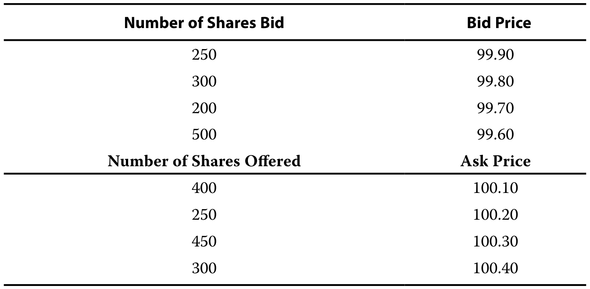

原文表格 · PDF 68 · 開啟原尺寸圖片 · 圖內文字對照

投資者提交市場訂單購買Merlewis股份。

An investor submits a market order to buy Merlewis shares.

1\. 以絕對和百分比以及相應的中市價格確定Merlewis股票的出價 - 風險擴散。

1\. Identify the bid–ask spread of Merlewis stock on both an absolute and percentage basis as well as the corresponding mid-market price.

#### 官方答案与解析 / Official answer and explanation

解答

Solution

使用方程式1,我們可能會解決出價問題 - sk 分散:

Using Equation 1, we may solve for the bid–ask spread:

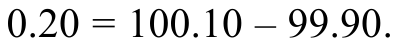

原文公式 · PDF 68 · 開啟原尺寸圖片

Merlewis 目前的買賣價差以貨幣金額表示為 0.20；換算為比率則為 0.001998，即 0.1998%，計算方式如公式 2 所示：

Merlewis is trading at a bid–ask spread of 0.20 in currency terms, which on a percentage basis is 0.001998, or 0.1998% as calculated using Equation 2:

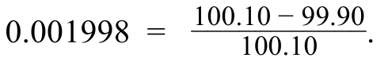

原文公式 · PDF 68 · 開啟原尺寸圖片

中市價格是最低詢價和最高出價的平均值:

The mid-market price is the average of the lowest ask and highest bid price:

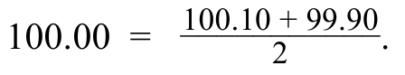

原文公式 · PDF 68 · 開啟原尺寸圖片

#### 补充解析 / Supplementary explanation

先确定是买单还是卖单，再选择相应报价。比较流动性时统一成交金额、观察期和报价条件；不能只用股票每股价格高低判断交易成本。

Identify the trade direction before choosing a quote. Compare liquidity on consistent size and time bases; share price alone does not measure execution cost.

易错点：成交量高不代表任何规模的订单都无冲击。限价单控制最差价格，却可能无法成交；市价单提高成交确定性，但价格更不确定。

Common pitfall: High volume does not eliminate size-dependent impact. A limit order constrains price but may not execute, while a market order prioritizes execution over price certainty.

#### 相关知识点 / Related concepts

#### 流动性与交易成本 / Liquidity and trading costs

流动性同时涉及价差、可成交数量与价格冲击。买入通常支付卖价，卖出通常得到买价；价差是立即成交付出的成本之一。

Liquidity includes spreads, depth, and price impact. A buyer generally pays the ask and a seller receives the bid; the spread is one cost of immediacy.

### EQ-LM03-I002-02 · 知識檢查 · 第 2 题 KNOWLEDGE CHECK · Question 2

知识检查 / Knowledge check · 原版 PDF 页码 / Source PDF pages: 67-69

#### 题目与资料 / Question and data

#### 共用资料 / Shared information

Merlewis 公司的股份在 Worldwide Stock Exchange 交易。

Merlewis Corporation’s shares trade on the Worldwide Stock Exchange.

假設目前有以下尚未成交的 Merlewis 限價盤：

Assume the following limit orders are currently open on Merlewis:

原文表格 · PDF 68 · 開啟原尺寸圖片 · 圖內文字對照

投資者提交市場訂單購買Merlewis股份。

An investor submits a market order to buy Merlewis shares.

2\. 確定投資者購買Merlewis股票的加權平均價格，市場價爲500股，以及從問題1中得出該價格與中市價格之間的差額。

2\. Determine the weighted average price at which the investor buys Merlewis shares for a market order of 500 shares as well as the difference between this price and the mid-market price from Question 1.

#### 官方答案与解析 / Official answer and explanation

解答

Solution

購買500股的市場訂單可以執行如下:

The market order to buy 500 shares may be executed as follows:

在100.10和100.10時購買400股。

■ 400 shares purchased at 100.10, and

以100.20美元購買100股。

■ 100 shares purchased at 100.20.

因此，投資者以100.12的加權平均價格購買500股股票:

Thus, the investor buys 500 shares at a weighted average price of 100.12:

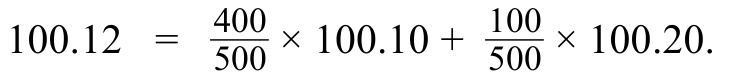

原文公式 · PDF 68 · 開啟原尺寸圖片

100.12 購貨價格與100.00中間市場價格之間的差額是每股0.12,或每股0.02,以最低報價或報盤價格高於這一差額。

The difference between the 100.12 purchase price and the 100.00 mid-market price is 0.12 per share, or 0.02 per share above this difference at the lowest asking or offer price.

除了上述單一定單的加權平均價格外，市場參與者還經常使用量加權平均價格(VWAP)跟蹤日內股票業績，這是按交易價格乘以特定期間交易股份數量得出的平均價格衡量標準:

In addition to the weighted average price of a single order shown above, market participants often track intraday share performance using a volume-weighted average price (VWAP), which is an average price measure derived by weighting the traded price by the volume of shares traded over a given period:

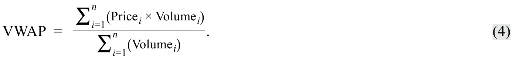

原文公式 · PDF 68 · 開啟原尺寸圖片

貿易商通常使用這一動態的價格變化計量標準來衡量交易日期間的市場勢頭。

This dynamic measure of price changes is commonly used by traders to gauge market momentum over the course of a trading day.

#### 补充解析 / Supplementary explanation

先确定是买单还是卖单，再选择相应报价。比较流动性时统一成交金额、观察期和报价条件；不能只用股票每股价格高低判断交易成本。

Identify the trade direction before choosing a quote. Compare liquidity on consistent size and time bases; share price alone does not measure execution cost.

易错点：成交量高不代表任何规模的订单都无冲击。限价单控制最差价格，却可能无法成交；市价单提高成交确定性，但价格更不确定。

Common pitfall: High volume does not eliminate size-dependent impact. A limit order constrains price but may not execute, while a market order prioritizes execution over price certainty.

#### 相关知识点 / Related concepts

#### 流动性与交易成本 / Liquidity and trading costs

流动性同时涉及价差、可成交数量与价格冲击。买入通常支付卖价，卖出通常得到买价；价差是立即成交付出的成本之一。

Liquidity includes spreads, depth, and price impact. A buyer generally pays the ask and a seller receives the bid; the spread is one cost of immediacy.

### EQ-LM03-I003-01 · 知識檢查 · 第 1 题 KNOWLEDGE CHECK · Question 1

知识检查 / Knowledge check · 原版 PDF 页码 / Source PDF pages: 69

#### 题目与资料 / Question and data

#### 共用资料 / Shared information

一位貿易商在市場開放後觀察到Merlewis公司的下列股票交易:

A trader observes the following Merlewis Corporation share trades following the market open:

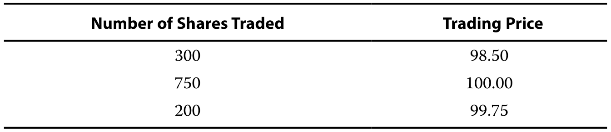

原文表格 · PDF 69 · 開啟原尺寸圖片 · 圖內文字對照

1\. 計算Merlewis股份的 VWAP。

1\. Calculate the VWAP for Merlewis shares.

#### 官方答案与解析 / Official answer and explanation

解答

Solution

根據公式 4，分子的成交量加權值如下：

Using Equation 4, trade-weighted volume in the numerator is as follows:

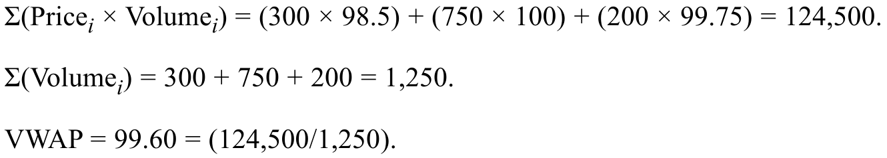

原文公式 · PDF 69 · 開啟原尺寸圖片

#### 补充解析 / Supplementary explanation

逐笔将成交价乘以该笔成交量，再把这些成交金额相加，最后除以总成交股数。这样成交量较大的交易权重更大。不要直接平均各笔价格，也不要把报价簿中的未成交买卖盘混入实际成交VWAP。

Multiply each executed price by its volume, sum the traded values, and divide by total shares traded. Larger trades receive greater weight. Do not use a simple average of prices or mix unexecuted order-book quotes with actual trades.

#### 相关知识点 / Related concepts

#### 成交量加权均价 / Volume-weighted average price

VWAP 是特定统计期间内实际交易的加权价格，可作为执行评价基准；它与当前买卖报价中点不同。

VWAP is a volume-weighted execution price over a specified interval and can serve as an execution benchmark. It differs from the current bid–ask midpoint.

VWAP = Σ(Priceᵢ × Volumeᵢ) / ΣVolumeᵢ

### EQ-LM03-I004-01 · 問題組 2 · 第 1 题 QUESTION SET 2 · Question 1

正文习题组 / Question set · 原版 PDF 页码 / Source PDF pages: 71

#### 题目与资料 / Question and data

1\. 以下哪一種最有可能是交易所提交的股本交易訂單的最低限度規模?

1\. Which one of the following is most likely a minimum size of an equity trading order submitted on an exchange?

A. 10 股

A. 10 shares

B. 100 股

B. 100 shares

C. 1,000 股

C. 1,000 shares

#### 官方答案与解析 / Official answer and explanation

解答

Solution

B 項正確。

B is correct.

提交交換交易的股本交易訂單通常以標準股份形式輸入，每個股票至少100股。

Equity trading orders submitted for exchange trading are typically entered in standardized share lots of a minimum 100 shares each.

#### 补充解析 / Supplementary explanation

先确定是买单还是卖单，再选择相应报价。比较流动性时统一成交金额、观察期和报价条件；不能只用股票每股价格高低判断交易成本。

Identify the trade direction before choosing a quote. Compare liquidity on consistent size and time bases; share price alone does not measure execution cost.

易错点：成交量高不代表任何规模的订单都无冲击。限价单控制最差价格，却可能无法成交；市价单提高成交确定性，但价格更不确定。

Common pitfall: High volume does not eliminate size-dependent impact. A limit order constrains price but may not execute, while a market order prioritizes execution over price certainty.

#### 相关知识点 / Related concepts

#### 流动性与交易成本 / Liquidity and trading costs

流动性同时涉及价差、可成交数量与价格冲击。买入通常支付卖价，卖出通常得到买价；价差是立即成交付出的成本之一。

Liquidity includes spreads, depth, and price impact. A buyer generally pays the ask and a seller receives the bid; the spread is one cost of immediacy.

### EQ-LM03-I004-02 · 問題組 2 · 第 2 题 QUESTION SET 2 · Question 2

正文习题组 / Question set · 原版 PDF 页码 / Source PDF pages: 71

#### 题目与资料 / Question and data

2\. 下列哪一種最不可能是證券交易所最低上市要求的一個重要部分?

2\. Which one of the following is least likely to be an important part of an equity exchange’s minimum listing requirements?

A. 股東人數必須高於某些最低水平。

A. Number of shareholders must be greater than some minimum level

B. 可供公開交易的股份的百分比必須高於某些最低水平。

B. Percentage of shares available to be traded publicly must be greater than some minimum level

C. 公司銷售額必須高於某些最低水平。

C. Company sales must be greater than some minimum level

#### 官方答案与解析 / Official answer and explanation

解答

Solution

C 正確。

C is correct.

公司的銷售額最不可能用作上市要求，因為其他基本面因素，例如盈利能力，通常更為重要。

Company sales levels are least likely to be employed as a listing requirement as other fundamentals are likely more important (such as profitability).

A 項錯誤，因爲交易所很可能要求以股東人數爲代表的足夠可能的股票賣方。

A is incorrect because exchanges are likely to require enough possible sellers of shares as represented by the number of shareholders.

B 項錯誤，因爲交換交易需要有足夠的股份才能進行交易。

B is incorrect because exchange trading requires sufficient shares to be available for trading.

#### 补充解析 / Supplementary explanation

先确定是买单还是卖单，再选择相应报价。比较流动性时统一成交金额、观察期和报价条件；不能只用股票每股价格高低判断交易成本。

Identify the trade direction before choosing a quote. Compare liquidity on consistent size and time bases; share price alone does not measure execution cost.

易错点：成交量高不代表任何规模的订单都无冲击。限价单控制最差价格，却可能无法成交；市价单提高成交确定性，但价格更不确定。

Common pitfall: High volume does not eliminate size-dependent impact. A limit order constrains price but may not execute, while a market order prioritizes execution over price certainty.

审题提醒：本题使用否定或“最不可能”的提问。要选择不符合所述条件的一项；不要把“答案选项”误读成教材认可的正确陈述。

Reading check: this prompt uses a negative or “least likely” direction. Select the option that fails the stated criterion; the selected answer need not itself be a true general statement.

#### 相关知识点 / Related concepts

#### 流动性与交易成本 / Liquidity and trading costs

流动性同时涉及价差、可成交数量与价格冲击。买入通常支付卖价，卖出通常得到买价；价差是立即成交付出的成本之一。

Liquidity includes spreads, depth, and price impact. A buyer generally pays the ask and a seller receives the bid; the spread is one cost of immediacy.

### EQ-LM03-I004-03 · 問題組 2 · 第 3 题 QUESTION SET 2 · Question 3

正文习题组 / Question set · 原版 PDF 页码 / Source PDF pages: 71-72

#### 题目与资料 / Question and data

3\. 以下哪一種說法最可能適用於區塊交易?

3\. Which one of the following statements is most likely true of block trades?

A. 集團交易通常在交易所按全部訂單規模進行交易。

A. Block trades are typically traded on exchanges in their full order size.

B. 大宗交易細分爲較小規模，以儘量減少出價——要求股票分期銷售。

B. Block trades are broken down into smaller sizes to minimize the bid– ask spread for the stock.

C. 將大宗交易細分爲較小規模，以儘量減少貿易對價格的影響。

C. Block trades are broken down into smaller sizes to minimize the price impact of the trade.

#### 官方答案与解析 / Official answer and explanation

解答

Solution

C 項正確。

C is correct.

在許多情況下，區塊交易被送到經紀人-經銷商手中，該經銷商將區塊破碎成一個較小的單項訂單，在一段時間內執行，以儘量減少價格影響。

In many cases, block trades are sent to a broker–dealer that breaks the block into smaller individual orders executed over time to minimize the price impact.

A 項錯誤，因爲大宗交易規模較大，通常無法按一個順序交易所有股票。

A is incorrect because the larger size of block trades typically makes it impractical to trade all the shares in one order.

B 項錯誤，因爲投標 - sk分佈反映買賣訂單。

B is incorrect as the bid–ask spread reflects both buy and sell orders.

大宗交易將只反映買賣訂單。

A block trade will only reflect a buy or sell order.

買賣價差是明確的交易成本；大宗交易通常拆分為較小的訂單，以盡量降低交易的隱含成本。

The bid–ask spread is an explicit cost of trading, while block trades are typically broken into smaller orders to minimize the implicit costs of trading.

#### 补充解析 / Supplementary explanation

先确定是买单还是卖单，再选择相应报价。比较流动性时统一成交金额、观察期和报价条件；不能只用股票每股价格高低判断交易成本。

Identify the trade direction before choosing a quote. Compare liquidity on consistent size and time bases; share price alone does not measure execution cost.

易错点：成交量高不代表任何规模的订单都无冲击。限价单控制最差价格，却可能无法成交；市价单提高成交确定性，但价格更不确定。

Common pitfall: High volume does not eliminate size-dependent impact. A limit order constrains price but may not execute, while a market order prioritizes execution over price certainty.

#### 相关知识点 / Related concepts

#### 流动性与交易成本 / Liquidity and trading costs

流动性同时涉及价差、可成交数量与价格冲击。买入通常支付卖价，卖出通常得到买价；价差是立即成交付出的成本之一。

Liquidity includes spreads, depth, and price impact. A buyer generally pays the ask and a seller receives the bid; the spread is one cost of immediacy.

### EQ-LM03-I005-01 · 知識檢查 · 第 1 题 KNOWLEDGE CHECK · Question 1

知识检查 / Knowledge check · 原版 PDF 页码 / Source PDF pages: 73

#### 题目与资料 / Question and data

#### 共用资料 / Shared information

東部各州養卹金計劃擁有Merlewis公司的300 000股股份。

Eastern States Pension Plan owns 300,000 shares of Merlewis Corporation.

Merlewis 的流通在外股數為 12.5 億股，其中 80% 屬於該公司的市場流通股。

The number of Merlewis shares outstanding is 1,250 million shares, with 80% of the shares representing the company’s market float.

上個月，Merlewis的平均日產量爲1 500 000股。

The average daily volume in Merlewis over the last month has been 1,500,000 shares.

東部各州內部貿易準則禁止基金在任何一天購買或出售超過股票平均每日交易量8%的股票。

Eastern States internal trading guidelines prohibit the fund from buying or selling more than 8% of a stock’s average daily trading volume on any given day.

東部各州首席投資幹事已指示該計劃的交易人員對該計劃在Merlewis股份上持有的股票進行徹底清算。

The Chief Investment Officer of Eastern States has instructed the plan’s trading staff to implement a complete liquidation of the plan’s holdings in Merlewis shares.

1\. 計算完成東部各州Merlewis股份清算所需天數。

1\. Calculate the number of days necessary to complete the liquidation of Eastern States’ position in Merlewis shares.

#### 官方答案与解析 / Official answer and explanation

解答

Solution

東部各州目前在Merlewis的地位佔日平均貿易量的20%〔計算式 4〕。

Eastern States’ current position in Merlewis represents 20% of average daily trading volume 〔Calculation 4〕.

鑑於8%的限制，徹底清算其持有量意味着東方國家必須至少三個交易日出售其Merlewis持有量。

A complete liquidation of their holdings given the 8% constraint implies that Eastern States must sell their Merlewis holdings over at least three trading days.

20%分辨爲8% 答案是2.5

Dividing 20% by 8% gives an answer of 2.5.

因此，它們不能在兩天內完全清算Merlewis的股份，但可以在三天內完成銷售。

Thus, they cannot fully liquidate Merlewis shares in two days, but may complete the sale within three days.

計算式 4 / Calculation 4

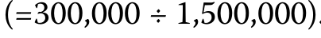

共用計算式 · PDF 73 · 開啟原尺寸圖片

#### 补充解析 / Supplementary explanation

每日最大可卖股数等于平均每日成交量乘允许参与率。本题为1,500,000×8%=120,000股/日，300,000股需要2.5个额度日，因此至少跨3个交易日完成。流通股数用于计算换手率，不是每日交易额度的分母。

Maximum daily sales equal average daily volume times the participation cap: 1,500,000 × 8% = 120,000 shares. Liquidating 300,000 shares needs 2.5 daily allowances and therefore at least three trading days. Free float is relevant to turnover, not the daily participation-cap denominator.

#### 相关知识点 / Related concepts

#### 交易参与率与清仓天数 / Participation limits and liquidation time

参与率限制主要约束订单相对市场成交量的大小；天数必须向上取整，不能因最后一天只用部分额度而向下取整。

A participation cap limits an order relative to market trading activity. Required trading days are rounded up because a partly used final day still counts.

Days = ceiling(Position / (ADV × Participation cap))

### EQ-LM03-I006-01 · 問題組 3 · 第 1 题 QUESTION SET 3 · Question 1

正文习题组 / Question set · 原版 PDF 页码 / Source PDF pages: 73-74

#### 题目与资料 / Question and data

1\. 股市的深度最正確地提到:

1\. An equity market’s depth most correctly refers to:

A. 市場吸收衆多貿易訂單的能力。

A. the market’s ability to absorb numerous trade orders.

B. 在市場上股票交易中觀察到的典型出價-風險差。

B. the typical bid–ask spread observed for stocks trading in the market.

C. 市場訂單限制訂單的市場比率。

C. the market’s ratio of market orders to limit orders.

#### 官方答案与解析 / Official answer and explanation

解答

Solution

A 項正確。

A is correct.

更深入的市場有許多訂單或接近現有最佳出價和報價，使貿易商相信有足夠的買家和賣主來吸收許多訂單。

A market with greater depth has many orders at or near the best available bid and offer prices, providing traders with confidence that there are sufficient buyers and sellers to absorb numerous orders.

B 項錯誤。

B is incorrect.

市場深度意味着對低於最高出價和最低問詢價格的限量訂單的影響更大。

Market depth implies more about the limit orders below the highest bid price and above the lowest ask price.

標書的大小 - 質詢利差並不表示市場深度。

The size of the bid–ask spread is not indicative of market depth.

C 項錯誤，因爲市場深度沒有提及市場限制訂單的具體比例。

C is incorrect as market depth does not refer to any specific ratio regarding market to limit orders.

就單個股票而言，相當多的限制訂單可能表明市場有能力吸收市場訂單。

For an individual stock, a significant number of limit orders might be indicative of the market’s ability to absorb market orders.

但是，如果所有限價訂單都接近與出價相關的價格 — — 問價分散，那麼市場就沒有什麼深度了。

However, if all limit orders are close to the prices associated with the bid– ask spread, the market would have little depth.

#### 补充解析 / Supplementary explanation

先确定是买单还是卖单，再选择相应报价。比较流动性时统一成交金额、观察期和报价条件；不能只用股票每股价格高低判断交易成本。

Identify the trade direction before choosing a quote. Compare liquidity on consistent size and time bases; share price alone does not measure execution cost.

易错点：成交量高不代表任何规模的订单都无冲击。限价单控制最差价格，却可能无法成交；市价单提高成交确定性，但价格更不确定。

Common pitfall: High volume does not eliminate size-dependent impact. A limit order constrains price but may not execute, while a market order prioritizes execution over price certainty.

#### 相关知识点 / Related concepts

#### 流动性与交易成本 / Liquidity and trading costs

流动性同时涉及价差、可成交数量与价格冲击。买入通常支付卖价，卖出通常得到买价；价差是立即成交付出的成本之一。

Liquidity includes spreads, depth, and price impact. A buyer generally pays the ask and a seller receives the bid; the spread is one cost of immediacy.

### EQ-LM03-I006-02 · 問題組 3 · 第 2 题 QUESTION SET 3 · Question 2

正文习题组 / Question set · 原版 PDF 页码 / Source PDF pages: 73-74

#### 题目与资料 / Question and data

2\. 根據以下資料，下列哪一項最準確估計每日換手的流通股比例？某公司流通在外股數為 12.5 億股，其中 80% 屬市場流通股。

2\. Which of the following provides the most accurate estimate of the proportion of shares outstanding exchanged per day given the following information: A company’s number of shares outstanding is 1,250 million shares with 80% of the shares representing their market float.

該公司上月股票日平均交易量爲1 500 000股。

The average daily trading volume in the company’s stock over the last month has been 1,500,000 shares.

A. 0.60%

A. 0.60%

B. 0.12%

B. 0.12%

C. 0.15%

C. 0.15%

#### 官方答案与解析 / Official answer and explanation

解答

Solution

C 項正確。

C is correct.

平均日營業額與市場浮動比率總體表明某一交易日的未償股票比例。

The ratio of average daily turnover to market float gives an overall indication of the proportion of shares outstanding exchanged on a given trading day.

每日成交量為 1,500,000 股，市場流通股數為 10 億股 〔計算式 5〕；因此比率為 0.15% 〔計算式 6〕。

Daily turnover is given as 1,500,000 shares, and market float is 1,000 million shares 〔Calculation 5〕; so, the ratio is 0.15% 〔Calculation 6〕.

計算式 5 / Calculation 5

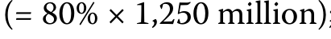

共用計算式 · PDF 74 · 開啟原尺寸圖片

計算式 6 / Calculation 6

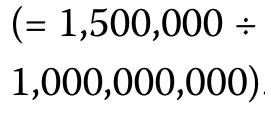

共用計算式 · PDF 74 · 開啟原尺寸圖片

B未能作出調整，因爲只有80%的未清股份代表市場浮動，即每天平均數量除以未清總份額，而不是貿易可用份額。

B fails to adjust for the fact that just 80% of shares outstanding represent market float by dividing average daily volume by total shares outstanding rather than those available to trade.

A 得出一個錯誤，即將平均每日成交量除以20%的未清股份，這些股票是受限制或私人持有的，因此不包括在市場浮動中。

A makes the error of dividing average daily volume by the 20% of shares outstanding that are restricted or privately held and therefore not included in market float.

#### 补充解析 / Supplementary explanation

先确定是买单还是卖单，再选择相应报价。比较流动性时统一成交金额、观察期和报价条件；不能只用股票每股价格高低判断交易成本。

Identify the trade direction before choosing a quote. Compare liquidity on consistent size and time bases; share price alone does not measure execution cost.

易错点：成交量高不代表任何规模的订单都无冲击。限价单控制最差价格，却可能无法成交；市价单提高成交确定性，但价格更不确定。

Common pitfall: High volume does not eliminate size-dependent impact. A limit order constrains price but may not execute, while a market order prioritizes execution over price certainty.

#### 相关知识点 / Related concepts

#### 流动性与交易成本 / Liquidity and trading costs

流动性同时涉及价差、可成交数量与价格冲击。买入通常支付卖价，卖出通常得到买价；价差是立即成交付出的成本之一。

Liquidity includes spreads, depth, and price impact. A buyer generally pays the ask and a seller receives the bid; the spread is one cost of immediacy.

### EQ-LM03-I006-03 · 問題組 3 · 第 3 题 QUESTION SET 3 · Question 3

正文习题组 / Question set · 原版 PDF 页码 / Source PDF pages: 73-75

#### 题目与资料 / Question and data

3\. 以下哪些說法最正確地描述了與股票價格和市場衝擊相關的因素?

3\. Which one of the following statements most correctly describes the factors associated with share prices and market shocks?

A. 具有更大市場彈性的股票更有可能避免市場衝擊。

A. A stock with greater market resiliency is more likely to be able to avoid market shocks.

B. 提高市場深度和市場廣度可抑制市場衝擊對最初價格的影響。

B. Greater market depth and market breadth can dampen the initial price impact of a market shock.

C. 市場衝擊後市場價格調整的速度由原有的市場訂單本確定。

C. The speed of market price adjustment following a market shock is determined by the pre-existing market order book.

#### 官方答案与解析 / Official answer and explanation

解答

Solution

B 正確。

B is correct.

更大的市場深度與市場廣度，會減小市場受到衝擊後最初的價格變動。

Greater market depth and market breadth reduce the initial price change following a market shock.

A 項錯誤，因爲市場彈性無助於股票避免價格衝擊;相反，它涉及市場價格適應衝擊的能力。

A is incorrect because market resiliency does not help shares avoid price shocks; rather, it involves the ability of market prices to adjust to shocks.

C 項錯誤，因爲未觀察到的行業，例如經紀人和區塊交易沒有披露的訂單，也可能影響價格調整的速度。

C is incorrect because unobserved trades, such as those orders not revealed by brokers and block trades, may also affect the speed of price adjustment.

由於大多數公開交易的股票有大量未清股份，平均貿易額很可能是整個市場浮動中很小的一部分。

Average trading volume is likely to be a very small fraction of overall market float because of large numbers of shares outstanding for most publicly traded equities.

#### 补充解析 / Supplementary explanation

先确定是买单还是卖单，再选择相应报价。比较流动性时统一成交金额、观察期和报价条件；不能只用股票每股价格高低判断交易成本。

Identify the trade direction before choosing a quote. Compare liquidity on consistent size and time bases; share price alone does not measure execution cost.

易错点：成交量高不代表任何规模的订单都无冲击。限价单控制最差价格，却可能无法成交；市价单提高成交确定性，但价格更不确定。

Common pitfall: High volume does not eliminate size-dependent impact. A limit order constrains price but may not execute, while a market order prioritizes execution over price certainty.

#### 相关知识点 / Related concepts

#### 流动性与交易成本 / Liquidity and trading costs

流动性同时涉及价差、可成交数量与价格冲击。买入通常支付卖价，卖出通常得到买价；价差是立即成交付出的成本之一。

Liquidity includes spreads, depth, and price impact. A buyer generally pays the ask and a seller receives the bid; the spread is one cost of immediacy.

### EQ-LM03-I007-01 · 問題組 4 · 第 1 题 QUESTION SET 4 · Question 1

正文习题组 / Question set · 原版 PDF 页码 / Source PDF pages: 79

#### 题目与资料 / Question and data

1\. 以下哪一種最能說明基礎廣泛的股本指數?

1\. Which one of the following best describes a broad-based equity index?

基礎廣泛的指數是大多數股票交易所中最活躍的交易份額之一。

A. Broad-based indexes are one of the most actively traded shares on most equity exchanges.

B. 基礎廣泛的指數包括按市場浮動調整並按市場資本加權計算的最大上市公司。

B. Broad-based indexes include the largest listed firms adjusted by market float and calculated on a market capitalization-weighted basis.

C. 基礎廣泛的指數是所有基於指數的投資戰略的基準。

C. Broad-based indexes are the benchmark for all index-based investment strategies.

#### 官方答案与解析 / Official answer and explanation

解答

Solution

B 正確。

B is correct.

廣泛市場指數包括規模最大的上市公司，按流通股數作調整，並採用市值加權方式計算。

Broad-based indexes include the largest listed firms adjusted by market float and calculated on a market capitalization-weighted basis.

選擇A是不正確的，因爲股本指數構成以指數爲基礎的股票等產品的基礎，但不作爲股票直接交易。

Choice A is incorrect because equity indexes form the basis for products such as index-based shares but are not directly traded as shares.

選擇C是不正確的，因爲使用除基礎廣泛的指數以外的許多指數作爲基於指數的投資戰略的基礎。

Choice C is incorrect as many indexes other than broad-based indexes are used as the basis for index-based investment strategies.

#### 补充解析 / Supplementary explanation

分清成分筛选、权重设定和再平衡三个环节。计算个股对指数的贡献时，把该期起始权重乘以该股相同口径的收益。

Separate selection, weighting, and rebalancing. A constituent’s return contribution uses its starting weight and return measured on a consistent basis.

易错点：股价上涨会使市值权重自然增加；等权指数需要交易来恢复相等权重。指数名称本身不说明是否包含分红。

Common pitfall: Market-cap weights rise naturally with relative price appreciation, while equal weights need rebalancing. An index name alone does not reveal whether dividends are included.

#### 相关知识点 / Related concepts

#### 股票指数与权重 / Equity index weights

指数是按规则组合的一篮子股票，权重规则会改变行业与公司暴露。流通市值加权还会剔除难以在市场交易的控制性持股。

An index is a rules-based basket whose weighting scheme determines exposure. Free-float adjustment excludes shareholdings not readily available for public trading.

### EQ-LM03-I007-02 · 問題組 4 · 第 2 题 QUESTION SET 4 · Question 2

正文习题组 / Question set · 原版 PDF 页码 / Source PDF pages: 79

#### 题目与资料 / Question and data

2\. 綜合指數的最佳特徵是:

2\. A composite index is best characterized as:

A. 大宗指數。

A. a large-cap index.

B. 多市場指數。

B. a multi-market index.

C. 綜合指數。

C. a comprehensive index.

#### 官方答案与解析 / Official answer and explanation

解答

Solution

C 項正確。

C is correct.

綜合指數一般包括佔選定市場價值90%以上的證券，從而使其成爲涵蓋接近整個交易股市的全面指數。

A composite index generally includes securities representing more than 90% of the selected market’s value, thus making it a comprehensive index covering close to the entirety of a traded equity market.

A 項錯誤，因爲綜合指數不僅包括大額股票，而且還包括小資本化股票。

A is incorrect because a comprehensive index includes not just large-cap equities but also smaller-capitalization equities.

B 項錯誤，因爲多市場指數旨在代表多個證券市場，但不一定是每個市場考慮綜合指數所必需的資本化。

B is incorrect because multi-market indexes are designed to represent multiple security markets but not necessarily the capitalization necessary for each market to consider them composite indexes.

#### 补充解析 / Supplementary explanation

分清成分筛选、权重设定和再平衡三个环节。计算个股对指数的贡献时，把该期起始权重乘以该股相同口径的收益。

Separate selection, weighting, and rebalancing. A constituent’s return contribution uses its starting weight and return measured on a consistent basis.

易错点：股价上涨会使市值权重自然增加；等权指数需要交易来恢复相等权重。指数名称本身不说明是否包含分红。

Common pitfall: Market-cap weights rise naturally with relative price appreciation, while equal weights need rebalancing. An index name alone does not reveal whether dividends are included.

#### 相关知识点 / Related concepts

#### 股票指数与权重 / Equity index weights

指数是按规则组合的一篮子股票，权重规则会改变行业与公司暴露。流通市值加权还会剔除难以在市场交易的控制性持股。

An index is a rules-based basket whose weighting scheme determines exposure. Free-float adjustment excludes shareholdings not readily available for public trading.

### EQ-LM03-I007-03 · 問題組 4 · 第 3 题 QUESTION SET 4 · Question 3

正文习题组 / Question set · 原版 PDF 页码 / Source PDF pages: 79-80

#### 题目与资料 / Question and data

3\. 以下哪一種最正確地描述了按基本因素加權的股本指數?

3\. Which one of the following most correctly describes an equity index weighted by fundamental factors?

A. 權重從來與市值無關。

A. Weightings are never related to market capitalization.

B. 加權僅基於一個基本因素。

B. Weightings are based on only one fundamental factor.

C. 加權可能基於統計過程。

C. Weightings may be based on a statistical process.

#### 官方答案与解析 / Official answer and explanation

解答

Solution

C 項正確。

C is correct.

與摩根斯坦利資本國際公司的質量指數一樣，每種股票的指數加權法可採用統計程序計算。

As in the case of the MSCI Quality Indexes, the index weightings of each stock may be calculated using a statistical process.

基本要素指數的加權是通過對公司各種基本要素進行統計分析得出的。

Weightings in fundamental factor indexes are derived through statistical analysis of various company fundamentals.

它們的權重明顯不同於市值加權指數。

Their weighting is distinctly different from market capitalization-weighted indexes.

A 項錯誤，因爲基本因素加權可根據市值按得分調整，如摩根斯坦利資本國際公司的質量指數。

A is incorrect because fundamental factor weightings may be adjusted from market capitalization by a score, as in the MSCI Quality Indexes.

B 項錯誤，因爲基本因素加權可能基於多種基本因素，例如利潤率、收入穩定性和資產負債表強度，如摩根斯坦利資本國際公司質量指數所示。

B is incorrect because fundamental factor weightings may be based on multiple fundamental factors, such as profitability, earnings stability, and balance sheet strength, as shown for the MSCI Quality Indexes.

#### 补充解析 / Supplementary explanation

分清成分筛选、权重设定和再平衡三个环节。计算个股对指数的贡献时，把该期起始权重乘以该股相同口径的收益。

Separate selection, weighting, and rebalancing. A constituent’s return contribution uses its starting weight and return measured on a consistent basis.

易错点：股价上涨会使市值权重自然增加；等权指数需要交易来恢复相等权重。指数名称本身不说明是否包含分红。

Common pitfall: Market-cap weights rise naturally with relative price appreciation, while equal weights need rebalancing. An index name alone does not reveal whether dividends are included.

#### 相关知识点 / Related concepts

#### 股票指数与权重 / Equity index weights

指数是按规则组合的一篮子股票，权重规则会改变行业与公司暴露。流通市值加权还会剔除难以在市场交易的控制性持股。

An index is a rules-based basket whose weighting scheme determines exposure. Free-float adjustment excludes shareholdings not readily available for public trading.

### EQ-LM03-P001 · 章末练习 1 Practice Problem 1

章末练习 / Practice problem · 原版 PDF 页码 / Source PDF pages: 82, 84

#### 题目与资料 / Question and data

#### 共用资料 / Shared information

## 以下資料適用於第 1-4 題 The following information relates to questions 1-4

東部各州是美國公共養卹金計劃，積極分配給上市股票。

Eastern States is a US public pension plan with an active allocation to publicly listed equities.

東部各州根據具體戰略將其部分公共股權投資分配給資金管理人員。

Eastern States allocates some of their public equity investments to fund managers following specific strategies.

東部各州在其公共股本分配的剩餘部分中積極管理着30-50個庫存組合。

With the remainder of their public equity allocation, Eastern States actively manages a portfolio of 30–50 individual stocks.

以下各點是東方國家投資政策的一些要點:

The following points provide some highlights of Eastern States’ investment policy:

· 可以將證券投資組合總額的10%投資於對國際採購幹事的配售份額。

■ As much as 10% of the total equity portfolio may be invested in allocations to IPOs.

對於二級市場的股票交易，考慮購買任何新股票至少需要經過兩年的公開貿易歷史。

■ For stocks trading on secondary markets, a minimum of two years of public trading history is required for any new equities to be considered for purchase.

· 所有庫存職位的每日平均更替率必須達到最低限值。

■ The average daily turnover of all stock positions must meet minimum thresholds.

東部國家奉行全球多樣化的投資政策，重點是採用環境、社會和公司治理原則的公司大宗股票。

■ Eastern States follows a globally diversified investment policy focused on large-cap stocks of companies that incorporate ESG principles.

1\. 以下哪一種最有可能說明爲什麼東方國家尋求首次公開招股（IPO）的配售份額?

1\. Which one of the following provides the most likely argument as to why Eastern States seeks IPO allocations?

A. 平均而言，由於首次公開招股（IPO）的長期回報有利。

A. Because of favorable long-run returns from IPOs, on average

B. 因爲首次公開招股（IPO）平均價格偏低。

B. Because IPOs are, on average, underpriced

C. 因爲IPO對於現有股東來說一般是非重複性的。

C. Because IPOs are typically non-dilutive to existing shareholders

#### 官方答案与解析 / Official answer and explanation

1\. B 項正確。

1\. B is correct.

首次公開招股（IPO）平均在第一天的價格上揚，而接受首次公開招股（IPO）配售份額的投資者在公貿第一天後購買股票和關閉價格的價格上揚。

IPOs, on average, experience a first-day increase in price from the price at which investors receiving an allocation in the IPO buy the shares and the closing price after the first day of public trading.

通常，低價水平可能達到20%或更高。

Often, the level of underpricing may be 20% or greater.

A 項錯誤，因爲IPO公司往往在較長的時間內表現不佳。

A is incorrect because IPO companies are often likely to underperform over long time horizons.

C 項錯誤，因爲東歐國家由於是新投資者，不大可能受到首次公開招股的稀釋性或非稀釋性影響。

C is incorrect because Eastern States is unlikely to be affected by the dilutive or non-dilutive effects of the IPO given that they are a new investor.

作爲一個新投資者，公司與現有股東不同，注重的是可能出現低價定價利益而不是稀釋效應。

As a new investor, the company is focused on the potential for underpricing benefits rather than dilution effects, unlike existing shareholders.

#### 补充解析 / Supplementary explanation

正确选项是 B。Eastern States 获得 IPO 配售时按发行价买入；若上市首日收盘价通常高于发行价，配售投资者可获得首日价格增益。这就是本题所指的平均低估发行。

B is correct. An allocated investor buys at the offer price. A first-day closing price above that offer price produces the initial gain associated with average IPO underpricing.

这一理由不依赖 IPO 股票长期必然跑赢，也不依赖对原股东是否摊薄。应把发行价到首日交易价格的收益，与上市后多年持有的收益分开。

This rationale does not require long-run outperformance or a non-dilutive issue. Separate the return from the offer price to the first trading price from returns earned over subsequent years.

#### 相关知识点 / Related concepts

#### IPO 定价与首日收益 / IPO underpricing and first-day returns

IPO 低估发行指发行价相对初期二级市场价格偏低；它描述特定进入价格与持有期，不能保证每笔配售或长期投资获利。

Underpricing compares the offer price with early secondary-market prices. It is a statement about entry price and horizon, not a guarantee for every issue or for long-run returns.

`First-day return = (first-day closing price − offer price) / offer price`

### EQ-LM03-P002 · 章末练习 2 Practice Problem 2

章末练习 / Practice problem · 原版 PDF 页码 / Source PDF pages: 82, 84

#### 题目与资料 / Question and data

#### 共用资料 / Shared information

## 以下資料適用於第 1-4 題 The following information relates to questions 1-4

東部各州是美國公共養卹金計劃，積極分配給上市股票。

Eastern States is a US public pension plan with an active allocation to publicly listed equities.

東部各州根據具體戰略將其部分公共股權投資分配給資金管理人員。

Eastern States allocates some of their public equity investments to fund managers following specific strategies.

東部各州在其公共股本分配的剩餘部分中積極管理着30-50個庫存組合。

With the remainder of their public equity allocation, Eastern States actively manages a portfolio of 30–50 individual stocks.

以下各點是東方國家投資政策的一些要點:

The following points provide some highlights of Eastern States’ investment policy:

· 可以將證券投資組合總額的10%投資於對國際採購幹事的配售份額。

■ As much as 10% of the total equity portfolio may be invested in allocations to IPOs.

對於二級市場的股票交易，考慮購買任何新股票至少需要經過兩年的公開貿易歷史。

■ For stocks trading on secondary markets, a minimum of two years of public trading history is required for any new equities to be considered for purchase.

· 所有庫存職位的每日平均更替率必須達到最低限值。

■ The average daily turnover of all stock positions must meet minimum thresholds.

東部國家奉行全球多樣化的投資政策，重點是採用環境、社會和公司治理原則的公司大宗股票。

■ Eastern States follows a globally diversified investment policy focused on large-cap stocks of companies that incorporate ESG principles.

2\. 下列哪些條件可以最好地反映東方國家要求二級市場採購必須經過兩年貿易歷史的理由?

2\. Which one of the following conditions may best reflect Eastern States rationale for requiring two years of trading history for secondary market purchases?

A. 貿易歷史提供了評估公司管理質量的能力。

A. Trading history provides the ability to assess company management quality.

B. 貿易歷史提供了預測未來公司股票回報的能力。

B. Trading history provides the ability to forecast future company stock returns.

C. 貿易歷史提供了比較類似上市公司回報和風險業績的能力。

C. Trading history provides the ability to compare return and risk performance across similar publicly traded companies.

#### 官方答案与解析 / Official answer and explanation

2\. C 項正確。

2\. C is correct.

公共市場數據是比較個人份額隨時間推移與類似公司業績的關鍵投入。

Public market data are a critical input in comparing an individual share’s performance over time to similar firms.

此外，投資者可以很容易地衡量回報、波動以及不同時間的相關性。

Furthermore, investors can easily measure returns, volatilities, and correlations across time.

A 項錯誤，因爲管理質量不可能僅僅根據歷史股票價格來評估，而可能需要對財務報表和其他公司基礎研究來源進行更多的審查。

A is incorrect because management quality is unlikely to be assessed solely by historical stock prices but may need more examination of financial statements and other sources of company fundamental research.

B 項錯誤，因爲歷史股票價格沒有提供關於未來回報的信息。

B is incorrect as historical stock prices do not provide information about future returns.

但是，它們對評估風險和波動性可能很有價值。

However, they can be valuable for assessing risk and volatility.

#### 补充解析 / Supplementary explanation

正确选项是 C。至少两年的公开交易历史为计算收益、波动率和相关性提供共同数据基础，也便于把该公司与类似上市公司作同期间比较。

C is correct. At least two years of observable trading data supports the calculation of returns, volatility, and correlations and comparisons with similar listed companies over a common period.

价格历史不能单独证明管理层质量，也不能保证预测未来股票收益。管理质量需要结合经营表现、财务信息和治理资料；本题的两年要求侧重可比较的市场表现数据。

Price history alone neither establishes management quality nor guarantees a forecast of future stock returns. Management assessment requires operating, financial, and governance evidence; this requirement provides comparable market-performance data.

#### 相关知识点 / Related concepts

#### 交易历史与风险比较 / Trading history and risk comparison

历史收益序列的主要用途之一是描述已实现的风险和共同波动。比较时应统一期间、频率、股息处理和拆股调整。

Historical return series describe realized risk and co-movement. Use consistent periods, frequencies, dividend conventions, and split adjustments when comparing securities.

### EQ-LM03-P003 · 章末练习 3 Practice Problem 3

章末练习 / Practice problem · 原版 PDF 页码 / Source PDF pages: 82, 84

#### 题目与资料 / Question and data

#### 共用资料 / Shared information

## 以下資料適用於第 1-4 題 The following information relates to questions 1-4

東部各州是美國公共養卹金計劃，積極分配給上市股票。

Eastern States is a US public pension plan with an active allocation to publicly listed equities.

東部各州根據具體戰略將其部分公共股權投資分配給資金管理人員。

Eastern States allocates some of their public equity investments to fund managers following specific strategies.

東部各州在其公共股本分配的剩餘部分中積極管理着30-50個庫存組合。

With the remainder of their public equity allocation, Eastern States actively manages a portfolio of 30–50 individual stocks.

以下各點是東方國家投資政策的一些要點:

The following points provide some highlights of Eastern States’ investment policy:

· 可以將證券投資組合總額的10%投資於對國際採購幹事的配售份額。

■ As much as 10% of the total equity portfolio may be invested in allocations to IPOs.

對於二級市場的股票交易，考慮購買任何新股票至少需要經過兩年的公開貿易歷史。

■ For stocks trading on secondary markets, a minimum of two years of public trading history is required for any new equities to be considered for purchase.

· 所有庫存職位的每日平均更替率必須達到最低限值。

■ The average daily turnover of all stock positions must meet minimum thresholds.

東部國家奉行全球多樣化的投資政策，重點是採用環境、社會和公司治理原則的公司大宗股票。

■ Eastern States follows a globally diversified investment policy focused on large-cap stocks of companies that incorporate ESG principles.

3\. 在平均日貿易額政策方面，東方國家可能關切以下哪些可觀察到的貿易成本?

3\. Which one of the following observable costs of trading is a likely concern for Eastern States with respect to the policy on average daily trading volume?

A. 投標-質詢攤銷成本。

A. Bid–ask spread costs

B. 機會成本。

B. Opportunity costs

C. 市場影響成本。

C. Market impact costs

#### 官方答案与解析 / Official answer and explanation

3\. A 項正確。

3\. A is correct.

股票的比額差是可觀察到的，日營業率相對較低的股票的比值差可能更高。

Bid–ask spreads are observable for stocks and are likely higher for stocks with relatively low daily turnover.

因此，東方國家可能希望避免擁有出價率高的股票風險差。

As such, Eastern States may be looking to avoid owning stocks with high bid–ask spreads.

B和C不正確，因爲機會成本和市場影響成本都無法觀察。

B and C are incorrect as both opportunity and market impact costs are unobservable.

#### 补充解析 / Supplementary explanation

先确定是买单还是卖单，再选择相应报价。比较流动性时统一成交金额、观察期和报价条件；不能只用股票每股价格高低判断交易成本。

Identify the trade direction before choosing a quote. Compare liquidity on consistent size and time bases; share price alone does not measure execution cost.

易错点：成交量高不代表任何规模的订单都无冲击。限价单控制最差价格，却可能无法成交；市价单提高成交确定性，但价格更不确定。

Common pitfall: High volume does not eliminate size-dependent impact. A limit order constrains price but may not execute, while a market order prioritizes execution over price certainty.

#### 相关知识点 / Related concepts

#### 流动性与交易成本 / Liquidity and trading costs

流动性同时涉及价差、可成交数量与价格冲击。买入通常支付卖价，卖出通常得到买价；价差是立即成交付出的成本之一。

Liquidity includes spreads, depth, and price impact. A buyer generally pays the ask and a seller receives the bid; the spread is one cost of immediacy.

### EQ-LM03-P004 · 章末练习 4 Practice Problem 4

章末练习 / Practice problem · 原版 PDF 页码 / Source PDF pages: 82-84

#### 题目与资料 / Question and data

#### 共用资料 / Shared information

## 以下資料適用於第 1-4 題 The following information relates to questions 1-4

東部各州是美國公共養卹金計劃，積極分配給上市股票。

Eastern States is a US public pension plan with an active allocation to publicly listed equities.

東部各州根據具體戰略將其部分公共股權投資分配給資金管理人員。

Eastern States allocates some of their public equity investments to fund managers following specific strategies.

東部各州在其公共股本分配的剩餘部分中積極管理着30-50個庫存組合。

With the remainder of their public equity allocation, Eastern States actively manages a portfolio of 30–50 individual stocks.

以下各點是東方國家投資政策的一些要點:

The following points provide some highlights of Eastern States’ investment policy:

· 可以將證券投資組合總額的10%投資於對國際採購幹事的配售份額。

■ As much as 10% of the total equity portfolio may be invested in allocations to IPOs.

對於二級市場的股票交易，考慮購買任何新股票至少需要經過兩年的公開貿易歷史。

■ For stocks trading on secondary markets, a minimum of two years of public trading history is required for any new equities to be considered for purchase.

· 所有庫存職位的每日平均更替率必須達到最低限值。

■ The average daily turnover of all stock positions must meet minimum thresholds.

東部國家奉行全球多樣化的投資政策，重點是採用環境、社會和公司治理原則的公司大宗股票。

■ Eastern States follows a globally diversified investment policy focused on large-cap stocks of companies that incorporate ESG principles.

4\. 下列哪些股權指數類型最適合。

4\. Which one of the following equity index types would be most appropriate for

將東部國家用作其股票投資組合業績的基準?

Eastern States to use as a benchmark for their equity portfolio performance?

A. 美國ESG指數的上限很大。

A. A US large-cap ESG index

B. 全球環境、社會和公司治理綜合指數。

B. A global ESG composite index

C. 全球大型ESG指數。

C. A global large-cap ESG index

#### 官方答案与解析 / Official answer and explanation

4\. C 項正確。

4\. C is correct.

東部各州在採用環境、社會和公司治理原則的公司中擁有全球多樣化的大型股票組合。

Eastern States has a globally diversified portfolio of large-cap stocks in companies incorporating ESG principles.

因此，它們應以符合這些標準的股本指數作爲基準。

Therefore, they should benchmark with an equity index that matches those criteria.

A 項錯誤。

A is incorrect.

東方國家儘管是美國投資者，卻擁有全球多樣化的投資組合。

Despite being a US investor, Eastern States owns a globally diversified portfolio.

因此，美國的大型ESG指數與全球規模不符。

Thus, a US large-cap ESG index does not match the global scale.

B 項錯誤。

B is incorrect.

綜合指數不僅包括大宗魚羣，還包括較小的魚羣。

The composite index includes not just large-cap stocks but also smaller stocks.

因此，這一指數與東部國家投資組合的大宗特徵不符。

Therefore, this index does not match the large-cap characteristic of Eastern States’ portfolio.

#### 补充解析 / Supplementary explanation

正确选项是 C。题干的三个筛选维度是全球配置、大盘股和 ESG 特征，因此基准也应同时覆盖这三个维度。投资者总部位于美国，不代表其股票组合只暴露于美国市场。

C is correct. The portfolio has global, large-cap, and ESG characteristics, so its benchmark should match all three. The investor being based in the United States does not make its holdings a US-only portfolio.

A 遗漏全球市场暴露；B 虽然覆盖全球及 ESG，但综合指数还包含较小市值公司。基准不匹配会把地域、规模或风格差异混入管理业绩比较。

A omits global exposure. B includes the global and ESG dimensions but also smaller companies. A mismatched benchmark can confuse geographic, size, or style effects with manager performance.

#### 相关知识点 / Related concepts

#### 基准与投资范围匹配 / Matching a benchmark to the mandate

基准选择首先匹配投资范围与策略特征，再考虑可投资性和计算方法。基准成分范围与成分权重是不同问题。

Benchmark selection first matches the investment universe and strategy, then considers investability and construction. Constituent scope and constituent weighting are distinct decisions.

## LM 4 · 权益收益的来源 Sources of Equity Returns 34 条目 · 原题与解析逐条对应 / Paired source questions and explanations

### EQ-LM04-T001-01 · 課前測驗：股票回報的來源 · 第 1 题 PRE-TEST: SOURCES OF EQUITY RETURNS · Question 1

课前自测 / Pre-test / self-assessment · 原版 PDF 页码 / Source PDF pages: 85-86

#### 题目与资料 / Question and data

1\. 以下哪些關於定期現金紅利的報表最正確?

1\. Which one of the following statements about regular cash dividends is most correct?

A. 如果公司有利可圖，依法要求公司向股東定期支付現金紅利。

A. A company is legally required to pay a regular cash dividend to shareholders if the company is profitable.

B. 具有巨大增長潛力的公司很可能將收入的很大一部分作爲定期現金紅利支付。

B. A company with significant growth potential is likely to pay a large portion of its earnings as regular cash dividends.

C. 公司管理團隊及其董事會對定期支付現金紅利作出自行酌處的選擇。

C. A company’s management team and its board of directors make discretionary choices about regular cash dividend payments.

#### 官方答案与解析 / Official answer and explanation

解答

Solution

C 項正確。

Choice C is correct.

定期支付現金紅利反映公司管理團隊和董事會就定期支付現金股息是否適當使用公司現金自行作出決定。

Regular cash dividend payments reflect discretionary decision making by a company’s management team and board as to whether regular cash dividend payments are an appropriate use of corporate cash.

選擇A是不正確的，因爲向股東支付現金股息不是法律義務，不論公司盈利能力如何。

Choice A is incorrect because cash dividend payments to shareholders are not a legal obligation regardless of a company’s profitability.

選擇B是不正確的，因爲具有巨大增長潛力的公司很可能將利潤的更多再投資，留下一小部分用於向股東支付潛在的現金紅利。

Choice B is incorrect because a company with significant growth potential is likely to reinvest more of its profits, leaving a smaller portion for potential cash dividend payments to shareholders.

#### 补充解析 / Supplementary explanation

先确定公司总现金减少多少、股数是否减少，再比较每股指标。评价总收益时把除息造成的价格变化和现金股息放在一起看。

Track the cash reduction and whether share count changes before evaluating per-share measures. For total return, consider the ex-dividend price change together with the cash received.

易错点：回购导致 EPS 上升，不代表企业经营利润增加。股息率高也可能来自股价下跌；不能单独据此认定估值便宜。

Common pitfall: An EPS increase after a repurchase need not indicate improved operating profit. A high dividend yield can reflect a falling share price rather than an attractive valuation.

#### 相关知识点 / Related concepts

#### 分红、回购与股东收益 / Dividends, repurchases, and shareholder returns

分红把现金直接交给股东，回购则以现金换回股份。二者都可能减少公司现金，但对在外股数、每股指标和剩余股东权益的影响不同。

Dividends distribute cash directly; repurchases exchange cash for shares. Both can reduce corporate cash but affect shares outstanding and per-share measures differently.

Dividend yield = DPS/P; total return includes price change + cash distribution

### EQ-LM04-T001-02 · 課前測驗：股票回報的來源 · 第 2 题 PRE-TEST: SOURCES OF EQUITY RETURNS · Question 2

课前自测 / Pre-test / self-assessment · 原版 PDF 页码 / Source PDF pages: 85-86

#### 题目与资料 / Question and data

2\. 在下列情況下，投資者可能傾向於公司回購股票，而不是支付類似規模的現金紅利:

2\. Investors may prefer a company to repurchase shares instead of paying a cash dividend of similar size if:

A. 資本收益收入稅率低於股息收入稅率。

A. tax rates on capital gains income are lower than those on dividend income.

B. 重新購買股份減少公司未清股票。

B. repurchasing shares reduces the company’s shares outstanding.

C. 公司在投資機會方面差別較小。

C. the company has relatively little variation in investment opportunities.

#### 官方答案与解析 / Official answer and explanation

解答

Solution

A 項正確。

Choice A is correct.

股息收入稅率較高的投資者可能寧願通過出售股票和以較低的資本收益稅率納稅來獲得現金分配。

Investors facing higher tax rates on dividend income may prefer to receive cash distributions by selling shares and paying taxes at lower capital gains tax rates.

選擇B是不正確的，因爲公司通過重新購買股票自動減少未清股份，這不應影響投資者是否更喜歡回購而不是股息。

Choice B is incorrect because a company automatically reduces shares outstanding by repurchasing shares, which should have no effect on whether investors would prefer repurchases over dividends.

選擇C是不正確的，因爲投資機會很少變化的公司不需要與回購和現金紅利相關的更大靈活性。

Choice C is incorrect because a company with little variation in investment opportunities does not require the greater flexibility associated with repurchases versus cash dividends.

#### 补充解析 / Supplementary explanation

先确定公司总现金减少多少、股数是否减少，再比较每股指标。评价总收益时把除息造成的价格变化和现金股息放在一起看。

Track the cash reduction and whether share count changes before evaluating per-share measures. For total return, consider the ex-dividend price change together with the cash received.

易错点：回购导致 EPS 上升，不代表企业经营利润增加。股息率高也可能来自股价下跌；不能单独据此认定估值便宜。

Common pitfall: An EPS increase after a repurchase need not indicate improved operating profit. A high dividend yield can reflect a falling share price rather than an attractive valuation.

#### 相关知识点 / Related concepts

#### 分红、回购与股东收益 / Dividends, repurchases, and shareholder returns

分红把现金直接交给股东，回购则以现金换回股份。二者都可能减少公司现金，但对在外股数、每股指标和剩余股东权益的影响不同。

Dividends distribute cash directly; repurchases exchange cash for shares. Both can reduce corporate cash but affect shares outstanding and per-share measures differently.

Dividend yield = DPS/P; total return includes price change + cash distribution

### EQ-LM04-T001-03 · 課前測驗：股票回報的來源 · 第 3 题 PRE-TEST: SOURCES OF EQUITY RETURNS · Question 3

课前自测 / Pre-test / self-assessment · 原版 PDF 页码 / Source PDF pages: 85-86

#### 题目与资料 / Question and data

3\. 查明股份合併對公司股票的最準確影響。

3\. Identify the most accurate effect of a reverse stock split on a company’s stock.

A. 股份合併增加了未清股份的數量。

A. A reverse stock split increases the number of shares outstanding.

B. 一家成功重組其業務的公司經常使用逆向股票分割法。

B. A reverse stock split is often used by a company that has successfully restructured its operations.

C. 反向股本分割提高了公司每股的股票價格。

C. A reverse stock split increases a company’s stock price per share.

#### 官方答案与解析 / Official answer and explanation

解答

Solution

C 項正確。

Choice C is correct.

股份合併會減少未清股份的數量，同時提高每股的股價，使公司股本的市場價值不變。

A reverse stock split reduces the number of shares outstanding while increasing the stock price per share such that the market value of the company’s equity does not change.

每一股東在股份合併（反向拆股）後保持相同的比例所有權。

Each shareholder maintains the same proportional ownership following the reverse split.

選項 A 不正確。流通在外股數會因股份分拆而增加；股份合併則不會造成這種增加。

Choice A is incorrect because the number of shares outstanding increases in a stock split, not a reverse split.

選擇B是不正確的，因爲反向股本分割更有可能與正在啓動重組的公司而不是剛剛完成成功重組的公司發生。

Choice B is incorrect because a reverse stock split is more likely with a company that is initiating a restructuring rather than with one that has just completed a successful restructuring.

#### 补充解析 / Supplementary explanation

先计算新股数，再反向调整每股价格、每股收益等指标。追踪总市值和持股比例是否保持一致，可以快速检验结果。

Adjust share count and inversely adjust per-share measures. Check that total market value and proportional ownership remain consistent.

易错点：多拿到股票并不自动创造财富。应区分不产生公司现金流的拆股与会改变公司现金资产的现金股利或回购。

Common pitfall: Receiving more shares does not automatically create wealth. Distinguish a non-cash split from dividends or repurchases that reduce corporate cash.

#### 相关知识点 / Related concepts

#### 拆股与股票股利 / Splits and stock dividends

拆股改变的是一家公司被分成多少份，通常不直接改变公司总价值。份数变多，每份价格相应下降；持有人的比例权益保持不变。

A split changes the number of units into which ownership is divided, without directly changing total company value. More shares imply a proportionately smaller value per share.

### EQ-LM04-T001-04 · 課前測驗：股票回報的來源 · 第 4 题 PRE-TEST: SOURCES OF EQUITY RETURNS · Question 4

课前自测 / Pre-test / self-assessment · 原版 PDF 页码 / Source PDF pages: 85-87

#### 题目与资料 / Question and data

4\. 公司股價在以下哪一天會下跌，但所有其他價格都持平?

4\. On which one of the following dates would a company’s stock price be expected to decline, holding all else equal?

股息申報日。

A. Dividend declaration date

B. 退稅日期。

B. Ex-dividend date

C. 股息支付日期。

C. Dividend payment date

#### 官方答案与解析 / Official answer and explanation

解答

Solution

B 項正確。

Choice B is correct.

在退股日，股票不再爲所有人提供獲得即將支付的紅利的權利。

On the ex-dividend date, the stock no longer provides the owner with the right to the upcoming dividend payment.

結果，股票價格在這一日期下跌了大約相當於現金紅利的數額，假定沒有其它原因造成股票流動。

As a result, the stock price declines on this date by approximately the amount of the cash dividend, assuming no other causes for the stock to move.

選擇A是不正確的，因爲申報日期通常比退稅日期提前幾個月。

Choice A is incorrect because the declaration date usually precedes the ex-dividend date by a few months.

選擇C是不正確的，因爲付款日期通常在退稅日期之後大約兩週。

Choice C is incorrect because the payment date usually follows the ex-dividend date by about two weeks.

#### 补充解析 / Supplementary explanation

先确定公司总现金减少多少、股数是否减少，再比较每股指标。评价总收益时把除息造成的价格变化和现金股息放在一起看。

Track the cash reduction and whether share count changes before evaluating per-share measures. For total return, consider the ex-dividend price change together with the cash received.

易错点：回购导致 EPS 上升，不代表企业经营利润增加。股息率高也可能来自股价下跌；不能单独据此认定估值便宜。

Common pitfall: An EPS increase after a repurchase need not indicate improved operating profit. A high dividend yield can reflect a falling share price rather than an attractive valuation.

#### 相关知识点 / Related concepts

#### 分红、回购与股东收益 / Dividends, repurchases, and shareholder returns

分红把现金直接交给股东，回购则以现金换回股份。二者都可能减少公司现金，但对在外股数、每股指标和剩余股东权益的影响不同。

Dividends distribute cash directly; repurchases exchange cash for shares. Both can reduce corporate cash but affect shares outstanding and per-share measures differently.

Dividend yield = DPS/P; total return includes price change + cash distribution

### EQ-LM04-T001-05 · 課前測驗：股票回報的來源 · 第 5 题 PRE-TEST: SOURCES OF EQUITY RETURNS · Question 5

课前自测 / Pre-test / self-assessment · 原版 PDF 页码 / Source PDF pages: 85, 87

#### 题目与资料 / Question and data

5\. Vikaas和Laabhaansh兩家公司的股票，每股以INR20交易。

5\. Two company stocks, Vikaas and Laabhaansh, both trade at INR20 per share.

兩個股票在1年持有期內總回報率爲20%。

Both stocks generate a 20% total return over a 1-year holding period.

Vikaas沒有支付股息，而Laabhaansh股東得到的股息佔股票持有期結束時總收益的40%。

Vikaas pays no dividend while Laabhaansh shareholders received a dividend constituting 40% of the stock’s total return at the end of the holding period.

下列哪一種情況對持有期結束時Vikas和Laabhaansh的股票價格正確?

Which one of the following is correct about the stock prices of Vikaas and Laabhaansh at the end of the holding period?

Vikas價格爲INR24.80;Laabhaansh價格爲IR24.00。

A. Vikaas price is INR24.80; Laabhaansh price is INR24.00

B Vikas價格爲INR24.00; Laabhaansh價格爲IR22.40。

B. Vikaas price is INR24.00; Laabhaansh price is INR22.40

C. Vikas價格爲INR24.00; Laabhaansh價格爲IR21.60。

C. Vikaas price is INR24.00; Laabhaansh price is INR21.60

#### 官方答案与解析 / Official answer and explanation

解答

Solution

B 項正確。

Choice B is correct.

20%的股票總回報率爲每股20愛爾蘭盾，這意味着返回方程的分子數等於持有期間每個股份4印度尼西亞盾〔計算式 7〕。

A 20% total return on a stock priced at INR20 per share implies that the numerator of the return equation is equal to INR4 per share over the holding period 〔Calculation 7〕.

鑑於Vikaas不支付股息，在持有期結束時該股票必須增加到24.00愛爾蘭盾。

Given that Vikaas pays no dividend, this stock must increase to INR24.00 at the end of the holding period.

Laabhaansh的持有期回報反映了股息付款和股票價格的變化。

Laabhaansh’s holding period return reflects both a dividend payment and a stock price change.

鑑於總收益40%歸因於股息，60%的回報反映了股票價格升值。

Given that 40% of the total return is attributable to the dividend, 60% of the return reflects stock price appreciation.

每股 INR4 的 60% 等於每股 INR2.40，因此 Laabhaansh 在持有期間結束時的股價為 INR22.40。

Multiplying 60% by INR4 per share equals INR2.40 per share, so Laabhaansh’s stock price is INR22.40 at the end of the holding period.

計算式 7 / Calculation 7

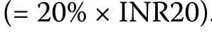

共用計算式 · PDF 87 · 開啟原尺寸圖片

選擇A是不正確的，因爲它涉及對Vikaas股份的回報率爲24%〔計算式 8〕,並錯誤地將Laabhaansh股票的全部收益率20%歸功於物價升值。

Choice A is incorrect because it involves a 24% return 〔Calculation 8〕 on Vikaas shares and mistakenly attributes the full 20% return on Laabhaansh shares to price appreciation.

計算式 8 / Calculation 8

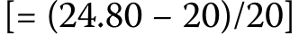

共用計算式 · PDF 87 · 開啟原尺寸圖片

C 項錯誤。

Choice C is incorrect.

雖然Vikaas價格是正確的，但Laabhaansh價格錯誤地將預期總回報率的20%乘以40%,這可歸因於股息，以達到INR1.60〔計算式 9〕的紅利。

While the Vikaas price is correct, the Laabhaansh price mistakenly multiplies the 20% expected total return by the 40% attributable to the dividend to arrive at a dividend of INR1.60 〔Calculation 9〕.

計算式 9 / Calculation 9

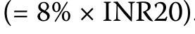

共用計算式 · PDF 87 · 開啟原尺寸圖片

#### 补充解析 / Supplementary explanation

把期末卖价减期初买价得到资本利得，再加入持有期收到的每股现金分配，全部除以期初买价。分配与价格必须采用相同股数口径。现金股息是总收益的一部分，不能既加入现金又把同一笔股息重复计入价格升幅。

Add the price gain to per-share distributions and divide by the initial price. Use a consistent share basis. Cash dividends contribute to total return, but the same dividend must not also be counted as a price gain.

两只股票每股总收益都是20×20%=INR4。Vikaas无股息，期末价为INR24；Laabhaansh的股息占总收益40%，即INR1.60，所以其价格收益为INR2.40，期末价为INR22.40。

Each stock earns INR 20×20%=INR 4 per share. Vikaas pays no dividend and ends at INR 24. Laabhaansh distributes 40% of the gain, INR 1.60, leaving INR 2.40 price appreciation and a final price of INR 22.40.

#### 相关知识点 / Related concepts

#### 持有期收益的现金流口径 / Holding-period return and distributions

价格收益与分配收益相加得到持有期总收益；持有期超过一年时，年化是另一个步骤。

Price return plus distribution yield gives holding-period total return. Annualization is a separate calculation for a multi-year period.

HPR = (P₁ − P₀ + D) / P₀

### EQ-LM04-T001-06 · 課前測驗：股票回報的來源 · 第 6 题 PRE-TEST: SOURCES OF EQUITY RETURNS · Question 6

课前自测 / Pre-test / self-assessment · 原版 PDF 页码 / Source PDF pages: 85, 87-88

#### 题目与资料 / Question and data

6\. 一名分析師將兩年價格指標定爲每股40.00歐元，預計在今後兩年的年底每個股將每年支付1.00歐元。

6\. An analyst places a two-year price target of EUR40.00 per share on a stock that is expected to pay an annual EUR1.00 per share dividend at the end of both of the next two years.

分析員認爲，10%的年所需回報率適用於庫存。

The analyst believes that a 10% annual required rate of return is appropriate for the stock.

以下哪一種最接近分析師對今天這些股票的公平價格的估計?

Which one of the following is closest to the analyst’s estimate of today’s fair price for this stock?

A. EUR34.70

A. EUR34.70

B. EUR34.80

B. EUR34.80

C. EUR34.90

C. EUR34.90

#### 官方答案与解析 / Official answer and explanation

解答

Solution

B 項正確。

Choice B is correct.

分析員在解決價格問題時，將未來兩年中每一年底的預期股息現金流量1歐元納入其中，目標價格在兩年結束時爲40.00歐元，其公式如下:

The analyst solves for the price by incorporating the expected dividend cash flow of EUR1.00 at the end of each of the next two years with the target price of EUR40.00 at the end of two years with the following equation:

原文續至 PDF 第 88 頁。

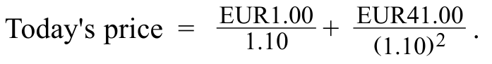

原文公式 · PDF 88 · 開啟原尺寸圖片

溶液等於每股34.79歐元。

The solution equals EUR34.79 per share.

選擇A是不正確的，因爲它假定兩個年度股息都在兩年結束時收到。

Choice A is incorrect because it assumes that both annual dividends are received at the end of two years.

選擇C是不正確的，因爲它沒有納入一年內收到的紅利的現值。

Choice C is incorrect because it fails to incorporate the present value of the dividend received in one year.

#### 补充解析 / Supplementary explanation

时间轴上逐期放置股息，并在最后一年同时放置当年股息与预期售价。每一笔按距今天的期数折现；最近已付股息D₀若预期增长，第一笔未来股息为D₀(1+g)。预期售价已经是终期的价格，不需要把它再按股息增长率增长。

Place dividends at each future date and both the final dividend and expected sale price at the horizon. Discount each by its own timing. If the most recent dividend D₀ is expected to grow, the next dividend is D₀(1+g). Do not additionally grow the given terminal sale price at the dividend growth rate.

具体计算为1/1.10+(1+40)/1.10²≈EUR34.79。第二年股息与终期卖价同时收到，应一起折现两年。

The calculation is 1/1.10+(1+40)/1.10²≈EUR 34.79. The second dividend and terminal sale price are received together and discounted for two years.

#### 相关知识点 / Related concepts

#### 股息与终期售价的折现 / Discounting dividends and a terminal sale price

股息现值与终期售价现值都属于股票价值。漏掉最后一笔股息或不折现终期售价，会产生方向明确的估值偏差。

Both dividend present values and the present value of the terminal price contribute to value. Omitting the final dividend understates value; failing to discount the terminal price overstates it.

P₀ = Σₜ₌₁ᵀ Dₜ/(1+rₑ)^t + Pₜₑᵣₘᵢₙₐₗ/(1+rₑ)^T

### EQ-LM04-I001 · 例題 1 EXAMPLE 1

正文例题／案例 / Worked example / case · 原版 PDF 页码 / Source PDF pages: 89

#### 题目与资料 / Question and data

原书叙述式例题／案例：下方保留案例原文、数据与展开过程。原书没有另设独立问句，未另行编造题目。

Original narrated example/case. The full source conditions, data, and worked discussion follow; no separate question has been invented.

## Anheuser-Busch InBev SA/NV 的股息變化 Anheuser-Busch InBev SA/NV Dividend Changes

#### 官方示例展开（原书全文） / Official worked example (source text)

## Anheuser-Busch InBev SA/NV 的股息變化 Anheuser-Busch InBev SA/NV Dividend Changes

世界上最大的釀酒商Anheuser-Busch InBev SA/NV(ABI)是由設在比利時的飲料公司InBev和最大的美國釀酒公司Anheuse Busch聯合起來的。

Anheuser-Busch InBev SA/NV (ABI), the world’s largest brewer, was formed by combining Brazilian beverages company AmBev, the Belgian-based drinks firm InBev, and Anheuser Busch, the largest US brewing company.

自2008年收購Anheuser-Busch以來的15年裏，AHeuser-Busch的財富波動，表現爲其每股盈利(EPS)和每股股紅利(DPS),如圖表1所示。

Over the 15 years following the acquisition of Anheuser-Busch in 2008, ABI’s fortunes fluctuated as reflected in both its earnings per share (EPS) and dividends per share (DPS), as shown in Exhibit 1.

圖表 1：Anheuser-Busch InBev 的每股盈利（EPS）與每股股息（DPS），2009 至 2022 年

Exhibit 1: Anheuser-Busch InBev EPS and DPS, 2009 to 2022

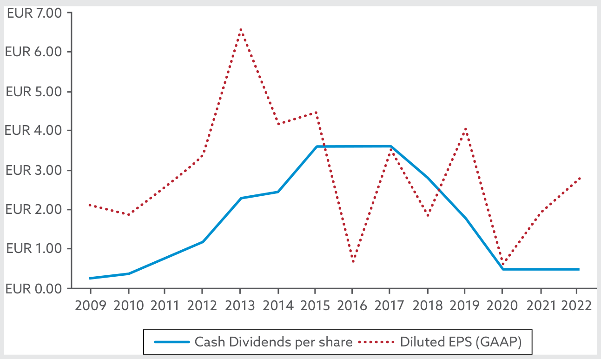

原文圖表 · PDF 89 · 開啟原尺寸圖片 · 圖內文字對照

資料來源:Bloomberg。

Source: Bloomberg.

投資者對ABI合併的最初幾年充滿了熱情。

The early years of the ABI merger were met with investor enthusiasm.

在Anheuser-Busch收購之後的七年中，ABI的股票價格增長了近10倍，從2008年11月底的低12.89歐元上升到2015年11月底的高121.95歐元，其股息從每股不到1歐元增加到超過6.00歐元。

During the seven years following the Anheuser-Busch acquisition, ABI’s stock price grew by nearly 10 times from a low of EUR12.89 at the end of November 2008 to a high of EUR121.95 at the end of November 2015, with its dividend rising from less than EUR1 to over EUR6.00 per share.

2015年後期，ABI宣佈收購SABMILER公司，該公司是全球啤酒市場的主要競爭對手。 這項交易於2016年10月最終達成，價格超過1,000億美元。

In late 2015, ABI announced its acquisition of SABMiller, its primary rival in the global beer market, a deal that was finalized in October 2016 at a price of over USD100 billion.

不幸的是，購買恰逢啤酒需求放緩和隨後生產下降。

Unfortunately, the acquisition coincided with a slowdown in beer demand and subsequent production decline.

由於ABI在世界多個地區作爲一家新合併公司的支配地位，SABMiller交易的監管批准要求ABI在市場條件不利的情況下向幾個國家出售關鍵品牌。

Due to ABI’s dominant position as a newly merged company in multiple parts of the world, regulatory approval of the SABMiller deal required ABI to sell key brands in several countries under less favorable market conditions.

收入因此受到影響，導致ABI在2018年、2019年和2020年每年削減其紅利，達到每股0.50歐元的最低水平。

Earnings suffered as a result, leading ABI to cut its dividend in each of the years 2018, 2019, and 2020, reaching a low of EUR0.50 per share.

直到2023年, ABI才得以再次增加紅利, 因爲COVID後收入恢復緩慢。

It wasn’t until 2023 that ABI was able to once again increase dividends given its slow post-COVID earnings recovery.

#### 补充解析 / Supplementary explanation

先确定公司总现金减少多少、股数是否减少，再比较每股指标。评价总收益时把除息造成的价格变化和现金股息放在一起看。

Track the cash reduction and whether share count changes before evaluating per-share measures. For total return, consider the ex-dividend price change together with the cash received.

易错点：回购导致 EPS 上升，不代表企业经营利润增加。股息率高也可能来自股价下跌；不能单独据此认定估值便宜。

Common pitfall: An EPS increase after a repurchase need not indicate improved operating profit. A high dividend yield can reflect a falling share price rather than an attractive valuation.

#### 相关知识点 / Related concepts

#### 分红、回购与股东收益 / Dividends, repurchases, and shareholder returns

分红把现金直接交给股东，回购则以现金换回股份。二者都可能减少公司现金，但对在外股数、每股指标和剩余股东权益的影响不同。

Dividends distribute cash directly; repurchases exchange cash for shares. Both can reduce corporate cash but affect shares outstanding and per-share measures differently.

Dividend yield = DPS/P; total return includes price change + cash distribution

### EQ-LM04-I002-01 · 知識檢查：Zhao Corporation 的股息與股份回購比較 · 第 1 题 KNOWLEDGE CHECK: ZHAO CORPORATION DIVIDENDS VERSUS SHARE REPURCHASE · Question 1

知识检查 / Knowledge check · 原版 PDF 页码 / Source PDF pages: 90-91

#### 题目与资料 / Question and data

#### 共用资料 / Shared information

趙公司有1 000萬股未清股票，每股20元，現金5 000萬元。

Zhao Corporation has 10 million shares outstanding at a price of CNY20 per share and CNY50 million in cash.

Zhao 正考慮兩種可能的方式，將這筆人民幣 5,000 萬元現金分配予股東：

Zhao is considering two possible ways to distribute this CNY50 million in cash to its shareholders:

向所有股東支付的每股一次性5科元現金紅利。

■ One-time CNY5 cash dividend per share paid to all shareholders

利用5 000萬捷克克朗按現時市場價格回購股票。

■ Use of CNY50 million to repurchase shares at the current market price

1\. 無視任何稅收影響，假設不發生股價變動，如果支付現金紅利，則計算股東已實現的回報。

1\. Ignoring any tax effects and assuming no share price changes, calculate the realized return to shareholders if the cash dividend is paid.

#### 官方答案与解析 / Official answer and explanation

解答

Solution

每個股東獲得5元現金股息，其股價以20元盧比計價，從而實現25%的收益:

Each shareholder receives a CNY5 cash dividend for a share priced at CNY20, resulting in a realized return of 25%:

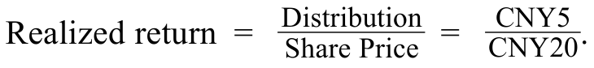

原文公式 · PDF 91 · 開啟原尺寸圖片

#### 补充解析 / Supplementary explanation

先确定公司总现金减少多少、股数是否减少，再比较每股指标。评价总收益时把除息造成的价格变化和现金股息放在一起看。

Track the cash reduction and whether share count changes before evaluating per-share measures. For total return, consider the ex-dividend price change together with the cash received.

易错点：回购导致 EPS 上升，不代表企业经营利润增加。股息率高也可能来自股价下跌；不能单独据此认定估值便宜。

Common pitfall: An EPS increase after a repurchase need not indicate improved operating profit. A high dividend yield can reflect a falling share price rather than an attractive valuation.

#### 相关知识点 / Related concepts

#### 分红、回购与股东收益 / Dividends, repurchases, and shareholder returns

分红把现金直接交给股东，回购则以现金换回股份。二者都可能减少公司现金，但对在外股数、每股指标和剩余股东权益的影响不同。

Dividends distribute cash directly; repurchases exchange cash for shares. Both can reduce corporate cash but affect shares outstanding and per-share measures differently.

Dividend yield = DPS/P; total return includes price change + cash distribution

### EQ-LM04-I002-02 · 知識檢查：Zhao Corporation 的股息與股份回購比較 · 第 2 题 KNOWLEDGE CHECK: ZHAO CORPORATION DIVIDENDS VERSUS SHARE REPURCHASE · Question 2

知识检查 / Knowledge check · 原版 PDF 页码 / Source PDF pages: 90-91

#### 题目与资料 / Question and data

#### 共用资料 / Shared information

趙公司有1 000萬股未清股票，每股20元，現金5 000萬元。

Zhao Corporation has 10 million shares outstanding at a price of CNY20 per share and CNY50 million in cash.

Zhao 正考慮兩種可能的方式，將這筆人民幣 5,000 萬元現金分配予股東：

Zhao is considering two possible ways to distribute this CNY50 million in cash to its shareholders:

向所有股東支付的每股一次性5科元現金紅利。

■ One-time CNY5 cash dividend per share paid to all shareholders

利用5 000萬捷克克朗按現時市場價格回購股票。

■ Use of CNY50 million to repurchase shares at the current market price

2\. 假設不發生股價變動，計算回購後趙國的剩餘未清股份。

2\. Assuming no share price changes, calculate the remaining Zhao shares outstanding following the repurchase.

#### 官方答案与解析 / Official answer and explanation

解答

Solution

使用5 000萬捷克元購買20世紀紐約市價的股份，導致250萬未清股票下降，剩餘750萬股:

The use of CNY50 million to purchase shares priced at CNY20 results in a decline of 2.5 million shares outstanding, with 7.5 million shares remaining:

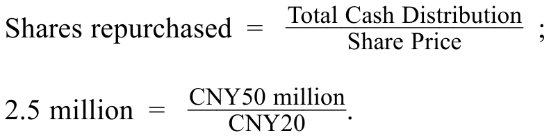

原文公式 · PDF 91 · 開啟原尺寸圖片

#### 补充解析 / Supplementary explanation

先确定公司总现金减少多少、股数是否减少，再比较每股指标。评价总收益时把除息造成的价格变化和现金股息放在一起看。

Track the cash reduction and whether share count changes before evaluating per-share measures. For total return, consider the ex-dividend price change together with the cash received.

易错点：回购导致 EPS 上升，不代表企业经营利润增加。股息率高也可能来自股价下跌；不能单独据此认定估值便宜。

Common pitfall: An EPS increase after a repurchase need not indicate improved operating profit. A high dividend yield can reflect a falling share price rather than an attractive valuation.

#### 相关知识点 / Related concepts

#### 分红、回购与股东收益 / Dividends, repurchases, and shareholder returns

分红把现金直接交给股东，回购则以现金换回股份。二者都可能减少公司现金，但对在外股数、每股指标和剩余股东权益的影响不同。

Dividends distribute cash directly; repurchases exchange cash for shares. Both can reduce corporate cash but affect shares outstanding and per-share measures differently.

Dividend yield = DPS/P; total return includes price change + cash distribution

### EQ-LM04-I003-01 · 問題組 1 · 第 1 题 QUESTION SET 1 · Question 1

正文习题组 / Question set · 原版 PDF 页码 / Source PDF pages: 93-94

#### 题目与资料 / Question and data

1\. 過去三年，Ketlewood公司的投資者收到每股10英鎊的現金紅利。

1\. Investors in Kettlewood Corporation have received cash dividends per share of GBP10 for the past three years.

Kettlewood決定將其紅利減半，並用剩餘的現金回購股票。

Kettlewood decides to halve its dividend and use the remaining cash to repurchase shares.

以下哪些說法最能說明這一變化對Kettlewood股東實際收益的影響?

Which one of the following statements best describes the impact of this change on the realized returns of Kettlewood’s shareholders?

A. 所有Kettlewood股東在變化後實現的回報將減少50%。

A. All Kettlewood shareholders will experience a 50% reduction in their realized return after the change.

B. 由於Kettlewood與過去分配的現金數額相同，所有Kottlewood 股東在變化後都將獲得同樣的實際回報。

B. Since Kettlewood distributes the same amount of cash as in the past, all Kettlewood shareholders will have the same realized return after the change.

C. 除選擇出售股票的股東外，Kettlewood所有股東的實際收益將減少50%。

C. All Kettlewood shareholders will experience a 50% reduction in their realized return, except for those who choose to sell their shares.

#### 官方答案与解析 / Official answer and explanation

解答

Solution

C 項正確。

Choice C is correct.

所有股東將經歷現金紅利的一半，只有那些選擇出售的股東才能獲得更多的現金和任何已實現的收入。

All shareholders will experience a halving of the cash dividend, with only those who choose to sell receiving additional cash and any realized earnings.

選擇A是不正確的，因爲它排除了那些選擇將其股份出售給公司以換取現金的股東。

Choice A is incorrect because it excludes those shareholders who choose to sell their shares back to the company for cash.

選擇B是不正確的，因爲並非所有股東都選擇將股票出售回公司以換取現金，只有那些這樣做的人才能實現回報。

Choice B is incorrect because not all shareholders will choose to sell shares back to the company in exchange for cash, and only those who do will realize the return.

#### 补充解析 / Supplementary explanation

先确定公司总现金减少多少、股数是否减少，再比较每股指标。评价总收益时把除息造成的价格变化和现金股息放在一起看。

Track the cash reduction and whether share count changes before evaluating per-share measures. For total return, consider the ex-dividend price change together with the cash received.

易错点：回购导致 EPS 上升，不代表企业经营利润增加。股息率高也可能来自股价下跌；不能单独据此认定估值便宜。

Common pitfall: An EPS increase after a repurchase need not indicate improved operating profit. A high dividend yield can reflect a falling share price rather than an attractive valuation.

#### 相关知识点 / Related concepts

#### 分红、回购与股东收益 / Dividends, repurchases, and shareholder returns

分红把现金直接交给股东，回购则以现金换回股份。二者都可能减少公司现金，但对在外股数、每股指标和剩余股东权益的影响不同。

Dividends distribute cash directly; repurchases exchange cash for shares. Both can reduce corporate cash but affect shares outstanding and per-share measures differently.

Dividend yield = DPS/P; total return includes price change + cash distribution

### EQ-LM04-I003-02 · 問題組 1 · 第 2 题 QUESTION SET 1 · Question 2

正文习题组 / Question set · 原版 PDF 页码 / Source PDF pages: 93-94

#### 题目与资料 / Question and data

2\. 股份回購不同於現金股息支付，因爲:

2\. A share repurchase differs from cash dividend payments because:

回購減少了股東按比例擁有股權的股份，而股息卻沒有減少。

A. repurchases decrease shareholder proportional ownership stakes while dividends do not.

B. 與現金紅利不同，回購不是直接向股東發放現金。

B. repurchases are not direct cash distributions to shareholders, unlike cash dividends.

C. 回購可能向市場發出信號，表明發行人對股票價值的看法，而股息則不然。

C. repurchases may provide signals to the market about an issuer’s perception of share value, while dividends do not.

#### 官方答案与解析 / Official answer and explanation

解答

Solution

C 項正確。

Choice C is correct.

當發行人回購其股票時，投資者可能認爲這是一個信號，表明管理層認爲其股票估值過低。

When an issuer repurchases its stock, investors may consider this to be a signal that management believes its stock is undervalued.

現金紅利並不表示股票的價值(雖然增加可能表明管理層對未來收入提高的預期，而這一信號所需要的不僅僅是支付股息)。

Cash dividends provide no signal about the stock’s value (although an increase may signal management’s expectation of higher future earnings, and this signal requires more than simply the payment of dividends).

選擇A是不正確的，因爲回購增加了所有不參與股票回購的股東的比例所有權。

Choice A is incorrect because the repurchase increases the proportional ownership of all shareholders who do not participate in the stock repurchase.

只有選擇出售的股東才能減少其比例所有權。

Only shareholders who choose to sell might reduce their proportional ownership.

選擇B是不正確的，因爲回購是對股東的現金分配。

Choice B is incorrect because repurchases are a cash distribution to shareholders.

區別在於只有出售的股東才能從回購中得到分配。

The difference is that only selling shareholders receive the distribution from repurchases.

#### 补充解析 / Supplementary explanation

先确定公司总现金减少多少、股数是否减少，再比较每股指标。评价总收益时把除息造成的价格变化和现金股息放在一起看。

Track the cash reduction and whether share count changes before evaluating per-share measures. For total return, consider the ex-dividend price change together with the cash received.

易错点：回购导致 EPS 上升，不代表企业经营利润增加。股息率高也可能来自股价下跌；不能单独据此认定估值便宜。

Common pitfall: An EPS increase after a repurchase need not indicate improved operating profit. A high dividend yield can reflect a falling share price rather than an attractive valuation.

#### 相关知识点 / Related concepts

#### 分红、回购与股东收益 / Dividends, repurchases, and shareholder returns

分红把现金直接交给股东，回购则以现金换回股份。二者都可能减少公司现金，但对在外股数、每股指标和剩余股东权益的影响不同。

Dividends distribute cash directly; repurchases exchange cash for shares. Both can reduce corporate cash but affect shares outstanding and per-share measures differently.

Dividend yield = DPS/P; total return includes price change + cash distribution

### EQ-LM04-I003-03 · 問題組 1 · 第 3 题 QUESTION SET 1 · Question 3

正文习题组 / Question set · 原版 PDF 页码 / Source PDF pages: 93-95

#### 题目与资料 / Question and data

3\. 貝索公司的股票最近從每股800歐元增加到1 600歐元。

3\. Baixo Corporation’s stock recently increased from EUR800 to EUR1,600 per share.

Baixo的首席財務官決定分割該公司的股票，以達到每股70至90歐元的價格。

Baixo’s chief financial officer decides to split the company’s stock to achieve a price between EUR70 and EUR90 per share.

下列哪一種是Baixo最適當的拆分調整?

Which one of the following is the most appropriate split adjustment for Baixo?

A. 10:1

A. 10:1

B. 20:1

B. 20:1

C. 25:1

C. 25:1

#### 官方答案与解析 / Official answer and explanation

解答

Solution

B 項正確。

Choice B is correct.

以每股1,600歐元的價格計算，20:1的分拆將把Baixo的每股價格降低到大約80歐元。

At a price of EUR1,600 per share, a 20:1 split would decrease Baixo’s price per share to approximately EUR80 per share.

也就是說，X:1分成導致一個新的價格(即X:1)Pₙₑ(w) 等於Pₒₗd X,或1,600歐元+ 20,處於預期股票價格幅度的中間。

That is, an X:1 split results in a new price (Pₙₑw) equal to Pₒₗd/ X, or EUR1,600 ÷ 20, which is in the middle of the desired stock price range.

選擇A是不正確的，因爲這種分開調整隻會將股票價格降至每股約160歐元〔計算式 12〕,大大高於預期幅度。

Choice A is incorrect because this split adjustment would only decrease the stock price to approximately EUR160 per share 〔Calculation 12〕, which is well above the desired range.

計算式 12 / Calculation 12

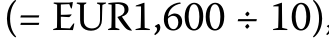

共用計算式 · PDF 94 · 開啟原尺寸圖片

選擇C是不正確的，因爲這種分開調整將把股票價格降至每股約64歐元〔計算式 13〕,低於預期幅度。

Choice C is incorrect because this split adjustment would lower the stock price to approximately EUR64 per share 〔Calculation 13〕, which is below the desired range.

計算式 13 / Calculation 13

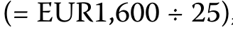

共用計算式 · PDF 95 · 開啟原尺寸圖片

#### 补充解析 / Supplementary explanation

先计算新股数，再反向调整每股价格、每股收益等指标。追踪总市值和持股比例是否保持一致，可以快速检验结果。

Adjust share count and inversely adjust per-share measures. Check that total market value and proportional ownership remain consistent.

易错点：多拿到股票并不自动创造财富。应区分不产生公司现金流的拆股与会改变公司现金资产的现金股利或回购。

Common pitfall: Receiving more shares does not automatically create wealth. Distinguish a non-cash split from dividends or repurchases that reduce corporate cash.

#### 相关知识点 / Related concepts

#### 拆股与股票股利 / Splits and stock dividends

拆股改变的是一家公司被分成多少份，通常不直接改变公司总价值。份数变多，每份价格相应下降；持有人的比例权益保持不变。

A split changes the number of units into which ownership is divided, without directly changing total company value. More shares imply a proportionately smaller value per share.

### EQ-LM04-I004-01 · 知識檢查：Tech Mahindra 除息日的股票回報率 · 第 1 题 KNOWLEDGE CHECK: TECH MAHINDRA EX-DIVIDEND DATE STOCK RETURN · Question 1

知识检查 / Knowledge check · 原版 PDF 页码 / Source PDF pages: 96-97

#### 题目与资料 / Question and data

#### 共用资料 / Shared information

Tech Mahindra是設在印度的信息技術服務和解決方案提供商，宣佈每股紅利爲32印度尼西亞盾(NIR32),除息日期爲2023年7月21日。

Tech Mahindra, an information technology services and solutions provider based in India, declared a dividend in the amount of INR32 per share with an ex-dividend date of 21 July 2023.

2023年7月20日，Tech Mahindra的股票價格以1,252.95愛爾蘭里拉關閉，其股票價格在2023年6月21日接近尾聲時降至1,195.10愛爾蘭里拉。

On 20 July 2023, Tech Mahindra’s stock price closed at INR1,252.95, and its stock price declined to INR1,195.10 at the close on 21 July 2023.

Tech Mahindra的股票是基礎廣泛的印度NIFTY 50指數的一個組成部分，其價格在2023年7月20日至21日之間從19 979.15愛爾蘭里拉下降到19 745印度里拉。

Tech Mahindra’s stock is a component of the broad-based Indian NIFTY 50 Index, the price of which fell from INR19,979.15 to INR19,745 between 20 July and 21 July 2023.

1\. 計算Tech Mahindra在退稅日的價格下跌百分比，並顯示下降百分比中有多少是:

1\. Calculate Tech Mahindra’s percentage price decline on the ex-dividend date, and show how much of the percentage decline is comprised of:

· 預期紅利;

■ the expected dividend;

\* 市場造成的每日股價變化;

■ the daily stock price change due to the market; and

公司特定價格變化的影響。

■ the impact of company-specific price changes.

#### 官方答案与解析 / Official answer and explanation

解答

Solution

Tech Mahindra的股本在7月21日前天下跌4.62%:

Tech Mahindra’s stock declined by 4.62% on the ex-dividend date of 21 July:

教學核對提示：本頁有一處數字或符號不一致，請參閱已核對的原文數字疑點。下方保留原文內容。

Teaching check: this page contains a numerical or sign inconsistency. See checked source inconsistencies. The original content remains below.

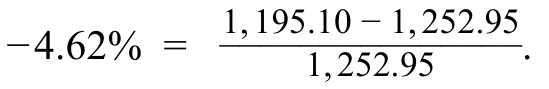

原文公式 · PDF 97 · 開啟原尺寸圖片

等式1回顧指出，總價格下跌是股息、總體市場變化和公司特定價格變動的總和。

Recall from Equation 1 that the overall price decline is the sum of the dividend, overall market changes, and company-specific price movements.

鑑於上述情況，我們可以對前兩項影響作出如下估計:

Given the information above, we may estimate the first two of these effects as follows:

• INR32的紅利導致價格變動-2.55%,即將預期紅利除以在退稅日期前一天的股價:

• Dividend of INR32 results in a price change of −2.55% by dividing the expected dividend by the share price on the day before the ex-dividend date:

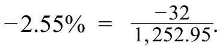

原文公式 · PDF 97 · 開啟原尺寸圖片

• 一天的股市變動率爲-1.17%,以50荷蘭盾指數價格變動百分率爲基礎:

• The one-day equity market change is −1.17% based upon the NIFTY 50 Index percentage price change:

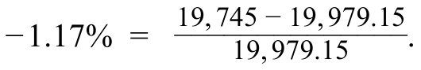

原文公式 · PDF 97 · 開啟原尺寸圖片

將結果替換爲1等式，以解決具體公司的變化:

Solve for company-specific changes by substituting the results into Equation 1:

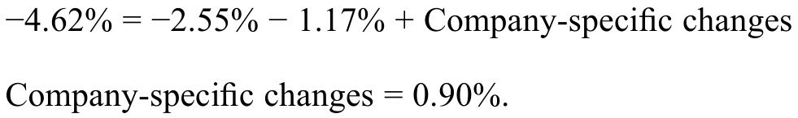

原文公式 · PDF 97 · 開啟原尺寸圖片

在沒有具體公司的價格變化的情況下，我們預計股票價格將下跌3.72%〔計算式 14〕。

In the absence of company-specific price changes, we would expect a smaller stock price decline of 3.72% 〔Calculation 14〕.

計算式 14 / Calculation 14

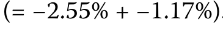

共用計算式 · PDF 97 · 開啟原尺寸圖片

#### 补充解析 / Supplementary explanation

先确定公司总现金减少多少、股数是否减少，再比较每股指标。评价总收益时把除息造成的价格变化和现金股息放在一起看。

Track the cash reduction and whether share count changes before evaluating per-share measures. For total return, consider the ex-dividend price change together with the cash received.

易错点：回购导致 EPS 上升，不代表企业经营利润增加。股息率高也可能来自股价下跌；不能单独据此认定估值便宜。

Common pitfall: An EPS increase after a repurchase need not indicate improved operating profit. A high dividend yield can reflect a falling share price rather than an attractive valuation.

#### 相关知识点 / Related concepts

#### 分红、回购与股东收益 / Dividends, repurchases, and shareholder returns

分红把现金直接交给股东，回购则以现金换回股份。二者都可能减少公司现金，但对在外股数、每股指标和剩余股东权益的影响不同。

Dividends distribute cash directly; repurchases exchange cash for shares. Both can reduce corporate cash but affect shares outstanding and per-share measures differently.

Dividend yield = DPS/P; total return includes price change + cash distribution

### EQ-LM04-I005-01 · 問題組 2 · 第 1 题 QUESTION SET 2 · Question 1

正文习题组 / Question set · 原版 PDF 页码 / Source PDF pages: 97

#### 题目与资料 / Question and data

1\. 1月7日星期一，Wiley Creek有限公司宣佈其普通股票每股季紅利1.25澳元。

1\. Wiley Creek Limited declared a quarterly dividend of AUD1.25 per share on its common stock on Monday, 7 January.

股息於2月1日付給1月10日記錄在案的股東。

The dividend was payable on 1 February to shareholders of record on 10 January.

預測Wiley Creek股市股價在接下來的某一個工作日內會下跌,

On which one of the following business days would a decline in Wiley Creek’s stock price of the dividend amount, holding all else equal, be expected?

A. 1月9日。

A. 9 January

B. 1月10日。

B. 10 January

C. 2月1日。

C. 1 February

#### 官方答案与解析 / Official answer and explanation

解答

Solution

A 項正確。

Choice A is correct.

除息日是股票開始以不附帶即將派付股息之權利進行交易的第一天。

The ex-dividend date is the first date at which the stock trades without rights to the upcoming dividend payment.

前啓迪日期通常於記錄日期前一個工作日發生。

The ex-dividend date typically occurs one business day before the record date.

在這種情況下，1月10日是創紀錄的日期，因此1月9日是最有可能退稅的日期。

In this case, 10 January is the record date, so 9 January is the most likely ex-dividend date.

選擇B是不正確的，因爲記錄日期是在退讓日之後。

Choice B is incorrect because the record date occurs after the ex-dividend date.

選擇C是不正確的，因爲付款日期比退款日期晚幾個星期。

Choice C is incorrect because the payment date occurs several weeks later than the ex-dividend date.

#### 补充解析 / Supplementary explanation

先确定公司总现金减少多少、股数是否减少，再比较每股指标。评价总收益时把除息造成的价格变化和现金股息放在一起看。

Track the cash reduction and whether share count changes before evaluating per-share measures. For total return, consider the ex-dividend price change together with the cash received.

易错点：回购导致 EPS 上升，不代表企业经营利润增加。股息率高也可能来自股价下跌；不能单独据此认定估值便宜。

Common pitfall: An EPS increase after a repurchase need not indicate improved operating profit. A high dividend yield can reflect a falling share price rather than an attractive valuation.

#### 相关知识点 / Related concepts

#### 分红、回购与股东收益 / Dividends, repurchases, and shareholder returns

分红把现金直接交给股东，回购则以现金换回股份。二者都可能减少公司现金，但对在外股数、每股指标和剩余股东权益的影响不同。

Dividends distribute cash directly; repurchases exchange cash for shares. Both can reduce corporate cash but affect shares outstanding and per-share measures differently.

Dividend yield = DPS/P; total return includes price change + cash distribution

### EQ-LM04-I005-02 · 問題組 2 · 第 2 题 QUESTION SET 2 · Question 2

正文习题组 / Question set · 原版 PDF 页码 / Source PDF pages: 97-98

#### 题目与资料 / Question and data

2\. 一名初級分析師提出以下短期貿易戰略:在到期日之前購買股票，然後在股息支付日期之後出售股票。

2\. A junior analyst proposes the following short-term trading strategy: Buy stocks on the date before their ex-dividend dates, and then sell the stocks following the dividend payment date.

關於這一貿易戰略，以下哪些說法最正確?

Which one of the following statements is most correct about this trading strategy?

A. 這一貿易戰略可能平均有利可圖，因爲從收取股息中得到回報。

A. This trading strategy will likely be profitable, on average, because of returns from collecting dividends.

B. 由於市場流動和公司特定價格變化的綜合影響，這種貿易戰略可能會平均產生負利潤。

B. This trading strategy will likely generate negative profits, on average, because of the combined effect of market movements and company-specific price changes.

C. 這一貿易戰略可能平均賺取與市場流動成比例的利潤。

C. This trading strategy will likely earn profits, on average, proportional to market movements.

#### 官方答案与解析 / Official answer and explanation

解答

Solution

C 項正確。

Choice C is correct.

平均而言，在前紅利日期之前購買和收取股息後出售應產生零利潤，因爲股票價格應下降股息數額。

Buying before the ex-dividend date and selling after collecting the dividend, on average, should generate zero profits because the stock price should decline by the amount of the dividend.

公司具體價格變動的影響應通過許多不同股票的交易而取消。

The effect of company-specific price changes should be canceled by trading in many different stocks.

唯一的利潤(正或負)將根據每股股票買賣日期之間的市場變動而定。

The only profits (positive or negative) will be based on market movements between the purchase and sale dates for each stock.

選擇A是不正確的，因爲收取的紅利只是抵消了退稅日期的價格下跌。

Choice A is incorrect because the dividends collected simply offset the price declines on the ex-dividend dates.

選擇B是不正確的，因爲利潤可能是正的或負的，取決於市場動態。

Choice B is incorrect because profits could be positive or negative, depending on market movements.

由於貿易戰略多樣化，應當消除特定公司的價格變化。

Company-specific price changes should be eliminated because of the diversified trading strategy.

#### 补充解析 / Supplementary explanation

先确定公司总现金减少多少、股数是否减少，再比较每股指标。评价总收益时把除息造成的价格变化和现金股息放在一起看。

Track the cash reduction and whether share count changes before evaluating per-share measures. For total return, consider the ex-dividend price change together with the cash received.

易错点：回购导致 EPS 上升，不代表企业经营利润增加。股息率高也可能来自股价下跌；不能单独据此认定估值便宜。

Common pitfall: An EPS increase after a repurchase need not indicate improved operating profit. A high dividend yield can reflect a falling share price rather than an attractive valuation.

#### 相关知识点 / Related concepts

#### 分红、回购与股东收益 / Dividends, repurchases, and shareholder returns

分红把现金直接交给股东，回购则以现金换回股份。二者都可能减少公司现金，但对在外股数、每股指标和剩余股东权益的影响不同。

Dividends distribute cash directly; repurchases exchange cash for shares. Both can reduce corporate cash but affect shares outstanding and per-share measures differently.

Dividend yield = DPS/P; total return includes price change + cash distribution

### EQ-LM04-I005-03 · 問題組 2 · 第 3 题 QUESTION SET 2 · Question 3

正文习题组 / Question set · 原版 PDF 页码 / Source PDF pages: 97-99

#### 题目与资料 / Question and data

3\. 2023年12月7日，Verizon通信公司宣佈其普通股票的季度股息爲每股0.665美元。

3\. Verizon Communications declared a quarterly dividend of USD0.665 per share on its common stock on 7 December 2023.

股息於2024年2月1日付給2024年1月10日創記錄的股東。

The dividend was payable on 1 February 2024 to shareholders of record on 10 January 2024.

1月8日，Verizon股票以每股40.10美元關閉，S & P 500指數以4,763.54美元關閉。

On 8 January, Verizon stock closed at USD40.10 per share and the S&P 500 Index closed at USD4,763.54.

1月9日，Verizon股票以39.04美元關閉，而S & P 500指數以4,756.50美元關閉。

On 9 January, Verizon stock closed at USD39.04 while the S&P 500 Index closed at USD4,756.50.

如果S & P 500指數準確反映了Verizon如何分擔市場價格變動引起的價格變化，那麼以下最正確地顯示的是Verizson在退稅日的下降百分比，反映公司特定的價格變化。

If the S&P 500 Index accurately reflects how Verizon share prices change due to market price changes, which one of the following most correctly shows the percentage of Verizon’s decline on the ex-dividend date that reflects company-specific price changes?

A. −0.14%

A. −0.14%

B. −0.85%

B. −0.85%

C. −1.66%

C. −1.66%

#### 官方答案与解析 / Official answer and explanation

解答

Solution

B 項正確。

Choice B is correct.

Verizon跌至39.04美元，反映了總日回報率爲-2.65%,將股息、市場和公司特有的價格變化結合起來:

Verizon’s decline to USD39.04 reflected a total daily return of −2.65% combining dividend, market, and company-specific price changes:

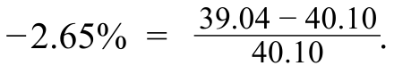

原文公式 · PDF 98 · 開啟原尺寸圖片

除息日效應所造成的預期價格變動，為每股 0.665 美元股息相對於前一日收市價的比率，亦即下跌 1.66%（−1.66%）：

The expected price change from the ex-dividend day effect is equal to the USD0.665 dividend divided by the prior day’s closing price, or −1.66%:

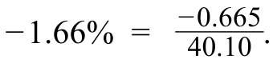

原文公式 · PDF 98 · 開啟原尺寸圖片

退稅日基於市場的價格變化爲-0.14%:

The market-based price change on the ex-dividend date was −0.14%:

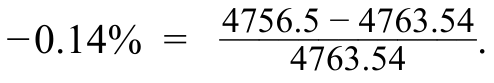

原文公式 · PDF 98 · 開啟原尺寸圖片

總而言之，我們預期韋裏松股票在退稅日期將下降1.80%〔計算式 15〕。

Overall, we would expect a decline of 1.80% 〔Calculation 15〕 in Verizon stock on the ex-dividend date.

計算式 15 / Calculation 15

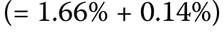

共用計算式 · PDF 98 · 開啟原尺寸圖片

因此，因公司而異的變動使在退稅日回報率增加了-0.85%〔計算式 16〕。

Therefore, company-specific changes contributed an additional −0.85% 〔Calculation 16〕 return on the ex-dividend date.

計算式 16 / Calculation 16

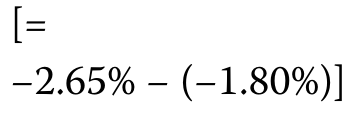

共用計算式 · PDF 98 · 開啟原尺寸圖片

選擇A是不正確的，因爲這僅僅是總體市場變化的百分比變化。

Choice A is incorrect as this is solely the percentage change from overall market movements.

選擇C是不正確的，因爲這一百分比是紅利規模造成的預期下降額。

Choice C is incorrect because this percentage is the expected amount of decline due to the size of the dividend.

#### 补充解析 / Supplementary explanation

先确定公司总现金减少多少、股数是否减少，再比较每股指标。评价总收益时把除息造成的价格变化和现金股息放在一起看。

Track the cash reduction and whether share count changes before evaluating per-share measures. For total return, consider the ex-dividend price change together with the cash received.

易错点：回购导致 EPS 上升，不代表企业经营利润增加。股息率高也可能来自股价下跌；不能单独据此认定估值便宜。

Common pitfall: An EPS increase after a repurchase need not indicate improved operating profit. A high dividend yield can reflect a falling share price rather than an attractive valuation.

#### 相关知识点 / Related concepts

#### 分红、回购与股东收益 / Dividends, repurchases, and shareholder returns

分红把现金直接交给股东，回购则以现金换回股份。二者都可能减少公司现金，但对在外股数、每股指标和剩余股东权益的影响不同。

Dividends distribute cash directly; repurchases exchange cash for shares. Both can reduce corporate cash but affect shares outstanding and per-share measures differently.

Dividend yield = DPS/P; total return includes price change + cash distribution

### EQ-LM04-I006-01 · 知識檢查 · 第 1 题 KNOWLEDGE CHECK · Question 1

知识检查 / Knowledge check · 原版 PDF 页码 / Source PDF pages: 100

#### 题目与资料 / Question and data

1\. 一名投資者在二級市場以每股 USD20.00 購入股票。若投資者在持有期末以每股 USD22.50 賣出，請計算持有期回報率。

1\. Consider an investor who purchases a stock in the secondary market at USD20.00 per share. Calculate the holding period rate of return if the investor sells the stock for USD22.50 per share at the end of the period.

#### 官方答案与解析 / Official answer and explanation

解答

Solution

使用公式 2 求解，其中 Pₜ 為 USD20，Pₜ₊₁ 為 USD22.50：

Solve this using Equation 2, with Pₜ of USD20 and Pₜ₊₁ equal to USD22.50:

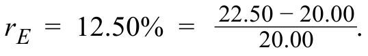

原文公式 · PDF 100 · 開啟原尺寸圖片

#### 补充解析 / Supplementary explanation

把期末卖价减期初买价得到资本利得，再加入持有期收到的每股现金分配，全部除以期初买价。分配与价格必须采用相同股数口径。现金股息是总收益的一部分，不能既加入现金又把同一笔股息重复计入价格升幅。

Add the price gain to per-share distributions and divide by the initial price. Use a consistent share basis. Cash dividends contribute to total return, but the same dividend must not also be counted as a price gain.

本题无分配，(22.50−20)/20=12.5%。

With no distribution, (22.50−20)/20=12.5%.

#### 相关知识点 / Related concepts

#### 持有期收益的现金流口径 / Holding-period return and distributions

价格收益与分配收益相加得到持有期总收益；持有期超过一年时，年化是另一个步骤。

Price return plus distribution yield gives holding-period total return. Annualization is a separate calculation for a multi-year period.

HPR = (P₁ − P₀ + D) / P₀

### EQ-LM04-I007-01 · 知識檢查 · 第 1 题 KNOWLEDGE CHECK · Question 1

知识检查 / Knowledge check · 原版 PDF 页码 / Source PDF pages: 100-101

#### 题目与资料 / Question and data

#### 共用资料 / Shared information

一名投資者以每股 USD20.00 購入股票。

Consider an investor who purchases a stock for USD20.00 per share.

投資者在持有期末收取每股 USD1.00 的現金股息，當時的每股股價為 USD22.50。

The investor receives a cash dividend of USD1.00 per share at the end of the holding period, at which time the price per share is USD22.50.

1\. 計算持有期回報率。

1\. Calculate the holding period rate of return.

#### 官方答案与解析 / Official answer and explanation

解答

Solution

使用公式 3 求解，其中 Pₜ 為 USD20，Dₜ₊₁ 為 USD1.00，而 Pₜ₊₁ 為 USD22.50：

Solve this problem using Equation 3, with Pₜ of USD20, Dₜ₊₁ of USD1.00, and Pₜ₊₁ equal to USD22.50:

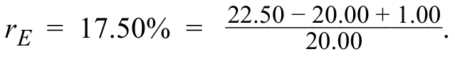

原文公式 · PDF 101 · 開啟原尺寸圖片

#### 补充解析 / Supplementary explanation

把期末卖价减期初买价得到资本利得，再加入持有期收到的每股现金分配，全部除以期初买价。分配与价格必须采用相同股数口径。现金股息是总收益的一部分，不能既加入现金又把同一笔股息重复计入价格升幅。

Add the price gain to per-share distributions and divide by the initial price. Use a consistent share basis. Cash dividends contribute to total return, but the same dividend must not also be counted as a price gain.

本题总收益为(22.50−20+1)/20=17.5%。

The total return is (22.50−20+1)/20=17.5%.

#### 相关知识点 / Related concepts

#### 持有期收益的现金流口径 / Holding-period return and distributions

价格收益与分配收益相加得到持有期总收益；持有期超过一年时，年化是另一个步骤。

Price return plus distribution yield gives holding-period total return. Annualization is a separate calculation for a multi-year period.

HPR = (P₁ − P₀ + D) / P₀

### EQ-LM04-I008-01 · 知識檢查 · 第 1 题 KNOWLEDGE CHECK · Question 1

知识检查 / Knowledge check · 原版 PDF 页码 / Source PDF pages: 101

#### 题目与资料 / Question and data

#### 共用资料 / Shared information

回顧上一個例子：投資者以每股 USD20.00 買入股票，並在持有期末收取每股 USD1.00 的現金股息，當時的股價為 USD22.50。

Recall the prior example in which an investor buys a stock for USD20.00 per share and receives a cash dividend of USD1.00 at the end of the holding period, at which time the share price is USD22.50.

1\. 若發行人在持有期末按每 5 股合併為 1 股的比例進行股份合併，並同時向股東支付現金股息，請計算持有期回報率（以百分比表示）。

1\. Calculate the holding period return on a percentage basis if the issuer conducts a 1-for-5 reverse share split of the stock at the end of the period, with the cash dividend paid to shareholders at the same time.

#### 官方答案与解析 / Official answer and explanation

解答

Solution

留意股份合併前後，股價和股息按相同的比例變動。

Note that the change in price and dividend are proportionally the same before and after the reverse split.

使用公式 3，可根據合併後每股 USD112.50 的股價 〔計算式 17〕 及每股 USD5 的股息 〔計算式 18〕 計算總回報如下：

Using Equation 3, we may calculate the total return based upon the new share price of USD112.50 〔Calculation 17〕 with a USD5 dividend 〔Calculation 18〕 per share as follows:

計算式 17 / Calculation 17

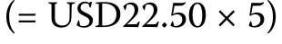

共用計算式 · PDF 101 · 開啟原尺寸圖片

計算式 18 / Calculation 18

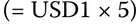

共用計算式 · PDF 101 · 開啟原尺寸圖片

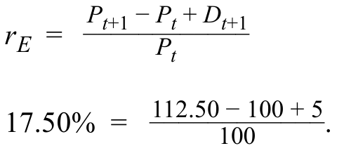

原文公式 · PDF 101 · 開啟原尺寸圖片

股份合併不會改變持有期回報率。

The reverse share split has no effect on the holding period return.

#### 补充解析 / Supplementary explanation

先计算新股数，再反向调整每股价格、每股收益等指标。追踪总市值和持股比例是否保持一致，可以快速检验结果。

Adjust share count and inversely adjust per-share measures. Check that total market value and proportional ownership remain consistent.

易错点：多拿到股票并不自动创造财富。应区分不产生公司现金流的拆股与会改变公司现金资产的现金股利或回购。

Common pitfall: Receiving more shares does not automatically create wealth. Distinguish a non-cash split from dividends or repurchases that reduce corporate cash.

#### 相关知识点 / Related concepts

#### 拆股与股票股利 / Splits and stock dividends

拆股改变的是一家公司被分成多少份，通常不直接改变公司总价值。份数变多，每份价格相应下降；持有人的比例权益保持不变。

A split changes the number of units into which ownership is divided, without directly changing total company value. More shares imply a proportionately smaller value per share.

### EQ-LM04-I009-01 · 知識檢查 · 第 1 题 KNOWLEDGE CHECK · Question 1

知识检查 / Knowledge check · 原版 PDF 页码 / Source PDF pages: 102

#### 题目与资料 / Question and data

#### 共用资料 / Shared information

回顧先前例子：投資者以每股 20.00 美元購入股票，收取每股 1.00 美元現金股息，期末每股股價為 22.50 美元。

Recall the earlier examples in which an investor buys a stock for USD20.00 per share, receives a cash dividend of USD1.00, and observes an end of period share price of USD22.50.

假定投資者沒有在持有期結束時收到股息，而是在股價爲21美元的時期中途得到股息。

Assume that instead of receiving the dividend at the end of the holding period, the investor receives the dividend halfway through the period at a time at which the share price is USD21.

1\. 計算持有期回報率，如果股息在持有期結束時以1.0%的無風險利率再投資。

1\. Calculate the holding period return if the dividend is reinvested at a risk- free rate of 1.00% to the end of the holding period.

#### 官方答案与解析 / Official answer and explanation

解答

Solution

要使用等分4解決持有期返回的問題，我們必須首先計算紅利的未來價值。

To solve for holding period return using Equation 4, we must first calculate the future value of the dividend.

在持有期剩餘時間以1%的無風險利率投資1.00美元的股息的股東在t+1時將收到1.005美元〔計算式 19〕。

A shareholder investing the USD1.00 dividend at a risk-free rate of 1% for the remainder of the holding period will receive USD1.005 〔Calculation 19〕 at time t + 1.

將其改爲第4號等式，作爲Dₜ₊₁紅利的未來價值，解決持有期收益率的如下問題:

Substituting this into Equation 4 as the future value of the dividend Dₜ₊₁, solve for the holding period rate of return as:

計算式 19 / Calculation 19

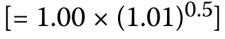

共用計算式 · PDF 102 · 開啟原尺寸圖片

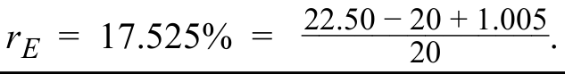

原文公式 · PDF 102 · 開啟原尺寸圖片

#### 补充解析 / Supplementary explanation

先把中途收到的股息移到期末：存入现金工具时按题目给定利率累积；买回股票时，新增股数等于股息金额除以再投资时股价。期末财富要包含原股份及新增股份的市值和后续分红，然后与初始投入比较。

Move interim dividends to the horizon. Accumulate them at the stated cash rate, or divide the dividend by the reinvestment price to find additional shares. Terminal wealth includes the original and extra shares plus subsequent distributions, and is compared with the initial investment.

#### 相关知识点 / Related concepts

#### 股息再投资与期末财富 / Dividend reinvestment and terminal wealth

再投资发生在收到股息时，所用价格不是期初或期末价格。把股息收到的时点提前，会改变再投资收益。

Reinvestment uses the price when the dividend is received, not the initial or final price. Distribution timing affects reinvestment income.

Extra shares = Dividend cash / Reinvestment price; HPR = Terminal wealth / Initial wealth − 1

### EQ-LM04-I009-02 · 知識檢查 · 第 2 题 KNOWLEDGE CHECK · Question 2

知识检查 / Knowledge check · 原版 PDF 页码 / Source PDF pages: 102-103

#### 题目与资料 / Question and data

#### 共用资料 / Shared information

回顧先前例子：投資者以每股 20.00 美元購入股票，收取每股 1.00 美元現金股息，期末每股股價為 22.50 美元。

Recall the earlier examples in which an investor buys a stock for USD20.00 per share, receives a cash dividend of USD1.00, and observes an end of period share price of USD22.50.

假定投資者沒有在持有期結束時收到股息，而是在股價爲21美元的時期中途得到股息。

Assume that instead of receiving the dividend at the end of the holding period, the investor receives the dividend halfway through the period at a time at which the share price is USD21.

2\. 如果股息在收到時按當時市場價格重新投資於股票，則計算持有期收益率。

2\. Calculate the holding period rate of return if the dividend is reinvested in shares at the prevailing market price upon receipt.

#### 官方答案与解析 / Official answer and explanation

解答

Solution

鑑於1美元的現金紅利和21美元的現時市場價格，我們可以確定投資者購買1/21(或0.04762)的額外股份。

Given the cash dividend of USD1.00 and the prevailing market price SPD of USD 21, we may determine that the investor purchases 1/21 (or 0.04762) additional shares.

換成4號方程式 我們可以解決17.857 %的持有期回報率問題

Substituting this into Equation 4, we may solve for a holding period rate of return of 17.857%:

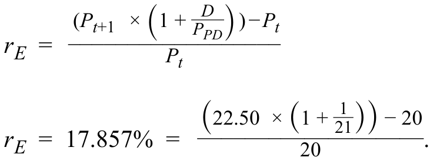

原文公式 · PDF 103 · 開啟原尺寸圖片

#### 补充解析 / Supplementary explanation

先把中途收到的股息移到期末：存入现金工具时按题目给定利率累积；买回股票时，新增股数等于股息金额除以再投资时股价。期末财富要包含原股份及新增股份的市值和后续分红，然后与初始投入比较。

Move interim dividends to the horizon. Accumulate them at the stated cash rate, or divide the dividend by the reinvestment price to find additional shares. Terminal wealth includes the original and extra shares plus subsequent distributions, and is compared with the initial investment.

#### 相关知识点 / Related concepts

#### 股息再投资与期末财富 / Dividend reinvestment and terminal wealth

再投资发生在收到股息时，所用价格不是期初或期末价格。把股息收到的时点提前，会改变再投资收益。

Reinvestment uses the price when the dividend is received, not the initial or final price. Distribution timing affects reinvestment income.

Extra shares = Dividend cash / Reinvestment price; HPR = Terminal wealth / Initial wealth − 1

### EQ-LM04-I010-01 · 知識檢查 · 第 1 题 KNOWLEDGE CHECK · Question 1

知识检查 / Knowledge check · 原版 PDF 页码 / Source PDF pages: 105

#### 题目与资料 / Question and data

#### 共用资料 / Shared information

一位投資者指出，一名分析師爲Volksbein AG設定了一年55歐元的股份價格目標。

An investor observes that an analyst has established a share price target for Volksbein AG of EUR55 in one year’s time.

投資者認爲12%是適當的年度貼現率。

The investor considers 12% to be the appropriate annual discount rate.

1\. 計算Volksbein AG的股份價格 投資者預計今天會支付 假設發行人不付股息。

1\. Calculate the Volksbein AG share price the investor would expect to pay today assuming the issuer pays no dividends.

#### 官方答案与解析 / Official answer and explanation

解答

Solution

使用 E和E等量 5Pₜ₊₁等於55歐元和rₑ12%,解決Pₜ:

Using Equation 5 with E(Pₜ₊₁) equal to EUR55 and rₑ of 12%, solve for Pₜ:

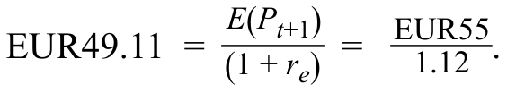

原文公式 · PDF 105 · 開啟原尺寸圖片

#### 补充解析 / Supplementary explanation

时间轴上逐期放置股息，并在最后一年同时放置当年股息与预期售价。每一笔按距今天的期数折现；最近已付股息D₀若预期增长，第一笔未来股息为D₀(1+g)。预期售价已经是终期的价格，不需要把它再按股息增长率增长。

Place dividends at each future date and both the final dividend and expected sale price at the horizon. Discount each by its own timing. If the most recent dividend D₀ is expected to grow, the next dividend is D₀(1+g). Do not additionally grow the given terminal sale price at the dividend growth rate.

无股息时，今天价格为55/1.12≈EUR49.11。

With no dividends, today’s price is 55/1.12≈EUR 49.11.

#### 相关知识点 / Related concepts

#### 股息与终期售价的折现 / Discounting dividends and a terminal sale price

股息现值与终期售价现值都属于股票价值。漏掉最后一笔股息或不折现终期售价，会产生方向明确的估值偏差。

Both dividend present values and the present value of the terminal price contribute to value. Omitting the final dividend understates value; failing to discount the terminal price overstates it.

P₀ = Σₜ₌₁ᵀ Dₜ/(1+rₑ)^t + Pₜₑᵣₘᵢₙₐₗ/(1+rₑ)^T

### EQ-LM04-I010-02 · 知識檢查 · 第 2 题 KNOWLEDGE CHECK · Question 2

知识检查 / Knowledge check · 原版 PDF 页码 / Source PDF pages: 105

#### 题目与资料 / Question and data

#### 共用资料 / Shared information

一位投資者指出，一名分析師爲Volksbein AG設定了一年55歐元的股份價格目標。

An investor observes that an analyst has established a share price target for Volksbein AG of EUR55 in one year’s time.

投資者認爲12%是適當的年度貼現率。

The investor considers 12% to be the appropriate annual discount rate.

2\. 假設 Volksbein AG 宣佈年末每股股息為 2.50 歐元，而分析師維持原有的年末目標價 55 歐元。

2\. Assume that Volksbein AG announces a year-end dividend of EUR2.50, and the analyst maintains the same EUR55 year-end price target.

計算投資者希望今天觀察到的訂正股價。

Calculate the revised share price the investor would expect to observe today.

#### 官方答案与解析 / Official answer and explanation

解答

Solution

運用公式 6，將 E(Pₜ₊₁) 設為 55 歐元、E(Dₜ₊₁) 設為 2.50 歐元，並令 rₑ 為 12%，求出 Pₜ：

Using Equation 6 with E(Pₜ₊₁) equal to EUR55, E(Dₜ₊₁) equal to EUR2.50, and rₑ of 12%, solve for Pₜ:

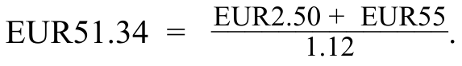

原文公式 · PDF 105 · 開啟原尺寸圖片

請注意，今天股價在1至2之間的差額等於2.50歐元紅利的現值，相當於2.23歐元〔計算式 22〕。

Note that the difference in today’s share price between 1. and 2. is equal to the present value of the EUR2.50 dividend equal to EUR2.23 〔Calculation 22〕.

計算式 22 / Calculation 22

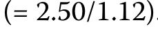

共用計算式 · PDF 105 · 開啟原尺寸圖片

#### 补充解析 / Supplementary explanation

时间轴上逐期放置股息，并在最后一年同时放置当年股息与预期售价。每一笔按距今天的期数折现；最近已付股息D₀若预期增长，第一笔未来股息为D₀(1+g)。预期售价已经是终期的价格，不需要把它再按股息增长率增长。

Place dividends at each future date and both the final dividend and expected sale price at the horizon. Discount each by its own timing. If the most recent dividend D₀ is expected to grow, the next dividend is D₀(1+g). Do not additionally grow the given terminal sale price at the dividend growth rate.

保留同一终期价格时，今天价格为(55+2.50)/1.12≈EUR51.34；新增股息的现值为2.50/1.12≈EUR2.23。

With the same terminal price, today’s value is (55+2.50)/1.12≈EUR 51.34, higher by the dividend present value 2.50/1.12≈EUR 2.23.

#### 相关知识点 / Related concepts

#### 股息与终期售价的折现 / Discounting dividends and a terminal sale price

股息现值与终期售价现值都属于股票价值。漏掉最后一笔股息或不折现终期售价，会产生方向明确的估值偏差。

Both dividend present values and the present value of the terminal price contribute to value. Omitting the final dividend understates value; failing to discount the terminal price overstates it.

P₀ = Σₜ₌₁ᵀ Dₜ/(1+rₑ)^t + Pₜₑᵣₘᵢₙₐₗ/(1+rₑ)^T

### EQ-LM04-I011-01 · 知識檢查 · 第 1 题 KNOWLEDGE CHECK · Question 1

知识检查 / Knowledge check · 原版 PDF 页码 / Source PDF pages: 105-106

#### 题目与资料 / Question and data

#### 共用资料 / Shared information

前一例子中提到的同一份分析員報告在三年內爲Volksbein AG設定了65歐元的長期價格目標。

The same analyst report referenced in the prior example had a long- term price target for Volksbein AG of EUR65 in three years’ time.

1\. 如果投資者預期最近宣佈的2.50歐元股息在未來三年內將保持不變，貼現率將維持在12 % 。

1\. Calculate today’s Volksbein AG share price based upon the three-year price target if the investor expects the recently announced EUR2.50 dividends per share to remain constant over the next three years and the discount rate to remain unchanged at 12%.

#### 官方答案与解析 / Official answer and explanation

解答

Solution

使用 7 和 E ()Pₜ₊₁等於65歐元、D,每期2.50歐元和rₑ12%,解決Pₜ:

Using Equation 7 with E(Pₜ₊₁) equal to EUR65, D of EUR2.50 each period, and rₑ of 12%, solve for Pₜ:

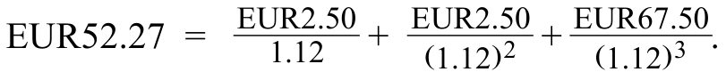

原文公式 · PDF 106 · 開啟原尺寸圖片

#### 补充解析 / Supplementary explanation

时间轴上逐期放置股息，并在最后一年同时放置当年股息与预期售价。每一笔按距今天的期数折现；最近已付股息D₀若预期增长，第一笔未来股息为D₀(1+g)。预期售价已经是终期的价格，不需要把它再按股息增长率增长。

Place dividends at each future date and both the final dividend and expected sale price at the horizon. Discount each by its own timing. If the most recent dividend D₀ is expected to grow, the next dividend is D₀(1+g). Do not additionally grow the given terminal sale price at the dividend growth rate.

#### 相关知识点 / Related concepts

#### 股息与终期售价的折现 / Discounting dividends and a terminal sale price

股息现值与终期售价现值都属于股票价值。漏掉最后一笔股息或不折现终期售价，会产生方向明确的估值偏差。

Both dividend present values and the present value of the terminal price contribute to value. Omitting the final dividend understates value; failing to discount the terminal price overstates it.

P₀ = Σₜ₌₁ᵀ Dₜ/(1+rₑ)^t + Pₜₑᵣₘᵢₙₐₗ/(1+rₑ)^T

### EQ-LM04-I011-02 · 知識檢查 · 第 2 题 KNOWLEDGE CHECK · Question 2

知识检查 / Knowledge check · 原版 PDF 页码 / Source PDF pages: 105-106

#### 题目与资料 / Question and data

#### 共用资料 / Shared information

前一例子中提到的同一份分析員報告在三年內爲Volksbein AG設定了65歐元的長期價格目標。

The same analyst report referenced in the prior example had a long- term price target for Volksbein AG of EUR65 in three years’ time.

2\. 說明預期股息相對於未來預期股票價格在今後三年內升值對Volksbein AG股票價格的相對影響。

2\. Describe the relative impact of expected dividends versus expected future share price appreciation over the next three years on Volksbein AG’s stock price.

#### 官方答案与解析 / Official answer and explanation

解答

Solution

將7等價物的第一部分作爲總股價的一部分與其第二部分加以比較，從而產生股息相對於股票價格升值的相對影響。

Derive the relative impact of dividends versus share price appreciation by comparing the first component of Equation 7 as a fraction of total share price with its second component.

本知識檢查問題1:

From Question 1 of this Knowledge Check:

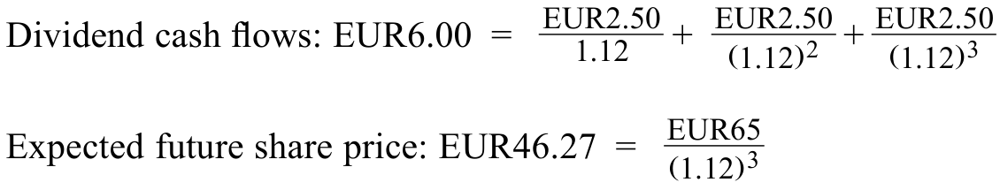

原文公式 · PDF 106 · 開啟原尺寸圖片

預期紅利現金流量佔11.5%〔計算式 23〕剩下的88.5%〔計算式 24〕以預期未來份額價格爲依據。

Expected dividend cash flows represent 11.5% 〔Calculation 23〕 of today’s Volksbein AG share price, while the remaining 88.5% 〔Calculation 24〕 is based upon the expected future share price.

計算式 23 / Calculation 23

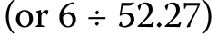

共用計算式 · PDF 106 · 開啟原尺寸圖片

計算式 24 / Calculation 24

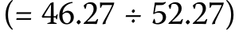

共用計算式 · PDF 106 · 開啟原尺寸圖片

#### 补充解析 / Supplementary explanation

时间轴上逐期放置股息，并在最后一年同时放置当年股息与预期售价。每一笔按距今天的期数折现；最近已付股息D₀若预期增长，第一笔未来股息为D₀(1+g)。预期售价已经是终期的价格，不需要把它再按股息增长率增长。

Place dividends at each future date and both the final dividend and expected sale price at the horizon. Discount each by its own timing. If the most recent dividend D₀ is expected to grow, the next dividend is D₀(1+g). Do not additionally grow the given terminal sale price at the dividend growth rate.

#### 相关知识点 / Related concepts

#### 股息与终期售价的折现 / Discounting dividends and a terminal sale price

股息现值与终期售价现值都属于股票价值。漏掉最后一笔股息或不折现终期售价，会产生方向明确的估值偏差。

Both dividend present values and the present value of the terminal price contribute to value. Omitting the final dividend understates value; failing to discount the terminal price overstates it.

P₀ = Σₜ₌₁ᵀ Dₜ/(1+rₑ)^t + Pₜₑᵣₘᵢₙₐₗ/(1+rₑ)^T

### EQ-LM04-I012-01 · 問題組 3 · 第 1 题 QUESTION SET 3 · Question 1

正文习题组 / Question set · 原版 PDF 页码 / Source PDF pages: 106-107

#### 题目与资料 / Question and data

1\. 投資者以每股CAD200的價格購買股票。

1\. An investor buys a stock at a price of CAD200 per share.

一年後，股票發行人進行股份分拆，將每 1 股拆為 4 股。

After one year, the issuer of the stock conducts a 4-for-1 split of the shares.

發行者在分期付款後立即支付每股現金紅利3.00加元，股票價格爲每股58加元。

Immediately following the split, the issuer pays a CAD3.00 per share cash dividend, and the stock price is CAD58 per share.

下列哪一種最接近於一年持有期返回的庫存?

Which one of the following is closest to the one-year holding period return on the stock?

A. 17.5%

A. 17.5%

B. 22.0%

B. 22.0%

C. 40.0%

C. 40.0%

#### 官方答案与解析 / Official answer and explanation

解答

Solution

B 項正確。

Choice B is correct.

爲了適當說明分割情況，庫存的購買價格Pₜ可調整爲CAD50:

To properly account for the split, the purchase price of the stock, Pₜ, may be adjusted to CAD50:

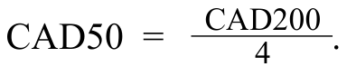

原文公式 · PDF 107 · 開啟原尺寸圖片

一年回報率相當於22.0%:

The one-year return is equal to 22.0%:

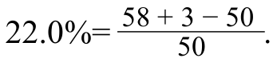

原文公式 · PDF 107 · 開啟原尺寸圖片

選擇A不正確, 因爲如果我們錯誤地將年終紅利下調17.5%是結果:

Choice A is incorrect, as 17.5% is the result if we were to incorrectly adjust the end-of-year dividend downward:

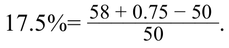

原文公式 · PDF 107 · 開啟原尺寸圖片

C 項不正確；如果錯誤地將年末股息向上調整，便會得到 40% 這個結果：

Choice C is incorrect, as 40% is the result if we were to incorrectly adjust the end-of-year dividend upward:

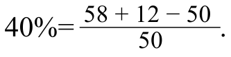

原文公式 · PDF 107 · 開啟原尺寸圖片

#### 补充解析 / Supplementary explanation

先计算新股数，再反向调整每股价格、每股收益等指标。追踪总市值和持股比例是否保持一致，可以快速检验结果。

Adjust share count and inversely adjust per-share measures. Check that total market value and proportional ownership remain consistent.

易错点：多拿到股票并不自动创造财富。应区分不产生公司现金流的拆股与会改变公司现金资产的现金股利或回购。

Common pitfall: Receiving more shares does not automatically create wealth. Distinguish a non-cash split from dividends or repurchases that reduce corporate cash.

#### 相关知识点 / Related concepts

#### 拆股与股票股利 / Splits and stock dividends

拆股改变的是一家公司被分成多少份，通常不直接改变公司总价值。份数变多，每份价格相应下降；持有人的比例权益保持不变。

A split changes the number of units into which ownership is divided, without directly changing total company value. More shares imply a proportionately smaller value per share.

### EQ-LM04-I012-02 · 問題組 3 · 第 2 题 QUESTION SET 3 · Question 2

正文习题组 / Question set · 原版 PDF 页码 / Source PDF pages: 106-107

#### 题目与资料 / Question and data

2\. 投資者以每股75美元的價格購買股票。

2\. An investor buys a stock at a price of USD75 per share.

一年之後，股票價格爲每股85美元，並支付每股3.00美元的紅利。

One year later, the stock’s price is USD85 per share and pays a dividend of USD3.00 per share.

投資者將這一紅利再投資。

The investor reinvests this dividend.

第二年之後，股票價格爲每股80美元，股息爲每股3.00美元的紅利。

After the second year, the stock’s price is USD80 per share, and the stock pays a dividend of USD3.00 per share.

以下哪一種最接近該投資者的兩年持有期回報?

Which one of the following is closest to the two-year holding period return of this investor?

A. 14.57%

A. 14.57%

B. 14.67%

B. 14.67%

C. 14.98%

C. 14.98%

#### 官方答案与解析 / Official answer and explanation

解答

Solution

A 項正確。

Choice A is correct.

這可由兩個不同的解決方案進程加以確認。

This may be confirmed by two different solution processes.

首先，早些時候我們明確計算用再投資紅利購買的分部分股的方法如下:

First, the approach shown earlier in which we explicitly calculate the fractional share purchased with the reinvested dividend is:

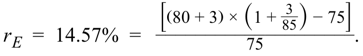

原文公式 · PDF 107 · 開啟原尺寸圖片

請注意，第二年年底的3美元股息加上80美元的股價，因爲這一股息不會增加。

Note that the USD3 dividend at the end of the second year is added to the USD80 share price as this dividend does not compound.

相反，只有第一年結束時收到的3美元的股息被用來以85美元的價格購買部分份額。

Rather, only the USD3 dividend received at the end of the first year is used to buy a fractional share at a price of USD85.

尋找正確答案的另一種辦法使用定期覆函複合概念:

An alternative approach to finding the correct answer uses the concept of compounding periodic returns:

原文公式 · PDF 107 · 開啟原尺寸圖片

選擇B不正確，因爲14.67%的收益來自簡單地將兩個紅利加到第二年價格〔計算式 25〕。

Choice B is incorrect because 14.67% is derived from simply adding the two dividends to the second-year price 〔Calculation 25〕.

因此，這種辦法沒有適當地考慮到第一年結束時的再投資紅利。

Thus, this approach does not properly account for the reinvested dividend at the end of the first year.

計算式 25 / Calculation 25

共用計算式 · PDF 107 · 開啟原尺寸圖片

選擇C是不正確的，因爲14.98%只是一年級和二年級的回報總和。

Choice C is incorrect because 14.98% is simply the sum of the Year 1 and Year 2 returns.

#### 补充解析 / Supplementary explanation

先把中途收到的股息移到期末：存入现金工具时按题目给定利率累积；买回股票时，新增股数等于股息金额除以再投资时股价。期末财富要包含原股份及新增股份的市值和后续分红，然后与初始投入比较。

Move interim dividends to the horizon. Accumulate them at the stated cash rate, or divide the dividend by the reinvestment price to find additional shares. Terminal wealth includes the original and extra shares plus subsequent distributions, and is compared with the initial investment.

#### 相关知识点 / Related concepts

#### 股息再投资与期末财富 / Dividend reinvestment and terminal wealth

再投资发生在收到股息时，所用价格不是期初或期末价格。把股息收到的时点提前，会改变再投资收益。

Reinvestment uses the price when the dividend is received, not the initial or final price. Distribution timing affects reinvestment income.

Extra shares = Dividend cash / Reinvestment price; HPR = Terminal wealth / Initial wealth − 1

### EQ-LM04-I012-03 · 問題組 3 · 第 3 题 QUESTION SET 3 · Question 3

正文习题组 / Question set · 原版 PDF 页码 / Source PDF pages: 106, 108

#### 题目与资料 / Question and data

3\. 一名分析師將每股75.00歐元的五年目標價格定爲5年。

3\. An analyst has placed a five-year target price of EUR75.00 per share on a stock.

最近股票支付的股息爲3.00歐元，預計今後五年每年將支付這一股息，年增長率爲4%。

The stock recently paid a EUR3.00 dividend, and this dividend is expected to be paid annually over the next five years with a 4% growth rate each year.

分析員認爲，8%的貼現率適用於庫存。

The analyst believes that a discount rate of 8% is appropriate for the stock.

下列哪一種最密切地估計了這些股票的當前價格?

Which one of the following most closely estimates the current price of this stock?

A. EUR61.98

A. EUR61.98

B. EUR64.46

B. EUR64.46

C. EUR78.00

C. EUR78.00

#### 官方答案与解析 / Official answer and explanation

解答

Solution

B 項正確。

Choice B is correct.

使用方程式7 說明問題的基本結構:

Using Equation 7 presents the basic structure of the problem:

原文公式 · PDF 108 · 開啟原尺寸圖片

由此產生的現金流量包括股息和以下第5年的價格:

The resulting cash flow stream consists of dividends and Year 5 price of the following:

第1年紅利:3.12歐元。

■ Year 1 dividend: EUR3.12

第二年紅利:3.24歐元。

■ Year 2 dividend: EUR3.24

第3年紅利:3.37歐元。

■ Year 3 dividend: EUR3.37

第四年紅利:3.51歐元。

■ Year 4 dividend: EUR3.51

· 第5年紅利:3.65歐元。

■ Year 5 dividend: EUR3.65

第5年價格:75.00歐元。

■ Year 5 price: EUR75.00

選擇A是不正確的，因爲如果第一年紅利假定爲3.00歐元，然後增長4%,61.98歐元的結果就會是結果。

Choice A is incorrect because EUR61.98 results if the first-year dividend is assumed as EUR3.00 with 4% growth following.

選擇C是不正確的，因爲78.00歐元的結果假定紅利將永遠增長4%,而不顧5年75.00歐元的目標價格。

Choice C is incorrect because a result of EUR78.00 assumes 4% growth forever in the dividend, disregarding the EUR75.00 target price in Year 5.

#### 补充解析 / Supplementary explanation

时间轴上逐期放置股息，并在最后一年同时放置当年股息与预期售价。每一笔按距今天的期数折现；最近已付股息D₀若预期增长，第一笔未来股息为D₀(1+g)。预期售价已经是终期的价格，不需要把它再按股息增长率增长。

Place dividends at each future date and both the final dividend and expected sale price at the horizon. Discount each by its own timing. If the most recent dividend D₀ is expected to grow, the next dividend is D₀(1+g). Do not additionally grow the given terminal sale price at the dividend growth rate.

#### 相关知识点 / Related concepts

#### 股息与终期售价的折现 / Discounting dividends and a terminal sale price

股息现值与终期售价现值都属于股票价值。漏掉最后一笔股息或不折现终期售价，会产生方向明确的估值偏差。

Both dividend present values and the present value of the terminal price contribute to value. Omitting the final dividend understates value; failing to discount the terminal price overstates it.

P₀ = Σₜ₌₁ᵀ Dₜ/(1+rₑ)^t + Pₜₑᵣₘᵢₙₐₗ/(1+rₑ)^T

### EQ-LM04-P001 · 章末练习 1 Practice Problem 1

章末练习 / Practice problem · 原版 PDF 页码 / Source PDF pages: 110, 112

#### 题目与资料 / Question and data

1\. 以下哪一種是預期的持有期返回時通常更可預測的部分?

1\. Which one of the following is typically a more predictable part of an expected holding period return?

全部收益的分紅部分。

A. Dividend portion of total return

B. 總收益的資本收益部分。

B. Capital gains portion of total return

C. 股利和資本收益部分同樣無法預測。

C. Dividend and capital gains portions are equally unpredictable.

#### 官方答案与解析 / Official answer and explanation

1\. A 項正確。

1\. Choice A is correct.

發行人通常試圖保持股息的某種一致性，使投資者能夠將最近的股息視爲可預見、預期回報的來源。

Issuers typically attempt to maintain some consistency in their dividends, which allows investors to be able to view recent dividends as a somewhat predictable source of expected returns.

選擇B是不正確的，因爲未來價格極不確定。

Choice B is incorrect because future prices are highly uncertain.

雖然分析家將把目標價格納入預期回報模式，但未來目標價格非常不可預測這一事實意味着資本收益比例的可預測性要低得多。

Although analysts will build target prices into their expected return models, the fact that future target prices are very unpredictable implies that the capital gains proportion is much less predictable.

根據上述論點，選擇C是不正確的。

Choice C is incorrect following from the above arguments.

#### 补充解析 / Supplementary explanation

先确定公司总现金减少多少、股数是否减少，再比较每股指标。评价总收益时把除息造成的价格变化和现金股息放在一起看。

Track the cash reduction and whether share count changes before evaluating per-share measures. For total return, consider the ex-dividend price change together with the cash received.

易错点：回购导致 EPS 上升，不代表企业经营利润增加。股息率高也可能来自股价下跌；不能单独据此认定估值便宜。

Common pitfall: An EPS increase after a repurchase need not indicate improved operating profit. A high dividend yield can reflect a falling share price rather than an attractive valuation.

#### 相关知识点 / Related concepts

#### 分红、回购与股东收益 / Dividends, repurchases, and shareholder returns

分红把现金直接交给股东，回购则以现金换回股份。二者都可能减少公司现金，但对在外股数、每股指标和剩余股东权益的影响不同。

Dividends distribute cash directly; repurchases exchange cash for shares. Both can reduce corporate cash but affect shares outstanding and per-share measures differently.

Dividend yield = DPS/P; total return includes price change + cash distribution

### EQ-LM04-P002 · 章末练习 2 Practice Problem 2

章末练习 / Practice problem · 原版 PDF 页码 / Source PDF pages: 110, 112

#### 题目与资料 / Question and data

#### 共用资料 / Shared information

## 以下資料適用於第 2-6 題 The following information relates to questions 2-6

投資者正在評估三種不同的股票作爲購買對象。

An investor is evaluating three different stocks as candidates for purchase.

以下說明對這三種種羣中的每一種都作了基本描述。

The following statements provide basic descriptions of each of the three stocks.

艾迪森公司的股票交易價格爲每股54英鎊，最近支付的季度股息爲每股0.50英鎊。

■ Addison Company’s stock is trading at a price of GBP54 per share and recently paid a quarterly dividend of GBP0.50 per share.

分析人員平均將一年的目標價格定爲60英鎊。

On average, analysts have set a one-year target price of GBP60.

艾迪森過去股息通常只是其支付股東的能力的一小部分，而艾迪森過去通常回購大量股票。

Addison’s dividends in the past have typically been a small portion of its ability to pay shareholders, and Addison has commonly repurchased significant amounts of its stock in the past.

· Bryce有限公司的股票兩年前以每股76英鎊的價格交易。

■ Bryce Limited’s stock traded two years ago at a price of GBP76 per share.

一年前，公司股價為每股 96 英鎊時，派發每股 5.00 英鎊股息，隨即進行每 1 股拆為 2 股的股份分拆。

One year ago, the company paid a GBP5.00 per share dividend when its stock price was GBP96 per share; it then completed a 2-for-1 stock split immediately after.

今天，Bryce支付每個股紅利5英鎊，其股票交易額爲每股82英鎊。

Today, Bryce paid a GBP5.00 per share dividend, and its stock trades at GBP82 per share.

\* Caddell公司在以商品爲基礎的工業中經營，其現金流高且長期增長爲負數。

■ Caddell Corporation operates in a commodity-based industry with high current cash flows and negative long-run growth.

Caddell的股票目前交易額爲每股80.76英鎊，預計今後五年將支付每股10英鎊的股息。

Caddell’s stock is currently trading at GBP80.76 per share and is expected to pay dividends of GBP10 per share for the next five years.

預計Caddell的股價在五年內爲每股60英鎊。

The expectation is that Caddell’s share price will be GBP60 per share in five years.

分析家認爲，8%是卡德爾股票的適當貼現率。

Analysts believe that 8% is an appropriate discount rate for Caddell stock.

2\. 如果股息保持不變、股息每季度再投資1%且分析員的目標價格估計正確，那麼以下哪一種最接近於艾迪森在下一個一年持有期的預期股票回報率?

2\. Which one of the following is closest to Addison’s expected stock return over the next one-year holding period if the dividend stays constant, dividends are reinvested at 1% per quarter, and analysts’ target price estimate is correct?

A. 11.1%

A. 11.1%

B. 14.8%

B. 14.8%

C. 14.9%

C. 14.9%

#### 官方答案与解析 / Official answer and explanation

2\. C 項正確。

2\. Choice C is correct.

預期回報率將價格從54英鎊上漲至60英鎊、支付的股息和再投資股息收益產生的收益合併起來，具體如下:

The expected return combines the price increase from GBP54 to GBP60, the dividends paid, and the return generated from the return on reinvested dividends as follows:

原文公式 · PDF 112 · 開啟原尺寸圖片

選擇A不正確，因爲11.11%只反映價格變化。

Choice A is incorrect because 11.11% reflects only the price change.

選擇B是不正確的，因爲14.8%只反映已支付的股息而不計入再投資所得收益。

Choice B is incorrect because 14.8% reflects only the dividends paid without incorporating the return earned on dividend reinvestment.

#### 补充解析 / Supplementary explanation

正确选项是 C。价格收益为 60−54=6；四次季度股息各为 0.50。若分别在季末支付，则前三次股息分别复利 3、2、1 个季度，最后一次不再复利，年末股息合计为 0.50×(1.01³+1.01²+1.01+1)=2.0302005。

C is correct. The price gain is 60−54=6. Four quarterly dividends of 0.50 compound for three, two, one, and zero quarters respectively, giving a year-end dividend value of 0.50×(1.01³+1.01²+1.01+1)=2.0302005.

总收益率=(6+2.0302005)/54≈14.8707%，最接近 14.9%。11.1% 仅计资本利得；14.8% 计入现金股息但漏掉股息再投资收益。

The total return is (6+2.0302005)/54≈14.8707%, closest to 14.9%. The 11.1% alternative includes only the price gain; 14.8% includes dividends but omits their reinvestment return.

#### 相关知识点 / Related concepts

#### 持有期总收益与股息再投资 / Holding-period return with reinvested dividends

计算总收益要同时追踪价格变化、现金分配和分配后的再投资期限。题目给出的 1% 是季度再投资率，不是对全年股价变动再乘一次的收益率。

Total return tracks price change, distributions, and the time each distribution is reinvested. The stated 1% is a quarterly reinvestment rate, not an extra multiplier applied to the entire annual price gain.

`HPR = [P₁ − P₀ + Σ Dq(1+r_reinvest)^(4−q)] / P₀`

### EQ-LM04-P003 · 章末练习 3 Practice Problem 3

章末练习 / Practice problem · 原版 PDF 页码 / Source PDF pages: 110-112

#### 题目与资料 / Question and data

#### 共用资料 / Shared information

## 以下資料適用於第 2-6 題 The following information relates to questions 2-6

投資者正在評估三種不同的股票作爲購買對象。

An investor is evaluating three different stocks as candidates for purchase.

以下說明對這三種種羣中的每一種都作了基本描述。

The following statements provide basic descriptions of each of the three stocks.

艾迪森公司的股票交易價格爲每股54英鎊，最近支付的季度股息爲每股0.50英鎊。

■ Addison Company’s stock is trading at a price of GBP54 per share and recently paid a quarterly dividend of GBP0.50 per share.

分析人員平均將一年的目標價格定爲60英鎊。

On average, analysts have set a one-year target price of GBP60.

艾迪森過去股息通常只是其支付股東的能力的一小部分，而艾迪森過去通常回購大量股票。

Addison’s dividends in the past have typically been a small portion of its ability to pay shareholders, and Addison has commonly repurchased significant amounts of its stock in the past.

· Bryce有限公司的股票兩年前以每股76英鎊的價格交易。

■ Bryce Limited’s stock traded two years ago at a price of GBP76 per share.

一年前，公司股價為每股 96 英鎊時，派發每股 5.00 英鎊股息，隨即進行每 1 股拆為 2 股的股份分拆。

One year ago, the company paid a GBP5.00 per share dividend when its stock price was GBP96 per share; it then completed a 2-for-1 stock split immediately after.

今天，Bryce支付每個股紅利5英鎊，其股票交易額爲每股82英鎊。

Today, Bryce paid a GBP5.00 per share dividend, and its stock trades at GBP82 per share.

\* Caddell公司在以商品爲基礎的工業中經營，其現金流高且長期增長爲負數。

■ Caddell Corporation operates in a commodity-based industry with high current cash flows and negative long-run growth.

Caddell的股票目前交易額爲每股80.76英鎊，預計今後五年將支付每股10英鎊的股息。

Caddell’s stock is currently trading at GBP80.76 per share and is expected to pay dividends of GBP10 per share for the next five years.

預計Caddell的股價在五年內爲每股60英鎊。

The expectation is that Caddell’s share price will be GBP60 per share in five years.

分析家認爲，8%是卡德爾股票的適當貼現率。

Analysts believe that 8% is an appropriate discount rate for Caddell stock.

3\. 在投資者如何評估Addison股息支付政策與重新購買股票所用資金相比，以下哪一種說法可能最正確?

3\. Which one of the following statements is likely most correct as to how the investor may assess Addison’s policy regarding dividend payments compared to money spent on repurchasing stock?

A. 如果資本收益稅率低於股息收入稅率，投資者可以重視Addison的政策。

A. The investor may value Addison’s policy if tax rates on capital gains are lower than tax rates on dividend income.

B. 如果Adison公司有穩定的投資機會，投資者可以重視Adison的政策。

B. The investor may value Addison’s policy if the company has stable investment opportunities.

C. 投資者可能不贊成Addison的政策，因爲回購的現金流與股息現金流沒有等值價值。

C. The investor likely is not in favor of Addison’s policy because cash flows from repurchase are not of equivalent value to cash flows from dividends.

#### 官方答案与解析 / Official answer and explanation

3\. A 項正確。

3\. Choice A is correct.

通過股票回購向股東付款，可爲將股份出售給公司的股東帶來可能的資本收益。

Payout to shareholders through share repurchases generates a possible capital gain for shareholders who sell shares back to the company.

因此，當資本收益稅率低於股息收入稅率時，回購可能優於股利。

Thus, repurchases may be favored over dividends when capital gains tax rates are lower than those on dividend income.

選擇B是不正確的，因爲回購爲公司提供了靈活性，在投資機會波動較大時可以減少向股東的付款。

Choice B is incorrect because repurchases provide flexibility for the company to pay less to shareholders when investment opportunities fluctuate higher.

這種說法意味着沒有必要採取這種靈活性。

This statement implies that this flexibility is not necessary.

C 項錯誤。

Choice C is incorrect.

假設所有其他情況相同，再採購股票的現金流量等值於支付股息的現金流量。

Assuming all else equal, a cash flow from repurchasing stock is equivalent in value to a cash flow from payment of dividends.

#### 补充解析 / Supplementary explanation

先确定公司总现金减少多少、股数是否减少，再比较每股指标。评价总收益时把除息造成的价格变化和现金股息放在一起看。

Track the cash reduction and whether share count changes before evaluating per-share measures. For total return, consider the ex-dividend price change together with the cash received.

易错点：回购导致 EPS 上升，不代表企业经营利润增加。股息率高也可能来自股价下跌；不能单独据此认定估值便宜。

Common pitfall: An EPS increase after a repurchase need not indicate improved operating profit. A high dividend yield can reflect a falling share price rather than an attractive valuation.

#### 相关知识点 / Related concepts

#### 分红、回购与股东收益 / Dividends, repurchases, and shareholder returns

分红把现金直接交给股东，回购则以现金换回股份。二者都可能减少公司现金，但对在外股数、每股指标和剩余股东权益的影响不同。

Dividends distribute cash directly; repurchases exchange cash for shares. Both can reduce corporate cash but affect shares outstanding and per-share measures differently.

Dividend yield = DPS/P; total return includes price change + cash distribution

### EQ-LM04-P004 · 章末练习 4 Practice Problem 4

章末练习 / Practice problem · 原版 PDF 页码 / Source PDF pages: 110-112

#### 题目与资料 / Question and data

#### 共用资料 / Shared information

## 以下資料適用於第 2-6 題 The following information relates to questions 2-6

投資者正在評估三種不同的股票作爲購買對象。

An investor is evaluating three different stocks as candidates for purchase.

以下說明對這三種種羣中的每一種都作了基本描述。

The following statements provide basic descriptions of each of the three stocks.

艾迪森公司的股票交易價格爲每股54英鎊，最近支付的季度股息爲每股0.50英鎊。

■ Addison Company’s stock is trading at a price of GBP54 per share and recently paid a quarterly dividend of GBP0.50 per share.

分析人員平均將一年的目標價格定爲60英鎊。

On average, analysts have set a one-year target price of GBP60.

艾迪森過去股息通常只是其支付股東的能力的一小部分，而艾迪森過去通常回購大量股票。

Addison’s dividends in the past have typically been a small portion of its ability to pay shareholders, and Addison has commonly repurchased significant amounts of its stock in the past.

· Bryce有限公司的股票兩年前以每股76英鎊的價格交易。

■ Bryce Limited’s stock traded two years ago at a price of GBP76 per share.

一年前，公司股價為每股 96 英鎊時，派發每股 5.00 英鎊股息，隨即進行每 1 股拆為 2 股的股份分拆。

One year ago, the company paid a GBP5.00 per share dividend when its stock price was GBP96 per share; it then completed a 2-for-1 stock split immediately after.

今天，Bryce支付每個股紅利5英鎊，其股票交易額爲每股82英鎊。

Today, Bryce paid a GBP5.00 per share dividend, and its stock trades at GBP82 per share.

\* Caddell公司在以商品爲基礎的工業中經營，其現金流高且長期增長爲負數。

■ Caddell Corporation operates in a commodity-based industry with high current cash flows and negative long-run growth.

Caddell的股票目前交易額爲每股80.76英鎊，預計今後五年將支付每股10英鎊的股息。

Caddell’s stock is currently trading at GBP80.76 per share and is expected to pay dividends of GBP10 per share for the next five years.

預計Caddell的股價在五年內爲每股60英鎊。

The expectation is that Caddell’s share price will be GBP60 per share in five years.

分析家認爲，8%是卡德爾股票的適當貼現率。

Analysts believe that 8% is an appropriate discount rate for Caddell stock.

4\. 以下哪一份說明提供了最正確的理由，證明Bryce有限公司決定完成股票分割是有道理的?

4\. Which one of the following statements provides the most correct rationale to justify Bryce Limited’s decision to complete a stock split?

A. Bryce試圖吸引更多的機構投資者購買其股票。

A. Bryce is attempting to attract more institutional investors to buy its stock.

B. 布萊斯希望提高股票的每股價格，以提高其在股市上的聲譽。

B. Bryce wants a higher per share price on its stock to improve its reputation in the equity market.

C. Bryce試圖將其股票價格保持在合理的價格範圍內，以吸引個人投資者。

C. Bryce is attempting to keep its stock price within a reasonable price range to attract individual investors.

#### 官方答案与解析 / Official answer and explanation

4\. C 項正確。

4\. Choice C is correct.

股市分割通過增加未清股票數量，將每股價格保持在足以吸引零售投資者利息的低水平，從而降低每個股份的價格。

A stock split lowers the per share price by increasing the number of shares outstanding to keep the price per share at a level low enough to attract interest from retail investors.

選擇A是不正確的，因爲機構投資者不太可能對股票分割造成的每股價格變化作出反應。

Choice A is incorrect because institutional investors are less likely to respond to the price per share changes created by stock splits.

選擇B是不正確的，因爲本陳述更好地描述了逆向股票分割，試圖通過提高每股價格來改善股票價格光觀。

Choice B is incorrect because this statement better describes a reverse stock split as an attempt to improve the stock price optics by increasing the price per share.

#### 补充解析 / Supplementary explanation

先计算新股数，再反向调整每股价格、每股收益等指标。追踪总市值和持股比例是否保持一致，可以快速检验结果。

Adjust share count and inversely adjust per-share measures. Check that total market value and proportional ownership remain consistent.

易错点：多拿到股票并不自动创造财富。应区分不产生公司现金流的拆股与会改变公司现金资产的现金股利或回购。

Common pitfall: Receiving more shares does not automatically create wealth. Distinguish a non-cash split from dividends or repurchases that reduce corporate cash.

#### 相关知识点 / Related concepts

#### 拆股与股票股利 / Splits and stock dividends

拆股改变的是一家公司被分成多少份，通常不直接改变公司总价值。份数变多，每份价格相应下降；持有人的比例权益保持不变。

A split changes the number of units into which ownership is divided, without directly changing total company value. More shares imply a proportionately smaller value per share.

### EQ-LM04-P005 · 章末练习 5 Practice Problem 5

章末练习 / Practice problem · 原版 PDF 页码 / Source PDF pages: 110-113

#### 题目与资料 / Question and data

#### 共用资料 / Shared information

## 以下資料適用於第 2-6 題 The following information relates to questions 2-6

投資者正在評估三種不同的股票作爲購買對象。

An investor is evaluating three different stocks as candidates for purchase.

以下說明對這三種種羣中的每一種都作了基本描述。

The following statements provide basic descriptions of each of the three stocks.

艾迪森公司的股票交易價格爲每股54英鎊，最近支付的季度股息爲每股0.50英鎊。

■ Addison Company’s stock is trading at a price of GBP54 per share and recently paid a quarterly dividend of GBP0.50 per share.

分析人員平均將一年的目標價格定爲60英鎊。

On average, analysts have set a one-year target price of GBP60.

艾迪森過去股息通常只是其支付股東的能力的一小部分，而艾迪森過去通常回購大量股票。

Addison’s dividends in the past have typically been a small portion of its ability to pay shareholders, and Addison has commonly repurchased significant amounts of its stock in the past.

· Bryce有限公司的股票兩年前以每股76英鎊的價格交易。

■ Bryce Limited’s stock traded two years ago at a price of GBP76 per share.

一年前，公司股價為每股 96 英鎊時，派發每股 5.00 英鎊股息，隨即進行每 1 股拆為 2 股的股份分拆。

One year ago, the company paid a GBP5.00 per share dividend when its stock price was GBP96 per share; it then completed a 2-for-1 stock split immediately after.

今天，Bryce支付每個股紅利5英鎊，其股票交易額爲每股82英鎊。

Today, Bryce paid a GBP5.00 per share dividend, and its stock trades at GBP82 per share.

\* Caddell公司在以商品爲基礎的工業中經營，其現金流高且長期增長爲負數。

■ Caddell Corporation operates in a commodity-based industry with high current cash flows and negative long-run growth.

Caddell的股票目前交易額爲每股80.76英鎊，預計今後五年將支付每股10英鎊的股息。

Caddell’s stock is currently trading at GBP80.76 per share and is expected to pay dividends of GBP10 per share for the next five years.

預計Caddell的股價在五年內爲每股60英鎊。

The expectation is that Caddell’s share price will be GBP60 per share in five years.

分析家認爲，8%是卡德爾股票的適當貼現率。

Analysts believe that 8% is an appropriate discount rate for Caddell stock.

5\. 如果一年前的股息被再投資，以下哪一種最接近於布萊斯股票的兩年持有收益率?

5\. Which one of the following is closest to the two-year holding return on Bryce’s stock if the dividend from one year ago is reinvested?

A. 20.4%

A. 20.4%

B. 127%

B. 127%

C. 141%

C. 141%

#### 官方答案与解析 / Official answer and explanation

5\. C 項正確。

5\. Choice C is correct.

Bryce有限公司股份的兩年持有期回報率最接近141%。

The two-year holding period return on Bryce Limited shares is closest to 141%.

下表顯示兩年期持有期的股價和股息細目:

The following table shows the share price and dividend details over the two-year holding period:

### Bryce Limited 的股價與股息資料 Bryce Limited Share Price and Dividend Details

原文表格 · PDF 113 · 開啟原尺寸圖片 · 圖內文字對照

將兩期收益從分別調整的價格和股息中計算得出如下結果:

Computing the two-period return from the split-adjusted prices and dividends yields the following:

原文公式 · PDF 113 · 開啟原尺寸圖片

選擇A是不正確的，因爲20.4%的計算只有在計算時不能計入一年前的拆分。

Choice A is incorrect because 20.4% is only obtained if the computation fails to account for the split from a year earlier.

選擇B不正確，因爲如果計算結果沒有考慮到剛剛收到的紅利，則獲得127%。

Choice B is incorrect because 127% is obtained if the computation fails to account for the dividend just received.

#### 补充解析 / Supplementary explanation

正确选项是 C。先统一到拆股后的每股口径：两年前价格 76/2=38，一年前价格 96/2=48，一年前股息 5/2=2.50；今天的价格 82 与股息 5 已是拆股后口径。

C is correct. Put all figures on the post-split basis: the initial price is 76/2=38, the intermediate price is 96/2=48, and the intermediate dividend is 5/2=2.50. Today’s price of 82 and dividend of 5 are already post-split figures.

一年前股息按 48 再投资后，持股数量乘以 1+2.50/48。今天每份股票及当日股息的总价值为 82+5=87，故两年收益率为 \[87×(1+2.50/48)−38\]/38≈140.87%，最接近 141%。

Reinvesting the intermediate dividend at 48 multiplies the number of shares by 1+2.50/48. Each final share produces 82+5=87, so the two-year return is \[87×(1+2.50/48)−38\]/38≈140.87%, closest to 141%.

20.4% 未正确处理拆股；约 127% 遗漏今天刚收到的股息。拆股本身不创造收益，必须把历史价格、股息和当前股数放在同一计量口径。

The 20.4% alternative fails to handle the split; approximately 127% omits the final dividend. A split itself does not create a gain: historical prices, dividends, and current shares must use a consistent unit.

#### 相关知识点 / Related concepts

#### 拆股调整与股息再投资 / Split adjustment and dividend reinvestment

拆股改变每股计量单位；总收益衡量的是投资者总财富变化。先做拆股调整，再追踪再投资增加的股份及最后一期现金分配。

A split changes the unit of measurement, while total return measures the investor’s wealth change. Adjust the unit first, then track reinvestment-generated shares and the final distribution.

`HPR = [(P₂+D₂)(1+D₁/P₁) − P₀] / P₀, with all per-share inputs split-adjusted`

### EQ-LM04-P006 · 章末练习 6 Practice Problem 6

章末练习 / Practice problem · 原版 PDF 页码 / Source PDF pages: 110-111, 113

#### 题目与资料 / Question and data

#### 共用资料 / Shared information

## 以下資料適用於第 2-6 題 The following information relates to questions 2-6

投資者正在評估三種不同的股票作爲購買對象。

An investor is evaluating three different stocks as candidates for purchase.

以下說明對這三種種羣中的每一種都作了基本描述。

The following statements provide basic descriptions of each of the three stocks.

艾迪森公司的股票交易價格爲每股54英鎊，最近支付的季度股息爲每股0.50英鎊。

■ Addison Company’s stock is trading at a price of GBP54 per share and recently paid a quarterly dividend of GBP0.50 per share.

分析人員平均將一年的目標價格定爲60英鎊。

On average, analysts have set a one-year target price of GBP60.

艾迪森過去股息通常只是其支付股東的能力的一小部分，而艾迪森過去通常回購大量股票。

Addison’s dividends in the past have typically been a small portion of its ability to pay shareholders, and Addison has commonly repurchased significant amounts of its stock in the past.

· Bryce有限公司的股票兩年前以每股76英鎊的價格交易。

■ Bryce Limited’s stock traded two years ago at a price of GBP76 per share.

一年前，公司股價為每股 96 英鎊時，派發每股 5.00 英鎊股息，隨即進行每 1 股拆為 2 股的股份分拆。

One year ago, the company paid a GBP5.00 per share dividend when its stock price was GBP96 per share; it then completed a 2-for-1 stock split immediately after.

今天，Bryce支付每個股紅利5英鎊，其股票交易額爲每股82英鎊。

Today, Bryce paid a GBP5.00 per share dividend, and its stock trades at GBP82 per share.

\* Caddell公司在以商品爲基礎的工業中經營，其現金流高且長期增長爲負數。

■ Caddell Corporation operates in a commodity-based industry with high current cash flows and negative long-run growth.

Caddell的股票目前交易額爲每股80.76英鎊，預計今後五年將支付每股10英鎊的股息。

Caddell’s stock is currently trading at GBP80.76 per share and is expected to pay dividends of GBP10 per share for the next five years.

預計Caddell的股價在五年內爲每股60英鎊。

The expectation is that Caddell’s share price will be GBP60 per share in five years.

分析家認爲，8%是卡德爾股票的適當貼現率。

Analysts believe that 8% is an appropriate discount rate for Caddell stock.

6\. Caddell公司未來60美元股價對當期價格的相對百分比影響,

6\. Which one of the following most correctly states the relative percentage impact of Caddell Corporation’s future share price of USD60 on its current price?

A. −25.7%

A. −25.7%

B. 50.6%

B. 50.6%

C. 74.3%

C. 74.3%

#### 官方答案与解析 / Official answer and explanation

6\. B 項正確。

6\. Choice B is correct.

計算五年內預期價格的現值，除以Caddell的80.76英鎊現價。

Calculating the present value of the expected price in five years and dividing this by Caddell’s current price of GBP80.76 yields the following:

原文公式 · PDF 113 · 開啟原尺寸圖片

選擇A是不正確的，因爲-25.7%〔計算式 26〕僅僅是C公司股票在五年持有期內的價格回報。

Choice A is incorrect because −25.7% 〔Calculation 26〕 is simply the price return of Company C stock over a five-year holding period.

選擇C是不正確的，因爲74.3%只是將60除以80.76,因此忽略了任何時間價值因素。

Choice C is incorrect because 74.3% simply divides 60 by 80.76, thus ignoring any time value of money considerations.

計算式 26 / Calculation 26

共用計算式 · PDF 113 · 開啟原尺寸圖片

#### 补充解析 / Supplementary explanation

正确选项是 B。题目问未来股价对当前价值的贡献比例，因此先把第五年价格 60 按 8% 折现：PV(P₅)=60/1.08⁵≈40.83499，再除以当前股价 80.76，得到约 50.56%。

B is correct. The question asks how much of today’s value comes from the future sale price. Discount the year-five price first: PV(P₅)=60/1.08⁵≈40.83499. Dividing by 80.76 gives approximately 50.56%.

74.3%=60/80.76 忽略了五年的时间价值；−25.7% 是未含股息的价格变动率，并非现值贡献。本题应与 Caddell 的五年股息现值相区分，而非讨论其他公司 Bryce 的拆股。

The 74.3% alternative uses 60/80.76 and ignores time value. −25.7% is the unadjusted price change, not a present-value contribution. Distinguish Caddell’s terminal-price value from its dividend value and from Bryce’s separate stock split.

#### 相关知识点 / Related concepts

#### 未来出售价格的现值贡献 / Present-value contribution of the terminal price

有限持有期估值由期间现金分配现值与期末出售价格现值构成。比较两个价值的贡献时，必须先换算到同一个时点。

Finite-horizon value comprises discounted interim distributions and a discounted terminal sale price. Compare value contributions only after bringing them to the same date.

`P₀ = Σ[Dₜ/(1+r)ᵗ] + P_T/(1+r)^T; terminal-price share = PV(P_T)/P₀`

原题该问写作 USD60，而共用资料及官方解答采用 GBP60；本题按同币种 60 与 80.76 计算，不引入汇率换算。 / The question says USD60 while the shared case and solution use GBP60; the calculation treats both prices as amounts in the same currency.

## LM 5 · 权益估值导论 Introduction to Equity Valuation 30 条目 · 原题与解析逐条对应 / Paired source questions and explanations

### EQ-LM05-T001-01 · 課前測驗：股票估值概論 · 第 1 题 PRE-TEST: INTRODUCTION TO EQUITY VALUATION · Question 1

课前自测 / Pre-test / self-assessment · 原版 PDF 页码 / Source PDF pages: 116

#### 题目与资料 / Question and data

1\. 以下哪一種說法對股本證券的價格和價值最正確?

1\. Which one of the following statements is most correct about price and value of an equity security?

A. 公平市場價格必須反映其內在價值。

A. Equity market price must reflect its intrinsic value.

B. 遵守公平市場價格，而其內在價值卻得不到觀察。

B. Equity market price is observed while its intrinsic value is unobserved.

C. 股市價格反映了投資者對證券預期價值的協議。

C. Equity market price reflects investor agreement on the security’s expected value.

#### 官方答案与解析 / Official answer and explanation

解答：

Solution:

B 項正確。

B is correct.

選擇B是正確的，因爲遵守了公司股本市場價格，而內在價值反映了市場參與者的集體(和不同)期望。

Choice B is correct because a firm’s equity market price is observed, while intrinsic value reflects the collective (and differing) expectations of market participants.

每個市場參與者都有自己的股本證券無觀測價值。

Each market participant has their own unobserved value of an equity security.

選擇A是不正確的，因爲這一表述意味着股票總是得到公平估價，不允許估值過高或過低。

Choice A is incorrect because this statement implies that a stock is always fairly valued, which does not allow for periods of overvaluation or undervaluation.

選擇C是不正確的，因爲股票的價格反映了投資者對股票價值的不同期望。

Choice C is incorrect because a stock’s price reflects differing expectations of a stock’s value among investors.

#### 补充解析 / Supplementary explanation

先明确估的是企业价值、股权总价值还是每股价值，再选现金流与折现率。比较价格与估值之前，还要确认两者日期与股数口径一致。

Identify whether the target is enterprise value, total equity value, or value per share. Match cash flow and discount rate, then align valuation date and share-count basis.

易错点：股价低于估值可能表示低估，也可能是模型过于乐观。低价格或低倍数本身不是价值判断的充分条件。

Common pitfall: Price below estimated value may signal undervaluation or overly optimistic assumptions. A low price or multiple alone is insufficient.

#### 相关知识点 / Related concepts

#### 内在价值与市场价格 / Intrinsic value and market price

市场价格是交易形成的观察值，内在价值是基于现金流、风险与增长假设计算的估计值。估值结论应当附带假设与误差范围。

Market price is observed in trading; intrinsic value is estimated from cash-flow, risk, and growth assumptions. A valuation conclusion must be interpreted with those assumptions and uncertainty.

### EQ-LM05-T001-02 · 課前測驗：股票估值概論 · 第 2 题 PRE-TEST: INTRODUCTION TO EQUITY VALUATION · Question 2

课前自测 / Pre-test / self-assessment · 原版 PDF 页码 / Source PDF pages: 116

#### 题目与资料 / Question and data

2\. 分析師估計，庫存的內在價值在17.85至21.45歐元之間。

2\. An analyst estimates the intrinsic value of a stock to be in the range of EUR17.85 to EUR21.45.

最近股票交易的市場價格從21.15歐元到24.35歐元不等。

Recent stock trading has been in a market price range from EUR21.15 to EUR24.35.

假設分析員對庫存的內在價值範圍準確，這種存貨極有可能:

Assuming the analyst’s intrinsic value range for the stock is accurate, this stock is most likely:

估價過高。

A. overvalued.

B. 估值過低。

B. undervalued.

C. 估價公平。

C. fairly valued.

#### 官方答案与解析 / Official answer and explanation

解答：

Solution:

A 項正確。

A is correct.

選擇A是正確的，因爲內在價值的範圍幾乎完全低於最近貿易價格的範圍。

Choice A is correct because the range of intrinsic values is almost entirely below the range of recent trading prices.

因此，價格可能高於價值。

Thus, the price is likely greater than value.

選擇B是不正確的，因爲內在價值的範圍必須大於交易價格的範圍才能使股票有可能被低估。

Choice B is incorrect because the range of intrinsic values needs to be greater than the range of traded prices for the stock to likely be undervalued.

C選擇不正確，因爲兩個範圍的重疊很小，從21.15歐元到21.45歐元不等。

Choice C is incorrect because the overlap in the two ranges is very small from EUR21.15 to EUR21.45.

幾乎所有價格範圍都高於內在價值範圍。

Almost all of the price range lies above the intrinsic value range.

#### 补充解析 / Supplementary explanation

先明确估的是企业价值、股权总价值还是每股价值，再选现金流与折现率。比较价格与估值之前，还要确认两者日期与股数口径一致。

Identify whether the target is enterprise value, total equity value, or value per share. Match cash flow and discount rate, then align valuation date and share-count basis.

易错点：股价低于估值可能表示低估，也可能是模型过于乐观。低价格或低倍数本身不是价值判断的充分条件。

Common pitfall: Price below estimated value may signal undervaluation or overly optimistic assumptions. A low price or multiple alone is insufficient.

#### 相关知识点 / Related concepts

#### 内在价值与市场价格 / Intrinsic value and market price

市场价格是交易形成的观察值，内在价值是基于现金流、风险与增长假设计算的估计值。估值结论应当附带假设与误差范围。

Market price is observed in trading; intrinsic value is estimated from cash-flow, risk, and growth assumptions. A valuation conclusion must be interpreted with those assumptions and uncertainty.

### EQ-LM05-T001-03 · 課前測驗：股票估值概論 · 第 3 题 PRE-TEST: INTRODUCTION TO EQUITY VALUATION · Question 3

课前自测 / Pre-test / self-assessment · 原版 PDF 页码 / Source PDF pages: 116-117

#### 题目与资料 / Question and data

3\. 在分析師對股本賬面價值的調整中，最有可能扣除下列哪一種資產?

3\. Which one of the following assets is most likely to be deducted in an analyst’s adjustment of book value of equity?

A. 短期投資。

A. Short-term investments

B. 庫存清單。

B. Inventories

C. 善意。

C. Goodwill

#### 官方答案与解析 / Official answer and explanation

解答：

Solution:

C 項正確。

C is correct.

選擇C是正確的，因爲商譽是一種無形資產，金融分析員在計算股本賬面價值時通常將無形資產排除在外。

Choice C is correct because goodwill is an intangible asset and financial analysts typically exclude intangible assets when calculating the book value of equity.

選擇A是不正確的，因爲短期投資是公司有形資產的一部分，因此列入賬面價值計算。

Choice A is incorrect because short-term investments are part of a company’s tangible assets and thus included in book value calculations.

選擇B是不正確的，因爲庫存是公司有形資產的一部分，因此列入賬面價值計算。

Choice B is incorrect because inventories are part of a company’s tangible assets and thus included in book value calculations.

#### 补充解析 / Supplementary explanation

并购形成的商誉可以让账面资产及账面股权高于具有相似业务但依靠内生增长的公司。题目采用剔除无形资产的分析口径时，应从账面股权扣除商誉等指定无形资产；存货与短期投资不因属于资产就被同样扣除。

Acquisition goodwill can raise reported assets and equity relative to a similar organically grown business. Under the question’s tangible-equity convention, deduct goodwill and other specified intangibles from book equity; inventories and short-term investments are not deducted on the same basis.

#### 相关知识点 / Related concepts

#### 账面股权与有形净资产调整 / Book equity and tangible-equity adjustments

调整后的有形账面股权与财务报表报告的账面股权是不同指标。分析性调整不等于公司必须按会计准则注销商誉。

Adjusted tangible equity differs from reported book equity. An analytical deduction is not the same as a required accounting impairment.

Tangible book equity = Reported book equity − Specified intangible assets

### EQ-LM05-T001-04 · 課前測驗：股票估值概論 · 第 4 题 PRE-TEST: INTRODUCTION TO EQUITY VALUATION · Question 4

课前自测 / Pre-test / self-assessment · 原版 PDF 页码 / Source PDF pages: 116-117

#### 题目与资料 / Question and data

4\. 公司股本的市場價值可按企業價值計算:

4\. The market value of equity for a company can be calculated as enterprise value:

債務、優先股以及現金和短期投資的市值減去。

A. minus market value of debt, preferred stock, and cash and short-term investments.

B. 加上債務和優先股的市值減去現金和短期投資。

B. plus market value of debt and preferred stock minus cash and short- term investments.

C. 減去債務和優先股加上現金和短期投資的市值。

C. minus market value of debt and preferred stock plus cash and short- term investments.

#### 官方答案与解析 / Official answer and explanation

解答：

Solution:

C 項正確。

C is correct.

選擇C是正確的，因爲企業價值是按股權的市場價值加上債務和優先股的市值減去現金和短期投資計算的。

Choice C is correct because enterprise value is calculated as the market value of equity plus the market value of debt and preferred stock minus cash and short-term investments.

因此，股權的市場價值是企業價值減去債務和優先股票加上現金和短期投資的市值。

Therefore, the market value of equity is enterprise value minus the market value of debt and preferred stock plus cash and short-term investments.

選擇A是不正確的，因爲這一說明指出扣除現金和短期投資而不是增加。

Choice A is incorrect because this description states that cash and short- term investments are subtracted instead of added.

選擇B是不正確的，因爲這一描述扭轉了債務加優先股以及現金和短期投資的正確算術操作。

Choice B is incorrect because this description reverses the correct arithmetic operations on both debt plus preferred stock and cash and short-term investments.

#### 补充解析 / Supplementary explanation

先确认估值对象。企业价值对应经营资产对资金提供者的价值；普通股价值是在企业价值上扣除债务、优先股等其他索取权，并加回题目规定的现金与非经营资产。已由FCFE得到股权价值时，不能再扣一次债务。

Identify the claim being valued. Enterprise value concerns the operating business. To obtain common-equity value, subtract debt, preferred equity, and other stated claims and add the specified cash and non-operating assets. Do not deduct debt again from an FCFE-derived equity value.

#### 相关知识点 / Related concepts

#### 企业价值与普通股权益价值 / Enterprise value and common-equity value

总资产价值相近的两家公司，如果一家负债更多，其普通股权益价值通常更低；这并不要求企业价值也更低。

With similar asset values, greater debt generally leaves less value for common equity without requiring a lower enterprise value.

EV = Common-equity value + Debt + Preferred equity − Cash; Equity value = EV − Debt − Preferred equity + Cash

### EQ-LM05-T001-05 · 課前測驗：股票估值概論 · 第 5 题 PRE-TEST: INTRODUCTION TO EQUITY VALUATION · Question 5

课前自测 / Pre-test / self-assessment · 原版 PDF 页码 / Source PDF pages: 116-117

#### 题目与资料 / Question and data

5\. 以下哪些最有可能被視爲現值模型的弱點?

5\. Which of the following is most likely considered a weakness of present value models?

A. 不支付股息的公司不能使用現值模型。

A. Present value models cannot be used for companies that do not pay dividends.

B. 模型假設和投入的變化可能導致擔保的計算內在價值發生重大變化。

B. Changes in model assumptions and inputs can result in large changes in the computed intrinsic value of the security.

C. 擔保的價值取決於投資者的持有期;

C. The value of the security depends on the investor’s holding period;

因此，很難比較不同公司對不同投資者的估價。

thus, comparing valuations of different companies for different investors is difficult.

#### 官方答案与解析 / Official answer and explanation

解答：

Solution:

B 項正確。

B is correct.

選擇B是正確的，因爲計算值可以對投入的變化敏感，例如要求的回報率或增長率。

Choice B is correct because computed values can be sensitive to changes in inputs, such as required rate of return or growth rates.

選擇A是不正確的，因爲其他現值模型，例如自由現金流向股本(FCFE)或剩餘收入模型，可以用來估價不支付股息的公司。

Choice A is incorrect because other present value models, such as free cash flow to equity (FCFE) or residual income models, can be used to value companies that do not pay dividends.

選擇C是不正確的，因爲從現值模型計算的內在價值應當獨立於投資者的持有期。

Choice C is incorrect because the intrinsic value computed from a present value model should be independent of the investor’s holding period.

#### 补充解析 / Supplementary explanation

先明确估的是企业价值、股权总价值还是每股价值，再选现金流与折现率。比较价格与估值之前，还要确认两者日期与股数口径一致。

Identify whether the target is enterprise value, total equity value, or value per share. Match cash flow and discount rate, then align valuation date and share-count basis.

易错点：股价低于估值可能表示低估，也可能是模型过于乐观。低价格或低倍数本身不是价值判断的充分条件。

Common pitfall: Price below estimated value may signal undervaluation or overly optimistic assumptions. A low price or multiple alone is insufficient.

#### 相关知识点 / Related concepts

#### 内在价值与市场价格 / Intrinsic value and market price

市场价格是交易形成的观察值，内在价值是基于现金流、风险与增长假设计算的估计值。估值结论应当附带假设与误差范围。

Market price is observed in trading; intrinsic value is estimated from cash-flow, risk, and growth assumptions. A valuation conclusion must be interpreted with those assumptions and uncertainty.

### EQ-LM05-T001-06 · 課前測驗：股票估值概論 · 第 6 题 PRE-TEST: INTRODUCTION TO EQUITY VALUATION · Question 6

课前自测 / Pre-test / self-assessment · 原版 PDF 页码 / Source PDF pages: 116, 118

#### 题目与资料 / Question and data

6\. 一名分析員正在試圖計算公司的內在價值，併爲類似公司和被估價的公司收集下列數據:EBITDA、市場總價值以及現金和短期投資的市場價值、債務和優先股。

6\. An analyst is attempting to calculate the intrinsic value of a company and has gathered the following data for similar companies as well as the company being valued: EBITDA, total market value, and market value of cash and short-term investments, debt, and preferred shares.

分析師最有可能使用:

The analyst is most likely to use:

A. 乘數模型。

A. a multiplier model.

B. 現值模型。

B. a present value model.

C. 基於資產的估值模式。

C. an asset-based valuation model.

#### 官方答案与解析 / Official answer and explanation

解答：

Solution:

A 項正確。

A is correct.

選擇A是正確的，因爲分析員收集了足夠的信息來計算可比公司EBITDA多重企業價值，並將這一倍數與有關公司的倍數作比較。

Choice A is correct because the analyst has gathered sufficient information to calculate the enterprise value to EBITDA multiple for comparable firms and to compare this multiple to that of the company of interest.

選擇B是不正確的，因爲分析師需要紅利、FCFE或FCFF(向公司自由現金流量)、預期增長率以及使用現值模型所需的估計回報率。

Choice B is incorrect because the analyst requires dividend, FCFE or FCFF (free cash flow to the firm), growth rate expectations, and a required return estimate to use a present value model.

選擇C是不正確的，因爲分析員要求對公司的具體資產和負債進行市場價值估算。

Choice C is incorrect because the analyst requires market value estimates of the company’s specific assets and liabilities individually.

#### 补充解析 / Supplementary explanation

先把现金、借款与少数股东权益等题目给定项目纳入企业价值，再选择可比公司倍数。不同租赁处理、资本开支强度和利润率会影响比较。

Construct enterprise value using the stated cash, debt, and other claims, then apply a comparable multiple. Lease accounting, capital intensity, and margins affect comparability.

易错点：EBITDA 不是自由现金流，尚未扣除维持经营所需的资本开支和营运资金投入。跨公司比较要先统一会计口径。

Common pitfall: EBITDA is not free cash flow: it precedes necessary capital expenditure and working-capital investment. Align accounting conventions across firms.

#### 相关知识点 / Related concepts

#### 企业价值倍数 / Enterprise-value multiples

企业价值是对整体经营资产的价值，分母也应使用债务和股权共同对应的经营指标。股价或股权价值则应匹配只属于股东的指标。

Enterprise value concerns the operating business and should be matched with operating metrics attributable to all capital providers. Equity value requires equity-holder metrics.

EV ≈ equity market value + debt − excess cash, with other specified claims adjusted

### EQ-LM05-I001-01 · 知識檢查 · 第 1 题 KNOWLEDGE CHECK · Question 1

知识检查 / Knowledge check · 原版 PDF 页码 / Source PDF pages: 122

#### 题目与资料 / Question and data

#### 共用资料 / Shared information

投資者對股票進行分析，並得出結論，目前該股票的價值被低估。

An investor analyzes a stock and concludes that it is currently undervalued.

投資者將股票價值定爲26.59歐元，按21.65歐元的當前市場價格購買股份。

The investor values the stock at EUR26.59 and buys shares at the current market price of EUR21.65.

預計股票不會支付任何現金紅利。

The stock is not expected to pay any cash dividends.

1\. 計算投資者購買該股票的預期持有期收益率，前提是股票按現時市場價格購買，價格與價值之差爲零。

1\. Calculate an investor’s expected holding period rate of return from buying this stock under the assumption that shares are purchased at the current market price and the price-to-value difference goes to zero.

#### 官方答案与解析 / Official answer and explanation

解答：

Solution:

原文公式 · PDF 122 · 開啟原尺寸圖片

#### 补充解析 / Supplementary explanation

把期末卖价减期初买价得到资本利得，再加入持有期收到的每股现金分配，全部除以期初买价。分配与价格必须采用相同股数口径。现金股息是总收益的一部分，不能既加入现金又把同一笔股息重复计入价格升幅。

Add the price gain to per-share distributions and divide by the initial price. Use a consistent share basis. Cash dividends contribute to total return, but the same dividend must not also be counted as a price gain.

按题设价格向价值收敛且没有股息，(26.59−21.65)/21.65≈22.82%。这是条件成立时的预期收益，不是保证收益。

Under price convergence and no dividend, (26.59−21.65)/21.65≈22.82%. This is conditional expected return, not a guarantee.

#### 相关知识点 / Related concepts

#### 持有期收益的现金流口径 / Holding-period return and distributions

价格收益与分配收益相加得到持有期总收益；持有期超过一年时，年化是另一个步骤。

Price return plus distribution yield gives holding-period total return. Annualization is a separate calculation for a multi-year period.

HPR = (P₁ − P₀ + D) / P₀

### EQ-LM05-I001-02 · 知識檢查 · 第 2 题 KNOWLEDGE CHECK · Question 2

知识检查 / Knowledge check · 原版 PDF 页码 / Source PDF pages: 122

#### 题目与资料 / Question and data

#### 共用资料 / Shared information

投資者對股票進行分析，並得出結論，目前該股票的價值被低估。

An investor analyzes a stock and concludes that it is currently undervalued.

投資者將股票價值定爲26.59歐元，按21.65歐元的當前市場價格購買股份。

The investor values the stock at EUR26.59 and buys shares at the current market price of EUR21.65.

預計股票不會支付任何現金紅利。

The stock is not expected to pay any cash dividends.

2\. 查明投資者在持有期內購買這種股票可能無法取得積極成果的兩個原因。

2\. Identify two reasons why the investor may not achieve a positive result from buying this stock during the holding period.

#### 官方答案与解析 / Official answer and explanation

解答：

Solution:

1\. 投資者的估價模式錯誤地解釋有關股票的信息，或納入個別偏見，導致估值高於本該進行的價值。

1\. The investor’s valuation model incorrectly interpreted information about the stock or incorporated individual biases that caused the valuation to be higher than it should have been.

2\. 投資者持有期出現了公司預期未來業績的負面信息。

2\. Negative information about the company’s expected future performance emerged during the investor’s holding period.

#### 补充解析 / Supplementary explanation

先明确估的是企业价值、股权总价值还是每股价值，再选现金流与折现率。比较价格与估值之前，还要确认两者日期与股数口径一致。

Identify whether the target is enterprise value, total equity value, or value per share. Match cash flow and discount rate, then align valuation date and share-count basis.

易错点：股价低于估值可能表示低估，也可能是模型过于乐观。低价格或低倍数本身不是价值判断的充分条件。

Common pitfall: Price below estimated value may signal undervaluation or overly optimistic assumptions. A low price or multiple alone is insufficient.

#### 相关知识点 / Related concepts

#### 内在价值与市场价格 / Intrinsic value and market price

市场价格是交易形成的观察值，内在价值是基于现金流、风险与增长假设计算的估计值。估值结论应当附带假设与误差范围。

Market price is observed in trading; intrinsic value is estimated from cash-flow, risk, and growth assumptions. A valuation conclusion must be interpreted with those assumptions and uncertainty.

### EQ-LM05-I002-01 · 知識檢查 · 第 1 题 KNOWLEDGE CHECK · Question 1

知识检查 / Knowledge check · 原版 PDF 页码 / Source PDF pages: 123

#### 题目与资料 / Question and data

#### 共用资料 / Shared information

一位投資者分析了一筆不派息股票，以21.65歐元的當前交易價格購買股票。

An investor analyzes a non-dividend-paying stock and buys shares at the current trading price of EUR21.65.

投資者估計投資前景結束時三種潛在情景的內在價值:

The investor estimates intrinsic value associated with three potential scenarios at the end of an investment horizon:

基本情況:股票價格上升到26.59。

■ Base case: Stock price rises to 26.59

最佳案例:股票價格上升到34.93。

■ Best case: Stock price rises to 34.93

最壞的情況:股票價格降至18.25。

■ Worst case: Stock price falls to 18.25

1\. 如果結果同樣可能，計算股票的預期價格和回報。

1\. If the outcomes are equally probable, calculate the stock’s expected price and return.

#### 官方答案与解析 / Official answer and explanation

解答：

Solution:

分析師的預期股價為 EUR26.59，以下依公式 2 計算。

The analyst’s expected price is EUR26.59, as calculated below using Equation 2.

原文公式 · PDF 123 · 開啟原尺寸圖片

#### 补充解析 / Supplementary explanation

每种情景先对应其概率，再将概率与期末价值相乘后加总；概率应合计为1。没有现金分红时，以这个期末预期价值除以买入价格再减1。更改概率会改变期望值，即使各情景价格完全不变；它不会保证投资者最终实现平均结果。

Multiply each scenario value by its probability and sum, ensuring probabilities add to one. With no distributions, divide expected terminal value by the purchase price and subtract one. Changing probabilities changes expected value even when scenario prices are unchanged, but does not guarantee realization of the average outcome.

等概率下，(26.59+34.93+18.25)/3=EUR26.59，预期收益约22.82%。

Equal weights give (26.59+34.93+18.25)/3=EUR 26.59 and expected return about 22.82%.

#### 相关知识点 / Related concepts

#### 概率加权价值与预期收益 / Probability-weighted value and expected return

比较不同估值方法时也可使用权重，但这些权重是模型判断，不自动等于客观事件概率。保留未四舍五入的中间数。

Valuation-method weights can be used similarly but reflect model judgment rather than necessarily objective event probabilities. Retain unrounded intermediate values.

E(P₁) = ΣpᵢP₁,ᵢ; E(R) = E(P₁)/P₀ − 1

### EQ-LM05-I002-02 · 知識檢查 · 第 2 题 KNOWLEDGE CHECK · Question 2

知识检查 / Knowledge check · 原版 PDF 页码 / Source PDF pages: 123-124

#### 题目与资料 / Question and data

#### 共用资料 / Shared information

一位投資者分析了一筆不派息股票，以21.65歐元的當前交易價格購買股票。

An investor analyzes a non-dividend-paying stock and buys shares at the current trading price of EUR21.65.

投資者估計投資前景結束時三種潛在情景的內在價值:

The investor estimates intrinsic value associated with three potential scenarios at the end of an investment horizon:

基本情況:股票價格上升到26.59。

■ Base case: Stock price rises to 26.59

最佳案例:股票價格上升到34.93。

■ Best case: Stock price rises to 34.93

最壞的情況:股票價格降至18.25。

■ Worst case: Stock price falls to 18.25

2\. 假設分析師將假設情景的概率改變如下:

2\. Suppose that the analyst changes the probabilities on the scenarios to the following:

\* 基案概率=50%

■ Probability of base case = 50%

\* 最佳情況概率=20%

■ Probability of best case = 20%

最壞情況的概率=30%

■ Probability of worst case = 30%

根據概率的變化計算股票的最新預期價格和回報率。

Calculate the stock’s updated expected price and return given the change in probabilities.

#### 官方答案与解析 / Official answer and explanation

解答：

Solution:

更新各情境的機率後，股票的預期價格為 EUR25.76，預期回報率為 18.97%，如下所示：

The stock’s expected price and return with the updated probabilities is EUR25.76 and 18.97%, as shown below:

原文公式 · PDF 124 · 開啟原尺寸圖片

#### 补充解析 / Supplementary explanation

每种情景先对应其概率，再将概率与期末价值相乘后加总；概率应合计为1。没有现金分红时，以这个期末预期价值除以买入价格再减1。更改概率会改变期望值，即使各情景价格完全不变；它不会保证投资者最终实现平均结果。

Multiply each scenario value by its probability and sum, ensuring probabilities add to one. With no distributions, divide expected terminal value by the purchase price and subtract one. Changing probabilities changes expected value even when scenario prices are unchanged, but does not guarantee realization of the average outcome.

新期望价格为0.5×26.59+0.2×34.93+0.3×18.25=EUR25.756；用未四舍五入数计算得到18.965%，最终约18.97%。

The revised expectation is 0.5×26.59+0.2×34.93+0.3×18.25=EUR 25.756. Using the unrounded result gives 18.965%, finally 18.97%.

#### 相关知识点 / Related concepts

#### 概率加权价值与预期收益 / Probability-weighted value and expected return

比较不同估值方法时也可使用权重，但这些权重是模型判断，不自动等于客观事件概率。保留未四舍五入的中间数。

Valuation-method weights can be used similarly but reflect model judgment rather than necessarily objective event probabilities. Retain unrounded intermediate values.

E(P₁) = ΣpᵢP₁,ᵢ; E(R) = E(P₁)/P₀ − 1

### EQ-LM05-I003-01 · 問題組 1 · 第 1 题 QUESTION SET 1 · Question 1

正文习题组 / Question set · 原版 PDF 页码 / Source PDF pages: 124

#### 题目与资料 / Question and data

1\. 下列哪些語句最正確地描述了米礦種羣的特徵?

1\. Which one of the following statements provides the most correct characterization of meme stocks?

A. 氣象種羣通常貿易量低，波動性大。

A. Meme stocks typically exhibit low trading volumes and high volatility.

B. 氣象存量可能顯示價格和價值之間的巨大差異。

B. Meme stocks can show extreme divergence between price and value.

C. 氣象種羣通常估值過低。

C. Meme stocks typically are undervalued.

#### 官方答案与解析 / Official answer and explanation

解答：

Solution:

B 項正確。

B is correct.

選擇B是正確的，因爲來自強大的個人投資者購買行爲的高交易量導致價格與內在價值暫時不同。

Choice B is correct because high trading volumes from strong individual investor buying behavior cause price to temporarily diverge from intrinsic value.

選擇A是不正確的，因爲Meme股票通常交易量高而不是低。

Choice A is incorrect because meme stocks typically exhibit high, not low, trading volumes.

選擇C是不正確的，因爲Meme股票的價格通常高於內在價值，因此可能估價過高。

Choice C is incorrect because prices of meme stocks typically increase above intrinsic value and thus are likely to be overvalued.

#### 补充解析 / Supplementary explanation

先明确估的是企业价值、股权总价值还是每股价值，再选现金流与折现率。比较价格与估值之前，还要确认两者日期与股数口径一致。

Identify whether the target is enterprise value, total equity value, or value per share. Match cash flow and discount rate, then align valuation date and share-count basis.

易错点：股价低于估值可能表示低估，也可能是模型过于乐观。低价格或低倍数本身不是价值判断的充分条件。

Common pitfall: Price below estimated value may signal undervaluation or overly optimistic assumptions. A low price or multiple alone is insufficient.

#### 相关知识点 / Related concepts

#### 内在价值与市场价格 / Intrinsic value and market price

市场价格是交易形成的观察值，内在价值是基于现金流、风险与增长假设计算的估计值。估值结论应当附带假设与误差范围。

Market price is observed in trading; intrinsic value is estimated from cash-flow, risk, and growth assumptions. A valuation conclusion must be interpreted with those assumptions and uncertainty.

### EQ-LM05-I003-02 · 問題組 1 · 第 2 题 QUESTION SET 1 · Question 2

正文习题组 / Question set · 原版 PDF 页码 / Source PDF pages: 124

#### 题目与资料 / Question and data

2\. 公司發行商的首席財務官員估價其50至60美元的股份;這些股票最近以44至51美元的價格交易。

2\. A corporate issuer’s chief financial officer values its shares between USD50 and USD60; these shares have recently traded at prices between USD44 and USD51.

以下哪一種最正確地描述了這一公司發行人的適當行動?

Which one of the following most correctly describes an appropriate action by this corporate issuer?

A. 發行人應發行公司股票的新股份。

A. The issuer should issue new shares of company stock.

B. 發行人應回購公司股票的股份。

B. The issuer should repurchase shares of company stock.

C. 發行人既不應發行股份，也不應回購公司股票。

C. The issuer should neither issue shares nor repurchase shares of company stock.

#### 官方答案与解析 / Official answer and explanation

解答：

Solution:

B 項正確。

B is correct.

選擇B是正確的，因爲公司首席財務官認爲股票的價值被低估。

Choice B is correct because the company’s chief financial officer believes the stock to be undervalued.

對公司發行人來說，回收價值低估的股票是適當的行動。

Repurchasing undervalued shares is an appropriate action for a corporate issuer.

選擇A是不正確的，因爲發行人更有可能在新股票被高估而不是估值過低時發行。

Choice A is incorrect because an issuer is more likely to issue new shares when they are overvalued, not undervalued.

選擇C是不正確的，因爲這一說明更準確地描述瞭如果公司股份得到公平估值的適當行動。

Choice C is incorrect because this statement more accurately describes the appropriate action if the company’s shares are fairly valued.

#### 补充解析 / Supplementary explanation

先明确估的是企业价值、股权总价值还是每股价值，再选现金流与折现率。比较价格与估值之前，还要确认两者日期与股数口径一致。

Identify whether the target is enterprise value, total equity value, or value per share. Match cash flow and discount rate, then align valuation date and share-count basis.

易错点：股价低于估值可能表示低估，也可能是模型过于乐观。低价格或低倍数本身不是价值判断的充分条件。

Common pitfall: Price below estimated value may signal undervaluation or overly optimistic assumptions. A low price or multiple alone is insufficient.

#### 相关知识点 / Related concepts

#### 内在价值与市场价格 / Intrinsic value and market price

市场价格是交易形成的观察值，内在价值是基于现金流、风险与增长假设计算的估计值。估值结论应当附带假设与误差范围。

Market price is observed in trading; intrinsic value is estimated from cash-flow, risk, and growth assumptions. A valuation conclusion must be interpreted with those assumptions and uncertainty.

### EQ-LM05-I003-03 · 問題組 1 · 第 3 题 QUESTION SET 1 · Question 3

正文习题组 / Question set · 原版 PDF 页码 / Source PDF pages: 124-125

#### 题目与资料 / Question and data

3\. 相較於較難估值的股票，下列哪一項最可能適用於較容易估值的股票？

3\. Which one of the following is most likely to be true for a stock that is easier to value compared to a stock that is harder to value?

A. 減少價格與內在價值之間的差距。

A. Less divergence between price and intrinsic value

B. 更高的未來潛在回報率。

B. Higher potential future rates of return

C. 利潤和紅利更週期性。

C. More cyclicality in profits and dividends

#### 官方答案与解析 / Official answer and explanation

解答：

Solution:

A 項正確。

A is correct.

選擇A是正確的，因爲不同市場參與者對更難估價的股票的估值估計更有可能有差異。

Choice A is correct because valuation estimates are more likely to diverge across market participants for harder-to-value stocks.

選擇B是不正確的，因爲較難獲得價值的庫存差異較大增加了高回報率的潛力，儘管這種差異也增加了這些庫存負回報的可能性。

Choice B is incorrect because the greater divergence for harder-to-value stocks increases the potential for high returns, although this divergence also increases the potential for negative returns on these stocks.

C選擇是不正確的，因爲週期性較大的公司的股票可能難以估價。

Choice C is incorrect because stocks of companies with more cyclicality may be harder to value.

#### 补充解析 / Supplementary explanation

先明确估的是企业价值、股权总价值还是每股价值，再选现金流与折现率。比较价格与估值之前，还要确认两者日期与股数口径一致。

Identify whether the target is enterprise value, total equity value, or value per share. Match cash flow and discount rate, then align valuation date and share-count basis.

易错点：股价低于估值可能表示低估，也可能是模型过于乐观。低价格或低倍数本身不是价值判断的充分条件。

Common pitfall: Price below estimated value may signal undervaluation or overly optimistic assumptions. A low price or multiple alone is insufficient.

#### 相关知识点 / Related concepts

#### 内在价值与市场价格 / Intrinsic value and market price

市场价格是交易形成的观察值，内在价值是基于现金流、风险与增长假设计算的估计值。估值结论应当附带假设与误差范围。

Market price is observed in trading; intrinsic value is estimated from cash-flow, risk, and growth assumptions. A valuation conclusion must be interpreted with those assumptions and uncertainty.

### EQ-LM05-I004-01 · 知識檢查 · 第 1 题 KNOWLEDGE CHECK · Question 1

知识检查 / Knowledge check · 原版 PDF 页码 / Source PDF pages: 128-129

#### 题目与资料 / Question and data

#### 共用资料 / Shared information

Eckwald AG(ECKW)的金融部門分析家正在討論最近股票回購對公司賬面價值和股市價值的影響。

Eckwald AG’s (ECKW) finance department analysts are discussing the effect of a recent stock repurchase on the company’s book value and market value of equity.

Eckwald在最近一次財務報告期的最後一天以125歐元的平均價格重新購買了400萬股。

Eckwald repurchased four million shares at an average price of EUR125 on the last day of its most recent financial reporting period.

1\. 描述ECKW的股票回購對其股本賬面價值以及對股市價值的影響。

1\. Describe the effect of ECKW’s stock repurchase on its book value of equity as well as on the market value of equity.

#### 官方答案与解析 / Official answer and explanation

解答：

Solution:

這種回購降低了ECKW在賬面價值和市場價值方面的公平性。

The repurchase reduces ECKW’s equity in terms of both book value and market value.

Eckwald股本的賬面價值在回購時下降了5億歐元〔計算式 27〕,因爲這反映了分配給股東的資本數額。

The book value of Eckwald’s equity declines by EUR500 million 〔Calculation 27〕 when the repurchase occurs, as this reflects the amount of capital distributed to shareholders.

計算式 27 / Calculation 27

共用計算式 · PDF 129 · 開啟原尺寸圖片

如果公司按市場價值回購股份，這一行動在技術上不應影響市場價格。

If the company repurchases shares at market value, this action should technically not affect the market price.

然而，ECKW市場價值的實際變化將取決於市場對ECKW回購股份動機的解釋。

However, the actual change in ECKW’s market value will depend upon the market’s interpretation of ECKW’s motivation to repurchase shares.

一方面，它可能表明管理層對股票估值過低的信心和信念，這可能導致股票價格上漲。

On the one hand, it may signal management's confidence and belief that shares are undervalued, which may lead to a share price increase.

或者，回購可能表明缺乏投資機會，這可能對股價產生負面影響。

Alternatively, the buyback may indicate a lack of investment opportunities, which may have a negative effect on the share price.

#### 补充解析 / Supplementary explanation

本题回购4百万股，每股EUR125，现金支付为EUR500百万。回购减少公司的现金及账面股权，同时减少流通股数。按市场价回购不机械改变每股价格，但市场对回购信号的反应可能使价格变化。外部分析师还需等待股份回购信息披露，才能更新在外股数与市值估计。

Repurchasing four million shares at EUR 125 uses EUR 500 million. Cash, book equity, and shares outstanding fall. A market-price repurchase does not mechanically change per-share price, although the market’s interpretation may move it. An external analyst must also obtain the updated share-count disclosure before updating market capitalization.

#### 相关知识点 / Related concepts

#### 回购对总股权、股数与披露的影响 / Repurchases, equity totals, and disclosure

总账面股权下降不等于每股账面价值必然同向变化；每股指标还取决于回购价和原每股账面价值。

A fall in total book equity does not determine the direction of book value per share, which also depends on the repurchase price relative to prior book value per share.

### EQ-LM05-I004-02 · 知識檢查 · 第 2 题 KNOWLEDGE CHECK · Question 2

知识检查 / Knowledge check · 原版 PDF 页码 / Source PDF pages: 128-129

#### 题目与资料 / Question and data

#### 共用资料 / Shared information

Eckwald AG(ECKW)的金融部門分析家正在討論最近股票回購對公司賬面價值和股市價值的影響。

Eckwald AG’s (ECKW) finance department analysts are discussing the effect of a recent stock repurchase on the company’s book value and market value of equity.

Eckwald在最近一次財務報告期的最後一天以125歐元的平均價格重新購買了400萬股。

Eckwald repurchased four million shares at an average price of EUR125 on the last day of its most recent financial reporting period.

2\. 從外部股票分析師的觀察角度，解釋 ECKW 股份回購對其股權市值與股權帳面價值的影響。

2\. Explain the effect of ECKW’s stock repurchase on its market value and book value of equity as observed by an external equity analyst.

#### 官方答案与解析 / Official answer and explanation

解答：

Solution:

Eckwald在報告期最後一天的股份回購對投資者來說並不像股息那樣透明。

Eckwald’s share repurchase on the final day of the reporting period is not transparent to investors as would be the case with dividends.

只有Eckwald公佈這一信息後，才能披露未清股票的減少情況。

The reduction in shares outstanding is only disclosed once Eckwald releases this information publicly.

因此，報告的市值將以截至該日的未清前期股票爲基礎。

Thus, reported market capitalization will be based upon the prior period shares outstanding until that date.

與退讓日股價下跌不同，股票回購一般按市場價格進行，與可觀察到的股票價格變化不相符。

Unlike the decline in share prices on the ex-dividend date, share repurchases generally occur at market prices and do not coincide with observable share price changes.

一旦公佈財務報表，分析員應能夠將上一個財務報告期間的股票回購的影響分離出來。

Once financial statements are released, an analyst should be able to isolate the effect of stock repurchases made during the prior financial reporting period.

與發佈財務報告有關的時滯推遲了公共分析員觀察歐洲信貸和信貸中心回購活動影響的能力。

The time lag associated with the release of financial reports delays the ability of public analysts to observe the effects of ECKW’s repurchase activity.

#### 补充解析 / Supplementary explanation

本题回购4百万股，每股EUR125，现金支付为EUR500百万。回购减少公司的现金及账面股权，同时减少流通股数。按市场价回购不机械改变每股价格，但市场对回购信号的反应可能使价格变化。外部分析师还需等待股份回购信息披露，才能更新在外股数与市值估计。

Repurchasing four million shares at EUR 125 uses EUR 500 million. Cash, book equity, and shares outstanding fall. A market-price repurchase does not mechanically change per-share price, although the market’s interpretation may move it. An external analyst must also obtain the updated share-count disclosure before updating market capitalization.

#### 相关知识点 / Related concepts

#### 回购对总股权、股数与披露的影响 / Repurchases, equity totals, and disclosure

总账面股权下降不等于每股账面价值必然同向变化；每股指标还取决于回购价和原每股账面价值。

A fall in total book equity does not determine the direction of book value per share, which also depends on the repurchase price relative to prior book value per share.

### EQ-LM05-I005-01 · 問題組 2 · 第 1 题 QUESTION SET 2 · Question 1

正文习题组 / Question set · 原版 PDF 页码 / Source PDF pages: 135

#### 题目与资料 / Question and data

1\. 亞瑟代爾公司和查普曼維爾公司兩家公司的資產、負債和資本結構的賬面價值相似。

1\. Two companies, Arthurdale Corp. and Chapmanville Inc., exhibit similar book values of assets, liabilities, and capital structure.

兩者之間的主要區別是，Arthurdale通過收購其他公司大幅增長，而Chapmanville則有機地成長，沒有使用購置手段。

The primary difference between the two is that Arthurdale has grown significantly by acquiring other companies while Chapmanville has grown organically without the use of acquisitions.

股本的賬面價值更有可能多報如下:

The book value of equity is more likely overstated for:

A. 阿瑟代爾

A. Arthurdale.

B. 查普曼維爾

B. Chapmanville.

無論是阿瑟代爾還是查普曼維爾

C. neither Arthurdale nor Chapmanville.

#### 官方答案与解析 / Official answer and explanation

解答：

Solution:

A 項正確。

A is correct.

選擇A是正確的，因爲佔有性公司的資產包括商譽，而商譽更有可能被扣除來估計股本的賬面價值。

Choice A is correct because the assets of acquisitive companies include goodwill, which is more likely to be deducted to estimate book value of equity.

選擇B是不正確的，因爲查普曼維爾不可能有在估計股本賬面價值時必須扣除的善意。

Choice B is incorrect because Chapmanville is unlikely to have goodwill that must be deducted in estimating book value of equity.

選擇C是不正確的，因爲兩家公司之間無形資產的差異意味着在調整後股本的賬面價值可能不同。

Choice C is incorrect because the differences in intangible assets between the two companies imply that book value of equity may be different after adjustments.

#### 补充解析 / Supplementary explanation

并购形成的商誉可以让账面资产及账面股权高于具有相似业务但依靠内生增长的公司。题目采用剔除无形资产的分析口径时，应从账面股权扣除商誉等指定无形资产；存货与短期投资不因属于资产就被同样扣除。

Acquisition goodwill can raise reported assets and equity relative to a similar organically grown business. Under the question’s tangible-equity convention, deduct goodwill and other specified intangibles from book equity; inventories and short-term investments are not deducted on the same basis.

#### 相关知识点 / Related concepts

#### 账面股权与有形净资产调整 / Book equity and tangible-equity adjustments

调整后的有形账面股权与财务报表报告的账面股权是不同指标。分析性调整不等于公司必须按会计准则注销商誉。

Adjusted tangible equity differs from reported book equity. An analytical deduction is not the same as a required accounting impairment.

Tangible book equity = Reported book equity − Specified intangible assets

### EQ-LM05-I005-02 · 問題組 2 · 第 2 题 QUESTION SET 2 · Question 2

正文习题组 / Question set · 原版 PDF 页码 / Source PDF pages: 135-136

#### 题目与资料 / Question and data

2\. Macintosh Corporation and Nesbitt Industries這兩個可資比較的同業同行，在其他方面是相似的，但P/B倍數不同。

2\. Two comparable industry peers, Macintosh Corporation and Nesbitt Industries, are otherwise similar but have different P/B multiples.

Macintosh交易額爲4.0的P/B倍數，Nesbitt交易額爲5.0的P-B倍數。

Macintosh trades at a P/B multiple of 4.0, while Nesbitt trades at a P/B multiple of 5.0.

以下哪一種說法最正確?

Which one of the following statements is most correct?

投資者應當購買Macintosh股票，因爲該公司比Nesbitt擁有更大的預期增長潛力。

A. Investors should buy Macintosh stock because this company has more expected growth potential than Nesbitt.

B. 投資者應當購買Macintosh股票，因爲相對於賬面價值而言，其價格比Nesbitt股票的價格更具吸引力。

B. Investors should buy Macintosh stock because its price is more attractive relative to book value versus that of Nesbitt’s stock.

C. 投資者應當購買Macintosh股票，因爲它的收益應高於Nesbitt公司，因爲槓桿率較高。

C. Investors should buy Macintosh stock because it should provide higher returns than Nesbitt due to higher leverage.

#### 官方答案与解析 / Official answer and explanation

解答：

Solution:

B 項正確。

B is correct.

選擇B是正確的回應，因爲Macintosh和Nesbitt是在同一行業經營的類似公司。

Choice B is the correct response because Macintosh and Nesbitt are similar companies operating in the same industry.

因此，我們更有可能將Macintosh解釋爲比基於P/B的Nesbitt更有吸引力的價格。

As a result, we are more likely to be able to interpret Macintosh as more attractively priced than Nesbitt based upon the P/B.

選擇A是不正確的，因爲Nesbitt較高的P/B可能反映出投資者認爲它具有更大的增長潛力，而不是Macintosh。

Choice A is incorrect because Nesbitt’s higher P/B might reflect that investors believe that it has more growth potential, not Macintosh.

C選擇不正確，因爲更高的槓桿意味着較高的P/B。 如果投資者由於更高的槓桿而提出購買建議，那麼他們更喜歡Nesbitt股票。

Choice C is incorrect because higher leverage implies a higher P/B. If investors are making a buy recommendation because of higher leverage, then they would prefer Nesbitt stock.

#### 补充解析 / Supplementary explanation

先算实际 P/B，再按基本面模型算合理 P/B。把同一家公司的两者比较，才能区分低倍数来自低盈利能力，还是可能的低估。

Compare an observed P/B with that same company’s justified multiple. This distinguishes a low multiple supported by weak profitability from potential undervaluation.

易错点：不能只按实际 P/B 从低到高排序就认定最便宜。账面资产计量、无形资产和行业差异可能削弱可比性。

Common pitfall: Ranking observed P/B alone does not establish cheapness. Accounting measurement, intangible assets, and industry differences can impair comparability.

#### 相关知识点 / Related concepts

#### 市净率与基本面 / Price-to-book multiples and fundamentals

账面股权是一项会计存量，市净率衡量市场愿意为每一单位账面净资产支付多少。ROE、增长率与股权资本成本会影响合理市净率。

Book equity is an accounting stock. P/B measures the price per unit of book equity, with a justified multiple related to ROE, growth, and the cost of equity.

Under stable-growth assumptions: justified P/B = (ROE−g)/(r−g)

### EQ-LM05-I005-03 · 問題組 2 · 第 3 题 QUESTION SET 2 · Question 3

正文习题组 / Question set · 原版 PDF 页码 / Source PDF pages: 135-136

#### 题目与资料 / Question and data

3\. 兩家公司，Rodgers Inc.和Stafford Co.就其資產的賬面價值和市場價值而言規模類似，但Stafford的債務遠遠多於Rodger公司。

3\. Two companies, Rodgers Inc. and Stafford Co., are of similar size in terms of the book and market values of their assets, but Stafford has far more debt than Rodgers.

以下哪一種說法最正確?

Which one of the following statements is most correct?

A. 羅傑斯的市值可能大於斯塔福德。

A. Rodgers’ market capitalization is likely larger than that of Stafford.

B. 羅傑斯的企業價值可能大於斯塔福德的企業價值。

B. Rodgers’ enterprise value is likely larger than that of Stafford.

C. 斯塔福德的市值可能大於羅傑斯。

C. Stafford’s market capitalization is likely larger than that of Rodgers.

#### 官方答案与解析 / Official answer and explanation

解答：

Solution:

A 項正確。

A is correct.

選擇A是正確的，因爲市值是公司股本的市場價值。

Choice A is correct because market capitalization is the market value of a company’s equity.

由於兩家公司的資產市場價值相似，但羅傑斯的債務較少，因此羅傑斯的股票市場價值應該更高。

Because both companies have a similar market value of assets but Rodgers has less debt, Rodgers should have a higher market value of equity.

選擇B是不正確的，因爲關於這兩家公司資產具有類似市場價值的說法意味着其企業價值相似。

Choice B is incorrect because the statement that the two companies have similar market value of assets implies that their enterprise values are similar.

選擇C是不正確的，因爲斯塔福德的市值可能低於羅傑斯的市場資本，因爲比較大的斯塔福德資產負債表比例是債務。

Choice C is incorrect because Stafford’s market capitalization is likely lower than that of Rodgers because a greater proportion of Stafford’s balance sheet consists of debt.

#### 补充解析 / Supplementary explanation

先确认估值对象。企业价值对应经营资产对资金提供者的价值；普通股价值是在企业价值上扣除债务、优先股等其他索取权，并加回题目规定的现金与非经营资产。已由FCFE得到股权价值时，不能再扣一次债务。

Identify the claim being valued. Enterprise value concerns the operating business. To obtain common-equity value, subtract debt, preferred equity, and other stated claims and add the specified cash and non-operating assets. Do not deduct debt again from an FCFE-derived equity value.

#### 相关知识点 / Related concepts

#### 企业价值与普通股权益价值 / Enterprise value and common-equity value

总资产价值相近的两家公司，如果一家负债更多，其普通股权益价值通常更低；这并不要求企业价值也更低。

With similar asset values, greater debt generally leaves less value for common equity without requiring a lower enterprise value.

EV = Common-equity value + Debt + Preferred equity − Cash; Equity value = EV − Debt − Preferred equity + Cash

### EQ-LM05-I006-01 · 知識檢查 · 第 1 题 KNOWLEDGE CHECK · Question 1

知识检查 / Knowledge check · 原版 PDF 页码 / Source PDF pages: 138

#### 题目与资料 / Question and data

#### 共用资料 / Shared information

一名分析師跟蹤三家公司:吉斯本、黑斯廷斯和皮克頓。

An analyst is following three companies: Gisborne, Hastings, and Picton.

這三家公司中，每家公司都產生向股東支付的正現金自由流動。

Each of these three companies generates positive free cash flow to pay to shareholders.

每個公司都有其屬性，可能需要不同的現金流量計量標準來估價每一股股票。

Each company has attributes that may require different cash flow metrics used to value each stock.

這些屬性概述如下:

These attributes are summarized as follows:

原文表格 · PDF 138 · 開啟原尺寸圖片 · 圖內文字對照

1\. 上面列出的三家公司中，哪一家最有可能使用FCFF進行估價?

1\. Which one of the three companies listed above is likely to be most appropriately valued using FCFF?

A. 吉斯本

A. Gisborne

B. 黑斯廷斯。

B. Hastings

皮克頓

C. Picton

#### 官方答案与解析 / Official answer and explanation

解答：

Solution:

A 項正確。

A is correct.

選擇A是正確的，原因如下:首先，Gisborne利用股息和回購兩種方式分配現金流動，因此與紅利模式相比，自由現金流衡量標準更合適。

Choice A is correct for the following reasons: First, Gisborne distributes cash flow using both dividends and repurchases, so a free cash flow metric is better suited as compared to a dividend model.

第二，Gisborne基金主要與債務分享回購。

Second, Gisborne primarily funds share buybacks with debt.

可能改變槓桿作用，使FCFF比FCFE更適合衡量Gisborne的價值。

The potential for changing leverage makes FCFF a more appropriate metric than FCFE for valuing Gisborne.

選擇B是不正確的，因爲黑斯廷斯可能更有可能使用FCFE來估價。

Choice B is incorrect because Hastings may be more likely to be valued using FCFE.

與Gisborne的情況一樣，自由現金流動辦法對黑斯廷斯更爲有用，因爲它將相對較少一部分的現金流動作爲股息分配。

As was the case for Gisborne, a free cash flow approach is more useful for Hastings because it distributes a relatively small portion of its cash flow as dividends.

黑斯廷斯穩定的債務比率表明，FCFE是用於估值的適當的現金流量衡量標準。

Hastings’ stable debt ratio suggests that FCFE is an appropriate cash flow metric for valuation.

選擇C並不正確, 因爲Picton的高股息付款和穩定的淨收入使該公司成爲基於股息的估值模式的良好候選人。

Choice C is incorrect because Picton’s high dividend payout and stable net income make this company a good candidate for a dividend-based valuation model.

#### 补充解析 / Supplementary explanation

从经营利润或经营现金流出发，处理非现金费用、资本开支和营运资金投资。由企业价值到股权价值时，再调整净债务及题目指定的非经营资产或其他索取权。

Start from operating earnings or cash flow and account for non-cash charges, capital spending, and working-capital investment. Bridge enterprise to equity value using net debt and other stated claims or non-operating assets.

易错点：不要用 WACC 折现 FCFE，也不要在已经扣过利息的股权现金流里再次扣利息。终值应先放在预测期末，再折现回今天。

Common pitfall: Do not discount FCFE at WACC or deduct interest twice from equity cash flow. Place terminal value at the forecast horizon and discount it back.

#### 相关知识点 / Related concepts

#### 自由现金流与估值口径 / Free cash flow and valuation consistency

FCFF 属于全体资金提供者，因此用 WACC 折现得到企业价值；FCFE 属于普通股股东，因此用股权资本成本折现。两个口径必须从现金流到价值保持一致。

FCFF is available to all capital providers and is discounted at WACC to enterprise value. FCFE belongs to equity holders and is discounted at the cost of equity; maintain this consistency.

FCFF = EBIT(1−T)+D&A−Capex−ΔNWC; FCFE = FCFF−Interest(1−T)+Net borrowing

### EQ-LM05-I007-01 · 知識檢查 · 第 1 题 KNOWLEDGE CHECK · Question 1

知识检查 / Knowledge check · 原版 PDF 页码 / Source PDF pages: 147

#### 题目与资料 / Question and data

#### 共用资料 / Shared information

一名分析員採用三種不同方法對庫存進行了估值:貼現現金流量、相對估值和剩餘收入。

An analyst has valued a stock using three different methodologies: discounted cash flows, relative valuation, and residual income.

目前股票貿易額爲21.65歐元，最近的交易額從15.03歐元到28.82歐元不等。

The stock currently trades at EUR21.65 with a recent trading range from EUR15.03 to EUR28.82.

每項估值方法採用兩種假設情況以及每種方法的中點:

Each valuation methodology was conducted with two scenarios as well as each methodology’s midpoint:

原文表格 · PDF 147 · 開啟原尺寸圖片 · 圖內文字對照

1\. 如果分析員同樣使用每種方法的中點和加權數，則計算該股票價值與價格之間的預期百分比差。

1\. Calculate the expected percentage difference between this stock’s value and price if the analyst uses the midpoints from each methodology and weights each methodology equally.

#### 官方答案与解析 / Official answer and explanation

解答：

Solution:

原文公式 · PDF 147 · 開啟原尺寸圖片

因此，分析員可能得出結論認爲，這一存貨的價值略爲低估。

Thus, the analyst might conclude that this stock is moderately undervalued.

#### 补充解析 / Supplementary explanation

每种情景先对应其概率，再将概率与期末价值相乘后加总；概率应合计为1。没有现金分红时，以这个期末预期价值除以买入价格再减1。更改概率会改变期望值，即使各情景价格完全不变；它不会保证投资者最终实现平均结果。

Multiply each scenario value by its probability and sum, ensuring probabilities add to one. With no distributions, divide expected terminal value by the purchase price and subtract one. Changing probabilities changes expected value even when scenario prices are unchanged, but does not guarantee realization of the average outcome.

#### 相关知识点 / Related concepts

#### 概率加权价值与预期收益 / Probability-weighted value and expected return

比较不同估值方法时也可使用权重，但这些权重是模型判断，不自动等于客观事件概率。保留未四舍五入的中间数。

Valuation-method weights can be used similarly but reflect model judgment rather than necessarily objective event probabilities. Retain unrounded intermediate values.

E(P₁) = ΣpᵢP₁,ᵢ; E(R) = E(P₁)/P₀ − 1

### EQ-LM05-I007-02 · 知識檢查 · 第 2 题 KNOWLEDGE CHECK · Question 2

知识检查 / Knowledge check · 原版 PDF 页码 / Source PDF pages: 147-148

#### 题目与资料 / Question and data

#### 共用资料 / Shared information

一名分析員採用三種不同方法對庫存進行了估值:貼現現金流量、相對估值和剩餘收入。

An analyst has valued a stock using three different methodologies: discounted cash flows, relative valuation, and residual income.

目前股票貿易額爲21.65歐元，最近的交易額從15.03歐元到28.82歐元不等。

The stock currently trades at EUR21.65 with a recent trading range from EUR15.03 to EUR28.82.

每項估值方法採用兩種假設情況以及每種方法的中點:

Each valuation methodology was conducted with two scenarios as well as each methodology’s midpoint:

原文表格 · PDF 147 · 開啟原尺寸圖片 · 圖內文字對照

2\. 分析對分析師結論的影響，如果剩餘收入方法加權爲10%,而其他兩種方法同等加權爲45%。

2\. Analyze the effect on the analyst’s conclusion if the residual income approach is weighted at 10% while the other two approaches are equally weighted at 45% each.

#### 官方答案与解析 / Official answer and explanation

解答：

Solution:

原文公式 · PDF 147 · 開啟原尺寸圖片

原文公式 · PDF 148 · 開啟原尺寸圖片

由於剩餘收入辦法比其他辦法產生高得多的這一庫存價值估計值，因此減少其權重也降低了該庫存的預期價值。

Because the residual income approach generates a much higher estimate of value on this stock compared to the other approaches, reducing its weighting also reduces the expected value of this stock.

擬議的加權變動增加了分析師得出結論的可能性，即這一庫存估值過高。

The proposed weighting change increases the possibility that the analyst concludes that this stock is overvalued.

#### 补充解析 / Supplementary explanation

每种情景先对应其概率，再将概率与期末价值相乘后加总；概率应合计为1。没有现金分红时，以这个期末预期价值除以买入价格再减1。更改概率会改变期望值，即使各情景价格完全不变；它不会保证投资者最终实现平均结果。

Multiply each scenario value by its probability and sum, ensuring probabilities add to one. With no distributions, divide expected terminal value by the purchase price and subtract one. Changing probabilities changes expected value even when scenario prices are unchanged, but does not guarantee realization of the average outcome.

#### 相关知识点 / Related concepts

#### 概率加权价值与预期收益 / Probability-weighted value and expected return

比较不同估值方法时也可使用权重，但这些权重是模型判断，不自动等于客观事件概率。保留未四舍五入的中间数。

Valuation-method weights can be used similarly but reflect model judgment rather than necessarily objective event probabilities. Retain unrounded intermediate values.

E(P₁) = ΣpᵢP₁,ᵢ; E(R) = E(P₁)/P₀ − 1

### EQ-LM05-I008-01 · 問題組 3 · 第 1 题 QUESTION SET 3 · Question 1

正文习题组 / Question set · 原版 PDF 页码 / Source PDF pages: 148

#### 题目与资料 / Question and data

1\. 分析師計劃估價Buttonwood公司的股權，並計算該公司最近一年的FCFF和FCFE。

1\. An analyst plans to value the equity of Buttonwood Inc. and calculates the firm’s FCFF and FCFE for the most recent year.

他發現FCFE比FCFF還大。

He finds that FCFE is greater than FCFF.

分析師觀察這一差異時，下列哪些說法必須屬實?

Which one of the following statements must be true for the analyst to observe this difference?

A. 額外借款減去還債額大於利息支出乘以1減稅率。

A. Additional borrowing minus debt repayment is greater than interest expense multiplied by one minus tax rate.

B. 債務還本付息減去額外借款大於利息支出乘以1減稅率。

B. Debt repayment minus additional borrowing is greater than interest expense multiplied by one minus tax rate.

C. 額外借款大於還債。

C. Additional borrowing is greater than debt repayment.

#### 官方答案与解析 / Official answer and explanation

解答：

Solution:

A 項正確。

A is correct.

選擇A是正確的，因爲FCFE \> FCFF,這意味着FCFe - FCFF \> 0。

Choice A is correct because FCFE \> FCFF, which implies that FCFE − FCFF \> 0.

這一方程中FCFE和FCFF的11和12等式替代法和12等價，減爲以下表述:

Substituting Equation 11 and Equation 12 for FCFE and FCFF into this equation reduces to the following expression:

原文公式 · PDF 148 · 開啟原尺寸圖片

“業務現金流”和“資本支出”兩個術語都出現在FCFE和FCFF中，因此刪除了這兩個術語。

The “cash flow from operations” and “capital expenditure” terms appear in both FCFE and FCFF, so these terms are eliminated.

只有當額外借款減去還債額大於利息支出乘以1減稅率時，上述不平等纔是真實的。

The inequality above is only true if additional borrowing minus debt repayment is greater than interest expense multiplied by 1 minus tax rate.

選擇B是不正確的，因爲本聲明暗示“額外借款-債務償還”一詞是否定的，在減去“\[利息費用x(1-稅率)\]”時，整個用語更爲負面。”

Choice B is incorrect because this statement implies that the term “(Additional borrowing − Debt repayment)” is negative and the overall term becomes more negative when subtracting “\[Interest expense × (1 − Tax rate)\].”

選擇C是不正確的，因爲本說明不包括額外借款減去債務償還額是否大於稅後利息支出期。

Choice C is incorrect because this statement does not include whether the additional borrowing minus the debt repayment is greater than the after-tax interest expense term.

#### 补充解析 / Supplementary explanation

从经营利润或经营现金流出发，处理非现金费用、资本开支和营运资金投资。由企业价值到股权价值时，再调整净债务及题目指定的非经营资产或其他索取权。

Start from operating earnings or cash flow and account for non-cash charges, capital spending, and working-capital investment. Bridge enterprise to equity value using net debt and other stated claims or non-operating assets.

易错点：不要用 WACC 折现 FCFE，也不要在已经扣过利息的股权现金流里再次扣利息。终值应先放在预测期末，再折现回今天。

Common pitfall: Do not discount FCFE at WACC or deduct interest twice from equity cash flow. Place terminal value at the forecast horizon and discount it back.

#### 相关知识点 / Related concepts

#### 自由现金流与估值口径 / Free cash flow and valuation consistency

FCFF 属于全体资金提供者，因此用 WACC 折现得到企业价值；FCFE 属于普通股股东，因此用股权资本成本折现。两个口径必须从现金流到价值保持一致。

FCFF is available to all capital providers and is discounted at WACC to enterprise value. FCFE belongs to equity holders and is discounted at the cost of equity; maintain this consistency.

FCFF = EBIT(1−T)+D&A−Capex−ΔNWC; FCFE = FCFF−Interest(1−T)+Net borrowing

### EQ-LM05-I008-02 · 問題組 3 · 第 2 题 QUESTION SET 3 · Question 2

正文习题组 / Question set · 原版 PDF 页码 / Source PDF pages: 148-149

#### 题目与资料 / Question and data

2\. 以下哪些是許多現值模型的優勢和缺點?

2\. Which one of the following is both an advantage and a drawback of many present value models?

A. 簡潔和直截了當的應用。

A. Their simplicity and straightforward application

B. 其模擬股市動態的能力。

B. Their ability to model equity market dynamics

C. 創建模型所需的詳細程度。

C. The level of detail required to create the models

#### 官方答案与解析 / Official answer and explanation

解答：

Solution:

C 項正確。

C is correct.

選擇C是正確的，因爲許多當前價值模型需要大量的詳細投入，能夠納入具體的價值驅動因素，例如收入、利潤率和資本投資的變化——這些類型的模型的明顯優勢。

Choice C is correct because many present value models require significant amounts of detailed inputs that can incorporate specific value drivers, such as changes in revenue, margins, and capital investments—a definite advantage of these types of models.

與目前基於價值的模型相關的詳細程度也是其主要缺陷之一。

The level of detail associated with present value-based models is also one of their major drawbacks.

雖然分析師可以使用不同的模型和預測前景，但他們在確定模型假設和公司預測方面可能面臨挑戰。

While analysts can use different models and forecast horizons, they may face challenges in establishing both model assumptions and company forecasts.

選擇A是不正確的，因爲簡單和直截了當的應用被引述爲相對估值模型的優勢。

Choice A is incorrect because the simplicity and straightforward application is cited as an advantage of relative valuation models.

選擇B是不正確的，因爲無法模擬股市動態只是現值模型的缺點。

Choice B is incorrect because the inability to model equity market dynamics is only a drawback of present value models.

#### 补充解析 / Supplementary explanation

先明确估的是企业价值、股权总价值还是每股价值，再选现金流与折现率。比较价格与估值之前，还要确认两者日期与股数口径一致。

Identify whether the target is enterprise value, total equity value, or value per share. Match cash flow and discount rate, then align valuation date and share-count basis.

易错点：股价低于估值可能表示低估，也可能是模型过于乐观。低价格或低倍数本身不是价值判断的充分条件。

Common pitfall: Price below estimated value may signal undervaluation or overly optimistic assumptions. A low price or multiple alone is insufficient.

#### 相关知识点 / Related concepts

#### 内在价值与市场价格 / Intrinsic value and market price

市场价格是交易形成的观察值，内在价值是基于现金流、风险与增长假设计算的估计值。估值结论应当附带假设与误差范围。

Market price is observed in trading; intrinsic value is estimated from cash-flow, risk, and growth assumptions. A valuation conclusion must be interpreted with those assumptions and uncertainty.

### EQ-LM05-I008-03 · 問題組 3 · 第 3 题 QUESTION SET 3 · Question 3

正文习题组 / Question set · 原版 PDF 页码 / Source PDF pages: 148-149

#### 题目与资料 / Question and data

3\. Cheshire Inc. 顯示的EV/EBITDA多重值低於從在其行業中經營增長最快的一組公司中選出的一個集團的平均多重值。

3\. Cheshire Inc. exhibits a lower EV/EBITDA multiple compared to the average multiple of a group chosen from a set of the fastest-growing companies operating in its industry.

以下哪一種說法最正確地反映了分析師如何解釋這種比較?

Which one of the following statements most correctly reflects how an analyst might interpret this comparison?

A Cheshire最有可能被低估價值，因爲比較組是從該行業的公司中挑選出來的。

A. Cheshire is most likely undervalued because the comparison group is drawn from companies in its industry.

B. Cheshire公司如果也是其行業中增長最快的公司之一，就可能被低估價值。

B. Cheshire may be undervalued only if it is also one of the fastest-growing companies in its industry.

C. 切希爾不大可能被低估，因爲比較組可能不合適。

C. Cheshire is unlikely to be undervalued because the comparison group is likely inappropriate.

#### 官方答案与解析 / Official answer and explanation

解答：

Solution:

B 項正確。

B is correct.

選擇B是正確的，因爲這一說法反映了以下事實:Cheshire的倍數低於比較組，同時也包含了這樣的條件，即Cheshire也應該是該行業增長最快的公司之一，才能成爲一個適當的比較組。

Choice B is correct because this statement reflects the fact that Cheshire’s multiple is less than the comparison group while also incorporating the condition that Cheshire should also be among the fastest-growing companies in the industry for this to be an appropriate comparison group.

選擇A是不正確的，因爲比較組似乎只包括該行業的一個子集。

Choice A is incorrect because the comparison group appears to only include a subset of the industry.

因此，選擇一套更加全面的比較公司可能會造成不同的倍數較低。

As a result, it is possible that choosing a more comprehensive set of comparison companies would result in a different multiple that might be lower.

C選擇是不正確的，因爲比較組與Cheshire是同一行業的。

Choice C is incorrect because the comparison group is from the same industry as Cheshire.

然而，如果不評估Cheshire是否與比較小組有相似之處，就無法確定比較小組是否適當。

However, without assessing whether Cheshire shares similarities with the comparison group, it is not possible to determine whether the comparison group is appropriate.

#### 补充解析 / Supplementary explanation

按业务模式、增长、风险、盈利质量与资本结构筛选可比公司。应用平均或中位倍数前，应处理异常值与口径差异，再与基本面估值交叉检查。

Select peers by business model, growth, risk, earnings quality, and capital structure. Address outliers and denominator differences before applying an average or median and checking against fundamentals.

易错点：所有同行都高估时，便宜于同行仍可能高估。回归残差提示相对差异，不自动等于可以无风险套利的错误定价。

Common pitfall: A stock cheaper than overvalued peers may still be overvalued. A regression residual indicates a relative difference, not a risk-free arbitrage.

#### 相关知识点 / Related concepts

#### 可比公司与相对估值 / Comparable firms and relative valuation

相对估值的关键不是找到平均倍数，而是找到经济特征相近的公司，并解释剩余差异。增长更高、风险更低或回报更好的公司可能合理地享有溢价。

Relative valuation requires economically comparable firms and an explanation of remaining differences. Better growth, lower risk, or higher returns can justify a premium multiple.

### EQ-LM05-P001 · 章末练习 1 Practice Problem 1

章末练习 / Practice problem · 原版 PDF 页码 / Source PDF pages: 151, 153

#### 题目与资料 / Question and data

#### 共用资料 / Shared information

## 以下資料適用於第 1-6 題 The following information relates to questions 1-6

一名財務顧問與兩名高淨值客戶Sophie Cho和Cynthia Lee會面，討論三個不同的股票，該顧問認爲這三種股票可能是適當的投資。

A financial adviser meets with two high-net-worth clients, Sophie Cho and Cynthia Lee, to discuss three different stocks that the adviser believes may be appropriate investments.

三家公司的財務詳情如下(單位:千美元):

Financial details of the three companies are below (in thousands of USD):

原文表格 · PDF 151 · 開啟原尺寸圖片 · 圖內文字對照

這三個公司都是消費者自由裁量部門內的零售公司。

All three are retail companies within the Consumer Discretionary sector.

Rivercreek擁有其大部分實際儲存地點，而另外兩家公司租用了自己的空間。

Rivercreek owns most of its physical store locations, while the other two companies lease their space.

下表顯示覆合倍數:

The table below shows composite multiples:

原文表格 · PDF 151 · 開啟原尺寸圖片 · 圖內文字對照

1\. 財務顧問發現，這兩個客戶對裏弗克里克的未來有不同的看法。

1\. The financial adviser finds that the two clients have differing opinions about the future of Rivercreek.

Sophie Cho認爲，Rivercreek具有巨大的潛力來發展其產品種類並增加其利潤和現金流動。

Sophie Cho believes that Rivercreek has tremendous potential to grow its product lines and increase its profitability and cash flows.

Cynthia Lee認爲，Rivercreek很可能仍然是一種低邊際業務，並有可能受到競爭者的干擾。

Cynthia Lee believes that Rivercreek is likely to remain a low-margin business and faces potential for disruption from competitors.

下面最正確說明的是投資者對Rivercreek的認知價值?

Which statement below most correctly describes investor perceived values of Rivercreek?

A. Sophie Cho對Rivecreek股票的認知價值表明，她很可能是該股票的買主。

A. Sophie Cho’s perceived value of Rivercreek stock suggests that she is likely to be a buyer of this stock.

B. Sophie Cho對Rivecreek股票的認知價值，與Cynthia Lee的認知價值相比，很可能更接近於股票價格。

B. Sophie Cho’s perceived value of Rivercreek stock is likely to be closer to the stock price compared to Cynthia Lee’s perceived value.

C. Cynthia Lee認爲Rivecreek股票的價值意味着她不可能在股票中佔有一席之地。

C. Cynthia Lee’s perceived value of Rivercreek stock implies that she is unlikely to take a position in the stock.

#### 官方答案与解析 / Official answer and explanation

1\. B 項正確。

1\. B is correct.

選擇B是正確的，因爲Rivercreek的價格高於複合工業的倍數，如下所示:

Choice B is correct because Rivercreek is priced at multiples that are higher than the composite industry multiples, as shown below:

原文公式 · PDF 153 · 開啟原尺寸圖片

因此，蘇菲·喬對裏弗克里克股票的認知價值更符合與裏夫克里克股票價格有關的樂觀觀點(其倍數就表明了這一觀點)。

As a result, Sophie Cho’s perceived value of Rivercreek stock better matches the optimistic view associated with Rivercreek’s stock price as shown by its multiples.

選擇A是不正確的，因爲索菲·喬和市場都對裏弗克魯克的未來持樂觀看法，市場價格和蘇菲·喬可能具有很高的認知價值反映了這一點。

Choice A is incorrect because Sophie Cho and the market both have an optimistic view of Rivercreek’s future as reflected by the market price and Sophie Cho’s likely high perceived value.

然而，Sophie Cho可能相信Rivercreek的價格比她對該公司的未來更加樂觀。

However, Sophie Cho may believe that Rivercreek’s price reflects more optimism than she has about the company’s future.

因此，我們不能得出結論，蘇菲·喬認爲裏弗克里克股票的價值被低估。

As a result, we cannot conclude that Sophie Cho believes that Rivercreek stock is undervalued.

C選擇是不正確的，因爲Cynthia Lee可能選擇短時間出售Rivercreek股票,

Choice C is incorrect because Cynthia Lee may choose to take a short position by short selling Rivercreek stock given her pessimistic view of the company and the current optimism priced by the market.

#### 补充解析 / Supplementary explanation

先明确估的是企业价值、股权总价值还是每股价值，再选现金流与折现率。比较价格与估值之前，还要确认两者日期与股数口径一致。

Identify whether the target is enterprise value, total equity value, or value per share. Match cash flow and discount rate, then align valuation date and share-count basis.

易错点：股价低于估值可能表示低估，也可能是模型过于乐观。低价格或低倍数本身不是价值判断的充分条件。

Common pitfall: Price below estimated value may signal undervaluation or overly optimistic assumptions. A low price or multiple alone is insufficient.

#### 相关知识点 / Related concepts

#### 内在价值与市场价格 / Intrinsic value and market price

市场价格是交易形成的观察值，内在价值是基于现金流、风险与增长假设计算的估计值。估值结论应当附带假设与误差范围。

Market price is observed in trading; intrinsic value is estimated from cash-flow, risk, and growth assumptions. A valuation conclusion must be interpreted with those assumptions and uncertainty.

### EQ-LM05-P002 · 章末练习 2 Practice Problem 2

章末练习 / Practice problem · 原版 PDF 页码 / Source PDF pages: 151-153

#### 题目与资料 / Question and data

#### 共用资料 / Shared information

## 以下資料適用於第 1-6 題 The following information relates to questions 1-6

一名財務顧問與兩名高淨值客戶Sophie Cho和Cynthia Lee會面，討論三個不同的股票，該顧問認爲這三種股票可能是適當的投資。

A financial adviser meets with two high-net-worth clients, Sophie Cho and Cynthia Lee, to discuss three different stocks that the adviser believes may be appropriate investments.

三家公司的財務詳情如下(單位:千美元):

Financial details of the three companies are below (in thousands of USD):

原文表格 · PDF 151 · 開啟原尺寸圖片 · 圖內文字對照

這三個公司都是消費者自由裁量部門內的零售公司。

All three are retail companies within the Consumer Discretionary sector.

Rivercreek擁有其大部分實際儲存地點，而另外兩家公司租用了自己的空間。

Rivercreek owns most of its physical store locations, while the other two companies lease their space.

下表顯示覆合倍數:

The table below shows composite multiples:

原文表格 · PDF 151 · 開啟原尺寸圖片 · 圖內文字對照

2\. 去年，綜合工業P/E倍數公司從大約20個增加到目前的50個，大幅上升。 該行業的一些公司一直在發行新的公共股份。

2\. The composite industry P/E multiple has risen considerably over the last year from about 20 to the current level of 50, and several companies in the industry have been issuing new public shares.

下列哪些聲明對這些意見提供了可能的解釋?

Which of the following statements provides a likely explanation for these observations?

A. 零售公司可能發行股票以支付更高的股息。

A. Retail companies may be issuing shares to pay higher dividends.

B. 零售公司EBITDA不斷上升，從而增加了回報。

B. Retail companies have a rising EBITDA, thus increasing returns.

C. 零售公司現在可能被定性爲高估。

C. Retail companies may now be characterized as overvalued.

#### 官方答案与解析 / Official answer and explanation

2\. C 項正確。

2\. C is correct.

選擇C是正確的，因爲在決定向公衆出售新股票股份的發行商的伴隨下，P/E迅速增加意味着該行業的股票平均價值被高估。

Choice C is correct because a rapid increase in P/E accompanied by issuers deciding to sell new shares of stock to the public implies that the industry’s stocks have become overvalued, on average.

選擇A是不正確的，因爲發行股份以支付更多的股息並不能解釋P/E的上升。 此外，這一行動將增加股本，然後通過額外紅利付款來減少股本。

Choice A is incorrect because issuing shares to pay more dividends does not explain the rise in P/E. Furthermore, this action would increase equity and then reduce it with extra dividend payments.

選擇B是不正確的，因爲不斷上升的《歐洲雙邊投資條約》不足以解釋不斷增加的P/E。

Choice B is incorrect because a rising EBITDA is not a sufficient explanation for a rising P/E.

#### 补充解析 / Supplementary explanation

先明确估的是企业价值、股权总价值还是每股价值，再选现金流与折现率。比较价格与估值之前，还要确认两者日期与股数口径一致。

Identify whether the target is enterprise value, total equity value, or value per share. Match cash flow and discount rate, then align valuation date and share-count basis.

易错点：股价低于估值可能表示低估，也可能是模型过于乐观。低价格或低倍数本身不是价值判断的充分条件。

Common pitfall: Price below estimated value may signal undervaluation or overly optimistic assumptions. A low price or multiple alone is insufficient.

#### 相关知识点 / Related concepts

#### 内在价值与市场价格 / Intrinsic value and market price

市场价格是交易形成的观察值，内在价值是基于现金流、风险与增长假设计算的估计值。估值结论应当附带假设与误差范围。

Market price is observed in trading; intrinsic value is estimated from cash-flow, risk, and growth assumptions. A valuation conclusion must be interpreted with those assumptions and uncertainty.

### EQ-LM05-P003 · 章末练习 3 Practice Problem 3

章末练习 / Practice problem · 原版 PDF 页码 / Source PDF pages: 151-153

#### 题目与资料 / Question and data

#### 共用资料 / Shared information

## 以下資料適用於第 1-6 題 The following information relates to questions 1-6

一名財務顧問與兩名高淨值客戶Sophie Cho和Cynthia Lee會面，討論三個不同的股票，該顧問認爲這三種股票可能是適當的投資。

A financial adviser meets with two high-net-worth clients, Sophie Cho and Cynthia Lee, to discuss three different stocks that the adviser believes may be appropriate investments.

三家公司的財務詳情如下(單位:千美元):

Financial details of the three companies are below (in thousands of USD):

原文表格 · PDF 151 · 開啟原尺寸圖片 · 圖內文字對照

這三個公司都是消費者自由裁量部門內的零售公司。

All three are retail companies within the Consumer Discretionary sector.

Rivercreek擁有其大部分實際儲存地點，而另外兩家公司租用了自己的空間。

Rivercreek owns most of its physical store locations, while the other two companies lease their space.

下表顯示覆合倍數:

The table below shows composite multiples:

原文表格 · PDF 151 · 開啟原尺寸圖片 · 圖內文字對照

3\. 在三個公司和複合體之間進行適當比較時，最有可能出現以下哪些多重問題?

3\. Which one of the following multiples is most likely to be problematic for proper comparison across the three companies and the composite?

A. 中/英。

A. P/E

B. P/B.

B. P/B

### C. 企業價值／EBITDA C. EV/EBITDA

#### 官方答案与解析 / Official answer and explanation

3\. B 項正確。

3\. B is correct.

選擇B是正確的，因爲與至少一個原因相比，P/B會造成問題。

Choice B is correct because P/B creates problems in comparison for at least one reason.

Arganoid的股票賬面價值爲負值，因爲其負債賬面價值高於資產賬面價值。

Arkanoid’s book value of equity is negative because its book value of liabilities is greater than its book value of assets.

因此，Arkanoid的P/B在經濟上毫無意義。

Thus, Arkanoid’s P/B is economically meaningless.

此外，這三家公司的槓桿作用似乎可能有所不同。

Additionally, there appears to be the potential for differences in leverage across the three companies.

選擇A是不正確的，因爲淨收入是正數，對於所有三家公司來說，似乎並不太接近於零，無法創造經濟上毫無意義的P/E倍數。

Choice A is incorrect because net income is positive and, for all three companies, does not appear to be too close to zero to create economically meaningless P/E multiples.

選擇C是不正確的，因爲EBITDA的數值高於淨收入，因此EV/EBITADA比P/E更不可能提供無經濟意義的結果。

Choice C is incorrect because EBITDA shows higher values than net income, thus EV/EBITDA is even less likely to provide economically meaningless results than P/E.

#### 补充解析 / Supplementary explanation

正确选项是 B。先计算 Arkanoid 的账面权益：资产 25,000−负债 30,000=−5,000。用正的股票市值除以负账面权益会得到负 P/B，不能把这个数解释为便宜的正常市净率。

B is correct. Arkanoid’s book equity is 25,000−30,000=−5,000. Dividing a positive equity market value by negative book equity produces a negative P/B that cannot be interpreted as an ordinary low valuation multiple.

P/E 和 EV/EBITDA 在本题均使用正且并非接近零的分母，至少没有同样的符号问题。比较倍数前应先检查分母的经济含义、正负号以及是否接近零，再讨论倍数大小。

The P/E and EV/EBITDA denominators in this case are positive and not near zero, so they do not share this particular sign problem. Check a denominator’s economic meaning, sign, and proximity to zero before ranking multiples.

#### 相关知识点 / Related concepts

#### 负账面权益与倍数失效 / Negative book equity and an unusable multiple

负 P/B 并不表示股权具有负市场价值；它反映会计账面权益不能支持通常的倍数比较。需要改用合适的盈利、现金流或资产价值分析。

A negative P/B does not mean equity has a negative market value. It signals that accounting book equity does not support the usual multiple comparison; other earnings, cash-flow, or asset analyses may be needed.

`Book equity = book assets − book liabilities; P/B = equity market value / book equity`

### EQ-LM05-P004 · 章末练习 4 Practice Problem 4

章末练习 / Practice problem · 原版 PDF 页码 / Source PDF pages: 151-154

#### 题目与资料 / Question and data

#### 共用资料 / Shared information

## 以下資料適用於第 1-6 題 The following information relates to questions 1-6

一名財務顧問與兩名高淨值客戶Sophie Cho和Cynthia Lee會面，討論三個不同的股票，該顧問認爲這三種股票可能是適當的投資。

A financial adviser meets with two high-net-worth clients, Sophie Cho and Cynthia Lee, to discuss three different stocks that the adviser believes may be appropriate investments.

三家公司的財務詳情如下(單位:千美元):

Financial details of the three companies are below (in thousands of USD):

原文表格 · PDF 151 · 開啟原尺寸圖片 · 圖內文字對照

這三個公司都是消費者自由裁量部門內的零售公司。

All three are retail companies within the Consumer Discretionary sector.

Rivercreek擁有其大部分實際儲存地點，而另外兩家公司租用了自己的空間。

Rivercreek owns most of its physical store locations, while the other two companies lease their space.

下表顯示覆合倍數:

The table below shows composite multiples:

原文表格 · PDF 151 · 開啟原尺寸圖片 · 圖內文字對照

4\. 下述哪些公司在資產賬面價值中所佔的槓桿率最低?

4\. Which one of the firms below exhibits the lowest leverage as a percentage of book value of assets?

一個河口。

A. Rivercreek

B. 勞夫

B. Lough

C. 阿卡諾伊德

C. Arkanoid

#### 官方答案与解析 / Official answer and explanation

4\. B 項正確。

4\. B is correct.

選擇B是正確的，因爲Lough對資產的淨債務僅爲4.2%。

Choice B is correct because Lough’s net debt to assets is only 4.2%.

淨債務等於EV減去股本市值，因此Lough的淨債務爲1,000〔計算式 29〕。

Net debt is equal to EV minus equity market capitalization, so Lough’s net debt is 1,000 〔Calculation 29〕.

以Lough的賬面資產價值24 000美元來計算，結果爲4.2%〔計算式 30〕。

Dividing this by Lough’s book value of assets of 24,000 gives a result of 4.2% 〔Calculation 30〕.

選項 A 不正確，因為 Rivercreek 的淨債務對資產比率為 22.2%。

Choice A is incorrect because Rivercreek’s net debt to assets is 22.2%.

其債務淨額爲10,000〔計算式 31〕,資產賬面價值爲45,000。

Its net debt is 10,000 〔Calculation 31〕, and its book value of assets is 45,000.

計算式 29 / Calculation 29

共用計算式 · PDF 153 · 開啟原尺寸圖片

計算式 30 / Calculation 30

共用計算式 · PDF 153 · 開啟原尺寸圖片

計算式 31 / Calculation 31

共用計算式 · PDF 153 · 開啟原尺寸圖片

選擇C是不正確的，因爲阿卡諾伊德的資產淨債務爲20%。

Choice C is incorrect because Arkanoid’s net debt to assets is 20%.

其債務淨額爲5,000〔計算式 32〕,資產賬面價值爲25,000。

Its net debt is 5,000 〔Calculation 32〕, and its book value of assets is 25,000.

計算式 32 / Calculation 32

共用計算式 · PDF 154 · 開啟原尺寸圖片

#### 补充解析 / Supplementary explanation

正确选项是 B。按题目简化口径，净债务=EV−股票市值。Lough 为 26,000−25,000=1,000，再除以账面资产 24,000，得到 4.17%。

B is correct. Under the simplified case definition, net debt equals EV minus equity market capitalization. Lough’s net debt is 26,000−25,000=1,000; dividing by book assets of 24,000 gives 4.17%.

同样计算 Rivercreek 为 (190,000−180,000)/45,000=22.22%；Arkanoid 为 (105,000−100,000)/25,000=20%。三者中 Lough 的净债务相对资产最低。这里不能直接把表内全部负债当作净债务。

Rivercreek gives (190,000−180,000)/45,000=22.22%, and Arkanoid gives (105,000−100,000)/25,000=20%. Lough is lowest. Total accounting liabilities are not automatically the same as net debt.

#### 相关知识点 / Related concepts

#### 由企业价值反推净债务 / Inferring net debt from enterprise value

企业价值与股权市值的桥梁涉及净债务及题目另行指定的其他索取权。净债务通常扣除现金；负债总额还可能包括经营性负债。

The bridge between enterprise and equity value includes net debt and any other specified claims. Net debt normally offsets cash, while total liabilities may include operating liabilities.

`Case convention: net debt/assets = (EV − equity market capitalization) / book assets`

### EQ-LM05-P005 · 章末练习 5 Practice Problem 5

章末练习 / Practice problem · 原版 PDF 页码 / Source PDF pages: 151-152, 154

#### 题目与资料 / Question and data

#### 共用资料 / Shared information

## 以下資料適用於第 1-6 題 The following information relates to questions 1-6

一名財務顧問與兩名高淨值客戶Sophie Cho和Cynthia Lee會面，討論三個不同的股票，該顧問認爲這三種股票可能是適當的投資。

A financial adviser meets with two high-net-worth clients, Sophie Cho and Cynthia Lee, to discuss three different stocks that the adviser believes may be appropriate investments.

三家公司的財務詳情如下(單位:千美元):

Financial details of the three companies are below (in thousands of USD):

原文表格 · PDF 151 · 開啟原尺寸圖片 · 圖內文字對照

這三個公司都是消費者自由裁量部門內的零售公司。

All three are retail companies within the Consumer Discretionary sector.

Rivercreek擁有其大部分實際儲存地點，而另外兩家公司租用了自己的空間。

Rivercreek owns most of its physical store locations, while the other two companies lease their space.

下表顯示覆合倍數:

The table below shows composite multiples:

原文表格 · PDF 151 · 開啟原尺寸圖片 · 圖內文字對照

5\. 根據EV/EBITDA的多重價值，下列哪家公司最有可能被低估估價?

5\. Which one of the following companies is most likely to be undervalued based on the EV/EBITDA multiple?

一個河口。

A. Rivercreek

B. 勞夫

B. Lough

C. 阿卡諾伊德

C. Arkanoid

#### 官方答案与解析 / Official answer and explanation

5\. B 項正確。

5\. B is correct.

選擇B是正確的，因爲Lough的EV/EBITDA乘以10.4〔計算式 33〕低於複合乘數16.0。

Choice B is correct because Lough’s EV/EBITDA multiple of 10.4 〔Calculation 33〕 is lower than the composite multiple of 16.0.

選擇A是不正確的，因爲Rivercreek的EV/EBITDA乘以21.11〔計算式 34〕高於複合乘數16.0。

Choice A is incorrect because Rivercreek’s EV/EBITDA multiple of 21.11 〔Calculation 34〕 is higher than the composite multiple of 16.0.

選擇C是不正確的，因爲Arkanoid的EV/EBITDA乘以21.0〔計算式 35〕大於複合乘數16.0。

Choice C is incorrect because Arkanoid’s EV/EBITDA multiple of 21.0 〔Calculation 35〕 is greater than the composite multiple of 16.0.

計算式 33 / Calculation 33

共用計算式 · PDF 154 · 開啟原尺寸圖片

計算式 34 / Calculation 34

共用計算式 · PDF 154 · 開啟原尺寸圖片

計算式 35 / Calculation 35

共用計算式 · PDF 154 · 開啟原尺寸圖片

#### 补充解析 / Supplementary explanation

先明确估的是企业价值、股权总价值还是每股价值，再选现金流与折现率。比较价格与估值之前，还要确认两者日期与股数口径一致。

Identify whether the target is enterprise value, total equity value, or value per share. Match cash flow and discount rate, then align valuation date and share-count basis.

易错点：股价低于估值可能表示低估，也可能是模型过于乐观。低价格或低倍数本身不是价值判断的充分条件。

Common pitfall: Price below estimated value may signal undervaluation or overly optimistic assumptions. A low price or multiple alone is insufficient.

#### 相关知识点 / Related concepts

#### 内在价值与市场价格 / Intrinsic value and market price

市场价格是交易形成的观察值，内在价值是基于现金流、风险与增长假设计算的估计值。估值结论应当附带假设与误差范围。

Market price is observed in trading; intrinsic value is estimated from cash-flow, risk, and growth assumptions. A valuation conclusion must be interpreted with those assumptions and uncertainty.

### EQ-LM05-P006 · 章末练习 6 Practice Problem 6

章末练习 / Practice problem · 原版 PDF 页码 / Source PDF pages: 151-152, 154

#### 题目与资料 / Question and data

#### 共用资料 / Shared information

## 以下資料適用於第 1-6 題 The following information relates to questions 1-6

一名財務顧問與兩名高淨值客戶Sophie Cho和Cynthia Lee會面，討論三個不同的股票，該顧問認爲這三種股票可能是適當的投資。

A financial adviser meets with two high-net-worth clients, Sophie Cho and Cynthia Lee, to discuss three different stocks that the adviser believes may be appropriate investments.

三家公司的財務詳情如下(單位:千美元):

Financial details of the three companies are below (in thousands of USD):

原文表格 · PDF 151 · 開啟原尺寸圖片 · 圖內文字對照

這三個公司都是消費者自由裁量部門內的零售公司。

All three are retail companies within the Consumer Discretionary sector.

Rivercreek擁有其大部分實際儲存地點，而另外兩家公司租用了自己的空間。

Rivercreek owns most of its physical store locations, while the other two companies lease their space.

下表顯示覆合倍數:

The table below shows composite multiples:

原文表格 · PDF 151 · 開啟原尺寸圖片 · 圖內文字對照

6\. 下列哪些報表爲基於資產的估值方法提供了最可能的理由?

6\. Which one of the following statements provides the most probable argument for an asset-based valuation approach?

A. Rivercreek的高P/B反映了其不動產持有量的市場價值。

A. Rivercreek’s high P/B reflects the market value of its real estate holdings.

B. Lough的銷售對資產比率較低意味着其業務資本密集程度更高。

B. Lough’s lower sales-to-assets ratio implies that its business is more capital intensive.

C. Arkanoid公司規模較小，使資產估值更爲簡單。

C. Arkanoid’s smaller firm size makes valuation of its assets more straightforward.

#### 官方答案与解析 / Official answer and explanation

6\. A 項正確。

6\. A is correct.

選擇A是正確的，因爲Rivercreek擁有的房地產可能提供公司總價值的大量數額。

Choice A is correct because Rivercreek’s owned real estate may provide substantial amounts of the company’s overall value.

因此，採用基於資產的辦法對裏弗克里克進行估價可能是有益的。

As such, it may be useful to value Rivercreek using an asset-based approach.

B 項錯誤。

Choice B is incorrect.

雖然與兩個競爭對手相比，Lough的銷售對資產比率確實較低，但資本密集程度較高並不意味着基於資產的估值可能有用。

While Lough does have a lower sales-to-assets ratio compared to its two competitors, the higher capital intensity does not imply that an asset-based valuation may be useful.

相反，我們需要知道Lough的資產是瞭解企業價值的一個組成部分。

Rather, we would need to know that Lough’s assets are an integral aspect of understanding the value of the business.

早些時候曾指出，Lough並不擁有其不動產，因此無法利用租賃零售空間市場價值的增加。

It was stated earlier that Lough does not own its real estate so is unable to capitalize on increases in market value of leased retail space.

C 項錯誤。

Choice C is incorrect.

公司規模不是以資產爲基礎的估值方法是否有用的一個因素。

Firm size is not a factor as to whether an asset-based valuation approach is useful.

#### 补充解析 / Supplementary explanation

正确选项是 A。Rivercreek 拥有可独立估值的房地产，而其市价相对账面权益较高可能包含账面未充分反映的房地产市场价值，因此逐项重估资产并扣除负债具有解释力。

A is correct. Rivercreek owns real estate that can be valued separately, and its high price relative to book equity may reflect property value not fully captured by accounting amounts. Revaluing the assets and deducting liabilities can therefore be informative.

资产密集、资产周转率低或公司规模小，都不足以单独证明资产法适用。关键是资产本身是否构成企业价值的重要来源，是否可以合理估计市场价值，以及账面值与经济价值是否存在重要差异。

Capital intensity, low asset turnover, or small company size alone does not establish suitability. The important questions are whether assets drive enterprise value, whether their market values can be estimated, and whether book and economic values materially differ.

#### 相关知识点 / Related concepts

#### 资产基础估值的适用性 / When asset-based valuation is useful

资产基础估值着眼于资产与负债的经济价值，尤其适用于重要资产可识别、可独立估价的公司。它与直接预测经营现金流的估值路径不同。

An asset-based approach values identifiable assets and liabilities economically, particularly when major assets can be appraised separately. Its mechanism differs from directly forecasting operating cash flows.

`Equity asset value ≈ adjusted economic value of assets − adjusted value of liabilities`

## LM 6 · 现金流折现与增长模型 Discounted Cash Flow (DCF) and Growth Models 62 条目 · 原题与解析逐条对应 / Paired source questions and explanations

### EQ-LM06-T001-01 · 課前測驗：貼現現金流（DCF）與增長模型 · 第 1 题 PRE-TEST: DISCOUNTED CASH FLOW (DCF) AND GROWTH MODELS · Question 1

课前自测 / Pre-test / self-assessment · 原版 PDF 页码 / Source PDF pages: 156

#### 题目与资料 / Question and data

1\. 以下哪一種最正確地描述了使用成熟公司的股息作爲現金流衡量標準來估價公司股本的理由?

1\. Which one of the following most correctly describes a reason for using a mature company’s dividends as the cash flow metric to value the company’s equity?

股利是受控制投資者偏好的現金流衡量標準。

A. Dividends are a cash flow metric favored by a controlling investor.

B. 股利代表着對股東現金流入的完整計量。

B. Dividends represent a complete measure of cash flow to shareholders.

C. 股息爲公司所有股東所接受。

C. Dividends are received by all shareholders of the company.

#### 官方答案与解析 / Official answer and explanation

解答

Solution

C 項正確，因爲股息是所有股東共同收到的現金流量。

C is correct because dividends are a common cash flow received by all shareholders.

由於金融資產應根據預期收到的現金流量估價，因此股息作爲現金流計量標準是一種合理的選擇。

Because a financial asset should be valued based on cash flows expected to be received, dividends are a rational choice as a cash flow metric.

A 項錯誤，因爲股息可由控股投資者改變;因此股息更一般地用來從非控股投資者的角度來估價公司的股權。

A is incorrect because dividends can be changed by a controlling investor; thus dividends are more typically used to value a company’s equity from a non-controlling investor’s perspective.

B 項錯誤，因爲股息是衡量股東現金流入的完整尺度，只有在公司不進行股票回購或股票發行的情況下。

B is incorrect because dividends are a complete measure of cash flow to shareholders only if the company does not engage in stock repurchases or stock issuances.

#### 补充解析 / Supplementary explanation

先确定公司总现金减少多少、股数是否减少，再比较每股指标。评价总收益时把除息造成的价格变化和现金股息放在一起看。

Track the cash reduction and whether share count changes before evaluating per-share measures. For total return, consider the ex-dividend price change together with the cash received.

易错点：回购导致 EPS 上升，不代表企业经营利润增加。股息率高也可能来自股价下跌；不能单独据此认定估值便宜。

Common pitfall: An EPS increase after a repurchase need not indicate improved operating profit. A high dividend yield can reflect a falling share price rather than an attractive valuation.

#### 相关知识点 / Related concepts

#### 分红、回购与股东收益 / Dividends, repurchases, and shareholder returns

分红把现金直接交给股东，回购则以现金换回股份。二者都可能减少公司现金，但对在外股数、每股指标和剩余股东权益的影响不同。

Dividends distribute cash directly; repurchases exchange cash for shares. Both can reduce corporate cash but affect shares outstanding and per-share measures differently.

Dividend yield = DPS/P; total return includes price change + cash distribution

### EQ-LM06-T001-02 · 課前測驗：貼現現金流（DCF）與增長模型 · 第 2 题 PRE-TEST: DISCOUNTED CASH FLOW (DCF) AND GROWTH MODELS · Question 2

课前自测 / Pre-test / self-assessment · 原版 PDF 页码 / Source PDF pages: 156

#### 题目与资料 / Question and data

2\. 對於現金向股權的負自由流動的公司來說，下列哪一種特徵最有可能?

2\. Which one of the following characteristics is most likely for a company with negative free cash flow to equity?

A. 現金結餘增加。

A. Growing cash balances

B. 大量庫存的發放。

B. Large stock issuances

C. 大量庫存回購。

C. Large stock repurchases

#### 官方答案与解析 / Official answer and explanation

解答

Solution

B 項正確，因爲股票的發行反映的是來自而不是流向股東的現金流。

B is correct because stock issuance reflects a cash flow from, rather than to, shareholders.

因此，股票的發行會減少其他所有價格相等的《公平競爭法》,對持負價《公平競爭法》的公司而言，大額股票的發行更有可能被觀察到。

Thus, stock issuances reduce FCFE, all else equal, and large stock issuances may be more likely observed for companies with negative FCFE.

A 不正確，因為現金餘額增加代表股權現金流較高。

A is incorrect because growing cash balances reflect higher cash flow to equity.

現金餘額的增加，是股權自由現金流（FCFE）中未派發給股東的部分。

The improvement in cash balances is the portion of FCFE not paid to shareholders.

C 項錯誤，因爲股票回購是流向股本的現金流，因此大宗股票回購很可能是一個擁有正FCFE的公司的特點。

C is incorrect because stock repurchases are cash flows to equity, so large stock repurchases are a likely characteristic of a company with positive FCFE.

#### 补充解析 / Supplementary explanation

从经营利润或经营现金流出发，处理非现金费用、资本开支和营运资金投资。由企业价值到股权价值时，再调整净债务及题目指定的非经营资产或其他索取权。

Start from operating earnings or cash flow and account for non-cash charges, capital spending, and working-capital investment. Bridge enterprise to equity value using net debt and other stated claims or non-operating assets.

易错点：不要用 WACC 折现 FCFE，也不要在已经扣过利息的股权现金流里再次扣利息。终值应先放在预测期末，再折现回今天。

Common pitfall: Do not discount FCFE at WACC or deduct interest twice from equity cash flow. Place terminal value at the forecast horizon and discount it back.

#### 相关知识点 / Related concepts

#### 自由现金流与估值口径 / Free cash flow and valuation consistency

FCFF 属于全体资金提供者，因此用 WACC 折现得到企业价值；FCFE 属于普通股股东，因此用股权资本成本折现。两个口径必须从现金流到价值保持一致。

FCFF is available to all capital providers and is discounted at WACC to enterprise value. FCFE belongs to equity holders and is discounted at the cost of equity; maintain this consistency.

FCFF = EBIT(1−T)+D&A−Capex−ΔNWC; FCFE = FCFF−Interest(1−T)+Net borrowing

### EQ-LM06-T001-03 · 課前測驗：貼現現金流（DCF）與增長模型 · 第 3 题 PRE-TEST: DISCOUNTED CASH FLOW (DCF) AND GROWTH MODELS · Question 3

课前自测 / Pre-test / self-assessment · 原版 PDF 页码 / Source PDF pages: 156-157

#### 题目与资料 / Question and data

3\. 以下哪一份說明最準確地說明了分析師爲何在估價公司股票時傾向於更短的現金流動預測時間範圍?

3\. Which one of the following statements provides the most accurate argument for why an analyst may prefer a shorter cash flow forecast time horizon when valuing a company’s stock?

A. 較短的預測地平線對終端值的影響較小。

A. A shorter forecast horizon places less weight on the terminal value.

B. 較短的預測地平線反映了分析員對預測的信任程度。

B. A shorter forecast horizon reflects an analyst’s degree of confidence in the forecast.

C. 較短的預測前景反映了分析員預計庫存持有期。

C. A shorter forecast horizon reflects the analyst’s expected holding period for the stock.

#### 官方答案与解析 / Official answer and explanation

解答

Solution

B 項正確，因爲分析家通常對公司未來較短時期的理論有更大程度的信心，因此他們傾向於將預測長度限制在更短的視野。

B is correct because analysts typically have a greater degree of confidence in their thesis of a company over a shorter future period, so they prefer to limit the forecast length to shorter horizons.

A 項錯誤，因爲股票估值中的期末價值估計值比預測地平線較短的要重要得多。

A is incorrect because the terminal value estimate in an equity valuation carries more weight with shorter forecast horizons.

C 項錯誤，因爲預期持有期不應影響現值模型使用的預測時間範圍。

C is incorrect because the expected holding period should have no bearing on the forecast time horizon used in the present value model.

#### 补充解析 / Supplementary explanation

画出预测期末 T。终值公式使用 T+1 期现金流，得到 T 时点价值，再与 T 期现金流一起分别折现。最后按题意转换成每股价值。

Mark the final forecast date T. Use the T+1 cash flow to compute value at T, discount it and forecast cash flows to today, then convert to per-share value if required.

易错点：终值常占估值很大比例，对长期增长和折现率十分敏感。不要既把 T+1 现金流计入终值，又单独加一次。

Common pitfall: Terminal value can dominate the valuation and is sensitive to long-run assumptions. Avoid counting the T+1 cash flow both separately and within terminal value.

#### 相关知识点 / Related concepts

#### 多阶段折现模型 / Multistage discounted valuation

多阶段估值把过渡期现金流逐期估算，再用稳定期假设概括更远未来。终值是某个未来时点的价值，并不是今天的价值。

Multistage valuation forecasts transition cash flows individually and summarizes the more distant future with a stable-stage terminal value. Terminal value is located at a future date.

V₀ = Σₜ₌₁ᵀ CFₜ/(1+r)^t + \[CFₜ₊₁/(r−g)\]/(1+r)^T

### EQ-LM06-T001-04 · 課前測驗：貼現現金流（DCF）與增長模型 · 第 4 题 PRE-TEST: DISCOUNTED CASH FLOW (DCF) AND GROWTH MODELS · Question 4

课前自测 / Pre-test / self-assessment · 原版 PDF 页码 / Source PDF pages: 156-157

#### 题目与资料 / Question and data

4\. Kruoth公司的股票目前支付每股3.20澳元的紅利。

4\. Kruoth Corporation stock currently pays a dividend of AUD3.20 per share.

一位分析家假設克魯特的紅利在未來三年中將以每年12%的速度增長。

An analyst assumes that Kruoth’s dividend will grow at a rate of 12% annually for the next three years.

在以後的幾年裏，分析員假設年增長率爲4%。

In later years, the analyst assumes 4% annual constant growth.

若 Kruoth 的股權資本成本為 10%，下列哪一項最接近 Kruoth 股票的正確估值？

If Kruoth’s cost of equity is 10%, which one of the following is closest to the correct value estimate for Kruoth stock?

A. AUD66.25 ／股

A. AUD66.25 per share

B. AUD68.50 ／股

B. AUD68.50 per share

C. AUD73.00 ／股

C. AUD73.00 per share

#### 官方答案与解析 / Official answer and explanation

解答

Solution

B 項正確，因爲估計值可以準確估算如下:

B is correct because the value estimate can correctly be estimated as follows:

原文公式 · PDF 157 · 開啟原尺寸圖片

A 項錯誤，因爲如果使用第3年預期紅利而不是第四年紅利錯誤地計算終點值，則在不變增長方程式的分子數中估計66.25結果。

A is incorrect because an estimate of 66.25 results if the terminal value is incorrectly calculated using the Year 3 expected dividend, rather than the Year 4 dividend, in the numerator of the constant growth equation.

C 項錯誤；若在估算期末價值時，錯誤地假設第 4 年股息增長率為 12%，便會得出 73.00 的估值。

C is incorrect because an estimate of 73.00 results if the terminal value incorrectly assumes 12% growth in the computation of the Year 4 dividend.

#### 补充解析 / Supplementary explanation

画出预测期末 T。终值公式使用 T+1 期现金流，得到 T 时点价值，再与 T 期现金流一起分别折现。最后按题意转换成每股价值。

Mark the final forecast date T. Use the T+1 cash flow to compute value at T, discount it and forecast cash flows to today, then convert to per-share value if required.

易错点：终值常占估值很大比例，对长期增长和折现率十分敏感。不要既把 T+1 现金流计入终值，又单独加一次。

Common pitfall: Terminal value can dominate the valuation and is sensitive to long-run assumptions. Avoid counting the T+1 cash flow both separately and within terminal value.

#### 相关知识点 / Related concepts

#### 多阶段折现模型 / Multistage discounted valuation

多阶段估值把过渡期现金流逐期估算，再用稳定期假设概括更远未来。终值是某个未来时点的价值，并不是今天的价值。

Multistage valuation forecasts transition cash flows individually and summarizes the more distant future with a stable-stage terminal value. Terminal value is located at a future date.

V₀ = Σₜ₌₁ᵀ CFₜ/(1+r)^t + \[CFₜ₊₁/(r−g)\]/(1+r)^T

### EQ-LM06-T001-05 · 課前測驗：貼現現金流（DCF）與增長模型 · 第 5 题 PRE-TEST: DISCOUNTED CASH FLOW (DCF) AND GROWTH MODELS · Question 5

课前自测 / Pre-test / self-assessment · 原版 PDF 页码 / Source PDF pages: 156-157

#### 题目与资料 / Question and data

5\. 以下哪一種說法最正確地確定了FCFE和FCFF增長模式的潛在限制?

5\. Which one of the following statements most correctly identifies a potential limitation of both FCFE and FCFF growth models?

FCFE和FCFF增長模型可能由於基效應而容易估計偏差。

A. FCFE and FCFF growth models may be prone to value estimation bias because of base effects.

BFCFE和FCFF增長模式可能容易產生估值偏差，因爲未清股份可能會波動。

B. FCFE and FCFF growth models may be prone to value estimation bias because shares outstanding may fluctuate.

C. 在債務比率波動時，FCFE和FCFF增長模式可能容易產生估計偏差。

C. FCFE and FCFF growth models may be prone to value estimation bias when debt ratios fluctuate.

#### 官方答案与解析 / Official answer and explanation

解答

Solution

A 項正確，因爲FCFE和FCFF通常都具有歷史的波動性，從而有可能產生基礎效應，使分析師預測的未來預期現金流量產生偏差。

A is correct because both FCFE and FCFF often exhibit historical volatility, which creates the potential for a base effect that may bias an analyst’s forecast of expected future cash flows.

B 項錯誤，因爲未清股票的波動影響股息增長模式，分析員使用每個股額。

B is incorrect because fluctuation in shares outstanding affects dividend growth models in which an analyst uses per share amounts.

未清股票的波動不會對FCFE或FCFF模式造成任何潛在限制。

Fluctuation in shares outstanding does not create any potential limitations for either FCFE or FCFF models.

C 項錯誤，因爲債務比率的波動對FCFE模式造成潛在的限制，但對FCFF模式則沒有。

C is incorrect because fluctuations in debt ratios create potential limitations for FCFE models but not for FCFF models.

#### 补充解析 / Supplementary explanation

现金流序列若从一次性高点开始，CAGR可能看起来很低甚至为负，即使之后表现并没有持续恶化。先检查基期和终期是否具有代表性，再决定是否使用正常化现金流、多个观察窗口或逐项预测。不能仅因CAGR可算就把它作为长期增长假设。

Beginning a cash-flow CAGR at an exceptional peak can produce a low or negative rate without persistent deterioration. Check whether endpoints are representative and consider normalized cash flow, multiple windows, or component forecasts. Computability alone does not make a CAGR a sound long-run growth assumption.

#### 相关知识点 / Related concepts

#### 异常基期与现金流增长率 / Unusual base years and cash-flow growth

现金流可能受营运资金、资本开支及借债时点影响而波动；长期增长率应对应可持续经营过程。

Working capital, capex, and debt timing can create cash-flow volatility. Long-run growth should describe a sustainable operating process.

### EQ-LM06-T001-06 · 課前測驗：貼現現金流（DCF）與增長模型 · 第 6 题 PRE-TEST: DISCOUNTED CASH FLOW (DCF) AND GROWTH MODELS · Question 6

课前自测 / Pre-test / self-assessment · 原版 PDF 页码 / Source PDF pages: 156, 158

#### 题目与资料 / Question and data

6\. 下列哪些報表最能說明首選和共同股本估值的共同特點?

6\. Which one of the following statements best describes a common feature of preferred and common equity valuation?

A. 利用股息模式，可以對首選和共同的公平進行估價。

A. Both preferred and common equity may be valued using dividend-based models.

B. 首選和共同股本估值過程包括終期價值估算。

B. Both preferred and common equity valuation processes include a terminal value estimate.

C. 首選和通用股本估值程序使用相同的所需回報率。

C. Both preferred and common equity valuation processes use the same required return.

#### 官方答案与解析 / Official answer and explanation

解答

Solution

A 項正確，因爲可以使用以股息爲基礎的模式對優先和普通股進行估值，雖然也可以採用其他現金流量衡量標準來模擬普通股。

A is correct because both preferred and common shares may be valued using dividend-based models, although common shares can be modeled using other cash flow metrics as well.

B 項錯誤，因爲首選股本估值沒有將期末價值估計作爲其估價過程的一部分。

B is incorrect because preferred equity valuation does not incorporate a terminal value estimate as part of its valuation process.

C 項錯誤，因爲優先股權優先於普通股權益，因此優先股權風險較小，要求的收益低於普通股權益。

C is incorrect because preferred equity has a priority claim over that of common equity, so preferred equity is less risky and has a lower required return compared to common equity.

#### 补充解析 / Supplementary explanation

先以面值乘股息率求每期现金股息。有限到期的优先股应加总股息年金现值与到期面值现值；永续固定股息则为D/r。反推永续优先股市场要求收益率时用D/P，分母是实际市场价格，而不是面值。

Calculate the cash dividend as par times the dividend rate. A finite-maturity issue is an annuity of dividends plus the present value of par at maturity. A fixed perpetual dividend is worth D/r. Its implied required return is D/P using market price rather than par.

#### 相关知识点 / Related concepts

#### 有限期限与永续优先股估值 / Finite-maturity and perpetual preferred valuation

普通股的估计终值与有限到期优先股约定偿还的面值含义不同。现金股息、面值、每期利率和期数必须采用一致频率。

A common-stock terminal value differs from contractual par repayment on a finite preferred issue. Align dividends, par, period rate, and period count.

Pfinite = D\[1−(1+r)^−n\]/r + Par/(1+r)^n; Pperpetual = D/r

### EQ-LM06-I001-01 · 知識檢查：以股息為基礎對 Excelitate 估值 · 第 1 题 KNOWLEDGE CHECK: VALUING EXCELITATE BASED ON DIVIDENDS · Question 1

知识检查 / Knowledge check · 原版 PDF 页码 / Source PDF pages: 162

#### 题目与资料 / Question and data

#### 共用资料 / Shared information

Excelitate公司目前支付每股1.33美元的紅利。

Excelitate Corporation currently pays a dividend of USD1.33 per share.

環球證券公司和平流層證券分析師已決定使用股息折扣模式估計Excelitate股票的內在價值。

Analysts at Broadrange Inc. and Stratospheric Securities have decided to estimate the intrinsic value of Excelitate shares using a dividend discount model.

雖然兩家公司都估計股票所需回報率爲8.5%, 但Broadrange分析師認爲公司已進入成熟階段, 因此投資者應該期待股息穩定。

While both firms estimate that the stock’s required return is 8.5%, the Broadrange analyst believes the company has reached a mature phase and investors should therefore expect a steady dividend stream.

平流層的分析師認爲，該公司處於長期擴張的有利位置，未來最有可能出現5%的年度紅利增長。

Stratospheric’s analyst considers the company well positioned for long-term expansion, with 5% annual dividend growth into the future as the most likely scenario.

1\. 以下哪一種最接近布羅德蘭基對Excelitate內在價值的估計?

1\. Which one of the following is closest to Broadrange’s estimate of Excelitate’s intrinsic value?

A. USD6.40

A. USD6.40

B. USD11.30

B. USD11.30

C. USD15.65

C. USD15.65

#### 官方答案与解析 / Official answer and explanation

解答

Solution

C 項正確，因爲沒有預期的股息增長，所以我們使用2等量，g=0如下:

C is correct because there is no expected dividend growth, so we use Equation 2 with g = 0 as follows:

原文公式 · PDF 162 · 開啟原尺寸圖片

A 項錯誤，因爲它是8.5除以1.33的結果。

A is incorrect because it results from dividing 8.5 by 1.33.

B 項錯誤，因爲它是乘以8.5乘1.33的結果。

B is incorrect because it results from multiplying 8.5 by 1.33.

#### 补充解析 / Supplementary explanation

先分清给出的是最近一期现金流CF₀还是下一期CF₁。若为CF₀，先乘(1+g)；若已给CF₁，不再增长一次。然后除以r−g，要求r\>g。零增长退化为CF/r；负增长会同时降低下一期现金流并扩大分母，而不会自动使价值为负。

Distinguish the latest cash flow CF₀ from next-period CF₁. Grow CF₀ once, but do not grow an already forecast CF₁ again. Divide by r−g with r\>g. At zero growth the value is CF/r. Negative growth reduces next cash flow and increases the denominator without automatically producing a negative value.

Excelitate零增长股息估值为1.33/0.085≈USD15.65。

Excelitate’s zero-growth dividend value is 1.33/0.085≈USD 15.65.

#### 相关知识点 / Related concepts

#### 稳定增长现金流估值 / Constant-growth cash-flow valuation

FCFE和股息使用股权资本成本；FCFF使用WACC。给定其他条件，提高折现率降低价值，提高可持续增长率提高价值。

Dividends and FCFE use the cost of equity; FCFF uses WACC. Other inputs fixed, a higher discount rate lowers value and a higher sustainable growth rate raises it.

V₀ = CF₁/(r−g) = CF₀(1+g)/(r−g)

### EQ-LM06-I001-02 · 知識檢查：以股息為基礎對 Excelitate 估值 · 第 2 题 KNOWLEDGE CHECK: VALUING EXCELITATE BASED ON DIVIDENDS · Question 2

知识检查 / Knowledge check · 原版 PDF 页码 / Source PDF pages: 162-163

#### 题目与资料 / Question and data

#### 共用资料 / Shared information

Excelitate公司目前支付每股1.33美元的紅利。

Excelitate Corporation currently pays a dividend of USD1.33 per share.

環球證券公司和平流層證券分析師已決定使用股息折扣模式估計Excelitate股票的內在價值。

Analysts at Broadrange Inc. and Stratospheric Securities have decided to estimate the intrinsic value of Excelitate shares using a dividend discount model.

雖然兩家公司都估計股票所需回報率爲8.5%, 但Broadrange分析師認爲公司已進入成熟階段, 因此投資者應該期待股息穩定。

While both firms estimate that the stock’s required return is 8.5%, the Broadrange analyst believes the company has reached a mature phase and investors should therefore expect a steady dividend stream.

平流層的分析師認爲，該公司處於長期擴張的有利位置，未來最有可能出現5%的年度紅利增長。

Stratospheric’s analyst considers the company well positioned for long-term expansion, with 5% annual dividend growth into the future as the most likely scenario.

2\. 以下哪一種最接近平流層對Excelitate內在價值的估計?

2\. Which one of the following is closest to Stratospheric’s estimate of Excelitate’s intrinsic value?

A. USD10.34

A. USD10.34

B. USD26.60

B. USD26.60

C. USD39.90

C. USD39.90

#### 官方答案与解析 / Official answer and explanation

解答

Solution

C 項正確，因爲使用 Equation 2 與Dₜ1.33,rₑ8.5%和5%的增長率g,我們取得了以下成果:

C is correct because using Equation 2 with Dₜ of 1.33, rₑ of 8.5%, and a growth rate g of 5%, we obtain the following:

原文公式 · PDF 163 · 開啟原尺寸圖片

A 項錯誤，因爲它是由於在分母中錯誤地將增長率加到要求的股本收益上:

A is incorrect because it results from incorrectly adding the growth rate to the required return on equity in the denominator:

原文公式 · PDF 163 · 開啟原尺寸圖片

B 項錯誤，因爲它是把當前紅利錯誤地除以增長率的結果，g:

B is incorrect because it results from incorrectly dividing the current dividend by the growth rate, g:

原文公式 · PDF 163 · 開啟原尺寸圖片

#### 补充解析 / Supplementary explanation

先区分已支付的 D₀ 与下一期 D₁，再使用增长公式。稳定增长模型需 r 大于 g；若增长阶段明显变化，先逐期预测，再计算终值。

Distinguish the just-paid D₀ from next-period D₁. A stable-growth model requires r\>g; if growth changes materially, forecast the transition periods before applying a terminal formula.

易错点：不能把不可持续的短期高增长无限延长。较高增长也未必创造价值，关键在新增投资回报能否超过资本成本。

Common pitfall: Do not extrapolate unsustainable high growth indefinitely. Growth creates value only when investment returns appropriately exceed the cost of capital.

#### 相关知识点 / Related concepts

#### 稳定增长与可持续增长 / Stable and sustainable growth

增长要靠留存资金和资金使用效率共同支撑。留存收益率越高、ROE 越高，在模型假设下可持续增长越快；但增加留存会减少当期可分配股息。

Growth depends on retained funding and the return earned on it. Greater retention and ROE support sustainable growth under the model, while retention reduces current distributions.

g = retention ratio × ROE; V₀ = D₁/(r−g)

### EQ-LM06-I001-03 · 知識檢查：以股息為基礎對 Excelitate 估值 · 第 3 题 KNOWLEDGE CHECK: VALUING EXCELITATE BASED ON DIVIDENDS · Question 3

知识检查 / Knowledge check · 原版 PDF 页码 / Source PDF pages: 162-163

#### 题目与资料 / Question and data

#### 共用资料 / Shared information

Excelitate公司目前支付每股1.33美元的紅利。

Excelitate Corporation currently pays a dividend of USD1.33 per share.

環球證券公司和平流層證券分析師已決定使用股息折扣模式估計Excelitate股票的內在價值。

Analysts at Broadrange Inc. and Stratospheric Securities have decided to estimate the intrinsic value of Excelitate shares using a dividend discount model.

雖然兩家公司都估計股票所需回報率爲8.5%, 但Broadrange分析師認爲公司已進入成熟階段, 因此投資者應該期待股息穩定。

While both firms estimate that the stock’s required return is 8.5%, the Broadrange analyst believes the company has reached a mature phase and investors should therefore expect a steady dividend stream.

平流層的分析師認爲，該公司處於長期擴張的有利位置，未來最有可能出現5%的年度紅利增長。

Stratospheric’s analyst considers the company well positioned for long-term expansion, with 5% annual dividend growth into the future as the most likely scenario.

3\. 如果平流層分析師授權增加Excelitate要求的股本回報率，哪種說法最正確?

3\. Which statement is most correct if Stratospheric’s analyst mandates an increase in Excelitate’s required return on equity?

A. 估計內在價值將下降。

A. The estimated intrinsic value will fall.

B. 估計內在價值將上升。

B. The estimated intrinsic value will rise.

C. 估計內在價值可能上升或下降。

C. The estimated intrinsic value could rise or fall.

#### 官方答案与解析 / Official answer and explanation

解答

Solution

A 項正確，因爲2等同值的所需回報增加導致估計值下降:

A is correct because an increase in the required return in Equation 2, all else equal, results in a decline in the value estimate:

原文公式 · PDF 163 · 開啟原尺寸圖片

要求的股本回報，rₑ,是等式分母中的一個正面詞。

The required return on equity, rₑ, is a positive term in the denominator of the equation.

因此，再高一點rₑ引向更低的IVₜ.

Accordingly, a higher rₑ leads to a lower IVₜ.

#### 补充解析 / Supplementary explanation

先分清给出的是最近一期现金流CF₀还是下一期CF₁。若为CF₀，先乘(1+g)；若已给CF₁，不再增长一次。然后除以r−g，要求r\>g。零增长退化为CF/r；负增长会同时降低下一期现金流并扩大分母，而不会自动使价值为负。

Distinguish the latest cash flow CF₀ from next-period CF₁. Grow CF₀ once, but do not grow an already forecast CF₁ again. Divide by r−g with r\>g. At zero growth the value is CF/r. Negative growth reduces next cash flow and increases the denominator without automatically producing a negative value.

#### 相关知识点 / Related concepts

#### 稳定增长现金流估值 / Constant-growth cash-flow valuation

FCFE和股息使用股权资本成本；FCFF使用WACC。给定其他条件，提高折现率降低价值，提高可持续增长率提高价值。

Dividends and FCFE use the cost of equity; FCFF uses WACC. Other inputs fixed, a higher discount rate lowers value and a higher sustainable growth rate raises it.

V₀ = CF₁/(r−g) = CF₀(1+g)/(r−g)

### EQ-LM06-I002-01 · 知識檢查：運用股權自由現金流（FCFE）對 Excelitate 估值 · 第 1 题 KNOWLEDGE CHECK: VALUING EXCELITATE USING FCFE · Question 1

知识检查 / Knowledge check · 原版 PDF 页码 / Source PDF pages: 166

#### 题目与资料 / Question and data

#### 共用资料 / Shared information

Excelitate 公司最近公佈了年度財務業績。

Excelitate Corporation recently posted its annual financial results.

一位分析師整理了以下以美元計價的選定數據：

An analyst has compiled the following selected data in US dollars:

原文表格 · PDF 166 · 開啟原尺寸圖片 · 圖內文字對照

1\. 以下哪些是Excellitate自由現金流向股本的最接近的估計?

1\. Which of the following is the closest estimate of Excelitate’s free cash flow to equity?

A. –500,000

A. –500,000

B. 100,000

B. 100,000

C. 1,500,000

C. 1,500,000

#### 官方答案与解析 / Official answer and explanation

解答

Solution

B 項正確，因爲這一結果納入了以前界定的業務現金流量:

B is correct because this result incorporates cash flow from operations as defined previously:

原文公式 · PDF 166 · 開啟原尺寸圖片

在此之後，我們可以使用來自業務活動的現金流、資本支出和債務變化的4等式所示的債務變化來估計股權自由現金流（FCFE）:

Following this, we can estimate FCFE using cash flow from operations, capital expenditures, and change in debt as shown in Equation 4:

原文公式 · PDF 166 · 開啟原尺寸圖片

A 項錯誤，因爲這一結果忽略了增加債務的變化。

A is incorrect because this result neglects to add back the change in debt.

C 項錯誤，因爲這一結果只包括業務現金流量。

C is incorrect because this result includes only cash flow from operations.

#### 补充解析 / Supplementary explanation

从经营利润或经营现金流出发，处理非现金费用、资本开支和营运资金投资。由企业价值到股权价值时，再调整净债务及题目指定的非经营资产或其他索取权。

Start from operating earnings or cash flow and account for non-cash charges, capital spending, and working-capital investment. Bridge enterprise to equity value using net debt and other stated claims or non-operating assets.

易错点：不要用 WACC 折现 FCFE，也不要在已经扣过利息的股权现金流里再次扣利息。终值应先放在预测期末，再折现回今天。

Common pitfall: Do not discount FCFE at WACC or deduct interest twice from equity cash flow. Place terminal value at the forecast horizon and discount it back.

#### 相关知识点 / Related concepts

#### 自由现金流与估值口径 / Free cash flow and valuation consistency

FCFF 属于全体资金提供者，因此用 WACC 折现得到企业价值；FCFE 属于普通股股东，因此用股权资本成本折现。两个口径必须从现金流到价值保持一致。

FCFF is available to all capital providers and is discounted at WACC to enterprise value. FCFE belongs to equity holders and is discounted at the cost of equity; maintain this consistency.

FCFF = EBIT(1−T)+D&A−Capex−ΔNWC; FCFE = FCFF−Interest(1−T)+Net borrowing

### EQ-LM06-I002-02 · 知識檢查：運用股權自由現金流（FCFE）對 Excelitate 估值 · 第 2 题 KNOWLEDGE CHECK: VALUING EXCELITATE USING FCFE · Question 2

知识检查 / Knowledge check · 原版 PDF 页码 / Source PDF pages: 166

#### 题目与资料 / Question and data

#### 共用资料 / Shared information

Excelitate 公司最近公佈了年度財務業績。

Excelitate Corporation recently posted its annual financial results.

一位分析師整理了以下以美元計價的選定數據：

An analyst has compiled the following selected data in US dollars:

原文表格 · PDF 166 · 開啟原尺寸圖片 · 圖內文字對照

2\. 分析師注意到，Excelitate 已支付 USD2,000,000 的股息，並回購 USD5,000,000 的本公司股票。

2\. The analyst notes that Excelitate paid USD2,000,000 in dividends and repurchased USD5,000,000 of its stock.

此外，該公司還發放了60萬美元的新庫存。

Additionally, the company issued USD600,000 in new stock.

計算公司現金狀況的變化，因爲根據上一個問題計算的FCFE。

Calculate the change in the company’s cash position given the FCFE calculated in the prior question.

#### 官方答案与解析 / Official answer and explanation

解答

Solution

由於FCFE爲100,000美元，我們可以採用5等量法解決現金變動6,300,000美元如下:

Since FCFE is USD100,000, we can apply Equation 5 to solve for the change in cash of USD6,300,000 as follows:

原文公式 · PDF 166 · 開啟原尺寸圖片

#### 补充解析 / Supplementary explanation

先确定公司总现金减少多少、股数是否减少，再比较每股指标。评价总收益时把除息造成的价格变化和现金股息放在一起看。

Track the cash reduction and whether share count changes before evaluating per-share measures. For total return, consider the ex-dividend price change together with the cash received.

易错点：回购导致 EPS 上升，不代表企业经营利润增加。股息率高也可能来自股价下跌；不能单独据此认定估值便宜。

Common pitfall: An EPS increase after a repurchase need not indicate improved operating profit. A high dividend yield can reflect a falling share price rather than an attractive valuation.

#### 相关知识点 / Related concepts

#### 分红、回购与股东收益 / Dividends, repurchases, and shareholder returns

分红把现金直接交给股东，回购则以现金换回股份。二者都可能减少公司现金，但对在外股数、每股指标和剩余股东权益的影响不同。

Dividends distribute cash directly; repurchases exchange cash for shares. Both can reduce corporate cash but affect shares outstanding and per-share measures differently.

Dividend yield = DPS/P; total return includes price change + cash distribution

### EQ-LM06-I003-01 · 知識檢查：Excelitate 股權自由現金流（FCFE）的變化 · 第 1 题 KNOWLEDGE CHECK: CHANGES TO EXCELITATE’S FCFE · Question 1

知识检查 / Knowledge check · 原版 PDF 页码 / Source PDF pages: 168

#### 题目与资料 / Question and data

#### 共用资料 / Shared information

分析員更詳細地檢查Excelitate公司，以確定FCFE圖象如何改變，因爲某些投入的變化如下文“訂正”一欄所示:

An analyst examines the Excelitate Corporation in greater detail to determine how the FCFE picture may change given changes in certain inputs, as shown in the following “Revised” column:

原文表格 · PDF 168 · 開啟原尺寸圖片 · 圖內文字對照

1\. 以下哪一種最接近於原始設想方案和訂正設想方案之間FCFE的變化?

1\. Which of the following is closest to the change in FCFE between the original and revised scenarios?

A. +USD1,400,000

A. +USD1,400,000

B. +USD2,400,000

B. +USD2,400,000

C. +USD2,600,000

C. +USD2,600,000

#### 官方答案与解析 / Official answer and explanation

解答

Solution

B 項正確，因爲FCFE的構成部分顯示兩種設想方案之間的以下三個變化:

B is correct because the components of FCFE show the following three changes between the two scenarios:

+2 000 000美元應付款和負債增加的積極變化

■ +2,000,000 in accounts payable and a positive change in a liability increase FCFE,

■ 資本支出的變動為 −500,000；資本支出下降會增加股權自由現金流（FCFE）；以及

■ –500,000 in capital expenditures and a decline in capital expenditures increase FCFE, and

■ 新發行債務的變動為 −100,000；債務的負變動會減少股權自由現金流（FCFE）。

■ –100,000 in new debt issuance and a negative change in debt decrease FCFE.

原文公式 · PDF 168 · 開啟原尺寸圖片

A 項錯誤，因爲這一結果扣除而不是增加資本支出的變化。

A is incorrect because this result deducts, rather than adds, the change in capital expenditures.

C 項錯誤，因爲這一結果減去而不是增加新的債務發行量的變化。

C is incorrect because this result subtracts, rather than adds, the change in new debt issuance.

#### 补充解析 / Supplementary explanation

从经营利润或经营现金流出发，处理非现金费用、资本开支和营运资金投资。由企业价值到股权价值时，再调整净债务及题目指定的非经营资产或其他索取权。

Start from operating earnings or cash flow and account for non-cash charges, capital spending, and working-capital investment. Bridge enterprise to equity value using net debt and other stated claims or non-operating assets.

易错点：不要用 WACC 折现 FCFE，也不要在已经扣过利息的股权现金流里再次扣利息。终值应先放在预测期末，再折现回今天。

Common pitfall: Do not discount FCFE at WACC or deduct interest twice from equity cash flow. Place terminal value at the forecast horizon and discount it back.

#### 相关知识点 / Related concepts

#### 自由现金流与估值口径 / Free cash flow and valuation consistency

FCFF 属于全体资金提供者，因此用 WACC 折现得到企业价值；FCFE 属于普通股股东，因此用股权资本成本折现。两个口径必须从现金流到价值保持一致。

FCFF is available to all capital providers and is discounted at WACC to enterprise value. FCFE belongs to equity holders and is discounted at the cost of equity; maintain this consistency.

FCFF = EBIT(1−T)+D&A−Capex−ΔNWC; FCFE = FCFF−Interest(1−T)+Net borrowing

### EQ-LM06-I003-02 · 知識檢查：Excelitate 股權自由現金流（FCFE）的變化 · 第 2 题 KNOWLEDGE CHECK: CHANGES TO EXCELITATE’S FCFE · Question 2

知识检查 / Knowledge check · 原版 PDF 页码 / Source PDF pages: 168-169

#### 题目与资料 / Question and data

#### 共用资料 / Shared information

分析員更詳細地檢查Excelitate公司，以確定FCFE圖象如何改變，因爲某些投入的變化如下文“訂正”一欄所示:

An analyst examines the Excelitate Corporation in greater detail to determine how the FCFE picture may change given changes in certain inputs, as shown in the following “Revised” column:

原文表格 · PDF 168 · 開啟原尺寸圖片 · 圖內文字對照

2\. 分析員決定改變在訂正設想中新發行債務的假設。

2\. The analyst decides to alter the assumption about new debt issuance in the revised scenario.

根據Excellitate公司管理層關於目標債務使用量的報表，分析員假設40%的債務比率。

Based on statements about target debt usage from Excelitate corporate management, the analyst assumes a 40% debt ratio.

計算FCFE 在這一新的設想情景下。

Calculate the FCFE under this new scenario.

原文續至 PDF 第 169 頁。

#### 官方答案与解析 / Official answer and explanation

解答

Solution

改變這項債務假設後，Excelitate 在修訂情境下的股權自由現金流（FCFE）為 3,120,000 美元，可運用公式 9 計算：

Under this change to the debt assumption, Excelitate’s FCFE is USD3,120,000 in the revised scenario, which may be calculated using Equation 9:

原文公式 · PDF 169 · 開啟原尺寸圖片

#### 补充解析 / Supplementary explanation

从经营利润或经营现金流出发，处理非现金费用、资本开支和营运资金投资。由企业价值到股权价值时，再调整净债务及题目指定的非经营资产或其他索取权。

Start from operating earnings or cash flow and account for non-cash charges, capital spending, and working-capital investment. Bridge enterprise to equity value using net debt and other stated claims or non-operating assets.

易错点：不要用 WACC 折现 FCFE，也不要在已经扣过利息的股权现金流里再次扣利息。终值应先放在预测期末，再折现回今天。

Common pitfall: Do not discount FCFE at WACC or deduct interest twice from equity cash flow. Place terminal value at the forecast horizon and discount it back.

#### 相关知识点 / Related concepts

#### 自由现金流与估值口径 / Free cash flow and valuation consistency

FCFF 属于全体资金提供者，因此用 WACC 折现得到企业价值；FCFE 属于普通股股东，因此用股权资本成本折现。两个口径必须从现金流到价值保持一致。

FCFF is available to all capital providers and is discounted at WACC to enterprise value. FCFE belongs to equity holders and is discounted at the cost of equity; maintain this consistency.

FCFF = EBIT(1−T)+D&A−Capex−ΔNWC; FCFE = FCFF−Interest(1−T)+Net borrowing

### EQ-LM06-I003-03 · 知識檢查：Excelitate 股權自由現金流（FCFE）的變化 · 第 3 题 KNOWLEDGE CHECK: CHANGES TO EXCELITATE’S FCFE · Question 3

知识检查 / Knowledge check · 原版 PDF 页码 / Source PDF pages: 168-169

#### 题目与资料 / Question and data

#### 共用资料 / Shared information

分析員更詳細地檢查Excelitate公司，以確定FCFE圖象如何改變，因爲某些投入的變化如下文“訂正”一欄所示:

An analyst examines the Excelitate Corporation in greater detail to determine how the FCFE picture may change given changes in certain inputs, as shown in the following “Revised” column:

原文表格 · PDF 168 · 開啟原尺寸圖片 · 圖內文字對照

3\. 分析師認爲，Excellitate可能支持60%的目標債務比率。

3\. The analyst believes that Excelitate could potentially support a 60% target debt ratio.

根據這一訂正假設計算Excelitate的FCFE的最新估計數。

Calculate an updated estimate of Excelitate’s FCFE under this revised assumption.

#### 官方答案与解析 / Official answer and explanation

解答

Solution

根據債務假設的這一變化，Excellitate的FCFE在訂正設想中爲3,680,000美元。

Under this change to the debt assumption, Excelitate’s FCFE is USD3,680,000 in the revised scenario.

可用等式 9 計算:

This may be calculated using Equation 9:

原文公式 · PDF 169 · 開啟原尺寸圖片

由於分析員假設發行更多的債務，同時保持長期和營運資金資產的投資支出不變，因此我們注意到這一假設是FCFE增加。

Because the analyst assumes greater debt issuance while holding investment expenditures for long-term and working capital assets constant, we observe that assumed FCFE increases.

#### 补充解析 / Supplementary explanation

从经营利润或经营现金流出发，处理非现金费用、资本开支和营运资金投资。由企业价值到股权价值时，再调整净债务及题目指定的非经营资产或其他索取权。

Start from operating earnings or cash flow and account for non-cash charges, capital spending, and working-capital investment. Bridge enterprise to equity value using net debt and other stated claims or non-operating assets.

易错点：不要用 WACC 折现 FCFE，也不要在已经扣过利息的股权现金流里再次扣利息。终值应先放在预测期末，再折现回今天。

Common pitfall: Do not discount FCFE at WACC or deduct interest twice from equity cash flow. Place terminal value at the forecast horizon and discount it back.

#### 相关知识点 / Related concepts

#### 自由现金流与估值口径 / Free cash flow and valuation consistency

FCFF 属于全体资金提供者，因此用 WACC 折现得到企业价值；FCFE 属于普通股股东，因此用股权资本成本折现。两个口径必须从现金流到价值保持一致。

FCFF is available to all capital providers and is discounted at WACC to enterprise value. FCFE belongs to equity holders and is discounted at the cost of equity; maintain this consistency.

FCFF = EBIT(1−T)+D&A−Capex−ΔNWC; FCFE = FCFF−Interest(1−T)+Net borrowing

### EQ-LM06-I004-01 · 知識檢查：運用企業自由現金流（FCFF）對 Excelitate 估值 · 第 1 题 KNOWLEDGE CHECK: VALUING EXCELITATE USING FCFF · Question 1

知识检查 / Knowledge check · 原版 PDF 页码 / Source PDF pages: 170-171

#### 题目与资料 / Question and data

#### 共用资料 / Shared information

評估Excellitate現金流數據的分析師現在將注意力轉向該公司向公司自由的現金流動。

The analyst assessing Excelitate’s cash flow metrics now turns her attention to the company’s free cash flow to the firm.

她先繼續假設公司的經營活動現金流量為 USD3,500,000，而資本支出為 USD1,500,000。

She begins by continuing to assume that the company’s cash flow from operations is USD3,500,000 and capital expenditures are USD1,500,000.

Excelitate公司所得稅稅率爲20%。

Excelitate’s corporate income tax rate is 20%.

1\. 如果稅前利息支出爲840,000美元，以下哪一種最接近Excelitate的FCFF?

1\. Which one of the following is closest to Excelitate’s FCFF if before-tax interest expense is USD840,000?

A. USD1.33 百萬

A. USD1.33 million

B. USD2.67 百萬

B. USD2.67 million

C. USD2.84 百萬

C. USD2.84 million

#### 官方答案与解析 / Official answer and explanation

解答

Solution

B 項正確，因爲如第11號等式所示，FCFF等於CFO加上稅後利息支出減去資本支出。

B is correct because, as shown in Equation 11, FCFF is equal to CFO plus after-tax interest expense minus capital expenditures.

由於稅前利息支出爲840,000美元，我們必須首先解決課後利息支出問題:

Since before-tax interest expense is USD840,000, we must first solve for after-tax interest expense:

原文公式 · PDF 171 · 開啟原尺寸圖片

應用方程式11, 我們爲 FCFF 解決:

Applying Equation 11, we solve for FCFF:

原文公式 · PDF 171 · 開啟原尺寸圖片

A 項錯誤，因爲計算這一結果的方法是減去稅後利息費用而不是使用等式11加上稅後利息支出。

A is incorrect because this result is computed by subtracting, rather than adding, after-tax interest expense, using Equation 11.

C 項錯誤，因爲這一結果的計算方法是在稅前加上利息支出而不是稅後利息支出。

C is incorrect because this result is computed by adding before-tax interest expense instead of after-tax interest expense.

#### 补充解析 / Supplementary explanation

从经营利润或经营现金流出发，处理非现金费用、资本开支和营运资金投资。由企业价值到股权价值时，再调整净债务及题目指定的非经营资产或其他索取权。

Start from operating earnings or cash flow and account for non-cash charges, capital spending, and working-capital investment. Bridge enterprise to equity value using net debt and other stated claims or non-operating assets.

易错点：不要用 WACC 折现 FCFE，也不要在已经扣过利息的股权现金流里再次扣利息。终值应先放在预测期末，再折现回今天。

Common pitfall: Do not discount FCFE at WACC or deduct interest twice from equity cash flow. Place terminal value at the forecast horizon and discount it back.

#### 相关知识点 / Related concepts

#### 自由现金流与估值口径 / Free cash flow and valuation consistency

FCFF 属于全体资金提供者，因此用 WACC 折现得到企业价值；FCFE 属于普通股股东，因此用股权资本成本折现。两个口径必须从现金流到价值保持一致。

FCFF is available to all capital providers and is discounted at WACC to enterprise value. FCFE belongs to equity holders and is discounted at the cost of equity; maintain this consistency.

FCFF = EBIT(1−T)+D&A−Capex−ΔNWC; FCFE = FCFF−Interest(1−T)+Net borrowing

### EQ-LM06-I004-02 · 知識檢查：運用企業自由現金流（FCFF）對 Excelitate 估值 · 第 2 题 KNOWLEDGE CHECK: VALUING EXCELITATE USING FCFF · Question 2

知识检查 / Knowledge check · 原版 PDF 页码 / Source PDF pages: 170-171

#### 题目与资料 / Question and data

#### 共用资料 / Shared information

評估Excellitate現金流數據的分析師現在將注意力轉向該公司向公司自由的現金流動。

The analyst assessing Excelitate’s cash flow metrics now turns her attention to the company’s free cash flow to the firm.

她先繼續假設公司的經營活動現金流量為 USD3,500,000，而資本支出為 USD1,500,000。

She begins by continuing to assume that the company’s cash flow from operations is USD3,500,000 and capital expenditures are USD1,500,000.

Excelitate公司所得稅稅率爲20%。

Excelitate’s corporate income tax rate is 20%.

2\. 分析員指出，Excellitate的FCFE在以上情景中是3,120,000美元，因爲她假設40%的目標債務比率。

2\. The analyst notes that Excelitate’s FCFE from the scenario above is USD3,120,000 because she is assuming a 40% target debt ratio.

根據FCFF對前一個問題的估算，計算Excelitate的債務變化。

Calculate Excelitate’s change in debt given the FCFF estimate from the prior question.

#### 官方答案与解析 / Official answer and explanation

解答

Solution

Excellitate在這種假設情況下的債務變化爲1,120,000美元，如下表所示，採用12等價。

Excelitate’s change in debt in this scenario is USD1,120,000, as shown below using Equation 12.

原文公式 · PDF 171 · 開啟原尺寸圖片

請注意，債務變化爲1,120,000美元，指標負債比率爲40%,意味着淨投資2,800,000美元〔計算式 36〕,這一結果也符合先前設想中所使用的資本支出、折舊和週轉資金變動的細節。

Note that a change in debt of USD1,120,000 with a 40% target debt ratio implies net investment of 2,800,000 〔Calculation 36〕, and this result is also consistent with the details of capital expenditures, depreciation, and working capital change used in earlier scenarios.

計算式 36 / Calculation 36

共用計算式 · PDF 171 · 開啟原尺寸圖片

#### 补充解析 / Supplementary explanation

从经营利润或经营现金流出发，处理非现金费用、资本开支和营运资金投资。由企业价值到股权价值时，再调整净债务及题目指定的非经营资产或其他索取权。

Start from operating earnings or cash flow and account for non-cash charges, capital spending, and working-capital investment. Bridge enterprise to equity value using net debt and other stated claims or non-operating assets.

易错点：不要用 WACC 折现 FCFE，也不要在已经扣过利息的股权现金流里再次扣利息。终值应先放在预测期末，再折现回今天。

Common pitfall: Do not discount FCFE at WACC or deduct interest twice from equity cash flow. Place terminal value at the forecast horizon and discount it back.

#### 相关知识点 / Related concepts

#### 自由现金流与估值口径 / Free cash flow and valuation consistency

FCFF 属于全体资金提供者，因此用 WACC 折现得到企业价值；FCFE 属于普通股股东，因此用股权资本成本折现。两个口径必须从现金流到价值保持一致。

FCFF is available to all capital providers and is discounted at WACC to enterprise value. FCFE belongs to equity holders and is discounted at the cost of equity; maintain this consistency.

FCFF = EBIT(1−T)+D&A−Capex−ΔNWC; FCFE = FCFF−Interest(1−T)+Net borrowing

### EQ-LM06-I004-03 · 知識檢查：運用企業自由現金流（FCFF）對 Excelitate 估值 · 第 3 题 KNOWLEDGE CHECK: VALUING EXCELITATE USING FCFF · Question 3

知识检查 / Knowledge check · 原版 PDF 页码 / Source PDF pages: 170-171

#### 题目与资料 / Question and data

#### 共用资料 / Shared information

評估Excellitate現金流數據的分析師現在將注意力轉向該公司向公司自由的現金流動。

The analyst assessing Excelitate’s cash flow metrics now turns her attention to the company’s free cash flow to the firm.

她先繼續假設公司的經營活動現金流量為 USD3,500,000，而資本支出為 USD1,500,000。

She begins by continuing to assume that the company’s cash flow from operations is USD3,500,000 and capital expenditures are USD1,500,000.

Excelitate公司所得稅稅率爲20%。

Excelitate’s corporate income tax rate is 20%.

3\. 分析師又假設了60%的Excellitate債務比率。

3\. The analyst returns to an assumption of a 60% Excelitate debt ratio.

如前所述，根據這一假設，Excellitate的FCFE爲3,680,000美元。

Under this assumption, Excelitate’s FCFE was USD3,680,000, as shown earlier.

在這種新的情況下，Excelitate的稅前利息支出爲875,000美元。

In this new scenario, Excelitate’s before-tax interest expense is USD875,000.

如果這些是前一種情況的唯一改變，則計算出Excelitate的 FCFF。

Calculate Excelitate’s FCFF if these are the only changes from the earlier scenario.

#### 官方答案与解析 / Official answer and explanation

解答

Solution

在這種情形下，Excellitate的FCFF爲2,700,000美元，如下表所示，採用11等價。

In this scenario, Excelitate’s FCFF is USD2,700,000, as shown below using Equation 11.

原文公式 · PDF 171 · 開啟原尺寸圖片

或者，我們可以利用總投資2,800,000美元和債務目標比率來得出這一結果Δ債務1,680,000美元〔計算式 37〕.

Alternatively, we can derive this result using the USD2,800,000 in total investment and the target debt ratio to find ΔDebt of USD1,680,000 〔Calculation 37〕.

然後，我們可以適用12等式如下:

Then, we can apply Equation 12, as follows:

計算式 37 / Calculation 37

共用計算式 · PDF 171 · 開啟原尺寸圖片

原文公式 · PDF 171 · 開啟原尺寸圖片

#### 补充解析 / Supplementary explanation

从经营利润或经营现金流出发，处理非现金费用、资本开支和营运资金投资。由企业价值到股权价值时，再调整净债务及题目指定的非经营资产或其他索取权。

Start from operating earnings or cash flow and account for non-cash charges, capital spending, and working-capital investment. Bridge enterprise to equity value using net debt and other stated claims or non-operating assets.

易错点：不要用 WACC 折现 FCFE，也不要在已经扣过利息的股权现金流里再次扣利息。终值应先放在预测期末，再折现回今天。

Common pitfall: Do not discount FCFE at WACC or deduct interest twice from equity cash flow. Place terminal value at the forecast horizon and discount it back.

#### 相关知识点 / Related concepts

#### 自由现金流与估值口径 / Free cash flow and valuation consistency

FCFF 属于全体资金提供者，因此用 WACC 折现得到企业价值；FCFE 属于普通股股东，因此用股权资本成本折现。两个口径必须从现金流到价值保持一致。

FCFF is available to all capital providers and is discounted at WACC to enterprise value. FCFE belongs to equity holders and is discounted at the cost of equity; maintain this consistency.

FCFF = EBIT(1−T)+D&A−Capex−ΔNWC; FCFE = FCFF−Interest(1−T)+Net borrowing

### EQ-LM06-I005-01 · 知識檢查：Excelitate 的 EBITDA · 第 1 题 KNOWLEDGE CHECK: EXCELITATE’S EBITDA · Question 1

知识检查 / Knowledge check · 原版 PDF 页码 / Source PDF pages: 175

#### 题目与资料 / Question and data

#### 共用资料 / Shared information

鑑於其收入披露包括EBITDA, 要求審查Excelitate的分析員使用這一措施作爲衡量公司FCFF的可能替代辦法。

Given that its earnings disclosures include EBITDA, the analyst reviewing Excelitate is asked about using this measure as a potential alternative to measuring the company’s FCFF.

她以美元向Excelitate公司提供以下財務信息, 也提到Excellitate公司20%的公司所得稅率。

To address the question, she shows the following financial information for Excelitate Corporation in US dollars, also noting Excelitate’s 20% corporate income tax rate.

原文表格 · PDF 175 · 開啟原尺寸圖片 · 圖內文字對照

1\. 以下哪些最接近Excellitate的《歐洲雙邊投資條約》?

1\. Which of the following is closest to Excelitate’s EBITDA?

A. USD6,340,000

A. USD6,340,000

B. USD7,300,000

B. USD7,300,000

C. USD7,540,000

C. USD7,540,000

#### 官方答案与解析 / Official answer and explanation

解答

Solution

C 項正確，因爲EBITDA的計算使公司的淨收入增加稅收、利息和折舊的影響如下:

C is correct because a computation of EBITDA adds the effect of taxes, interest, and depreciation to the company’s net income, as follows:

原文公式 · PDF 175 · 開啟原尺寸圖片

Excelitate生成了6 000 000美元的稅前收入，如第一個學期所示，並支付了1 200 000美元〔計算式 38〕的稅款。

Excelitate generates USD6,000,000 of pre-tax income, as shown by the first term, and pays 1,200,000 〔Calculation 38〕 in taxes.

最後兩個條件反映利息和折舊。

The final two terms reflect interest and depreciation.

計算式 38 / Calculation 38

共用計算式 · PDF 175 · 開啟原尺寸圖片

A 項錯誤，因爲如果我們不納入稅率，它就是結果。

A is incorrect because it is the result if we fail to incorporate the tax rate.

B 項錯誤，因爲如果我們使用淨收入乘以1加上稅率來獲得稅前收入，結果就是這個結果。

B is incorrect because it is the result if we use net income multiplied by 1 plus the tax rate to get the pretax income.

#### 补充解析 / Supplementary explanation

从净利润还原EBITDA时，要加回所得税、利息、折旧与摊销；若仅给税率，税前利润是净利润除以(1−税率)，不是乘以(1+税率)。EBITDA没有扣除资本开支和营运资金投入，所以不能直接充当FCFF。其他条件不变时，增加资本开支会降低FCFF，但不会直接降低当期EBITDA。

To recover EBITDA from net income, add taxes, interest, depreciation, and amortization. If only the tax rate is given, pretax income is net income divided by 1−tax rate, not multiplied by 1+tax rate. EBITDA omits capital spending and working-capital investment. Higher capex therefore lowers FCFF without directly changing current EBITDA, all else equal.

#### 相关知识点 / Related concepts

#### EBITDA与自由现金流的区别 / EBITDA versus free cash flow

EBITDA有助于比较融资、税收和折旧政策不同的经营业务，但仍须检查租赁处理、资本开支强度和营运资金需要。

EBITDA can aid comparison across financing, tax, and depreciation differences, but lease treatment, capital intensity, and working-capital needs still matter.

EBITDA = Net income + Taxes + Interest + D&A

### EQ-LM06-I005-02 · 知識檢查：Excelitate 的 EBITDA · 第 2 题 KNOWLEDGE CHECK: EXCELITATE’S EBITDA · Question 2

知识检查 / Knowledge check · 原版 PDF 页码 / Source PDF pages: 175-176

#### 题目与资料 / Question and data

#### 共用资料 / Shared information

鑑於其收入披露包括EBITDA, 要求審查Excelitate的分析員使用這一措施作爲衡量公司FCFF的可能替代辦法。

Given that its earnings disclosures include EBITDA, the analyst reviewing Excelitate is asked about using this measure as a potential alternative to measuring the company’s FCFF.

她以美元向Excelitate公司提供以下財務信息, 也提到Excellitate公司20%的公司所得稅率。

To address the question, she shows the following financial information for Excelitate Corporation in US dollars, also noting Excelitate’s 20% corporate income tax rate.

原文表格 · PDF 175 · 開啟原尺寸圖片 · 圖內文字對照

2\. 如果分析家假設資本支出增加2 000 000美元(從1 500 000美元增加到3 500 000美元),而其他一切保持不變的話，那麼對Excelitate的EBITDA和FCFF而言，以下哪些說法最正確。

2\. Which of the following statements is most correct about Excelitate’s EBITDA and FCFF if the analyst assumes that capital expenditures increase by USD2,000,000 (from 1,500,000 to 3,500,000) while everything else remains unchanged.

A. EBITDA和FCFF都減少了2,000,000。

A. Both EBITDA and FCFF decrease by 2,000,000.

B. EBITDA減少2,000,000,FCFF沒有變化。

B. EBITDA decreases by 2,000,000, and FCFF does not change.

C. EBITDA沒有變化，FCFF減少了2,000,000。

C. EBITDA does not change, and FCFF decreases by 2,000,000.

#### 官方答案与解析 / Official answer and explanation

解答

Solution

C 項正確，因爲資本支出不影響EBITDA的計算。

C is correct because capital expenditures do not affect EBITDA calculations.

因此，資本支出的改變不會影響歐洲雙邊投資條約。

As a result, a change in capital expenditure will not affect EBITDA.

然而，資本支出是論壇計算的直接組成部分。

However, capital expenditures are a direct component of the FCFF calculation.

持有所有其他相等的貨幣(包括折舊),FCFF每增加一個貨幣單位投入資本支出就下降。

Holding all else equal (including depreciation), FCFF declines with each extra unit of currency invested in capital expenditures.

#### 补充解析 / Supplementary explanation

从经营利润或经营现金流出发，处理非现金费用、资本开支和营运资金投资。由企业价值到股权价值时，再调整净债务及题目指定的非经营资产或其他索取权。

Start from operating earnings or cash flow and account for non-cash charges, capital spending, and working-capital investment. Bridge enterprise to equity value using net debt and other stated claims or non-operating assets.

易错点：不要用 WACC 折现 FCFE，也不要在已经扣过利息的股权现金流里再次扣利息。终值应先放在预测期末，再折现回今天。

Common pitfall: Do not discount FCFE at WACC or deduct interest twice from equity cash flow. Place terminal value at the forecast horizon and discount it back.

#### 相关知识点 / Related concepts

#### 自由现金流与估值口径 / Free cash flow and valuation consistency

FCFF 属于全体资金提供者，因此用 WACC 折现得到企业价值；FCFE 属于普通股股东，因此用股权资本成本折现。两个口径必须从现金流到价值保持一致。

FCFF is available to all capital providers and is discounted at WACC to enterprise value. FCFE belongs to equity holders and is discounted at the cost of equity; maintain this consistency.

FCFF = EBIT(1−T)+D&A−Capex−ΔNWC; FCFE = FCFF−Interest(1−T)+Net borrowing

### EQ-LM06-I006-01 · 知識檢查：運用剩餘收益對 Excelitate 估值 · 第 1 题 KNOWLEDGE CHECK: VALUING EXCELITATE USING RESIDUAL INCOME · Question 1

知识检查 / Knowledge check · 原版 PDF 页码 / Source PDF pages: 177-178

#### 题目与资料 / Question and data

#### 共用资料 / Shared information

研究Excellitate的分析師決定考慮將剩餘收入計量作爲可能的股票估值工具。

The analyst studying Excelitate decides to consider a residual income measure as a possible equity valuation tool.

回顧先前知識檢查，Excelitate 的淨利潤為 4,800,000；分析師另得知其股權帳面價值（BVE）為 14,000,000 美元。

Recall from an earlier knowledge check that Excelitate’s net income is 4,800,000 and the analyst finds that Excelitate’s book value of equity (BVE) is USD14,000,000.

Excelitate目前擁有1 000 000股未清股份。

Excelitate currently has 1,000,000 shares outstanding.

1\. 如果Excelitate的股本成本，rₑ8.5%,以下哪一種最接近其剩餘收入的每股份額?

1\. If Excelitate’s cost of equity, rₑ, is 8.5%, which of the following is closest to its residual income per share?

A. USD4.70

A. USD4.70

B. USD3.60

B. USD3.60

C. USD4.40

C. USD4.40

#### 官方答案与解析 / Official answer and explanation

解答

Solution

B 項正確，因爲我們可以從13等分的每個份額中獲取剩餘收入如下:

B is correct because we can derive residual income per share from Equation 13 as follows:

原文公式 · PDF 178 · 開啟原尺寸圖片

A 項錯誤，因爲如果我們簡單地從 EPS 中減去股本成本，它就是大致的結果。

A is incorrect because it is the approximate result if we simply subtract the cost of equity from EPS.

C 項錯誤，因爲如果我們將公司的EPS乘以(1 - 0.085)的話，這是大致的結果。

C is incorrect because it is the approximate result if we multiply (1 – 0.085) by the company’s EPS.

#### 补充解析 / Supplementary explanation

本题应先计算股权资本费用：USD14,000,000×8.5%=USD1,190,000；再从USD4,800,000净利润扣除，得到USD3,610,000剩余收益。除以1,000,000股，约为每股USD3.61，对应最接近的USD3.60。不能从每股收益直接减一个百分比。

The equity charge is USD 14,000,000 × 8.5% = USD 1,190,000. Subtracting it from USD 4,800,000 net income leaves USD 3,610,000 residual income, or USD 3.61 for one million shares, closest to USD 3.60. A percentage cost of equity cannot be subtracted directly from dollar EPS.

#### 相关知识点 / Related concepts

#### 剩余收益与股权资本费用 / Residual income and the equity capital charge

剩余收益衡量会计利润超过股东要求回报的金额；资本费用使用规定的账面股权基数。

Residual income is accounting profit above the shareholders’ required return, using the specified book-equity base.

RI = Net income − rₑ × Book equity; RI per share = EPS − rₑ × BVPS

### EQ-LM06-I007-01 · 問題組 1 · 第 1 题 QUESTION SET 1 · Question 1

正文习题组 / Question set · 原版 PDF 页码 / Source PDF pages: 181

#### 题目与资料 / Question and data

1\. Steinschlager AG每年支付穩定紅利1.50歐元。

1\. Steinschlager AG pays stable dividends of EUR1.50 on an annual basis.

股權分析師的共識是，股票價格在五年結束時將達到20歐元。

The consensus among equity analysts is that the share price will reach EUR20 at the end of five years.

如果要求的股本回報率爲10.0%,以下哪一種最接近於今天的內在價值?

Which of the following is closest to today’s intrinsic value if the required return on equity is 10.0%?

A. EUR17.17

A. EUR17.17

B. EUR18.10

B. EUR18.10

C. EUR25.68

C. EUR25.68

#### 官方答案与解析 / Official answer and explanation

解答

Solution

B 項正確。

B is correct.

E(CFᵢ)在5年內等於1.50歐元，E(Pₜ₊₅)等於20歐元,

Using Equation 1, where E(CFᵢ) is equal to EUR1.50 for five years and E(Pₜ₊₅) is equal to EUR 20,

原文公式 · PDF 181 · 開啟原尺寸圖片

A 項錯誤，因爲它忽略了最後的紅利支付。

A is incorrect because it ignores the final dividend payment.

C 項錯誤，因爲它沒有適當貼現期末價值以解答其現值。

C is incorrect because it fails to properly discount the terminal value to solve for its present value.

#### 补充解析 / Supplementary explanation

时间轴上逐期放置股息，并在最后一年同时放置当年股息与预期售价。每一笔按距今天的期数折现；最近已付股息D₀若预期增长，第一笔未来股息为D₀(1+g)。预期售价已经是终期的价格，不需要把它再按股息增长率增长。

Place dividends at each future date and both the final dividend and expected sale price at the horizon. Discount each by its own timing. If the most recent dividend D₀ is expected to grow, the next dividend is D₀(1+g). Do not additionally grow the given terminal sale price at the dividend growth rate.

#### 相关知识点 / Related concepts

#### 股息与终期售价的折现 / Discounting dividends and a terminal sale price

股息现值与终期售价现值都属于股票价值。漏掉最后一笔股息或不折现终期售价，会产生方向明确的估值偏差。

Both dividend present values and the present value of the terminal price contribute to value. Omitting the final dividend understates value; failing to discount the terminal price overstates it.

P₀ = Σₜ₌₁ᵀ Dₜ/(1+rₑ)^t + Pₜₑᵣₘᵢₙₐₗ/(1+rₑ)^T

### EQ-LM06-I007-02 · 問題組 1 · 第 2 题 QUESTION SET 1 · Question 2

正文习题组 / Question set · 原版 PDF 页码 / Source PDF pages: 181-182

#### 题目与资料 / Question and data

2\. 分析家得知，斯坦施拉格的期末價值可能從15歐元到28歐元不等，要求的股本回報率從7.5%到15%不等。

2\. The analyst is told that Steinschlager’s terminal value may vary from EUR15 to EUR28 and that the required return on equity can range from 7.5% to 15%.

Steinschlager AG每年支付穩定紅利1.50歐元。

Steinschlager AG pays stable dividends of EUR1.50 on an annual basis.

下列哪些因素最能界定內在價值的各種可能性?

Which of the following best defines the range of possibilities for intrinsic values?

A. EUR12.49 至 EUR25.57

A. EUR12.49 to EUR25.57

B. EUR14.97 至 EUR18.95

B. EUR14.97 to EUR18.95

C. EUR16.52 至 EUR18.95

C. EUR16.52 to EUR18.95

#### 官方答案与解析 / Official answer and explanation

解答

Solution

A 項正確。

A is correct.

通過首先輸入15%的rₑ(Pₜ₊₅)和15歐元的E(PT+5),得出該數值的終點值，再輸入第1等號，以找到上界爲7.5%和E(Pt加5)的幅度的下限，並查找28歐元的上限爲7.5%和 E(PT加5),具體如下:

It is derived by first entering 15% for rₑ and EUR15 for E(Pₜ₊₅), the terminal value, into Equation 1 to find the lower bound of the range and rₑ of 7.5% and E(Pₜ₊₅) of EUR28 for the upper bound, as follows:

原文公式 · PDF 182 · 開啟原尺寸圖片

B 項錯誤，因爲它使用rₑ15%和E()Pₜ₊₅20歐元得出下限和rₑ15%和E()Pₜ₊₅28歐元得出上限。

B is incorrect because it uses rₑ of 15% and E(Pₜ₊₅) of EUR20 to derive the lower bound and rₑ of 15% and E(Pₜ₊₅) of EUR28 to derive the upper bound.

C 項錯誤，因爲它使用rₑ7.5%和E(Pₜ₊₅15歐元，用於得出下限值和.的期末價值rₑ15%和E()Pₜ₊₅28歐元得出上限。

C is incorrect because it uses rₑ of 7.5% and E(Pₜ₊₅) of EUR15 for the terminal value to derive the lower bound and rₑ of 15% and E(Pₜ₊₅) of EUR28 to derive the upper bound.

#### 补充解析 / Supplementary explanation

画出预测期末 T。终值公式使用 T+1 期现金流，得到 T 时点价值，再与 T 期现金流一起分别折现。最后按题意转换成每股价值。

Mark the final forecast date T. Use the T+1 cash flow to compute value at T, discount it and forecast cash flows to today, then convert to per-share value if required.

易错点：终值常占估值很大比例，对长期增长和折现率十分敏感。不要既把 T+1 现金流计入终值，又单独加一次。

Common pitfall: Terminal value can dominate the valuation and is sensitive to long-run assumptions. Avoid counting the T+1 cash flow both separately and within terminal value.

#### 相关知识点 / Related concepts

#### 多阶段折现模型 / Multistage discounted valuation

多阶段估值把过渡期现金流逐期估算，再用稳定期假设概括更远未来。终值是某个未来时点的价值，并不是今天的价值。

Multistage valuation forecasts transition cash flows individually and summarizes the more distant future with a stable-stage terminal value. Terminal value is located at a future date.

V₀ = Σₜ₌₁ᵀ CFₜ/(1+r)^t + \[CFₜ₊₁/(r−g)\]/(1+r)^T

### EQ-LM06-I007-03 · 問題組 1 · 第 3 题 QUESTION SET 1 · Question 3

正文习题组 / Question set · 原版 PDF 页码 / Source PDF pages: 181-182

#### 题目与资料 / Question and data

3\. 假設一位分析師採用股權自由現金流（FCFE）為公司估值，並以該公司的必要股權回報率作為貼現率。

3\. Suppose an analyst is valuing a company using FCFE and uses the company’s required return on equity as the discount rate.

如果分析師被指示使用WACC而不是要求的股本回報，而且公司同時使用債務和股本融資，那麼以下哪些說法最正確?

If the analyst is directed to use WACC instead of required return on equity and the company makes use of both debt and equity financing, which of the following statements is most correct?

A. 最新估計內在價值將減少，這一估計值是適當的。

A. The updated estimated intrinsic value will decrease, and this value estimate is appropriate.

B. 最新估計內在價值將增加，這一估計值不適當。

B. The updated estimated intrinsic value will increase, and this value estimate is not appropriate.

C. 更新的估計內在價值既不上升也不會下降，這一估計值是不適當的。

C. The updated estimated intrinsic value will neither rise nor fall, and this value estimate is not appropriate.

#### 官方答案与解析 / Official answer and explanation

解答

Solution

B 項正確，因爲我們應該期望WACC 低於公平收益要求的回報rₑ,因爲WACC是一種混合的股本和債務收益率。

B is correct because we should expect WACC to be less than the required return on equity, rₑ, because WACC is a blended rate of return for equity and debt.

鑑於債務的風險比股本低，債務部分將使WACC低於必要的股本回報。

Given that debt has lower risk than equity, the debt component would make WACC less than the required return on equity.

因此，我們以較低的貼現率打折扣，估值將增加。

We therefore discount at a lower rate, and the valuation would increase.

然而，FCFE反映了對股東的現金流，因此，貼現率從要求的回報變爲股本而改爲WACC造成分子和估價分母之間的不一致。

However, FCFE reflects cash flow to shareholders, so the discount rate change to WACC from required return to equity creates an inconsistency between the numerator and the denominator of the valuation.

因此，這一最新估計數是不適當的。

So, this updated estimate is not an appropriate one.

A 項錯誤，因爲如果WACC超過，它會產生結果rₑ.

A is incorrect because it would result if WACC were to exceed rₑ.

此外，如上文所解釋的，更新的價值估計並不適當。

Additionally, the updated value estimate is not appropriate, as explained above.

C 項錯誤，因爲問題指出公司使用債務和股本。

C is incorrect because the question states that the company uses debt and equity.

WACC會相等rₑ只有在公司不使用債務，因此貼現率和估值不變的情況下。

WACC will equal rₑ only in a case where a company uses no debt and therefore would have an unchanged discount rate and valuation.

#### 补充解析 / Supplementary explanation

从经营利润或经营现金流出发，处理非现金费用、资本开支和营运资金投资。由企业价值到股权价值时，再调整净债务及题目指定的非经营资产或其他索取权。

Start from operating earnings or cash flow and account for non-cash charges, capital spending, and working-capital investment. Bridge enterprise to equity value using net debt and other stated claims or non-operating assets.

易错点：不要用 WACC 折现 FCFE，也不要在已经扣过利息的股权现金流里再次扣利息。终值应先放在预测期末，再折现回今天。

Common pitfall: Do not discount FCFE at WACC or deduct interest twice from equity cash flow. Place terminal value at the forecast horizon and discount it back.

#### 相关知识点 / Related concepts

#### 自由现金流与估值口径 / Free cash flow and valuation consistency

FCFF 属于全体资金提供者，因此用 WACC 折现得到企业价值；FCFE 属于普通股股东，因此用股权资本成本折现。两个口径必须从现金流到价值保持一致。

FCFF is available to all capital providers and is discounted at WACC to enterprise value. FCFE belongs to equity holders and is discounted at the cost of equity; maintain this consistency.

FCFF = EBIT(1−T)+D&A−Capex−ΔNWC; FCFE = FCFF−Interest(1−T)+Net borrowing

### EQ-LM06-I008-01 · 知識檢查：以固定增長假設估計 Excelitate 的內在價值 · 第 1 题 KNOWLEDGE CHECK: EXCELITATE’S INTRINSIC VALUE BASED ON CONSTANT GROWTH · Question 1

知识检查 / Knowledge check · 原版 PDF 页码 / Source PDF pages: 184

#### 题目与资料 / Question and data

#### 共用资料 / Shared information

Excelitate分析師開始利用預期的自由現金流向股本來估計公司股份價格的內在價值。

The Excelitate analyst begins to estimate an intrinsic value of the company’s share price using expected free cash flow to equity.

1\. 下一期FECFE預計爲420萬美元，預期增長率爲4.3%。

1\. Excelitate’s next-period FCFE is expected to be USD4.2 million, and the expected growth rate is 4.3%.

如果要求的股本回報率爲8.5%,以下哪一種最接近Excellitate股本的內在價值?

If the required return on equity is 8.5%, which of the following is closest to the intrinsic value of Excelitate’s equity?

A. USD32.8 百萬

A. USD32.8 million

B. USD49.4 百萬

B. USD49.4 million

C. USD100.0 百萬

C. USD100.0 million

#### 官方答案与解析 / Official answer and explanation

解答

Solution

C 項正確；將預期下一期現金流 E(CFₜ₊₁) 為 USD4,200,000、必要回報率 rₑ 為 8.5%，以及預期長期成長率 g 為 4.3% 代入公式 15，可求得 USD100,000,000：

C is correct because applying Equation 15 with an expected next-period cash flow E(CFₜ₊₁) of USD4,200,000, a required return rₑ of 8.5%, and an expected long-run growth rate g of 4.3% provides a solution of USD100,000,000:

原文公式 · PDF 184 · 開啟原尺寸圖片

A 項錯誤，因爲如果我們錯誤地將FCFE除以必要的股本回報和增長率之和，那就是結果。

A is incorrect because it is the result if we incorrectly divide the FCFE by the sum of the required return on equity and the growth rate.

B 不正確，因為將股權自由現金流（FCFE）除以必要股權回報率，會得到這個結果。

B is incorrect because this result happens if we divide the FCFE by the required return on equity.

#### 补充解析 / Supplementary explanation

先分清给出的是最近一期现金流CF₀还是下一期CF₁。若为CF₀，先乘(1+g)；若已给CF₁，不再增长一次。然后除以r−g，要求r\>g。零增长退化为CF/r；负增长会同时降低下一期现金流并扩大分母，而不会自动使价值为负。

Distinguish the latest cash flow CF₀ from next-period CF₁. Grow CF₀ once, but do not grow an already forecast CF₁ again. Divide by r−g with r\>g. At zero growth the value is CF/r. Negative growth reduces next cash flow and increases the denominator without automatically producing a negative value.

本题USD4.2百万已经是下一期FCFE，直接除以8.5%−4.3%=4.2%，得到USD100百万，无需再乘1.043。

USD 4.2 million is already next-period FCFE; dividing by 8.5%−4.3%=4.2% givesUSD 100 million without another growth factor.

#### 相关知识点 / Related concepts

#### 稳定增长现金流估值 / Constant-growth cash-flow valuation

FCFE和股息使用股权资本成本；FCFF使用WACC。给定其他条件，提高折现率降低价值，提高可持续增长率提高价值。

Dividends and FCFE use the cost of equity; FCFF uses WACC. Other inputs fixed, a higher discount rate lowers value and a higher sustainable growth rate raises it.

V₀ = CF₁/(r−g) = CF₀(1+g)/(r−g)

### EQ-LM06-I008-02 · 知識檢查：以固定增長假設估計 Excelitate 的內在價值 · 第 2 题 KNOWLEDGE CHECK: EXCELITATE’S INTRINSIC VALUE BASED ON CONSTANT GROWTH · Question 2

知识检查 / Knowledge check · 原版 PDF 页码 / Source PDF pages: 184-185

#### 题目与资料 / Question and data

#### 共用资料 / Shared information

Excelitate分析師開始利用預期的自由現金流向股本來估計公司股份價格的內在價值。

The Excelitate analyst begins to estimate an intrinsic value of the company’s share price using expected free cash flow to equity.

2\. 若 Excelitate 的流通股數為 1,500,000 股，債務為 USD25,000,000，下列哪一項最接近公司的每股內在價值？

2\. If Excelitate has 1,500,000 shares of stock outstanding and USD25,000,000 of debt, which of the following is closest to the company’s intrinsic value per share?

A. USD50.00

A. USD50.00

B. USD67.00

B. USD67.00

C. USD83.00

C. USD83.00

#### 官方答案与解析 / Official answer and explanation

解答

Solution

B 項正確，因爲前一個問題中計算的每股的內在價值反映了Excelitate股票在市值方面的固有價值。

B is correct because the intrinsic value per share calculated in the prior question reflects the intrinsic value of Excelitate’s equity in terms of market capitalization.

爲了將這一價值轉換成每個股份的價值，我們必須將這一計量除以未清股票的數目。

To translate this value into a per share value, we must divide this measure by the number of shares outstanding.

原文公式 · PDF 185 · 開啟原尺寸圖片

A 項錯誤，因爲這一結果假定應從股本的內在價值中扣除債務。

A is incorrect because this result assumes that debt should be deducted from the intrinsic value of equity.

C 項錯誤，因爲這一結果假定債務應增加內在價值。

C is incorrect because this result assumes that debt should be added to the intrinsic value.

#### 补充解析 / Supplementary explanation

从经营利润或经营现金流出发，处理非现金费用、资本开支和营运资金投资。由企业价值到股权价值时，再调整净债务及题目指定的非经营资产或其他索取权。

Start from operating earnings or cash flow and account for non-cash charges, capital spending, and working-capital investment. Bridge enterprise to equity value using net debt and other stated claims or non-operating assets.

易错点：不要用 WACC 折现 FCFE，也不要在已经扣过利息的股权现金流里再次扣利息。终值应先放在预测期末，再折现回今天。

Common pitfall: Do not discount FCFE at WACC or deduct interest twice from equity cash flow. Place terminal value at the forecast horizon and discount it back.

#### 相关知识点 / Related concepts

#### 自由现金流与估值口径 / Free cash flow and valuation consistency

FCFF 属于全体资金提供者，因此用 WACC 折现得到企业价值；FCFE 属于普通股股东，因此用股权资本成本折现。两个口径必须从现金流到价值保持一致。

FCFF is available to all capital providers and is discounted at WACC to enterprise value. FCFE belongs to equity holders and is discounted at the cost of equity; maintain this consistency.

FCFF = EBIT(1−T)+D&A−Capex−ΔNWC; FCFE = FCFF−Interest(1−T)+Net borrowing

### EQ-LM06-I009-01 · 知識檢查：Excelitate 競爭對手的隱含增長率 · 第 1 题 KNOWLEDGE CHECK: IMPLIED GROWTH FOR EXCELITATE’S COMPETITOR · Question 1

知识检查 / Knowledge check · 原版 PDF 页码 / Source PDF pages: 186-187

#### 题目与资料 / Question and data

#### 共用资料 / Shared information

Excellitate分析師將注意力轉移到競爭對手Lotormate身上。

The Excelitate analyst shifts her attention to a competitor, Lotormate.

她期望羅託內特的FCFE明年將達到每股8.40美元, 所需權益成本爲8.5%。

She expects Lotormate’s FCFE to reach USD8.40 per share next year, with a required cost of equity of 8.5%.

Lotorate的市場份額價格爲200美元。

Lotormate’s market share price is USD200.

1\. 以下哪一種最接近羅索蒙特隱含的FCFE增長率?

1\. Which of the following is closest to Lotormate’s implied FCFE growth rate?

A. 4.3%

A. 4.3%

B. 8.5%

B. 8.5%

C. 12.7%

C. 12.7%

#### 官方答案与解析 / Official answer and explanation

解答

Solution

A 項正確，因爲可以證明4.3%的暗示增長率與按16等分計算的當期股價一致。

A is correct because a 4.3% implied growth rate can be shown to be consistent with the current share price using Equation 16.

我們可以重新排列16,直接解決隱含的增長率問題如下:

We can rearrange Equation 16 to solve directly for the implied growth rate as follows:

原文公式 · PDF 187 · 開啟原尺寸圖片

B 項錯誤，因爲這一反應是要求股本回報(rₑ)

B is incorrect because this response is the required return on equity, rₑ.

C 項錯誤，因爲如果我們在預期現金流量與內在價值之比上加上必要的股本回報率，就會產生這一結果。

C is incorrect because this result occurs if we add the required return on equity to the ratio of expected cash flow over the intrinsic value.

#### 补充解析 / Supplementary explanation

先区分已支付的 D₀ 与下一期 D₁，再使用增长公式。稳定增长模型需 r 大于 g；若增长阶段明显变化，先逐期预测，再计算终值。

Distinguish the just-paid D₀ from next-period D₁. A stable-growth model requires r\>g; if growth changes materially, forecast the transition periods before applying a terminal formula.

易错点：不能把不可持续的短期高增长无限延长。较高增长也未必创造价值，关键在新增投资回报能否超过资本成本。

Common pitfall: Do not extrapolate unsustainable high growth indefinitely. Growth creates value only when investment returns appropriately exceed the cost of capital.

#### 相关知识点 / Related concepts

#### 稳定增长与可持续增长 / Stable and sustainable growth

增长要靠留存资金和资金使用效率共同支撑。留存收益率越高、ROE 越高，在模型假设下可持续增长越快；但增加留存会减少当期可分配股息。

Growth depends on retained funding and the return earned on it. Greater retention and ROE support sustainable growth under the model, while retention reduces current distributions.

g = retention ratio × ROE; V₀ = D₁/(r−g)

### EQ-LM06-I010-01 · 知識檢查：Excelitate 的兩階段增長假設 · 第 1 题 KNOWLEDGE CHECK: TWO-STAGE GROWTH ASSUMPTION FOR EXCELITATE · Question 1

知识检查 / Knowledge check · 原版 PDF 页码 / Source PDF pages: 190-191

#### 题目与资料 / Question and data

#### 共用资料 / Shared information

關於公司增長前景的更詳細研究使Excellitate分析師得出結論，她應採用兩階段增長模式。

More detailed research on company growth prospects leads the Excelitate analyst to the conclusion that she should use a two-stage growth model.

具體地說，她假設股權自由現金流（FCFE）委員會最初三年的年增長率爲12%,其後穩定增長4%。

Specifically, she assumes an initial FCFE growth rate of 12% annually for the first three years, followed by stable 4% growth thereafter.

Excellitate公司最近的FCFE是3,500,000美元，該公司要求的股本回報率爲8.5%。

Excelitate’s most recent FCFE is USD3,500,000, and the company’s required return on equity is 8.5%.

該公司有150萬股未清股票。

The company has 1,500,000 shares outstanding.

1\. 以下哪些最接近上述兩階段增長假設下的每股內在價值?

1\. Which of the following is closest to the intrinsic value per share under the above two-stage growth assumption?

A. USD62.13

A. USD62.13

B. USD66.78

B. USD66.78

C. USD83.22

C. USD83.22

#### 官方答案与解析 / Official answer and explanation

解答

Solution

B 項正確，基於以下程序。

B is correct, based on the following process.

首先，我們必須確定未來四年的股權自由現金流（FCFE）:

First, we must determine FCFE for the next four years:

原文表格 · PDF 190 · 開啟原尺寸圖片 · 圖內文字對照

一至三年，我們只計算爲一至三年。

For Years 1–3, we simply calculate it as

原文公式 · PDF 190 · 開啟原尺寸圖片

第四年是具有長期增長率的第一年。

For Year 4, the first year with the long-term growth rate, we have

原文公式 · PDF 190 · 開啟原尺寸圖片

使用第4年值估算終點值如下:

Use the Year 4 value to estimate the terminal value as follows:

原文公式 · PDF 190 · 開啟原尺寸圖片

作爲未來的現金流動，我們必須將終點值轉換成現值，按三年第一階段的股本必要回報率進行貼現。

As a future cash flow, we must convert the terminal value into the present value by discounting at the required return on equity over the first-stage horizon of three years.

原文公式 · PDF 190 · 開啟原尺寸圖片

同樣，如下表所示，我們需要加上FCFE數額1-3年的現值。

Similarly, we need to add the present values of the FCFE amounts from Years 1–3, as illustrated in the following table.

原文表格 · PDF 191 · 開啟原尺寸圖片 · 圖內文字對照

最後，我們加上所有當前值加上終端值。

Finally, we add all the present values plus the terminal value.

原文公式 · PDF 191 · 開啟原尺寸圖片

由於流通股數為 1,500,000 股，可得：

And with 1,500,000 shares outstanding, we have

原文公式 · PDF 191 · 開啟原尺寸圖片

A 項錯誤，因爲它是將終端值貼現錯誤的結果(在分母中以4而不是3作爲指數)。

A is incorrect because it results from an error in discounting the terminal value to the present (using 4 instead of 3 as the exponent in the denominator).

C 項錯誤，因爲它是錯誤地沒有貼現期末價值的結果。

C is incorrect because it is the result of incorrectly failing to discount the terminal value.

#### 补充解析 / Supplementary explanation

画出预测期末 T。终值公式使用 T+1 期现金流，得到 T 时点价值，再与 T 期现金流一起分别折现。最后按题意转换成每股价值。

Mark the final forecast date T. Use the T+1 cash flow to compute value at T, discount it and forecast cash flows to today, then convert to per-share value if required.

易错点：终值常占估值很大比例，对长期增长和折现率十分敏感。不要既把 T+1 现金流计入终值，又单独加一次。

Common pitfall: Terminal value can dominate the valuation and is sensitive to long-run assumptions. Avoid counting the T+1 cash flow both separately and within terminal value.

#### 相关知识点 / Related concepts

#### 多阶段折现模型 / Multistage discounted valuation

多阶段估值把过渡期现金流逐期估算，再用稳定期假设概括更远未来。终值是某个未来时点的价值，并不是今天的价值。

Multistage valuation forecasts transition cash flows individually and summarizes the more distant future with a stable-stage terminal value. Terminal value is located at a future date.

V₀ = Σₜ₌₁ᵀ CFₜ/(1+r)^t + \[CFₜ₊₁/(r−g)\]/(1+r)^T

### EQ-LM06-I010-02 · 知識檢查：Excelitate 的兩階段增長假設 · 第 2 题 KNOWLEDGE CHECK: TWO-STAGE GROWTH ASSUMPTION FOR EXCELITATE · Question 2

知识检查 / Knowledge check · 原版 PDF 页码 / Source PDF pages: 190-192

#### 题目与资料 / Question and data

#### 共用资料 / Shared information

關於公司增長前景的更詳細研究使Excellitate分析師得出結論，她應採用兩階段增長模式。

More detailed research on company growth prospects leads the Excelitate analyst to the conclusion that she should use a two-stage growth model.

具體地說，她假設股權自由現金流（FCFE）委員會最初三年的年增長率爲12%,其後穩定增長4%。

Specifically, she assumes an initial FCFE growth rate of 12% annually for the first three years, followed by stable 4% growth thereafter.

Excellitate公司最近的FCFE是3,500,000美元，該公司要求的股本回報率爲8.5%。

Excelitate’s most recent FCFE is USD3,500,000, and the company’s required return on equity is 8.5%.

該公司有150萬股未清股票。

The company has 1,500,000 shares outstanding.

2\. 如果分析員將初始增長期提高到五年，並將穩定增長率降至3.25%,這將如何改變每股的內在價值?

2\. If the analyst increases the initial growth period to five years and reduces the stable growth rate to 3.25%, how will this change the intrinsic value per share?

A. 內在價值減少超過0.25美元。

A. Intrinsic value decreases by over USD0.25.

B. 內在價值保持在0.25美元之內。

B. Intrinsic value remains within USD0.25.

C. 內在價值增加超過0.25美元。

C. Intrinsic value increases by over USD0.25.

#### 官方答案与解析 / Official answer and explanation

解答

Solution

B 項正確。

B is correct.

爲了得出這一答案，我們首先將表從問題1擴大到包括5年和6年。

To arrive at this answer, we first extend the table from Question 1 to include Years 5 and 6.

原文表格 · PDF 191 · 開啟原尺寸圖片 · 圖內文字對照

與先前相同，第 6 年的 FCFE 是在第 5 年數值的基礎上，按 3.25% 的穩定增長率計算得出：

As before, the Year 6 FCFE is obtained by taking the Year 5 value and applying the 3.25% stable growth rate:

原文公式 · PDF 191 · 開啟原尺寸圖片

解決終端值 :

Solve for the terminal value:

原文公式 · PDF 191 · 開啟原尺寸圖片

並解決當前值 :

And solve for the present value:

原文公式 · PDF 191 · 開啟原尺寸圖片

在貼現期末價值中加上FCFE現值給我們的內在價值爲99,943,410美元:

Adding the FCFE present values to the discounted terminal value gives us an intrinsic value of USD99,943,410:

原文公式 · PDF 191 · 開啟原尺寸圖片

最後，我們將這一結果除以爲獲得新的內在價值而拖欠的股份數量:

Finally, we divide this result by the number of shares outstanding to obtain the new intrinsic value:

原文公式 · PDF 192 · 開啟原尺寸圖片

新的估計內在價值66.63美元代表0.15美元的變動。

The new estimated intrinsic value of USD66.63 represents a change of USD0.15.

#### 补充解析 / Supplementary explanation

画出预测期末 T。终值公式使用 T+1 期现金流，得到 T 时点价值，再与 T 期现金流一起分别折现。最后按题意转换成每股价值。

Mark the final forecast date T. Use the T+1 cash flow to compute value at T, discount it and forecast cash flows to today, then convert to per-share value if required.

易错点：终值常占估值很大比例，对长期增长和折现率十分敏感。不要既把 T+1 现金流计入终值，又单独加一次。

Common pitfall: Terminal value can dominate the valuation and is sensitive to long-run assumptions. Avoid counting the T+1 cash flow both separately and within terminal value.

#### 相关知识点 / Related concepts

#### 多阶段折现模型 / Multistage discounted valuation

多阶段估值把过渡期现金流逐期估算，再用稳定期假设概括更远未来。终值是某个未来时点的价值，并不是今天的价值。

Multistage valuation forecasts transition cash flows individually and summarizes the more distant future with a stable-stage terminal value. Terminal value is located at a future date.

V₀ = Σₜ₌₁ᵀ CFₜ/(1+r)^t + \[CFₜ₊₁/(r−g)\]/(1+r)^T

### EQ-LM06-I010-03 · 知識檢查：Excelitate 的兩階段增長假設 · 第 3 题 KNOWLEDGE CHECK: TWO-STAGE GROWTH ASSUMPTION FOR EXCELITATE · Question 3

知识检查 / Knowledge check · 原版 PDF 页码 / Source PDF pages: 190, 192

#### 题目与资料 / Question and data

#### 共用资料 / Shared information

關於公司增長前景的更詳細研究使Excellitate分析師得出結論，她應採用兩階段增長模式。

More detailed research on company growth prospects leads the Excelitate analyst to the conclusion that she should use a two-stage growth model.

具體地說，她假設股權自由現金流（FCFE）委員會最初三年的年增長率爲12%,其後穩定增長4%。

Specifically, she assumes an initial FCFE growth rate of 12% annually for the first three years, followed by stable 4% growth thereafter.

Excellitate公司最近的FCFE是3,500,000美元，該公司要求的股本回報率爲8.5%。

Excelitate’s most recent FCFE is USD3,500,000, and the company’s required return on equity is 8.5%.

該公司有150萬股未清股票。

The company has 1,500,000 shares outstanding.

3\. 分析員恢復了在問題1中的最初假設，但將她要求的股本回報率提高1%,從8.5%提高到9.5%。

3\. The analyst reverts to her original assumptions in Question 1 but revises her required return on equity higher by 1%, from 8.5% to 9.5%.

以下哪一種最接近Excelitate內在價值的變化程度?

Which of the following is closest to the magnitude of the change to Excelitate’s intrinsic value?

A. 12%

A. 12%

B. 18%

B. 18%

C. 29%

C. 29%

#### 官方答案与解析 / Official answer and explanation

解答

Solution

B 正確，因為必須根據更新後的股權資本成本假設重新計算估值，尤其是其對期末價值的影響。

B is correct because the valuation, especially the effect on the terminal value, must be recalculated with the updated assumption about the cost of equity.

原文表格 · PDF 192 · 開啟原尺寸圖片 · 圖內文字對照

如果要求的股本收益升至9.5%,期末價值下降:

If the required return on equity rises to 9.5%, the terminal value declines:

原文公式 · PDF 192 · 開啟原尺寸圖片

解決修改後的值:

Solve for the revised value:

原文公式 · PDF 192 · 開啟原尺寸圖片

在貼現期末價值中加上FCFE現值，再次使我們訂正內在價值81,805,890美元，比原值低18.3%:

Adding the FCFE present values to the discounted terminal value once again gives us a revised intrinsic value of USD81,805,890, which is 18.3% lower than the original value:

原文公式 · PDF 192 · 開啟原尺寸圖片

#### 补充解析 / Supplementary explanation

画出预测期末 T。终值公式使用 T+1 期现金流，得到 T 时点价值，再与 T 期现金流一起分别折现。最后按题意转换成每股价值。

Mark the final forecast date T. Use the T+1 cash flow to compute value at T, discount it and forecast cash flows to today, then convert to per-share value if required.

易错点：终值常占估值很大比例，对长期增长和折现率十分敏感。不要既把 T+1 现金流计入终值，又单独加一次。

Common pitfall: Terminal value can dominate the valuation and is sensitive to long-run assumptions. Avoid counting the T+1 cash flow both separately and within terminal value.

#### 相关知识点 / Related concepts

#### 多阶段折现模型 / Multistage discounted valuation

多阶段估值把过渡期现金流逐期估算，再用稳定期假设概括更远未来。终值是某个未来时点的价值，并不是今天的价值。

Multistage valuation forecasts transition cash flows individually and summarizes the more distant future with a stable-stage terminal value. Terminal value is located at a future date.

V₀ = Σₜ₌₁ᵀ CFₜ/(1+r)^t + \[CFₜ₊₁/(r−g)\]/(1+r)^T

### EQ-LM06-I011-01 · 知識檢查：選取 Starbucks 的基準年度 · 第 1 题 KNOWLEDGE CHECK: SELECTION OF A BASE YEAR FOR STARBUCKS · Question 1

知识检查 / Knowledge check · 原版 PDF 页码 / Source PDF pages: 193

#### 题目与资料 / Question and data

#### 共用资料 / Shared information

一名分析員試圖根據下圖的數據(以百萬美元計)評估Starbucks現金流量度量的長期增長率。

An analyst seeks to assess long-term growth rates of Starbucks’ cash flow metrics from the data underlying the following chart (in USD millions).

原文表格 · PDF 193 · 開啟原尺寸圖片 · 圖內文字對照

資料來源:Bloomberg。

Source: Bloomberg.

1\. 解釋分析師爲何可能避免計算2018年至2023年間星巴克FCFE或FCFF的複合年增長率。

1\. Explain why an analyst should likely avoid calculating a compound annual growth rate of FCFE or FCFF from 2018 to 2023 for Starbucks.

#### 官方答案与解析 / Official answer and explanation

解答

Solution

2018年，這兩種現金流量指標都出現一年的激增，2019年迅速逆轉。

Both cash flow metrics showed a one-year surge in 2018 that quickly reversed in 2019.

因此，使用2018年數據計算出FCFE或FCFF的複合年增長率會向下傾斜，因爲選擇2018年爲參照點會產生負面基本影響。

Thus, a compound annual growth rate calculated using 2018 data for either FCFE or FCFF will be biased downward because of a negative base effect associated with the choice of 2018 as the reference point.

#### 补充解析 / Supplementary explanation

现金流序列若从一次性高点开始，CAGR可能看起来很低甚至为负，即使之后表现并没有持续恶化。先检查基期和终期是否具有代表性，再决定是否使用正常化现金流、多个观察窗口或逐项预测。不能仅因CAGR可算就把它作为长期增长假设。

Beginning a cash-flow CAGR at an exceptional peak can produce a low or negative rate without persistent deterioration. Check whether endpoints are representative and consider normalized cash flow, multiple windows, or component forecasts. Computability alone does not make a CAGR a sound long-run growth assumption.

#### 相关知识点 / Related concepts

#### 异常基期与现金流增长率 / Unusual base years and cash-flow growth

现金流可能受营运资金、资本开支及借债时点影响而波动；长期增长率应对应可持续经营过程。

Working capital, capex, and debt timing can create cash-flow volatility. Long-run growth should describe a sustainable operating process.

### EQ-LM06-I012-01 · 知識檢查：Bhardwaj Supply 的可持續增長率 · 第 1 题 KNOWLEDGE CHECK: SUSTAINABLE GROWTH FOR BHARDWAJ SUPPLY · Question 1

知识检查 / Knowledge check · 原版 PDF 页码 / Source PDF pages: 193-194

#### 题目与资料 / Question and data

#### 共用资料 / Shared information

以孟買爲基地的Bhardwaj供應公司股息回報率爲70%,股本回報率爲15%。

The Bhardwaj Supply Company, based in Mumbai, has a dividend payout ratio of 70% and return on equity of 15%.

要求的股本回報率爲10%,無風險IRR利率爲4.0%,預計印度國內生產總值增長10.5%。

The required return on equity is 10%, and the risk-free INR interest rate is 4.0%, with expected Indian GDP growth of 10.5%.

1\. Bhardwaj供應公司可持續增長率的最佳估計是:

1\. Which of the following is the best estimate of the sustainable growth rate for Bhardwaj Supply?

A. 4.5%

A. 4.5%

B. 7.0%

B. 7.0%

C. 10.5%

C. 10.5%

#### 官方答案与解析 / Official answer and explanation

解答

Solution

A 項正確。

A is correct.

根據公司的股息支付比率和股本回報率，我們可適用18等分如下:

We can apply Equation 18 given the company’s dividend payout ratio and return on equity as follows:

原文公式 · PDF 193 · 開啟原尺寸圖片

原文公式 · PDF 194 · 開啟原尺寸圖片

B 項錯誤，因爲它來自將股息支付率的產物與所要求的股本回報率相提並論。

B is incorrect because it comes from taking the product of the dividend payout rate with the required return on equity.

C 項錯誤，因爲它來自股息支付率和股本收益的產物。

C is incorrect because it comes from taking the product of the dividend payout rate and the return on equity.

#### 补充解析 / Supplementary explanation

先区分已支付的 D₀ 与下一期 D₁，再使用增长公式。稳定增长模型需 r 大于 g；若增长阶段明显变化，先逐期预测，再计算终值。

Distinguish the just-paid D₀ from next-period D₁. A stable-growth model requires r\>g; if growth changes materially, forecast the transition periods before applying a terminal formula.

易错点：不能把不可持续的短期高增长无限延长。较高增长也未必创造价值，关键在新增投资回报能否超过资本成本。

Common pitfall: Do not extrapolate unsustainable high growth indefinitely. Growth creates value only when investment returns appropriately exceed the cost of capital.

#### 相关知识点 / Related concepts

#### 稳定增长与可持续增长 / Stable and sustainable growth

增长要靠留存资金和资金使用效率共同支撑。留存收益率越高、ROE 越高，在模型假设下可持续增长越快；但增加留存会减少当期可分配股息。

Growth depends on retained funding and the return earned on it. Greater retention and ROE support sustainable growth under the model, while retention reduces current distributions.

g = retention ratio × ROE; V₀ = D₁/(r−g)

### EQ-LM06-I012-02 · 知識檢查：Bhardwaj Supply 的可持續增長率 · 第 2 题 KNOWLEDGE CHECK: SUSTAINABLE GROWTH FOR BHARDWAJ SUPPLY · Question 2

知识检查 / Knowledge check · 原版 PDF 页码 / Source PDF pages: 193-194

#### 题目与资料 / Question and data

#### 共用资料 / Shared information

以孟買爲基地的Bhardwaj供應公司股息回報率爲70%,股本回報率爲15%。

The Bhardwaj Supply Company, based in Mumbai, has a dividend payout ratio of 70% and return on equity of 15%.

要求的股本回報率爲10%,無風險IRR利率爲4.0%,預計印度國內生產總值增長10.5%。

The required return on equity is 10%, and the risk-free INR interest rate is 4.0%, with expected Indian GDP growth of 10.5%.

2\. 如果Bhardwaj供應公司最新的每股紅利是INR5.00, 其可持續增長率爲4.5%,

2\. If Bhardwaj Supply’s most recent dividend per share is INR5.00 and its sustainable growth rate is 4.5%, which of the following is closest to the company’s intrinsic value per share?

A. INR86.67

A. INR86.67

B. INR90.91

B. INR90.91

C. INR95.00

C. INR95.00

#### 官方答案与解析 / Official answer and explanation

解答

Solution

C 項正確，因爲可持續增長率在使用持續增長紅利折扣模式時很可能假定股息的長期增長率。

C is correct because the sustainable growth rate is a likely assumption for the long-run growth rate of dividends when using the constant growth dividend discount model.

原文公式 · PDF 194 · 開啟原尺寸圖片

A 項錯誤，因爲它使用4%的無風險率而不是可持續增長率。

A is incorrect because it uses the risk-free rate of 4% instead of the sustainable growth rate.

B 項錯誤，因爲如果我們不將每個股的股息乘以(1+SGR),就會產生這一結果。

B is incorrect because this result occurs if we do not multiply dividends per share by (1 + SGR).

#### 补充解析 / Supplementary explanation

先区分已支付的 D₀ 与下一期 D₁，再使用增长公式。稳定增长模型需 r 大于 g；若增长阶段明显变化，先逐期预测，再计算终值。

Distinguish the just-paid D₀ from next-period D₁. A stable-growth model requires r\>g; if growth changes materially, forecast the transition periods before applying a terminal formula.

易错点：不能把不可持续的短期高增长无限延长。较高增长也未必创造价值，关键在新增投资回报能否超过资本成本。

Common pitfall: Do not extrapolate unsustainable high growth indefinitely. Growth creates value only when investment returns appropriately exceed the cost of capital.

#### 相关知识点 / Related concepts

#### 稳定增长与可持续增长 / Stable and sustainable growth

增长要靠留存资金和资金使用效率共同支撑。留存收益率越高、ROE 越高，在模型假设下可持续增长越快；但增加留存会减少当期可分配股息。

Growth depends on retained funding and the return earned on it. Greater retention and ROE support sustainable growth under the model, while retention reduces current distributions.

g = retention ratio × ROE; V₀ = D₁/(r−g)

### EQ-LM06-I013-01 · 知識檢查：運用不同現金流指標計算 Swisserv AG 的可持續增長率（SGR） · 第 1 题 KNOWLEDGE CHECK: SWISSERV AG’S SGR USING DIFFERENT CASH FLOW METRICS · Question 1

知识检查 / Knowledge check · 原版 PDF 页码 / Source PDF pages: 195-196

#### 题目与资料 / Question and data

#### 共用资料 / Shared information

一家投資者正在考慮對Swisserv AG公司進行大量投資，這是一家不斷增長的商業諮詢和支助服務公司。

An investor is considering a significant investment in Swisserv AG, a growing business consultancy and support services firm.

投資者在考慮用於估值的最佳現金流量衡量標準時，利用下列公司數據(以瑞士法郎計)更仔細地審視股息、FCFE和FCFF等措施所隱含的可持續增長率:

As he considers the best cash flow metric for valuation purposes, the investor takes a closer look at sustainable growth rates implied by such measures as dividends, FCFE, and FCFF using the following company data (in CHF):

原文表格 · PDF 195 · 開啟原尺寸圖片 · 圖內文字對照

1\. 選擇補充句子的最佳答案:“使用\_\_\_\_\_\_計算出的SGR大於使用其他兩個計量標準時。”

1\. Select the best answer to complete the sentence: “The SGR calculated using \_\_\_\_\_\_\_\_\_ is greater than when using the other two measures.”

股利。

A. Dividends

B. 聯邦漁業局。

B. FCFE

C. 森林問題論壇。

C. FCFF

#### 官方答案与解析 / Official answer and explanation

解答

Solution

A 項正確，因爲使用股息作爲現金流量衡量標準而計算的SGR是三個中最高的。

A is correct because the SGR calculated using dividends as a cash flow metric is the highest of the three.

使用方程式20, 我們可以根據股息計算SGR:

Using Equation 20, we can calculate SGR based on dividends:

原文公式 · PDF 195 · 開啟原尺寸圖片

從第一個表達式開始，股息支付比率等於41.67%:

From the first expression, the dividend payout ratio is equal to 41.67%:

原文公式 · PDF 195 · 開啟原尺寸圖片

第二個表述是股東權益回報率，佔34.3%:

The second expression, return on equity, is 34.3%:

原文公式 · PDF 195 · 開啟原尺寸圖片

以這些數值替代20號方程式中的 SGR :

Solve for SGR in Equation 20 by substituting these values:

原文公式 · PDF 195 · 開啟原尺寸圖片

B 項錯誤，因爲以FCFE爲基礎的SGR低於使用股息的同一措施。

B is incorrect because the FCFE-based SGR is below that of the same measure using dividends.

以FCFE爲基地的SGR採用21等分確定:

The FCFE-based SGR is determined using Equation 21:

原文公式 · PDF 195 · 開啟原尺寸圖片

首先，我們用FCFE對淨收入比率取代股息支付比率(65%):

From the first expression, we substitute the FCFE to net income ratio for the dividend payout ratio, which is 65%:

原文公式 · PDF 196 · 開啟原尺寸圖片

代入此表達式，以及先前計算所得的 34.3% 股本回報率（ROE），可求得以股權自由現金流（FCFE）為基礎的可持續增長率（SGR）為 12%：

Substituting this expression and ROE of 34.3% from the prior calculation, we can solve for FCFE-based SGR of 12%:

原文公式 · PDF 196 · 開啟原尺寸圖片

C 項錯誤，因爲以FCFF爲基礎的SGR低於使用股息的同一措施。

C is incorrect because the FCFF-based SGR is lower than that of the same measure using dividends.

以FCFF爲基礎的SGR採用22等分法計算，其中我們包括FCFF、NOPAT和資本回報如下:

The FCFF-based SGR is calculated using Equation 22, where we include FCFF, NOPAT, and return on capital, as follows:

原文公式 · PDF 196 · 開啟原尺寸圖片

首先，計算FCFF至NOPAT和NOPAT的資本率回報率:

First, calculate the FCFF to NOPAT and NOPAT to return on capital ratios:

原文公式 · PDF 196 · 開啟原尺寸圖片

將這兩個表達式替換爲22號方程式，並解決12%的SGR:

Substitute these two expressions into Equation 22, and solve for SGR of 12%:

原文公式 · PDF 196 · 開啟原尺寸圖片

#### 补充解析 / Supplementary explanation

比较三种增长率时必须同时调整“留存比例”和“回报率”的基数。股息口径为(1−Dividends/NI)×ROE；FCFE口径以FCFE/NI替代股息派发比例；FCFF口径使用税后经营利润与投入资本。股息少并不自动意味着企业整体现金流更快增长，因为未发出的现金还可能是持有现金或通过回购分配。

Compare both the reinvestment fraction and its return base. Dividend growth uses (1−Dividends/NI)×ROE. An FCFE approach replaces dividend payout with FCFE/NI. An FCFF approach uses after-tax operating profit and invested capital. Low dividends alone do not establish faster firm-wide cash-flow growth, since cash may be retained or distributed through buybacks.

#### 相关知识点 / Related concepts

#### 不同现金流口径下的可持续增长 / Sustainable growth under different cash-flow measures

题目要求比较的是各度量隐含的增长假设，并不是选择数值最高者作为必然会实现的增长。

The exercise compares growth implied by each measure, not a promise that the highest estimate will be realized.

### EQ-LM06-I014-01 · 知識檢查：Belchamp Corporation 的資本成本 · 第 1 题 KNOWLEDGE CHECK: BELCHAMP CORPORATION’S COST OF CAPITAL · Question 1

知识检查 / Knowledge check · 原版 PDF 页码 / Source PDF pages: 197

#### 题目与资料 / Question and data

#### 共用资料 / Shared information

Belchamp Corporation是一家加拿大公司，其股票市場價值比債務市場價值高四倍。

Belchamp Corporation is a Canadian company with a market value of equity that is four times larger than its market value of debt.

加拿大美元無風險稅率爲2.5%,加拿大公司稅率爲20%。

The Canadian dollar risk-free rate is 2.5%, and the Canadian corporate tax rate is 20%.

1\. 如果要求的股本收益是12%,而公司的債務成本是6%,那麼以下哪一種最正確地反映了貝爾漢普加權平均資本成本?

1\. If the required return on equity is 12% and the firm’s cost of debt is 6%, which of the following most correctly reflects Belchamp’s weighted average cost of capital?

A. 10.00%

A. 10.00%

B. 10.24%

B. 10.24%

C. 10.56%

C. 10.56%

#### 官方答案与解析 / Official answer and explanation

解答

Solution

C 項正確，因爲10.56%是WACC(WACC),由第24號等價決定如下:股本價值是公司債務價值的四倍，Belchamp80%的價值是股本，20%是債務。

C is correct because 10.56% is the WACC determined by using Equation 24, as follows: With equity value four times the company’s debt value, 80% of Belchamp’s value is equity and 20% is debt.

我們可以取代24等分的數值 來解決WACC:

We can substitute the values provided into Equation 24 to solve for WACC:

原文公式 · PDF 197 · 開啟原尺寸圖片

A 項錯誤，因爲這一結果錯誤地使用了2.5%的無風險率，以取代24等分法中6%的債務成本。

A is incorrect because this result incorrectly uses the risk-free rate, 2.5%, in place of the cost of debt of 6% in Equation 24.

B 項錯誤，因爲這一結果使用了債務25%的錯誤權重和24等分中股票75%的不正確的權重。

B is incorrect because this result uses incorrect weights of 25% on debt and 75% on equity in Equation 24.

#### 补充解析 / Supplementary explanation

权益市值是债务的4倍意味着E:D=4:1，因此权益权重80%、债务权重20%，不是75%和25%。债务成本先乘(1−税率)再加权；本题WACC=80%×12%+20%×6%×80%=10.56%。无债务时WACC等于股权资本成本，不能说它永远更低。

Equity four times debt means E:D=4:1, giving 80% equity and 20% debt weights, not 75% and 25%. Tax-adjust debt cost before weighting: WACC=80%×12%+20%×6%×80%=10.56%. With no debt, WACC equals the cost of equity, so it is not always lower.

#### 相关知识点 / Related concepts

#### 市值权重与税后债务成本 / Market-value weights and after-tax debt cost

无风险利率上升2.5个百分点且两类资本成本都同幅上升时，WACC增量为2.5%×\[0.8+0.2×(1−0.2)\]=2.40个百分点，得到12.96%。

If both capital costs rise by 2.5 percentage points, the WACC increment is 2.5%×\[0.8+0.2×(1−0.2)\]=2.40 percentage points, giving 12.96%.

WACC = E/(D+E) × rₑ + D/(D+E) × rD(1−T)

### EQ-LM06-I014-02 · 知識檢查：Belchamp Corporation 的資本成本 · 第 2 题 KNOWLEDGE CHECK: BELCHAMP CORPORATION’S COST OF CAPITAL · Question 2

知识检查 / Knowledge check · 原版 PDF 页码 / Source PDF pages: 197-198

#### 题目与资料 / Question and data

#### 共用资料 / Shared information

Belchamp Corporation是一家加拿大公司，其股票市場價值比債務市場價值高四倍。

Belchamp Corporation is a Canadian company with a market value of equity that is four times larger than its market value of debt.

加拿大美元無風險稅率爲2.5%,加拿大公司稅率爲20%。

The Canadian dollar risk-free rate is 2.5%, and the Canadian corporate tax rate is 20%.

2\. Belchamp的FCFE基準年爲4 000萬加元，其FCFF爲4 080萬加元。

2\. Belchamp’s FCFE for the base year was CAD40 million, and its FCFF was CAD40.8 million.

FCFE的預期增長率爲2.0%。

The expected FCFE growth rate is 2.00%.

計算Belchamp股本的內在價值。

Calculate the intrinsic value of Belchamp’s equity.

#### 官方答案与解析 / Official answer and explanation

解答

Solution

Belchamp要求股本回報率爲12%。

Recall that Belchamp’s required return on equity is 12%.

FCFE基年爲4 000萬加拿大第納爾，因此採用15號等同法的不變增長模式使用FCFE得出內在股本價值4.08億加拿大第納爾:

The base-year FCFE is CAD40 million, so applying the constant growth model in Equation 15 using FCFE produces an intrinsic equity value of CAD408 million:

原文公式 · PDF 198 · 開啟原尺寸圖片

#### 补充解析 / Supplementary explanation

先分清给出的是最近一期现金流CF₀还是下一期CF₁。若为CF₀，先乘(1+g)；若已给CF₁，不再增长一次。然后除以r−g，要求r\>g。零增长退化为CF/r；负增长会同时降低下一期现金流并扩大分母，而不会自动使价值为负。

Distinguish the latest cash flow CF₀ from next-period CF₁. Grow CF₀ once, but do not grow an already forecast CF₁ again. Divide by r−g with r\>g. At zero growth the value is CF/r. Negative growth reduces next cash flow and increases the denominator without automatically producing a negative value.

本题FCFE₀为CAD40百万，故股权价值=40×1.02/(0.12−0.02)=CAD408百万。

HereFCFE₀ isCAD 40 million, so equity value=40×1.02/(0.12−0.02)=CAD 408 million.

#### 相关知识点 / Related concepts

#### 稳定增长现金流估值 / Constant-growth cash-flow valuation

FCFE和股息使用股权资本成本；FCFF使用WACC。给定其他条件，提高折现率降低价值，提高可持续增长率提高价值。

Dividends and FCFE use the cost of equity; FCFF uses WACC. Other inputs fixed, a higher discount rate lowers value and a higher sustainable growth rate raises it.

V₀ = CF₁/(r−g) = CF₀(1+g)/(r−g)

### EQ-LM06-I014-03 · 知識檢查：Belchamp Corporation 的資本成本 · 第 3 题 KNOWLEDGE CHECK: BELCHAMP CORPORATION’S COST OF CAPITAL · Question 3

知识检查 / Knowledge check · 原版 PDF 页码 / Source PDF pages: 197-198

#### 题目与资料 / Question and data

#### 共用资料 / Shared information

Belchamp Corporation是一家加拿大公司，其股票市場價值比債務市場價值高四倍。

Belchamp Corporation is a Canadian company with a market value of equity that is four times larger than its market value of debt.

加拿大美元無風險稅率爲2.5%,加拿大公司稅率爲20%。

The Canadian dollar risk-free rate is 2.5%, and the Canadian corporate tax rate is 20%.

3\. Belchamp的債務在基準年的市值估計爲1.04億加元。

3\. The market value of Belchamp’s debt as of the base year is estimated to be CAD104 million.

計算FCFF的隱含增長率，假設FCFF模式的持續增長版本必須產生4.08億CAD。

Calculate the implied FCFF growth rate under the assumption that a constant growth version of the FCFF model must produce an equity value of CAD408 million.

假設Belchamp的WACC佔10.56%。

Assume that Belchamp’s WACC is 10.56%.

#### 官方答案与解析 / Official answer and explanation

解答

Solution

將 Belchamp 債務價值加到 4.08 億加元的股權內在價值，即可得出企業價值為 5.12 億加元：

We can solve for firm value by adding the value of Belchamp’s debt to the intrinsic value of CAD408 million to get a firm value of CAD512 million:

原文公式 · PDF 198 · 開啟原尺寸圖片

爲使FCFE和FCFF模式產生同樣內在的平等價值，我們必須解決g FCFF或Belchamp的FCFF隱含增長率問題，使用16等價:

For the FCFE and FCFF models to result in the same intrinsic value of equity, we must solve for g FCFF, or the implied growth rate of Belchamp’s FCFF, using Equation 16:

原文公式 · PDF 198 · 開啟原尺寸圖片

將FCFF₀(1+GFFFF)替換爲E(CF)t+1,WACC用於規定回報率，g FCFF用於暗示 g

Substituting FCFF₀(1 + gFCFF) for E(CF)ₜ₊₁, WACC for the required rate of return, and g FCFF for g ᵢₘₚₗᵢₑd, we get

原文公式 · PDF 198 · 開啟原尺寸圖片

#### 补充解析 / Supplementary explanation

先从市场价值减去显性预测期现金流现值，得到终值的现值；将它复利到预测期末，得到市场隐含终值。若下一期现金流已给定，g=r−CFₜ₊₁/TVₜ。比较两家公司时，若业务前景相近而一家价格要求较低长期增长，该价格对未来的要求相对保守。

Subtract explicit cash-flow present values from market value to isolate the present value of terminal value, then compound it to the horizon. With next cash flow given, g=r−CFₜ₊₁/TVₜ. For otherwise similar prospects, a price implying lower growth embeds less demanding expectations.

本题先将CAD408百万股权加CAD104百万债务得到企业价值512百万，再解512=40.8(1+g)/(0.1056−g)，得到g=2.40%。

AddCAD 104 million debt toCAD 408 million equity to obtain firm value 512 million, then solve 512=40.8(1+g)/(0.1056−g), givingg=2.40%.

#### 相关知识点 / Related concepts

#### 从市场价格反推长期增长 / Inferring long-run growth from market price

如果下一期现金流本身由CFₜ(1+g)决定，增长同时出现在分子和分母，必须联立求解，不能把含g的现金流误当固定输入。

If next cash flow is itself CFₜ(1+g), growth appears in both numerator and denominator and must be solved jointly rather than treated as a fixed cash-flow input.

TVT = \[Market value − PV(explicit cash flows)\](1+r)^T

### EQ-LM06-I015-01 · 知識檢查：Swisserv AG 期末價值的增長假設 · 第 1 题 KNOWLEDGE CHECK: TERMINAL VALUE GROWTH ASSUMPTIONS FOR SWISSERV AG · Question 1

知识检查 / Knowledge check · 原版 PDF 页码 / Source PDF pages: 199-200

#### 题目与资料 / Question and data

#### 共用资料 / Shared information

早些時候對瑞士商業諮詢公司Swisserv AG進行了更詳細的分析，由此得出的結論是，兩階段增長模式是對該公司進行估價的更好選擇。

More detailed analysis of the Swiss business consultancy firm Swisserv AG introduced earlier leads to the conclusion that a two-stage growth model is a better choice for valuing the firm.

先前的知識檢測指出，Swisserv 基準年的股權自由現金流（FCFE）為 CHF3,120,000，預計初期 FCFE 每年增長 12%。

As stated in an earlier knowledge check, Swisserv had a base-year FCFE of CHF3,120,000 and an estimated initial FCFE growth rate of 12% annually.

我們假設股東權益回報率爲10%

We assume a required return on equity of 10%.

在三年結束時，分析員必須解決具有穩定長期增長率的期末價值問題。

At the end of three years, the analyst must solve for a terminal value with a stable long-term growth rate.

觀察到瑞士長期歷史名義 GDP 增長率為 2%、通脹率為 0.5% 後，分析師認為兩者的平均數 1.25% 是可考慮採用的適當增長率。

Observing long-term historical Swiss nominal GDP growth of 2% and inflation of 0.5%, the analyst decides that the 1.25% average of these two measures is an appropriate growth rate to consider.

1\. 使用FCFE模型和提供的兩階段增長假設，以下哪一種最接近Swisserv的內在價值?

1\. Which of the following is closest to Swisserv’s intrinsic value using an FCFE model and the two-stage growth assumptions provided?

A. CHF43.1 百萬

A. CHF43.1 million

B. CHF47.8 百萬

B. CHF47.8 million

C. CHF60.4 百萬

C. CHF60.4 million

#### 官方答案与解析 / Official answer and explanation

解答

Solution

B基於以下程序正確無誤。

B is correct based on the following process.

首先，我們必須確定未來四年的股權自由現金流（FCFE）:

First, we must determine FCFE for the next four years:

原文表格 · PDF 199 · 開啟原尺寸圖片 · 圖內文字對照

一年到三年，我們只計算這個。

For Years 1–3, we simply calculate this as

原文公式 · PDF 199 · 開啟原尺寸圖片

第四年是具有長期增長率的第一年。

For Year 4, the first year with the long-term growth rate, we have

原文公式 · PDF 199 · 開啟原尺寸圖片

使用四年級值來估計終端值:

Use the Year 4 value to estimate the terminal value:

原文公式 · PDF 199 · 開啟原尺寸圖片

作爲未來的現金流動，我們必須將終點值轉換成現值，按三年第一階段的股本必要回報率進行貼現。

As a future cash flow, we must convert the terminal value into the present value by discounting at the required return on equity over the first-stage horizon of three years.

原文公式 · PDF 200 · 開啟原尺寸圖片

同樣，如下表所示，我們需要加上FCFE第1-3年數額的現值。

Similarly, we need to add the present values of the FCFE amounts from Years 1–3 as illustrated in the following table.

原文表格 · PDF 200 · 開啟原尺寸圖片 · 圖內文字對照

最後，我們加上所有現值加上終點值，以得出4,780萬瑞士法郎的股票價值:

Finally, we add all the present values plus the terminal value to arrive at an equity value of CHF47.8 million:

原文公式 · PDF 200 · 開啟原尺寸圖片

A 項錯誤，因爲它是因爲錯誤地解決了終點值，將第四年的結果除以必要的股本回報而不減去穩定的增長率。

A is incorrect because it results from mistakenly solving for the terminal value by dividing Year 4 results by the required return on equity without subtracting the stable growth rate.

C 項錯誤，因爲它錯誤地沒有貼現終端值。

C is incorrect because it results from incorrectly failing to discount the terminal value.

#### 补充解析 / Supplementary explanation

画出预测期末 T。终值公式使用 T+1 期现金流，得到 T 时点价值，再与 T 期现金流一起分别折现。最后按题意转换成每股价值。

Mark the final forecast date T. Use the T+1 cash flow to compute value at T, discount it and forecast cash flows to today, then convert to per-share value if required.

易错点：终值常占估值很大比例，对长期增长和折现率十分敏感。不要既把 T+1 现金流计入终值，又单独加一次。

Common pitfall: Terminal value can dominate the valuation and is sensitive to long-run assumptions. Avoid counting the T+1 cash flow both separately and within terminal value.

#### 相关知识点 / Related concepts

#### 多阶段折现模型 / Multistage discounted valuation

多阶段估值把过渡期现金流逐期估算，再用稳定期假设概括更远未来。终值是某个未来时点的价值，并不是今天的价值。

Multistage valuation forecasts transition cash flows individually and summarizes the more distant future with a stable-stage terminal value. Terminal value is located at a future date.

V₀ = Σₜ₌₁ᵀ CFₜ/(1+r)^t + \[CFₜ₊₁/(r−g)\]/(1+r)^T

### EQ-LM06-I015-02 · 知識檢查：Swisserv AG 期末價值的增長假設 · 第 2 题 KNOWLEDGE CHECK: TERMINAL VALUE GROWTH ASSUMPTIONS FOR SWISSERV AG · Question 2

知识检查 / Knowledge check · 原版 PDF 页码 / Source PDF pages: 199-201

#### 题目与资料 / Question and data

#### 共用资料 / Shared information

早些時候對瑞士商業諮詢公司Swisserv AG進行了更詳細的分析，由此得出的結論是，兩階段增長模式是對該公司進行估價的更好選擇。

More detailed analysis of the Swiss business consultancy firm Swisserv AG introduced earlier leads to the conclusion that a two-stage growth model is a better choice for valuing the firm.

先前的知識檢測指出，Swisserv 基準年的股權自由現金流（FCFE）為 CHF3,120,000，預計初期 FCFE 每年增長 12%。

As stated in an earlier knowledge check, Swisserv had a base-year FCFE of CHF3,120,000 and an estimated initial FCFE growth rate of 12% annually.

我們假設股東權益回報率爲10%

We assume a required return on equity of 10%.

在三年結束時，分析員必須解決具有穩定長期增長率的期末價值問題。

At the end of three years, the analyst must solve for a terminal value with a stable long-term growth rate.

觀察到瑞士長期歷史名義 GDP 增長率為 2%、通脹率為 0.5% 後，分析師認為兩者的平均數 1.25% 是可考慮採用的適當增長率。

Observing long-term historical Swiss nominal GDP growth of 2% and inflation of 0.5%, the analyst decides that the 1.25% average of these two measures is an appropriate growth rate to consider.

2\. Swisserv所說的商業戰略是通過在新興東歐提供外包解決方案來增長。

2\. Swisserv’s stated business strategy is to grow by offering outsourcing solutions in emerging Eastern Europe.

根據這一戰略，另一家公司的分析師對最初的估值提出異議，因爲這些經濟體的長期名義平均國內生產總值增長率爲7%,通貨膨脹率爲4%,表明這些市場穩定增長率爲5.25%。

Based on this stated strategy, an analyst at another firm disputes the original valuation given that these economies have long-term average nominal GDP growth of 7% and inflation of 4%, suggesting a 5.25% stable growth rate in these markets.

假設瑞士未來業務的大約一半來自瑞士等發達市場增長放緩，而另一半則來自最初增長階段後增長較快的東歐市場，分析員將穩定增長率假設修改爲3.25%。

Assuming that roughly half of Swisserv’s future business is expected from slower-growth, developed markets, such as Switzerland, and the other half will be derived from more rapidly growing Eastern European markets following an initial growth phase, the analyst revises the stable growth rate assumption to 3.25%.

基於這一變化，以下哪一種最接近內在價值相對於原始價值的增長?

Based on this change, which of the following is closest to the increase in intrinsic value versus the original value?

A. 26%

A. 26%

B. 30%

B. 30%

C. 60%

C. 60%

#### 官方答案与解析 / Official answer and explanation

解答

Solution

A 項正確，因爲根據3.25%的較高穩定增長率計算的訂正終端值比原值高26%。

A is correct since the revised terminal value based on the higher stable growth rate of 3.25% is 26% greater than the original value.

回顧問題1的原有內在價值爲4,780萬瑞士法郎:

Recall that the original intrinsic value from Question 1 was CHF47.8 million:

原文公式 · PDF 200 · 開啟原尺寸圖片

利用第四年3.25%的穩定增長率，我們重新計算FCFE₄如下:

Using the 3.25% stable growth rate for Year 4, we recalculate FCFE₄ as follows:

原文公式 · PDF 200 · 開啟原尺寸圖片

使用四年級值來估計終端值:

Use the Year 4 value to estimate the terminal value:

原文公式 · PDF 200 · 開啟原尺寸圖片

作爲未來的現金流動，我們必須將終點值轉換成現值，在第一階段三年內以10%的折價計算。

As a future cash flow, we must convert the terminal value into the present value by discounting at 10% over the first-stage horizon of three years.

原文公式 · PDF 201 · 開啟原尺寸圖片

使用3.25%穩定增長的經修訂的內在價值爲6,550萬瑞士法郎，或比原值增加40%:

The revised intrinsic value using 3.25% stable growth is CHF65.5 million, or a 40% increase in intrinsic value over the original:

原文公式 · PDF 201 · 開啟原尺寸圖片

這一結果比原始內在價值高出26%〔計算式 39〕。

This result is 26% greater 〔Calculation 39〕 than the original intrinsic value.

人們可以將這一差異解釋爲與較高增長機會相關的增量現值。

One could interpret this difference as the incremental present value associated with the higher-growth opportunity.

計算式 39 / Calculation 39

共用計算式 · PDF 201 · 開啟原尺寸圖片

B 項錯誤，因爲它使用1.25%的長期增長率來解決期末價值問題，而沒有將價值貼現。

B is incorrect because it uses the long-term growth rate of 1.25% to solve for the terminal value and fails to discount the value to the present.

C 項錯誤，因爲即使它使用正確的3.25%穩定增長率來解決終端值問題，但它沒有將價值貼現到現在。

C is incorrect because even though it uses the correct 3.25% stable growth rate to solve for the terminal value, it fails to discount the value to the present.

#### 补充解析 / Supplementary explanation

正确选项是 A。前三年 FCFE 的现值之和约为 CHF9,704,508，保持不变。将长期增长率改为 3.25% 后，FCFE₄=3,120,000×1.12³×1.0325≈4,525,835；TV₃=FCFE₄/(10%−3.25%)≈67,049,408。

A is correct. The present value of the first three FCFE amounts remains approximately CHF 9,704,508. With stable growth of 3.25%, FCFE₄=3,120,000×1.12³×1.0325≈4,525,835 and TV₃=FCFE₄/(10%−3.25%)≈67,049,408.

把终值折现三年：PV(TV₃)≈50,375,213，再加前三年现金流现值，得到股权价值约 CHF60,079,721。相对原价值 CHF47,812,633，增幅约 25.6566%，最接近 26%。增长率影响第四年现金流以及终值分母，两处都要调整。

Discount the terminal value for three years to approximately 50,375,213, then add interim cash-flow values to obtain equity value of approximately CHF 60,079,721. Relative to CHF 47,812,633, the increase is 25.6566%, closest to 26%. Growth changes both next-period cash flow and the denominator.

原书官方解答中“CHF65.5 million / 40%”这句话与其同页公式、最终 26% 结论矛盾。依据题目数值和官方列出的公式，得到约 CHF60.08 million / 25.66%；原文保留，补充解析在此指出差异。

The official sentence stating CHF 65.5 million and 40% conflicts with the equations and final 26% conclusion on the same page. The supplied inputs and displayed equations give approximately CHF 60.08 million and 25.66%. The original is preserved and the discrepancy is identified here.

#### 相关知识点 / Related concepts

#### 两阶段 FCFE 与终值增长敏感性 / Two-stage FCFE and terminal-growth sensitivity

FCFE 应以股权资本成本折现；终值位于高速增长阶段结束时，使用紧接其后的稳定期现金流。不能把终值本身当作今天的股权价值。

Discount FCFE at the cost of equity. Terminal value is dated at the end of the high-growth phase and uses the following stable-period cash flow; it is not already today’s equity value.

`V₀ = Σₜ₌₁³ FCFEₜ/(1+re)ᵗ + [FCFE₄/(re−g)]/(1+re)³`

原书 PDF 第 201 页的文字金额 CHF65.5 million 和 40% 与同页公式不一致；按给定输入及官方公式为 CHF60,079,721、增幅约 25.66%，正确选项仍为 A。 / Source prose conflicts with its own equations; the equation-consistent result is CHF60,079,721 and about 25.66%, still choice A.

### EQ-LM06-I016-01 · 知識檢查：Macarthur Company 的增長放緩 · 第 1 题 KNOWLEDGE CHECK: MACARTHUR COMPANY’S GROWTH DECLINE · Question 1

知识检查 / Knowledge check · 原版 PDF 页码 / Source PDF pages: 201

#### 题目与资料 / Question and data

#### 共用资料 / Shared information

麥克阿瑟公司是澳大利亞一家固定的辦公室供貨零售商。

MacArthur Company is a well-established Australian office supply retailer.

股本分析師認爲，最近一年的FCFE是估算未來現金流的適當基礎，但給該公司帶來負穩定增長率。

Because the firm faces continued competitive pressures of digitization and the rise of low-cost regional substitutes for its offering, an equity analyst believes that the most recent year’s FCFE is an appropriate basis for estimating future cash flows but assigns a negative stable growth rate to the firm.

1\. 若 MacArthur 最近一期的股權自由現金流（FCFE）為 2.5 億澳元、必要股權回報率為 10%，且 FCFE 的穩定長期增長率為 −3.5%，下列哪一項最接近該公司的內在價值？

1\. If MacArthur’s most recent FCFE was AUD250 million, the required return on equity is 10%, and the stable long-term growth rate of FCFE is –3.5%, which of the following is closest to the company’s intrinsic value?

A. AUD1,800 百萬

A. AUD1,800 million

B. AUD2,500 百萬

B. AUD2,500 million

C. AUD3,700 百萬

C. AUD3,700 million

#### 官方答案与解析 / Official answer and explanation

解答

Solution

A 項正確。

A is correct.

我們可以通過採用具有負增長的FCFE常數增長模式來解決這一近似值，具體如下:

We can solve for this approximate value by applying an FCFE constant growth model with negative growth, as follows:

原文公式 · PDF 201 · 開啟原尺寸圖片

B 項錯誤，因爲如果我們錯誤地假設長期增長率等於零，就會產生這一結果。

B is incorrect because this result occurs if we incorrectly assume the long- term growth rate is equal to zero.

C 項錯誤，因爲這一結果的產生是因爲在分母中錯誤地減去3.5%,如果增長率是正數，則會出現這種情況。

C is incorrect because this result occurs by mistakenly subtracting 3.5% in the denominator, which would be the case if the growth rate were positive.

#### 补充解析 / Supplementary explanation

先分清给出的是最近一期现金流CF₀还是下一期CF₁。若为CF₀，先乘(1+g)；若已给CF₁，不再增长一次。然后除以r−g，要求r\>g。零增长退化为CF/r；负增长会同时降低下一期现金流并扩大分母，而不会自动使价值为负。

Distinguish the latest cash flow CF₀ from next-period CF₁. Grow CF₀ once, but do not grow an already forecast CF₁ again. Divide by r−g with r\>g. At zero growth the value is CF/r. Negative growth reduces next cash flow and increases the denominator without automatically producing a negative value.

按负增长率−3.5%，下一期FCFE为250×0.965=241.25百万，分母为0.10−(−0.035)=0.135，价值约AUD1,787百万，最接近AUD1,800百万。

Withg=−3.5%, nextFCFE=250×0.965=241.25 million and the denominator is 0.10−(−0.035)=0.135, yielding aboutAUD 1,787 million, closest toAUD 1,800 million.

#### 相关知识点 / Related concepts

#### 稳定增长现金流估值 / Constant-growth cash-flow valuation

FCFE和股息使用股权资本成本；FCFF使用WACC。给定其他条件，提高折现率降低价值，提高可持续增长率提高价值。

Dividends and FCFE use the cost of equity; FCFF uses WACC. Other inputs fixed, a higher discount rate lowers value and a higher sustainable growth rate raises it.

V₀ = CF₁/(r−g) = CF₀(1+g)/(r−g)

### EQ-LM06-I017-01 · 知識檢查：Macarthur Company 不同的增長放緩速度 · 第 1 题 KNOWLEDGE CHECK: VARYING SPEEDS OF DECLINE FOR MACARTHUR COMPANY · Question 1

知识检查 / Knowledge check · 原版 PDF 页码 / Source PDF pages: 202

#### 题目与资料 / Question and data

#### 共用资料 / Shared information

估計麥克阿瑟公司內在價值的公司分析師對該公司因公司產品和商業模式的技術變化以及亞太地區競爭者崛起而下降的速度有明顯不同的看法。

Analysts at the firm estimating MacArthur’s intrinsic value have starkly different views on the pace of the company’s decline because of technological change to both the company’s products and business model, as well as the rise of competitors in the Asia-Pacific region.

有一個集團認爲，從長遠來看，該公司將能夠保持1%的增長率，另一個集團則認爲，FCFE的下降將加速到每年5%。

One group believes that the firm will be able to maintain growth of 1% in the long term, while another believes the FCFE decline will accelerate to 5% per annum going forward.

平均共識是-3.5%,要求的股本回報仍爲10%。

The mean consensus is –3.5%, and the required return on equity remains 10%.

1\. 以下哪些提供了最佳的內在價值範圍，以捕捉分析家對麥克阿瑟的不同看法?

1\. Which of the following provides the best range of intrinsic values to capture these divergent analyst views of MacArthur?

A. AUD1.58 十億 至 AUD2.81 十億

A. AUD1.58 billion to AUD2.81 billion

B. AUD1.79 十億 至 AUD2.50 十億

B. AUD1.79 billion to AUD2.50 billion

C. AUD2.25 十億 至 AUD5.25 十億

C. AUD2.25 billion to AUD5.25 billion

#### 官方答案与解析 / Official answer and explanation

解答

Solution

A 項正確。

A is correct.

其原因是利用了從2等分法FCFE常數增長模式中增加的增長率(以及先前知識調查得出的增長率)如下:

It results from using the additional growth rates (as well as the growth rate from the prior knowledge check) in the FCFE constant growth model from Equation 2, as follows:

原文公式 · PDF 202 · 開啟原尺寸圖片

B 項錯誤，因爲它使用的增長率是:下限爲-3.5%,上界爲0。

B is incorrect because it uses a growth rate g of −3.5% for the lower bound and 0 for the upper bound.

C 不正確，因為該選項以 −1% 作為增長率 g 的下限，並以 +5% 作為上限。

C is incorrect because it uses a growth rate g of −1% for the lower bound and +5% for the upper bound.

#### 补充解析 / Supplementary explanation

先区分已支付的 D₀ 与下一期 D₁，再使用增长公式。稳定增长模型需 r 大于 g；若增长阶段明显变化，先逐期预测，再计算终值。

Distinguish the just-paid D₀ from next-period D₁. A stable-growth model requires r\>g; if growth changes materially, forecast the transition periods before applying a terminal formula.

易错点：不能把不可持续的短期高增长无限延长。较高增长也未必创造价值，关键在新增投资回报能否超过资本成本。

Common pitfall: Do not extrapolate unsustainable high growth indefinitely. Growth creates value only when investment returns appropriately exceed the cost of capital.

#### 相关知识点 / Related concepts

#### 稳定增长与可持续增长 / Stable and sustainable growth

增长要靠留存资金和资金使用效率共同支撑。留存收益率越高、ROE 越高，在模型假设下可持续增长越快；但增加留存会减少当期可分配股息。

Growth depends on retained funding and the return earned on it. Greater retention and ROE support sustainable growth under the model, while retention reduces current distributions.

g = retention ratio × ROE; V₀ = D₁/(r−g)

### EQ-LM06-I018-01 · 問題組 2 · 第 1 题 QUESTION SET 2 · Question 1

正文习题组 / Question set · 原版 PDF 页码 / Source PDF pages: 203

#### 题目与资料 / Question and data

1\. 下列哪些報表最能說明資本加權平均成本與股本成本之間的關係?

1\. Which of the following statements best characterizes the relationship between the weighted average cost of capital and the cost of equity?

A. 由於考慮到可減稅，世界商品衡算中心總是低於股本成本。

A. Since it takes tax deductibility into account, the WACC is always lower than the cost of equity.

B. 較高的稅率將造成與股權資本成本(不可減稅的股權資本成本)相比，最高會計委員會上漲。

B. Higher tax rates will cause the WACC to rise in comparison to the cost of equity, which is not tax deductible.

C. 會計諮詢委員會與股本成本之間的差額取決於對債務的依賴程度以及債務和股本成本的差別。

C. The difference between WACC and the cost of equity depends on the degree of reliance on debt and the difference between debt and equity costs.

#### 官方答案与解析 / Official answer and explanation

解答

Solution

C 項正確，因爲其他所有方面平等，一個更依賴債務對股本的公司或債務對股價低得多的公司在WACC和股本成本之間會有更大的差別。

C is correct because all else equal, a firm with greater reliance on debt versus equity or with a much lower debt versus equity cost will have a greater difference between WACC and the cost of equity.

A 項錯誤，因爲它忽略了公司沒有債務的情況，而WACC則將股本成本等值。

A is incorrect because it ignores the case in which a company has no debt, for which the WACC equals the cost of equity.

B 項錯誤，因爲較高的稅率將降低債務的稅後成本，導致WACC與股本成本相比下降。

B is incorrect because a higher tax rate will reduce the after-tax cost of debt, causing the WACC to fall in comparison to the cost of equity.

#### 补充解析 / Supplementary explanation

权益市值是债务的4倍意味着E:D=4:1，因此权益权重80%、债务权重20%，不是75%和25%。债务成本先乘(1−税率)再加权；本题WACC=80%×12%+20%×6%×80%=10.56%。无债务时WACC等于股权资本成本，不能说它永远更低。

Equity four times debt means E:D=4:1, giving 80% equity and 20% debt weights, not 75% and 25%. Tax-adjust debt cost before weighting: WACC=80%×12%+20%×6%×80%=10.56%. With no debt, WACC equals the cost of equity, so it is not always lower.

#### 相关知识点 / Related concepts

#### 市值权重与税后债务成本 / Market-value weights and after-tax debt cost

无风险利率上升2.5个百分点且两类资本成本都同幅上升时，WACC增量为2.5%×\[0.8+0.2×(1−0.2)\]=2.40个百分点，得到12.96%。

If both capital costs rise by 2.5 percentage points, the WACC increment is 2.5%×\[0.8+0.2×(1−0.2)\]=2.40 percentage points, giving 12.96%.

WACC = E/(D+E) × rₑ + D/(D+E) × rD(1−T)

### EQ-LM06-I018-02 · 問題組 2 · 第 2 题 QUESTION SET 2 · Question 2

正文习题组 / Question set · 原版 PDF 页码 / Source PDF pages: 203

#### 题目与资料 / Question and data

2\. 以下哪些關於使用FCFE和FCFF作爲現金流量計量法進行股票估值的報表最準確?

2\. Which of the following statements regarding an equity valuation using FCFE versus FCFF as a cash flow metric is most accurate?

A. 使用FCFE的股本估價通常高於使用FCFF時，因爲股票投資者使用的貼現率高於所有資本提供者。

A. Equity valuation using FCFE is typically higher than when using FCFF due to the higher discount rate used for equity investors versus all capital providers.

B. 使用FCFE或FCFF的股本估值結果應類似，條件是分析師保持模型假設的一致性。

B. Equity valuation results using FCFE or FCFF should be similar provided an analyst maintains consistency between model assumptions.

C. 使用FCFF作爲現金流量計量法進行的股本估值通常較高，因爲所有資本提供者的現金流動高於股票投資者。

C. Equity valuation using FCFF as a cash flow metric is typically higher since the cash flows to all capital providers are higher than those to equity investors.

#### 官方答案与解析 / Official answer and explanation

解答

Solution

B 項正確，因爲使用FCFE或FCFF的股本估值模型採用不同的貼現率，根據不同的現金流動措施進行調整，如果分析師堅持一致的假設，則應提供類似的股本估值結果。

B is correct because equity valuation models using FCFE or FCFF have differing discount rates that adjust for the different cash flow measures and should provide similar equity valuation results if an analyst maintains consistent assumptions.

A 項錯誤，因爲雖然作爲FCFE貼現率使用的股本回報率通常高於FCFF採用的WACC,但這不會導致以FCFe爲基礎的模型與以FCFF爲基礎的模型的股票估值較高。

A is incorrect because although the return on equity used as an FCFE discount rate is usually greater than the WACC used for FCFF, this does not result in a higher equity valuation for FCFE-based models versus FCFF- based models.

C 項錯誤，因爲雖然FCFF現金流量計量事實上通常高於FCFE, 股本的內在價值是通過從由此產生的企業價值中減去債務的市場價值來確定的。

C is incorrect because although the FCFF cash flow metric is in fact usually higher than FCFE, the intrinsic value of equity is determined by subtracting the market value of debt from the resulting enterprise value.

#### 补充解析 / Supplementary explanation

从经营利润或经营现金流出发，处理非现金费用、资本开支和营运资金投资。由企业价值到股权价值时，再调整净债务及题目指定的非经营资产或其他索取权。

Start from operating earnings or cash flow and account for non-cash charges, capital spending, and working-capital investment. Bridge enterprise to equity value using net debt and other stated claims or non-operating assets.

易错点：不要用 WACC 折现 FCFE，也不要在已经扣过利息的股权现金流里再次扣利息。终值应先放在预测期末，再折现回今天。

Common pitfall: Do not discount FCFE at WACC or deduct interest twice from equity cash flow. Place terminal value at the forecast horizon and discount it back.

#### 相关知识点 / Related concepts

#### 自由现金流与估值口径 / Free cash flow and valuation consistency

FCFF 属于全体资金提供者，因此用 WACC 折现得到企业价值；FCFE 属于普通股股东，因此用股权资本成本折现。两个口径必须从现金流到价值保持一致。

FCFF is available to all capital providers and is discounted at WACC to enterprise value. FCFE belongs to equity holders and is discounted at the cost of equity; maintain this consistency.

FCFF = EBIT(1−T)+D&A−Capex−ΔNWC; FCFE = FCFF−Interest(1−T)+Net borrowing

### EQ-LM06-I018-03 · 問題組 2 · 第 3 题 QUESTION SET 2 · Question 3

正文习题组 / Question set · 原版 PDF 页码 / Source PDF pages: 203-204

#### 题目与资料 / Question and data

3\. 以下哪些關於計算期末價值估計所使用的不變增長率的說明最準確?

3\. Which of the following statements about the constant growth rate used to compute a terminal value estimate is most accurate?

A. 分析師最常假設固定增長率介於預期通脹率與經濟名義增長率之間。

A. Analysts most often assume a constant growth rate between the expected inflation rate and nominal growth rate of the economy.

B. 不變增長率假設不能低於零，因爲這將導致未來出現負份額價格。

B. Constant growth rate assumptions cannot be below zero, because this would result in a negative share price in the future.

C. 公司的持續增長率應主要根據公司所在國的增長率來確定。

C. A firm’s constant growth rate should be primarily determined based on growth rates for the country where a firm is based.

#### 官方答案与解析 / Official answer and explanation

解答

Solution

A 項正確，因爲分析人員通常假設，恆定增長率將達到或超過預期的通貨膨脹率。

A is correct because analysts commonly assume a constant growth rate will reach or exceed expected inflation.

B 項錯誤，因爲對正在下降的公司來說，持續增長率可能是負數，這並不意味着未來份額價格爲負數，而是意味着公司在未來某個時候將不復存在。

B is incorrect because constant growth rates may be negative for firms in decline, which does not imply a negative future share price but, rather, implies that a firm will cease to exist at some point in the future.

C 項錯誤，因爲不變增長率假設應考慮到公司業務或銷售的地域分配情況，而不是僅僅考慮到公司的總部所在地。

C is incorrect because a constant growth rate assumption should take the geographic distribution of a firm’s operations or sales into consideration rather than simply where it is headquartered.

#### 补充解析 / Supplementary explanation

先区分已支付的 D₀ 与下一期 D₁，再使用增长公式。稳定增长模型需 r 大于 g；若增长阶段明显变化，先逐期预测，再计算终值。

Distinguish the just-paid D₀ from next-period D₁. A stable-growth model requires r\>g; if growth changes materially, forecast the transition periods before applying a terminal formula.

易错点：不能把不可持续的短期高增长无限延长。较高增长也未必创造价值，关键在新增投资回报能否超过资本成本。

Common pitfall: Do not extrapolate unsustainable high growth indefinitely. Growth creates value only when investment returns appropriately exceed the cost of capital.

#### 相关知识点 / Related concepts

#### 稳定增长与可持续增长 / Stable and sustainable growth

增长要靠留存资金和资金使用效率共同支撑。留存收益率越高、ROE 越高，在模型假设下可持续增长越快；但增加留存会减少当期可分配股息。

Growth depends on retained funding and the return earned on it. Greater retention and ROE support sustainable growth under the model, while retention reduces current distributions.

g = retention ratio × ROE; V₀ = D₁/(r−g)

### EQ-LM06-I019-01 · 知識檢查：以股息與股權自由現金流（FCFE）對 Macarthur Company 估值 · 第 1 题 KNOWLEDGE CHECK: DIVIDENDS AND FCFE FOR MACARTHUR COMPANY VALUATION · Question 1

知识检查 / Knowledge check · 原版 PDF 页码 / Source PDF pages: 204-205

#### 题目与资料 / Question and data

#### 共用资料 / Shared information

澳洲辦公用品零售商 MacArthur Company 的分析師團隊中，有一名成員認為，儘管面臨競爭壓力，該公司仍能持續經營，並使股權自由現金流（FCFE）永久維持每年 1% 的成長率。

A member of the analyst team for MacArthur Company, an Australian office supply retailer, believes the firm can survive as a going concern and continue to grow FCFE at 1% indefinitely despite competitive pressures.

第二位團隊成員引用麥克阿瑟股息每股5%的基年增長率, 提出將股息作爲現金流通的替代措施,

Citing the 5% base-year increase in MacArthur’s dividends per share, a second team member suggests the use of dividends as an alternative cash flow measure, arguing for this higher growth rate to be applied to MacArthur’s valuation instead.

原文續至 PDF 第 205 頁。

1\. 如果麥克阿瑟的基年FCFE是2.5億澳元，那麼其基準年總紅利是1.5億澳元(AUD 1.5億澳元),而要求的股本回報爲10%,那麼使用持續增長模式計算的兩個分析師估算之間的估計價值差異有多大?

1\. If MacArthur’s base-year FCFE was AUD250 million, its total base-year dividends were AUD150 million, and the required return on equity is 10%, what is the approximate valuation discrepancy between the two analyst estimates using a constant growth model?

A. AUD340 百萬

A. AUD340 million

B. AUD900 百萬

B. AUD900 million

C. AUD1,235 百萬

C. AUD1,235 million

#### 官方答案与解析 / Official answer and explanation

解答

Solution

A 項正確。

A is correct.

我們可以比較以下以 FCFE 及股息為基礎的固定增長模型所得到的結果。

We can compare the results of the following FCFE- and dividend-based constant growth models.

以FCFE爲基礎的模型的結果在先前使用2等分進行的知識檢查中顯示，歐洲CFE增長率爲1%:

The results of the FCFE-based model were shown in a prior knowledge check using Equation 2 with an FCFE growth rate of 1%:

原文公式 · PDF 205 · 開啟原尺寸圖片

這一結果與類似的股息不變增長模式相比，股息增長率爲5%:

This result is compared with a similar dividend-based constant growth model with a dividend growth rate of 5%:

原文公式 · PDF 205 · 開啟原尺寸圖片

基於紅利的模式提供了更高的內在價值，與3.4億澳元〔計算式 40〕不符。

The dividend-based model provides a higher intrinsic value, with a discrepancy of AUD340 million 〔Calculation 40〕.

計算式 40 / Calculation 40

共用計算式 · PDF 205 · 開啟原尺寸圖片

B 項錯誤，因爲如果我們錯誤地減去而不是在分子中加上FCFE的長期增長率並在分母中加而不是減，就會產生這一結果。

B is incorrect because this result occurs if we incorrectly subtract rather than add the long-term FCFE growth rate in the numerator and add rather than subtract it in the denominator.

C 項錯誤，因爲這一結果的產生是因爲錯誤地將股息增長率從以股息爲基礎的持續增長模式的分母中略去。

C is incorrect because this result occurs by mistakenly omitting the dividend growth rate from the denominator of the dividend-based constant growth model.

#### 补充解析 / Supplementary explanation

先区分已支付的 D₀ 与下一期 D₁，再使用增长公式。稳定增长模型需 r 大于 g；若增长阶段明显变化，先逐期预测，再计算终值。

Distinguish the just-paid D₀ from next-period D₁. A stable-growth model requires r\>g; if growth changes materially, forecast the transition periods before applying a terminal formula.

易错点：不能把不可持续的短期高增长无限延长。较高增长也未必创造价值，关键在新增投资回报能否超过资本成本。

Common pitfall: Do not extrapolate unsustainable high growth indefinitely. Growth creates value only when investment returns appropriately exceed the cost of capital.

#### 相关知识点 / Related concepts

#### 稳定增长与可持续增长 / Stable and sustainable growth

增长要靠留存资金和资金使用效率共同支撑。留存收益率越高、ROE 越高，在模型假设下可持续增长越快；但增加留存会减少当期可分配股息。

Growth depends on retained funding and the return earned on it. Greater retention and ROE support sustainable growth under the model, while retention reduces current distributions.

g = retention ratio × ROE; V₀ = D₁/(r−g)

### EQ-LM06-I019-02 · 知識檢查：以股息與股權自由現金流（FCFE）對 Macarthur Company 估值 · 第 2 题 KNOWLEDGE CHECK: DIVIDENDS AND FCFE FOR MACARTHUR COMPANY VALUATION · Question 2

知识检查 / Knowledge check · 原版 PDF 页码 / Source PDF pages: 204-206

#### 题目与资料 / Question and data

#### 共用资料 / Shared information

澳洲辦公用品零售商 MacArthur Company 的分析師團隊中，有一名成員認為，儘管面臨競爭壓力，該公司仍能持續經營，並使股權自由現金流（FCFE）永久維持每年 1% 的成長率。

A member of the analyst team for MacArthur Company, an Australian office supply retailer, believes the firm can survive as a going concern and continue to grow FCFE at 1% indefinitely despite competitive pressures.

第二位團隊成員引用麥克阿瑟股息每股5%的基年增長率, 提出將股息作爲現金流通的替代措施,

Citing the 5% base-year increase in MacArthur’s dividends per share, a second team member suggests the use of dividends as an alternative cash flow measure, arguing for this higher growth rate to be applied to MacArthur’s valuation instead.

原文續至 PDF 第 205 頁。

2\. 以下哪些說明最能解釋麥克阿瑟公司分析師估價之間的差異?

2\. Which of the following statements best explains the discrepancy between the analyst valuations of MacArthur Company?

A. 以FCFE和股息爲基礎的估值之間的差異可能是由於麥克阿瑟的股息支付比率可能發生變化。

A. The discrepancy between the FCFE- and dividend-based valuations may be explained by possible changes in MacArthur’s dividend payout ratio.

B. 以FCFE和股息爲基礎的估值差異可能是由於未清麥克阿瑟股票數目可能發生變化。

B. The FCFE- and dividend-based valuation discrepancy may be explained by possible changes in the number of MacArthur shares outstanding.

C. 以FECFE和股息爲基礎的估值差異可能是紅利支付比率變化和(或)未清股份數目變化的結果。

C. The FCFE- and dividend-based valuation discrepancy may be a result of changes in the dividend payout ratio and/or changes in the number of shares outstanding.

#### 官方答案与解析 / Official answer and explanation

解答

Solution

C是正確的答案，因爲差異可能來自更高的股息支付比率或因股票回購而導致的未償股份下降。

C is the correct answer because the discrepancy may arise from either a higher dividend payout ratio or a decline in shares outstanding due to a share buyback.

請注意，使用股息法的分析員以每股紅利作爲5%增長假設的基礎，而忽略了將總股息用作現金流量估值衡量標準對未清股票的任何可能變化。

Note that the analyst using the dividend-based approach cites dividends per share as the basis for a 5% growth assumption, while ignoring any possible changes in shares outstanding by using total dividends as a cash flow valuation metric.

原文續至 PDF 第 206 頁。

A 項錯誤，因爲它只對基於股息支付比率的差異提出了一種可能的解釋。

A is incorrect because it cites only one possible explanation for the discrepancy based on the dividend payout ratio.

B 項錯誤，因爲它只對基於未清股份數目的差異提出一種可能的解釋。

B is incorrect because it cites only one possible explanation for the discrepancy based on the number of shares outstanding.

#### 补充解析 / Supplementary explanation

先确定公司总现金减少多少、股数是否减少，再比较每股指标。评价总收益时把除息造成的价格变化和现金股息放在一起看。

Track the cash reduction and whether share count changes before evaluating per-share measures. For total return, consider the ex-dividend price change together with the cash received.

易错点：回购导致 EPS 上升，不代表企业经营利润增加。股息率高也可能来自股价下跌；不能单独据此认定估值便宜。

Common pitfall: An EPS increase after a repurchase need not indicate improved operating profit. A high dividend yield can reflect a falling share price rather than an attractive valuation.

#### 相关知识点 / Related concepts

#### 分红、回购与股东收益 / Dividends, repurchases, and shareholder returns

分红把现金直接交给股东，回购则以现金换回股份。二者都可能减少公司现金，但对在外股数、每股指标和剩余股东权益的影响不同。

Dividends distribute cash directly; repurchases exchange cash for shares. Both can reduce corporate cash but affect shares outstanding and per-share measures differently.

Dividend yield = DPS/P; total return includes price change + cash distribution

### EQ-LM06-I020-01 · 知識檢查：Macarthur Company 陷入財務困境的可能性 · 第 1 题 KNOWLEDGE CHECK: MACARTHUR COMPANY’S LIKELIHOOD OF FINANCIAL DISTRESS · Question 1

知识检查 / Knowledge check · 原版 PDF 页码 / Source PDF pages: 207

#### 题目与资料 / Question and data

#### 共用资料 / Shared information

回顧估計麥克阿瑟價值的分析師對於其作爲持續經營企業的未來可行性有分歧。

Recall that analysts estimating MacArthur’s value disagree on its future viability as a going concern.

雖然基本案例涉及股權自由現金流（FCFE）委員會長期增長率爲1%的緩慢增長，但不利的情景則涉及財政困難。

While the base case involves slow FCFE growth of 1% in the long term, a downside scenario involves financial distress.

分析人員認爲，傳統零售商的財務困難通常涉及清算，而不是負增長率所隱含的緩慢下降。

Rather than the slow decline implied by a negative growth rate, the analysts observe that financial distress among traditional retailers usually involves liquidation.

1\. 如果我們假設發生財務困境的1/3機會(意味着生存的2/3機會),在這種情況下，麥克阿瑟被清算後股東將蒙受全部損失，股本成本爲10%,以下哪一種與麥克阿瑟公司的內在價值最接近?

1\. If we assume a 1/3 chance of a financial distress scenario (implying a 2/3 chance of survival) under which MacArthur is liquidated with a total loss to shareholders and a cost of equity of 10%, which of the following is closest to MacArthur Company’s intrinsic value?

A. AUD2.81 十億

A. AUD2.81 billion

B. AUD2.295 十億

B. AUD2.295 billion

C. AUD1.87 十億

C. AUD1.87 billion

#### 官方答案与解析 / Official answer and explanation

解答

Solution

C 項正確。

C is correct.

計算方法是採用FCFE常數增長模式，以2/3存活概率乘以等分2加權後得出:

It is calculated using the FCFE constant growth model from Equation 2 weighted by the 2/3 probability of survival:

原文公式 · PDF 207 · 開啟原尺寸圖片

A 項錯誤，因爲它沒有根據生存的可能性調整內在價值，因爲增長緩慢。

A is incorrect because it fails to adjust the intrinsic value given slow growth by the likelihood of survival.

B 項錯誤，因爲它錯誤地將增長率加到分母上，並且未能適應生存的可能性。

B is incorrect because it incorrectly adds the growth rate to the denominator and fails to adjust for the likelihood of survival.

#### 补充解析 / Supplementary explanation

把持续经营与困境结果分别估值，再在同一估值日期按概率加权。困境不一定意味着股东所得为零；若题干给出未来清算所得，应先扣除相关索取权并按规定方法折现，然后才能与今天的持续经营价值合并。不要把未来清算金额直接与当前价值相加。

Value going-concern and distress outcomes separately, bring both to the same date, and probability-weight them. Distress need not imply zero equity recovery. A future liquidation amount must reflect the relevant claims and be discounted as specified before it is combined with today’s going-concern value.

#### 相关知识点 / Related concepts

#### 持续经营与困境情景的加权估值 / Weighting going-concern and distress values

慢速负增长与有一定概率突然清算是不同情景。提高折现率不能完整替代对困境概率和回收额的明确建模。

Gradual decline differs from probabilistic liquidation. A higher discount rate is not a complete substitute for modeling distress probability and recovery.

V₀ = pSurvival × Vgoing-concern + (1−pSurvival) × PV(Equity recovery)

### EQ-LM06-I021-01 · 知識檢查：Belchamp 資本成本的變化與內在價值 · 第 1 题 KNOWLEDGE CHECK: BELCHAMP’S CHANGING COST OF CAPITAL AND INTRINSIC VALUE · Question 1

知识检查 / Knowledge check · 原版 PDF 页码 / Source PDF pages: 207-208

#### 题目与资料 / Question and data

#### 共用资料 / Shared information

Belchamp是早些時候作爲一家加拿大公司推出的，其股權市場價值是其債務市場價值的四倍。

Belchamp was introduced earlier as a Canadian company with a market value of equity four times the size of the market value of its debt.

使用2.5%的加拿大元無風險稅率和20%的加拿大公司稅率，先前的一次知識調查顯示WACC爲10.56%,其依據是12 %的股本收益和該公司6%的債務成本。

Using a Canadian dollar risk-free rate of 2.5% and a Canadian corporate tax rate of 20%, an earlier knowledge check showed a WACC of 10.56% based on a required return on equity of 12% and the firm’s cost of debt of 6%.

一位投資者審查了分析師的假設和估值，指出雖然目前用於接近無風險利率的加拿大美元基準利率爲2.5%,但預計在未來6至12個月中該利率將上升到5%,達到接近長期歷史平均水平的水平。

An investor reviewing the analyst’s assumptions and valuation points out that while the Canadian dollar benchmark interest rate used to approximate the risk-free rate is currently 2.5%, the rate is forecast to rise to 5% over the next 6–12 months to a level close to the long-term historical average.

1\. 以下哪些最接近於貝爾漢普的WACC因使用長期歷史平均基準利率而不是最初假設而發生的變化?

1\. Which of the following is closest to the change in Belchamp’s WACC as a result of using the long-term historical average benchmark interest rate rather than the original assumption?

A. 2.00%

A. 2.00%

B. 2.50%

B. 2.50%

C. 2.40%

C. 2.40%

#### 官方答案与解析 / Official answer and explanation

解答

Solution

C 項正確，因爲訂正的WACC12.96%比原WACC使用方程式24的10.56%高出2.40%。

C is correct because the revised WACC of 12.96% is 2.40% greater than the original 10.56% WACC using Equation 24.

請注意，債務和股本成本都增加了2.5%。

Note that both debt and equity costs increase by 2.5%.

原文公式 · PDF 208 · 開啟原尺寸圖片

A 項錯誤，因爲它是將2.5%的無風險率變化錯誤地乘以股本比例的結果。

A is incorrect because it results from incorrectly multiplying the change in the risk-free rate, 2.5%, by the proportion of equity.

B 項錯誤，因爲它是由於錯誤地將無風險費率的2.5%增加額添加到目前的世界控制中心。

B is incorrect because it results from incorrectly adding the 2.5% increase in the risk-free rate to the current WACC.

#### 补充解析 / Supplementary explanation

权益市值是债务的4倍意味着E:D=4:1，因此权益权重80%、债务权重20%，不是75%和25%。债务成本先乘(1−税率)再加权；本题WACC=80%×12%+20%×6%×80%=10.56%。无债务时WACC等于股权资本成本，不能说它永远更低。

Equity four times debt means E:D=4:1, giving 80% equity and 20% debt weights, not 75% and 25%. Tax-adjust debt cost before weighting: WACC=80%×12%+20%×6%×80%=10.56%. With no debt, WACC equals the cost of equity, so it is not always lower.

#### 相关知识点 / Related concepts

#### 市值权重与税后债务成本 / Market-value weights and after-tax debt cost

无风险利率上升2.5个百分点且两类资本成本都同幅上升时，WACC增量为2.5%×\[0.8+0.2×(1−0.2)\]=2.40个百分点，得到12.96%。

If both capital costs rise by 2.5 percentage points, the WACC increment is 2.5%×\[0.8+0.2×(1−0.2)\]=2.40 percentage points, giving 12.96%.

WACC = E/(D+E) × rₑ + D/(D+E) × rD(1−T)

### EQ-LM06-I021-02 · 知識檢查：Belchamp 資本成本的變化與內在價值 · 第 2 题 KNOWLEDGE CHECK: BELCHAMP’S CHANGING COST OF CAPITAL AND INTRINSIC VALUE · Question 2

知识检查 / Knowledge check · 原版 PDF 页码 / Source PDF pages: 207-208

#### 题目与资料 / Question and data

#### 共用资料 / Shared information

Belchamp是早些時候作爲一家加拿大公司推出的，其股權市場價值是其債務市場價值的四倍。

Belchamp was introduced earlier as a Canadian company with a market value of equity four times the size of the market value of its debt.

使用2.5%的加拿大元無風險稅率和20%的加拿大公司稅率，先前的一次知識調查顯示WACC爲10.56%,其依據是12 %的股本收益和該公司6%的債務成本。

Using a Canadian dollar risk-free rate of 2.5% and a Canadian corporate tax rate of 20%, an earlier knowledge check showed a WACC of 10.56% based on a required return on equity of 12% and the firm’s cost of debt of 6%.

一位投資者審查了分析師的假設和估值，指出雖然目前用於接近無風險利率的加拿大美元基準利率爲2.5%,但預計在未來6至12個月中該利率將上升到5%,達到接近長期歷史平均水平的水平。

An investor reviewing the analyst’s assumptions and valuation points out that while the Canadian dollar benchmark interest rate used to approximate the risk-free rate is currently 2.5%, the rate is forecast to rise to 5% over the next 6–12 months to a level close to the long-term historical average.

2\. Belchamp的FCFF基準年爲4 080萬加拿大第納爾，預期FCFF增長率爲2.40%。

2\. Belchamp’s FCFF for the base year was CAD40.8 million, and the expected FCFF growth rate is 2.40%.

使用問題1中新的WACC計算Belchamp股本的訂正內在價值。

Calculate the revised intrinsic value of Belchamp’s equity using the new WACC from Question 1.

#### 官方答案与解析 / Official answer and explanation

解答

Solution

Belchamp要求股本回報率爲12%。

Recall that Belchamp’s required return on equity is 12%.

使用4 080萬加拿大第納爾、2.40%g法國第納爾和12.96%的訂正世界商品統一分類，採用16國第納爾的不變增長模式使用FCFF計算出內在股本價值3.956億加拿大第納爾:

Using a base-year FCFF of CAD40.8 million, g FCFF of 2.40%, and a revised WACC of 12.96%, applying the constant growth model in Equation 16 using FCFF produces an intrinsic equity value of CAD395.6 million:

原文公式 · PDF 208 · 開啟原尺寸圖片

請注意，這一訂正內在價值3.956億CAD3.956億美元比使用較低的原WACC計算法的原CAD5.12億估計數額低23%。

Note that this revised intrinsic value of CAD395.6 million is 23% lower than the original CAD512 million estimate using the lower original WACC.

#### 补充解析 / Supplementary explanation

先确认估值对象。企业价值对应经营资产对资金提供者的价值；普通股价值是在企业价值上扣除债务、优先股等其他索取权，并加回题目规定的现金与非经营资产。已由FCFE得到股权价值时，不能再扣一次债务。

Identify the claim being valued. Enterprise value concerns the operating business. To obtain common-equity value, subtract debt, preferred equity, and other stated claims and add the specified cash and non-operating assets. Do not deduct debt again from an FCFE-derived equity value.

原PDF第208页的FCFF计算为40.8×1.024/(0.1296−0.024)=CAD395.636百万。这是企业价值口径，原文却称其为“equity value”，并与前文企业价值CAD512百万比较。若沿用前题CAD104百万债务且没有其他调整，普通股价值应约为CAD291.636百万。原官方原文保持不变，这里明确口径差异。

The original PDF page 208 calculates 40.8×1.024/(0.1296−0.024)=CAD 395.636 million. FCFF discounted at WACC yields firm value, although the source calls it equity value and compares it with earlier firm value CAD 512 million. Retaining the prior CAD 104 million debt assumption and no other adjustments gives equity value aboutCAD 291.636 million. The official text is preserved; the distinction is identified here.

#### 相关知识点 / Related concepts

#### 企业价值与普通股权益价值 / Enterprise value and common-equity value

总资产价值相近的两家公司，如果一家负债更多，其普通股权益价值通常更低；这并不要求企业价值也更低。

With similar asset values, greater debt generally leaves less value for common equity without requiring a lower enterprise value.

EV = Common-equity value + Debt + Preferred equity − Cash; Equity value = EV − Debt − Preferred equity + Cash

原书PDF208将FCFF/WACC估计称为equity value；该公式直接得到firm value。若沿用债务104百万，股权价值应再扣除该债务。

### EQ-LM06-I022-01 · 問題組 3 · 第 1 题 QUESTION SET 3 · Question 1

正文习题组 / Question set · 原版 PDF 页码 / Source PDF pages: 209

#### 题目与资料 / Question and data

1\. 以下哪些報表最準確地描述了在使用股息與FCFE作爲現值模型現金流量衡量標準時可能出現的估值差異?

1\. Which of the following statements most accurately describes the valuation discrepancies that may arise when using dividends versus FCFE as a cash flow metric for present value models?

A. 一段時間內股息支付率不斷下降，使用FCFE模式時的估值將低於使用以股息爲基礎的模型時的估值。

A. A declining dividend payout ratio over time will result in a lower valuation when using an FCFE model than when using a dividend-based model.

B. 隨着時間推移，股票回購增加，使用股息模式時的價值將低於使用FCFE模型時的價值。

B. Rising share buybacks over time will result in a lower valuation when using a dividend-based model than when using an FCFE model.

C. 隨着時間推移，對債務的日益依賴將導致在使用以股息爲基礎的模式時比使用FCFE模型時估值較低。

C. Increasing reliance on debt over time will result in a lower valuation when using a dividend-based model than when using an FCFE model.

#### 官方答案与解析 / Official answer and explanation

解答

Solution

B 項正確，因爲股票回購的增加將導致基於FCFE的估值，以記錄這些分配情況，而現金紅利衡量標準則不會。

B is correct because an increase in share buybacks will result in an FCFE- based valuation that captures these distributions, while a cash dividend metric will not.

A 項錯誤，因爲較低的股息支付比率將導致使用FCFE模式時的估值高於而不是低於使用以股息爲基礎的模式。

A is incorrect because a lower dividend payout ratio will result in a higher, not lower, valuation when using an FCFE model than when using a dividend-based model.

C 項錯誤，因爲依賴債務融資的變化將導致估值差異，而不是股息和以FACFE爲基礎的估值之間，而是以FECFE和以FCFF爲基礎的估值之間的估值差異。

C is incorrect because changes in reliance on debt financing will result in a valuation discrepancy not between dividend- and FCFE-based valuation but, rather, between FCFE- and FCFF-based valuation.

#### 补充解析 / Supplementary explanation

先确定公司总现金减少多少、股数是否减少，再比较每股指标。评价总收益时把除息造成的价格变化和现金股息放在一起看。

Track the cash reduction and whether share count changes before evaluating per-share measures. For total return, consider the ex-dividend price change together with the cash received.

易错点：回购导致 EPS 上升，不代表企业经营利润增加。股息率高也可能来自股价下跌；不能单独据此认定估值便宜。

Common pitfall: An EPS increase after a repurchase need not indicate improved operating profit. A high dividend yield can reflect a falling share price rather than an attractive valuation.

#### 相关知识点 / Related concepts

#### 分红、回购与股东收益 / Dividends, repurchases, and shareholder returns

分红把现金直接交给股东，回购则以现金换回股份。二者都可能减少公司现金，但对在外股数、每股指标和剩余股东权益的影响不同。

Dividends distribute cash directly; repurchases exchange cash for shares. Both can reduce corporate cash but affect shares outstanding and per-share measures differently.

Dividend yield = DPS/P; total return includes price change + cash distribution

### EQ-LM06-I022-02 · 問題組 3 · 第 2 题 QUESTION SET 3 · Question 2

正文习题组 / Question set · 原版 PDF 页码 / Source PDF pages: 209

#### 题目与资料 / Question and data

2\. 以下哪些說明最能描述現值模型對緩慢下降的公司的適用性?

2\. Which of the following statements best describes the applicability of the present value model to a firm in slow decline?

A. 應調整目前價值模型預測地平線，使之與公司預期壽命的結束相匹配。

A. The present value model forecast horizon should be adjusted to match the end of the firm’s expected life.

B. 現值模式應包括負增長率。

B. The present value model should incorporate a negative growth rate.

C. 現值模型不適用於緩慢下降的公司。

C. The present value model is inapplicable to firms in slow decline.

#### 官方答案与解析 / Official answer and explanation

解答

Solution

B 項正確，因爲包含負增長率的現值模型符合公司將進入緩慢下降階段、今後可能不復存在的說法。

B is correct because a present value model that incorporates a negative growth rate is consistent with the narrative that the firm will enter a phase of slow decline and may cease to exist in the future.

A 項錯誤，因爲一個有限的預測地平線與一個公司緩慢下降不符。

A is incorrect because a finite forecast horizon is not consistent with a firm in slow decline.

C 項錯誤，因爲現值模式可以使用負增長率來適應緩慢的下降。

C is incorrect because a present value model can accommodate slow decline using a negative growth rate.

#### 补充解析 / Supplementary explanation

先区分已支付的 D₀ 与下一期 D₁，再使用增长公式。稳定增长模型需 r 大于 g；若增长阶段明显变化，先逐期预测，再计算终值。

Distinguish the just-paid D₀ from next-period D₁. A stable-growth model requires r\>g; if growth changes materially, forecast the transition periods before applying a terminal formula.

易错点：不能把不可持续的短期高增长无限延长。较高增长也未必创造价值，关键在新增投资回报能否超过资本成本。

Common pitfall: Do not extrapolate unsustainable high growth indefinitely. Growth creates value only when investment returns appropriately exceed the cost of capital.

#### 相关知识点 / Related concepts

#### 稳定增长与可持续增长 / Stable and sustainable growth

增长要靠留存资金和资金使用效率共同支撑。留存收益率越高、ROE 越高，在模型假设下可持续增长越快；但增加留存会减少当期可分配股息。

Growth depends on retained funding and the return earned on it. Greater retention and ROE support sustainable growth under the model, while retention reduces current distributions.

g = retention ratio × ROE; V₀ = D₁/(r−g)

### EQ-LM06-I022-03 · 問題組 3 · 第 3 题 QUESTION SET 3 · Question 3

正文习题组 / Question set · 原版 PDF 页码 / Source PDF pages: 209-210

#### 题目与资料 / Question and data

3\. 為現值模型確定資本成本時，下列哪一種方法最能說明如何克服利率變化帶來的挑戰？

3\. Which of the following approaches best characterizes how to overcome the challenges associated with changing interest rates when determining the cost of capital for a present value model?

A. 爲估計目前的內在價值，必須採用最新的短期基準率來確定所有現金流動的資本成本。

A. To estimate the current intrinsic value, it is important to use an updated short-term benchmark rate in determining the cost of capital for all cash flows.

B. 爲估計目前的內在價值，最好在確定估值的資本成本時採用現行長期基準率。

B. To estimate the current intrinsic value, it is best to apply the current long-term benchmark rate in determining the cost of capital for a valuation.

C. 爲估計當前內在價值，最好採用與預測地平線期限相符的長期平均基準率。

C. To estimate the current intrinsic value, it is best to apply a long-term average benchmark rate that matches the term of the forecast horizon.

#### 官方答案与解析 / Official answer and explanation

解答

Solution

C 項正確，因爲長期平均匯率反映了較長時期的宏觀經濟變化。

C is correct because long-term average rates capture macroeconomic changes over longer periods.

A 項錯誤，因爲它錯誤地使用長期現金流量目前的短期匯率。

A is incorrect because it incorrectly uses the current short-term rate for cash flows that occur over the long term.

B 項錯誤，因爲目前的長期匯率沒有在現值估值中反映不斷變化的市場狀況。

B is incorrect because the current long-term rate does not capture changing market conditions in a present value valuation.

#### 补充解析 / Supplementary explanation

本题官方选C，考查按教材给定框架使资本成本的基准利率与长期预测跨度相匹配。用今天短期利率折现长期现金流，可能把暂时的利率环境永久化；长期历史均值也仍是估计假设，需要结合当前及预期市场环境说明其合理性。

Choice C follows the source framework of aligning the benchmark rate with the long-term forecast. Applying today’s short-term rate to distant cash flows can perpetuate a temporary rate environment. A long-run historical average is still an assumption whose relevance should be explained against current and expected conditions.

#### 相关知识点 / Related concepts

#### 折现率期限与模型假设 / Discount-rate horizons and assumptions

股权成本与WACC的期限、货币及名义/实际口径都要与现金流一致。题目选定一种规范化利率方法，不代表任何历史均值都普遍优于市场利率。

Cash-flow and discount-rate horizon, currency, and nominal/real conventions must align. The question’s normalization choice does not make every historical average universally superior to market rates.

### EQ-LM06-I023-01 · 知識檢查：Monte Cabrio 與 Monte Corsa 的優先股 · 第 1 题 KNOWLEDGE CHECK: MONTE CABRIO AND MONTE CORSA PREFERRED SHARES · Question 1

知识检查 / Knowledge check · 原版 PDF 页码 / Source PDF pages: 211

#### 题目与资料 / Question and data

#### 共用资料 / Shared information

高淨值歐洲投資者正在考慮投資兩個區域銀行之一發行的無價、不可兌換優先股。

A high-net-worth European investor is considering an investment in non-callable, non-convertible preferred shares issued by one of two regional banks.

Monte Cabrio Bank擁有1 000歐元面值和6.75%年紅利的未償優先股權，五年後到期;Monte Corsa Bank有發行價值爲1,000歐元面值的永久股票的新發行。

Monte Cabrio Bank has outstanding preferred shares with a EUR1,000 face value and an annual dividend of 6.75% that mature in five years, while Monte Corsa Bank has a new issuance of perpetual shares with a EUR1,000 face value.

1\. 如果高淨值投資者按7.5%的首選股權擁有所要求的回報率，那麼以下哪一種最接近蒙特·卡布里奧銀行首選出價每份額的內在價值?

1\. If the high-net-worth investor has a required return on preferred equity of 7.5%, which of the following is closest to the intrinsic value per share of Monte Cabrio Bank’s preferred offering?

A. EUR724

A. EUR724

B. EUR970

B. EUR970

C. EUR1200

C. EUR1200

#### 官方答案与解析 / Official answer and explanation

解答

Solution

B 項正確。

B is correct.

使用等量28和D67.50的內在值〔計算式 41〕FV的1000,和rₚn=5爲7.5%

The intrinsic value using Equation 28 with D of 67.50 〔Calculation 41〕, FV of 1,000, and rₚ of 7.5% for n = 5 is

計算式 41 / Calculation 41

共用計算式 · PDF 211 · 開啟原尺寸圖片

原文公式 · PDF 211 · 開啟原尺寸圖片

我們可以通過財務計算器或Excel PV函數\[=PV(rate、nper、pmt、fv、type)\]進入 〔計算式 42〕來解決這個問題。

We can solve this problem using a financial calculator or the Excel PV function \[=PV(rate,nper,pmt,fv,type)\] by entering 〔Calculation 42〕.

計算式 42 / Calculation 42

共用計算式 · PDF 211 · 開啟原尺寸圖片

A 項錯誤，因爲它錯誤地使用 D= 6.75 作爲第一個表達式中的分子。

A is incorrect because it mistakenly uses D = 6.75 as the numerator in the first expression.

C 項錯誤，因爲它計算本金的現值時沒有第二個表達式中的n=5的指數。

C is incorrect because it calculates the present value of principal without the exponent of n = 5 in the second expression.

#### 补充解析 / Supplementary explanation

先以面值乘股息率求每期现金股息。有限到期的优先股应加总股息年金现值与到期面值现值；永续固定股息则为D/r。反推永续优先股市场要求收益率时用D/P，分母是实际市场价格，而不是面值。

Calculate the cash dividend as par times the dividend rate. A finite-maturity issue is an annuity of dividends plus the present value of par at maturity. A fixed perpetual dividend is worth D/r. Its implied required return is D/P using market price rather than par.

#### 相关知识点 / Related concepts

#### 有限期限与永续优先股估值 / Finite-maturity and perpetual preferred valuation

普通股的估计终值与有限到期优先股约定偿还的面值含义不同。现金股息、面值、每期利率和期数必须采用一致频率。

A common-stock terminal value differs from contractual par repayment on a finite preferred issue. Align dividends, par, period rate, and period count.

Pfinite = D\[1−(1+r)^−n\]/r + Par/(1+r)^n; Pperpetual = D/r

### EQ-LM06-I023-02 · 知識檢查：Monte Cabrio 與 Monte Corsa 的優先股 · 第 2 题 KNOWLEDGE CHECK: MONTE CABRIO AND MONTE CORSA PREFERRED SHARES · Question 2

知识检查 / Knowledge check · 原版 PDF 页码 / Source PDF pages: 211

#### 题目与资料 / Question and data

#### 共用资料 / Shared information

高淨值歐洲投資者正在考慮投資兩個區域銀行之一發行的無價、不可兌換優先股。

A high-net-worth European investor is considering an investment in non-callable, non-convertible preferred shares issued by one of two regional banks.

Monte Cabrio Bank擁有1 000歐元面值和6.75%年紅利的未償優先股權，五年後到期;Monte Corsa Bank有發行價值爲1,000歐元面值的永久股票的新發行。

Monte Cabrio Bank has outstanding preferred shares with a EUR1,000 face value and an annual dividend of 6.75% that mature in five years, while Monte Corsa Bank has a new issuance of perpetual shares with a EUR1,000 face value.

2\. 如果高淨值投資者發現Monte Corsa新發行的永久股票以市場價格每股1,020歐元和8%的年度紅利進行交易，那麼以下哪一種最接近於市場所暗示的這種發行的收益率?

2\. If the high-net-worth investor observes that Monte Corsa’s newly issued perpetual shares are trading at a market price of EUR1,020 per share with an 8% annual dividend, which of the following is closest to the market’s implied rate of return for this issuance?

A. 8.5%

A. 8.5%

B. 8.0%

B. 8.0%

C. 7.8%

C. 7.8%

#### 官方答案与解析 / Official answer and explanation

解答

Solution

C 項正確，因爲它正確地應用了 29 等式來解析rₚ使用我Vₜ1,010歐元和D=80歐元〔計算式 43〕,如下:

C is correct because it correctly applies Equation 29 to solve for rₚ using IVₜ of EUR1,010 and D = EUR80 〔Calculation 43〕, as follows:

計算式 43 / Calculation 43

共用計算式 · PDF 211 · 開啟原尺寸圖片

原文公式 · PDF 211 · 開啟原尺寸圖片

A 項錯誤，因爲它錯誤地將80年的紅利除以1 020的市場價格減去80年要解決的紅利rₚ.

A is incorrect because it incorrectly divides the dividend of 80 by the market price of 1,020 minus the dividend of 80 to solve for rₚ.

B 項錯誤，因爲它使用股息率作爲市場隱含的收益率。

B is incorrect because it uses the dividend rate as the market’s implied rate of return.

#### 补充解析 / Supplementary explanation

先以面值乘股息率求每期现金股息。有限到期的优先股应加总股息年金现值与到期面值现值；永续固定股息则为D/r。反推永续优先股市场要求收益率时用D/P，分母是实际市场价格，而不是面值。

Calculate the cash dividend as par times the dividend rate. A finite-maturity issue is an annuity of dividends plus the present value of par at maturity. A fixed perpetual dividend is worth D/r. Its implied required return is D/P using market price rather than par.

题干与原PDF第211页公式均使用市场价格EUR1,020，所以r=80/1,020≈7.84%，选C。官方说明文字中的EUR1,010与其公式不一致，应按题干及公式理解。

The question and original PDF page 211 equation use EUR 1,020, so r=80/1,020≈7.84%, choice C. The EUR 1,010 stated in the explanatory prose conflicts with the question and equation.

#### 相关知识点 / Related concepts

#### 有限期限与永续优先股估值 / Finite-maturity and perpetual preferred valuation

普通股的估计终值与有限到期优先股约定偿还的面值含义不同。现金股息、面值、每期利率和期数必须采用一致频率。

A common-stock terminal value differs from contractual par repayment on a finite preferred issue. Align dividends, par, period rate, and period count.

Pfinite = D\[1−(1+r)^−n\]/r + Par/(1+r)^n; Pperpetual = D/r

原书PDF211官方说明文字写1,010，但题干及官方公式使用1,020；7.84%的结论依据1,020。

### EQ-LM06-I024-01 · 知識檢查：Monte Corsa Bank 優先股的或有條款 · 第 1 题 KNOWLEDGE CHECK: CONTINGENCY FEATURES FOR MONTE CORSA BANK PREFERRED · Question 1

知识检查 / Knowledge check · 原版 PDF 页码 / Source PDF pages: 212-213

#### 题目与资料 / Question and data

#### 共用资料 / Shared information

回顧一個高淨值歐洲投資者正在考慮投資於蒙特科薩銀行發行的面值爲1,000歐元的非可徵稅、不可兌換永久優先股。

Recall that a high-net-worth European investor is considering an investment in non-callable, non-convertible perpetual preferred shares issued by Monte Corsa Bank with a EUR1,000 face value.

在Monte Corsa銀行發行非可控、不可兌換的永久股份時，投資者的財富經理爲比較目的籌集了若干具有應急特點的可比優先股投資。

At the time of Monte Corsa Bank’s non-callable, non-convertible perpetual share issuance, the investor’s wealth manager raises several comparable preferred share investments with contingency features for comparative purposes.

1\. 下列哪一種選擇適當排列了本來相同優先股的預期紅利率，從最高到最低?

1\. Which of the following choices properly ranks the expected dividend rates for otherwise identical preferred shares in order from highest to lowest?

可兌換的優先選擇/不流通、不可兌換的優惠/可流通的優先選擇。

A. Convertible preferred/non-callable, non-convertible preferred/callable preferred

B. 可點名的首選/可點名的優先/不點名、不可兌換的首選。

B. Callable preferred/putable preferred/non-callable, non-convertible preferred

C. 有吸引力的優先/無競爭力的、不可兌換的、優先/可銷售的。

C. Callable preferred/non-callable, non-convertible preferred/putable preferred

#### 官方答案与解析 / Official answer and explanation

解答

Solution

C 項正確，因爲它正確地排列了從最高到最低預期紅利的優先股。

C is correct because it correctly ranks preferred shares from the highest to lowest expected dividend.

投資者期望得到高股息形式的溢價，以換取發行人贖回股份的權利，並在獲得按預定價格將股票售還給發行人的權利時預期得到低股權。

Investors expect to receive a premium in the form of a higher dividend in exchange for an issuer’s right to redeem shares and expect to receive a lower dividend when acquiring the right to sell shares back to an issuer at a predetermined price.

A 項錯誤，因爲預期可兌換優先股息將低於不可兌換優先股利。

A is incorrect because convertible preferred dividends would be expected to be lower than non-convertible preferred dividends.

B 項錯誤，因爲預期可選取的優先股息低於非可選用、不可兌換優先股息。

B is incorrect because putable preferred dividends are expected to be below non-callable, non-convertible preferred dividends.

#### 补充解析 / Supplementary explanation

赎回权属于发行人，限制投资者在有利情景中的收益，投资者通常要求更高股息补偿。回售权与转换权属于投资者，增加其保护或上行参与，因此其他条件相同时通常可接受更低股息。先确认权利属于谁，再比较股息率。

An issuer call limits investor upside and typically requires a higher dividend as compensation. Investor put and conversion rights provide protection or upside participation and generally permit lower dividends, all else equal. Identify the option holder before ranking dividend rates.

#### 相关知识点 / Related concepts

#### 优先股嵌入权利与要求股息 / Embedded preferred-share rights and dividends

相同基本条款下的常见排序为：可赎回优先股的要求股息高于普通无权优先股，后者高于带有投资者回售权的优先股。

A typical all-else-equal ordering is callable preferred above otherwise plain preferred, above investor-putable preferred in required dividend rates.

### EQ-LM06-I025-01 · 問題組 4 · 第 1 题 QUESTION SET 4 · Question 1

正文习题组 / Question set · 原版 PDF 页码 / Source PDF pages: 213

#### 题目与资料 / Question and data

1\. 以下哪些報表最準確地描述了股本估值的股息貼現模式與非可調用、不可兌換且期限有限的優先股票估值之間的差額?

1\. Which of the following statements most accurately describes the difference between the dividend discount model for equity valuation and the valuation of non-callable, non-convertible preferred shares with a finite maturity?

A. 優先股估值涉及較高的貼現率、更高的紅利和低於DDM的期末價值。

A. Preferred share valuation involves a higher discount rate, a higher dividend, and a lower terminal value than the DDM.

B. 優先股票估值涉及低於DDM的貼現率、固定股息和麪值，而不是期末價值。

B. Preferred share valuation involves a lower discount rate than the DDM, a fixed dividend, and a par value rather than terminal value.

C. 優先股估值涉及較低的貼現率和低於DDM的股息，其價值爲面值而不是終點值。

C. Preferred share valuation involves a lower discount rate and a lower dividend than the DDM with a par value rather than terminal value.

#### 官方答案与解析 / Official answer and explanation

解答

Solution

B 項正確，因爲它正確地描述了非可調用、不可兌換且期限有限的優先股的估值，即貼現率低於普通股權益、固定股息和到期時平價回報率。

B is correct because it correctly describes the valuation of non-callable, non-convertible preferred shares with a finite maturity as having a lower discount rate than common equity, a fixed dividend, and a return of par at maturity.

A 項錯誤，因爲非可調用、不可兌換首選的估值不涉及期末價值。

A is incorrect because valuation of non-callable, non-convertible preferred does not involve a terminal value.

C 項錯誤，因爲優先股的紅利不一定低於DDM下的共同股票。

C is incorrect because preferred shares do not necessarily have a lower dividend than common equities under the DDM.

#### 补充解析 / Supplementary explanation

先以面值乘股息率求每期现金股息。有限到期的优先股应加总股息年金现值与到期面值现值；永续固定股息则为D/r。反推永续优先股市场要求收益率时用D/P，分母是实际市场价格，而不是面值。

Calculate the cash dividend as par times the dividend rate. A finite-maturity issue is an annuity of dividends plus the present value of par at maturity. A fixed perpetual dividend is worth D/r. Its implied required return is D/P using market price rather than par.

#### 相关知识点 / Related concepts

#### 有限期限与永续优先股估值 / Finite-maturity and perpetual preferred valuation

普通股的估计终值与有限到期优先股约定偿还的面值含义不同。现金股息、面值、每期利率和期数必须采用一致频率。

A common-stock terminal value differs from contractual par repayment on a finite preferred issue. Align dividends, par, period rate, and period count.

Pfinite = D\[1−(1+r)^−n\]/r + Par/(1+r)^n; Pperpetual = D/r

### EQ-LM06-I025-02 · 問題組 4 · 第 2 题 QUESTION SET 4 · Question 2

正文习题组 / Question set · 原版 PDF 页码 / Source PDF pages: 213-214

#### 题目与资料 / Question and data

2\. 機構投資者可以選擇兩種具有以下特點的不可收取、不可兌換優先證券:

2\. An institutional investor has the choice between two non-callable, non-convertible preferred securities with the following characteristics:

里程碑金融:3年到到期，紅利7.75%。

■ Millstone Financial: Three years to maturity with a 7.75% dividend

千年證券:長期持有7.75%的股息。

■ Millennial Securities: Perpetual with a 7.75% dividend

如果兩個優先股的所需回報率爲8%,那麼以下哪一種最接近以1,000美元等值爲基礎的基爾斯通和千年優先股的預期差價?

If the required rate of return for both preferred shares is 8%, which of the following is closest to the expected price difference for the Millstone and Millennial preferred shares based on a par value of USD1,000?

A. USD25

A. USD25

B. USD5

B. USD5

C. USD155

C. USD155

#### 官方答案与解析 / Official answer and explanation

解答

Solution

A 項正確，因爲它代表了基於28和29等分(D爲77.50)的Millstone和千年優先股價之間的差額〔計算式 44〕FV是1000,還有rₚn=3爲8%:

A is correct because it represents the difference between Millstone and Millennial preferred share prices based on Equation 28 and Equation 29, where D is 77.50 〔Calculation 44〕, FV is 1,000, and rₚ is 8% for n = 3:

計算式 44 / Calculation 44

共用計算式 · PDF 213 · 開啟原尺寸圖片

原文公式 · PDF 213 · 開啟原尺寸圖片

原文公式 · PDF 214 · 開啟原尺寸圖片

我們可以使用金融計算器或Excel PV函數\[=PV(rate,nper,pmt,fv,type)\]輸入 〔計算式 45〕來解答Millstone的價值。

We can solve for Millstone’s value using a financial calculator or the Excel PV function \[=PV(rate,nper,pmt,fv,type)\] by entering 〔Calculation 45〕.

預計股價差額爲24.81美元〔計算式 46〕。

The expected share price difference is USD24.81 〔Calculation 46〕.

計算式 45 / Calculation 45

共用計算式 · PDF 214 · 開啟原尺寸圖片

計算式 46 / Calculation 46

共用計算式 · PDF 214 · 開啟原尺寸圖片

B並不正確，因爲它錯誤地使用分子和分母的股息率計算千禧年的預期價格。

B is incorrect because it mistakenly uses the dividend rate for both the numerator and denominator to calculate Millennial’s expected price.

C 項錯誤，因爲它計算了Millstone本金的現值，而沒有第二個表達式中的n=3的指數。

C is incorrect because it calculates the present value of principal for Millstone without the exponent of n = 3 in the second expression.

#### 补充解析 / Supplementary explanation

先以面值乘股息率求每期现金股息。有限到期的优先股应加总股息年金现值与到期面值现值；永续固定股息则为D/r。反推永续优先股市场要求收益率时用D/P，分母是实际市场价格，而不是面值。

Calculate the cash dividend as par times the dividend rate. A finite-maturity issue is an annuity of dividends plus the present value of par at maturity. A fixed perpetual dividend is worth D/r. Its implied required return is D/P using market price rather than par.

#### 相关知识点 / Related concepts

#### 有限期限与永续优先股估值 / Finite-maturity and perpetual preferred valuation

普通股的估计终值与有限到期优先股约定偿还的面值含义不同。现金股息、面值、每期利率和期数必须采用一致频率。

A common-stock terminal value differs from contractual par repayment on a finite preferred issue. Align dividends, par, period rate, and period count.

Pfinite = D\[1−(1+r)^−n\]/r + Par/(1+r)^n; Pperpetual = D/r

### EQ-LM06-I025-03 · 問題組 4 · 第 3 题 QUESTION SET 4 · Question 3

正文习题组 / Question set · 原版 PDF 页码 / Source PDF pages: 213-214

#### 题目与资料 / Question and data

3\. 機構投資者正在考慮對問題2所述非可受理、不可兌換千年優先股採取幾種替代辦法。

3\. An institutional investor is considering several alternatives to the non-callable, non-convertible Millennial preferred shares described in Question 2.

下列哪些報表是對意外需要特徵的最準確比較?

Which of the following statements represents the most accurate comparison of contingency features?

A. 可以自由兌換的優先應急特點預計將帶來高於可比的非可徵稅、不可兌換份額的紅利。

A. A convertible preferred contingency feature would be expected to result in a higher dividend than for a comparable non-callable, non-convertible share.

B. 要求優先的意外開支情況預期會導致紅利低於類似的非要價、不可兌換份額。

B. A callable preferred contingency feature would be expected to result in a lower dividend than for a comparable non-callable, non-convertible share.

C. 一種可提出優先的應急措施預期會導致紅利低於可比的不可收取、不可兌換的份額。

C. A putable preferred contingency feature would be expected to result in a lower dividend than for a comparable non-callable, non-convertible share.

#### 官方答案与解析 / Official answer and explanation

解答

Solution

C 項正確，因爲一個設置特徵涉及投資者的經濟權利，會導致預期紅利率降低。

C is correct because a put feature involves an economic right for the investor that would result in a lower expected dividend rate.

A 項錯誤，因爲可兌換性特徵將降低而不是提高股息率，因爲它對投資者具有經濟價值。

A is incorrect because the convertibility feature would result in a lower, not higher, dividend rate given its economic value to the investor.

B 項錯誤，因爲可調用性特徵將導致作爲發行人經濟權利的股息率提高而不是降低。

B is incorrect because the callability feature would result in a higher, not lower, dividend rate as an economic right for the issuer.

#### 补充解析 / Supplementary explanation

赎回权属于发行人，限制投资者在有利情景中的收益，投资者通常要求更高股息补偿。回售权与转换权属于投资者，增加其保护或上行参与，因此其他条件相同时通常可接受更低股息。先确认权利属于谁，再比较股息率。

An issuer call limits investor upside and typically requires a higher dividend as compensation. Investor put and conversion rights provide protection or upside participation and generally permit lower dividends, all else equal. Identify the option holder before ranking dividend rates.

#### 相关知识点 / Related concepts

#### 优先股嵌入权利与要求股息 / Embedded preferred-share rights and dividends

相同基本条款下的常见排序为：可赎回优先股的要求股息高于普通无权优先股，后者高于带有投资者回售权的优先股。

A typical all-else-equal ordering is callable preferred above otherwise plain preferred, above investor-putable preferred in required dividend rates.

### EQ-LM06-P001 · 章末练习 1 Practice Problem 1

章末练习 / Practice problem · 原版 PDF 页码 / Source PDF pages: 216-217

#### 题目与资料 / Question and data

1\. 下列哪些報表最能說明FCFE(自由現金流入股本)標準與股息之間的差額?

1\. Which of the following statements best describes the difference between the FCFE (free cash flow to equity) metric and dividends?

AFCFE涉及以股本回購和現金紅利兩種形式向股東的現金流動。

A. FCFE involves cash flows to shareholders in the form of both share buybacks and cash dividends.

BCFE包括股息、留存收益和現金變動。

B. FCFE includes dividends, retained earnings, and changes in cash.

C. 金融穩定基金包括現金加股息減去股本變化的變化。

C. FCFE includes changes in cash plus dividends minus changes in equity.

#### 官方答案与解析 / Official answer and explanation

1\. C 項正確，因爲它包括了一旦其他債務履行後分配給股東並提供給股東的淨現金流量。

1\. C is correct because it incorporates net cash flows distributed and available to shareholders once other obligations are satisfied.

B 項錯誤，因爲它忽略了新發行和股票回購後股權的變化。

B is incorrect because it ignores changes in equity from new issuance and share buybacks.

A 項錯誤，因爲它省略了股東可動用的現金。

A is incorrect because it omits cash available to shareholders.

#### 补充解析 / Supplementary explanation

从经营利润或经营现金流出发，处理非现金费用、资本开支和营运资金投资。由企业价值到股权价值时，再调整净债务及题目指定的非经营资产或其他索取权。

Start from operating earnings or cash flow and account for non-cash charges, capital spending, and working-capital investment. Bridge enterprise to equity value using net debt and other stated claims or non-operating assets.

易错点：不要用 WACC 折现 FCFE，也不要在已经扣过利息的股权现金流里再次扣利息。终值应先放在预测期末，再折现回今天。

Common pitfall: Do not discount FCFE at WACC or deduct interest twice from equity cash flow. Place terminal value at the forecast horizon and discount it back.

#### 相关知识点 / Related concepts

#### 自由现金流与估值口径 / Free cash flow and valuation consistency

FCFF 属于全体资金提供者，因此用 WACC 折现得到企业价值；FCFE 属于普通股股东，因此用股权资本成本折现。两个口径必须从现金流到价值保持一致。

FCFF is available to all capital providers and is discounted at WACC to enterprise value. FCFE belongs to equity holders and is discounted at the cost of equity; maintain this consistency.

FCFF = EBIT(1−T)+D&A−Capex−ΔNWC; FCFE = FCFF−Interest(1−T)+Net borrowing

### EQ-LM06-P002 · 章末练习 2 Practice Problem 2

章末练习 / Practice problem · 原版 PDF 页码 / Source PDF pages: 216-217

#### 题目与资料 / Question and data

2\. 下列哪些聲明最能說明聯邦漁業委員會與聯邦漁業委員會之間的關係?

2\. Which of the following statements best describes the relationship between FCFE and FCFF?

A. 只要未償債務不變，FCFF和FACFE是平等的。

A. FCFF and FCFE are equal as long as debt outstanding does not change.

B. 在使用債務融資時，只要未償債務保持不變，公司的FCFF將超過FCFE。

B. When debt financing is used, a firm’s FCFF will exceed FCFE as long as debt outstanding remains unchanged.

C. FFFC總是大於或等於FACFE。

C. FCFF is always either greater than or equal to FCFE.

#### 官方答案与解析 / Official answer and explanation

2\. B 項正確，因爲FCFF等於FCFE+稅後利息支出減去債務變化。

2\. B is correct because FCFF is equal to FCFE plus after-tax interest expense less debt changes.

C 項錯誤，因爲如果未償債務發生變化，FCFF可能低於FCFE。

C is incorrect because FCFF can fall below FCFE if debt outstanding changes.

A 項錯誤，因爲FCFF和FACFE如果債務尚未償還，則不能平等;只有公司不使用任何債務，它們才能平等。

A is incorrect because FCFF and FCFE cannot be equal if debt is outstanding; they can be equal only if no debt is used by the firm.

#### 补充解析 / Supplementary explanation

从经营利润或经营现金流出发，处理非现金费用、资本开支和营运资金投资。由企业价值到股权价值时，再调整净债务及题目指定的非经营资产或其他索取权。

Start from operating earnings or cash flow and account for non-cash charges, capital spending, and working-capital investment. Bridge enterprise to equity value using net debt and other stated claims or non-operating assets.

易错点：不要用 WACC 折现 FCFE，也不要在已经扣过利息的股权现金流里再次扣利息。终值应先放在预测期末，再折现回今天。

Common pitfall: Do not discount FCFE at WACC or deduct interest twice from equity cash flow. Place terminal value at the forecast horizon and discount it back.

#### 相关知识点 / Related concepts

#### 自由现金流与估值口径 / Free cash flow and valuation consistency

FCFF 属于全体资金提供者，因此用 WACC 折现得到企业价值；FCFE 属于普通股股东，因此用股权资本成本折现。两个口径必须从现金流到价值保持一致。

FCFF is available to all capital providers and is discounted at WACC to enterprise value. FCFE belongs to equity holders and is discounted at the cost of equity; maintain this consistency.

FCFF = EBIT(1−T)+D&A−Capex−ΔNWC; FCFE = FCFF−Interest(1−T)+Net borrowing

### EQ-LM06-P003 · 章末练习 3 Practice Problem 3

章末练习 / Practice problem · 原版 PDF 页码 / Source PDF pages: 216-217

#### 题目与资料 / Question and data

3\. 預計Storeham plc公司明年將達到每股15英鎊的FCFE, 股票成本爲12.5%。

3\. Storeham plc is expected to reach an FCFE of GBP15 per share next year with a cost of equity of 12.5%.

商店的市場價格爲每股150英鎊。

Storeham’s market price is GBP150 per share.

下列哪些最接近斯托雷哈姆隱含的FCFE增長率?

Which of the following is closest to Storeham’s implied FCFE growth rate?

A. 1.875%

A. 1.875%

B. 2.5%

B. 2.5%

C. 10%

C. 10%

#### 官方答案与解析 / Official answer and explanation

3\. B 項正確，因爲2.5%的默示增長率與採用16等值法計算的當期股價一致。

3\. B is correct because a 2.5% implied growth rate is consistent with the current share price using Equation 16.

我們可以重新排列16,直接解決隱含的增長率問題如下:

We can rearrange Equation 16 to solve directly for the implied growth rate as follows:

原文公式 · PDF 217 · 開啟原尺寸圖片

C 項錯誤，因爲這一答覆是預期的FCFE對股價的比率。

C is incorrect because this response is the ratio of expected FCFE to the share price.

A 項錯誤，因爲這一答覆是所需回報率和FCFE/份額的產物。

A is incorrect because this response is the product of the required rate of return and the FCFE per share.

#### 补充解析 / Supplementary explanation

正确选项是 B。题目给出的 15 是下一期 FCFE，不是刚结束年度的现金流，因此直接代入 P₀=FCFE₁/(rₑ−g)。移项得到 g=rₑ−FCFE₁/P₀=12.5%−15/150=2.5%。

B is correct. The 15 is next-period FCFE, so use P₀=FCFE₁/(rₑ−g) directly. Rearranging gives g=rₑ−FCFE₁/P₀=12.5%−15/150=2.5%.

10% 是远期 FCFE 收益率，等于 rₑ−g，并非增长率；把 12.5% 与现金流或收益率相乘也没有对应的增长恒等式。不要再把已给定的 FCFE₁ 乘以一次增长率。

The 10% cash-flow yield equals rₑ−g, not growth. Multiplying the required return by the cash-flow measure does not produce the implied growth rate. Do not grow a cash flow that is already specified for the next period.

#### 相关知识点 / Related concepts

#### 由价格反推稳定增长率 / Inferring stable growth from price

反推增长率是求一个使模型价格等于市场价格的参数，不是对未来增长的独立保证。稳定增长估值还要求 rₑ\>g。

An implied growth rate is the parameter that makes model value equal market price, not an independent guarantee of future growth. The stable-growth formula also requires rₑ\>g.

`g = rₑ − FCFE₁/P₀`

### EQ-LM06-P004 · 章末练习 4 Practice Problem 4

章末练习 / Practice problem · 原版 PDF 页码 / Source PDF pages: 216-217

#### 题目与资料 / Question and data

4\. 以下哪些說法最能說明企業的可持續增長率，要求股本回報10%、股息支付率70%和股票收益15%?

4\. Which of the following statements best describes the sustainable growth rate for a firm with required return on equity of 10%, a dividend payout ratio of 70%, and return on equity of 15%?

A. 4.5%

A. 4.5%

B. 7.0%

B. 7.0%

C. 10.5%

C. 10.5%

#### 官方答案与解析 / Official answer and explanation

4\. A 項正確。

4\. A is correct.

根據公司的股息支付比率和股本回報率，我們可以適用18等分如下:

We can apply Equation 18 given the company’s dividend payout ratio and return on equity, as follows:

原文公式 · PDF 217 · 開啟原尺寸圖片

B 項錯誤，因爲它是獲取股息支付率和必要的股本收益的結果。

B is incorrect because it results from taking the product of the dividend payout rate and the required return on equity.

C 項錯誤，因爲它是股息支付率和股本收益的產物。

C is incorrect because it results from taking the product of the dividend payout rate and the return on equity.

#### 补充解析 / Supplementary explanation

正确选项是 A。股息支付率为 70%，留存率就是 30%。把留存率乘以公司取得的 ROE：g=(1−70%)×15%=4.5%。

A is correct. A 70% payout ratio leaves 30% of earnings retained. Sustainable growth is (1−70%)×15%=4.5%.

10% 是投资者要求的股权回报率，不是留存资金在企业内获得的 ROE。7% 混用了支付率与要求回报率；10.5% 把支付率当成了留存率。

The 10% required return is not the ROE earned on retained equity. The 7% alternative mixes payout with the required return; 10.5% incorrectly uses the payout ratio in place of retention.

#### 相关知识点 / Related concepts

#### 留存收益与可持续增长 / Retention and sustainable growth

可持续增长模型把增长分解为有多少利润留在公司，以及每单位权益能创造多少盈利；它依赖利润率、资产效率和融资政策等模型假设。

The sustainable-growth model combines how much profit is retained with the return earned on equity, subject to assumptions about operating efficiency and financing policy.

`g = retention ratio × ROE = (1 − dividend payout ratio) × ROE`

### EQ-LM06-P005 · 章末练习 5 Practice Problem 5

章末练习 / Practice problem · 原版 PDF 页码 / Source PDF pages: 216-217

#### 题目与资料 / Question and data

5\. 以下哪些語句最能解釋爲什麼優先股比某一發行人的普通股的所需收益率要低?

5\. Which of the following statements best explains why preferred shares have a lower required rate of return than common shares for a given issuer?

A. 優先股東在收到股息時優先於普通股票，在清算情況下優先於發行人的資產。

A. Preferred shareholders have a priority claim over common stock in the receipt of dividends and on the issuer’s assets in the event of liquidation.

B. 優先股東獲得固定股息，普通股獲得自由裁量股息。

B. Preferred shareholders receive fixed dividends, while common shares receive discretionary dividends.

C. 優先股通常具有應急特徵，對發行人帶來經濟利益，從而降低預期回報率。

C. Preferred shares generally have contingency features that represent an economic benefit to the issuer, resulting in a lower expected return.

#### 官方答案与解析 / Official answer and explanation

5\. A 項正確，因爲在收到股息時對普通股票和正在清算的資產優先主張是預期收益率較低的主要驅動因素。

5\. A is correct because the priority claim over common stock in the receipt of dividends and on assets under liquidation is the primary driver of the lower expected rate of return.

B 項錯誤，因爲股息的類型或規模不影響根據所需回報率適用的貼現率。

B is incorrect because the type or size of the dividend does not affect the discount rate applied based on the required rate of return.

C 項錯誤，因爲與優先股有關的意外情況可能給發行人或投資者帶來經濟利益。

C is incorrect because contingency features associated with preferred shares may represent an economic benefit to either an issuer or an investor.

#### 补充解析 / Supplementary explanation

正确选项是 A。在同一发行人的资本结构中，优先股对股息和清算资产的索偿先于普通股，因此普通股承担更靠后的剩余风险。其他条件相近时，这种较高优先顺序支持优先股较低的要求回报率。

A is correct. Preferred shares rank ahead of common shares for dividends and liquidation assets, leaving common shareholders with the more junior residual risk. Other things equal, that priority supports a lower required return for preferred equity.

不能仅凭股息数额固定就把风险视为相同，也不能一概认为所有优先股附加条款都使发行人受益。应分别检查索偿顺序、支付条件和嵌入条款。

A fixed dividend amount alone is not the same as lower claim risk, and contingent features do not invariably benefit the issuer. Analyze priority, payment conditions, and embedded provisions separately.

#### 相关知识点 / Related concepts

#### 索偿顺序与要求回报 / Claim priority and required return

要求回报补偿承担的风险。优先股通常高于普通股、低于债务；优先并不等于股息或本金无风险。

Required return compensates risk. Preferred equity generally ranks above common equity but below debt; priority does not make dividends or principal risk-free.

## LM 7 · 权益相对估值方法 Relative Value Equity Valuation Approaches 62 条目 · 原题与解析逐条对应 / Paired source questions and explanations

### EQ-LM07-T001-01 · 課前測驗：股票相對估值方法 · 第 1 题 PRE-TEST: RELATIVE VALUE EQUITY VALUATION APPROACHES · Question 1

课前自测 / Pre-test / self-assessment · 原版 PDF 页码 / Source PDF pages: 220

#### 题目与资料 / Question and data

1\. 公司合理乘數可以使用下列方法估算:

1\. A justified multiple for a company may be estimated using:

A. 僅採用可比方法。

A. only the method of comparables.

B. 僅使用預測基本原理的方法。

B. only the method of forecasted fundamentals.

C. 可比方法或預測基本原理的方法。

C. either the method of comparables or the method of forecasted fundamentals.

#### 官方答案与解析 / Official answer and explanation

解答：

Solution:

C 項正確，因爲一個合理的倍數反映對乘數的公允價值的估計，可以與實際倍數相比較。

C is correct because a justified multiple reflects an estimate of a fair value of the multiple that can be compared to its actual multiple.

在可比方法中，從同級組的多個數估算出合理乘數。

In the method of comparables, a justified multiple is estimated from the multiples of the peer group.

使用預測基本原理方法的合理乘數，可採用現值股本估值模型計算。

A justified multiple using the method of forecasted fundamentals can be calculated using a present value equity valuation model.

A 項錯誤，因爲預測基本原理的方法也可以用來估計一個合理的乘數。

A is incorrect because the method of forecasted fundamentals can also be used to estimate a justified multiple.

B 項錯誤，因爲可比方法也可以用來估計一個合理的乘數。

B is incorrect because the method of comparables can also be used to estimate a justified multiple.

#### 补充解析 / Supplementary explanation

按业务模式、增长、风险、盈利质量与资本结构筛选可比公司。应用平均或中位倍数前，应处理异常值与口径差异，再与基本面估值交叉检查。

Select peers by business model, growth, risk, earnings quality, and capital structure. Address outliers and denominator differences before applying an average or median and checking against fundamentals.

易错点：所有同行都高估时，便宜于同行仍可能高估。回归残差提示相对差异，不自动等于可以无风险套利的错误定价。

Common pitfall: A stock cheaper than overvalued peers may still be overvalued. A regression residual indicates a relative difference, not a risk-free arbitrage.

#### 相关知识点 / Related concepts

#### 可比公司与相对估值 / Comparable firms and relative valuation

相对估值的关键不是找到平均倍数，而是找到经济特征相近的公司，并解释剩余差异。增长更高、风险更低或回报更好的公司可能合理地享有溢价。

Relative valuation requires economically comparable firms and an explanation of remaining differences. Better growth, lower risk, or higher returns can justify a premium multiple.

### EQ-LM07-T001-02 · 課前測驗：股票相對估值方法 · 第 2 题 PRE-TEST: RELATIVE VALUE EQUITY VALUATION APPROACHES · Question 2

课前自测 / Pre-test / self-assessment · 原版 PDF 页码 / Source PDF pages: 220

#### 题目与资料 / Question and data

2\. Outro公司以每股42歐元的價格進行貿易。

2\. Outro Company trades at a price of EUR42 per share.

該公司每股股本賬面價值爲16歐元。

The company’s book value of equity per share is EUR16.

外部股權回報率(ROE)爲20%。

Outro’s return on equity (ROE) is 20%.

該公司的股本成本爲10%。

The company’s cost of equity is 10%.

該公司預期的未來增長率爲5%。

The company’s expected future growth rate is 5%.

以下關於Outro公司價值的哪些說法最正確?

Which one of the following statements about Outro’s value is most correct?

A. 所提供的資料不能對異種種羣進行估價。

A. Outro stock cannot be valued with the given information.

B. 外部股票交易的倍數少於其合理的倍數。

B. Outro stock trades at a multiple less than its justified multiple.

C. 超市股票估價過高。

C. Outro stock is overvalued.

#### 官方答案与解析 / Official answer and explanation

解答：

Solution:

B 項正確，因爲Outro的P/B倍數是2.625〔計算式 47〕,而其合理的P/B複數是3.0,計算如下:

B is correct because Outro’s P/B multiple is 2.625 〔Calculation 47〕 while its justified P/B multiple is 3.0, calculated as follows:

計算式 47 / Calculation 47

共用計算式 · PDF 220 · 開啟原尺寸圖片

原文公式 · PDF 220 · 開啟原尺寸圖片

A 項錯誤，因爲如上所示，有足夠的資料將Outro公司實際的P/B與合理的倍數進行比較，以評估相對價值。

A is incorrect because there is sufficient information to assess the relative valuation by comparing Outro’s actual P/B to a justified multiple, as shown above.

此外，所提供的資料足以利用剩餘收入估值計算價值。

Additionally, the information provided is sufficient to calculate a value using a residual income valuation.

C 項錯誤，因爲Outro股票更有可能被低估價值，因爲實際P/B低於合理的P/B。

C is incorrect because Outro stock is more likely to be undervalued given that the actual P/B is lower than the justified P/B.

#### 补充解析 / Supplementary explanation

先算实际 P/B，再按基本面模型算合理 P/B。把同一家公司的两者比较，才能区分低倍数来自低盈利能力，还是可能的低估。

Compare an observed P/B with that same company’s justified multiple. This distinguishes a low multiple supported by weak profitability from potential undervaluation.

易错点：不能只按实际 P/B 从低到高排序就认定最便宜。账面资产计量、无形资产和行业差异可能削弱可比性。

Common pitfall: Ranking observed P/B alone does not establish cheapness. Accounting measurement, intangible assets, and industry differences can impair comparability.

#### 相关知识点 / Related concepts

#### 市净率与基本面 / Price-to-book multiples and fundamentals

账面股权是一项会计存量，市净率衡量市场愿意为每一单位账面净资产支付多少。ROE、增长率与股权资本成本会影响合理市净率。

Book equity is an accounting stock. P/B measures the price per unit of book equity, with a justified multiple related to ROE, growth, and the cost of equity.

Under stable-growth assumptions: justified P/B = (ROE−g)/(r−g)

### EQ-LM07-T001-03 · 課前測驗：股票相對估值方法 · 第 3 题 PRE-TEST: RELATIVE VALUE EQUITY VALUATION APPROACHES · Question 3

课前自测 / Pre-test / self-assessment · 原版 PDF 页码 / Source PDF pages: 220-221

#### 题目与资料 / Question and data

3\. 物價與收入比率(P/E):

3\. Price-to-earnings ratios (P/Es):

對於股本成本較高的種羣而言，A值較高。

A. are higher for stocks with greater cost of equity.

對於預期增長率較高的種羣而言，B值較高。

B. are higher for stocks with higher expected growth.

C. 可以通過增加股息來增加股息。

C. can be increased for a stock by increasing dividends.

#### 官方答案与解析 / Official answer and explanation

解答：

Solution:

B 項正確，因爲P/E與增長率有積極關係，所有其他條件都相等，如下等式所示:

B is correct because P/Es are positively related to growth rates, holding all else equal, as shown in the following equation:

原文公式 · PDF 221 · 開啟原尺寸圖片

g\. 分子的增長率爲正數，分母爲負數，因此當g值較高時P/E值更高。

The growth rate, g, is positive in the numerator and negative in the denominator, thus leading to a higher P/E when g is higher.

A 項錯誤。A是錯的，因爲股本成本(rₑ)在分母上是正值，因此當股本成本較高時導致P/E較低。

A is incorrect because the cost of equity, rₑ, is positive in the denominator, thus leading to a lower P/E when the cost of equity is greater.

C 項錯誤，因爲上述等式意味着對股本和增長率費用相同的兩家或多家公司來說，股息支付額較高的公司應擁有更高的P/E。 然而，這一等式並不意味着一個公司可以通過支付較高的股息來增加自己的P/E,因爲這將減少再投資並對它的增長率產生不利影響，g

C is incorrect because the equation above implies that for two or more firms with the same cost of equity and growth rate, the firm with the higher dividend payout should have a higher P/E. However, the equation does not imply that a company can increase its own P/E by paying a higher dividend, because that will reduce reinvestment and negatively affect its growth rate, g.

#### 补充解析 / Supplementary explanation

从股息折现式P₀=D₁/(rₑ−g)出发，将D₁写为EPS₀×派息率×(1+g)，得到历史市盈率。若分母改为下一期EPS₁，增长项就不再单独出现在分子。题中派息80%、增长3%、成本8%给出0.8×1.03/(0.08−0.03)=16.48。

Start with P₀=D₁/(rₑ−g) and write D₁ as EPS₀×payout×(1+g) to obtain trailing P/E. If the denominator is EPS₁, the numerator no longer needs the additional growth factor. Payout 80%, growth 3%, and cost 8% give 0.8×1.03/(0.08−0.03)=16.48.

#### 相关知识点 / Related concepts

#### 合理历史与预期市盈率 / Justified trailing and forward P/E

其他条件固定时，股权资本成本上升压低合理P/E，增长上升提高合理P/E。现实中提高派息可能降低再投资和增长，因此不能机械断言提高派息一定提高估值。

Other inputs fixed, a higher cost of equity reduces justified P/E and higher growth raises it. In practice, raising payout can reduce reinvestment and growth, so the isolated comparison is not a guaranteed policy effect.

Trailing P/E = payout(1+g)/(rₑ−g); Forward P/E = payout/(rₑ−g)

### EQ-LM07-T001-04 · 課前測驗：股票相對估值方法 · 第 4 题 PRE-TEST: RELATIVE VALUE EQUITY VALUATION APPROACHES · Question 4

课前自测 / Pre-test / self-assessment · 原版 PDF 页码 / Source PDF pages: 220-221

#### 题目与资料 / Question and data

4\. 兩家類似的公司以不同的EV/EBITDA多重形式進行貿易。

4\. Two similar companies trade at different EV/EBITDA multiples.

以下哪一種說法最有可能描述低EV/EBITDA的種羣特徵?

Which one of the following statements most likely describes features of the stock with the lower EV/EBITDA?

A. 資本成本降低、資本支出增加和增長率降低。

A. Lower cost of capital, higher capital expenditures, and lower growth

B. 資本成本提高、資本支出增加和增長率降低。

B. Higher cost of capital, higher capital expenditures, and lower growth

C. 資本成本提高、資本支出增加和增長率提高。

C. Higher cost of capital, higher capital expenditures, and higher growth

#### 官方答案与解析 / Official answer and explanation

解答：

Solution:

B 項正確，是因爲企業價值現值模型的不變增長減少了以下合理倍數:

B is correct is because the constant growth enterprise value present value model reduces to the following justified multiple:

原文公式 · PDF 221 · 開啟原尺寸圖片

WACC資本成本在分母中呈正值，因此與倍數反向相關。

Cost of capital, WACC, is positive in the denominator, so it is inversely related to the multiple.

資本支出(CapEx)在數字中減去，因此也減少了倍數。

Capital expenditures (CapEx) are subtracted in the numerator, so they also reduce the multiple.

然而，增長對多重具有積極影響，因爲該詞在分母中減去。

Growth, however, has a positive effect on the multiple because this term is subtracted in the denominator.

因此，資本成本高、資本支出高和增長低等因素都意味着EV/EBITDA的倍數減少。

Thus, higher cost of capital, higher capital expenditures, and lower growth are all factors implying a lower EV/EBITDA multiple.

A 項錯誤，因爲資本成本較低意味着EV/EBITDA的倍數較高。

A is incorrect because the lower cost of capital implies a higher EV/EBITDA multiple.

C 項錯誤，因爲高增長意味着EV/EBITDA的倍數較高。

C is incorrect because higher growth implies a higher EV/EBITDA multiple.

#### 补充解析 / Supplementary explanation

先把EBITDA转换为FCFF：扣现金税、资本开支和营运资金增加，并处理折旧的税盾；再将下一期FCFF按WACC−g资本化得到EV，最后除以口径一致的EBITDA。更多资本开支会消耗自由现金流，即使其目的是提高增长，也不能假定合理倍数一定上升。

Convert EBITDA to FCFF by accounting for taxes, capex, working-capital investment, and the depreciation tax effect. Capitalize next-period FCFF at WACC−g to obtain EV and divide by consistently dated EBITDA. Higher capex consumes cash, so a growth plan does not automatically increase the justified multiple.

#### 相关知识点 / Related concepts

#### 从FCFF推导EV/EBITDA / Deriving EV/EBITDA from FCFF

固定其他输入时，提高WACC压低倍数，增加资本开支压低倍数，提高长期增长通常提高倍数；多个假设同时变动时需联合计算。

Other inputs fixed, higher WACC and capex reduce the multiple, while higher sustainable growth generally raises it. Joint changes require a full recalculation.

FCFF = EBITDA(1−T) + D&A×T − Capex − ΔNWC; EV = FCFF₁/(WACC−g)

### EQ-LM07-T001-05 · 課前測驗：股票相對估值方法 · 第 5 题 PRE-TEST: RELATIVE VALUE EQUITY VALUATION APPROACHES · Question 5

课前自测 / Pre-test / self-assessment · 原版 PDF 页码 / Source PDF pages: 220-222

#### 题目与资料 / Question and data

5\. 在對目標公司股票進行相對估價時，選擇同級公司集團的最重要標準是確定一個與目標最接近的子集:

5\. When conducting a relative valuation for a target company stock, the most important criteria for selecting a peer group of companies is to define a subset that most closely matches the target’s:

A. 工業分類。

A. industry classification.

B. 風險、增長和現金流動特點。

B. risk, growth, and cash flow characteristics.

C. 市值。

C. market capitalization.

#### 官方答案与解析 / Official answer and explanation

解答：

Solution:

B 項正確，因爲選擇同儕羣體的基本標準是界定一個在風險、增長和現金流動特點方面與目標公司最匹配的羣體。

B is correct because the underlying criteria for peer group selection is to define a group that best matches the target company on the characteristics of risk, growth, and cash flow.

這些標準在實踐中難以滿足，因爲沒有兩家公司是相同的。

These criteria are difficult to satisfy in practice because no two firms are identical.

然而，在選擇適當的同儕小組時應該認識到這些標準。

However, the selection of an appropriate peer group should be cognizant of these criteria.

原文續至 PDF 第 222 頁。

A 項錯誤。

A is incorrect.

雖然同儕羣體通常由行業同行組成，但最後選擇過程應消除具有不同風險、增長和現金流動特點的公司。

Although peer groups commonly consist of industry peers, a final selection process should eliminate companies that have different risk, growth, and cash flow characteristics.

因此，工業分類並不是最重要的標準。

Thus, industry classification is not the most important criterion.

C 項錯誤。

C is incorrect.

雖然在考慮同級公司時，以市值衡量的公司規模可能與風險、增長和(或)現金流動特點有關，但不可能是最重要的標準。

While company size as measured by market capitalization might be a factor related to risk, growth, and/or cash flow characteristics when considering for peer firms, it is unlikely to be the most important criterion.

#### 补充解析 / Supplementary explanation

按业务模式、增长、风险、盈利质量与资本结构筛选可比公司。应用平均或中位倍数前，应处理异常值与口径差异，再与基本面估值交叉检查。

Select peers by business model, growth, risk, earnings quality, and capital structure. Address outliers and denominator differences before applying an average or median and checking against fundamentals.

易错点：所有同行都高估时，便宜于同行仍可能高估。回归残差提示相对差异，不自动等于可以无风险套利的错误定价。

Common pitfall: A stock cheaper than overvalued peers may still be overvalued. A regression residual indicates a relative difference, not a risk-free arbitrage.

#### 相关知识点 / Related concepts

#### 可比公司与相对估值 / Comparable firms and relative valuation

相对估值的关键不是找到平均倍数，而是找到经济特征相近的公司，并解释剩余差异。增长更高、风险更低或回报更好的公司可能合理地享有溢价。

Relative valuation requires economically comparable firms and an explanation of remaining differences. Better growth, lower risk, or higher returns can justify a premium multiple.

### EQ-LM07-T001-06 · 課前測驗：股票相對估值方法 · 第 6 题 PRE-TEST: RELATIVE VALUE EQUITY VALUATION APPROACHES · Question 6

课前自测 / Pre-test / self-assessment · 原版 PDF 页码 / Source PDF pages: 220, 222

#### 题目与资料 / Question and data

6\. 分析員完成一個現值模型，預測期爲5年，以估計公司的價值。

6\. An analyst completes a present value model with a five-year forecast horizon to estimate the value for a company.

在分析員如何將相對估值納入價值估計方面，以下哪一種說法最正確?

Which one of the following statements is most correct as to how the analyst could incorporate relative valuation into the value estimate?

A. 分析員可以將未來五年結束時預測的自由現金流向股權的預期數字乘以同儕羣體價格與FCFE的中位比率。

A. The analyst could multiply forecast future free cash flow to equity at the end of five years by a median ratio of price-to-FCFE from a peer group.

B. 分析員可將預測的基年自由現金流量乘以同儕羣體對FCFE的價格與FCFA的中位比率。

B. The analyst could multiply the forecast base-year free cash flow to equity by a median ratio of price-to-FCFE from a peer group.

C. 分析員可以將預測未來五年結束時自由現金流入股權的平均比率乘以公司歷史價格與FCFE的平均比率。

C. The analyst could multiply the forecasted future free cash flow to equity at the end of five years by an average ratio of the company’s historical price-to-FCFE.

#### 官方答案与解析 / Official answer and explanation

解答：

Solution:

A 項正確，因爲分析員預測，作爲目前價值模型進程的一部分，將自由現金流向股本(FCFE)。

A is correct because the analyst has forecasted free cash flow to equity (FCFE) as part of the present value model process.

分析師將預測的FCFE最終價值乘以中位同齡羣數，對公司在預測地平線結束時的股權期末價值作了估計。

By multiplying an end- of-forecast FCFE by the median peer group multiple, the analyst has an estimate of terminal value of the company’s equity at the end of the forecast horizon.

B 項錯誤，因爲這一說明反映了簡單應用可比方法。

B is incorrect because this statement reflects a simple application of the method of comparables.

在這種情況下，分析員忽略了FCFE的預測，只是將同儕組數乘以目前的FCFES來估計當前股票價值。

In this case, the analyst ignores the forecast of FCFE and simply applies the peer group multiple to current FCFE to estimate a current equity value.

C 項錯誤，因爲這一說明反映了使用該公司自己的歷史多元來估計期末價值。

C is incorrect because this statement reflects using the company’s own historical multiples to estimate terminal value.

這一方法不使用相對估值，因爲缺乏來自可比公司多個公司的任何信息。

This approach does not use relative valuation, because of the lack of any information from comparable company multiples.

#### 补充解析 / Supplementary explanation

先预测过渡期每年的现金流，再将预测期末盈利或现金流乘以与其口径匹配的可比倍数，得到期末终值。最后把过渡期现金流与终值分别折现。可比组应反映公司届时较成熟的风险、增长和分配特征，不能机械使用今天高增长阶段的倍数。

Forecast transition cash flows, then multiply the horizon earnings or cash flow by a comparable multiple with a matching denominator to obtain terminal value. Discount transition cash flows and terminal value separately. Peers should reflect the firm’s expected mature characteristics at that date, not automatically its current high-growth profile.

#### 相关知识点 / Related concepts

#### 用可比倍数估算终值 / Terminal value from comparable multiples

若采用trailing P/E，期末倍数通常乘期末当年盈利；采用forward倍数则需匹配下一期预测盈利。根据题目的倍数定义选期数。

A trailing horizon P/E generally uses earnings for the horizon year; a forward multiple requires next-period earnings. Match the date to the problem’s multiple convention.

TVT = Matching multiple × Matching horizon fundamental; V₀ = PV(explicit cash flows) + PV(TVT)

### EQ-LM07-I001-01 · 知識檢查：比較報告期間不同的公司 · 第 1 题 KNOWLEDGE CHECK: COMPARING FIRMS WITH DIFFERENT REPORTING PERIODS · Question 1

知识检查 / Knowledge check · 原版 PDF 页码 / Source PDF pages: 225

#### 题目与资料 / Question and data

#### 共用资料 / Shared information

一名分析員收集了在同一行業經營的三家公司(截至最近報告所述期間結束)每股市價和股本賬面價值。

An analyst gathers the market price per share and book value of equity per share (as of the end of the most recent reporting period) of three companies operating in the same industry.

三家公司的季度報告期分別於12月31日、11月30日和10月31日結束。

The quarterly reporting periods for the three firms end on 31 December, 30 November, and 31 October, respectively.

1\. 查明與比較這三家公司的市淨率(P/Bs)相關的最重要的時間問題。

1\. Identify the most important timing issue associated with comparing the price-to-book ratios (P/Bs) of the three companies.

#### 官方答案与解析 / Official answer and explanation

解答：

Solution:

這三個庫存的價格在不同時間點上計量，從而扭曲了根據不斷變化的市場條件對P/Bs的比較。

The prices of the three stocks are measured at different points in time, thus distorting comparisons of P/Bs based on changing market conditions.

#### 补充解析 / Supplementary explanation

先算实际 P/B，再按基本面模型算合理 P/B。把同一家公司的两者比较，才能区分低倍数来自低盈利能力，还是可能的低估。

Compare an observed P/B with that same company’s justified multiple. This distinguishes a low multiple supported by weak profitability from potential undervaluation.

易错点：不能只按实际 P/B 从低到高排序就认定最便宜。账面资产计量、无形资产和行业差异可能削弱可比性。

Common pitfall: Ranking observed P/B alone does not establish cheapness. Accounting measurement, intangible assets, and industry differences can impair comparability.

#### 相关知识点 / Related concepts

#### 市净率与基本面 / Price-to-book multiples and fundamentals

账面股权是一项会计存量，市净率衡量市场愿意为每一单位账面净资产支付多少。ROE、增长率与股权资本成本会影响合理市净率。

Book equity is an accounting stock. P/B measures the price per unit of book equity, with a justified multiple related to ROE, growth, and the cost of equity.

Under stable-growth assumptions: justified P/B = (ROE−g)/(r−g)

### EQ-LM07-I001-02 · 知識檢查：比較報告期間不同的公司 · 第 2 题 KNOWLEDGE CHECK: COMPARING FIRMS WITH DIFFERENT REPORTING PERIODS · Question 2

知识检查 / Knowledge check · 原版 PDF 页码 / Source PDF pages: 225

#### 题目与资料 / Question and data

#### 共用资料 / Shared information

一名分析員收集了在同一行業經營的三家公司(截至最近報告所述期間結束)每股市價和股本賬面價值。

An analyst gathers the market price per share and book value of equity per share (as of the end of the most recent reporting period) of three companies operating in the same industry.

三家公司的季度報告期分別於12月31日、11月30日和10月31日結束。

The quarterly reporting periods for the three firms end on 31 December, 30 November, and 31 October, respectively.

2\. 建議對問題1中所確定的時間問題的可能解決辦法。

2\. Recommend a possible solution to the timing issue identified in Question 1.

#### 官方答案与解析 / Official answer and explanation

解答：

Solution:

分析員應使用在同一時間點計量的每股股票的價格重新計算每個公司的P/B。

The analyst should recalculate the P/Bs for each company using prices for each stock measured at the same point in time.

例如，分析員可以使用12月31日的價格。

For example, the analyst could use the prices on 31 December.

#### 补充解析 / Supplementary explanation

先算实际 P/B，再按基本面模型算合理 P/B。把同一家公司的两者比较，才能区分低倍数来自低盈利能力，还是可能的低估。

Compare an observed P/B with that same company’s justified multiple. This distinguishes a low multiple supported by weak profitability from potential undervaluation.

易错点：不能只按实际 P/B 从低到高排序就认定最便宜。账面资产计量、无形资产和行业差异可能削弱可比性。

Common pitfall: Ranking observed P/B alone does not establish cheapness. Accounting measurement, intangible assets, and industry differences can impair comparability.

#### 相关知识点 / Related concepts

#### 市净率与基本面 / Price-to-book multiples and fundamentals

账面股权是一项会计存量，市净率衡量市场愿意为每一单位账面净资产支付多少。ROE、增长率与股权资本成本会影响合理市净率。

Book equity is an accounting stock. P/B measures the price per unit of book equity, with a justified multiple related to ROE, growth, and the cost of equity.

Under stable-growth assumptions: justified P/B = (ROE−g)/(r−g)

### EQ-LM07-I001-03 · 知識檢查：比較報告期間不同的公司 · 第 3 题 KNOWLEDGE CHECK: COMPARING FIRMS WITH DIFFERENT REPORTING PERIODS · Question 3

知识检查 / Knowledge check · 原版 PDF 页码 / Source PDF pages: 225-226

#### 题目与资料 / Question and data

#### 共用资料 / Shared information

一名分析員收集了在同一行業經營的三家公司(截至最近報告所述期間結束)每股市價和股本賬面價值。

An analyst gathers the market price per share and book value of equity per share (as of the end of the most recent reporting period) of three companies operating in the same industry.

三家公司的季度報告期分別於12月31日、11月30日和10月31日結束。

The quarterly reporting periods for the three firms end on 31 December, 30 November, and 31 October, respectively.

3\. 說明在比較三個P/B時可能有問題的任何其他時間問題。

3\. Describe any additional timing issues that may be problematic in comparing the three P/Bs.

#### 官方答案与解析 / Official answer and explanation

解答：

Solution:

由於報告期的差異，衡平的賬面價值(即P/B的分母)沒有在同一時間點進行衡量。

Because of the differences in reporting periods, the book values of equity (i.e., the denominators of the P/Bs) are not measured at the same point in time.

對於報告日期較早的兩家公司，管理層可能在報告日到12月之間採取了行動(如股票回購),影響到股本賬面價值和可能影響到股票市場價值。

For the two companies with earlier reporting dates, management may have taken actions (such as a stock repurchase) between the reporting date and December that affect the book value of equity and possibly the market value of equity.

不幸的是，分析員可能無法充分適應這種時間差。

Unfortunately, an analyst may not be able to adequately adjust for this type of timing difference.

#### 补充解析 / Supplementary explanation

先算实际 P/B，再按基本面模型算合理 P/B。把同一家公司的两者比较，才能区分低倍数来自低盈利能力，还是可能的低估。

Compare an observed P/B with that same company’s justified multiple. This distinguishes a low multiple supported by weak profitability from potential undervaluation.

易错点：不能只按实际 P/B 从低到高排序就认定最便宜。账面资产计量、无形资产和行业差异可能削弱可比性。

Common pitfall: Ranking observed P/B alone does not establish cheapness. Accounting measurement, intangible assets, and industry differences can impair comparability.

#### 相关知识点 / Related concepts

#### 市净率与基本面 / Price-to-book multiples and fundamentals

账面股权是一项会计存量，市净率衡量市场愿意为每一单位账面净资产支付多少。ROE、增长率与股权资本成本会影响合理市净率。

Book equity is an accounting stock. P/B measures the price per unit of book equity, with a justified multiple related to ROE, growth, and the cost of equity.

Under stable-growth assumptions: justified P/B = (ROE−g)/(r−g)

### EQ-LM07-I002 · 例題 1 EXAMPLE 1

正文例题／案例 / Worked example / case · 原版 PDF 页码 / Source PDF pages: 227-228

#### 题目与资料 / Question and data

原书叙述式例题／案例：下方保留案例原文、数据与展开过程。原书没有另设独立问句，未另行编造题目。

Original narrated example/case. The full source conditions, data, and worked discussion follow; no separate question has been invented.

## 解讀同業比較組內的估值倍數 Interpreting Multiples within a Peer Group

#### 官方示例展开（原书全文） / Official worked example (source text)

## 解讀同業比較組內的估值倍數 Interpreting Multiples within a Peer Group

如前所述，多種情況之間的差別可能是由於定價不當造成的，但也可能反映出與公司相關的預期風險和回報方面的顯著差異，這些公司最初看來可能在同一企業中運作。

As mentioned earlier, variations among multiples may result from mispricing but can also reflect significant differences in expected risk and return associated with firms that may at first appear to operate in the same businesses.

例如，Bayer AG有一個大型製藥部，該公司銷售的近一半來自其作物科學部分。

For example, while Bayer AG has a large pharmaceutical division, nearly half of the firm’s sales are derived from its Crop Sciences segment.

其農產品價格下跌是拜耳2023年近30億歐元淨損失的主要驅動力。

Declining prices for its agricultural products were a key driver of Bayer’s nearly EUR3 billion net loss in 2023.

此外，該公司2016年收購總部設在美國的Monsanto公司導致超過100億美元的合法結算，因爲據稱其銷售量最佳的除草劑造成癌症，而正在進行的法律鬥爭繼續影響該公司的份額價格和收入。

Also, the firm’s 2016 acquisition of US-based Monsanto Corporation led to over USD10 billion in legal settlements due to allegations that its best-selling herbicide caused cancer, with ongoing legal battles that continue to weigh on the company’s share price and earnings.

在Monsanto收購案發生僅五年多之後，Bayer的市值還不到該公司630億美元購買價的一半。

Just over five years after the Monsanto acquisition, Bayer’s market capitalization was less than half of the USD63 billion purchase price of the company.

孟山都公司負債的假設以及轉向與製藥業不同的基本贏利驅動因素，可能是拜爾公司乘數較低的原因。

The assumption of Monsanto’s liabilities and the shift to underlying drivers of profitability that differ from the pharmaceutical business are factors that may explain Bayer’s lower multiples.

原文續至 PDF 第 228 頁。

與Bayer相反，Novo Nordisk完全專注於藥品。

In contrast to Bayer, Novo Nordisk focuses entirely on pharmaceutical products.

製藥公司的風險和回報概況因行業活動而有很大差異。

The risk and return profiles of pharmaceutical companies vary widely across industry activities.

例如，一方面，低風險、低增長的公司注重非專利藥品或場外藥物，通常在市場上生產和銷售產品，市場有一個以上供應商，進入壁壘很少，導致相對低成本的藥品競爭市場。

For example, on the one hand, low-risk, low-growth companies focused on generic or over-the-counter medications typically produce and distribute products in markets with more than one supplier and few barriers to entry, leading to a competitive market for relatively low-cost drugs.

另一方面，公司積極注重研究以開發、測試和銷售新的治療方法，在產品開發週期內帶來很大風險。

On the other hand, firms actively focused on research to develop, test, and market new treatments incur significant risk over the product development cycle.

這些公司如獲成功，將獲得管制批准和專利保護，以出售可產生較高收益的獨特產品。

If successful, these firms obtain regulatory approval and patent protection to sell unique products that generate considerably higher returns.

諾沃諾迪斯克的活動集中在糖尿病和肥胖症護理以及罕見疾病領域。

Novo Nordisk’s activities are concentrated in the areas of diabetes and obesity care, as well as rare diseases.

該公司的銷售和盈利迅速增長，在5年時間裏幾乎翻了一番，主要原因是對治療糖尿病但獲准減肥的Ozempic的需求猛增。

The company has enjoyed rapid growth in sales and profitability, both of which roughly doubled over a five-year period, due largely to soaring demand for Ozempic, developed to treat diabetes but approved for weight loss.

#### 补充解析 / Supplementary explanation

按业务模式、增长、风险、盈利质量与资本结构筛选可比公司。应用平均或中位倍数前，应处理异常值与口径差异，再与基本面估值交叉检查。

Select peers by business model, growth, risk, earnings quality, and capital structure. Address outliers and denominator differences before applying an average or median and checking against fundamentals.

易错点：所有同行都高估时，便宜于同行仍可能高估。回归残差提示相对差异，不自动等于可以无风险套利的错误定价。

Common pitfall: A stock cheaper than overvalued peers may still be overvalued. A regression residual indicates a relative difference, not a risk-free arbitrage.

#### 相关知识点 / Related concepts

#### 可比公司与相对估值 / Comparable firms and relative valuation

相对估值的关键不是找到平均倍数，而是找到经济特征相近的公司，并解释剩余差异。增长更高、风险更低或回报更好的公司可能合理地享有溢价。

Relative valuation requires economically comparable firms and an explanation of remaining differences. Better growth, lower risk, or higher returns can justify a premium multiple.

### EQ-LM07-I003-01 · 知識檢查：市帳率與基本面 · 第 1 题 KNOWLEDGE CHECK: PRICE-TO-BOOK MULTIPLE AND FUNDAMENTALS · Question 1

知识检查 / Knowledge check · 原版 PDF 页码 / Source PDF pages: 229-230

#### 题目与资料 / Question and data

#### 共用资料 / Shared information

分析員收集或估計關於三家公司實際P/Bs、股本回報、預期不變增長率(g)和股票成本(rₑ)的數據。

An analyst gathers or estimates data on actual P/Bs, return on equity, expected constant growth rate (g), and cost of equity (rₑ) for three firms.

原文表格 · PDF 229 · 開啟原尺寸圖片 · 圖內文字對照

1\. 這三家公司中哪一家因其P/B倍數而最有可能被低估價值?

1\. Which one of the three firms is most likely undervalued based on its P/B multiple?

A. 阿爾德菲爾德

A. Ardfield

B. 銀行業。

B. Bantry

C. 克洛伊。

C. Cloyne

#### 官方答案与解析 / Official answer and explanation

解答：

Solution:

B 項正確，因爲B銀行實際的P/B只有1.32,而其合理的P/B爲1.40,如下文所用等式5所示:

B is correct because Bantry’s actual P/B is only 1.32, while its justified P/B is 1.40, as shown below using Equation 5:

原文公式 · PDF 230 · 開啟原尺寸圖片

因此，採用預測基本面的方法，Bantry的股票價格似乎低於其公允價值。

Thus, Bantry’s stock price appears to be lower than its fair value using the method of forecasted fundamentals.

A 項錯誤，因爲Ardfield的實際P/B爲2.42,而其合理的P/B是1.77,如下文所示。

A is incorrect because Ardfield’s actual P/B is 2.42 while its justified P/B is 1.77, as shown below.

原文公式 · PDF 230 · 開啟原尺寸圖片

因此，使用預測基本面的方法，Ardfield的股票價格似乎高於其公允價值。

Thus, Ardfield’s stock price appears to be higher than its fair value using the method of forecasted fundamentals.

C 項錯誤，因爲Cloyne的實際P/B爲4.56,而其合理的P/B是3.94,如下文所示。

C is incorrect because Cloyne’s actual P/B is 4.56 while its justified P/B is 3.94, as shown below.

原文公式 · PDF 230 · 開啟原尺寸圖片

因此，Cloyne採用預測基本面的方法，其股票價格似乎高於其公允價值。

Thus, Cloyne’s stock price appears to be higher than its fair value using the method of forecasted fundamentals.

#### 补充解析 / Supplementary explanation

先算实际 P/B，再按基本面模型算合理 P/B。把同一家公司的两者比较，才能区分低倍数来自低盈利能力，还是可能的低估。

Compare an observed P/B with that same company’s justified multiple. This distinguishes a low multiple supported by weak profitability from potential undervaluation.

易错点：不能只按实际 P/B 从低到高排序就认定最便宜。账面资产计量、无形资产和行业差异可能削弱可比性。

Common pitfall: Ranking observed P/B alone does not establish cheapness. Accounting measurement, intangible assets, and industry differences can impair comparability.

#### 相关知识点 / Related concepts

#### 市净率与基本面 / Price-to-book multiples and fundamentals

账面股权是一项会计存量，市净率衡量市场愿意为每一单位账面净资产支付多少。ROE、增长率与股权资本成本会影响合理市净率。

Book equity is an accounting stock. P/B measures the price per unit of book equity, with a justified multiple related to ROE, growth, and the cost of equity.

Under stable-growth assumptions: justified P/B = (ROE−g)/(r−g)

### EQ-LM07-I004 · 例題 2 EXAMPLE 2

正文例题／案例 / Worked example / case · 原版 PDF 页码 / Source PDF pages: 231

#### 题目与资料 / Question and data

原书叙述式例题／案例：下方保留案例原文、数据与展开过程。原书没有另设独立问句，未另行编造题目。

Original narrated example/case. The full source conditions, data, and worked discussion follow; no separate question has been invented.

## 「七巨頭」的市盈率（P/E）與市盈增長比率（PEG） P/E Multiples and PEG Ratios for the “Magnificent Seven”

#### 官方示例展开（原书全文） / Official worked example (source text)

## 「七巨頭」的市盈率（P/E）與市盈增長比率（PEG） P/E Multiples and PEG Ratios for the “Magnificent Seven”

2023年，七家公司在S & P 500公司的表現中占主導地位:字母、亞馬遜com、蘋果、Meta、微軟、Nvidia和Tesla。

In 2023, seven firms dominated the S&P 500’s performance: Alphabet, Amazon. com, Apple, Meta, Microsoft, Nvidia and Tesla.

這些公司的份額增加了100%以上，佔當年S & P 500指數升值的大約三分之二。

Shares of these companies rose over 100% and constituted roughly two-thirds of the S&P 500 Index appreciation in that year.

這些公司雖然常常被廣泛稱爲技術公司，但屬於不同的行業，產品從網上零售(Amazon.com)到用於人工智能和其他應用的圖形處理器和芯片(Nvidia)到電動車輛(Tesla)。

While often broadly referred to as technology companies, these firms are in different industries, with products ranging from online retail (Amazon. com) to graphics processing units and chips used in artificial intelligence and other applications (Nvidia) to electric vehicles (Tesla).

這七家公司的一個主要共同特徵是其隱含增長率高，這解釋了爲何如圖表6所示，這些公司處於高度落後的P/E。

A key common characteristic of these seven firms is their high rate of implied growth, which explains their high trailing P/Es, as shown in Exhibit 6.

圖表 6：「七巨頭」截至 2024 年的市盈率與市盈增長比率

Exhibit 6: Magnificent Seven P/E and PEG Ratios as of 2024

原文表格 · PDF 231 · 開啟原尺寸圖片 · 圖內文字對照

資料來源:《概況介紹》。

Source: FactSet.

在將P/E倍乘數轉換爲PEG比率後，多重等級的差異意味着對七大種羣進行一些重新解釋。

The differences shown in the rankings of multiples after converting P/E multiples to PEG ratios implies some reinterpretations across the Magnificent Seven stocks.

例如，Amazon.com顯示了第二高的P/E,但在按預期增長作出調整後，其PEG比率變得比較溫和。

For example, Amazon.com showed the second-highest P/E, but after adjusting for growth expectations, its PEG ratio becomes more moderate.

#### 补充解析 / Supplementary explanation

先辨认 trailing 或 forward 口径，再与采用同一口径的可比公司比较。PEG 用增长率调整 P/E，能提供补充视角，但仍依赖对增长的估计。

Identify trailing or forward P/E and align comparable-company denominators. PEG adds a growth adjustment but remains dependent on growth assumptions.

易错点：低 P/E 可能反映更高风险或盈利即将下降。PEG 也不是普遍有效的价值排序规则，尤其在增长为负或很不稳定时。

Common pitfall: Low P/E can reflect risk or expected earnings declines. PEG is not a universal ranking rule, especially with negative or unstable growth.

#### 相关知识点 / Related concepts

#### 市盈率与增长比较 / P/E multiples and growth comparisons

市盈率把股价与盈利联系起来，但过去盈利和预测盈利是不同分母。增长、风险、派息与盈利质量都会改变合理倍数。

P/E relates price to earnings, but historical and forecast earnings are different denominators. Growth, risk, payout, and earnings quality all affect an appropriate multiple.

P/E = price / EPS; PEG = P/E / expected growth rate (using the stated convention)

### EQ-LM07-I005-01 · 知識檢查：迴歸分析方法 · 第 1 题 KNOWLEDGE CHECK: A REGRESSION-BASED APPROACH · Question 1

知识检查 / Knowledge check · 原版 PDF 页码 / Source PDF pages: 232

#### 题目与资料 / Question and data

#### 共用资料 / Shared information

一名分析員收集了10家可比公司的下列數據。

An analyst gathers the following data for 10 comparable companies.

原文表格 · PDF 232 · 開啟原尺寸圖片 · 圖內文字對照

分析員對項目/預算在淨資產收益率（ROE）、增長率和股本變量成本方面進行倒退。

The analyst runs a regression of the P/Bs on the ROE, growth rate, and cost of equity variables.

由此得出的迴歸結果表明，股本成本變量係數與零沒有顯著差別。

The resulting regression results suggest that the coefficient on the cost of equity variable is not significantly different from zero.

分析員再次進行迴歸，只有ROE和增長率作爲解釋變量，並獲得以下回歸產出。

The analyst runs the regression again with only ROE and growth rates as the explanatory variables and obtains the following regression output.

原文表格 · PDF 232 · 開啟原尺寸圖片 · 圖內文字對照

1\. 計算3號公司的正當P/B倍數，基於一個不變增長模式。

1\. Calculate Firm 3’s justified P/B multiple based on a constant growth model.

#### 官方答案与解析 / Official answer and explanation

解答：

Solution:

使用前面介紹的5等量,

Using Equation 5 presented earlier,

原文公式 · PDF 232 · 開啟原尺寸圖片

#### 补充解析 / Supplementary explanation

先算实际 P/B，再按基本面模型算合理 P/B。把同一家公司的两者比较，才能区分低倍数来自低盈利能力，还是可能的低估。

Compare an observed P/B with that same company’s justified multiple. This distinguishes a low multiple supported by weak profitability from potential undervaluation.

易错点：不能只按实际 P/B 从低到高排序就认定最便宜。账面资产计量、无形资产和行业差异可能削弱可比性。

Common pitfall: Ranking observed P/B alone does not establish cheapness. Accounting measurement, intangible assets, and industry differences can impair comparability.

#### 相关知识点 / Related concepts

#### 市净率与基本面 / Price-to-book multiples and fundamentals

账面股权是一项会计存量，市净率衡量市场愿意为每一单位账面净资产支付多少。ROE、增长率与股权资本成本会影响合理市净率。

Book equity is an accounting stock. P/B measures the price per unit of book equity, with a justified multiple related to ROE, growth, and the cost of equity.

Under stable-growth assumptions: justified P/B = (ROE−g)/(r−g)

### EQ-LM07-I005-02 · 知識檢查：迴歸分析方法 · 第 2 题 KNOWLEDGE CHECK: A REGRESSION-BASED APPROACH · Question 2

知识检查 / Knowledge check · 原版 PDF 页码 / Source PDF pages: 232

#### 题目与资料 / Question and data

#### 共用资料 / Shared information

一名分析員收集了10家可比公司的下列數據。

An analyst gathers the following data for 10 comparable companies.

原文表格 · PDF 232 · 開啟原尺寸圖片 · 圖內文字對照

分析員對項目/預算在淨資產收益率（ROE）、增長率和股本變量成本方面進行倒退。

The analyst runs a regression of the P/Bs on the ROE, growth rate, and cost of equity variables.

由此得出的迴歸結果表明，股本成本變量係數與零沒有顯著差別。

The resulting regression results suggest that the coefficient on the cost of equity variable is not significantly different from zero.

分析員再次進行迴歸，只有ROE和增長率作爲解釋變量，並獲得以下回歸產出。

The analyst runs the regression again with only ROE and growth rates as the explanatory variables and obtains the following regression output.

原文表格 · PDF 232 · 開啟原尺寸圖片 · 圖內文字對照

2\. 計算迴歸結果預測的3號公司合理的P/B乘數。

2\. Calculate the justified P/B multiple for Firm 3 predicted by the regression results.

#### 官方答案与解析 / Official answer and explanation

解答：

Solution:

原文公式 · PDF 232 · 開啟原尺寸圖片

#### 补充解析 / Supplementary explanation

先将该公司的ROE、增长率等输入代入回归方程，使用截距加各系数与对应变量的乘积，得到预测倍数。实际倍数低于预测倍数，意味着按模型控制基本面后的价格相对较低；实际倍数最低本身不足以证明低估。Firm 3题中实际4.56低于预测4.97，因此模型指向相对低估。

Insert the company’s ROE, growth, and other included variables into the fitted equation: intercept plus each coefficient times its variable. An actual multiple below the predicted multiple indicates a lower relative price after controlling for the modeled fundamentals; the lowest observed multiple alone is insufficient. For Firm 3, actual 4.56 is below predicted 4.97.

#### 相关知识点 / Related concepts

#### 回归预测倍数与相对低估 / Regression-predicted multiples and relative value

统计上不显著的变量不等于经济上毫无影响。回归预测是样本条件下的估计，残差可能反映遗漏因素、估计误差或相对错误定价。

A statistically insignificant coefficient does not establish economic irrelevance. A residual can reflect omitted variables, estimation error, or relative mispricing.

Predicted P/B = Intercept + bROE × ROE + bg × g; Residual = Actual − Predicted

### EQ-LM07-I005-03 · 知識檢查：迴歸分析方法 · 第 3 题 KNOWLEDGE CHECK: A REGRESSION-BASED APPROACH · Question 3

知识检查 / Knowledge check · 原版 PDF 页码 / Source PDF pages: 232

#### 题目与资料 / Question and data

#### 共用资料 / Shared information

一名分析員收集了10家可比公司的下列數據。

An analyst gathers the following data for 10 comparable companies.

原文表格 · PDF 232 · 開啟原尺寸圖片 · 圖內文字對照

分析員對項目/預算在淨資產收益率（ROE）、增長率和股本變量成本方面進行倒退。

The analyst runs a regression of the P/Bs on the ROE, growth rate, and cost of equity variables.

由此得出的迴歸結果表明，股本成本變量係數與零沒有顯著差別。

The resulting regression results suggest that the coefficient on the cost of equity variable is not significantly different from zero.

分析員再次進行迴歸，只有ROE和增長率作爲解釋變量，並獲得以下回歸產出。

The analyst runs the regression again with only ROE and growth rates as the explanatory variables and obtains the following regression output.

原文表格 · PDF 232 · 開啟原尺寸圖片 · 圖內文字對照

3\. 根據迴歸結果評估3號公司是否得到公平估價。

3\. Evaluate whether Firm 3 is fairly valued based on the regression results.

#### 官方答案与解析 / Official answer and explanation

解答：

Solution:

3號公司計量的P/B爲4.56。

The measured P/B for Firm 3 is given as 4.56.

因此，公司3的實際P/B低於根據迴歸結果估計的合理P/B4.97。

So, Firm 3’s actual P/B is below the justified P/B of 4.97 estimated from the regression results.

這一區別意味着3號公司的價值可能被低估。

This difference implies that Firm 3 may be undervalued.

#### 补充解析 / Supplementary explanation

先将该公司的ROE、增长率等输入代入回归方程，使用截距加各系数与对应变量的乘积，得到预测倍数。实际倍数低于预测倍数，意味着按模型控制基本面后的价格相对较低；实际倍数最低本身不足以证明低估。Firm 3题中实际4.56低于预测4.97，因此模型指向相对低估。

Insert the company’s ROE, growth, and other included variables into the fitted equation: intercept plus each coefficient times its variable. An actual multiple below the predicted multiple indicates a lower relative price after controlling for the modeled fundamentals; the lowest observed multiple alone is insufficient. For Firm 3, actual 4.56 is below predicted 4.97.

#### 相关知识点 / Related concepts

#### 回归预测倍数与相对低估 / Regression-predicted multiples and relative value

统计上不显著的变量不等于经济上毫无影响。回归预测是样本条件下的估计，残差可能反映遗漏因素、估计误差或相对错误定价。

A statistically insignificant coefficient does not establish economic irrelevance. A residual can reflect omitted variables, estimation error, or relative mispricing.

Predicted P/B = Intercept + bROE × ROE + bg × g; Residual = Actual − Predicted

### EQ-LM07-I006-01 · 知識檢查：根據同業估值倍數估計 Calastra 的市值與股權自由現金流（FCFE） · 第 1 题 KNOWLEDGE CHECK: CALASTRA’S ESTIMATED MARKET CAPITALIZATION AND FCFE BASED ON PEER MULTIPLES · Question 1

知识检查 / Knowledge check · 原版 PDF 页码 / Source PDF pages: 233

#### 题目与资料 / Question and data

#### 共用资料 / Shared information

2月下旬，一名分析員估計到去年12月卡拉斯特拉集團股票的內在價值。

In late February, an analyst is estimating the intrinsic value of Calastra Group’s equity as of December of the previous year.

該公司有許多公開上市的競爭者，作爲可比的同級公司集團。

The company has numerous publicly listed competitors that serve as a comparable peer group of companies.

分析員決定使用跟蹤P/E倍數作爲其首選的相對估值措施，並發現可比數據集中P/E中位數爲16.0。

The analyst decides to use trailing P/E multiples as her preferred relative valuation measure and finds that the median P/E in the comparable set is 16.0.

1\. Calastra在前四個季度創造了7.0億美元的收入。

1\. Calastra generated USD700 million in earnings in the prior four quarters.

如果分析師使用同行小組P/E直接估算卡拉斯特拉的市值,

Calculate the analyst’s likely intrinsic value estimate if she uses the peer group P/E to directly estimate Calastra’s market-cap value.

#### 官方答案与解析 / Official answer and explanation

解答：

Solution:

在這個案例中，分析師將 Calastra 的歷史盈利乘以同業比較組的估值倍數，得到 112 億美元的市值估計。

In this case, the analyst simply multiplies Calastra’s trailing earnings by the peer group multiple to obtain a market-cap value estimate of USD11,200 million.

原文公式 · PDF 233 · 開啟原尺寸圖片

#### 补充解析 / Supplementary explanation

先辨认 trailing 或 forward 口径，再与采用同一口径的可比公司比较。PEG 用增长率调整 P/E，能提供补充视角，但仍依赖对增长的估计。

Identify trailing or forward P/E and align comparable-company denominators. PEG adds a growth adjustment but remains dependent on growth assumptions.

易错点：低 P/E 可能反映更高风险或盈利即将下降。PEG 也不是普遍有效的价值排序规则，尤其在增长为负或很不稳定时。

Common pitfall: Low P/E can reflect risk or expected earnings declines. PEG is not a universal ranking rule, especially with negative or unstable growth.

#### 相关知识点 / Related concepts

#### 市盈率与增长比较 / P/E multiples and growth comparisons

市盈率把股价与盈利联系起来，但过去盈利和预测盈利是不同分母。增长、风险、派息与盈利质量都会改变合理倍数。

P/E relates price to earnings, but historical and forecast earnings are different denominators. Growth, risk, payout, and earnings quality all affect an appropriate multiple.

P/E = price / EPS; PEG = P/E / expected growth rate (using the stated convention)

### EQ-LM07-I006-02 · 知識檢查：根據同業估值倍數估計 Calastra 的市值與股權自由現金流（FCFE） · 第 2 题 KNOWLEDGE CHECK: CALASTRA’S ESTIMATED MARKET CAPITALIZATION AND FCFE BASED ON PEER MULTIPLES · Question 2

知识检查 / Knowledge check · 原版 PDF 页码 / Source PDF pages: 233-234

#### 题目与资料 / Question and data

#### 共用资料 / Shared information

2月下旬，一名分析員估計到去年12月卡拉斯特拉集團股票的內在價值。

In late February, an analyst is estimating the intrinsic value of Calastra Group’s equity as of December of the previous year.

該公司有許多公開上市的競爭者，作爲可比的同級公司集團。

The company has numerous publicly listed competitors that serve as a comparable peer group of companies.

分析員決定使用跟蹤P/E倍數作爲其首選的相對估值措施，並發現可比數據集中P/E中位數爲16.0。

The analyst decides to use trailing P/E multiples as her preferred relative valuation measure and finds that the median P/E in the comparable set is 16.0.

2\. 分析員採用另一種辦法，預測Calastra的淨收入和自由現金流向股本的今後五年如下:

2\. Using an alternative approach, the analyst forecasts the next five years of Calastra’s net income and free cash flow to equity as follows:

原文表格 · PDF 234 · 開啟原尺寸圖片 · 圖內文字對照

分析師然後用16.0的同儕P/E組合倍數估算卡拉斯特拉在五年結束時的期末價值。

The analyst then estimates Calastra’s terminal value at the end of Year 5 using the peer group P/E multiple of 16.0.

計算分析師對卡拉斯特拉市值的可能訂正估計, 如果她假設卡拉斯特拉擁有10%的股本成本的話。

Calculate the analyst’s likely revised estimate of Calastra’s market-cap value if she assumes that Calastra has a 10% cost of equity.

#### 官方答案与解析 / Official answer and explanation

解答：

Solution:

這一過程反映了當前價值方法和相對價值方法的混合。

This process reflects a mixture of a present value approach and a relative value approach.

在估值過程的一個步驟中，分析員計算未來五年自由現金流量估計數的現值。

In one step of the valuation process, the analyst calculates the present value of the five years of future free cash flow estimates.

原文公式 · PDF 234 · 開啟原尺寸圖片

分析員計算預測地平線結束時的終端值，作爲同儕羣體數倍預測5年級預期淨收入。

The analyst calculates the terminal value at the end of the forecast horizon as the net income expected in Year 5 of the forecast by the peer group multiple.

原文公式 · PDF 234 · 開啟原尺寸圖片

期末價值是五年終了時的未來金額，因此分析師使用股本成本對期末價值進行貼現。

The terminal value is a future amount as of the end of five years, so the analyst discounts the terminal value using the cost of equity.

原文公式 · PDF 234 · 開啟原尺寸圖片

因此，分析師根據這些假設對卡拉斯特拉的市值的估計是135.01億美元，或FCFE和期末價值現值的總和:

Thus, the analyst’s estimate of Calastra’s market capitalization under these assumptions is USD13,501 million, or the sum of the present values of the FCFE and terminal value:

原文公式 · PDF 234 · 開啟原尺寸圖片

#### 补充解析 / Supplementary explanation

先预测过渡期每年的现金流，再将预测期末盈利或现金流乘以与其口径匹配的可比倍数，得到期末终值。最后把过渡期现金流与终值分别折现。可比组应反映公司届时较成熟的风险、增长和分配特征，不能机械使用今天高增长阶段的倍数。

Forecast transition cash flows, then multiply the horizon earnings or cash flow by a comparable multiple with a matching denominator to obtain terminal value. Discount transition cash flows and terminal value separately. Peers should reflect the firm’s expected mature characteristics at that date, not automatically its current high-growth profile.

#### 相关知识点 / Related concepts

#### 用可比倍数估算终值 / Terminal value from comparable multiples

若采用trailing P/E，期末倍数通常乘期末当年盈利；采用forward倍数则需匹配下一期预测盈利。根据题目的倍数定义选期数。

A trailing horizon P/E generally uses earnings for the horizon year; a forward multiple requires next-period earnings. Match the date to the problem’s multiple convention.

TVT = Matching multiple × Matching horizon fundamental; V₀ = PV(explicit cash flows) + PV(TVT)

### EQ-LM07-I007-01 · 問題組 1 · 第 1 题 QUESTION SET 1 · Question 1

正文习题组 / Question set · 原版 PDF 页码 / Source PDF pages: 234-235

#### 题目与资料 / Question and data

1\. 一名分析員認爲，相對估值是公司估價的不良工具，他作了以下陳述:

1\. An analyst argues that relative valuation is a poor tool for valuing companies and makes the following statements:

報表1 “沒有兩家公司是相同的。”

Statement 1 “No two firms are identical.”

報表2 “由於基本特點的不同，在各公司之間比較私人/企業是毫無意義的。”

Statement 2 “It is pointless to compare P/Es across companies because of the differences in fundamental characteristics.”

分析師的兩份陳述中，以下哪一份正確?

Which one of the following is correct regarding the analyst’s two statements?

A. 報表1和報表2都屬實。

A. Both Statement 1 and Statement 2 are true.

B. 報表1屬實，報表2屬虛假。

B. Statement 1 is true, and Statement 2 is false.

C. 報表1是假的，報表2屬實。

C. Statement 1 is false, and Statement 2 is true.

#### 官方答案与解析 / Official answer and explanation

解答：

Solution:

B 項正確，因爲沒有兩家公司是完全相同的，因爲即使是非常相似的企業之間也總是有差異。

B is correct because no two firms are truly identical since there are always differences among even very similar businesses.

然而，公司之間基本特徵的差異可以通過採用調整辦法來解決，例如PEG比率中所用的調整辦法，或者對P/E的基本特徵進行倒退。

However, differences in fundamental characteristics among firms may be addressed by using adjustment approaches, such as those used in the PEG ratio or by conducting a regression of the P/E on fundamental characteristics.

A 項錯誤，因爲報表2不正確。

A is incorrect because Statement 2 is not true.

C 項錯誤，因爲這一答覆對兩個聲明都不正確。

C is incorrect because this response is not true for either statement.

#### 补充解析 / Supplementary explanation

先辨认 trailing 或 forward 口径，再与采用同一口径的可比公司比较。PEG 用增长率调整 P/E，能提供补充视角，但仍依赖对增长的估计。

Identify trailing or forward P/E and align comparable-company denominators. PEG adds a growth adjustment but remains dependent on growth assumptions.

易错点：低 P/E 可能反映更高风险或盈利即将下降。PEG 也不是普遍有效的价值排序规则，尤其在增长为负或很不稳定时。

Common pitfall: Low P/E can reflect risk or expected earnings declines. PEG is not a universal ranking rule, especially with negative or unstable growth.

#### 相关知识点 / Related concepts

#### 市盈率与增长比较 / P/E multiples and growth comparisons

市盈率把股价与盈利联系起来，但过去盈利和预测盈利是不同分母。增长、风险、派息与盈利质量都会改变合理倍数。

P/E relates price to earnings, but historical and forecast earnings are different denominators. Growth, risk, payout, and earnings quality all affect an appropriate multiple.

P/E = price / EPS; PEG = P/E / expected growth rate (using the stated convention)

### EQ-LM07-I007-02 · 問題組 1 · 第 2 题 QUESTION SET 1 · Question 2

正文习题组 / Question set · 原版 PDF 页码 / Source PDF pages: 234-235

#### 题目与资料 / Question and data

2\. Ferrillton Corporation公司股票收益穩定達12%, 股份成本爲8%。

2\. Ferrillton Corporation generates a stable return on equity of 12%, and the company’s cost of equity is 8%.

該公司支付大筆紅利，預計每年將無限期增長2%。

The company pays a significant dividend that is expected to grow by 2% per year indefinitely.

以下哪一種選擇最接近Ferrillton的P/B和該公司的股息支付比率?

Which one of the following options most closely approximates Ferrillton’s P/B and the company’s dividend payout ratio?

A P/B爲1.67,紅利支付比率爲83%。

A. P/B is 1.67, and the dividend payout ratio is 83%.

BP/B爲1.50,紅利支付比率爲75%。

B. P/B is 1.50, and the dividend payout ratio is 75%.

C. P/B爲4.0,紅利支付比率爲67%。

C. P/B is 4.0, and the dividend payout ratio is 67%.

#### 官方答案与解析 / Official answer and explanation

解答：

Solution:

A 項正確，因爲我們可以使用赤道5來計算Ferrillton合理的p/B如下:

A is correct because we can use Equation 5 to calculate Ferrillton’s justified P/B as follows:

原文公式 · PDF 235 · 開啟原尺寸圖片

股息支付比率可使用3等分或4等分。

The dividend payout ratio can be found using either Equation 3 or Equation 4.

回顧等號3:

Recall Equation 3:

原文公式 · PDF 235 · 開啟原尺寸圖片

使用等量 4

Using Equation 4,

原文公式 · PDF 235 · 開啟原尺寸圖片

解決股息支付比率的結果爲83.33%。

Solving for the dividend payout ratio provides a result of 83.33%.

B 項錯誤，因爲P/B的計算方法是將ROE除以股本成本，而股息支付比率則從1中減去增長與股本成本之比。

B is incorrect because P/B is calculated by dividing ROE by the cost of equity and the dividend payout ratio is calculated by subtracting the ratio of growth to cost of equity from 1.

C 項錯誤，因爲P/B是通過將股權資本成本除以增長計算的。

C is incorrect because P/B is calculated by dividing the cost of equity by growth.

股息支付比率的計算方法是將股票成本除以淨資產收益率（ROE）。

The dividend payout ratio is calculated by dividing the cost of equity by ROE.

#### 补充解析 / Supplementary explanation

先算实际 P/B，再按基本面模型算合理 P/B。把同一家公司的两者比较，才能区分低倍数来自低盈利能力，还是可能的低估。

Compare an observed P/B with that same company’s justified multiple. This distinguishes a low multiple supported by weak profitability from potential undervaluation.

易错点：不能只按实际 P/B 从低到高排序就认定最便宜。账面资产计量、无形资产和行业差异可能削弱可比性。

Common pitfall: Ranking observed P/B alone does not establish cheapness. Accounting measurement, intangible assets, and industry differences can impair comparability.

#### 相关知识点 / Related concepts

#### 市净率与基本面 / Price-to-book multiples and fundamentals

账面股权是一项会计存量，市净率衡量市场愿意为每一单位账面净资产支付多少。ROE、增长率与股权资本成本会影响合理市净率。

Book equity is an accounting stock. P/B measures the price per unit of book equity, with a justified multiple related to ROE, growth, and the cost of equity.

Under stable-growth assumptions: justified P/B = (ROE−g)/(r−g)

### EQ-LM07-I007-03 · 問題組 1 · 第 3 题 QUESTION SET 1 · Question 3

正文习题组 / Question set · 原版 PDF 页码 / Source PDF pages: 234-236

#### 题目与资料 / Question and data

3\. 一名分析員在20家類似的公司中爲每家公司收集分公司/分公司的數據。

3\. An analyst gathers data for P/Bs for each company among a set of 20 similar companies.

她還收集淨資產收益率（ROE）與增長率，在淨資產收益率（ROE）與增長速度方面出現P/B的跨部門倒退。

She also gathers ROE and growth rates and runs a cross-sectional regression of P/B on ROE and growth rate.

在這樣做之後，她得出結論，公司中P/B最低的股票價值被低估。

After doing so, she concludes that the stock with the lowest P/B among the companies is undervalued.

下列哪些說法與分析員的結論最一致?

Which one of the following statements is most consistent with the analyst’s conclusion?

A. 最低P/B庫存預測P/B低於實際P/B。

A. The lowest-P/B stock’s predicted P/B is lower than its actual P/B.

B. 最低P/B庫存預測P/B高於實際P/B。

B. The lowest-P/B stock’s predicted P/B is higher than its actual P/B.

C. 最低P/B庫存預測P/B等於其實際P/B。

C. The lowest-P/B stock’s predicted P/B is equal to its actual P/B.

#### 官方答案与解析 / Official answer and explanation

解答：

Solution:

B 項正確，因爲從該多功能基本特性的迴歸中預測出多個數的存量比其實際多重性要大，更有可能被低估。

B is correct because a stock with a predicted multiple from a regression on the multiple’s fundamental characteristics that is greater than its actual multiple is more likely to be undervalued.

對P/B倍數基本特性(ROE和增長率)的迴歸控制，因此該公司的ROE和增長速度表明P/B應高於觀察到的水平。

The regression controls for the fundamental characteristics (ROE and growth rate) of the P/B multiple, so the company’s ROE and growth rates suggest that P/B should be higher than observed.

A 項錯誤，因爲低於多數值的實際值的預測數表示鑑於其基本特點，該倍數太高。

A is incorrect because a predicted multiple below the actual value of the multiple implies that the multiple is too high given its fundamental characteristics.

C 項錯誤，因爲預測和實際倍數的平等意味着股票的價值是公允的。

C is incorrect because equality of the predicted and actual multiples implies that the stock is fairly valued.

換句話說，由於其基本面差，它有一個較低的P/B級。

In other words, it has a low P/B because of its poor fundamentals.

#### 补充解析 / Supplementary explanation

先将该公司的ROE、增长率等输入代入回归方程，使用截距加各系数与对应变量的乘积，得到预测倍数。实际倍数低于预测倍数，意味着按模型控制基本面后的价格相对较低；实际倍数最低本身不足以证明低估。Firm 3题中实际4.56低于预测4.97，因此模型指向相对低估。

Insert the company’s ROE, growth, and other included variables into the fitted equation: intercept plus each coefficient times its variable. An actual multiple below the predicted multiple indicates a lower relative price after controlling for the modeled fundamentals; the lowest observed multiple alone is insufficient. For Firm 3, actual 4.56 is below predicted 4.97.

#### 相关知识点 / Related concepts

#### 回归预测倍数与相对低估 / Regression-predicted multiples and relative value

统计上不显著的变量不等于经济上毫无影响。回归预测是样本条件下的估计，残差可能反映遗漏因素、估计误差或相对错误定价。

A statistically insignificant coefficient does not establish economic irrelevance. A residual can reflect omitted variables, estimation error, or relative mispricing.

Predicted P/B = Intercept + bROE × ROE + bg × g; Residual = Actual − Predicted

### EQ-LM07-I007-04 · 問題組 1 · 第 4 题 QUESTION SET 1 · Question 4

正文习题组 / Question set · 原版 PDF 页码 / Source PDF pages: 234, 236

#### 题目与资料 / Question and data

4\. 在相對估價中應用乘數可指:

4\. The application of multiples in a relative valuation may refer to:

A. 將可比多重作爲估算公司股本當前內在價值的直接方法。

A. using comparable multiples as a direct approach to estimating the current intrinsic value of a company’s equity.

B. 使用可比倍數從公司的期末價值中推斷公司未來現金流量。

B. using comparable multiples to infer a company’s future cash flow from its terminal value.

C. 使用可比倍數作爲間接方法估計公司下一個預期紅利的支付。

C. using comparable multiples as an indirect approach to estimate a company’s next expected dividend payment.

#### 官方答案与解析 / Official answer and explanation

解答：

Solution:

A 項正確，因爲在估價中應用多個數值的過程往往是指從可比公司估算一個多重(如P/E),然後由適當的基本公司(如EPS)乘以多個數，以便獲得對該公司內在價值的當前估計。

A is correct because the process of applying multiples in a valuation often refers to estimating a multiple, such as a P/E, from comparable companies and then multiplying the multiple by an appropriate company fundamental, such as EPS, to obtain a current estimate of intrinsic value for the company.

B 項錯誤，因爲此語句顛倒了在終端值估計中使用倍數的常見應用順序。

B is incorrect because this statement reverses the order of a common application of using multiples in a terminal value estimation.

正確的說明將包括一個事實，即可以乘以預測的未來基本變量(如EPS)來應用一個倍數來獲得終端值估計。

A correct statement would include the fact that a multiple can be applied by multiplying it by a forecasted future fundamental variable, such as EPS, to obtain a terminal value estimate.

然後，這種期末價值可用作估計公司價值的一部分。

Then, this terminal value may be used as part of estimating the company’s value.

C 項錯誤，因爲公司股息付款是可能作爲多重投資一部分使用的一個基本變量。

C is incorrect because a company’s dividend payment is a possible fundamental variable that might be used as part of a multiple.

但是，作爲應用倍數的一部分，紅利不是從多個方面估算出來的。

However, the dividend is not estimated from the multiple as part of applying the multiple.

#### 补充解析 / Supplementary explanation

按业务模式、增长、风险、盈利质量与资本结构筛选可比公司。应用平均或中位倍数前，应处理异常值与口径差异，再与基本面估值交叉检查。

Select peers by business model, growth, risk, earnings quality, and capital structure. Address outliers and denominator differences before applying an average or median and checking against fundamentals.

易错点：所有同行都高估时，便宜于同行仍可能高估。回归残差提示相对差异，不自动等于可以无风险套利的错误定价。

Common pitfall: A stock cheaper than overvalued peers may still be overvalued. A regression residual indicates a relative difference, not a risk-free arbitrage.

#### 相关知识点 / Related concepts

#### 可比公司与相对估值 / Comparable firms and relative valuation

相对估值的关键不是找到平均倍数，而是找到经济特征相近的公司，并解释剩余差异。增长更高、风险更低或回报更好的公司可能合理地享有溢价。

Relative valuation requires economically comparable firms and an explanation of remaining differences. Better growth, lower risk, or higher returns can justify a premium multiple.

### EQ-LM07-I008-01 · 知識檢查：Scarola S.p.A. 的企業價值與債務 · 第 1 题 KNOWLEDGE CHECK: SCAROLA S.P.A.’S ENTERPRISE VALUE AND DEBT · Question 1

知识检查 / Knowledge check · 原版 PDF 页码 / Source PDF pages: 237

#### 题目与资料 / Question and data

#### 共用资料 / Shared information

一名分析員在公司財政年度結束五個月後，正在估計一家上市的意大利公司Scarola S.p.A.的企業價值。

An analyst is estimating the enterprise value for Scarola S.p.A., a publicly listed Italian corporation, five months after the company’s fiscal year- end.

該公司每半年報告一次財務結果。

The company reports financial results semiannually.

到財政年度結束時，斯卡羅拉的普通股權益包括25億股未清股票，年底時以每股30歐元結算。

As of the end of the fiscal year, Scarola’s common equity included 2.5 billion shares outstanding, which closed at EUR30 per share as of year-end.

Scarola的最新財務報表報告了250億歐元的債務和80億歐元的現金。

Scarola’s most recent financial statements reported EUR25 billion in debt and EUR8 billion of cash.

1\. 計算其財政年度終了時的斯卡羅拉 EV。

1\. Calculate Scarola’s EV as of the end of its fiscal year.

#### 官方答案与解析 / Official answer and explanation

解答：

Solution:

在財政年度結束時，斯卡羅拉的EV爲900億歐元，使用第9等量計算:

Scarola’s EV at the end of the fiscal year is EUR90 billion, calculated using Equation 9:

原文公式 · PDF 237 · 開啟原尺寸圖片

分析員使用250億歐元的債務賬面價值作爲公司計算中債務市值的代理。

The analyst uses the book value of debt of EUR25 billion as a proxy for the company’s market value of debt in the calculation.

#### 补充解析 / Supplementary explanation

先确认估值对象。企业价值对应经营资产对资金提供者的价值；普通股价值是在企业价值上扣除债务、优先股等其他索取权，并加回题目规定的现金与非经营资产。已由FCFE得到股权价值时，不能再扣一次债务。

Identify the claim being valued. Enterprise value concerns the operating business. To obtain common-equity value, subtract debt, preferred equity, and other stated claims and add the specified cash and non-operating assets. Do not deduct debt again from an FCFE-derived equity value.

依据题干，市值=2.5bn×EUR30=EUR75bn，EV=75+25−8=EUR92bn。原PDF第237页公式同样得到92，但其上方文字误写90。此处保留官方原文并以题干与官方公式核算值92解释。

From the inputs, market capitalization=2.5 bn×EUR 30=EUR 75 bn andEV=75+25−8=EUR 92 bn. The original PDF page 237 equation also gives 92, while the preceding prose says 90. The original remains preserved and this explanation follows the inputs and displayed equation.

#### 相关知识点 / Related concepts

#### 企业价值与普通股权益价值 / Enterprise value and common-equity value

总资产价值相近的两家公司，如果一家负债更多，其普通股权益价值通常更低；这并不要求企业价值也更低。

With similar asset values, greater debt generally leaves less value for common equity without requiring a lower enterprise value.

EV = Common-equity value + Debt + Preferred equity − Cash; Equity value = EV − Debt − Preferred equity + Cash

原书PDF237公式与题干给出EV92bn，说明文字写90bn，属于同页不一致。

### EQ-LM07-I008-02 · 知識檢查：Scarola S.p.A. 的企業價值與債務 · 第 2 题 KNOWLEDGE CHECK: SCAROLA S.P.A.’S ENTERPRISE VALUE AND DEBT · Question 2

知识检查 / Knowledge check · 原版 PDF 页码 / Source PDF pages: 237-238

#### 题目与资料 / Question and data

#### 共用资料 / Shared information

一名分析員在公司財政年度結束五個月後，正在估計一家上市的意大利公司Scarola S.p.A.的企業價值。

An analyst is estimating the enterprise value for Scarola S.p.A., a publicly listed Italian corporation, five months after the company’s fiscal year- end.

該公司每半年報告一次財務結果。

The company reports financial results semiannually.

到財政年度結束時，斯卡羅拉的普通股權益包括25億股未清股票，年底時以每股30歐元結算。

As of the end of the fiscal year, Scarola’s common equity included 2.5 billion shares outstanding, which closed at EUR30 per share as of year-end.

Scarola的最新財務報表報告了250億歐元的債務和80億歐元的現金。

Scarola’s most recent financial statements reported EUR25 billion in debt and EUR8 billion of cash.

2\. 分析員使用大語言模型，將過去五個月新聞公告的影響納入其中，以估計本年度公司EV的變化情況，同時注意到以下新聞稿:

2\. Using large language models, the analyst incorporates the impact of news announcements during the last five months to estimate changes to the company’s EV during the current year, noting the following news releases:

年初，斯卡羅拉宣佈提供100億歐元的債務，並聲明在今後幾個月內將收益用於股票回購。

■ At the beginning of the year, Scarola announced a EUR10 billion debt offering with a stated use of proceeds for share repurchases over the next several months.

在宣佈時，該公司的股價沒有發生實質性變化。

The company’s stock price did not change materially at the time of the announcement.

Scarola的股價在債務發行後的5個月期間從30歐元上升到33歐元。

■ Scarola’s share price rose from EUR30 to EUR33 over the five-month period following the debt issuance.

爲分析師計算適當的EV估計數。

Calculate an appropriate EV estimate for the analyst.

#### 官方答案与解析 / Official answer and explanation

解答：

Solution:

適當的估計值爲985億歐元。

An appropriate estimate of EV would be EUR98.5 billion.

這一估計數的理由說明如下。

The rationale for this estimate is shown below.

原文公式 · PDF 238 · 開啟原尺寸圖片

分析師年中對EV的估計應說明如下:

The analyst’s mid-year estimate of EV should account for the following:

\* 債務問題的債務增加了100億歐元。

■ Debt increased by EUR10 billion from the debt issue.

· 債務用來將公司的股本減少100億歐元，減至650億歐元。

■ The debt is used to decrease the company’s equity by EUR10 billion, to EUR65 billion.

公司股票的市場價格在宣佈時沒有變化，資本結構改變後股本增加了10%。

■ The market price of the company’s shares did not change upon the announcement, and the equity increased by 10% following the capital structure change.

因此，該公司年初的EV包括350億歐元的債務和650億歐元的股本，減去80億歐元的現金。

Thus, the company’s EV at the beginning of the year consisted of EUR35 billion in debt and EUR65 billion of equity, less EUR8 billion of cash.

公司年初至5個月後的股本價值變化爲10%〔計算式 48〕。

The change in the value of the corporation’s equity between the beginning of the year and after five months was 10% 〔Calculation 48〕.

因此，企業價值的增長反映了65億歐元股本價值的10%增長〔計算式 49〕.

So, the increase in enterprise value reflects the 10% increase in equity value of EUR6.5 billion 〔Calculation 49〕.

計算式 48 / Calculation 48

共用計算式 · PDF 238 · 開啟原尺寸圖片

計算式 49 / Calculation 49

共用計算式 · PDF 238 · 開啟原尺寸圖片

#### 补充解析 / Supplementary explanation

先把现金、借款与少数股东权益等题目给定项目纳入企业价值，再选择可比公司倍数。不同租赁处理、资本开支强度和利润率会影响比较。

Construct enterprise value using the stated cash, debt, and other claims, then apply a comparable multiple. Lease accounting, capital intensity, and margins affect comparability.

易错点：EBITDA 不是自由现金流，尚未扣除维持经营所需的资本开支和营运资金投入。跨公司比较要先统一会计口径。

Common pitfall: EBITDA is not free cash flow: it precedes necessary capital expenditure and working-capital investment. Align accounting conventions across firms.

#### 相关知识点 / Related concepts

#### 企业价值倍数 / Enterprise-value multiples

企业价值是对整体经营资产的价值，分母也应使用债务和股权共同对应的经营指标。股价或股权价值则应匹配只属于股东的指标。

Enterprise value concerns the operating business and should be matched with operating metrics attributable to all capital providers. Equity value requires equity-holder metrics.

EV ≈ equity market value + debt − excess cash, with other specified claims adjusted

### EQ-LM07-I008-03 · 知識檢查：Scarola S.p.A. 的企業價值與債務 · 第 3 题 KNOWLEDGE CHECK: SCAROLA S.P.A.’S ENTERPRISE VALUE AND DEBT · Question 3

知识检查 / Knowledge check · 原版 PDF 页码 / Source PDF pages: 237-238

#### 题目与资料 / Question and data

#### 共用资料 / Shared information

一名分析員在公司財政年度結束五個月後，正在估計一家上市的意大利公司Scarola S.p.A.的企業價值。

An analyst is estimating the enterprise value for Scarola S.p.A., a publicly listed Italian corporation, five months after the company’s fiscal year- end.

該公司每半年報告一次財務結果。

The company reports financial results semiannually.

到財政年度結束時，斯卡羅拉的普通股權益包括25億股未清股票，年底時以每股30歐元結算。

As of the end of the fiscal year, Scarola’s common equity included 2.5 billion shares outstanding, which closed at EUR30 per share as of year-end.

Scarola的最新財務報表報告了250億歐元的債務和80億歐元的現金。

Scarola’s most recent financial statements reported EUR25 billion in debt and EUR8 billion of cash.

3\. 如果公司的債務要用來購買新的經營資產，則計算上一個問題的替代答案。

3\. Calculate an alternative answer to the prior question if the company’s debt offering were to be used to purchase new operating assets.

#### 官方答案与解析 / Official answer and explanation

解答：

Solution:

如果公司利用債務提議購買經營資產，EV估計數爲1095億歐元。

If the company uses the debt offering to purchase operating assets, the EV estimate would be EUR109.5 billion.

原文公式 · PDF 238 · 開啟原尺寸圖片

在這種情況下，債務並不用於減少公司的股本，因此從先前的答覆來看，股本增加了110億歐元〔計算式 50〕。

In this case, the debt is not used to reduce the company’s equity, so the equity term increases by EUR11 billion 〔Calculation 50〕 from the prior answer.

計算式 50 / Calculation 50

共用計算式 · PDF 238 · 開啟原尺寸圖片

#### 补充解析 / Supplementary explanation

先确认估值对象。企业价值对应经营资产对资金提供者的价值；普通股价值是在企业价值上扣除债务、优先股等其他索取权，并加回题目规定的现金与非经营资产。已由FCFE得到股权价值时，不能再扣一次债务。

Identify the claim being valued. Enterprise value concerns the operating business. To obtain common-equity value, subtract debt, preferred equity, and other stated claims and add the specified cash and non-operating assets. Do not deduct debt again from an FCFE-derived equity value.

#### 相关知识点 / Related concepts

#### 企业价值与普通股权益价值 / Enterprise value and common-equity value

总资产价值相近的两家公司，如果一家负债更多，其普通股权益价值通常更低；这并不要求企业价值也更低。

With similar asset values, greater debt generally leaves less value for common equity without requiring a lower enterprise value.

EV = Common-equity value + Debt + Preferred equity − Cash; Equity value = EV − Debt − Preferred equity + Cash

### EQ-LM07-I009-01 · 知識檢查：增長機會現值 · 第 1 题 KNOWLEDGE CHECK: PRESENT VALUE OF GROWTH OPPORTUNITIES · Question 1

知识检查 / Knowledge check · 原版 PDF 页码 / Source PDF pages: 240

#### 题目与资料 / Question and data

#### 共用资料 / Shared information

一名分析師爲四個不同的公司彙編了下列資料。

An analyst compiles the following information for four different firms.

原文表格 · PDF 240 · 開啟原尺寸圖片 · 圖內文字對照

1\. 計算公司1的收益率及其股價中反映其增長機會現值的比例。

1\. Calculate Firm 1’s earnings yield and the proportion of its stock price that reflects the present value of its growth opportunities.

#### 官方答案与解析 / Official answer and explanation

解答：

Solution:

原文公式 · PDF 240 · 開啟原尺寸圖片

使用第15號等價法，我們解決增長機會的當前價值與1號公司股票價格的比例如下:

Using Equation 15, we solve for the present value of growth opportunities as a proportion of Firm 1’s stock price as follows:

原文公式 · PDF 240 · 開啟原尺寸圖片

公司1的股價爲每股50美元，由40%的PVGO組成，每股20美元〔計算式 51〕。

Firm 1’s stock price of 50 per share consists of 40% PVGO, which reflects 20 per share 〔Calculation 51〕.

額外每股30美元反映1號公司遠期收入的現值〔計算式 52〕。

The additional 30 per share reflects the present value of Firm 1’s forward earnings 〔Calculation 52〕.

計算式 51 / Calculation 51

共用計算式 · PDF 240 · 開啟原尺寸圖片

計算式 52 / Calculation 52

共用計算式 · PDF 240 · 開啟原尺寸圖片

#### 补充解析 / Supplementary explanation

把价格拆为不增长情况下的盈利资本化价值E₁/rₑ与增长机会现值PVGO。先求预期盈利收益率E₁/P₀，再除以股权资本成本，得到不增长价值占价格的比例；用1减去它就是PVGO/P₀。必须使用forward earnings，不能随意换成过去盈利。

Decompose price into no-growth earnings value E₁/rₑ and PVGO. Divide forward earnings yield E₁/P₀ by the cost of equity to find the no-growth share of price, then subtract from one to obtain PVGO/P₀. Use forward rather than arbitrarily substituted historical earnings.

#### 相关知识点 / Related concepts

#### 增长机会现值占股价比例 / Present value of growth opportunities

PVGO为负意味着市场价格低于按给定资本成本资本化的预期盈利价值，可能反映价值破坏性再投资或输入不一致；它不意味着股票价格为负。

Negative PVGO means price is below capitalized expected no-growth earnings, potentially reflecting value-destroying reinvestment or inconsistent inputs; it does not imply a negative share price.

PVGO = P₀ − E₁/rₑ; PVGO/P₀ = 1 − (E₁/P₀)/rₑ

### EQ-LM07-I009-02 · 知識檢查：增長機會現值 · 第 2 题 KNOWLEDGE CHECK: PRESENT VALUE OF GROWTH OPPORTUNITIES · Question 2

知识检查 / Knowledge check · 原版 PDF 页码 / Source PDF pages: 240-241

#### 题目与资料 / Question and data

#### 共用资料 / Shared information

一名分析師爲四個不同的公司彙編了下列資料。

An analyst compiles the following information for four different firms.

原文表格 · PDF 240 · 開啟原尺寸圖片 · 圖內文字對照

2\. 下列哪家公司的股票價格與PVGO比率最低?

2\. Which one of the following companies has the lowest ratio of PVGO to stock price?

A. 企業2

A. Firm 2

B. 公司3

B. Firm 3

C. 公司4。

C. Firm 4

#### 官方答案与解析 / Official answer and explanation

解答：

Solution:

C 項正確，因爲4號公司股票價格的PVGO爲-12.5%,使用15等量計算:

C is correct because the PVGO to stock price for Firm 4 is –12.5%, calculated using Equation 15:

原文公式 · PDF 241 · 開啟原尺寸圖片

如下所示，這一比例是這三家公司中最低的。

This proportion is the lowest among the three companies, as shown below.

A 項錯誤，因爲2號公司股票價格的PVGO是19.0%:

A is incorrect because the PVGO to stock price for Firm 2 is 19.0%:

原文公式 · PDF 241 · 開啟原尺寸圖片

B 項錯誤，因爲3號公司股價的PVGO是80.0%:

B is incorrect because the PVGO to stock price for Firm 3 is 80.0%:

原文公式 · PDF 241 · 開啟原尺寸圖片

#### 补充解析 / Supplementary explanation

把价格拆为不增长情况下的盈利资本化价值E₁/rₑ与增长机会现值PVGO。先求预期盈利收益率E₁/P₀，再除以股权资本成本，得到不增长价值占价格的比例；用1减去它就是PVGO/P₀。必须使用forward earnings，不能随意换成过去盈利。

Decompose price into no-growth earnings value E₁/rₑ and PVGO. Divide forward earnings yield E₁/P₀ by the cost of equity to find the no-growth share of price, then subtract from one to obtain PVGO/P₀. Use forward rather than arbitrarily substituted historical earnings.

#### 相关知识点 / Related concepts

#### 增长机会现值占股价比例 / Present value of growth opportunities

PVGO为负意味着市场价格低于按给定资本成本资本化的预期盈利价值，可能反映价值破坏性再投资或输入不一致；它不意味着股票价格为负。

Negative PVGO means price is below capitalized expected no-growth earnings, potentially reflecting value-destroying reinvestment or inconsistent inputs; it does not imply a negative share price.

PVGO = P₀ − E₁/rₑ; PVGO/P₀ = 1 − (E₁/P₀)/rₑ

### EQ-LM07-I010 · 例題 3 EXAMPLE 3

正文例题／案例 / Worked example / case · 原版 PDF 页码 / Source PDF pages: 241-242

#### 题目与资料 / Question and data

原书叙述式例题／案例：下方保留案例原文、数据与展开过程。原书没有另设独立问句，未另行编造题目。

Original narrated example/case. The full source conditions, data, and worked discussion follow; no separate question has been invented.

## 「七巨頭」與增長機會現值 The Magnificent Seven and the Present Value of Growth Opportunities

#### 官方示例展开（原书全文） / Official worked example (source text)

## 「七巨頭」與增長機會現值 The Magnificent Seven and the Present Value of Growth Opportunities

我們可以利用前一個例子(見表8)中七個快速增長的公司，表明與價格有關的增長機會的當前價值。

We can demonstrate the present value of growth opportunities as related to price (PVGO/P) using the seven rapidly growing firms from an earlier example (see Exhibit 8).

圖表 8：「七巨頭」的增長機會現值（PVGO）及相關資料

Exhibit 8: PVGO and Related Data for the Magnificent Seven

原文表格 · PDF 241 · 開啟原尺寸圖片 · 圖內文字對照

原文表格 · PDF 242 · 開啟原尺寸圖片 · 圖內文字對照

資料來源:《概況介紹》。

Source: FactSet.

相對於S & P 500公司而言，七大巨型7國的PVGO/P越高，這表明這七家公司的投資者根據未來投資機會支付的股價份額比例高於市場其餘部分。

The higher PVGO/P of the Magnificent Seven versus the S&P 500 suggests that investors in these seven companies are paying a higher proportion of the share price based on future investment opportunities than the rest of the market.

圖表8強調，較高的先期P/E倍數與控制股本成本差異後對股票的預期增長價格並不完全吻合。

Exhibit 8 highlights that a higher forward P/E multiple does not perfectly correlate with expectations of growth priced into a stock after controlling for differences in the cost of equity.

例如，Amazon.com顯示的P/E前列第二位，但由於股本成本較低，其PVGO/P略低於Nvidia。

For example, Amazon.com shows the second highest forward P/E, but because of its lower cost of equity, its PVGO/P falls slightly below that of Nvidia.

#### 补充解析 / Supplementary explanation

把价格拆为不增长情况下的盈利资本化价值E₁/rₑ与增长机会现值PVGO。先求预期盈利收益率E₁/P₀，再除以股权资本成本，得到不增长价值占价格的比例；用1减去它就是PVGO/P₀。必须使用forward earnings，不能随意换成过去盈利。

Decompose price into no-growth earnings value E₁/rₑ and PVGO. Divide forward earnings yield E₁/P₀ by the cost of equity to find the no-growth share of price, then subtract from one to obtain PVGO/P₀. Use forward rather than arbitrarily substituted historical earnings.

#### 相关知识点 / Related concepts

#### 增长机会现值占股价比例 / Present value of growth opportunities

PVGO为负意味着市场价格低于按给定资本成本资本化的预期盈利价值，可能反映价值破坏性再投资或输入不一致；它不意味着股票价格为负。

Negative PVGO means price is below capitalized expected no-growth earnings, potentially reflecting value-destroying reinvestment or inconsistent inputs; it does not imply a negative share price.

PVGO = P₀ − E₁/rₑ; PVGO/P₀ = 1 − (E₁/P₀)/rₑ

### EQ-LM07-I011-01 · 知識檢查：市盈率與基本面 · 第 1 题 KNOWLEDGE CHECK: P/E AND FUNDAMENTALS · Question 1

知识检查 / Knowledge check · 原版 PDF 页码 / Source PDF pages: 242-243

#### 题目与资料 / Question and data

#### 共用资料 / Shared information

一名分析員正在編寫一份演示報告，以展示P/E倍數和公司基本原理之間的關係。

An analyst is preparing a presentation to demonstrate the relationship between P/E multiples and company fundamentals.

她準備一項敏感性分析，以顯示基於兩個不同基本特徵的合理跟蹤P/E倍數值，同時保留第三種特性。

She prepares a sensitivity analysis to show justified trailing P/E multiples based on varying two fundamental characteristics while holding the third characteristic fixed.

1\. 首先，分析員假設80%的固定支付比率。

1\. First, the analyst assumes a fixed payout ratio of 80%.

計算一個公司合理追蹤的P/E倍數，預期增長率爲3%,股本成本爲8%。

Calculate the justified trailing P/E multiple for a company with 3% expected growth and 8% cost of equity.

#### 官方答案与解析 / Official answer and explanation

解答：

Solution:

合理市盈率（P/E）為 16.48 倍，下列計算採用公式 16：

The justified P/E multiple is 16.48, and the calculation is shown below using Equation 16:

原文公式 · PDF 243 · 開啟原尺寸圖片

其次，分析員將完成對合理跟蹤P/E倍數公司的敏感性分析，假設固定紅利支付比率爲80%,股本成本從8%到12%不等(見圖9各行),增長幅度從0%到5%(各欄)。

Next, the analyst completes the sensitivity analysis of justified trailing P/E multiples assuming a fixed dividend payout ratio of 80%, with varying cost of equity from 8% to 12% (shown in the rows in Exhibit 9) and varying growth from 0% to 5% (in the columns).

#### 补充解析 / Supplementary explanation

从股息折现式P₀=D₁/(rₑ−g)出发，将D₁写为EPS₀×派息率×(1+g)，得到历史市盈率。若分母改为下一期EPS₁，增长项就不再单独出现在分子。题中派息80%、增长3%、成本8%给出0.8×1.03/(0.08−0.03)=16.48。

Start with P₀=D₁/(rₑ−g) and write D₁ as EPS₀×payout×(1+g) to obtain trailing P/E. If the denominator is EPS₁, the numerator no longer needs the additional growth factor. Payout 80%, growth 3%, and cost 8% give 0.8×1.03/(0.08−0.03)=16.48.

#### 相关知识点 / Related concepts

#### 合理历史与预期市盈率 / Justified trailing and forward P/E

其他条件固定时，股权资本成本上升压低合理P/E，增长上升提高合理P/E。现实中提高派息可能降低再投资和增长，因此不能机械断言提高派息一定提高估值。

Other inputs fixed, a higher cost of equity reduces justified P/E and higher growth raises it. In practice, raising payout can reduce reinvestment and growth, so the isolated comparison is not a guaranteed policy effect.

Trailing P/E = payout(1+g)/(rₑ−g); Forward P/E = payout/(rₑ−g)

### EQ-LM07-I011-02 · 知識檢查：市盈率與基本面 · 第 2 题 KNOWLEDGE CHECK: P/E AND FUNDAMENTALS · Question 2

知识检查 / Knowledge check · 原版 PDF 页码 / Source PDF pages: 242-243

#### 题目与资料 / Question and data

#### 共用资料 / Shared information

一名分析員正在編寫一份演示報告，以展示P/E倍數和公司基本原理之間的關係。

An analyst is preparing a presentation to demonstrate the relationship between P/E multiples and company fundamentals.

她準備一項敏感性分析，以顯示基於兩個不同基本特徵的合理跟蹤P/E倍數值，同時保留第三種特性。

She prepares a sensitivity analysis to show justified trailing P/E multiples based on varying two fundamental characteristics while holding the third characteristic fixed.

2\. 隨着股本成本的增加，解釋P/E倍數的變化。

2\. Explain the change in P/E multiples as cost of equity increases.

#### 官方答案与解析 / Official answer and explanation

解答：

Solution:

隨着股本成本的增加，P/E倍數下降。

P/E multiples decline as cost of equity increases.

從先前的解決方案中觀察16, 股本成本(rₑ)是分母的一個正值, 因此增加這個術語會降低P/E。 爲了直接比較上一個問題所顯示的情況，分析師使用12%而不是8%來計算第16項中的股本成本，同時將增長率保持在3%。

Observing Equation 16 from the prior solution, cost of equity (rₑ) is a positive term in the denominator, so increasing this term results in a lower P/E. To provide a direct comparison to the scenario shown in the prior question, the analyst uses 12% instead of 8% for the cost of equity in Equation 16 while keeping the growth rate at 3%.

原文公式 · PDF 243 · 開啟原尺寸圖片

股本成本從8%增至12%,導致合理倍數從16.48降至9.16。

An increase in cost of equity from 8% to 12% results in a decrease in the justified multiple from 16.48 to 9.16.

#### 补充解析 / Supplementary explanation

从股息折现式P₀=D₁/(rₑ−g)出发，将D₁写为EPS₀×派息率×(1+g)，得到历史市盈率。若分母改为下一期EPS₁，增长项就不再单独出现在分子。题中派息80%、增长3%、成本8%给出0.8×1.03/(0.08−0.03)=16.48。

Start with P₀=D₁/(rₑ−g) and write D₁ as EPS₀×payout×(1+g) to obtain trailing P/E. If the denominator is EPS₁, the numerator no longer needs the additional growth factor. Payout 80%, growth 3%, and cost 8% give 0.8×1.03/(0.08−0.03)=16.48.

#### 相关知识点 / Related concepts

#### 合理历史与预期市盈率 / Justified trailing and forward P/E

其他条件固定时，股权资本成本上升压低合理P/E，增长上升提高合理P/E。现实中提高派息可能降低再投资和增长，因此不能机械断言提高派息一定提高估值。

Other inputs fixed, a higher cost of equity reduces justified P/E and higher growth raises it. In practice, raising payout can reduce reinvestment and growth, so the isolated comparison is not a guaranteed policy effect.

Trailing P/E = payout(1+g)/(rₑ−g); Forward P/E = payout/(rₑ−g)

### EQ-LM07-I011-03 · 知識檢查：市盈率與基本面 · 第 3 题 KNOWLEDGE CHECK: P/E AND FUNDAMENTALS · Question 3

知识检查 / Knowledge check · 原版 PDF 页码 / Source PDF pages: 242-243

#### 题目与资料 / Question and data

#### 共用资料 / Shared information

一名分析員正在編寫一份演示報告，以展示P/E倍數和公司基本原理之間的關係。

An analyst is preparing a presentation to demonstrate the relationship between P/E multiples and company fundamentals.

她準備一項敏感性分析，以顯示基於兩個不同基本特徵的合理跟蹤P/E倍數值，同時保留第三種特性。

She prepares a sensitivity analysis to show justified trailing P/E multiples based on varying two fundamental characteristics while holding the third characteristic fixed.

3\. 解釋隨着增長率的提高，P/E倍數的變化。

3\. Explain the change in P/E multiples as the growth rate increases.

#### 官方答案与解析 / Official answer and explanation

解答：

Solution:

隨着增長率的提高，P/E倍增，其他因素持平。

P/E multiples increase as the growth rate increases, holding other factors equal.

增長率(g)出現在16等分數的分子數和分母中。

The growth rate (g) appears in both the numerator and the denominator of Equation 16.

因爲分子術語顯示增長爲正數，分母表示增長爲負數，這意味着增長率與P/E倍數之間的正關係。

Because the numerator term shows growth as a positive and the denominator shows growth as a negative, a positive relation between the growth rate and P/E multiples is implied.

爲了與前一個問題所顯示的情景進行直接比較，分析員使用5%而不是3%來計算16級的增長率，同時將股本成本保持在8%。

To provide a direct comparison to the scenario shown in the prior question, the analyst uses 5% instead of 3% for the growth rate in Equation 16 while keeping cost of equity at 8%.

原文公式 · PDF 243 · 開啟原尺寸圖片

增長率從3%增至5%,導致合理乘數從16.48降至28.00。

An increase in growth rate from 3% to 5% results in a decrease in the justified multiple from 16.48 to 28.00.

#### 补充解析 / Supplementary explanation

从股息折现式P₀=D₁/(rₑ−g)出发，将D₁写为EPS₀×派息率×(1+g)，得到历史市盈率。若分母改为下一期EPS₁，增长项就不再单独出现在分子。题中派息80%、增长3%、成本8%给出0.8×1.03/(0.08−0.03)=16.48。

Start with P₀=D₁/(rₑ−g) and write D₁ as EPS₀×payout×(1+g) to obtain trailing P/E. If the denominator is EPS₁, the numerator no longer needs the additional growth factor. Payout 80%, growth 3%, and cost 8% give 0.8×1.03/(0.08−0.03)=16.48.

本题提高增长率至5%，合理历史P/E=0.8×1.05/(0.08−0.05)=28.00，高于16.48。原PDF第243页末句把这个变化写成decrease，与前文和公式矛盾，方向应为increase。

At 5% growth, justified trailingP/E=0.8×1.05/(0.08−0.05)=28.00, above 16.48. The final sentence on original PDF page 243 saysdecrease, contradicting its explanation and equation; the direction is an increase.

#### 相关知识点 / Related concepts

#### 合理历史与预期市盈率 / Justified trailing and forward P/E

其他条件固定时，股权资本成本上升压低合理P/E，增长上升提高合理P/E。现实中提高派息可能降低再投资和增长，因此不能机械断言提高派息一定提高估值。

Other inputs fixed, a higher cost of equity reduces justified P/E and higher growth raises it. In practice, raising payout can reduce reinvestment and growth, so the isolated comparison is not a guaranteed policy effect.

Trailing P/E = payout(1+g)/(rₑ−g); Forward P/E = payout/(rₑ−g)

原书PDF243将16.48至28.00写成decrease；按公式与数值应为increase。

### EQ-LM07-I012-01 · 知識檢查：Zensia 的歷史、常態化與調整後市盈率 · 第 1 题 KNOWLEDGE CHECK: ZENSIA’S TRAILING, NORMALIZED, AND ADJUSTED P/ES · Question 1

知识检查 / Knowledge check · 原版 PDF 页码 / Source PDF pages: 245

#### 题目与资料 / Question and data

#### 共用资料 / Shared information

Zensia SA是一家歐洲化工公司，其產品需求波動，反映了經濟週期。

Zensia SA, a European chemical company, faces fluctuating demand for its products that mirrors the economic cycle.

下表顯示了Zensia的EPS、每股股權賬面價值(BVPS)和股權回報。

The following table shows Zensia’s EPS, book value of equity per share (BVPS), and return on equity.

原文表格 · PDF 245 · 開啟原尺寸圖片 · 圖內文字對照

Zensia的股票價格爲18.21歐元。

Zensia’s stock price is EUR18.21.

將這個數值除以 Zensia 最近一期的每股盈利（EPS），分析師得出該股的市盈率倍數為 20.46。

Dividing this number by Zensia’s most recent EPS, an analyst finds that the stock’s P/E multiple is 20.46.

然而，她擔心Zensia目前的P/E可能由於該公司的週期性而有所偏向。

However, she is concerned that Zensia’s current P/E may be biased due to the company’s cyclicality.

1\. 使用歷史平均 EPS計算 Zensia 的訂正 P/E。

1\. Calculate a revised P/E for Zensia using historical average EPS.

#### 官方答案与解析 / Official answer and explanation

解答：

Solution:

Zensia的P/E倍數使用其 EPS 平均值爲 23.52:

Zensia’s P/E multiple using the average of its EPS is 23.52:

原文公式 · PDF 245 · 開啟原尺寸圖片

#### 补充解析 / Supplementary explanation

周期高点的EPS会把P/E压低，低点的EPS会把P/E抬高。可用跨完整周期的平均EPS作分母，或用平均ROE乘最新每股账面价值估计正常化EPS。两种方法可能不同，因为后者保留了公司当前的资本规模。

Peak-cycle EPS depresses P/E and trough EPS inflates it. Normalize using average EPS over a full cycle, or multiply average ROE by current book value per share to estimate normal EPS. The methods can differ because the second retains today’s equity-capital scale.

#### 相关知识点 / Related concepts

#### 周期性盈利的正常化 / Normalizing cyclical earnings

先求正常化盈利，再用同一当前股价除以它；不能把过去各年的P/E简单平均后当作正常化P/E。

Calculate normal earnings first and divide the same current price by them. Simply averaging historical P/Es is a different operation.

Normalized EPS = Average ROE × Current BVPS; Normalized P/E = Current price / Normalized EPS

### EQ-LM07-I012-02 · 知識檢查：Zensia 的歷史、常態化與調整後市盈率 · 第 2 题 KNOWLEDGE CHECK: ZENSIA’S TRAILING, NORMALIZED, AND ADJUSTED P/ES · Question 2

知识检查 / Knowledge check · 原版 PDF 页码 / Source PDF pages: 245

#### 题目与资料 / Question and data

#### 共用资料 / Shared information

Zensia SA是一家歐洲化工公司，其產品需求波動，反映了經濟週期。

Zensia SA, a European chemical company, faces fluctuating demand for its products that mirrors the economic cycle.

下表顯示了Zensia的EPS、每股股權賬面價值(BVPS)和股權回報。

The following table shows Zensia’s EPS, book value of equity per share (BVPS), and return on equity.

原文表格 · PDF 245 · 開啟原尺寸圖片 · 圖內文字對照

Zensia的股票價格爲18.21歐元。

Zensia’s stock price is EUR18.21.

將這個數值除以 Zensia 最近一期的每股盈利（EPS），分析師得出該股的市盈率倍數為 20.46。

Dividing this number by Zensia’s most recent EPS, an analyst finds that the stock’s P/E multiple is 20.46.

然而，她擔心Zensia目前的P/E可能由於該公司的週期性而有所偏向。

However, she is concerned that Zensia’s current P/E may be biased due to the company’s cyclicality.

2\. 使用平均股東權益回報率率計算Zensia的訂正P/E。

2\. Calculate a revised P/E for Zensia using average return on equity.

#### 官方答案与解析 / Official answer and explanation

解答：

Solution:

Zensia使用平均股本回報率的P/E倍數爲15.6:

Zensia’s P/E multiple using the average return on equity is 15.6:

原文公式 · PDF 245 · 開啟原尺寸圖片

#### 补充解析 / Supplementary explanation

周期高点的EPS会把P/E压低，低点的EPS会把P/E抬高。可用跨完整周期的平均EPS作分母，或用平均ROE乘最新每股账面价值估计正常化EPS。两种方法可能不同，因为后者保留了公司当前的资本规模。

Peak-cycle EPS depresses P/E and trough EPS inflates it. Normalize using average EPS over a full cycle, or multiply average ROE by current book value per share to estimate normal EPS. The methods can differ because the second retains today’s equity-capital scale.

#### 相关知识点 / Related concepts

#### 周期性盈利的正常化 / Normalizing cyclical earnings

先求正常化盈利，再用同一当前股价除以它；不能把过去各年的P/E简单平均后当作正常化P/E。

Calculate normal earnings first and divide the same current price by them. Simply averaging historical P/Es is a different operation.

Normalized EPS = Average ROE × Current BVPS; Normalized P/E = Current price / Normalized EPS

### EQ-LM07-I013-01 · 知識檢查：市銷率與基本面 · 第 1 题 KNOWLEDGE CHECK: P/S AND FUNDAMENTALS · Question 1

知识检查 / Knowledge check · 原版 PDF 页码 / Source PDF pages: 246

#### 题目与资料 / Question and data

#### 共用资料 / Shared information

在早期的知識調查中，一名分析師認爲一家公司紅利支付比率爲80%,預期增長率爲3%,股票成本爲8%。

In an earlier knowledge check, an analyst considered a firm with a dividend payout ratio of 80%, an expected growth rate of 3%, and cost of equity of 8%.

假設這家公司產生15%的穩定淨利潤率。

Suppose this company generates a stable net profit margin of 15%.

1\. 爲公司計算合理的 P/S 。

1\. Calculate the justified P/S for the company.

#### 官方答案与解析 / Official answer and explanation

解答：

Solution:

使用第17項，說明理由的P/S爲2.47:

Using Equation 17, the justified P/S is 2.47:

原文公式 · PDF 246 · 開啟原尺寸圖片

#### 补充解析 / Supplementary explanation

市销率可分解为市盈率乘净利润率，因为(P/E)×(E/S)=P/S。把合理历史P/E公式代入，就能同时分析派息、增长、股权资本成本与净利润率。只有净利润率从15%增至20%时，其他条件相同，P/S提高20/15−1=33.33%。

P/S equals P/E times net margin because (P/E)×(E/S)=P/S. Substituting the justified trailing P/E links payout, growth, cost of equity, and margin. If only net margin rises from 15% to 20%, P/S rises by 20/15−1=33.33%.

#### 相关知识点 / Related concepts

#### 市销率、利润率与派息 / P/S, net margin, and payout

分子为股权价格，销售额却是经营业务指标；杠杆不同会削弱P/S的可比性。降低派息与提高增长同时发生时，要重算全部公式而不能仅看增长方向。

Price is an equity claim whereas sales are an operating metric, so leverage differences can impair comparability. When payout falls and growth rises together, recompute the entire expression.

Justified trailing P/S = Net margin × payout × (1+g)/(rₑ−g)

### EQ-LM07-I013-02 · 知識檢查：市銷率與基本面 · 第 2 题 KNOWLEDGE CHECK: P/S AND FUNDAMENTALS · Question 2

知识检查 / Knowledge check · 原版 PDF 页码 / Source PDF pages: 246-247

#### 题目与资料 / Question and data

#### 共用资料 / Shared information

在早期的知識調查中，一名分析師認爲一家公司紅利支付比率爲80%,預期增長率爲3%,股票成本爲8%。

In an earlier knowledge check, an analyst considered a firm with a dividend payout ratio of 80%, an expected growth rate of 3%, and cost of equity of 8%.

假設這家公司產生15%的穩定淨利潤率。

Suppose this company generates a stable net profit margin of 15%.

2\. 使用合理的 P/S 倍數計算公司合理的 P/E 倍數。

2\. Using the justified P/S multiple, calculate the firm’s justified P/E multiple.

#### 官方答案与解析 / Official answer and explanation

解答：

Solution:

如上所述，合理的P/S等於正當的P/E乘以淨利潤率(因爲淨利潤率等於收入除以銷售)。

As mentioned above, the justified P/S is equal to the justified P/E multiplied by the net profit margin (since net profit margin is equal to earnings divided by sales).

解決正當的P/E問題，我們得到以下信息:

Solving for the justified P/E, we get the following:

原文公式 · PDF 246–247 · 開啟原尺寸圖片

這一計算覈實了先前知識檢查中顯示的結果。

This calculation verifies the result shown in an earlier knowledge check.

#### 补充解析 / Supplementary explanation

市销率可分解为市盈率乘净利润率，因为(P/E)×(E/S)=P/S。把合理历史P/E公式代入，就能同时分析派息、增长、股权资本成本与净利润率。只有净利润率从15%增至20%时，其他条件相同，P/S提高20/15−1=33.33%。

P/S equals P/E times net margin because (P/E)×(E/S)=P/S. Substituting the justified trailing P/E links payout, growth, cost of equity, and margin. If only net margin rises from 15% to 20%, P/S rises by 20/15−1=33.33%.

#### 相关知识点 / Related concepts

#### 市销率、利润率与派息 / P/S, net margin, and payout

分子为股权价格，销售额却是经营业务指标；杠杆不同会削弱P/S的可比性。降低派息与提高增长同时发生时，要重算全部公式而不能仅看增长方向。

Price is an equity claim whereas sales are an operating metric, so leverage differences can impair comparability. When payout falls and growth rises together, recompute the entire expression.

Justified trailing P/S = Net margin × payout × (1+g)/(rₑ−g)

### EQ-LM07-I013-03 · 知識檢查：市銷率與基本面 · 第 3 题 KNOWLEDGE CHECK: P/S AND FUNDAMENTALS · Question 3

知识检查 / Knowledge check · 原版 PDF 页码 / Source PDF pages: 246-247

#### 题目与资料 / Question and data

#### 共用资料 / Shared information

在早期的知識調查中，一名分析師認爲一家公司紅利支付比率爲80%,預期增長率爲3%,股票成本爲8%。

In an earlier knowledge check, an analyst considered a firm with a dividend payout ratio of 80%, an expected growth rate of 3%, and cost of equity of 8%.

假設這家公司產生15%的穩定淨利潤率。

Suppose this company generates a stable net profit margin of 15%.

3\. 分析師發現另一家公司的付款率、預期增長和股本成本相同。

3\. The analyst finds another company with the same payout ratio, expected growth, and cost of equity.

然而，第二家公司創造了20%而非15%的穩定淨利潤率。

However, the second company generates a stable net profit margin of 20% rather than 15%.

計算第二家公司合理的P/S倍數與第一家公司2.47倍的百分率差。

Calculate the percentage difference between the second firm’s justified P/S multiple and the 2.47 multiple of the first company.

#### 官方答案与解析 / Official answer and explanation

解答：

Solution:

由於另外三個條件對兩家公司相同，兩者之間的唯一差別來源是計算數字術語中5%的淨利潤差額。

Since the other three terms are identical for the two firms, the only source of difference between the two is the 5% net profit difference in the numerator terms of the calculation.

因此，百分比差異僅爲33.33%〔計算式 53〕。

Thus, the percentage difference is simply 33.33% 〔Calculation 53〕.

或者，百分比差可以通過使用第二公司20%的淨利潤率計算合理的P/S倍數來確定，然後找出兩個合理乘數之間的百分比差。

Alternatively, the percentage difference may be determined by calculating the justified P/S multiple using the second firm’s net profit margin of 20% and then finding the percentage difference between the two justified multiples.

計算式 53 / Calculation 53

共用計算式 · PDF 247 · 開啟原尺寸圖片

#### 补充解析 / Supplementary explanation

市销率可分解为市盈率乘净利润率，因为(P/E)×(E/S)=P/S。把合理历史P/E公式代入，就能同时分析派息、增长、股权资本成本与净利润率。只有净利润率从15%增至20%时，其他条件相同，P/S提高20/15−1=33.33%。

P/S equals P/E times net margin because (P/E)×(E/S)=P/S. Substituting the justified trailing P/E links payout, growth, cost of equity, and margin. If only net margin rises from 15% to 20%, P/S rises by 20/15−1=33.33%.

#### 相关知识点 / Related concepts

#### 市销率、利润率与派息 / P/S, net margin, and payout

分子为股权价格，销售额却是经营业务指标；杠杆不同会削弱P/S的可比性。降低派息与提高增长同时发生时，要重算全部公式而不能仅看增长方向。

Price is an equity claim whereas sales are an operating metric, so leverage differences can impair comparability. When payout falls and growth rises together, recompute the entire expression.

Justified trailing P/S = Net margin × payout × (1+g)/(rₑ−g)

### EQ-LM07-I013-04 · 知識檢查：市銷率與基本面 · 第 4 题 KNOWLEDGE CHECK: P/S AND FUNDAMENTALS · Question 4

知识检查 / Knowledge check · 原版 PDF 页码 / Source PDF pages: 246-247

#### 题目与资料 / Question and data

#### 共用资料 / Shared information

在早期的知識調查中，一名分析師認爲一家公司紅利支付比率爲80%,預期增長率爲3%,股票成本爲8%。

In an earlier knowledge check, an analyst considered a firm with a dividend payout ratio of 80%, an expected growth rate of 3%, and cost of equity of 8%.

假設這家公司產生15%的穩定淨利潤率。

Suppose this company generates a stable net profit margin of 15%.

4\. 假設第一家公司將其付款比率從80%降至70%,並可以將增長率從3%提高到3.5%。

4\. Suppose the first firm decreases its payout ratio from 80% to 70% and can increase its growth rate from 3% to 3.5%.

計算第一家公司新的合理P/S,並解釋與原價值相比比率的變化。

Calculate the first firm’s new justified P/S, and interpret the change in the ratio compared to its original value.

#### 官方答案与解析 / Official answer and explanation

解答：

Solution:

第一家公司有正當理由的P/S的最新價值爲2.415。

The updated value of the first firm’s justified P/S is 2.415.

計算結果如下。

The calculation is shown below.

原文公式 · PDF 247 · 開啟原尺寸圖片

理由合理的P/S略有下降，從2.472降至2.415。

The justified P/S declines slightly from 2.472 to 2.415.

在這個例子中，目前因付款比率從80%改爲70%而導致的股息下降對該比率產生的負面影響大於未來紅利預期增長率從3.0%提高到3.5%所產生的積極影響。

In this example, the current dividend decline associated with the change in payout ratio from 80% to 70% had more of a negative effect on the ratio than the positive influence from the improvement in expected growth rate of future dividends from 3.0% to 3.5%.

#### 补充解析 / Supplementary explanation

市销率可分解为市盈率乘净利润率，因为(P/E)×(E/S)=P/S。把合理历史P/E公式代入，就能同时分析派息、增长、股权资本成本与净利润率。只有净利润率从15%增至20%时，其他条件相同，P/S提高20/15−1=33.33%。

P/S equals P/E times net margin because (P/E)×(E/S)=P/S. Substituting the justified trailing P/E links payout, growth, cost of equity, and margin. If only net margin rises from 15% to 20%, P/S rises by 20/15−1=33.33%.

#### 相关知识点 / Related concepts

#### 市销率、利润率与派息 / P/S, net margin, and payout

分子为股权价格，销售额却是经营业务指标；杠杆不同会削弱P/S的可比性。降低派息与提高增长同时发生时，要重算全部公式而不能仅看增长方向。

Price is an equity claim whereas sales are an operating metric, so leverage differences can impair comparability. When payout falls and growth rises together, recompute the entire expression.

Justified trailing P/S = Net margin × payout × (1+g)/(rₑ−g)

### EQ-LM07-I014-01 · 知識檢查：Drayton 的 EV/EBITDA 倍數與基本面 · 第 1 题 KNOWLEDGE CHECK: DRAYTON’S EV/EBITDA MULTIPLE AND FUNDAMENTALS · Question 1

知识检查 / Knowledge check · 原版 PDF 页码 / Source PDF pages: 248

#### 题目与资料 / Question and data

#### 共用资料 / Shared information

一名分析員正在分析德雷頓公司庫存3.52的經觀測到的EV/EBITDA倍數。

An analyst is analyzing the observed EV/EBITDA multiple of 3.52 for Drayton Company stock.

分析員收集了各種基本數據，供公司在假設持續增長的情況下估計合理的多重數字。

The analyst gathers a variety of fundamental data for the company to estimate a justified multiple assuming constant growth.

她估計Drayton的WACC爲7.1%,FCFF的長期增長爲2.0%。

She estimates Drayton’s WACC as 7.1% and long-run growth of FCFF as 2.0%.

Drayton的基年(t = 0)EBITDA等於3億歐元，其折舊費用爲1.5億歐元。

Drayton’s base-year (t = 0) EBITDA is equal to EUR300 million, and its depreciation expense is EUR150 million.

Drayton的資本支出總額爲1.9億歐元，該公司的運作沒有淨營運資金。

Drayton’s capital expenditures total EUR190 million, and the firm operates with zero net working capital.

Drayton的稅率是30%。

Drayton’s tax rate is 30%.

1\. 根據所提供的基本信息，計算Drayton公司合理的 EV/EBITDA 倍數。

1\. Calculate a justified EV/EBITDA multiple for Drayton given the fundamental information provided.

#### 官方答案与解析 / Official answer and explanation

解答：

Solution:

使用 Equation 21, 我們可以計算德雷頓合理的EV/EBITDA乘數。

Using Equation 21, we can calculate Drayton’s justified EV/EBITDA multiple.

原文公式 · PDF 248 · 開啟原尺寸圖片

#### 补充解析 / Supplementary explanation

先把EBITDA转换为FCFF：扣现金税、资本开支和营运资金增加，并处理折旧的税盾；再将下一期FCFF按WACC−g资本化得到EV，最后除以口径一致的EBITDA。更多资本开支会消耗自由现金流，即使其目的是提高增长，也不能假定合理倍数一定上升。

Convert EBITDA to FCFF by accounting for taxes, capex, working-capital investment, and the depreciation tax effect. Capitalize next-period FCFF at WACC−g to obtain EV and divide by consistently dated EBITDA. Higher capex consumes cash, so a growth plan does not automatically increase the justified multiple.

#### 相关知识点 / Related concepts

#### 从FCFF推导EV/EBITDA / Deriving EV/EBITDA from FCFF

固定其他输入时，提高WACC压低倍数，增加资本开支压低倍数，提高长期增长通常提高倍数；多个假设同时变动时需联合计算。

Other inputs fixed, higher WACC and capex reduce the multiple, while higher sustainable growth generally raises it. Joint changes require a full recalculation.

FCFF = EBITDA(1−T) + D&A×T − Capex − ΔNWC; EV = FCFF₁/(WACC−g)

### EQ-LM07-I014-02 · 知識檢查：Drayton 的 EV/EBITDA 倍數與基本面 · 第 2 题 KNOWLEDGE CHECK: DRAYTON’S EV/EBITDA MULTIPLE AND FUNDAMENTALS · Question 2

知识检查 / Knowledge check · 原版 PDF 页码 / Source PDF pages: 248-249

#### 题目与资料 / Question and data

#### 共用资料 / Shared information

一名分析員正在分析德雷頓公司庫存3.52的經觀測到的EV/EBITDA倍數。

An analyst is analyzing the observed EV/EBITDA multiple of 3.52 for Drayton Company stock.

分析員收集了各種基本數據，供公司在假設持續增長的情況下估計合理的多重數字。

The analyst gathers a variety of fundamental data for the company to estimate a justified multiple assuming constant growth.

她估計Drayton的WACC爲7.1%,FCFF的長期增長爲2.0%。

She estimates Drayton’s WACC as 7.1% and long-run growth of FCFF as 2.0%.

Drayton的基年(t = 0)EBITDA等於3億歐元，其折舊費用爲1.5億歐元。

Drayton’s base-year (t = 0) EBITDA is equal to EUR300 million, and its depreciation expense is EUR150 million.

Drayton的資本支出總額爲1.9億歐元，該公司的運作沒有淨營運資金。

Drayton’s capital expenditures total EUR190 million, and the firm operates with zero net working capital.

Drayton的稅率是30%。

Drayton’s tax rate is 30%.

2\. 分析師認爲德雷頓穩定稅率爲25%, 公司長年增長率爲2.5%。

2\. After further research, the analyst believes that Drayton’s stable tax rate is 25% and the company can grow at a long-run rate of 2.5%.

爲實現這一較高的增長水平，分析員假設資本支出應當更高，爲2.3億歐元，同時貶值1.8億歐元。

To achieve this higher level of growth, the analyst assumes capital expenditures should be higher, at EUR230 million, along with depreciation of EUR180 million.

計算分析師對德雷頓合理EV/EBITDA乘數的最新估計。

Calculate the analyst’s updated estimate of Drayton’s justified EV/EBITDA multiple.

#### 官方答案与解析 / Official answer and explanation

解答：

Solution:

將分析師的最新假設應用到21號等分中，導致更新的EV/EBITDA乘以2.90:

Applying the analyst’s updated assumptions to Equation 21 leads to an updated EV/EBITDA multiple of 2.90:

原文公式 · PDF 249 · 開啟原尺寸圖片

#### 补充解析 / Supplementary explanation

先把EBITDA转换为FCFF：扣现金税、资本开支和营运资金增加，并处理折旧的税盾；再将下一期FCFF按WACC−g资本化得到EV，最后除以口径一致的EBITDA。更多资本开支会消耗自由现金流，即使其目的是提高增长，也不能假定合理倍数一定上升。

Convert EBITDA to FCFF by accounting for taxes, capex, working-capital investment, and the depreciation tax effect. Capitalize next-period FCFF at WACC−g to obtain EV and divide by consistently dated EBITDA. Higher capex consumes cash, so a growth plan does not automatically increase the justified multiple.

#### 相关知识点 / Related concepts

#### 从FCFF推导EV/EBITDA / Deriving EV/EBITDA from FCFF

固定其他输入时，提高WACC压低倍数，增加资本开支压低倍数，提高长期增长通常提高倍数；多个假设同时变动时需联合计算。

Other inputs fixed, higher WACC and capex reduce the multiple, while higher sustainable growth generally raises it. Joint changes require a full recalculation.

FCFF = EBITDA(1−T) + D&A×T − Capex − ΔNWC; EV = FCFF₁/(WACC−g)

### EQ-LM07-I014-03 · 知識檢查：Drayton 的 EV/EBITDA 倍數與基本面 · 第 3 题 KNOWLEDGE CHECK: DRAYTON’S EV/EBITDA MULTIPLE AND FUNDAMENTALS · Question 3

知识检查 / Knowledge check · 原版 PDF 页码 / Source PDF pages: 248-249

#### 题目与资料 / Question and data

#### 共用资料 / Shared information

一名分析員正在分析德雷頓公司庫存3.52的經觀測到的EV/EBITDA倍數。

An analyst is analyzing the observed EV/EBITDA multiple of 3.52 for Drayton Company stock.

分析員收集了各種基本數據，供公司在假設持續增長的情況下估計合理的多重數字。

The analyst gathers a variety of fundamental data for the company to estimate a justified multiple assuming constant growth.

她估計Drayton的WACC爲7.1%,FCFF的長期增長爲2.0%。

She estimates Drayton’s WACC as 7.1% and long-run growth of FCFF as 2.0%.

Drayton的基年(t = 0)EBITDA等於3億歐元，其折舊費用爲1.5億歐元。

Drayton’s base-year (t = 0) EBITDA is equal to EUR300 million, and its depreciation expense is EUR150 million.

Drayton的資本支出總額爲1.9億歐元，該公司的運作沒有淨營運資金。

Drayton’s capital expenditures total EUR190 million, and the firm operates with zero net working capital.

Drayton的稅率是30%。

Drayton’s tax rate is 30%.

3\. Drayton在假設改變後，其合理的EV/EBITDA多重數值下降，使分析師感到驚訝，因爲她認爲這些變化中的每一處都應對倍數產生積極影響。

3\. The decline in Drayton’s justified EV/EBITDA multiple following the change in assumptions surprised the analyst because she thought that each of these changes should positively affect the multiple.

哪個變數變化主要歸因於倍數的下降?

Which one variable change primarily accounted for the decline in the multiple?

A. 稅率。

A. Tax rate

B. 折舊。

B. Depreciation

C. 資本支出。

C. Capital expenditures

#### 官方答案与解析 / Official answer and explanation

解答：

Solution:

C 項正確，因爲資本支出與合理的 EV/EBITDA 多重數字有負關係，如第21號等式的構成所示。

C is correct because capital expenditures have a negative relationship with the justified EV/EBITDA multiple, as shown by the composition of Equation 21.

具體而言，等式的資本支出期有一個消極跡象;因此，預計較高的資本支出會對合理的倍數產生負面影響。

Specifically, there is a negative sign on the capital expenditures term of the equation; thus, higher capital expenditures are predicted to have a negative effect on the justified multiple.

A 項錯誤，因爲稅率的下降對等式的第一個學期具有積極影響。

A is incorrect because the decline in tax rate has a positive effect on the first term in the equation.

稅率的下降也對等式的第二期造成微小的負面影響。

The decline in tax rate also creates a small negative effect on the second term of the equation.

總的說來，稅率對合理的倍數有模糊的影響。

Overall, the tax rate has an ambiguous effect on the justified multiple.

B 項錯誤，因爲折舊增加對等式的第二個條件具有積極影響。

B is incorrect because the increase in depreciation has a positive effect on the second term of the equation.

#### 补充解析 / Supplementary explanation

先把EBITDA转换为FCFF：扣现金税、资本开支和营运资金增加，并处理折旧的税盾；再将下一期FCFF按WACC−g资本化得到EV，最后除以口径一致的EBITDA。更多资本开支会消耗自由现金流，即使其目的是提高增长，也不能假定合理倍数一定上升。

Convert EBITDA to FCFF by accounting for taxes, capex, working-capital investment, and the depreciation tax effect. Capitalize next-period FCFF at WACC−g to obtain EV and divide by consistently dated EBITDA. Higher capex consumes cash, so a growth plan does not automatically increase the justified multiple.

#### 相关知识点 / Related concepts

#### 从FCFF推导EV/EBITDA / Deriving EV/EBITDA from FCFF

固定其他输入时，提高WACC压低倍数，增加资本开支压低倍数，提高长期增长通常提高倍数；多个假设同时变动时需联合计算。

Other inputs fixed, higher WACC and capex reduce the multiple, while higher sustainable growth generally raises it. Joint changes require a full recalculation.

FCFF = EBITDA(1−T) + D&A×T − Capex − ΔNWC; EV = FCFF₁/(WACC−g)

### EQ-LM07-I015-01 · 知識檢查：市盈率與股息收益率的比較 · 第 1 题 KNOWLEDGE CHECK: P/E VS. DIVIDEND YIELD · Question 1

知识检查 / Knowledge check · 原版 PDF 页码 / Source PDF pages: 255

#### 题目与资料 / Question and data

#### 共用资料 / Shared information

在先前的一次知識調查中，一名分析家顯示，一個股息支付比率爲80%、股本成本爲8%和增長率爲3%的公司，根據持續增長紅利折扣模式，有理由將P/E乘以16.48。

In an earlier knowledge check, an analyst showed that a company with a dividend payout ratio of 80%, cost of equity of 8%, and a growth rate of 3% has a justified trailing P/E multiple of 16.48 based on a constant growth dividend discount model.

1\. 使用上述信息計算公司合理的後期紅利收益率。

1\. Calculate the company’s justified trailing dividend yield using the information above.

#### 官方答案与解析 / Official answer and explanation

解答：

Solution:

該公司合理的股息收益率相當於4.85%。

The company’s justified dividend yield is equal to 4.85%.

如下文所示，這一數額可以使用27等分法或28等分法計算。

This amount can be calculated using either Equation 27 or Equation 28, as shown below.

原文公式 · PDF 255 · 開啟原尺寸圖片

#### 补充解析 / Supplementary explanation

历史股息率为D₀/P₀=(rₑ−g)/(1+g)，也等于派息率除以历史P/E；下一期股息率D₁/P₀则为rₑ−g。题目派息从80%降至70%且ROE为15%时，增长应更新为30%×15%=4.5%，因此历史股息率为(8%−4.5%)/1.045约3.35%。

Trailing yield D₀/P₀=(rₑ−g)/(1+g), also payout divided by trailing P/E; forward yield D₁/P₀=rₑ−g. When payout falls from 80% to 70% at 15% ROE, update growth to 30%×15%=4.5%; the trailing yield is then (8%−4.5%)/1.045≈3.35%.

#### 相关知识点 / Related concepts

#### 由增长模型推导股息率 / Dividend yield implied by a growth model

派息比例与股息率的分母不同：前者是盈利，后者是股价。不能把80%派息率误当80%投资收益。

Payout divides dividends by earnings, while dividend yield divides them by price. An 80% payout is not an 80% investment return.

Trailing yield = payout / Trailing P/E = (rₑ−g)/(1+g)

### EQ-LM07-I015-02 · 知識檢查：市盈率與股息收益率的比較 · 第 2 题 KNOWLEDGE CHECK: P/E VS. DIVIDEND YIELD · Question 2

知识检查 / Knowledge check · 原版 PDF 页码 / Source PDF pages: 255

#### 题目与资料 / Question and data

#### 共用资料 / Shared information

在先前的一次知識調查中，一名分析家顯示，一個股息支付比率爲80%、股本成本爲8%和增長率爲3%的公司，根據持續增長紅利折扣模式，有理由將P/E乘以16.48。

In an earlier knowledge check, an analyst showed that a company with a dividend payout ratio of 80%, cost of equity of 8%, and a growth rate of 3% has a justified trailing P/E multiple of 16.48 based on a constant growth dividend discount model.

2\. 假設公司有15%的股權回報率 並降低其支付比率 從80%到70%。

2\. Suppose the company has a 15% return on equity and lowers its payout ratio from 80% to 70%.

計算公司的最新合理紅利收益率。

Calculate the updated justified dividend yield for the company.

#### 官方答案与解析 / Official answer and explanation

解答：

Solution:

在這種假想中，合理的紅利收益率爲3.35%。

The justified dividend yield in this scenario is 3.35%.

這筆數額最容易使用28等分法計算。

This amount can be calculated most easily using Equation 28.

然而，分析員必須首先更新預期增長率g, 以便與這一假設情況保持一致，在第四級採用可持續增長率。

However, the analyst must first update the expected growth rate, g, to be consistent with this scenario by using the sustainable growth rate in Equation 4.

原文公式 · PDF 255 · 開啟原尺寸圖片

#### 补充解析 / Supplementary explanation

历史股息率为D₀/P₀=(rₑ−g)/(1+g)，也等于派息率除以历史P/E；下一期股息率D₁/P₀则为rₑ−g。题目派息从80%降至70%且ROE为15%时，增长应更新为30%×15%=4.5%，因此历史股息率为(8%−4.5%)/1.045约3.35%。

Trailing yield D₀/P₀=(rₑ−g)/(1+g), also payout divided by trailing P/E; forward yield D₁/P₀=rₑ−g. When payout falls from 80% to 70% at 15% ROE, update growth to 30%×15%=4.5%; the trailing yield is then (8%−4.5%)/1.045≈3.35%.

#### 相关知识点 / Related concepts

#### 由增长模型推导股息率 / Dividend yield implied by a growth model

派息比例与股息率的分母不同：前者是盈利，后者是股价。不能把80%派息率误当80%投资收益。

Payout divides dividends by earnings, while dividend yield divides them by price. An 80% payout is not an 80% investment return.

Trailing yield = payout / Trailing P/E = (rₑ−g)/(1+g)

### EQ-LM07-I016-01 · 問題組 2 · 第 1 题 QUESTION SET 2 · Question 1

正文习题组 / Question set · 原版 PDF 页码 / Source PDF pages: 258

#### 题目与资料 / Question and data

1\. 一名分析員正在根據P/S倍數對阿爾法和貝塔兩股股票進行比較。

1\. An analyst is comparing two stocks, Alpha and Beta, based on P/S multiples.

Alpha是一家100%股本融資的公司，Beta有60%的股本和40%的債務。

Alpha is a 100% equity-financed company, and Beta is financed with 60% equity and 40% debt.

兩家公司的股本成本爲8%,預期增長率爲3%。

Both companies have costs of equity of 8% and expected growth rates of 3%.

Alpha的淨利潤率爲6%,紅利支付率爲70%。

Alpha has a net profit margin of 6% and a dividend payout ratio of 70%.

Beta的淨利潤率爲5%,紅利支付率爲84%。

Beta has a net profit margin of 5% and a dividend payout ratio of 84%.

以下哪一種說法最正確?

Which one of the following statements is most correct?

A. 分析師的結論是，Alpha由於淨利潤率較高，其合理的P/S比率較高。

A. The analyst concludes that Alpha has a higher justified P/S because of its higher net profit margin.

B. 分析員的結論是，Beta由於股息支付率較高，其合理的P/S比率更高。

B. The analyst concludes that Beta has a higher justified P/S because of its higher dividend payout ratio.

C. 分析員的結論是，不能比較阿爾法和貝塔的P/S倍數，因爲它們的債務比率不同。

C. The analyst concludes that the P/S multiples of Alpha and Beta cannot be compared because their debt ratios are different.

#### 官方答案与解析 / Official answer and explanation

解答：

Solution:

C 項正確，因爲P/S倍數通常只應用於沒有債務的公司，因爲多個(P)的分子反映股本債權，而銷售收入適用於股本和債務債權。

C is correct because the P/S multiple should typically be used only for companies with no debt because the numerator of the multiple (P) reflects an equity claim while sales revenue (S) is applicable to both equity and debt claims.

因此，由於Beta的金融槓桿作用，Alpha和Beta不應根據P/S倍數進行比較。

As a result, Alpha and Beta should not be compared based on P/S multiples because of Beta’s financial leverage.

A和B不正確，因爲Alpha和Beta的合理的P/S乘數相等，如下文所示。

A and B are incorrect because the justified P/S multiples for Alpha and Beta are equal, as shown below.

原文公式 · PDF 258 · 開啟原尺寸圖片

原文公式 · PDF 258 · 開啟原尺寸圖片

正如合理的P/S等式所示，淨利潤率和股息支付比率與P/S有正比關係。 因此，阿爾法較高的淨利潤率被其低於Beta的紅利支付比率所抵消。

As shown in the equation for justified P/S, both net profit margin and the dividend payout ratio are positively related to P/S. Thus, Alpha’s higher net profit margin is offset by its lower dividend payout ratio when compared to Beta.

然而，正如上文所強調的那樣，由於分子和分母所隱含的索賠人之間的不一致，在這兩家公司之間進行P/S比較是不適當的。

Nevertheless, as highlighted above, a comparison of P/S between these two companies is not appropriate, because of the inconsistency between the claimants implied by the numerator and denominator.

#### 补充解析 / Supplementary explanation

市销率可分解为市盈率乘净利润率，因为(P/E)×(E/S)=P/S。把合理历史P/E公式代入，就能同时分析派息、增长、股权资本成本与净利润率。只有净利润率从15%增至20%时，其他条件相同，P/S提高20/15−1=33.33%。

P/S equals P/E times net margin because (P/E)×(E/S)=P/S. Substituting the justified trailing P/E links payout, growth, cost of equity, and margin. If only net margin rises from 15% to 20%, P/S rises by 20/15−1=33.33%.

#### 相关知识点 / Related concepts

#### 市销率、利润率与派息 / P/S, net margin, and payout

分子为股权价格，销售额却是经营业务指标；杠杆不同会削弱P/S的可比性。降低派息与提高增长同时发生时，要重算全部公式而不能仅看增长方向。

Price is an equity claim whereas sales are an operating metric, so leverage differences can impair comparability. When payout falls and growth rises together, recompute the entire expression.

Justified trailing P/S = Net margin × payout × (1+g)/(rₑ−g)

### EQ-LM07-I016-02 · 問題組 2 · 第 2 题 QUESTION SET 2 · Question 2

正文习题组 / Question set · 原版 PDF 页码 / Source PDF pages: 258-259

#### 题目与资料 / Question and data

2\. 分析師正在比較兩家成熟公司的穩定紅利政策。

2\. An analyst is comparing two mature companies with stable dividend policies.

公司1的股息支付比率爲70%,其股票的股息收益率爲5.5%。

Firm 1 has a dividend payout ratio of 70%, and its stock has a dividend yield of 5.5%.

公司2的股息支付比率爲85%,其股票的股息收益率爲8.0%。

Firm 2 has a dividend payout ratio of 85%, and its stock has a dividend yield of 8.0%.

分析師發現這兩股股票的股價與10%相同。

The analyst finds that the two stocks have the same cost of equity of 10%.

分析師計算1號企業的預期股息增長率爲4.0%,2號企業的增長率爲2.0%。

The analyst calculates Firm 1’s expected dividend growth rate at 4.0% and Firm 2’s growth rate at 2.0%.

以下哪一種是這位分析師最正確的相對估值結論?

Which one of the following is the most correct relative valuation conclusion from this analyst?

原文續至 PDF 第 259 頁。

A. 公司1的股票價格過低，公司2的股票根據合理的P/E倍數定價過高。

A. Firm 1’s stock is underpriced and Firm 2’s stock is overpriced based on their justified P/E multiples.

B. 公司2的股票價格低於公司1根據其P/E倍數計算的股價。

B. Firm 2’s stock is underpriced compared to Firm 1’s stock price based on their P/E multiples.

C. 公司2的股票價格過低，公司1的股票根據合理的P/E倍數定價過高。

C. Firm 2’s stock is underpriced and Firm 1’s stock is overpriced based on their justified P/E multiples.

#### 官方答案与解析 / Official answer and explanation

解答：

Solution:

C 項正確，因爲2號公司10.63年的實際P/E低於其10.84年的正當P/E,1號公司實際P/E也大於其合理的P/E。

C is correct because Firm 2’s actual P/E of 10.63 is less than its justified P/E of 10.84 and Firm 1’s actual P/E is greater than its justified P/E. The results are shown below.

通過將公司股息支付比率除以其股息收益率，可以推斷出公司實際的P/E:

A firm’s actual P/E can be inferred by dividing the firm’s dividend payout ratio by its dividend yield:

原文公式 · PDF 259 · 開啟原尺寸圖片

因此,

Therefore,

原文公式 · PDF 259 · 開啟原尺寸圖片

A 項錯誤，因爲這一說法與正確的表述相反。

A is incorrect because this statement is the reverse of the correct statement.

B 項錯誤，因爲如果不調整股息支付比率和增長率的差異，就不能合理地比較P/E。

B is incorrect because the P/Es cannot be reasonably compared without adjusting for the differences in dividend payout ratios and growth rates.

#### 补充解析 / Supplementary explanation

从股息折现式P₀=D₁/(rₑ−g)出发，将D₁写为EPS₀×派息率×(1+g)，得到历史市盈率。若分母改为下一期EPS₁，增长项就不再单独出现在分子。题中派息80%、增长3%、成本8%给出0.8×1.03/(0.08−0.03)=16.48。

Start with P₀=D₁/(rₑ−g) and write D₁ as EPS₀×payout×(1+g) to obtain trailing P/E. If the denominator is EPS₁, the numerator no longer needs the additional growth factor. Payout 80%, growth 3%, and cost 8% give 0.8×1.03/(0.08−0.03)=16.48.

#### 相关知识点 / Related concepts

#### 合理历史与预期市盈率 / Justified trailing and forward P/E

其他条件固定时，股权资本成本上升压低合理P/E，增长上升提高合理P/E。现实中提高派息可能降低再投资和增长，因此不能机械断言提高派息一定提高估值。

Other inputs fixed, a higher cost of equity reduces justified P/E and higher growth raises it. In practice, raising payout can reduce reinvestment and growth, so the isolated comparison is not a guaranteed policy effect.

Trailing P/E = payout(1+g)/(rₑ−g); Forward P/E = payout/(rₑ−g)

### EQ-LM07-I016-03 · 問題組 2 · 第 3 题 QUESTION SET 2 · Question 3

正文习题组 / Question set · 原版 PDF 页码 / Source PDF pages: 258-260

#### 题目与资料 / Question and data

3\. 下列哪些變數對於估計某一股票目前增長機會價值佔其股票價格百分比的比例是必要的?

3\. Which of the following variables are necessary to estimate the proportion of a stock’s present value of growth opportunities (PVGO) as a percentage of its stock price?

A. 未來P/E和紅利支付比率。

A. Forward P/E and dividend payout ratio

B. 前進P/E和股權資本成本。

B. Forward P/E and cost of equity

C. P/B和ROE。

C. P/B and ROE

#### 官方答案与解析 / Official answer and explanation

解答：

Solution:

B 項正確，因爲可使用下列方程式計算PVGO與股票價格的比率:

B is correct because the ratio of PVGO to stock price may be computed using the following equation:

原文公式 · PDF 259 · 開啟原尺寸圖片

在方程式右側的第二任期，我們看到數字和股權資本成本中前P/E(即預期收益率)的反面。rₑ,分母。

In the second term on the right-hand side of the equation, we see the inverse of the forward P/E (i.e., the expected earnings yield) in the numerator and the cost of equity, rₑ, in the denominator.

A 項錯誤，因爲PVGO的計算並不要求假定支付股息。

A is incorrect because the computation of PVGO does not require an assumption of dividend payment.

C 不正確。這組比率可用來推算市盈率，即將 P/BVE 除以 EPS/BVE，但其中並不包含股權資本成本。

C is incorrect because this combination of ratios may be used to infer P/E (i.e., P/BVE ÷ EPS/BVE) but does not include the cost of equity.

#### 补充解析 / Supplementary explanation

把价格拆为不增长情况下的盈利资本化价值E₁/rₑ与增长机会现值PVGO。先求预期盈利收益率E₁/P₀，再除以股权资本成本，得到不增长价值占价格的比例；用1减去它就是PVGO/P₀。必须使用forward earnings，不能随意换成过去盈利。

Decompose price into no-growth earnings value E₁/rₑ and PVGO. Divide forward earnings yield E₁/P₀ by the cost of equity to find the no-growth share of price, then subtract from one to obtain PVGO/P₀. Use forward rather than arbitrarily substituted historical earnings.

#### 相关知识点 / Related concepts

#### 增长机会现值占股价比例 / Present value of growth opportunities

PVGO为负意味着市场价格低于按给定资本成本资本化的预期盈利价值，可能反映价值破坏性再投资或输入不一致；它不意味着股票价格为负。

Negative PVGO means price is below capitalized expected no-growth earnings, potentially reflecting value-destroying reinvestment or inconsistent inputs; it does not imply a negative share price.

PVGO = P₀ − E₁/rₑ; PVGO/P₀ = 1 − (E₁/P₀)/rₑ

### EQ-LM07-I016-04 · 問題組 2 · 第 4 题 QUESTION SET 2 · Question 4

正文习题组 / Question set · 原版 PDF 页码 / Source PDF pages: 258, 260

#### 题目与资料 / Question and data

4\. 假設公司目前的股息支付比率爲75%,股票成本爲10.5%,預期紅利增長率爲4.5%,淨資產收益率（ROE）爲18%。

4\. Suppose a firm has a current dividend payout ratio of 75%, a cost of equity of 10.5%, an expected growth rate of dividends of 4.5%, and an ROE of 18%.

以下哪一種最接近於這一種羣的合理追蹤P/E, 假設這些變數在今後一段時間內預計會保持穩定?

Which one of the following is closest to the justified trailing P/E of this stock under the assumption that the variables are expected to be stable over time in the future?

A. 12.5

A. 12.5

B. 13.1

B. 13.1

C. 14.3

C. 14.3

#### 官方答案与解析 / Official answer and explanation

解答：

Solution:

B 項正確，因爲估算合理尾註P/E的公式以下列方程式表示:

B is correct because the formula to estimate a justified trailing P/E is given by the following equation:

原文公式 · PDF 260 · 開啟原尺寸圖片

A 項錯誤，因爲12.5的結果是如果我們在分子中省略增長術語，就會發生。

A is incorrect because a result of 12.5 occurs if we omit the growth term in the numerator.

若計算的是合理預測市盈率，而非歷史市盈率，這個結果便是正確的。

This would be correct if we were calculating the justified forward P/E instead of the trailing P/E.

C 項錯誤，因爲這一結果是由於在方程式的分子數中不當使用0.82(即減去ROE)而不是股息支付比率造成的。

C is incorrect because this result is generated by improperly using 0.82 (i.e., 1 minus the ROE) in the numerator of the equation instead of the dividend payout ratio.

#### 补充解析 / Supplementary explanation

从股息折现式P₀=D₁/(rₑ−g)出发，将D₁写为EPS₀×派息率×(1+g)，得到历史市盈率。若分母改为下一期EPS₁，增长项就不再单独出现在分子。题中派息80%、增长3%、成本8%给出0.8×1.03/(0.08−0.03)=16.48。

Start with P₀=D₁/(rₑ−g) and write D₁ as EPS₀×payout×(1+g) to obtain trailing P/E. If the denominator is EPS₁, the numerator no longer needs the additional growth factor. Payout 80%, growth 3%, and cost 8% give 0.8×1.03/(0.08−0.03)=16.48.

#### 相关知识点 / Related concepts

#### 合理历史与预期市盈率 / Justified trailing and forward P/E

其他条件固定时，股权资本成本上升压低合理P/E，增长上升提高合理P/E。现实中提高派息可能降低再投资和增长，因此不能机械断言提高派息一定提高估值。

Other inputs fixed, a higher cost of equity reduces justified P/E and higher growth raises it. In practice, raising payout can reduce reinvestment and growth, so the isolated comparison is not a guaranteed policy effect.

Trailing P/E = payout(1+g)/(rₑ−g); Forward P/E = payout/(rₑ−g)

### EQ-LM07-I017-01 · 知識檢查：Exinc Labs 各業務分部的活動 · 第 1 题 KNOWLEDGE CHECK: EXINC LABS ACTIVITIES ACROSS SEGMENTS · Question 1

知识检查 / Knowledge check · 原版 PDF 页码 / Source PDF pages: 264

#### 题目与资料 / Question and data

#### 共用资料 / Shared information

eXinc Labs Limited是一家印度公司，從事全球生產和銷售藥品。 eXinc的最初業務是生產用於非專利藥物的有效醫藥成分。

eXinc Labs Limited is an Indian company engaged in manufacturing and marketing pharmaceuticals globally. eXinc’s original line of business was the manufacture of active pharmaceutical ingredients for use in generic medications.

該公司在一段時間內建立了研究能力，現在擁有一套在專利保護下出售的藥品;去年的eXinc銷售額的35%是專利藥品銷售，其餘部分可歸因於非專利藥物成分。

The company has built research capabilities over time and now has a portfolio of drugs sold under patent protection; 35% of eXinc’s sales last year consisted of patented drug sales, with the remainder attributable to ingredients for generic drugs.

一位對eXinc進行估價的分析員評估了這兩個製藥區段，並彙編了以下數據。

An analyst valuing eXinc assesses these two pharmaceutical segments and compiles the following data.

原文表格 · PDF 264 · 開啟原尺寸圖片 · 圖內文字對照

1\. 計算適當的同級組 EV/EBITDA 倍數，以適用於eXinc的估價。

1\. Calculate an appropriate peer group EV/EBITDA multiple to apply to eXinc’s valuation.

#### 官方答案与解析 / Official answer and explanation

解答：

Solution:

根據關於四氯丁二烯在各業務部分的銷售比例的現有信息，我們計算了EV/EBITDA兩個部分的加權平均值如下:

Given the available information on the proportion of eXinc’s sales across operating segments, we calculate a weighted average of the two segment EV/ EBITDA multiples as follows:

原文公式 · PDF 264 · 開啟原尺寸圖片

因此，分析師可以將EV/EBITDA的13.2倍EV/ELITADA乘數應用於Exinc的EBITA,作爲其相對估價的一部分。

Therefore, the analyst can apply a 13.2 EV/EBITDA multiple to eXinc’s EBITDA as part of her relative valuation.

#### 补充解析 / Supplementary explanation

对跨行业公司，先为各分部选择相应同行倍数，再按题目规定的销售、盈利或资产权重加权。简单把所有同行混成一个样本会让同行数量替代公司的业务构成；只取最大分部则会遗漏其余业务。

Select an appropriate multiple for each segment and weight it by the sales, earnings, or asset basis specified. Pooling all peers can let peer counts replace the company’s actual business mix, while using only the largest segment ignores other operations.

#### 相关知识点 / Related concepts

#### 分部权重与混合可比倍数 / Segment weights and blended peer multiples

加权方法是一种近似；权重基准与倍数的经济口径越一致，解释通常越稳健。应遵循原题提供的信息而不自行更换权重。

Blending is an approximation whose interpretation improves when weights match the multiple’s economics. Follow the supplied weighting information rather than silently changing the basis.

Blended multiple = Σ(Segment weight × Segment peer multiple)

### EQ-LM07-I018-01 · 問題組 3 · 第 1 题 QUESTION SET 3 · Question 1

正文习题组 / Question set · 原版 PDF 页码 / Source PDF pages: 266

#### 题目与资料 / Question and data

1\. 以下哪一種說法最能說明在多個行業經營的公司估算乘數的首選辦法?

1\. Which one of the following statements best describes the preferred approach for estimating a multiple for a company operating in multiple industries?

A. 根據每個行業的公司收入、收入或資產比例，估計多個產業同級羣體多重的加權平均數。

A. Estimate the multiple as a weighted average of the industry peer group multiple based on the proportion of firm revenues, income, or assets in each industry.

B. 編制公司所有行業同行的名單，並對所有同行平均進行多重計算，以此估計多個企業。

B. Estimate the multiple by compiling a list of the firm’s peers across all the industries in which it operates and taking an average of the multiples across all the peers.

C. 利用公司經營風險、增長和現金流動特點相似的所有行業同齡人中位數估算多重數字。

C. Estimate the multiple using the median of the peers across all industries in which the firm operates with similar risk, growth, and cash flow characteristics.

#### 官方答案与解析 / Official answer and explanation

解答：

Solution:

A 項正確，因爲行業同儕集團的加權平均數乘數最能反映多產業公司的風險、增長和現金流動特點。

A is correct because a weighted average of industry peer group multiples best mirrors the risk, growth, and cash flow characteristics of a multi-industry firm.

B 項錯誤，因爲同齡人之間的平均倍數沒有考慮到每個行業部門企業活動的比例。

B is incorrect because an average of multiples across peers fails to take the proportion of firm activity in each industry segment into account.

C 項錯誤，因爲這種更有選擇性的做法也未能在估計中考慮到公司在每個行業的活動比例。

C is incorrect because this more selective approach also fails to consider the proportion of a firm’s activity in each industry in the estimate.

#### 补充解析 / Supplementary explanation

对跨行业公司，先为各分部选择相应同行倍数，再按题目规定的销售、盈利或资产权重加权。简单把所有同行混成一个样本会让同行数量替代公司的业务构成；只取最大分部则会遗漏其余业务。

Select an appropriate multiple for each segment and weight it by the sales, earnings, or asset basis specified. Pooling all peers can let peer counts replace the company’s actual business mix, while using only the largest segment ignores other operations.

#### 相关知识点 / Related concepts

#### 分部权重与混合可比倍数 / Segment weights and blended peer multiples

加权方法是一种近似；权重基准与倍数的经济口径越一致，解释通常越稳健。应遵循原题提供的信息而不自行更换权重。

Blending is an approximation whose interpretation improves when weights match the multiple’s economics. Follow the supplied weighting information rather than silently changing the basis.

Blended multiple = Σ(Segment weight × Segment peer multiple)

### EQ-LM07-I018-02 · 問題組 3 · 第 2 题 QUESTION SET 3 · Question 2

正文习题组 / Question set · 原版 PDF 页码 / Source PDF pages: 266-267

#### 题目与资料 / Question and data

2\. 以下哪一種說法適當說明以係數爲基礎的最後同儕小組的組成，以便進行相對估值?

2\. Which one of the following statements is an appropriate description of the composition of a factor-based final peer group for relative valuation?

A. 最後同級組由同一行業分類的所有公司組成。

A. The final peer group consists of all firms in the same industry classification.

B. 最終比較組由貝塔係數相近的公司組成，不受行業分類限制。

B. The final peer group consists of firms with similar beta coefficients despite industry classification.

C. 最後同級組由同一行業中具有類似基本特徵的公司組成。

C. The final peer group consists of firms in the same industry and with similar fundamental characteristics.

#### 官方答案与解析 / Official answer and explanation

解答：

Solution:

B 項正確，因爲這一答覆反映了對同儕羣體甄選採取基於因素的辦法。

B is correct because this response reflects a factor-based approach to peer group selection.

通過使用具有類似貝塔係數的公司，同級羣體從具有類似的系統性風險的一大批公司中選出。

By using firms with similar beta coefficients, the peer group is chosen from a large group of firms with similar systematic risk.

具有非常相似的貝塔的公司在股本成本方面應類似，並應有類似的預期回報。

Firms with very similar betas should be similar in terms of their costs of equity and should have similar expected returns.

A 項錯誤，因爲包括了“所有公司”。

A is incorrect because of the inclusion of “all firms.”

在最後審定之前，通常將一組公司從行業同級小組中除名。

A subset of firms is typically removed from the industry peer group before finalizing.

例如，最後的同級集團可以撤除低於(或高於)某一市值或規模閾值的任何公司。

For example, the final peer group may remove any firms that fall below (or above) a certain market capitalization or size threshold.

在某些情況下，公司被除名是因爲其收入包括非經常性項目，對基於收入的多重影響很大。

In some cases, firms are removed because their earnings include non-recurring items that significantly affect earnings-based multiples.

C 項錯誤，因爲股息支付比率或增長等基本特徵的差異可以通過調整或迴歸方法納入多重分析。

C is incorrect because differences in fundamental characteristics, such as the dividend payout ratio or growth, can be incorporated into the analysis of multiples through an adjustment or regression methodology.

因此，最後的同儕小組可以由具有不同特點的公司組成。

Thus, the final peer group can consist of firms with differing characteristics.

#### 补充解析 / Supplementary explanation

本题的“因子法”有意使用相似beta等系统性风险暴露筛选，而不是要求同一行业。相近beta使CAPM中的股权成本与预期回报具有可比性；这不等于公司的增长、利润率或所有经营风险也完全相同。

The factor-based approach intentionally selects similar systematic exposures such as beta rather than requiring the same industry. Similar beta supports comparable CAPM costs of equity and expected returns, but does not make growth, margins, or all business risks identical.

#### 相关知识点 / Related concepts

#### 按因子暴露选择可比组 / Factor-based peer selection

行业法与因子法使用不同筛选基础；题目问一种特定方法时，不应自动套用另一种方法的条件。

Industry-based and factor-based approaches use different selection criteria; do not silently substitute one for the other.

### EQ-LM07-I018-03 · 問題組 3 · 第 3 题 QUESTION SET 3 · Question 3

正文习题组 / Question set · 原版 PDF 页码 / Source PDF pages: 266-267

#### 题目与资料 / Question and data

3\. 以下哪一種做法是，爲在不同行業經營比例較大的公司設立同儕集團多個組合的可能辦法?

3\. Which one of the following is a possible approach to establishing a peer group multiple for a company that has significant proportions of operations in different industries?

A. 使用與公司最大業務行業相同行業的同級羣體多重。

A. Use the peer group multiple from an industry that is the same as the industry of the company’s largest operation.

B. 使用反映不同行業多個數的同等加權平均數的同級組多重。

B. Use a peer group multiple that reflects the equally weighted average of multiples across the different industries.

C. 使用反映根據公司收入比例加權計算的乘數加權平均數的同儕集團多重。

C. Use a peer group multiple that reflects a weighted average of multiples based on the company’s proportional weightings of revenues.

#### 官方答案与解析 / Official answer and explanation

解答：

Solution:

C 項正確，因爲這一說法意味着使用同儕集團的多重，既反映公司按行業劃分的不同業務線，也反映公司在不同行業的業務相稱性。

C is correct because this statement implies using a peer group multiple that reflects both the company’s different business lines by industry and the proportionality of the company’s business across different industries.

A 項錯誤，因爲本說明意味着使用一個忽略了其他任何重大業務司的多個(多個)的多重數字。

A is incorrect because this statement implies using a multiple that neglects to include the multiple(s) from any other significant operating divisions.

B 項錯誤，因爲這一說法意味着使用一個無視公司在不同行業的業務比例的多重。

B is incorrect because this statement implies using a multiple that ignores the proportionality of the company’s business across different industries.

只有當企業的商業活動在各行業之間得到同等加權時，這一說法纔是正確的。

This statement would only be correct if the firm’s business activities are equally weighted across industries.

#### 补充解析 / Supplementary explanation

对跨行业公司，先为各分部选择相应同行倍数，再按题目规定的销售、盈利或资产权重加权。简单把所有同行混成一个样本会让同行数量替代公司的业务构成；只取最大分部则会遗漏其余业务。

Select an appropriate multiple for each segment and weight it by the sales, earnings, or asset basis specified. Pooling all peers can let peer counts replace the company’s actual business mix, while using only the largest segment ignores other operations.

#### 相关知识点 / Related concepts

#### 分部权重与混合可比倍数 / Segment weights and blended peer multiples

加权方法是一种近似；权重基准与倍数的经济口径越一致，解释通常越稳健。应遵循原题提供的信息而不自行更换权重。

Blending is an approximation whose interpretation improves when weights match the multiple’s economics. Follow the supplied weighting information rather than silently changing the basis.

Blended multiple = Σ(Segment weight × Segment peer multiple)

### EQ-LM07-I019 · 例題 4 EXAMPLE 4

正文例题／案例 / Worked example / case · 原版 PDF 页码 / Source PDF pages: 269-270

#### 题目与资料 / Question and data

原书叙述式例题／案例：下方保留案例原文、数据与展开过程。原书没有另设独立问句，未另行编造题目。

Original narrated example/case. The full source conditions, data, and worked discussion follow; no separate question has been invented.

## Ford Motor Company 絕對及相對估值倍數的歷年變化 Ford Motor Company Absolute and Relative Multiples over Time

#### 官方示例展开（原书全文） / Official worked example (source text)

## Ford Motor Company 絕對及相對估值倍數的歷年變化 Ford Motor Company Absolute and Relative Multiples over Time

一位分析家認爲福特汽車公司是一家設在美國的多國汽車製造商,

An analyst considering an investment in Ford Motor Company, a US-based multinational automobile manufacturer, decides to compare company multiples over time and compare multiples to those of peers over a similar period.

作爲第一步，分析員將福特汽車公司目前的P/E和EV/EBITDA乘數分別爲6.47和3.38,與10年曆史平均數8.06和3.92作比較。

As a first step, the analyst compares Ford Motor Company’s current P/E and EV/ EBITDA multiples of 6.47 and 3.38, respectively, to the 10-year historical averages of 8.06 and 3.92.

分析員認爲，根據這項評估，公司的價值被低估。

The analyst considers the firm to be undervalued based on this assessment.

10年的多重變化見 " 23 " 。

Multiple changes over 10 years are shown in Exhibit 23.

圖表 23：福特公司的市盈率（P/E）與 EV/EBITDA 倍數，2014–2023 年

Exhibit 23: Ford P/E and EV/EBITDA Multiples, 2014–2023

原文圖表 · PDF 269 · 開啟原尺寸圖片 · 圖內文字對照

資料來源:Bloomberg。

Source: Bloomberg.

請注意，福特公司的平均P/E省略了2019年和2020年，因爲該公司在這兩年都有淨損失。

Note that the average P/E for Ford omits the years 2019 and 2020 because the firm had a net loss in both years.

圖片23顯示了福特在一段時間內的相對錶現，但分析師決定將福特的表現與總部設在日本的本田汽車公司和歐洲汽車製造商大衆汽車集團相比較，以確定福特在同一期間的相對業績。

Exhibit 23 shows Ford’s relative performance over time, but the analyst decides to compare Ford’s performance with Japan- based Honda Motor Company and European automaker Volkswagen AG to establish Ford’s relative performance over the same period.

圖表24將EV/EBITDA用於對同期三家公司進行比較。

Exhibit 24 uses EV/ EBITDA for comparative purposes for the three companies over the same period.

圖表 24：Ford 的相對 EV/EBITDA 倍數，2014–2023 年

Exhibit 24: Relative Ford EV/EBITDA Multiples, 2014–2023

原文圖表 · PDF 270 · 開啟原尺寸圖片 · 圖內文字對照

資料來源:Bloomberg。

Source: Bloomberg.

根據圖表24顯示的10年曆史平均數，分析員發現本田的EV/EBITDA大約是福特的兩倍，而福特的平均值則是有關十年內大衆的兩倍左右。

Based on the 10-year historical averages shown in Exhibit 24, the analyst finds that Honda’s EV/EBITDA was roughly double that of Ford, which, in turn, averaged approximately two times that of Volkswagen over the decade in question.

然而，除了2020-2021之外，第24項圖表表明，福特最初在2014年的價值更像本田，但隨着時間推移，沃爾德的估值呈下降趨勢。

Except for 2020–2021, however, Exhibit 24 suggests that Ford was originally valued more like Honda in 2014 but has trended toward VW’s lower valuation over time.

#### 补充解析 / Supplementary explanation

先把现金、借款与少数股东权益等题目给定项目纳入企业价值，再选择可比公司倍数。不同租赁处理、资本开支强度和利润率会影响比较。

Construct enterprise value using the stated cash, debt, and other claims, then apply a comparable multiple. Lease accounting, capital intensity, and margins affect comparability.

易错点：EBITDA 不是自由现金流，尚未扣除维持经营所需的资本开支和营运资金投入。跨公司比较要先统一会计口径。

Common pitfall: EBITDA is not free cash flow: it precedes necessary capital expenditure and working-capital investment. Align accounting conventions across firms.

#### 相关知识点 / Related concepts

#### 企业价值倍数 / Enterprise-value multiples

企业价值是对整体经营资产的价值，分母也应使用债务和股权共同对应的经营指标。股价或股权价值则应匹配只属于股东的指标。

Enterprise value concerns the operating business and should be matched with operating metrics attributable to all capital providers. Equity value requires equity-holder metrics.

EV ≈ equity market value + debt − excess cash, with other specified claims adjusted

### EQ-LM07-I020-01 · 知識檢查：運用估值倍數估計 Swisserv AG 的期末價值 · 第 1 题 KNOWLEDGE CHECK: TERMINAL VALUE FOR SWISSERV AG USING A MULTIPLE · Question 1

知识检查 / Knowledge check · 原版 PDF 页码 / Source PDF pages: 271-272

#### 题目与资料 / Question and data

#### 共用资料 / Shared information

回顧瑞士商業諮詢公司Swisserv AG的一個早期學習模塊的估價。

Recall the valuation from an earlier learning module of the Swiss business consultancy firm Swisserv AG.

Swisserv 基準年的股權自由現金流（FCFE）為 CHF3,120,000；假設所需股權回報率為 10%，預計 FCFE 在三年期間每年增長 12%。

Swisserv had a base-year FCFE of CHF3,120,000 and an estimated 12% annual FCFE growth rate over a three-year period under the assumption of a 10% required return on equity.

與使用穩定增長假設的前期期末價值估算方法相比，分析員認爲，在預測期結束時，公司將達到對更成熟的商業諮詢公司觀察到的15個價格乘以FCFE的倍數。

In contrast to the prior terminal value estimation approach using a stable growth assumption, the analyst believes that at the end of the forecast period, the company will reach the price-to-FCFE multiple of 15 observed for more mature business consultancy firms.

1\. 使用FCFE現值模型和以P/FCFAFE乘數15爲基礎的期末價值，以下哪一種最接近Swisserv的內在價值?

1\. Which of the following is closest to Swisserv’s intrinsic value using an FCFE present value model and a terminal value based on a P/FCFE multiple of 15?

A. CHF59.1 百萬

A. CHF59.1 million

B. CHF649.0 百萬

B. CHF649.0 million

C. CHF75.5 百萬

C. CHF75.5 million

#### 官方答案与解析 / Official answer and explanation

解答：

Solution:

A 項正確。

A is correct.

計算方法如下:

It is calculated as follows:

原文公式 · PDF 272 · 開啟原尺寸圖片

首先，我們必須確定未來三年的股權自由現金流（FCFE）。

First, we must determine FCFE for the next three years.

1年到3年，我們僅計算如下:

For Years 1–3, we simply calculate it as follows:

原文公式 · PDF 272 · 開啟原尺寸圖片

得出以下結果，四捨五入至最接近的整單位:

This yields the following results, rounded to the nearest whole unit:

原文表格 · PDF 272 · 開啟原尺寸圖片 · 圖內文字對照

對於3年級結束時的終端值，我們乘以3 FCFE乘以15(多個)得出未來終端值:

For the terminal value at the end of Year 3, we multiply the Year 3 FCFE by 15 (multiple) to arrive at the future terminal value:

原文公式 · PDF 272 · 開啟原尺寸圖片

由於這是未來的現金流動，我們必須將終點值轉換成現值，在第一階段三年的期間按必要的股本收益折現。

Because it is a future cash flow, we must convert the terminal value into the present value by discounting at the required return on equity over the first- stage horizon of three years.

原文公式 · PDF 272 · 開啟原尺寸圖片

同樣，我們需要加上1-3年股權自由現金流（FCFE）基金金額的現值如下:

Similarly, we need to add the present values of the FCFE amounts from Years 1–3 as follows:

原文表格 · PDF 272 · 開啟原尺寸圖片 · 圖內文字對照

最後，我們加上所有現值加上終點值，以得出5 910萬瑞士法郎的股票價值:

Finally, we add all the present values plus the terminal value to arrive at an equity value of CHF59.1 million:

原文公式 · PDF 272 · 開啟原尺寸圖片

B 項錯誤，因爲它是因爲錯誤地解決了期末價值的現值，在兩年而不是三年的時間裏按規定的股本收益折價。

B is incorrect because it results from mistakenly solving for the present value of the terminal value by discounting by the required return on equity over two years rather than three.

C 項錯誤，因爲得出結果時錯誤地沒有貼現期末價值。

C is incorrect because the result is arrived at by incorrectly failing to discount the terminal value.

#### 补充解析 / Supplementary explanation

正确选项是 A。先预测前三年 FCFE，分别约为 3,494,400、3,913,728、4,383,375。题目规定的 15 倍用于第三年 FCFE，所以期末终值为 4,383,375×15≈65,750,630。

A is correct. Project FCFE for the first three years: approximately 3,494,400, 3,913,728, and 4,383,375. The stated multiple is applied to Year 3 FCFE, producing terminal value of approximately 4,383,375×15=65,750,630.

终值还在第三年末，必须除以 1.10³，得到约 49,399,422；加上前三年 FCFE 的现值 9,704,508，总价值约 CHF59.104 million。75.5 million 的错误来自把未折现终值直接加上期间现金流现值。

That terminal value is still dated at Year 3, so divide by 1.10³ to get approximately 49,399,422. Add interim FCFE present values of 9,704,508 for total value of approximately CHF 59.104 million. The 75.5 million alternative adds an undiscounted terminal value.

原书将 B 写成 CHF649.0 million，并称它来自把终值只折现两年；按给定数字只折现两年的总值实际约为 CHF64.04 million，二者不一致。该说明不影响正确选项 A。

The source lists B as CHF 649.0 million and attributes it to discounting the terminal value for only two years. Using the supplied inputs, that mistake actually produces approximately CHF 64.04 million, so the source’s distractor explanation is inconsistent. A remains correct.

#### 相关知识点 / Related concepts

#### 倍数终值与现金流折现结合 / Combining a multiple terminal value with DCF

倍数法可用于预测期末终值，现金流折现则负责统一时点。应核对倍数分母采用当期还是下一期现金流，本题明确采用第三年的 FCFE。

A multiple can estimate terminal value while discounting aligns valuation dates. Check whether the multiple uses current or next-period cash flow; this question explicitly applies it to Year 3 FCFE.

`V₀ = Σₜ₌₁³ FCFEₜ/(1+re)ᵗ + (15×FCFE₃)/(1+re)³`

原书 B 选项为 CHF649.0 million，但官方所述“终值只折现两年”的错误按题面数据约为 CHF64.04 million；正确 A 的约 CHF59.1 million 计算不受影响。 / The source’s B distractor and its explanation are numerically inconsistent.

### EQ-LM07-I021-01 · 問題組 4 · 第 1 题 QUESTION SET 4 · Question 1

正文习题组 / Question set · 原版 PDF 页码 / Source PDF pages: 272-273

#### 题目与资料 / Question and data

1\. 以下哪些語句最準確地描述在相對估值過程中使用過去多個詞組的情況?

1\. Which one of the following statements most accurately describes the use of past multiples in the relative valuation process?

A. 將公司與同行歷史平均數進行多重比較，可以衡量公司業績的惡化或改善。

A. Multiple comparisons for a company relative to peer historical averages allow one to gauge deterioration or improvement in company performance.

B. 過去與公司本身歷史的多次比較，可以評估在類似市場條件下相對於同齡羣體的業績。

B. Past multiples relative to a company’s own history allow assessment of performance under similar market conditions relative to a peer group.

C. 使用歷史倍數的結果可能受業務運作和戰略以及(或)同行戰略變化的影響。

C. Results using historical multiples may be influenced by changes in business operations and strategy and/or those of peers.

#### 官方答案与解析 / Official answer and explanation

解答：

Solution:

C 項正確，因爲商業業務或戰略變化可以改變公司的風險、增長和現金流動特點，影響多重因素。

C is correct because business operations or strategy changes can change a company’s risk, growth, and cash flow characteristics, which affect multiples.

A 項錯誤，因爲它描述了相對於公司自身歷史而言對過去的多個的最好使用。

A is incorrect because it describes the best use of past multiples relative to a company’s own history.

B 項錯誤，因爲它描述了公司對同儕歷史平均數進行多重比較的最佳用途。

B is incorrect because it describes the best use of multiple comparisons for a company relative to peer historical averages.

#### 补充解析 / Supplementary explanation

按业务模式、增长、风险、盈利质量与资本结构筛选可比公司。应用平均或中位倍数前，应处理异常值与口径差异，再与基本面估值交叉检查。

Select peers by business model, growth, risk, earnings quality, and capital structure. Address outliers and denominator differences before applying an average or median and checking against fundamentals.

易错点：所有同行都高估时，便宜于同行仍可能高估。回归残差提示相对差异，不自动等于可以无风险套利的错误定价。

Common pitfall: A stock cheaper than overvalued peers may still be overvalued. A regression residual indicates a relative difference, not a risk-free arbitrage.

#### 相关知识点 / Related concepts

#### 可比公司与相对估值 / Comparable firms and relative valuation

相对估值的关键不是找到平均倍数，而是找到经济特征相近的公司，并解释剩余差异。增长更高、风险更低或回报更好的公司可能合理地享有溢价。

Relative valuation requires economically comparable firms and an explanation of remaining differences. Better growth, lower risk, or higher returns can justify a premium multiple.

### EQ-LM07-I021-02 · 問題組 4 · 第 2 题 QUESTION SET 4 · Question 2

正文习题组 / Question set · 原版 PDF 页码 / Source PDF pages: 272-273

#### 题目与资料 / Question and data

2\. M公司在過去四年中隨着股東付款增加，增長不斷改善。

2\. Company M has experienced improving growth along with higher shareholder payouts over the last four years.

M公司在目前的P/E倍(22)交易。

Company M trades at a current P/E multiple of 22.

一名分析家指出，在過去四年中，公司M的P/E倍數從最低15到最高30不等。

An analyst observes that during the last four years, Company M’s P/E multiple has ranged from a low of 15 to a high of 30.

根據過去四年的每日觀測結果得出的平均購買力平價如下。

Its average P/E based on daily observations over each of the last four years is shown below.

原文表格 · PDF 273 · 開啟原尺寸圖片 · 圖內文字對照

以下哪一種說法對M公司目前P/E相對於其本身的歷史P/E最正確?

Which one of the following statements is most correct about Company M’s current P/E relative to its own historical P/E?

A. A. M公司目前與其歷來觀察到的P/E倍數價值相比，估值過高。

A. Company M is currently overvalued relative to its historically observed P/E multiples.

B. M公司由於基本特點的改善，目前被低估價值。

B. Company M is currently undervalued because of its improving fundamental characteristics.

C. 如果不納入可比數據，M公司就不能與其歷史多重價值相比估價。

C. Company M cannot be valued relative to its historical multiples without incorporating comparables.

#### 官方答案与解析 / Official answer and explanation

解答：

Solution:

C 正確，因為僅比較公司當前估值倍數與其自身歷史倍數，無法斷定股票是否存在估值偏差。

C is correct because comparison of a company’s current multiple to its own historical multiples does not allow for a conclusion of misvaluation of its stock.

A 項錯誤，因爲將一家公司目前的倍數與其歷史的倍數作一比較無法得出其股票估價錯誤的結論。

A is incorrect because a comparison of a company’s current multiple to its historical multiple does not allow for a conclusion of misvaluation of its stock.

在這種情況下，公司M的P/E倍數似乎隨着時間推移而呈上升趨勢，從而使目前的倍數與上升趨勢相一致。

In this case, Company M’s P/E multiple appears to possibly be trending upward over time, which makes the current multiple consistent with an upward trend.

B 項錯誤，因爲需要更多關於增長基本特徵改善和股東付款的信息，以評估這些改進是否與倍數增加相符。

B is incorrect because more information about the improvement in fundamental characteristics of growth and shareholder payouts is needed to assess whether these improvements are consistent with the increase in multiples.

此外，要得出估價過低的結論，就需要在一定程度上納入可比數據。

Furthermore, a conclusion of undervaluation would require some incorporation of comparables.

#### 补充解析 / Supplementary explanation

按业务模式、增长、风险、盈利质量与资本结构筛选可比公司。应用平均或中位倍数前，应处理异常值与口径差异，再与基本面估值交叉检查。

Select peers by business model, growth, risk, earnings quality, and capital structure. Address outliers and denominator differences before applying an average or median and checking against fundamentals.

易错点：所有同行都高估时，便宜于同行仍可能高估。回归残差提示相对差异，不自动等于可以无风险套利的错误定价。

Common pitfall: A stock cheaper than overvalued peers may still be overvalued. A regression residual indicates a relative difference, not a risk-free arbitrage.

#### 相关知识点 / Related concepts

#### 可比公司与相对估值 / Comparable firms and relative valuation

相对估值的关键不是找到平均倍数，而是找到经济特征相近的公司，并解释剩余差异。增长更高、风险更低或回报更好的公司可能合理地享有溢价。

Relative valuation requires economically comparable firms and an explanation of remaining differences. Better growth, lower risk, or higher returns can justify a premium multiple.

### EQ-LM07-I021-03 · 問題組 4 · 第 3 题 QUESTION SET 4 · Question 3

正文习题组 / Question set · 原版 PDF 页码 / Source PDF pages: 272-274

#### 题目与资料 / Question and data

3\. N公司是一家技術公司，具有高增長潛力，預期在今後七年內會增長。

3\. Company N is a technology firm with high growth potential expected over the next seven years.

在高增長期之後，預計公司的增長將下降到更可持續的速度。

Following the high-growth period, the company’s growth is expected to decline to a much more sustainable pace.

一名分析員正在編制對N公司股票估價的現值模型，並將使用同儕小組P/E倍數來估計7年結束時該股票的期末價值。

An analyst is preparing a present value model for valuing Company N’s stock and will use a peer group P/E multiple to estimate the stock’s terminal value at the end of seven years.

分析師選擇P/E倍數同級組最正確的說法是什麼?

Which statement is most correct about the analyst’s choice of peer group for the P/E multiple?

原文續至 PDF 第 274 頁。

A. 分析員應使用目前從高增長技術公司同儕集團中提取的P/E倍數。

A. The analyst should use the current P/E multiple taken from a peer group of high-growth technology firms.

B. 分析員應使用目前從較大和增長緩慢的技術公司同儕集團中提取的P/E倍數。

B. The analyst should use the current P/E multiple taken from a peer group of larger and slower-growth technology firms.

C. 分析員應使用N公司過去七年來對P/E公司進行的歷史觀測的平均數值。

C. The analyst should use an average of Company N’s historical P/E observations over the last seven years.

#### 官方答案与解析 / Official answer and explanation

解答：

Solution:

B 項正確，因爲最適當的同級羣體包括可比較的、具有N公司未來預期增長率特點的可比羣體。

B is correct because the most appropriate peer group consists of comparables that share the growth rate characteristics expected in Company N’s future.

換句話說，一個規模更大、增長較慢的同儕羣體更有意義。

In other words, a larger and slower-growth peer group makes more sense.

A並不正確，因爲較高增長的同齡人羣體比N公司目前的基本要素更具可比性。

A is incorrect because the higher-growth peer group is more comparable to Company N’s current fundamentals.

如果分析師對當前價值進行相對估值，這很可能是一個適當的同儕小組，但這一同儕小組的P/E倍數可能比預期在今後七年內N公司規模更大、增長較慢的預期要高。

While this would likely be an appropriate peer group if the analyst were performing a relative valuation of current values, this peer group is likely to exhibit higher P/E multiples than might be expected seven years into the future when Company N is expected to be larger and exhibit slower growth.

C並不正確，因爲N公司的歷史P/E倍數因素可能包含許多不同的基本要素，如增長。

C is incorrect because Company N’s historical P/E multiples likely incorporated much different fundamentals, such as growth.

因此，N公司的歷史P/E倍數數據不可能用於估計未來用來計算期末價值的多個數字。

As a result, Company N’s historical P/E multiples are unlikely to be useful in estimating a future multiple used to compute terminal value.

#### 补充解析 / Supplementary explanation

先预测过渡期每年的现金流，再将预测期末盈利或现金流乘以与其口径匹配的可比倍数，得到期末终值。最后把过渡期现金流与终值分别折现。可比组应反映公司届时较成熟的风险、增长和分配特征，不能机械使用今天高增长阶段的倍数。

Forecast transition cash flows, then multiply the horizon earnings or cash flow by a comparable multiple with a matching denominator to obtain terminal value. Discount transition cash flows and terminal value separately. Peers should reflect the firm’s expected mature characteristics at that date, not automatically its current high-growth profile.

#### 相关知识点 / Related concepts

#### 用可比倍数估算终值 / Terminal value from comparable multiples

若采用trailing P/E，期末倍数通常乘期末当年盈利；采用forward倍数则需匹配下一期预测盈利。根据题目的倍数定义选期数。

A trailing horizon P/E generally uses earnings for the horizon year; a forward multiple requires next-period earnings. Match the date to the problem’s multiple convention.

TVT = Matching multiple × Matching horizon fundamental; V₀ = PV(explicit cash flows) + PV(TVT)

### EQ-LM07-P001 · 章末练习 1 Practice Problem 1

章末练习 / Practice problem · 原版 PDF 页码 / Source PDF pages: 276, 279

#### 题目与资料 / Question and data

1\. 以下哪一種說法最正確地描述了P/E乘數的正偏斜分佈?

1\. Which one of the following statements most correctly describes a positively skewed distribution of P/E multiples?

A. 平均P/E值大於中位P/E。

A. The average P/E is greater than the median P/E.

B. 分銷包括具有負 EPS的公司。

B. The distribution includes firms with negative EPS.

C. 平均P/E更有可能反映分配的中心趨勢。

C. The average P/E more likely reflects the distribution’s central tendency.

#### 官方答案与解析 / Official answer and explanation

1\. A 項正確，因爲平均值(即平均數)在正傾斜分佈中超過了P/E中位數，因爲平均值受到分配中可能與分配不同的非常高的P/E倍數的影響。

1\. A is correct because the mean (i.e., average) P/E exceeds the median P/E in a positively skewed distribution since the average is affected by the presence of very high P/E multiples that may be outliers within the distribution.

B 項錯誤，因爲市盈率倍數在經濟上沒有意義，而且通常不在分配之列。

B is incorrect because P/E multiples are not economically meaningful and are typically not included in the distribution.

C 項錯誤，因爲中位數更可能反映分配在正傾斜時的中央趨勢。

C is incorrect because the median is a more likely reflection of the distribution’s central tendency when the distribution is positively skewed.

#### 补充解析 / Supplementary explanation

正确选项是 A。少数特别高的 P/E 会把算术平均值向右拉高，而中位数主要取决于排序中的位置。因此右偏分布通常表现为平均值高于中位数。

A is correct. A few very high P/E values pull the arithmetic mean upward, whereas the median is determined by rank. A right-skewed distribution therefore typically has a mean above its median.

本题考分布形状而非 trailing 与 forward P/E 的换算。负 EPS 的公司通常不会以负 P/E 纳入具有正常经济含义的倍数比较；有明显高值离群点时，中位数往往更能代表典型公司。

This is a distribution question, not a trailing-versus-forward conversion. Firms with negative EPS are commonly excluded from meaningful P/E comparisons, and the median is often more representative when high outliers are present.

#### 相关知识点 / Related concepts

#### 右偏倍数分布与稳健中心 / Right-skewed multiples and a robust center

均值使用每个观测的数值大小，容易受极端值影响；中位数是排序的中央位置，对离群值更稳健。选择统计量之前应检查样本和异常分母。

The mean incorporates every magnitude and is sensitive to extremes; the median is the central rank and is more robust. Inspect the sample and unusual denominators before choosing a summary statistic.

### EQ-LM07-P002 · 章末练习 2 Practice Problem 2

章末练习 / Practice problem · 原版 PDF 页码 / Source PDF pages: 276, 279

#### 题目与资料 / Question and data

2\. 相對估值最不可能是估價下列資產公平的主要方法:

2\. Relative valuation is least likely to be a primary method for valuing equity of:

A. 在集中工業經營的公司。

A. firms operating in concentrated industries.

B. 在公司年齡差別很大的行業經營的公司。

B. firms operating in industries with wide variation in company age.

C. 在多種行業經營的公司。

C. firms operating in multiple industries.

#### 官方答案与解析 / Official answer and explanation

2\. A 項正確，因爲對於競爭者較少的公司來說，分析員建立同儕集團的能力要有限得多。

2\. A is correct because the ability of an analyst to construct a peer group is much more limited for firms in which there are fewer competitors.

對於這些類型的公司來說，估價股本的現值方法可能是可取的。

For these types of firms, present value methods of valuing equity may be preferable.

B 項錯誤，因爲公司生命週期不同階段的公司可以列入分析員的同儕小組，只要基本特點的差異能夠納入分析。

B is incorrect because firms of differing phases in the company life cycle can be included in the analyst’s peer group as long as differences in fundamental characteristics can be incorporated into the analysis.

C 項錯誤，因爲分析員可以按照公司在每個行業的商業活動比例，建立跨行業分類和加權的多個同行羣體。

C is incorrect because an analyst can create multiple peer groups across industry classifications and weight the peer group multiples according to the firm’s proportion of business activity in each industry.

#### 补充解析 / Supplementary explanation

按业务模式、增长、风险、盈利质量与资本结构筛选可比公司。应用平均或中位倍数前，应处理异常值与口径差异，再与基本面估值交叉检查。

Select peers by business model, growth, risk, earnings quality, and capital structure. Address outliers and denominator differences before applying an average or median and checking against fundamentals.

易错点：所有同行都高估时，便宜于同行仍可能高估。回归残差提示相对差异，不自动等于可以无风险套利的错误定价。

Common pitfall: A stock cheaper than overvalued peers may still be overvalued. A regression residual indicates a relative difference, not a risk-free arbitrage.

审题提醒：本题使用否定或“最不可能”的提问。要选择不符合所述条件的一项；不要把“答案选项”误读成教材认可的正确陈述。

Reading check: this prompt uses a negative or “least likely” direction. Select the option that fails the stated criterion; the selected answer need not itself be a true general statement.

#### 相关知识点 / Related concepts

#### 可比公司与相对估值 / Comparable firms and relative valuation

相对估值的关键不是找到平均倍数，而是找到经济特征相近的公司，并解释剩余差异。增长更高、风险更低或回报更好的公司可能合理地享有溢价。

Relative valuation requires economically comparable firms and an explanation of remaining differences. Better growth, lower risk, or higher returns can justify a premium multiple.

### EQ-LM07-P003 · 章末练习 3 Practice Problem 3

章末练习 / Practice problem · 原版 PDF 页码 / Source PDF pages: 276, 279

#### 题目与资料 / Question and data

3\. 一位分析師根據以下信息分析了StevCo觀察到的1.60倍價值對賬數:

3\. An analyst analyzes StevCo’s observed value-to-book multiple of 1.60 based on the following information:

斯特夫科的WACC爲7.5%,其FCFF的長期增長率爲3.0%。

■ StevCo’s WACC is 7.5%, and its long-run growth of FCFF is 3.0%.

■ StevCo 的股權賬面價值為 4 億歐元，債務賬面價值為 9 億歐元。

■ StevCo’s book value of equity is EUR400 million, and its book value of debt is EUR900 million.

StevCo的基年(t = 0)EBITDA等於3億歐元，其折舊費用爲1.5億歐元。

■ StevCo’s base-year (t = 0) EBITDA is equal to EUR300 million, and its depreciation expense is EUR150 million.

該公司花費1.9億歐元用於資本支出。

The company spends EUR190 million on capital expenditures.

StevCo的營運沒有淨營運資金。

StevCo operates with zero net working capital.

Stevco的稅率爲30%。

StevCo’s tax rate is 30%.

以下哪一種最接近分析師對StevCo合理價值與賬面倍數的估計，假設持續增長?

Which one of the following is closest to the analyst’s estimate of StevCo’s justified value-to-book multiple assuming constant growth?

A. 0.17

A. 0.17

B. 1.11

B. 1.11

C. 2.22

C. 2.22

#### 官方答案与解析 / Official answer and explanation

3\. B 項正確，因爲如下文所示, StevCo 假定持續增長約1.11美元，其合理價值與賬面價值之比多重。

3\. B is correct because StevCo’s justified value-to-book multiple assuming constant growth is approximately 1.11, as shown below.

原文公式 · PDF 279 · 開啟原尺寸圖片

在上一個等式中，StevCo的EBIT計算方法是從EBITDA的3億歐元中減去1.5億歐元的折舊。

In the previous equation, StevCo’s EBIT is calculated by subtracting depreciation of EUR150 million from its EBITDA of EUR300 million.

然後，在下面的方程式中, StevCo 的再投資率是通過從資本支出中扣除1.9億歐元的折舊來計算的。

Then, in the equation below, StevCo’s reinvestment rate is computed by subtracting depreciation from capital expenditures of EUR190 million.

由此得出的4 000萬歐元由StevCo的稅後EBIT除以，如資本計算收益數字所示。

The resulting EUR40 million is divided by StevCo’s after-tax EBIT as shown in the numerator of the return on capital calculation.

原文公式 · PDF 279 · 開啟原尺寸圖片

A 項錯誤，因爲如果計算再投資率時錯誤地省略了分子的折舊並在再投資率方程式分母中使用EBITDA稅後的ELITDA,則產生這一結果。

A is incorrect because this result occurs if the reinvestment rate is incorrectly calculated by omitting depreciation in the numerator and using after-tax EBITDA in the denominator of the reinvestment rate equation.

C 項錯誤，因爲如果稅後EBITDA被錯誤地用於計算資本回報率，就會產生這一結果。

C is incorrect because this result occurs if after-tax EBITDA is incorrectly used to calculate return on capital.

#### 补充解析 / Supplementary explanation

正确选项是 B。按官方本题的计算口径，先把 EBITDA 300 减折旧 150 得 EBIT 150，税后经营利润为 150×70%=105；资本账面值为 400+900=1,300，故 ROC=105/1,300≈8.077%。

B is correct. Following the solution’s stated convention, EBIT is EBITDA of 300 less depreciation of 150, and after-tax operating profit is 150×70%=105. Book capital is 400+900=1,300, so ROC=105/1,300≈8.077%.

净再投资为资本支出 190−折旧 150=40，营运资金变动为零，故再投资率=40/105。合理 V/B=\[(105/1,300)×(1−40/105)\]/(7.5%−3%)≈1.11。这里用的是基于基本面的合理倍数，不是先筛选同行再取平均。

Net reinvestment is capital spending of 190 less depreciation of 150, with no working-capital change, giving a reinvestment rate of 40/105. Justified V/B=\[(105/1,300)×(1−40/105)\]/(7.5%−3%)≈1.11. This is a fundamentals-derived multiple rather than a peer-average calculation.

不能用 EBITDA 代替 EBIT，也不能在净再投资里漏掉折旧。还应保持现金流与资本回报的期间口径一致：原题写 base-year EBITDA，而官方公式将给定 EBIT 直接放入 EBITₜ₊₁ 的位置；此处保留官方计算，并明确不额外重复加一次 3% 增长。

Do not substitute EBITDA for EBIT or omit depreciation from net reinvestment. Timing must also be consistent: the question describes base-year EBITDA, while the official formula inserts the supplied EBIT into EBITₜ₊₁. The official calculation is retained here without adding another 3% growth step.

#### 相关知识点 / Related concepts

#### 由资本回报与再投资推导合理 V/B / Justified V/B from capital returns and reinvestment

合理企业价值／账面资本倍数取决于资本回报、再投资需求及资本成本与增长之间的差额。企业层面的分母是债务加权益资本，不能只用普通股权益。

A justified enterprise-value/book-capital multiple depends on capital returns, reinvestment needs, and the cost-of-capital minus growth spread. The denominator is debt plus equity capital, not common equity alone.

`V/B = ROC × (1 − reinvestment rate)/(WACC − g), using consistently timed inputs`

期间口径说明：题面将 EBITDA 标为基期，官方 ROC 公式却使用 EBITₜ₊₁ 的记号并直接代入给定数值。官方答案 B 依该口径为 1.11；补充解析已说明此差异。 / Timing note: the question labels EBITDA as base-year, while the official formula labels the supplied EBIT as next-period.

### EQ-LM07-P004 · 章末练习 4 Practice Problem 4

章末练习 / Practice problem · 原版 PDF 页码 / Source PDF pages: 276, 279-280

#### 题目与资料 / Question and data

4\. 分析師正在比較兩家成熟公司的穩定紅利政策。

4\. An analyst is comparing two mature companies with stable dividend policies.

公司1的股息支付比率爲60%,其股票紅利收益率爲4.2%。

Firm 1 has a dividend payout ratio of 60%, and its stock has a dividend yield of 4.2%.

公司2的股息支付比率爲70%,其股票的股息收益率爲4.5%。

Firm 2 has a dividend payout ratio of 70%, and its stock has a dividend yield of 4.5%.

分析師發現這兩股股票的股價爲9%。

The analyst finds that the two stocks have the same cost of equity of 9%.

分析師計算出公司1的預期股息增長率爲4.7%,企業2的增長率爲4.2%。

The analyst calculates Firm 1’s expected dividend growth rate at 4.7% and Firm 2’s growth rate at 4.2%.

以下哪一種是這位分析師最正確的相對估值結論?

Which one of the following is the most correct relative valuation conclusion from this analyst?

A. 公司2的股票價格低於根據股息收益差異計算的公司1的股票。

A. Firm 2’s stock is underpriced compared to Firm 1’s stock based on the differences in dividend yield.

B. 公司1的股票價格低於公司2根據其P/E倍數計算的公司2的股票價格。

B. Firm 1’s stock is underpriced compared to Firm 2’s stock price based on their P/E multiples.

C. 公司1的股票價格過低，公司2的股票根據合理的股息收益定價過高。

C. Firm 1’s stock is underpriced and Firm 2’s stock is overpriced based on their justified dividend yields.

#### 官方答案与解析 / Official answer and explanation

4\. C 項正確，因為公司 1 的實際股息收益率為 4.2%，高於其合理股息收益率 4.1%；而公司 2 的實際股息收益率則低於其合理股息收益率。

4\. C is correct because Firm 1’s actual dividend yield of 4.2% is greater than its justified dividend yield of 4.1% while Firm 2’s actual dividend yield is below its justified dividend yield.

結果如下。

The results are shown below.

原文公式 · PDF 279 · 開啟原尺寸圖片

A 項錯誤，因爲如果不根據增長率的差異(可能與股息支付比率的差異有關)進行調整，兩個公司之間的股利產量無法合理地比較。

A is incorrect because the dividend yields cannot be reasonably compared between the two companies without adjusting for the difference in growth rates (which are likely related to the differences in dividend payout ratios).

B 項錯誤，因爲如果不調整股息支付比率和增長率的差異，就不能合理地比較P/E。

B is incorrect because the P/Es cannot be reasonably compared without adjusting for the differences in dividend payout ratio and growth rates.

#### 补充解析 / Supplementary explanation

先区分已支付的 D₀ 与下一期 D₁，再使用增长公式。稳定增长模型需 r 大于 g；若增长阶段明显变化，先逐期预测，再计算终值。

Distinguish the just-paid D₀ from next-period D₁. A stable-growth model requires r\>g; if growth changes materially, forecast the transition periods before applying a terminal formula.

易错点：不能把不可持续的短期高增长无限延长。较高增长也未必创造价值，关键在新增投资回报能否超过资本成本。

Common pitfall: Do not extrapolate unsustainable high growth indefinitely. Growth creates value only when investment returns appropriately exceed the cost of capital.

#### 相关知识点 / Related concepts

#### 稳定增长与可持续增长 / Stable and sustainable growth

增长要靠留存资金和资金使用效率共同支撑。留存收益率越高、ROE 越高，在模型假设下可持续增长越快；但增加留存会减少当期可分配股息。

Growth depends on retained funding and the return earned on it. Greater retention and ROE support sustainable growth under the model, while retention reduces current distributions.

g = retention ratio × ROE; V₀ = D₁/(r−g)

### EQ-LM07-P005 · 章末练习 5 Practice Problem 5

章末练习 / Practice problem · 原版 PDF 页码 / Source PDF pages: 276-277, 280

#### 题目与资料 / Question and data

5\. 以下哪些語句最正確地描述了在試圖查明價值低估的股票時使用相對估值倍數的弱點?

5\. Which one of the following statements most correctly describes a weakness of using relative valuation multiples in trying to identify misvalued stocks?

原文續至 PDF 第 277 頁。

A. 作爲相對估值一部分使用的同級小組可包括不完全相同的公司。

A. The peer group used as part of the relative valuation may include firms that are not identical.

B. 用作相對估值過程一部分的同儕小組在基本特徵方面可能出現差異。

B. The peer group used as part of the relative valuation process may exhibit variation in fundamental characteristics.

C. 用作相對估值過程一部分的同儕小組可能沒有公平估價。

C. The peer group used as part of the relative valuation process may not be fairly valued.

#### 官方答案与解析 / Official answer and explanation

5\. C 項正確，因爲低估的同儕羣體造成了一種情況，即公司只能被歸類爲相對於同儕羣體而言價值過低或估價過高。

5\. C is correct because a misvalued peer group creates a situation in which firms may be classified only as undervalued or overvalued relative to the peer group.

例如，如果使用現值模型對股票進行絕對估值，相對於高估同齡人羣體而言價值低估的股票可能估價過高。

For example, a stock that is undervalued relative to an overvalued peer group may be overvalued if valuing the stock on an absolute basis using a present value model.

A 項錯誤，因爲相對估值所依據的概念是，類似的公司在控制差異後應以類似倍數進行交易。

A is incorrect because relative valuation is based on the concept that similar companies should trade at similar multiples after controlling for differences.

同行公司不需要完全相同才能成爲合適的同行。

Peer companies do not need to be identical to be appropriate peers.

B 項錯誤，因爲同級集團公司之間基本特徵的差異可以通過根據預測的基本原理方法進行調整或迴歸來加以控制。

B is incorrect because differences in fundamental characteristics among peer group firms may be controlled for by using adjustment or regression based on the method of forecasted fundamentals.

#### 补充解析 / Supplementary explanation

按业务模式、增长、风险、盈利质量与资本结构筛选可比公司。应用平均或中位倍数前，应处理异常值与口径差异，再与基本面估值交叉检查。

Select peers by business model, growth, risk, earnings quality, and capital structure. Address outliers and denominator differences before applying an average or median and checking against fundamentals.

易错点：所有同行都高估时，便宜于同行仍可能高估。回归残差提示相对差异，不自动等于可以无风险套利的错误定价。

Common pitfall: A stock cheaper than overvalued peers may still be overvalued. A regression residual indicates a relative difference, not a risk-free arbitrage.

#### 相关知识点 / Related concepts

#### 可比公司与相对估值 / Comparable firms and relative valuation

相对估值的关键不是找到平均倍数，而是找到经济特征相近的公司，并解释剩余差异。增长更高、风险更低或回报更好的公司可能合理地享有溢价。

Relative valuation requires economically comparable firms and an explanation of remaining differences. Better growth, lower risk, or higher returns can justify a premium multiple.

### EQ-LM07-P006 · 章末练习 6 Practice Problem 6

章末练习 / Practice problem · 原版 PDF 页码 / Source PDF pages: 277-278, 280

#### 题目与资料 / Question and data

#### 共用资料 / Shared information

## 以下資料適用於第 6-8 題 The following information relates to questions 6-8

一名分析員爲同一行業的一組公司收集下列信息。

An analyst gathers the following information for a set of firms from the same industry.

原文表格 · PDF 277 · 開啟原尺寸圖片 · 圖內文字對照

這一同儕羣體的平均專業/專業職類爲20.83,中位數爲20.45。

The average P/E of this peer group is 20.83, with a median of 20.45.

在整個分配情況中，平均支付比率爲77.6%,平均增長率爲3.2%,平均股本成本爲7.9%。

Across the distribution, the average payout ratio is 77.6%, the average growth rate is 3.2%, and the average cost of equity is 7.9%.

分析員在付款比率和增長率方面對P/E倍數進行了線性迴歸，迴歸產生以下結果。

The analyst runs a linear regression of the P/E multiples on payout ratios and growth rates and the regression generates the following results.

原文表格 · PDF 277 · 開啟原尺寸圖片 · 圖內文字對照

分析師對3號企業的股票感到好奇, 因爲該公司預期增長率是公司中最高的。

The analyst is curious about Firm 3’s stock given the fact that its expected growth rate is the highest among the firms.

然而，她也注意到3號公司股票貿易在同行集團中名列前茅。

However, she also notes that Firm 3’s stock trades at the highest P/E in the peer group.

此外，她注意到7號公司對股東的付款較高，增長預期也相對較高。

Additionally, she observes that Firm 7 offers higher payout to shareholders along with relatively high growth expectations.

6\. 分析員認爲2號公司庫存可能估價過低，因爲其P/E值爲14.2是分配最低的。

6\. The analyst considers Firm 2 stock as possibly undervalued because its P/E of 14.2 is the lowest in the distribution.

以下關於2號公司特徵的哪些說法最正確意味着其P/E應比同行低?

Which of the following statements about Firm 2’s characteristics most correctly implies that its P/E should be low relative to its peers?

原文續至 PDF 第 278 頁。

A. 公司2的付款比率和股本成本與其同行相比較低。

A. Firm 2’s payout ratio and cost of equity are low relative to its peers.

B. 企業2的付款比率和增長率與其同行相比較低。

B. Firm 2’s payout ratio and growth rate are low relative to its peers.

C. 公司2的增長率和股權資本成本與其同行相比較低。

C. Firm 2’s growth rate and cost of equity are low relative to its peers.

#### 官方答案与解析 / Official answer and explanation

6\. B 項正確，因爲公司2的付款比率和增長率都遠遠低於分配的平均數。

6\. B is correct because Firm 2’s payout ratio and growth rate are both well below the average of the distribution.

由於這兩個基本特徵應該與公司的P/E倍數特性相關，因此第2號公司擁有較低的P/E倍數特性就不足爲奇了。 A不正確是因爲股本成本低與更高而不是更低的P/E倍有關。

Because these two fundamental characteristics should be related to a company’s P/E multiple, it should not be surprising that Firm 2 has a low P/E. A is incorrect because a low cost of equity is associated with a higher, not lower, P/E multiple.

C 項錯誤，因爲股本成本低與P/E乘數較高而不是較低相關。

C is incorrect because a low cost of equity is associated with a higher, not lower, P/E multiple.

#### 补充解析 / Supplementary explanation

按业务模式、增长、风险、盈利质量与资本结构筛选可比公司。应用平均或中位倍数前，应处理异常值与口径差异，再与基本面估值交叉检查。

Select peers by business model, growth, risk, earnings quality, and capital structure. Address outliers and denominator differences before applying an average or median and checking against fundamentals.

易错点：所有同行都高估时，便宜于同行仍可能高估。回归残差提示相对差异，不自动等于可以无风险套利的错误定价。

Common pitfall: A stock cheaper than overvalued peers may still be overvalued. A regression residual indicates a relative difference, not a risk-free arbitrage.

#### 相关知识点 / Related concepts

#### 可比公司与相对估值 / Comparable firms and relative valuation

相对估值的关键不是找到平均倍数，而是找到经济特征相近的公司，并解释剩余差异。增长更高、风险更低或回报更好的公司可能合理地享有溢价。

Relative valuation requires economically comparable firms and an explanation of remaining differences. Better growth, lower risk, or higher returns can justify a premium multiple.

### EQ-LM07-P007 · 章末练习 7 Practice Problem 7

章末练习 / Practice problem · 原版 PDF 页码 / Source PDF pages: 277-278, 280

#### 题目与资料 / Question and data

#### 共用资料 / Shared information

## 以下資料適用於第 6-8 題 The following information relates to questions 6-8

一名分析員爲同一行業的一組公司收集下列信息。

An analyst gathers the following information for a set of firms from the same industry.

原文表格 · PDF 277 · 開啟原尺寸圖片 · 圖內文字對照

這一同儕羣體的平均專業/專業職類爲20.83,中位數爲20.45。

The average P/E of this peer group is 20.83, with a median of 20.45.

在整個分配情況中，平均支付比率爲77.6%,平均增長率爲3.2%,平均股本成本爲7.9%。

Across the distribution, the average payout ratio is 77.6%, the average growth rate is 3.2%, and the average cost of equity is 7.9%.

分析員在付款比率和增長率方面對P/E倍數進行了線性迴歸，迴歸產生以下結果。

The analyst runs a linear regression of the P/E multiples on payout ratios and growth rates and the regression generates the following results.

原文表格 · PDF 277 · 開啟原尺寸圖片 · 圖內文字對照

分析師對3號企業的股票感到好奇, 因爲該公司預期增長率是公司中最高的。

The analyst is curious about Firm 3’s stock given the fact that its expected growth rate is the highest among the firms.

然而，她也注意到3號公司股票貿易在同行集團中名列前茅。

However, she also notes that Firm 3’s stock trades at the highest P/E in the peer group.

此外，她注意到7號公司對股東的付款較高，增長預期也相對較高。

Additionally, she observes that Firm 7 offers higher payout to shareholders along with relatively high growth expectations.

7\. 採用不變增長假設，以下哪一種最接近於3號公司股票上合理的P/E倍數?

7\. Which one of the following is closest to the justified P/E multiple on Firm 3’s stock using a constant growth assumption?

A. 14.0

A. 14.0

B. 22.3

B. 22.3

C. 30.3

C. 30.3

#### 官方答案与解析 / Official answer and explanation

7\. B 項正確，因爲應用合理的P/E等式提供了22.27的結果:

7\. B is correct because applying the justified P/E equation provides a result of 22.27:

原文公式 · PDF 280 · 開啟原尺寸圖片

A 項錯誤，因爲如果分析師將70%的付款比率除以5%的增長率，就會出現這種選擇。

A is incorrect because this choice occurs if the analyst divides the payout ratio of 70% by the growth rate of 5%.

C 項錯誤，因爲如果分析師將價格方程式用於FCFE,1除以股本成本和增長率之間的差額，就會出現這種選擇。

C is incorrect because this choice occurs if the analyst uses the equation for price to FCFE, dividing 1 by the difference between the cost of equity and the growth rate.

#### 补充解析 / Supplementary explanation

先区分已支付的 D₀ 与下一期 D₁，再使用增长公式。稳定增长模型需 r 大于 g；若增长阶段明显变化，先逐期预测，再计算终值。

Distinguish the just-paid D₀ from next-period D₁. A stable-growth model requires r\>g; if growth changes materially, forecast the transition periods before applying a terminal formula.

易错点：不能把不可持续的短期高增长无限延长。较高增长也未必创造价值，关键在新增投资回报能否超过资本成本。

Common pitfall: Do not extrapolate unsustainable high growth indefinitely. Growth creates value only when investment returns appropriately exceed the cost of capital.

#### 相关知识点 / Related concepts

#### 稳定增长与可持续增长 / Stable and sustainable growth

增长要靠留存资金和资金使用效率共同支撑。留存收益率越高、ROE 越高，在模型假设下可持续增长越快；但增加留存会减少当期可分配股息。

Growth depends on retained funding and the return earned on it. Greater retention and ROE support sustainable growth under the model, while retention reduces current distributions.

g = retention ratio × ROE; V₀ = D₁/(r−g)

### EQ-LM07-P008 · 章末练习 8 Practice Problem 8

章末练习 / Practice problem · 原版 PDF 页码 / Source PDF pages: 277-278, 280

#### 题目与资料 / Question and data

#### 共用资料 / Shared information

## 以下資料適用於第 6-8 題 The following information relates to questions 6-8

一名分析員爲同一行業的一組公司收集下列信息。

An analyst gathers the following information for a set of firms from the same industry.

原文表格 · PDF 277 · 開啟原尺寸圖片 · 圖內文字對照

這一同儕羣體的平均專業/專業職類爲20.83,中位數爲20.45。

The average P/E of this peer group is 20.83, with a median of 20.45.

在整個分配情況中，平均支付比率爲77.6%,平均增長率爲3.2%,平均股本成本爲7.9%。

Across the distribution, the average payout ratio is 77.6%, the average growth rate is 3.2%, and the average cost of equity is 7.9%.

分析員在付款比率和增長率方面對P/E倍數進行了線性迴歸，迴歸產生以下結果。

The analyst runs a linear regression of the P/E multiples on payout ratios and growth rates and the regression generates the following results.

原文表格 · PDF 277 · 開啟原尺寸圖片 · 圖內文字對照

分析師對3號企業的股票感到好奇, 因爲該公司預期增長率是公司中最高的。

The analyst is curious about Firm 3’s stock given the fact that its expected growth rate is the highest among the firms.

然而，她也注意到3號公司股票貿易在同行集團中名列前茅。

However, she also notes that Firm 3’s stock trades at the highest P/E in the peer group.

此外，她注意到7號公司對股東的付款較高，增長預期也相對較高。

Additionally, she observes that Firm 7 offers higher payout to shareholders along with relatively high growth expectations.

8\. 分析師從觀察7號公司P/E倍數中得出的合理結論與根據迴歸結果計算出的合理多重數相比，以下哪些是合理的結論?

8\. Which of the following is a reasonable conclusion for the analyst from observing Firm 7’s P/E multiple compared to its justified multiple computed from the regression results?

A. 比較表明，7號企業的股票可能估價過低。

A. The comparison suggests that Firm 7’s stock may be undervalued.

B. 比較表明，7號企業的股票可能估價過高。

B. The comparison suggests that Firm 7’s stock may be overvalued.

C. 比較表明，7號企業的股票可能既不低估也不高估。

C. The comparison suggests Firm 7’s stock is probably neither under- or overvalued.

#### 官方答案与解析 / Official answer and explanation

8\. B 項正確，因爲對7號企業的支付比率、增長率和股本成本的分析表明，從迴歸中得出的股票合理的P/E值應約爲25.7:

8\. B is correct because analysis of Firm 7’s payout ratio, growth rate, and cost of equity implies that the stock’s justified P/E from the regression should be approximately 25.7:

原文公式 · PDF 280 · 開啟原尺寸圖片

由於7號公司的實際P/E價值爲26.4美元，大於25.7美元，這一比較表明7號公司的股票可能被高估。

Because Firm 7’s actual P/E of 26.4 is greater than 25.7, this comparison suggests that Firm 7’s stock may be overvalued.

然而，正式的統計測試可能得出這樣的結論:這一差異與零差別並不大，因爲抽樣規模很小，只有10項意見。

However, a formal statistical test might conclude that this difference is not significantly different from zero because of the small sample size of only 10 observations.

A 項錯誤，因爲這一說法要求7號公司的實際P/E低於迴歸中合理的P/E。

A is incorrect because this statement would require Firm 7’s actual P/E to be less than the justified P/E from the regression.

C 項錯誤，因爲這一說法需要實際的P/E和從迴歸中合理的P/E大致相等。

C is incorrect because this statement would require the actual P/E and justified P/E from the regression to be approximately equal.

#### 补充解析 / Supplementary explanation

按业务模式、增长、风险、盈利质量与资本结构筛选可比公司。应用平均或中位倍数前，应处理异常值与口径差异，再与基本面估值交叉检查。

Select peers by business model, growth, risk, earnings quality, and capital structure. Address outliers and denominator differences before applying an average or median and checking against fundamentals.

易错点：所有同行都高估时，便宜于同行仍可能高估。回归残差提示相对差异，不自动等于可以无风险套利的错误定价。

Common pitfall: A stock cheaper than overvalued peers may still be overvalued. A regression residual indicates a relative difference, not a risk-free arbitrage.

#### 相关知识点 / Related concepts

#### 可比公司与相对估值 / Comparable firms and relative valuation

相对估值的关键不是找到平均倍数，而是找到经济特征相近的公司，并解释剩余差异。增长更高、风险更低或回报更好的公司可能合理地享有溢价。

Relative valuation requires economically comparable firms and an explanation of remaining differences. Better growth, lower risk, or higher returns can justify a premium multiple.

## LM 8 · 权益估值中的财务报表预测 Financial Statement Forecasting in Equity Valuation 56 条目 · 原题与解析逐条对应 / Paired source questions and explanations

### EQ-LM08-T001-01 · 課前測驗：股票估值中的財務報表預測 · 第 1 题 PRE-TEST: FINANCIAL STATEMENT FORECASTING IN EQUITY VALUATION · Question 1

课前自测 / Pre-test / self-assessment · 原版 PDF 页码 / Source PDF pages: 282

#### 题目与资料 / Question and data

1\. 當預期公司的各項現金流組成部分將出現下列哪一種情況時，最適合採用分項模型估值？

1\. Disaggregated models are most appropriate for valuing a company when its cash flow components are expected to:

未來以同樣的速度增長。

A. grow at the same rate in the future.

B. 今後以不同速度增長。

B. grow at differing rates in the future.

C. 今後保持不變。

C. remain constant in the future.

#### 官方答案与解析 / Official answer and explanation

解答

Solution

B 項正確。

B is correct.

選擇B是正確的，因爲不同現金流量組成部分的不同增長率可能導致總體現金流動增長率與個別組成部分的增長率不同。

Choice B is correct because differing growth rates in various cash flow components may cause the overall cash flow growth rate to differ from that of the individual components.

分門別類的模式可能會產生與持續增長模式不同的結果。

A disaggregated model is likely to yield different results than a constant growth model.

選擇A是不正確的，因爲這意味着預期現金流量將以與其組成部分相同的速度增長，分門別類和現金流動模式將產生可比較的結果。

Choice A is incorrect because this implies that cash flow is expected to grow at the same rate as that of its components and disaggregated and cash flow models will have comparable results.

選擇C是不正確的，因爲每個組成部分的零增長，現金流量是固定不變的，分門別類，持續增長模式是一樣的。

Choice C is incorrect because with zero growth for each component, cash flow is constant and disaggregated and constant growth models will be the same.

#### 补充解析 / Supplementary explanation

分项模型分别预测收入、费用、资产与融资，再从预测报表计算自由现金流。若各项目增长不同，一个统一的现金流增长率会掩盖利润率或再投资变化；若各项目同比例增长，分项模型与简单增长模型可能接近。更多项目提供更细的经济解释，也增加假设、误差来源与更新工作量。

A disaggregated model forecasts revenue, expenses, assets, and financing separately before deriving free cash flow. Different component growth rates can change margins and reinvestment in ways one cash-flow growth rate misses. Equal component growth can make the approaches similar. More line items provide detail but add assumptions, error sources, and maintenance.

#### 相关知识点 / Related concepts

#### 财务报表分项预测与模型复杂度 / Disaggregated financial-statement forecasts

拆分的目的在于表示不同经济驱动，不是机械追求更多行数；不同情景的概率仍是分析判断，模型复杂本身不保证准确。

Disaggregation represents differing economic drivers rather than maximizing line counts. Scenario probabilities remain judgmental, and complexity does not guarantee accuracy.

### EQ-LM08-T001-02 · 課前測驗：股票估值中的財務報表預測 · 第 2 题 PRE-TEST: FINANCIAL STATEMENT FORECASTING IN EQUITY VALUATION · Question 2

课前自测 / Pre-test / self-assessment · 原版 PDF 页码 / Source PDF pages: 282

#### 题目与资料 / Question and data

2\. 下列哪一套分類模型假設最能確定預測的自由流動資金的淨投資部分?

2\. Which one of the following sets of disaggregated model assumptions best determines the net investment component of forecasted free cash flow?

A. 收入模型假設。

A. Revenue model assumptions

B. 資產模型假設。

B. Asset model assumptions

C. 費用模型假設。

C. Expense model assumptions

#### 官方答案与解析 / Official answer and explanation

解答

Solution

B 項正確。

B is correct.

選擇B是正確的，因爲資產模型假設決定了流動資本和長期淨資產增長，其中包括淨投資。

Choice B is correct as asset model assumptions determine working capital and net long-term asset growth, which comprise net investment.

選擇A是不正確的，因爲收入模式假設是預測淨收入的一個部分決定因素。

Choice A is incorrect because revenue model assumptions are a partial determinant of forecasted net income.

選擇C是不正確的，因爲支出模式假設是預測淨收入的一個部分決定因素。

Choice C is incorrect because expense model assumptions are a partial determinant of forecasted net income.

#### 补充解析 / Supplementary explanation

按周转天数或收入比例预测各营运项目，再计算本期相对上期的增量。现金流扣的是增加额，不是把整项期末余额再次扣掉。

Forecast working-capital balances using turnover days or revenue ratios, then compute the change. Free cash flow deducts the increase rather than the entire closing balance.

易错点：折旧是非现金费用，现金流可加回，但不能因此忽略真实的资本开支。高增长公司可能有正利润却有负自由现金流。

Common pitfall: Depreciation is non-cash and can be added back, but actual capital spending still matters. A fast-growing profitable firm can have negative free cash flow.

#### 相关知识点 / Related concepts

#### 营运资金与再投资 / Working capital and reinvestment

利润增长需要现金支持：增加存货和应收款会占用资金，应付款增加则提供供应商融资。长期增长还需要资本开支维持或扩充资产。

Growth consumes cash through inventory and receivables, while payables provide supplier financing. Long-term growth also requires capital expenditure to maintain or expand assets.

ΔNWC = NWCend − NWCbegin; an increase is ordinarily a cash use

### EQ-LM08-T001-03 · 課前測驗：股票估值中的財務報表預測 · 第 3 题 PRE-TEST: FINANCIAL STATEMENT FORECASTING IN EQUITY VALUATION · Question 3

课前自测 / Pre-test / self-assessment · 原版 PDF 页码 / Source PDF pages: 282-283

#### 题目与资料 / Question and data

3\. 採用分門別類的模式，最不可能評估以下哪些公司生命週期階段?

3\. Which of the following company life-cycle phases is least likely to be valued using a disaggregated model?

A. 開辦。

A. Start-up

B. 增長。

B. Growth

C. 下降。

C. Decline

#### 官方答案与解析 / Official answer and explanation

解答

Solution

A 項正確。

A is correct.

選擇A是正確的，因爲處於公司生命週期啓動階段的公司很可能僅僅根據收入潛力來估價。

Choice A is correct because a company in the start-up phase of the company life cycle is likely to be valued based solely on revenue potential.

因此，不需要分列模型，因爲只有收入模型假設影響估值。

Thus, a disaggregated model is not necessary because only the revenue model assumptions affect the valuation.

原文續至 PDF 第 283 頁。

選擇B是不正確的，因爲公司在公司生命週期增長階段的價值可能不僅基於收入的增長，而且基於利潤率的提高。

Choice B is incorrect because a company in the growth phase of the company life cycle is likely to be valued based on not only revenue growth but also profit margin improvements.

因此，收入和支出模式的假設均可納入分類估價。

Thus, both revenues and expense model assumptions may be incorporated into a disaggregated valuation.

選擇C是不正確的，因爲處於公司生命週期衰落階段的公司很可能在預測期利潤率下降的基礎上估價。

Choice C is incorrect because a company in the decline phase of the company life cycle is likely to be valued based on declining profit margins during the forecast horizon.

估值可能包括單獨的收入和支出預測，如增長階段公司的情況。

The valuation may incorporate separate revenue and expense forecasts as in the case of a growth phase company.

#### 补充解析 / Supplementary explanation

初创阶段可能尚无正盈利，因此常先估计达到一定经营规模后的销售额，再采用相应销售倍数；成长阶段则需反映收入增长、利润率改善和支持增长的投资。已经成熟且现金流稳定时，稳定增长模型更容易成立。选择依据是经济状态与可预测项目，而不是企业名称。

A start-up may lack positive earnings, making a sales-based terminal estimate more useful. A growth company requires revenue, margin, and growth-investment forecasts. A mature company with stable cash flow more readily supports constant-growth assumptions. Choose from economics and forecastability rather than company labels.

#### 相关知识点 / Related concepts

#### 生命周期与估值模型选择 / Life-cycle stage and valuation model choice

预测期内负自由现金流仍应计入估值；终期盈利转正不等于自由现金流一定转正，也不自动满足永续稳定增长条件。

Negative interim free cash flow still enters value. Positive horizon earnings do not ensure positive free cash flow or satisfy perpetual stable-growth conditions.

### EQ-LM08-T001-04 · 課前測驗：股票估值中的財務報表預測 · 第 4 题 PRE-TEST: FINANCIAL STATEMENT FORECASTING IN EQUITY VALUATION · Question 4

课前自测 / Pre-test / self-assessment · 原版 PDF 页码 / Source PDF pages: 282-283

#### 题目与资料 / Question and data

4\. 在公司生命週期增長階段的一家公司很可能根據以下因素估價:

4\. A company in the growth phase of the company life cycle is likely to be valued based on:

A. 收入增長和資產效率提高。

A. revenue growth and asset efficiency improvements.

B. 差幅改善和資產效率下降。

B. margin improvements and asset efficiency declines.

C. 收入增長和改善差值。

C. revenue growth and margin improvements.

#### 官方答案与解析 / Official answer and explanation

解答

Solution

C 項正確。

C is correct.

選擇C是正確的，因爲增長階段通常以收入大幅增長和利潤率提高爲特點。

Choice C is correct because the growth phase is usually characterized by significant revenue growth and improvements in profit margins.

選擇A是不正確的，因爲增長階段沒有對資產效率提高的具體預測。

Choice A is incorrect because the growth phase does not have a specific prediction about asset efficiency improvements.

然而，高收入增長可能需要大量投資，在預測期資產效率下降。

Nevertheless, high revenue growth may require significant investment in which asset efficiency declines during the forecast horizon.

選擇B是不正確的，因爲這一選擇忽略了提到收入增長，而收入增長是公司在公司生命週期增長階段背後的一個關鍵假設。

Choice B is incorrect because this choice neglects to mention revenue growth, which is a key assumption underlying a company in the growth phase of the company life cycle.

#### 补充解析 / Supplementary explanation

初创阶段可能尚无正盈利，因此常先估计达到一定经营规模后的销售额，再采用相应销售倍数；成长阶段则需反映收入增长、利润率改善和支持增长的投资。已经成熟且现金流稳定时，稳定增长模型更容易成立。选择依据是经济状态与可预测项目，而不是企业名称。

A start-up may lack positive earnings, making a sales-based terminal estimate more useful. A growth company requires revenue, margin, and growth-investment forecasts. A mature company with stable cash flow more readily supports constant-growth assumptions. Choose from economics and forecastability rather than company labels.

#### 相关知识点 / Related concepts

#### 生命周期与估值模型选择 / Life-cycle stage and valuation model choice

预测期内负自由现金流仍应计入估值；终期盈利转正不等于自由现金流一定转正，也不自动满足永续稳定增长条件。

Negative interim free cash flow still enters value. Positive horizon earnings do not ensure positive free cash flow or satisfy perpetual stable-growth conditions.

### EQ-LM08-T001-05 · 課前測驗：股票估值中的財務報表預測 · 第 5 题 PRE-TEST: FINANCIAL STATEMENT FORECASTING IN EQUITY VALUATION · Question 5

课前自测 / Pre-test / self-assessment · 原版 PDF 页码 / Source PDF pages: 282-283

#### 题目与资料 / Question and data

5\. 預測自由現金流量的分類模型值，基於:

5\. A disaggregated model values forecasted free cash flows based on:

基年自由現金流的增長。

A. growth of the free cash flow from the base year.

B. 預測財務報表的產出。

B. output of forecasted financial statements.

C. 當前自由現金流動的市場倍數。

C. market multiples of current free cash flow.

#### 官方答案与解析 / Official answer and explanation

解答

Solution

B 項正確。

B is correct.

選擇B是正確的，因爲分類模型創建了預測財務報表，據此計算預測的自由現金流量。

Choice B is correct because the disaggregated model creates forecasted financial statements from which forecasted free cash flows are calculated.

選擇A是不正確的，因爲分類模型通常在預測的財務報表內採用多重增長率;因此，預測現金流量並非完全根據基準年自由現金流量計算。

Choice A is incorrect because a disaggregated model typically uses multiple growth rates within the forecasted financial statements; thus, forecasted cash flows are not calculated solely based on base year free cash flow.

選擇C是不正確的，因爲這一答覆意味着使用基準年無現金流進行相對估值。

Choice C is incorrect because this response implies a relative valuation using base year free cash flow.

在這種情況下，估值不需要分列模式來編制預測財務報表。

In this case, valuation does not require a disaggregated model to generate forecasted financial statements.

#### 补充解析 / Supplementary explanation

分项模型分别预测收入、费用、资产与融资，再从预测报表计算自由现金流。若各项目增长不同，一个统一的现金流增长率会掩盖利润率或再投资变化；若各项目同比例增长，分项模型与简单增长模型可能接近。更多项目提供更细的经济解释，也增加假设、误差来源与更新工作量。

A disaggregated model forecasts revenue, expenses, assets, and financing separately before deriving free cash flow. Different component growth rates can change margins and reinvestment in ways one cash-flow growth rate misses. Equal component growth can make the approaches similar. More line items provide detail but add assumptions, error sources, and maintenance.

#### 相关知识点 / Related concepts

#### 财务报表分项预测与模型复杂度 / Disaggregated financial-statement forecasts

拆分的目的在于表示不同经济驱动，不是机械追求更多行数；不同情景的概率仍是分析判断，模型复杂本身不保证准确。

Disaggregation represents differing economic drivers rather than maximizing line counts. Scenario probabilities remain judgmental, and complexity does not guarantee accuracy.

### EQ-LM08-T001-06 · 課前測驗：股票估值中的財務報表預測 · 第 6 题 PRE-TEST: FINANCIAL STATEMENT FORECASTING IN EQUITY VALUATION · Question 6

课前自测 / Pre-test / self-assessment · 原版 PDF 页码 / Source PDF pages: 282-284

#### 题目与资料 / Question and data

6\. 情景分析加上分類模型，使分析家能夠:

6\. Scenario analysis combined with disaggregated models allows analysts to:

A 包括可能影響市場目前對股本證券估值的說明。

A. include narratives that may affect the market’s current valuation of an equity security.

B. 客觀地確定每種假設情景的概率。

B. objectively determine the probabilities associated with each scenario.

C. 更準確地確定權益證券是否得到公平估價。

C. more accurately determine whether an equity security is fairly valued.

#### 官方答案与解析 / Official answer and explanation

解答

Solution

A 項正確。

A is correct.

選擇A是正確的，因爲分類模型允許分析員通過模型的假設和產出列入明確的敘述。

Choice A is correct because disaggregated models allow for explicit narratives to be included by the analyst through the assumptions and outputs of the model.

與每種情況有關的估價是分析員對股本安全可能得到的回報的看法，或假設可能是概率加權的，以表示分析員估計的安全價值。

The valuation associated with each scenario presents an analyst’s picture of possible returns on an equity security, or the scenarios may be probability-weighted to imply the analyst’s estimated value of the security.

選擇B是不正確的，因爲每種假想的概率反映了分析師的主觀觀點。

Choice B is incorrect because the probabilities assigned to each scenario reflect the analyst’s subjective view.

選擇C是不正確的，因爲納入假設並不提高準確性;相反，設想反映了分析師對公司的主觀看法。

Choice C is incorrect because the incorporation of scenarios does not increase accuracy; rather, the scenarios reflect the analyst’s subjective view of the company.

#### 补充解析 / Supplementary explanation

每种情景先对应其概率，再将概率与期末价值相乘后加总；概率应合计为1。没有现金分红时，以这个期末预期价值除以买入价格再减1。更改概率会改变期望值，即使各情景价格完全不变；它不会保证投资者最终实现平均结果。

Multiply each scenario value by its probability and sum, ensuring probabilities add to one. With no distributions, divide expected terminal value by the purchase price and subtract one. Changing probabilities changes expected value even when scenario prices are unchanged, but does not guarantee realization of the average outcome.

#### 相关知识点 / Related concepts

#### 概率加权价值与预期收益 / Probability-weighted value and expected return

比较不同估值方法时也可使用权重，但这些权重是模型判断，不自动等于客观事件概率。保留未四舍五入的中间数。

Valuation-method weights can be used similarly but reflect model judgment rather than necessarily objective event probabilities. Retain unrounded intermediate values.

E(P₁) = ΣpᵢP₁,ᵢ; E(R) = E(P₁)/P₀ − 1

### EQ-LM08-I001 · 例題 1 EXAMPLE 1

正文例题／案例 / Worked example / case · 原版 PDF 页码 / Source PDF pages: 287

#### 题目与资料 / Question and data

原书叙述式例题／案例：下方保留案例原文、数据与展开过程。原书没有另设独立问句，未另行编造题目。

Original narrated example/case. The full source conditions, data, and worked discussion follow; no separate question has been invented.

## 分析師對 Amazon.com 的一致預期 Consensus Analyst Estimates for Amazon.com

#### 官方示例展开（原书全文） / Official worked example (source text)

## 分析師對 Amazon.com 的一致預期 Consensus Analyst Estimates for Amazon.com

新聞稿和金融數據供應商提供了公司業績的分析估計。

Analyst estimates of company performance are available from press releases and financial data vendors.

圖表 3 顯示截至 2024 年 5 月，Bloomberg 的盈利預測概覽（Earnings Estimates Overview，EEO）功能所提供的 Amazon.com 資料。

Exhibit 3 shows Bloomberg’s Earnings Estimates Overview, or EEO, function, for Amazon.com as of May 2024.

圖表 3：彭博 EEO 功能中的 Amazon.com 資料，2024 年 5 月

Exhibit 3: Bloomberg EEO Function for Amazon.com, May 2024

原文圖表 · PDF 287 · 開啟原尺寸圖片 · 圖內文字對照

資料來源:Bloomberg。

Source: Bloomberg.

本摘要資料的用戶應瞭解如何彙編這些資料，因爲分析師的估計和調整可能大不相同。

Users of this summary information should develop an understanding of how it is compiled, as analyst estimates and adjustments can vary widely.

市場一致預期 Amazon.com 在 2025 年第 1 季的營收為 1,589.89 億美元，較 2024 年第 1 季的實際營收 1,433.13 億美元高出 10.9%。

Amazon.com’s Q1 2025 consensus revenue forecast is shown as USD158.989 billion, or 10.9% higher than actual Q1 2024 revenue of USD143.313 billion.

平均而言，分析家們對亞馬遜(Amazon)的經營利潤增長更加樂觀。

On average, analysts are even more optimistic about Amazon.com’s operating profit growth.

2025年Q1業務利潤的協商一致估計值爲182.74億美元，比2024年Q1實際營業利潤153.07億美元高出19.4%。

The Q1 2025 consensus estimate for operating profit of USD18.274 billion is 19.4% above actual Q1 2024 operating profit of USD15.307 billion.

#### 补充解析 / Supplementary explanation

先拆分规模变化与单价变化，再考虑汇率、并购及一次性因素。将自上而下行业容量判断与自下而上公司份额、产能和价格假设结合。

Separate volume and price changes, then account for FX, acquisitions, and one-off effects. Combine industry-level constraints with company share, capacity, and pricing assumptions.

易错点：销量增长与价格增长应通过增长倍数相乘，简单相加会漏掉交叉项。历史增速也不能无条件外推。

Common pitfall: Volume and price growth compound; simply adding them omits the interaction. Historical growth cannot be extrapolated unconditionally.

#### 相关知识点 / Related concepts

#### 收入预测与驱动因素 / Revenue forecasts and operating drivers

收入预测应从能解释业务的驱动因素出发，例如销量乘单价、门店数乘同店收入，或用户数乘每用户收入。不同业务线可以有不同增长机制。

Forecast revenue from business drivers such as units times price, stores times comparable-store sales, or users times revenue per user. Segments can have different growth mechanisms.

Revenue = volume × unit price; 1+gRevenue=(1+gVolume)(1+gPrice)

### EQ-LM08-I002-01 · 知識檢查：Spincliff plc 的股息支付政策 · 第 1 题 KNOWLEDGE CHECK: SPINCLIFF PLC’S DIVIDEND PAYOUT POLICY · Question 1

知识检查 / Knowledge check · 原版 PDF 页码 / Source PDF pages: 287-289

#### 题目与资料 / Question and data

#### 共用资料 / Shared information

一名分析員試圖利用股息折扣模式，對Spincliff plc股份進行估值。

An analyst seeks to value Spincliff plc shares using a dividend discount model.

去年，Spincliff爲每股創造收入1.50英鎊。

Last year, Spincliff generated earnings per share (EPS) of GBP1.50.

分析師將Spincliff的股息支付比率與EPS的增長分開，以便假設隨着其EPS增長放緩，Splincriff將增加作爲紅利分配的ESPS的百分比。

The analyst separates Spincliff’s dividend payout ratio and EPS growth to allow for the assumption that as its EPS growth slows, Spincliff will increase the percentage of EPS distributed as dividends.

圖表4顯示了分析員的預測。

Exhibit 4 shows the analyst’s forecast.

圖表 4：Spincliff plc 的股息支付與每股盈利假設

Exhibit 4: Spincliff plc Dividend Payout and EPS Assumptions

原文圖表 · PDF 288 · 開啟原尺寸圖片 · 圖內文字對照

如圖表4所示，第四至第七年的預測紅利支付比率上升了，而同期EPS增長放緩。

As shown in Exhibit 4, the forecast dividend payout ratio in Years 4 to 7 rises, while EPS growth slows for the same period.

詳細情況見下表:

Details are shown in the following table:

原文表格 · PDF 288 · 開啟原尺寸圖片 · 圖內文字對照

1\. 計算Spincliff的DPS在7年期間預期增長百分比，並將其與EPS的預期增長相比較。

1\. Calculate the expected percentage growth in Spincliff’s DPS over the seven-year period and compare it with expected EPS growth.

#### 官方答案与解析 / Official answer and explanation

解答

Solution

下表顯示Spincliff的預期DPS和DPS增長率，EPS 和DPS結果從精確計算四捨五入到小數點後兩位。

The following table shows Spincliff’s expected DPS and DPS growth rates, with EPS and DPS results rounded from exact calculations to two decimals.

原文表格 · PDF 288 · 開啟原尺寸圖片 · 圖內文字對照

如第3年和第4年(四小數至四小數)所示，每年的EPS可按假設增長率計算:

For each year, EPS may be calculated from assumed growth rates, as shown in the case of Years 3 and 4 (rounded to four decimals):

原文公式 · PDF 288 · 開啟原尺寸圖片

原文公式 · PDF 289 · 開啟原尺寸圖片

3年和4年的DPS是根據各自的EPS和假設的3年與4年紅利支付比率(四捨五入至小數點後四位)計算的:

Years 3 and 4 DPS are calculated based on their respective EPS and the assumed Years 3 and 4 dividend payout ratios (rounded to four decimals):

原文公式 · PDF 289 · 開啟原尺寸圖片

DPS4年增長預測如下:

Year 4 DPS growth is projected as follows:

原文公式 · PDF 289 · 開啟原尺寸圖片

將DPS增長率與假定的EPS增長率作比較後，我們注意到4至7年級DPS增長率大大高於在股息支付比率增加期間ESPS增長率。

Comparing DPS growth rates to the assumed EPS growth rates, we observe that DPS growth rates in Years 4 to 7 are significantly higher than EPS growth rates during the period over which dividend payout ratio increases.

#### 补充解析 / Supplementary explanation

DPS等于EPS乘派息率。因此DPS的增长同时来自EPS增长与派息比例变化。Spincliff在后期提高派息率，即使EPS增长放慢，DPS仍可能增长更快。逐年先预测EPS，再乘当年派息率，最后比较相邻两年的DPS；不要直接把EPS增速当DPS增速。

DPS equals EPS times the payout ratio, so dividend growth reflects both earnings growth and changes in payout. Spincliff’s rising later-year payout can make DPS grow faster even as EPS growth slows. Forecast EPS, apply that year’s payout, then compare successive dividends rather than equating their growth rates.

#### 相关知识点 / Related concepts

#### 股息增长与盈利增长的分解 / Separating dividend growth from earnings growth

通过提高派息率支撑的DPS加速不能无限持续，因为派息比例有经济约束；其长期稳定水平应与再投资需要一致。

DPS acceleration driven by rising payout cannot continue indefinitely; sustainable payout must be consistent with reinvestment needs.

1+gDPS = (1+gEPS) × Payoutₜ₊₁/Payoutₜ

### EQ-LM08-I003-01 · 知識檢查：Almstube AG · 第 1 题 KNOWLEDGE CHECK: ALMSTUBE AG · Question 1

知识检查 / Knowledge check · 原版 PDF 页码 / Source PDF pages: 290-292

#### 题目与资料 / Question and data

#### 共用资料 / Shared information

分析師對Almstube AG進行現金流動預測，收集最近一年的收入報表，t如下表(百萬歐元)所示。

An analyst generates a cash flow forecast for Almstube AG, gathering income statements for the most recent year, t, as shown in the following table (in millions of EUR).

原文表格 · PDF 291 · 開啟原尺寸圖片 · 圖內文字對照

1\. 分析員對t+1年作出預測，對下一年的 t 損益表細列項目(收入、COGS、SG和A以及折舊)適用7%的增長率。

1\. The analyst creates a forecast for year t+1 in which a growth rate of 7% is applied to the following year t income statement line items: revenue, COGS, SG&A, and depreciation.

分析員預計利率穩定，因此在預測中保持利息支出和利息收入項目不變。

The analyst expects stable interest rates and therefore holds interest expense and interest income items constant in the forecast.

分析師假設稅率爲30%。

The analyst assumes a tax rate of 30%.

以下哪些說法最準確地描述了Almstube的淨收入與7%的增長率假設相比預測的增長?

Which one of the following statements most correctly describes the resulting forecasted growth of Almstube’s net income compared to the 7% growth rate assumption?

A. t+1年淨收入預測顯示，增長率爲7%。

A. The year t+1 net income forecast shows growth of exactly 7%.

B. t+1年淨收入預測顯示增長不到7%。

B. The year t+1 net income forecast shows growth of less than 7%.

C. t+1年淨收入預測顯示增長超過7%。

C. The year t+1 net income forecast shows growth of greater than 7%.

#### 官方答案与解析 / Official answer and explanation

解答

Solution

C 項正確。

C is correct.

選擇C是正確的，因爲業務項目增長7%和非業務項目的零增長意味着加權淨收入增長率超過7%。

Choice C is correct because the combination of 7% growth applied to operating items and zero growth of nonoperating items implies that the weighted net income growth rate is greater than 7%.

這是因爲利息淨支出(即利息支出減去利息收入)在t年度大於零。

This occurs because net interest expense (i.e., interest expense minus interest income) is greater than zero in year t.

爲了表明這一點，分析師可以首先使用EBIT細列項目進行這一預測，因爲如下文所示，對EBIT上的所有損益表細列項目適用7%的相同增長率:

To show this, an analyst may begin this forecast with the EBIT line item given that the same growth rate of 7% is applied to all income statement line items above EBIT, as shown below:

原文公式 · PDF 291 · 開啟原尺寸圖片

由於6歐元的利息開支和1歐元的利息收入假定不變:

Since interest expense of EUR6 and interest income of EUR1 are assumed to be constant:

原文公式 · PDF 291 · 開啟原尺寸圖片

適用30%的稅率:

Applying the tax rate of 30%:

原文公式 · PDF 291 · 開啟原尺寸圖片

t+1年淨收入預測爲7.735歐元，比7歐元淨收入增加10.5%〔計算式 54〕,超過用於經營項目的7%。

The year t + 1 net income forecast of EUR7.735 is 10.5% greater than year t net income of EUR7 〔Calculation 54〕, exceeding the 7% used for the operating items.

計算式 54 / Calculation 54

共用計算式 · PDF 291 · 開啟原尺寸圖片

選擇A是不正確的，因爲只有當淨利息支出爲零時纔會如此。

Choice A is incorrect, as this would only be true if net interest expense were zero.

在這種情況下，非業務項目的影響與預測無關，只有7%的增長率纔會影響預測。

In such a case, the effect of the nonoperating items would be irrelevant to the forecast and only the 7% growth rate would affect the forecast.

選擇B是不正確的，因爲只有當淨利息支出爲負值時纔會出現這種情況。

Choice B is incorrect, as this would only be the case if net interest expense were negative.

如果利息收入超過利息支出，那麼分析師將增長7%的EBIT和0%的淨利息收入(正數)。

If interest income exceeds interest expense, then the analyst would be growing EBIT at 7% and net interest income (a positive number) at 0%.

合併效應將導致淨收入增長率低於7%。

The combined effect would result in a net income growth rate below 7%.

#### 补充解析 / Supplementary explanation

本题经营项目全部增长7%，所以EBIT也增长7%；净利息支出保持固定。用增长后的EBIT减同一个净利息额，再扣税，净利润增速会超过7%。这里的放大来自固定融资费用，而不是假定经营费用比收入增长得慢。

All operating items grow 7%, so EBIT also grows 7%, while net interest remains fixed. Subtract that unchanged net interest and apply tax: net income grows by more than 7%. The amplification comes from fixed financing cost, not an assumption of operating costs growing slower than revenue.

#### 相关知识点 / Related concepts

#### 固定利息与净利润敏感度 / Fixed interest and net-income sensitivity

在正EBIT和正净利润的适用条件下，固定利息使权益盈利对营业利润更加敏感；税率固定时不会改变同比增速的比较。

Under the relevant positive-profit conditions, fixed interest makes equity earnings more sensitive to operating profit. A constant tax rate does not change the growth comparison.

Net income = (EBIT − Net interest expense) × (1−T)

### EQ-LM08-I003-02 · 知識檢查：Almstube AG · 第 2 题 KNOWLEDGE CHECK: ALMSTUBE AG · Question 2

知识检查 / Knowledge check · 原版 PDF 页码 / Source PDF pages: 290-292

#### 题目与资料 / Question and data

#### 共用资料 / Shared information

分析師對Almstube AG進行現金流動預測，收集最近一年的收入報表，t如下表(百萬歐元)所示。

An analyst generates a cash flow forecast for Almstube AG, gathering income statements for the most recent year, t, as shown in the following table (in millions of EUR).

原文表格 · PDF 291 · 開啟原尺寸圖片 · 圖內文字對照

2\. 建議採用一種方法，簡化該年度的上述損益報表。

2\. Recommend an approach to simplify the above income statement for the year t.

解釋爲什麼應當謹慎地採用這種簡化。

Explain why such a simplification should be applied with caution.

#### 官方答案与解析 / Official answer and explanation

解答

Solution

Almstube年 t 收入表的簡化版(以百萬歐元計)如下:

A simplified version of Almstube’s year t income statement (in millions of EUR) is shown below:

原文表格 · PDF 292 · 開啟原尺寸圖片 · 圖內文字對照

如果分析員對所有業務開支(即COGS、SG&A和折舊)都假設同樣的增長率，這些增長率可合併爲一個細列項目。

If the analyst assumes the same growth rate on all operating expenses (i.e., COGS, SG&A, and depreciation), these may be consolidated into one line item.

同樣邏輯也適用於將利息支出和利息收入合併爲一個細列項目:淨利息支出。

The same logic applies to consolidating interest expense and interest income into one line item: net interest expense.

然而，這種簡化應謹慎使用，因爲這帶來了模式限制，如果分析員後來決定不同的業務細列項目有不同的增長率，則需要扭轉這些限制。

However, such a simplification should be applied with caution, as this imposes model constraints that will need to be reversed if the analyst later decides that different operating line items have varying growth rates.

#### 补充解析 / Supplementary explanation

分项模型分别预测收入、费用、资产与融资，再从预测报表计算自由现金流。若各项目增长不同，一个统一的现金流增长率会掩盖利润率或再投资变化；若各项目同比例增长，分项模型与简单增长模型可能接近。更多项目提供更细的经济解释，也增加假设、误差来源与更新工作量。

A disaggregated model forecasts revenue, expenses, assets, and financing separately before deriving free cash flow. Different component growth rates can change margins and reinvestment in ways one cash-flow growth rate misses. Equal component growth can make the approaches similar. More line items provide detail but add assumptions, error sources, and maintenance.

#### 相关知识点 / Related concepts

#### 财务报表分项预测与模型复杂度 / Disaggregated financial-statement forecasts

拆分的目的在于表示不同经济驱动，不是机械追求更多行数；不同情景的概率仍是分析判断，模型复杂本身不保证准确。

Disaggregation represents differing economic drivers rather than maximizing line counts. Scenario probabilities remain judgmental, and complexity does not guarantee accuracy.

### EQ-LM08-I004 · 例題 2 EXAMPLE 2

正文例题／案例 / Worked example / case · 原版 PDF 页码 / Source PDF pages: 293

#### 题目与资料 / Question and data

原书叙述式例题／案例：下方保留案例原文、数据与展开过程。原书没有另设独立问句，未另行编造题目。

Original narrated example/case. The full source conditions, data, and worked discussion follow; no separate question has been invented.

## Nestlé S.A. 的有限增長 Nestlé S.A.’s Limited Growth

#### 官方示例展开（原书全文） / Official worked example (source text)

## Nestlé S.A. 的有限增長 Nestlé S.A.’s Limited Growth

以瑞士爲基地，世界最大的食品公司雀巢公司(Nestlé)竭力爭取持續增加收入。

Based in Switzerland, Nestlé, the world’s largest food company, has struggled to generate consistent revenue growth.

圖表6顯示雀巢公司2012年至2023年的收入(百萬瑞士法郎)。

Exhibit 6 shows Nestlé’s revenues (in CHF millions) from 2012 to 2023.

圖表 6：Nestlé 的營收，2012 至 2023 年（百萬瑞士法郎）

Exhibit 6: Nestlé Revenues, 2012 to 2023 (in CHF millions)

原文圖表 · PDF 293 · 開啟原尺寸圖片 · 圖內文字對照

資料來源:《概況介紹》。

Source: FactSet.

雀巢公司在近190個管轄區經營，有2 000多個品牌，包括咖啡和其他飲料;配製、冷凍和冷凍食品;以及營養產品。

Nestlé operates in nearly 190 jurisdictions with over 2,000 brands, including coffee and other beverages; prepared, frozen, and refrigerated foods; and nutrition products.

雖然該公司在過去幾年中通過收購增長，但雀巢公司收入的規模和廣度在需求穩定的成熟部分使過去的銷售成爲預測未來收入的合理起點。

While the company has grown in past years through acquisition, the scale and breadth of Nestlé’s revenue in mature segments with stable demand makes past sales a reasonable starting point on which to base projections of future revenue.

2012年，該公司創收略高於920億瑞士法郎。

In 2012, the company generated just over CHF92 billion in revenue.

2023年，即十多年後，在COVID-19大流行期間，該公司的年銷售額下降，大約爲930億瑞士法郎。

In 2023, just over a decade later and following a decline during the COVID-19 pandemic, the company had approximately CHF93 billion in annual sales.

內斯特爾在這一期間的年收入增長率爲0.16%,複合年增長率爲0.08%,年增長率標準偏差爲4.22%。

Nestle’s annual revenue growth rate over this period was 0.16%, with a compound annual growth rate (CAGR) of 0.08% and a standard deviation of annual growth rates of 4.22%.

#### 补充解析 / Supplementary explanation

先拆分规模变化与单价变化，再考虑汇率、并购及一次性因素。将自上而下行业容量判断与自下而上公司份额、产能和价格假设结合。

Separate volume and price changes, then account for FX, acquisitions, and one-off effects. Combine industry-level constraints with company share, capacity, and pricing assumptions.

易错点：销量增长与价格增长应通过增长倍数相乘，简单相加会漏掉交叉项。历史增速也不能无条件外推。

Common pitfall: Volume and price growth compound; simply adding them omits the interaction. Historical growth cannot be extrapolated unconditionally.

#### 相关知识点 / Related concepts

#### 收入预测与驱动因素 / Revenue forecasts and operating drivers

收入预测应从能解释业务的驱动因素出发，例如销量乘单价、门店数乘同店收入，或用户数乘每用户收入。不同业务线可以有不同增长机制。

Forecast revenue from business drivers such as units times price, stores times comparable-store sales, or users times revenue per user. Segments can have different growth mechanisms.

Revenue = volume × unit price; 1+gRevenue=(1+gVolume)(1+gPrice)

### EQ-LM08-I005 · 例題 3 EXAMPLE 3

正文例题／案例 / Worked example / case · 原版 PDF 页码 / Source PDF pages: 294

#### 题目与资料 / Question and data

原书叙述式例题／案例：下方保留案例原文、数据与展开过程。原书没有另设独立问句，未另行编造题目。

Original narrated example/case. The full source conditions, data, and worked discussion follow; no separate question has been invented.

## Amazon.com：各業務分部的增長差異 Amazon.com: Differing Growth Across Operating Segments

#### 官方示例展开（原书全文） / Official worked example (source text)

## Amazon.com：各業務分部的增長差異 Amazon.com: Differing Growth Across Operating Segments

Amazon.com是電子商務的全球領先者，它繼續通過不同部分改變其商業模式。

Amazon.com, the global leader in e-commerce, continues to transform its business model across a variety of segments.

雖然傳統的電子商務，即下文圖表7中的在線商店部分在銷售中所佔的百分比仍然是最大的業務項目，但這一部分與有形商店一起預計將在亞馬遜的商務部門中產生最慢的增長。

While traditional e-commerce, or the Online Stores segment in Exhibit 7 below, remains the largest business line as a percentage of sales, this segment along with Physical Stores are expected to generate the slowest growth among Amazon.com’s business lines.

圖表 7：Amazon.com 各分部的營收（佔銷售額百分比）與增長率，2023 年

Exhibit 7: Amazon.com Segment Revenues (% of Sales) and Growth Rates, 2023

原文圖表 · PDF 294 · 開啟原尺寸圖片 · 圖內文字對照

資料來源:Bloomberg。

Source: Bloomberg.

該公司繼續通過其亞馬遜網絡服務和廣告服務業務部門，利用人工智能，利用雲計算和定向廣告的迅速增長，繼續加以利用。

The company continues to capitalize on rapid growth in cloud computing and targeted advertising using artificial intelligence through its Amazon Web Services and Advertising Services business segments.

這些部分強調公司有能力保持兩位數的收入增長率，儘管它在2023年已經擁有近5 750億美元的可觀收入。

These segments underscore the company’s ability to maintain double-digit percentage revenue growth despite its already sizable revenue of nearly USD575 billion in 2023.

#### 补充解析 / Supplementary explanation

先拆分规模变化与单价变化，再考虑汇率、并购及一次性因素。将自上而下行业容量判断与自下而上公司份额、产能和价格假设结合。

Separate volume and price changes, then account for FX, acquisitions, and one-off effects. Combine industry-level constraints with company share, capacity, and pricing assumptions.

易错点：销量增长与价格增长应通过增长倍数相乘，简单相加会漏掉交叉项。历史增速也不能无条件外推。

Common pitfall: Volume and price growth compound; simply adding them omits the interaction. Historical growth cannot be extrapolated unconditionally.

#### 相关知识点 / Related concepts

#### 收入预测与驱动因素 / Revenue forecasts and operating drivers

收入预测应从能解释业务的驱动因素出发，例如销量乘单价、门店数乘同店收入，或用户数乘每用户收入。不同业务线可以有不同增长机制。

Forecast revenue from business drivers such as units times price, stores times comparable-store sales, or users times revenue per user. Segments can have different growth mechanisms.

Revenue = volume × unit price; 1+gRevenue=(1+gVolume)(1+gPrice)

### EQ-LM08-I006 · 例題 4 EXAMPLE 4

正文例题／案例 / Worked example / case · 原版 PDF 页码 / Source PDF pages: 295

#### 题目与资料 / Question and data

原书叙述式例题／案例：下方保留案例原文、数据与展开过程。原书没有另设独立问句，未另行编造题目。

Original narrated example/case. The full source conditions, data, and worked discussion follow; no separate question has been invented.

## Starbucks Corporation（SBUX）與同店銷售的重要性 Starbucks Corporation (SBUX) and the Importance of Same-Store Sales

#### 官方示例展开（原书全文） / Official worked example (source text)

## Starbucks Corporation（SBUX）與同店銷售的重要性 Starbucks Corporation (SBUX) and the Importance of Same-Store Sales

2024 年 4 月，全球咖啡巨頭 Starbucks 因同店銷售增長放緩而錄得低於預期的季度盈利與營收；相關消息公佈後，股價下跌 12%。

In April 2024, shares of Starbucks, the global coffee giant, fell by 12% following news of weaker than expected quarterly earnings and revenues due to lower same-store sales growth.

星巴克管理降低了2024年剩餘時間的收入和收入預測，並概述了扭轉全球市場收入下降的戰略。

Starbucks management lowered earnings and revenue forecasts for the rest of 2024 and outlined strategies to reverse the revenue decline at its global outlets.

Starbucks 2023年全球收入近360億美元，部分是由於新商店出現上漲，而從長遠來看，年度收入增長更接近於同樣的股票銷售增長率，如圖8所示。

While Starbucks’ 2023 global revenue of almost USD36 billion rose in part due to an uptick in new stores, over the longer term, annual revenue growth more closely follows same-store sales growth rates, as shown in Exhibit 8.

例如，在2015年至2018年間，星巴克的股票價格下跌，而同一商店銷售增長率下降到5%以下。

For example, between 2015 and 2018, Starbucks’ stock price languished while same- store sales growth rates declined below 5%.

圖表 8：SBUX 的營收、門市數目、同店銷售及股價增長，2010–2023 年

Exhibit 8: SBUX Growth in Revenues, Stores, Same-Store Sales, and Stock Price, 2010–2023

原文圖表 · PDF 295 · 開啟原尺寸圖片 · 圖內文字對照

資料來源:《概況介紹》。

Source: FactSet.

#### 补充解析 / Supplementary explanation

先拆分规模变化与单价变化，再考虑汇率、并购及一次性因素。将自上而下行业容量判断与自下而上公司份额、产能和价格假设结合。

Separate volume and price changes, then account for FX, acquisitions, and one-off effects. Combine industry-level constraints with company share, capacity, and pricing assumptions.

易错点：销量增长与价格增长应通过增长倍数相乘，简单相加会漏掉交叉项。历史增速也不能无条件外推。

Common pitfall: Volume and price growth compound; simply adding them omits the interaction. Historical growth cannot be extrapolated unconditionally.

#### 相关知识点 / Related concepts

#### 收入预测与驱动因素 / Revenue forecasts and operating drivers

收入预测应从能解释业务的驱动因素出发，例如销量乘单价、门店数乘同店收入，或用户数乘每用户收入。不同业务线可以有不同增长机制。

Forecast revenue from business drivers such as units times price, stores times comparable-store sales, or users times revenue per user. Segments can have different growth mechanisms.

Revenue = volume × unit price; 1+gRevenue=(1+gVolume)(1+gPrice)

### EQ-LM08-I007-01 · 知識檢查：估計 Toyota Motor Company 的營收增長 · 第 1 题 KNOWLEDGE CHECK: ESTIMATING TOYOTA MOTOR COMPANY’S REVENUE GROWTH · Question 1

知识检查 / Knowledge check · 原版 PDF 页码 / Source PDF pages: 295-297

#### 题目与资料 / Question and data

#### 共用资料 / Shared information

一名分析員認爲，豐田汽車公司以2024年爲基準年的2025財政年度收入預測是自上而下的。

An analyst considers a top-down forecast of Toyota Motor Company’s FY2025 revenue using 2024 as the base year.

分析員首先彙編公司審定財務報表和腳註以及財務數據提供者提供的資料，根據時間差異和數據不一致情況作出假設，得出表9所示投入:

The analyst first compiles information from the company’s audited financial statements and footnotes as well as a financial data provider, making assumptions due to timing differences and data inconsistencies to arrive at the inputs shown in Exhibit 9:

圖表 9：Toyota——截至 2024 年 3 月 31 日的部分財務資料

Exhibit 9: Toyota—Selected Financial Information as of 31 March 2024

原文表格 · PDF 296 · 開啟原尺寸圖片 · 圖內文字對照

資料來源:豐田汽車公司10-K;Bloomberg。

Sources: Toyota Motor Company 10-K; Bloomberg.

根據對2025年經濟預測和全球汽車業前景的調查，分析員確定北美、亞洲和日本的車輛銷售預期增長4%,歐洲和其他地方的車輛銷售預計增長3%,日本的批發汽車價格增長5%,其他區域每年增長4%。

Based on a survey of 2025 economic forecasts and the global automotive industry outlook, the analyst establishes an expectation for 4% growth in vehicle sales in North America, Asia, and Japan and 3% growth in vehicle sales in Europe and elsewhere, with wholesale auto prices increasing by 5% in Japan and 4% year over year in other regions.

此外，豐田有望在其他區域保持穩定的市場份額，但分析員預計，由於最近的模型升級以及插裝混合車輛再次受歡迎，豐田北美市場份額將上升1%。

Also, while Toyota is expected to maintain a stable market share in other regions, the analyst expects a 1% uptick in Toyota’s North American market share given recent model upgrades and the renewed popularity of plug-in hybrid vehicles.

1\. 利用圖表9的數據和上述假設，計算豐田汽車公司2025年自上而下的收入預測。

1\. Using the data in Exhibit 9 and the above assumptions, calculate a top-down 2025 revenue forecast for Toyota Motor Company.

#### 官方答案与解析 / Official answer and explanation

解答

Solution

如上所述，自上而下的收入預測包括以下步驟:

As described above, a top-down revenue forecast consists of the following steps:

確定預測年份或期間的總體市場規模/增長。

■ Determine overall market size/growth for the forecast year or period

確定預期公司市場份額佔銷售額的百分比。

■ Establish expected firm market share as a percentage of sales

解決作爲公司在預期市場收入總額中所佔份額的收入問題。

■ Solve for revenue as the firm’s share of total expected market revenue

首先，我們計算出售的總單位(千),如果市場份額不變，將前一年銷售的單位乘以增長率。

First, we calculate total units sold (in thousands) by multiplying prior year units sold by the growth rate if market share is unchanged.

在北美，4%的增長加上1%的市場份額從14%增長至15%,等於11.14%增長，或=0.04+\[(15/14)-1\]:

For North America, the 4% growth combined with a market share increase of 1% from 14% to 15% is equal to 11.14% growth, or = 0.04 + \[(15/14) − 1\]:

原文公式 · PDF 296 · 開啟原尺寸圖片

接下來，我們計算每單位的預測收入(千日元)。

Next, we calculate forecasted revenue per unit (in JPY thousands).

例如，在北美:

For example, in the case of North America:

原文公式 · PDF 296 · 開啟原尺寸圖片

然後我們計算預測收入，方法是找到每個區域各自單位的產品和每單位收入的總和:

We then calculate forecast revenue by finding the sum of the products of the respective units per region and the revenue per unit:

原文公式 · PDF 296 · 開啟原尺寸圖片

這些計算彙總於下表:

These calculations are summarized in the following table:

原文表格 · PDF 297 · 開啟原尺寸圖片 · 圖內文字對照

根據上述計算，分析師預測豐田汽車公司 2025 年的營收為 50.04 萬億日圓，較 2024 財政年度增長 10.97%。

Based on these calculations, the analyst forecasts 2025 Toyota Motor Company revenue to be JPY50,040 billion, a 10.97% increase over FY 2024.

#### 补充解析 / Supplementary explanation

先拆分规模变化与单价变化，再考虑汇率、并购及一次性因素。将自上而下行业容量判断与自下而上公司份额、产能和价格假设结合。

Separate volume and price changes, then account for FX, acquisitions, and one-off effects. Combine industry-level constraints with company share, capacity, and pricing assumptions.

易错点：销量增长与价格增长应通过增长倍数相乘，简单相加会漏掉交叉项。历史增速也不能无条件外推。

Common pitfall: Volume and price growth compound; simply adding them omits the interaction. Historical growth cannot be extrapolated unconditionally.

原书计算口径说明：官方把北美市场增长 4% 与份额从 14% 升至 15% 的相对增幅相加，得到约 11.14%，并据此报告收入 JPY50,040 billion。若按“市场总销量×公司份额”的精确乘法关系计算，北美销量增长应为 1.04×(15/14)−1≈11.4286%；原书的加法省略了约 0.2857 个百分点的交叉项。因此本页保留官方数值，同时把其近似计算与精确关系区分开。

Source calculation convention: the official solution adds 4% market growth to the relative share increase from 14% to 15%, obtains approximately 11.14%, and reports revenue of JPY 50,040 billion. The exact market-size-times-share relation gives North American volume growth of 1.04×(15/14)−1≈11.4286%. The additive calculation omits an interaction of approximately 0.2857 percentage points. The official values are retained while distinguishing that approximation from the exact relation.

#### 相关知识点 / Related concepts

#### 收入预测与驱动因素 / Revenue forecasts and operating drivers

收入预测应从能解释业务的驱动因素出发，例如销量乘单价、门店数乘同店收入，或用户数乘每用户收入。不同业务线可以有不同增长机制。

Forecast revenue from business drivers such as units times price, stores times comparable-store sales, or users times revenue per user. Segments can have different growth mechanisms.

Revenue = volume × unit price; 1+gRevenue=(1+gVolume)(1+gPrice)

原书北美销量增长采用加法近似 11.14%；按市场增长与份额变化的精确乘法关系为约 11.43%。官方收入预测保留，补充中明确口径差异。 / The source uses an additive approximation for North American volume growth; the exact compounded change is approximately 11.43%.

### EQ-LM08-I008 · 例題 5 EXAMPLE 5

正文例题／案例 / Worked example / case · 原版 PDF 页码 / Source PDF pages: 297-298

#### 题目与资料 / Question and data

原书叙述式例题／案例：下方保留案例原文、数据与展开过程。原书没有另设独立问句，未另行编造题目。

Original narrated example/case. The full source conditions, data, and worked discussion follow; no separate question has been invented.

## Deutsche Lufthansa AG 的成本結構 Deutsche Lufthansa AG’s Cost Structure

#### 官方示例展开（原书全文） / Official worked example (source text)

## Deutsche Lufthansa AG 的成本結構 Deutsche Lufthansa AG’s Cost Structure

圖表10說明了德國航空公司德意志航運公司(Deutsche Lufthansa)的收入和COGS,不包括D&A。

Exhibit 10 illustrates the revenues and COGS excluding D&A for the German airline company, Deutsche Lufthansa.

圖表 10：Deutsche Lufthansa AG 的營收與銷貨成本，1999–2023 年（百萬歐元）

Exhibit 10: Deutsche Lufthansa AG Revenues and COGS, 1999–2023 (in EUR millions)

原文圖表 · PDF 298 · 開啟原尺寸圖片 · 圖內文字對照

資料來源:《概況介紹》。

Source: FactSet.

圖表10顯示，自2008年以來，中非石油總公司從1990年代後期至2000年代初的大約70%增長到80%以上。

Exhibit 10 shows that COGS has grown from approximately 70% of Lufthansa’s revenue in the late 1990s to early 2000s to over 80% since 2008.

1999年至2023年期間，COGS以24年5.0%的CAGR增長，而銷售增長了4.3%。

COGS grew at a 24-year CAGR of 5.0% between 1999 and 2023, while sales grew 4.3%.

一名分析員試圖估計漢莎航空公司的固定成本部分，並更好地瞭解其與收入的關係。

An analyst seeks to estimate the fixed cost component of Lufthansa’s COGS and better understand its relationship to revenue.

爲了消除COVID-19大流行的影響，分析員排除了2019年以後的觀察。

To remove the effects of the COVID-19 pandemic, the analyst excludes observations after 2019.

2019年之前的數據顯示，COGS和銷售年增長率較高，分別爲5.4%和6.1%。

The data through 2019 show higher compound annual growth of both COGS and sales at 5.4% and 6.1%, respectively.

下表顯示COGS年百分比變化(可變)對銷售百分比變化(x可變)的遞減結果:

Regression results of the annual percentage change in COGS (y-variable) on the percentage change in sales (x-variable) are shown in the following table:

原文表格 · PDF 298 · 開啟原尺寸圖片 · 圖內文字對照

分析師對迴歸係數的解釋是，Lufthansa的COGS在銷售量上大約每1.00 %變化0.85%。

The analyst’s interpretation of the regression coefficient is that Lufthansa’s COGS changed by approximately 0.85% per 1.00% change in sales.

截取的術語意味着，COGS增長增加1.59%是固定成本，與銷售增長無關。

The intercept term implies that an additional 1.59% of COGS growth reflects fixed costs unrelated to sales growth.

爲了應用這些結果，一名分析師將使用假定的銷售預測增長率來預測下一年COGS。

To apply these results, an analyst creating a COGS forecast for the next year would use an assumed sales forecast growth rate.

例如，如果Lufthansa預計收入在基準年增長4%,那麼預測的COGS增長率估計爲4.98%,如下所示:

For example, if Lufthansa is expected to grow revenues by 4% over the base year, then the forecasted COGS growth rate is estimated as 4.98%, as shown below:

原文公式 · PDF 298 · 開啟原尺寸圖片

#### 补充解析 / Supplementary explanation

将成本对收入做线性回归时，截距可被解释为样本关系下的固定成本估计，斜率表示收入增加一单位时成本的平均增量。需要排除题目指定的异常时期，并检查燃油、工资等投入价格是否改变。统计截距不是所有产量水平下都不变的真实固定成本。

In a linear regression of cost on revenue, the intercept can approximate fixed cost within the sample relationship, and the slope measures incremental cost per unit of revenue. Apply the stated treatment of abnormal periods and examine input prices such as fuel and wages. A fitted intercept is not an immutable physical fixed cost.

#### 相关知识点 / Related concepts

#### 成本回归中的截距与斜率 / Intercept and slope in a cost regression

回归拟合反映历史共变关系；收入与投入成本受共同因素影响或成本结构改变时，直接外推可能失真。

A regression captures historical co-movement. Common drivers or structural cost changes can undermine extrapolation.

Estimated cost = Intercept + Slope × Revenue

### EQ-LM08-I009 · 例題 6 EXAMPLE 6

正文例题／案例 / Worked example / case · 原版 PDF 页码 / Source PDF pages: 299-300

#### 题目与资料 / Question and data

原书叙述式例题／案例：下方保留案例原文、数据与展开过程。原书没有另设独立问句，未另行编造题目。

Original narrated example/case. The full source conditions, data, and worked discussion follow; no separate question has been invented.

## Deutsche Lufthansa 損益表：標準化格式與原始披露格式的比較 Deutsche Lufthansa Income Statements: Standardized versus As-Reported

#### 官方示例展开（原书全文） / Official worked example (source text)

## Deutsche Lufthansa 損益表：標準化格式與原始披露格式的比較 Deutsche Lufthansa Income Statements: Standardized versus As-Reported

一名分析員從一個主要數據提供者下載德意志漢莎航空公司2023年收入報表(見圖11)的以下標準化業務收入部分。

An analyst downloads the following standardized operating income portion of Deutsche Lufthansa’s income statement for 2023 (see Exhibit 11) from a major data provider.

圖表 11：Deutsche Lufthansa 的標準化格式損益表（僅列至營業利潤），2023 年（百萬歐元）

Exhibit 11: Deutsche Lufthansa Standardized Format Income Statement (Operating Income only), 2023 (in EUR millions)

原文表格 · PDF 299 · 開啟原尺寸圖片 · 圖內文字對照

資料來源:《概況介紹》。

Source: FactSet.

分析員發現，標準化格式沒有就航空公司面臨的兩項經濟上最重要的費用(人工燃料和噴氣式燃料)提供細列項目披露。

The analyst finds that the standardized format does not provide line-item disclosures for the two most economically significant expenses faced by airlines: labor and jet fuel.

由於噴氣式燃料成本不大可能受到收入增長的影響，而且人工成本很可能與收入變化更緊密地掛鉤，分析員試圖分別模擬這些費用。

Since jet fuel costs are unlikely to be affected by revenue growth and labor costs are likely more closely aligned with revenue changes, the analyst seeks to model these expenses separately.

然後，分析員利用同一數據提供者下載德國漢莎航空公司的 " 報告的 " 收入表，如圖12所示。

The analyst then uses the same data provider to download Deutsche Lufthansa’s “as-reported” income statement, as shown in Exhibit 12.

圖表 12：Deutsche Lufthansa 原始披露的損益表（僅列至營業利潤），2023 年（百萬歐元）

Exhibit 12: Deutsche Lufthansa As-Reported Income Statement (Operating Income only), 2023 (in EUR millions)

原文表格 · PDF 299 · 開啟原尺寸圖片 · 圖內文字對照

原文表格 · PDF 300 · 開啟原尺寸圖片 · 圖內文字對照

透過這項分析，分析師發現人員成本為 83.44 億歐元，但財報並未將 Lufthansa 的航空燃油費用單獨列示，令他感到失望。

Through this exercise, the analyst observes staff costs of EUR8,344 million but is disappointed to find no separate line item for Lufthansa’s jet fuel expenses in these financials.

然後，分析師直接從公司投資者關係門戶網站查閱該公司的財務報表。

The analyst then accesses the company’s financial statements directly from the company’s investor relations portal.

分析員發現，該公司的材料和服務爲20 378歐元，該公司在《盧芬薩年度報告》財務執行情況一節中只披露了這些材料和服務的一部分，噴氣式燃料費用爲79.31億歐元。

The analyst finds jet fuel costs of EUR7,931 million as part of the company’s materials and services of EUR20,378 disclosed only in the Financial Performance section of Lufthansa’s Annual Report.

#### 补充解析 / Supplementary explanation

标准化数据便于跨公司比较，但可能把具有不同驱动因素的项目合并。分析师应回到公司原始报表与附注，检查口径、期间、调整项和关键经营数据。航空公司的燃油与人工成本可能需要分别建模，而非统一按收入增长；一致预期也要检查样本、更新时点与所用会计口径。

Standardized data facilitate comparison but can aggregate items with different drivers. Check original statements and notes for definitions, periods, adjustments, and operating metrics. Airline fuel and labor may need separate forecasts rather than one revenue-linked rate. Consensus estimates also require attention to coverage, update dates, and accounting conventions.

#### 相关知识点 / Related concepts

#### 标准化数据与原始披露的核对 / Standardized data and original disclosures

数据供应商的数值或市场一致预期是分析输入，不是经过验证的独立结论。

Vendor data and consensus forecasts are analytical inputs, not independently verified conclusions.

### EQ-LM08-I010-01 · 知識檢查：Jelenico S.A. 的利潤率 · 第 1 题 KNOWLEDGE CHECK: JELENICO S.A.’S PROFIT MARGIN · Question 1

知识检查 / Knowledge check · 原版 PDF 页码 / Source PDF pages: 300-301

#### 题目与资料 / Question and data

#### 共用资料 / Shared information

一名分析師正在爲巴西建築材料供應商Jelenico S.A.提出爲期三年的利潤毛額預測。

An analyst is generating a three-year gross profit forecast for Jelenico S.A., a Brazilian construction materials supplier.

在基準年（t 年），Jelenico 報告營收為 65 億巴西雷亞爾（BRL）、銷貨成本（COGS）為 26 億 BRL、毛利為 39 億 BRL，因此 t 年毛利率為 60% 〔計算式 55〕。

During its base year (year t), Jelenico reports revenue of BRL6,500 million, COGS of BRL2,600 million, and gross profit of BRL3,900 million for a gross margin in year t of 60% 〔Calculation 55〕.

分析員假定的收入增長和總差值假設如下:

The analyst’s assumed revenue growth and gross margin assumptions are shown below:

計算式 55 / Calculation 55

共用計算式 · PDF 300 · 開啟原尺寸圖片

原文表格 · PDF 300 · 開啟原尺寸圖片 · 圖內文字對照

1\. 計算分析師假定的收入增長和總差值假設所隱含的COGS增長率。

1\. Calculate the analyst’s assumed COGS growth rates implied by the revenue growth and gross margin assumptions.

#### 官方答案与解析 / Official answer and explanation

解答

Solution

分析師暗含的假設，即三年預測期間COGS年增長率分別爲7.80%、6.68%和5.54%。

The analyst’s implied assumption of annual COGS growth rates during the three-year forecast horizon is 7.80%, 6.68%, and 5.54%, respectively.

T+1年的解決方案流程如下所示。

The solution process is shown for year t+1 as follows.

計算年份t+1的收入預測:

■ Calculate year t+1 revenue forecast:

原文公式 · PDF 301 · 開啟原尺寸圖片

計算年份t+1的毛利潤預測:

■ Calculate year t+1 gross profit forecast:

原文公式 · PDF 301 · 開啟原尺寸圖片

計算年份t+1COGS:

■ Calculate year t+1 COGS:

原文公式 · PDF 301 · 開啟原尺寸圖片

或者，分析師可以跳過毛利潤步驟，計算COGS如下:

Alternatively, the analyst could skip the gross profit step and calculate COGS as follows:

原文公式 · PDF 301 · 開啟原尺寸圖片

過程重複多年t+2和t+3,其完整結果如下:

The process is repeated for years t+2 and t+3 with complete results below:

原文表格 · PDF 301 · 開啟原尺寸圖片 · 圖內文字對照

#### 补充解析 / Supplementary explanation

先按收入增长率预测下一期收入，再用收入×(1−毛利率)得到COGS，最后除以前一期COGS减1，得出隐含成本增速。收入增速下降并不直接告诉你成本增速；毛利率变化也必须进入计算。

Forecast next-period revenue, calculate COGS as revenue×(1−gross margin), and compare with prior COGS to obtain implied cost growth. Revenue growth alone is insufficient because changing gross margin also matters.

#### 相关知识点 / Related concepts

#### 由收入和毛利率推算成本 / Inferring COGS from revenue and gross margin

毛利率是毛利除以收入，不是毛利除以成本。相同收入下毛利率提高意味着成本占收入比例下降。

Gross margin divides gross profit by revenue, not by cost. At a fixed revenue level, a higher gross margin means a lower cost share.

COGSₜ = Revenueₜ(1−Gross marginₜ); gCOGS = COGSₜ/COGSₜ₋₁ − 1

### EQ-LM08-I011 · 例題 7 EXAMPLE 7

正文例题／案例 / Worked example / case · 原版 PDF 页码 / Source PDF pages: 302-303

#### 题目与资料 / Question and data

原书叙述式例题／案例：下方保留案例原文、数据与展开过程。原书没有另设独立问句，未另行编造题目。

Original narrated example/case. The full source conditions, data, and worked discussion follow; no separate question has been invented.

## Amazon.com 從輕資產商業模式的轉變 Amazon.com’s Evolution from an Asset-Light Business Model

#### 官方示例展开（原书全文） / Official worked example (source text)

## Amazon.com 從輕資產商業模式的轉變 Amazon.com’s Evolution from an Asset-Light Business Model

資產光速商業模式是過去三十年創建的破壞性新開辦公司的共同特點。

Asset-light business models are a common feature of disruptive start-up companies founded in the past three decades.

Uber Technology Inc.(客運)和Airbnb, Inc. (loding)等公司在通常具有重大資產要求的行業經營。

Companies such as Uber Technologies Inc. (passenger transportation) and Airbnb, Inc. (lodging) operate in industries typically characterized by significant asset requirements.

這兩家公司選擇了側重於運營供汽車和租賃地產所有人使用的技術平臺的商業模式。

These two companies chose business models that focus on operating technology platforms for use by auto and rental property owners.

Amazon.com是資產-輕商業模式的先驅，其電子商務零售平臺成立於1990年代。

Amazon.com was an asset-light business model pioneer with its e-commerce retail platform founded in the 1990s.

Amazon.com 的業務幾乎全部在線上進行；到 2016 年，其市值已與主要經營實體店的零售連鎖企業 Walmart 相當，而其歷來投資額僅為 Walmart 的四分之一。

Operating almost exclusively online, Amazon.com’s market capitalization achieved parity with that of Walmart, a retail chain mostly focused on its physical stores, by 2016 while making just a quarter of the investments made historically by Walmart.

到2020年代, Amazon.com更難被歸類爲資產光交易。

By the 2020s, Amazon.com was harder to classify as an asset-light business.

在2023年底，該公司的總資產週轉額從2007年的2.74美元這一歷史最高值降至1.16美元。

At its year-end 2023, the company’s total asset turnover had declined to 1.16 from its all-time high of 2.74 in 2007.

更值得注意的是，Amazon.com越來越依賴長期投資。

More notably, Amazon.com became increasingly reliant on long-term investments.

2007年，該公司的固定資產週轉率爲29.67。

In 2007, the company’s fixed asset turnover was 29.67.

到2023年，這一比例下降到2.17;此外，不動產、廠場和設備淨值已成爲亞馬遜最大的資產類別。 com公司越來越多地投資於固定技術資產以支持其亞馬遜網絡服務部分(見圖13)。

By 2023, this ratio had declined to 2.17; moreover, net property, plant, and equipment (PP&E) had become Amazon.com’s largest asset category as the company increasingly invested in fixed technology assets to support its Amazon Web Services segment (see Exhibit 13).

圖表 13：Amazon.com 的資產周轉率，2005 至 2023 年

Exhibit 13: Amazon.com Asset Turnover, 2005 to 2023

原文圖表 · PDF 303 · 開啟原尺寸圖片 · 圖內文字對照

資料來源:Bloomberg。

Source: Bloomberg.

#### 补充解析 / Supplementary explanation

按周转天数或收入比例预测各营运项目，再计算本期相对上期的增量。现金流扣的是增加额，不是把整项期末余额再次扣掉。

Forecast working-capital balances using turnover days or revenue ratios, then compute the change. Free cash flow deducts the increase rather than the entire closing balance.

易错点：折旧是非现金费用，现金流可加回，但不能因此忽略真实的资本开支。高增长公司可能有正利润却有负自由现金流。

Common pitfall: Depreciation is non-cash and can be added back, but actual capital spending still matters. A fast-growing profitable firm can have negative free cash flow.

#### 相关知识点 / Related concepts

#### 营运资金与再投资 / Working capital and reinvestment

利润增长需要现金支持：增加存货和应收款会占用资金，应付款增加则提供供应商融资。长期增长还需要资本开支维持或扩充资产。

Growth consumes cash through inventory and receivables, while payables provide supplier financing. Long-term growth also requires capital expenditure to maintain or expand assets.

ΔNWC = NWCend − NWCbegin; an increase is ordinarily a cash use

### EQ-LM08-I012 · 例題 8 EXAMPLE 8

正文例题／案例 / Worked example / case · 原版 PDF 页码 / Source PDF pages: 304

#### 题目与资料 / Question and data

原书叙述式例题／案例：下方保留案例原文、数据与展开过程。原书没有另设独立问句，未另行编造题目。

Original narrated example/case. The full source conditions, data, and worked discussion follow; no separate question has been invented.

## Deutsche Lufthansa 的資產變化（2000–2019 年） Deutsche Lufthansa Changes in Assets (2000–2019)

#### 官方示例展开（原书全文） / Official worked example (source text)

## Deutsche Lufthansa 的資產變化（2000–2019 年） Deutsche Lufthansa Changes in Assets (2000–2019)

Deutsche Lufthansa等航空公司在商業週期的收入和支出通常具有重大的週期性。

Airline companies, such as Deutsche Lufthansa, typically exhibit significant cyclicality in revenues and expenses over the business cycle.

圖表14顯示了德意志漢莎公司收入、市面匯率(不包括折舊)和總PP&E的年度百分比變化。 2000至2019年間，勒芬薩的年收入和市面匯率波動不定。

Exhibit 14 shows annual percentage changes in Deutsche Lufthansa’s revenues, COGS (excluding depreciation), and gross PP&E. Between 2000 and 2019, Lufthansa experienced volatile annual revenue and COGS growth rates.

Lufthansa的收益表所依據的主要資產是其飛機和其他有關有形資產。

The primary assets underlying Lufthansa’s income statement are its aircraft and other related tangible assets.

圖表14中顯示的年度百分比變化有助於瞭解Lufthansa的歷史投資支出，表明該公司的PP & E毛增長與其收入增長相比相對穩定。

Annual percentage changes shown in Exhibit 14 provide insight into Lufthansa’s historical investment spending, suggesting that the company’s gross PP&E growth is relatively stable compared to its revenue growth.

圖表 14：Deutsche Lufthansa 的銷售額、銷貨成本與物業、廠房及設備原值的變化，2000–2019 年

Exhibit 14: Deutsche Lufthansa Changes in Sales, COGS, and Gross PP&E, 2000–2019

原文圖表 · PDF 304 · 開啟原尺寸圖片 · 圖內文字對照

資料來源:《概況介紹》。

Source: FactSet.

利用第5項中圖表14的增長率，得出以下回歸產出，資產的百分比變化作爲依附變量。

Using the growth rates from Exhibit 14 in Equation 5 produces the following regression output, with percentage change in assets as the dependent variable.

原文表格 · PDF 304 · 開啟原尺寸圖片 · 圖內文字對照

PP&E年度增長率的年銷售增長率之間的關係是積極的，但在統計上似乎微不足道。

The relationship between the annual growth rates of sales on annual growth rates of PP&E is positive but appears to be statistically insignificant.

這些係數表明，大部分PP & E年度總增長與與年收入增長無關的因素有關。

The coefficients suggest that most of annual gross PP&E growth is related to factors unrelated to annual revenue growth.

然而，採用迴歸結果意味着與不同的假定收入增長水平相關的下列總PP和E增長率。

Nevertheless, application of the regression results implies the following growth rates of gross PP&E associated with differing assumed levels of revenue growth.

這些結果表明，與經營業務的波動相比，德國鐵路公司很可能奉行更穩定的固定資產投資政策。

These results demonstrate the basic notion that Deutsche Lufthansa is likely to pursue a more stable fixed asset investment policy as compared to the volatility in its operating business.

原文表格 · PDF 304 · 開啟原尺寸圖片 · 圖內文字對照

#### 补充解析 / Supplementary explanation

长期资产采购往往集中发生，而新增资产创造收入可能滞后。因此当年资产增速对当年收入增速的回归通常不像费用回归那样直接。应结合多年的资本开支、产能、资产周转与收入增长判断，不把一次扩张年的投资率永久外推。

Long-term asset purchases are often lumpy and can precede the revenue they generate. A same-year regression of asset growth on revenue growth can therefore be less direct than a cost regression. Examine multi-year capex, capacity, asset turnover, and revenue together rather than perpetuating one expansion-year investment rate.

#### 相关知识点 / Related concepts

#### 资产投资与收入的时点差异 / Investment timing versus revenue timing

资产增速长期高于收入增速，通常意味着需要更多投入才能支持同样销售，或资产使用效率下降；短期差异也可能只是建设期的时滞。

Persistently faster asset than revenue growth can indicate greater investment needs or lower asset efficiency, while a short-run difference may reflect construction lead time.

### EQ-LM08-I013-01 · 知識檢查：PT Indorinjani 的融資需求 · 第 1 题 KNOWLEDGE CHECK: PT INDORINJANI’S FINANCING NEED · Question 1

知识检查 / Knowledge check · 原版 PDF 页码 / Source PDF pages: 306

#### 题目与资料 / Question and data

#### 共用资料 / Shared information

分析員爲印度尼西亞製造商PT Indorinjani製作了收入報表和資產負債表預測。

An analyst has created an income statement and balance sheet forecast for PT Indorinjani, an Indonesian manufacturer.

下表顯示公司資產負債表的簡化版(以千伊拉克第納爾計)。

The following table shows a simplified version of the company’s balance sheet (in IDR thousands).

原文表格 · PDF 306 · 開啟原尺寸圖片 · 圖內文字對照

分析家預測，PT Indorinjani(千伊拉克第納爾)下一年的淨收入(t+1)爲6 440美元，該公司不支付股息或回購股票。

The analyst forecasts that PT Indorinjani’s net income (in IDR thousands) for the next year (t+1) is 6,440 and that the company does not pay dividends or repurchase stock.

1\. 以下哪一種最能說明分析師估計PT Indorinjani在 t+1年的資金需求?

1\. Which one of the following best describes the analyst’s estimate of PT Indorinjani’s financing needs for year t+1?

A. 公司需要額外資金爲其增長提供資金。

A. The company needs additional funds to finance its growth.

B. 公司產生的現金足以爲其增長提供資金。

B. The company generates more than enough cash to finance its growth.

C. 公司生產的現金完全足以爲其增長提供資金。

C. The company generates exactly enough cash to finance its growth.

#### 官方答案与解析 / Official answer and explanation

解答

Solution

B 項正確。

B is correct.

選擇B是正確的，因爲PT Indorinjani的融資需求爲負值，如下表8所示:

Choice B is correct because PT Indorinjani’s financing needs are negative, as shown using Equation 8 below:

原文公式 · PDF 306 · 開啟原尺寸圖片

選項 A 不正確。融資需求必須為正數，才表示公司需要額外資金來支持增長。

Choice A is incorrect because financing needs must be a positive number to imply that the company needs additional funds to finance its growth.

選擇C是不正確的，因爲這一說法意味着籌資需要完全等於零。

Choice C is incorrect because this statement implies that financing needs equal exactly zero.

#### 补充解析 / Supplementary explanation

先计算资产投资增加，再扣除非债务负债增长及留存收益等资金来源。正融资需求表示缺口，负值表示资金剩余。分红减少留存收益，因而增加融资需求；计划新增借款提供资金，减少剩余缺口。PT Indorinjani由−910加上2,000股息再减2,212借款，得到−1,122，仍是现金剩余。

Compute additional asset investment and subtract non-debt liability growth, retained earnings, and other assumed funding. A positive result is a shortfall and a negative result a surplus. Dividends reduce retention and increase funding needs; planned borrowing reduces the remaining shortfall. Indorinjani’s −910+2,000−2,212=−1,122 remains a surplus.

#### 相关知识点 / Related concepts

#### 融资需求、留存收益与新增借款 / Financing needs, retention, and borrowing

融资需求与FCFE不是同一个符号体系。剩余资金若全部存入现金，正现金增加可对应负融资需求；偿债会减少可归属股东的自由现金流。

Financing needs and FCFE use different perspectives. A cash surplus can be a negative financing requirement and positive cash accumulation, while debt repayment reduces cash available to equity.

### EQ-LM08-I013-02 · 知識檢查：PT Indorinjani 的融資需求 · 第 2 题 KNOWLEDGE CHECK: PT INDORINJANI’S FINANCING NEED · Question 2

知识检查 / Knowledge check · 原版 PDF 页码 / Source PDF pages: 306-307

#### 题目与资料 / Question and data

#### 共用资料 / Shared information

分析員爲印度尼西亞製造商PT Indorinjani製作了收入報表和資產負債表預測。

An analyst has created an income statement and balance sheet forecast for PT Indorinjani, an Indonesian manufacturer.

下表顯示公司資產負債表的簡化版(以千伊拉克第納爾計)。

The following table shows a simplified version of the company’s balance sheet (in IDR thousands).

原文表格 · PDF 306 · 開啟原尺寸圖片 · 圖內文字對照

分析家預測，PT Indorinjani(千伊拉克第納爾)下一年的淨收入(t+1)爲6 440美元，該公司不支付股息或回購股票。

The analyst forecasts that PT Indorinjani’s net income (in IDR thousands) for the next year (t+1) is 6,440 and that the company does not pay dividends or repurchase stock.

2\. 分析師進一步預測，PT Indorinjani公司在年 t 和 t+1 之間的資產負債表上沒有增加任何債務或新股票，該公司在年 t+ 1期間的現金餘額中增加了910 000伊拉克第納爾盈餘。

2\. The analyst further forecasts that PT Indorinjani adds no debt or new stock to its balance sheet between years t and t+1 and that the company adds the surplus IDR910,000 to its cash balance during year t+1.

計算分析員預測的PT Indorinjani的FCFE, t+1年。

Calculate the analyst’s forecast of PT Indorinjani’s FCFE for year t+1.

原文續至 PDF 第 307 頁。

#### 官方答案与解析 / Official answer and explanation

解答

Solution

分析員預測，PT Indorinjani的FCFE在1+1年爲910,000印度第納爾。

The analyst forecasts PT Indorinjani’s FCFE to be IDR910,000 in year t+1.

這一結果可用以下第7等式取得:

This result may be obtained using Equation 7, as shown below:

原文公式 · PDF 307 · 開啟原尺寸圖片

該公司現金結存正增加910,000伊拉克第納爾的這一負融資需求。

This negative financing need of IDR910,000 becomes a positive addition to the company’s cash balance.

這一數額反映了該公司預測的FCFE價格的100%。

This amount reflects 100% of the company’s forecasted FCFE.

6等式的變異也可以用來計算這一結果，因爲認識到與長期資產、折舊和營運資金有關的投資條件應等同於業務資產的變動減去非債務負債的變化。

A variation of Equation 6 could also be used to compute this result by recognizing that the investment terms related to long-term assets, depreciation, and working capital should be equivalent to the change in operating assets minus the change in non-debt liabilities.

現將這一備選方法列示如下:

This alternative approach is shown below:

原文公式 · PDF 307 · 開啟原尺寸圖片

#### 补充解析 / Supplementary explanation

从经营利润或经营现金流出发，处理非现金费用、资本开支和营运资金投资。由企业价值到股权价值时，再调整净债务及题目指定的非经营资产或其他索取权。

Start from operating earnings or cash flow and account for non-cash charges, capital spending, and working-capital investment. Bridge enterprise to equity value using net debt and other stated claims or non-operating assets.

易错点：不要用 WACC 折现 FCFE，也不要在已经扣过利息的股权现金流里再次扣利息。终值应先放在预测期末，再折现回今天。

Common pitfall: Do not discount FCFE at WACC or deduct interest twice from equity cash flow. Place terminal value at the forecast horizon and discount it back.

#### 相关知识点 / Related concepts

#### 自由现金流与估值口径 / Free cash flow and valuation consistency

FCFF 属于全体资金提供者，因此用 WACC 折现得到企业价值；FCFE 属于普通股股东，因此用股权资本成本折现。两个口径必须从现金流到价值保持一致。

FCFF is available to all capital providers and is discounted at WACC to enterprise value. FCFE belongs to equity holders and is discounted at the cost of equity; maintain this consistency.

FCFF = EBIT(1−T)+D&A−Capex−ΔNWC; FCFE = FCFF−Interest(1−T)+Net borrowing

### EQ-LM08-I013-03 · 知識檢查：PT Indorinjani 的融資需求 · 第 3 题 KNOWLEDGE CHECK: PT INDORINJANI’S FINANCING NEED · Question 3

知识检查 / Knowledge check · 原版 PDF 页码 / Source PDF pages: 306-307

#### 题目与资料 / Question and data

#### 共用资料 / Shared information

分析員爲印度尼西亞製造商PT Indorinjani製作了收入報表和資產負債表預測。

An analyst has created an income statement and balance sheet forecast for PT Indorinjani, an Indonesian manufacturer.

下表顯示公司資產負債表的簡化版(以千伊拉克第納爾計)。

The following table shows a simplified version of the company’s balance sheet (in IDR thousands).

原文表格 · PDF 306 · 開啟原尺寸圖片 · 圖內文字對照

分析家預測，PT Indorinjani(千伊拉克第納爾)下一年的淨收入(t+1)爲6 440美元，該公司不支付股息或回購股票。

The analyst forecasts that PT Indorinjani’s net income (in IDR thousands) for the next year (t+1) is 6,440 and that the company does not pay dividends or repurchase stock.

3\. 分析員考慮了假設PT Indorinjani利用910,000伊拉克第納爾現金盈餘減少其債務餘額的可能性。

3\. The analyst considers the possibility of assuming that PT Indorinjani uses the IDR910,000 cash surplus to decrease its debt balance.

計算分析師對該公司FCFE的訂正概算。

Calculate the analyst’s revised estimate of the company’s FCFE.

#### 官方答案与解析 / Official answer and explanation

解答

Solution

訂正的股權自由現金流（FCFE）委員會預測爲零。

The revised FCFE forecast is equal to exactly zero.

使用方程式7 所有輸入術語均爲零

Using Equation 7, all input terms are zero.

或者，等式6框架等於如下:

Alternatively, the Equation 6 framework equals the following:

原文公式 · PDF 307 · 開啟原尺寸圖片

該用語右側的最後一行反映債務在T+1年期間減少910美元。

The final term on the right-hand side of the expression reflects a decline in debt of 910 during year t+1.

#### 补充解析 / Supplementary explanation

从经营利润或经营现金流出发，处理非现金费用、资本开支和营运资金投资。由企业价值到股权价值时，再调整净债务及题目指定的非经营资产或其他索取权。

Start from operating earnings or cash flow and account for non-cash charges, capital spending, and working-capital investment. Bridge enterprise to equity value using net debt and other stated claims or non-operating assets.

易错点：不要用 WACC 折现 FCFE，也不要在已经扣过利息的股权现金流里再次扣利息。终值应先放在预测期末，再折现回今天。

Common pitfall: Do not discount FCFE at WACC or deduct interest twice from equity cash flow. Place terminal value at the forecast horizon and discount it back.

#### 相关知识点 / Related concepts

#### 自由现金流与估值口径 / Free cash flow and valuation consistency

FCFF 属于全体资金提供者，因此用 WACC 折现得到企业价值；FCFE 属于普通股股东，因此用股权资本成本折现。两个口径必须从现金流到价值保持一致。

FCFF is available to all capital providers and is discounted at WACC to enterprise value. FCFE belongs to equity holders and is discounted at the cost of equity; maintain this consistency.

FCFF = EBIT(1−T)+D&A−Capex−ΔNWC; FCFE = FCFF−Interest(1−T)+Net borrowing

### EQ-LM08-I014-01 · 知識檢查：重新分析 PT Indorinjani 的融資需求 · 第 1 题 KNOWLEDGE CHECK: PT INDORINJANI FINANCING NEED REVISITED · Question 1

知识检查 / Knowledge check · 原版 PDF 页码 / Source PDF pages: 308-309

#### 题目与资料 / Question and data

#### 共用资料 / Shared information

回顧先前的PT Indorinjani的例子。

Recall the earlier example of PT Indorinjani.

下表顯示公司資產負債表的簡化版(以千伊拉克第納爾計)。

The following table shows a simplified version of the company’s balance sheet (in IDR thousands).

原文表格 · PDF 309 · 開啟原尺寸圖片 · 圖內文字對照

分析家預測，PT Indorinjani下一年的淨收入(千)爲6 440美元(t+1),預計該公司在t+1年度向股東支付的股息爲2,000美元。

The analyst forecasts that PT Indorinjani’s net income (in thousands) for the next year (t+1) is 6,440 and that the company’s expected dividend payment to shareholders during year t+1 is 2,000.

此外，分析員預期A公司將借入其預測資產投資的40%,減去非債務負債。

Additionally, the analyst expects Company A to borrow 40% of its forecasted asset investment, net of non-debt liabilities.

1\. 解釋PT Indorinjani的預期紅利和借款政策對其預測融資需要的不同影響。

1\. Explain the separate effects of PT Indorinjani’s expected dividend and borrowing policies on its forecasted financing needs.

#### 官方答案与解析 / Official answer and explanation

解答

Solution

一方面，2 000美元的紅利減少了PT Indorinjani在留存收益方面的變動;因此，分析師的股息政策假設將預測的資金需求增加至股息數額。

On the one hand, the dividend of 2,000 reduces PT Indorinjani’s change in retained earnings; so, the analyst’s dividend policy assumption increases forecasted financing needs by the amount of the dividend.

分析師認爲PT Indorinjani借出40%的淨投資支出,

On the other hand, the analyst’s assumption that PT Indorinjani borrows 40% of its net investment spending provides additional assumed financing.

原文公式 · PDF 309 · 開啟原尺寸圖片

分析員預測包括PT Indorinjani計劃借款2 212美元。

The analyst forecast includes planned borrowing for PT Indorinjani in the amount of 2,212.

#### 补充解析 / Supplementary explanation

先计算资产投资增加，再扣除非债务负债增长及留存收益等资金来源。正融资需求表示缺口，负值表示资金剩余。分红减少留存收益，因而增加融资需求；计划新增借款提供资金，减少剩余缺口。PT Indorinjani由−910加上2,000股息再减2,212借款，得到−1,122，仍是现金剩余。

Compute additional asset investment and subtract non-debt liability growth, retained earnings, and other assumed funding. A positive result is a shortfall and a negative result a surplus. Dividends reduce retention and increase funding needs; planned borrowing reduces the remaining shortfall. Indorinjani’s −910+2,000−2,212=−1,122 remains a surplus.

#### 相关知识点 / Related concepts

#### 融资需求、留存收益与新增借款 / Financing needs, retention, and borrowing

融资需求与FCFE不是同一个符号体系。剩余资金若全部存入现金，正现金增加可对应负融资需求；偿债会减少可归属股东的自由现金流。

Financing needs and FCFE use different perspectives. A cash surplus can be a negative financing requirement and positive cash accumulation, while debt repayment reduces cash available to equity.

### EQ-LM08-I014-02 · 知識檢查：重新分析 PT Indorinjani 的融資需求 · 第 2 题 KNOWLEDGE CHECK: PT INDORINJANI FINANCING NEED REVISITED · Question 2

知识检查 / Knowledge check · 原版 PDF 页码 / Source PDF pages: 308-309

#### 题目与资料 / Question and data

#### 共用资料 / Shared information

回顧先前的PT Indorinjani的例子。

Recall the earlier example of PT Indorinjani.

下表顯示公司資產負債表的簡化版(以千伊拉克第納爾計)。

The following table shows a simplified version of the company’s balance sheet (in IDR thousands).

原文表格 · PDF 309 · 開啟原尺寸圖片 · 圖內文字對照

分析家預測，PT Indorinjani下一年的淨收入(千)爲6 440美元(t+1),預計該公司在t+1年度向股東支付的股息爲2,000美元。

The analyst forecasts that PT Indorinjani’s net income (in thousands) for the next year (t+1) is 6,440 and that the company’s expected dividend payment to shareholders during year t+1 is 2,000.

此外，分析員預期A公司將借入其預測資產投資的40%,減去非債務負債。

Additionally, the analyst expects Company A to borrow 40% of its forecasted asset investment, net of non-debt liabilities.

2\. 在分析員假設零股息和不再借款的早期例子中，Indorinjani預測的T+1年的資金需求計算爲-910。

2\. In the earlier example when the analyst assumed zero dividends and no additional borrowings, Indorinjani’s forecasted financing need for year t+1 was calculated as −910.

如果公司支付2,000股息和借款2,212美元，則計算公司的融資需求。

Calculate the company’s financing needs if it pays 2,000 in dividends and borrows 2,212.

#### 官方答案与解析 / Official answer and explanation

解答

Solution

根據問題1的結果，分析員預測PT Indorinjani的融資需求減少了212個，因爲2 000美元的紅利增加了融資需求，而2 212筆借款減少了融資需求。

Following from the result of Question 1, the analyst’s forecast of PT Indorinjani’s financing needs decreases by 212 because the dividends of 2,000 increase financing needs, while the borrowings of 2,212 decrease financing needs.

因此，PT Indorinjani的資金需求從-910下降到-1 122〔計算式 56〕。

Thus, PT Indorinjani’s financing needs decline from −910 to −1,122 〔Calculation 56〕.

計算式 56 / Calculation 56

共用計算式 · PDF 309 · 開啟原尺寸圖片

#### 补充解析 / Supplementary explanation

先计算资产投资增加，再扣除非债务负债增长及留存收益等资金来源。正融资需求表示缺口，负值表示资金剩余。分红减少留存收益，因而增加融资需求；计划新增借款提供资金，减少剩余缺口。PT Indorinjani由−910加上2,000股息再减2,212借款，得到−1,122，仍是现金剩余。

Compute additional asset investment and subtract non-debt liability growth, retained earnings, and other assumed funding. A positive result is a shortfall and a negative result a surplus. Dividends reduce retention and increase funding needs; planned borrowing reduces the remaining shortfall. Indorinjani’s −910+2,000−2,212=−1,122 remains a surplus.

#### 相关知识点 / Related concepts

#### 融资需求、留存收益与新增借款 / Financing needs, retention, and borrowing

融资需求与FCFE不是同一个符号体系。剩余资金若全部存入现金，正现金增加可对应负融资需求；偿债会减少可归属股东的自由现金流。

Financing needs and FCFE use different perspectives. A cash surplus can be a negative financing requirement and positive cash accumulation, while debt repayment reduces cash available to equity.

### EQ-LM08-I014-03 · 知識檢查：重新分析 PT Indorinjani 的融資需求 · 第 3 题 KNOWLEDGE CHECK: PT INDORINJANI FINANCING NEED REVISITED · Question 3

知识检查 / Knowledge check · 原版 PDF 页码 / Source PDF pages: 308-310

#### 题目与资料 / Question and data

#### 共用资料 / Shared information

回顧先前的PT Indorinjani的例子。

Recall the earlier example of PT Indorinjani.

下表顯示公司資產負債表的簡化版(以千伊拉克第納爾計)。

The following table shows a simplified version of the company’s balance sheet (in IDR thousands).

原文表格 · PDF 309 · 開啟原尺寸圖片 · 圖內文字對照

分析家預測，PT Indorinjani下一年的淨收入(千)爲6 440美元(t+1),預計該公司在t+1年度向股東支付的股息爲2,000美元。

The analyst forecasts that PT Indorinjani’s net income (in thousands) for the next year (t+1) is 6,440 and that the company’s expected dividend payment to shareholders during year t+1 is 2,000.

此外，分析員預期A公司將借入其預測資產投資的40%,減去非債務負債。

Additionally, the analyst expects Company A to borrow 40% of its forecasted asset investment, net of non-debt liabilities.

3\. 分析員將PT Indorinjani的預測紅利和計劃借款列入其第T+1年FCFE預測的影響解釋。

3\. Explain the effect of the analyst’s inclusion of a forecasted dividend and planned borrowings for PT Indorinjani on its FCFE forecast in year t+1.

假設PT Indorinjani預測的FCFE爲910, 沒有包括這些內容, 分析師繼續假定資金盈餘完全分配給現金。

Assume that PT Indorinjani’s forecasted FCFE was 910 without these inclusions and that the analyst continues to assume that the financing surplus is entirely allocated to cash.

#### 官方答案与解析 / Official answer and explanation

解答

Solution

該公司的FCFE按計劃借款額增加，從第3等分(如下表所示)可以看出:

The company’s FCFE increases by the amount of the planned borrowings, as may be seen by observing Equation 3 (shown below):

原文公式 · PDF 309 · 開啟原尺寸圖片

債務期限的改變是唯一從應用先前的知識調查中得出的這一等式變化。

The change in debt term is the only one changed from the application of this equation from the earlier knowledge check.

因此，FCFE的分析預測應增加2 212(即計劃借款額)至3 122〔計算式 57〕。

Thus, the analyst forecast of FCFE should increase by 2,212 (i.e., the planned borrowing amount) to 3,122 〔Calculation 57〕.

計算式 57 / Calculation 57

共用計算式 · PDF 309 · 開啟原尺寸圖片

也可以考慮採用第7等式(如下表所示):

Alternatively, the FCFE may also be considered using Equation 7 (shown below):

原文公式 · PDF 310 · 開啟原尺寸圖片

如前一個問題的解決辦法所示，現金期變動爲1 122美元，紅利假定爲2 000美元。

The change in cash term is 1,122, as shown in the solution to the prior question, and dividends are 2,000, as assumed.

#### 补充解析 / Supplementary explanation

从经营利润或经营现金流出发，处理非现金费用、资本开支和营运资金投资。由企业价值到股权价值时，再调整净债务及题目指定的非经营资产或其他索取权。

Start from operating earnings or cash flow and account for non-cash charges, capital spending, and working-capital investment. Bridge enterprise to equity value using net debt and other stated claims or non-operating assets.

易错点：不要用 WACC 折现 FCFE，也不要在已经扣过利息的股权现金流里再次扣利息。终值应先放在预测期末，再折现回今天。

Common pitfall: Do not discount FCFE at WACC or deduct interest twice from equity cash flow. Place terminal value at the forecast horizon and discount it back.

#### 相关知识点 / Related concepts

#### 自由现金流与估值口径 / Free cash flow and valuation consistency

FCFF 属于全体资金提供者，因此用 WACC 折现得到企业价值；FCFE 属于普通股股东，因此用股权资本成本折现。两个口径必须从现金流到价值保持一致。

FCFF is available to all capital providers and is discounted at WACC to enterprise value. FCFE belongs to equity holders and is discounted at the cost of equity; maintain this consistency.

FCFF = EBIT(1−T)+D&A−Capex−ΔNWC; FCFE = FCFF−Interest(1−T)+Net borrowing

### EQ-LM08-I014-04 · 知識檢查：重新分析 PT Indorinjani 的融資需求 · 第 4 题 KNOWLEDGE CHECK: PT INDORINJANI FINANCING NEED REVISITED · Question 4

知识检查 / Knowledge check · 原版 PDF 页码 / Source PDF pages: 308-310

#### 题目与资料 / Question and data

#### 共用资料 / Shared information

回顧先前的PT Indorinjani的例子。

Recall the earlier example of PT Indorinjani.

下表顯示公司資產負債表的簡化版(以千伊拉克第納爾計)。

The following table shows a simplified version of the company’s balance sheet (in IDR thousands).

原文表格 · PDF 309 · 開啟原尺寸圖片 · 圖內文字對照

分析家預測，PT Indorinjani下一年的淨收入(千)爲6 440美元(t+1),預計該公司在t+1年度向股東支付的股息爲2,000美元。

The analyst forecasts that PT Indorinjani’s net income (in thousands) for the next year (t+1) is 6,440 and that the company’s expected dividend payment to shareholders during year t+1 is 2,000.

此外，分析員預期A公司將借入其預測資產投資的40%,減去非債務負債。

Additionally, the analyst expects Company A to borrow 40% of its forecasted asset investment, net of non-debt liabilities.

4\. 如果分析師更新了t+1非業務資產，那麼分析師對PT Indorinjani預測的融資需求和FCFE變化的計算和解釋如何達到140 540(即增加10,000美元)。

4\. Explain how the analyst’s calculations and interpretations of PT Indorinjani’s forecasted financing needs and FCFE change if the analyst updates the year t+1 non-operating asset amount to 140,540 (i.e., an increase of 10,000).

#### 官方答案与解析 / Official answer and explanation

解答

Solution

T+1年所需額外資產意味着PT Indorinjani預測的籌資需求比以前增加10 000美元。

Additional asset requirements for year t+1 imply that PT Indorinjani’s forecasted financing needs increase by 10,000 relative to prior scenarios.

預測FCFE的變化取決於分析師如何假設Indorinjani增加10,000美元。

The change in forecasted FCFE is dependent on how the analyst assumes that Indorinjani raises the extra 10,000.

如果使用現金或提高股本，FACFE的分析預測可能會變成負數。

The analyst forecast of FCFE may become negative if cash is used or if equity is raised.

但是，如果分析員假設Indorinjani以新債務籌集了10,000美元，那麼預測的FCFE比原先的設想更可能類似。

However, if the analyst assumes that Indorinjani raises the 10,000 with new debt, then the forecast FCFE is more likely to be similar relative to the original scenarios.

#### 补充解析 / Supplementary explanation

从经营利润或经营现金流出发，处理非现金费用、资本开支和营运资金投资。由企业价值到股权价值时，再调整净债务及题目指定的非经营资产或其他索取权。

Start from operating earnings or cash flow and account for non-cash charges, capital spending, and working-capital investment. Bridge enterprise to equity value using net debt and other stated claims or non-operating assets.

易错点：不要用 WACC 折现 FCFE，也不要在已经扣过利息的股权现金流里再次扣利息。终值应先放在预测期末，再折现回今天。

Common pitfall: Do not discount FCFE at WACC or deduct interest twice from equity cash flow. Place terminal value at the forecast horizon and discount it back.

#### 相关知识点 / Related concepts

#### 自由现金流与估值口径 / Free cash flow and valuation consistency

FCFF 属于全体资金提供者，因此用 WACC 折现得到企业价值；FCFE 属于普通股股东，因此用股权资本成本折现。两个口径必须从现金流到价值保持一致。

FCFF is available to all capital providers and is discounted at WACC to enterprise value. FCFE belongs to equity holders and is discounted at the cost of equity; maintain this consistency.

FCFF = EBIT(1−T)+D&A−Capex−ΔNWC; FCFE = FCFF−Interest(1−T)+Net borrowing

### EQ-LM08-I015 · 例題 9 EXAMPLE 9

正文例题／案例 / Worked example / case · 原版 PDF 页码 / Source PDF pages: 311

#### 题目与资料 / Question and data

原书叙述式例题／案例：下方保留案例原文、数据与展开过程。原书没有另设独立问句，未另行编造题目。

Original narrated example/case. The full source conditions, data, and worked discussion follow; no separate question has been invented.

## Netflix 的訂戶基礎與股價 Netflix’s Subscriber Base and Share Price

#### 官方示例展开（原书全文） / Official worked example (source text)

## Netflix 的訂戶基礎與股價 Netflix’s Subscriber Base and Share Price

Netflix公司是一家以美國爲基地的電影和電視節目視頻流服務供應商，它獲取或製作這些影片和電視節目，向190個轄區的2.7億用戶提供服務。

Netflix, Inc., is a US-based provider of video streaming services of films and television programming, which it either acquires or produces, that serves over 270 million subscribers in 190 jurisdictions.

2020年COVID-19大流行期間的經濟停產刺激了Netflix的快速增長。

The economic shutdowns during the COVID-19 pandemic in 2020 fueled Netflix’s rapid growth.

到年底，用戶人數超過2億，比2016年年底增加了一倍多。

It reached over 200 million subscribers by year end, more than doubling its subscriber base from the end of 2016.

圖表 16：Netflix, Inc. 的股價（美元），2019 至 2024 年

Exhibit 16: Netflix, Inc., Share Price (USD), 2019 to 2024

原文圖表 · PDF 311 · 開啟原尺寸圖片 · 圖內文字對照

資料來源:Bloomberg。

Source: Bloomberg.

如表16所示，在2021年後期，Netflix股份達到每股近692美元的封頂價格高峯。

As shown in Exhibit 16, Netflix shares reached a peak closing price of nearly USD692 per share in late 2021.

這一價格在次年猛跌到200美元以下，因爲該公司的創收潛力由於COVID-19大流行後投資者期望重置、訂閱量下降以及其平臺上普遍共享密碼而遭到侵蝕。

This price plunged to under USD200 the following year as the firm’s revenue generation potential eroded due to a reset of investor expectations following the COVID-19 pandemic, declining subscriptions, and widespread password sharing on its platform.

作爲回應，Netflix在賬戶共享上崩潰了，改變了訂閱定價政策，通過廣告引入了成本較低的會員選擇。

In response, Netflix cracked down on account sharing and changed subscription pricing policies, introducing a lower cost membership option with advertising.

更嚴格的控制、分級定價以及內容的深度和多樣性的擴大促使收入和營業利潤增長回升，公司股價接近2021年曆史最高點(截至2024年中)。

Tighter controls, tiered pricing, as well as expanded depth and variety of content contributed to a rebound in revenue and operating profit growth, with the company’s share price approaching the 2021 historical high as of mid-2024.

#### 补充解析 / Supplementary explanation

先拆分规模变化与单价变化，再考虑汇率、并购及一次性因素。将自上而下行业容量判断与自下而上公司份额、产能和价格假设结合。

Separate volume and price changes, then account for FX, acquisitions, and one-off effects. Combine industry-level constraints with company share, capacity, and pricing assumptions.

易错点：销量增长与价格增长应通过增长倍数相乘，简单相加会漏掉交叉项。历史增速也不能无条件外推。

Common pitfall: Volume and price growth compound; simply adding them omits the interaction. Historical growth cannot be extrapolated unconditionally.

#### 相关知识点 / Related concepts

#### 收入预测与驱动因素 / Revenue forecasts and operating drivers

收入预测应从能解释业务的驱动因素出发，例如销量乘单价、门店数乘同店收入，或用户数乘每用户收入。不同业务线可以有不同增长机制。

Forecast revenue from business drivers such as units times price, stores times comparable-store sales, or users times revenue per user. Segments can have different growth mechanisms.

Revenue = volume × unit price; 1+gRevenue=(1+gVolume)(1+gPrice)

### EQ-LM08-I016-01 · 知識檢查：不同營收增長情境下 Jelenico S.A. 的利潤率 · 第 1 题 KNOWLEDGE CHECK: JELENICO S.A.’S PROFIT MARGIN UNDER DIFFERENT REVENUE GROWTH SCENARIOS · Question 1

知识检查 / Knowledge check · 原版 PDF 页码 / Source PDF pages: 311-312

#### 题目与资料 / Question and data

#### 共用资料 / Shared information

早先的一次知識調查回顧，一名分析師對巴西建築材料供應商Jelenico S.A.提出了爲期三年的利潤毛額預測。

Recall from an earlier knowledge check that an analyst generated a three-year gross profit forecast for Jelenico S.A., a Brazilian construction materials supplier.

在基準年（t 年），Jelenico 的營收為 65 億巴西雷亞爾（BRL）、銷貨成本（COGS）為 26 億 BRL、毛利為 39 億 BRL，因此 t 年毛利率為 60% 〔計算式 58〕。

In its base year (year t), Jelenico had revenue of BRL6,500 million, COGS of BRL2,600 million, and gross profit of BRL3,900 million for a gross margin in year t of 60% 〔Calculation 58〕.

計算式 58 / Calculation 58

共用計算式 · PDF 311 · 開啟原尺寸圖片

雖然先前的分析採用了收入增長下降和總利潤率上升的單一假設，但分析員對假設作了改進，以納入巴西建築業的週期性以及傑萊尼科成本結構的細節。

While earlier analysis used a single scenario with falling revenue growth and rising gross margins, the analyst refines assumptions to incorporate the cyclical nature of Brazil’s construction industry and details of Jelenico’s cost structure.

分析員注意到，公司一年的噸COGS有一半是固定的，另一半則是可變的，取決於收入。

The analyst observes that half of the firm’s year t COGS are fixed, and the other half are variable and depend on revenue.

分析員假設未來三年三種收入增長情景:

The analyst assumes three revenue growth scenarios over the next three years:

原文表格 · PDF 312 · 開啟原尺寸圖片 · 圖內文字對照

1\. 如果Jelenico的費用結構與上述年份t的費用結構相同，則計算基數假設下的訂正利潤率預測。

1\. Calculate the revised profit margin forecast under the base case scenario if Jelenico has the same cost structure as described above in year t.

#### 官方答案与解析 / Official answer and explanation

解答

Solution

根據上述討論，Jelenico 的銷貨成本（COGS）占銷售額的 40%，而其銷貨成本中有 50% 為固定成本。

From the discussion above, Jelenico’s COGS are 40% of sales and 50% of Jelenico’s COGS are fixed.

因此，Jelenico公司COGS的可變部分相當於銷售額的20%〔計算式 59〕。

Thus, the variable portion of Jelenico’s COGS reflects 20% 〔Calculation 59〕 of sales.

我們可按銷售函數顯示年份t COGS如下:

We may show year t COGS as a function of sales as follows:

計算式 59 / Calculation 59

共用計算式 · PDF 312 · 開啟原尺寸圖片

原文公式 · PDF 312 · 開啟原尺寸圖片

作爲第一步，我們解決了Jelenico在T+3中的基本案例收入問題。

As a first step, we solve for Jelenico’s base case revenue through year t + 3:

原文公式 · PDF 312 · 開啟原尺寸圖片

接下來，我們解決Jelenico的COGS到上述第T+3年:

Next, we solve for Jelenico’s COGS to year t + 3 as shown above:

原文公式 · PDF 312 · 開啟原尺寸圖片

最後，我們解決了全年 t+3的預期總差值:

Finally, we solve for expected gross margin through year t + 3:

原文公式 · PDF 312 · 開啟原尺寸圖片

#### 补充解析 / Supplementary explanation

先把收入、变动成本和固定成本分开，再逐步算利润。若预测用利润率假设，应检查这个比例能否反映产能利用、价格竞争与投入成本变化。

Separate revenue, variable cost, and fixed cost before calculating profit. Check whether a margin assumption captures capacity utilization, pricing competition, and input costs.

易错点：销量上升不保证利润率上升：降价、促销与投入成本上涨可能抵消规模效应。固定成本也只是在一定范围与期间内固定。

Common pitfall: Higher volume does not guarantee higher margins; discounting and input inflation can offset scale effects. Fixed cost is fixed only over a specified range and horizon.

#### 相关知识点 / Related concepts

#### 利润率与经营杠杆 / Margins and operating leverage

固定成本在相关经营范围内不会随每一单位销量同步增加，因此销售变化会放大利润变化。变动成本则通常随业务量变化。

Fixed costs do not increase with every unit of output within the relevant range, so sales changes can magnify profit changes. Variable costs generally move with activity.

### EQ-LM08-I016-02 · 知識檢查：不同營收增長情境下 Jelenico S.A. 的利潤率 · 第 2 题 KNOWLEDGE CHECK: JELENICO S.A.’S PROFIT MARGIN UNDER DIFFERENT REVENUE GROWTH SCENARIOS · Question 2

知识检查 / Knowledge check · 原版 PDF 页码 / Source PDF pages: 311-313

#### 题目与资料 / Question and data

#### 共用资料 / Shared information

早先的一次知識調查回顧，一名分析師對巴西建築材料供應商Jelenico S.A.提出了爲期三年的利潤毛額預測。

Recall from an earlier knowledge check that an analyst generated a three-year gross profit forecast for Jelenico S.A., a Brazilian construction materials supplier.

在基準年（t 年），Jelenico 的營收為 65 億巴西雷亞爾（BRL）、銷貨成本（COGS）為 26 億 BRL、毛利為 39 億 BRL，因此 t 年毛利率為 60% 〔計算式 58〕。

In its base year (year t), Jelenico had revenue of BRL6,500 million, COGS of BRL2,600 million, and gross profit of BRL3,900 million for a gross margin in year t of 60% 〔Calculation 58〕.

計算式 58 / Calculation 58

共用計算式 · PDF 311 · 開啟原尺寸圖片

雖然先前的分析採用了收入增長下降和總利潤率上升的單一假設，但分析員對假設作了改進，以納入巴西建築業的週期性以及傑萊尼科成本結構的細節。

While earlier analysis used a single scenario with falling revenue growth and rising gross margins, the analyst refines assumptions to incorporate the cyclical nature of Brazil’s construction industry and details of Jelenico’s cost structure.

分析員注意到，公司一年的噸COGS有一半是固定的，另一半則是可變的，取決於收入。

The analyst observes that half of the firm’s year t COGS are fixed, and the other half are variable and depend on revenue.

分析員假設未來三年三種收入增長情景:

The analyst assumes three revenue growth scenarios over the next three years:

原文表格 · PDF 312 · 開啟原尺寸圖片 · 圖內文字對照

2\. 計算並解釋Jelenico在T+3年增長和衰退情景中的總差值範圍。

2\. Calculate and interpret the gross margin range across Jelenico’s growth and downturn scenarios in year t + 3.

#### 官方答案与解析 / Official answer and explanation

解答

Solution

首先，我們解決了Jelenico在T+3年的增長率假設總差值:

First, we solve for Jelenico’s growth scenario gross margin in year t + 3:

原文公式 · PDF 313 · 開啟原尺寸圖片

接下來，解決Jelenico在T+3年的衰退假想總差:

Next, solve for Jelenico’s downturn scenario gross margin in year t + 3:

原文公式 · PDF 313 · 開啟原尺寸圖片

這些結果表明，在樂觀和不利的情況下，總利潤幅度爲8.2%〔計算式 60〕,其原因是固定成本的分配分別高於或低於銷售數字。

These results show an 8.2% gross profit range 〔Calculation 60〕 across the optimistic and downside cases, which results from the distribution of fixed costs over higher or lower sales figures, respectively.

計算式 60 / Calculation 60

共用計算式 · PDF 313 · 開啟原尺寸圖片

#### 补充解析 / Supplementary explanation

先把收入、变动成本和固定成本分开，再逐步算利润。若预测用利润率假设，应检查这个比例能否反映产能利用、价格竞争与投入成本变化。

Separate revenue, variable cost, and fixed cost before calculating profit. Check whether a margin assumption captures capacity utilization, pricing competition, and input costs.

易错点：销量上升不保证利润率上升：降价、促销与投入成本上涨可能抵消规模效应。固定成本也只是在一定范围与期间内固定。

Common pitfall: Higher volume does not guarantee higher margins; discounting and input inflation can offset scale effects. Fixed cost is fixed only over a specified range and horizon.

#### 相关知识点 / Related concepts

#### 利润率与经营杠杆 / Margins and operating leverage

固定成本在相关经营范围内不会随每一单位销量同步增加，因此销售变化会放大利润变化。变动成本则通常随业务量变化。

Fixed costs do not increase with every unit of output within the relevant range, so sales changes can magnify profit changes. Variable costs generally move with activity.

### EQ-LM08-I017-01 · 問題組 1 · 第 1 题 QUESTION SET 1 · Question 1

正文习题组 / Question set · 原版 PDF 页码 / Source PDF pages: 314

#### 题目与资料 / Question and data

1\. 分類估價模式，包括更多細列項目:

1\. A disaggregated valuation model including more line items:

A. 允許有更豐富的估值說明。

A. allows for a richer valuation narrative.

B. 減少模式錯誤或噪音的可能性。

B. decreases potential for model error or noise.

C. 獲得新資料後需要更新的資料較少。

C. requires fewer updates as new information becomes available.

#### 官方答案与解析 / Official answer and explanation

解答

Solution

A 項正確。

A is correct.

選擇A是正確的，因爲更復雜的估值，加上更多的細列項目，可以解決公司前景中更具經濟性的方面。

Choice A is correct because a more complex valuation with more line items addresses more economic aspects of a firm’s outlook.

換句話說，分析員爲估價過程建立了更多可能的槓桿。

In other words, the analyst has built more possible levers into the valuation process.

選擇B是不正確的，因爲列入更多的細列項目會造成更多模範噪音;較多細列項目的變異性造成更多可能的誤差點。

Choice B is incorrect because the inclusion of more line items creates more model noise; the variability of more line items creates more possible points of error.

選擇C是不正確的，因爲更多的細列項目意味着隨着未來的發展將有更多的項目需要更新。

Choice C is incorrect because more line items imply more items to be updated as the future unfolds.

#### 补充解析 / Supplementary explanation

分项模型分别预测收入、费用、资产与融资，再从预测报表计算自由现金流。若各项目增长不同，一个统一的现金流增长率会掩盖利润率或再投资变化；若各项目同比例增长，分项模型与简单增长模型可能接近。更多项目提供更细的经济解释，也增加假设、误差来源与更新工作量。

A disaggregated model forecasts revenue, expenses, assets, and financing separately before deriving free cash flow. Different component growth rates can change margins and reinvestment in ways one cash-flow growth rate misses. Equal component growth can make the approaches similar. More line items provide detail but add assumptions, error sources, and maintenance.

#### 相关知识点 / Related concepts

#### 财务报表分项预测与模型复杂度 / Disaggregated financial-statement forecasts

拆分的目的在于表示不同经济驱动，不是机械追求更多行数；不同情景的概率仍是分析判断，模型复杂本身不保证准确。

Disaggregation represents differing economic drivers rather than maximizing line counts. Scenario probabilities remain judgmental, and complexity does not guarantee accuracy.

### EQ-LM08-I017-02 · 問題組 1 · 第 2 题 QUESTION SET 1 · Question 2

正文习题组 / Question set · 原版 PDF 页码 / Source PDF pages: 314

#### 题目与资料 / Question and data

2\. 分析員利用商店數量的增加和同一商店的銷售增長，對零售店鏈進行收入預測。

2\. An analyst creates a revenue forecast of a retail store chain using increases in numbers of stores and same-store sales growth, which is an example of a:

歷史收入模式。

A. historical revenue model.

B. 自下而上的收入模式。

B. bottom-up revenue model.

C. 自上而下的收入模式。

C. top-down revenue model.

#### 官方答案与解析 / Official answer and explanation

解答

Solution

B 項正確。

B is correct.

選擇B是正確的，因爲自下而上的收入模式預測公司收入以商業活動的基本單位爲基礎。 對於零售連鎖店而言，這涉及商店數量和同一商店銷售的增長。

Choice B is correct because a bottom-up revenue model forecasts firm revenue based on fundamental units of business activity, which for a retail store chain involves numbers of stores and growth in same-store sales.

選擇A是不正確的，因爲歷史收入模式將根據鏈條以往的收入增長來預測。

Choice A is incorrect because a historical revenue model would base the forecast on the chain’s past revenue growth.

C選擇是不正確的，因爲自上而下的收入模式是以市場份額作爲總銷售額的一小部分而不是儲存數字或同樣的股票增長爲基礎的。

Choice C is incorrect because top-down revenue models are based on market share as a fraction of total sales, not store numbers or same-store growth.

#### 补充解析 / Supplementary explanation

先拆分规模变化与单价变化，再考虑汇率、并购及一次性因素。将自上而下行业容量判断与自下而上公司份额、产能和价格假设结合。

Separate volume and price changes, then account for FX, acquisitions, and one-off effects. Combine industry-level constraints with company share, capacity, and pricing assumptions.

易错点：销量增长与价格增长应通过增长倍数相乘，简单相加会漏掉交叉项。历史增速也不能无条件外推。

Common pitfall: Volume and price growth compound; simply adding them omits the interaction. Historical growth cannot be extrapolated unconditionally.

#### 相关知识点 / Related concepts

#### 收入预测与驱动因素 / Revenue forecasts and operating drivers

收入预测应从能解释业务的驱动因素出发，例如销量乘单价、门店数乘同店收入，或用户数乘每用户收入。不同业务线可以有不同增长机制。

Forecast revenue from business drivers such as units times price, stores times comparable-store sales, or users times revenue per user. Segments can have different growth mechanisms.

Revenue = volume × unit price; 1+gRevenue=(1+gVolume)(1+gPrice)

### EQ-LM08-I017-03 · 問題組 1 · 第 3 题 QUESTION SET 1 · Question 3

正文习题组 / Question set · 原版 PDF 页码 / Source PDF pages: 314-315

#### 题目与资料 / Question and data

3\. 以下哪一種說法最正確地描述了歷史資產模型?

3\. Which one of the following statements most correctly describes historical asset models?

A. 使用迴歸的歷史方法預測資產往往比費用更精確。

A. Historical approaches using regression are often more precise for forecasting assets compared to expenses.

B. 基於資產複合年增長率與收入相比的歷史方法通常沒有用處。

B. Historical approaches based on compound annual growth rates of assets compared to those of revenues are typically not useful.

C. 利用迴歸來創建資產模式的歷史方法因資產購買和收入的時間差異而變得複雜。

C. Historical approaches using regression to create asset models are complicated by timing differences in asset purchases and revenue.

#### 官方答案与解析 / Official answer and explanation

解答

Solution

C 項正確。

C is correct.

選擇C是正確的，因爲資產變動往往不會與由此產生的收入變化在同一年發生，因此對收益變化進行資產變動迴歸的模型不那麼簡單。

Choice C is correct because asset changes often do not occur in the same year as resulting revenue changes, making it less straightforward to model a regression of asset changes on revenue changes.

選項 A 不正確。以營收變動解釋資產變動的迴歸，通常不如以營收變動解釋費用變動的迴歸精確。

Choice A is incorrect because regressions of asset changes on revenue changes are typically less precise than those of expense changes on revenue changes.

選擇B是不正確的，因爲資產複合增長率與收入的比較表明投資在創收方面的相對重要性。

Choice B is incorrect because comparisons of compound growth rates of assets versus revenues demonstrate the relative importance of investments in generating revenue.

資產增長率歷來較高的公司必須投資多於歷史資產增長率較低的類似收入增長公司。

A company with historically higher asset growth rates must invest more than a similar revenue-growth company with lower historical asset growth rates.

#### 补充解析 / Supplementary explanation

长期资产采购往往集中发生，而新增资产创造收入可能滞后。因此当年资产增速对当年收入增速的回归通常不像费用回归那样直接。应结合多年的资本开支、产能、资产周转与收入增长判断，不把一次扩张年的投资率永久外推。

Long-term asset purchases are often lumpy and can precede the revenue they generate. A same-year regression of asset growth on revenue growth can therefore be less direct than a cost regression. Examine multi-year capex, capacity, asset turnover, and revenue together rather than perpetuating one expansion-year investment rate.

#### 相关知识点 / Related concepts

#### 资产投资与收入的时点差异 / Investment timing versus revenue timing

资产增速长期高于收入增速，通常意味着需要更多投入才能支持同样销售，或资产使用效率下降；短期差异也可能只是建设期的时滞。

Persistently faster asset than revenue growth can indicate greater investment needs or lower asset efficiency, while a short-run difference may reflect construction lead time.

### EQ-LM08-I018-01 · 知識檢查：初創公司 Rajahcart 的估值 · 第 1 题 KNOWLEDGE CHECK: RAJAHCART START-UP COMPANY VALUATION · Question 1

知识检查 / Knowledge check · 原版 PDF 页码 / Source PDF pages: 317-318

#### 题目与资料 / Question and data

#### 共用资料 / Shared information

RajahCart是印度小型資本設備早期在線拍賣和銷售平臺。

RajahCart is an early-stage online auction and sales platform for small- scale capital equipment in India.

它打算向其工業客戶提供銷售、服務和融資機會。

It intends to offer sales, servicing, and financing opportunities to its industrial customers.

在未來六年中，RajahCart的銷售額預計將達到80億印度尼西亞盧比。

Over the next six years, RajahCart is expected to reach INR8 billion in sales.

VC分析員確定，類似企業的公司在後期開發階段的市銷率爲3倍。

A VC analyst determines that firms in similar businesses at a later development stage exhibit a price-to-sales ratio of 3 times.

分析師公司在6年時間範圍內的類似投資目標爲ROI15倍。

The analyst’s firm has a target ROI of 15 times for similar investments over a six-year time horizon.

1\. 根據分析師的假設和VC公司的目標回報,

1\. Calculate RajahCart’s intrinsic value based on the analyst’s assumptions and the VC firm’s target return.

#### 官方答案与解析 / Official answer and explanation

解答

Solution

我們可以用11號方程式來解決內在價值問題

We may use Equation 11 to solve for intrinsic value.

將RajahCart的預期未來銷售額80億印尼盧比乘以3倍的市銷率,

First, solve for the numerator by multiplying RajahCart’s expected future sales of INR8 billion by the price-to-sales ratio of 3 times:

原文公式 · PDF 317 · 開啟原尺寸圖片

將分子和分母(ROI)替換爲11至11等量。

Substitute the numerator and denominator (ROI) into Equation 11 to

原文公式 · PDF 318 · 開啟原尺寸圖片

#### 补充解析 / Supplementary explanation

先用成熟时预计销售或盈利乘对应退出倍数，得到未来退出股权价值；再除以题目给定的目标投资回报倍数，换算当前估值。RajahCart的退出价值为INR8bn×3=INR24bn，目标15倍回报对应当前INR1.6bn。15倍是持有期总财富倍数，不能直接当15%的年折现率。

Apply a matching exit multiple to mature-stage sales or earnings to estimate future equity value, then divide by the specified target investment multiple. RajahCart’s INR 8 bn×3=INR 24 bn exit value divided by a 15× target gives INR 1.6 bn today. A 15× wealth multiple is not a 15% annual discount rate.

#### 相关知识点 / Related concepts

#### 退出倍数与目标回报倍数 / Exit valuation and target return multiples

预测收入使用销售倍数，预测净利润使用股权盈利倍数。退出估值与目标回报是两个不同的乘数，不能相加。

Use a sales multiple with forecast sales and an equity-earnings multiple with net income. The exit multiple and required return multiple perform different operations.

Current value = Forecast exit equity value / Target investment multiple

### EQ-LM08-I019-01 · 知識檢查：初創公司 Rajahcart 的估值 · 第 1 题 KNOWLEDGE CHECK: RAJAHCART START-UP COMPANY VALUATION · Question 1

知识检查 / Knowledge check · 原版 PDF 页码 / Source PDF pages: 318

#### 题目与资料 / Question and data

#### 共用资料 / Shared information

結合先前對 RajahCart 的 16 億印度盧比投資後估值，某私人投資者在一項新的融資交易中投入 5 億印度盧比取得股權。

In conjunction with the earlier post-money valuation of RajahCart at INR1,600 million, a private investor takes an INR500 million equity stake in a new financing transaction.

1\. 計算新投資者的分數所有權和RajahCart的預貨幣估值。

1\. Calculate the new investor’s fractional ownership and the pre-money valuation of RajahCart.

#### 官方答案与解析 / Official answer and explanation

解答

Solution

使用方程式13, 我們解決投資者部分所有權佔31.25%的問題:

Using Equation 13, we solve for the investor’s fractional ownership as 31.25%:

原文公式 · PDF 318 · 開啟原尺寸圖片

我們可以使用等分11解決資金前估值問題:

We may solve for the pre-money valuation using Equation 11:

原文公式 · PDF 318 · 開啟原尺寸圖片

#### 补充解析 / Supplementary explanation

新投入资金进入公司后，投后价值等于投前价值加新增资本。本题投后INR1,600百万、新投入INR500百万，所以投资者持股500/1,600=31.25%，投前估值1,100百万。不能用500除以1,100算投后持股，因为这忽略了投资者自己带入的资本。

Post-money value equals pre-money value plus new capital. With post-money INR 1,600 million and INR 500 million invested, ownership is 500/1,600=31.25% and pre-money value is INR 1,100 million. Dividing by pre-money value ignores the investor’s contributed capital.

#### 相关知识点 / Related concepts

#### 投前、投后估值与持股比例 / Pre-money, post-money, and ownership

上述关系假设新投资全部作为新增股权进入公司，且没有题目未列明的期权、可转债或其他稀释调整。

These relations assume new equity capital enters the company without additional unprovided option, convertible, or dilution adjustments.

Post-money = Pre-money + New capital; New ownership = New capital / Post-money

### EQ-LM08-I020-01 · 知識檢查：成長公司 Premvol S.A. 的估值 · 第 1 题 KNOWLEDGE CHECK: PREMVOL S.A. GROWTH COMPANY VALUATION · Question 1

知识检查 / Knowledge check · 原版 PDF 页码 / Source PDF pages: 319-320

#### 题目与资料 / Question and data

#### 共用资料 / Shared information

PremVol是一家法國私營公司，提供用於地質和環境應用的商業無人駕駛飛機服務。

PremVol is a private French company that offers commercial drone services for geological and environmental applications.

它成立於五年前。

It was founded five years ago.

爲了實現其雄心勃勃的五年計劃，使收入翻兩番以上並實現可持續利潤，PremVol正在考慮注入股本資本，以便爲擴大資產以支持其計劃提供資金。

To meet its ambitious five-year plan to more than quadruple revenue and achieve sustainable profitability, PremVol is considering an equity capital injection to fund an asset expansion to support its plan.

普雷姆沃爾的基年(第5年)收入報表摘要如下:

PremVol’s base year (Year 5) income statement is summarized below:

原文表格 · PDF 319 · 開啟原尺寸圖片 · 圖內文字對照

PremVol設定了在五年內年銷售增長率達到35%的目標，COGS和SG&A預計將以25%的速度增長。

PremVol has set a target of 35% annual sales growth over five years, with COGS and SG&A both expected to rise at a rate of 25%.

爲計算方便起見，折舊費用已列爲COGS的一部分。

For computational convenience, depreciation expense has been included as part of COGS.

PremVol的稅率假定爲30%。

PremVol’s tax rate is assumed to be 30%.

1\. 根據上述假設計算10年預售銷售額和淨收入。

1\. Calculate PremVol’s Year 10 sales and net income based on the above assumptions.

#### 官方答案与解析 / Official answer and explanation

解答

Solution

10年級的銷售額如下:

Solve for sales in Year 10 as follows:

原文公式 · PDF 319 · 開啟原尺寸圖片

先前的經驗教訓顯示，淨收入是稅後銷售減支出(國稅加SG和A)的一個函數:

Earlier lessons showed net income to be a function of sales less expenses (COGS plus SG&A) after taxes:

原文公式 · PDF 319 · 開啟原尺寸圖片

10年級的COGS和SG&A如上，爲銷售而解決:

Solve for COGS and SG&A in Year 10 as above for sales:

原文公式 · PDF 319 · 開啟原尺寸圖片

原文公式 · PDF 320 · 開啟原尺寸圖片

取代上述淨收入等式:

Substitute into the above equation for net income:

原文公式 · PDF 320 · 開啟原尺寸圖片

#### 补充解析 / Supplementary explanation

先拆分规模变化与单价变化，再考虑汇率、并购及一次性因素。将自上而下行业容量判断与自下而上公司份额、产能和价格假设结合。

Separate volume and price changes, then account for FX, acquisitions, and one-off effects. Combine industry-level constraints with company share, capacity, and pricing assumptions.

易错点：销量增长与价格增长应通过增长倍数相乘，简单相加会漏掉交叉项。历史增速也不能无条件外推。

Common pitfall: Volume and price growth compound; simply adding them omits the interaction. Historical growth cannot be extrapolated unconditionally.

#### 相关知识点 / Related concepts

#### 收入预测与驱动因素 / Revenue forecasts and operating drivers

收入预测应从能解释业务的驱动因素出发，例如销量乘单价、门店数乘同店收入，或用户数乘每用户收入。不同业务线可以有不同增长机制。

Forecast revenue from business drivers such as units times price, stores times comparable-store sales, or users times revenue per user. Segments can have different growth mechanisms.

Revenue = volume × unit price; 1+gRevenue=(1+gVolume)(1+gPrice)

### EQ-LM08-I020-02 · 知識檢查：成長公司 Premvol S.A. 的估值 · 第 2 题 KNOWLEDGE CHECK: PREMVOL S.A. GROWTH COMPANY VALUATION · Question 2

知识检查 / Knowledge check · 原版 PDF 页码 / Source PDF pages: 319-320

#### 题目与资料 / Question and data

#### 共用资料 / Shared information

PremVol是一家法國私營公司，提供用於地質和環境應用的商業無人駕駛飛機服務。

PremVol is a private French company that offers commercial drone services for geological and environmental applications.

它成立於五年前。

It was founded five years ago.

爲了實現其雄心勃勃的五年計劃，使收入翻兩番以上並實現可持續利潤，PremVol正在考慮注入股本資本，以便爲擴大資產以支持其計劃提供資金。

To meet its ambitious five-year plan to more than quadruple revenue and achieve sustainable profitability, PremVol is considering an equity capital injection to fund an asset expansion to support its plan.

普雷姆沃爾的基年(第5年)收入報表摘要如下:

PremVol’s base year (Year 5) income statement is summarized below:

原文表格 · PDF 319 · 開啟原尺寸圖片 · 圖內文字對照

PremVol設定了在五年內年銷售增長率達到35%的目標，COGS和SG&A預計將以25%的速度增長。

PremVol has set a target of 35% annual sales growth over five years, with COGS and SG&A both expected to rise at a rate of 25%.

爲計算方便起見，折舊費用已列爲COGS的一部分。

For computational convenience, depreciation expense has been included as part of COGS.

PremVol的稅率假定爲30%。

PremVol’s tax rate is assumed to be 30%.

2\. 增長股本分析師確定，像PremVol這樣的成熟服務企業通常出現15倍的市盈率。

2\. A growth equity analyst determines that mature service businesses like PremVol typically exhibit a price-to-earnings ratio of 15 times.

分析員假設，PremVol今後五年現金流動的現值約爲零。

The analyst assumes that the present value of PremVol’s cash flows during the next five years is approximately zero.

假設分析師的公司在未來五年內將ROI的PremVol投資目標定爲5倍,

Assuming the analyst’s firm is targeting a 5 times ROI on a PremVol investment over the next five years, solve for PremVol’s estimated intrinsic value following the new investment.

#### 官方答案与解析 / Official answer and explanation

解答

Solution

使用11號方程式的修訂版本來找到PremVol的內在價值。

Use a revised version of Equation 11 to find PremVol’s intrinsic value.

作爲第一步，根據預期10年淨收入29 686 777歐元(問題1)和15個P/E比率，解決分子PremVol的終點值:

As a first step, solve for the numerator, PremVol’s terminal value based on expected Year 10 net income of EUR29,686,777 from Question 1 and the P/E ratio of 15:

原文公式 · PDF 320 · 開啟原尺寸圖片

下一步，用 5 倍 ROI 解析當前值:

Next, solve for the present value using 5 times ROI:

原文公式 · PDF 320 · 開啟原尺寸圖片

#### 补充解析 / Supplementary explanation

先用成熟时预计销售或盈利乘对应退出倍数，得到未来退出股权价值；再除以题目给定的目标投资回报倍数，换算当前估值。RajahCart的退出价值为INR8bn×3=INR24bn，目标15倍回报对应当前INR1.6bn。15倍是持有期总财富倍数，不能直接当15%的年折现率。

Apply a matching exit multiple to mature-stage sales or earnings to estimate future equity value, then divide by the specified target investment multiple. RajahCart’s INR 8 bn×3=INR 24 bn exit value divided by a 15× target gives INR 1.6 bn today. A 15× wealth multiple is not a 15% annual discount rate.

#### 相关知识点 / Related concepts

#### 退出倍数与目标回报倍数 / Exit valuation and target return multiples

预测收入使用销售倍数，预测净利润使用股权盈利倍数。退出估值与目标回报是两个不同的乘数，不能相加。

Use a sales multiple with forecast sales and an equity-earnings multiple with net income. The exit multiple and required return multiple perform different operations.

Current value = Forecast exit equity value / Target investment multiple

### EQ-LM08-I021-01 · 知識檢查：考慮財務困境機率的 Premvol 估值 · 第 1 题 KNOWLEDGE CHECK: PREMVOL VALUATION WITH PROBABILITY OF DISTRESS · Question 1

知识检查 / Knowledge check · 原版 PDF 页码 / Source PDF pages: 321-322

#### 题目与资料 / Question and data

#### 共用资料 / Shared information

在前一個例子中，一名分析師將法國一家提供商業無人駕駛飛機服務的私營公司PremVol的價值定爲89 060 331歐元。

In an earlier example, an analyst values PremVol, a private French company offering commercial drone services, at EUR89,060,331 as a going concern.

然而，分析師認為有 20% 的機率，PremVol 的業務會面臨嚴厲的監管限制，使無人機在未來五年的商業用途受到限制，導致公司管理層在五年後以 5,000 萬歐元清算資產。

However, the analyst believes that there is a 20% probability that PremVol’s business may face the danger of prohibitive regulatory constraints that will limit the commercial use of drones during the next five years, causing the firm’s management to liquidate its assets for EUR50,000,000 in five years.

分析師繼續承擔5次ROI

The analyst continues to assume an ROI of 5 times.

1\. 以下哪些價值估計數最接近分析員的最新估值，其中考慮到對PremVol未來清理結束的關切?

1\. Which of the following value estimates is closest to the analyst’s updated valuation incorporating the concerns about PremVol’s future liquidation?

A. EUR71,250,000

A. EUR71,250,000

B. EUR73,250,000

B. EUR73,250,000

C. EUR81,250,000

C. EUR81,250,000

#### 官方答案与解析 / Official answer and explanation

解答

Solution

B 項正確。

B is correct.

選擇B是正確的，因爲PremVol在最新假設中的價值反映了其持續經營價值及其危難銷售價值的加權平均數如下:

Choice B is correct because PremVol’s value in the updated scenario reflects the weighted average of its going-concern value and its distress sale value as shown below:

原文公式 · PDF 321 · 開啟原尺寸圖片

原文公式 · PDF 322 · 開啟原尺寸圖片

選擇A是不正確的，因爲這一回應意味着危難銷售值爲零。

Choice A is incorrect because this response implies a distress sale value of zero.

選擇C是不正確的，因爲這一答覆沒有通過適用ROI將未來的危難銷售價值貼現到現值。

Choice C is incorrect because this response fails to discount the future distress sale value to a present value by applying the ROI.

#### 补充解析 / Supplementary explanation

把持续经营与困境结果分别估值，再在同一估值日期按概率加权。困境不一定意味着股东所得为零；若题干给出未来清算所得，应先扣除相关索取权并按规定方法折现，然后才能与今天的持续经营价值合并。不要把未来清算金额直接与当前价值相加。

Value going-concern and distress outcomes separately, bring both to the same date, and probability-weight them. Distress need not imply zero equity recovery. A future liquidation amount must reflect the relevant claims and be discounted as specified before it is combined with today’s going-concern value.

本题应先将未来EUR50百万清算所得除以5倍目标回报，得到现值EUR10百万；再计算0.8×89.060331+0.2×10≈EUR73.248百万，最接近EUR73.25百万。

First divide future liquidation proceedsEUR 50 million by the 5× target return to obtainEUR 10 million today. Then 0.8×89.060331+0.2×10≈EUR 73.248 million, closest toEUR 73.25 million.

#### 相关知识点 / Related concepts

#### 持续经营与困境情景的加权估值 / Weighting going-concern and distress values

慢速负增长与有一定概率突然清算是不同情景。提高折现率不能完整替代对困境概率和回收额的明确建模。

Gradual decline differs from probabilistic liquidation. A higher discount rate is not a complete substitute for modeling distress probability and recovery.

V₀ = pSurvival × Vgoing-concern + (1−pSurvival) × PV(Equity recovery)

### EQ-LM08-I022-01 · 問題組 2 · 第 1 题 QUESTION SET 2 · Question 1

正文习题组 / Question set · 原版 PDF 页码 / Source PDF pages: 322

#### 题目与资料 / Question and data

1\. 在公司生命週期啓動階段的公司估價模型很可能基於:

1\. A valuation model for a company in the start-up phase of the company life cycle is most likely based on:

A. a P/E倍數，使用預測地平線結束時的預期收入。

A. a P/E multiple using expected earnings at the end of the forecast horizon.

B. a 使用下一年預期銷售額的P/S倍數。

B. a P/S multiple using expected sales in the next year.

C. 利用預測地平線末期的預期銷售額計算P/S倍數。

C. a P/S multiple using expected sales at the end of the forecast horizon.

#### 官方答案与解析 / Official answer and explanation

解答

Solution

C 項正確。

C is correct.

選擇C是正確的，因爲對啓動項目進行估價的分析師應在預期高增長階段結束時而不是在一年內應用基於銷售而非收入的期末價值。

Choice C is correct because an analyst valuing a start-up should apply a terminal value based on sales, not earnings, at the end of an expected high growth phase rather than in a year.

選擇A是不正確的，因爲開辦階段的估價模式在早期階段比銷售更不可能包括收入。

Choice A is incorrect because the valuation model for a start-up is less likely to include earnings in an early phase than sales.

選擇B是不正確的，因爲下一年的銷售沒有提供開辦公司全部收入增長潛力的完整圖景。

Choice B is incorrect because the next year’s sales do not provide a complete picture of a start-up company’s full revenue growth potential.

#### 补充解析 / Supplementary explanation

先用成熟时预计销售或盈利乘对应退出倍数，得到未来退出股权价值；再除以题目给定的目标投资回报倍数，换算当前估值。RajahCart的退出价值为INR8bn×3=INR24bn，目标15倍回报对应当前INR1.6bn。15倍是持有期总财富倍数，不能直接当15%的年折现率。

Apply a matching exit multiple to mature-stage sales or earnings to estimate future equity value, then divide by the specified target investment multiple. RajahCart’s INR 8 bn×3=INR 24 bn exit value divided by a 15× target gives INR 1.6 bn today. A 15× wealth multiple is not a 15% annual discount rate.

#### 相关知识点 / Related concepts

#### 退出倍数与目标回报倍数 / Exit valuation and target return multiples

预测收入使用销售倍数，预测净利润使用股权盈利倍数。退出估值与目标回报是两个不同的乘数，不能相加。

Use a sales multiple with forecast sales and an equity-earnings multiple with net income. The exit multiple and required return multiple perform different operations.

Current value = Forecast exit equity value / Target investment multiple

### EQ-LM08-I022-02 · 問題組 2 · 第 2 题 QUESTION SET 2 · Question 2

正文习题组 / Question set · 原版 PDF 页码 / Source PDF pages: 322-323

#### 题目与资料 / Question and data

2\. 啓動或增長公司的股本估價模型最有可能包括期末價值估計，使用下列方法:

2\. Equity valuation models for start-up or growth companies are most likely to include terminal value estimates using:

A. 銷售或收入倍數。

A. sales or earnings multiples.

B. 持續增長。

B. constant growth.

C. 資產多重。

C. asset multiples.

#### 官方答案与解析 / Official answer and explanation

解答

Solution

A 項正確。

A is correct.

選擇A是正確的，因爲創業和增長公司的價值來自收入的增長。

Choice A is correct because start-up and growth companies derive their value from revenue growth.

因此，期末價值估計最有可能基於多種銷售或收益倍增。

As a result, terminal value estimates are most likely to be based on multiples of sales or earnings multiples.

選擇B是不正確的，因爲持續增長是成熟公司而不是初創企業或增長公司的更可能假設。

Choice B is incorrect because constant growth is a more likely assumption for mature companies rather than start-ups or growth firms.

選擇C不正確，因爲使用資產多重需要資產負債表預測，而資產負債表預測對開辦或增長公司則不太適用。

Choice C is incorrect because the use of an asset multiple would require a balance sheet forecast, which is less applicable to start-up or growth firms.

#### 补充解析 / Supplementary explanation

先用成熟时预计销售或盈利乘对应退出倍数，得到未来退出股权价值；再除以题目给定的目标投资回报倍数，换算当前估值。RajahCart的退出价值为INR8bn×3=INR24bn，目标15倍回报对应当前INR1.6bn。15倍是持有期总财富倍数，不能直接当15%的年折现率。

Apply a matching exit multiple to mature-stage sales or earnings to estimate future equity value, then divide by the specified target investment multiple. RajahCart’s INR 8 bn×3=INR 24 bn exit value divided by a 15× target gives INR 1.6 bn today. A 15× wealth multiple is not a 15% annual discount rate.

#### 相关知识点 / Related concepts

#### 退出倍数与目标回报倍数 / Exit valuation and target return multiples

预测收入使用销售倍数，预测净利润使用股权盈利倍数。退出估值与目标回报是两个不同的乘数，不能相加。

Use a sales multiple with forecast sales and an equity-earnings multiple with net income. The exit multiple and required return multiple perform different operations.

Current value = Forecast exit equity value / Target investment multiple

### EQ-LM08-I022-03 · 問題組 2 · 第 3 题 QUESTION SET 2 · Question 3

正文习题组 / Question set · 原版 PDF 页码 / Source PDF pages: 322-323

#### 题目与资料 / Question and data

3\. 尋求對面臨財務困難可能性的公司的股權進行估價的分析人員最有可能:

3\. An analyst seeking to value the equity of a company that faces the possibility of financial distress is most likely to:

a\. 提高未來現金流量的貼現率。

A. increase the discount rate for future cash flows.

B. 包含與危難相關的概率和價值。

B. incorporate the probability and value associated with distress.

C. 使用非壓力可比值估算期末價值。

C. estimate a terminal value using non-distressed comparables.

#### 官方答案与解析 / Official answer and explanation

解答

Solution

B 項正確。

B is correct.

選擇B是正確的，因爲這種辦法抓住了公司作爲經營中企業的價值，同時將未來遭受困苦時的價值納入其中。

Choice B is correct because this approach captures the value of the firm as a going concern while incorporating the value if it experiences distress in the future.

選擇A是不正確的，因爲估算危難對債務和股本成本的影響會遇到挑戰。

Choice A is incorrect because of the challenges associated with estimating the effects of distress on the costs of debt and equity.

C選擇是不正確的，因爲期末價值估計假設公司是一個經營中企業，扭曲了分析師的估價。

Choice C is incorrect because the terminal value estimation assumes the company is a going concern, distorting the analyst’s valuation.

#### 补充解析 / Supplementary explanation

把持续经营与困境结果分别估值，再在同一估值日期按概率加权。困境不一定意味着股东所得为零；若题干给出未来清算所得，应先扣除相关索取权并按规定方法折现，然后才能与今天的持续经营价值合并。不要把未来清算金额直接与当前价值相加。

Value going-concern and distress outcomes separately, bring both to the same date, and probability-weight them. Distress need not imply zero equity recovery. A future liquidation amount must reflect the relevant claims and be discounted as specified before it is combined with today’s going-concern value.

#### 相关知识点 / Related concepts

#### 持续经营与困境情景的加权估值 / Weighting going-concern and distress values

慢速负增长与有一定概率突然清算是不同情景。提高折现率不能完整替代对困境概率和回收额的明确建模。

Gradual decline differs from probabilistic liquidation. A higher discount rate is not a complete substitute for modeling distress probability and recovery.

V₀ = pSurvival × Vgoing-concern + (1−pSurvival) × PV(Equity recovery)

### EQ-LM08-I023-01 · 知識檢查：Folium AG 的利潤率與投資 · 第 1 题 KNOWLEDGE CHECK: FOLIUM AG PROFIT MARGIN AND INVESTMENTS · Question 1

知识检查 / Knowledge check · 原版 PDF 页码 / Source PDF pages: 326

#### 题目与资料 / Question and data

1\. 下列哪一項最能概括分析師對 Folium 未來利潤率的假設？

1\. Which one of the following best summarizes the analyst’s future assumption about Folium’s profit margins?

A. 在預測的最初幾年裏提高利潤率，隨後利潤率下降。

A. Improving profit margins in the early years of the forecast followed by declining profit margins

B. 預測第一年利潤率下降，最後三年利潤率提高。

B. Declining profit margins in the first year of the forecast and improving profit margins in the final three years

C. 預測的所有年份中穩定的利潤率。

C. Stable profit margins throughout all years of the forecast

#### 官方答案与解析 / Official answer and explanation

解答

Solution

B 項正確。

B is correct.

選擇B是正確的，因爲分析師預測支出增長率高於預測第一年的收入增長率和預測最後三年的收入增長率大於支出增長率。

Choice B is correct because the analyst has forecasted the expense growth rate as greater than the revenue growth rate during the first year of the forecast and revenue growth rates greater than expense growth rates during the final three years of the forecast.

選擇A是不正確的，因爲本聲明暗示收入增長率高於預測早期的支出增長率，而後些年情況正好相反。

Choice A is incorrect because this statement implies that revenue growth rates are greater than expense growth rates early in the forecast, while the reverse is true in later years.

這一影響與分析員預測的假設相反。

This implication is the opposite of what is observed from the analyst’s forecast assumptions.

選擇C是不正確的，因爲這一說明將意味着收入增長率和費用增長率在預測假設的所有年份都是相等的。

Choice C is incorrect because this statement would imply that revenue growth rates and expense growth rates would be equal throughout all years of the forecast assumptions.

#### 补充解析 / Supplementary explanation

先把收入、变动成本和固定成本分开，再逐步算利润。若预测用利润率假设，应检查这个比例能否反映产能利用、价格竞争与投入成本变化。

Separate revenue, variable cost, and fixed cost before calculating profit. Check whether a margin assumption captures capacity utilization, pricing competition, and input costs.

易错点：销量上升不保证利润率上升：降价、促销与投入成本上涨可能抵消规模效应。固定成本也只是在一定范围与期间内固定。

Common pitfall: Higher volume does not guarantee higher margins; discounting and input inflation can offset scale effects. Fixed cost is fixed only over a specified range and horizon.

#### 相关知识点 / Related concepts

#### 利润率与经营杠杆 / Margins and operating leverage

固定成本在相关经营范围内不会随每一单位销量同步增加，因此销售变化会放大利润变化。变动成本则通常随业务量变化。

Fixed costs do not increase with every unit of output within the relevant range, so sales changes can magnify profit changes. Variable costs generally move with activity.

### EQ-LM08-I023-02 · 知識檢查：Folium AG 的利潤率與投資 · 第 2 题 KNOWLEDGE CHECK: FOLIUM AG PROFIT MARGIN AND INVESTMENTS · Question 2

知识检查 / Knowledge check · 原版 PDF 页码 / Source PDF pages: 326-327

#### 题目与资料 / Question and data

2\. 分析師未來對Folium AG投資支出相對於收入預測的假設,

2\. Which one of the following best summarizes the analyst’s future assumptions about Folium AG’s investment spending relative to revenue forecast?

預測的第一年投資支出增加，投資比收入下降，直到預測的最後一年。

A. Higher investment spending in the first year of the forecast with investment declining relative to revenues until the last year of the forecast

B. 預測第一年投資支出減少，預測後幾年收入增加，投資增加。

B. Lower investment spending in the first year of the forecast with investment increasing as revenues increase in the later years of the forecast

C. 預測頭兩年投資支出增加，預測最後三年投資減少。

C. Higher investment spending in the first two years of the forecast with declining investment in the final three years of the forecast

#### 官方答案与解析 / Official answer and explanation

解答

Solution

A 項正確。

A is correct.

選擇A是正確的，因爲資產增長率高於預測第一年的收入增長率。

Choice A is correct because asset growth rate is greater than revenue growth rate in the first year of the forecast.

資產增長率等於預測第二年的收入增長率，並低於以後兩年的收入增長率。

The asset growth rate is equal to the revenue growth rate in the second year of the forecast and falls below revenue growth in the following two years.

選擇B是不正確的，因爲這一說明最準確地描述了一段時間內的假定收入增長率。

Choice B is incorrect because this statement most closely describes the assumed revenue growth rate over time.

選擇C是不正確的，因爲這一陳述最準確地描述了長期的假設費用增長率。

Choice C is incorrect because this statement most closely describes the assumed expense growth rates over time.

#### 补充解析 / Supplementary explanation

按周转天数或收入比例预测各营运项目，再计算本期相对上期的增量。现金流扣的是增加额，不是把整项期末余额再次扣掉。

Forecast working-capital balances using turnover days or revenue ratios, then compute the change. Free cash flow deducts the increase rather than the entire closing balance.

易错点：折旧是非现金费用，现金流可加回，但不能因此忽略真实的资本开支。高增长公司可能有正利润却有负自由现金流。

Common pitfall: Depreciation is non-cash and can be added back, but actual capital spending still matters. A fast-growing profitable firm can have negative free cash flow.

#### 相关知识点 / Related concepts

#### 营运资金与再投资 / Working capital and reinvestment

利润增长需要现金支持：增加存货和应收款会占用资金，应付款增加则提供供应商融资。长期增长还需要资本开支维持或扩充资产。

Growth consumes cash through inventory and receivables, while payables provide supplier financing. Long-term growth also requires capital expenditure to maintain or expand assets.

ΔNWC = NWCend − NWCbegin; an increase is ordinarily a cash use

### EQ-LM08-I024-01 · 知識檢查 · 第 1 题 KNOWLEDGE CHECK · Question 1

知识检查 / Knowledge check · 原版 PDF 页码 / Source PDF pages: 329

#### 题目与资料 / Question and data

請解釋為何分析師對 Folium 的投資與盈利能力所作的假設，會使預測的企業自由現金流（FCFF）及股權自由現金流（FCFE）呈現上述形態。

1\. Explain why the analyst’s assumptions about Folium’s investment and profitability create the observed pattern for forecasted FCFF and FCFE.

#### 官方答案与解析 / Official answer and explanation

解答

Solution

在預測的最初幾年中，高額投資爲鈈創造了低自由現金流，同時在預測的稍後年份提高了利潤率。

High investment in the early years of the forecast creates low free cash flows for Folium while improving profitability later in the forecast.

#### 补充解析 / Supplementary explanation

从经营利润或经营现金流出发，处理非现金费用、资本开支和营运资金投资。由企业价值到股权价值时，再调整净债务及题目指定的非经营资产或其他索取权。

Start from operating earnings or cash flow and account for non-cash charges, capital spending, and working-capital investment. Bridge enterprise to equity value using net debt and other stated claims or non-operating assets.

易错点：不要用 WACC 折现 FCFE，也不要在已经扣过利息的股权现金流里再次扣利息。终值应先放在预测期末，再折现回今天。

Common pitfall: Do not discount FCFE at WACC or deduct interest twice from equity cash flow. Place terminal value at the forecast horizon and discount it back.

#### 相关知识点 / Related concepts

#### 自由现金流与估值口径 / Free cash flow and valuation consistency

FCFF 属于全体资金提供者，因此用 WACC 折现得到企业价值；FCFE 属于普通股股东，因此用股权资本成本折现。两个口径必须从现金流到价值保持一致。

FCFF is available to all capital providers and is discounted at WACC to enterprise value. FCFE belongs to equity holders and is discounted at the cost of equity; maintain this consistency.

FCFF = EBIT(1−T)+D&A−Capex−ΔNWC; FCFE = FCFF−Interest(1−T)+Net borrowing

### EQ-LM08-I025-01 · 知識檢查：估計 Folium AG 的期末價值 · 第 1 题 KNOWLEDGE CHECK: ESTIMATING FOLIUM AG’S TERMINAL VALUE · Question 1

知识检查 / Knowledge check · 原版 PDF 页码 / Source PDF pages: 330

#### 题目与资料 / Question and data

#### 共用资料 / Shared information

為 Folium 估值的分析師假設，第 t+5 年的預測企業自由現金流（FCFF）為 1,692 萬歐元（見圖表 25）。

The analyst valuing Folium assumes that the forecasted FCFF in year t+5 is EUR16.92 million (see Exhibit 25).

根據圖表 23 及圖表 24，Folium 第 t+5 年的預測稅後淨營業利潤（NOPAT）為 2,284 萬歐元。

Forecasted NOPAT for Folium in year t+5 is EUR22.84 million (using Exhibit 23 and Exhibit 24).

分析員預測該公司在年終t+4時的資本賬面價值爲1.8493億歐元。

The analyst has forecasted the company’s book value of capital to be EUR184.93 million at the end of year t+4.

分析員使用7.33%的加權平均資本成本(WACC)來估價鈈。

The analyst uses a weighted average cost of capital (WACC) of 7.33% for valuing Folium.

1\. 計算分析師估計 Folium 企業價值時採用的固定增長率。

1\. Calculate the analyst’s estimate of the constant growth rate used to estimate Folium’s firm value.

#### 官方答案与解析 / Official answer and explanation

解答

Solution

分析師估計，用於估算Folium終端公司價值的固定增長率爲3.2%,如下文所示。

The analyst estimates a constant growth rate of 3.2% for use in estimating Folium’s terminal firm value as demonstrated below.

原文公式 · PDF 330 · 開啟原尺寸圖片

這25.92%是分析師預測的再投資率，12.35%是分析師預計資本回報率。

The 25.92% represents the analyst’s forecasted reinvestment rate, and the 12.35% represents the analyst’s forecasted return on capital.

#### 补充解析 / Supplementary explanation

先与现金流口径匹配：股息口径可用留存率乘ROE；FCFE口径考察净利润中未向股东释放、仍用于权益再投资的比例；FCFF口径则用再投资率乘投入资本回报率。不要把股权ROE乘企业整体再投资率，或将派息率误当留存率。

Match the growth calculation to the claim. Dividend growth can use retention times ROE. FCFE-based growth relates equity reinvestment to net income. FCFF-based growth uses the firm’s reinvestment rate times its return on invested capital. Do not combine equity ROE with firm-wide reinvestment or confuse payout with retention.

#### 相关知识点 / Related concepts

#### 再投资率与资本回报率决定增长 / Reinvestment and returns on capital determine growth

Folium题中，再投资额为22.84−16.92=5.92百万；再投资率5.92/22.84约25.92%，资本回报率22.84/184.93约12.35%，乘积约3.20%。

For Folium, reinvestment is 22.84−16.92=5.92 million. The rate is 5.92/22.84≈25.92%; return on capital is 22.84/184.93≈12.35%; their product is about 3.20%.

gFCFF = \[(NOPAT−FCFF)/NOPAT\] × \[NOPAT/Beginning invested capital\]

### EQ-LM08-I025-02 · 知識檢查：估計 Folium AG 的期末價值 · 第 2 题 KNOWLEDGE CHECK: ESTIMATING FOLIUM AG’S TERMINAL VALUE · Question 2

知识检查 / Knowledge check · 原版 PDF 页码 / Source PDF pages: 330

#### 题目与资料 / Question and data

#### 共用资料 / Shared information

為 Folium 估值的分析師假設，第 t+5 年的預測企業自由現金流（FCFF）為 1,692 萬歐元（見圖表 25）。

The analyst valuing Folium assumes that the forecasted FCFF in year t+5 is EUR16.92 million (see Exhibit 25).

根據圖表 23 及圖表 24，Folium 第 t+5 年的預測稅後淨營業利潤（NOPAT）為 2,284 萬歐元。

Forecasted NOPAT for Folium in year t+5 is EUR22.84 million (using Exhibit 23 and Exhibit 24).

分析員預測該公司在年終t+4時的資本賬面價值爲1.8493億歐元。

The analyst has forecasted the company’s book value of capital to be EUR184.93 million at the end of year t+4.

分析員使用7.33%的加權平均資本成本(WACC)來估價鈈。

The analyst uses a weighted average cost of capital (WACC) of 7.33% for valuing Folium.

2\. 使用固定增長模型，計算分析師對第 t+5 年年底 Folium 企業期末價值的估計。

2\. Calculate the analyst’s estimate of Folium’s terminal firm value as of the end of year t+5 using the constant growth model.

#### 官方答案与解析 / Official answer and explanation

解答

Solution

分析員估計期末價值約爲4.23億歐元，如下文所示。

The analyst’s estimate of terminal value is approximately EUR423 million, as shown below.

原文公式 · PDF 330 · 開啟原尺寸圖片

#### 补充解析 / Supplementary explanation

画出预测期末 T。终值公式使用 T+1 期现金流，得到 T 时点价值，再与 T 期现金流一起分别折现。最后按题意转换成每股价值。

Mark the final forecast date T. Use the T+1 cash flow to compute value at T, discount it and forecast cash flows to today, then convert to per-share value if required.

易错点：终值常占估值很大比例，对长期增长和折现率十分敏感。不要既把 T+1 现金流计入终值，又单独加一次。

Common pitfall: Terminal value can dominate the valuation and is sensitive to long-run assumptions. Avoid counting the T+1 cash flow both separately and within terminal value.

#### 相关知识点 / Related concepts

#### 多阶段折现模型 / Multistage discounted valuation

多阶段估值把过渡期现金流逐期估算，再用稳定期假设概括更远未来。终值是某个未来时点的价值，并不是今天的价值。

Multistage valuation forecasts transition cash flows individually and summarizes the more distant future with a stable-stage terminal value. Terminal value is located at a future date.

V₀ = Σₜ₌₁ᵀ CFₜ/(1+r)^t + \[CFₜ₊₁/(r−g)\]/(1+r)^T

### EQ-LM08-I026-01 · 知識檢查 · 第 1 题 KNOWLEDGE CHECK · Question 1

知识检查 / Knowledge check · 原版 PDF 页码 / Source PDF pages: 331

#### 题目与资料 / Question and data

#### 共用资料 / Shared information

分析員指出，截至年底，法郎在其資產負債表上有9 000萬歐元的債務，估計這一債務的市場價值與其賬面價值相等。

The analyst notes that Folium has EUR90 million of debt on its balance sheet as of the end of year t and estimates that the market value of this debt is equal to its book value.

分析師估計 Folium 的股權資本成本為 10%，加權平均資本成本（WACC）為 7.33%。

The analyst estimates that Folium’s cost of equity is 10% and that its WACC is 7.33%.

1\. 下列哪一項最接近分析師對第 t 年年底 Folium 正確股權價值的估計？

1\. Which one of the following is closest to the analyst’s estimate of the correct equity value of Folium as of the end of year t?

A. EUR246 百萬

A. EUR246 million

B. EUR336 百萬

B. EUR336 million

C. EUR372 百萬

C. EUR372 million

#### 官方答案与解析 / Official answer and explanation

解答

Solution

A 項正確。

A is correct.

選擇A正確，如下所示。

Choice A is correct as shown below.

原文公式 · PDF 331 · 開啟原尺寸圖片

選擇B是不正確的，因爲3.36億歐元反映的是固定價值，而不是上述計算過程的股本價值。

Choice B is incorrect because EUR336 million reflects firm value, not equity value from the calculation process shown above.

選擇C是不正確的，因爲如果分析師沒有計算上述計算過程中終端值的現值，結果爲3.72億歐元。

Choice C is incorrect because a result of EUR372 million results if the analyst fails to calculate the present value of the terminal value in the calculation process shown above.

#### 补充解析 / Supplementary explanation

从经营利润或经营现金流出发，处理非现金费用、资本开支和营运资金投资。由企业价值到股权价值时，再调整净债务及题目指定的非经营资产或其他索取权。

Start from operating earnings or cash flow and account for non-cash charges, capital spending, and working-capital investment. Bridge enterprise to equity value using net debt and other stated claims or non-operating assets.

易错点：不要用 WACC 折现 FCFE，也不要在已经扣过利息的股权现金流里再次扣利息。终值应先放在预测期末，再折现回今天。

Common pitfall: Do not discount FCFE at WACC or deduct interest twice from equity cash flow. Place terminal value at the forecast horizon and discount it back.

#### 相关知识点 / Related concepts

#### 自由现金流与估值口径 / Free cash flow and valuation consistency

FCFF 属于全体资金提供者，因此用 WACC 折现得到企业价值；FCFE 属于普通股股东，因此用股权资本成本折现。两个口径必须从现金流到价值保持一致。

FCFF is available to all capital providers and is discounted at WACC to enterprise value. FCFE belongs to equity holders and is discounted at the cost of equity; maintain this consistency.

FCFF = EBIT(1−T)+D&A−Capex−ΔNWC; FCFE = FCFF−Interest(1−T)+Net borrowing

### EQ-LM08-I027-01 · 知識檢查：解讀 Folium AG 的預測結果 · 第 1 题 KNOWLEDGE CHECK: INTERPRETING FOLIUM AG’S FORECAST RESULTS · Question 1

知识检查 / Knowledge check · 原版 PDF 页码 / Source PDF pages: 334

#### 题目与资料 / Question and data

1\. 若 Folium 股權目前的市場交易價值為 2 億歐元，下列哪一項最可能是分析師評估該公司股權價值後所得的結論？

1\. If Folium’s equity is currently trading at EUR200 million, which one of the following is a likely conclusion about the analyst’s assessment of the company’s equity value?

A. Folium 的股權價值明顯被低估。

A. Folium’s equity is clearly undervalued.

B. Folium 的股權價值明顯被高估。

B. Folium’s equity is clearly overvalued.

C. Folium 的股權估值大致合理。

C. Folium’s equity is approximately fairly valued.

#### 官方答案与解析 / Official answer and explanation

解答

Solution

C 正確。

C is correct.

四種情境下 Folium 股權價值的概率加權平均數支持選項 C，計算如下：

Choice C is correct, as shown by the probability-weighted average of Folium’s equity value across the four scenarios:

原文公式 · PDF 334 · 開啟原尺寸圖片

考慮到這種不利情況可能意味着破產破產，假定股本價值爲零。

To account for the possibility that the downside scenario implies a Folium bankruptcy, an equity value of zero is assumed.

不過，各情境的概率加權平均數表示，Folium 目前的股權價值與分析師的估值情境及主觀概率相符。

Nevertheless, the probability-weighted average across the scenarios implies that Folium’s current equity value is in line with the analyst’s valuation scenarios and the subjective probabilities.

鑑於分析師假設的概率，選擇A是不正確的。

Choice A is incorrect given the probabilities assumed by the analyst.

鑑於分析員假設的概率，選擇B是不正確的。

Choice B is incorrect given the probabilities assumed by the analyst.

#### 补充解析 / Supplementary explanation

每种情景先对应其概率，再将概率与期末价值相乘后加总；概率应合计为1。没有现金分红时，以这个期末预期价值除以买入价格再减1。更改概率会改变期望值，即使各情景价格完全不变；它不会保证投资者最终实现平均结果。

Multiply each scenario value by its probability and sum, ensuring probabilities add to one. With no distributions, divide expected terminal value by the purchase price and subtract one. Changing probabilities changes expected value even when scenario prices are unchanged, but does not guarantee realization of the average outcome.

#### 相关知识点 / Related concepts

#### 概率加权价值与预期收益 / Probability-weighted value and expected return

比较不同估值方法时也可使用权重，但这些权重是模型判断，不自动等于客观事件概率。保留未四舍五入的中间数。

Valuation-method weights can be used similarly but reflect model judgment rather than necessarily objective event probabilities. Retain unrounded intermediate values.

E(P₁) = ΣpᵢP₁,ᵢ; E(R) = E(P₁)/P₀ − 1

### EQ-LM08-I028-01 · 問題組 3 · 第 1 题 QUESTION SET 3 · Question 1

正文习题组 / Question set · 原版 PDF 页码 / Source PDF pages: 339

#### 题目与资料 / Question and data

1\. 以下哪些報表最正確地用財務報表預測來描述股票估值模型?

1\. Which one of the following statements most correctly describes equity valuation models using financial statement forecasts?

A. 使用根據基準年自由現金流量增長計算的自由現金流動預測估算的股本價值。

A. Equity value is estimated using a free cash flow forecast calculated based on growth of a base year free cash flow.

B. 利用根據對財務報表項目增長所作的假設計算的自由現金流動預測估算股本價值。

B. Equity value is estimated using a free cash flow forecast calculated from assumptions made about growth of financial statement items.

C. 估計的股本價值包括基年收入或收益估算的終期價值。

C. Equity value is estimated including a terminal value estimated from base year earnings or revenues.

#### 官方答案与解析 / Official answer and explanation

解答

Solution

B 項正確。

B is correct.

選擇B是正確的，因爲股本價值反映了根據分析師關於財務報表不同組成部分(如收入增長、利潤率、投資和融資需求)的假設而根據未來財務報表計算的自由現金流量。

Choice B is correct because the equity value reflects free cash flows calculated from the future financial statements constructed from an analyst’s assumptions about different components of financial statements, such as revenue growth, profit margins, investment, and financing needs.

選擇A是不正確的，因爲這一說明意味着股本估值，分析師不編制財務報表預測。

Choice A is incorrect because this statement implies an equity valuation in which an analyst does not construct a financial statement forecast.

相反，基年自由現金流量是根據歷史財務報表構建的，預測的自由現金流量只是根據分析師的增長假設計算的。

Rather, a base year free cash flow is constructed from historical financial statements, and forecasted free cash flows are simply computed from an analyst’s growth assumption.

選擇C是不正確的，因爲這一說明不正確地暗示分析師根據基準年信息估計終端值。

Choice C is incorrect because this statement incorrectly implies that an analyst estimates a terminal value from base year information.

相反，如果從財務報表預測最後一年的收入或收入中估算終點值，這將是更正確的報表。

If, instead, terminal value is estimated from earnings or revenues from the final year of the financial statement forecast, this would be a more correct statement.

#### 补充解析 / Supplementary explanation

分项模型分别预测收入、费用、资产与融资，再从预测报表计算自由现金流。若各项目增长不同，一个统一的现金流增长率会掩盖利润率或再投资变化；若各项目同比例增长，分项模型与简单增长模型可能接近。更多项目提供更细的经济解释，也增加假设、误差来源与更新工作量。

A disaggregated model forecasts revenue, expenses, assets, and financing separately before deriving free cash flow. Different component growth rates can change margins and reinvestment in ways one cash-flow growth rate misses. Equal component growth can make the approaches similar. More line items provide detail but add assumptions, error sources, and maintenance.

#### 相关知识点 / Related concepts

#### 财务报表分项预测与模型复杂度 / Disaggregated financial-statement forecasts

拆分的目的在于表示不同经济驱动，不是机械追求更多行数；不同情景的概率仍是分析判断，模型复杂本身不保证准确。

Disaggregation represents differing economic drivers rather than maximizing line counts. Scenario probabilities remain judgmental, and complexity does not guarantee accuracy.

### EQ-LM08-I028-02 · 問題組 3 · 第 2 题 QUESTION SET 3 · Question 2

正文习题组 / Question set · 原版 PDF 页码 / Source PDF pages: 339-340

#### 题目与资料 / Question and data

2\. 分析師使用一個不變增長模式計算期末價值估計值，並利用這一估計數創造多種收入。

2\. An analyst calculates a terminal value estimate using a constant growth model and uses this estimate to create a multiple of earnings.

以下哪些最正確描述將這一終端值估計轉換成倍數的好處?

Which one of the following most correctly describes an advantage of converting this terminal value estimate into a multiple?

A. 倍數可能爲評估期末價值估計的合理性提供一種方法。

A. The multiple may provide a way to assess the reasonableness of the terminal value estimate.

B. 多重確保分析員適當界定了適當的同儕小組。

B. The multiple ensures that the analyst has properly defined an appropriate peer group.

C. 倍數爲計算終點值提供了比持續增長模式更適當的方法。

C. The multiple provides a more appropriate methodology for calculating terminal value compared to a constant growth model.

#### 官方答案与解析 / Official answer and explanation

解答

Solution

A 項正確。

A is correct.

選擇A是正確的，因爲分析師可以將期末價值估計乘數與同齡羣乘數或公司本身的多重歷史進行比較，以評估該倍數在經濟上是否合理。

Choice A is correct because the analyst can compare the terminal value estimate multiple to a peer group multiple or to the company’s own multiple history to assess whether the multiple is economically reasonable.

例如，一個期末價值估計得出P/E值遠遠高於一組可比較物的P/E倍數或公司本身的歷史P/E乘數，就表明應當用不同的假設重新估算不變增長模型估計數。

As an example, a terminal value estimate that yields a P/E much higher than the P/E multiples of a group of comparables or the firm’s own historical P/E multiple would suggest that the constant growth model estimate should be re-estimated with differing assumptions.

原文續至 PDF 第 340 頁。

選擇B是不正確的，因爲分析師仍然需要適當界定適當的同儕羣體。

Choice B is incorrect because the analyst still needs to properly define an appropriate peer group.

簡單地將期末價值估計數轉換成一個倍數並不能確保分析員也確定適當的同儕羣體。

Simply converting the terminal value estimate into a multiple does not ensure that the analyst also identifies an appropriate peer group.

選擇C是不正確的，因爲聲明暗示期末價值最初是使用多個(來自同級羣體或公司自己的歷史)計算得出的。

Choice C is incorrect because the statement implies that the terminal value is initially calculated using a multiple (either from a peer group or from the company’s own history).

然而，這與期末價值最初使用不變增長模式計算相矛盾。

However, this contradicts that the terminal value is initially computed using a constant growth model.

#### 补充解析 / Supplementary explanation

画出预测期末 T。终值公式使用 T+1 期现金流，得到 T 时点价值，再与 T 期现金流一起分别折现。最后按题意转换成每股价值。

Mark the final forecast date T. Use the T+1 cash flow to compute value at T, discount it and forecast cash flows to today, then convert to per-share value if required.

易错点：终值常占估值很大比例，对长期增长和折现率十分敏感。不要既把 T+1 现金流计入终值，又单独加一次。

Common pitfall: Terminal value can dominate the valuation and is sensitive to long-run assumptions. Avoid counting the T+1 cash flow both separately and within terminal value.

#### 相关知识点 / Related concepts

#### 多阶段折现模型 / Multistage discounted valuation

多阶段估值把过渡期现金流逐期估算，再用稳定期假设概括更远未来。终值是某个未来时点的价值，并不是今天的价值。

Multistage valuation forecasts transition cash flows individually and summarizes the more distant future with a stable-stage terminal value. Terminal value is located at a future date.

V₀ = Σₜ₌₁ᵀ CFₜ/(1+r)^t + \[CFₜ₊₁/(r−g)\]/(1+r)^T

### EQ-LM08-I028-03 · 問題組 3 · 第 3 题 QUESTION SET 3 · Question 3

正文习题组 / Question set · 原版 PDF 页码 / Source PDF pages: 339-340

#### 题目与资料 / Question and data

3\. Vibria公司是一家在其生命週期中處於高增長階段的公司，其收入增長率接近30%,利潤和現金流量爲負數。

3\. Vibria Company is a firm in a high growth phase of its life cycle, with revenue growth rates near 30% and negative profitability and cash flow.

分析人員預計，Vibria的收入將繼續強勁增長，利潤增加，並有望持續至少五年，屆時該公司的收益可望是正數。

Analysts expect continued strong revenue growth and improving profitability for Vibria to continue for at least five years, by which time the company’s earnings are expected to be positive.

以下哪些語句最能描述估價維布里亞股本的現值模型?

Which of the following statements best describes a present value model for valuing Vibria’s equity?

A. 預測Vibria自由現金流動的五年財務報表模型和由持續增長模式產生的終期價值估計。

A. A five-year financial statement model to forecast Vibria’s free cash flows and a terminal value estimate generated by a constant growth model

B. 預測Vibria收入的五年財務報表模型和假設5年多收入產生的終極價值估計。

B. A five-year financial statement model to forecast Vibria’s revenues and a terminal value estimate generated by an assumed multiple of Year 5 revenues

C. 預測Vibria自由現金流動的五年財務報表模式和預測5年收入或收益的多種預測產生的終期價值估計。

C. A five-year financial statement model to forecast Vibria’s free cash flows and a terminal value estimate generated by a multiple of forecasted Year 5 revenues or earnings

#### 官方答案与解析 / Official answer and explanation

解答

Solution

C 項正確。

C is correct.

選擇C是正確的，因爲所述模式允許計算正終期價值估計數，並反映預測的五年期間出現的負自由現金流量的影響。

Choice C is correct because the model described allows for the calculation of a positive terminal value estimate and also reflects the effect of negative free cash flows occurring during the forecast period of five years.

選擇A是不正確的，因爲一個持續增長模式既需要積極的自由現金流和公司金融基本面的穩定。

Choice A is incorrect because a constant growth model requires both positive free cash flow and stability of the company’s financial fundamentals.

在這種情況下，沒有提供足夠的資料說明預期公司在五年預測期結束時是否有正現金流。

In this case, insufficient information is provided as to whether the company is expected to be cash flow positive by the end of the five-year forecast horizon.

如果公司仍在大量投資，爲持續增長提供資金，那麼投資可能大於公司的盈利能力是有道理的。

If the company is still investing heavily to finance continued growth, it is plausible that investment may be greater than the company’s profitability.

選擇B是不正確的，因爲這說明的估值完全來自收入預測。

Choice B is incorrect because this describes a valuation derived solely from a revenue forecast.

雖然這種過程對處於生命週期啓動階段的公司可能是合理的，但對處於增長階段的公司來說卻是不夠的。

While such a process might be reasonable for a company in the start-up phase of the life cycle, this process is inadequate for a company in the growth phase.

#### 补充解析 / Supplementary explanation

初创阶段可能尚无正盈利，因此常先估计达到一定经营规模后的销售额，再采用相应销售倍数；成长阶段则需反映收入增长、利润率改善和支持增长的投资。已经成熟且现金流稳定时，稳定增长模型更容易成立。选择依据是经济状态与可预测项目，而不是企业名称。

A start-up may lack positive earnings, making a sales-based terminal estimate more useful. A growth company requires revenue, margin, and growth-investment forecasts. A mature company with stable cash flow more readily supports constant-growth assumptions. Choose from economics and forecastability rather than company labels.

#### 相关知识点 / Related concepts

#### 生命周期与估值模型选择 / Life-cycle stage and valuation model choice

预测期内负自由现金流仍应计入估值；终期盈利转正不等于自由现金流一定转正，也不自动满足永续稳定增长条件。

Negative interim free cash flow still enters value. Positive horizon earnings do not ensure positive free cash flow or satisfy perpetual stable-growth conditions.

### EQ-LM08-P001 · 章末练习 1 Practice Problem 1

章末练习 / Practice problem · 原版 PDF 页码 / Source PDF pages: 342, 344

#### 题目与资料 / Question and data

1\. 一名分析員正在對一家公司進行股息估值，並假定今後四年的每股盈利和股息支付比率如下。

1\. An analyst is constructing a dividend valuation of a company and has assumed the following earnings per share (EPS) and dividend payout ratio for the next four years.

原文表格 · PDF 342 · 開啟原尺寸圖片 · 圖內文字對照

分析員的上表反映了一個分門別類的模式，即在以後幾年中哪一年?

The analyst’s table above reflects a disaggregated model in which of the following years?

A. 年 1 及 2

A. Years 1 and 2

B. 年 2 及 3

B. Years 2 and 3

C. 年 3 及 4

C. Years 3 and 4

#### 官方答案与解析 / Official answer and explanation

1\. C 項正確。

1\. C is correct.

選擇C是正確的，因爲假設的3年和4年紅利支付比率的增加是假定每個股息在這兩年期間比EPS增長更快。

Choice C is correct because the increase in assumed dividend payout ratio for Years 3 and 4 causes assumed dividends per share to grow more rapidly than EPS during those two years.

選擇A是不正確的，因爲紅利支付比率在這兩年都保持在40%,因此假設這兩年的EPS和股息每股以相同速度增長。

Choice A is incorrect because the dividend payout ratio remains at 40% for both years, so EPS and dividends per share are assumed to grow at the same rate in those two years.

選擇B是不正確的，因爲紅利支付比率在第二年仍爲40%,然後在第三年增加。

Choice B is incorrect because the dividend payout ratio remains at 40% in Year 2 before increasing in Year 3.

因此，第二年的EPS和每股紅利增長率與第二年相同。

As a result, EPS and dividends per share grow at the same rate in Year 2.

#### 补充解析 / Supplementary explanation

正确选项是 C。每股股息由 EPS×派息率得到。第 1、2 年的派息率都为 40%，所以股息增长与 EPS 增长一致；第 3 年升至 60%、第 4 年升至 80%，股息因两个驱动因素变化而增长更快。

C is correct. DPS equals EPS times the payout ratio. The payout ratio stays at 40% in Years 1 and 2, so dividend and EPS growth coincide. It rises to 60% and 80% in Years 3 and 4, allowing dividend growth to exceed EPS growth.

具体看，第 2 年 DPS=5.29×40%=2.116；第 3 年为 5.819×60%=3.4914，增长 65%，高于 EPS 的 10%；第 4 年 DPS=6.10995×80%=4.88796，增长 40%，高于 EPS 的 5%。这体现分解预测，而不是回购改变股数。

Year 2 DPS is 5.29×40%=2.116. Year 3 DPS is 5.819×60%=3.4914, growing 65% versus EPS growth of 10%. Year 4 DPS is 6.10995×80%=4.88796, growing 40% versus EPS growth of 5%. These separate drivers illustrate disaggregation, not a repurchase effect.

#### 相关知识点 / Related concepts

#### 分解预测与变化的派息率 / Disaggregated forecasts and a changing payout ratio

将总量增长拆成经营盈利和分配政策等驱动因素，可以避免对所有现金流统一套用同一增长率。

Disaggregating earnings and distribution policy avoids applying one growth rate mechanically to every cash-flow measure.

`DPSₜ = EPSₜ × payoutₜ; 1+g_DPS = (1+g_EPS) × payoutₜ/payoutₜ₋₁`

### EQ-LM08-P002 · 章末练习 2 Practice Problem 2

章末练习 / Practice problem · 原版 PDF 页码 / Source PDF pages: 342, 344

#### 题目与资料 / Question and data

2\. 一名分析員正在預測下一年一家公司的銷售、一般和行政(SG&A)費用。

2\. An analyst is forecasting selling, general, and administrative (SG&A) expenses for a company for next year.

她利用該公司過去20年的收入報表信息，估計了SG&A(可變)年度百分比變化對銷售量年百分比變化(x可變)的迴歸。

She estimates a regression of the annual percentage change in SG&A (y-variable) on annual percentage change in sales (x-variable) using the last 20 years of the company’s income statement information.

分析員的迴歸產生以下產出:

The analyst’s regression produces the following output:

原文表格 · PDF 342 · 開啟原尺寸圖片 · 圖內文字對照

如果分析師利用迴歸結果預測該公司下一年度SG&A費用，那麼以下哪一種說法最正確?

Which one of the following statements is most correct about the analyst’s forecast of the company’s SG&A expense for the next year if she utilizes the regression results?

A. 分析員預測，不論銷售預測如何，未來一年SG&A支出的增長將超過銷售額。

A. The analyst forecasts that SG&A expense will grow by more than sales in the coming year regardless of the sales forecast.

B. 分析員預測，如果銷售額增加10%,在下一年SG&A支出的增長將低於銷售額。

B. The analyst forecasts that SG&A expense will grow by less than sales in the coming year in the event of a 10% increase in sales.

C. 分析員預測，如果銷售額增加5%,在來年SG&A支出的增長將低於銷售額。

C. The analyst forecasts that SG&A expense will grow by less than sales in the coming year in the event of a 5% increase in sales.

#### 官方答案与解析 / Official answer and explanation

2\. C 項正確。

2\. C is correct.

選擇C是正確的，因爲1.15的迴歸係數意味着SG&A增長率比銷售快，而負攔截術語抵消了增長的影響。

Choice C is correct because the regression coefficient of 1.15 implies that the SG&A growth rate is faster than sales while the negative intercept term offsets the effect of growth.

因此，只有在較低的銷售增長率下，SG&A費用纔會低於銷售增長。

Thus, SG&A expense will be lower than sales growth only at lower sales growth rates.

確認銷售增長率達到5%的情況確實如此，如下所示:

Confirming that this is true at 5% sales growth is shown below:

原文公式 · PDF 344 · 開啟原尺寸圖片

選擇A是不正確的，因爲預測的SG&A支出增長率將僅高於銷售增長率較高的銷售增長率。

Choice A is incorrect because the forecasted SG&A expense growth rate will only be higher than the sales growth rate at higher sales growth rates.

如上所述，以5%的低增長率預測SG&A支出增長率低於預計銷售增長率。

As shown above, at a low growth rate of 5%, the forecasted SG&A expense growth rate is lower than the forecasted sales growth rate.

選擇B不正確，因爲預測的SG&A支出增長率在10%時將高於預測的銷售增長率。

Choice B is incorrect because the forecasted SG&A expense growth rate will be higher than the forecasted sales growth rate when it is 10%.

採用與上述相同的計算得出，在預計銷售增長率爲10%時，SG&A的預測支出增長率爲10.7%。

Applying the same calculation as above yields a forecasted SG&A expense growth rate of 10.7% when sales growth is forecasted at 10%.

#### 补充解析 / Supplementary explanation

正确选项是 C。回归预测式是 gSG&A=−0.008+1.15×gSales，百分数须用小数代入。若销售增长 5%，费用增长=−0.008+1.15×0.05=0.0495，即 4.95%，低于 5%。

C is correct. The estimated equation is gSG&A=−0.008+1.15×gSales, with rates entered as decimals. At 5% sales growth, expense growth is −0.008+1.15×0.05=0.0495, or 4.95%, below sales growth.

若销售增长 10%，费用增长为 10.7%，高于销售。决定两者相对大小的是截距与斜率共同作用：gSG&A−gSales=−0.008+0.15×gSales，在销售增长约 5.333% 时相等。仅见斜率大于 1 就断言费用总比销售增长快，会漏掉负截距。

At 10% sales growth the forecast is 10.7%, above sales growth. Both coefficients matter: gSG&A−gSales=−0.008+0.15×gSales, which is zero at approximately 5.333%. A slope above one does not by itself establish a higher forecast at every X value.

#### 相关知识点 / Related concepts

#### 费用增长的回归预测 / Regression forecasts of expense growth

回归式的截距影响水平比较，斜率影响自变量每增加一单位的边际反应。预测增长率时应同时保留二者，且区分百分比与小数单位。

The intercept affects level comparisons, while the slope describes the marginal response. Keep both when forecasting growth, and distinguish percentages from decimal inputs.

`gSG&A − gSales = −0.008 + 0.15×gSales`

### EQ-LM08-P003 · 章末练习 3 Practice Problem 3

章末练习 / Practice problem · 原版 PDF 页码 / Source PDF pages: 342-344

#### 题目与资料 / Question and data

3\. 分析員爲印度尼西亞製造商PT Indorinjani製作了收入報表和資產負債表預測。

3\. An analyst has created an income statement and balance sheet forecast for PT Indorinjani, an Indonesian manufacturer.

下表顯示公司資產負債表的簡化版(以千伊拉克第納爾計)。

The following table shows a simplified version of the company’s balance sheet (in IDR thousands).

原文續至 PDF 第 343 頁。

原文表格 · PDF 343 · 開啟原尺寸圖片 · 圖內文字對照

分析家預測，PT Indorinjani(千分之一)明年的淨收入(t+1)爲6 440美元，預計該公司將支付淨收入的50%作爲紅利。

The analyst forecasts that PT Indorinjani’s net income (in thousands) for the next year (t+1) is 6,440 and that the company is expected to pay 50% of its net income as dividends.

以下哪一位最密切地說明PT Indorinjani明年的融資需求,

Which one of the following most closely states PT Indorinjani’s financing needs for next year and its FCFE if the financing needs are met entirely by using surplus cash?

A. 資金需求爲2 310人，FCFE爲910人。

A. Financing needs are 2,310, and FCFE is 910.

B. 資金需求爲-910,FCFE爲910。

B. Financing needs are −910, and FCFE is 910.

C. 資金需求爲2 310人，《股權自由現金流（FCFE）公約》供資需求爲3 220人。

C. Financing needs are 2,310, and FCFE is 3,220.

#### 官方答案与解析 / Official answer and explanation

3\. A 項正確。

3\. A is correct.

選擇A正確，如下文所示計算。

Choice A is correct as shown in the calculations shown below.

爲了回答這個問題，我們使用以下兩個方程式:

To answer the question, we use the following two equations:

原文公式 · PDF 344 · 開啟原尺寸圖片

選擇B是不正確的，因爲在融資需求計算中不考慮股息的影響。

Choice B is incorrect because the effect of the dividends are not considered in the financing needs calculation.

然而，FCFE是正確的，因爲股息和現金變動都是FCFES的一部分，而支付股利的資金只是通過以上述正確解決辦法沖銷公司的現金餘額來籌得的。

However, the FCFE is correct because both dividends and change in cash are part of FCFE, and the payment of dividends is simply financed by drawing down the company’s cash balance in the correct solution above.

C選擇不正確，因爲FCFE沒有將公司現金餘額的縮編納入考慮融資需求。

Choice C is incorrect because FCFE does not incorporate the drawdown of the company’s cash balance to account for the financing needs.

#### 补充解析 / Supplementary explanation

从经营利润或经营现金流出发，处理非现金费用、资本开支和营运资金投资。由企业价值到股权价值时，再调整净债务及题目指定的非经营资产或其他索取权。

Start from operating earnings or cash flow and account for non-cash charges, capital spending, and working-capital investment. Bridge enterprise to equity value using net debt and other stated claims or non-operating assets.

易错点：不要用 WACC 折现 FCFE，也不要在已经扣过利息的股权现金流里再次扣利息。终值应先放在预测期末，再折现回今天。

Common pitfall: Do not discount FCFE at WACC or deduct interest twice from equity cash flow. Place terminal value at the forecast horizon and discount it back.

#### 相关知识点 / Related concepts

#### 自由现金流与估值口径 / Free cash flow and valuation consistency

FCFF 属于全体资金提供者，因此用 WACC 折现得到企业价值；FCFE 属于普通股股东，因此用股权资本成本折现。两个口径必须从现金流到价值保持一致。

FCFF is available to all capital providers and is discounted at WACC to enterprise value. FCFE belongs to equity holders and is discounted at the cost of equity; maintain this consistency.

FCFF = EBIT(1−T)+D&A−Capex−ΔNWC; FCFE = FCFF−Interest(1−T)+Net borrowing

### EQ-LM08-P004 · 章末练习 4 Practice Problem 4

章末练习 / Practice problem · 原版 PDF 页码 / Source PDF pages: 343-344

#### 题目与资料 / Question and data

4\. 以下哪些說明最能描述新開辦公司估價的特點?

4\. Which of the following statements best describes the characteristics of a start-up company valuation?

起步公司估值模式側重於第一年現金流動預測，對預期終期價值的重視程度較低。

A. Start-up company valuation models focus on the first-year cash flow forecast, with less importance assigned to the expected terminal value.

B. 啓動公司估價模式預先放棄近期現金流動預測，主要側重於該公司預期的未來期終價值。

B. Start-up company valuation models forego a near-term cash flow forecast and primarily focus on the firm’s expected future terminal value.

C. 啓動公司估價模式通常基於現金流增長不變的假設加上期末價值。

C. Start-up company valuation models are usually based on a constant cash flow growth assumption plus a terminal value.

#### 官方答案与解析 / Official answer and explanation

4\. B 項正確。

4\. B is correct.

B 項正確，因爲新開辦公司幾乎不會產生短期現金流動，其全部價值往往放在期末價值上。

B is correct because start-up firms generate little to no near-term cash flow, with the full value often placed on the terminal value.

A 項錯誤，因爲新開辦公司在其成立最初幾年幾乎沒有或根本沒有現金流動。

A is incorrect, as start-up firms have little to no cash flow in their initial years of existence.

C 項錯誤，因爲持續增長假設更適合成熟公司。

C is incorrect, as constant growth assumptions are more appropriate for mature firms.

原文續至 PDF 第 345 頁。

#### 补充解析 / Supplementary explanation

正确选项是 B。按本题对初创企业估值的框架，近期可分配现金流很少，价值主要取决于商业模式成功后更远未来的现金流或退出价值，因此终值假设占据主导。

B is correct under the framework used in this question. Start-ups generate little near-term distributable cash, so value is dominated by cash flows or exit value after the business develops.

A 把重心放在第一年现金流，C 假定从一开始就稳定增长，都与初创阶段的特征不符。终值权重高并不表示可以忽略期间融资、现金消耗、失败概率或股权稀释；这些仍会影响股东最终可取得的价值。

A overemphasizes the first year, while C assumes stable growth from inception. A high terminal-value weight does not justify ignoring funding needs, cash burn, failure risk, or dilution, all of which affect eventual shareholder value.

#### 相关知识点 / Related concepts

#### 初创企业估值与终值权重 / Start-up valuation and terminal-value weight

生命周期影响预测模型：初创期更关注能否建立可行商业模式及达到盈利阶段；成熟期才较适合采用稳定现金流增长假设。

Life cycle informs model choice: start-up analysis focuses on viability and reaching profitability, while stable cash-flow growth is more suitable for a mature phase.

### EQ-LM08-P005 · 章末练习 5 Practice Problem 5

章末练习 / Practice problem · 原版 PDF 页码 / Source PDF pages: 343, 345

#### 题目与资料 / Question and data

5\. 以下哪些說法最能說明增長公司分類模式的主要特點?

5\. Which of the following statements best describes the key features of a disaggregated model for a growth company?

A. 增長階段的主要股本價值驅動因素包括詳細的收入和利潤預測，以實現有目標的財務結果。

A. Key equity value drivers in the growth phase include detailed revenue and profit projections to achieve targeted financial results.

B. 增長階段的主要股本價值驅動因素包括收入水平和收益穩定。

B. Key equity value drivers in the growth phase include the level of earnings and the stability of earnings.

C. 增長階段的主要股本價值驅動因素包括假設不變增長率及其用於估計終點值。

C. Key equity value drivers in the growth phase include the assumption of a constant growth rate and its use in estimating terminal value.

#### 官方答案与解析 / Official answer and explanation

5\. A 項正確。

5\. A is correct.

A 項正確，因爲增長公司注重通過快速增長逐步實現規模和盈利。

A is correct because growth companies focus on achieving scale and profitability over time via rapid growth.

B 項錯誤，因爲增長企業往往收入低至無收入，並正在尋求增長，以便逐漸實現規模和有目標的收入。

B is incorrect because growth firms often have low to no earnings and are seeking growth to achieve scale and targeted earnings over time.

C 項錯誤，因爲增長企業通常不會以恆定的速率擴張。

C is incorrect because growth firms typically are not expected to expand at a constant rate.

#### 补充解析 / Supplementary explanation

正确选项是 A。成长企业的核心问题是收入能否扩张到足够规模，以及毛利、费用和再投资如何随规模变化，最终实现目标盈利。因此分解模型要逐项预测收入、利润和达到规模所需的资源。

A is correct. A growth-company model must assess how revenues scale, how margins and costs evolve, and what reinvestment is needed to reach targeted profitability. This calls for detailed operating forecasts.

B 更贴近成熟企业的盈利水平与稳定性；C 把成长阶段直接当成稳定增长阶段。终值仍可用于估值，但不能替代对成长期间业务驱动因素的详细预测。

B is closer to the level and stability of mature-company earnings. C prematurely treats the growth phase as stable. A terminal value can remain part of valuation, but it cannot replace forecasts of the transition’s operating drivers.

#### 相关知识点 / Related concepts

#### 成长企业的经营驱动预测 / Operating-driver forecasts for growth companies

分解模型分别预测销量、价格、市场份额、费用、资产和融资，再汇总为利润与现金流；它不要求各项以同一固定速度增长。

A disaggregated model forecasts volume, prices, share, expenses, assets, and financing separately before deriving profit and cash flow. It need not impose one constant growth rate on all components.

### EQ-LM08-P006 · 章末练习 6 Practice Problem 6

章末练习 / Practice problem · 原版 PDF 页码 / Source PDF pages: 343, 345

#### 题目与资料 / Question and data

6\. 下列哪些報表最能說明爲股本估值目的，在分列預測模型中如何估算自由現金流量指標的過程?

6\. Which of the following statements best represents the process of how free cash flow metrics are estimated in a disaggregated forecast model for equity valuation purposes?

A. 收入報表和資產負債表預測提供了計算預測的自由現金流指標所需的必要投入。

A. Income statement and balance sheet forecasts provide the necessary inputs required to compute forecasted free cash flow metrics.

B. 假定的現金流動增長率爲計算預測的自由現金流動度量提供了必要的投入。

B. Assumed cash flow growth rates provide the necessary inputs required to compute forecasted free cash flow metrics.

C. 歷史財務報表提供了計算預測的自由現金流計量標準所需的投入。

C. Historical financial statements provide the inputs required to compute forecasted free cash flow metrics.

#### 官方答案与解析 / Official answer and explanation

6\. A 項正確。

6\. A is correct.

A 項正確，因爲損益表和資產負債表預測提供了計算預測的自由現金流度量所需的必要投入。

A is correct because income statement and balance sheet forecasts provide the necessary inputs required to compute forecasted free cash flow metrics.

B 項錯誤，因爲假定現金流量增長率投入用於現值模型，而不是分列預測模型。

B is incorrect because assumed cash flow growth rate inputs are used in present value models, not disaggregated forecast models.

C 項錯誤，因爲雖然歷史財務報表可能構成收入、支出和資產預測的依據，但它們沒有爲計算自由現金流量預測提供投入。

C is incorrect because while historical financial statements may form the basis for revenue, expense, and asset forecasts, they do not provide the inputs to compute free cash flow forecasts.

#### 补充解析 / Supplementary explanation

从经营利润或经营现金流出发，处理非现金费用、资本开支和营运资金投资。由企业价值到股权价值时，再调整净债务及题目指定的非经营资产或其他索取权。

Start from operating earnings or cash flow and account for non-cash charges, capital spending, and working-capital investment. Bridge enterprise to equity value using net debt and other stated claims or non-operating assets.

易错点：不要用 WACC 折现 FCFE，也不要在已经扣过利息的股权现金流里再次扣利息。终值应先放在预测期末，再折现回今天。

Common pitfall: Do not discount FCFE at WACC or deduct interest twice from equity cash flow. Place terminal value at the forecast horizon and discount it back.

#### 相关知识点 / Related concepts

#### 自由现金流与估值口径 / Free cash flow and valuation consistency

FCFF 属于全体资金提供者，因此用 WACC 折现得到企业价值；FCFE 属于普通股股东，因此用股权资本成本折现。两个口径必须从现金流到价值保持一致。

FCFF is available to all capital providers and is discounted at WACC to enterprise value. FCFE belongs to equity holders and is discounted at the cost of equity; maintain this consistency.

FCFF = EBIT(1−T)+D&A−Capex−ΔNWC; FCFE = FCFF−Interest(1−T)+Net borrowing

## LM 9 · 行业与竞争分析 Industry and Competitive Analysis 53 条目 · 原题与解析逐条对应 / Paired source questions and explanations

### EQ-LM09-T001-01 · 課前測驗：行業與競爭分析 · 第 1 题 PRE-TEST: INDUSTRY AND COMPETITIVE ANALYSIS · Question 1

课前自测 / Pre-test / self-assessment · 原版 PDF 页码 / Source PDF pages: 348

#### 题目与资料 / Question and data

1\. 以下哪些是使用第三方行業分類辦法的限制?

1\. Which of the following represents a limitation of using third-party industry classification schemes?

A. 貨幣差異。

A. Currency differences

B. 單一產品公司。

B. Single-product companies

C. 嚴格的等級分類。

C. Strict hierarchical taxonomies

#### 官方答案与解析 / Official answer and explanation

解答：

Solution:

C 項正確，因爲商業分類制度，如全球工業分類標準(GICS)是嚴格等級分類的例子，將公司分爲一個類別，而不論企業是否在不同行業提供產品或服務。

C is correct because commercial classification schemes, such as the Global Industry Classification Standard (GICS), are examples of strict hierarchical taxonomies that classify companies into a single group, regardless of whether a firm offers products or services in different industries.

A 項錯誤，因爲貨幣對行業分類沒有影響。

A is incorrect because currencies have no impact on industry classification.

B 項錯誤，因爲單產品公司很容易分類。

B is incorrect because single-product companies are easily classified.

#### 补充解析 / Supplementary explanation

先确定行业边界和市场份额的分母，再评价集中度。判断周期性时，追踪需求能否延迟、收入对经济增长的敏感度与成本的固定程度。

Define the market boundary and share denominator before assessing concentration. For cyclicality, examine deferrable demand, growth sensitivity, and fixed-cost intensity.

易错点：集中度高不必然等于无竞争，也不自动证明高利润。行业生命周期是分析框架，技术替代可能改变原来的轨迹。

Common pitfall: High concentration does not establish absence of competition or high profitability. Technological substitution can alter an industry life-cycle path.

#### 相关知识点 / Related concepts

#### 行业分类、集中度与周期 / Industry classification, concentration, and cycles

行业分类是分析起点，并不保证同组公司具有相同经济风险。客户类型、地区、收入来源和经营杠杆会使同一行业内公司表现不同。

Industry classification is a starting point, not proof of identical economic risk. Customers, geography, revenue sources, and operating leverage can create substantial differences within a group.

### EQ-LM09-T001-02 · 課前測驗：行業與競爭分析 · 第 2 题 PRE-TEST: INDUSTRY AND COMPETITIVE ANALYSIS · Question 2

课前自测 / Pre-test / self-assessment · 原版 PDF 页码 / Source PDF pages: 348

#### 题目与资料 / Question and data

2\. 下列哪些說法最能說明防禦公司與增長公司之間的區別?

2\. Which of the following statements best characterizes the difference between defensive and growth companies?

A. 增長公司往往在商業週期的所有階段都有利可圖，而防禦性公司則不是。

A. Growth companies tend to be profitable across all phases of the business cycle, while defensive companies are not.

B. 增長公司往往在商業週期的所有階段以高於趨勢的速度增加收入，而防禦公司則不這樣做。

B. Growth companies tend to expand revenue at above-trend rates across all phases of the business cycle, while defensive companies do not.

C. 增長公司傾向於在商業週期的所有階段收購競爭者，而防禦公司則不這樣做。

C. Growth companies tend to acquire competitors across all phases of the business cycle, while defensive companies do not.

#### 官方答案与解析 / Official answer and explanation

解答：

Solution:

B 項正確，因爲增長公司收入的增加往往與商業週期無關。

B is correct because higher revenue expansion among growth companies tends to occur independent of the business cycle.

A並不正確，因爲增長公司根據其發展階段而可能或可能不會顯示出高利潤率，而且其利潤率獨立於商業週期。

A is incorrect because growth companies may or may not exhibit a high level of profitability depending on their stage of development, and their profitability is independent of the business cycle.

C 項錯誤，因爲增長和防禦公司的區別與商業週期敏感性有關，而不是與收購競爭者有關。

C is incorrect because the distinction of growth versus defensive companies is related to business cycle sensitivity, not the acquisition of competitors.

#### 补充解析 / Supplementary explanation

防御型指需求与盈利对经济周期较不敏感，不表示衰退时一定增长。增长型指公司仍有未充分渗透的市场和高于趋势的扩张潜力，可在不同经济阶段保持较快收入增长；它不保证当前盈利为正。周期型公司的销售和利润更随景气变化。

Defensive means demand and earnings are relatively insensitive to the cycle, not guaranteed to rise in recessions. Growth firms have penetration and expansion potential above trend across economic conditions but need not be currently profitable. Cyclical firms fluctuate more with activity.

#### 相关知识点 / Related concepts

#### 增长型、防御型与周期型公司 / Growth, defensive, and cyclical companies

行业生命周期描述市场发展成熟程度，商业周期描述宏观景气；两者不应混为同一个分类维度。

Industry life cycle describes development and maturity, while the business cycle describes macroeconomic conditions. They are distinct classifications.

### EQ-LM09-T001-03 · 課前測驗：行業與競爭分析 · 第 3 题 PRE-TEST: INDUSTRY AND COMPETITIVE ANALYSIS · Question 3

课前自测 / Pre-test / self-assessment · 原版 PDF 页码 / Source PDF pages: 348

#### 题目与资料 / Question and data

3\. 以下哪些語句最能說明使用Herfindahl-Hirschman指數衡量工業集中程度的特點?

3\. Which of the following statements best characterizes the measurement of industry concentration using the Herfindahl–Hirschman Index (HHI)?

A. Herfindahl-Hirschman指數是作爲競爭對手市場份額的平方之和計算的。

A. The Herfindahl–Hirschman Index is calculated as the sum of the squares of competitor market shares.

B. Herfindahl-Hirschman指數是按一個行業內競爭者人數的平方和計算的。

B. The Herfindahl–Hirschman Index is calculated as the sum of squares of the number of competitors within an industry.

C. Herfindahl-Hirschman指數是按一個行業中前四名競爭對手市場份額的總和計算的。

C. The Herfindahl–Hirschman Index is calculated as the sum of the competitor market shares of the top four competitors in an industry.

#### 官方答案与解析 / Official answer and explanation

解答：

Solution:

A 項正確，因爲HHI是以市場份額平方之和爲基礎的。

A is correct because the HHI is based on the sum of squares of market shares.

高 HHI 表示濃度較高。

A higher HHI indicates greater concentration.

B 項錯誤，因爲HHI是基於市場份額的平方之和，而不是行業競爭者的數目。

B is incorrect because the HHI is based on the sum of squares of market shares, not the number of industry competitors.

C 不正確。赫芬達爾—赫希曼指數（HHI）計算的是所有行業參與者市場佔有率的平方和，而非僅計算前四家公司。

C is incorrect because the HHI is based on the sum of squares of market shares for all industry participants, not just the top four companies.

#### 补充解析 / Supplementary explanation

先确定行业边界和市场份额的分母，再评价集中度。判断周期性时，追踪需求能否延迟、收入对经济增长的敏感度与成本的固定程度。

Define the market boundary and share denominator before assessing concentration. For cyclicality, examine deferrable demand, growth sensitivity, and fixed-cost intensity.

易错点：集中度高不必然等于无竞争，也不自动证明高利润。行业生命周期是分析框架，技术替代可能改变原来的轨迹。

Common pitfall: High concentration does not establish absence of competition or high profitability. Technological substitution can alter an industry life-cycle path.

#### 相关知识点 / Related concepts

#### 行业分类、集中度与周期 / Industry classification, concentration, and cycles

行业分类是分析起点，并不保证同组公司具有相同经济风险。客户类型、地区、收入来源和经营杠杆会使同一行业内公司表现不同。

Industry classification is a starting point, not proof of identical economic risk. Customers, geography, revenue sources, and operating leverage can create substantial differences within a group.

### EQ-LM09-T001-04 · 課前測驗：行業與競爭分析 · 第 4 题 PRE-TEST: INDUSTRY AND COMPETITIVE ANALYSIS · Question 4

课前自测 / Pre-test / self-assessment · 原版 PDF 页码 / Source PDF pages: 348-349

#### 题目与资料 / Question and data

4\. 以下哪一種最能說明利潤對某一行業價值創造的影響?

4\. Which of the following best characterizes the impact of profitability on an industry’s value creation?

A. 作爲超額回報的衡量標準，一個行業的國際協力事業團與股權資本成本之間的差額是計算利潤的最佳尺度。

A. As a measure of excess return, the difference between an industry’s ROIC and its cost of equity is the best measure of profitability.

B. 作爲超額回報的一種衡量標準，一個行業的OIC及其WACC之間的差額是計算利潤的最佳尺度。

B. As a measure of excess return, the difference between an industry’s ROIC and its WACC is the best measure of profitability.

C. 作爲超額回報的一種措施，一個行業的FCFE及其WACC之間的差額是衡量利潤的最佳尺度。

C. As a measure of excess return, the difference between an industry’s FCFE and its WACC is the best measure of profitability.

#### 官方答案与解析 / Official answer and explanation

解答：

Solution:

B 項正確，因爲ROIC反映資本收益和WACC衡量資本成本。

B is correct because the ROIC reflects the return on capital and the WACC measures the cost of capital.

因此，OIC和WACC之間的差額(或比率)反映了一個行業的超額回報率，是衡量利潤的一個有效尺度。

Thus, the difference (or ratio) between ROIC and WACC reflects the excess return in an industry and is an effective measure of profitability.

A 項錯誤，因爲ROIC衡量債務和股權持有人的收益，而股權計量的成本只衡量股東的回報。

A is incorrect because the ROIC measures both debt and equity holder returns, while the cost of equity measures only shareholder return.

C 項錯誤，因爲FCFE衡量股東回報，而WACC將債務和股本成本合併。

C is incorrect because the FCFE measures shareholder return, while the WACC combines the cost of debt and equity.

#### 补充解析 / Supplementary explanation

ROIC衡量全部经营投入资本创造的税后经营回报，应与同样覆盖债权和股权资金的WACC比较。ROIC\>WACC意味着每单位资本产生正经济利润；ROIC\<WACC则表明即使会计上盈利，也可能未覆盖资本机会成本。不要用股权资本成本与企业整体ROIC直接比较。

ROIC measures after-tax operating returns on total invested capital and should be compared with WACC, which covers debt and equity funding. ROIC above WACC creates positive economic profit per unit of capital; below WACC, accounting profits can still fail to cover capital opportunity cost. Do not compare firm-wide ROIC directly with an equity-only cost.

#### 相关知识点 / Related concepts

#### ROIC、WACC与经济价值创造 / ROIC, WACC, and economic value creation

增长会放大投入资本规模；只有新增投资回报超过相应资本成本时，扩张才创造经济价值。

Growth expands invested capital. Expansion creates economic value when incremental returns exceed the relevant cost of capital.

Economic profit = (ROIC − WACC) × Invested capital

### EQ-LM09-T001-05 · 課前測驗：行業與競爭分析 · 第 5 题 PRE-TEST: INDUSTRY AND COMPETITIVE ANALYSIS · Question 5

课前自测 / Pre-test / self-assessment · 原版 PDF 页码 / Source PDF pages: 348-349

#### 题目与资料 / Question and data

5\. 以下哪些說法最能說明一個行業的勞動力在波特五國部隊框架下作爲勞動力供應者的潛在影響?

5\. Which of the following statements best describes the potential effect of an industry’s workforce as suppliers of labor under Porter’s Five Forces framework?

A. 使用組織完善的工人增加了一個行業內供應商的談判能力。

A. The use of well-organized workers increases the bargaining power of suppliers within an industry.

B. 使用組織完善的工人增加了一個行業內替代品的威脅。

B. The use of well-organized workers increases the threat of substitutes within an industry.

C. 一個行業的勞動力特徵不是波特五軍框架下考慮的一個因素。

C. The features of an industry’s workforce is not a factor that is considered under Porter’s Five Forces framework.

#### 官方答案与解析 / Official answer and explanation

解答：

Solution:

之所以正確，是因爲組織完善的工人的談判能力可能迫使公司支付更高的工資或面對競爭對手在僱用和留住這些僱員作爲工業企業的勞動力供應商方面的競爭。

A is correct because the bargaining power of well-organized workers may force firms to pay higher wages or face competition among rivals in hiring and retaining these employees as suppliers of labor to firms in an industry.

B並不正確，因爲工人的特點不會增加替代品的威脅，因爲他們是行業企業的勞動力供應商。

B is incorrect because the features of workers do not increase the threat of substitutes, as they are suppliers of labor to firms in an industry.

C 項錯誤，因爲工人被視爲具有討價還價能力的供應商。

C is incorrect because workers are considered to be suppliers with bargaining power.

#### 补充解析 / Supplementary explanation

先辨认案例中的行为者，再判断它怎样影响价格、成本或进入难度。把市场份额与议价能力分开：份额大未必意味着能持续提高价格。

Identify the actor and trace the effect on pricing, costs, or barriers. Separate market share from bargaining power; a large share need not guarantee durable pricing power.

易错点：替代品来自满足同一需求的不同方式，不一定属于同一行业分类。壁垒是否可持续，要看技术、规模、品牌或监管优势能否被复制。

Common pitfall: Substitutes satisfy the same need through different means and need not share an industry classification. Assess whether barriers from scale, technology, brands, or rules are durable.

#### 相关知识点 / Related concepts

#### 行业结构与竞争力量 / Industry structure and competitive forces

行业利润不仅取决于需求增长，还取决于竞争者、潜在进入者、替代品、供应商和客户如何分配经济利益。强需求行业也可能因为激烈竞争而低利润。

Industry profitability depends on how rivalry, entry, substitutes, suppliers, and buyers divide economic value. Rapid demand growth can coexist with weak margins.

### EQ-LM09-T001-06 · 課前測驗：行業與競爭分析 · 第 6 题 PRE-TEST: INDUSTRY AND COMPETITIVE ANALYSIS · Question 6

课前自测 / Pre-test / self-assessment · 原版 PDF 页码 / Source PDF pages: 348-350

#### 题目与资料 / Question and data

6\. 以下哪些說法最能說明PESTLE分析在工業和競爭分析中的作用?

6\. Which of the following statements best describes the role of PESTLE analysis in industry and competitive analysis?

A. 環境、環境、環境和環境分析分析旨在更好地瞭解進入某一行業或替代其產品和服務的產業的威脅。

A. PESTLE analysis seeks to better understand the threat of entrants in an industry or substitutes for its products and services.

B. 環境、環境和環境評估分析側重於一個行業內供應商和客戶的談判能力。

B. PESTLE analysis focuses on the bargaining power of suppliers and customers within an industry.

C. 環境、環境和環境評估分析側重於外部影響對工業增長率和市場份額動態的影響。

C. PESTLE analysis focuses on the effect of external influences on an industry’s growth rate and market share dynamics.

#### 官方答案与解析 / Official answer and explanation

解答：

Solution:

C 項正確，因爲PESTLE框架考慮了外部對工業增長和市場份額變化的政治、經濟、社會、技術、法律和環境影響。

C is correct because the PESTLE framework considers external political, economic, social, technological, legal, and environmental influences on industry growth and market share changes.

A 項錯誤，因爲它描述了波特五國部隊分析中包含的與一個行業的競爭競爭有關的兩個不同要素。

A is incorrect because it describes two distinct elements included in Porter’s Five Forces analysis related to an industry’s competitive rivalry.

B 項錯誤，因爲它列出了波特五國部隊分析中與一個行業內的競爭性力量有關的兩個單獨要素。

B is incorrect because it lists two separate elements of Porter’s Five Forces analysis related to competitive forces within an industry.

#### 补充解析 / Supplementary explanation

先判断变化来自行业外部环境，还是行业参与者之间的竞争关系。政策审批与医疗报销、宏观经济与人口、技术进步、法律责任及环境转型分别落在PESTLE的政治、经济、社会、技术、法律和环境维度。再追踪这些因素如何改变市场需求、成本、投资或竞争格局。

Distinguish external conditions from bargaining and rivalry among industry participants. Approval and reimbursement policy, macroeconomics and demographics, technology, legal liability, and environmental transition map to PESTLE dimensions. Trace their effects into demand, cost, investment, and competition.

#### 相关知识点 / Related concepts

#### PESTLE外部环境与五力分析的区别 / External PESTLE influences versus five forces

五力分析着重现有竞争者、新进入者、替代品、买方与供应商；PESTLE着重推动这些关系变化的外部条件，两者可以互补。

Five forces examine rivals, entrants, substitutes, buyers, and suppliers. PESTLE examines external conditions influencing those relationships, so the frameworks can complement one another.

### EQ-LM09-I001 · 例題 1 EXAMPLE 1

正文例题／案例 / Worked example / case · 原版 PDF 页码 / Source PDF pages: 351

#### 题目与资料 / Question and data

原书叙述式例题／案例：下方保留案例原文、数据与展开过程。原书没有另设独立问句，未另行编造题目。

Original narrated example/case. The full source conditions, data, and worked discussion follow; no separate question has been invented.

## 界定 Novo Nordisk A/S 的行業分類 Defining Novo Nordisk A/S’s Industry Classification

#### 官方示例展开（原书全文） / Official worked example (source text)

## 界定 Novo Nordisk A/S 的行業分類 Defining Novo Nordisk A/S’s Industry Classification

如先前的一個學習單元所述，諾沃·諾迪斯克A/S是一家丹麥多國公司，其活動集中在糖尿病和肥胖症領域。

As described in an earlier learning module, Novo Nordisk A/S is a Danish multinational company whose activities are concentrated in the areas of diabetes and obesity.

圖表2展示了該公司在保健部門和製藥業中的分類。

Exhibit 2 shows the company’s classification within the health care sector and the pharmaceutical industry.

圖表 2：製藥行業分類（GICS）

Exhibit 2: Pharmaceutical Industry Classification (GICS)

原文圖表 · PDF 351 · 開啟原尺寸圖片 · 圖內文字對照

資料來源:Bloomberg。

Source: Bloomberg.

#### 补充解析 / Supplementary explanation

先确定行业边界和市场份额的分母，再评价集中度。判断周期性时，追踪需求能否延迟、收入对经济增长的敏感度与成本的固定程度。

Define the market boundary and share denominator before assessing concentration. For cyclicality, examine deferrable demand, growth sensitivity, and fixed-cost intensity.

易错点：集中度高不必然等于无竞争，也不自动证明高利润。行业生命周期是分析框架，技术替代可能改变原来的轨迹。

Common pitfall: High concentration does not establish absence of competition or high profitability. Technological substitution can alter an industry life-cycle path.

#### 相关知识点 / Related concepts

#### 行业分类、集中度与周期 / Industry classification, concentration, and cycles

行业分类是分析起点，并不保证同组公司具有相同经济风险。客户类型、地区、收入来源和经营杠杆会使同一行业内公司表现不同。

Industry classification is a starting point, not proof of identical economic risk. Customers, geography, revenue sources, and operating leverage can create substantial differences within a group.

### EQ-LM09-I002 · 例題 2 EXAMPLE 2

正文例题／案例 / Worked example / case · 原版 PDF 页码 / Source PDF pages: 352

#### 题目与资料 / Question and data

原书叙述式例题／案例：下方保留案例原文、数据与展开过程。原书没有另设独立问句，未另行编造题目。

Original narrated example/case. The full source conditions, data, and worked discussion follow; no separate question has been invented.

## 波特五力與 Novo Nordisk A/S Porter’s Five Forces and Novo Nordisk A/S

#### 官方示例展开（原书全文） / Official worked example (source text)

## 波特五力與 Novo Nordisk A/S Porter’s Five Forces and Novo Nordisk A/S

如先前的一個學習模塊所述，丹麥新諾迪斯克A/S製藥公司在糖尿病和體重損失解決方案中佔據主導地位，這主要歸功於Ozempic的成功。 Ozempica是專利藥品，收入約140億美元，佔其2023年總收入的40%以上。

As described in an earlier learning module, the Danish pharmaceutical company Novo Nordisk A/S established itself as a dominant player in diabetes and weight-loss solutions due largely to the success of Ozempic, a patented drug with approximately USD14 billion of revenue, which represented over 40% of its total 2023 revenue.

在2017年首次釋放糖尿病治療疫苗後，臨牀試驗觀察到的體重減少導致2021年釋放了治療肥胖症的高劑量溶液。

Following its initial release in 2017 to treat diabetes, the observed weight loss in clinical trials led to the release of a higher-dose solution in 2021 to treat obesity.

儘管諾沃·諾迪斯克的專利解決方案爲該公司提供了相對於競爭對手的初步優勢，但其市場支配地位面臨的挑戰迅速出現。

Although Novo Nordisk’s patented solution provided the company with an initial advantage over its rivals, challenges to its market dominance rapidly emerged.

由於需求猛增，該公司面臨生產限制，限制了其執行客戶訂單的能力。

Given soaring demand, the company faced production constraints that limited its ability to fulfill customer orders.

在美國，每個病人的費用在2023年保險償還前每月超過900美元。

In the United States, the cost per patient was over USD900 per month before insurance reimbursement in 2023.

健康保險公司對支付這些費用的限制限制了需求，爲低成本但效果較差的解決辦法創造了機會。

Limitations on coverage of these costs by health insurance companies limited demand and created opportunities for lower-cost but less effective solutions.

Eli Lilly、Pfizer和Amgen等關鍵行業競爭對手加速開發與Ozempic類似的產品，包括Pfizar更具有吸引力的口述替代諾沃·諾迪斯克注射療法。

Key industry competitors, such as Eli Lilly, Pfizer, and Amgen, accelerated development of products similar to Ozempic, including Pfizer’s more attractive oral alternative to Novo Nordisk’s injectable therapy.

一旦諾沃·諾迪斯克的專利於2032年到期，通用製造商就可以以較低的價格進入市場。

Once Novo Nordisk’s patent expires in 2032, generic manufacturers can enter the market at lower prices.

這些力量有可能侵蝕諾沃·諾迪斯克的市場支配地位，隨着時間的推移減少其收入和利潤。

These forces are likely to erode Novo Nordisk’s market dominance, reducing its revenue and profitability over time.

#### 补充解析 / Supplementary explanation

先辨认案例中的行为者，再判断它怎样影响价格、成本或进入难度。把市场份额与议价能力分开：份额大未必意味着能持续提高价格。

Identify the actor and trace the effect on pricing, costs, or barriers. Separate market share from bargaining power; a large share need not guarantee durable pricing power.

易错点：替代品来自满足同一需求的不同方式，不一定属于同一行业分类。壁垒是否可持续，要看技术、规模、品牌或监管优势能否被复制。

Common pitfall: Substitutes satisfy the same need through different means and need not share an industry classification. Assess whether barriers from scale, technology, brands, or rules are durable.

#### 相关知识点 / Related concepts

#### 行业结构与竞争力量 / Industry structure and competitive forces

行业利润不仅取决于需求增长，还取决于竞争者、潜在进入者、替代品、供应商和客户如何分配经济利益。强需求行业也可能因为激烈竞争而低利润。

Industry profitability depends on how rivalry, entry, substitutes, suppliers, and buyers divide economic value. Rapid demand growth can coexist with weak margins.

### EQ-LM09-I003 · 例題 3 EXAMPLE 3

正文例题／案例 / Worked example / case · 原版 PDF 页码 / Source PDF pages: 353-354

#### 题目与资料 / Question and data

原书叙述式例题／案例：下方保留案例原文、数据与展开过程。原书没有另设独立问句，未另行编造题目。

Original narrated example/case. The full source conditions, data, and worked discussion follow; no separate question has been invented.

## 政府醫療保健政策與製藥行業 Government Health Care Policies and the Pharmaceutical Industry

#### 官方示例展开（原书全文） / Official worked example (source text)

## 政府醫療保健政策與製藥行業 Government Health Care Policies and the Pharmaceutical Industry

由於許多國家政府管理醫藥實踐，生產處方藥的製藥公司依賴政府批准使用以及償還政策，使病人能夠負擔得起新的治療。

Because many governments regulate the practice of medicine, pharmaceutical firms producing prescription drugs depend on government approval for use, as well as reimbursement policies that make new therapies affordable for patients.

例如，美國食品和藥物管理局(FDA)要求進行冗長的臨牀前科和臨牀研究，以確定新藥在銷售之前的效力和可能的副作用。

For example, the US Food and Drug Administration (FDA) requires a lengthy preclinical and clinical research process to determine the efficacy and possible side effects of new drugs prior to sale.

就糖尿病和減重解決方案而言，Eli Lilly首先於2016年申請了抗糖尿病藥物tirzepatide專利，隨後在2021年完成了三個階段的臨牀試驗。

In the case of diabetes and weight loss solutions, Eli Lilly first applied for a patent for its antidiabetic medication tirzepatide in 2016, which was followed by three phases of clinical trials completed in 2021.

該公司於2022年獲得林業發展局批准，將tirzepatide用作抗糖尿病療法(以Mounjaro出售),並於2023年底以Zepbly爲名作爲減肥藥物。

The company received FDA approval for the use of tirzepatide as an antidiabetic therapy (sold as Mounjaro) in 2022 and as a weight loss medication under the name Zepbound in late 2023.

政府監管對保健的外部影響是決定諾沃·諾迪斯克在這一市場中佔據市場支配地位的時機和挑戰程度的重要決定因素。

The external influence of government regulation in health care is an important determinant of the timing and magnitude of challenges to Novo Nordisk’s market dominance in this market.

#### 补充解析 / Supplementary explanation

先判断变化来自行业外部环境，还是行业参与者之间的竞争关系。政策审批与医疗报销、宏观经济与人口、技术进步、法律责任及环境转型分别落在PESTLE的政治、经济、社会、技术、法律和环境维度。再追踪这些因素如何改变市场需求、成本、投资或竞争格局。

Distinguish external conditions from bargaining and rivalry among industry participants. Approval and reimbursement policy, macroeconomics and demographics, technology, legal liability, and environmental transition map to PESTLE dimensions. Trace their effects into demand, cost, investment, and competition.

#### 相关知识点 / Related concepts

#### PESTLE外部环境与五力分析的区别 / External PESTLE influences versus five forces

五力分析着重现有竞争者、新进入者、替代品、买方与供应商；PESTLE着重推动这些关系变化的外部条件，两者可以互补。

Five forces examine rivals, entrants, substitutes, buyers, and suppliers. PESTLE examines external conditions influencing those relationships, so the frameworks can complement one another.

### EQ-LM09-I004-01 · 問題組 1 · 第 1 题 QUESTION SET 1 · Question 1

正文习题组 / Question set · 原版 PDF 页码 / Source PDF pages: 354

#### 题目与资料 / Question and data

1\. 以下哪些是界定一個行業的最佳方法?

1\. Which of the following represents the best approach in defining an industry?

A. 利用波特五方部隊的分析。

A. Use of Porter’s Five Forces analysis

B. 採用第三方分類辦法。

B. Use of a third-party classification scheme

C. 使用PESTLE框架。

C. Use of the PESTLE framework

#### 官方答案与解析 / Official answer and explanation

解答：

Solution:

B 項正確，因爲第三方分類制度採用嚴格的等級分類法將公司歸入單一工業集團，而不論某一公司是否在不同行業提供產品和服務。

B is correct because third-party classification schemes apply strict hierarchical taxonomies to categorize firms within a single industry group, regardless of whether a firm offers products and services in different industries.

A並不正確，因爲波特的“五軍”分析被用來解釋工業利潤。

A is incorrect because Porter’s Five Forces analysis is used to explain industry profitability.

C 項錯誤，因爲PESTLE框架被用來解釋該行業的增長率。

C is incorrect because the PESTLE framework is used to explain the industry’s growth rate.

#### 补充解析 / Supplementary explanation

先确定行业边界和市场份额的分母，再评价集中度。判断周期性时，追踪需求能否延迟、收入对经济增长的敏感度与成本的固定程度。

Define the market boundary and share denominator before assessing concentration. For cyclicality, examine deferrable demand, growth sensitivity, and fixed-cost intensity.

易错点：集中度高不必然等于无竞争，也不自动证明高利润。行业生命周期是分析框架，技术替代可能改变原来的轨迹。

Common pitfall: High concentration does not establish absence of competition or high profitability. Technological substitution can alter an industry life-cycle path.

#### 相关知识点 / Related concepts

#### 行业分类、集中度与周期 / Industry classification, concentration, and cycles

行业分类是分析起点，并不保证同组公司具有相同经济风险。客户类型、地区、收入来源和经营杠杆会使同一行业内公司表现不同。

Industry classification is a starting point, not proof of identical economic risk. Customers, geography, revenue sources, and operating leverage can create substantial differences within a group.

### EQ-LM09-I004-02 · 問題組 1 · 第 2 题 QUESTION SET 1 · Question 2

正文习题组 / Question set · 原版 PDF 页码 / Source PDF pages: 354

#### 题目与资料 / Question and data

2\. 工業和競爭分析過程的哪個階段處理環境條例對某一行業的影響?

2\. Which stage of the industry and competitive analysis process addresses the impact of environmental regulations on an industry?

A. 波特五軍分析階段

A. Porter’s Five Forces analysis stage

B. 工業調查階段。

B. Industry survey stage

C. 和平倡議框架階段。

C. PESTLE framework stage

#### 官方答案与解析 / Official answer and explanation

解答：

Solution:

C 項正確，因爲PESTLE框架涉及影響工業的外部力量，例如政治、經濟、社會、技術、法律和環境因素。

C is correct because the PESTLE framework addresses external forces affecting an industry, such as political, economic, social, technological, legal, and environmental factors.

A並不正確，因爲波特的“五軍”分析涉及一個行業內的競爭力量，例如公司間的競爭。

A is incorrect because Porter’s Five Forces analysis addresses competitive forces within an industry, such as intercompany rivalry.

B 項錯誤，因爲行業調查階段涉及估計工業規模、歷史增長率和利潤率，並查明公司長期市場份額趨勢。

B is incorrect because the industry survey stage involves estimating industry size, historical growth rate, and profitability and identifying company market share trends over time.

#### 补充解析 / Supplementary explanation

先判断变化来自行业外部环境，还是行业参与者之间的竞争关系。政策审批与医疗报销、宏观经济与人口、技术进步、法律责任及环境转型分别落在PESTLE的政治、经济、社会、技术、法律和环境维度。再追踪这些因素如何改变市场需求、成本、投资或竞争格局。

Distinguish external conditions from bargaining and rivalry among industry participants. Approval and reimbursement policy, macroeconomics and demographics, technology, legal liability, and environmental transition map to PESTLE dimensions. Trace their effects into demand, cost, investment, and competition.

#### 相关知识点 / Related concepts

#### PESTLE外部环境与五力分析的区别 / External PESTLE influences versus five forces

五力分析着重现有竞争者、新进入者、替代品、买方与供应商；PESTLE着重推动这些关系变化的外部条件，两者可以互补。

Five forces examine rivals, entrants, substitutes, buyers, and suppliers. PESTLE examines external conditions influencing those relationships, so the frameworks can complement one another.

### EQ-LM09-I004-03 · 問題組 1 · 第 3 题 QUESTION SET 1 · Question 3

正文习题组 / Question set · 原版 PDF 页码 / Source PDF pages: 354-355

#### 题目与资料 / Question and data

3\. 工業和競爭分析過程的哪個階段包括新進入該行業的威脅?

3\. Which stage of the industry and competitive analysis process incorporates the threat of new entrants into the industry?

A. 波特五軍分析階段

A. Porter’s Five Forces analysis stage

B. 工業調查階段。

B. Industry survey stage

C. 和平倡議框架階段。

C. PESTLE framework stage

#### 官方答案与解析 / Official answer and explanation

解答：

Solution:

A 項正確，因爲本階段包括的五支部隊之一就是分析新進入該行業的威脅。

A is correct because one of the five forces included in this stage is to analyze the threat of new entrants into the industry.

B 項錯誤，因爲行業調查階段涉及估計工業規模、歷史增長率和利潤率，並查明公司長期市場份額趨勢。

B is incorrect because the industry survey stage involves estimating industry size, historical growth rate, and profitability and identifying company market share trends over time.

C 項錯誤，因爲PESTLE框架涉及影響工業的外部力量，如政治、經濟、社會、技術、法律和環境因素。

C is incorrect because the PESTLE framework addresses external forces affecting an industry, such as political, economic, social, technological, legal, and environmental factors.

#### 补充解析 / Supplementary explanation

先辨认案例中的行为者，再判断它怎样影响价格、成本或进入难度。把市场份额与议价能力分开：份额大未必意味着能持续提高价格。

Identify the actor and trace the effect on pricing, costs, or barriers. Separate market share from bargaining power; a large share need not guarantee durable pricing power.

易错点：替代品来自满足同一需求的不同方式，不一定属于同一行业分类。壁垒是否可持续，要看技术、规模、品牌或监管优势能否被复制。

Common pitfall: Substitutes satisfy the same need through different means and need not share an industry classification. Assess whether barriers from scale, technology, brands, or rules are durable.

#### 相关知识点 / Related concepts

#### 行业结构与竞争力量 / Industry structure and competitive forces

行业利润不仅取决于需求增长，还取决于竞争者、潜在进入者、替代品、供应商和客户如何分配经济利益。强需求行业也可能因为激烈竞争而低利润。

Industry profitability depends on how rivalry, entry, substitutes, suppliers, and buyers divide economic value. Rapid demand growth can coexist with weak margins.

### EQ-LM09-I005 · 例題 4 EXAMPLE 4

正文例题／案例 / Worked example / case · 原版 PDF 页码 / Source PDF pages: 357

#### 题目与资料 / Question and data

原书叙述式例题／案例：下方保留案例原文、数据与展开过程。原书没有另设独立问句，未另行编造题目。

Original narrated example/case. The full source conditions, data, and worked discussion follow; no separate question has been invented.

## McDonald’s Inc. 與 Yum! Brands 的房地產運用比較 Real Estate Use at McDonald’s Inc. vs. Yum! Brands

#### 官方示例展开（原书全文） / Official worked example (source text)

## McDonald’s Inc. 與 Yum! Brands 的房地產運用比較 Real Estate Use at McDonald’s Inc. vs. Yum! Brands

麥當勞公司(MCD)和Yum!

McDonald’s Corporation (MCD) and Yum!

品牌公司(YUM)是餐館分工業的成分，根據GICS行業分類，屬於消費者自由裁量部門以及旅館、餐館和休閒業。

Brands, Inc. (YUM), are constituents within the Restaurant subindustry under the GICS industry classification within the Consumer Discretionary sector and the Hotels, Restaurants & Leisure industry.

YUM 在全球約有 60,000 家快餐餐廳，而 McDonald’s 則有超過 40,000 家。

YUM has around 60,000 fast-food restaurants worldwide, as compared to over 40,000 for McDonald’s.

儘管如此，兩家公司在其業務模式中對房地產採取不同的做法。

That said, the two firms take different approaches to real estate in their business models.

雖然麥當勞和YUM在特許經營地與公司擁有地點之間的比例都很高，但麥當勞擁有的餐館經營者使用的基本不動產比例要高得多，其資產負債表和收入報表數字就證明了這一點。

While both MCD and YUM have a very high percentage of franchised versus company-owned locations, McDonald’s owns a much higher proportion of the underlying real estate used by its restaurant operators, as evidenced by its balance sheet and income statement figures.

例如，與YUM相比，MCD擁有的不動產、廠場和設備淨資產佔總資產的比例(68.4%對2023年的31.4%)增加了一倍以上。

For example, MCD has more than double the proportion of net property, plant, and equipment (PP&E) to total assets relative to YUM (68.4% versus 31.4% as of 2023).

此外，MCD總PP&E的63.7%歸因於土地和建築以及自有土地的改良，而YUM只有3.5%。

In addition, 63.7% of MCD’s gross PP&E is attributable to land and buildings and improvements on owned land, as opposed to only 3.5% for YUM.

雖然兩家公司產生的特許經營費佔其收入的很大比例，但如圖6所示，麥當勞的收入中很大一部分來自公司擁有的財產的特許經營租金支付。

While both companies generated franchise fees as a significant proportion of their revenue, a far larger proportion of McDonalds’ revenue comes from franchisee rent payments for company-owned property, as illustrated in Exhibit 6.

圖表 6：MCD 與 YUM 的部分財務報表項目，2023 年

Exhibit 6: Selected Financial Statement Items for MCD and YUM, 2023

原文表格 · PDF 357 · 開啟原尺寸圖片 · 圖內文字對照

資料來源:MCD和YUM 2023-10K報告。

Sources: MCD and YUM 2023 10-K reports.

公司擁有的財產的租金支付是造成麥克唐納公司的2023年比值提高的一個因素(YUM爲45.7%,YUM則爲32.8%)。

The generation of rental payments on company-owned property is a contributing factor in McDonald’s Corporation’s higher 2023 operating margin (45.7%, versus 32.8% for YUM).

此外，分析師可選擇在公司總體估值中分別考慮磁共振不動產投資組合的價值。

Also, an analyst may choose to separately consider the value of MCD’s real estate portfolio in an overall company valuation.

#### 补充解析 / Supplementary explanation

先确定行业边界和市场份额的分母，再评价集中度。判断周期性时，追踪需求能否延迟、收入对经济增长的敏感度与成本的固定程度。

Define the market boundary and share denominator before assessing concentration. For cyclicality, examine deferrable demand, growth sensitivity, and fixed-cost intensity.

易错点：集中度高不必然等于无竞争，也不自动证明高利润。行业生命周期是分析框架，技术替代可能改变原来的轨迹。

Common pitfall: High concentration does not establish absence of competition or high profitability. Technological substitution can alter an industry life-cycle path.

#### 相关知识点 / Related concepts

#### 行业分类、集中度与周期 / Industry classification, concentration, and cycles

行业分类是分析起点，并不保证同组公司具有相同经济风险。客户类型、地区、收入来源和经营杠杆会使同一行业内公司表现不同。

Industry classification is a starting point, not proof of identical economic risk. Customers, geography, revenue sources, and operating leverage can create substantial differences within a group.

### EQ-LM09-I006 · 例題 5 EXAMPLE 5

正文例题／案例 / Worked example / case · 原版 PDF 页码 / Source PDF pages: 358

#### 题目与资料 / Question and data

原书叙述式例题／案例：下方保留案例原文、数据与展开过程。原书没有另设独立问句，未另行编造题目。

Original narrated example/case. The full source conditions, data, and worked discussion follow; no separate question has been invented.

## Amazon.com 的行業分類 Amazon.com’s Industry Classification

#### 官方示例展开（原书全文） / Official worked example (source text)

## Amazon.com 的行業分類 Amazon.com’s Industry Classification

Amazon.com最初是賣書的，現在是世界上最大的公司之一。

Amazon.com started as a book seller and is now one of the world’s largest companies.

Amazon.com的商業模式自該公司1997年上市以來不斷演變。

Amazon.com’s business model has continued to evolve since the company went public in 1997.

由於該公司全球收入的60%以上仍留在其網上零售部分，亞馬遜繼續與Starbucks公司等公司一道，繼續被視爲GICS分類下的消費者自由裁量公司。

As over 60% of the company’s global revenue remains in its online retail segment, Amazon continues to be considered a Consumer Discretionary company under the GICS classification, along with such companies as Starbucks Corporation.

但是，與其他技術或電子商務公司一樣，如微軟、IBM和Alibaba等，亞馬遜網絡服務企業部分內亞馬孫雲層基礎設施和平臺服務業務的增長是該公司幾年來業績的強大驅動力。

Like other technology or e-commerce firms, however, such as Microsoft, IBM, and Alibaba, growth in Amazon’s cloud infrastructure and platform services business within the Amazon Web Services (AWS) business segment was a strong driver of the company’s performance for several years.

雲計算行業由於其嚴格的等級分類學，很難在工業分類制度下孤立，但布隆伯格工業分類標準(BICS)爲分析者提供了將公司的關鍵部門分成不同類別的能力，如圖7所示。

The cloud computing industry is difficult to isolate under industry classification schemes given its strict hierarchical taxonomy, but the Bloomberg Industry Classification Standard (BICS) offers analysts the ability to break down a company’s key segments across classifications, as shown in Exhibit 7.

圖表 7：Amazon.com 的行業分類（BICS）

Exhibit 7: Amazon.com’s Industry Classification (BICS)

原文圖表 · PDF 358 · 開啟原尺寸圖片 · 圖內文字對照

資料來源:Bloomberg。

Source: Bloomberg.

圖表7還顯示亞馬遜通過擁有全食品公司，將自己歸類爲傳統超市產業的參與者，並分解了其他行業的收入，包括電子商務、雲計算和互聯網廣告業。

Exhibit 7 also shows Amazon’s classification as a participant in the traditional supermarket industry via its ownership of Whole Foods, Inc., on the right as well as a breakdown of its revenue across other industries including its e-commerce, cloud computing, and internet advertising businesses.

#### 补充解析 / Supplementary explanation

先确定行业边界和市场份额的分母，再评价集中度。判断周期性时，追踪需求能否延迟、收入对经济增长的敏感度与成本的固定程度。

Define the market boundary and share denominator before assessing concentration. For cyclicality, examine deferrable demand, growth sensitivity, and fixed-cost intensity.

易错点：集中度高不必然等于无竞争，也不自动证明高利润。行业生命周期是分析框架，技术替代可能改变原来的轨迹。

Common pitfall: High concentration does not establish absence of competition or high profitability. Technological substitution can alter an industry life-cycle path.

#### 相关知识点 / Related concepts

#### 行业分类、集中度与周期 / Industry classification, concentration, and cycles

行业分类是分析起点，并不保证同组公司具有相同经济风险。客户类型、地区、收入来源和经营杠杆会使同一行业内公司表现不同。

Industry classification is a starting point, not proof of identical economic risk. Customers, geography, revenue sources, and operating leverage can create substantial differences within a group.

### EQ-LM09-I007 · 例題 6 EXAMPLE 6

正文例题／案例 / Worked example / case · 原版 PDF 页码 / Source PDF pages: 359

#### 题目与资料 / Question and data

原书叙述式例题／案例：下方保留案例原文、数据与展开过程。原书没有另设独立问句，未另行编造题目。

Original narrated example/case. The full source conditions, data, and worked discussion follow; no separate question has been invented.

## Nifty 印度消費指數 The Nifty India Consumption Index

#### 官方示例展开（原书全文） / Official worked example (source text)

## Nifty 印度消費指數 The Nifty India Consumption Index

早先的一個股票學習模塊描述了尼夫提印度消費指數，該指數所依據的公司的活動主要側重於印度的國內銷售。

An earlier Equities learning module described the Nifty India Consumption Index based on firms whose activities are primarily focused on domestic sales in India.

在印度國家證券交易所上市的30家公司包括消費者非消費品、保健、汽車、媒體和娛樂等行業。

This grouping of 30 companies publicly listed on the National Stock Exchange of India spans such industries as Consumer Non-Durable Goods, Health Care, Autos, and Media and Entertainment.

印度聯合利華有限公司是Unilever PLC的消費品製造商和多數人擁有的子公司，Bajaj Auto Limited是兩輪和三輪摩托車的主要製造廠商，用於消費者運輸和交貨。

While operating in different sectors, firms such as Hindustan Unilever Limited, a consumer goods manufacturer and majority-owned subsidiary of Unilever PLC, and Bajaj Auto Limited, a leading manufacturer of two- and three-wheel motorcycles for consumer transportation and delivery, may be more affected by the Indian consumer market than to global value drivers affecting their respective sectors.

#### 补充解析 / Supplementary explanation

先确定行业边界和市场份额的分母，再评价集中度。判断周期性时，追踪需求能否延迟、收入对经济增长的敏感度与成本的固定程度。

Define the market boundary and share denominator before assessing concentration. For cyclicality, examine deferrable demand, growth sensitivity, and fixed-cost intensity.

易错点：集中度高不必然等于无竞争，也不自动证明高利润。行业生命周期是分析框架，技术替代可能改变原来的轨迹。

Common pitfall: High concentration does not establish absence of competition or high profitability. Technological substitution can alter an industry life-cycle path.

#### 相关知识点 / Related concepts

#### 行业分类、集中度与周期 / Industry classification, concentration, and cycles

行业分类是分析起点，并不保证同组公司具有相同经济风险。客户类型、地区、收入来源和经营杠杆会使同一行业内公司表现不同。

Industry classification is a starting point, not proof of identical economic risk. Customers, geography, revenue sources, and operating leverage can create substantial differences within a group.

### EQ-LM09-I008-01 · 問題組 2 · 第 1 题 QUESTION SET 2 · Question 1

正文习题组 / Question set · 原版 PDF 页码 / Source PDF pages: 360

#### 题目与资料 / Question and data

1\. 以下哪些說法最能說明如何對待在嚴格等級分類制度下在多種行業經營的公司?

1\. Which of the following statements best characterizes the treatment of companies operating in multiple industries under a strict hierarchical taxonomy?

嚴格的等級分類制度將這類公司分爲一個以上行業，其最重要的產品和服務收入反映了這一點。

A. Strict hierarchical taxonomies classify these types of companies under more than one industry as reflected by their most important products and services by revenue.

B. 嚴格的等級分類將這類公司按單一最大產品或它們提供的收入服務分類。

B. Strict hierarchical taxonomies classify these types of companies by the single largest product or service they offer in terms of revenue.

C. 嚴格的等級分類將這類公司分爲單獨的類別，以反映它們提供不止一種產品或服務。

C. Strict hierarchical taxonomies classify these types of companies in a separate category to reflect that they offer more than one product or service.

#### 官方答案与解析 / Official answer and explanation

解答：

Solution:

B 項正確，因爲嚴格的等級分類導致對特定集團的公司進行分類，而不論一家公司是否在多個行業經營。

B is correct because strict hierarchical taxonomies lead to the classification of companies in a particular group, regardless of whether a firm operates in multiple industries.

A 項錯誤，因爲嚴格的等級分類不允許企業進入一個以上的行業。

A is incorrect because strict hierarchical taxonomies do not allow for inclusion of firms in more than one industry.

C 項錯誤，因爲嚴格的等級分類不包括單獨的多個行業公司類別。

C is incorrect because strict hierarchical taxonomies do not include a separate multiple industry company category.

#### 补充解析 / Supplementary explanation

先确定行业边界和市场份额的分母，再评价集中度。判断周期性时，追踪需求能否延迟、收入对经济增长的敏感度与成本的固定程度。

Define the market boundary and share denominator before assessing concentration. For cyclicality, examine deferrable demand, growth sensitivity, and fixed-cost intensity.

易错点：集中度高不必然等于无竞争，也不自动证明高利润。行业生命周期是分析框架，技术替代可能改变原来的轨迹。

Common pitfall: High concentration does not establish absence of competition or high profitability. Technological substitution can alter an industry life-cycle path.

#### 相关知识点 / Related concepts

#### 行业分类、集中度与周期 / Industry classification, concentration, and cycles

行业分类是分析起点，并不保证同组公司具有相同经济风险。客户类型、地区、收入来源和经营杠杆会使同一行业内公司表现不同。

Industry classification is a starting point, not proof of identical economic risk. Customers, geography, revenue sources, and operating leverage can create substantial differences within a group.

### EQ-LM09-I008-02 · 問題組 2 · 第 2 题 QUESTION SET 2 · Question 2

正文习题组 / Question set · 原版 PDF 页码 / Source PDF pages: 360-361

#### 题目与资料 / Question and data

2\. 以下哪些語句最能說明採用地域辦法對公司集團使用的標準的特徵?

2\. Which of the following statements best characterizes the criterion used to group companies using a geographic approach?

A. 其大部分資產所在地點。

A. The location of most of their assets

B. 公司註冊國。

B. The country in which the company is incorporated

C. 公司大部分收入的產生國。

C. The country where the company generates most of its revenue

#### 官方答案与解析 / Official answer and explanation

解答：

Solution:

B 項正確，因爲發行人的住所通常用於按地域對公司進行分類，而地理可能不同於其資產所在地或產生大部分收入的地點。

B is correct because an issuer’s domicile is typically used to classify companies by geography, which may differ from the location of their assets or where they generate most of their revenue.

A 項錯誤，因爲資產所在地不是地理分類的決定因素。

A is incorrect because asset location is not a determinant of geographic classification.

C 項錯誤，因爲公司收入的主要來源國不是地理分類的決定因素。

C is incorrect because the country that is the major source of a company’s revenue is not a determinant of geographic classification.

#### 补充解析 / Supplementary explanation

先确定行业边界和市场份额的分母，再评价集中度。判断周期性时，追踪需求能否延迟、收入对经济增长的敏感度与成本的固定程度。

Define the market boundary and share denominator before assessing concentration. For cyclicality, examine deferrable demand, growth sensitivity, and fixed-cost intensity.

易错点：集中度高不必然等于无竞争，也不自动证明高利润。行业生命周期是分析框架，技术替代可能改变原来的轨迹。

Common pitfall: High concentration does not establish absence of competition or high profitability. Technological substitution can alter an industry life-cycle path.

#### 相关知识点 / Related concepts

#### 行业分类、集中度与周期 / Industry classification, concentration, and cycles

行业分类是分析起点，并不保证同组公司具有相同经济风险。客户类型、地区、收入来源和经营杠杆会使同一行业内公司表现不同。

Industry classification is a starting point, not proof of identical economic risk. Customers, geography, revenue sources, and operating leverage can create substantial differences within a group.

### EQ-LM09-I008-03 · 問題組 2 · 第 3 题 QUESTION SET 2 · Question 3

正文习题组 / Question set · 原版 PDF 页码 / Source PDF pages: 360-361

#### 题目与资料 / Question and data

3\. 下列哪些報表最能說明公司集團對商業週期的敏感性?

3\. Which of the following statements best describes company groupings based on their sensitivity to the business cycle?

A. 在經濟下滑的情況下，防禦公司的收入和利潤增加，週期性公司的收入和盈利減少。

A. In an economic downturn, defensive companies experience increases in revenue and profitability, while cyclical companies experience declines in revenue and profitability.

B. 在經濟上揚時，防禦公司的收入和利潤減少，週期性公司的收入和盈利增加。

B. In an economic upswing, defensive companies experience decreases in revenue and profitability, while cyclical companies experience increases in revenue and profitability.

C. 在經濟波動期間，防禦性公司在收入和利潤方面更加穩定，而週期性公司的收入和利潤則不那麼穩定。

C. During periods of economic fluctuation, defensive companies experience more stability in revenue and profitability, while cyclical companies experience less stable revenue and profitability.

#### 官方答案与解析 / Official answer and explanation

解答：

Solution:

C 項正確，因爲防禦公司的收入和利潤更加穩定，而週期性公司收入和盈利在整個經濟週期中波動更大。

C is correct because defensive companies experience more stability of revenue and profits, while cyclical company revenue and profitability fluctuate more over the economic cycle.

A 項錯誤，因爲防禦公司在經濟衰退期間的收入和利潤比較穩定，不一定增加。

A is incorrect since defensive companies experience more stable revenue and profitability during an economic downturn, not necessarily increases.

B 項錯誤，因爲防禦公司在經濟上揚期間的收入和利潤比較穩定，而不是下降。

B is incorrect because defensive companies experience more stable revenue and profitability during an economic upswing, not decreases.

#### 补充解析 / Supplementary explanation

防御型指需求与盈利对经济周期较不敏感，不表示衰退时一定增长。增长型指公司仍有未充分渗透的市场和高于趋势的扩张潜力，可在不同经济阶段保持较快收入增长；它不保证当前盈利为正。周期型公司的销售和利润更随景气变化。

Defensive means demand and earnings are relatively insensitive to the cycle, not guaranteed to rise in recessions. Growth firms have penetration and expansion potential above trend across economic conditions but need not be currently profitable. Cyclical firms fluctuate more with activity.

#### 相关知识点 / Related concepts

#### 增长型、防御型与周期型公司 / Growth, defensive, and cyclical companies

行业生命周期描述市场发展成熟程度，商业周期描述宏观景气；两者不应混为同一个分类维度。

Industry life cycle describes development and maturity, while the business cycle describes macroeconomic conditions. They are distinct classifications.

### EQ-LM09-I009-01 · 知識檢查：澳洲主要食品零售商的市場佔有率 · 第 1 题 KNOWLEDGE CHECK: MARKET SHARE OF TOP AUSTRALIAN FOOD RETAILERS · Question 1

知识检查 / Knowledge check · 原版 PDF 页码 / Source PDF pages: 362-363

#### 题目与资料 / Question and data

#### 共用资料 / Shared information

澳洲食品零售業包括數千家超市、雜貨店和全國便利商店。

Australia’s food retail industry comprises several thousand supermarket, grocery store, and convenience store outlets across the country.

根據澳大利亞統計局的資料，2024年6月終了12個月期間的澳大利亞食品零售銷售總額達1704.5億澳元。

According to the Australian Bureau of Statistics, Australian food retailing sales for the 12-month period ending June 2024 totaled AUD170.45 billion.

兩家上市公司——Woolworths集團有限公司和Coles集團有限公司(COL)——將該行業夷爲平地，而其餘的銷售點大多是獨立擁有和經營的(澳大利亞的獨立市場商)或由私營公司擁有。

Two publicly listed companies—Woolworths Group Limited (WOW) and Coles Group Limited (COL)—dominate the industry, while most of the remaining outlets are either owned and operated independently (Independent Grocers of Australia) or owned by a private company (ALDI).

爲了估計兩個最大的參與者在食品零售市場中所佔的份額，一名金融分析員彙編了2024年6月30日終了年度第8號圖表的資料。

In order to estimate the food retail market share of the two largest participants, a financial analyst compiles the information in Exhibit 8 for the year ending 30 June 2024.

圖表 8：Woolworths 與 Coles 的部分財務資料

Exhibit 8: Selected Financial Information for Woolworths and Coles

原文表格 · PDF 363 · 開啟原尺寸圖片 · 圖內文字對照

原文表格 · PDF 363 · 開啟原尺寸圖片 · 圖內文字對照

資料來源:Bloomberg。

Source: Bloomberg.

分析家指出，伍爾沃斯的商行包括澳大利亞食品部下屬的雜貨店、一家批發商業單位(B2B)、新西蘭的食品銷售點和折扣部門連鎖大W商店，而超級市場部分則構成科爾斯集團的食品零售業務。

The analyst notes that Woolworths’ business lines include its grocery stores under the Australian Food segment, a wholesale business unit (B2B), New Zealand–based food outlets, and discount department store chain Big W, while the Supermarkets segment makes up Coles Group’s food retail operations.

1\. 根據所提供資料，估計 Woolworths Group 與 Coles Group 各自在澳洲食品零售市場的佔有率。

1\. Estimate the Australian food retail market share of both Woolworths Group and Coles Group based on the information provided.

#### 官方答案与解析 / Official answer and explanation

解答：

Solution:

Woolworths的食品零售活動屬於澳大利亞食品部分,

Woolworths’ food retailing activities are in its Australian Food segment, so we consider this revenue only as a percentage of total food retailing:

原文公式 · PDF 363 · 開啟原尺寸圖片

同樣，科爾斯集團的超級市場收入充分抓住了其食品零售活動，可將其用於確定其食品零售市場份額:

Similarly, Coles Group’s Supermarkets revenue fully captures its food retailing activities, which may be used to determine its food retail market share:

原文公式 · PDF 363 · 開啟原尺寸圖片

#### 补充解析 / Supplementary explanation

先确定行业边界和市场份额的分母，再评价集中度。判断周期性时，追踪需求能否延迟、收入对经济增长的敏感度与成本的固定程度。

Define the market boundary and share denominator before assessing concentration. For cyclicality, examine deferrable demand, growth sensitivity, and fixed-cost intensity.

易错点：集中度高不必然等于无竞争，也不自动证明高利润。行业生命周期是分析框架，技术替代可能改变原来的轨迹。

Common pitfall: High concentration does not establish absence of competition or high profitability. Technological substitution can alter an industry life-cycle path.

#### 相关知识点 / Related concepts

#### 行业分类、集中度与周期 / Industry classification, concentration, and cycles

行业分类是分析起点，并不保证同组公司具有相同经济风险。客户类型、地区、收入来源和经营杠杆会使同一行业内公司表现不同。

Industry classification is a starting point, not proof of identical economic risk. Customers, geography, revenue sources, and operating leverage can create substantial differences within a group.

### EQ-LM09-I010 · 例題 7 EXAMPLE 7

正文例题／案例 / Worked example / case · 原版 PDF 页码 / Source PDF pages: 364

#### 题目与资料 / Question and data

原书叙述式例题／案例：下方保留案例原文、数据与展开过程。原书没有另设独立问句，未另行编造题目。

Original narrated example/case. The full source conditions, data, and worked discussion follow; no separate question has been invented.

## COVID-19 疫情期間的行業增長率 Industry Growth Rates during the COVID-19 Pandemic

#### 官方示例展开（原书全文） / Official worked example (source text)

## COVID-19 疫情期間的行業增長率 Industry Growth Rates during the COVID-19 Pandemic

2020年初開始對經濟活動和公共場所自由行動施加前所未有的限制，當時各國政府試圖限制COVID-19的傳播，這對許多部門的工業增長產生了深遠的負面影響，同時對其他部門也產生了積極影響。

The unprecedented restrictions on economic activity and free movement in public spaces that began in early 2020 as governments sought to limit the spread of COVID-19 had a profound negative effect on industry growth in many sectors, while having a positive impact on others.

例如，依賴旅行和親自提供貨物和服務的部門由於旅行禁令、經濟封鎖和檢疫而面臨嚴重挫折。

For example, sectors dependent on travel and the in-person delivery of goods and services faced severe setbacks due to travel bans, economic lockdowns, and quarantines.

2020年，全球客運航空旅行下降了60%,而同期電子商務的急劇增長使同年全球航空貨運產量增加了30%。

Global passenger air travel fell by 60% in 2020, while the sharp growth in e-commerce during the same period increased global air freight yields by 30% during the same year.

道路交通和客運航空旅行的下降在庫存增加和價格下跌的情況下對石油和天然氣工業產生了不利影響。

The decline in both road traffic and passenger air travel had an adverse effect on the oil and gas industry amid rising inventory and falling prices.

據國際能源機構稱，2020年初級能源需求下降了4%。

According to the International Energy Agency, primary energy demand fell by 4% in 2020.

下降的一半是由於汽車交通減少，三分之一以上是由於客運航空旅行減少。

Half of the decline was attributable to decreased automobile traffic, and over a third was due to the drop in passenger air travel.

由於同樣的經濟力量而從這一大流行病中受益的工業和企業包括雲計算、視頻會議應用以及具有互聯網商業模式的行業，如流線服務和網上購物。

Industries and firms within industries that benefited from the pandemic because of the same economic forces included cloud computing, videoconferencing applications, and industries with internet-based business models, such as streaming services and online shopping.

例如，儘管2020年美國零售銷售總額略有下降，但同期電子商務銷售額上升了30%以上。

For example, while overall US retail sales fell slightly in 2020, e-commerce sales jumped by over 30% over the same period.

#### 补充解析 / Supplementary explanation

先确定行业边界和市场份额的分母，再评价集中度。判断周期性时，追踪需求能否延迟、收入对经济增长的敏感度与成本的固定程度。

Define the market boundary and share denominator before assessing concentration. For cyclicality, examine deferrable demand, growth sensitivity, and fixed-cost intensity.

易错点：集中度高不必然等于无竞争，也不自动证明高利润。行业生命周期是分析框架，技术替代可能改变原来的轨迹。

Common pitfall: High concentration does not establish absence of competition or high profitability. Technological substitution can alter an industry life-cycle path.

#### 相关知识点 / Related concepts

#### 行业分类、集中度与周期 / Industry classification, concentration, and cycles

行业分类是分析起点，并不保证同组公司具有相同经济风险。客户类型、地区、收入来源和经营杠杆会使同一行业内公司表现不同。

Industry classification is a starting point, not proof of identical economic risk. Customers, geography, revenue sources, and operating leverage can create substantial differences within a group.

### EQ-LM09-I011 · 例題 8 EXAMPLE 8

正文例题／案例 / Worked example / case · 原版 PDF 页码 / Source PDF pages: 365

#### 题目与资料 / Question and data

原书叙述式例题／案例：下方保留案例原文、数据与展开过程。原书没有另设独立问句，未另行编造题目。

Original narrated example/case. The full source conditions, data, and worked discussion follow; no separate question has been invented.

## 衡量客運航空業的價值創造 Measuring Value Creation in the Passenger Airline Industry

#### 官方示例展开（原书全文） / Official worked example (source text)

## 衡量客運航空業的價值創造 Measuring Value Creation in the Passenger Airline Industry

前一個例子說明了全球客運航空業受到經濟衝擊的風險。

The prior example illustrated global passenger airline industry exposure to economic shocks.

如先前使用德意志漢莎航空公司案例的學習單元所示，航空公司在收入和支出方面呈現了很大的週期性，其成本部分是由於噴氣燃料價格波動和收入依賴商業旅行者和保費旅行者造成的，後者可能在商業週期中起伏不定;休閒旅行則取決於可支配收入。

As shown in the prior learning module using the case of Deutsche Lufthansa, airlines exhibit significant cyclicality in revenues and expenses, with costs that are driven in part by volatile jet fuel prices and revenue dependent on both business and premium travelers, which can fluctuate over the business cycle, as well as leisure travel, which is dependent on disposable income.

鑑於這些行業的特點，必須考慮客運航空公司是否能夠在商業週期內創造價值。

Given these industry features, it is important to consider whether passenger airlines are able to create value over the business cycle.

圖表9利用從Bloomberg收集的數據，即15年期間客運航空公司(包括德爾塔航空公司、聯合航空公司、Iberia和Aer Lingus等英國航空公司的母公司)、德意志盧夫坦薩航空公司和法國航空公司對國際協力事業團與世界控制中心的比率，對這一期間航空業超額會計收益作出估計。

Exhibit 9 uses data compiled from Bloomberg on the ratio of ROIC to WACC from a sample of passenger airlines, including Delta Airlines, United Airlines, IAG Group (the parent company of British Airways, Iberia, and Aer Lingus, among others), Deutsche Lufthansa, and Air France, over a 15-year period to estimate excess accounting returns in the airline industry over this time period.

紅線破折線的比值定在1年以上(低於),這一基準顯示正(負)超額回報率。

The red dashed line is set at a ratio of exactly 1, and years above (below) this benchmark indicate positive (negative) excess returns.

圖表 9：部分航空公司的平均 ROIC/WACC 比率，2009–2023 年

Exhibit 9: Average ROIC/WACC for Selected Airlines, 2009–2023

原文圖表 · PDF 365 · 開啟原尺寸圖片 · 圖內文字對照

資料來源:Bloomberg。

Source: Bloomberg.

如圖表 9 所示，2008 年全球金融危機後，航空業的回報率低於資本成本；只有 2011 年一度錄得正的超額回報。之後數年油價飆升，侵蝕了利潤率，儘管旅客需求已恢復。

As shown in Exhibit 9, the airline industry generated returns that were below its cost of capital following the 2008 Global Financial Crisis, reaching positive excess returns for a single year (2011) before oil price spikes over the following years eroded profit margins despite a recovery in passenger demand.

雖然整個工業在此後的五年期間享有積極的超額回報，但COVID-19大流行對伊斯蘭會議組織產生了嚴重的負面影響，導致到2022年出現負回報。

While the industry as a whole enjoyed positive excess returns over a five-year period thereafter, the COVID-19 pandemic had a severe negative effect on ROIC, leading to negative returns until 2022.

原文續至 PDF 第 366 頁。

#### 补充解析 / Supplementary explanation

ROIC衡量全部经营投入资本创造的税后经营回报，应与同样覆盖债权和股权资金的WACC比较。ROIC\>WACC意味着每单位资本产生正经济利润；ROIC\<WACC则表明即使会计上盈利，也可能未覆盖资本机会成本。不要用股权资本成本与企业整体ROIC直接比较。

ROIC measures after-tax operating returns on total invested capital and should be compared with WACC, which covers debt and equity funding. ROIC above WACC creates positive economic profit per unit of capital; below WACC, accounting profits can still fail to cover capital opportunity cost. Do not compare firm-wide ROIC directly with an equity-only cost.

#### 相关知识点 / Related concepts

#### ROIC、WACC与经济价值创造 / ROIC, WACC, and economic value creation

增长会放大投入资本规模；只有新增投资回报超过相应资本成本时，扩张才创造经济价值。

Growth expands invested capital. Expansion creates economic value when incremental returns exceed the relevant cost of capital.

Economic profit = (ROIC − WACC) × Invested capital

### EQ-LM09-I012-01 · 知識檢查：合併對赫芬達爾–赫希曼指數（HHI）的影響 · 第 1 题 KNOWLEDGE CHECK: THE EFFECT OF MERGERS ON THE HERFINDAHL–HIRSCHMAN INDEX · Question 1

知识检查 / Knowledge check · 原版 PDF 页码 / Source PDF pages: 366-367

#### 题目与资料 / Question and data

#### 共用资料 / Shared information

一個行業由七家公司組成，市場份額爲30%、20%和五家公司各佔10%。

An industry consists of seven firms, with market shares of 30%, 20%, and five firms with 10% each.

1\. 計算該行業的赫芬達-赫爾希曼指數。

1\. Calculate the Herfindahl–Hirschman Index for the industry.

#### 官方答案与解析 / Official answer and explanation

解答：

Solution:

用於 HHI 解析的公式 2 :

Use Equation 2 to solve for the HHI:

原文公式 · PDF 367 · 開啟原尺寸圖片

#### 补充解析 / Supplementary explanation

先确定行业边界和市场份额的分母，再评价集中度。判断周期性时，追踪需求能否延迟、收入对经济增长的敏感度与成本的固定程度。

Define the market boundary and share denominator before assessing concentration. For cyclicality, examine deferrable demand, growth sensitivity, and fixed-cost intensity.

易错点：集中度高不必然等于无竞争，也不自动证明高利润。行业生命周期是分析框架，技术替代可能改变原来的轨迹。

Common pitfall: High concentration does not establish absence of competition or high profitability. Technological substitution can alter an industry life-cycle path.

#### 相关知识点 / Related concepts

#### 行业分类、集中度与周期 / Industry classification, concentration, and cycles

行业分类是分析起点，并不保证同组公司具有相同经济风险。客户类型、地区、收入来源和经营杠杆会使同一行业内公司表现不同。

Industry classification is a starting point, not proof of identical economic risk. Customers, geography, revenue sources, and operating leverage can create substantial differences within a group.

### EQ-LM09-I012-02 · 知識檢查：合併對赫芬達爾–赫希曼指數（HHI）的影響 · 第 2 题 KNOWLEDGE CHECK: THE EFFECT OF MERGERS ON THE HERFINDAHL–HIRSCHMAN INDEX · Question 2

知识检查 / Knowledge check · 原版 PDF 页码 / Source PDF pages: 366-367

#### 题目与资料 / Question and data

#### 共用资料 / Shared information

一個行業由七家公司組成，市場份額爲30%、20%和五家公司各佔10%。

An industry consists of seven firms, with market shares of 30%, 20%, and five firms with 10% each.

2\. 計算新的HHI,如果該行業中兩個最小的公司要相互合併的話。

2\. Calculate the new HHI if two of the smallest firms in the industry were to merge with one another.

#### 官方答案与解析 / Official answer and explanation

解答：

Solution:

使用方程式 2 計算新的 HHI:

Use Equation 2 to calculate the new HHI:

原文公式 · PDF 367 · 開啟原尺寸圖片

#### 补充解析 / Supplementary explanation

先确定行业边界和市场份额的分母，再评价集中度。判断周期性时，追踪需求能否延迟、收入对经济增长的敏感度与成本的固定程度。

Define the market boundary and share denominator before assessing concentration. For cyclicality, examine deferrable demand, growth sensitivity, and fixed-cost intensity.

易错点：集中度高不必然等于无竞争，也不自动证明高利润。行业生命周期是分析框架，技术替代可能改变原来的轨迹。

Common pitfall: High concentration does not establish absence of competition or high profitability. Technological substitution can alter an industry life-cycle path.

#### 相关知识点 / Related concepts

#### 行业分类、集中度与周期 / Industry classification, concentration, and cycles

行业分类是分析起点，并不保证同组公司具有相同经济风险。客户类型、地区、收入来源和经营杠杆会使同一行业内公司表现不同。

Industry classification is a starting point, not proof of identical economic risk. Customers, geography, revenue sources, and operating leverage can create substantial differences within a group.

### EQ-LM09-I013 · 例題 9 EXAMPLE 9

正文例题／案例 / Worked example / case · 原版 PDF 页码 / Source PDF pages: 367-368

#### 题目与资料 / Question and data

原书叙述式例题／案例：下方保留案例原文、数据与展开过程。原书没有另设独立问句，未另行编造题目。

Original narrated example/case. The full source conditions, data, and worked discussion follow; no separate question has been invented.

## 全球啤酒行業 The Global Beer Industry

#### 官方示例展开（原书全文） / Official worked example (source text)

## 全球啤酒行業 The Global Beer Industry

鑑於私人擁有的手工藝釀酒廠數量衆多，採用自上而下的辦法最能估計全球啤酒業的總銷售額。

Given the large number of privately held craft breweries, total sales in the global beer industry are best estimated using a top-down approach.

由於政府統計機構一般不追蹤釀酒廠銷售情況，第三方工業供應商是這種估計的最佳來源。

Because brewery sales are not generally tracked by government statistical agencies, third-party industry providers are the best source for such estimates.

根據數據分析公司和研究公司Euromonitor International,2023年全球啤酒銷售總額達7 500億美元，估計地理細目見圖10。

According to data analytics and research firm Euromonitor International, 2023 global beer sales totaled USD750 billion, with the estimated geographic breakdown shown in Exhibit 10.

圖表 10：2023 年按地區劃分的全球啤酒銷售額（總額為 7,500 億美元）

Exhibit 10: 2023 Global Beer Sales by Region (total = USD750 billion)

原文圖表 · PDF 367 · 開啟原尺寸圖片 · 圖內文字對照

資料來源:Bloomberg。

Source: Bloomberg.

在評估全球釀酒商之間的競爭情況時，啤酒市場採取自上而下的辦法的一個主要缺點是該行業的絕大多數公司都是爲當地市場服務的小型微型釀酒廠。

A major drawback associated with the top-down approach to the beer market when assessing the competitive landscape among global brewers is that the vast majority of firms in the industry are small microbreweries that serve local markets.

我們可以通過比較自上而下行業數字和自下而上的分析，來衡量市場分割的程度。

We can gauge the degree of market segmentation by comparing top- down industry figures with a bottom-up analysis.

《布隆伯格工業分類標準》對啤酒業採用自下而上的辦法，以主要上市釀酒商爲基礎，包括近100家公司，總共2 023家與啤酒有關的收入爲2 508.7億美元，最大的10家公司佔銷售總額的64%,見圖11。

Using a bottom-up approach to the beer industry based on major publicly listed brewers, the Bloomberg Industry Classification Standard includes nearly 100 companies with total 2023 beer-related revenue of USD250.87 billion, and the largest 10, representing 64% of total sales, are shown in Exhibit 11.

圖表 11：全球主要啤酒生產商與 2023 年部分資料

Exhibit 11: Major Global Brewers and Selected 2023 Data

原文表格 · PDF 368 · 開啟原尺寸圖片 · 圖內文字對照

資料來源:Bloomberg。

Source: Bloomberg.

在本例子中，對啤酒市場的自上而下和自下而上的辦法進行比較後發現，全球啤酒銷售量的大約三分之二是在分割的地方市場上小的、主要是私人擁有的釀酒商之間進行的。

A comparison of the top-down and bottom-up approaches to the beer market in this example suggests that roughly two-thirds of global beer sales take place among small, mostly privately held brewers in segmented local markets.

#### 补充解析 / Supplementary explanation

先确定行业边界和市场份额的分母，再评价集中度。判断周期性时，追踪需求能否延迟、收入对经济增长的敏感度与成本的固定程度。

Define the market boundary and share denominator before assessing concentration. For cyclicality, examine deferrable demand, growth sensitivity, and fixed-cost intensity.

易错点：集中度高不必然等于无竞争，也不自动证明高利润。行业生命周期是分析框架，技术替代可能改变原来的轨迹。

Common pitfall: High concentration does not establish absence of competition or high profitability. Technological substitution can alter an industry life-cycle path.

#### 相关知识点 / Related concepts

#### 行业分类、集中度与周期 / Industry classification, concentration, and cycles

行业分类是分析起点，并不保证同组公司具有相同经济风险。客户类型、地区、收入来源和经营杠杆会使同一行业内公司表现不同。

Industry classification is a starting point, not proof of identical economic risk. Customers, geography, revenue sources, and operating leverage can create substantial differences within a group.

### EQ-LM09-I014-01 · 知識檢查：計算全球啤酒行業的赫芬達爾–赫希曼指數（HHI） · 第 1 题 KNOWLEDGE CHECK: CALCULATING THE HERFINDAHL– HIRSCHMAN INDEX FOR THE GLOBAL BEER INDUSTRY · Question 1

知识检查 / Knowledge check · 原版 PDF 页码 / Source PDF pages: 368

#### 题目与资料 / Question and data

#### 共用资料 / Shared information

一名股本分析員根據上一個例子中的信息編寫一份行業報告，以衡量全球啤酒業的競爭強度。

An equity analyst compiling an industry report based on the information in the prior example seeks to measure the competitive intensity of the global beer industry.

1\. 估計全球啤酒業的Herfindahl-Hirschman指數使用第11號圖表中的信息，假設其餘90個行業參與者中的每一個都佔有0.4%的市場份額。

1\. Estimate the Herfindahl–Hirschman Index for the global beer industry using the information in Exhibit 11, assuming that each of the remaining 90 industry participants has a market share of 0.4%.

#### 官方答案与解析 / Official answer and explanation

解答：

Solution:

使用 2 方程式解析Herfindahl-Hirschman指數:

Use Equation 2 to solve for the Herfindahl–Hirschman Index:

原文公式 · PDF 368–369 · 開啟原尺寸圖片

#### 补充解析 / Supplementary explanation

先确定行业边界和市场份额的分母，再评价集中度。判断周期性时，追踪需求能否延迟、收入对经济增长的敏感度与成本的固定程度。

Define the market boundary and share denominator before assessing concentration. For cyclicality, examine deferrable demand, growth sensitivity, and fixed-cost intensity.

易错点：集中度高不必然等于无竞争，也不自动证明高利润。行业生命周期是分析框架，技术替代可能改变原来的轨迹。

Common pitfall: High concentration does not establish absence of competition or high profitability. Technological substitution can alter an industry life-cycle path.

#### 相关知识点 / Related concepts

#### 行业分类、集中度与周期 / Industry classification, concentration, and cycles

行业分类是分析起点，并不保证同组公司具有相同经济风险。客户类型、地区、收入来源和经营杠杆会使同一行业内公司表现不同。

Industry classification is a starting point, not proof of identical economic risk. Customers, geography, revenue sources, and operating leverage can create substantial differences within a group.

### EQ-LM09-I014-02 · 知識檢查：計算全球啤酒行業的赫芬達爾–赫希曼指數（HHI） · 第 2 题 KNOWLEDGE CHECK: CALCULATING THE HERFINDAHL– HIRSCHMAN INDEX FOR THE GLOBAL BEER INDUSTRY · Question 2

知识检查 / Knowledge check · 原版 PDF 页码 / Source PDF pages: 368-369

#### 题目与资料 / Question and data

#### 共用资料 / Shared information

一名股本分析員根據上一個例子中的信息編寫一份行業報告，以衡量全球啤酒業的競爭強度。

An equity analyst compiling an industry report based on the information in the prior example seeks to measure the competitive intensity of the global beer industry.

2\. 計算全球啤酒業的“訂正”Herfindahl-Hirschman指數，使用圖表11的收入數字、7 500億美元的工業規模自上而下的估計以及該行業其餘部分由市場份額爲0.4%的公司組成的假設。

2\. Calculate a “revised” Herfindahl–Hirschman Index for the global beer industry using revenue figures from Exhibit 11, the top-down estimate of a USD750 billion industry size, and the assumption that the remainder of the industry is composed of firms with a 0.4% market share.

#### 官方答案与解析 / Official answer and explanation

解答：

Solution:

首先，以由上而下估計的行業總規模 7,500 億美元作為分母，計算前十大公司各自的市場佔有率。例如，AB Inbev 修訂後的市場佔有率為 7.0%；其營收為 526.5 億美元，計算分式見下方共用原文。圖表 11 經修訂後的完整數據如下：

原文含分式段落 · PDF 369 · 開啟原尺寸圖片

原文表格 · PDF 369 · 開啟原尺寸圖片 · 圖內文字對照

前十大公司的市場佔有率合計由整體市場的 64% 降至 21.6%，因此假設其餘 78.4% 的市場由 196 家公司組成，每家公司的市場佔有率為 0.4%。公司數目的計算分式見下方共用原文。

原文含分式段落 · PDF 369 · 開啟原尺寸圖片

使用2等量解析“訂正”Herfindahl-Hirschman指數:

Use Equation 2 to solve for the “revised” Herfindahl–Hirschman Index:

原文公式 · PDF 369 · 開啟原尺寸圖片

#### 补充解析 / Supplementary explanation

先确定行业边界和市场份额的分母，再评价集中度。判断周期性时，追踪需求能否延迟、收入对经济增长的敏感度与成本的固定程度。

Define the market boundary and share denominator before assessing concentration. For cyclicality, examine deferrable demand, growth sensitivity, and fixed-cost intensity.

易错点：集中度高不必然等于无竞争，也不自动证明高利润。行业生命周期是分析框架，技术替代可能改变原来的轨迹。

Common pitfall: High concentration does not establish absence of competition or high profitability. Technological substitution can alter an industry life-cycle path.

#### 相关知识点 / Related concepts

#### 行业分类、集中度与周期 / Industry classification, concentration, and cycles

行业分类是分析起点，并不保证同组公司具有相同经济风险。客户类型、地区、收入来源和经营杠杆会使同一行业内公司表现不同。

Industry classification is a starting point, not proof of identical economic risk. Customers, geography, revenue sources, and operating leverage can create substantial differences within a group.

### EQ-LM09-I015-01 · 問題組 3 · 第 1 题 QUESTION SET 3 · Question 1

正文习题组 / Question set · 原版 PDF 页码 / Source PDF pages: 369-370

#### 题目与资料 / Question and data

1\. 以下哪一種說法是衡量某一行業規模的最佳特徵?

1\. Which one of the following statements best characterizes the measurement of an industry’s size?

A. 衡量行業規模的適當自下而上的方法是簡單地將某一行業所有公司的總收入數字相加。

A. An appropriate bottom-up approach to measuring industry size is to simply add up the total revenue figures of all firms in an industry.

B. 政府機構公佈的經濟指標、第三方顧問提供的數據或工業數據可用於自上而下估計行業規模的方法。

B. Economic indicators published by government agencies, data from third-party consultants, or industry data may be used in a top-down approach to estimating industry size.

C. 特定時期內具體貨物或服務的消費支出估計數可用於自上而下估算行業規模的方法。

C. Estimated consumer expenditure on specific goods or services over a specific period may be used in a top-down approach to estimating industry size.

#### 官方答案与解析 / Official answer and explanation

解答：

Solution:

B 項正確，因爲政府經濟指標、顧問數據或工業數據可用來從上至下估計行業規模。

B is correct because government economic indicators, consultant data, or industry data may be used to estimate industry size in a top-down approach.

A 項錯誤，因爲它沒有說明在多種行業經營的公司和可能無法公佈收入信息的私營公司。

A is incorrect because it fails to account for firms that operate in multiple industries and private companies that may not release revenue information.

C 項錯誤，因爲衡量行業規模的依據是總收入而不是客戶支出。

C is incorrect because the basis for measuring industry size is total revenue, not customer spending.

#### 补充解析 / Supplementary explanation

先确定行业边界和市场份额的分母，再评价集中度。判断周期性时，追踪需求能否延迟、收入对经济增长的敏感度与成本的固定程度。

Define the market boundary and share denominator before assessing concentration. For cyclicality, examine deferrable demand, growth sensitivity, and fixed-cost intensity.

易错点：集中度高不必然等于无竞争，也不自动证明高利润。行业生命周期是分析框架，技术替代可能改变原来的轨迹。

Common pitfall: High concentration does not establish absence of competition or high profitability. Technological substitution can alter an industry life-cycle path.

#### 相关知识点 / Related concepts

#### 行业分类、集中度与周期 / Industry classification, concentration, and cycles

行业分类是分析起点，并不保证同组公司具有相同经济风险。客户类型、地区、收入来源和经营杠杆会使同一行业内公司表现不同。

Industry classification is a starting point, not proof of identical economic risk. Customers, geography, revenue sources, and operating leverage can create substantial differences within a group.

### EQ-LM09-I015-02 · 問題組 3 · 第 2 题 QUESTION SET 3 · Question 2

正文习题组 / Question set · 原版 PDF 页码 / Source PDF pages: 369-370

#### 题目与资料 / Question and data

2\. 以下哪一種做法最能說明一個工業的增長率與整個經濟之間的關係?

2\. Which of the following approaches best characterizes the relationship between an industry’s growth rate and the overall economy?

A. 工業增長速度慢於經濟總體下滑的速度。

A. Industries growing more slowly than the overall economy are in decline.

B. 週期性增長低於整個經濟的產業成熟程度。

B. Industries with less cyclical growth than the overall economy are mature.

C. 對商業週期相對不敏感的工業是增長產業。

C. Industries that are relatively insensitive to business cycles are growth industries.

#### 官方答案与解析 / Official answer and explanation

解答：

Solution:

C 項正確，因爲增長產業對商業週期不敏感，因爲它們尚未完全飽和客戶需求或滲透到可以解決的市場。

C is correct because growth industries are insensitive to business cycles, since they have not yet reached full saturation of customer demand or penetration of their total addressable market.

A 項錯誤，因爲成熟工業也可能增長，但速度比經濟慢，因爲所有行業的總合構成總增長率。

A is incorrect because mature industries may also grow but at a slower rate than the economy since the aggregate of all industries constitutes the overall growth rate.

B 項錯誤，因爲成熟工業可能是週期性或防禦性的。

B is incorrect because mature industries may be cyclical or defensive.

#### 补充解析 / Supplementary explanation

防御型指需求与盈利对经济周期较不敏感，不表示衰退时一定增长。增长型指公司仍有未充分渗透的市场和高于趋势的扩张潜力，可在不同经济阶段保持较快收入增长；它不保证当前盈利为正。周期型公司的销售和利润更随景气变化。

Defensive means demand and earnings are relatively insensitive to the cycle, not guaranteed to rise in recessions. Growth firms have penetration and expansion potential above trend across economic conditions but need not be currently profitable. Cyclical firms fluctuate more with activity.

#### 相关知识点 / Related concepts

#### 增长型、防御型与周期型公司 / Growth, defensive, and cyclical companies

行业生命周期描述市场发展成熟程度，商业周期描述宏观景气；两者不应混为同一个分类维度。

Industry life cycle describes development and maturity, while the business cycle describes macroeconomic conditions. They are distinct classifications.

### EQ-LM09-I015-03 · 問題組 3 · 第 3 题 QUESTION SET 3 · Question 3

正文习题组 / Question set · 原版 PDF 页码 / Source PDF pages: 369-370

#### 题目与资料 / Question and data

3\. 以下哪些聲明最能解決某一行業市場份額集中的影響?

3\. Which of the following statements best addresses the impact of market share concentration in an industry?

A. 在一個行業中競爭的公司越少，該行業的Herfindahl-Hirschman指數就越高。

A. The fewer firms competing in an industry, the higher the Herfindahl– Hirschman Index will be for that industry.

B. 在一個行業中競爭的公司越少，該行業的競爭強度就越高。

B. The fewer firms competing in an industry, the higher the competitive intensity will be in that industry.

C. 一個行業的公司越少，監管當局就越不可能防止合併，從而鞏固行業參與者。

C. The fewer firms in an industry, the less likely that regulatory authorities will prevent a merger that consolidates industry participants.

#### 官方答案与解析 / Official answer and explanation

解答：

Solution:

A 項正確，因爲Herfindahl-Hirschman指數相當於行業參與市場份額的平方之和，而隨着在一個行業中競爭的公司數量下降，這一份額會增加。

A is correct because the Herfindahl–Hirschman Index is equal to the sum of squares of industry participant market share, which increases as the number of firms competing in an industry declines.

B 項錯誤，因爲某一行業的公司數量較少，降低了該行業的競爭強度。

B is incorrect because fewer firms in an industry reduces the competitive intensity of that industry.

C 項錯誤，因爲鞏固市場份額和減少某一行業競爭的兼併更有可能受到監管當局的監督和挑戰。

C is incorrect because mergers that consolidate market share and reduce competition in an industry are more likely to be scrutinized and challenged by regulatory authorities.

#### 补充解析 / Supplementary explanation

先确定行业边界和市场份额的分母，再评价集中度。判断周期性时，追踪需求能否延迟、收入对经济增长的敏感度与成本的固定程度。

Define the market boundary and share denominator before assessing concentration. For cyclicality, examine deferrable demand, growth sensitivity, and fixed-cost intensity.

易错点：集中度高不必然等于无竞争，也不自动证明高利润。行业生命周期是分析框架，技术替代可能改变原来的轨迹。

Common pitfall: High concentration does not establish absence of competition or high profitability. Technological substitution can alter an industry life-cycle path.

#### 相关知识点 / Related concepts

#### 行业分类、集中度与周期 / Industry classification, concentration, and cycles

行业分类是分析起点，并不保证同组公司具有相同经济风险。客户类型、地区、收入来源和经营杠杆会使同一行业内公司表现不同。

Industry classification is a starting point, not proof of identical economic risk. Customers, geography, revenue sources, and operating leverage can create substantial differences within a group.

### EQ-LM09-I016 · 例題 10 EXAMPLE 10

正文例题／案例 / Worked example / case · 原版 PDF 页码 / Source PDF pages: 372

#### 题目与资料 / Question and data

原书叙述式例题／案例：下方保留案例原文、数据与展开过程。原书没有另设独立问句，未另行编造题目。

Original narrated example/case. The full source conditions, data, and worked discussion follow; no separate question has been invented.

## Morningstar 的經濟護城河評級 Morningstar’s Economic Moat Rating

#### 官方示例展开（原书全文） / Official worked example (source text)

## Morningstar 的經濟護城河評級 Morningstar’s Economic Moat Rating

設在美國的投資研究和評級公司Morningstar股份有限公司建立了一個專有評級制度，目的是採用下列標準衡量一家公司的經濟護航線的相對規模:

The US-based investment research and ratings firm Morningstar, Inc., created a proprietary rating system designed to gauge the relative size of a company’s economic moat using the following criteria:

無形資產。

■ Intangible assets

· 轉換費用。

■ Switching costs

· 網絡效應。

■ Network effect

· 成本效益。

■ Cost advantages

· 高效規模。

■ Efficient scale

例如，設在美國的一家全球投資管理公司VanEck根據Morningstar對一家企業的經濟順差評級，利用安全選擇建立了交易所交易基金(ETF)。

For example, VanEck, a US-based investment management firm that operates globally, has established exchange-traded funds (ETFs) using security selection based on Morningstar’s economic moat rating of a firm.

#### 补充解析 / Supplementary explanation

先辨认案例中的行为者，再判断它怎样影响价格、成本或进入难度。把市场份额与议价能力分开：份额大未必意味着能持续提高价格。

Identify the actor and trace the effect on pricing, costs, or barriers. Separate market share from bargaining power; a large share need not guarantee durable pricing power.

易错点：替代品来自满足同一需求的不同方式，不一定属于同一行业分类。壁垒是否可持续，要看技术、规模、品牌或监管优势能否被复制。

Common pitfall: Substitutes satisfy the same need through different means and need not share an industry classification. Assess whether barriers from scale, technology, brands, or rules are durable.

#### 相关知识点 / Related concepts

#### 行业结构与竞争力量 / Industry structure and competitive forces

行业利润不仅取决于需求增长，还取决于竞争者、潜在进入者、替代品、供应商和客户如何分配经济利益。强需求行业也可能因为激烈竞争而低利润。

Industry profitability depends on how rivalry, entry, substitutes, suppliers, and buyers divide economic value. Rapid demand growth can coexist with weak margins.

### EQ-LM09-I017 · 例題 11 EXAMPLE 11

正文例题／案例 / Worked example / case · 原版 PDF 页码 / Source PDF pages: 372

#### 题目与资料 / Question and data

原书叙述式例题／案例：下方保留案例原文、数据与展开过程。原书没有另设独立问句，未另行编造题目。

Original narrated example/case. The full source conditions, data, and worked discussion follow; no separate question has been invented.

## Volkswagen AG 與 Rivian Automotive, Inc. 的合資企業 Volkswagen AG’s Joint Venture with Rivian Automotive, Inc.

#### 官方示例展开（原书全文） / Official worked example (source text)

## Volkswagen AG 與 Rivian Automotive, Inc. 的合資企業 Volkswagen AG’s Joint Venture with Rivian Automotive, Inc.

大衆汽車公司(Volkswagen AG)是世界第二大汽車製造商，總部設在德國和美國的電動車(EV)生產商Rivian Automotive於2024年11月宣佈成立58億美元的合資企業。

Volkswagen AG, the world’s second-largest auto manufacturer, based in Germany, and US-based electric vehicle (EV) producer Rivian Automotive announced a USD5.8 billion joint venture in November 2024.

數十年來，大衆用傳統的內燃機技術建立起了強大的工程名聲，但汽車工業轉向EV爲公司帶來了競爭挑戰。

Volkswagen built a strong engineering reputation over many decades with its traditional internal combustion engine technology, but the auto industry’s shift to EVs created competitive challenges for the company.

雖然裏維昂已證明是EV空間計算和軟件技術的有效創新者，但它缺乏現金，無法通過增加生產規模來利用這些發展。

While Rivian proved to be an effective innovator in computing and software technology in the EV space, it lacked the cash to capitalize on these developments by increasing its production scale.

該合資企業允許大衆公司直接獲得將車輛升級到數字時代所需的技術。

The joint venture allows Volkswagen to gain direct access to the technology necessary to upgrade its vehicles to the digital age.

雖然Rivian和VW將各自在新企業中擁有50%的股份，Volkswagen公司將提供資本和75%的共享平臺費用的資金，而Rivion公司將爲其餘部分提供資金。

While Rivian and VW will each have a 50% stake in the new venture, Volkswagen will contribute capital and fund 75% of the shared platform costs, while Rivian will fund the remainder.

#### 补充解析 / Supplementary explanation

该案例中，Volkswagen具备资本与制造规模，却需要电动车软件和计算技术；Rivian具有相关技术，却缺乏扩大生产的资金。合资将两类互补资源组合，使双方能够补足各自限制。分析不应只看相同持股比例，还应区分资本投入、平台成本承担与实际获得的技术或规模优势。

Volkswagen contributes funding and manufacturing scale but needs EV software and computing capabilities. Rivian has technology but lacks capital to scale production. The joint venture combines complementary resources. Equal ownership does not imply identical funding, cost-sharing, or strategic benefits.

#### 相关知识点 / Related concepts

#### 战略合作中的互补资源 / Complementary resources in a strategic alliance

技术优势与商业化规模能力是不同资源；合作可以改变竞争地位，但其价值仍取决于执行、投资支出与收益分配。

Technological advantage and commercialization scale are distinct resources. Cooperation can alter competitive position, while value still depends on execution, investment, and benefit sharing.

### EQ-LM09-I018 · 例題 12 EXAMPLE 12

正文例题／案例 / Worked example / case · 原版 PDF 页码 / Source PDF pages: 373

#### 题目与资料 / Question and data

原书叙述式例题／案例：下方保留案例原文、数据与展开过程。原书没有另设独立问句，未另行编造题目。

Original narrated example/case. The full source conditions, data, and worked discussion follow; no separate question has been invented.

## Pfizer 在降低膽固醇方面的競爭優勢 Pfizer’s Competitive Advantage in Lowering Cholesterol

#### 官方示例展开（原书全文） / Official worked example (source text)

## Pfizer 在降低膽固醇方面的競爭優勢 Pfizer’s Competitive Advantage in Lowering Cholesterol

Atorvastatin, 名爲Lipitor, 是美國多國製藥公司Pfizer Inc開發的膽固醇低效藥物。

Atorvastatin, branded as Lipitor, is a cholesterol-lowering drug developed by Pfizer Inc., a US-based multinational pharmaceutical firm.

1985年首次開發，該藥物臨牀試驗取得進展，直到該公司在1997年至2011年期間獲得專利保護。

First developed in 1985, clinical trials of the drug progressed until the company received exclusive patent protection from 1997 until 2011.

Lipitor爲Pfizer創造了大量收入，2006年年度銷售額達到高峯，達到129億美元，在專利保護期間，Pfizor的累計銷售額超過1 250億美元。

Lipitor generated substantial revenue for Pfizer, peaking at USD12.9 billion in 2006 annual sales and resulting in over USD125 billion in cumulative sales for Pfizer over the period of patent protection.

雖然阿托爾瓦斯特丹仍是發達國家最高處方藥物之一，但普菲茲在專利保護到期後，隨着非專利藥品製造商進入市場並消除了該公司的競爭優勢，該藥的收入下降了50%以上。

While atorvastatin remains among the most highly prescribed medications in developed countries, Pfizer experienced a revenue drop of over 50% from the drug once patent protection expired as generic drug manufacturers entered the market and eliminated the company’s competitive advantage.

#### 补充解析 / Supplementary explanation

先辨认案例中的行为者，再判断它怎样影响价格、成本或进入难度。把市场份额与议价能力分开：份额大未必意味着能持续提高价格。

Identify the actor and trace the effect on pricing, costs, or barriers. Separate market share from bargaining power; a large share need not guarantee durable pricing power.

易错点：替代品来自满足同一需求的不同方式，不一定属于同一行业分类。壁垒是否可持续，要看技术、规模、品牌或监管优势能否被复制。

Common pitfall: Substitutes satisfy the same need through different means and need not share an industry classification. Assess whether barriers from scale, technology, brands, or rules are durable.

#### 相关知识点 / Related concepts

#### 行业结构与竞争力量 / Industry structure and competitive forces

行业利润不仅取决于需求增长，还取决于竞争者、潜在进入者、替代品、供应商和客户如何分配经济利益。强需求行业也可能因为激烈竞争而低利润。

Industry profitability depends on how rivalry, entry, substitutes, suppliers, and buyers divide economic value. Rapid demand growth can coexist with weak margins.

### EQ-LM09-I019 · 例題 13 EXAMPLE 13

正文例题／案例 / Worked example / case · 原版 PDF 页码 / Source PDF pages: 374-375

#### 题目与资料 / Question and data

原书叙述式例题／案例：下方保留案例原文、数据与展开过程。原书没有另设独立问句，未另行编造题目。

Original narrated example/case. The full source conditions, data, and worked discussion follow; no separate question has been invented.

## 視像會議應用程式的替代品 Videoconferencing Application Substitutes

#### 官方示例展开（原书全文） / Official worked example (source text)

## 視像會議應用程式的替代品 Videoconferencing Application Substitutes

2020年期間，視像會議應用軟件的使用猛增30倍以上，但提供這種服務的公司之間的競爭從COVID-19大流行之前就開始了，其中包括Slack Technology、Zom Video通訊公司、Microsoft Corporation和Alphabet Inc。

While the use of videoconferencing applications soared more than thirtyfold during 2020, the competitive rivalry among firms offering this service, including Slack Technologies, Zoom Video Communications Inc., Microsoft Corporation, and Alphabet Inc., began prior to the COVID-19 pandemic.

Slack和Zoom代表了市場中的小型創新角色。

Slack and Zoom represented small, innovative players in the market.

作爲一個協作先驅，Slack把自己定位爲一個可定製的平臺，重點是與第三方應用程序整合。

As a collaboration pioneer, Slack positioned itself as a customizable platform with a focus on integration with third-party applications.

2021年，銷售力公司收購了Slack公司，允許該公司與客戶關係管理軟件合併。

Salesforce Inc. acquired Slack in 2021, allowing its integration with customer relationship management software.

儘管與數以千計的第三方應用程序合併的好處，但Slack以文字爲主，錄像能力較弱。

Despite the advantage of integration with thousands of third-party apps, Slack is text focused, with weaker video capabilities.

蘇姆於2013年推出了會議視頻軟件，並於2019年公開。

Zoom launched its meeting video software in 2013 and went public in 2019.

它以優異的視頻和音頻質量、方便用戶的界面和可擴縮性著稱。

It is known for superior video and audio quality, a user-friendly interface, and scalability.

蘇姆在大流行病期間是主要電視會議提供商，但此後面臨較老牌競爭對手的競爭。

Zoom was a dominant video conferencing provider during the pandemic but has since faced competition from more established rivals.

原文續至 PDF 第 375 頁。

作爲更大的市場參與者，微軟和谷歌在現有平臺上增加了視頻會議功能。

As larger market participants, Microsoft and Google have added video conferencing features to existing platforms.

微軟團隊於2017年啓動，成爲許多組織的首選，因爲它與微軟365提供軟件相結合，將聊天和文件共享合作工具與視頻會議結合起來。

Microsoft Teams was launched in 2017 and became a top choice for many organizations given its integration within the Microsoft 365 offering, combining chat and file sharing collaboration tools with videoconferencing.

Google Meet也於2017年啓動，與Gmail和Google驅動器等谷歌工作空間生態系統相結合。

Google Meet was also launched in 2017 and is integrated with the Google Workspace ecosystem, such as Gmail and Google Drive.

#### 补充解析 / Supplementary explanation

先辨认案例中的行为者，再判断它怎样影响价格、成本或进入难度。把市场份额与议价能力分开：份额大未必意味着能持续提高价格。

Identify the actor and trace the effect on pricing, costs, or barriers. Separate market share from bargaining power; a large share need not guarantee durable pricing power.

易错点：替代品来自满足同一需求的不同方式，不一定属于同一行业分类。壁垒是否可持续，要看技术、规模、品牌或监管优势能否被复制。

Common pitfall: Substitutes satisfy the same need through different means and need not share an industry classification. Assess whether barriers from scale, technology, brands, or rules are durable.

#### 相关知识点 / Related concepts

#### 行业结构与竞争力量 / Industry structure and competitive forces

行业利润不仅取决于需求增长，还取决于竞争者、潜在进入者、替代品、供应商和客户如何分配经济利益。强需求行业也可能因为激烈竞争而低利润。

Industry profitability depends on how rivalry, entry, substitutes, suppliers, and buyers divide economic value. Rapid demand growth can coexist with weak margins.

### EQ-LM09-I020 · 例題 14 EXAMPLE 14

正文例题／案例 / Worked example / case · 原版 PDF 页码 / Source PDF pages: 376

#### 题目与资料 / Question and data

原书叙述式例题／案例：下方保留案例原文、数据与展开过程。原书没有另设独立问句，未另行编造题目。

Original narrated example/case. The full source conditions, data, and worked discussion follow; no separate question has been invented.

## 便利店行業的競爭策略 Competitive Strategies in the Convenience Store Industry

#### 官方示例展开（原书全文） / Official worked example (source text)

## 便利店行業的競爭策略 Competitive Strategies in the Convenience Store Industry

便利商店在食品零售業中佔有獨特的空間，因爲在高交通區小的商店規模較小，目的是滿足消費者日常更頻繁的需要，以價格高於標準雜貨店的價格進行小型即食購買。

Convenience stores occupy a distinct space in the food retailing industry given their smaller store size in high traffic areas designed to meet the more frequent, everyday needs of consumers making small, ready-to-eat purchases at premium prices compared to standard grocery stores.

在權衡在這些商店購物的決定時，消費者也往往有各種各樣的替代品。

Consumers also often have a wide range of substitutes when weighing a decision to shop at these stores.

這一分割的市場由小型國內和大型全球私營和公營公司組成，涉及各個部門，包括食品零售以及石油和天然氣。

This segmented market is composed of both small domestic and large global private and public firms across sectors, including food retail and oil and gas.

例如，主要的全球競爭者有:私人持有的日本七家控股公司、公開持有的法國食品零售商Carrefour S.A.、英國跨國公司石油和天然氣巨頭英國石油和食品公司(ATD),以及加拿大一家在全世界十幾個管轄區內公開擁有的便利商店經營人Couche-Tard。

For example, major global competitors range from the privately held Japanese Seven & I Holdings to the publicly held French food retailer Carrefour S.A., British multinational oil and gas giant British Petroleum, and Alimentation Couche- Tard (ATD), a publicly held Canadian operator of convenience stores in over a dozen jurisdictions worldwide.

這些商店無論是位於中央商業區、擁擠的郊區，還是沿公路，都採用一系列戰略捆綁供貨並增加其重複客戶的數量。

Whether located in central business districts, congested suburban areas, or along highways, these stores use a range of strategies to bundle offerings and grow their numbers of repeat customers.

例如，ATD的Circle K商店提供一種忠誠方案，客戶在購買燃料時得分和特別獎勵，而購買燃料可免費折價物品贖回。

For example, ATD’s Circle K stores offer a loyalty program in which customers earn points for purchases and special rewards for fuel purchases that are redeemable for free discounted items.

以訂閱爲基礎的程序，以節省燃料費用或提供無限制的咖啡或茶葉，每月收費，促進返回客戶。

Subscription-based programs to save on fuel costs or offer unlimited coffee or tea for a monthly fee promote returning customers.

使用公司的移動應用程序，用戶可以追蹤獎勵點、尋找公司地點、獲取個性化報價以及訂購前物品和通過公司應用程序付款。

Use of the company’s mobile app allows users to track reward points, search for company locations, and access personalized offers, as well as pre-order items and pay via the company’s app.

#### 补充解析 / Supplementary explanation

沿客户需求、产品差异、分销、收费方式与成本结构逐项分析案例。再问优势是否可复制、是否需要大量再投资，以及外部变化会不会削弱它。

Trace customer needs, differentiation, distribution, revenue model, and costs. Then test replicability, reinvestment needs, and vulnerability to external change.

易错点：低成本并不只是售价低；差异化也不只是营销。应把战略主张与成本、利润率、留存率等可验证结果联系起来。

Common pitfall: Cost leadership is not merely a low selling price, and differentiation is not merely promotion. Connect strategic claims to verifiable costs, margins, and customer retention.

#### 相关知识点 / Related concepts

#### 商业模式与竞争战略 / Business models and competitive strategy

商业模式解释公司如何创造价值、向谁收费以及如何获得利润；竞争战略解释它为什么能比对手做得更好。收入增长只有转化为持续经济利润才有估值意义。

A business model explains value creation, customers, monetization, and costs; competitive strategy explains relative advantage. Growth matters when it can produce durable economic profit.

### EQ-LM09-I021 · 例題 15 EXAMPLE 15

正文例题／案例 / Worked example / case · 原版 PDF 页码 / Source PDF pages: 377

#### 题目与资料 / Question and data

原书叙述式例题／案例：下方保留案例原文、数据与展开过程。原书没有另设独立问句，未另行编造题目。

Original narrated example/case. The full source conditions, data, and worked discussion follow; no separate question has been invented.

## 電動車電池與汽車製造商的供應鏈 Electric Batteries and the Automaker Supply Chain

#### 官方示例展开（原书全文） / Official worked example (source text)

## 電動車電池與汽車製造商的供應鏈 Electric Batteries and the Automaker Supply Chain

從內部燃燒技術轉向電池動力電動車輛，對汽車工業供應鏈產生了重大影響。

The shift from internal combustion technology to battery-powered electric vehicles has had a significant impact on the automotive industry supply chain.

電池是純EVs最有價值的部件，佔車輛總價值的三分之一以上。

The most valuable component of pure EVs, electric batteries, represents over a third of total vehicle value.

鋰、鈷、錳、鎳和石墨等關鍵礦物經過精煉和加工，產生電極，構成EV電池的基本構件。

Critical minerals, such as lithium, cobalt, manganese, nickel, and graphite, are refined and processed to create the electrodes that form the basic building block of EV batteries.

鑑於EV電池的礦物供應鏈集中在中國內地，全球汽車製造商已採取步驟使這種關鍵生產投入的來源多樣化。

Given that the supply chain of minerals for EV batteries is concentrated in the Chinese Mainland, global automakers have taken steps to diversify their sources of this critical production input.

例如，2014年美國EV汽車製造商Tesla公司開始大規模生產電池驅動客車時，完全依賴Panasonic公司提供的電池。

For example, when US-based EV automaker Tesla, Inc., began its mass production of battery-powered passenger cars in 2014, it was solely reliant on batteries supplied by Panasonic Corporation.

隨着該公司進入更高的生產規模，它與礦業公司直接合作，確保鋰、鎳和其他電池級礦物的安全，並與Panasonic公司在研究和技術方面建立夥伴關係，於2016年在Gigafactory啓動自己的電池生產，從而實現上游一體化。

As the company reached a higher scale of production, it pursued upstream integration by directly partnering with mining companies to secure lithium, nickel, and other battery-grade minerals and partnering with Panasonic in research and technology to initiate its own battery production at its Gigafactory in 2016.

雖然Tesla繼續擴大全球Gigafactory設施的電池生產能力，但它繼續與Panasonic以及韓國的LG能源解決方案公司和中國內地電池製造商現代Amperex Technology有限公司(CATL)合作，以滿足其全球電池需求。

While Tesla continues to expand its battery production capacity at Gigafactory facilities worldwide, it continues to partner with Panasonic, as well as South Korea–based LG Energy Solutions and Chinese Mainland battery manufacturer Contemporary Amperex Technology Co., Limited (CATL), to meet its global battery needs.

美國傳統汽車製造商，如通用汽車公司和福特汽車公司採取了類似步驟，以確保獲得關鍵的EV電池原材料，並進入合資企業，確保EV電池生產能力。

Traditional US automakers, such as General Motors Company and Ford Motor Company, have taken similar steps to ensure access to key EV battery raw materials and entered joint ventures to secure EV battery production capacity.

例如，2019年，GM和LG能源解決方案公司進入一家合資企業Ultium LLC在美國聯合建造EV電池。

For example, in 2019, GM and LG Energy Solutions entered into a joint venture, Ultium LLC, to jointly build EV batteries in the United States.

相反，福特汽車公司與CATL簽訂了一項合作協議，在該協議中，該公司保留對新的美國電池製造設施的完全所有權，同時爲CATL的技術發放許可證。

Ford Motor Company, in contrast, entered an agreement to partner with CATL in which it retains full ownership of new US-based battery manufacturing facilities while licensing CATL’s technology.

#### 补充解析 / Supplementary explanation

先辨认案例中的行为者，再判断它怎样影响价格、成本或进入难度。把市场份额与议价能力分开：份额大未必意味着能持续提高价格。

Identify the actor and trace the effect on pricing, costs, or barriers. Separate market share from bargaining power; a large share need not guarantee durable pricing power.

易错点：替代品来自满足同一需求的不同方式，不一定属于同一行业分类。壁垒是否可持续，要看技术、规模、品牌或监管优势能否被复制。

Common pitfall: Substitutes satisfy the same need through different means and need not share an industry classification. Assess whether barriers from scale, technology, brands, or rules are durable.

#### 相关知识点 / Related concepts

#### 行业结构与竞争力量 / Industry structure and competitive forces

行业利润不仅取决于需求增长，还取决于竞争者、潜在进入者、替代品、供应商和客户如何分配经济利益。强需求行业也可能因为激烈竞争而低利润。

Industry profitability depends on how rivalry, entry, substitutes, suppliers, and buyers divide economic value. Rapid demand growth can coexist with weak margins.

### EQ-LM09-I022 · 例題 16 EXAMPLE 16

正文例题／案例 / Worked example / case · 原版 PDF 页码 / Source PDF pages: 378

#### 题目与资料 / Question and data

原书叙述式例题／案例：下方保留案例原文、数据与展开过程。原书没有另设独立问句，未另行编造题目。

Original narrated example/case. The full source conditions, data, and worked discussion follow; no separate question has been invented.

## Amazon Prime 與下游整合 Amazon Prime and Downstream Integration

#### 官方示例展开（原书全文） / Official worked example (source text)

## Amazon Prime 與下游整合 Amazon Prime and Downstream Integration

Amazon.com在2005年爲提供兩天免費運輸該公司產品的美國客戶創辦了79美元的年度會員資格。

Amazon.com initiated a USD79 annual membership in 2005 for US customers that offered two-day free shipping of the company’s products.

隨着該公司擴大成員服務並增加客戶，它在履行中心、車輛和航空貨運服務方面進行了重大投資，以便建立自己的物流和運輸網絡，直接與聯邦快遞(FDX)和聯合包裹服務公司(UPS)等航運業的任職者競爭。

As the company broadened its member services and added customers, it made major investments in fulfillment centers, vehicles, and air cargo services in order to establish its own logistics and delivery network, competing directly with shipping industry incumbents, such as Federal Express (FDX) and United Parcel Service (UPS).

亞馬孫擴大了其主要會員服務，包括音樂和電影流，同時擴大其全球覆蓋面。

Amazon expanded its Prime membership services to include music and film streaming while increasing its global reach.

2022年，該公司在美國交貨量上超過了UPS和FDX,僅在2024年上半年就賺取了200多億美元的會費，25個國家的會員超過2億。

In 2022, the company surpassed both UPS and FDX in US delivery volume, and it generated over USD20 billion in membership fees alone in the first half of 2024, with over 200 million members in 25 countries.

#### 补充解析 / Supplementary explanation

沿产品到客户的链条判断方向：取得关键原料或零部件供应能力属于向上游整合；控制分销、交付或面向客户的渠道属于向下游整合。Amazon建立配送与物流能力，使其更能控制交付体验，但同时增加资产投入和执行责任。

Follow the value chain. Acquiring critical inputs or component supply is upstream integration; controlling distribution, delivery, or customer channels is downstream integration. Amazon’s logistics investment improves control over fulfillment while increasing investment and operating responsibility.

#### 相关知识点 / Related concepts

#### 上游与下游整合 / Upstream and downstream integration

纵向整合可能降低对外部供应商或分销商的依赖，也可能牺牲灵活性；其价值取决于成本、控制与投资需求的共同变化。

Vertical integration can reduce dependence on outsiders but can also reduce flexibility; evaluate cost, control, and investment together.

### EQ-LM09-I023 · 例題 17 EXAMPLE 17

正文例题／案例 / Worked example / case · 原版 PDF 页码 / Source PDF pages: 378-379

#### 题目与资料 / Question and data

原书叙述式例题／案例：下方保留案例原文、数据与展开过程。原书没有另设独立问句，未另行编造题目。

Original narrated example/case. The full source conditions, data, and worked discussion follow; no separate question has been invented.

## 客運航空業的波特五力分析 Porter’s Five Forces Analysis for the Passenger Airline Industry

#### 官方示例展开（原书全文） / Official worked example (source text)

## 客運航空業的波特五力分析 Porter’s Five Forces Analysis for the Passenger Airline Industry

### 新進入者的威脅：低至中等 Threat of New Entrants: Low to Moderate

客運航空業的潛在進入者面臨巨大的資本投資要求，而該行業從規模經濟中受益。

Potential entrants in the passenger airline industry face significant capital investment requirements, with industry incumbents benefiting from economies of scale.

某些市場的嚴格航空條例和許可證發放要求等監管障礙對新工業的進入起到了威懾作用。

Such regulatory hurdles as strict aviation regulations and licensing requirements in some markets serve as deterrents to new industry entrants.

雖然已建立的全球航空公司受益於廣泛的網絡和經常航班方案，但在一些區域或市場中，由於靈活租賃選擇、時間表有限以及使用二級機場，低成本航空公司(LCCs)的進入障礙較小。

While established global airlines benefit from extensive networks and frequent flyer programs, in some regions or markets, low-cost carriers (LCCs) have a lower entry barrier due to flexible leasing options, limited schedules, and the use of secondary airports.

因此，全球主要承運人的入境威脅較低，但在許多區域和服務不足的市場中，地方合同委員會進入的風險不大。

As a result, the threat of entry is low for major global carriers but moderate for LCCs in many regional and underserved markets.

### 替代品的威脅：中等 Threat of Substitutes: Moderate

雖然駕駛和高速鐵路旅行是短途客運旅行的替代品，但長途航班幾乎沒有其他選擇。

While driving and high-speed rail travel represent substitutes for short-haul passenger air travel, long-haul flights have few alternatives.

與業務有關的旅行仍然受到遠程工作趨勢和虛擬會議的影響，如前一個例子所述。

Business-related travel remains affected by remote work trends and virtual meetings, as described in an earlier example.

然而，在休閒旅行和旅遊方面幾乎沒有其他空運辦法。

However, few alternatives to air transportation exist for leisure travel and tourism.

因此，客運航空旅行的替代品是一種溫和的威脅，對於較短的旅行和商業相關旅行來說更爲明顯，而較長的飛行和休閒旅行更難替代。

As a result, substitutes for passenger air travel are a moderate threat and are more pronounced for shorter trips and business-related travel, while longer flights and leisure travel are less susceptible to substitution.

原文續至 PDF 第 379 頁。

### 供應商的議價能力：高 Bargaining Power of Suppliers: High

客運航空公司依賴飛機製造商、燃料運輸以及工會僱員作爲關鍵供應商。

Passenger airline companies are dependent on aircraft manufacturers, fuel deliveries, and unionized employees as key suppliers.

噴氣飛機製造商波音和空中客車在全球占主導地位，使航空公司幾乎沒有討價還價的能力。

The global dominance of jet aircraft manufacturers Boeing and Airbus leave airlines with little bargaining power.

作爲客運航空公司的主要開支項目，石油價格受到劇烈波動的影響，影響到運營利潤。

As a major expense item for passenger airlines, oil prices are subject to significant volatility, which affects operating margins.

航空飛行員、工程師和維修工人往往組織良好，使他們有能力談判增加工資和津貼的問題，從而抬高了航空公司的運營費用。

Airline pilots, engineers, and maintenance workers are often well organized, affording them the ability to negotiate wage and benefit increases, driving up airline operating expenses.

航空公司嚴重依賴這些供應商，它們由於其在運營中的關鍵作用和缺乏替代品而具有很強的討價還價能力。

Airlines are heavily dependent on these suppliers, which have strong bargaining power due to their critical role in operations and the lack of substitutes.

### 客戶的議價能力：高 Bargaining Power of Customers: High

客運客戶對價格差異非常敏感，鑑於網上訂票的普遍做法，價格差異高度透明。

Passenger airline customers are very sensitive to price differences, which are highly transparent given the widespread practice of online travel booking.

雖然航空公司使用有品牌的信用卡、經常的傳單程序、優惠座位和旅行休息室准入等戰略，但客戶忠誠有限，因爲轉換成本低，尤其是短期旅行和受歡迎的目的地。

While airlines use such strategies as branded credit cards, frequent flier programs, premium seating, and travel lounge access, customer loyalty is limited given low switching costs, particularly for short-haul trips and popular destinations.

對非必要空中旅行的需求對商業週期也很敏感。

Demand for non-essential air travel is also sensitive to the business cycle.

商業旅行者可能由於限制性的旅行政策而面臨限制，經濟下滑時旅行受到限制，並可能完全放棄旅行，偏向上文所述的遠程會議。

Business travelers may face constraints due to restrictive travel policies, limit travel in economic downturns, and may forgo travel altogether in favor of remote meetings as described earlier.

休閒旅行者在試圖限制費用時，可推遲自由休假旅行或替代地面飛行。

Leisure travelers may delay discretionary holiday travel or substitute ground travel for flights when seeking to limit expenses.

因此，客運航空業的客戶討價還價能力被認爲很高。

As a result, customer bargaining power in the passenger airline industry is considered high.

### 同業競爭強度：高 Intensity of Competitive Rivalry: High

衆多全球和區域航空公司和低成本承運人在價格、路線和服務質量方面競爭，同時面臨高昂的業務費用和具有相當討價還價能力的供應商，結果造成高度工業競爭。

A high degree of industry rivalry results from numerous global and regional airlines and low-cost carriers competing on price, routes, and service quality while facing high operating expenses and suppliers with significant bargaining power.

監管制約限制了產業整合的程度，而退出壁壘可能導致經濟下滑期間價格競爭加劇。

Regulatory constraints limit the degree of industry consolidation, while barriers to exit may lead to greater price competition during economic downturns.

如前一個例子所示，航空業面臨週期性需求，其收益低於整個週期的資本成本，加劇了競爭者之間的競爭。

As illustrated in an earlier example, the airline industry faces cyclical demand and returns below the cost of capital over the cycle, intensifying the rivalry among competitors.

#### 补充解析 / Supplementary explanation

先辨认案例中的行为者，再判断它怎样影响价格、成本或进入难度。把市场份额与议价能力分开：份额大未必意味着能持续提高价格。

Identify the actor and trace the effect on pricing, costs, or barriers. Separate market share from bargaining power; a large share need not guarantee durable pricing power.

易错点：替代品来自满足同一需求的不同方式，不一定属于同一行业分类。壁垒是否可持续，要看技术、规模、品牌或监管优势能否被复制。

Common pitfall: Substitutes satisfy the same need through different means and need not share an industry classification. Assess whether barriers from scale, technology, brands, or rules are durable.

#### 相关知识点 / Related concepts

#### 行业结构与竞争力量 / Industry structure and competitive forces

行业利润不仅取决于需求增长，还取决于竞争者、潜在进入者、替代品、供应商和客户如何分配经济利益。强需求行业也可能因为激烈竞争而低利润。

Industry profitability depends on how rivalry, entry, substitutes, suppliers, and buyers divide economic value. Rapid demand growth can coexist with weak margins.

### EQ-LM09-I024 · 例題 18 EXAMPLE 18

正文例题／案例 / Worked example / case · 原版 PDF 页码 / Source PDF pages: 380

#### 题目与资料 / Question and data

原书叙述式例题／案例：下方保留案例原文、数据与展开过程。原书没有另设独立问句，未另行编造题目。

Original narrated example/case. The full source conditions, data, and worked discussion follow; no separate question has been invented.

## 政府法規與製藥行業營收 Government Regulations and Pharmaceutical Industry Revenue

#### 官方示例展开（原书全文） / Official worked example (source text)

## 政府法規與製藥行業營收 Government Regulations and Pharmaceutical Industry Revenue

釋放時間以及新藥的收入和獲利潛力往往取決於政府條例，如以前關於Pfizer Inc.和Novo Nordisk A/S的例子所描述的。

The timing of release and the revenue and profitability potential of new drugs often hinge on government regulations, as described in the previous examples concerning Pfizer Inc. and Novo Nordisk A/S.

Pfizer的膽固醇低效statin藥物“利皮托爾”是經過政府批准的多階段試驗後開發出來的，之後才獲得官方批准用於防治冠心病。

Pfizer’s cholesterol-lowering statin drug, Lipitor, was developed in a multiphase government-sanctioned trial before receiving official approval for use in combating coronary heart disease.

在專利專屬保護下，美國政府保健機構(如醫療援助計劃)承擔了利皮托爾的費用，因爲事實證明它能有效降低膽固醇的膽固醇，並繼續償還低價非專利藥物的費用。

While under exclusive patent protection, US government health care agencies, such as Medicaid, covered the cost of Lipitor given its proven efficacy in lowering cholesterol and continue to reimburse the expense of low-cost generic versions of the drug.

Novo Nordisk A/S 開發了專利藥 Ozempic，並於 2017 年正式獲准用於治療第二型糖尿病。

Novo Nordisk A/S developed its patented drug Ozempic and received official approval for its use to treat type 2 diabetes in 2017.

2021 年，較高劑量版本獲准用作減重藥，為許多受肥胖問題困擾、但沒有糖尿病的患者帶來希望。

Its subsequent approval at higher doses as a weight loss drug in 2021 held promise for many non-diabetic patients struggling with obesity.

然而，在專利保護最初幾年間，Medicaid 及其他美國醫療保健機構只報銷用於糖尿病治療的 Ozempic，限制了 Novo Nordisk 從該藥取得的營收與盈利潛力。

However, Medicaid and other US health care agencies limited their Ozempic reimbursement to the treatment of diabetes only for the first several years of patent protection, constraining Novo Nordisk’s revenue and earnings potential for the drug.

原文續至 PDF 第 381 頁。

#### 补充解析 / Supplementary explanation

先判断变化来自行业外部环境，还是行业参与者之间的竞争关系。政策审批与医疗报销、宏观经济与人口、技术进步、法律责任及环境转型分别落在PESTLE的政治、经济、社会、技术、法律和环境维度。再追踪这些因素如何改变市场需求、成本、投资或竞争格局。

Distinguish external conditions from bargaining and rivalry among industry participants. Approval and reimbursement policy, macroeconomics and demographics, technology, legal liability, and environmental transition map to PESTLE dimensions. Trace their effects into demand, cost, investment, and competition.

#### 相关知识点 / Related concepts

#### PESTLE外部环境与五力分析的区别 / External PESTLE influences versus five forces

五力分析着重现有竞争者、新进入者、替代品、买方与供应商；PESTLE着重推动这些关系变化的外部条件，两者可以互补。

Five forces examine rivals, entrants, substitutes, buyers, and suppliers. PESTLE examines external conditions influencing those relationships, so the frameworks can complement one another.

### EQ-LM09-I025 · 例題 19 EXAMPLE 19

正文例题／案例 / Worked example / case · 原版 PDF 页码 / Source PDF pages: 381

#### 题目与资料 / Question and data

原书叙述式例题／案例：下方保留案例原文、数据与展开过程。原书没有另设独立问句，未另行编造题目。

Original narrated example/case. The full source conditions, data, and worked discussion follow; no separate question has been invented.

## 菲律賓的業務流程外包（BPO） BPO in the Philippines

#### 官方示例展开（原书全文） / Official worked example (source text)

## 菲律賓的業務流程外包（BPO） BPO in the Philippines

作爲東南亞增長最快的經濟體之一，菲律賓迅速成爲業務流程外包活動的大提供者，在2023年的收入中超過了350億美元，僱用了170萬菲律賓人。

As one of the fastest growing economies in Southeast Asia, the Philippines has rapidly become a large provider of business process outsourcing activities, which exceeded USD35 billion in 2023 revenue and employed 1.7 million Filipinos.

利用BPO的關鍵行業包括金融服務、保健和電子商務公司。

Key industries that take advantage of BPO include financial services, health care, and e-commerce firms.

例如，設在美國的JP摩根大通公司、聯合保健集團公司和Amazon.com等美國公司利用在菲律賓的BPO業務提供客戶服務和後臺處理，往往將幫傭工人的任務轉移到這個低成本管轄區，從而把這類任務的業務成本減少一半。

For example, US-based companies, such as JPMorgan Chase & Co., United Healthcare Group Inc., and Amazon.com, use BPO operations in the Philippines for customer service and back-office processing, often cutting the operational costs of such tasks in half by relocating tasks from domestic workers to this low-cost jurisdiction.

#### 补充解析 / Supplementary explanation

先判断变化来自行业外部环境，还是行业参与者之间的竞争关系。政策审批与医疗报销、宏观经济与人口、技术进步、法律责任及环境转型分别落在PESTLE的政治、经济、社会、技术、法律和环境维度。再追踪这些因素如何改变市场需求、成本、投资或竞争格局。

Distinguish external conditions from bargaining and rivalry among industry participants. Approval and reimbursement policy, macroeconomics and demographics, technology, legal liability, and environmental transition map to PESTLE dimensions. Trace their effects into demand, cost, investment, and competition.

#### 相关知识点 / Related concepts

#### PESTLE外部环境与五力分析的区别 / External PESTLE influences versus five forces

五力分析着重现有竞争者、新进入者、替代品、买方与供应商；PESTLE着重推动这些关系变化的外部条件，两者可以互补。

Five forces examine rivals, entrants, substitutes, buyers, and suppliers. PESTLE examines external conditions influencing those relationships, so the frameworks can complement one another.

### EQ-LM09-I026 · 例題 20 EXAMPLE 20

正文例题／案例 / Worked example / case · 原版 PDF 页码 / Source PDF pages: 384

#### 题目与资料 / Question and data

原书叙述式例题／案例：下方保留案例原文、数据与展开过程。原书没有另设独立问句，未另行编造题目。

Original narrated example/case. The full source conditions, data, and worked discussion follow; no separate question has been invented.

## 監管限制與全球製藥行業 Regulatory Constraints and the Global Pharmaceutical Industry

#### 官方示例展开（原书全文） / Official worked example (source text)

## 監管限制與全球製藥行業 Regulatory Constraints and the Global Pharmaceutical Industry

如前文Pfizer Inc.和Novo Nordisk A/S的例子所述，全球製藥業受到嚴格管制。

As described in earlier Pfizer Inc. and Novo Nordisk A/S examples, the global pharmaceutical industry is tightly regulated.

採用新藥物的公司必須通過一系列臨牀試驗協議以及包括美國食品和藥品管理局和歐洲聯盟歐洲醫藥局在內的機構提出的廣泛的新的藥物批准程序。

Firms introducing new medications must go through a series of clinical trial protocols and extensive new drug approval processes from agencies including the US Food and Drug Administration and the European Medicines Agency (EMA) in the European Union.

儘管林業發展局和歐洲藥品管理局的核準程序不同，但兩者在給予專利等知識產權保護時都側重於新藥的最高健康和安全標準。

While the FDA and EMA approval processes differ, both are focused on the highest health and safety standards for new medications when granting intellectual property protection, such as patents.

印度製藥業具有相對較低的生產成本、高技能勞動力和地方政府促進非專利藥物使用的政策等競爭優勢，因此迅速發展，專門通過在當地製造活性藥物成分來降低不再受專利保護的藥品的價格。

Given its competitive advantage in terms of relatively low production costs, a highly skilled workforce, and local government policies that promote generic drug use, the Indian pharmaceutical industry rapidly developed by specializing in reducing the prices of drugs that are no longer under patent protection through the local manufacture of active pharmaceutical ingredients.

結果，印度供應了全世界20%以上的非專利藥品，美國非專利藥物市場佔40%以上。

As a result, India supplies over 20% of the world’s generic drugs, with a US generic drug market share of over 40%.

不同的製藥業監管和法律制度在印度工業發展中發揮了關鍵作用。

Differing pharmaceutical industry regulatory and legal regimes have played a key role in the development of the industry in India.

例如，設在印度海得拉巴的多國製藥公司Reddy博士的實驗室開始向印度藥品製造商提供國內供應商，後來將業務擴大到向無管制市場出口藥物。

For example, Dr. Reddy’s Laboratories, a multinational drug company based in Hyderabad, India, began as a domestic supplier to Indian drug manufacturers, later expanding operations to export medications to unregulated markets.

隨着公司的增長，在印度建立了經林業發展局批准的生產活性藥物成分的設施。

As the company grew, it established FDA-approved facilities in India that manufactured active pharmaceutical ingredients.

2001年，Reddy博士成爲第一家在美國推出非專利藥物的印度公司，並在同年將其在美國的公共股份列入清單。

In 2001, Dr. Reddy’s became the first Indian company to launch a generic drug in the United States, and it listed its public shares in the United States during the same year.

自那時以來，該公司通過收購和夥伴關係在歐洲和美國繼續擴展，以便進行臨牀試驗和發展新藥物。

Since that time, the company has continued to expand in Europe and the United States through acquisitions and partnerships in order to conduct clinical trials and develop new drugs.

#### 补充解析 / Supplementary explanation

先判断变化来自行业外部环境，还是行业参与者之间的竞争关系。政策审批与医疗报销、宏观经济与人口、技术进步、法律责任及环境转型分别落在PESTLE的政治、经济、社会、技术、法律和环境维度。再追踪这些因素如何改变市场需求、成本、投资或竞争格局。

Distinguish external conditions from bargaining and rivalry among industry participants. Approval and reimbursement policy, macroeconomics and demographics, technology, legal liability, and environmental transition map to PESTLE dimensions. Trace their effects into demand, cost, investment, and competition.

#### 相关知识点 / Related concepts

#### PESTLE外部环境与五力分析的区别 / External PESTLE influences versus five forces

五力分析着重现有竞争者、新进入者、替代品、买方与供应商；PESTLE着重推动这些关系变化的外部条件，两者可以互补。

Five forces examine rivals, entrants, substitutes, buyers, and suppliers. PESTLE examines external conditions influencing those relationships, so the frameworks can complement one another.

### EQ-LM09-I027 · 例題 21 EXAMPLE 21

正文例题／案例 / Worked example / case · 原版 PDF 页码 / Source PDF pages: 385

#### 题目与资料 / Question and data

原书叙述式例题／案例：下方保留案例原文、数据与展开过程。原书没有另设独立问句，未另行编造题目。

Original narrated example/case. The full source conditions, data, and worked discussion follow; no separate question has been invented.

## 自動駕駛汽車與法律環境 Self-Driving Cars and the Legal Landscape

#### 官方示例展开（原书全文） / Official worked example (source text)

## 自動駕駛汽車與法律環境 Self-Driving Cars and the Legal Landscape

雖然許多汽車製造商開發了各種水平的助駕技術，但使用完全自動化車輛(自動飛行器) -- -- 所有駕駛任務都是在沒有人力干預的情況下進行的 -- -- 仍處於試驗階段。

Although many automakers have developed various levels of driver-assisted technology, the use of fully automated vehicles (AVs), where all driving tasks are performed without human intervention, remains at an experimental stage.

雖然沒有普遍接受的全球管制性AV框架，例如100多個國家簽署的《日內瓦道路交通公約》,但許多國家政府尋求制定關於業務責任、安全標準、軟件可靠性、環境績效和網絡安全的統一規則，以及保護反車輛地雷以外的人員和財產。

While no widely accepted global regulatory AV framework exists, as in the case of the Geneva Convention on Road Traffic, signed by over 100 countries, many governments seek to establish uniform rules surrounding operational responsibility, safety standards, software reliability, environmental performance, and cybersecurity, as well as the protection of people and property outside the AV.

雖然到2024年，中國大陸沒有正式的全國性反車輛地雷法，但公安部已開通了32 000公里的AV測試道路和16 000個測試許可證，有20個城市對自主出租車和公共汽車進行測試。

While no formal nationwide AV laws exist in the Chinese Mainland as of 2024, the Ministry of Public Security has established 32,000 km of roads for AV testing and 16,000 test licenses, with 20 cities testing autonomous taxis and buses.

就澳大利亞而言，儘管正在討論更新條例，但現有的法律障礙在2024年禁止在公共道路上全面使用反車輛地雷。

In the case of Australia, existing legal barriers prohibited full AV operation on public roads in 2024, although updated regulations are under discussion.

歐盟於2022年通過了立法，爲覈准自動和完全無駕駛車輛建立了法律框架，每個國家都計劃制定自己的法律。

The EU passed legislation in 2022 establishing a legal framework for the approval of automated and fully driverless vehicles, with each country slated to create its own legislation.

2024年中，德國在公共道路上首次對高度自動化的自駕駛出租車進行了試驗。

Germany’s first trial of highly automated self-driving taxis began on public roads in mid-2024.

雖然截至2024年，美國還沒有關於AV的統一聯邦法律，但包括內華達州和亞利桑那州在內的幾個美國州啓動了地方立法，允許在有限範圍內儘早採用自治車輛。

While no uniform US federal law on AVs was in place as of 2024, several US states, including Nevada and Arizona, initiated local legislation allowing the early adoption of autonomous vehicles on a limited scale.

#### 补充解析 / Supplementary explanation

先判断变化来自行业外部环境，还是行业参与者之间的竞争关系。政策审批与医疗报销、宏观经济与人口、技术进步、法律责任及环境转型分别落在PESTLE的政治、经济、社会、技术、法律和环境维度。再追踪这些因素如何改变市场需求、成本、投资或竞争格局。

Distinguish external conditions from bargaining and rivalry among industry participants. Approval and reimbursement policy, macroeconomics and demographics, technology, legal liability, and environmental transition map to PESTLE dimensions. Trace their effects into demand, cost, investment, and competition.

#### 相关知识点 / Related concepts

#### PESTLE外部环境与五力分析的区别 / External PESTLE influences versus five forces

五力分析着重现有竞争者、新进入者、替代品、买方与供应商；PESTLE着重推动这些关系变化的外部条件，两者可以互补。

Five forces examine rivals, entrants, substitutes, buyers, and suppliers. PESTLE examines external conditions influencing those relationships, so the frameworks can complement one another.

### EQ-LM09-I028 · 例題 22 EXAMPLE 22

正文例题／案例 / Worked example / case · 原版 PDF 页码 / Source PDF pages: 386

#### 题目与资料 / Question and data

原书叙述式例题／案例：下方保留案例原文、数据与展开过程。原书没有另设独立问句，未另行编造题目。

Original narrated example/case. The full source conditions, data, and worked discussion follow; no separate question has been invented.

## RWE AG 與 Enel S.p.A. 的能源轉型方法 RWE AG and Enel S.p.A. Approaches to the Energy Transition

#### 官方示例展开（原书全文） / Official worked example (source text)

## RWE AG 與 Enel S.p.A. 的能源轉型方法 RWE AG and Enel S.p.A. Approaches to the Energy Transition

設在德國的RWE AG和意大利公用事業公司Enel S.p.A.是跨國公司，代表了國內市場上最大的電力公用事業。

Germany-based RWE AG and Italian utility Enel S.p.A. are multinational firms that represent the largest electric utilities in their domestic markets.

雖然兩家公司都側重於按照歐洲聯盟的政策提高可再生能源能力和減少礦物燃料排放，但其戰略反映了各自國家獨特的監管、稅收和補貼政策。

While both firms are focused on increasing renewable energy capacity and reducing fossil fuel emissions in alignment with European Union policies, their strategies reflect the unique regulatory, tax, and subsidy policies of their respective countries.

RWE AG承諾到2030年在可再生技術方面投資500多億歐元，其中40%用於岸上風和太陽能項目，35%用於岸外風，其餘用於氫氣和電池技術。

RWE AG has committed to invest over EUR50 billion in renewable technologies through 2030, 40% of which is slated for onshore wind and solar projects, 35% for offshore wind, and the remainder for hydrogen and battery technology.

德國的Energiewende過渡政策將逐步停用煤炭和核電列爲優先事項，部分辦法是補貼對可能轉化爲氫氣的發電廠的投資。

Germany’s Energiewende transition policy prioritizes the phaseout of both coal and nuclear power in part by subsidizing investment in power plants that may be converted to hydrogen.

與此相反，大約在同一時間，Enel S.p.A.承諾在三年的時間內對其電網網絡和可再生項目投資430億歐元。

In contrast, around the same time, Enel S.p.A. committed to investing EUR43billion over a three-year period in its grid networks and renewable projects.

Enel總投資的約60%將用於改善和擴大電網，以容納可再生能源。

Around 60% of Enel’s total investment is to be allocated to the improvement and expansion of its electricity grids to accommodate sources of renewable energy.

Enel的投資戰略尋求促進基礎設施數字化，以提高電力分配的效率，目標是到2025年使80%的客戶配備智能電錶。

Enel’s investment strategy seeks to promote infrastructure digitalization to make electricity distribution more efficient, with the goal of equipping 80% of its customers with smart meters by 2025.

#### 补充解析 / Supplementary explanation

先判断变化来自行业外部环境，还是行业参与者之间的竞争关系。政策审批与医疗报销、宏观经济与人口、技术进步、法律责任及环境转型分别落在PESTLE的政治、经济、社会、技术、法律和环境维度。再追踪这些因素如何改变市场需求、成本、投资或竞争格局。

Distinguish external conditions from bargaining and rivalry among industry participants. Approval and reimbursement policy, macroeconomics and demographics, technology, legal liability, and environmental transition map to PESTLE dimensions. Trace their effects into demand, cost, investment, and competition.

#### 相关知识点 / Related concepts

#### PESTLE外部环境与五力分析的区别 / External PESTLE influences versus five forces

五力分析着重现有竞争者、新进入者、替代品、买方与供应商；PESTLE着重推动这些关系变化的外部条件，两者可以互补。

Five forces examine rivals, entrants, substitutes, buyers, and suppliers. PESTLE examines external conditions influencing those relationships, so the frameworks can complement one another.

### EQ-LM09-I029-01 · 問題組 4 · 第 1 题 QUESTION SET 4 · Question 1

正文习题组 / Question set · 原版 PDF 页码 / Source PDF pages: 386

#### 题目与资料 / Question and data

1\. 以下哪一種是防止對工業進入者無限期的威脅?

1\. Which of the following represents the prevention of the threat to industry entrants for an indefinite period?

A. 專利保護。

A. Patent protection

B. 許可證要求。

B. Licensing requirements

C. 專有技術。

C. Proprietary technology

#### 官方答案与解析 / Official answer and explanation

解答：

Solution:

C 項正確，因爲只有其他潛在的市場參與者不復制公司的技術，專利技術的存在才能防止入境威脅。

C is correct because the existence of proprietary technology can prevent the threat of entry only as long as other potential market participants fail to replicate a company’s technology.

A 項錯誤，因爲專利保護通過在一定期限內阻止工業進入而提供了競爭優勢。

A is incorrect because patent protection provides a competitive advantage by preventing industry entry for a finite period of time.

B 項錯誤，因爲許可證要求爲某一特定時期提供了競爭優勢。

B is incorrect because licensing requirements provide a competitive advantage for a specific period of time.

#### 补充解析 / Supplementary explanation

先辨认案例中的行为者，再判断它怎样影响价格、成本或进入难度。把市场份额与议价能力分开：份额大未必意味着能持续提高价格。

Identify the actor and trace the effect on pricing, costs, or barriers. Separate market share from bargaining power; a large share need not guarantee durable pricing power.

易错点：替代品来自满足同一需求的不同方式，不一定属于同一行业分类。壁垒是否可持续，要看技术、规模、品牌或监管优势能否被复制。

Common pitfall: Substitutes satisfy the same need through different means and need not share an industry classification. Assess whether barriers from scale, technology, brands, or rules are durable.

#### 相关知识点 / Related concepts

#### 行业结构与竞争力量 / Industry structure and competitive forces

行业利润不仅取决于需求增长，还取决于竞争者、潜在进入者、替代品、供应商和客户如何分配经济利益。强需求行业也可能因为激烈竞争而低利润。

Industry profitability depends on how rivalry, entry, substitutes, suppliers, and buyers divide economic value. Rapid demand growth can coexist with weak margins.

### EQ-LM09-I029-02 · 問題組 4 · 第 2 题 QUESTION SET 4 · Question 2

正文习题组 / Question set · 原版 PDF 页码 / Source PDF pages: 386-387

#### 题目与资料 / Question and data

2\. 以下哪些因素最有可能導致一個行業的供應商之間更大的討價還價能力?

2\. Which of the following set of factors is most likely to lead to greater bargaining power among an industry’s suppliers?

現有供應商更加集中，投入量身定製，轉換成本高。

A. Higher concentration of available suppliers, more tailored inputs, and high switching costs

B. 供應商集中程度降低，定製化投入減少，轉換成本提高。

B. Lower concentration of suppliers, less tailored inputs, and higher switching costs

C. 供應商集中程度提高，投入更量身定製，轉換成本降低。

C. Higher concentration of suppliers, more tailored inputs, and lower switching costs

#### 官方答案与解析 / Official answer and explanation

解答：

Solution:

A 正確，因為供應商更加集中、投入品更具專用性，以及轉換成本較高，都會提高供應商的議價能力。

A is correct because more concentrated suppliers, more tailored inputs, and high switching costs lead to higher supplier bargaining power.

B 項錯誤，因爲供應商集中程度較低和投入更加標準降低了供應商討價還價的能力。

B is incorrect because less concentrated suppliers and more standard inputs reduce supplier bargaining power.

C 項錯誤，因爲低轉換成本降低了供應商討價還價的能力。

C is incorrect because low switching costs reduce supplier bargaining power.

#### 补充解析 / Supplementary explanation

先辨认案例中的行为者，再判断它怎样影响价格、成本或进入难度。把市场份额与议价能力分开：份额大未必意味着能持续提高价格。

Identify the actor and trace the effect on pricing, costs, or barriers. Separate market share from bargaining power; a large share need not guarantee durable pricing power.

易错点：替代品来自满足同一需求的不同方式，不一定属于同一行业分类。壁垒是否可持续，要看技术、规模、品牌或监管优势能否被复制。

Common pitfall: Substitutes satisfy the same need through different means and need not share an industry classification. Assess whether barriers from scale, technology, brands, or rules are durable.

#### 相关知识点 / Related concepts

#### 行业结构与竞争力量 / Industry structure and competitive forces

行业利润不仅取决于需求增长，还取决于竞争者、潜在进入者、替代品、供应商和客户如何分配经济利益。强需求行业也可能因为激烈竞争而低利润。

Industry profitability depends on how rivalry, entry, substitutes, suppliers, and buyers divide economic value. Rapid demand growth can coexist with weak margins.

### EQ-LM09-I029-03 · 問題組 4 · 第 3 题 QUESTION SET 4 · Question 3

正文习题组 / Question set · 原版 PDF 页码 / Source PDF pages: 386-387

#### 题目与资料 / Question and data

3\. 下列哪些形式的創新是技術，即建立新產品或改變對各行業有重大影響的企業的技術?

3\. Which of the following forms of innovation represents technology that establishes a new product or changes businesses with a significant effect across industries?

A. 突破性創新。

A. Breakthrough innovation

B. 保持創新。

B. Sustaining innovation

C. 破壞性創新。

C. Disruptive innovation

#### 官方答案与解析 / Official answer and explanation

解答：

Solution:

一種是正確的，因爲突破性創新涉及一種新的產品、服務或商業模式，有可能從根本上改變多種行業的現有企業。

A is correct because breakthrough innovation involves a new product, service, or business model that may fundamentally change existing businesses across multiple industries.

B 項錯誤，因爲持續創新涉及技術的漸進改進，通常由行業負責人領導，改善現有產品或服務。

B is incorrect because sustaining innovation involves incremental technological improvements often led by industry incumbents that improves existing products or services.

C 項錯誤，因爲破壞性創新可以創造新市場或進入現有市場，提出不同的價值主張。

C is incorrect because disruptive innovation can create a new market or enter an existing one with a different value proposition.

#### 补充解析 / Supplementary explanation

持续性创新改善现有产品或服务；颠覆性创新改变满足客户需求的方式并冲击既有经营模式；突破性创新引入新技术、产品或模式，可能在多个行业产生重大影响。识别题目描述的影响范围和改变方式，而不是仅根据“新”字判断。

Sustaining innovation improves an existing offering. Disruptive innovation changes how needs are served and challenges incumbents. Breakthrough innovation introduces a new technology, product, or model with potentially broad effects across industries. Classify by mechanism and scope rather than novelty alone.

#### 相关知识点 / Related concepts

#### 持续、颠覆与突破性创新 / Sustaining, disruptive, and breakthrough innovation

创新能力会改变进入壁垒、替代威胁、投资需求和利润持续性；技术新颖并不保证商业化成功。

Innovation can alter entry barriers, substitution, investment, and profit durability, but novelty does not ensure commercial success.

### EQ-LM09-P001 · 章末练习 1 Practice Problem 1

章末练习 / Practice problem · 原版 PDF 页码 / Source PDF pages: 389, 391

#### 题目与资料 / Question and data

1\. 以下哪些說法最能描述增長公司的特點?

1\. Which of the following statements best describes the characteristics of growth companies?

A. 與防禦性或週期性公司不同，增長公司在經濟衰退時收入下降幅度較小。

A. Unlike defensive or cyclical companies, growth companies tend to exhibit smaller revenue declines in an economic downturn.

B. 與防禦性或週期性公司不同，增長公司在經濟擴張期間的利潤率往往較高。

B. Unlike defensive or cyclical companies, growth companies tend to exhibit higher profitability during economic expansion.

C. 與防禦性或週期性公司不同，增長公司在不受經濟波動影響的情況下出現較高的收入增長。

C. Unlike defensive or cyclical companies, growth companies exhibit higher revenue growth independent of economic fluctuations.

#### 官方答案与解析 / Official answer and explanation

1\. C 項正確，因爲增長公司的業績對商業週期相對不敏感。

1\. C is correct because growth company performance is relatively insensitive to the business cycle.

A 項錯誤，因爲增長公司的收入通常與經濟週期聯繫較少。

A is incorrect because the revenue of growth companies is typically less related to economic cycles.

B 項錯誤，因爲增長公司的收入增長率較高，而利潤率可能高也可能不高。

B is incorrect because growth companies exhibit higher revenue growth, which may or may not be accompanied by high profitability.

#### 补充解析 / Supplementary explanation

先确定行业边界和市场份额的分母，再评价集中度。判断周期性时，追踪需求能否延迟、收入对经济增长的敏感度与成本的固定程度。

Define the market boundary and share denominator before assessing concentration. For cyclicality, examine deferrable demand, growth sensitivity, and fixed-cost intensity.

易错点：集中度高不必然等于无竞争，也不自动证明高利润。行业生命周期是分析框架，技术替代可能改变原来的轨迹。

Common pitfall: High concentration does not establish absence of competition or high profitability. Technological substitution can alter an industry life-cycle path.

#### 相关知识点 / Related concepts

#### 行业分类、集中度与周期 / Industry classification, concentration, and cycles

行业分类是分析起点，并不保证同组公司具有相同经济风险。客户类型、地区、收入来源和经营杠杆会使同一行业内公司表现不同。

Industry classification is a starting point, not proof of identical economic risk. Customers, geography, revenue sources, and operating leverage can create substantial differences within a group.

### EQ-LM09-P002 · 章末练习 2 Practice Problem 2

章末练习 / Practice problem · 原版 PDF 页码 / Source PDF pages: 389, 391

#### 题目与资料 / Question and data

2\. 以下哪些聲明爲採用地理而不是行業方式將公司分組提供了最佳理由?

2\. Which of the following statements provides the best justification for grouping companies using a geographic rather than industry approach?

在同一國家面臨類似經濟狀況的公司，其共同價值驅動力可能比同一行業的企業更爲普遍。

A. Firms that face similar economic conditions in the same country may have more common value drivers than those in the same industry.

B. 在同一交易所上市的公司可能比同一行業的企業更具有共同價值驅動力。

B. Firms listed on the same exchange may have more common value drivers than those in the same industry.

C. 以同一貨幣報告財務報表的公司，其共同價值驅動因素可能比同行業公司更爲普遍。

C. Firms that report financial statements in the same currency may have more common value drivers than those in the same industry.

#### 官方答案与解析 / Official answer and explanation

2\. A 項正確，因爲由於政治、經濟、社會政策和條件的原因，在某一管轄區內經營的公司可能擁有比在一個行業內不同管轄區內運營的公司更常見的價值驅動因素。

2\. A is correct because companies operating within a jurisdiction may have more common value drivers due to political, economic, and social policies and conditions than those operating in various jurisdictions within an industry.

B 項錯誤，因爲在同一行業內經營通常比在共同交易所上市更常見價值驅動因素。

B is incorrect because operating within the same industry typically results in more common value drivers relative to listing on a common exchange.

C 項錯誤，因爲在同一行業內開展業務的結果是，與使用相同的報告貨幣相比，價值驅動因素更具有共同性。

C is incorrect because operating within the same industry results in more common value drivers relative to having the same reporting currency.

#### 补充解析 / Supplementary explanation

先确定行业边界和市场份额的分母，再评价集中度。判断周期性时，追踪需求能否延迟、收入对经济增长的敏感度与成本的固定程度。

Define the market boundary and share denominator before assessing concentration. For cyclicality, examine deferrable demand, growth sensitivity, and fixed-cost intensity.

易错点：集中度高不必然等于无竞争，也不自动证明高利润。行业生命周期是分析框架，技术替代可能改变原来的轨迹。

Common pitfall: High concentration does not establish absence of competition or high profitability. Technological substitution can alter an industry life-cycle path.

#### 相关知识点 / Related concepts

#### 行业分类、集中度与周期 / Industry classification, concentration, and cycles

行业分类是分析起点，并不保证同组公司具有相同经济风险。客户类型、地区、收入来源和经营杠杆会使同一行业内公司表现不同。

Industry classification is a starting point, not proof of identical economic risk. Customers, geography, revenue sources, and operating leverage can create substantial differences within a group.

### EQ-LM09-P003 · 章末练习 3 Practice Problem 3

章末练习 / Practice problem · 原版 PDF 页码 / Source PDF pages: 389, 391

#### 题目与资料 / Question and data

3\. 以下哪些語句最能說明使用自下而上的方法衡量行業規模的挑戰?

3\. Which of the following statements best describes the challenges of using a bottom-up approach to measure industry size?

A. 當政府沒有特定部門的統計數據時，很難採用自下而上的方法。

A. A bottom-up approach is difficult to apply when government statistics for a specific sector are unavailable.

B. 當行業分類涉及嚴格的等級分類時，很難採用自下而上的辦法。

B. A bottom-up approach is difficult to apply when an industry classification involves a strict hierarchical taxonomy.

C. 當一個行業包括很大一部分私營公司或小企業時，很難採用自下而上的辦法。

C. A bottom-up approach is difficult to apply when an industry includes a large proportion of private companies or small businesses.

#### 官方答案与解析 / Official answer and explanation

3\. C 項正確，因爲對私營公司或小企業的收入進行估計比對大型上市公司進行公開披露更爲困難。

3\. C is correct because it is more difficult to estimate revenue for private companies or small businesses than to access disclosures for large, publicly listed companies.

B 項錯誤，因爲嚴格的等級分類並不是自下而上估計行業規模的方法所特有的挑戰。

B is incorrect because strict hierarchical taxonomies are not a challenge specific to a bottom-up approach to estimating industry size.

A 項錯誤，因爲缺乏一個部門的政府統計數據是自上而下而不是自下而上的估算行業規模的方法的挑戰。

A is incorrect because the lack of government statistics for a sector is a challenge for a top-down—not a bottom-up—approach to estimating industry size.

#### 补充解析 / Supplementary explanation

正确选项是 C。自下而上方法先取得各家企业的收入，再加总为行业规模。大量私营或小型企业缺乏可获得、可比较的公开披露，因此公司层面数据缺口会直接影响总量估计。

C is correct. Bottom-up sizing assembles individual-company revenues. When many participants are private or small, limited comparable disclosure creates gaps in the building blocks of the estimate.

政府行业统计缺失更直接妨碍自上而下方法；分类体系严格可能影响边界选择，却不是本题中特有的公司数据缺失问题。估计时还应避免多元经营公司的跨行业收入重复计算。

Missing government sector statistics more directly affects top-down sizing. A strict taxonomy can affect boundaries, but it is not the company-data gap tested here. Avoid double counting revenue across industries for diversified firms.

#### 相关知识点 / Related concepts

#### 自下而上的行业规模估计 / Bottom-up industry sizing

自下而上是“企业相加”，自上而下是“宏观或行业总量分解”；区分方法后，才能判断是哪类数据缺口构成主要限制。

Bottom-up analysis aggregates companies; top-down analysis decomposes a macro or industry total. Identify the method before diagnosing which data limitation matters.

### EQ-LM09-P004 · 章末练习 4 Practice Problem 4

章末练习 / Practice problem · 原版 PDF 页码 / Source PDF pages: 389, 391

#### 题目与资料 / Question and data

4\. 以下哪些說明最能描述第三方工業分類制度?

4\. Which of the following statements best describes third-party industry classification schemes?

第三方分類辦法將具有類似商業模式的公司併入同一行業。

A. Third-party classification schemes combine companies with a similar business model into the same industry.

B. 第三方分類辦法使公司與代表其主要經營活動的單一行業接軌。

B. Third-party classification schemes align companies to a single industry that represents their primary operating activity.

C. 第三方分類計劃將跨行業經營的公司的不同活動分配給各不同行業。

C. Third-party classification schemes assign the different activities of companies operating across industries to each of their different industries.

#### 官方答案与解析 / Official answer and explanation

4\. B 項正確，因爲第三方分類計劃是基於嚴格的等級分類法，將每一家公司劃歸一個單一的行業。

4\. B is correct because third-party classification schemes are based on a strict hierarchical taxonomy that assigns each company to a single industry.

A 項錯誤，因爲同一行業的公司可能有不同的商業模式。

A is incorrect because companies within the same industry may have different business models.

C 項錯誤，因爲跨行業經營的公司被分配到代表公司最大商業活動的單一行業。

C is incorrect because companies operating across industries are assigned to a single industry that represents a firm’s largest business activity.

#### 补充解析 / Supplementary explanation

先确定行业边界和市场份额的分母，再评价集中度。判断周期性时，追踪需求能否延迟、收入对经济增长的敏感度与成本的固定程度。

Define the market boundary and share denominator before assessing concentration. For cyclicality, examine deferrable demand, growth sensitivity, and fixed-cost intensity.

易错点：集中度高不必然等于无竞争，也不自动证明高利润。行业生命周期是分析框架，技术替代可能改变原来的轨迹。

Common pitfall: High concentration does not establish absence of competition or high profitability. Technological substitution can alter an industry life-cycle path.

#### 相关知识点 / Related concepts

#### 行业分类、集中度与周期 / Industry classification, concentration, and cycles

行业分类是分析起点，并不保证同组公司具有相同经济风险。客户类型、地区、收入来源和经营杠杆会使同一行业内公司表现不同。

Industry classification is a starting point, not proof of identical economic risk. Customers, geography, revenue sources, and operating leverage can create substantial differences within a group.

### EQ-LM09-P005 · 章末练习 5 Practice Problem 5

章末练习 / Practice problem · 原版 PDF 页码 / Source PDF pages: 389-391

#### 题目与资料 / Question and data

5\. 以下哪些語句最能說明將縱向一體化用作競爭戰略的情況?

5\. Which of the following statements best describes the use of vertical integration as a competitive strategy?

縱向一體化可用於將業務擴大到生產早期階段，以抵消供應商討價還價的能力。

A. Vertical integration may be used to expand operations into an earlier stage of production to offset supplier bargaining power.

B. 縱向一體化可用於外包生產，以抵消消費者討價還價的能力。

B. Vertical integration may be used to outsource production to offset consumer bargaining power.

C. 縱向一體化可用於擴大業務，以減少工業產品或服務的替代品的威脅。

C. Vertical integration may be used to expand operations in order to reduce the threat of substitutes for an industry’s products or services.

#### 官方答案与解析 / Official answer and explanation

5\. A 項正確，因爲縱向一體化可能被用來通過將生產擴大到較早階段來抵消供應商討價還價的能力。

5\. A is correct because vertical integration may be used to offset supplier bargaining power by expanding production to an earlier stage.

B 項錯誤，因爲縱向一體化涉及生產過程的內包而不是外包。

B is incorrect because vertical integration involves the insourcing rather than the outsourcing of production processes.

C 項錯誤，因爲縱向一體化沒有解決公司產品或服務替代物的威脅。

C is incorrect because vertical integration does not address the threat of substitutes for a company’s products or services.

#### 补充解析 / Supplementary explanation

先辨认案例中的行为者，再判断它怎样影响价格、成本或进入难度。把市场份额与议价能力分开：份额大未必意味着能持续提高价格。

Identify the actor and trace the effect on pricing, costs, or barriers. Separate market share from bargaining power; a large share need not guarantee durable pricing power.

易错点：替代品来自满足同一需求的不同方式，不一定属于同一行业分类。壁垒是否可持续，要看技术、规模、品牌或监管优势能否被复制。

Common pitfall: Substitutes satisfy the same need through different means and need not share an industry classification. Assess whether barriers from scale, technology, brands, or rules are durable.

#### 相关知识点 / Related concepts

#### 行业结构与竞争力量 / Industry structure and competitive forces

行业利润不仅取决于需求增长，还取决于竞争者、潜在进入者、替代品、供应商和客户如何分配经济利益。强需求行业也可能因为激烈竞争而低利润。

Industry profitability depends on how rivalry, entry, substitutes, suppliers, and buyers divide economic value. Rapid demand growth can coexist with weak margins.

### EQ-LM09-P006 · 章末练习 6 Practice Problem 6

章末练习 / Practice problem · 原版 PDF 页码 / Source PDF pages: 390-391

#### 题目与资料 / Question and data

6\. 以下哪些說法最能說明基礎研究與持續創新對某一行業的影響之間的對比?

6\. Which of the following statements best describes the contrast between the impacts of basic research and sustaining innovation on an industry?

A. 基礎研究涉及培養對科學原則的理解，而持續創新的目的是儘量減少企業對環境的影響。

A. Basic research involves developing an understanding of scientific principles, while sustaining innovation aims to minimize a firm’s environmental impact.

B. 基礎研究創造新的產業，同時持續創新從根本上改變多種行業的現有企業。

B. Basic research creates new industries, while sustaining innovation fundamentally changes existing businesses across multiple industries.

C. 基礎研究一般沒有直接的商業應用，而持續創新涉及逐步改進現有產品或服務。

C. Basic research generally has no immediate commercial application, while sustaining innovation involves incremental improvements to existing products or services.

#### 官方答案与解析 / Official answer and explanation

6\. C 項正確，因爲基礎研究涉及沒有直接商業影響的發現，而持續創新對現有產品或服務稍有改進。

6\. C is correct because basic research involves discoveries with no immediate commercial impact, while sustaining innovation makes small improvements to existing products or services.

A並不正確，因爲持續創新不一定能解決產品對環境的影響。

A is incorrect because sustaining innovation does not necessarily address a product’s environmental impact.

B 項錯誤，因爲基礎研究一般需要更長的時間直到商業化，而突破性創新從根本上改變了多種行業的現有企業。

B is incorrect because basic research generally requires longer periods until commercialization, while breakthrough innovation fundamentally changes existing businesses across multiple industries.

#### 补充解析 / Supplementary explanation

正确选项是 C。基础研究旨在增进对原理的理解，通常没有立即可用的商业应用；持续性创新是在现有产品或服务上进行渐进改善。

C is correct. Basic research develops understanding without an immediate commercial application, while sustaining innovation makes incremental improvements to existing offerings.

“持续性”在这里不等于环境可持续性，所以 A 将术语误读。B 所说跨行业根本变革更接近突破性创新，而且基础研究并不保证马上创建一个可商业化的新行业。

Sustaining does not mean environmental sustainability, as A implies. The fundamental cross-industry changes in B are closer to breakthrough innovation, and basic research does not guarantee an immediately commercial new industry.

#### 相关知识点 / Related concepts

#### 基础研究与持续性创新 / Basic research and sustaining innovation

辨别创新类型要看知识探索与商业应用的距离，以及变化是渐进改良还是根本性替代。不要只根据日常语言中的“持续”判断术语。

Distinguish innovation by its distance from commercial application and whether change is incremental or fundamental, rather than by an everyday reading of the word sustaining.

### EQ-LM09-P007 · 章末练习 7 Practice Problem 7

章末练习 / Practice problem · 原版 PDF 页码 / Source PDF pages: 390-391

#### 题目与资料 / Question and data

7\. 下列哪幾組行業情況儘量減少入境威脅?

7\. Which of the following sets of industry circumstances minimizes the threat of entry?

A. 增加無形資產的比例、降低網絡效應和降低轉換成本。

A. A greater proportion of intangible assets, lower network effects, and lower switching costs

B. 無形資產的比例較低，成本優勢更大，規模效率較低。

B. A lower proportion of intangible assets, greater cost advantages, and less efficient scale

C. 無形資產所佔比例較大、網絡效應較高和轉換成本較高。

C. A greater proportion of intangible assets, higher network effects, and higher switching costs

#### 官方答案与解析 / Official answer and explanation

7\. C 項正確，因爲更多的無形資產、更高的網絡效應和較高的轉換成本都是進入的障礙。

7\. C is correct because more intangible assets, higher network effects, and higher switching costs all represent barriers to entry.

A並不正確，因爲網絡效應和轉換成本較高而不是較低會阻礙產業的進入。

A is incorrect because higher, not lower, network effects and switching costs deter industry entrants.

B 項錯誤，因爲較高而非較低的無形資產和更有效的規模是限制工業進入的因素。

B is incorrect because higher, not lower, intangible assets and more efficient scale are factors limiting industry entrants.

#### 补充解析 / Supplementary explanation

先辨认案例中的行为者，再判断它怎样影响价格、成本或进入难度。把市场份额与议价能力分开：份额大未必意味着能持续提高价格。

Identify the actor and trace the effect on pricing, costs, or barriers. Separate market share from bargaining power; a large share need not guarantee durable pricing power.

易错点：替代品来自满足同一需求的不同方式，不一定属于同一行业分类。壁垒是否可持续，要看技术、规模、品牌或监管优势能否被复制。

Common pitfall: Substitutes satisfy the same need through different means and need not share an industry classification. Assess whether barriers from scale, technology, brands, or rules are durable.

#### 相关知识点 / Related concepts

#### 行业结构与竞争力量 / Industry structure and competitive forces

行业利润不仅取决于需求增长，还取决于竞争者、潜在进入者、替代品、供应商和客户如何分配经济利益。强需求行业也可能因为激烈竞争而低利润。

Industry profitability depends on how rivalry, entry, substitutes, suppliers, and buyers divide economic value. Rapid demand growth can coexist with weak margins.

### EQ-LM09-P008 · 章末练习 8 Practice Problem 8

章末练习 / Practice problem · 原版 PDF 页码 / Source PDF pages: 390, 392

#### 题目与资料 / Question and data

8\. 以下哪一種說法與較低工業集中度相符?

8\. Which of the following statements is consistent with lower industry concentration?

A. 低工業集中程度與較高的Herfindahl-Hirschman指數一致。

A. Lower industry concentration is consistent with a higher Herfindahl– Hirschman Index.

B. 低行業集中化一般與競爭強度的提高相一致。

B. Lower industry concentration is generally consistent with greater competitive intensity.

C. 低工業集中一般與較低的產品差別一致。

C. Lower industry concentration is generally consistent with lower product differentiation.

#### 官方答案与解析 / Official answer and explanation

8\. B 項正確，因爲低工業集中涉及許多提供貨物或服務的行業參與者，這通常導致競爭強度提高。

8\. B is correct because lower industry concentration involves many industry participants supplying a good or service, which generally leads to higher competitive intensity.

A 項錯誤，因爲低工業濃度與較低而不是更高的Herfindahl-Hirschman指數一致。

A is incorrect because lower industry concentration is consistent with a lower, not higher, Herfindahl–Hirschman Index.

C 項錯誤，因爲產品差別不是由工業集中程度決定的。

C is incorrect because product differentiation is not determined by the degree of industry concentration.

#### 补充解析 / Supplementary explanation

先确定行业边界和市场份额的分母，再评价集中度。判断周期性时，追踪需求能否延迟、收入对经济增长的敏感度与成本的固定程度。

Define the market boundary and share denominator before assessing concentration. For cyclicality, examine deferrable demand, growth sensitivity, and fixed-cost intensity.

易错点：集中度高不必然等于无竞争，也不自动证明高利润。行业生命周期是分析框架，技术替代可能改变原来的轨迹。

Common pitfall: High concentration does not establish absence of competition or high profitability. Technological substitution can alter an industry life-cycle path.

#### 相关知识点 / Related concepts

#### 行业分类、集中度与周期 / Industry classification, concentration, and cycles

行业分类是分析起点，并不保证同组公司具有相同经济风险。客户类型、地区、收入来源和经营杠杆会使同一行业内公司表现不同。

Industry classification is a starting point, not proof of identical economic risk. Customers, geography, revenue sources, and operating leverage can create substantial differences within a group.

## LM 10 · 公司分析：过去、现在与未来 Company Analysis: Past, Present, and Future 44 条目 · 原题与解析逐条对应 / Paired source questions and explanations

### EQ-LM10-T001-01 · 課前測驗：公司分析：過去、現在與未來 · 第 1 题 PRE-TEST: COMPANY ANALYSIS: PAST, PRESENT, AND FUTURE · Question 1

课前自测 / Pre-test / self-assessment · 原版 PDF 页码 / Source PDF pages: 394

#### 题目与资料 / Question and data

1\. 與公司可使用的可解決的市場相比，其可獲得的可處理的市場還受到公司的以下因素的進一步制約:

1\. Compared to a firm’s serviceable addressable market, its obtainable addressable market is further constrained by the company’s:

A. 重點

A. focus.

B. 比額表。

B. scale.

C. 地域存在。

C. geographic presence.

#### 官方答案与解析 / Official answer and explanation

解答：

Solution:

B 項正確。

B is correct.

B 項正確，因爲公司可使用的可解決的市場僅取決於公司的工作重點和地域存在，而其可獲得的可解決的市場的目前規模和戰略則進一步制約了該公司。

B is correct because a firm’s serviceable addressable market depends only upon a firm’s focus and geographic presence, while its obtainable addressable market is further constrained by the firm’s current scale and strategy.

A並不正確，因爲公司可使用的市場也取決於其重點。

A is incorrect because a firm’s serviceable market also depends on its focus.

C 項錯誤，因爲公司可使用的市場也取決於其地域存在。

C is incorrect because a firm’s serviceable market also depends on its geographic presence.

#### 补充解析 / Supplementary explanation

从大到小逐层加入限制：总体市场反映产品或服务的总需求；可服务市场受到公司业务焦点与地理覆盖限制；可获得市场还受到当前规模、能力和战略限制。不要把现有销售额直接当可服务市场，也不要把全行业规模当公司立即可获得收入。

Apply constraints sequentially. Total market describes broad demand; serviceable market reflects business focus and geography; obtainable market adds current scale, capabilities, and strategy. Existing revenue is not the full serviceable market, and industry size is not immediately obtainable revenue.

#### 相关知识点 / Related concepts

#### 总体、可服务与可获得市场 / Total, serviceable, and obtainable markets

增长空间需要落实为可执行的产能、门店、客户或渠道扩张假设，而非仅引用庞大的总体市场。

Growth potential must translate into executable capacity, store, customer, or channel assumptions rather than merely a large total-market figure.

### EQ-LM10-T001-02 · 課前測驗：公司分析：過去、現在與未來 · 第 2 题 PRE-TEST: COMPANY ANALYSIS: PAST, PRESENT, AND FUTURE · Question 2

课前自测 / Pre-test / self-assessment · 原版 PDF 页码 / Source PDF pages: 394

#### 题目与资料 / Question and data

2\. 成本領導戰略在以下領域最爲常見:

2\. Cost leadership strategies are most common for:

創辦公司。

A. startup companies.

B. 有區別的產品。

B. differentiated products.

C. 商品化產品。

C. commoditized products.

#### 官方答案与解析 / Official answer and explanation

解答：

Solution:

C 項正確。

C is correct.

C 項正確，因爲成本領導戰略可以向公司提供有吸引力的競爭戰略，而競爭產品之間幾乎沒有或根本沒有差別。

C is correct because cost leadership strategies can offer companies an attractive competitive strategy when little to no differentiation exists among competitor products.

A 項錯誤，因爲開辦公司通常建立很少或根本沒有收入和負現金流量的商業模式，而且通常無法切實確立成本領導地位。

A is incorrect because startup companies are commonly establishing a business model with little to no revenue and negative cash flow and are usually not in the position to feasibly establish cost leadership.

B 項錯誤，因爲一個行業內缺乏商品化比成本領導更有可能導致差別化戰略。

B is incorrect because a lack of commoditization within an industry is more likely to lead to differentiation strategies than cost leadership.

#### 补充解析 / Supplementary explanation

沿客户需求、产品差异、分销、收费方式与成本结构逐项分析案例。再问优势是否可复制、是否需要大量再投资，以及外部变化会不会削弱它。

Trace customer needs, differentiation, distribution, revenue model, and costs. Then test replicability, reinvestment needs, and vulnerability to external change.

易错点：低成本并不只是售价低；差异化也不只是营销。应把战略主张与成本、利润率、留存率等可验证结果联系起来。

Common pitfall: Cost leadership is not merely a low selling price, and differentiation is not merely promotion. Connect strategic claims to verifiable costs, margins, and customer retention.

#### 相关知识点 / Related concepts

#### 商业模式与竞争战略 / Business models and competitive strategy

商业模式解释公司如何创造价值、向谁收费以及如何获得利润；竞争战略解释它为什么能比对手做得更好。收入增长只有转化为持续经济利润才有估值意义。

A business model explains value creation, customers, monetization, and costs; competitive strategy explains relative advantage. Growth matters when it can produce durable economic profit.

### EQ-LM10-T001-03 · 課前測驗：公司分析：過去、現在與未來 · 第 3 题 PRE-TEST: COMPANY ANALYSIS: PAST, PRESENT, AND FUTURE · Question 3

课前自测 / Pre-test / self-assessment · 原版 PDF 页码 / Source PDF pages: 394

#### 题目与资料 / Question and data

3\. 一家公司最有可能擁有定價能力，條件是:

3\. A firm is most likely to have pricing power if it:

A. 供應價格彈性貨物。

A. supplies price-elastic goods.

B. 供應價格不振物品。

B. supplies price-inelastic goods.

C. 使用價格彈性貨物作爲投入。

C. uses price-elastic goods as inputs.

#### 官方答案与解析 / Official answer and explanation

解答：

Solution:

B 項正確。

B is correct.

B 項正確，因爲價格-無彈性產品是價格變化對需求影響不大的產品，增加了供應這些產品的公司的定價能力。

B is correct because price-inelastic goods are those for which changes in price have little effect on demand, increasing the pricing power of firms who supply them.

A 項錯誤，因爲價格彈性貨物是價格變化對需求有更大影響的貨物，降低了供應商品的公司的價格能力。

A is incorrect because price-elastic goods are those for which changes in price have a greater effect on demand, lowering the pricing power of firms who supply them.

C 項錯誤，因爲使用價格彈性貨物作爲投入對公司的定價能力有不確定的影響。

C is incorrect because using price-elastic goods as inputs has an indeterminate effect on a firm’s pricing power.

#### 补充解析 / Supplementary explanation

当客户需求对价格变化较不敏感，企业更可能提高价格而不显著损失销量。独特产品、转换成本、竞争结构和较高相对市场份额可能支持这种能力。若需求具有高价格弹性，提价导致的销量下降可能抵消更高单价。

Less price-sensitive demand allows a firm to raise prices with a smaller volume loss. Differentiation, switching costs, market structure, and relative share can support this power. With highly elastic demand, lost volume can offset the higher unit price.

#### 相关知识点 / Related concepts

#### 价格弹性与定价能力 / Price elasticity and pricing power

定价能力关乎收入和利润的净效果，不能只看公司是否宣布涨价；需结合客户流失、折扣及单位成本。

Pricing power concerns net revenue and profit effects, not merely announcing a price rise. Assess customer loss, discounting, and unit costs.

### EQ-LM10-T001-04 · 課前測驗：公司分析：過去、現在與未來 · 第 4 题 PRE-TEST: COMPANY ANALYSIS: PAST, PRESENT, AND FUTURE · Question 4

课前自测 / Pre-test / self-assessment · 原版 PDF 页码 / Source PDF pages: 394-395

#### 题目与资料 / Question and data

4\. 以下哪一種最有可能是公司收入分析採取自上而下辦法的例子?

4\. Which of the following is most likely an example of a top-down approach to company revenue analysis?

A. 公司的地域銷售分佈情況。

A. The firm’s geographic sales distribution.

B. 公司的產品組合

B. The firm’s product mix.

C. 公司在一個行業中的市場份額。

C. The firm’s market share within an industry.

#### 官方答案与解析 / Official answer and explanation

解答：

Solution:

C 項正確。

C is correct.

C 項正確，因爲經濟、公司工業和公司的市場份額反映了自上而下分析公司收入的方法。

C is correct because the economy, the firm’s industry, and the firm’s market share reflect top-down approaches to analyzing company revenue.

A 項錯誤，因爲公司的地理銷售分佈是自下而上而不是自上而下的公司收入分析方法。

A is incorrect, as a firm’s geographic sales distribution represents a bottom-up, not a top-down, approach to company revenue analysis.

B 項錯誤，因爲公司的產品組合是自下而上而不是自上而下的公司收入分析方法。

B is incorrect, as a firm’s product mix represents a bottom-up, not a top- down, approach to company revenue analysis.

#### 补充解析 / Supplementary explanation

先拆分规模变化与单价变化，再考虑汇率、并购及一次性因素。将自上而下行业容量判断与自下而上公司份额、产能和价格假设结合。

Separate volume and price changes, then account for FX, acquisitions, and one-off effects. Combine industry-level constraints with company share, capacity, and pricing assumptions.

易错点：销量增长与价格增长应通过增长倍数相乘，简单相加会漏掉交叉项。历史增速也不能无条件外推。

Common pitfall: Volume and price growth compound; simply adding them omits the interaction. Historical growth cannot be extrapolated unconditionally.

#### 相关知识点 / Related concepts

#### 收入预测与驱动因素 / Revenue forecasts and operating drivers

收入预测应从能解释业务的驱动因素出发，例如销量乘单价、门店数乘同店收入，或用户数乘每用户收入。不同业务线可以有不同增长机制。

Forecast revenue from business drivers such as units times price, stores times comparable-store sales, or users times revenue per user. Segments can have different growth mechanisms.

Revenue = volume × unit price; 1+gRevenue=(1+gVolume)(1+gPrice)

### EQ-LM10-T001-05 · 課前測驗：公司分析：過去、現在與未來 · 第 5 题 PRE-TEST: COMPANY ANALYSIS: PAST, PRESENT, AND FUTURE · Question 5

课前自测 / Pre-test / self-assessment · 原版 PDF 页码 / Source PDF pages: 394-395

#### 题目与资料 / Question and data

5\. 較短的現金轉換週期意味着公司:

5\. A shorter cash conversion cycle implies that a company:

A. 有更多的週轉資金。

A. has more working capital.

B. 更快地向供應商付款。

B. pays its suppliers more quickly.

C. 有效管理庫存和應收款，同時從供應商獲得有利的付款條件。

C. efficiently manages inventory and receivables while obtaining favorable payment terms from suppliers.

#### 官方答案与解析 / Official answer and explanation

解答：

Solution:

C 項正確。

C is correct.

C 項正確，因爲現金兌換週期等於庫存日數加上未清銷售日數減去應付款日數。

C is correct because the cash conversion cycle is equal to days of inventory on hand plus days sales outstanding less days payable outstanding.

因此，更短的現金轉換週期意味着儘量減少庫存和收款期，同時最大限度地增加履行應付債務的時間。

Shorter cash conversion cycles therefore involve minimizing inventory and collection periods while maximizing the time to meet payable obligations.

A 項錯誤，因爲現金轉換週期縮短意味着營運資金減少而不是增加。

A is incorrect because a shorter cash conversion cycle implies less, not more, working capital.

B 項錯誤，因爲更快地履行對供應商的付款義務不會縮短，而是延長現金兌換週期。

B is incorrect, as more quickly meeting payment obligations to suppliers does not shorten but rather lengthens the cash conversion cycle.

#### 补充解析 / Supplementary explanation

把存货停留天数与收款天数相加，再减向供应商付款的天数。存货和应收回收更快、应付期限更长，通常缩短现金被经营流程占用的时间。周期拉长意味着需要支持更长的资金垫付，通常增加融资需求。

Add inventory days and collection days, then subtract supplier-payment days. Faster inventory turnover and collections or longer supplier terms generally shorten cash commitment. A longer cycle normally increases the financing needed to support operations.

#### 相关知识点 / Related concepts

#### 现金转换周期与资金占用 / Cash conversion cycle and financing needs

周期短不等于库存越少越好或付款越晚越好；还需防止缺货、客户关系受损及供应商压力。

A short cycle does not mean minimizing inventory or delaying payments without limit; consider shortages and customer or supplier relationships.

CCC = Days inventory + Days sales outstanding − Days payable outstanding

### EQ-LM10-T001-06 · 課前測驗：公司分析：過去、現在與未來 · 第 6 题 PRE-TEST: COMPANY ANALYSIS: PAST, PRESENT, AND FUTURE · Question 6

课前自测 / Pre-test / self-assessment · 原版 PDF 页码 / Source PDF pages: 394-395

#### 题目与资料 / Question and data

6\. 在特定年份，公司可以增加自由現金流向股本(FCFE)。

6\. In a given year, a company can increase its free cash flow to equity (FCFE)

增加其:

by increasing its:

A. 債務。

A. debt.

B. 週轉資金。

B. working capital.

C. 資本支出。

C. capital expenditures.

#### 官方答案与解析 / Official answer and explanation

解答：

Solution:

A 項正確。

A is correct.

A 項正確，因爲增加的債務被視爲對股東的現金流。

A is correct because an increase in debt is considered a cash flow to shareholders.

公司的FCFE相當於業務現金流量減去資本支出加上淨債務發放。

A company’s FCFE is equal to cash flow from operations minus capital expenditures plus net debt issuance.

B 項錯誤，因爲增加營運資金是使用資金來降低業務現金流和減少FCFE。

B is incorrect, as an increase in working capital is a use of funds that lowers cash flow from operations and reduces FCFE.

C 項錯誤，因爲資本支出的增加減少了FCFE。

C is incorrect, as increasing capital expenditures reduces FCFE.

#### 补充解析 / Supplementary explanation

从经营利润或经营现金流出发，处理非现金费用、资本开支和营运资金投资。由企业价值到股权价值时，再调整净债务及题目指定的非经营资产或其他索取权。

Start from operating earnings or cash flow and account for non-cash charges, capital spending, and working-capital investment. Bridge enterprise to equity value using net debt and other stated claims or non-operating assets.

易错点：不要用 WACC 折现 FCFE，也不要在已经扣过利息的股权现金流里再次扣利息。终值应先放在预测期末，再折现回今天。

Common pitfall: Do not discount FCFE at WACC or deduct interest twice from equity cash flow. Place terminal value at the forecast horizon and discount it back.

#### 相关知识点 / Related concepts

#### 自由现金流与估值口径 / Free cash flow and valuation consistency

FCFF 属于全体资金提供者，因此用 WACC 折现得到企业价值；FCFE 属于普通股股东，因此用股权资本成本折现。两个口径必须从现金流到价值保持一致。

FCFF is available to all capital providers and is discounted at WACC to enterprise value. FCFE belongs to equity holders and is discounted at the cost of equity; maintain this consistency.

FCFF = EBIT(1−T)+D&A−Capex−ΔNWC; FCFE = FCFF−Interest(1−T)+Net borrowing

### EQ-LM10-I001 · 例題 1 EXAMPLE 1

正文例题／案例 / Worked example / case · 原版 PDF 页码 / Source PDF pages: 397-398

#### 题目与资料 / Question and data

原书叙述式例题／案例：下方保留案例原文、数据与展开过程。原书没有另设独立问句，未另行编造题目。

Original narrated example/case. The full source conditions, data, and worked discussion follow; no separate question has been invented.

## BioAge Labs 的肥胖症藥物創新 BioAge Labs’ Obesity Drug Innovation

#### 官方示例展开（原书全文） / Official worked example (source text)

## BioAge Labs 的肥胖症藥物創新 BioAge Labs’ Obesity Drug Innovation

早先的一個股票學習模塊描述了波特五大力量在保健行業糖尿病和肥胖症產品開發中的應用，因爲諾沃諾迪斯克專利減重藥物(Novo Nordisk)的成功在2024年創造了近170億美元的收入。

An earlier Equities learning module described the application of Porter’s Five Forces in the health care industry’s product development of diabetes and obesity solutions due to the success of Ozempic, Novo Nordisk’s patented weight-loss drug that generated nearly USD17 billion of revenue in 2024.

一個早期公司的例子之一是一家設在美國的生物技術公司BioAge Labs Inc.(BIOA)。

One example of an early-stage company is BioAge Labs Inc. (BIOA), a US-based biotechnology firm.

與現有產品的Eli Lily或Pfizer等大型保健公司不同，該公司沒有現有的產品或收入，只注重臨牀開發新的肥胖症和新陳代謝疾病療法。

Unlike large health care firms such as Eli Lilly or Pfizer with existing products, the company had no existing products or revenue, focusing solely on clinical development of new therapies for obesity and metabolic diseases.

在早期試驗中，BioAge實驗室的主要口腔化合物Azelabrag顯示有望加強肌肉新陳代謝、減少肌肉萎縮並保持定居對象之間的健康。

In early trials, BioAge Labs’ leading oral compound azelaprag showed promise in enhancing muscle metabolism, reducing muscle atrophy, and maintaining fitness among sedentary subjects.

這一初步成功導致幾輪私募股權融資，隨後在2024年9月又舉行了一次首次公開招股。

This initial success led to several rounds of private equity funding followed by an IPO in September 2024.

圖表 2：BioAge Labs Inc. 股價，2024 年 9 月至 2025 年 3 月

Exhibit 2: BioAge Labs Inc.’s Share Price, September 2024–March 2025

原文圖表 · PDF 398 · 開啟原尺寸圖片 · 圖內文字對照

資料來源:Bloomberg。

Source: Bloomberg.

在首次公開招股前不久，公司開始進行人體第二期試驗，將 azelaprag 與 Eli Lilly 現有的減重藥物合併使用，以期取得更佳療效。

Shortly before the IPO, the company initiated a Phase 2 trial with human subjects and combining azelaprag with Eli Lilly’s existing obesity drug to target superior results.

隨着試驗的進展，生物年齡實驗室的市值達到了近9.0億美元的最高水平。

BioAge Labs’ market capitalization reached a high of nearly USD900 million as the trial progressed.

然而2024年12月, 該公司宣佈終止試驗, 因爲一些病人面臨肝酶水平升高, 導致公司股價下跌80%。

However, in December 2024, the firm announced the discontinuation of the trial as some patients faced elevated levels of liver enzymes, causing the company’s share price to plunge by 80%.

2025年3月，BioAge實驗室出於安全關切正式放棄開發青蛙，並選擇將重點放在其他療法上。

In March 2025, BioAge Labs officially abandoned its development of azelaprag due to the safety concerns raised and elected to focus on other therapies.

#### 补充解析 / Supplementary explanation

初创阶段可能尚无正盈利，因此常先估计达到一定经营规模后的销售额，再采用相应销售倍数；成长阶段则需反映收入增长、利润率改善和支持增长的投资。已经成熟且现金流稳定时，稳定增长模型更容易成立。选择依据是经济状态与可预测项目，而不是企业名称。

A start-up may lack positive earnings, making a sales-based terminal estimate more useful. A growth company requires revenue, margin, and growth-investment forecasts. A mature company with stable cash flow more readily supports constant-growth assumptions. Choose from economics and forecastability rather than company labels.

#### 相关知识点 / Related concepts

#### 生命周期与估值模型选择 / Life-cycle stage and valuation model choice

预测期内负自由现金流仍应计入估值；终期盈利转正不等于自由现金流一定转正，也不自动满足永续稳定增长条件。

Negative interim free cash flow still enters value. Positive horizon earnings do not ensure positive free cash flow or satisfy perpetual stable-growth conditions.

### EQ-LM10-I002 · 例題 2 EXAMPLE 2

正文例题／案例 / Worked example / case · 原版 PDF 页码 / Source PDF pages: 399-400

#### 题目与资料 / Question and data

原书叙述式例题／案例：下方保留案例原文、数据与展开过程。原书没有另设独立问句，未另行编造题目。

Original narrated example/case. The full source conditions, data, and worked discussion follow; no separate question has been invented.

## 估計 IndiGo Air 的潛在市場規模 Estimating IndiGo Air’s Addressable Market

#### 官方示例展开（原书全文） / Official worked example (source text)

## 估計 IndiGo Air 的潛在市場規模 Estimating IndiGo Air’s Addressable Market

由InterGlobe航空有限公司運營的印度特低成本客運航空公司Indigo航空公司於2006年開始提供服務。

The ultra-low-cost Indian passenger airline, IndiGo Air, operated by InterGlobe Aviation Limited, initiated service in 2006.

該航空公司在五年後擴大到國際航班，並在下一年按市場份額成爲印度最大的航空公司。

The airline expanded to international flights after five years and became India’s largest airline by market share in the following year.

IndiGo Air的歲入在2023年達到每年17%的複合平均增長率(CAGR),

IndiGo Air’s revenue grew at a compound average growth rate (CAGR) over the decade through 2023 of 17% per year.

估計IndiGo Air未來增長軌跡的分析員必須考慮該公司可解決的市場。

Analysts estimating IndiGo Air’s future growth trajectory must consider the company’s addressable market.

在早先的一個股票學習模塊中，作爲航空能力的衡量尺度，採用了可用座位公里(ASK),與排定航班乘客的座位數乘以飛行公里數相等。

In an earlier Equities learning module, available seat kilometers (ASK) was introduced as a measure of airline capacity equal to the number of seats available for scheduled airline passengers multiplied by kilometers flown.

鑑於這一期間與COVID-19有關的飛行中斷，圖表4表明2019至2023年期間選定的亞洲航空公司的ASK總數下降，而ASK總數很可能是對IndiGoTAM的合理估計。

Given COVID-19-related flight disruptions during the period, Exhibit 4 shows that total ASK declined across the selected Asian airlines between 2019 and 2023, and the total ASKs likely are a reasonable estimate of IndiGo’s TAM.

然而，IndiGo航空公司的ASK公司大幅增長，相對亞洲航空公司競爭者而言，其相對市場份額大約翻了一番。

However, IndiGo Air’s ASK grew substantially, and its relative market share approximately doubled versus its Asian airline competitors.

圖表 4：部分亞洲航空公司的可用座位公里（ASK）

Exhibit 4: Available Seat Kilometers (ASK) for Selected Asian Airlines

原文表格 · PDF 400 · 開啟原尺寸圖片 · 圖內文字對照

資料來源:Bloomberg。

Source: Bloomberg.

這一可處理的市場總額應進一步調整，以反映IndiGo航空公司可使用的可解決市場或根據下文所述IndiGO公司地域存在可能達到的TAM部分。

This total addressable market should be further adjusted to reflect IndiGo Air’s serviceable addressable market or the portion of the TAM that may be reached based upon IndiGo’s geographic presence as described below.

運輸業中也適用於亞洲空中旅行的一個重要制約因素是對搭機的限制。

An important constraint in the transportation industry that also applies to air travel in Asia is cabotage restrictions.

航行限制限制限制或阻止來自一個法域的航空公司在另一個法域的國內邊界內載運乘客或貨物。

Cabotage restrictions limit or prevent airlines from one jurisdiction from carrying passengers or cargo within the domestic borders of another jurisdiction.

由於一般不允許外國航空公司在別處經營國內航班，印度航空公司在亞洲的可使用的市場僅限於跨界航班和在印度境內的航班，這些航班約佔圖表4總航班總數的55%。

Since foreign airlines are generally prevented from operating domestic flights elsewhere, IndiGo Air’s serviceable market within Asia is limited to cross-border flights and those within India, which constitute approximately 55% of the totals in Exhibit 4.

這還意味着，IndiGo在國內旅行方面面臨着不同的競爭對手，2023年佔其航班的60%,而在亞洲境內跨界航線上則與之競爭。

This also implies that IndiGo faces a different set of competitors for domestic travel, which composed 60% of its flights in 2023, compared to those it competes with on cross-border routes within Asia.

最後，因迪戈航空公司可以獲得的可解決的市場受到其現有機隊能力充分利用的限制。 該機隊在2023年初達到300架空中客車飛機，而且近期內有能力購買或租賃更多飛機。

Finally, IndiGo Air’s obtainable addressable market is constrained by the full capacity utilization of its current fleet, which reached 300 Airbus aircraft in early 2023, as well as its ability in the near term to acquire or lease additional aircraft.

#### 补充解析 / Supplementary explanation

从大到小逐层加入限制：总体市场反映产品或服务的总需求；可服务市场受到公司业务焦点与地理覆盖限制；可获得市场还受到当前规模、能力和战略限制。不要把现有销售额直接当可服务市场，也不要把全行业规模当公司立即可获得收入。

Apply constraints sequentially. Total market describes broad demand; serviceable market reflects business focus and geography; obtainable market adds current scale, capabilities, and strategy. Existing revenue is not the full serviceable market, and industry size is not immediately obtainable revenue.

#### 相关知识点 / Related concepts

#### 总体、可服务与可获得市场 / Total, serviceable, and obtainable markets

增长空间需要落实为可执行的产能、门店、客户或渠道扩张假设，而非仅引用庞大的总体市场。

Growth potential must translate into executable capacity, store, customer, or channel assumptions rather than merely a large total-market figure.

### EQ-LM10-I003-01 · 知識檢查：Servo and Tea, Ltd. · 第 1 题 KNOWLEDGE CHECK: SERVO AND TEA, LTD. · Question 1

知识检查 / Knowledge check · 原版 PDF 页码 / Source PDF pages: 401

#### 题目与资料 / Question and data

#### 共用资料 / Shared information

先前的學習模塊描述澳大利亞食品零售業由數千家超市、雜貨店和便利商店組成，年收入超過1 700億澳元。

The prior learning module described Australia’s food retail industry as composed of several thousand supermarket, grocery, and convenience store outlets with annual revenue of over AUD170 billion.

Servo and Tea 是一家虛構便利店企業，在西澳洲境內的澳洲 1 號公路沿線設有六家門店。

Servo and Tea is a fictional convenience store outlet with six outlets along Australia’s Highway 1 in Western Australia.

連鎖店吸引旅行者作爲加油站和方便商店，同時爲遊客提供特殊餐飲。

The chain attracts travelers as a fuel stop and convenience store, combined with a specialty restaurant catering to tourists.

鑑於其在該區域的成功，Servo和Tea計劃在西澳大利亞另設兩個銷售點。

Given its success in the region, Servo and Tea plans two additional outlets in Western Australia.

1\. 以下哪些機會最能描述Servo和Tea的可用市場?

1\. Which of the following opportunities best describes Servo and Tea’s serviceable market?

A. 公司現有銷售點的滿負荷銷售潛力。

A. Sales potential for the company’s existing outlets at full capacity

B. 同一商店的銷售增長及其兩個新銷售點的推出。

B. Same-store sales growth and the rollout of its two new outlets

C. 現有和計劃中的渠道以及擴大到其他區域。

C. Existing and planned outlets as well as expansion to other regions

#### 官方答案与解析 / Official answer and explanation

解答：

Solution:

C是正確答案，因爲Servo和Tea的現有渠道以及潛在的擴展，鑑於其重點和地域存在，是可以使用的。

C is the correct answer because Servo and Tea’s existing outlets as well as potential expansion are serviceable given its focus and geographic presence.

A並不正確，因爲它代表着Servo和Tea的現有市場，而不是其可使用的市場。

A is incorrect because it represents Servo and Tea’s existing market, not its serviceable market.

B 項錯誤，因爲它代表公司可獲取的、不能使用的市場。

B is incorrect as it represents the company’s obtainable, not serviceable, market.

#### 补充解析 / Supplementary explanation

从大到小逐层加入限制：总体市场反映产品或服务的总需求；可服务市场受到公司业务焦点与地理覆盖限制；可获得市场还受到当前规模、能力和战略限制。不要把现有销售额直接当可服务市场，也不要把全行业规模当公司立即可获得收入。

Apply constraints sequentially. Total market describes broad demand; serviceable market reflects business focus and geography; obtainable market adds current scale, capabilities, and strategy. Existing revenue is not the full serviceable market, and industry size is not immediately obtainable revenue.

#### 相关知识点 / Related concepts

#### 总体、可服务与可获得市场 / Total, serviceable, and obtainable markets

增长空间需要落实为可执行的产能、门店、客户或渠道扩张假设，而非仅引用庞大的总体市场。

Growth potential must translate into executable capacity, store, customer, or channel assumptions rather than merely a large total-market figure.

### EQ-LM10-I003-02 · 知識檢查：Servo and Tea, Ltd. · 第 2 题 KNOWLEDGE CHECK: SERVO AND TEA, LTD. · Question 2

知识检查 / Knowledge check · 原版 PDF 页码 / Source PDF pages: 401

#### 题目与资料 / Question and data

#### 共用资料 / Shared information

先前的學習模塊描述澳大利亞食品零售業由數千家超市、雜貨店和便利商店組成，年收入超過1 700億澳元。

The prior learning module described Australia’s food retail industry as composed of several thousand supermarket, grocery, and convenience store outlets with annual revenue of over AUD170 billion.

Servo and Tea 是一家虛構便利店企業，在西澳洲境內的澳洲 1 號公路沿線設有六家門店。

Servo and Tea is a fictional convenience store outlet with six outlets along Australia’s Highway 1 in Western Australia.

連鎖店吸引旅行者作爲加油站和方便商店，同時爲遊客提供特殊餐飲。

The chain attracts travelers as a fuel stop and convenience store, combined with a specialty restaurant catering to tourists.

鑑於其在該區域的成功，Servo和Tea計劃在西澳大利亞另設兩個銷售點。

Given its success in the region, Servo and Tea plans two additional outlets in Western Australia.

2\. AUD1700億AUD7000億美元最能形容爲Servo和Tea:

2\. AUD170 billion is best described as Servo and Tea’s:

一個可獲取的市場。

A. obtainable market.

B. 可使用的市場。

B. serviceable market.

C. 可解決的總市場。

C. total addressable market.

#### 官方答案与解析 / Official answer and explanation

解答：

Solution:

C 項正確，因爲Servo和Tea的總可支配市場反映了Servo及Tea產品和服務的大規模市場。

C is correct because Servo and Tea’s total addressable market reflects a large-scale market for Servo and Tea’s products and services.

在此情況下，澳大利亞零售食品業作爲一個整體充當了合理的代理。

In this case, the Australian retail food industry as a whole serves as a reasonable proxy.

A 不正確，因為 Servo and Tea 的可獲取市場包含同店銷售增長及兩家新門店。

A is incorrect because Servo and Tea’s obtainable market includes same- store sales growth and its two new outlets.

B 項錯誤，因爲可使用的市場包括Servo和Tea向其他地區擴展的潛力，但並不等於整個澳大利亞零售食品工業。

B is incorrect because the serviceable market includes the potential for Servo and Tea to expand to other regions but does not amount to the entire Australian retail food industry.

#### 补充解析 / Supplementary explanation

从大到小逐层加入限制：总体市场反映产品或服务的总需求；可服务市场受到公司业务焦点与地理覆盖限制；可获得市场还受到当前规模、能力和战略限制。不要把现有销售额直接当可服务市场，也不要把全行业规模当公司立即可获得收入。

Apply constraints sequentially. Total market describes broad demand; serviceable market reflects business focus and geography; obtainable market adds current scale, capabilities, and strategy. Existing revenue is not the full serviceable market, and industry size is not immediately obtainable revenue.

#### 相关知识点 / Related concepts

#### 总体、可服务与可获得市场 / Total, serviceable, and obtainable markets

增长空间需要落实为可执行的产能、门店、客户或渠道扩张假设，而非仅引用庞大的总体市场。

Growth potential must translate into executable capacity, store, customer, or channel assumptions rather than merely a large total-market figure.

### EQ-LM10-I004 · 例題 3 EXAMPLE 3

正文例题／案例 / Worked example / case · 原版 PDF 页码 / Source PDF pages: 402

#### 题目与资料 / Question and data

原书叙述式例题／案例：下方保留案例原文、数据与展开过程。原书没有另设独立问句，未另行编造题目。

Original narrated example/case. The full source conditions, data, and worked discussion follow; no separate question has been invented.

## LG Corporation 的策略革新 LG Corporation’s Strategic Renewal

#### 官方示例展开（原书全文） / Official worked example (source text)

## LG Corporation 的策略革新 LG Corporation’s Strategic Renewal

1947年由Koo In-hwoi作爲一個化工公司創立，南朝鮮集團LG公司後來擴大到電子、家用電器、信息技術、發電和電信行業。

Founded in 1947 by Koo In-hwoi as a chemical company, the South Korean conglomerate LG Corporation subsequently expanded to the electronics, household appliance, information technology, power generation, and telecommunications industries.

在家用電器和電子工業中，LG最初側重於價格低廉的電器和移動電話，稱爲“功能電話”,帶有液晶屏幕和鍵盤。

In the home appliance and electronics industries, LG initially focused on low- priced appliances and cellular phones referred to as “feature phones” with LCD screens and keypads.

該公司的既定市場地位在1990年代後期和2000年代初期因競爭加劇和技術加速而遭到挑戰。

The firm’s established market position was challenged in the late 1990s and early 2000s amid growing competition and accelerating technology.

例如，中國內地海爾集團等新的家用電器新生產商在負擔得起的電器部分加劇了工業競爭，而蘋果和三星等移動電話競爭者則引進了觸摸屏和操作系統等創新。

For example, new home appliance producers such as Chinese Mainland-based Haier Group increased industry rivalry in the affordable appliance segment, while mobile phone competitors such as Apple and Samsung introduced innovations such as touchscreens and operating systems.

地方政府對這些變化的競爭反應是大量投資於研發，導致展示技術和智能電器的突破。

LG’s competitive response to these changes was to heavily invest in research and development, leading to breakthroughs in display technology and smart appliances.

例如，LG率先使用人工智能和物聯網技術，使智能手機或語音助理能夠控制和監測裝置。

For example, LG pioneered the use of artificial intelligence and internet of things (IoT) technology to allow smartphones or voice assistants to control and monitor devices.

因此，LG成爲了在不斷增長的溢價家用電器市場上的主要供應商。

As a result, LG became a dominant provider in the growing premium home appliance market.

反之，LG試圖在智能手機行業中與工業領袖蘋果和三星競爭，但結果不太成功。

Conversely, LG’s attempt to compete with industry leaders Apple and Samsung in the smartphone business was less successful.

LG對基於視窗操作系統的模型升級進行了大量投資，市場對這一模型的接受率很低。

LG made extensive investments in a model upgrade based on a Windows operating system, and this model was poorly received by the market.

雖然LG最終轉向了基於Android的操作系統，但它無法獲得足夠的市場份額，並最終決定在2021年退出移動電話生產。

Although LG eventually shifted to an Android- based operating system, it was unable to capture sufficient market share and eventually decided to exit mobile phone production in 2021.

例3強調了競爭性戰略的動態性質。

Example 3 highlights the dynamic nature of competitive strategies.

使現有產品過時的創造性破壞力量對大多數企業構成了持續威脅。

The forces of creative destruction in which new innovations render existing products obsolete is a constant threat to most businesses.

消費者需求變化或技術發展等催化因素往往起作用，無論是公司在早期階段試圖擴大增長幅度超過趨勢，還是處於縮編和成本效益提高更爲普遍收縮的階段。

Catalysts such as consumer demand changes or technological developments are often at work, whether firms are in an early phase seeking to scale above-trend growth or in a phase of contraction where downsizing and cost efficiency gains are more prevalent.

我們現在把注意力轉向成熟、已有企業的共同戰略。

We now turn our attention to strategies common among mature, established businesses.

#### 补充解析 / Supplementary explanation

沿客户需求、产品差异、分销、收费方式与成本结构逐项分析案例。再问优势是否可复制、是否需要大量再投资，以及外部变化会不会削弱它。

Trace customer needs, differentiation, distribution, revenue model, and costs. Then test replicability, reinvestment needs, and vulnerability to external change.

易错点：低成本并不只是售价低；差异化也不只是营销。应把战略主张与成本、利润率、留存率等可验证结果联系起来。

Common pitfall: Cost leadership is not merely a low selling price, and differentiation is not merely promotion. Connect strategic claims to verifiable costs, margins, and customer retention.

#### 相关知识点 / Related concepts

#### 商业模式与竞争战略 / Business models and competitive strategy

商业模式解释公司如何创造价值、向谁收费以及如何获得利润；竞争战略解释它为什么能比对手做得更好。收入增长只有转化为持续经济利润才有估值意义。

A business model explains value creation, customers, monetization, and costs; competitive strategy explains relative advantage. Growth matters when it can produce durable economic profit.

### EQ-LM10-I005 · 例題 4 EXAMPLE 4

正文例题／案例 / Worked example / case · 原版 PDF 页码 / Source PDF pages: 403-405

#### 题目与资料 / Question and data

原书叙述式例题／案例：下方保留案例原文、数据与展开过程。原书没有另设独立问句，未另行编造题目。

Original narrated example/case. The full source conditions, data, and worked discussion follow; no separate question has been invented.

## IndiGo Air 的成本領先策略與客座率表現 IndiGo Air’s Cost Leadership Strategy and Load Factor Results

#### 官方示例展开（原书全文） / Official worked example (source text)

## IndiGo Air 的成本領先策略與客座率表現 IndiGo Air’s Cost Leadership Strategy and Load Factor Results

IndiGo Air的快速收入增長，部分原因是它在其亞洲航空業同行中推行了成本領導戰略。

IndiGo Air’s rapid revenue growth was achieved in part due to its pursuit of a cost leadership strategy among its Asian airline industry peers.

如前一個學習單元所述，航空公司的收入和支出週期性往往很高，其成本部分是由噴氣式燃料價格波動和商業週期收入波動所驅動。

As described in the prior learning module, airlines often exhibit high cyclicality in revenues and expenses, with costs driven in part by jet fuel price volatility and fluctuating revenue over the business cycle.

與COVID-19有關的停機對旅行產生了嚴重的不利影響，許多航空公司從中恢復緩慢。

COVID-19-related shutdowns had a severe adverse impact on travel, from which many airlines were slow to recover.

原文續至 PDF 第 404 頁。

IndiGo航空公司費用領導戰略的關鍵要素包括:主要使用320架空中客車的單一組合飛機，以儘量減少維修、試點和機組人員培訓費用;注重需求高的目的地之間的點對點飛行或直接航班;保持快速週轉時間，以儘量減少飛機故障時間。

Key elements of IndiGo Air’s cost leadership strategy include the primary use of a single family of Airbus 320 aircraft to minimize maintenance and pilot and crew training costs, focusing on point-to-point or direct flights between destinations with high demand, and maintaining rapid turnaround times to minimize aircraft down time.

該公司通過訂立高比例的所謂溼租賃或第三方出租人或所有人除飛機外提供機組人員、維修和保險的協議，進一步減輕了業務負擔並增加了滿足需求的靈活性。

The company further reduced its operational burden and increased flexibility to meet demand by entering a high proportion of so-called wet leases, or agreements where a third-party lessor or owner provides the crew, maintenance, and insurance in addition to the aircraft.

考慮航空公司的載荷因素，或客運收入公里(RPKs)與現有座位公里(ASK)的比例，就可以看出IndiGo Air公司成本領先的結果。

The results of IndiGo Air’s cost leadership may be demonstrated by considering the airline’s load factor, or proportion of revenue passenger kilometers (RPKs) to its available seat kilometers (ASK), versus industry competitors:

原文公式 · PDF 404 · 開啟原尺寸圖片

RPK涉及支付票價的乘客所走的總距離，RPK與ASK的比率是衡量航空能力利用率的一個共同尺度。

RPKs involve the total distance traveled by fare-paying passengers, and the ratio of RPK to ASK is a common measure of airline capacity utilization.

圖表6顯示了截至2023年IndiGo航空公司以及選定的亞洲航空公司競爭對手的負載係數。

Exhibit 6 shows the load factor for IndiGo Air as well as selected Asian airline competitors as of 2023.

圖表 6：部分亞洲航空公司的客座率，2023 年

Exhibit 6: Load Factors for Selected Asian Airlines, 2023

原文表格 · PDF 404 · 開啟原尺寸圖片 · 圖內文字對照

資料來源:Bloomberg。

Source: Bloomberg.

如圖表6所示，IndiGo航空2023年85.9%的載荷因數僅由新加坡航空公司和太平洋Cathay公司超過。 這兩家航空公司都位於全球主要轉運樞紐(新加坡和香港特別行政區),幾乎完全集中在競爭有限的長途洲際航線上。

As shown in Exhibit 6, IndiGo Air’s 2023 load factor of 85.9% is exceeded only by Singapore Airlines and Cathay Pacific, both carriers based in major global transit hubs (Singapore and Hong Kong SAR) and focused almost exclusively on long-haul intercontinental routes with limited competition.

在包括COVID-19衰退在內的整個週期內，第7項圖表表明，與亞洲總量和2023年最大負載係數表現者相比，IndiGo Air的負載係數性能顯示出高度彈性。

Over the cycle including the COVID-19 downturn, Exhibit 7 illustrates that IndiGo Air’s load factor performance shows a high degree of resiliency as compared to both the Asian total and the top 2023 load factor performers.

圖表 7：部分亞洲航空公司的客座率，2019–2023 年

Exhibit 7: Load Factors for Selected Asian Airlines, 2019–2023

原文表格 · PDF 405 · 開啟原尺寸圖片 · 圖內文字對照

資料來源:Bloomberg。

Source: Bloomberg.

IndiGo Air在低成本航空公司中的成本領先表現爲每架空座公里(CASK)的費用。

IndiGo Air’s cost leadership among low-cost air carriers is demonstrated by its cost per air seat kilometer, or CASK.

根據IndiGo Air2025年的投資者介紹，不包括燃料和外匯效應在內的CASK爲0.0337美元，而選定低成本承運人的平均爲0.0579美元。

According to its 2025 investor presentation, IndiGo Air’s CASK excluding fuel and foreign exchange effects was USD0.0337 versus an average USD0.0579 among selected low-cost carriers.

#### 补充解析 / Supplementary explanation

沿客户需求、产品差异、分销、收费方式与成本结构逐项分析案例。再问优势是否可复制、是否需要大量再投资，以及外部变化会不会削弱它。

Trace customer needs, differentiation, distribution, revenue model, and costs. Then test replicability, reinvestment needs, and vulnerability to external change.

易错点：低成本并不只是售价低；差异化也不只是营销。应把战略主张与成本、利润率、留存率等可验证结果联系起来。

Common pitfall: Cost leadership is not merely a low selling price, and differentiation is not merely promotion. Connect strategic claims to verifiable costs, margins, and customer retention.

#### 相关知识点 / Related concepts

#### 商业模式与竞争战略 / Business models and competitive strategy

商业模式解释公司如何创造价值、向谁收费以及如何获得利润；竞争战略解释它为什么能比对手做得更好。收入增长只有转化为持续经济利润才有估值意义。

A business model explains value creation, customers, monetization, and costs; competitive strategy explains relative advantage. Growth matters when it can produce durable economic profit.

### EQ-LM10-I006 · 例題 5 EXAMPLE 5

正文例题／案例 / Worked example / case · 原版 PDF 页码 / Source PDF pages: 405-406

#### 题目与资料 / Question and data

原书叙述式例题／案例：下方保留案例原文、数据与展开过程。原书没有另设独立问句，未另行编造题目。

Original narrated example/case. The full source conditions, data, and worked discussion follow; no separate question has been invented.

## Costco Wholesale 與 Amazon Prime 的比較 Costco Wholesale versus Amazon Prime

#### 官方示例展开（原书全文） / Official worked example (source text)

## Costco Wholesale 與 Amazon Prime 的比較 Costco Wholesale versus Amazon Prime

Costco批發公司是一家設在美國的公司，在美國、加拿大和墨西哥以及十多個國家經營大型以會員爲基礎的倉庫零售點。

Costco Wholesale Corporation is a US-based firm that operates large membership-based warehouse retail outlets in the United States, Canada, and Mexico as well as a dozen other countries.

雖然該公司最初只爲企業服務，但已發展到近900個地點和超過1.3億個個人及商業訂戶。

While the company originally catered only to businesses, it has grown to nearly 900 locations and over 130 million individual and business subscribers.

2024年，科斯多的會員費近50億美元佔總收入的2%,約佔其淨收入的三分之二。

In 2024, Costco’s nearly USD5 billion in membership fees constituted 2% of total revenue and roughly two-thirds of its net income.

雖然公司依賴傳統的實體零售商店，但擁有規模雖小但不斷增加的電子商務存在。

While the company has relied on traditional physical retail stores, it has a small but growing e-commerce presence.

原文續至 PDF 第 406 頁。

Costco 批發公司的商業模式以會員制俱樂部形式爲中心，對少量的散裝消費品提供折扣價格。

Costco Wholesale’s business model is centered on a membership-based club format that offers discounted prices on a narrow selection of consumer products supplied in bulk.

Costco通過會費和經營佈局稀少的類似倉庫的商店來創造經常性收入，可以以通常低於非訂閱競爭者的價格提供貨物。

By generating recurring revenue through membership fees and operating warehouse-like stores with sparse layouts, Costco can offer goods at prices that are usually below those of non-subscription competitors.

com的成功電子商務平臺。

Amazon Prime is a subscription-driven outgrowth of Amazon.com’s successful e-commerce platform.

2005年，作爲美國免費兩天和折扣的一天航運服務，總理在各國和服務領域迅速擴展，到2025年時已覆蓋25個國家的2億多用戶。

Initiated in 2005 as a free two-day and discounted one-day shipping service in the United States, the Prime offering rapidly expanded across countries and services, reaching over 200 million subscribers in 25 countries as of 2025.

2024年，Amazon.com以訂閱費的形式創造了440多億美元，佔其總收入的近7%。

In 2024, Amazon.com generated over USD44 billion, or nearly 7% of its total revenue, in the form of subscription fees.

亞馬遜總理(Amazon Prime)在公司生態系統中擴展, 提供零售、第三方市場收費及雲服務的綜合組合。

What began as a faster delivery service, Amazon Prime has expanded across the company’s ecosystem to offer an integrated combination of retail sales, third- party marketplace fees, and cloud services.

Amazon 擴充 Prime 服務，讓會員以優惠價格取得串流影音、Amazon Music、雜貨、書籍及處方藥物，使 Amazon Prime 同時成為差異化服務與強大的競爭護城河。

By expanding its Prime offering to make video streaming services, Amazon Music, groceries, books, and medical prescriptions available at discounted prices, Amazon Prime represents both a differentiated offering and a formidable competitive moat.

## 集中化 Focus

#### 补充解析 / Supplementary explanation

沿客户需求、产品差异、分销、收费方式与成本结构逐项分析案例。再问优势是否可复制、是否需要大量再投资，以及外部变化会不会削弱它。

Trace customer needs, differentiation, distribution, revenue model, and costs. Then test replicability, reinvestment needs, and vulnerability to external change.

易错点：低成本并不只是售价低；差异化也不只是营销。应把战略主张与成本、利润率、留存率等可验证结果联系起来。

Common pitfall: Cost leadership is not merely a low selling price, and differentiation is not merely promotion. Connect strategic claims to verifiable costs, margins, and customer retention.

#### 相关知识点 / Related concepts

#### 商业模式与竞争战略 / Business models and competitive strategy

商业模式解释公司如何创造价值、向谁收费以及如何获得利润；竞争战略解释它为什么能比对手做得更好。收入增长只有转化为持续经济利润才有估值意义。

A business model explains value creation, customers, monetization, and costs; competitive strategy explains relative advantage. Growth matters when it can produce durable economic profit.

### EQ-LM10-I007 · 例題 6 EXAMPLE 6

正文例题／案例 / Worked example / case · 原版 PDF 页码 / Source PDF pages: 406-407

#### 题目与资料 / Question and data

原书叙述式例题／案例：下方保留案例原文、数据与展开过程。原书没有另设独立问句，未另行编造题目。

Original narrated example/case. The full source conditions, data, and worked discussion follow; no separate question has been invented.

## AstraZeneca 的「2030 年及以後的雄心」 AstraZeneca’s Ambition 2030 and Beyond

#### 官方示例展开（原书全文） / Official worked example (source text)

## AstraZeneca 的「2030 年及以後的雄心」 AstraZeneca’s Ambition 2030 and Beyond

AstraZeneca plc是一家英國和瑞典制藥與生物技術公司，2014年成功避免了設在美國的輝瑞公司的敵對收購投標，但部分保持獨立，承諾在十年內將年收入從260億美元增加到450多億美元。

AstraZeneca plc, a British and Swedish pharmaceutical and biotech company, successfully averted a hostile takeover bid from US-based Pfizer Inc. in 2014, remaining independent in part by promising to grow annual revenue from USD26 billion to over USD45 billion in a decade.

該公司通過縮小其業務模式，將重點放在腫瘤、心血管、腎臟和新陳代謝以及呼吸道和免疫學治療的研究、發展和商業化上，從而實現了這一目標。

The company achieved this goal by narrowing its business model to focus on research, development, and commercialization of therapies in oncology, cardiovascular, renal, and metabolism (CVRM) as well as respiratory and immunology.

與此同時，AstraZeneca分了場外藥品的股權，並建立夥伴關係開發新的療法。

At the same time, AstraZeneca divested stakes in over-the-counter medicines and formed partnerships to develop new therapies.

例如，2020年，AstraZeneca與日本藥商Sankyo有限公司達成了一項協議，共同開發並共同商業化Enhertu。 Enhertu是乳癌和肺癌專利腫瘤療法。

For example, in 2020 AstraZeneca reached an agreement with Japanese drugmaker Daiichi Sankyo Limited to co-develop and co-commercialize Enhertu, a patented oncology therapy for breast and lung cancer.

AstraZeneca承諾支付應急款，以交換日本境外毒品的50-50分利。

AstraZeneca committed to making contingent payments in exchange for a 50–50 split in profits from the drug outside of Japan.

AstraZeneca 在既有成績的基礎上，於 2024 年投資者日公布新的 Ambition 2030 目標，力爭營收達到 800 億美元，營業利潤率達 30% 多區間的中段（約 35%）。

Building on its success, AstraZeneca announced new Ambition 2030 goals at its 2024 Investor Day, targeting USD80 billion revenue and an operating margin in the mid-30% range.

爲實現這一目標，AstraZeneca着手進一步突出其在全球五個研發地點的研究和開發重點，強調十幾個新的分子實體，它們是以前未被批准用於人類的藥物分子，每個實體都已經處於試驗階段，一旦獲得批准，每年至少可產生50億美元的收入。

To achieve this goal, AstraZeneca set out to further sharpen its research and development focus across five global R&D sites, highlighting a dozen new molecular entities, which are drug molecules not previously approved for use in humans, each of which was already in a trial phase with the potential to generate at least USD5 billion in revenue per year once approved.

該公司還在其不斷深化的管道和夥伴關係中增加了高價值新技術，如更有針對性的治療和基因編輯。

The company also added high-value new technologies such as more targeted therapies and gene editing to its deepening pipeline and partnerships.

#### 补充解析 / Supplementary explanation

沿客户需求、产品差异、分销、收费方式与成本结构逐项分析案例。再问优势是否可复制、是否需要大量再投资，以及外部变化会不会削弱它。

Trace customer needs, differentiation, distribution, revenue model, and costs. Then test replicability, reinvestment needs, and vulnerability to external change.

易错点：低成本并不只是售价低；差异化也不只是营销。应把战略主张与成本、利润率、留存率等可验证结果联系起来。

Common pitfall: Cost leadership is not merely a low selling price, and differentiation is not merely promotion. Connect strategic claims to verifiable costs, margins, and customer retention.

#### 相关知识点 / Related concepts

#### 商业模式与竞争战略 / Business models and competitive strategy

商业模式解释公司如何创造价值、向谁收费以及如何获得利润；竞争战略解释它为什么能比对手做得更好。收入增长只有转化为持续经济利润才有估值意义。

A business model explains value creation, customers, monetization, and costs; competitive strategy explains relative advantage. Growth matters when it can produce durable economic profit.

### EQ-LM10-I008 · 例題 7 EXAMPLE 7

正文例题／案例 / Worked example / case · 原版 PDF 页码 / Source PDF pages: 407

#### 题目与资料 / Question and data

原书叙述式例题／案例：下方保留案例原文、数据与展开过程。原书没有另设独立问句，未另行编造题目。

Original narrated example/case. The full source conditions, data, and worked discussion follow; no separate question has been invented.

## Ryanair 的成本集中化策略 Ryanair’s Cost-Based Focus Strategy

#### 官方示例展开（原书全文） / Official worked example (source text)

## Ryanair 的成本集中化策略 Ryanair’s Cost-Based Focus Strategy

Ryanair控股公司成立於1984年，是愛爾蘭與倫敦Gatwick機場之間的一架預算航空公司。

Ryanair Holdings was founded in 1984 as a budget airline flying between Ireland and London’s Gatwick Airport.

1980年代後期和1990年代，隨着歐洲航空公司取消對歐盟內部航班的客運限制，歐洲航空公司放松管制，該公司增長迅速。

The company grew rapidly amid European airline deregulation in the late 1980s and 1990s as cabotage restrictions for intra-EU flights by European carriers were lifted.

截至2024年，Ryanair集團運營了590架飛機，每天飛行3 500多次，飛往37個國家的235個目的地。

As of 2024, Ryanair Group operated 590 aircraft with over 3,500 daily flights to 235 destinations in 37 countries.

Ryanair的競爭戰略側重於歐洲內部的中、中點到點路線。

Ryanair’s competitive strategy is focused on short- and medium-haul point- to-point routes within Europe.

航空公司避免主要樞紐，而偏向二級機場，如倫敦斯坦斯特德，以降低成本和週轉時間，常常每天在關鍵目的地之間運行多次航班。

The carrier avoids major hubs in favor of secondary airports such as London Stansted to reduce costs and turnaround times, often operating multiple daily flights between key destinations.

Ryanair通過其標準化機隊減少維修和培訓費用，其中95%以上由公司擁有的波音737飛機組成。

Ryanair reduces maintenance and training costs via its standardized fleet, over 95% of which is composed of company-owned Boeing 737 aircraft.

該公司滿足有預算意識的旅行者的需求，維持低基價，同時在行李、座位選擇和食品方面收取額外費用。

The company caters to budget-conscious travelers by maintaining low base fares while charging extra for baggage, seat selection, and food.

該公司還通過其網站和應用程序向客戶直接銷售數字，從而降低間接費用和廣告費用。

The company also reduces overhead and advertising costs by maintaining direct digital sales to customers via its website and app.

#### 补充解析 / Supplementary explanation

先看优势来自低成本还是差异化，再看面向广泛市场还是狭窄细分市场。广泛市场加低成本是成本领先；狭窄市场加低成本是成本聚焦；狭窄市场加独特高端产品是差异化聚焦。“售价低”不能单独判断是否属于聚焦战略，关键还在客户范围。

First identify low cost versus differentiation, then broad versus narrow scope. Broad low cost is cost leadership; narrow low cost is cost focus; a unique premium offering to a niche is differentiation focus. A low selling price alone does not determine scope.

#### 相关知识点 / Related concepts

#### 竞争优势与市场范围的二维选择 / Competitive advantage and market scope

竞争战略中的“聚焦”指目标市场范围；它可以与低成本或差异化任一种优势结合。

Focus describes target-market scope and can combine with either low cost or differentiation.

### EQ-LM10-I009-01 · 問題組 1 · 第 1 题 QUESTION SET 1 · Question 1

正文习题组 / Question set · 原版 PDF 页码 / Source PDF pages: 408

#### 题目与资料 / Question and data

1\. 增長公司的收入潛力取決於它是否有能力:

1\. A growth company’s revenue potential depends on its ability to:

A. 在可獲取的市場上擴大規模。

A. grow its scale within its obtainable market.

B. 提高其在今天可解決的市場總額中的市場份額。

B. increase its market share within today’s total addressable market.

C. 在業務制約下擴大其可使用的市場。

C. expand in its serviceable market within operational constraints.

#### 官方答案与解析 / Official answer and explanation

解答：

Solution:

C 項正確，因爲公司的可使用市場代表了增長公司的產品和地理重點可利用的機會。

C is correct because the company’s serviceable market represents the opportunity available for a growth firm’s product and geographic focus.

A並不正確，因爲公司的可獲取市場是基於公司目前的規模和戰略，而不是其規模的增長。

A is incorrect as a company’s obtainable market is one that is based upon a firm’s current scale and strategy, not growth in its scale.

B 項錯誤，因爲增長公司的潛力可能涉及或可能不涉及佔有市場份額，其產品總可解決的市場可能無法爲特定公司服務。

B is incorrect because a growth company’s potential may or may not involve capturing market share and the total addressable market for its product may not be serviceable for a given company.

#### 补充解析 / Supplementary explanation

从大到小逐层加入限制：总体市场反映产品或服务的总需求；可服务市场受到公司业务焦点与地理覆盖限制；可获得市场还受到当前规模、能力和战略限制。不要把现有销售额直接当可服务市场，也不要把全行业规模当公司立即可获得收入。

Apply constraints sequentially. Total market describes broad demand; serviceable market reflects business focus and geography; obtainable market adds current scale, capabilities, and strategy. Existing revenue is not the full serviceable market, and industry size is not immediately obtainable revenue.

#### 相关知识点 / Related concepts

#### 总体、可服务与可获得市场 / Total, serviceable, and obtainable markets

增长空间需要落实为可执行的产能、门店、客户或渠道扩张假设，而非仅引用庞大的总体市场。

Growth potential must translate into executable capacity, store, customer, or channel assumptions rather than merely a large total-market figure.

### EQ-LM10-I009-02 · 問題組 1 · 第 2 题 QUESTION SET 1 · Question 2

正文习题组 / Question set · 原版 PDF 页码 / Source PDF pages: 408-409

#### 题目与资料 / Question and data

2\. 一家專門從事少數客戶類別的公司，其特定產品具有最高一級定價，被視爲遵循哪種競爭戰略?

2\. A firm that specializes in a narrow group of customers with a specific product with top-tier pricing is considered to follow which competitive strategy?

A. 區別對待戰略。

A. A differentiation strategy

B. 基於成本的重點戰略。

B. A cost-based focus strategy

C. 基於差異的重點戰略。

C. A differentiation-based focus strategy

#### 官方答案与解析 / Official answer and explanation

解答：

Solution:

C 項正確，因爲公司的戰略是以提供獨特產品爲基礎的市場優勢爲目標。

C is correct because the firm’s strategy is aimed at a market niche based upon a unique product offering.

A 項錯誤，因爲公司的戰略涉及重點突出的辦法。

A is incorrect as the firm’s strategy involves a focused approach.

B 項錯誤，因爲即使公司在狹窄的市場段經營，其戰略並未反映低成本提供者的做法。

B is incorrect because even though the firm operates in a narrow market segment, its strategy does not reflect a low-cost provider approach.

#### 补充解析 / Supplementary explanation

先看优势来自低成本还是差异化，再看面向广泛市场还是狭窄细分市场。广泛市场加低成本是成本领先；狭窄市场加低成本是成本聚焦；狭窄市场加独特高端产品是差异化聚焦。“售价低”不能单独判断是否属于聚焦战略，关键还在客户范围。

First identify low cost versus differentiation, then broad versus narrow scope. Broad low cost is cost leadership; narrow low cost is cost focus; a unique premium offering to a niche is differentiation focus. A low selling price alone does not determine scope.

#### 相关知识点 / Related concepts

#### 竞争优势与市场范围的二维选择 / Competitive advantage and market scope

竞争战略中的“聚焦”指目标市场范围；它可以与低成本或差异化任一种优势结合。

Focus describes target-market scope and can combine with either low cost or differentiation.

### EQ-LM10-I009-03 · 問題組 1 · 第 3 题 QUESTION SET 1 · Question 3

正文习题组 / Question set · 原版 PDF 页码 / Source PDF pages: 408-409

#### 题目与资料 / Question and data

3\. 參與管理成本、重組業務以及企業縮編或退出的企業通常與哪個生命週期階段相關聯?

3\. Firms engaged in managing costs, restructuring operations, and downsizing or exiting businesses are commonly associated with which life-cycle phase?

A. 啓動階段。

A. Startup phase

B. 下降階段。

B. Decline phase

C. 增長階段。

C. Growth phase

#### 官方答案与解析 / Official answer and explanation

解答：

Solution:

B 項正確，因爲衰退的公司往往面臨激烈的工業競爭，導致成本削減、重組和退出企業以維持利潤。

B is correct because firms in decline often face intense industry rivalry, resulting in cost-cutting, restructuring, and exiting businesses to maintain profitability.

A 項錯誤，因爲開辦公司側重於建立商業模式，以滿足未滿足的客戶需求。

A is incorrect because startup firms focus on establishing a business model to address an unmet customer need.

C 項錯誤，因爲增長公司試圖在一個可使用的、可解決的市場上在業務制約而不是縮小規模的情況下擴大經營規模。

C is incorrect because growth firms seek to scale operations in a serviceable addressable market under operational constraints rather than downsizing.

#### 补充解析 / Supplementary explanation

先把利润变化拆成销量、价格、成本、资产使用效率和杠杆。将管理层解释与报表、现金流及行业情况交叉核对，再形成基准和风险情景。

Break changes into volume, price, costs, asset efficiency, and leverage. Cross-check management commentary with accounts, cash flow, and industry evidence before constructing scenarios.

易错点：ROE 上升可能来自更多杠杆，而非经营改善。一次性收益与会计估计变化也会抬高当期利润却不改善长期现金流。

Common pitfall: Higher ROE can arise from leverage rather than operating improvement. One-offs and accounting changes can raise earnings without improving long-run cash generation.

#### 相关知识点 / Related concepts

#### 公司历史表现与未来判断 / Historical company performance and forward analysis

历史报表帮助识别盈利质量、资本效率与融资方式，但未来表现取决于驱动因素是否持续。比率应组合阅读，不能孤立地把某个高数值当作优势。

Historical statements reveal earnings quality, capital efficiency, and financing, but future results depend on persistence of the drivers. Interpret ratios together rather than treating every high value as favorable.

### EQ-LM10-I009-04 · 問題組 1 · 第 4 题 QUESTION SET 1 · Question 4

正文习题组 / Question set · 原版 PDF 页码 / Source PDF pages: 408-409

#### 题目与资料 / Question and data

4\. 通過在特定市場段內以最低價格銷售而尋求好處的公司被認爲如下:

4\. Firms seeking an advantage by selling at the lowest price within a specific market segment are considered to follow:

A. 成本領導戰略。

A. a cost leadership strategy.

B. 區別對待戰略。

B. a differentiation strategy.

C. 基於成本的重點戰略。

C. a cost-based focus strategy.

#### 官方答案与解析 / Official answer and explanation

解答：

Solution:

C 項正確，因爲公司的戰略是在專門市場範圍內追求最低的成本。

C is correct because the firm’s strategy is to pursue the lowest cost within a specialized market niche.

A 項錯誤。由於成本領導戰略採用廣泛的市場方法，而不是側重於消費者部分，因此A是不正確的。

A is incorrect as a cost leadership strategy pursues a broad market approach rather than focusing on a consumer segment.

B 項錯誤，因爲即使差別化戰略涉及在狹窄的市場區段內運作，但並不反映低成本辦法。

B is incorrect because even though a differentiation strategy involves operating in a narrow market segment, it does not reflect a low-cost approach.

#### 补充解析 / Supplementary explanation

先看优势来自低成本还是差异化，再看面向广泛市场还是狭窄细分市场。广泛市场加低成本是成本领先；狭窄市场加低成本是成本聚焦；狭窄市场加独特高端产品是差异化聚焦。“售价低”不能单独判断是否属于聚焦战略，关键还在客户范围。

First identify low cost versus differentiation, then broad versus narrow scope. Broad low cost is cost leadership; narrow low cost is cost focus; a unique premium offering to a niche is differentiation focus. A low selling price alone does not determine scope.

#### 相关知识点 / Related concepts

#### 竞争优势与市场范围的二维选择 / Competitive advantage and market scope

竞争战略中的“聚焦”指目标市场范围；它可以与低成本或差异化任一种优势结合。

Focus describes target-market scope and can combine with either low cost or differentiation.

### EQ-LM10-I010 · 例題 8 EXAMPLE 8

正文例题／案例 / Worked example / case · 原版 PDF 页码 / Source PDF pages: 412

#### 题目与资料 / Question and data

原书叙述式例题／案例：下方保留案例原文、数据与展开过程。原书没有另设独立问句，未另行编造题目。

Original narrated example/case. The full source conditions, data, and worked discussion follow; no separate question has been invented.

## Toyota Motor Company 產品組合的變化 Toyota Motor Company’s Changing Product Mix

#### 官方示例展开（原书全文） / Official worked example (source text)

## Toyota Motor Company 產品組合的變化 Toyota Motor Company’s Changing Product Mix

全球汽車製造商豐田汽車公司2025年的收入以2024年爲基年,

An earlier Equities learning module considered a top-down forecast of global automaker Toyota Motor Company’s 2025 revenue using 2024 as a base year.

先前模組根據公司經審計財報、附註及財務數據供應商的資料，指出豐田在 2024 財政年度的營收為 45.095 萬億日圓，全球汽車銷量為 944 萬輛，其中 39.2% 來自北美。

Using the company’s audited financial statements, footnotes, and financial data provider information, the earlier module showed that Toyota generated JPY45,095 billion in revenue in FY 2024 with 9.44 million in global vehicle sales, 39.2% of which were in North America.

根據美國銷售數字對豐田的產品組合進行更仔細的分析表明，出售車輛的構成發生了重大變化，如圖12所示。

A closer analysis of Toyota’s product mix based on US sales figures reveals significant changes in the composition of vehicles sold, as shown in Exhibit 12.

圖表 12：Toyota Motor North America 的美國銷售量，2024 與 2023 會計年度比較

Exhibit 12: Toyota Motor North America US Sales, FY 2024 versus 2023

原文表格 · PDF 412 · 開啟原尺寸圖片 · 圖內文字對照

資料來源:豐田汽車北美公司，2024財政年度和3月31日終了的2023財政年度。

Source: Toyota Motor North America, FY 2024 and 2023 ending 31 March.

2024歷年美國汽車銷售總量中，電動和混合車輛佔20%,豐田的美國電氣化車輛按比例銷售量爲43.1%,是行業平均水平的兩倍以上，其首當其衝的是卡米利和RAV4 SUV型汽車的混合銷售大幅增長。

While electric and hybrid vehicles accounted for 20% of total US automobiles sold in calendar year 2024, Toyota’s US proportional sales of electrified vehicles of 43.1% reached over double the industry average, led by large increases in hybrid sales among its Camry and RAV4 SUV models.

根據豐田所謂的 " 多道路戰略 " ,向電氣化車輛的轉變涉及提供範圍更廣的碳中和動力，以便與電動汽車生產商(如Tesla和BYD)以及傳統汽車製造商競爭。

The shift to electrified vehicles under Toyota’s so-called “multi-pathway strategy” involved offering a wider range of carbon-neutral powertrains to compete with electric vehicle producers, such as Tesla and BYD, as well as traditional automakers.

雖然混合型汽車的售價通常平均比汽油動力等價物多出幾千美元，但稅收優惠往往使買家對此類車輛的成本降低。

While hybrid models typically sell for a few thousand dollars more, on average, than their gasoline-powered equivalents, tax incentives often make such vehicles less costly to buyers.

爲了加強美國的供應鏈，豐田公司還首次在日本境外啓動了電池製造活動，對北卡羅來納州一家新的電池廠進行了140億美元的資本投資，該發電廠於2025年開始生產，並於2027年在上海建立了一家完全擁有的電池廠，預計年生產能力爲100 000個單位。

To strengthen its US supply chain, Toyota also initiated battery manufacturing outside of Japan for the first time, with a USD14 billion capital investment in a new North Carolina battery plant starting production in 2025 and a wholly owned battery plant in Shanghai in 2027 with expected annual production capacity of 100,000 units.

#### 补充解析 / Supplementary explanation

先拆分规模变化与单价变化，再考虑汇率、并购及一次性因素。将自上而下行业容量判断与自下而上公司份额、产能和价格假设结合。

Separate volume and price changes, then account for FX, acquisitions, and one-off effects. Combine industry-level constraints with company share, capacity, and pricing assumptions.

易错点：销量增长与价格增长应通过增长倍数相乘，简单相加会漏掉交叉项。历史增速也不能无条件外推。

Common pitfall: Volume and price growth compound; simply adding them omits the interaction. Historical growth cannot be extrapolated unconditionally.

#### 相关知识点 / Related concepts

#### 收入预测与驱动因素 / Revenue forecasts and operating drivers

收入预测应从能解释业务的驱动因素出发，例如销量乘单价、门店数乘同店收入，或用户数乘每用户收入。不同业务线可以有不同增长机制。

Forecast revenue from business drivers such as units times price, stores times comparable-store sales, or users times revenue per user. Segments can have different growth mechanisms.

Revenue = volume × unit price; 1+gRevenue=(1+gVolume)(1+gPrice)

### EQ-LM10-I011 · 例題 9 EXAMPLE 9

正文例题／案例 / Worked example / case · 原版 PDF 页码 / Source PDF pages: 414-415

#### 题目与资料 / Question and data

原书叙述式例题／案例：下方保留案例原文、数据与展开过程。原书没有另设独立问句，未另行编造题目。

Original narrated example/case. The full source conditions, data, and worked discussion follow; no separate question has been invented.

## Ford Motor Company 在經濟週期中的利潤率變化 Ford Motor Company’s Profit Margins over the Economic Cycle

#### 官方示例展开（原书全文） / Official worked example (source text)

## Ford Motor Company 在經濟週期中的利潤率變化 Ford Motor Company’s Profit Margins over the Economic Cycle

汽車購買的高度自由裁量性質助長了全球汽車工業的週期性。

The highly discretionary nature of automobile purchases contributes to the cyclicality of the global automotive industry.

作爲世界第六大客車和商業車輛製造商，福特汽車公司的生產和財政業績在經濟週期中波動不定。

As the world’s sixth largest manufacturer of passenger cars and commercial vehicles, Ford Motor Company’s production and financial performance fluctuates over the economic cycle.

福特的EBITDA、經營和淨利潤率見圖表14。

Ford’s EBITDA, operating, and net margins are shown in Exhibit 14.

圖表 14：Ford 的 EBITDA 利潤率、營業利潤率與淨利潤率，2010–2024 年

Exhibit 14: Ford’s EBITDA, Operating, and Net Margins, 2010–2024

原文圖表 · PDF 414 · 開啟原尺寸圖片 · 圖內文字對照

資料來源:Bloomberg。

Source: Bloomberg.

雖然福特的EBITDA的比值和業務比值在這一期間密切配合，但其淨差值顯示出更大的波動性，由於業務以外的因素，2011年和2021年出現了正增長。

Although Ford’s EBITDA margin and operating margin are closely aligned over the period, its net margin shows greater volatility, with positive spikes in 2011 and 2021 due to factors beyond its operations.

例如，福特的淨差值在2011年猛升至15%,原因是該公司從全球金融危機之後的嚴重經濟衰退中強勁復甦。

For example, Ford’s net margin soared to 15% in 2011 due to the firm’s strong recovery from the severe economic downturn following the Global Financial Crisis.

福特(Ford)與美國最大的兩個競爭對手不同, 福特避免了破產但增加了債務負擔,

Unlike its two largest US-based competitors, Ford avoided bankruptcy but increased its debt burden, the reduction of which improved its net margin.

從2010年至2011年，福特淨利息支出下降了10億美元以上。

From 2010 to 2011, Ford’s net interest expense fell by over USD1 billion.

原文續至 PDF 第 415 頁。

在2020年COVID-19大流行之後，福特的業務收入從2021年的損失中恢復過來，但其淨利潤猛升到13%以上。

In the aftermath of the COVID-19 pandemic in 2020, Ford’s operating income recovered from losses in 2021, but its net margin soared to over 13%.

這是由於電力車輛啓動首次公開招股（IPO）Rivian公司獲得82億美元的超常收益，該公司在其中擁有股權。

This was due to an extraordinary USD8.2 billion gain on the IPO of electric vehicle startup Rivian, Inc. in which it held an ownership stake.

#### 补充解析 / Supplementary explanation

先把利润变化拆成销量、价格、成本、资产使用效率和杠杆。将管理层解释与报表、现金流及行业情况交叉核对，再形成基准和风险情景。

Break changes into volume, price, costs, asset efficiency, and leverage. Cross-check management commentary with accounts, cash flow, and industry evidence before constructing scenarios.

易错点：ROE 上升可能来自更多杠杆，而非经营改善。一次性收益与会计估计变化也会抬高当期利润却不改善长期现金流。

Common pitfall: Higher ROE can arise from leverage rather than operating improvement. One-offs and accounting changes can raise earnings without improving long-run cash generation.

#### 相关知识点 / Related concepts

#### 公司历史表现与未来判断 / Historical company performance and forward analysis

历史报表帮助识别盈利质量、资本效率与融资方式，但未来表现取决于驱动因素是否持续。比率应组合阅读，不能孤立地把某个高数值当作优势。

Historical statements reveal earnings quality, capital efficiency, and financing, but future results depend on persistence of the drivers. Interpret ratios together rather than treating every high value as favorable.

### EQ-LM10-I012 · 例題 10 EXAMPLE 10

正文例题／案例 / Worked example / case · 原版 PDF 页码 / Source PDF pages: 415-416

#### 题目与资料 / Question and data

原书叙述式例题／案例：下方保留案例原文、数据与展开过程。原书没有另设独立问句，未另行编造题目。

Original narrated example/case. The full source conditions, data, and worked discussion follow; no separate question has been invented.

## 剖析 Ryanair 與競爭對手的利潤率和費用 Deconstructing Ryanair’s Margin and Expenses versus Competitors

#### 官方示例展开（原书全文） / Official worked example (source text)

## 剖析 Ryanair 與競爭對手的利潤率和費用 Deconstructing Ryanair’s Margin and Expenses versus Competitors

一位分析家試圖更好地瞭解歐洲預算客運航空公司Ryanair Holdings PLC的上述競爭戰略，他可能會考慮更仔細地審視其運營利潤以及長期對歐洲航空公司競爭者的基本開支。

An analyst seeking to better understand European budget passenger airline Ryanair Holdings PLC’s competitive strategy described earlier may consider a closer look at its operating margin as well as its underlying expenses over time versus European airline competitors.

圖表15總結了2020年COVID-19大流行性停機後三年裏來自Ryanair及其同行的主要收入報表信息。

Exhibit 15 summarizes key income statement information from Ryanair and its peers in the three years following the COVID-19 pandemic-related shutdowns of 2020.

圖表 15：Ryanair Holdings 與競爭對手的部分資料，2021–2023 年

Exhibit 15: Selected Data for Ryanair Holdings and Competitors, 2021–2023

原文表格 · PDF 415 · 開啟原尺寸圖片 · 圖內文字對照

資料來源:Bloomberg。

Source: Bloomberg.

歐洲航空公司的競爭者包括法國-KLM航空公司、德意志盧芬薩航空公司、簡易Jet PLC公司、Finnair Oyj公司、冰島航空集團高頻公司、國際聯合航空公司、挪威ASA號航天飛機、Pegasus Hava Tasamaciligi AS號、SASAB號、Turk Hava Yollari AO號和Wizz Air控股公司。

European airline competitors include Air France-KLM, Deutsche Lufthansa AG, easyJet PLC, Finnair Oyj, Icelandair Group HF, International Consolidated Air, Norwegian Air Shuttle ASA, Pegasus Hava Tasimaciligi AS, SAS AB, Turk Hava Yollari AO, and Wizz Air Holdings Plc.

回顧Ryanair的側重點是在歐洲境內使用短程和中途線路，進行無裂縫旅行、有預算意識的旅行，並實行標準化車隊以儘量減少維修費用以及通過網站和應用程序直接向客戶出售數字產品實現的低間接費用和廣告費。

Recall that Ryanair’s focus is on short- and medium-haul routes for no-frills, budget-conscious travel within Europe, with a standardized fleet to minimize maintenance costs and low overhead and advertising costs achieved through direct digital sales to customers via its website and app.

Ryanair的勞動開支和維持費與歐洲競爭者相比在銷售額中所佔的百分比相對應，但注意到Ryanaiir的燃料成本在收入中所佔比例遠大於其同行。

While Ryanair’s labor expenses and maintenance costs compare favorably to its European competitors as a percentage of sales, note that Ryanair’s fuel costs constitute a much larger proportion of revenues than for its peers.

雖然Ryanair在成本效益方面享有聲譽，但燃料對其成本結構的影響大於平均，原因是作爲低成本承運人的每個乘客的平均收入較低，以及短途高頻飛行的燃料效率降低。

While Ryanair has a reputation for cost efficiency, the greater-than-average impact of fuel on its cost structure stems from its lower average revenue per passenger as a low-cost carrier as well as the diminished fuel efficiency of short-haul, high-frequency flights.

因此，分析家在考慮涉及高噴氣式燃料價格的未來情況時可能會考慮到對Ryanair的利潤率相對於其競爭者而言具有更大的潛在不利影響。

An analyst considering a future scenario involving higher jet fuel prices might therefore consider the greater potential adverse impact on Ryanair’s profitability versus its competitors.

此外，分析員應確認，勞動力和維修費用較低的原因是對保養和人員與同行之間提高了效率而不是投資不足。

In addition, the analyst should confirm that lower labor and maintenance costs result from greater efficiency rather than underinvestment in upkeep and personnel versus peers.

#### 补充解析 / Supplementary explanation

沿客户需求、产品差异、分销、收费方式与成本结构逐项分析案例。再问优势是否可复制、是否需要大量再投资，以及外部变化会不会削弱它。

Trace customer needs, differentiation, distribution, revenue model, and costs. Then test replicability, reinvestment needs, and vulnerability to external change.

易错点：低成本并不只是售价低；差异化也不只是营销。应把战略主张与成本、利润率、留存率等可验证结果联系起来。

Common pitfall: Cost leadership is not merely a low selling price, and differentiation is not merely promotion. Connect strategic claims to verifiable costs, margins, and customer retention.

#### 相关知识点 / Related concepts

#### 商业模式与竞争战略 / Business models and competitive strategy

商业模式解释公司如何创造价值、向谁收费以及如何获得利润；竞争战略解释它为什么能比对手做得更好。收入增长只有转化为持续经济利润才有估值意义。

A business model explains value creation, customers, monetization, and costs; competitive strategy explains relative advantage. Growth matters when it can produce durable economic profit.

### EQ-LM10-I013 · 例題 11 EXAMPLE 11

正文例题／案例 / Worked example / case · 原版 PDF 页码 / Source PDF pages: 416-417

#### 题目与资料 / Question and data

原书叙述式例题／案例：下方保留案例原文、数据与展开过程。原书没有另设独立问句，未另行编造题目。

Original narrated example/case. The full source conditions, data, and worked discussion follow; no separate question has been invented.

## Netflix, Inc. 的營收驅動因素與定價能力 Netflix, Inc.’s, Revenue Drivers and Pricing Power

#### 官方示例展开（原书全文） / Official worked example (source text)

## Netflix, Inc. 的營收驅動因素與定價能力 Netflix, Inc.’s, Revenue Drivers and Pricing Power

早些時候的一個股票學習模塊描述了設在美國的電影和電視節目視頻流服務供應商Netflix Inc在COVID-19大流行期間如何極大地擴大了用戶基礎，並隨後利用分層定價和其他戰略保持和發展業務。

An earlier Equities learning module described how Netflix, Inc., the US-based video streaming service provider of films and television programming, greatly expanded its subscriber base during the COVID-19 pandemic and was able to retain and grow its business thereafter using tiered pricing and other strategies.

圖表16提供了Netflix在2020年這一大流行病開始後五年的收入和用戶增長的概況。

Exhibit 16 provides a snapshot of Netflix’s revenue and subscriber growth over the five years after the pandemic began in 2020.

圖表 16：Netflix, Inc. 的部分財務資料，2020–2024 年

Exhibit 16: Selected Financial Information for Netflix, Inc., 2020– 2024

原文表格 · PDF 417 · 開啟原尺寸圖片 · 圖內文字對照

注:毫米=百萬。

Note: mm = millions.

資料來源:Bloomberg。

Source: Bloomberg.

請注意，這一圖表不包括Netflix在這一期間不斷下降的DVD業務，這隻佔收入的不到1%。

Note that this exhibit excludes Netflix’s declining DVD business over the period, which constituted less than 1% of revenue.

在COVID-19大流行期間，當場娛樂選擇受到嚴重限制時，公司迅速增長。 此後，迪士尼+和Hulu等流動提供者的競爭加劇。

Following rapid growth during the COVID-19 pandemic when in-person entertainment options were severely restricted, the company faced increased competition from streaming providers such as Disney+ and Hulu.

Netflix的反應包括努力打擊密碼共享，以及通過創建和流傳原始內容來增加客戶參與和忠誠的戰略。

Netflix’s response included efforts to crack down on password sharing and a strategy to increase customer engagement and loyalty by creating and streaming original content.

該公司還能夠通過採用分級定價、免費收費和包括廣告在內的低價訂閱，保護其領先的市場份額地位。

The company was also able to protect its leading market share position by introducing tiered pricing, with ad-free premium subscriptions and less expensive subscriptions that include advertisements.

該公司的訂戶數目和每個訂戶收入的增長表明，從 " 接受價格者 " 的地位向具有獨特報價和更大定價能力的供應商轉移了第三方內容流的 " 取價者 " 地位。

The company’s growth in both subscribership and revenue per subscriber represents a shift from a “price taker” position streaming third-party content to a provider with unique offerings and greater pricing power.

#### 补充解析 / Supplementary explanation

当客户需求对价格变化较不敏感，企业更可能提高价格而不显著损失销量。独特产品、转换成本、竞争结构和较高相对市场份额可能支持这种能力。若需求具有高价格弹性，提价导致的销量下降可能抵消更高单价。

Less price-sensitive demand allows a firm to raise prices with a smaller volume loss. Differentiation, switching costs, market structure, and relative share can support this power. With highly elastic demand, lost volume can offset the higher unit price.

#### 相关知识点 / Related concepts

#### 价格弹性与定价能力 / Price elasticity and pricing power

定价能力关乎收入和利润的净效果，不能只看公司是否宣布涨价；需结合客户流失、折扣及单位成本。

Pricing power concerns net revenue and profit effects, not merely announcing a price rise. Assess customer loss, discounting, and unit costs.

### EQ-LM10-I014 · 例題 12 EXAMPLE 12

正文例题／案例 / Worked example / case · 原版 PDF 页码 / Source PDF pages: 418

#### 题目与资料 / Question and data

原书叙述式例题／案例：下方保留案例原文、数据与展开过程。原书没有另设独立问句，未另行编造题目。

Original narrated example/case. The full source conditions, data, and worked discussion follow; no separate question has been invented.

## Netflix 的業務演變與盈利能力 Netflix’s Evolving Business and Profitability Margins

#### 官方示例展开（原书全文） / Official worked example (source text)

## Netflix 的業務演變與盈利能力 Netflix’s Evolving Business and Profitability Margins

Netflix於1990年代後期作爲DVD郵購租賃業務成立，很快轉向訂閱服務，在十年之後開始其流動業務。

Founded as a DVD mail-order rental business in the late 1990s, Netflix soon shifted to a subscription-based service, initiating its streaming business over a decade later.

從2010年開始，該公司大張旗鼓地增加支出，爲主要電影製片廠的版權內容發放許可證。 2013年，該公司發行了第一部原創系列《賀卡》。

Starting in 2010, the company aggressively ramped up spending to license copyrighted content from major film studios, and in 2013 the company released its first original series, House of Cards.

Netflix的年度內容支出從2016年的近50億美元增加到2024年的三倍以上，其中絕大部分用於創建原始內容。

Netflix’s annual content expenditures rose from nearly USD5 billion in 2016 to more than triple that amount in 2024, a large majority of which was spent on creating original content.

圖表17展示了Netflix的利潤率在這一轉型期間是如何演變的。

Exhibit 17 shows how Netflix’s profitability margins have evolved over this transformational period.

圖表 17：Netflix 的 EBITDA 利潤率、營業利潤率與淨利潤率，2010–2024 年

Exhibit 17: Netflix’s EBITDA, Operating, and Net Margins, 2010– 2024

原文圖表 · PDF 418 · 開啟原尺寸圖片 · 圖內文字對照

資料來源:Bloomberg。

Source: Bloomberg.

如圖17所示, Netflix的利潤率在2012年降到了低點, 因爲該公司迅速增加外部內容支出、投資流程交付並在國際上擴張。

As shown in Exhibit 17, Netflix’s margins reached a low in 2012 as the company rapidly increased its spending on external content, invested in its streaming delivery, and expanded internationally.

該公司內容支出的迅速擴張與其利潤率大幅上升同時發生，這突出表明它有能力吸引和留住訂戶，同時保持其強大的定價能力。

The company’s rapid expansion of content expenditure coincided with a sharp rise in its margins, underscoring its ability to attract and retain subscribers while maintaining its strong pricing power.

雖然Netflix的EBITDA與經營利潤率密切相關，但該公司越來越多地利用債務融資來資助內容，這在很大程度上造成運營和淨利潤率之間長期差距不斷擴大。

While Netflix’s EBITDA and operating margins are closely correlated, the company’s increased use of debt financing to fund content is largely responsible for the widening gap between operating and net margins over time.

#### 补充解析 / Supplementary explanation

先把利润变化拆成销量、价格、成本、资产使用效率和杠杆。将管理层解释与报表、现金流及行业情况交叉核对，再形成基准和风险情景。

Break changes into volume, price, costs, asset efficiency, and leverage. Cross-check management commentary with accounts, cash flow, and industry evidence before constructing scenarios.

易错点：ROE 上升可能来自更多杠杆，而非经营改善。一次性收益与会计估计变化也会抬高当期利润却不改善长期现金流。

Common pitfall: Higher ROE can arise from leverage rather than operating improvement. One-offs and accounting changes can raise earnings without improving long-run cash generation.

#### 相关知识点 / Related concepts

#### 公司历史表现与未来判断 / Historical company performance and forward analysis

历史报表帮助识别盈利质量、资本效率与融资方式，但未来表现取决于驱动因素是否持续。比率应组合阅读，不能孤立地把某个高数值当作优势。

Historical statements reveal earnings quality, capital efficiency, and financing, but future results depend on persistence of the drivers. Interpret ratios together rather than treating every high value as favorable.

### EQ-LM10-I015-01 · 問題組 2 · 第 1 题 QUESTION SET 2 · Question 1

正文习题组 / Question set · 原版 PDF 页码 / Source PDF pages: 419

#### 题目与资料 / Question and data

1\. 估計公司收入的自上而下的方法最有可能強調該公司:

1\. A top-down approach to estimating company revenue is most likely to emphasize the company’s:

市場份額。

A. market share.

B. 產品組合。

B. product mix.

C. 地理接觸。

C. geographic exposure.

#### 官方答案与解析 / Official answer and explanation

解答：

Solution:

A 項正確，因爲衡量公司可獲得的市場份額是一種自上而下的方法，用來估計根據公司目前的規模和戰略可能達到的收入水平。

A is correct because gauging a company’s obtainable market share represents a top-down approach to estimating the revenue level that may be reached given the company’s current scale and strategy.

B 項錯誤，因爲強調產品組合更符合自下而上的方法。

B is incorrect because an emphasis on product mix is more consistent with a bottom-up approach.

C 項錯誤，因爲強調地域接觸更符合自下而上的方法。

C is incorrect because an emphasis on geographic exposure is more consistent with a bottom-up approach.

#### 补充解析 / Supplementary explanation

先拆分规模变化与单价变化，再考虑汇率、并购及一次性因素。将自上而下行业容量判断与自下而上公司份额、产能和价格假设结合。

Separate volume and price changes, then account for FX, acquisitions, and one-off effects. Combine industry-level constraints with company share, capacity, and pricing assumptions.

易错点：销量增长与价格增长应通过增长倍数相乘，简单相加会漏掉交叉项。历史增速也不能无条件外推。

Common pitfall: Volume and price growth compound; simply adding them omits the interaction. Historical growth cannot be extrapolated unconditionally.

#### 相关知识点 / Related concepts

#### 收入预测与驱动因素 / Revenue forecasts and operating drivers

收入预测应从能解释业务的驱动因素出发，例如销量乘单价、门店数乘同店收入，或用户数乘每用户收入。不同业务线可以有不同增长机制。

Forecast revenue from business drivers such as units times price, stores times comparable-store sales, or users times revenue per user. Segments can have different growth mechanisms.

Revenue = volume × unit price; 1+gRevenue=(1+gVolume)(1+gPrice)

### EQ-LM10-I015-02 · 問題組 2 · 第 2 题 QUESTION SET 2 · Question 2

正文习题组 / Question set · 原版 PDF 页码 / Source PDF pages: 419-420

#### 题目与资料 / Question and data

2\. 在比較在槓桿、稅收和投資支出方面差別很大的公司時，最好把重點放在:

2\. When comparing companies with significant differences in leverage, taxes, and investment expenditure, it is most appropriate to focus on:

淨差值。

A. net margin.

B. 歐洲經濟區的比值。

B. EBITDA margin.

C. 營運差值。

C. operating margin.

#### 官方答案与解析 / Official answer and explanation

解答：

Solution:

B 項正確，因爲EBITDA是自由裁量支出之前一種經營利潤的衡量標準，使得具有不同融資結構、稅收和資本支出政策的公司之間能夠進行更直接的比較。

B is correct because EBITDA is a measure of operating profitability before discretionary expenditures, allowing for more direct comparison among companies with different financing structures, taxes, and capital expenditure policies.

A 項錯誤，因爲淨差值水平可能因利息支出和稅收方面的差異等因素而扭曲。

A is incorrect as net margin levels may be distorted by differences in interest expense and taxes among other factors.

C 項錯誤，因爲業務利潤可能受到資本支出政策差異的影響。

C is incorrect as operating margins may be affected by differences in capital expenditure policies.

#### 补充解析 / Supplementary explanation

从净利润还原EBITDA时，要加回所得税、利息、折旧与摊销；若仅给税率，税前利润是净利润除以(1−税率)，不是乘以(1+税率)。EBITDA没有扣除资本开支和营运资金投入，所以不能直接充当FCFF。其他条件不变时，增加资本开支会降低FCFF，但不会直接降低当期EBITDA。

To recover EBITDA from net income, add taxes, interest, depreciation, and amortization. If only the tax rate is given, pretax income is net income divided by 1−tax rate, not multiplied by 1+tax rate. EBITDA omits capital spending and working-capital investment. Higher capex therefore lowers FCFF without directly changing current EBITDA, all else equal.

#### 相关知识点 / Related concepts

#### EBITDA与自由现金流的区别 / EBITDA versus free cash flow

EBITDA有助于比较融资、税收和折旧政策不同的经营业务，但仍须检查租赁处理、资本开支强度和营运资金需要。

EBITDA can aid comparison across financing, tax, and depreciation differences, but lease treatment, capital intensity, and working-capital needs still matter.

EBITDA = Net income + Taxes + Interest + D&A

### EQ-LM10-I015-03 · 問題組 2 · 第 3 题 QUESTION SET 2 · Question 3

正文习题组 / Question set · 原版 PDF 页码 / Source PDF pages: 419-420

#### 题目与资料 / Question and data

3\. 對於具有高度經營槓桿力的公司來說，收入增加10%應通過以下方式提高現金流動和利潤率:

3\. For a company with a high degree of operating leverage, a 10% increase in revenue should increase cash flow and profitability by:

A不到10%。

A. less than 10%.

B. 10%.

B. 10%.

C. 超過10%。

C. more than 10%.

#### 官方答案与解析 / Official answer and explanation

解答：

Solution:

C 項正確，因爲經營槓桿高或固定成本與可變成本高的公司在現金流和利潤方面比運作槓桿低的公司在收入特定變化方面經歷更大的變化。

C is correct because companies with high operating leverage, or significant fixed versus variable costs, experience a greater change in cash flow and profitability for a given change in revenue than companies with low operating leverage.

A 不正確，因為經營槓桿會提高利潤及現金流對銷售增長的敏感度。

A is incorrect because operating leverage increases the sensitivity of profit and cash flow to sales growth.

B 項錯誤，因爲它是一家只有可變成本的公司的特點。

B is incorrect because it characterizes a company that has only variable costs.

#### 补充解析 / Supplementary explanation

先把收入、变动成本和固定成本分开，再逐步算利润。若预测用利润率假设，应检查这个比例能否反映产能利用、价格竞争与投入成本变化。

Separate revenue, variable cost, and fixed cost before calculating profit. Check whether a margin assumption captures capacity utilization, pricing competition, and input costs.

易错点：销量上升不保证利润率上升：降价、促销与投入成本上涨可能抵消规模效应。固定成本也只是在一定范围与期间内固定。

Common pitfall: Higher volume does not guarantee higher margins; discounting and input inflation can offset scale effects. Fixed cost is fixed only over a specified range and horizon.

#### 相关知识点 / Related concepts

#### 利润率与经营杠杆 / Margins and operating leverage

固定成本在相关经营范围内不会随每一单位销量同步增加，因此销售变化会放大利润变化。变动成本则通常随业务量变化。

Fixed costs do not increase with every unit of output within the relevant range, so sales changes can magnify profit changes. Variable costs generally move with activity.

### EQ-LM10-I015-04 · 問題組 2 · 第 4 题 QUESTION SET 2 · Question 4

正文习题组 / Question set · 原版 PDF 页码 / Source PDF pages: 419-420

#### 题目与资料 / Question and data

4\. 在下列情況下，公司最有可能享有定價權:

4\. A company is most likely to enjoy pricing power when:

A. 進入障礙程度低。

A. barriers to entry are low.

B. 銷售價格彈性產品。

B. it sells a price-elastic product.

C. 它在市場中所佔的相對份額較高。

C. it has a high relative share of the market.

#### 官方答案与解析 / Official answer and explanation

解答：

Solution:

C 項正確。

C is correct.

在競爭較少的市場經營的公司，如壟斷競爭、寡頭壟斷或壟斷結構等，具有較高的定價能力。

Companies operating in less competitive markets, such as monopolistic competition, oligopoly, or monopoly structures, have a higher degree of pricing power.

它們可以提高價格或改變其他經濟條件，如合同期限，而不會對銷售量產生重大影響。

They can raise prices or change other economic terms such as contract length without materially affecting sales volumes.

就影響定價動態的能力而言，公司相對市場份額可能比其絕對份額更重要。

A company’s relative market share may be more important than its absolute share in terms of its ability to affect pricing dynamics.

A 項錯誤，因爲低的進入壁壘與較低的定價力相關聯。

A is incorrect because low barriers to entry are associated with less pricing power.

B 項錯誤，因爲定價力與價格無彈性有關。

B is incorrect because pricing power is associated with price inelasticity.

#### 补充解析 / Supplementary explanation

当客户需求对价格变化较不敏感，企业更可能提高价格而不显著损失销量。独特产品、转换成本、竞争结构和较高相对市场份额可能支持这种能力。若需求具有高价格弹性，提价导致的销量下降可能抵消更高单价。

Less price-sensitive demand allows a firm to raise prices with a smaller volume loss. Differentiation, switching costs, market structure, and relative share can support this power. With highly elastic demand, lost volume can offset the higher unit price.

#### 相关知识点 / Related concepts

#### 价格弹性与定价能力 / Price elasticity and pricing power

定价能力关乎收入和利润的净效果，不能只看公司是否宣布涨价；需结合客户流失、折扣及单位成本。

Pricing power concerns net revenue and profit effects, not merely announcing a price rise. Assess customer loss, discounting, and unit costs.

### EQ-LM10-I016 · 例題 13 EXAMPLE 13

正文例题／案例 / Worked example / case · 原版 PDF 页码 / Source PDF pages: 422-423

#### 题目与资料 / Question and data

原书叙述式例题／案例：下方保留案例原文、数据与展开过程。原书没有另设独立问句，未另行编造题目。

Original narrated example/case. The full source conditions, data, and worked discussion follow; no separate question has been invented.

## Costco Wholesale 的營運資金管理 Costco Wholesale’s Working Capital Management

#### 官方示例展开（原书全文） / Official worked example (source text)

## Costco Wholesale 的營運資金管理 Costco Wholesale’s Working Capital Management

實例5將Costco批發商的商業模式描述爲以會員爲基礎的俱樂部，對散裝供應的一套狹窄產品降低價格。

Example 5 described Costco Wholesale’s business model as a membership-based club offering reduced prices on a narrow set of products supplied in bulk.

Costco的倉庫倉庫庫存平均不足4 000個庫存單位，而Walmart公司一家商店的儲量爲120 000個。

Costco’s warehouse stores stock an average of fewer than 4,000 stock keeping units (SKUs) each, as compared to 120,000 SKUs at a Walmart, Inc. store.

Costco通過儲存數量少得多的項目，而且往往每個項目有一個單一的品牌，而不是同一產品的多個品牌，能夠精簡其庫存管理並提高其與供應商的談判能力，以獲得有利的條件。

By stocking far fewer items, and often a single brand per item rather than multiple brands of the same product, Costco is able to streamline its inventory management and increase its bargaining power with suppliers to obtain favorable terms.

評估Costco辦法相對於Walmart辦法相對財務影響的一種方法是將現金轉換週期各組成部分從表19所示的第3等量中分解出來。

One approach to assessing the relative financial impact of Costco’s approach versus that of Walmart is to break down the cash conversion cycle components from Equation 3 as shown in Exhibit 19.

圖表 19：Costco 與 Walmart 的現金轉換週期，2019–2024 年

Exhibit 19: Cash Conversion Cycle for Costco and Walmart, 2019–2024

原文表格 · PDF 423 · 開啟原尺寸圖片 · 圖內文字對照

資料來源:Bloomberg。

Source: Bloomberg.

如圖19所示，儘管Walmart的應付未付款項平均期限較長，但其庫存量相對較高和從客戶收取付款的速度較慢，造成現金兌換週期的平均長度(3.52比1.73)是Costco的兩倍，這突顯了該公司週轉資金管理對其總體業績的貢獻。

As shown in Exhibit 19, despite Walmart’s longer average period of payables outstanding, its relatively high inventory on hand and slower payment collection from customers contributed to a cash conversion cycle that is twice as long on average (3.52 versus 1.73) than that of Costco, underscoring the contribution of the company’s working capital management to its overall performance.

#### 补充解析 / Supplementary explanation

把存货停留天数与收款天数相加，再减向供应商付款的天数。存货和应收回收更快、应付期限更长，通常缩短现金被经营流程占用的时间。周期拉长意味着需要支持更长的资金垫付，通常增加融资需求。

Add inventory days and collection days, then subtract supplier-payment days. Faster inventory turnover and collections or longer supplier terms generally shorten cash commitment. A longer cycle normally increases the financing needed to support operations.

#### 相关知识点 / Related concepts

#### 现金转换周期与资金占用 / Cash conversion cycle and financing needs

周期短不等于库存越少越好或付款越晚越好；还需防止缺货、客户关系受损及供应商压力。

A short cycle does not mean minimizing inventory or delaying payments without limit; consider shortages and customer or supplier relationships.

CCC = Days inventory + Days sales outstanding − Days payable outstanding

### EQ-LM10-I017 · 例題 14 EXAMPLE 14

正文例题／案例 / Worked example / case · 原版 PDF 页码 / Source PDF pages: 423-424

#### 题目与资料 / Question and data

原书叙述式例题／案例：下方保留案例原文、数据与展开过程。原书没有另设独立问句，未另行编造题目。

Original narrated example/case. The full source conditions, data, and worked discussion follow; no separate question has been invented.

## Boeing 737 MAX 的安全問題及其對存貨的影響 Boeing Company’s Max 737 Safety Issues and the Impact on Inventory

#### 官方示例展开（原书全文） / Official worked example (source text)

## Boeing 737 MAX 的安全問題及其對存貨的影響 Boeing Company’s Max 737 Safety Issues and the Impact on Inventory

波音公司是一家設在美國的航空航天製造商和國防承包商，2017年首次認證其新的737架MAX 8型飛機爲以往型號的燃料高效版本。

The Boeing Company, a US-based aerospace manufacturer and defense contractor, first certified its new 737 MAX 8 aircraft in 2017 as a fuel-efficient version of previous models.

雖然新產品發射最初促使全球航空公司發出數百項新的飛機指令，但隨後發生的兩起致命空中撞車事件導致大多數民航當局在2019年3月停飛了737架MAX型飛機，直至2020年底。

While the new product launch initially spurred hundreds of new aircraft orders from global airlines, two subsequent fatal air crashes led to the grounding of 737 MAX aircraft by most civil aviation authorities in March 2019 until late 2020.

故障的飛行穩定器被確定爲可能引發事故的原因，進一步調查發現與飛行計算機和駕駛艙外觀設計無關的缺陷。

A faulty flight stabilizer was identified as the likely cause of the accidents, and further investigations uncovered unrelated flight computer and cockpit display design flaws.

除了估計200億美元的與罰款、賠償和因事故和停飛引起的法律費用有關的直接費用外，波音還因庫存積壓和修理有缺陷的飛機的要求以及相關的融資費用而引起大量額外費用。

In addition to an estimated USD20 billion in direct costs related to fines, compensation, and legal costs due to the accidents and grounding, Boeing incurred significant additional costs related to the inventory backlog and requirements for repairing defective aircraft as well as related financing costs.

雖然飛機定單通常長一年多，但由於無關的飛行計算機和駕駛艙顯示器設計問題造成停飛及隨後的延誤，迫使波音公司儲存無法交付的飛機作爲庫存，由於取消訂單、供應鏈挑戰以及2024年初發生另一起涉及波音MAX飛機的安全事件，這種情況遲遲未能解決。

While aircraft orders typically extend well over a year, the grounding and subsequent delays due to unrelated flight computer and cockpit display design issues forced Boeing to stockpile undeliverable aircraft as inventory, a situation that was slow to resolve due to canceled orders, supply chain challenges, and another safety incident involving a Boeing MAX aircraft in early 2024.

圖表20顯示波音2016年至2024年的現金轉換週期。

Exhibit 20 shows Boeing’s cash conversion cycle from 2016 through 2024.

圖表 20：Boeing 的現金轉換週期，2016–2024 年

Exhibit 20: Boeing’s Cash Conversion Cycle, 2016–2024

原文表格 · PDF 424 · 開啟原尺寸圖片 · 圖內文字對照

資料來源:Bloomberg。

Source: Bloomberg.

如圖表20所示，波音在波音MAX事件和停泊以及COVID-19大流行之後，以庫存增加爲主要原因，其現金兌換週期增加了兩倍多。

As shown in Exhibit 20, Boeing’s cash conversion cycle more than tripled following the Boeing MAX incidents and grounding as well as the COVID-19 pandemic, with the increase in inventory as the primary cause.

與零售業中將存貨分配給個別單位的情況不同，所謂的方案會計用於衡量公認會計原則下的特定長期方案或項目的庫存，其中考慮到項目的總體盈利性而不是單位成本。

Unlike the assignment of inventory to individual units as in the retail industry, so-called program accounting is used to measure inventory under GAAP for specific long-term programs or projects, which takes overall project profitability into account rather than unit costs.

就波音公司而言，庫存結餘增加的很大一部分與遞延生產成本有關，這可能導致費用可能超過飛機最終可收回的價值。

In the case of Boeing, a significant proportion of the rise in inventory balances is related to deferred production costs, which may result in costs that could exceed the eventual recoverable value of aircraft.

#### 补充解析 / Supplementary explanation

把存货停留天数与收款天数相加，再减向供应商付款的天数。存货和应收回收更快、应付期限更长，通常缩短现金被经营流程占用的时间。周期拉长意味着需要支持更长的资金垫付，通常增加融资需求。

Add inventory days and collection days, then subtract supplier-payment days. Faster inventory turnover and collections or longer supplier terms generally shorten cash commitment. A longer cycle normally increases the financing needed to support operations.

#### 相关知识点 / Related concepts

#### 现金转换周期与资金占用 / Cash conversion cycle and financing needs

周期短不等于库存越少越好或付款越晚越好；还需防止缺货、客户关系受损及供应商压力。

A short cycle does not mean minimizing inventory or delaying payments without limit; consider shortages and customer or supplier relationships.

CCC = Days inventory + Days sales outstanding − Days payable outstanding

### EQ-LM10-I018 · 例題 15 EXAMPLE 15

正文例题／案例 / Worked example / case · 原版 PDF 页码 / Source PDF pages: 424-425

#### 题目与资料 / Question and data

原书叙述式例题／案例：下方保留案例原文、数据与展开过程。原书没有另设独立问句，未另行编造题目。

Original narrated example/case. The full source conditions, data, and worked discussion follow; no separate question has been invented.

## Anheuser-Busch InBev SA 的營運資金管理 Anheuser-Busch InBev SA’s Working Capital Management

#### 官方示例展开（原书全文） / Official worked example (source text)

## Anheuser-Busch InBev SA 的營運資金管理 Anheuser-Busch InBev SA’s Working Capital Management

世界上最大的釀酒商Anheuser-Busch InBev SA/NV(ABI)是由三家公司組成的，即設在巴西的AmBev公司、設在比利時的InBev公司和美國的Anheusers Busch公司。

Anheuser-Busch InBev SA/NV (ABI), the world’s largest brewer, was formed by combining three firms, namely Brazil-based AmBev, Belgium-based InBev, and US-based Anheuser Busch.

2016年，ABI以超過1000億美元的價格購買了全球啤酒業競爭對手SABMiller。

In 2016, ABI purchased global beer industry competitor SABMiller for a price that exceeded USD100 billion.

SABMiller收購公司創建了第一個全球啤酒公司，預期好處包括規模更大、有可能節省成本和提高效率以及增加與其供應商的談判能力。

The SABMiller acquisition created the first global beer company, with prospective benefits in the form of greater scale, the potential for cost savings and efficiencies, as well as increased bargaining power with its suppliers.

圖表21展示了ABI的現金轉換週期在收購前後，但在2020年開始的COVID-19大流行之前是如何演變的。

Exhibit 21 shows how ABI’s cash conversion cycle evolved before and after the acquisition but prior to the COVID-19 pandemic that began in 2020.

圖表 21：ABI 的現金轉換週期，2014–2019 年

Exhibit 21: ABI’s Cash Conversion Cycle, 2014–2019

原文表格 · PDF 425 · 開啟原尺寸圖片 · 圖內文字對照

資料來源:Bloomberg。

Source: Bloomberg.

如表21所示，ABI得以在這一期間穩步減少其現金兌換週期，這在很大程度上是由於供應商改善了應付款條件。

As Exhibit 21 shows, ABI was able to steadily reduce its cash conversion cycle over the period due in large part to improved payable terms from its suppliers.

營運資金管理的改善減少了該公司的資金需求，支持其償還與購置有關的債務的能力。

This improvement in working capital management reduced the firm’s funding needs and supported its ability to repay acquisition-related debt.

#### 补充解析 / Supplementary explanation

把存货停留天数与收款天数相加，再减向供应商付款的天数。存货和应收回收更快、应付期限更长，通常缩短现金被经营流程占用的时间。周期拉长意味着需要支持更长的资金垫付，通常增加融资需求。

Add inventory days and collection days, then subtract supplier-payment days. Faster inventory turnover and collections or longer supplier terms generally shorten cash commitment. A longer cycle normally increases the financing needed to support operations.

#### 相关知识点 / Related concepts

#### 现金转换周期与资金占用 / Cash conversion cycle and financing needs

周期短不等于库存越少越好或付款越晚越好；还需防止缺货、客户关系受损及供应商压力。

A short cycle does not mean minimizing inventory or delaying payments without limit; consider shortages and customer or supplier relationships.

CCC = Days inventory + Days sales outstanding − Days payable outstanding

### EQ-LM10-I019 · 例題 16 EXAMPLE 16

正文例题／案例 / Worked example / case · 原版 PDF 页码 / Source PDF pages: 425-426

#### 题目与资料 / Question and data

原书叙述式例题／案例：下方保留案例原文、数据与展开过程。原书没有另设独立问句，未另行编造题目。

Original narrated example/case. The full source conditions, data, and worked discussion follow; no separate question has been invented.

## Netflix 的內容創作策略與資本支出 Netflix’s Content Creation Strategy and Capital Expenditures

#### 官方示例展开（原书全文） / Official worked example (source text)

## Netflix 的內容創作策略與資本支出 Netflix’s Content Creation Strategy and Capital Expenditures

實例12描述了Netflix公司從DVD郵購電影租借到向原始內容的主要開發商流傳獲得的影片和電視節目的發展過程。

Example 12 described Netflix, Inc.’s, evolution from DVD mail-order movie rentals to streaming acquired films and television shows to a major developer of original content.

自2013年以來，這一轉變對Netflix當前與非流動資產構成的影響見表22。

The impact of this shift on Netflix’s current versus non-current asset composition since 2013 is shown in Exhibit 22.

圖表 22：Netflix 的資產負債表結構，2013–2024 年

Exhibit 22: Netflix’s Balance Sheet Composition, 2013–2024

原文圖表 · PDF 426 · 開啟原尺寸圖片 · 圖內文字對照

資料來源:Bloomberg。

Source: Bloomberg.

從大部分現期資產向非流動資產的轉移與該公司在內容創建方面的大量投資同時發生。

The shift from largely current to non-current assets coincided with the company’s extensive investments in content creation.

Netflix的淨內容資產從2013年略高於20億美元的非流動資產增加到2024年的320多億美元。

Netflix’s net content assets rose from just over USD2 billion of non-current assets in 2013 to more than USD32 billion in 2024.

根據該公司的年度報告，Netflix在其資產負債表中將特許和生產的內容確認爲 " 淨內容資產 " 。

According to the company’s annual report, Netflix recognizes both licensed and produced content as “net content assets” on its balance sheet.

雖然每份產權費按特許內容資本化，但Netflix將原始內容的生產和發展成本作爲資本。

While the fee per title is capitalized for licensed content, Netflix capitalizes production and development costs for original content.

內容攤銷以過去和預期的未來觀賞模式爲基礎，資產攤銷則以每項產權合同的可用性或估計使用10年時間較短爲依據。

Content amortization is based on past and expected future viewing patterns, with asset amortization based on the shorter of each title’s contractual availability or estimated use over 10 years.

鑑於預計釋放後會有更多觀衆，攤還將加速進行，平均90%以上的內容資產價值在四年內攤還。

Given the expectation of more viewership upon release, amortization is on an accelerated basis, with an average of over 90% of a content asset’s value amortized within four years.

#### 补充解析 / Supplementary explanation

按周转天数或收入比例预测各营运项目，再计算本期相对上期的增量。现金流扣的是增加额，不是把整项期末余额再次扣掉。

Forecast working-capital balances using turnover days or revenue ratios, then compute the change. Free cash flow deducts the increase rather than the entire closing balance.

易错点：折旧是非现金费用，现金流可加回，但不能因此忽略真实的资本开支。高增长公司可能有正利润却有负自由现金流。

Common pitfall: Depreciation is non-cash and can be added back, but actual capital spending still matters. A fast-growing profitable firm can have negative free cash flow.

#### 相关知识点 / Related concepts

#### 营运资金与再投资 / Working capital and reinvestment

利润增长需要现金支持：增加存货和应收款会占用资金，应付款增加则提供供应商融资。长期增长还需要资本开支维持或扩充资产。

Growth consumes cash through inventory and receivables, while payables provide supplier financing. Long-term growth also requires capital expenditure to maintain or expand assets.

ΔNWC = NWCend − NWCbegin; an increase is ordinarily a cash use

### EQ-LM10-I020 · 例題 17 EXAMPLE 17

正文例题／案例 / Worked example / case · 原版 PDF 页码 / Source PDF pages: 427

#### 题目与资料 / Question and data

原书叙述式例题／案例：下方保留案例原文、数据与展开过程。原书没有另设独立问句，未另行编造题目。

Original narrated example/case. The full source conditions, data, and worked discussion follow; no separate question has been invented.

## 按資本超額回報比較全球航空公司 Comparison of Global Airlines Based on Excess Returns to Capital

#### 官方示例展开（原书全文） / Official worked example (source text)

## 按資本超額回報比較全球航空公司 Comparison of Global Airlines Based on Excess Returns to Capital

先前的學習模塊表明，全球航空業平均產生了一個與2008年全球金融危機之後世界航空公司總和(ROIC/WACC \< 1)的平均比率相距不遠。

The prior learning module showed that the global airline industry on average generated a ROIC that fell short of the average WACC (ROIC/WACC \< 1) after the 2008 Global Financial Crisis.

在油價上漲之前的一年內，整個行業在2010年代初期的利潤率下降之前一年就賺取了超額收益。

The overall industry earned excess returns in a single year before oil price rises eroded profit margins in the early 2010s.

2014年開始的低油價導致2015-2019年出現正超額回報。

Lower oil prices beginning in 2014 contributed to positive excess returns in 2015–2019.

2020年與COVID-19有關的邊界關閉和航班取消導致空中旅行幾乎停頓，美國和歐洲政府向航空公司提供財政援助。

COVID-19-related border closures and flight cancellations in 2020 caused air travel to come to a near standstill, with US and European governments offering financial assistance to airlines.

因此，公司分析可考慮兩個不同的時期，即COVID-19(2009-2019年)之前的十年和2020(2021-2023年)之後的幾年。

As a result, a company analysis might consider two distinct periods, namely the decade prior to COVID-19 (2009–2019) as well as the years after 2020 (2021–2023).

圖表23對選定的全球航空公司在這兩個期間的ROIC/WACC業績進行細分。

Exhibit 23 breaks down ROIC/WACC performance for selected global airlines over these two periods.

圖表 23：部分全球航空公司的 ROIC/WACC 表現

Exhibit 23: ROIC/WACC Performance for Selected Global Airlines

原文表格 · PDF 427 · 開啟原尺寸圖片 · 圖內文字對照

資料來源:Bloomberg。

Source: Bloomberg.

根據這些措施，德爾塔航空公司在這兩個時期的表現最爲強勁，而法國航空公司似乎是最弱的，但2011年申請破產保護的美國航空公司除外。

Delta Airlines emerges as the strongest performer over these two periods based upon these measures, while Air France appears to be the weakest, with the exception of American Airlines, which filed for bankruptcy protection in 2011.

三角洲航空公司在全球金融危機之後的競爭優勢是2008年與西北航空公司合併的結果，該航空公司當時是世界上最大的航空公司，爲加強其國內和國際網絡提供了更大的規模。

Delta Airlines’ competitive strengths after the Global Financial Crisis was a result of its 2008 merger with Northwest Airlines, positioning it as the world’s largest airline at the time and providing greater scale to bolster its domestic and international networks.

三角洲十分注重可靠性和實時性能，並選定對新飛機和使用過的飛機進行投資，因此在保持效率的同時保持低成本。

With a strong focus on reliability and on-time performance and selected investments in new and used aircraft, Delta kept costs low while maintaining efficiency.

公司在COVID之後的復甦始於國內休閒旅行的增長，而公司投資了溢價服務，如優先座位和休息室選擇等，因爲預計商業旅行會增加。

The company’s post-COVID recovery began with growth in domestic leisure travel, while the company invested in premium services such as preferred seating and lounge options in anticipation of stronger business travel.

法國航空公司作爲部分國有企業，在全球金融危機後缺乏重組業務的靈活性。

As a partially government-owned enterprise, Air France lacked the flexibility to restructure operations following the Global Financial Crisis.

該公司專注於長途航班和反覆出現的勞動力挑戰導致成本提高、業務效率降低、利潤下降。

The company’s focus on long-haul flights and recurring labor challenges resulted in higher costs, less operational efficiency, and lower profits.

在COVID-19大流行之後，該公司得到了政府的持續支持，並啓動了現代化方案，更新其車隊和調整成本。

The company benefited from continued government support following the COVID-19 pandemic and initiated a modernization program to upgrade its fleet and restructure its costs.

儘管情況有所改善，但其表現仍落後於其他全球航空公司競爭者。

Despite improvements, its performance lags behind that of other global airline competitors.

#### 补充解析 / Supplementary explanation

ROIC衡量全部经营投入资本创造的税后经营回报，应与同样覆盖债权和股权资金的WACC比较。ROIC\>WACC意味着每单位资本产生正经济利润；ROIC\<WACC则表明即使会计上盈利，也可能未覆盖资本机会成本。不要用股权资本成本与企业整体ROIC直接比较。

ROIC measures after-tax operating returns on total invested capital and should be compared with WACC, which covers debt and equity funding. ROIC above WACC creates positive economic profit per unit of capital; below WACC, accounting profits can still fail to cover capital opportunity cost. Do not compare firm-wide ROIC directly with an equity-only cost.

#### 相关知识点 / Related concepts

#### ROIC、WACC与经济价值创造 / ROIC, WACC, and economic value creation

增长会放大投入资本规模；只有新增投资回报超过相应资本成本时，扩张才创造经济价值。

Growth expands invested capital. Expansion creates economic value when incremental returns exceed the relevant cost of capital.

Economic profit = (ROIC − WACC) × Invested capital

### EQ-LM10-I021 · 例題 18 EXAMPLE 18

正文例题／案例 / Worked example / case · 原版 PDF 页码 / Source PDF pages: 428-429

#### 题目与资料 / Question and data

原书叙述式例题／案例：下方保留案例原文、数据与展开过程。原书没有另设独立问句，未另行编造题目。

Original narrated example/case. The full source conditions, data, and worked discussion follow; no separate question has been invented.

## Anheuser Busch InBev 的資本結構 Anheuser Busch InBev’s Capital Structure

#### 官方示例展开（原书全文） / Official worked example (source text)

## Anheuser Busch InBev 的資本結構 Anheuser Busch InBev’s Capital Structure

先前的一個股票學習模塊描述了Anheuser-Busch InBev2016年收購SABMiller的情況。

An earlier Equities learning module described the Anheuser-Busch InBev’s acquisition of SABMiller in 2016.

這筆交易的資金幾乎全部是債務。

The deal was financed almost entirely with debt.

圖表24顯示，ABI的債務比率在2015年至2016年之間大幅上升，其利率也相應下降。

Exhibit 24 shows the significant increase in ABI’s debt ratio between 2015 and 2016 and the associated decline in its interest coverage ratio.

圖表 24：AB InBev 的債務比率與利息保障倍數變化

Exhibit 24: Evolution of AB InBev Debt and Interest Coverage Ratios

原文圖表 · PDF 429 · 開啟原尺寸圖片 · 圖內文字對照

資料來源:Bloomberg。

Source: Bloomberg.

AB InBev公司在SABMiller公司收購後頭幾年未能減少其債務負擔，因爲該公司被迫應付國際監管者要求的啤酒需求疲軟和資產銷售。

AB InBev was unable to reduce its debt load in the first few years following the SABMiller acquisition as the company was forced to navigate both weak beer demand and asset sales requested by international regulators.

然而，從2022年開始，該公司得以降低債務與收購前水平的比率，利率覆蓋率也有改善的跡象。

However, starting in 2022, the company was able to reduce its debt ratio to levels in place prior to the acquisition, with interest coverage ratios also showing signs of improvement.

#### 补充解析 / Supplementary explanation

债务带来固定利息，使净利润相对营业利润的变化更敏感。分析时将债务水平、债务权益比和利息保障倍数一起看；去杠杆应表现为债务依赖下降，而不是借更多钱使ROE上升。营业利润为负反映经营结果，单凭这一点不能判断负债比例高低。

Debt creates fixed interest and amplifies net-income sensitivity to operating profit. Examine debt levels, debt/equity, and interest coverage jointly. Deleveraging reduces debt reliance rather than raising ROE through additional borrowing. Negative EBIT alone does not establish a high debt ratio.

#### 相关知识点 / Related concepts

#### 财务杠杆与偿债能力 / Financial leverage and debt capacity

经营杠杆来自经营固定成本，财务杠杆来自融资固定费用。二者可同时放大股东结果，但作用环节不同。

Operating leverage arises from fixed operating costs; financial leverage arises from financing commitments. Both can magnify shareholder outcomes through different stages.

Interest coverage = EBIT / Interest expense; Debt-to-equity = Debt / Equity

### EQ-LM10-I022-01 · 問題組 3 · 第 1 题 QUESTION SET 3 · Question 1

正文习题组 / Question set · 原版 PDF 页码 / Source PDF pages: 429

#### 题目与资料 / Question and data

1\. 下列哪些條件最符合具有高度金融槓桿作用的公司?

1\. Which of the following conditions is most consistent with a firm that has a high degree of financial leverage?

A. 公司在利息和稅收前的收入爲負值。

A. The firm’s earnings before interest and taxes (EBIT) are negative.

B. 公司的淨收入對營業收入的變化非常敏感。

B. The firm’s net income is highly sensitive to changes in operating income.

C. 公司主要依靠股本融資爲其資本支出提供資金。

C. The firm relies primarily on equity financing to fund its capital expenditures.

#### 官方答案与解析 / Official answer and explanation

解答：

Solution:

B 項正確，因爲金融槓桿是指使用債務融資，並反映淨收入變化與業務收入波動如何。

B is correct because financial leverage refers to the use of debt financing and reflects how net income changes with fluctuations in operating income.

淨收入對業務收入變化高度敏感，表明財政槓桿作用很大。

High sensitivity of net income to operating income changes indicates a high degree of financial leverage.

A 項錯誤，因爲負面的EBIT反映的是業務業績，不一定是高槓杆。

A is incorrect because negative EBIT reflects operational performance, not necessarily high leverage.

C 項錯誤，因爲對股本的依賴意味着金融槓桿較低，而不是更高。

C is incorrect because equity reliance implies lower financial leverage, not higher.

#### 补充解析 / Supplementary explanation

债务带来固定利息，使净利润相对营业利润的变化更敏感。分析时将债务水平、债务权益比和利息保障倍数一起看；去杠杆应表现为债务依赖下降，而不是借更多钱使ROE上升。营业利润为负反映经营结果，单凭这一点不能判断负债比例高低。

Debt creates fixed interest and amplifies net-income sensitivity to operating profit. Examine debt levels, debt/equity, and interest coverage jointly. Deleveraging reduces debt reliance rather than raising ROE through additional borrowing. Negative EBIT alone does not establish a high debt ratio.

#### 相关知识点 / Related concepts

#### 财务杠杆与偿债能力 / Financial leverage and debt capacity

经营杠杆来自经营固定成本，财务杠杆来自融资固定费用。二者可同时放大股东结果，但作用环节不同。

Operating leverage arises from fixed operating costs; financial leverage arises from financing commitments. Both can magnify shareholder outcomes through different stages.

Interest coverage = EBIT / Interest expense; Debt-to-equity = Debt / Equity

### EQ-LM10-I022-02 · 問題組 3 · 第 2 题 QUESTION SET 3 · Question 2

正文习题组 / Question set · 原版 PDF 页码 / Source PDF pages: 429-430

#### 题目与资料 / Question and data

2\. 公司淨資本支出的下降最符合以下條件:

2\. A decline in a firm's net capital expenditure is most consistent with:

遞增的折舊費。

A. increasing depreciation charges.

B. 減少長期資產投資。

B. reduced investments in long-term assets.

C. 侵略性擴張戰略。

C. an aggressive expansion strategy.

#### 官方答案与解析 / Official answer and explanation

解答：

Solution:

B 項正確，因爲資本支出淨額是按資本支出減去折舊和攤還計算的。

B is correct because net capital expenditure is calculated as capital expenditures minus depreciation and amortization.

長期資產投資的減少直接導致資本淨支出下降。

A reduction in long-term asset investments directly leads to a decline in net capital expenditures.

A 項錯誤，因爲較高的折舊通常會隨着新的投資而不是減少而增加。

A is incorrect because higher depreciation would typically follow new investments, not a reduction.

C 項錯誤，因爲擴展戰略通常涉及增加資本支出。

C is incorrect because expansion strategies usually involve increased capital expenditures.

#### 补充解析 / Supplementary explanation

按周转天数或收入比例预测各营运项目，再计算本期相对上期的增量。现金流扣的是增加额，不是把整项期末余额再次扣掉。

Forecast working-capital balances using turnover days or revenue ratios, then compute the change. Free cash flow deducts the increase rather than the entire closing balance.

易错点：折旧是非现金费用，现金流可加回，但不能因此忽略真实的资本开支。高增长公司可能有正利润却有负自由现金流。

Common pitfall: Depreciation is non-cash and can be added back, but actual capital spending still matters. A fast-growing profitable firm can have negative free cash flow.

#### 相关知识点 / Related concepts

#### 营运资金与再投资 / Working capital and reinvestment

利润增长需要现金支持：增加存货和应收款会占用资金，应付款增加则提供供应商融资。长期增长还需要资本开支维持或扩充资产。

Growth consumes cash through inventory and receivables, while payables provide supplier financing. Long-term growth also requires capital expenditure to maintain or expand assets.

ΔNWC = NWCend − NWCbegin; an increase is ordinarily a cash use

### EQ-LM10-I022-03 · 問題組 3 · 第 3 题 QUESTION SET 3 · Question 3

正文习题组 / Question set · 原版 PDF 页码 / Source PDF pages: 429-430

#### 题目与资料 / Question and data

3\. 現金兌換週期的延長是否影響到公司的融資需求?

3\. Does a lengthening of the cash conversion cycle affect a company’s financing needs?

A. 編號

A. No.

B. 是, 資金需求減少。

B. Yes, the financing needs are reduced.

C. 是，籌資需求有所增加。

C. Yes, the financing needs are increased.

#### 官方答案与解析 / Official answer and explanation

解答：

Solution:

C 項正確，因爲現金兌換週期是公司將索賠淨額轉換成現金所需要的時間。

C is correct because the cash conversion cycle is the time a company requires to convert net claims to cash.

因此，更長時間的現金轉換週期是使用現金，必須爲此提供資金。

A longer cash conversion cycle is therefore a use of cash that must be financed.

A 項錯誤，因爲較長的現金轉移週期是使用需要融資的現金。

A is incorrect because a longer cash conversion cycle is a use of cash that requires financing.

B 項錯誤，因爲較長的現金轉移週期是使用需要融資的現金。

B is incorrect because a longer cash conversion cycle is a use of cash that requires financing.

#### 补充解析 / Supplementary explanation

把存货停留天数与收款天数相加，再减向供应商付款的天数。存货和应收回收更快、应付期限更长，通常缩短现金被经营流程占用的时间。周期拉长意味着需要支持更长的资金垫付，通常增加融资需求。

Add inventory days and collection days, then subtract supplier-payment days. Faster inventory turnover and collections or longer supplier terms generally shorten cash commitment. A longer cycle normally increases the financing needed to support operations.

#### 相关知识点 / Related concepts

#### 现金转换周期与资金占用 / Cash conversion cycle and financing needs

周期短不等于库存越少越好或付款越晚越好；还需防止缺货、客户关系受损及供应商压力。

A short cycle does not mean minimizing inventory or delaying payments without limit; consider shortages and customer or supplier relationships.

CCC = Days inventory + Days sales outstanding − Days payable outstanding

### EQ-LM10-I022-04 · 問題組 3 · 第 4 题 QUESTION SET 3 · Question 4

正文习题组 / Question set · 原版 PDF 页码 / Source PDF pages: 429-430

#### 题目与资料 / Question and data

4\. 下列哪一種趨勢與大宗收購後公司去槓桿化最爲一致?

4\. Which of the following trends is most consistent with a company deleveraging after a major acquisition?

利率覆蓋率下降，債務與股本比率上升。

A. Declining interest coverage and rising debt-to-equity ratio

B. 增加借貸驅動的股本回報率上升。

B. Rising return on equity (ROE) driven by increased borrowing

C. 降低債務水平和改善債務與股本比率。

C. Decreasing debt levels and improving debt-to-equity ratio

#### 官方答案与解析 / Official answer and explanation

解答：

Solution:

C 項正確，因爲去槓桿化是指減少債務的過程。

C is correct because deleveraging refers to the process of reducing debt.

這導致債務水平下降，債務與股本比率(即改善)降低。

This results in lower debt levels and a lower (i.e., improved) debt-to-equity ratio.

A 不正確，因為利息保障倍數下降及債務比率提高，表示槓桿增加，而非去槓桿。

A is incorrect because declining interest coverage and a higher debt ratio suggest rising leverage, not deleveraging.

B 項錯誤，因爲因債務增加而增加的淨資產收益率（ROE）意味着槓桿作用在增加而不是減少。

B is incorrect because rising ROE due to increased debt implies leverage is increasing, not decreasing.

#### 补充解析 / Supplementary explanation

债务带来固定利息，使净利润相对营业利润的变化更敏感。分析时将债务水平、债务权益比和利息保障倍数一起看；去杠杆应表现为债务依赖下降，而不是借更多钱使ROE上升。营业利润为负反映经营结果，单凭这一点不能判断负债比例高低。

Debt creates fixed interest and amplifies net-income sensitivity to operating profit. Examine debt levels, debt/equity, and interest coverage jointly. Deleveraging reduces debt reliance rather than raising ROE through additional borrowing. Negative EBIT alone does not establish a high debt ratio.

#### 相关知识点 / Related concepts

#### 财务杠杆与偿债能力 / Financial leverage and debt capacity

经营杠杆来自经营固定成本，财务杠杆来自融资固定费用。二者可同时放大股东结果，但作用环节不同。

Operating leverage arises from fixed operating costs; financial leverage arises from financing commitments. Both can magnify shareholder outcomes through different stages.

Interest coverage = EBIT / Interest expense; Debt-to-equity = Debt / Equity

### EQ-LM10-P001 · 章末练习 1 Practice Problem 1

章末练习 / Practice problem · 原版 PDF 页码 / Source PDF pages: 432-433

#### 题目与资料 / Question and data

1\. 下列哪些戰略最有可能適用於規模和範圍的經濟?

1\. Which of the following strategies is most likely to apply to economies of both scale and scope?

A. 成本領導。

A. Cost leadership

B. 基於成本的重點戰略。

B. Cost-based focus strategy

C. 基於差異的重點。

C. Differentiation-based focus

#### 官方答案与解析 / Official answer and explanation

1\. A 項正確，因爲規模經濟和範圍經濟在成本領導戰略下最適用，因爲每個戰略都旨在降低提供貨物和服務的平均費用。

1\. A is correct because economies of scale and scope are most applicable under a cost leadership strategy, since each aims to reduce the average cost of supplying goods and services.

B 項錯誤，因爲在重點戰略中難以實現規模經濟。

B is incorrect because it is difficult to achieve economies of scope in a focus strategy.

C 項錯誤，因爲區分重點戰略不可能受益於規模經濟或範圍經濟。

C is incorrect because differentiation focus strategies are unlikely to benefit from economies of scale or scope.

#### 补充解析 / Supplementary explanation

沿客户需求、产品差异、分销、收费方式与成本结构逐项分析案例。再问优势是否可复制、是否需要大量再投资，以及外部变化会不会削弱它。

Trace customer needs, differentiation, distribution, revenue model, and costs. Then test replicability, reinvestment needs, and vulnerability to external change.

易错点：低成本并不只是售价低；差异化也不只是营销。应把战略主张与成本、利润率、留存率等可验证结果联系起来。

Common pitfall: Cost leadership is not merely a low selling price, and differentiation is not merely promotion. Connect strategic claims to verifiable costs, margins, and customer retention.

#### 相关知识点 / Related concepts

#### 商业模式与竞争战略 / Business models and competitive strategy

商业模式解释公司如何创造价值、向谁收费以及如何获得利润；竞争战略解释它为什么能比对手做得更好。收入增长只有转化为持续经济利润才有估值意义。

A business model explains value creation, customers, monetization, and costs; competitive strategy explains relative advantage. Growth matters when it can produce durable economic profit.

### EQ-LM10-P002 · 章末练习 2 Practice Problem 2

章末练习 / Practice problem · 原版 PDF 页码 / Source PDF pages: 432-433

#### 题目与资料 / Question and data

2\. 重點戰略一般側重於:

2\. Focus strategies typically focus on:

僅區別對待。

A. differentiation only.

B. 僅限成本領導。

B. cost leadership only.

C. 成本領導或差異化。

C. either cost leadership or differentiation.

#### 官方答案与解析 / Official answer and explanation

2\. C 項正確，因爲有重點的戰略可以採用針對特定羣體或產品的成本領導或區別對待。

2\. C is correct because a focused strategy may employ either cost leadership or differentiation aimed at a specific group or product.

A 項錯誤，因爲成本領導或差異化可以作爲重點戰略的基礎。

A is incorrect because either cost leadership or differentiation can be the basis for a focus strategy.

B 項錯誤，因爲成本領導或區分可作爲重點戰略的基礎。

B is incorrect because either cost leadership or differentiation can be the basis for a focus strategy.

#### 补充解析 / Supplementary explanation

沿客户需求、产品差异、分销、收费方式与成本结构逐项分析案例。再问优势是否可复制、是否需要大量再投资，以及外部变化会不会削弱它。

Trace customer needs, differentiation, distribution, revenue model, and costs. Then test replicability, reinvestment needs, and vulnerability to external change.

易错点：低成本并不只是售价低；差异化也不只是营销。应把战略主张与成本、利润率、留存率等可验证结果联系起来。

Common pitfall: Cost leadership is not merely a low selling price, and differentiation is not merely promotion. Connect strategic claims to verifiable costs, margins, and customer retention.

#### 相关知识点 / Related concepts

#### 商业模式与竞争战略 / Business models and competitive strategy

商业模式解释公司如何创造价值、向谁收费以及如何获得利润；竞争战略解释它为什么能比对手做得更好。收入增长只有转化为持续经济利润才有估值意义。

A business model explains value creation, customers, monetization, and costs; competitive strategy explains relative advantage. Growth matters when it can produce durable economic profit.

### EQ-LM10-P003 · 章末练习 3 Practice Problem 3

章末练习 / Practice problem · 原版 PDF 页码 / Source PDF pages: 432-433

#### 题目与资料 / Question and data

3\. 在衰落的工業中，下列哪些因素最有可能加劇競爭競爭?

3\. In a declining industry, which of the following factors is most likely to intensify competitive rivalry?

A. 能力過剩。

A. Excess capacity

B. 產品差別化。

B. Product differentiation

C. 研究和開發。

C. Research and development

#### 官方答案与解析 / Official answer and explanation

3\. A 項正確，因爲不斷衰落的工業往往由於需求下降而面臨能力過剩，這一因素加劇了行業參與者之間的競爭。

3\. A is correct because declining industries often face excess capacity due to declining demand, a factor that intensifies competitive rivalry among industry participants.

B 項錯誤，因爲產品差異可能在任何生命週期階段發生，不一定是衰落行業的競爭驅動因素。

B is incorrect as product differentiation may occur at any life-cycle stage and is not necessarily a competitive driver in declining industries.

C 項錯誤，因爲研究與開發更有可能成爲影響新開辦公司或增長公司之間競爭的一個因素。

C is incorrect as research and development is more likely to be a factor affecting competitive rivalry among startup or growth companies.

#### 补充解析 / Supplementary explanation

沿客户需求、产品差异、分销、收费方式与成本结构逐项分析案例。再问优势是否可复制、是否需要大量再投资，以及外部变化会不会削弱它。

Trace customer needs, differentiation, distribution, revenue model, and costs. Then test replicability, reinvestment needs, and vulnerability to external change.

易错点：低成本并不只是售价低；差异化也不只是营销。应把战略主张与成本、利润率、留存率等可验证结果联系起来。

Common pitfall: Cost leadership is not merely a low selling price, and differentiation is not merely promotion. Connect strategic claims to verifiable costs, margins, and customer retention.

#### 相关知识点 / Related concepts

#### 商业模式与竞争战略 / Business models and competitive strategy

商业模式解释公司如何创造价值、向谁收费以及如何获得利润；竞争战略解释它为什么能比对手做得更好。收入增长只有转化为持续经济利润才有估值意义。

A business model explains value creation, customers, monetization, and costs; competitive strategy explains relative advantage. Growth matters when it can produce durable economic profit.

### EQ-LM10-P004 · 章末练习 4 Practice Problem 4

章末练习 / Practice problem · 原版 PDF 页码 / Source PDF pages: 432-433

#### 题目与资料 / Question and data

4\. 提高營運資金效率最有可能與下列方面的增加有關:

4\. Higher working capital efficiency is most likely to be associated with an increase in:

A日銷售未清。

A. days sales outstanding.

B日庫存庫存。

B. days inventory on hand.

C. 應付未付日數。

C. days payables outstanding.

#### 官方答案与解析 / Official answer and explanation

4\. C 項正確，因爲公司應付未付款項的增加導致現金兌換週期縮短，即相當於未銷售日加上庫存日減去應付未付日。

4\. C is correct because an increase in a firm’s payables outstanding results in a shorter cash conversion cycle, which is equal to days of sales outstanding plus days of inventory on hand minus days of payables outstanding.

A 項錯誤，因爲未清銷售日數的增加將延長而不是縮短現金兌換週期。

A is incorrect as an increase in days sales outstanding will lengthen, not shorten, the cash conversion cycle.

B 項錯誤，因爲庫存日數的增加將延長而不是縮短現金兌換週期。

B is incorrect as an increase in days inventory on hand will lengthen, not shorten, the cash conversion cycle.

#### 补充解析 / Supplementary explanation

正确选项是 C。现金转换周期 CCC=DSO+DIO−DPO。应收天数或存货天数上升意味着资金更久被占用；应付天数上升则延后向供应商付现，从而缩短现金转换周期。

C is correct. CCC=DSO+DIO−DPO. Longer collection or inventory periods tie up cash, whereas a longer payable period defers supplier payments and shortens the cycle.

例如 DPO 单独增加 5 天，在其他条件不变时 CCC 减少 5 天。本题按资金占用效率判断，不是在证明越迟付账越好；过度拖欠还可能损害信用和供应关系。

For example, a five-day increase in DPO reduces CCC by five days, other things equal. This is an efficiency comparison, not a claim that delaying payments indefinitely is desirable; excessive delay can damage credit and supplier relationships.

#### 相关知识点 / Related concepts

#### 现金转换周期与营运资金 / Cash conversion cycle and working capital

营运资金效率关注现金从支付供应商到收回销售款所需的时间。应收和存货是加项，应付是减项。

Working-capital efficiency concerns the interval between paying suppliers and collecting customer cash. Receivable and inventory days add to the cycle; payable days subtract from it.

`CCC = days sales outstanding + days inventory on hand − days payables outstanding`

### EQ-LM10-P005 · 章末练习 5 Practice Problem 5

章末练习 / Practice problem · 原版 PDF 页码 / Source PDF pages: 432-433

#### 题目与资料 / Question and data

5\. 投資資本(ROIC)的收益最好描述爲衡量:

5\. Return on invested capital (ROIC) is best described as a measure of:

股東的稅前收益。

A. pre-tax returns to shareholders.

B. 所有資產產生的價值。

B. value created across all assets.

C. 公司獲得超額回報所需的數額。

C. the amount needed for a company to earn excess returns.

#### 官方答案与解析 / Official answer and explanation

5\. B 正確。ROIC 的計算同時納入債務等長期負債與平均股權，因此衡量的是所有投資者的回報。

5\. B is correct because the ROIC measures return to all investors, as it includes both long-term liabilities such as debt and average equity in the calculation.

A 項錯誤，因爲國際協力組織對所有投資者採取稅後回報措施。

A is incorrect because ROIC measures after-tax return to all investors.

C 項錯誤，因爲它描述了資本加權平均成本(WACC)而不是ROIC。

C is incorrect because it describes the weighted average cost of capital (WACC), not ROIC.

#### 补充解析 / Supplementary explanation

正确选项是 B。ROIC 用税后经营利润衡量经营投入资本取得的回报，分母包含债务与权益资金对应的投入，因此不只是普通股股东取得的回报。

B is correct. ROIC measures the after-tax operating return on invested capital, which includes debt- and equity-funded capital rather than only common shareholder equity.

A 错在税前口径及只看股东；C 描述的是取得超额经济回报所需跨越的资本成本门槛。ROIC 衡量实际或预测取得的资本回报，WACC 则用于判断该回报是否足以补偿资本提供者。

A is wrong about both the pre-tax measure and the shareholder-only scope. C describes the cost-of-capital hurdle. ROIC measures the earned or forecast capital return; WACC helps assess whether that return compensates capital providers.

#### 相关知识点 / Related concepts

#### 投入资本回报与资本成本 / Return on invested capital and its hurdle rate

ROIC 与 WACC 应按企业整体、税后且一致的期间口径比较。ROIC 高于 WACC 通常意味着在相应投入资本上创造正的经济利润。

Compare ROIC with WACC on a consistent after-tax, firm-wide and timing basis. ROIC above WACC generally indicates positive economic profit on the relevant invested capital.

`ROIC ≈ NOPAT / average invested capital; economic profit ≈ (ROIC − WACC) × invested capital`

### EQ-LM10-P006 · 章末练习 6 Practice Problem 6

章末练习 / Practice problem · 原版 PDF 页码 / Source PDF pages: 432-433

#### 题目与资料 / Question and data

6\. 一家公司舉債爲一個新的生產設施融資。

6\. A firm raises debt to finance a new production facility.

在設施開張之前，該公司最可能具備以下經驗:

Prior to the facility opening, the firm will most likely experience:

A. 增加業務差值。

A. an increased operating margin.

B. 增加財政槓桿作用。

B. an increase in financial leverage.

C. 淨營運資金減少。

C. a reduction in net working capital.

#### 官方答案与解析 / Official answer and explanation

6\. B 項正確，因爲發行債務會增加公司的負債和相關利息費用，從而增加金融槓桿。

6\. B is correct because issuing debt increases the firm’s liabilities and associated interest expenses, thereby increasing financial leverage.

A 項錯誤，因爲業務差幅不包括利息，不會受到融資決定的影響。

A is incorrect because operating margin excludes interest and would not be affected by financing decisions.

C 項錯誤，因爲提高債務通常影響長期負債，而不是與淨流動資本直接相關的流動資產或負債。

C is incorrect because raising debt typically affects long-term liabilities, not current assets or liabilities directly associated with net working capital.

#### 补充解析 / Supplementary explanation

先把利润变化拆成销量、价格、成本、资产使用效率和杠杆。将管理层解释与报表、现金流及行业情况交叉核对，再形成基准和风险情景。

Break changes into volume, price, costs, asset efficiency, and leverage. Cross-check management commentary with accounts, cash flow, and industry evidence before constructing scenarios.

易错点：ROE 上升可能来自更多杠杆，而非经营改善。一次性收益与会计估计变化也会抬高当期利润却不改善长期现金流。

Common pitfall: Higher ROE can arise from leverage rather than operating improvement. One-offs and accounting changes can raise earnings without improving long-run cash generation.

#### 相关知识点 / Related concepts

#### 公司历史表现与未来判断 / Historical company performance and forward analysis

历史报表帮助识别盈利质量、资本效率与融资方式，但未来表现取决于驱动因素是否持续。比率应组合阅读，不能孤立地把某个高数值当作优势。

Historical statements reveal earnings quality, capital efficiency, and financing, but future results depend on persistence of the drivers. Interpret ratios together rather than treating every high value as favorable.

## LM 11 · 股票分析师研究报告 Equity Analyst Research Reports 46 条目 · 原题与解析逐条对应 / Paired source questions and explanations

### EQ-LM11-T001-01 · 課前測驗：股票分析師研究報告 · 第 1 题 PRE-TEST: EQUITY ANALYST RESEARCH REPORTS · Question 1

课前自测 / Pre-test / self-assessment · 原版 PDF 页码 / Source PDF pages: 436

#### 题目与资料 / Question and data

1\. 公平研究報告通常以下列方式爲起點:

1\. An equity research report typically begins with:

A. 環境、社會和治理綜合業績評估。

A. a comprehensive environmental, social, and governance (ESG) performance assessment.

B. 分析員的投資論文和目標價格。

B. the analyst’s investment thesis and target price.

C. 關於公司會計政策的討論。

C. a discussion of the company’s accounting policies.

#### 官方答案与解析 / Official answer and explanation

解答：

Solution:

B 項正確。

B is correct.

研究報告的開頭通常包括分析員的建議摘要，包括目標價格和投資論文，以便迅速轉達建議背後的理由。

The beginning of a research report typically includes a summary of the analyst’s recommendation, including the target price and investment thesis, to quickly convey the rationale behind the recommendation.

A 項錯誤。

A is incorrect.

環境、社會和戰略評估，如果包括的話，通常見於報告後面部分，而不是開篇摘要的標準部分。

ESG assessments, if included, are typically found later in the report and are not a standard part of the opening summary.

C 不正確。

C is incorrect.

詳細討論會計政策更適合放在財務分析部分，而不會在報告開頭重點闡述。

Detailed discussions of accounting policies are more relevant to the financial analysis section and are not emphasized upfront.

#### 补充解析 / Supplementary explanation

识别结论依赖哪些少数关键驱动因素，再检查它们如何进入收入、利润、再投资和折现率。敏感性分析改变单一参数；情景分析通常改变一组相互关联的假设。

Identify the critical drivers and trace them through revenue, margins, reinvestment, and discount rates. Sensitivity analysis changes an input; scenario analysis changes a coherent set of assumptions.

易错点：建议必须有合理依据。把所有不确定性都藏进一个目标价会制造虚假精确感，模型输出也不能替代对资料可靠性的判断。

Common pitfall: A recommendation requires a reasonable basis. A single target can obscure uncertainty, and model output cannot replace judgment about evidence quality.

#### 相关知识点 / Related concepts

#### 研究报告与投资论证 / Research reports and investment reasoning

研究报告应把业务证据、盈利预测、估值和风险连成一条可检验的论证。目标价格只有在预测期限、估值方法及关键假设明确时才有意义。

A research report connects business evidence, forecasts, valuation, and risk in a testable argument. A target price requires a horizon, method, and explicit assumptions.

### EQ-LM11-T001-02 · 課前測驗：股票分析師研究報告 · 第 2 题 PRE-TEST: EQUITY ANALYST RESEARCH REPORTS · Question 2

课前自测 / Pre-test / self-assessment · 原版 PDF 页码 / Source PDF pages: 436

#### 题目与资料 / Question and data

2\. 編寫公司研究報告的股本分析員的主要目的是:

2\. The primary purpose of an equity analyst writing a company research report is to:

A. 滿足監管披露要求。

A. fulfill regulatory disclosure requirements.

B. 通報近期公司活動的無偏見摘要。

B. communicate an unbiased summary of recent company events.

C. 提供基於分析的令人信服的投資建議。

C. provide a persuasive investment recommendation based on analysis.

#### 官方答案与解析 / Official answer and explanation

解答：

Solution:

C 項正確。

C is correct.

股票研究報告的目的是提出一項建議，例如 " 購買 " 、 " 控股 " 或 " 銷售 " ,並輔以對公司及其股票的詳細分析。

The goal of an equity research report is to provide a recommendation—such as “buy,” “hold,” or “sell”—that is supported by detailed analysis of the company and its stock.

A 不正確。

A is incorrect.

監管披露屬於公司的責任，而非分析師的責任，也不是研究報告的目的。

Regulatory disclosures are the responsibility of the company, not the analyst, and are not the goal of the report.

B 項錯誤。

B is incorrect.

雖然應討論最近的公司事件，但分析員的報告僅在更廣泛的範圍內使用這一信息來進行分析，爲建議提供參考。

Although recent company events should be discussed, the analyst’s report uses this information only in the broader context of conducting the analysis used to inform the recommendation.

#### 补充解析 / Supplementary explanation

识别结论依赖哪些少数关键驱动因素，再检查它们如何进入收入、利润、再投资和折现率。敏感性分析改变单一参数；情景分析通常改变一组相互关联的假设。

Identify the critical drivers and trace them through revenue, margins, reinvestment, and discount rates. Sensitivity analysis changes an input; scenario analysis changes a coherent set of assumptions.

易错点：建议必须有合理依据。把所有不确定性都藏进一个目标价会制造虚假精确感，模型输出也不能替代对资料可靠性的判断。

Common pitfall: A recommendation requires a reasonable basis. A single target can obscure uncertainty, and model output cannot replace judgment about evidence quality.

#### 相关知识点 / Related concepts

#### 研究报告与投资论证 / Research reports and investment reasoning

研究报告应把业务证据、盈利预测、估值和风险连成一条可检验的论证。目标价格只有在预测期限、估值方法及关键假设明确时才有意义。

A research report connects business evidence, forecasts, valuation, and risk in a testable argument. A target price requires a horizon, method, and explicit assumptions.

### EQ-LM11-T001-03 · 課前測驗：股票分析師研究報告 · 第 3 题 PRE-TEST: EQUITY ANALYST RESEARCH REPORTS · Question 3

课前自测 / Pre-test / self-assessment · 原版 PDF 页码 / Source PDF pages: 436

#### 题目与资料 / Question and data

3\. 哪種類型的股本研究報告最有可能保密，並適合內部投資戰略?

3\. Which type of equity research report is most likely to remain confidential and tailored to internal investment strategy?

A. 銷售報告。

A. Sell-side report

B. 買方報告。

B. Buy-side report

C. 第三方研究分析員報告。

C. Third-party research analyst report

#### 官方答案与解析 / Official answer and explanation

解答：

Solution:

B 項正確。

B is correct.

買方報告是爲投資公司內部決策者編寫的，不對外公佈。

Buy-side reports are written for internal decision makers at investment firms and are not made public.

它們往往與公司的具體戰略和持有量密切配合。

They often align closely with the firm’s specific strategy and holdings.

A 項錯誤。

A is incorrect.

賣方報告公佈並廣泛分發給客戶和公衆。

Sell-side reports are published and distributed widely to clients and the public.

C 不正確。

C is incorrect.

第三方分析師報告一般面向較廣泛的讀者，而非僅供一家公司使用。

Third-party analyst reports are generally developed for a larger audience than one firm.

#### 补充解析 / Supplementary explanation

识别结论依赖哪些少数关键驱动因素，再检查它们如何进入收入、利润、再投资和折现率。敏感性分析改变单一参数；情景分析通常改变一组相互关联的假设。

Identify the critical drivers and trace them through revenue, margins, reinvestment, and discount rates. Sensitivity analysis changes an input; scenario analysis changes a coherent set of assumptions.

易错点：建议必须有合理依据。把所有不确定性都藏进一个目标价会制造虚假精确感，模型输出也不能替代对资料可靠性的判断。

Common pitfall: A recommendation requires a reasonable basis. A single target can obscure uncertainty, and model output cannot replace judgment about evidence quality.

#### 相关知识点 / Related concepts

#### 研究报告与投资论证 / Research reports and investment reasoning

研究报告应把业务证据、盈利预测、估值和风险连成一条可检验的论证。目标价格只有在预测期限、估值方法及关键假设明确时才有意义。

A research report connects business evidence, forecasts, valuation, and risk in a testable argument. A target price requires a horizon, method, and explicit assumptions.

### EQ-LM11-T001-04 · 課前測驗：股票分析師研究報告 · 第 4 题 PRE-TEST: EQUITY ANALYST RESEARCH REPORTS · Question 4

课前自测 / Pre-test / self-assessment · 原版 PDF 页码 / Source PDF pages: 436-437

#### 题目与资料 / Question and data

4\. 下列哪些關於股票分析師根據基準所提建議的說明最準確?

4\. Which of the following statements regarding equity analyst recommendations based on a benchmark is most accurate?

A. 股份預期升值的公司必須獲得超重評級。

A. Companies whose shares are expected to appreciate must receive an overweight rating.

B. 股票預期升值的公司不能獲得體重不足評級。

B. Companies whose shares are expected to appreciate cannot receive an underweight rating.

C. 股票預期升值的公司可能得到超重、體重不足或中性評級。

C. Companies whose shares are expected to appreciate may receive an overweight, underweight, or neutral rating.

#### 官方答案与解析 / Official answer and explanation

解答：

Solution:

C 項正確。

C is correct.

基於基準的股本分析師建議具有相對性質，根據指數或分析員覆蓋面範圍內的預期股票回報率進行評級。

Equity analyst recommendations based on a benchmark are relative in nature, with ratings based on expected equity return in relation to an index or analyst coverage universe.

A 不正確。

A is incorrect.

若公司股票的預期回報率為正，但顯著低於基準，通常會獲得中性評級。

Companies whose shares are expected to have a positive rate of return well below a benchmark usually receive a neutral rating.

B 項錯誤。

B is incorrect.

在某些預期基準業績強勁的情況下，股份略微升值的公司有可能得到比同齡人體重不足的評級。

In some cases of expected strong benchmark performance, it is possible for a company whose shares appreciate modestly to receive an underweight rating relative to peers.

#### 补充解析 / Supplementary explanation

先计算同一预测期限的股票预期收益，再与相关基准比较。股价预期上涨仍可能弱于更快上涨的基准，因此可以被评为减持或低配；预期涨幅为正不自动等于超配。若题目只给价格目标，按其价格收益口径比较；有股息时需统一为同一总收益口径。

Compute the stock’s expected return over the same horizon and compare it with the benchmark. A rising price can still underperform a faster-rising benchmark, so a positive forecast need not imply overweight. Use consistent price-return or total-return conventions.

#### 相关知识点 / Related concepts

#### 相对基准推荐与绝对收益 / Benchmark-relative ratings versus absolute return

绝对“买入/持有/卖出”与相对“超配/中性/低配”的标签可能遵循不同规则，应先了解研究机构的定义。

Absolute buy/hold/sell and relative overweight/neutral/underweight can use different rules. Identify the research provider’s definitions.

### EQ-LM11-T001-05 · 課前測驗：股票分析師研究報告 · 第 5 题 PRE-TEST: EQUITY ANALYST RESEARCH REPORTS · Question 5

课前自测 / Pre-test / self-assessment · 原版 PDF 页码 / Source PDF pages: 436-437

#### 题目与资料 / Question and data

5\. 假設兩名分析師使用同樣的估價模型估計同一公司的股本價值，他們最不可能估計大不相同的價值，因爲以下各點差別很大:

5\. Assuming two analysts use the same valuation model to estimate equity value for the same company, they are least likely to estimate significantly different values because of significant differences in:

A. 期末價值假設。

A. terminal value assumptions.

B. 利潤率假設。

B. profit margin assumptions.

C. 籌資假設。

C. financing assumptions.

#### 官方答案与解析 / Official answer and explanation

解答：

Solution:

C 項正確。

C is correct.

分析員在建立估價模型時應謹慎行事，以確保它們不會無意中從其基本融資假設中承擔重大價值創造。

Analysts should take care when building valuation models to ensure that they do not inadvertently assume significant value creation from their underlying financing assumptions.

雖然所使用的融資形式可能對公司的價值產生一些積極或消極影響，但必須記住，公司的創造價值主要是公司經營戰略和結果的產物。

Although the form of financing used may have some positive or negative effect on a company’s value, it is important to remember that value creation by firms is predominantly a function of the company’s operating strategies and results.

因此，融資差異不應導致兩個分析師之間的重大估值差異。

Thus, financing differences should not lead to significant valuation differences between two analysts.

A 項錯誤。

A is incorrect.

期末價值差異往往導致不同的估值結果。

Terminal value differences often lead to different valuation results.

B 不正確。

B is incorrect.

利潤率假設不同，很可能導致兩位分析師得出顯著不同的價值估計。

Differing profit margin assumptions are likely to lead to significant value differences between two analysts.

#### 补充解析 / Supplementary explanation

本题在同一估值模型下比较分析师差异：利润率和终值直接影响可持续经营现金流及远期价值，而融资安排不应被随意设定为凭空创造大量价值。若增加借款提升FCFE，也要同时考虑偿债、风险、折现率与终期负债，不能只把新增借款永久当作股东利润。

Within the same valuation model, margins and terminal assumptions directly change operating cash flow and long-run value. Financing should not be assumed to create large value without economic support. If borrowing increasesFCFE, also account for repayment, risk, discount rates, and terminal debt rather than treating borrowing as permanent shareholder profit.

#### 相关知识点 / Related concepts

#### 融资假设与经营价值创造 / Financing assumptions and operating value creation

资本结构可能通过税收、财务困境或其他机制影响价值，但任何价值变化都应有明确机制与一致假设。

Capital structure can affect value through taxes, distress, or other mechanisms, but the valuation effect requires an explicit mechanism and internally consistent assumptions.

### EQ-LM11-T001-06 · 課前測驗：股票分析師研究報告 · 第 6 题 PRE-TEST: EQUITY ANALYST RESEARCH REPORTS · Question 6

课前自测 / Pre-test / self-assessment · 原版 PDF 页码 / Source PDF pages: 436-438

#### 题目与资料 / Question and data

6\. 分析人員最有可能對預測值的估值保持謹慎，其中:

6\. Analysts should most likely be wary of valuations featuring projections in which:

A. 收入和利潤增長情況不同。

A. revenue and profits do not grow similarly.

B. 收入和投資增長情況不同。

B. revenue and investment do not grow similarly.

C. 收入和投資非常不確定。

C. revenue and investment are highly uncertain.

#### 官方答案与解析 / Official answer and explanation

解答：

Solution:

B 正確。

B is correct.

若沒有相應比例的投資支出，營收增長所帶來的額外利潤通常無法轉化為相應現金流收益。

The cash flow benefits of additional income from growing revenue are not likely to occur without proportional investment expenditures.

A 不正確。

A is incorrect.

若估值假設利潤率隨時間上升或下降，營收增長與利潤增長便可能出現差異。

Revenue and profit growth may diverge when a valuation assumes increasing or decreasing profit margins over time.

C 項錯誤。

C is incorrect.

當公司難以估價時，收入和投資就可能高度不確定。

Highly uncertain revenue and investments are likely when a company is hard to value.

儘管這種不確定性必須加以評估，但不應引起分析師的關切。

Although this uncertainty is important to assess, it should not be a cause for analyst concern.

#### 补充解析 / Supplementary explanation

按周转天数或收入比例预测各营运项目，再计算本期相对上期的增量。现金流扣的是增加额，不是把整项期末余额再次扣掉。

Forecast working-capital balances using turnover days or revenue ratios, then compute the change. Free cash flow deducts the increase rather than the entire closing balance.

易错点：折旧是非现金费用，现金流可加回，但不能因此忽略真实的资本开支。高增长公司可能有正利润却有负自由现金流。

Common pitfall: Depreciation is non-cash and can be added back, but actual capital spending still matters. A fast-growing profitable firm can have negative free cash flow.

#### 相关知识点 / Related concepts

#### 营运资金与再投资 / Working capital and reinvestment

利润增长需要现金支持：增加存货和应收款会占用资金，应付款增加则提供供应商融资。长期增长还需要资本开支维持或扩充资产。

Growth consumes cash through inventory and receivables, while payables provide supplier financing. Long-term growth also requires capital expenditure to maintain or expand assets.

ΔNWC = NWCend − NWCbegin; an increase is ordinarily a cash use

### EQ-LM11-I001 · 例題 1 EXAMPLE 1

正文例题／案例 / Worked example / case · 原版 PDF 页码 / Source PDF pages: 440

#### 题目与资料 / Question and data

原书叙述式例题／案例：下方保留案例原文、数据与展开过程。原书没有另设独立问句，未另行编造题目。

Original narrated example/case. The full source conditions, data, and worked discussion follow; no separate question has been invented.

## 看好 InterGlobe Aviation Ltd. 的分析師所發布的研究更新 InterGlobe Aviation Ltd. Research Update by Bullish Analyst

#### 官方示例展开（原书全文） / Official worked example (source text)

## 看好 InterGlobe Aviation Ltd. 的分析師所發布的研究更新 InterGlobe Aviation Ltd. Research Update by Bullish Analyst

InterGlobe航空有限公司經營印度最大的客運航空公司IndiGo,這是該公司的主要營業業務。

InterGlobe Aviation Ltd. operates the largest passenger airline in India, IndiGo, as its primary operating business.

在截至 2024 年 3 月止的財政年度，公司營收為 6,740 億印度盧比，淨利潤為 820 億印度盧比。

The company generated INR674 billion in the fiscal year ended in March 2024 with net income of INR82 billion.

2025年初，一家售貨公司在公司季度財務結果公佈後，爲InterGlobe航空有限公司發佈了一份分析報告。

In early 2025, a sell-side firm issued an analyst report for InterGlobe Aviation Ltd. following the release of the company’s quarterly financial results.

報告提出了一項超重建議，預計下一年庫存價格將升值近20%。

The report provided an overweight recommendation with an expected price appreciation for the stock of almost 20% within the next year.

儘管最近一季度的每股盈利比預期低16%,但分析師將價格目標提高了3%。

Despite earnings per share (EPS) falling 16% short of expectations in the latest quarter, the analyst raised their price target by 3%.

根據分析員的報告，收入短缺是由於預期不會再次發生的不利外匯流動造成的。

According to the analyst report, the earnings shortfall was attributed to unfavorable foreign exchange movements that are not expected to recur.

報告還列舉了因負載因素增加而產生的預期收入收益，作爲提出正面庫存建議的理由。

The report also cited expected revenue gains from higher load factors as justification for the positive stock recommendation.

#### 补充解析 / Supplementary explanation

识别结论依赖哪些少数关键驱动因素，再检查它们如何进入收入、利润、再投资和折现率。敏感性分析改变单一参数；情景分析通常改变一组相互关联的假设。

Identify the critical drivers and trace them through revenue, margins, reinvestment, and discount rates. Sensitivity analysis changes an input; scenario analysis changes a coherent set of assumptions.

易错点：建议必须有合理依据。把所有不确定性都藏进一个目标价会制造虚假精确感，模型输出也不能替代对资料可靠性的判断。

Common pitfall: A recommendation requires a reasonable basis. A single target can obscure uncertainty, and model output cannot replace judgment about evidence quality.

#### 相关知识点 / Related concepts

#### 研究报告与投资论证 / Research reports and investment reasoning

研究报告应把业务证据、盈利预测、估值和风险连成一条可检验的论证。目标价格只有在预测期限、估值方法及关键假设明确时才有意义。

A research report connects business evidence, forecasts, valuation, and risk in a testable argument. A target price requires a horizon, method, and explicit assumptions.

### EQ-LM11-I002-01 · 知識檢查：分析師的投資建議 · 第 1 题 KNOWLEDGE CHECK: ANALYST RECOMMENDATIONS · Question 1

知识检查 / Knowledge check · 原版 PDF 页码 / Source PDF pages: 440-441

#### 题目与资料 / Question and data

#### 共用资料 / Shared information

一位負責歐洲飲料業的初級金融分析師根據她的股票估值結果，爲四個行業同行彙編了下列當前股價和指標價格表(見圖2)。

A junior financial analyst covering the European beverage industry compiles the following table of current share prices and target prices based on her equity valuation results over a one-year time horizon for four industry peers (see Exhibit 2).

圖表 2：目前股價與目標股價的比較

Exhibit 2: Comparison of Current and Target Share Prices

原文表格 · PDF 441 · 開啟原尺寸圖片 · 圖內文字對照

總體而言，相關股本基準預計將在今後12個月內增加12%。

Overall, the relevant equity benchmark is expected to increase by 12% over the next twelve months.

1\. 在對這四家公司進行評級時，採用相對建議辦法最有可能得出以下哪些結論?

1\. Which of the following conclusions is most likely to result from using a relative recommendation approach to rating the four companies?

Anheuser-Busch InBev超重，Pernod Ricard體重不足，Carlsberg和Diageo中性。

A. Overweight for Anheuser-Busch InBev, underweight for Pernod Ricard, and neutral for Carlsberg and Diageo

B. Anheuser-Busch InBev、Carlsberg和Diageo的超重, Pernod Ricard的體重不足。

B. Overweight for Anheuser-Busch InBev, Carlsberg, and Diageo and underweight for Pernod Ricard

C. 提供的資料不足，無法就相對評級建議得出結論。

C. Not enough information is provided to draw conclusions about relative rating recommendations

#### 官方答案与解析 / Official answer and explanation

解答：

Solution:

A 項正確。

A is correct.

Anheuser-Busch預計相對而言表現優於業績，Pernod Ricard預期表現不佳，卡爾斯貝格和Diageo根據當前股價與各自公司目標價格之間的關係，預計將處於中立地位。

Anheuser-Busch is expected to outperform on a relative basis, Pernod Ricard is expected to underperform, and Carlsberg and Diageo are expected to fall in between as neutral based on the relationship between current share prices and the respective company target prices.

根據目標價格計算預期物價升值如下:

Calculate expected price appreciation based on the target price as follows:

原文公式 · PDF 441 · 開啟原尺寸圖片

因此，Anheuser-Busch預期業績超過基準10%以上，Carlsberg和Diageo預計將低於基準10%,Pernod Ricard預計低於基準10%以上。

As a result, Anheuser-Busch is expected to outperform the benchmark by more than 10%, Carlsberg and Diageo are expected to underperform the benchmark by less than 10%, and Pernod Ricard is expected to underperform the benchmark by more than 10%.

B 項錯誤。

B is incorrect.

它假定，如果股票在絕對而不是相對的基礎上升值，其份額應超重。

It assumes shares should be overweighted if they appreciate on an absolute rather than relative basis.

C 不正確。

C is incorrect.

所有當前股價與目標價均可在相對基礎上比較，讓分析師得出適當結論。

All current and target share prices are comparable on a relative basis, allowing an analyst to draw an appropriate conclusion.

#### 补充解析 / Supplementary explanation

先计算同一预测期限的股票预期收益，再与相关基准比较。股价预期上涨仍可能弱于更快上涨的基准，因此可以被评为减持或低配；预期涨幅为正不自动等于超配。若题目只给价格目标，按其价格收益口径比较；有股息时需统一为同一总收益口径。

Compute the stock’s expected return over the same horizon and compare it with the benchmark. A rising price can still underperform a faster-rising benchmark, so a positive forecast need not imply overweight. Use consistent price-return or total-return conventions.

#### 相关知识点 / Related concepts

#### 相对基准推荐与绝对收益 / Benchmark-relative ratings versus absolute return

绝对“买入/持有/卖出”与相对“超配/中性/低配”的标签可能遵循不同规则，应先了解研究机构的定义。

Absolute buy/hold/sell and relative overweight/neutral/underweight can use different rules. Identify the research provider’s definitions.

### EQ-LM11-I003 · 例題 2 EXAMPLE 2

正文例题／案例 / Worked example / case · 原版 PDF 页码 / Source PDF pages: 442

#### 题目与资料 / Question and data

原书叙述式例题／案例：下方保留案例原文、数据与展开过程。原书没有另设独立问句，未另行编造题目。

Original narrated example/case. The full source conditions, data, and worked discussion follow; no separate question has been invented.

## 分析師對 BioAge Labs Inc. 的投資建議變化 Changes in BioAge Labs Inc.’s Analyst Recommendations

#### 官方示例展开（原书全文） / Official worked example (source text)

## 分析師對 BioAge Labs Inc. 的投資建議變化 Changes in BioAge Labs Inc.’s Analyst Recommendations

早先的一個股票學習模塊介紹了一家美國早期生物技術公司BioAge Labs Inc.(BIOA)的情況。

An earlier Equities learning module provided a description of an early-stage US biotechnology company, BioAge Labs Inc. (BIOA).

2024年12月，BIOA在其IPO後不久宣佈停止對其肥胖藥物的試驗。

In December 2024, shortly after its IPO, BIOA announced the discontinuation of the trial of its obesity drug.

圖表3展示了Bloomberg對分析師的建議、價格目標以及該公司在利用Blomberberg的ANR功能中止試驗時的股票價格的截圖。

Exhibit 3 shows a Bloomberg screenshot of analyst recommendations, price targets, and the company’s stock price around the trial discontinuation using Bloomberg’s ANR function.

在停止審判之前，共識分析師預計BIOA的股票價格將大幅上漲到每股40美元以上。

Before the trial discontinuation, the consensus analyst expectation was for BIOA’s stock price to increase significantly to levels above USD40 per share.

新的信息不僅與BIOA的股票價格大幅度下跌同時出現，而且與價格目標急劇下降不謀而合，每股約5至7美元。

The new information coincided with not only substantial declines in BIOA’s stock price but also with a sharp decline in price targets to approximately USD5–USD7 per share.

圖表 3：分析師對 BioAge Labs 的投資建議

Exhibit 3: BioAge Labs Analyst Recommendations

原文圖表 · PDF 442 · 開啟原尺寸圖片 · 圖內文字對照

資料來源:Bloomberg。

Source: Bloomberg.

#### 补充解析 / Supplementary explanation

识别结论依赖哪些少数关键驱动因素，再检查它们如何进入收入、利润、再投资和折现率。敏感性分析改变单一参数；情景分析通常改变一组相互关联的假设。

Identify the critical drivers and trace them through revenue, margins, reinvestment, and discount rates. Sensitivity analysis changes an input; scenario analysis changes a coherent set of assumptions.

易错点：建议必须有合理依据。把所有不确定性都藏进一个目标价会制造虚假精确感，模型输出也不能替代对资料可靠性的判断。

Common pitfall: A recommendation requires a reasonable basis. A single target can obscure uncertainty, and model output cannot replace judgment about evidence quality.

#### 相关知识点 / Related concepts

#### 研究报告与投资论证 / Research reports and investment reasoning

研究报告应把业务证据、盈利预测、估值和风险连成一条可检验的论证。目标价格只有在预测期限、估值方法及关键假设明确时才有意义。

A research report connects business evidence, forecasts, valuation, and risk in a testable argument. A target price requires a horizon, method, and explicit assumptions.

### EQ-LM11-I004 · 例題 3 EXAMPLE 3

正文例题／案例 / Worked example / case · 原版 PDF 页码 / Source PDF pages: 443-444

#### 题目与资料 / Question and data

原书叙述式例题／案例：下方保留案例原文、数据与展开过程。原书没有另设独立问句，未另行编造题目。

Original narrated example/case. The full source conditions, data, and worked discussion follow; no separate question has been invented.

## AstraZeneca 的研發重點 AstraZeneca’s Research and Development Focus

#### 官方示例展开（原书全文） / Official worked example (source text)

## AstraZeneca 的研發重點 AstraZeneca’s Research and Development Focus

早先的一個股票學習模塊描述了AstraZeneca的2030年遠征目標及其具有足夠市場潛力的新分子實體組合，以實現該公司到2030年達到800億美元收入的目標。

An earlier Equities learning module described AstraZeneca’s Ambition 2030 goals and its portfolio of new molecular entities (NMEs) with enough market potential to achieve the company’s goal of USD80 billion in revenue by 2030.

圖表4展示了AstraZeneca的現有產品組合以及處於試驗階段的NME組合。

Exhibit 4 shows AstraZeneca’s existing product portfolio as well as the portfolio of NMEs in trial phases.

圖表 4：AstraZeneca 的現有及潛在產品組合

Exhibit 4: AstraZeneca’s Existing and Potential Product Portfolios

原文圖表 · PDF 444 · 開啟原尺寸圖片 · 圖內文字對照

資料來源:沙林(2024年)。

Source: Sarin (2024).

2023年458億美元收入的增長要求它們作出許多研究努力，以實現銷售目標。

The growth in revenues from USD45.8 billion in 2023 requires many of their research efforts to meet the sales targets.

未來國家海洋生態系統的組合包括治療各種疾病的化合物，如乳腺癌(攝氏劑)、高血壓(巴克斯德羅斯特)和前列腺病(薩爾普阿里布)。

The portfolio of future NMEs includes compounds to treat diseases, such as breast cancer (camizestrant), hypertension (baxdrostat), and prostate conditions (sarpuarib).

分析員將重點研究這些潛在產品在試驗階段繼續取得的進展，以及如果成功完成試驗的話對AstraZeneca的銷售和利潤的貢獻。

Analysts will focus on the progress of these potential products as they continue through the trial phase process as well as their contributions to AstraZeneca’s sales and profitability, if they successfully complete trials.

#### 补充解析 / Supplementary explanation

识别结论依赖哪些少数关键驱动因素，再检查它们如何进入收入、利润、再投资和折现率。敏感性分析改变单一参数；情景分析通常改变一组相互关联的假设。

Identify the critical drivers and trace them through revenue, margins, reinvestment, and discount rates. Sensitivity analysis changes an input; scenario analysis changes a coherent set of assumptions.

易错点：建议必须有合理依据。把所有不确定性都藏进一个目标价会制造虚假精确感，模型输出也不能替代对资料可靠性的判断。

Common pitfall: A recommendation requires a reasonable basis. A single target can obscure uncertainty, and model output cannot replace judgment about evidence quality.

#### 相关知识点 / Related concepts

#### 研究报告与投资论证 / Research reports and investment reasoning

研究报告应把业务证据、盈利预测、估值和风险连成一条可检验的论证。目标价格只有在预测期限、估值方法及关键假设明确时才有意义。

A research report connects business evidence, forecasts, valuation, and risk in a testable argument. A target price requires a horizon, method, and explicit assumptions.

### EQ-LM11-I005 · 例題 4 EXAMPLE 4

正文例题／案例 / Worked example / case · 原版 PDF 页码 / Source PDF pages: 444-445

#### 题目与资料 / Question and data

原书叙述式例题／案例：下方保留案例原文、数据与展开过程。原书没有另设独立问句，未另行编造题目。

Original narrated example/case. The full source conditions, data, and worked discussion follow; no separate question has been invented.

## 為 Birkenstock Holding PLC 尋找同業比較組 Finding a Peer Group for Birkenstock Holding PLC

#### 官方示例展开（原书全文） / Official worked example (source text)

## 為 Birkenstock Holding PLC 尋找同業比較組 Finding a Peer Group for Birkenstock Holding PLC

先前的權益投資模組已介紹 Birkenstock Holding PLC（BIRK）於 2023 年 10 月的首次公開招股。

The October 2023 IPO of Birkenstock Holding PLC (BIRK) was introduced in an earlier Equities learning module.

作爲一個具有全球品牌影響力的鞋類製造公司，爲BIRK確定一個同行集團似乎是一項直接的任務。

As a shoe manufacturing company with a global brand reach, defining a peer group for BIRK may seem like a straightforward task.

然而，Birkenstock控股公司在其投資者檔案中沒有討論具體的競爭公司;因此，分析師必須依靠其他來源來界定同儕集團。

Birkenstock Holding, however, does not provide a discussion of specific competitor companies in its investor filings; thus, analysts must rely on other sources to define the peer group.

Bloomberg和FactSet等數據提供者提供了工具，用以根據行業分類制度確定可比公司。

Data providers such as Bloomberg and FactSet provide tools for identifying comparable companies based on industry classification systems.

例如，Bloomberg包含相對價值函數(RV);見圖表5所示產出示例。

For example, Bloomberg includes a relative value function (RV); see the output example shown in Exhibit 5.

圖表 5：BIRK 的 彭博 RV 功能畫面

Exhibit 5: Bloomberg RV Function Screenshot for BIRK

原文圖表 · PDF 445 · 開啟原尺寸圖片 · 圖內文字對照

資料來源:Bloomberg。

Source: Bloomberg.

採用各種標準來利用Bloomberg和FactSet這兩種方法確定可比公司，結果大不相同。

The introduction of various criteria used to identify comparable companies using both Bloomberg and FactSet yields quite different results.

例如，On Holding AG(ONON)是最常被指認的可與BIRK相比的公司，其依據是利用Bloomberg終端進行多次搜索，而Crocs Inc. (CROX) 則是最經常被援引的公司，被視爲使用FactSet與 BIRK可比。

For example, ON Holding AG (ONON) is the most commonly identified company comparable to BIRK based on several searches using a Bloomberg terminal, whereas Crocs Inc. (CROX) is the most commonly cited company considered to be comparable to BIRK using FactSet.

這些搜索還發現其他一些公司，如Skechers USA Inc.(SKX)和Martens PLC博士(DOCS)等高度關注鞋品牌的公司、提供較廣泛的戶外服裝的公司以及專門側重於鞋類製造的公司。

These searches also identified a number of other companies focused heavily on shoe brands, such as Skechers USA Inc. (SKX) and Dr. Martens PLC (DOCS), firms with broader offerings of outdoor clothing as well as companies focused solely on footwear manufacturing.

然而，對所有這些公司的比較可能無法充分說明Birkenstock公司在LVMH(Louis Vuitton Moët Hennessy)的奢侈品製造商支持的一個集團對該公司投資後改用豪華鞋品牌的情況。

A comparison of all of these companies, however, may not adequately account for Birkenstock’s shift to luxury shoe brands following an investment in the company by a group backed by the LVMH (Louis Vuitton Moët Hennessy) luxury goods maker.

#### 补充解析 / Supplementary explanation

按业务模式、增长、风险、盈利质量与资本结构筛选可比公司。应用平均或中位倍数前，应处理异常值与口径差异，再与基本面估值交叉检查。

Select peers by business model, growth, risk, earnings quality, and capital structure. Address outliers and denominator differences before applying an average or median and checking against fundamentals.

易错点：所有同行都高估时，便宜于同行仍可能高估。回归残差提示相对差异，不自动等于可以无风险套利的错误定价。

Common pitfall: A stock cheaper than overvalued peers may still be overvalued. A regression residual indicates a relative difference, not a risk-free arbitrage.

#### 相关知识点 / Related concepts

#### 可比公司与相对估值 / Comparable firms and relative valuation

相对估值的关键不是找到平均倍数，而是找到经济特征相近的公司，并解释剩余差异。增长更高、风险更低或回报更好的公司可能合理地享有溢价。

Relative valuation requires economically comparable firms and an explanation of remaining differences. Better growth, lower risk, or higher returns can justify a premium multiple.

### EQ-LM11-I006 · 例題 5 EXAMPLE 5

正文例题／案例 / Worked example / case · 原版 PDF 页码 / Source PDF pages: 446

#### 题目与资料 / Question and data

原书叙述式例题／案例：下方保留案例原文、数据与展开过程。原书没有另设独立问句，未另行编造题目。

Original narrated example/case. The full source conditions, data, and worked discussion follow; no separate question has been invented.

## InterGlobe Aviation 的研究報告與航空業特有的績效指標 InterGlobe Aviation Research Report and Airline-Specific Performance Measures

#### 官方示例展开（原书全文） / Official worked example (source text)

## InterGlobe Aviation 的研究報告與航空業特有的績效指標 InterGlobe Aviation Research Report and Airline-Specific Performance Measures

關於InterGlobe航空公司的股票研究報告包括各種針對航空公司的計量標準。

The equity research report on InterGlobe Aviation includes a variety of airline-specific metrics.

航空業的一個重要能力衡量標準是擁有座椅公里(ASK),將該公司所有航班的可用座位數乘以這些航空公司飛行的總公里數。

An important capacity metric in the airline industry is available seat kilometers (ASK), which multiplies the number of available seats on all of the company’s flights by the total kilometers flown by these airlines.

研究報告通過按ASK計算公司收入和成本，使讀者瞭解航空公司的單位經濟情況，可與其他航空公司直接比較。

By framing the company’s revenues and costs per ASK, the research report provides readers with an understanding of the unit economics of the airline, which can be directly compared with those of other airlines.

航空公司在其檔案中報告了這些衡量標準，研究分析家往往將ASK和類似的衡量標準納入其財務報表模型。

These metrics are reported by airlines in their filings, and research analysts often build ASK and similar metrics into their financial statement models.

InterGlobe航空管理部門報告說，由於旅客交通在COVID-19流行病的極端負面影響後繼續改善，ASK增長22%。

InterGlobe Aviation management reported 22% ASK growth as passenger traffic continued to improve following the extreme negative effects of the COVID- 19 pandemic.

研究分析員預測，該公司的能力將繼續增長，在模型中ASK的兩位數百分比增長。

The research analyst forecast continued capacity growth for the company with double-digit percentage increases in ASK within the model.

分析員預測，每家ASK(RASK)的InterGlobe航空收入比2024年財政收入略有下降。

InterGlobe Aviation revenue per ASK (RASK) is forecasted by the analyst to decline slightly relative to fiscal 2024 RASK.

分析員按ASK(CASK)預測的費用意味着公司非與燃料有關的費用大幅度提高單位成本。

The analyst’s costs per ASK (CASK) forecast implies significant unit cost improvements in non-fuel-related expenses for the company.

總體而言，分析師的模式意味着公司RASK和CASK在2025-2027財政年度的預測年份中在該公司RASK與CASK之間的利差有所改進，儘管這一利差略小於2024財政年度。

Overall, the analyst’s model implies improvements in the spread between the company’s RASK and CASK during the forecast years of fiscal years 2025–2027, although this spread is somewhat smaller than in fiscal year 2024.

#### 补充解析 / Supplementary explanation

可用座公里ASK衡量供给容量，收入客公里RPK衡量实际旅客运输，RPK/ASK为客座率。收入和利润不仅取决于飞机数量，还取决于航距、使用率、客座率、票价和单位成本。将行业指标接入收入与费用预测，才能解释航空公司的投资论点。

Available seat kilometers measure capacity; revenue passenger kilometers measure passenger traffic; RPK/ASK is load factor. Revenue and profit depend on distance, utilization, load factor, fares, and unit costs as well as fleet size. Link these industry metrics to forecasts.

#### 相关知识点 / Related concepts

#### 航空公司容量与单位经济指标 / Airline capacity and unit economics

高客座率不自动意味着高利润：促销降价、航油价格和单位运营成本可能抵消容量利用优势。

High load factor does not ensure profitability because discounts, fuel prices, and unit operating costs can offset utilization gains.

Load factor = RPK/ASK

### EQ-LM11-I007 · 例題 6 EXAMPLE 6

正文例题／案例 / Worked example / case · 原版 PDF 页码 / Source PDF pages: 447

#### 题目与资料 / Question and data

原书叙述式例题／案例：下方保留案例原文、数据与展开过程。原书没有另设独立问句，未另行编造题目。

Original narrated example/case. The full source conditions, data, and worked discussion follow; no separate question has been invented.

## 開始追蹤研究 Birkenstock Holding PLC Initiating Coverage of Birkenstock Holding PLC

#### 官方示例展开（原书全文） / Official worked example (source text)

## 開始追蹤研究 Birkenstock Holding PLC Initiating Coverage of Birkenstock Holding PLC

2023 年 10 月首次公開招股後不久，分析師開始發布首次覆蓋 Birkenstock Holding PLC（BIRK）股票的研究報告。

Shortly after its IPO in October 2023, analysts began releasing reports initiating coverage on Birkenstock Holding PLC (BIRK) stock.

其中一份報告對股票提出了擱置建議，價格目標是比報告發布前不久BIRK的交易價格高出約5%。

One such report issued a hold recommendation on the stock with a price target of approximately 5% greater than BIRK’s traded price shortly before the report’s release.

報告的價格指標是根據現金流量貼現估值確定的。

The report’s price target was based on a discounted cash flow (DCF) valuation.

分析師關於估值的說明依賴於BIRK在利基市場中的支配地位。

The analyst’s narrative underlying the valuation relies on BIRK’s dominant position within a niche market.

該公司獨特的涼鞋在歐洲製造，而不是像製鞋業通常那樣外包給亞洲。

The company’s unique sandals are made in Europe, rather than being outsourced to Asia, as is commonplace in footwear manufacturing.

該公司的客戶往往忠心耿耿，公司可以保持這種忠心，而不必花費大量銷售費用。

The company’s customers tend to be loyal, and the company can maintain this loyalty without incurring significant marketing expenses.

報告的基本主題轉化爲強勁的預測收入增長，在最初10年的預測中，利息和稅收前收入增長兩位數。

The report’s underlying themes translated to strong forecasted revenue growth with a double-digit growth in earnings before interest and taxes (EBIT) over the first 10 years of the forecast.

鑑於BIRK是在美國經營的，因此報告將BIRK的價格目標與在美國和歐洲交易的10家可比公司(包括前文提到的同行，如On Holding、Crocs和Martens博士)以及Nike和Adidas等全球品牌作爲基準。

Given that BIRK is listed in the United States while operating in Europe, the report benchmarked BIRK’s price target against 10 comparable companies trading in both the United States and Europe, including peers mentioned earlier, such as ON Holding, Crocs, and Dr. Martens, as well as global brands such as Nike and Adidas.

具體而言，報告比較了幾個不同的估值倍數以及差值和增長特點。

Specifically, the report compared several different valuation multiples along with margin and growth characteristics.

#### 补充解析 / Supplementary explanation

识别结论依赖哪些少数关键驱动因素，再检查它们如何进入收入、利润、再投资和折现率。敏感性分析改变单一参数；情景分析通常改变一组相互关联的假设。

Identify the critical drivers and trace them through revenue, margins, reinvestment, and discount rates. Sensitivity analysis changes an input; scenario analysis changes a coherent set of assumptions.

易错点：建议必须有合理依据。把所有不确定性都藏进一个目标价会制造虚假精确感，模型输出也不能替代对资料可靠性的判断。

Common pitfall: A recommendation requires a reasonable basis. A single target can obscure uncertainty, and model output cannot replace judgment about evidence quality.

#### 相关知识点 / Related concepts

#### 研究报告与投资论证 / Research reports and investment reasoning

研究报告应把业务证据、盈利预测、估值和风险连成一条可检验的论证。目标价格只有在预测期限、估值方法及关键假设明确时才有意义。

A research report connects business evidence, forecasts, valuation, and risk in a testable argument. A target price requires a horizon, method, and explicit assumptions.

### EQ-LM11-I008 · 例題 7 EXAMPLE 7

正文例题／案例 / Worked example / case · 原版 PDF 页码 / Source PDF pages: 447

#### 题目与资料 / Question and data

原书叙述式例题／案例：下方保留案例原文、数据与展开过程。原书没有另设独立问句，未另行编造题目。

Original narrated example/case. The full source conditions, data, and worked discussion follow; no separate question has been invented.

## Ozempic 對食品業公司的影響 Effects of Ozempic on Food Industry Companies

#### 官方示例展开（原书全文） / Official worked example (source text)

## Ozempic 對食品業公司的影響 Effects of Ozempic on Food Industry Companies

雖然採用諸如Ozempic等減重藥物被認爲是一些製藥公司預期收入增長的一個潛在因素，但分析師也不得不考慮與這些新藥品有關的食品公司的潛在風險。

Although the introduction of weight-loss drugs, such as Ozempic, is considered a potential contributor to the expected revenue growth of some drug companies, analysts also had to consider potential risks to food companies associated with these new medications.

在沃爾瑪根據藥店和雜貨購物數據對消費者行爲進行的2023年研究中，零售商發現，使用GLP-1藥物的顧客購買的食物少於買不到的人。

In a 2023 study conducted by Walmart on consumer behavior based on its pharmacy and grocery shopping data, the retailer found that those customers using GLP-1 drugs bought less food than those that were not.

其他研究表明，那些服用GLP-1藥物的人消費的超加工食品較少，一般食物較少。

Other research shows that those individuals on GLP-1 drugs consume less ultraprocessed foods and less food in general.

鑑於全球GLP-1體重減少的藥物使用預計將在全世界繼續增長，預計今後糧食消費模式將發生更大的變化。

Given that the growth in GLP-1 weight loss drug use worldwide is expected to continue, larger changes in food consumption patterns should be expected in the future.

這種“臭氧效應”揭示了消費者飲食習慣的變化，這些變化有可能對某些食品公司的收入產生有意義的影響。

This “Ozempic effect” revealed changes in consumer eating habits that were likely to have meaningful effects on the revenues of some food companies.

爲了減輕這些風險，一些公司採取了新的戰略，如創建一端膳食、較小小點心和更健康的替代方法，以抵消低消費的影響。

To mitigate these risks, some companies adopted new strategies, such as creating single-portion meals, smaller snack sizes, and healthier alternatives to offset the impact of lower consumption.

原文續至 PDF 第 448 頁。

#### 补充解析 / Supplementary explanation

识别结论依赖哪些少数关键驱动因素，再检查它们如何进入收入、利润、再投资和折现率。敏感性分析改变单一参数；情景分析通常改变一组相互关联的假设。

Identify the critical drivers and trace them through revenue, margins, reinvestment, and discount rates. Sensitivity analysis changes an input; scenario analysis changes a coherent set of assumptions.

易错点：建议必须有合理依据。把所有不确定性都藏进一个目标价会制造虚假精确感，模型输出也不能替代对资料可靠性的判断。

Common pitfall: A recommendation requires a reasonable basis. A single target can obscure uncertainty, and model output cannot replace judgment about evidence quality.

#### 相关知识点 / Related concepts

#### 研究报告与投资论证 / Research reports and investment reasoning

研究报告应把业务证据、盈利预测、估值和风险连成一条可检验的论证。目标价格只有在预测期限、估值方法及关键假设明确时才有意义。

A research report connects business evidence, forecasts, valuation, and risk in a testable argument. A target price requires a horizon, method, and explicit assumptions.

### EQ-LM11-I009 · 例題 8 EXAMPLE 8

正文例题／案例 / Worked example / case · 原版 PDF 页码 / Source PDF pages: 448

#### 题目与资料 / Question and data

原书叙述式例题／案例：下方保留案例原文、数据与展开过程。原书没有另设独立问句，未另行编造题目。

Original narrated example/case. The full source conditions, data, and worked discussion follow; no separate question has been invented.

## Toyota 的多路徑策略與可持續發展目標 Toyota’s Multipathway Strategy and Sustainability Goals

#### 官方示例展开（原书全文） / Official worked example (source text)

## Toyota 的多路徑策略與可持續發展目標 Toyota’s Multipathway Strategy and Sustainability Goals

豐田汽車公司在其《2024年北美環境可持續性報告》中將其可持續性戰略描述爲包括多種途徑。

Toyota Motor Company describes its sustainability strategy as consisting of multiple pathways in its 2024 North American Environmental Sustainability Report.

豐田不僅注重迅速向全電車過渡，而且正在採取各種舉措，以實現到2035年北美業務碳中和的目標。

Rather than focusing solely on a rapid transition to all-electric vehicles, Toyota is pursuing a variety of initiatives to meet its goal of carbon neutrality in North American operations by 2035.

雖然豐田汽車公司正在增加新車輛銷售的電氣化，但該公司也在尋求合作，努力實現環境可持續性目標。

While Toyota Motor Company is increasing the electrification of its new vehicle sales, the company is also pursuing collaborations to work toward its environmental sustainability goals.

與Chevron的具體夥伴關係包括試點測試可再生汽油混合物，以減少汽油動力車輛的生命週期碳排放。

A specific partnership with Chevron involves pilot-testing a renewable gasoline blend that will reduce a gasoline-powered vehicle’s life-cycle carbon emissions.

該項目反映了一種認識，即汽油動力車輛很可能持續運作到2030年代。

This project reflects a recognition that gasoline-powered vehicles are likely to remain in operation well into the 2030s.

#### 补充解析 / Supplementary explanation

识别结论依赖哪些少数关键驱动因素，再检查它们如何进入收入、利润、再投资和折现率。敏感性分析改变单一参数；情景分析通常改变一组相互关联的假设。

Identify the critical drivers and trace them through revenue, margins, reinvestment, and discount rates. Sensitivity analysis changes an input; scenario analysis changes a coherent set of assumptions.

易错点：建议必须有合理依据。把所有不确定性都藏进一个目标价会制造虚假精确感，模型输出也不能替代对资料可靠性的判断。

Common pitfall: A recommendation requires a reasonable basis. A single target can obscure uncertainty, and model output cannot replace judgment about evidence quality.

#### 相关知识点 / Related concepts

#### 研究报告与投资论证 / Research reports and investment reasoning

研究报告应把业务证据、盈利预测、估值和风险连成一条可检验的论证。目标价格只有在预测期限、估值方法及关键假设明确时才有意义。

A research report connects business evidence, forecasts, valuation, and risk in a testable argument. A target price requires a horizon, method, and explicit assumptions.

### EQ-LM11-I010 · 例題 9 EXAMPLE 9

正文例题／案例 / Worked example / case · 原版 PDF 页码 / Source PDF pages: 449

#### 题目与资料 / Question and data

原书叙述式例题／案例：下方保留案例原文、数据与展开过程。原书没有另设独立问句，未另行编造题目。

Original narrated example/case. The full source conditions, data, and worked discussion follow; no separate question has been invented.

## CFA 協會研究挑戰賽 CFA Institute Research Challenge

#### 官方示例展开（原书全文） / Official worked example (source text)

## CFA 協會研究挑戰賽 CFA Institute Research Challenge

CFA研究所的研究挑戰爲世界各地的大學生提供了一個獨特的機會，通過在公平研究小組中發揮作用來發展寶貴的職業技能。

The CFA Institute Research Challenge provides a distinct opportunity for university students around the world to develop valuable career skills by taking on a role within an equity research team.

由3至5名學生組成的小組分析當地CFA協會挑選的公開上市公司，並以書面和口頭形式提出他們的研究和建議。

Teams of three to five students analyze publicly traded companies selected by their local CFA Society® and present their research and recommendations in both written and oral form.

每一場地方競爭的勝出隊是根據對一家單一公司的透徹分析和知識選擇的，而不是根據它們對股票價格的預測是否正確。

The winning team in each local competition is chosen based on the thoroughness of its analysis and knowledge of a single company, rather than whether their predictions of the stock price are correct.

然後，勝者在更廣泛的區域、國家和全球競爭中繼續競爭。

Winners then move on to compete in broader-based regional, national, and global competitions.

截至2025年，參加CFA研究所研究挑戰的人數已增加到包括全球近100個國家和地區的1,000多所大學。

As of 2025, participation in the CFA Institute Research Challenge had grown to include well over 1,000 universities from almost 100 countries and regions globally.

在18年的競賽中，全球冠軍來自15所不同的大學和12個國家和地區。

Across the 18 years of competitions, the global champions have come from 15 different universities and 12 countries and regions.

學生可以通過本地的CFA 協會或訪問CFA 協會網站，更多地瞭解CFA 協會的挑戰。

Students can learn more about the CFA Institute Research Challenge through their local CFA Societies or by visiting the CFA Institute website.

#### 补充解析 / Supplementary explanation

识别结论依赖哪些少数关键驱动因素，再检查它们如何进入收入、利润、再投资和折现率。敏感性分析改变单一参数；情景分析通常改变一组相互关联的假设。

Identify the critical drivers and trace them through revenue, margins, reinvestment, and discount rates. Sensitivity analysis changes an input; scenario analysis changes a coherent set of assumptions.

易错点：建议必须有合理依据。把所有不确定性都藏进一个目标价会制造虚假精确感，模型输出也不能替代对资料可靠性的判断。

Common pitfall: A recommendation requires a reasonable basis. A single target can obscure uncertainty, and model output cannot replace judgment about evidence quality.

#### 相关知识点 / Related concepts

#### 研究报告与投资论证 / Research reports and investment reasoning

研究报告应把业务证据、盈利预测、估值和风险连成一条可检验的论证。目标价格只有在预测期限、估值方法及关键假设明确时才有意义。

A research report connects business evidence, forecasts, valuation, and risk in a testable argument. A target price requires a horizon, method, and explicit assumptions.

### EQ-LM11-I011-01 · 問題組 1 · 第 1 题 QUESTION SET 1 · Question 1

正文习题组 / Question set · 原版 PDF 页码 / Source PDF pages: 449

#### 题目与资料 / Question and data

1\. 在啓動對公司的覆蓋時，以下哪些最有可能是股本研究報告中的一個關鍵要素?

1\. Which of the following is most likely a key element included in an equity research report when initiating coverage on a company?

A. 影響全球公平市場的經濟狀況概述。

A. A general summary of economic conditions affecting global equity markets

B. 公司在上一個財政年度提交的所有監管申報清單。

B. A listing of all regulatory filings made by the company in the past fiscal year

C. 全面分析公司的商業模式、競爭環境和估價。

C. A comprehensive analysis of the company’s business model, competitive environment, and valuation

#### 官方答案与解析 / Official answer and explanation

解答：

Solution:

C 項正確。

C is correct.

啓動範圍報告通常載有對公司業務、行業環境、競爭地位和估價的透徹分析。

Initiating coverage reports typically contain a thorough analysis of a company’s operations, industry setting, competitive position, and valuation.

這些要素全面介紹了投資機會並支持分析員的建議。

These elements provide a comprehensive view of the investment opportunity and support the analyst’s recommendation.

A 不正確。

A is incorrect.

全球經濟概況可能提供相關背景，但並非一份聚焦特定公司之股票研究報告的核心內容。

A general summary of global economic conditions may be relevant context but is not a core element of an equity research report focused on a specific company.

B 項錯誤。

B is incorrect.

雖然監管文件可以作爲數據來源引用，但完整列出過去的文件並非股票研究報告的標準特徵，也不直接支持估值或建議。

Although regulatory filings may be referenced as sources of data, a full listing of past filings is not a standard feature of an equity research report and does not directly support valuation or recommendations.

#### 补充解析 / Supplementary explanation

识别结论依赖哪些少数关键驱动因素，再检查它们如何进入收入、利润、再投资和折现率。敏感性分析改变单一参数；情景分析通常改变一组相互关联的假设。

Identify the critical drivers and trace them through revenue, margins, reinvestment, and discount rates. Sensitivity analysis changes an input; scenario analysis changes a coherent set of assumptions.

易错点：建议必须有合理依据。把所有不确定性都藏进一个目标价会制造虚假精确感，模型输出也不能替代对资料可靠性的判断。

Common pitfall: A recommendation requires a reasonable basis. A single target can obscure uncertainty, and model output cannot replace judgment about evidence quality.

#### 相关知识点 / Related concepts

#### 研究报告与投资论证 / Research reports and investment reasoning

研究报告应把业务证据、盈利预测、估值和风险连成一条可检验的论证。目标价格只有在预测期限、估值方法及关键假设明确时才有意义。

A research report connects business evidence, forecasts, valuation, and risk in a testable argument. A target price requires a horizon, method, and explicit assumptions.

### EQ-LM11-I011-02 · 問題組 1 · 第 2 题 QUESTION SET 1 · Question 2

正文习题组 / Question set · 原版 PDF 页码 / Source PDF pages: 449-450

#### 题目与资料 / Question and data

2\. 股本研究報告哪一部分最有可能解決航空公司供應鏈可能中斷和原油價格不斷上漲的問題?

2\. Which section of an equity research report is most likely to address potential supply chain disruptions and increasing crude oil prices for an airline company?

A. 投資風險。

A. Investment risks

B. 估價和財務分析。

B. Valuation and financial analysis

C. 商業情況、行業概況和競爭定位。

C. Business description, industry overview, and competitive positioning

#### 官方答案与解析 / Official answer and explanation

解答：

Solution:

A 項正確。

A is correct.

風險部分是分析員討論可能對公司業績產生不利影響的潛在事件或結果。

The risk section is where the analyst discusses potential events or outcomes that might adversely affect the firm’s performance.

B 項錯誤。

B is incorrect.

財務分析部分旨在側重於反映分析員經濟分析和支持其投資論文的主要財政比率和措施。

The financial analysis section is meant to focus on key financial ratios and measures that reflect the analyst’s economic analysis and support their investment thesis.

它通常不用於探討圍繞這些驅動因素的具體情景。

It is not typically used to delve into specific scenarios around these drivers.

C 不正確。

C is incorrect.

業務描述部分可能將供應鏈或油價視為一般財務驅動因素加以討論，但不太可能詳細分析特定情境。

The business description section may talk about the supply chain or oil pricing as general financial drivers but is unlikely to elaborate on specific scenarios.

#### 补充解析 / Supplementary explanation

识别结论依赖哪些少数关键驱动因素，再检查它们如何进入收入、利润、再投资和折现率。敏感性分析改变单一参数；情景分析通常改变一组相互关联的假设。

Identify the critical drivers and trace them through revenue, margins, reinvestment, and discount rates. Sensitivity analysis changes an input; scenario analysis changes a coherent set of assumptions.

易错点：建议必须有合理依据。把所有不确定性都藏进一个目标价会制造虚假精确感，模型输出也不能替代对资料可靠性的判断。

Common pitfall: A recommendation requires a reasonable basis. A single target can obscure uncertainty, and model output cannot replace judgment about evidence quality.

#### 相关知识点 / Related concepts

#### 研究报告与投资论证 / Research reports and investment reasoning

研究报告应把业务证据、盈利预测、估值和风险连成一条可检验的论证。目标价格只有在预测期限、估值方法及关键假设明确时才有意义。

A research report connects business evidence, forecasts, valuation, and risk in a testable argument. A target price requires a horizon, method, and explicit assumptions.

### EQ-LM11-I011-03 · 問題組 1 · 第 3 题 QUESTION SET 1 · Question 3

正文习题组 / Question set · 原版 PDF 页码 / Source PDF pages: 449-450

#### 题目与资料 / Question and data

3\. 股本研究報告中的財務分析部分應:

3\. The financial analysis section of an equity research report should:

注重關鍵財務措施和比率。

A. focus on key financial measures and ratios.

B. 提供詳盡無遺的財務報表分析。

B. provide an exhaustive financial statement analysis.

C. 使用來自金融數據提供者的標準化措施。

C. use standardized measures sourced from financial data providers.

#### 官方答案与解析 / Official answer and explanation

解答：

Solution:

A 項正確。

A is correct.

分析員的目標不應是提供詳盡無遺的財務報表分析，而應側重於反映其對公司經濟分析的關鍵財務措施和比率，並支持投資論文和估價說明。

The analyst’s goal should not be to provide an exhaustive financial statement analysis, but rather to focus on key financial measures and ratios that reflect their economic analysis of the company and support the investment thesis and valuation narrative.

B 不正確。

B is incorrect.

分析師的目標是聚焦關鍵財務指標與比率，而非提供鉅細無遺的財務報表分析。

The analyst’s goal should not be to provide an exhaustive financial statement analysis, but rather to focus on key financial measures and ratios.

C 不正確。

C is incorrect.

分析師應直接查閱公司的財務披露及附註，而非僅依賴財務數據供應商提供的資料。

The analyst should directly review the firm’s financial disclosures and footnotes rather than simply relying on information sourced from financial data providers.

#### 补充解析 / Supplementary explanation

识别结论依赖哪些少数关键驱动因素，再检查它们如何进入收入、利润、再投资和折现率。敏感性分析改变单一参数；情景分析通常改变一组相互关联的假设。

Identify the critical drivers and trace them through revenue, margins, reinvestment, and discount rates. Sensitivity analysis changes an input; scenario analysis changes a coherent set of assumptions.

易错点：建议必须有合理依据。把所有不确定性都藏进一个目标价会制造虚假精确感，模型输出也不能替代对资料可靠性的判断。

Common pitfall: A recommendation requires a reasonable basis. A single target can obscure uncertainty, and model output cannot replace judgment about evidence quality.

#### 相关知识点 / Related concepts

#### 研究报告与投资论证 / Research reports and investment reasoning

研究报告应把业务证据、盈利预测、估值和风险连成一条可检验的论证。目标价格只有在预测期限、估值方法及关键假设明确时才有意义。

A research report connects business evidence, forecasts, valuation, and risk in a testable argument. A target price requires a horizon, method, and explicit assumptions.

### EQ-LM11-I011-04 · 問題組 1 · 第 4 题 QUESTION SET 1 · Question 4

正文习题组 / Question set · 原版 PDF 页码 / Source PDF pages: 449-451

#### 题目与资料 / Question and data

4\. 股票研究報告的第一頁預計將包括:

4\. The first page of an equity research report is expected to include:

A. 所審查公司可能的兼併和收購目標清單。

A. a list of potential merger and acquisition (M&A) targets for the company under review.

B. 附有相關時間範圍和預期回報的目標價格。

B. a target price with associated time horizon and expected return.

C. 以全球可持續性指數爲基準的ESG影響得分。

C. an ESG impact score benchmarked against global sustainability indices.

#### 官方答案与解析 / Official answer and explanation

解答：

Solution:

B 項正確。

B is correct.

目標價格加上時間範圍和暗示回報是分析員建議的一個關鍵組成部分，通常在股票研究報告的第一頁中予以強調。

A target price, along with a time horizon and implied return, is a key component of the analyst’s recommendation and is typically highlighted on the first page of an equity research report.

A 項錯誤。

A is incorrect.

投機性的併購目標很少列入報告的早期章節，如果包括的話，通常會成爲分析中更深入的戰略討論的一部分。

Speculative M&A targets are rarely listed in the early sections of a report and would typically be part of a strategic discussion buried deeper in the analysis, if included at all.

C 不正確。

C is incorrect.

報告可能討論 ESG 因素，但除非這些因素對投資論點具有重大影響，否則通常不是報告首頁的標準內容。

Although ESG factors may be discussed, they are not a standard item on the first page of the report unless material to the investment thesis.

#### 补充解析 / Supplementary explanation

识别结论依赖哪些少数关键驱动因素，再检查它们如何进入收入、利润、再投资和折现率。敏感性分析改变单一参数；情景分析通常改变一组相互关联的假设。

Identify the critical drivers and trace them through revenue, margins, reinvestment, and discount rates. Sensitivity analysis changes an input; scenario analysis changes a coherent set of assumptions.

易错点：建议必须有合理依据。把所有不确定性都藏进一个目标价会制造虚假精确感，模型输出也不能替代对资料可靠性的判断。

Common pitfall: A recommendation requires a reasonable basis. A single target can obscure uncertainty, and model output cannot replace judgment about evidence quality.

#### 相关知识点 / Related concepts

#### 研究报告与投资论证 / Research reports and investment reasoning

研究报告应把业务证据、盈利预测、估值和风险连成一条可检验的论证。目标价格只有在预测期限、估值方法及关键假设明确时才有意义。

A research report connects business evidence, forecasts, valuation, and risk in a testable argument. A target price requires a horizon, method, and explicit assumptions.

### EQ-LM11-I012 · 例題 10 EXAMPLE 10

正文例题／案例 / Worked example / case · 原版 PDF 页码 / Source PDF pages: 452-453

#### 题目与资料 / Question and data

原书叙述式例题／案例：下方保留案例原文、数据与展开过程。原书没有另设独立问句，未另行编造题目。

Original narrated example/case. The full source conditions, data, and worked discussion follow; no separate question has been invented.

## 彭博 EEO 功能彙整的分析師資訊 Analyst Information Summarized in Bloomberg EEO Function

#### 官方示例展开（原书全文） / Official worked example (source text)

## 彭博 EEO 功能彙整的分析師資訊 Analyst Information Summarized in Bloomberg EEO Function

Bloomberg的共識概覽(EEO)功能爲投資者和其他分析家在特定股票之後感興趣的各種金融數據項目提供簡要信息。

Bloomberg’s Consensus Overview (EEO) function provides summary information for a variety of different financial data items of interest for investors and other analysts following specific stocks.

圖表7展示了2025年4月24日Tesla公司(TSLA)平等就業機會功能的截圖。

Exhibit 7 shows a screenshot of the EEO function for Tesla Inc. (TSLA) on 24 April 2025.

圖表 7：分析師對 Tesla Inc. 財務數據的預估

Exhibit 7: Analyst Estimates of Tesla Inc. Financial Data

原文圖表 · PDF 452 · 開啟原尺寸圖片 · 圖內文字對照

資料來源:Bloomberg。

Source: Bloomberg.

以圖表 7 所示數據為例，特斯拉截至 2025 年 6 月 30 日止季度的預測經調整每股盈利（EPS）為 USD0.494。

As one example of data shown in Exhibit 7, Tesla’s estimated adjusted EPS for its quarter ending on 30 June 2025 is USD0.494.

這一數額包括34名不同分析員的估計數，比以前估計數減少。

This amount incorporates the estimates of 34 different analysts and reflects a decrease from prior estimates.

上文引用的EPS數字基於非GAP EPS,26名分析家預測GAS EPS。

The EPS figure cited earlier is based on non-GAAP EPS, and 26 analysts forecast GAAP EPS.

使用這些數據的個人必須決定哪些EPS格式最適合其決策框架。

Individuals using this data must decide which EPS format best fits their decision-making framework.

Tesla的估計收入包括37名不同分析家的預測。

Tesla’s estimated revenue incorporates forecasts from 37 different analysts.

標籤上標有“總增長”的標籤顯示，估計是增長率。

The tab labeled “Headline Growth” shows the estimates as growth rates.

總的來說，平等就業機會職能爲分析人員提供了一個有用的工具，根據市場共識對其預測進行基準評估。

Overall, the EEO function provides a helpful tool for analysts benchmarking their forecasts against the market consensus.

這些銷售方預測爲買方分析員和投資者提供了一個有用的共識發現功能。

These sell-side forecasts provide a useful consensus discovery function for buy-side analysts and investors.

#### 补充解析 / Supplementary explanation

标准化数据便于跨公司比较，但可能把具有不同驱动因素的项目合并。分析师应回到公司原始报表与附注，检查口径、期间、调整项和关键经营数据。航空公司的燃油与人工成本可能需要分别建模，而非统一按收入增长；一致预期也要检查样本、更新时点与所用会计口径。

Standardized data facilitate comparison but can aggregate items with different drivers. Check original statements and notes for definitions, periods, adjustments, and operating metrics. Airline fuel and labor may need separate forecasts rather than one revenue-linked rate. Consensus estimates also require attention to coverage, update dates, and accounting conventions.

#### 相关知识点 / Related concepts

#### 标准化数据与原始披露的核对 / Standardized data and original disclosures

数据供应商的数值或市场一致预期是分析输入，不是经过验证的独立结论。

Vendor data and consensus forecasts are analytical inputs, not independently verified conclusions.

### EQ-LM11-I013 · 例題 11 EXAMPLE 11

正文例题／案例 / Worked example / case · 原版 PDF 页码 / Source PDF pages: 454

#### 题目与资料 / Question and data

原书叙述式例题／案例：下方保留案例原文、数据与展开过程。原书没有另设独立问句，未另行编造题目。

Original narrated example/case. The full source conditions, data, and worked discussion follow; no separate question has been invented.

## 分析師評級與特斯拉股票在 2024 年末至 2025 年初的漲跌 Analyst Recommendations and Tesla Stock’s Rise and Fall in Late 2024 Through Early 2025

#### 官方示例展开（原书全文） / Official worked example (source text)

## 分析師評級與特斯拉股票在 2024 年末至 2025 年初的漲跌 Analyst Recommendations and Tesla Stock’s Rise and Fall in Late 2024 Through Early 2025

隨着對電動車輛的需求在2020年代初期增加，特斯拉股票是主要受益者。

As the demand for electric vehicles grew in the early 2020s, Tesla stock was a primary beneficiary.

然而，在2023年下半年和2024年初期間，投資者對特斯拉股票的興奮情緒平靜下來。

During the second half of 2023 and early 2024, however, investor excitement for Tesla stock had calmed.

圖表 8 展示了一張 Bloomberg 畫面截圖，彙總特斯拉在 2023 年 4 月至 2025 年 4 月的股價與分析師評級。

Exhibit 8 shows a Bloomberg screenshot summarizing Tesla’s price and analyst recommendations from April 2023 to April 2025.

圖表 8：分析師對 Tesla Inc. 的股票投資建議

Exhibit 8: Analyst Equity Investment Recommendations for Tesla Inc.

原文圖表 · PDF 454 · 開啟原尺寸圖片 · 圖內文字對照

資料來源:Bloomberg。

Source: Bloomberg.

分析員購買建議到2024年3月達到低點，因爲許多人轉而持有關於Tesla的建議。

Analyst buy recommendations reached a low point in March 2024, as many switched to hold recommendations on Tesla.

這些建議與事後看來是在審議所涉期間所觀察到的最低水平的價格相吻合。

These recommendations coincided with prices that, in hindsight, were at the lowest levels observed during the time period under consideration.

分析員購買建議的比例逐漸超過2024年中期持有的百分比。

Analyst buy recommendations gradually become a greater percentage than holds through the middle of 2024.

2024年最後幾個月, Tesla的股票價格暴漲,

During the last few months of 2024, Tesla’s stock price exploded as analyst recommendations shifted more toward buys.

在此期間，分析師對特斯拉的價格目標低於股票交易價格的目標，但這種狀況在2025年初迅速扭轉，因爲美國股票市場，特別是特斯拉股票都大幅下跌。

During this time, analyst price targets for Tesla were lower than the stock’s traded price, but this situation was quickly reversed in early 2025 as both the US stock market, and Tesla stock in particular, suffered significant declines.

然而，分析人員並沒有同樣迅速地扭轉對Tesla的買入評級，因爲截至2025年4月底，54%的分析人員仍然購買庫存評級。

Nevertheless, analysts were not equally quick to reverse their buy ratings on Tesla, as 54% of analysts still had buy ratings on the stock as of late April 2025.

#### 补充解析 / Supplementary explanation

识别结论依赖哪些少数关键驱动因素，再检查它们如何进入收入、利润、再投资和折现率。敏感性分析改变单一参数；情景分析通常改变一组相互关联的假设。

Identify the critical drivers and trace them through revenue, margins, reinvestment, and discount rates. Sensitivity analysis changes an input; scenario analysis changes a coherent set of assumptions.

易错点：建议必须有合理依据。把所有不确定性都藏进一个目标价会制造虚假精确感，模型输出也不能替代对资料可靠性的判断。

Common pitfall: A recommendation requires a reasonable basis. A single target can obscure uncertainty, and model output cannot replace judgment about evidence quality.

#### 相关知识点 / Related concepts

#### 研究报告与投资论证 / Research reports and investment reasoning

研究报告应把业务证据、盈利预测、估值和风险连成一条可检验的论证。目标价格只有在预测期限、估值方法及关键假设明确时才有意义。

A research report connects business evidence, forecasts, valuation, and risk in a testable argument. A target price requires a horizon, method, and explicit assumptions.

### EQ-LM11-I014 · 例題 12 EXAMPLE 12

正文例题／案例 / Worked example / case · 原版 PDF 页码 / Source PDF pages: 455

#### 题目与资料 / Question and data

原书叙述式例题／案例：下方保留案例原文、数据与展开过程。原书没有另设独立问句，未另行编造题目。

Original narrated example/case. The full source conditions, data, and worked discussion follow; no separate question has been invented.

## 彭博 股票篩選工具示例 Illustration of Bloomberg Equity Screening Tool

#### 官方示例展开（原书全文） / Official worked example (source text)

## 彭博 股票篩選工具示例 Illustration of Bloomberg Equity Screening Tool

分析員可以利用公平篩選功能，在布隆貝格終端內創建公平屏。

Analysts can create equity screens within the Bloomberg terminal using the equity screening (EQS) function.

圖表9展示了Bloomberg屏幕截圖，即最近一個財政年度利潤率高的大型S & P 500工業部門股票的簡單屏幕截圖。

Exhibit 9 shows a Bloomberg screenshot of a simple screen for large-cap S&P 500 industrial sector stocks with high profit margins in their latest fiscal year.

圖表 9：彭博 EQS 功能示例

Exhibit 9: Bloomberg EQS Illustration

原文圖表 · PDF 455 · 開啟原尺寸圖片 · 圖內文字對照

資料來源:Bloomberg。

Source: Bloomberg.

篩選過程從近561,000份證券的宇宙開始。

The screening process begins with the universe of almost 561,000 securities.

示例屏幕然後只選擇S&P 500指數中所包含的庫存。

The example screen then selects only the stocks included in the S&P 500 index.

下一個屏幕只選擇布隆伯格工業分類制度(BICS)所界定的工業部門內分類的種羣。

The next screen selects only stocks classified within the industrials sector, as defined by the Bloomberg Industrial Classification System (BICS).

第二至最後屏幕限制了對目前市場資本超過500億美元的股票的搜索。

The second- to-last screen limits the search for stocks with a current market capitalization of more than USD50 billion.

最後，最後的屏幕將油田縮小至利潤率超過20%的股票。

Finally, the last screen narrows the field to those stocks with profit margins greater than 20%.

有關符合標準的三家公司的信息，請點擊“見結果”指標查閱。

Information about the three companies that met the criteria are found by clicking on the “See Results” indicator.

#### 补充解析 / Supplementary explanation

分别确定指标的有利方向：高资本回报要求高于阈值，低负债与低beta要求低于阈值。若题目规定同时满足三项，应取条件交集，而不是挑某项最优股票。放宽条件以增加候选名单时，需要说明接受了哪项权衡，不能把筛选未通过直接解释为高估。

Identify favorable directions: capital return above the threshold, debt and beta below it. If all criteria must be met, use their intersection rather than selecting the best stock on one metric. Relaxing a screen requires an explicit tradeoff; failure to pass does not establish overvaluation.

#### 相关知识点 / Related concepts

#### 筛选阈值与研究名单 / Screen thresholds and research selection

股票筛选是缩小后续研究范围的工具，不等于完成估值或形成充分投资建议。

A screen narrows the research universe; it is not a completed valuation or investment thesis.

### EQ-LM11-I015-01 · 知識檢查：簡化股票篩選示例 · 第 1 题 KNOWLEDGE CHECK: A SIMPLIFIED EQUITY SCREEN ILLUSTRATION · Question 1

知识检查 / Knowledge check · 原版 PDF 页码 / Source PDF pages: 456

#### 题目与资料 / Question and data

#### 共用资料 / Shared information

一名分析員在消費者訂貨業部門擁有10個股票，目前正在考慮中，他想確定進行深入研究的前2或前3個股票。

An analyst has 10 stocks in the Consumer Staples sector under consideration and wants to identify the top 2 or 3 stocks on which to conduct in-depth research.

分析員正在篩選資本回報率高、債務低和股本比特低的公司。

The analyst is screening for firms with high return on capital (ROC), low debt, and low equity beta.

有關公司人口的統計數字見圖表10。

The statistics for the population of firms are shown in Exhibit 10.

圖表 10：股票篩選示例

Exhibit 10: Equity Screen Illustration

原文表格 · PDF 456 · 開啟原尺寸圖片 · 圖內文字對照

1\. 分析員決定將每個篩選變量的平均數定爲閾值。

1\. The analyst decides to set the averages of each screening variable as the threshold values.

查明符合或超過分析員篩選標準的所有庫存。

Identify all stocks that meet or exceed the analyst’s screening criteria.

#### 官方答案与解析 / Official answer and explanation

解答：

Solution:

股票9是唯一高於資本收益平均值和低於債務比率和股本貝塔平均回報率的股票。

Stock 9 is the only one that is above average for return on capital and below average for debt ratio and equity beta.

其16%的資本回報率高於11.9%的平均值。

Its return on capital of 16% is greater than the average of 11.9%.

其35%的債務比率低於40.5%的平均數，其股本比特爲0.54,低於0.613的平均數。

Its debt ratio of 35% is below the average of 40.5% and its equity beta of 0.54 is below the average of 0.613.

#### 补充解析 / Supplementary explanation

分别确定指标的有利方向：高资本回报要求高于阈值，低负债与低beta要求低于阈值。若题目规定同时满足三项，应取条件交集，而不是挑某项最优股票。放宽条件以增加候选名单时，需要说明接受了哪项权衡，不能把筛选未通过直接解释为高估。

Identify favorable directions: capital return above the threshold, debt and beta below it. If all criteria must be met, use their intersection rather than selecting the best stock on one metric. Relaxing a screen requires an explicit tradeoff; failure to pass does not establish overvaluation.

#### 相关知识点 / Related concepts

#### 筛选阈值与研究名单 / Screen thresholds and research selection

股票筛选是缩小后续研究范围的工具，不等于完成估值或形成充分投资建议。

A screen narrows the research universe; it is not a completed valuation or investment thesis.

### EQ-LM11-I015-02 · 知識檢查：簡化股票篩選示例 · 第 2 题 KNOWLEDGE CHECK: A SIMPLIFIED EQUITY SCREEN ILLUSTRATION · Question 2

知识检查 / Knowledge check · 原版 PDF 页码 / Source PDF pages: 456-457

#### 题目与资料 / Question and data

#### 共用资料 / Shared information

一名分析員在消費者訂貨業部門擁有10個股票，目前正在考慮中，他想確定進行深入研究的前2或前3個股票。

An analyst has 10 stocks in the Consumer Staples sector under consideration and wants to identify the top 2 or 3 stocks on which to conduct in-depth research.

分析員正在篩選資本回報率高、債務低和股本比特低的公司。

The analyst is screening for firms with high return on capital (ROC), low debt, and low equity beta.

有關公司人口的統計數字見圖表10。

The statistics for the population of firms are shown in Exhibit 10.

圖表 10：股票篩選示例

Exhibit 10: Equity Screen Illustration

原文表格 · PDF 456 · 開啟原尺寸圖片 · 圖內文字對照

2\. 分析員試圖增加一兩個庫存，以便在研究過程中考慮。

2\. The analyst seeks to add one or two more stocks for possible consideration in the research process.

鑑於分析員的篩選偏好，確定最有可能具有吸引力的庫存。

Identify the stock that is most likely to be attractive given the analyst’s screening preferences.

#### 官方答案与解析 / Official answer and explanation

解答：

Solution:

第10種庫存可能與第9種庫存一起考慮。

Stock 10 is a likely stock to be considered along with Stock 9.

股市10的資本回報率高達20%,低債務比率爲22%。

Stock 10 has a high return on capital of 20% and a low debt ratio of 22%.

關於這兩個特點，第10號股票似乎比第9號股票優越。

On these two characteristics, Stock 10 appears to be superior to Stock 9.

但是，10號股票最初沒有通過與eta股有關的篩選標準。

Stock 10, however, did not initially pass the screening criteria associated with equity beta.

貝塔係數的貝塔係數0.71高於0.613的平均貝塔係數。

Its beta of 0.71 is above the average beta of 0.613.

2號股票也可能值得考慮，因爲資本回報率爲23%,是低於平均股本貝特0.44的人口中最高的。

Stock 2 may also be worth considering because its return on capital of 23% is the highest in the population with below average equity beta of 0.44.

然而，其60%的債務比率是公司人口中最高的。

Its debt ratio of 60%, however, is the highest among the population of firms.

對所有儲存的三種篩選特徵，按順序排列，是檢查儲存的另一種辦法。

A rank ordering of each of the three screening characteristics across all the stocks is an alternative way to screen the stocks.

例如，分析員對淨資產收益率（ROE）、債務比率和貝塔等級令採用同等權重，將10到10、9和2的種羣縮小。

For example, an analyst using equal weights across the rank orders of ROC, debt ratio, and beta would narrow the set of 10 to Stocks 10, 9, and 2.

#### 补充解析 / Supplementary explanation

分别确定指标的有利方向：高资本回报要求高于阈值，低负债与低beta要求低于阈值。若题目规定同时满足三项，应取条件交集，而不是挑某项最优股票。放宽条件以增加候选名单时，需要说明接受了哪项权衡，不能把筛选未通过直接解释为高估。

Identify favorable directions: capital return above the threshold, debt and beta below it. If all criteria must be met, use their intersection rather than selecting the best stock on one metric. Relaxing a screen requires an explicit tradeoff; failure to pass does not establish overvaluation.

#### 相关知识点 / Related concepts

#### 筛选阈值与研究名单 / Screen thresholds and research selection

股票筛选是缩小后续研究范围的工具，不等于完成估值或形成充分投资建议。

A screen narrows the research universe; it is not a completed valuation or investment thesis.

### EQ-LM11-I016 · 例題 13 EXAMPLE 13

正文例题／案例 / Worked example / case · 原版 PDF 页码 / Source PDF pages: 457

#### 题目与资料 / Question and data

原书叙述式例题／案例：下方保留案例原文、数据与展开过程。原书没有另设独立问句，未另行编造题目。

Original narrated example/case. The full source conditions, data, and worked discussion follow; no separate question has been invented.

## Hindenburg Research：成功的積極行動型放空機構案例 Hindenburg Research: An Example of a Successful Activist Short Seller

#### 官方示例展开（原书全文） / Official worked example (source text)

## Hindenburg Research：成功的積極行動型放空機構案例 Hindenburg Research: An Example of a Successful Activist Short Seller

Hindenburg Research最初是Nathan Anderson的化名, 於2017年在衆源金融研究網站“尋找阿爾法”,

Hindenburg Research began as Nathan Anderson’s pseudonym for posting his short-selling ideas on a crowdsourced finance research website, Seeking Alpha, in 2017.

2017年底，Hindenburg研究公司對一家生物技術轉換成加密貨幣公司的股票進行了調查，發現Anderson懷疑該公司最大的股東在操縱交易活動。

Hindenburg Research gained notoriety in late 2017 with research on a biotech-turned-crypto-currency firm’s stock in which Anderson suspected manipulative trading activity by the company’s largest shareholder.

2020年9月，Hindenburg在對電車啓動Nikola的研究中提高了形象。 在這項研究中，Hindernburg認爲該公司的創始人和首席執行官一直在搞欺詐行爲。

In September 2020, Hindenburg’s profile grew with its research on electric-vehicle start-up Nikola, in which Hindenburg argued of fraud being perpetuated by the company’s founder and CEO.

美國證券交易委員會(證交會)認爲這項研究足夠可信，可以迅速調查索賠要求。

The US Securities and Exchange Commission (SEC) found the research sufficiently credible to warrant prompt investigation of the claims.

Nikola 創辦人就公司業務作出虛假陳述，最終因證券欺詐被判刑事罪名成立。

The founder of Nikola was ultimately convicted criminally for securities fraud for his false claims about the company’s business.

2025年1月，內森·安德森宣佈關閉亨登堡研究。

In January 2025, Nathan Anderson announced the closure of Hindenburg Research.

該公司已完成了對未決案件的審理過程的分析。

The firm had completed analysis on its pipeline of outstanding cases.

與活躍的短貨銷售商通常一樣，公司規模仍然很小，只有11名員工。

As is typical for activist short sellers, the firm remained small with a team of only 11 staffers.

Anderson在公司網站上致閉幕詞時, 討論了最終分享有關Hindenburg研究企業模式的材料和視頻的計劃。

In Anderson’s closing message on the firm’s website, he discussed plans to eventually share materials and videos about Hindenburg Research’s business model.

#### 补充解析 / Supplementary explanation

识别结论依赖哪些少数关键驱动因素，再检查它们如何进入收入、利润、再投资和折现率。敏感性分析改变单一参数；情景分析通常改变一组相互关联的假设。

Identify the critical drivers and trace them through revenue, margins, reinvestment, and discount rates. Sensitivity analysis changes an input; scenario analysis changes a coherent set of assumptions.

易错点：建议必须有合理依据。把所有不确定性都藏进一个目标价会制造虚假精确感，模型输出也不能替代对资料可靠性的判断。

Common pitfall: A recommendation requires a reasonable basis. A single target can obscure uncertainty, and model output cannot replace judgment about evidence quality.

#### 相关知识点 / Related concepts

#### 研究报告与投资论证 / Research reports and investment reasoning

研究报告应把业务证据、盈利预测、估值和风险连成一条可检验的论证。目标价格只有在预测期限、估值方法及关键假设明确时才有意义。

A research report connects business evidence, forecasts, valuation, and risk in a testable argument. A target price requires a horizon, method, and explicit assumptions.

### EQ-LM11-I017-01 · 問題組 2 · 第 1 题 QUESTION SET 2 · Question 1

正文习题组 / Question set · 原版 PDF 页码 / Source PDF pages: 458

#### 题目与资料 / Question and data

1\. 與賣方報告相比，買方股本研究報告最有可能針對的是:

1\. Compared with a sell-side report, a buy-side equity research report is most likely targeted to:

A. 外部客戶。

A. external clients.

B. 內部投資小組。

B. internal investment teams.

C. 高淨值個人。

C. high-net-worth individuals.

#### 官方答案与解析 / Official answer and explanation

解答：

Solution:

B 正確。

B is correct.

買方報告通常屬保密資料，供投資組合經理及投資團隊內部使用。

Buy-side reports are typically confidential and intended for internal use by portfolio managers and investment teams.

A 項錯誤。

A is incorrect.

它描述了賣出方研究報告。

It describes sell-side research reports.

買方報告通常屬保密資料，供投資組合經理及投資團隊內部使用。

Buy-side reports are typically confidential and intended for internal use by portfolio managers and investment teams.

C 項錯誤。

C is incorrect.

高淨值個人是一種客戶類型之一，一份銷售方研究報告可能要提交。

High-net-worth individuals are one type of client a sell-side research report might be intended for.

買方報告通常屬保密資料，供投資組合經理及投資團隊內部使用。

Buy-side reports are typically confidential and intended for internal use by portfolio managers and investment teams.

#### 补充解析 / Supplementary explanation

识别结论依赖哪些少数关键驱动因素，再检查它们如何进入收入、利润、再投资和折现率。敏感性分析改变单一参数；情景分析通常改变一组相互关联的假设。

Identify the critical drivers and trace them through revenue, margins, reinvestment, and discount rates. Sensitivity analysis changes an input; scenario analysis changes a coherent set of assumptions.

易错点：建议必须有合理依据。把所有不确定性都藏进一个目标价会制造虚假精确感，模型输出也不能替代对资料可靠性的判断。

Common pitfall: A recommendation requires a reasonable basis. A single target can obscure uncertainty, and model output cannot replace judgment about evidence quality.

#### 相关知识点 / Related concepts

#### 研究报告与投资论证 / Research reports and investment reasoning

研究报告应把业务证据、盈利预测、估值和风险连成一条可检验的论证。目标价格只有在预测期限、估值方法及关键假设明确时才有意义。

A research report connects business evidence, forecasts, valuation, and risk in a testable argument. A target price requires a horizon, method, and explicit assumptions.

### EQ-LM11-I017-02 · 問題組 2 · 第 2 题 QUESTION SET 2 · Question 2

正文习题组 / Question set · 原版 PDF 页码 / Source PDF pages: 458

#### 题目与资料 / Question and data

2\. 通常向公衆發佈活躍短販研究報告:

2\. Activist short-seller research reports are typically released to the public:

A. 生產後立即。

A. as soon as they are produced.

B. 被釋放給有限夥伴後。

B. after being released to limited partners.

C. 只有在揭露其內所述錯誤信息或欺詐之後。

C. only after the misinformation or fraud described within them is exposed.

#### 官方答案与解析 / Official answer and explanation

解答：

Solution:

B 項正確。

B is correct.

爲內部目的和滿足有限夥伴投資者的需要而編制活躍短販報告，而後來又進行更廣泛的公共分配，以影響市場共識並吸引新的客戶。

Activist short-seller reports are created for internal purposes and to serve the needs of limited partner investors, whereas wider public distribution occurs later to influence market consensus and attract new clients.

A 項錯誤。

A is incorrect.

這說明賣方報告，廣泛分發。

This describes sell-side reports, which are disseminated broadly.

C 項錯誤。

C is incorrect.

活躍的短期賣主試圖宣傳他們對股票的看法，以影響市場共識和推動價格變動。

Activist short sellers seek to publicize their views on a stock to influence market consensus and drive price changes.

#### 补充解析 / Supplementary explanation

识别结论依赖哪些少数关键驱动因素，再检查它们如何进入收入、利润、再投资和折现率。敏感性分析改变单一参数；情景分析通常改变一组相互关联的假设。

Identify the critical drivers and trace them through revenue, margins, reinvestment, and discount rates. Sensitivity analysis changes an input; scenario analysis changes a coherent set of assumptions.

易错点：建议必须有合理依据。把所有不确定性都藏进一个目标价会制造虚假精确感，模型输出也不能替代对资料可靠性的判断。

Common pitfall: A recommendation requires a reasonable basis. A single target can obscure uncertainty, and model output cannot replace judgment about evidence quality.

#### 相关知识点 / Related concepts

#### 研究报告与投资论证 / Research reports and investment reasoning

研究报告应把业务证据、盈利预测、估值和风险连成一条可检验的论证。目标价格只有在预测期限、估值方法及关键假设明确时才有意义。

A research report connects business evidence, forecasts, valuation, and risk in a testable argument. A target price requires a horizon, method, and explicit assumptions.

### EQ-LM11-I017-03 · 問題組 2 · 第 3 题 QUESTION SET 2 · Question 3

正文习题组 / Question set · 原版 PDF 页码 / Source PDF pages: 458-459

#### 题目与资料 / Question and data

3\. 爲什麼賣主分析師不願意對股票進行負面評級?

3\. Why might a sell-side analyst be reluctant to issue a negative rating on a stock?

A. 發放負評級可能會損害公司與該公司的投資銀行業務關係。

A. Issuing a negative rating may damage the firm’s investment banking relationships with the company.

B. 大多數監管機構禁止負面評級，除非經審計的財務報表證明有正當理由。

B. Negative ratings are prohibited by most regulatory bodies unless justified by audited financial statements.

C. 銷售方分析員在道德上有義務對所有涵蓋證券保持正面評級。

C. Sell-side analysts are ethically obligated to maintain positive ratings on all covered securities.

#### 官方答案与解析 / Official answer and explanation

解答：

Solution:

A 項正確。

A is correct.

賣方公司往往與其所覆蓋的公司有投資銀行關係。

Sell-side firms often have investment banking relationships with companies they cover.

如果這樣做會損害這些關係或減少客戶交易利益，分析人員可能不願提出負面建議。

Analysts may be reluctant to issue negative recommendations if doing so could jeopardize those relationships or reduce client trading interest.

B 不正確。

B is incorrect.

監管機構並不禁止負面評級，但這類評級必須有合理分析作為依據。

Regulatory bodies do not prohibit negative ratings, although such ratings must be supported by reasonable analysis.

C 不正確。

C is incorrect.

道德標準不要求給予正面評級；分析師必須依據分析提出客觀的投資建議。

Ethical standards do not require positive ratings; analysts must issue objective recommendations based on their analysis.

#### 补充解析 / Supplementary explanation

卖方研究可能与所在机构的投行业务和交易收入存在利益冲突：负面评级可能影响承销、顾问或客户关系。这说明为什么需要独立判断和冲突管理，不是分析师应当保持正面评级的理由。买方研究则主要服务内部组合决策，分发对象不同。

Sell-side research can conflict with the firm’s banking and trading interests because negative ratings may affect advisory, underwriting, or client relationships. This explains the need for independence and conflict management, not a duty to remain positive. Buy-side research primarily serves internal portfolio decisions.

#### 相关知识点 / Related concepts

#### 研究分发对象与利益冲突 / Research audiences and conflicts of interest

识别潜在商业激励与证明研究失实是两回事；研究建议仍须有合理分析依据。

Identifying a potential commercial incentive is distinct from proving a report false; recommendations still require a reasonable analytical basis.

### EQ-LM11-I017-04 · 問題組 2 · 第 4 题 QUESTION SET 2 · Question 4

正文习题组 / Question set · 原版 PDF 页码 / Source PDF pages: 458-459

#### 题目与资料 / Question and data

4\. 以下哪一種最有可能是賣方股本研究報告的特徵?

4\. Which of the following is most likely a feature of a sell-side equity research report?

A. 它排除了維持客戶保密性的財務模式。

A. It excludes financial models to maintain client confidentiality.

B. 它包括專有投資戰略，只在公司內部分配。

B. It includes proprietary investment strategies and is distributed only within the firm.

C. 包括價格目標，並根據公司收入釋放情況定期更新。

C. It includes a price target and is updated regularly in response to company earnings releases.

#### 官方答案与解析 / Official answer and explanation

解答：

Solution:

C 項正確。

C is correct.

賣方報告通常包括目標價格，並定期在收入公告等重大事件之後更新。

Sell-side reports typically include a target price and are regularly updated following material events, such as earnings announcements.

A 不正確。

A is incorrect.

賣方報告經常包含財務模型，以支持投資建議；不會因保密理由而不予披露。

Financial models are often included in sell-side reports to support recommendations and are not withheld for confidentiality reasons.

B 項錯誤。

B is incorrect.

內部使用的所有權戰略是買方而不是銷售方研究的特點。

Proprietary strategies used internally are characteristic of buy-side, not sell-side, research.

#### 补充解析 / Supplementary explanation

识别结论依赖哪些少数关键驱动因素，再检查它们如何进入收入、利润、再投资和折现率。敏感性分析改变单一参数；情景分析通常改变一组相互关联的假设。

Identify the critical drivers and trace them through revenue, margins, reinvestment, and discount rates. Sensitivity analysis changes an input; scenario analysis changes a coherent set of assumptions.

易错点：建议必须有合理依据。把所有不确定性都藏进一个目标价会制造虚假精确感，模型输出也不能替代对资料可靠性的判断。

Common pitfall: A recommendation requires a reasonable basis. A single target can obscure uncertainty, and model output cannot replace judgment about evidence quality.

#### 相关知识点 / Related concepts

#### 研究报告与投资论证 / Research reports and investment reasoning

研究报告应把业务证据、盈利预测、估值和风险连成一条可检验的论证。目标价格只有在预测期限、估值方法及关键假设明确时才有意义。

A research report connects business evidence, forecasts, valuation, and risk in a testable argument. A target price requires a horizon, method, and explicit assumptions.

### EQ-LM11-I017-05 · 問題組 2 · 第 5 题 QUESTION SET 2 · Question 5

正文习题组 / Question set · 原版 PDF 页码 / Source PDF pages: 458-459

#### 题目与资料 / Question and data

5\. 賣方分析師往往比買方分析師受到更大的監管，因爲:

5\. Sell-side analysts tend to be subject to greater regulation than buy-side analysts because:

A. 直接與一般公衆打交道。

A. they deal directly with the general public.

B. 他們面臨更大的潛在利益衝突。

B. they face more potential conflicts of interest.

C. 它們控制着很大一部分可投資資產。

C. they control a large proportion of investable assets.

#### 官方答案与解析 / Official answer and explanation

解答：

Solution:

B 項正確。

B is correct.

賣方公司的收入來自投資銀行和貿易業務。

Sell-side firms receive their revenue from investment banking and trading operations.

這些組織的這些部分的利益可能與外部投資者的利益不一致。

These parts of the organization may have interests that are not aligned with those of external investors.

例如，對股票的負面評級可能會使該公司不願意發送公司投資銀行交易，因此分析師可能感到壓力，即使分析師不完全支持這些交易，也要保持正面評級。

For example, a negative rating on a stock may make that company unwilling to send the firm investment banking deals, so the analysts could feel pressure to maintain positive ratings even if the analyst does not fully support them.

A 不正確。賣方機構主要服務買方客戶；兩類分析師與一般公眾都只有間接接觸。

A is incorrect. Sell-side firms deal primarily with buy-side clients. Both types of analyst deal with the general public only indirectly.

C 不正確。

C is incorrect.

賣方並不直接控制可投資資產。

The sell-side does not directly control investable assets.

#### 补充解析 / Supplementary explanation

卖方研究可能与所在机构的投行业务和交易收入存在利益冲突：负面评级可能影响承销、顾问或客户关系。这说明为什么需要独立判断和冲突管理，不是分析师应当保持正面评级的理由。买方研究则主要服务内部组合决策，分发对象不同。

Sell-side research can conflict with the firm’s banking and trading interests because negative ratings may affect advisory, underwriting, or client relationships. This explains the need for independence and conflict management, not a duty to remain positive. Buy-side research primarily serves internal portfolio decisions.

#### 相关知识点 / Related concepts

#### 研究分发对象与利益冲突 / Research audiences and conflicts of interest

识别潜在商业激励与证明研究失实是两回事；研究建议仍须有合理分析依据。

Identifying a potential commercial incentive is distinct from proving a report false; recommendations still require a reasonable analytical basis.

### EQ-LM11-I018 · 例題 14 EXAMPLE 14

正文例题／案例 / Worked example / case · 原版 PDF 页码 / Source PDF pages: 460-461

#### 题目与资料 / Question and data

原书叙述式例题／案例：下方保留案例原文、数据与展开过程。原书没有另设独立问句，未另行编造题目。

Original narrated example/case. The full source conditions, data, and worked discussion follow; no separate question has been invented.

## 2024 年 8 月下旬分析師對 Nvidia 股票的目標價 Analyst Target Prices of Nvidia Stock in Late August 2024

#### 官方示例展开（原书全文） / Official worked example (source text)

## 2024 年 8 月下旬分析師對 Nvidia 股票的目標價 Analyst Target Prices of Nvidia Stock in Late August 2024

2024年8月29日和30日，32名分析師公佈了Nvidia的目標價格，Nvidia是當時人工智能應用中使用芯片的主要提供者。

On 29 and 30 August 2024, 32 analysts posted target prices for Nvidia, the dominant provider of chips used in artificial intelligence (AI) applications at the time.

由於市場對AI應用潛力的蓬勃發展，Nvidia的股票價格在前兩年期間上漲了近8×。

As a result of the market’s exuberance for the potential of AI applications, Nvidia’s stock price had risen by almost 8× over the prior two-year period.

2024年8月底，Nvidia的股票價格約爲每股120美元。

At the end of August 2024, Nvidia’s stock price was approximately USD120 per share.

圖表11顯示當時32名分析人員的目標價格直圖。

Exhibit 11 shows a histogram of the target prices across 32 analysts at that time.

圖表 11：2024 年 8 月底分析師對 Nvidia 股票的目標價

Exhibit 11: Analyst Target Prices on Nvidia Stock at End of August 2024

原文圖表 · PDF 460 · 開啟原尺寸圖片 · 圖內文字對照

資料來源:《概況介紹》。

Source: FactSet.

雖然半數以上的分析師的每股價格目標在130美元至150美元之間，但有幾位分析員預計股票將上漲到170美元或更高，有一個分析師設定了200美元的目標。

Although more than half of the analysts had price targets between USD130 and USD150 per share, several had expectations of the stock rising to USD170 and higher, with one posting a target of USD200.

很少有分析家對Nvidia的價格感到不滿，一些分析家將目標價格貼在公司近期價格以下，一名分析師將價格定在每股90美元以下。

Very few analysts were bearish on Nvidia’s price, and several analysts posted target prices below the company’s recent price with one analyst setting a price as low as USD90 per share.

#### 补充解析 / Supplementary explanation

识别结论依赖哪些少数关键驱动因素，再检查它们如何进入收入、利润、再投资和折现率。敏感性分析改变单一参数；情景分析通常改变一组相互关联的假设。

Identify the critical drivers and trace them through revenue, margins, reinvestment, and discount rates. Sensitivity analysis changes an input; scenario analysis changes a coherent set of assumptions.

易错点：建议必须有合理依据。把所有不确定性都藏进一个目标价会制造虚假精确感，模型输出也不能替代对资料可靠性的判断。

Common pitfall: A recommendation requires a reasonable basis. A single target can obscure uncertainty, and model output cannot replace judgment about evidence quality.

#### 相关知识点 / Related concepts

#### 研究报告与投资论证 / Research reports and investment reasoning

研究报告应把业务证据、盈利预测、估值和风险连成一条可检验的论证。目标价格只有在预测期限、估值方法及关键假设明确时才有意义。

A research report connects business evidence, forecasts, valuation, and risk in a testable argument. A target price requires a horizon, method, and explicit assumptions.

### EQ-LM11-I019-01 · 知識檢查：目前股價隱含的長期增長率 · 第 1 题 KNOWLEDGE CHECK: LONG-RUN GROWTH RATES IMPLIED BY CURRENT PRICE · Question 1

知识检查 / Knowledge check · 原版 PDF 页码 / Source PDF pages: 462-463

#### 题目与资料 / Question and data

#### 共用资料 / Shared information

Merlion Microtech是半導體芯片的製造者，在圖形處理單位(GPU)工業空間中的存在越來越多。

Merlion Microtech is a maker of semiconductor chips with a growing presence in the graphics processing unit (GPU) industry space.

該公司在新加坡交易所上市。

The company is publicly listed on the Singapore Exchange.

Merlion Microtech 目前的股權市值為 300 億新加坡元。

Merlion Microtech’s current market cap of equity is SGD30,000 million.

兩名關於該種羣的分析家得出了FCFE對今後四年Merlion的預測，並提出了同樣的預期。

Two analysts covering the stock have created FCFE forecasts for Merlion over the next four years with the same expectations.

然而，其中一名分析員比另一名分析員的預測期延長兩年。

One of the analysts, however, extends their FCFE forecast two years longer than the other analyst.

兩位分析師用12%作爲股本成本。

Both analysts use 12% as the cost of equity.

圖表12顯示了每位分析員的FCFE預測，以及每個分析員預測的現值(PV)計算和光電池總和。

Exhibit 12 shows each analyst’s FCFE forecast, as well as the present value (PV) calculations and sums of the PVs for each analyst forecast.

圖表 12：Merlion Microtech 的股權自由現金流（FCFE）預測（單位：百萬新加坡元）

Exhibit 12: FCFE Forecasts for Merlion Microtech (in SGD millions)

原文表格 · PDF 462 · 開啟原尺寸圖片 · 圖內文字對照

1\. 根據分析師A對FCFE的預測，計算Merlion Microtech庫存隱含的長期增長率。

1\. Calculate the implied long-run growth rate for Merlion Microtech stock based on Analyst A’s forecast of FCFE.

#### 官方答案与解析 / Official answer and explanation

解答：

Solution:

分析員A的預測表明，FCFE的長期增長率從三年預測期結束後開始爲6.90%。

Analyst A’s forecast implies a 6.90% long-run growth rate of FCFE beginning after the end of the three-year forecast horizon.

計算過程使用公式2:

The calculation process is shown using Equation 2:

原文公式 · PDF 462 · 開啟原尺寸圖片

依分析師 A 的預測，第 4 年的股權自由現金流（FCFE）為 20 億新加坡元，即方程式第二項的分子。

Given Analyst A’s forecast, the fourth-year FCFE of SGD2,000 million is the numerator of the second term in the equation.

等式分母的第一個詞是未來價值係數，貼現率爲12%,三年的期數大約等於1.4049。

The first term in the denominator of the equation is the future value factor given a discount rate of 12% and a horizon of three years which is equal to approximately 1.4049.

原文公式 · PDF 462 · 開啟原尺寸圖片

分母中括號內的第二項，反映 Merlion Microtech 股票目前交易價值 SGD30,000 百萬，與圖表 12 所列的 FCFE 現值總和 SGD2,111.9944 之間的現值差額。

The bracketed second term in the denominator reflects the present value difference between Merlion Microtech stock’s current traded value of SGD30,000 million and the sum of the FCFE PVs given in Exhibit 12 as SGD2,111.9944.

因此，括號內術語等於SGD27,888.0056。

Thus, the bracketed term equals SGD27,888.0056.

該等式第二個任期的計算如下:

The computation of the equation’s second term is shown as follows:

原文公式 · PDF 463 · 開啟原尺寸圖片

因此，FACFE對Merlion Microtech庫存的長期增長率爲6.90%,如下所示:

Thus, the long-run growth rate of FCFE for Merlion Microtech stock is 6.90%, as follows:

原文公式 · PDF 463 · 開啟原尺寸圖片

#### 补充解析 / Supplementary explanation

先从市场价值减去显性预测期现金流现值，得到终值的现值；将它复利到预测期末，得到市场隐含终值。若下一期现金流已给定，g=r−CFₜ₊₁/TVₜ。比较两家公司时，若业务前景相近而一家价格要求较低长期增长，该价格对未来的要求相对保守。

Subtract explicit cash-flow present values from market value to isolate the present value of terminal value, then compound it to the horizon. With next cash flow given, g=r−CFₜ₊₁/TVₜ. For otherwise similar prospects, a price implying lower growth embeds less demanding expectations.

#### 相关知识点 / Related concepts

#### 从市场价格反推长期增长 / Inferring long-run growth from market price

如果下一期现金流本身由CFₜ(1+g)决定，增长同时出现在分子和分母，必须联立求解，不能把含g的现金流误当固定输入。

If next cash flow is itself CFₜ(1+g), growth appears in both numerator and denominator and must be solved jointly rather than treated as a fixed cash-flow input.

TVT = \[Market value − PV(explicit cash flows)\](1+r)^T

### EQ-LM11-I019-02 · 知識檢查：目前股價隱含的長期增長率 · 第 2 题 KNOWLEDGE CHECK: LONG-RUN GROWTH RATES IMPLIED BY CURRENT PRICE · Question 2

知识检查 / Knowledge check · 原版 PDF 页码 / Source PDF pages: 462-463

#### 题目与资料 / Question and data

#### 共用资料 / Shared information

Merlion Microtech是半導體芯片的製造者，在圖形處理單位(GPU)工業空間中的存在越來越多。

Merlion Microtech is a maker of semiconductor chips with a growing presence in the graphics processing unit (GPU) industry space.

該公司在新加坡交易所上市。

The company is publicly listed on the Singapore Exchange.

Merlion Microtech 目前的股權市值為 300 億新加坡元。

Merlion Microtech’s current market cap of equity is SGD30,000 million.

兩名關於該種羣的分析家得出了FCFE對今後四年Merlion的預測，並提出了同樣的預期。

Two analysts covering the stock have created FCFE forecasts for Merlion over the next four years with the same expectations.

然而，其中一名分析員比另一名分析員的預測期延長兩年。

One of the analysts, however, extends their FCFE forecast two years longer than the other analyst.

兩位分析師用12%作爲股本成本。

Both analysts use 12% as the cost of equity.

圖表12顯示了每位分析員的FCFE預測，以及每個分析員預測的現值(PV)計算和光電池總和。

Exhibit 12 shows each analyst’s FCFE forecast, as well as the present value (PV) calculations and sums of the PVs for each analyst forecast.

圖表 12：Merlion Microtech 的股權自由現金流（FCFE）預測（單位：百萬新加坡元）

Exhibit 12: FCFE Forecasts for Merlion Microtech (in SGD millions)

原文表格 · PDF 462 · 開啟原尺寸圖片 · 圖內文字對照

2\. 與分析員A預測所暗示的長期增長率相比，分析員B預測所隱含的長期增長率將是:

2\. Compared with the long-term growth rate implied by Analyst A’s forecast, the long-term growth rate implied by Analyst B’s forecast will be:

低一點

A. lower.

B 相同。

B. the same.

C. 高點。

C. higher.

#### 官方答案与解析 / Official answer and explanation

解答：

Solution:

A 正確。

A is correct.

依照分析師 B 的預測計算，公式 2 的第二項高於依照分析師 A 的預測計算的結果，具體如下：

The second term in Equation 2 is higher based on Analyst B’s forecast compared with that of Analyst A’s forecast, as follows:

原文公式 · PDF 463 · 開啟原尺寸圖片

分析家B的預測顯示，由於從股本成本中扣除第二任期以獲得長期增長率，因此長期增長率較低。

Because the second term is subtracted from the cost of equity to obtain the long-run growth rate, Analyst B’s forecast implies a lower long-run growth rate.

事實上，分析家B預測FCFE再連續兩年繼續強勁增長，這降低了在FCFES明確預測前景結束後的長期增長預期。

Effectively, Analyst B’s forecast of continued strong growth of FCFE for two additional years reduces the long-run growth expectations beyond the end of the explicit FCFE forecast horizon.

此外，將分析師B預測的5年級(25%)和6年級(20%)年增長率與步驟1估計的長期增長率(6.9%)作一比較後，我們可以清楚地得出結論:分析師B暗示的長期增長率低於分析員A的預測。

Furthermore, from the comparison of Analyst B’s forecasted annual growth rates in Year 5 (25%) and Year 6 (20%) with the long-term growth rate estimated in Step 1 (6.9%), we can clearly conclude that Analyst B’s implied long-term growth rate is lower than that implied by Analyst A’s forecast.

B和C不正確。

B and C are incorrect.

正確答案A見解決程序。

See the solution process for correct answer A.

#### 补充解析 / Supplementary explanation

先从市场价值减去显性预测期现金流现值，得到终值的现值；将它复利到预测期末，得到市场隐含终值。若下一期现金流已给定，g=r−CFₜ₊₁/TVₜ。比较两家公司时，若业务前景相近而一家价格要求较低长期增长，该价格对未来的要求相对保守。

Subtract explicit cash-flow present values from market value to isolate the present value of terminal value, then compound it to the horizon. With next cash flow given, g=r−CFₜ₊₁/TVₜ. For otherwise similar prospects, a price implying lower growth embeds less demanding expectations.

#### 相关知识点 / Related concepts

#### 从市场价格反推长期增长 / Inferring long-run growth from market price

如果下一期现金流本身由CFₜ(1+g)决定，增长同时出现在分子和分母，必须联立求解，不能把含g的现金流误当固定输入。

If next cash flow is itself CFₜ(1+g), growth appears in both numerator and denominator and must be solved jointly rather than treated as a fixed cash-flow input.

TVT = \[Market value − PV(explicit cash flows)\](1+r)^T

### EQ-LM11-I020-01 · 知識檢查：營收增加且淨利潤率下降時 Merlion Microtech 的股權價值 · 第 1 题 KNOWLEDGE CHECK: MERLION MICROTECH EQUITY VALUE WITH REVENUE INCREASE AND NET MARGIN DECREASE · Question 1

知识检查 / Knowledge check · 原版 PDF 页码 / Source PDF pages: 465-466

#### 题目与资料 / Question and data

#### 共用资料 / Shared information

分析員A在對Merlion Microtech進行估價的工作之後，明確假定未來四年Merlion的收入和淨收入預測以及預期的FCFE。

Analyst A follows up the work on valuing Merlion Microtech with an explicit assumption regarding the forecast of Merlion’s revenue and net income over the next four years, along with expected FCFE.

分析員假設股本成本爲12%,長期增長率爲6%,以計算3年級結束時的終點值。

The analyst assumes 12% cost of equity and a 6% long-run growth rate to compute terminal value at the end of Year 3.

分析員的預測載於第14項。

The analyst’s forecast is shown in Exhibit 14.

圖表 14：分析師的預測

Exhibit 14: Analyst’s Forecast

原文表格 · PDF 465 · 開啟原尺寸圖片 · 圖內文字對照

分析家A利用FCFE預測估計，Merlion對股權的市值使用這一套初步假設相當於258.38億SGD。

Using the FCFE forecast, Analyst A estimates that Merlion’s market capitalization of equity equals SGD25,838 million using this initial set of assumptions.

其後，分析師 A 認為 Merlion 管理層正積極推進 GPU 業務，並相信未來四年營收每年可能增長 10%。

Analyst A then considers that Merlion’s management is making aggressive strides in its GPU business lines and believes that a 10% per year improvement in revenues may be possible over the next four years.

然而，分析員A也發現了供應鏈問題，在這種情形下可能對Merlion的成本結構造成挑戰。

Analyst A, however, also has uncovered supply chain issues that may create challenges to Merlion’s cost structure in this scenario.

具體而言，分析員A假設公司的淨利潤(目前假定爲10%)在今後四年中每年下降25個基點，這意味着到第四年該公司的淨利潤僅爲9%。

Specifically, Analyst A assumes that the company’s net margin (currently assumed at 10%) declines by 25 basis points in each of the following four years, implying that by Year 4, the company’s net margin is only 9%.

分析員還假設，這四年內對Merlion的淨投資或淨債務的預測沒有變化。

The analyst further assumes no changes to the forecast of net investment or net debt issued for Merlion over the four years.

1\. 計算分析師最新淨利潤和FCFE預測的Merlion Microtech,

1\. Calculate the analyst’s updated net profit and FCFE forecast for Merlion Microtech under this scenario of higher revenue with lower profit margins.

#### 官方答案与解析 / Official answer and explanation

解答：

Solution:

在預測的所有四年中，可以通過將先前的預測數字乘以10%來計算最新的收入。

In all four years of the forecast, the updated revenue may be calculated by multiplying the prior forecast numbers by 10%.

每年的淨利潤反映了訂正淨利潤和最新收入預測的結果。

Net profit for each year reflects the product of the revised net margins and the updated revenue forecasts.

爲了將預測的淨收入轉換成預測的FCFE,分析員A使用原始假設中顯示的淨收入與FCFES之間的相同差額。

To convert the forecasted net income to forecasted FCFE, Analyst A uses the same difference shown between net income and FCFE in the original scenario.

通過這樣做，分析員實際上假定Merlion的淨投資和發行的債務淨額沒有變化。

By doing so, the analyst effectively assumes no change in Merlion’s net investment and net debt issued.

這些假設的總體影響見說明15。

The overall effect of these assumptions is shown in Exhibit 15.

圖表 15：假設的影響

Exhibit 15: Effect of Assumptions

原文表格 · PDF 466 · 開啟原尺寸圖片 · 圖內文字對照

#### 补充解析 / Supplementary explanation

从经营利润或经营现金流出发，处理非现金费用、资本开支和营运资金投资。由企业价值到股权价值时，再调整净债务及题目指定的非经营资产或其他索取权。

Start from operating earnings or cash flow and account for non-cash charges, capital spending, and working-capital investment. Bridge enterprise to equity value using net debt and other stated claims or non-operating assets.

易错点：不要用 WACC 折现 FCFE，也不要在已经扣过利息的股权现金流里再次扣利息。终值应先放在预测期末，再折现回今天。

Common pitfall: Do not discount FCFE at WACC or deduct interest twice from equity cash flow. Place terminal value at the forecast horizon and discount it back.

#### 相关知识点 / Related concepts

#### 自由现金流与估值口径 / Free cash flow and valuation consistency

FCFF 属于全体资金提供者，因此用 WACC 折现得到企业价值；FCFE 属于普通股股东，因此用股权资本成本折现。两个口径必须从现金流到价值保持一致。

FCFF is available to all capital providers and is discounted at WACC to enterprise value. FCFE belongs to equity holders and is discounted at the cost of equity; maintain this consistency.

FCFF = EBIT(1−T)+D&A−Capex−ΔNWC; FCFE = FCFF−Interest(1−T)+Net borrowing

### EQ-LM11-I021-01 · 知識檢查：營收與淨投資增加時 Merlion Microtech 的股權價值 · 第 1 题 KNOWLEDGE CHECK: MERLION MICROTECH EQUITY VALUE WITH REVENUE AND NET INVESTMENT INCREASE · Question 1

知识检查 / Knowledge check · 原版 PDF 页码 / Source PDF pages: 466-467

#### 题目与资料 / Question and data

#### 共用资料 / Shared information

分析員A繼續探索Merlion Microtech估值的假設。

Analyst A continues to explore assumptions surrounding Merlion Microtech’s valuation.

分析員擔心，假設收入增長而不考慮額外的投資需求可能會在估值中造成向上偏差。

The analyst is concerned that assuming revenue growth without considering additional investment needs may create an upward bias in the valuation.

爲解決這一關切，分析員A將收入和淨投資比基本假設增加10%,同時恢復原先假定的淨差幅爲10%的假設。

To address this concern, Analyst A increases both revenue and net investment by 10% relative to the base case scenario, while reverting back to the original assumption of a 10% net margin.

如果Merlion Microtech公司發行的淨債務不改變先前的假設，分析師A的假設將導致在表16中顯示的訂正預測。

If Merlion Microtech’s net debt issued is not altered from the prior assumptions, Analyst A’s assumptions lead to the revised forecast shown in Exhibit 16.

圖表 16：修訂後的預測

Exhibit 16: Revised Forecast

原文表格 · PDF 466 · 開啟原尺寸圖片 · 圖內文字對照

分析師 A 繼續假設 Merlion Microtech 的股本成本為 12%，而公司的長期增長率為 6%。

Analyst A continues to assume that Merlion Microtech’s cost of equity equals 12% and that the company’s long-run growth rate is 6%.

1\. 與原設想方案相比，在訂正假設方案下，股本價值將增加如下:

1\. Compared with the original scenario, under the revised scenario the equity value will increase by:

A不到10%。

A. less than 10%.

B. 10%.

B. 10%.

C. 超過10%。

C. more than 10%.

#### 官方答案与解析 / Official answer and explanation

解答：

Solution:

A 項正確。

A is correct.

FCFE預測在兩種情況之間不到10%,如第17項圖表所示。

The FCFE forecast is less than 10% between the two scenarios as shown in Exhibit 17.

圖表 17：兩種股權自由現金流（FCFE）情境

Exhibit 17: Two FCFE Scenarios

原文表格 · PDF 467 · 開啟原尺寸圖片 · 圖內文字對照

從圖17中的百分比變化來看，各設想方案之間的價值變化顯然不到10%。

From the percentage changes in Exhibit 17, it is clear that the value change between scenarios will be less than 10%.

在新的假想中，終端值估計值將高出8%,而預測期的FCFE顯示1年級和2年級出現負變化，3年級僅出現少量正變化。

The terminal value estimate will be 8% higher in the new scenario, whereas the FCFE during the forecast horizon shows negative changes in Years 1 and 2 and only a small positive change in Year 3.

B 項錯誤。

B is incorrect.

如果預測FCFES在兩種設想方案之間變化10%,則數值只有精確變化10%。

Value will only change by exactly 10% if forecasted FCFEs change by 10% between the two scenarios.

如果分析師A還假設兩種情況之間淨債務額增加10%,則股本價值估計數將發生10%的變動。

A 10% change in the equity value estimate would occur if Analyst A also assumed a 10% increase in the net debt issued amounts between the two scenarios.

C 項錯誤。

C is incorrect.

超過10%的變動將需要額外的假設，以便在兩種設想方案之間對股權自由現金流（FCFE）聯合會預測產生更大百分比的變化。

A change greater than 10% would require additional assumptions to create larger percentage changes in the FCFE forecast between the two scenarios.

#### 补充解析 / Supplementary explanation

从经营利润或经营现金流出发，处理非现金费用、资本开支和营运资金投资。由企业价值到股权价值时，再调整净债务及题目指定的非经营资产或其他索取权。

Start from operating earnings or cash flow and account for non-cash charges, capital spending, and working-capital investment. Bridge enterprise to equity value using net debt and other stated claims or non-operating assets.

易错点：不要用 WACC 折现 FCFE，也不要在已经扣过利息的股权现金流里再次扣利息。终值应先放在预测期末，再折现回今天。

Common pitfall: Do not discount FCFE at WACC or deduct interest twice from equity cash flow. Place terminal value at the forecast horizon and discount it back.

#### 相关知识点 / Related concepts

#### 自由现金流与估值口径 / Free cash flow and valuation consistency

FCFF 属于全体资金提供者，因此用 WACC 折现得到企业价值；FCFE 属于普通股股东，因此用股权资本成本折现。两个口径必须从现金流到价值保持一致。

FCFF is available to all capital providers and is discounted at WACC to enterprise value. FCFE belongs to equity holders and is discounted at the cost of equity; maintain this consistency.

FCFF = EBIT(1−T)+D&A−Capex−ΔNWC; FCFE = FCFF−Interest(1−T)+Net borrowing

### EQ-LM11-I022 · 例題 15 EXAMPLE 15

正文例题／案例 / Worked example / case · 原版 PDF 页码 / Source PDF pages: 468-469

#### 题目与资料 / Question and data

原书叙述式例题／案例：下方保留案例原文、数据与展开过程。原书没有另设独立问句，未另行编造题目。

Original narrated example/case. The full source conditions, data, and worked discussion follow; no separate question has been invented.

## 分析師對 InterGlobe Aviation 股票的觀點存在重大差異 Significant Differences in Analyst Opinions of InterGlobe Aviation Stock

#### 官方示例展开（原书全文） / Official worked example (source text)

## 分析師對 InterGlobe Aviation 股票的觀點存在重大差異 Significant Differences in Analyst Opinions of InterGlobe Aviation Stock

本學習單元早些時候專門介紹了關於InterGlobe航空公司庫存的分析研究。

Analyst research about InterGlobe Aviation stock was featured earlier in this learning module.

在COVID-19爆發之後的五年中，該存量表現良好。

The stock has shown excellent performance during the five years following the outbreak of COVID-19.

特別是，該公司的股票在2023年和2024年初期間有大增益。

In particular, the company’s stock showed large gains during 2023 and early 2024.

圖表19展示了2020年4月至2025年4月期間InterGlobe航空公司庫存的價格。

Exhibit 19 shows the price of InterGlobe Aviation stock from April 2020 through April 2025.

圖表 19：InterGlobe Aviation 於 2020 年至 2025 年的股價

Exhibit 19: InterGlobe Aviation Stock Price, 2020 to 2025

原文圖表 · PDF 469 · 開啟原尺寸圖片 · 圖內文字對照

資料來源:《概況介紹》。

Source: FactSet.

IndiGo的母公司從2023年到2025年初股票價格表現強勁;在此期間發表的兩份單獨研究報告強調了對2025年和2026年股票預期前景的重大意見分歧。

IndiGo’s parent company showed strong stock price performance from 2023 to early 2025; two separate research reports published during this period highlight a considerable difference in opinion about the expected prospects of the stock through 2025 and 2026.

2024 年中，一家在此稱為「Bearish」的機構的分析師，預期 InterGlobe Aviation 的股價將大幅下跌超過 40%。

In mid-2024, one analyst from a firm that we label “Bearish” expected a significant decline of more than 40% in InterGlobe Aviation’s price.

2025年初，我們稱“Bullish”爲“Bullish”的另一家公司的一名分析師完成了一份報告，其價格目標遠高於熊島分析員的價格目標2x。

In early 2025, an analyst from another firm that we label “Bullish” completed a report with a price target well over 2× that of the bearish analyst’s price target.

雖然兩位分析家採用不同的相對估價方法估計InterGlobe航空公司股票的價格目標，但熊預測顯示該公司未來幾年的預期財務業績是悲觀的。

Although the two analysts employed different relative valuation methodologies to estimate their price targets for InterGlobe Aviation stock, the bearish forecast demonstrated a pessimistic view of the company’s expected financial performance over the next couple of years.

圖表20顯示2026年3月終了的財政年度熊分析員的收入和EBITDA預測與公牛分析師預測的比率。

Exhibit 20 shows ratios of the bearish analyst’s revenue and EBITDA forecasts to those of the bullish analyst for the fiscal year ending in March 2026.

圖表 20：分析師對 2026 年的預測比較

Exhibit 20: 2026 Comparisons of Analyst Forecasts

原文表格 · PDF 469 · 開啟原尺寸圖片 · 圖內文字對照

熊熊分析師只預測了InterGlobe航空公司公牛分析師預計收入的85%。

The bearish analyst forecasts only about 85% of the revenue forecasted by the bullish analyst for InterGlobe Aviation.

更重要的是，該公司從熊熊分析師那裏預測的EBITDA只佔公牛分析師預測的65%。

More important, the company’s forecasted EBITDA from the bearish analyst is only 65% of that forecasted by the bullish analyst.

儘管其他差異肯定正在推動分析師對InterGlobe航空公司的價格目標之間的巨大差距，但熊熊分析師對於該公司近期創收和盈利能力的悲觀態度是主要驅動力。

Although other differences are certainly driving the wide gap between the analysts’ price targets for InterGlobe Aviation, the bearish analyst’s pessimism about the company’s ability to generate revenues and profits in the near term is a primary driver.

#### 补充解析 / Supplementary explanation

识别结论依赖哪些少数关键驱动因素，再检查它们如何进入收入、利润、再投资和折现率。敏感性分析改变单一参数；情景分析通常改变一组相互关联的假设。

Identify the critical drivers and trace them through revenue, margins, reinvestment, and discount rates. Sensitivity analysis changes an input; scenario analysis changes a coherent set of assumptions.

易错点：建议必须有合理依据。把所有不确定性都藏进一个目标价会制造虚假精确感，模型输出也不能替代对资料可靠性的判断。

Common pitfall: A recommendation requires a reasonable basis. A single target can obscure uncertainty, and model output cannot replace judgment about evidence quality.

#### 相关知识点 / Related concepts

#### 研究报告与投资论证 / Research reports and investment reasoning

研究报告应把业务证据、盈利预测、估值和风险连成一条可检验的论证。目标价格只有在预测期限、估值方法及关键假设明确时才有意义。

A research report connects business evidence, forecasts, valuation, and risk in a testable argument. A target price requires a horizon, method, and explicit assumptions.

### EQ-LM11-I023-01 · 問題組 3 · 第 1 题 QUESTION SET 3 · Question 1

正文习题组 / Question set · 原版 PDF 页码 / Source PDF pages: 470

#### 题目与资料 / Question and data

1\. 分析員A和分析師B正在使用FCFE模型對一家公司進行估值。

1\. Analyst A and Analyst B are valuing a company using a FCFE model.

分析師A有一個粗魯的觀點 但分析師B是熊。

Analyst A has a bullish opinion but Analyst B is bearish.

如果分析員B的預期包括更大的:

The difference in opinion is best explained if Analyst B’s expectations include greater:

一種去槓桿化

A. deleveraging.

B. 收入增長。

B. revenue growth.

C. 正現值淨值投資機會。

C. positive net present value (NPV) investment opportunities.

#### 官方答案与解析 / Official answer and explanation

解答：

Solution:

A 項正確。

A is correct.

在FCFE模式中，去槓桿化減少了可用於股本的現金。

In an FCFE model, delevering reduces the cash available to equity.

現金減少反過來又會減少對股本的估值。

This reduced cash, in turn, would reduce the valuation applied to equity.

B 項錯誤。

B is incorrect.

收入的更大增長更有可能導致股權自由現金流（FCFE）框架提高和估值增加。

Greater revenue growth is more likely to result in higher FCFE and an increased valuation.

C 項錯誤。

C is incorrect.

增加積極NPV投資的機會應可提高估值。

Greater opportunities for positive NPV investments should result in a higher valuation.

#### 补充解析 / Supplementary explanation

从经营利润或经营现金流出发，处理非现金费用、资本开支和营运资金投资。由企业价值到股权价值时，再调整净债务及题目指定的非经营资产或其他索取权。

Start from operating earnings or cash flow and account for non-cash charges, capital spending, and working-capital investment. Bridge enterprise to equity value using net debt and other stated claims or non-operating assets.

易错点：不要用 WACC 折现 FCFE，也不要在已经扣过利息的股权现金流里再次扣利息。终值应先放在预测期末，再折现回今天。

Common pitfall: Do not discount FCFE at WACC or deduct interest twice from equity cash flow. Place terminal value at the forecast horizon and discount it back.

#### 相关知识点 / Related concepts

#### 自由现金流与估值口径 / Free cash flow and valuation consistency

FCFF 属于全体资金提供者，因此用 WACC 折现得到企业价值；FCFE 属于普通股股东，因此用股权资本成本折现。两个口径必须从现金流到价值保持一致。

FCFF is available to all capital providers and is discounted at WACC to enterprise value. FCFE belongs to equity holders and is discounted at the cost of equity; maintain this consistency.

FCFF = EBIT(1−T)+D&A−Capex−ΔNWC; FCFE = FCFF−Interest(1−T)+Net borrowing

### EQ-LM11-I023-02 · 問題組 3 · 第 2 题 QUESTION SET 3 · Question 2

正文习题组 / Question set · 原版 PDF 页码 / Source PDF pages: 470

#### 题目与资料 / Question and data

2\. 增加投資假設的規模，同時在FCFE模式中保持淨收入和債務發放不變:

2\. Increasing the size of an investment assumption while keeping net income and debt issuance constant in a FCFE model will:

除非貼現率發生變化，否則A類對FCFE沒有影響。

A. have no effect on FCFE unless discount rates change.

B. 增加FCFE並增加股票的估計價值。

B. increase FCFE and raise the estimated value of equity.

C. 減少《聯邦公平競爭法》,並可能降低股票的估計價值。

C. reduce FCFE and may lower the estimated value of equity.

#### 官方答案与解析 / Official answer and explanation

解答：

Solution:

C 項正確。

C is correct.

增加淨投資，同時保持淨收入和債務發放不變，減少FCFE,這導致預期現金流量現值降低，股票估值可能降低。

Increasing net investment while keeping net income and debt issuance constant reduces FCFE, which leads to a lower present value of expected cash flows and potentially a lower valuation for the stock.

A 項錯誤。

A is incorrect.

FECFE受到投資假設的直接影響，不受貼現率的影響。

FCFE is directly affected by investment assumptions, independent of discount rates.

B 不正確。

B is incorrect.

增加投資會提高資本支出，從而減少股權自由現金流（FCFE），而非增加 FCFE。

Higher investment increases capital outlays, reducing FCFE, not increasing it.

#### 补充解析 / Supplementary explanation

从经营利润或经营现金流出发，处理非现金费用、资本开支和营运资金投资。由企业价值到股权价值时，再调整净债务及题目指定的非经营资产或其他索取权。

Start from operating earnings or cash flow and account for non-cash charges, capital spending, and working-capital investment. Bridge enterprise to equity value using net debt and other stated claims or non-operating assets.

易错点：不要用 WACC 折现 FCFE，也不要在已经扣过利息的股权现金流里再次扣利息。终值应先放在预测期末，再折现回今天。

Common pitfall: Do not discount FCFE at WACC or deduct interest twice from equity cash flow. Place terminal value at the forecast horizon and discount it back.

#### 相关知识点 / Related concepts

#### 自由现金流与估值口径 / Free cash flow and valuation consistency

FCFF 属于全体资金提供者，因此用 WACC 折现得到企业价值；FCFE 属于普通股股东，因此用股权资本成本折现。两个口径必须从现金流到价值保持一致。

FCFF is available to all capital providers and is discounted at WACC to enterprise value. FCFE belongs to equity holders and is discounted at the cost of equity; maintain this consistency.

FCFF = EBIT(1−T)+D&A−Capex−ΔNWC; FCFE = FCFF−Interest(1−T)+Net borrowing

### EQ-LM11-I023-03 · 問題組 3 · 第 3 题 QUESTION SET 3 · Question 3

正文习题组 / Question set · 原版 PDF 页码 / Source PDF pages: 470

#### 题目与资料 / Question and data

3\. 分析師正在估價兩家公司，認爲這兩家公司的前景幾乎完全相同。

3\. An analyst is valuing two companies and believes that both have virtually identical prospects.

目前市場價格意味着1號公司的長期增長率低於2號公司。

The current market price implies a lower long-term growth rate for Company 1 than for Company 2.

最適當的結論是:

The most appropriate conclusion is that:

A. 公司1的價值更高。

A. Company 1 is a better value.

B. 2公司的價值更高。

B. Company 2 is a better value.

C. 這兩家公司都得到公平的估價。

C. both companies are fairly valued.

#### 官方答案与解析 / Official answer and explanation

解答：

Solution:

A 項正確。

A is correct.

其市場價格意味着較低的增長，但分析師認爲其增長將類似。

Its market price implies lower growth, but the analyst believes its growth will be similar.

因此，就相對而言，第一公司以較低的價格提供類似的增長，因此是更好的價值。

On a relative basis, then, Company 1 offers similar growth at a lower price and is thus the better value.

B 項錯誤。

B is incorrect.

公司1是更好的價值。

Company 1 is the better value.

C 項錯誤。

C is incorrect.

公司1是更好的價值。

Company 1 is the better value.

#### 补充解析 / Supplementary explanation

先从市场价值减去显性预测期现金流现值，得到终值的现值；将它复利到预测期末，得到市场隐含终值。若下一期现金流已给定，g=r−CFₜ₊₁/TVₜ。比较两家公司时，若业务前景相近而一家价格要求较低长期增长，该价格对未来的要求相对保守。

Subtract explicit cash-flow present values from market value to isolate the present value of terminal value, then compound it to the horizon. With next cash flow given, g=r−CFₜ₊₁/TVₜ. For otherwise similar prospects, a price implying lower growth embeds less demanding expectations.

#### 相关知识点 / Related concepts

#### 从市场价格反推长期增长 / Inferring long-run growth from market price

如果下一期现金流本身由CFₜ(1+g)决定，增长同时出现在分子和分母，必须联立求解，不能把含g的现金流误当固定输入。

If next cash flow is itself CFₜ(1+g), growth appears in both numerator and denominator and must be solved jointly rather than treated as a fixed cash-flow input.

TVT = \[Market value − PV(explicit cash flows)\](1+r)^T

### EQ-LM11-P001 · 章末练习 1 Practice Problem 1

章末练习 / Practice problem · 原版 PDF 页码 / Source PDF pages: 473-474

#### 题目与资料 / Question and data

1\. 有效的投資理論:

1\. An effective investment thesis:

A. 包括對公司財務報表的詳細分析。

A. includes a detailed analysis of the company’s financial statements.

B. 說明分析員爲何認爲股票價格錯誤。

B. articulates why the analyst believes the stock is mispriced.

C. 包括詳細分析其經營所在的工業或行業。

C. includes a detailed analysis of the industry or industries within which it operates.

#### 官方答案与解析 / Official answer and explanation

1\. B 項正確。

1\. B is correct.

有效的投資論文包含了關於爲什麼股票價格與價格目標趨同的資料。

An effective investment thesis incorporates information as to why the stock’s price should converge to the price target.

該論文簡明扼要地闡述了分析員的調查結果和結論。

The thesis succinctly articulates the analyst’s findings and conclusions.

它往往不僅包括公司特有的業績驅動因素，而且還包括有助於分析員爲公司預測結果的基本經濟和工業環境。

It often includes not only company-specific drivers of performance but also the underlying economic and industry environment that will contribute to the analyst’s predicted outcome for the company.

專題論文應直接配合在預期時限內實現價格目標。

The thesis should be directly aligned to achieving the price target within the anticipated time horizon.

A 項錯誤。

A is incorrect.

有效的投資論文反映了分析員將投資理由的關鍵方面壓縮爲簡短摘要的能力。

An effective investment thesis reflects an analyst’s abilities to condense key aspects of their investment rationale into a short summary.

詳細的財務報表分析不是投資論文的一部分。

Detailed financial statement analysis is not part of the investment thesis.

C 項錯誤。

C is incorrect.

有效的投資論文不包括全面研究的詳細信息。

An effective investment thesis does not include detailed information from the overall research.

相反，分析員將這一信息壓縮到關鍵點上，促使股價目前的錯誤定價應在預期的時間範圍內糾正。

Rather, the analyst condenses this information into the key points driving why the stock’s current mispricing should correct within the anticipated time horizon.

#### 补充解析 / Supplementary explanation

识别结论依赖哪些少数关键驱动因素，再检查它们如何进入收入、利润、再投资和折现率。敏感性分析改变单一参数；情景分析通常改变一组相互关联的假设。

Identify the critical drivers and trace them through revenue, margins, reinvestment, and discount rates. Sensitivity analysis changes an input; scenario analysis changes a coherent set of assumptions.

易错点：建议必须有合理依据。把所有不确定性都藏进一个目标价会制造虚假精确感，模型输出也不能替代对资料可靠性的判断。

Common pitfall: A recommendation requires a reasonable basis. A single target can obscure uncertainty, and model output cannot replace judgment about evidence quality.

#### 相关知识点 / Related concepts

#### 研究报告与投资论证 / Research reports and investment reasoning

研究报告应把业务证据、盈利预测、估值和风险连成一条可检验的论证。目标价格只有在预测期限、估值方法及关键假设明确时才有意义。

A research report connects business evidence, forecasts, valuation, and risk in a testable argument. A target price requires a horizon, method, and explicit assumptions.

### EQ-LM11-P002 · 章末练习 2 Practice Problem 2

章末练习 / Practice problem · 原版 PDF 页码 / Source PDF pages: 473-474

#### 题目与资料 / Question and data

2\. 以股票價格目前未反映的錯誤信息或欺詐爲重點的股本研究報告最有可能由下列機構編寫:

2\. An equity research report that focuses on misinformation or fraud not currently reflected in the stock price is most likely written by:

A. 買方分析師。

A. a buy-side analyst.

B. 賣方分析師。

B. a sell-side analyst.

C. 一名活躍的短期賣主。

C. an activist short seller.

#### 官方答案与解析 / Official answer and explanation

2\. C 項正確。

2\. C is correct.

活躍的短期賣主注重查明目前未反映在公司股價中的錯誤信息或欺詐行爲。

Activist short sellers focus on identifying misinformation or fraud that is not currently reflected in a company’s share price.

A 項錯誤。

A is incorrect.

買方報告是在一家買方公司內部或代表該公司編寫的，該公司通常保密，不注重錯誤信息或欺詐。

Buy-side reports are done within, or on behalf of, a buy-side firm that is typically confidential and not focused on misinformation or fraud.

B 項錯誤。

B is incorrect.

賣方報告是爲外部客戶編寫的，通常不側重於錯誤信息或欺詐。

Sell-side reports are written for external clients and typically do not focus on misinformation or fraud.

#### 补充解析 / Supplementary explanation

正确选项是 C。积极做空机构的报告常试图揭示当前价格尚未反映的误导信息或欺诈，并以相关信息公开后股价下跌作为做空逻辑。应从报告的目的、受众及作者的经济激励识别类型。

C is correct. Activist short-seller reports often seek to reveal misleading information or fraud not reflected in price, supporting a thesis that disclosure will cause the price to fall. Identify the report through purpose, audience, and economic incentives.

买方研究通常服务于内部投资决策，卖方研究面向外部客户。二者也可能发现不当行为，但题目问最典型的报告定位，不能据此推断只有做空者会关注欺诈。

Buy-side research usually supports internal decisions; sell-side research serves external clients. Either can uncover misconduct, but the question asks for the most characteristic report type, not an exclusive ability to detect fraud.

#### 相关知识点 / Related concepts

#### 研究报告的发布者与动机 / Report authorship and incentives

阅读研究报告既要评估论据，也要了解作者受众和持仓激励。报告作者的动机不能替代对证据本身的核查。

Evaluate both evidence and the author’s audience and position incentives. Knowing the incentive does not replace assessing the evidence itself.

### EQ-LM11-P003 · 章末练习 3 Practice Problem 3

章末练习 / Practice problem · 原版 PDF 页码 / Source PDF pages: 473-474

#### 题目与资料 / Question and data

3\. 與賣方報告相比，買方股本研究報告通常包括:

3\. Compared with sell-side reports, buy-side equity research reports are typically:

更定製化。

A. more customized.

B. 受到規章限制的制約更大。

B. more constrained by regulatory restrictions.

C. 爲向公司客戶提出建議而製作的。

C. produced to provide recommendations to firm clients.

#### 官方答案与解析 / Official answer and explanation

3\. A 項正確。

3\. A is correct.

買方報告往往更適合內部決策。

Buy-side reports tend to be more customized for internal decision making.

相反，賣方報告則比較籠統，因爲它們滿足廣大受衆的需要。

In contrast, sell-side reports are more general because they cater to a broad audience.

B 項錯誤。

B is incorrect.

買方報告基本上不受限制。

Buy-side reports are largely unconstrained.

C 項錯誤。

C is incorrect.

買方報告供公司決策者內部使用。

Buy-side reports are intended for internal use by firm decision makers.

#### 补充解析 / Supplementary explanation

正确选项是 A。买方研究服务于特定机构内部的投资决策，可以围绕其持仓、授权范围、风险预算和决策者需要进行更深的定制。

A is correct. Buy-side research supports a particular institution’s internal decisions and can be tailored to its holdings, mandate, risk budget, and decision makers.

卖方报告通常面对更广的外部客户，需要更通用的结构与表达。B、C 没有抓住内部定制与外部分发的差别；内部报告也并非无需遵守法律、职业准则或机构政策。

Sell-side reports generally address a broader external audience and use more general presentation. B and C miss that distinction. An internal report is not exempt from law, professional standards, or organizational policies.

#### 相关知识点 / Related concepts

#### 买方与卖方研究的受众 / Audiences for buy-side and sell-side research

研究报告的定制程度主要取决于受众与决策用途，不代表某一种报告天然具有更准确的估值。

The degree of customization follows audience and decision use; it does not establish that one report type necessarily produces more accurate valuations.

### EQ-LM11-P004 · 章末练习 4 Practice Problem 4

章末练习 / Practice problem · 原版 PDF 页码 / Source PDF pages: 473-474

#### 题目与资料 / Question and data

4\. 種羣篩選程序的目的是:

4\. The purpose of a stock screening process is to:

擴大可投資的宇宙

A. expand the investable universe.

B. 提供更準確的估值。

B. provide more accurate valuations.

C. 將資源集中用於與投資戰略相一致的機會。

C. focus resources on opportunities that are consistent with the investment strategy.

#### 官方答案与解析 / Official answer and explanation

4\. C 項正確。

4\. C is correct.

篩選將潛在庫存數量減少到符合戰略標準的數量。

Screening reduces the number of potential stocks to those that fit criteria that are consistent with the strategy.

A 項錯誤。

A is incorrect.

篩選縮小了可投資宇宙的規模。

Screening reduces the size of the investable universe.

B 項錯誤。

B is incorrect.

在使用估值模型之前，先進行公平篩選，不能確保估值結果的準確性。

Equity screening applies before valuation models are used, and it does not ensure accuracy in valuation outcomes.

#### 补充解析 / Supplementary explanation

正确选项是 C。筛选先用与投资策略一致的条件缩小候选股票范围，再把有限研究时间集中到更适合的对象。它回答“值得进一步研究哪些公司”，不是直接给出最终内在价值。

C is correct. Screening narrows the candidate universe using strategy-consistent criteria so limited research resources can focus on suitable opportunities. It identifies what merits further work rather than delivering a final intrinsic value.

A 与筛选缩小范围的作用相反；B 把前期筛选误当成了提高估值精度的保证。通过筛选的股票仍需公司分析、估值、风险评估和资料核实。

A reverses the narrowing effect. B confuses an initial filter with a guarantee of valuation accuracy. Passing a screen still requires company analysis, valuation, risk assessment, and evidence checks.

#### 相关知识点 / Related concepts

#### 股票筛选与研究资源配置 / Screening and research-resource allocation

筛选是研究流程中的资源分配步骤，可以采用规模、流动性、行业或财务特征等条件；筛选通过既不等于低估，也不等于应立即买入。

Screening allocates research resources using criteria such as size, liquidity, industry, or financial characteristics. Passing a screen implies neither undervaluation nor an immediate purchase decision.

### EQ-LM11-P005 · 章末练习 5 Practice Problem 5

章末练习 / Practice problem · 原版 PDF 页码 / Source PDF pages: 473-474

#### 题目与资料 / Question and data

5\. 收入預測增加，如果隨之而來的是以下方面的增加，則最有可能導致估值估計數增加:

5\. An increased revenue forecast is most likely to result in an increased valuation estimate if it is accompanied by an increase in:

只有淨差值。

A. net margin only.

B. 僅投資資本。

B. capital investment only.

C. 淨差值和資本投資。

C. both net margin and capital investment.

#### 官方答案与解析 / Official answer and explanation

5\. A 項正確。

5\. A is correct.

收入增加加上差幅增加將導致預測的自由現金流增加和價值發生正變化。

Increased revenue plus increased margin will result in higher forecasted free cash flows and a positive value change.

B 項錯誤。

B is incorrect.

增加資本投資將降低自由現金流量，並可能導致價值下降。

Increased capital investment will result in lower free cash flows and may result in decreased value.

C 項錯誤。

C is incorrect.

淨差值增加的積極估值效應可能因資本投資增加而抵消。

The positive valuation effect of the net margin increase may be offset by the effect of increased capital investment.

#### 补充解析 / Supplementary explanation

从经营利润或经营现金流出发，处理非现金费用、资本开支和营运资金投资。由企业价值到股权价值时，再调整净债务及题目指定的非经营资产或其他索取权。

Start from operating earnings or cash flow and account for non-cash charges, capital spending, and working-capital investment. Bridge enterprise to equity value using net debt and other stated claims or non-operating assets.

易错点：不要用 WACC 折现 FCFE，也不要在已经扣过利息的股权现金流里再次扣利息。终值应先放在预测期末，再折现回今天。

Common pitfall: Do not discount FCFE at WACC or deduct interest twice from equity cash flow. Place terminal value at the forecast horizon and discount it back.

#### 相关知识点 / Related concepts

#### 自由现金流与估值口径 / Free cash flow and valuation consistency

FCFF 属于全体资金提供者，因此用 WACC 折现得到企业价值；FCFE 属于普通股股东，因此用股权资本成本折现。两个口径必须从现金流到价值保持一致。

FCFF is available to all capital providers and is discounted at WACC to enterprise value. FCFE belongs to equity holders and is discounted at the cost of equity; maintain this consistency.

FCFF = EBIT(1−T)+D&A−Capex−ΔNWC; FCFE = FCFF−Interest(1−T)+Net borrowing

### EQ-LM11-P006 · 章末练习 6 Practice Problem 6

章末练习 / Practice problem · 原版 PDF 页码 / Source PDF pages: 473-474

#### 题目与资料 / Question and data

6\. 一位估價公司股票的分析師修訂了收入報表假設，以增加收入增長，同時減少利潤率。

6\. An analyst valuing a company’s stock revises income statement assumptions to increase revenue growth while decreasing margins.

最可能的含義是:

The most likely implication is that:

A. 較低利潤率將導致股本價值降低。

A. the lower margins will result in a lower equity value.

B. 收入增長較高將導致股本價值提高。

B. the higher revenue growth will result in higher equity value.

C. 股本價值變化取決於抵消假設的規模。

C. the equity value change depends on the magnitude of the offsetting assumptions.

#### 官方答案与解析 / Official answer and explanation

6\. C 項正確。

6\. C is correct.

收入增長增加和利潤率降低的抵消效應將導致利潤可能高於、低於或可能等於最初假設情況下假定的利潤。

The offsetting effects of higher revenue growth and lower margins will result in profits that may be higher, lower, or possibly equal to the profits assumed in the original scenario.

例如，隨着收入增長大幅提高，利潤幅度小幅下降，可能導致聯邦金融穩定基金增加和股本價值提高。

For example, small declines in margins with large revenue growth improvements may result in higher FCFE and higher equity value.

相反，利潤率大幅度下降，加上收入增長改善較小，可能導致歐洲金融穩定基金減少和股本價值降低。

In contrast, large declines in margins combined with relatively small revenue growth improvements may result in lower FCFE and lower equity value.

A 項錯誤。

A is incorrect.

低利潤率只有在抵消了收入增長的增加之後，纔可能導致股票價值修訂後降低。

Lower margins are only likely to result in a revised lower equity value if they more than offset increased revenue growth.

具體而言，由於收入增長假設較高，利潤率較低仍可能導致淨收入增加。

Specifically, lower margins may still result in higher net income because of higher revenue growth assumptions.

B 項錯誤。

B is incorrect.

如果淨收入假設因利潤幅度較低而下調，則高收入增長不能保證股本價值較高。

Higher revenue growth is not a guarantee of higher equity value if net income assumptions are revised downward because of lower margins.

原文續至 PDF 第 475 頁。

#### 补充解析 / Supplementary explanation

从经营利润或经营现金流出发，处理非现金费用、资本开支和营运资金投资。由企业价值到股权价值时，再调整净债务及题目指定的非经营资产或其他索取权。

Start from operating earnings or cash flow and account for non-cash charges, capital spending, and working-capital investment. Bridge enterprise to equity value using net debt and other stated claims or non-operating assets.

易错点：不要用 WACC 折现 FCFE，也不要在已经扣过利息的股权现金流里再次扣利息。终值应先放在预测期末，再折现回今天。

Common pitfall: Do not discount FCFE at WACC or deduct interest twice from equity cash flow. Place terminal value at the forecast horizon and discount it back.

#### 相关知识点 / Related concepts

#### 自由现金流与估值口径 / Free cash flow and valuation consistency

FCFF 属于全体资金提供者，因此用 WACC 折现得到企业价值；FCFE 属于普通股股东，因此用股权资本成本折现。两个口径必须从现金流到价值保持一致。

FCFF is available to all capital providers and is discounted at WACC to enterprise value. FCFE belongs to equity holders and is discounted at the cost of equity; maintain this consistency.

FCFF = EBIT(1−T)+D&A−Capex−ΔNWC; FCFE = FCFF−Interest(1−T)+Net borrowing

## LM 12 · 资本资产定价模型、市场模型及其他因子模型 The Capital Asset Pricing Model, Market Model, and Other Factor-Based Equity Models 31 条目 · 原题与解析逐条对应 / Paired source questions and explanations

### EQ-LM12-T001-01 · 課前測驗：資本資產定價模型、市場模型及其他股票因子模型 · 第 1 题 PRE-TEST: THE CAPITAL ASSET PRICING MODEL, MARKET MODEL, AND OTHER FACTOR-BASED EQUITY MODELS · Question 1

课前自测 / Pre-test / self-assessment · 原版 PDF 页码 / Source PDF pages: 478

#### 题目与资料 / Question and data

1\. 當利用CAPM估算在同一時間在同一國家同時作業的2個庫存所需的收益率時，估計數的差異最好歸因於下列差異:

1\. When the CAPM is used to estimate the required rates of return of two individual stocks that operate in the same country at the same point in time, differences in the estimates are best attributed to differences in:

風險無風險率。

A. risk-free rates.

B. 貝塔估計數。

B. beta estimates.

C. 市場風險溢價估計數。

C. market risk premium estimates.

#### 官方答案与解析 / Official answer and explanation

解答：

Solution:

B 項正確，因爲貝塔估計值的差異是在某一時間使用CAPM時估算公平成本差異的唯一來源。

B is correct because differences in beta estimates are the only source of differences in estimated costs of equity when using the CAPM at a single point in time.

貝塔係數估計數反映了不同公司股票的相對風險。

The beta estimates reflect the relative risk for stocks of different companies.

A 項錯誤，因爲無風險利率反映的是宏觀經濟條件，而不是公司特有的差別。

A is incorrect because the risk-free rate reflects macroeconomic conditions, not company-specific difference.

因此，這一變量沒有變化，因爲所要求的收益是在不同證券之間或在同一時間點估計的。

Thus, this variable does not change, as required returns are estimated across different securities or at the same point in time.

C 項錯誤，因爲預期的市場風險溢價反映的是宏觀經濟狀況，而不是公司特有的差異。

C is incorrect because the expected market risk premium reflects macroeconomic conditions, not company-specific differences.

因此，該變數沒有變化，因爲要求的回報率是在同一時間點對不同證券進行的估計。

Thus, this variable does not change as required returns are estimated across different securities at the same point in time.

#### 补充解析 / Supplementary explanation

先统一无风险利率、市场收益率与风险溢价的期限。市场风险溢价是 Rm−Rf；乘以 beta 后再加回 Rf。若给协方差，应除以市场方差求 beta。

Align horizons, subtract the risk-free rate to obtain the market risk premium, multiply by beta, and add back the risk-free rate. Beta from covariance divides by market variance.

易错点：beta 高不等于总标准差一定高；两者衡量的风险不同。CAPM 给出要求或均衡期望收益，并不保证实际收益。

Common pitfall: A higher beta does not necessarily imply higher total volatility. CAPM gives a required or equilibrium expected return, not a guaranteed realized return.

#### 相关知识点 / Related concepts

#### CAPM 与系统性风险 / CAPM and systematic risk

CAPM 对获得补偿的风险定义为与市场共同变动的系统性风险，用 beta 衡量。能通过分散化消除的公司特有风险，不是该模型要求额外收益补偿的来源。

CAPM prices systematic co-movement with the market, measured by beta. Diversifiable company-specific risk does not command an additional expected-return premium in the model.

E(Rᵢ)=Rf+βᵢ\[E(Rm)−Rf\]; βᵢ=Cov(Rᵢ,Rm)/Var(Rm)

### EQ-LM12-T001-02 · 課前測驗：資本資產定價模型、市場模型及其他股票因子模型 · 第 2 题 PRE-TEST: THE CAPITAL ASSET PRICING MODEL, MARKET MODEL, AND OTHER FACTOR-BASED EQUITY MODELS · Question 2

课前自测 / Pre-test / self-assessment · 原版 PDF 页码 / Source PDF pages: 478

#### 题目与资料 / Question and data

2\. 通常使用經調整的貝塔:

2\. An adjusted beta is typically used:

A 來利用一個行業貝塔

A. to leverage an industry beta.

B. 作爲無足輕重進程的一部分。

B. as part of an unlevering process.

C. 說明貝塔向1.0的迴流平均值。

C. to account for mean reversion of beta towards 1.0.

#### 官方答案与解析 / Official answer and explanation

解答：

Solution:

C 項正確。

C is correct.

選擇C是正確的，因爲如下文所示，經調整的貝塔估計數包含加權平均法。

Choice C is correct because an adjusted beta estimate incorporates a weighted average approach, as shown below.

原文公式 · PDF 478 · 開啟原尺寸圖片

只要生貝塔的重量小於1.0,經調整的貝塔計算使經調整的β接近1.0。

As long as the weight on the raw beta is less than 1.0, the adjusted beta calculation causes the adjusted beta to be closer to 1.0.

A 項錯誤，因爲這一說明描述了估算貝塔的工業可比方法的一部分。

A is incorrect because this statement describes part of an industry comparable approach to estimating beta.

B 項錯誤，因爲本陳述描述了計算行業貝塔係數未發酵的貝塔係數的過程。

B is incorrect because this statement describes the process of calculating an unlevered beta from an industry beta.

#### 补充解析 / Supplementary explanation

调整beta是原始回归beta与1的加权平均，因此原始beta高于1时被调低，低于1时被调高。Amazon题中1.161=w×1.241+(1−w)×1，所以w≈0.161/0.241≈0.668，约三分之二权重给原始beta。此调整与去杠杆不是同一操作。

Adjusted beta is a weighted average of raw regression beta and one. It lowers raw betas above one and raises those below one. For Amazon, 1.161=w×1.241+(1−w)×1 gives w≈0.668, about two-thirds on raw beta. This is distinct from unlevering.

#### 相关知识点 / Related concepts

#### 调整beta的均值回归 / Mean reversion in adjusted beta

均值回归调整是一种估计方法，不是保证某只股票未来beta必定等于1。

Mean-reversion adjustment is an estimation method, not a guarantee that a stock’s future beta will equal one.

βadjusted = wβraw + (1−w)×1

### EQ-LM12-T001-03 · 課前測驗：資本資產定價模型、市場模型及其他股票因子模型 · 第 3 题 PRE-TEST: THE CAPITAL ASSET PRICING MODEL, MARKET MODEL, AND OTHER FACTOR-BASED EQUITY MODELS · Question 3

课前自测 / Pre-test / self-assessment · 原版 PDF 页码 / Source PDF pages: 478-479

#### 题目与资料 / Question and data

3\. 隱含的市場風險溢價是:

3\. An implied market risk premium is:

A. 包含當前股市指數水平、現行政府比率和關於未來指數增長的假設的前瞻性估計數。

A. a forward-looking estimate that incorporates a current stock market index level, a current government rate, and assumptions about future index growth.

B. 包含市場指數歷史平均收益率和政府安全歷史平均回報率的歷史估計。

B. a historical estimate that incorporates the historical average rate of return on a market index and the historical average rate of return on a government security.

C. 包含當前股市指數水平、政府安全的歷史平均收益率以及關於未來指數增長的假設的前瞻性估計數。

C. a forward-looking estimate that incorporates a current stock market index level, historical average rate of return on a government security, and assumptions about future index growth.

#### 官方答案与解析 / Official answer and explanation

解答：

Solution:

A 項正確，因爲隱含的市場風險溢價具有前瞻性。

A is correct because an implied market risk premium is forward-looking.

它只使用最新信息，如股票市場指數水平和當前政府利率，以及未來股票市場指數增長的假設。

It utilizes only current information, such as the stock market index level and the current government rate, along with assumptions about future growth in the stock market index.

B 項錯誤，因爲本陳述描述了估算市場風險溢價的歷史方法。

B is incorrect because this statement describes a historical approach to estimating a market risk premium.

C 項錯誤，因爲這一描述使用了政府安全的歷史平均收益率而不是目前的回報率。

C is incorrect because this description uses a historical average rate of return for the government security instead of the current rate of return.

#### 补充解析 / Supplementary explanation

历史MRP从过去市场收益与无风险收益的差额估计；隐含MRP从当前价格和未来现金流假设反推市场要求回报，再减当前无风险利率。稳定股息增长下，市场要求收益率为D₁/P₀+g。已给下一年股息时不要再增长一次；给当年股息时需乘(1+g)。

Historical MRP estimates past market returns above risk-free returns. Implied MRP backs out required market return from current price and expected future cash flows, then subtracts the current risk-free rate. With stable dividend growth, required return is D₁/P₀+g. Grow a current dividend once, but not an already provided next-year dividend.

#### 相关知识点 / Related concepts

#### 历史与隐含市场风险溢价 / Historical and implied market risk premiums

两类估计都存在误差：历史方法受样本和期间选择影响，隐含方法受增长与分配假设影响；不存在所有分析师共同认可的精确MRP。

Both estimates are uncertain: historical measures depend on samples and horizons, while implied measures depend on growth and payout assumptions. There is no universally exact MRP.

Implied MRP = D₁/P₀ + g − Rf

### EQ-LM12-T001-04 · 課前測驗：資本資產定價模型、市場模型及其他股票因子模型 · 第 4 题 PRE-TEST: THE CAPITAL ASSET PRICING MODEL, MARKET MODEL, AND OTHER FACTOR-BASED EQUITY MODELS · Question 4

课前自测 / Pre-test / self-assessment · 原版 PDF 页码 / Source PDF pages: 478-479

#### 题目与资料 / Question and data

4\. 以下哪些說法最能說明使用貝塔工業來估計貝塔公司的情況?

4\. Which of the following statements best describes the use of an industry beta to estimate a company beta?

A. 工業股本貝塔可用於計算公司股本貝特，以反映公司相對於行業的金融槓桿之間的差別。

A. An industry equity beta may be used to compute a company equity beta to reflect differences between the financial leverage of the company relative to that of the industry.

B. 由於缺乏關於私營公司股本的歷史價格數據，不能將行業貝塔用於私營公司的估價。

B. An industry beta cannot be used for private company valuation given the lack of historical price data available for the private company’s equity.

C. 由於與過去的數據缺乏可比性，最近金融槓桿變化的公司不宜使用貝塔工業。

C. Use of an industry beta is inappropriate for companies who have experienced a recent change in financial leverage given the lack of comparability to past data.

#### 官方答案与解析 / Official answer and explanation

解答：

Solution:

A 項正確，因爲一旦分析師選擇了一組類似的公司並總結了這些公司中單個公司的槓桿貝塔，該行業的槓桿貝塔可以轉換成一個未發酵的貝塔，然後被剝離並作爲公司貝塔估計值應用。

A is correct because once an analyst has chosen a comparable set of firms and summarized individual company levered betas across these firms, the industry levered beta may be converted into an unlevered beta, then relevered and applied as a company beta estimate.

B 項錯誤，因爲工業乙型貝塔係數適用於股份不交易的私營公司;在缺乏具體公司的數據的情況下，一套可比的貝塔係數公司可以提供合理的公司乙型乙類估算。

B is incorrect because industry betas are applicable to private companies whose shares do not trade; a comparable set of firm betas can provide a reasonable company beta estimate in the absence of company-specific data.

C 項錯誤，因爲當具體公司的數據不能反映與最近公司債務的重大變化相關的股本風險變化時，行業乙型可以更好地估計公司的風險。

C is incorrect because industry betas can provide a better estimate for firm risk when company-specific data do not capture changes in equity risk associated with recent significant changes in company debt.

#### 补充解析 / Supplementary explanation

先选择经营资产风险相似的同行，再从其股权beta剔除财务杠杆影响，得到资产beta；最后按目标公司的资本结构重新加杠杆。这样可处理私人公司缺乏交易数据、公司杠杆变化或个股回归噪声较大的情形。不能直接平均不同行业beta来代替风险可比性。

Select peers with similar operating asset risk, remove their financial-leverage effects to infer asset beta, and relever for the target’s capital structure. This can help with private firms, changed leverage, or noisy individual regressions. Averaging unrelated industries does not establish risk comparability.

#### 相关知识点 / Related concepts

#### 可比公司去杠杆与重新加杠杆 / Unlevering and relevering comparable betas

简单公式需采用低债务beta等题目假设；税率与债务权益比必须与相应公司及期间匹配。

The simple formula relies on assumptions such as low debt beta. Match tax rates and debt/equity to the relevant companies and periods.

βasset ≈ βequity / \[1+(1−T)D/E\]; βtarget ≈ βasset\[1+(1−Ttarget)Dtarget/Etarget\]

### EQ-LM12-T001-05 · 課前測驗：資本資產定價模型、市場模型及其他股票因子模型 · 第 5 题 PRE-TEST: THE CAPITAL ASSET PRICING MODEL, MARKET MODEL, AND OTHER FACTOR-BASED EQUITY MODELS · Question 5

课前自测 / Pre-test / self-assessment · 原版 PDF 页码 / Source PDF pages: 478-480

#### 题目与资料 / Question and data

5\. 以下哪一種最正確地描述了CAPM與套利定價理論(APT)的風險和預期回報之間的關係?

5\. Which one of the following most correctly describes the relation between risk and expected return for the CAPM and arbitrage pricing theory (APT)?

A. CAPM將系統性風險與預期返回聯繫起來，APT將總風險與預期的返回聯繫起來。

A. CAPM relates systematic risk to expected return, while APT relates total risk to expected return.

B. CAPM將單一風險因素與預期返回聯繫起來，而防止酷刑協會則將多種風險因素與預期的返回聯繫起來。

B. CAPM relates a single risk factor to the expected return, while APT relates multiple risk factors to expected return.

C. CAPM將市場風險與預期回報掛鉤，APT將四個經驗界定的風險因素與預期回報相聯繫。

C. CAPM relates market risk to expected return, while APT relates four empirically defined risk factors to expected return.

#### 官方答案与解析 / Official answer and explanation

解答：

Solution:

B 項正確。

B is correct.

選擇B是正確的，因爲CAPM是一個單一因素模型，投資者只面臨市場風險，而APT是一般性的多因素模型。

Choice B is correct because CAPM is a single-factor model in which investors are exposed to only market risk, while APT is a general multi-factor model.

在《防止酷刑法》中，這些因素是理論因素，因此既沒有從要素的特性或數量上加以界定。

In the APT, the factors are theoretical and therefore not defined either in terms of the identity or quantity of factors.

A 項錯誤，因爲與CAPM一樣，APT也把系統性風險(而非全部風險)與預期返回聯繫起來。

A is incorrect because like the CAPM, the APT also relates systematic risk (not total risk) to expected return.

然而，防止酷刑協會認爲，系統風險有可能通過多種因素而不是隻有一個因素反映出來。

However, the APT assumes that systematic risk is likely to be reflected by multiple factors, rather than only one factor.

C 項錯誤，因爲APT是一種理論模式，沒有指明具體因素。

C is incorrect because APT is a theoretical model that does not identify specific factors.

#### 补充解析 / Supplementary explanation

逐个因子将暴露系数乘对应风险溢价后相加，再加无风险收益。多因子回归中的市场beta是在控制其他因子后估计的系数，与单因子beta不必相等，变化方向也不确定。平均风险股票的市场暴露约为1，而规模、价值、动量等相对零投资因子的中性暴露为0。

Sum each factor loading times its premium and add the risk-free return. A multifactor market beta controls for other factors, so it need not equal the single-factor beta and can change in either direction. Average market exposure is about one, while neutral loadings on relative zero-investment size, value, and momentum factors are zero.

#### 相关知识点 / Related concepts

#### 多因子暴露、回报与市场beta / Multifactor exposures and required returns

APT容许多个系统性风险来源，但不规定因子的名称与数量。价值因子买高账面市值比、卖低账面市值比；规模与动量具有不同构造。

APT allows multiple systematic risks without fixing their identities or number. A value factor buys high book-to-market and sells low book-to-market stocks; size and momentum use different constructions.

E(Rᵢ) = Rf + Σ βᵢ,k × Factor risk premiumk

### EQ-LM12-T001-06 · 課前測驗：資本資產定價模型、市場模型及其他股票因子模型 · 第 6 题 PRE-TEST: THE CAPITAL ASSET PRICING MODEL, MARKET MODEL, AND OTHER FACTOR-BASED EQUITY MODELS · Question 6

课前自测 / Pre-test / self-assessment · 原版 PDF 页码 / Source PDF pages: 478, 480

#### 题目与资料 / Question and data

6\. 假設市場是多因素模型中的因素之一，以下哪一種說法對單一因素模型的市場乙型估計數和多因素模型的市場的乙型估計數最正確?

6\. Assuming that the market is one of the factors in the multi-factor model, which one of the following statements is most correct about market beta estimates from a single-factor model versus the market beta estimate from a multi-factor model?

A. 單因子市場貝塔始終大於多因子模式中的市場貝塔。

A. The single-factor market beta is always greater than the market beta in a multi-factor model.

B. 單因子市場貝塔始終低於多因子模式中的市場貝塔。

B. The single-factor market beta is always less than the market beta in a multi-factor model.

C. 在多種因素模式中，單因子市場貝塔不大可能與市場貝塔相等。

C. The single-factor market beta is unlikely to be equal to the market beta in a multi-factor model.

#### 官方答案与解析 / Official answer and explanation

解答：

Solution:

C 項正確。

C is correct.

選擇C是正確的，因爲列入市場因素以外的其他因素可能會改變這兩種模式之間的市場貝塔。

Choice C is correct because the inclusion of additional factors beyond the market factor is likely to change the market beta between the two models.

然而，在將其他因素納入模型之後，改變的方向不確定。

However, the direction of the change is uncertain after the inclusion of the other factors into the model.

A 項錯誤，因爲列入其他因素可能導致市場貝塔與單一因素模型的估計值相比增加或減少。

A is incorrect because the inclusion of the other factors may cause market beta to increase or decrease from its estimate in the single-factor model.

B 項錯誤，因爲列入其他因素可能導致市場貝塔與單一因素模型的估計值相比增加或減少。

B is incorrect because the inclusion of the other factors may cause market beta to increase or decrease from its estimate in the single-factor model.

#### 补充解析 / Supplementary explanation

逐个因子将暴露系数乘对应风险溢价后相加，再加无风险收益。多因子回归中的市场beta是在控制其他因子后估计的系数，与单因子beta不必相等，变化方向也不确定。平均风险股票的市场暴露约为1，而规模、价值、动量等相对零投资因子的中性暴露为0。

Sum each factor loading times its premium and add the risk-free return. A multifactor market beta controls for other factors, so it need not equal the single-factor beta and can change in either direction. Average market exposure is about one, while neutral loadings on relative zero-investment size, value, and momentum factors are zero.

#### 相关知识点 / Related concepts

#### 多因子暴露、回报与市场beta / Multifactor exposures and required returns

APT容许多个系统性风险来源，但不规定因子的名称与数量。价值因子买高账面市值比、卖低账面市值比；规模与动量具有不同构造。

APT allows multiple systematic risks without fixing their identities or number. A value factor buys high book-to-market and sells low book-to-market stocks; size and momentum use different constructions.

E(Rᵢ) = Rf + Σ βᵢ,k × Factor risk premiumk

### EQ-LM12-I001-01 · 知識檢查：估計貝塔係數與必要回報率 · 第 1 题 KNOWLEDGE CHECK: ESTIMATING BETA AND REQUIRED RETURN · Question 1

知识检查 / Knowledge check · 原版 PDF 页码 / Source PDF pages: 482-483

#### 题目与资料 / Question and data

1\. 假設無風險利率爲4%,預期市場投資組合回報率爲10%,標準差爲22%。

1\. Suppose that the risk-free rate is 4% and the expected return on the market portfolio is 10%, with a standard deviation of 22%.

德國一家公司Müller Metals的股票收益標準偏差爲44%。

A German company, Müller Metals, has a standard deviation on its stock returns of 44%.

Müller的回報率和市場回報率之間的關係是0.60。

The correlation between Müller’s returns and market returns is 0.60.

計算貝塔和Müller金屬公司股權要求的回報。

Calculate the beta and required return for Müller Metals’ equity.

#### 官方答案与解析 / Official answer and explanation

解答：

Solution:

使用方程2 我們首先計算βᵢ:

Using Equation 2, we first calculate β ᵢ:

原文公式 · PDF 483 · 開啟原尺寸圖片

使用方程式1, 然後我們用貝塔估計來計算所需的返回:

Using Equation 1, we then calculate the required return using the beta estimate:

原文公式 · PDF 483 · 開啟原尺寸圖片

#### 补充解析 / Supplementary explanation

beta不是股票标准差除以市场标准差而已，还要乘相关系数。Müller的beta=0.60×44%/22%=1.20，因此CAPM要求回报为4%+1.20×(10%−4%)=11.20%。反推相关系数时，用beta乘市场标准差再除股票标准差。

Beta is not just the ratio of volatilities; multiply that ratio by correlation. Müller’s beta=0.60×44%/22%=1.20 and required return=4%+1.20×(10%−4%)=11.20%. To infer correlation, multiply beta by market volatility and divide by stock volatility.

#### 相关知识点 / Related concepts

#### 相关性、波动率与beta / Correlation, volatility, and beta

相关系数绝对值不超过1，beta却可以超过1。公司特有波动使总风险与系统性风险不必同幅变化。

Correlation is bounded by one in absolute value; beta is not. Idiosyncratic volatility allows total and systematic risk to behave differently.

βᵢ = ρᵢm × σᵢ/σm; ρᵢm = βᵢσm/σᵢ

### EQ-LM12-I002-01 · 知識檢查：Müller Metals 股權資本成本的變動 · 第 1 题 KNOWLEDGE CHECK: CHANGES IN MÜLLER METALS’ COST OF EQUITY · Question 1

知识检查 / Knowledge check · 原版 PDF 页码 / Source PDF pages: 483-484

#### 题目与资料 / Question and data

1\. 回顧我們先前的例子，其中顯示Müller金屬的股權資本成本爲11.20%。

1\. Recall our earlier example in which the cost of equity for Müller Metals is shown to equal 11.20%.

在最初的例子中，無風險利率爲4%,預期市場投資組合回報率爲10%,市場收益的標準偏差爲22%,穆勒的回報標準偏差爲44%,穆勒回報率和市場回報率的相關性爲0.60。

In the initial example, the risk-free rate is 4%, the expected return on the market portfolio is 10%, the standard deviation of the market returns is 22%, Müller’s return standard deviation is 44%, and the correlation between Müller’s returns and the market returns is 0.60.

以下哪一種變化(同時保持其他兩個變數不變)在短期內最有可能導致穆勒股本成本的增加?

Which one of the following changes (while holding the other two variables constant) over a short period of time would most likely cause an increase in Müller’s cost of equity?

A. 無風險費率的提高。

A. Risk-free rate increases

B. 市場回報率標準偏差增加。

B. Standard deviation of market returns increases

C. Müller公司與市場回報率增長之間的關聯。

C. Correlation between Müller’s and the market returns increases

#### 官方答案与解析 / Official answer and explanation

解答：

Solution:

C 項正確。

C is correct.

選擇C是正確的，因爲相關關係增加(保持市場和公司回報率的標準差不變)與乙型估算值的增加相一致，使用等分2:

Choice C is correct because an increase in correlation, holding the standard deviations of both the market and the firm returns constant, is consistent with an increase in the beta estimate using Equation 2:

原文公式 · PDF 483 · 開啟原尺寸圖片

由於上述方程的分子數是相互關聯的，因此相關性的增加與貝塔係數的增加有關。

Because correlation is in the numerator of the above equation, an increase in correlation is associated with an increase in beta.

持有無風險利率和預期市場回報率不變，貝塔的上漲與公司使用1等分股股股價成本的增加相一致。

Holding risk-free rate and expected market return constant, an increase in beta is consistent with an increase in the firm’s cost of equity using Equation 1.

A 項錯誤，因爲無風險費率的提高可能不會導致股權資本成本的增加。

A is incorrect because an increase in risk-free rate may not result in an increase in cost of equity.

保持預期的市場回報率不變意味着預期的多邊儲備計劃隨着無風險利率的增加而下降。

Holding the expected market return constant implies that the expected MRP declines with an increase in the risk-free rate.

鑑於Beta對Müller來說大於1, 下降的影響。

Given that beta is greater than one for Müller, the effect of a decline in the

MRP遠遠抵消了無風險費率的增加。

MRP more than offsets the increase in the risk-free rate.

例如，下面的解決方案說明，將無風險率提高到5%與Müller股本成本降至11%有關:

For example, the solution below illustrates that an increase in risk-free rate to 5% is associated with a decline in Müller’s cost of equity to 11%:

原文公式 · PDF 484 · 開啟原尺寸圖片

B 項錯誤，因爲市場回報標準偏差的增加與貝塔估計值的下降是一致的，因爲該變量在等式分母中。

B is incorrect because an increase in the standard deviation of market returns is consistent with a decline in the beta estimate because this variable is in the denominator of the equation.

因此，這一變化更有可能導致股本成本降低。

Thus, this change would more likely result in a lower cost of equity.

#### 补充解析 / Supplementary explanation

本题beta=1.2。若预期市场收益10%保持不变，Rf上升会同时压缩MRP，因此要求回报对Rf的变化率是1−beta=−0.2，不能机械说无风险利率上升一定提高股权成本。股票波动固定时，市场波动上升降低beta；相关系数上升提高beta及要求回报，因此选择C。

Here beta is 1.2. Holding expected market return at 10%, a higher Rf also shrinks MRP, so the required-return change per unit Rf is 1−beta=−0.2. It does not automatically rise. With stock volatility fixed, higher market volatility lowers beta; higher correlation raises beta and required return, making C correct.

#### 相关知识点 / Related concepts

#### CAPM中“其他变量不变”的含义 / What is held constant in CAPM comparisons

保持“市场预期收益”不变与保持“市场风险溢价”不变是两种不同实验，CAPM比较必须明确是哪一种。

Holding expected market return constant differs from holding MRP constant. State which comparative experiment the question uses.

rₑ = βE(Rm) + (1−β)Rf

### EQ-LM12-I003 · 例題 1 EXAMPLE 1

正文例题／案例 / Worked example / case · 原版 PDF 页码 / Source PDF pages: 484-485

#### 题目与资料 / Question and data

原书叙述式例题／案例：下方保留案例原文、数据与展开过程。原书没有另设独立问句，未另行编造题目。

Original narrated example/case. The full source conditions, data, and worked discussion follow; no separate question has been invented.

## 彭博 BETA 功能 Bloomberg BETA Function

#### 官方示例展开（原书全文） / Official worked example (source text)

## 彭博 BETA 功能 Bloomberg BETA Function

雖然可從各種在線來源獲得個別公司股票的貝塔估計數，但Bloomberg BETA功能爲收集貝塔估計數提供了強有力的工具。

While beta estimates for individual company stocks are available from a variety of online sources, the Bloomberg BETA function provides a robust tool for gathering beta estimates.

圖表3展示了Bloomberg BETA函數輸出的截圖，以估計2025年1月14日Amazon.com(AMZN)股本。

Exhibit 3 shows a screenshot of the Bloomberg BETA function output for a beta estimation of Amazon.com (AMZN) equity as of 14 January 2025.

圖表 3：Amazon.com 的 彭博 BETA 功能畫面

Exhibit 3: Bloomberg BETA Function for Amazon.com

原文圖表 · PDF 485 · 開啟原尺寸圖片 · 圖內文字對照

資料來源:Bloomberg。

Source: Bloomberg.

圖表 3 展示了 AMZN 的貝他值（β）估計：將該股票過去兩年的每週回報率，對標普 500 指數（S&P 500）的每週回報率進行迴歸而得。

Exhibit 3 shows AMZN’s beta estimate derived from weekly returns over the prior two years regressed on the weekly returns of the S&P 500 Index (S&P 500).

這一倒退產生的原始貝塔係數顯示爲1.241,調整後的貝塔係數則顯示爲1.161。

The resulting raw beta coefficient from this regression is shown as 1.241, while adjusted beta is shown as 1.161.

此外，產出欄還包括迴歸統計，例如AMZN和S&P 500返回0.636和迴歸貝塔標準誤差0.15之間的相關關係。

Additionally, the output column includes regression statistics, such as a correlation between AMZN and S&P 500 returns of 0.636 and the regression beta’s standard error of 0.15.

#### 补充解析 / Supplementary explanation

beta是对选定市场收益序列的回归斜率。更换本地或全球市场基准、历史窗口及日/周/月频率，都可能改变估计值。较长样本增加观察数量，却可能混合旧业务与旧资本结构；较短样本更贴近当前状态，却可能更不稳定。

Beta is a regression slope relative to the selected market series. Local versus global benchmarks, sample windows, and daily/weekly/monthly frequencies can change it. Longer samples provide observations but may mix obsolete business or leverage conditions; shorter samples can be more current but less stable.

#### 相关知识点 / Related concepts

#### beta回归的基准与样本选择 / Benchmark and sample choices in beta estimation

低R²与较多公司特有波动提示市场解释力有限；同行组合可分散部分特有噪声，但不能保证资产风险完全可比。

Low R² and substantial idiosyncratic volatility indicate limited market explanatory power. A peer portfolio can diversify noise but does not guarantee comparable asset risk.

### EQ-LM12-I004-01 · 知識檢查：彭博 對 Amazon.com 的調整後貝塔係數 · 第 1 题 KNOWLEDGE CHECK: BLOOMBERG ADJUSTED BETA FOR AMAZON.COM · Question 1

知识检查 / Knowledge check · 原版 PDF 页码 / Source PDF pages: 485-486

#### 题目与资料 / Question and data

1\. 從例1和圖表3中回顧，Amazon.com的原始貝塔存量顯示爲1.241,而經調整的貝塔存量爲1.161。

1\. Recall from the Example 1 and Exhibit 3 that the raw beta for Amazon.com stock was shown as 1.241, while the adjusted beta was 1.161.

用於確定Amazon.com在上述例子中調整的貝塔的加權法。

Solve for the weighting scheme used to determine Amazon.com’s adjusted beta in the above example.

#### 官方答案与解析 / Official answer and explanation

解答：

Solution:

將生乙型和經調整的乙型替代爲3:

Substitute the raw beta and adjusted betas into Equation 3:

原文公式 · PDF 485 · 開啟原尺寸圖片

原文公式 · PDF 486 · 開啟原尺寸圖片

請注意，這一加權辦法反映了調整貝塔的常用方法，已納入Bloomberg的BETA功能。

Note that this weighting scheme reflects a commonly used approach for adjusted beta, which is incorporated into Bloomberg’s BETA function.

#### 补充解析 / Supplementary explanation

调整beta是原始回归beta与1的加权平均，因此原始beta高于1时被调低，低于1时被调高。Amazon题中1.161=w×1.241+(1−w)×1，所以w≈0.161/0.241≈0.668，约三分之二权重给原始beta。此调整与去杠杆不是同一操作。

Adjusted beta is a weighted average of raw regression beta and one. It lowers raw betas above one and raises those below one. For Amazon, 1.161=w×1.241+(1−w)×1 gives w≈0.668, about two-thirds on raw beta. This is distinct from unlevering.

#### 相关知识点 / Related concepts

#### 调整beta的均值回归 / Mean reversion in adjusted beta

均值回归调整是一种估计方法，不是保证某只股票未来beta必定等于1。

Mean-reversion adjustment is an estimation method, not a guarantee that a stock’s future beta will equal one.

βadjusted = wβraw + (1−w)×1

### EQ-LM12-I005 · 例題 2 EXAMPLE 2

正文例题／案例 / Worked example / case · 原版 PDF 页码 / Source PDF pages: 486-487

#### 题目与资料 / Question and data

原书叙述式例题／案例：下方保留案例原文、数据与展开过程。原书没有另设独立问句，未另行编造题目。

Original narrated example/case. The full source conditions, data, and worked discussion follow; no separate question has been invented.

## 公司與行業特徵及貝塔係數估計值 Company and Industry Characteristics and Beta Estimates

#### 官方示例展开（原书全文） / Official worked example (source text)

## 公司與行業特徵及貝塔係數估計值 Company and Industry Characteristics and Beta Estimates

公司貝塔估計通常反映行業和公司的具體特點。

Company beta estimates typically reflect both industry- and company-specific characteristics.

一些公司在對產品或服務的需求極可預測、成本和收入相對穩定的行業中競爭，導致公司股票更容易出現低貝塔係數(即低於1)的情況。

Some firms compete in industries with highly predictable demand for products or services and relatively stable costs and earnings, resulting in company stocks that are more likely to have low betas (i.e., below 1).

消費主食產業中的成熟企業就是一個例子。

Mature firms within the consumer staples industry are an example.

另一方面，造成產品收入無法預測的行業公司更有可能出現較高的貝塔估計值(即遠高於1)。

On the other hand, companies in industries with conditions resulting in unpredictable product revenue are more likely to exhibit high beta estimates (i.e., well above 1).

由於基礎商品價格波動不定，以初級商品爲重點的公司可能特別易受市場力量的影響。

Commodity-focused firms may be especially prone to market forces due to volatile underlying commodity prices.

例如，設在美國的鋰化合物製造商Albemarle公司是電動車輛電池製造商的主要供應商。

As an example, Albemarle Corporation, a US-based manufacturer of lithium compounds, is a major supplier to makers of batteries for electric vehicles (EVs).

鋰價格在2021-22年迅速上漲，隨後急劇下降。

The price of lithium rose rapidly in 2021–22, sharply declining thereafter.

這種鋰價格波動可能導致投資者認爲Albemarle等公司相對於整個股市的風險較高。

This lithium price volatility may lead investors to view firms such as Albemarle as having a higher risk relative to the overall equity market.

圖表4展示了Bloomberg BETA適用於Albemarle股票的功能。

Exhibit 4 shows the Bloomberg BETA function applied to Albemarle’s stock.

圖表 4：Albemarle Corporation 的 彭博 BETA 功能畫面

Exhibit 4: Bloomberg BETA for Albemarle Corporation

原文圖表 · PDF 487 · 開啟原尺寸圖片 · 圖內文字對照

資料來源:Bloomberg。

Source: Bloomberg.

圖表4顯示Albemarle公司市場模型原始貝塔估計數約爲1.6。

Exhibit 4 shows a market model raw beta estimate for Albemarle Corporation of approximately 1.6.

由於鋰價波動且走弱，Albemarle 的營收增長及盈利能力下降；這一觀察與其相對較高的貝塔估計值一致。

This relatively high beta estimate is consistent with observations of declining revenue growth and profitability for Albemarle as volatile lithium prices weakened.

#### 补充解析 / Supplementary explanation

先统一无风险利率、市场收益率与风险溢价的期限。市场风险溢价是 Rm−Rf；乘以 beta 后再加回 Rf。若给协方差，应除以市场方差求 beta。

Align horizons, subtract the risk-free rate to obtain the market risk premium, multiply by beta, and add back the risk-free rate. Beta from covariance divides by market variance.

易错点：beta 高不等于总标准差一定高；两者衡量的风险不同。CAPM 给出要求或均衡期望收益，并不保证实际收益。

Common pitfall: A higher beta does not necessarily imply higher total volatility. CAPM gives a required or equilibrium expected return, not a guaranteed realized return.

#### 相关知识点 / Related concepts

#### CAPM 与系统性风险 / CAPM and systematic risk

CAPM 对获得补偿的风险定义为与市场共同变动的系统性风险，用 beta 衡量。能通过分散化消除的公司特有风险，不是该模型要求额外收益补偿的来源。

CAPM prices systematic co-movement with the market, measured by beta. Diversifiable company-specific risk does not command an additional expected-return premium in the model.

E(Rᵢ)=Rf+βᵢ\[E(Rm)−Rf\]; βᵢ=Cov(Rᵢ,Rm)/Var(Rm)

### EQ-LM12-I006 · 例題 3 EXAMPLE 3

正文例题／案例 / Worked example / case · 原版 PDF 页码 / Source PDF pages: 487-488

#### 题目与资料 / Question and data

原书叙述式例题／案例：下方保留案例原文、数据与展开过程。原书没有另设独立问句，未另行编造题目。

Original narrated example/case. The full source conditions, data, and worked discussion follow; no separate question has been invented.

## 台灣積體電路製造公司（TSMC）與估計貝塔係數時市場投資組合的界定 Taiwan Semiconductor Manufacturing Co Ltd (TSMC) and Market Portfolio Definition to Estimate Beta

#### 官方示例展开（原书全文） / Official worked example (source text)

## 台灣積體電路製造公司（TSMC）與估計貝塔係數時市場投資組合的界定 Taiwan Semiconductor Manufacturing Co Ltd (TSMC) and Market Portfolio Definition to Estimate Beta

半導體製造業的全球領先者TSMC設在臺灣。

TSMC, a global leader in semiconductor manufacturing, is based in Taiwan.

其大部分股票交易發生在臺灣證券交易所。

A significant majority of trading in its stock occurs on the Taiwan Stock Exchange (TWSE).

然而，該公司是全球性的，近三分之二的收入來自美國。

However, the company is global, with nearly two-thirds of its revenues coming from the United States.

TSMC的投資者也可能通過在受贊助的美國保管收據中進行交易而佔據公司股票的股位，這種在美國市場的貿易構成TSMC的交易的一部分。

Investors in TSMC may also take positions in the company’s stock by trading in the sponsored American Depositary Receipt (ADR), and this trading in US markets constitutes a portion of trading in TSMC.

原文續至 PDF 第 488 頁。

雖然以美國爲基地的多國公司的股本估算成本往往將S & P 500作爲市場組合，但象TSCM這樣的跨國公司對指數的選擇不太清楚。

While cost of equity estimation for US-based multinational companies often utilizes the S&P 500 as the market portfolio, the choice of index for a multinational such as TSMC is less clear.

圖表5展示了TSMC的Bloomberg BETA功能截圖，其市場投資組合稱爲臺灣證券交易所加權指數(TAIEX)。

Exhibit 5 shows a screenshot of the Bloomberg BETA function for TSMC with the market portfolio specified as the Taiwan Stock Exchange Weighted Index (TAIEX).

這是TWSE所列800+股的市場資本化加權指數。

This is a market-capitalization-weighted index of the 800+ stocks listed on the TWSE.

圖表 5：TSMC 的貝塔係數估計值（以 TAIEX 為市場指數）

Exhibit 5: TSMC BETA Estimate (TAIEX)

原文圖表 · PDF 488 · 開啟原尺寸圖片 · 圖內文字對照

資料來源:Bloomberg。

Source: Bloomberg.

圖表5顯示，TSMC的Bloomberg調整貝塔等於1.364,估計從2023年1月至2025年1月每週回報。

Exhibit 5 shows that TSMC’s Bloomberg adjusted beta is equal to 1.364, estimated from weekly returns from January 2023 to January 2025.

值得注意的是，截至2025年2月爲止，TISMC是TAIEX最大的組成種羣，其重量超過17%。

Notably, TSMC is, by far, the largest constituent stock in the TAIEX with a weight of over 17% as of February 2025.

鑑於TAIEX對業績的影響相對較大，在估計期內，TSMC和TAIEX的回報之間有88.4%的高相關性。

Given its relatively large impact on TAIEX performance, a high correlation of 88.4% is observed between TSMC and TAIEX returns during the estimation period.

分析師可以通過在布隆伯格屏幕第一排選擇不同的相對指數來改變市場投資組合。

An analyst may change the market portfolio used by selecting a different Relative Index in the top row of the Bloomberg screen.

TSMC的可能替代辦法是S & P 500或MSCI世界指數。

Possible alternatives for TSMC are the S&P 500 or the MSCI World Index.

例如，當利用摩根斯坦利資本國際世界作爲同一估計期的市場投資組合時，TSCMC的Bloomberg調整貝塔降爲1.281。

For example, TSMC’s Bloomberg adjusted beta falls to 1.281 when using the MSCI World as the market portfolio for the same estimation period.

#### 补充解析 / Supplementary explanation

beta是对选定市场收益序列的回归斜率。更换本地或全球市场基准、历史窗口及日/周/月频率，都可能改变估计值。较长样本增加观察数量，却可能混合旧业务与旧资本结构；较短样本更贴近当前状态，却可能更不稳定。

Beta is a regression slope relative to the selected market series. Local versus global benchmarks, sample windows, and daily/weekly/monthly frequencies can change it. Longer samples provide observations but may mix obsolete business or leverage conditions; shorter samples can be more current but less stable.

#### 相关知识点 / Related concepts

#### beta回归的基准与样本选择 / Benchmark and sample choices in beta estimation

低R²与较多公司特有波动提示市场解释力有限；同行组合可分散部分特有噪声，但不能保证资产风险完全可比。

Low R² and substantial idiosyncratic volatility indicate limited market explanatory power. A peer portfolio can diversify noise but does not guarantee comparable asset risk.

### EQ-LM12-I007 · 例題 4 EXAMPLE 4

正文例题／案例 / Worked example / case · 原版 PDF 页码 / Source PDF pages: 489

#### 题目与资料 / Question and data

原书叙述式例题／案例：下方保留案例原文、数据与展开过程。原书没有另设独立问句，未另行编造题目。

Original narrated example/case. The full source conditions, data, and worked discussion follow; no separate question has been invented.

## 採用不同時間參數估計 Amazon.com 的貝塔係數 Amazon.com Beta Estimates Using Alternative Time Parameters

#### 官方示例展开（原书全文） / Official worked example (source text)

## 採用不同時間參數估計 Amazon.com 的貝塔係數 Amazon.com Beta Estimates Using Alternative Time Parameters

在例1中，Bloomberg的截圖顯示，根據每週回報率兩年迴歸，對Amazon.com魚羣貝塔估計值爲1.241。

In Example 1, a Bloomberg screenshot illustrated the measurement of a beta estimate for Amazon.com stock of 1.241 based on a two-year regression of weekly returns.

使用Bloomberg經調整的貝塔等式, 這個迴歸貝塔被轉換成 1.161。

Using the Bloomberg adjusted beta equation, this regression beta was transformed to a value of 1.161.

雖然這個貝塔估計反映了Bloomberg的默認設置，但BETA函數可以設定爲不同的歷史時間範圍以及不同的返回頻率。

While this beta estimation reflects the default settings in Bloomberg, the BETA function can be set to different historical time horizons as well as differing return frequencies.

圖表6展示了Bloomberg BETA功能的截圖，該功能在將歷史時間範圍改爲五年之後，以每月時間遞增量衡量回報率。

Exhibit 6 shows a screenshot of the Bloomberg BETA function after changing the historical time horizon to five years with returns measured in monthly time increments.

圖表 6：Amazon.com 的 彭博 BETA 功能畫面（月回報率）

Exhibit 6: Bloomberg BETA for Amazon.com (Monthly Returns)

原文圖表 · PDF 489 · 開啟原尺寸圖片 · 圖內文字對照

資料來源:Bloomberg。

Source: Bloomberg.

原始貝塔係數的估計數爲1.152,略低於上例估計的1.241。

The raw beta estimate of 1.152 is slightly lower than the prior example’s estimate of 1.241.

迴歸的R正方形與前面的例子相似，而貝塔估計的標準誤差0.183比以前的例中標準誤差0.15略高。

The regression’s R squared is similar to the example shown earlier, while the beta estimate’s standard error of 0.183 is somewhat higher than the earlier example’s standard error of 0.15.

這一變化很可能是由於返回觀察次數較少。

This change is likely due to the smaller number of return observations.

雖然可在BETA函數範圍內選擇任何時間範圍，但回報遞增限於相當共同的時間範圍，如每日、每週和每月。

While any time horizon can be chosen within the BETA function, the return increments are limited to fairly common time frames, such as daily, weekly, and monthly.

使用一年的時間範圍及每日回報顯示AMZN的原始貝塔估計值爲1.526, 還有更高的R方位和較低的貝塔估計標準誤差。

Using a one-year time horizon and daily returns shows a raw beta estimate of 1.526 for AMZN as well as a higher R squared and a lower standard error of the beta estimate.

#### 补充解析 / Supplementary explanation

beta是对选定市场收益序列的回归斜率。更换本地或全球市场基准、历史窗口及日/周/月频率，都可能改变估计值。较长样本增加观察数量，却可能混合旧业务与旧资本结构；较短样本更贴近当前状态，却可能更不稳定。

Beta is a regression slope relative to the selected market series. Local versus global benchmarks, sample windows, and daily/weekly/monthly frequencies can change it. Longer samples provide observations but may mix obsolete business or leverage conditions; shorter samples can be more current but less stable.

#### 相关知识点 / Related concepts

#### beta回归的基准与样本选择 / Benchmark and sample choices in beta estimation

低R²与较多公司特有波动提示市场解释力有限；同行组合可分散部分特有噪声，但不能保证资产风险完全可比。

Low R² and substantial idiosyncratic volatility indicate limited market explanatory power. A peer portfolio can diversify noise but does not guarantee comparable asset risk.

### EQ-LM12-I008 · 例題 5 EXAMPLE 5

正文例题／案例 / Worked example / case · 原版 PDF 页码 / Source PDF pages: 492

#### 题目与资料 / Question and data

原书叙述式例题／案例：下方保留案例原文、数据与展开过程。原书没有另设独立问句，未另行编造题目。

Original narrated example/case. The full source conditions, data, and worked discussion follow; no separate question has been invented.

## 迴歸相關性：單一證券與可比公司投資組合的比較 Regression Correlations: Single Security versus Comparable Company Portfolio

#### 官方示例展开（原书全文） / Official worked example (source text)

## 迴歸相關性：單一證券與可比公司投資組合的比較 Regression Correlations: Single Security versus Comparable Company Portfolio

美國航空業分析師要求個別航空公司和最大航空公司組合的貝塔估計數。

A US airline industry analyst requires beta estimates for individual airlines and for a portfolio of the largest airlines.

截至2023年底，美國按企業價值、市值或收入分列的五家最大的航空公司包括德爾塔航空公司(DAL)、聯合航空公司控股公司、美國航空公司集團、西南航空公司和阿拉斯加航空集團。

As of the end of 2023, the five largest airlines by enterprise value, market capitalization, or revenue in the United States included Delta Air Lines (DAL), United Airlines Holdings (UAL), American Airlines Group (AAL), Southwest Airlines (LUV), and Alaska Air Group (ALK).

分析員採用S & P 500作爲市場指數，對2022年12月至2023年12月最後交易日之間每一股的每日收益進行市場模型迴歸，並對這5個股票同等加權投資組合的回報進行同樣的迴歸。

The analyst runs market model regressions of each stock’s daily returns between the last trading days of December 2022 and December 2023 using the S&P 500 as the market index and conducts the same regression on the returns of an equally weighted portfolio of these five stocks.

圖表7顯示一個表格，概要列出貝塔估計值、其標準錯誤以及公司回報率與S & P 500回報率的相關性。

Exhibit 7 shows a table summarizing the beta estimates, their standard errors, and the correlation of firm returns with S&P 500 returns.

圖表 7：航空公司貝塔係數迴歸結果摘要

Exhibit 7: Summary of Airline Beta Regression Results

原文表格 · PDF 492 · 開啟原尺寸圖片 · 圖內文字對照

分析師估計，從西南航空公司1.021到美國航空公司集團1.341不等。

The analyst estimates betas of the individual airlines ranging from 1.021 for Southwest Airlines to 1.341 for American Airlines Group.

迴歸分析得出的五股組合的貝塔估計值爲1.205,這也代表了五個庫存的貝塔估計數的平均數。

The beta estimate for the five-stock portfolio from a regression analysis is 1.205, which also represents the average of the beta estimates for the five individual stocks.

雖然投資組合的貝塔估計數反映的是平均數，但貝塔組合的標準估計誤差爲0.118,低於貝塔股票個別估計的估計。

While the beta estimate for the portfolio reflects an average, the portfolio beta estimate’s standard error of 0.118 is lower than those estimated in the individual stock beta estimations.

此外，回報率與市場指數回報率爲0.542是投資組合中最高的。

Furthermore, the correlation of returns with market index returns of 0.542 is highest for the portfolio.

#### 补充解析 / Supplementary explanation

beta是对选定市场收益序列的回归斜率。更换本地或全球市场基准、历史窗口及日/周/月频率，都可能改变估计值。较长样本增加观察数量，却可能混合旧业务与旧资本结构；较短样本更贴近当前状态，却可能更不稳定。

Beta is a regression slope relative to the selected market series. Local versus global benchmarks, sample windows, and daily/weekly/monthly frequencies can change it. Longer samples provide observations but may mix obsolete business or leverage conditions; shorter samples can be more current but less stable.

#### 相关知识点 / Related concepts

#### beta回归的基准与样本选择 / Benchmark and sample choices in beta estimation

低R²与较多公司特有波动提示市场解释力有限；同行组合可分散部分特有噪声，但不能保证资产风险完全可比。

Low R² and substantial idiosyncratic volatility indicate limited market explanatory power. A peer portfolio can diversify noise but does not guarantee comparable asset risk.

### EQ-LM12-I009-01 · 知識檢查：發展中國家股票的股權資本成本 · 第 1 题 KNOWLEDGE CHECK: COST OF EQUITY FOR A DEVELOPING COUNTRY STOCK · Question 1

知识检查 / Knowledge check · 原版 PDF 页码 / Source PDF pages: 495

#### 题目与资料 / Question and data

1\. Ahmet Trading S.A.是一家公開交易的土耳其企業集團，在伊斯坦布爾博爾薩市上市。

1\. Ahmet Trading S.A. is a publicly traded Turkish conglomerate firm listed on the Borsa Istanbul.

分析師利用對Ahmet歷史股價的迴歸分析與Borsa伊斯坦布爾100指數對比得出公司股票調整後的1.15貝塔。

An analyst uses regression analysis of Ahmet’s historical share price versus the Borsa Istanbul 100 Index to derive an adjusted beta of 1.15 for the company’s shares.

她指出，土耳其主權歐元債券貿易的收益率分佈爲275個基點(2.75%),而歐元基準率爲4.50%。

She notes that Turkish sovereign EUR-denominated bonds trade at a yield spread of 275 basis points (2.75%) over a EUR benchmark rate of 4.50%.

她還選擇FTSE 100歐元作爲發達的市場股本基準，預計指數爲5.0%。

She also selects the FTSE Euro 100 as a developed market equity benchmark, observing an expected for this index of 5.00%.

原文公式 · PDF 495 · 開啟原尺寸圖片

如果土耳其年度股票市場波動(即標準差)是土耳其債券市場的兩倍，則計算Ahmet Trading的預期回報率。

If annualized Turkish equity market volatility (i.e., standard deviation) is double that of the Turkish bond market, calculate the expected rate of return for Ahmet Trading.

#### 官方答案与解析 / Official answer and explanation

解答：

Solution:

利用第9等量計算Ahmet貿易公司股票的預期收益率如下:

Use Equation 9 to calculate the expected rate of return on Ahmet Trading shares as follows:

原文公式 · PDF 495 · 開啟原尺寸圖片

首先，我們可以計算出5.50%的CRP〔計算式 61〕,加上FTSE 100 MRP歐元dₑᵥₑₗₒₚₑ(d) 達到10.5%的微型企業方案總額。

First, we may calculate the CRP as 5.50% 〔Calculation 61〕, adding this to the FTSE Euro 100 MRP (MRPdₑᵥₑₗₒₚₑd) to arrive at an overall MRP of 10.5%.

我們可以乘以經調整的β,β i,並增加無風險率(rf),如第9等式所示:

We may multiply this by the adjusted beta, β ᵢ, and add the risk-free rate (rf), as shown in Equation 9:

計算式 61 / Calculation 61

共用計算式 · PDF 495 · 開啟原尺寸圖片

原文公式 · PDF 495 · 開啟原尺寸圖片

#### 补充解析 / Supplementary explanation

先将主权债利差转换为本题的股权国家风险溢价：2.75%×(股票波动/债券波动)=2.75%×2=5.50%。加上成熟市场MRP 5.00%得到10.50%，再依原题模型乘beta1.15并加无风险利率4.50%，结果为16.575%，约16.58%。

First convert the sovereign spread into the stated equity country premium: 2.75%×(equity/bond volatility)=2.75%×2=5.50%. Add developed-market MRP 5.00% to get 10.50%; then apply the source model: 4.50%+1.15×10.50%=16.575%, about 16.58%.

#### 相关知识点 / Related concepts

#### 国家风险溢价与股权要求回报 / Country risk premiums and required equity return

国家利差、成熟市场风险溢价与无风险利率是不同输入。本题将国家溢价放在beta乘项内；应遵循给定模型，不与另一种国家风险调整公式混用。

Sovereign spread, developed-market MRP, and the risk-free rate are different inputs. This problem places country premium inside the beta-scaled premium; do not silently substitute another country-risk specification.

CRP = Sovereign spread × σequity/σbond; rₑ = Rf + β(MRPdeveloped + CRP)

### EQ-LM12-I010-01 · 知識檢查：計算隱含市場風險溢價（MRP） · 第 1 题 KNOWLEDGE CHECK: CALCULATING AN IMPLIED MRP · Question 1

知识检查 / Knowledge check · 原版 PDF 页码 / Source PDF pages: 497

#### 题目与资料 / Question and data

1\. 2024年，S&P 500產生的股利爲每股71.50美元。

1\. The S&P 500 generated dividends of USD71.50 per share in 2024.

2024年底的指數值爲5,881.63美元。

The index value at the end of 2024 was USD5,881.63.

在過去十年裏，S & P 500公司每股紅利的複合年增長率爲6.33%。

The compound annual growth rate of the S&P 500’s dividends per share over the prior 10 years was 6.33%.

2024年底，美國國庫債券10年期不變期的市場收益率爲4.58%。

The market yield on constant-maturity 10-year US Treasury bonds at the end of 2024 was 4.58%.

如果最近S & P 500股息的歷史增長率是對S & P500股息長期紅利增長的合理估計，那麼以下哪一種最接近於對隱含的MRP的最正確估計?

If the recent historical growth rate on S&P 500 dividends is a reasonable estimate of long-run dividend growth on the S&P 500, which of the following is closest to the most correct estimate of an implied MRP?

A. 1.75%

A. 1.75%

B. 2.97%

B. 2.97%

C. 3.04%

C. 3.04%

#### 官方答案与解析 / Official answer and explanation

解答：

Solution:

C 項正確。

C is correct.

選擇C正確無誤，如下所示。

Choice C is correct as shown below.

原文公式 · PDF 497 · 開啟原尺寸圖片

分子中每個股息的紅利需要包括預期增長率，以估計2025年的期望值，而不是使用2024年的紅利。

The dividend per share in the numerator needs to incorporate an expected growth rate to estimate 2025 expectations, instead of using 2024 dividends.

A 項錯誤，因爲1.75%反映從長期股息增長率中減去國庫利率，但忽略了計算中的紅利收益部分。

A is incorrect because 1.75% reflects a subtraction of the Treasury rate from the long-run growth rate in dividends but omits the dividend yield portion of the calculation.

B 項錯誤，因爲2.97%的結果是使用2024年的每個股紅利，而不是按正確的方法乘以1加上增長率來估計2025年的每股紅利。

B is incorrect because 2.97% is the result if 2024 dividends per share were used instead of estimating 2025 dividends per share by multiplying by 1 plus the growth rate as in the correct method.

#### 补充解析 / Supplementary explanation

历史MRP从过去市场收益与无风险收益的差额估计；隐含MRP从当前价格和未来现金流假设反推市场要求回报，再减当前无风险利率。稳定股息增长下，市场要求收益率为D₁/P₀+g。已给下一年股息时不要再增长一次；给当年股息时需乘(1+g)。

Historical MRP estimates past market returns above risk-free returns. Implied MRP backs out required market return from current price and expected future cash flows, then subtracts the current risk-free rate. With stable dividend growth, required return is D₁/P₀+g. Grow a current dividend once, but not an already provided next-year dividend.

下一期指数股息为71.50×1.0633，隐含MRP=\[71.50×1.0633/5,881.63\]+6.33%−4.58%≈3.04%。

Next index dividend is 71.50×1.0633. Implied MRP=\[71.50×1.0633/5,881.63\]+6.33%−4.58%≈3.04%.

#### 相关知识点 / Related concepts

#### 历史与隐含市场风险溢价 / Historical and implied market risk premiums

两类估计都存在误差：历史方法受样本和期间选择影响，隐含方法受增长与分配假设影响；不存在所有分析师共同认可的精确MRP。

Both estimates are uncertain: historical measures depend on samples and horizons, while implied measures depend on growth and payout assumptions. There is no universally exact MRP.

Implied MRP = D₁/P₀ + g − Rf

### EQ-LM12-I011-01 · 問題組 1 · 第 1 题 QUESTION SET 1 · Question 1

正文习题组 / Question set · 原版 PDF 页码 / Source PDF pages: 498

#### 题目与资料 / Question and data

1\. 分析師估計股量的貝塔係數低0.80,其回報標準偏差爲25%。

1\. An analyst estimates a stock’s beta to be low at 0.80, and the standard deviation of its returns is 25%.

市場回報的標準偏差是20%。

The standard deviation of market returns is 20%.

股票與市場之間的關係最接近於:

The correlation between the stock and the market is closest to:

A. 64%.

A. 64%.

B. 80%.

B. 80%.

C. 100%.

C. 100%.

#### 官方答案与解析 / Official answer and explanation

解答：

Solution:

A 正確。

A is correct.

已知貝塔估計值時，可以重新整理公式 2，求出相關係數，因此選項 A 正確。

Choice A is correct because we may rearrange Equation 2 to solve for the correlation coefficient when the beta estimate is known.

原文公式 · PDF 498 · 開啟原尺寸圖片

B 項錯誤，因爲80% 等於正相關平方根, 而不是正相關本身 。

B is incorrect because 80% equals the square root of the correct correlation, not the correlation itself.

C 項錯誤，因爲它反轉了方程式中的分子和分母。

C is incorrect because it reverses the numerator and denominator in the equation.

#### 补充解析 / Supplementary explanation

beta不是股票标准差除以市场标准差而已，还要乘相关系数。Müller的beta=0.60×44%/22%=1.20，因此CAPM要求回报为4%+1.20×(10%−4%)=11.20%。反推相关系数时，用beta乘市场标准差再除股票标准差。

Beta is not just the ratio of volatilities; multiply that ratio by correlation. Müller’s beta=0.60×44%/22%=1.20 and required return=4%+1.20×(10%−4%)=11.20%. To infer correlation, multiply beta by market volatility and divide by stock volatility.

本题反推相关系数为0.80×20%/25%=0.64，即64%。

For this question, correlation=0.80×20%/25%=0.64, or 64%.

#### 相关知识点 / Related concepts

#### 相关性、波动率与beta / Correlation, volatility, and beta

相关系数绝对值不超过1，beta却可以超过1。公司特有波动使总风险与系统性风险不必同幅变化。

Correlation is bounded by one in absolute value; beta is not. Idiosyncratic volatility allows total and systematic risk to behave differently.

βᵢ = ρᵢm × σᵢ/σm; ρᵢm = βᵢσm/σᵢ

### EQ-LM12-I011-02 · 問題組 1 · 第 2 题 QUESTION SET 1 · Question 2

正文习题组 / Question set · 原版 PDF 页码 / Source PDF pages: 498-499

#### 题目与资料 / Question and data

2\. 經調整的貝塔估計數通常如下:

2\. Adjusted beta estimates are typically:

低於未經調整的貝貝。

A. lower than unadjusted betas.

B. 高於未調整貝貝。

B. higher than unadjusted betas.

C. 接近1.0比未調整的貝貝。

C. closer to 1.0 than unadjusted betas.

#### 官方答案与解析 / Official answer and explanation

解答：

Solution:

C 項正確。

C is correct.

選擇C是正確的，因爲經調整的貝塔是根據加權平均數計算的:

Choice C is correct because adjusted beta is calculated based upon a weighted average:

原文公式 · PDF 499 · 開啟原尺寸圖片

地點w₂= 1 –w₁.

where w₂ = 1 – w₁.

對於生貝貝大於1.0的公司(即迴歸),這種加權導致相對於迴歸貝貝調整後的貝貝下降。

For companies with raw (i.e., regression) betas greater than 1.0, this weighting causes the adjusted beta to decline relative to the regression beta.

對於生貝塔(即迴歸)小於1.0的公司，這種權重使經調整的貝塔相對於倒退貝塔增加。

For companies with raw (i.e., regression) betas less than 1.0, this weighting causes the adjusted beta to increase relative to the regression beta.

因此，經調整的貝塔係數比迴歸(即原始或未調整)貝塔係數接近1.0。

Thus, adjusted betas are closer to 1.0 than the regression (i.e., raw or unadjusted) betas.

A 項錯誤，因爲這一說法只適用於生貝貝大於1.0的庫存。

A is incorrect because this statement is only true for stocks with raw betas greater than 1.0.

B 項錯誤，因爲這一說明只適用於生貝塔小於1.0的庫存。

B is incorrect because this statement is only true for stocks with raw betas less than 1.0.

#### 补充解析 / Supplementary explanation

调整beta是原始回归beta与1的加权平均，因此原始beta高于1时被调低，低于1时被调高。Amazon题中1.161=w×1.241+(1−w)×1，所以w≈0.161/0.241≈0.668，约三分之二权重给原始beta。此调整与去杠杆不是同一操作。

Adjusted beta is a weighted average of raw regression beta and one. It lowers raw betas above one and raises those below one. For Amazon, 1.161=w×1.241+(1−w)×1 gives w≈0.668, about two-thirds on raw beta. This is distinct from unlevering.

#### 相关知识点 / Related concepts

#### 调整beta的均值回归 / Mean reversion in adjusted beta

均值回归调整是一种估计方法，不是保证某只股票未来beta必定等于1。

Mean-reversion adjustment is an estimation method, not a guarantee that a stock’s future beta will equal one.

βadjusted = wβraw + (1−w)×1

### EQ-LM12-I011-03 · 問題組 1 · 第 3 题 QUESTION SET 1 · Question 3

正文习题组 / Question set · 原版 PDF 页码 / Source PDF pages: 498-499

#### 题目与资料 / Question and data

3\. 以下哪一種最有可能說明使用基於行業的貝塔係數估算來計算公司乙型貝塔係數估測的理由?

3\. Which one of the following provides the most likely rationale for using an industry-based beta estimate to compute a company beta estimate?

A. 公司基於迴歸的貝塔估計值爲低R方。

A. The company’s regression-based beta estimate has a low R-squared value.

B. 公司的財政槓桿作用與其行業類似。

B. Financial leverage of the company is similar to that of its industry.

C. 公司的資產風險與其行業同行的風險不同。

C. Asset risk of the company is not similar to that of its industry peers.

#### 官方答案与解析 / Official answer and explanation

解答：

Solution:

A 正確。公司以迴歸估計貝塔所得的 R² 較低，表示該估計值的誤差較大。

A is correct because the low R squared from the company’s regression-based beta estimate implies that the estimate’s error is large.

以行業爲基礎的方法應得出標準差錯較低的貝塔估計值。

The industry-based approach should produce a beta estimate with lower standard error.

B 項錯誤，因爲金融槓桿作用沒有差別，因此沒有必要使基於行業的辦法有用。

B is incorrect because a lack of difference in financial leverage is not necessary to make the industry-based approach useful.

槓桿作用差異對公司貝塔的影響被無關緊要的過程所捕捉。

The effect of leverage differences on a company’s beta is captured by the unlevering and relevering processes.

C 項錯誤，因爲建立一套具有與審議中的單一公司類似資產風險的可比公司是採用以行業爲基礎的方法的先決條件。

C is incorrect because establishing a set of comparable companies with similar asset risk to that of the single company under consideration is a prerequisite for using the industry-based approach.

#### 补充解析 / Supplementary explanation

先选择经营资产风险相似的同行，再从其股权beta剔除财务杠杆影响，得到资产beta；最后按目标公司的资本结构重新加杠杆。这样可处理私人公司缺乏交易数据、公司杠杆变化或个股回归噪声较大的情形。不能直接平均不同行业beta来代替风险可比性。

Select peers with similar operating asset risk, remove their financial-leverage effects to infer asset beta, and relever for the target’s capital structure. This can help with private firms, changed leverage, or noisy individual regressions. Averaging unrelated industries does not establish risk comparability.

#### 相关知识点 / Related concepts

#### 可比公司去杠杆与重新加杠杆 / Unlevering and relevering comparable betas

简单公式需采用低债务beta等题目假设；税率与债务权益比必须与相应公司及期间匹配。

The simple formula relies on assumptions such as low debt beta. Match tax rates and debt/equity to the relevant companies and periods.

βasset ≈ βequity / \[1+(1−T)D/E\]; βtarget ≈ βasset\[1+(1−Ttarget)Dtarget/Etarget\]

### EQ-LM12-I011-04 · 問題組 1 · 第 4 题 QUESTION SET 1 · Question 4

正文习题组 / Question set · 原版 PDF 页码 / Source PDF pages: 498-500

#### 题目与资料 / Question and data

4\. MRP估計數的大小是:

4\. The size of an MRP estimate is:

A. 分析人員商定的協商一致估計數。

A. a consensus estimate agreed upon across analysts.

B. 對分析人員採用相同方法的估計。

B. an estimate that uses the same methodology across analysts.

C. 可能出錯的噪音估計。

C. a noisy estimate subject to error.

#### 官方答案与解析 / Official answer and explanation

解答：

Solution:

C 項正確。

C is correct.

選擇C是正確的，因爲無論採用何種方法，MRP要麼基於歷史數據樣本，要麼基於對未來的假設。

Choice C is correct because, regardless of the method employed, MRPs are either based on a sample of historical data or assumptions about the future.

因此，MRP是估計數，有誤。

As a result, MRPs are estimates and subject to error.

A 項錯誤，因爲MRP的規模往往造成分析人員之間的分歧。

A is incorrect because the size of MRPs is often a source of disagreement across analysts.

B 項錯誤，因爲可以利用歷史方法或前瞻性方法估算MRP。

B is incorrect because MRPs may be estimated using a historical methodology or a forward-looking methodology.

此外，在估算MRP的歷史性和前瞻性方法方面可能存在方法上的差異。

Furthermore, there are likely to be methodological differences within both historical and forward-looking approaches to estimating MRPs.

#### 补充解析 / Supplementary explanation

历史MRP从过去市场收益与无风险收益的差额估计；隐含MRP从当前价格和未来现金流假设反推市场要求回报，再减当前无风险利率。稳定股息增长下，市场要求收益率为D₁/P₀+g。已给下一年股息时不要再增长一次；给当年股息时需乘(1+g)。

Historical MRP estimates past market returns above risk-free returns. Implied MRP backs out required market return from current price and expected future cash flows, then subtracts the current risk-free rate. With stable dividend growth, required return is D₁/P₀+g. Grow a current dividend once, but not an already provided next-year dividend.

#### 相关知识点 / Related concepts

#### 历史与隐含市场风险溢价 / Historical and implied market risk premiums

两类估计都存在误差：历史方法受样本和期间选择影响，隐含方法受增长与分配假设影响；不存在所有分析师共同认可的精确MRP。

Both estimates are uncertain: historical measures depend on samples and horizons, while implied measures depend on growth and payout assumptions. There is no universally exact MRP.

Implied MRP = D₁/P₀ + g − Rf

### EQ-LM12-I011-05 · 問題組 1 · 第 5 题 QUESTION SET 1 · Question 5

正文习题组 / Question set · 原版 PDF 页码 / Source PDF pages: 498, 500

#### 题目与资料 / Question and data

5\. 發達國家的市場指數爲20,000美元。

5\. A developed country’s market index is priced at USD20,000.

該指數的紅利預計在下一年爲250美元，預計以每年6%的速度增長。

Dividends on the index are expected to be USD250 during the next year and are expected to grow at a rate of 6% per year.

該國的無風險利率爲3.25%。

The country’s risk-free rate is 3.25%.

該國隱含的MRP是:

The implied MRP for the country is:

A. 3.25%.

A. 3.25%.

B. 4.00%.

B. 4.00%.

C. 8.00%.

C. 8.00%.

#### 官方答案与解析 / Official answer and explanation

解答：

Solution:

B 項正確。

B is correct.

選擇B是正確的，因爲從特定信息中隱含的MRP如下:

Choice B is correct because the implied MRP from the given information is as follows:

原文公式 · PDF 500 · 開啟原尺寸圖片

A 項錯誤，因為 3.25% 只是該國的無風險利率，並非隱含市場風險溢價（MRP）。

A is incorrect because 3.25% is simply the country’s risk-free rate, not an implied MRP.

C 項錯誤，因爲8.0%的計算錯誤，如果分析員將6%的增長率與3.25%的無風險率相加，然後減去1.25%的紅利收益。

C is incorrect because 8.00% is incorrectly computed if the analyst adds the growth rate of 6% to the risk-free rate of 3.25% and then subtracts the dividend yield of 1.25%.

#### 补充解析 / Supplementary explanation

历史MRP从过去市场收益与无风险收益的差额估计；隐含MRP从当前价格和未来现金流假设反推市场要求回报，再减当前无风险利率。稳定股息增长下，市场要求收益率为D₁/P₀+g。已给下一年股息时不要再增长一次；给当年股息时需乘(1+g)。

Historical MRP estimates past market returns above risk-free returns. Implied MRP backs out required market return from current price and expected future cash flows, then subtracts the current risk-free rate. With stable dividend growth, required return is D₁/P₀+g. Grow a current dividend once, but not an already provided next-year dividend.

USD250已是下一年股息，MRP=250/20,000+6.00%−3.25%=4.00%。

USD 250 is already next-year dividends, so MRP=250/20,000+6.00%−3.25%=4.00%.

#### 相关知识点 / Related concepts

#### 历史与隐含市场风险溢价 / Historical and implied market risk premiums

两类估计都存在误差：历史方法受样本和期间选择影响，隐含方法受增长与分配假设影响；不存在所有分析师共同认可的精确MRP。

Both estimates are uncertain: historical measures depend on samples and horizons, while implied measures depend on growth and payout assumptions. There is no universally exact MRP.

Implied MRP = D₁/P₀ + g − Rf

### EQ-LM12-I012-01 · 知識檢查：比較股權資本成本估計值 · 第 1 题 KNOWLEDGE CHECK: CONTRASTING COST OF EQUITY ESTIMATES · Question 1

知识检查 / Knowledge check · 原版 PDF 页码 / Source PDF pages: 506-507

#### 题目与资料 / Question and data

1\. 一名分析師估計了三家公司的股本成本。

1\. An analyst estimates the costs of equity for three different companies.

無風險利率爲4.50%,市場因素的風險溢價爲6%。

The risk-free rate is 4.50%, and the risk premium on the market factor is 6%.

分析員首先對CAPM進行估算，結果如下:

The analyst first estimates the CAPM with the following results:

原文表格 · PDF 506 · 開啟原尺寸圖片 · 圖內文字對照

分析師決定將股本估計數與單一因素模型的股本估計數和四個因素模型的估計數作比較，並估計如下:

The analyst decides to contrast the cost of equity estimates from the single-factor model with estimates from a four-factor model with the following estimates:

原文表格 · PDF 506 · 開啟原尺寸圖片 · 圖內文字對照

在使用四要素模型時，下列哪家公司的股本估計成本將出現最顯著的變化?

Which one of the following companies will show the most significant change in the cost of equity estimate when using the four-factor model?

一個Drysdale。

A. Drysdale

B. 埃格頓。

B. Eggerton

C. 弗萊徹

C. Flatcher

#### 官方答案与解析 / Official answer and explanation

解答：

Solution:

B 項正確。

B is correct.

選擇B是正確的，因爲在將估算模型從單一因素CAPM轉換爲四個因素模式時，埃格頓股本估計成本增加了200個基點，從10.2%增加到12.2%。

Choice B is correct because the cost of equity estimate for Eggerton increases by 200 basis points, from 10.2% to 12.2%, when switching the estimation model from the single-factor CAPM to the four-factor model.

Eggerton的四個因素模型的計算如下:

The calculation of the four-factor model for Eggerton is shown below:

原文公式 · PDF 506 · 開啟原尺寸圖片

原文公式 · PDF 507 · 開啟原尺寸圖片

Eggerton的市場貝塔從單一因素模型增長到四個因素模型，而正值是埃格頓對這兩種模型之間股本成本估算增加的主要相關因素。

The increase in Eggerton’s market beta from the single-factor model to the four-factor model and the positive value beta are primary factors associated with increasing Eggerton’s cost of equity estimate between the two models.

A 項錯誤，因爲股本估計費用只增加30個基點，從11.1%增至11.4%。

A is incorrect because the cost of equity estimate only increases by 30 basis points, from 11.1% to 11.4%.

這兩種模型之間的市場貝塔估計值的下降實際上抵消了貝塔估算值和正值。

Positive size and value beta estimates are effectively offset by a decline in the market beta estimates between the two models.

C 項錯誤，因爲股票估算費用只增加10個基點，從15.3%增至15.4%。

C is incorrect because the cost of equity estimate only increases by 10 basis points, from 15.3% to 15.4%.

市場貝塔估計值的下降有效地抵消了對體積和勢頭的積極暴露。

The decline in the market beta estimate effectively offsets the positive exposures on size and momentum.

#### 补充解析 / Supplementary explanation

逐个因子将暴露系数乘对应风险溢价后相加，再加无风险收益。多因子回归中的市场beta是在控制其他因子后估计的系数，与单因子beta不必相等，变化方向也不确定。平均风险股票的市场暴露约为1，而规模、价值、动量等相对零投资因子的中性暴露为0。

Sum each factor loading times its premium and add the risk-free return. A multifactor market beta controls for other factors, so it need not equal the single-factor beta and can change in either direction. Average market exposure is about one, while neutral loadings on relative zero-investment size, value, and momentum factors are zero.

#### 相关知识点 / Related concepts

#### 多因子暴露、回报与市场beta / Multifactor exposures and required returns

APT容许多个系统性风险来源，但不规定因子的名称与数量。价值因子买高账面市值比、卖低账面市值比；规模与动量具有不同构造。

APT allows multiple systematic risks without fixing their identities or number. A value factor buys high book-to-market and sells low book-to-market stocks; size and momentum use different constructions.

E(Rᵢ) = Rf + Σ βᵢ,k × Factor risk premiumk

### EQ-LM12-I013-01 · 問題組 2 · 第 1 题 QUESTION SET 2 · Question 1

正文习题组 / Question set · 原版 PDF 页码 / Source PDF pages: 507-508

#### 题目与资料 / Question and data

1\. 以下哪一種是四個因素模型所用價值係數的最佳說明?

1\. Which one of the following is the best description of the value factor utilized in a four-factor model?

A. 零投資組合的預期回報率，包括股本賬面價值與股本市場價值之比高的股票長期佔有頭寸，股本賬本價值與股市價值之比低的股票持平規模相等的短檔。

A. The expected return on a zero-investment portfolio consisting of a long position in stocks with high ratios of book value of equity to market value of equity and an equal-sized short position in stocks with low ratios of book value of equity to market value of equity

B. 零投資投資組合的預期回報率，包括價值已升值的股票中長期頭寸和價值已貶值的股票中同等規模的短檔。

B. The expected return on a zero-investment portfolio consisting of a long position in stocks that have been appreciating in value and an equal-sized short position in stocks that have been depreciating in value

C. 零投資投資組合的預期回報率，包括小市場資本化股票的長期地位和大資本化股票的同等規模的空頭倉位。

C. The expected return on a zero-investment portfolio consisting of a long position in small market-capitalization stocks and an equal-sized short position in large-capitalization stocks

#### 官方答案与解析 / Official answer and explanation

解答：

Solution:

A 項正確。

A is correct.

選擇A是正確的，因爲價值係數是根據股票賬面價值與公司間股票市值之比計算的。

Choice A is correct because the value factor is constructed based upon the ratios of book value of equity to market value of equity across companies.

購買價值股票(即書本對市場比率高的股票)和出售增長股票(即賬面對市場比率低的股票)的零投資投資組合預期回報率反映了“增值”。

The expected return on a zero-investment portfolio that buys value stocks (i.e., those with high book-to-market ratios) and sells growth stocks (i.e., those with low book-to-market ratios) reflects the “value premium.”

B 項錯誤，因爲本答覆描述了四要素模型使用的勢頭因素。

B is incorrect as this response describes the momentum factor used in the four-factor model.

C 項錯誤，因為此答案描述的是四因子模型中的規模因子。

C is incorrect as this response describes the size factor used in the four-factor model.

#### 补充解析 / Supplementary explanation

按题目模型把各因子暴露乘以相应因子收益或风险溢价，再加截距或无风险项。解释残差时，应把未被模型解释的部分与可预测的 alpha 区分。

Multiply each exposure by its factor return or premium using the specified model, then include the stated intercept or risk-free term. Distinguish unexplained residuals from a persistent alpha claim.

易错点：历史回归关系可能变化，统计显著也不自动证明存在可交易的超额收益。不同模型的截距含义取决于是否使用超额收益。

Common pitfall: Historical relations can change, and significance does not guarantee tradable excess returns. Intercept interpretation depends on whether returns are expressed in excess form.

#### 相关知识点 / Related concepts

#### 市场模型与多因子模型 / Market and multifactor models

市场模型用统计关系解释收益的共同变动，多因子模型进一步引入多个风险来源。截距、因子暴露与残差分别代表不同部分，不能混成一个“风险系数”。

The market model explains return co-movement statistically; multifactor models include additional drivers. Intercepts, factor exposures, and residuals represent different components.

### EQ-LM12-I013-02 · 問題組 2 · 第 2 题 QUESTION SET 2 · Question 2

正文习题组 / Question set · 原版 PDF 页码 / Source PDF pages: 507-508

#### 题目与资料 / Question and data

2\. 一隻風險處於平均水平的股票，對各因子的貝塔係數估計值應為下列哪一組？

2\. An average risk stock has which of the following beta estimates for each factor?

原文公式 · PDF 508 · 開啟原尺寸圖片

#### 官方答案与解析 / Official answer and explanation

解答：

Solution:

C 項正確。

C is correct.

C 項正確，因為在四因子模型中，一隻風險處於平均水平的股票對市場因子的貝塔係數估計值為 1.0，與資本資產定價模型（CAPM）相同。

Choice C is correct because an average risk stock in the four-factor model has a beta estimate of 1.0 on the market factor as in the CAPM.

平均風險股票對其餘三個因子的曝險應為零，因為這些因子的貝塔係數以 0.0 為中心：平均股票的回報等於市場回報，既不偏向小型或大型股票，也不偏向價值股或增長股，相對於市場亦沒有額外的價格升值或貶值。

An average risk stock should have zero exposure to the other three factors because the beta estimates for these other factors are centered on a value of 0.0 (as the average stock return is that of the market and is neither small nor large, neither value nor growth, and neither appreciating nor depreciating in price relative to the market).

A 項錯誤，因為這組貝塔係數除了表示平均的市場貝塔，亦表示對規模、價值及動能因子具有較強的正向曝險。

A is incorrect because this pattern of beta estimates suggests average market beta while also indicating strong positive exposure to size, value, and momentum factors.

具體而言，小型股票跑贏大型股票時，該股票表現較佳；價值股跑贏增長股時，該股票表現較佳；過往贏家股票跑贏過往輸家股票時，該股票亦表現較佳。

Specifically, this stock performs well when small stocks outperform large stocks, performs well when value stocks outperform growth stocks, and performs well when winning stocks outperform losing stocks.

B 項錯誤，因為這組貝塔係數表示對動能因子具有較強的正向曝險；這意味著在過去回報較高的股票於往後期間繼續錄得較高回報的環境下，該股票會有較佳表現。

B is incorrect because this pattern of beta estimates suggests a strong positive exposure to the momentum factor, implying that the stock performs better in an environment when stocks with high prior returns continue to produce high returns in subsequent time periods.

#### 补充解析 / Supplementary explanation

逐个因子将暴露系数乘对应风险溢价后相加，再加无风险收益。多因子回归中的市场beta是在控制其他因子后估计的系数，与单因子beta不必相等，变化方向也不确定。平均风险股票的市场暴露约为1，而规模、价值、动量等相对零投资因子的中性暴露为0。

Sum each factor loading times its premium and add the risk-free return. A multifactor market beta controls for other factors, so it need not equal the single-factor beta and can change in either direction. Average market exposure is about one, while neutral loadings on relative zero-investment size, value, and momentum factors are zero.

#### 相关知识点 / Related concepts

#### 多因子暴露、回报与市场beta / Multifactor exposures and required returns

APT容许多个系统性风险来源，但不规定因子的名称与数量。价值因子买高账面市值比、卖低账面市值比；规模与动量具有不同构造。

APT allows multiple systematic risks without fixing their identities or number. A value factor buys high book-to-market and sells low book-to-market stocks; size and momentum use different constructions.

E(Rᵢ) = Rf + Σ βᵢ,k × Factor risk premiumk

### EQ-LM12-I013-03 · 問題組 2 · 第 3 题 QUESTION SET 2 · Question 3

正文习题组 / Question set · 原版 PDF 页码 / Source PDF pages: 507-508

#### 题目与资料 / Question and data

3\. 以下哪項有關多因子模型實際應用的陳述正確？

3\. Which one of the following is a correct statement about multi-factor models in practice?

A. 投資實務人士與研究人員已合理地確定了能解釋股票預期回報的那組因子。

A. Investment practitioners and researchers have reasonably decided upon the set of factors that explain the expected returns of stocks.

B. 投資實務人士與研究人員已建立多種模型，指出有數以百計的不同因子能解釋股票預期回報。

B. Investment practitioners and researchers have developed models suggesting that there are hundreds of different factors that explain expected stock returns.

C. 投資實務人士與研究人員一致認為，因子只應以宏觀經濟數據或公司會計數據定義。

C. Investment practitioners and researchers agree that factors should be defined using only macroeconomic data or company accounting data.

#### 官方答案与解析 / Official answer and explanation

解答：

Solution:

B 項正確。

B is correct.

CFA 原文指出，截至 2020 年代初，已發表的研究提出並測試了數以百計的不同因子，且取得正面結果。

Choice B is correct because as of the early 2020s, published research has proposed, tested, and found positive results for hundreds of different factors.

A 項錯誤，因為建立多因子模型的研究一直在演進。

A is incorrect because research into building multi-factor models is a constantly evolving process.

數以百計被「發現」的因子中，許多可能只是數據挖掘或虛假相關的產物；因此，多數投資實務人士與學者相信，眾多因子可以提煉為少數能有效反映所有相關系統性風險的因子。

Many of the hundreds of factors “discovered” may be products of data mining or spurious correlation, so most investment practitioners and scholars believe that the population of factors can be distilled to a small number that effectively reflect all relevant systematic risks.

投資實務界與學術界仍在持續尋找最佳因子組合。

The search for the best set of factors is an ongoing exercise among both investment practitioners and academic researchers.

C 項錯誤，因為除了宏觀經濟數據及公司會計數據，因子亦可由公司的股票市場數據建立。

C is incorrect because, in addition to macroeconomic data and company accounting data, factors may be built using company stock market data.

例如，四因子模型使用股權市值界定公司規模；同時，股權市值也是賬面股權價值對市場股權價值比率的分母，而該比率用於定義價值因子。

For example, the four-factor model includes market capitalization of equity to define firm size as well as for the denominator of the book value of equity-to-market value of equity ratio used to define the value factor.

原文續至 PDF 第 509 頁。

#### 补充解析 / Supplementary explanation

按题目模型把各因子暴露乘以相应因子收益或风险溢价，再加截距或无风险项。解释残差时，应把未被模型解释的部分与可预测的 alpha 区分。

Multiply each exposure by its factor return or premium using the specified model, then include the stated intercept or risk-free term. Distinguish unexplained residuals from a persistent alpha claim.

易错点：历史回归关系可能变化，统计显著也不自动证明存在可交易的超额收益。不同模型的截距含义取决于是否使用超额收益。

Common pitfall: Historical relations can change, and significance does not guarantee tradable excess returns. Intercept interpretation depends on whether returns are expressed in excess form.

#### 相关知识点 / Related concepts

#### 市场模型与多因子模型 / Market and multifactor models

市场模型用统计关系解释收益的共同变动，多因子模型进一步引入多个风险来源。截距、因子暴露与残差分别代表不同部分，不能混成一个“风险系数”。

The market model explains return co-movement statistically; multifactor models include additional drivers. Intercepts, factor exposures, and residuals represent different components.

### EQ-LM12-P001 · 章末练习 1 Practice Problem 1

章末练习 / Practice problem · 原版 PDF 页码 / Source PDF pages: 512, 514

#### 题目与资料 / Question and data

1\. 分析師指出，股票的標準回報偏差是30%,其回報率顯示75%與市場回報率相關。

1\. An analyst observes that a stock’s standard deviation of returns is 30%, and its returns show a correlation of 75% with those of the market.

市場回報標準差爲18%。

The market returns have a standard deviation of 18%.

股票的貝塔最接近:

The stock’s beta is closest to:

A. 0.45.

A. 0.45.

B. 0.80.

B. 0.80.

C. 1.25.

C. 1.25.

#### 官方答案与解析 / Official answer and explanation

1\. C 項正確。

1\. C is correct.

選擇C正確如下:

Choice C is correct as shown below:

原文公式 · PDF 514 · 開啟原尺寸圖片

A 項錯誤，因爲如果上述方程式的分子中錯誤地使用了18%的市場波動性，而在分母中錯誤地使用30%的股票波動性，則從上述投入中計算出0.45的估計值。

A is incorrect because an estimate of 0.45 is computed from the above inputs if the market’s volatility of 18% is incorrectly used in the numerator of the above equation and the stock’s volatility of 30% is incorrectly used in the denominator.

如果計算錯誤，則計算結果爲0.80的估計數，因爲18%的市場波動除以0.75乘以30%的股票波動。

B is incorrect because an estimate of 0.80 is the result if the calculation is incorrectly computed as the market’s volatility of 18% divided by a denominator specified as the correlation of 0.75 multiplied by the stock’s volatility of 30%.

#### 补充解析 / Supplementary explanation

先统一无风险利率、市场收益率与风险溢价的期限。市场风险溢价是 Rm−Rf；乘以 beta 后再加回 Rf。若给协方差，应除以市场方差求 beta。

Align horizons, subtract the risk-free rate to obtain the market risk premium, multiply by beta, and add back the risk-free rate. Beta from covariance divides by market variance.

易错点：beta 高不等于总标准差一定高；两者衡量的风险不同。CAPM 给出要求或均衡期望收益，并不保证实际收益。

Common pitfall: A higher beta does not necessarily imply higher total volatility. CAPM gives a required or equilibrium expected return, not a guaranteed realized return.

#### 相关知识点 / Related concepts

#### CAPM 与系统性风险 / CAPM and systematic risk

CAPM 对获得补偿的风险定义为与市场共同变动的系统性风险，用 beta 衡量。能通过分散化消除的公司特有风险，不是该模型要求额外收益补偿的来源。

CAPM prices systematic co-movement with the market, measured by beta. Diversifiable company-specific risk does not command an additional expected-return premium in the model.

E(Rᵢ)=Rf+βᵢ\[E(Rm)−Rf\]; βᵢ=Cov(Rᵢ,Rm)/Var(Rm)

### EQ-LM12-P002 · 章末练习 2 Practice Problem 2

章末练习 / Practice problem · 原版 PDF 页码 / Source PDF pages: 512, 514

#### 题目与资料 / Question and data

2\. 假定無風險率爲4%,而乙型(βa)的庫存爲0.70,則乙型(αb)爲1.40的庫存股本成本如下:

2\. Assuming a risk-free rate of 4%, compared to a stock with a beta (βₐ) of 0.70, the cost of equity for a stock with a beta (βb) of 1.40 will be:

雙倍高

A. twice as high.

B. 比高不到兩倍。

B. less than twice as high.

C. 高一倍以上。

C. more than twice as high.

#### 官方答案与解析 / Official answer and explanation

2\. B 項正確。

2\. B is correct.

選擇B是正確的，因爲CAPM意味着兩家公司的股權成本如下:

Choice B is correct because the CAPM implies that the cost of equity across the two companies is as follows:

原文公式 · PDF 514 · 開啟原尺寸圖片

採用這兩個用語的比率簡化如下:

Taking the ratio of these two expressions is simplified below:

原文公式 · PDF 514 · 開啟原尺寸圖片

上述表述意味着，低貝塔公司股本成本大於0.7乘以預期的市場回報率(從分子中正增加1.2%即可看出),而高貝塔公司的股本成本低於1.4乘以預計的市場收益率。

The expression above implies that the low-beta company’s cost of equity is greater than 0.7 multiplied by the expected return on the market (as evidenced by the positive addition of 1.2% in the numerator), while the high-beta company’s cost of equity is less than 1.4 multiplied by the expected return on the market.

因此，不論預期市場回報值如何，這一比率總是大於0.5。

Thus, the ratio will always be greater than 0.5, regardless of the value of the expected market return.

A 項錯誤，因爲只有在無風險比率爲零的情況下，以上的說法才符合這一說法。

A is incorrect because this statement would only be true in the expression above if the risk-free rate were zero.

C 項錯誤，因爲如果無風險利率爲負值，這一說法就是真實的。

C is incorrect because this statement would be true if the risk-free rate were negative.

#### 补充解析 / Supplementary explanation

先统一无风险利率、市场收益率与风险溢价的期限。市场风险溢价是 Rm−Rf；乘以 beta 后再加回 Rf。若给协方差，应除以市场方差求 beta。

Align horizons, subtract the risk-free rate to obtain the market risk premium, multiply by beta, and add back the risk-free rate. Beta from covariance divides by market variance.

易错点：beta 高不等于总标准差一定高；两者衡量的风险不同。CAPM 给出要求或均衡期望收益，并不保证实际收益。

Common pitfall: A higher beta does not necessarily imply higher total volatility. CAPM gives a required or equilibrium expected return, not a guaranteed realized return.

#### 相关知识点 / Related concepts

#### CAPM 与系统性风险 / CAPM and systematic risk

CAPM 对获得补偿的风险定义为与市场共同变动的系统性风险，用 beta 衡量。能通过分散化消除的公司特有风险，不是该模型要求额外收益补偿的来源。

CAPM prices systematic co-movement with the market, measured by beta. Diversifiable company-specific risk does not command an additional expected-return premium in the model.

E(Rᵢ)=Rf+βᵢ\[E(Rm)−Rf\]; βᵢ=Cov(Rᵢ,Rm)/Var(Rm)

### EQ-LM12-P003 · 章末练习 3 Practice Problem 3

章末练习 / Practice problem · 原版 PDF 页码 / Source PDF pages: 512, 514

#### 题目与资料 / Question and data

3\. Gableton是一家設在澳大利亞的私營採礦公司，擁有生產黃金、銀和銅的財產。

3\. Gableton is a privately held mining company based in Australia with properties producing gold, silver, and copper.

一名分析員正在評估Gableton在首次公開招股（IPO）市場上的潛力，並在澳大利亞創建了一套10家可比的上市採礦公司。

An analyst is assessing the potential for Gableton in the IPO market and has created a set of 10 comparable publicly traded mining companies in Australia.

這10家公司平均加權投資組合的貝塔估計值爲0.65。

The beta estimate for an equally weighted portfolio of these 10 companies is 0.65.

這10家公司的債務與市值的平均比率是40%,平均稅率是30%。

The average ratio of debt to market capitalization across the 10 companies is 40%, and the average tax rate is 30%.

Gableton的債務對股票估計市場價值的比率是60%,稅率是25%。

Gableton’s ratio of debt to estimated market value of equity is 60%, and its tax rate is 25%.

以下哪一種與分析師對Gableton貝塔的估算最接近?

Which of the following is closest to the analyst’s estimate of Gableton’s beta?

A. 0.51

A. 0.51

B. 0.74

B. 0.74

C. 0.94

C. 0.94

#### 官方答案与解析 / Official answer and explanation

3\. B 項正確。

3\. B is correct.

選擇B正確，如下所示。

Choice B is correct as shown below.

未發酵貝塔首先根據可比公司數據計算:

The unlevered beta is first computed from the comparable company data:

原文公式 · PDF 514 · 開啟原尺寸圖片

使用未剝離的貝塔以及蓋伯頓的債務和稅率比率來擺脫貝塔:

Then, use the unlevered beta along with Gableton’s debt and tax rate ratios to relever the beta:

原文公式 · PDF 514 · 開啟原尺寸圖片

A 項錯誤，因爲0.51是經過調整其金融槓桿係數後從所觀察到的可比公司投資組合的乙型估計值中估算出的未剝離的β。

A is incorrect because 0.51 is the unlevered beta estimated from the observed beta estimate of the comparable company portfolio after adjusting for their financial leverage factor.

C 項錯誤，因爲0.94是用Gableton的金融槓桿因素操縱觀察到的Beta投資組合來計算的。

C is incorrect because 0.94 is computed from levering the observed portfolio beta by Gableton’s financial leverage factor.

#### 补充解析 / Supplementary explanation

正确选项是 B。先去掉可比公司融资结构的影响：βU=0.65/\[1+(1−30%)×0.40\]=0.5078125。这个数近似反映同类经营资产的风险，而不是目标公司的最终权益 beta。

B is correct. First remove the peers’ financial leverage: βU=0.65/\[1+(1−30%)×0.40\]=0.5078125. This approximates the operating-asset beta, not the target’s final equity beta.

再按 Gableton 的资本结构加回杠杆：βL=0.5078125×\[1+(1−25%)×0.60\]≈0.7363，最接近 0.74。0.51 只完成了去杠杆；约 0.94 把已含同业杠杆的 0.65 直接再次加杠杆，重复计算融资风险。

Relever using Gableton’s structure: βL=0.5078125×\[1+(1−25%)×0.60\]≈0.7363, closest to 0.74. The 0.51 alternative stops after unlevering. Approximately 0.94 releveres the already leveraged peer beta and double counts financing risk.

#### 相关知识点 / Related concepts

#### 可比公司的去杠杆与再加杠杆 beta / Unlevering and relevering peer beta

本题使用教材的简化去杠杆关系，把可比企业经营风险与融资结构分开。债务／权益比应按题目给定的市场价值口径，并分别使用各自税率。

The curriculum’s simplified relation separates comparable operating risk from financing structure. Use the specified market-value debt/equity ratios and the separate tax rates for peers and the target.

`βU = βL/[1+(1−T)D/E]; βL,target = βU[1+(1−Ttarget)(D/E)target]`

### EQ-LM12-P004 · 章末练习 4 Practice Problem 4

章末练习 / Practice problem · 原版 PDF 页码 / Source PDF pages: 512, 514-515

#### 题目与资料 / Question and data

4\. 一名分析員試圖估計設在哈薩克斯坦的一家上市公司Air Astana的預期回報率。

4\. An analyst seeks to estimate the expected rate of return for Air Astana, a publicly traded company based in Kazakhstan.

她觀察到以歐元計價的哈薩克主權債券比歐洲政府3.5%的收益率高出125bps。

She observes EUR-denominated Kazakh sovereign bonds at 125 bps over the EUR government yield of 3.5%.

她估計經調整的貝塔爲1.1,並觀察到STOXX歐洲600指數有4.5%的ERP作爲發達市場參考。

She estimates an adjusted beta of 1.1 and observes a 4.5% ERP for the STOXX Europe 600 Index used as a developed market reference.

若哈薩克股票市場的年化波動率為債券市場的 1.5 倍，下列哪一項最能估計 Air Astana 的股權回報率？

If the annualized Kazakh equity market volatility is 1.5 that of the bond market, which of the following is the best estimate of Air Astana’s rate of equity return?

A. 9.83%

A. 9.83%

B. 10.06%

B. 10.06%

C. 10.51%

C. 10.51%

#### 官方答案与解析 / Official answer and explanation

4\. C 項正確。

4\. C is correct.

C 項正確，因為它先將 125 個基點的利差乘以 1.5，正確求出國家風險溢價（CRP）；再將此數值加上市場風險溢價（MRP），乘以貝塔係數，最後加上無風險利率。依下列公式 9 計算，可得估計股權回報率為 10.5125%：

C is correct because it accurately determines the CRP by multiplying the 125 bp spread by 1.5, which is added to the MRP and multiplied by beta, which combined with the risk-free rate gives us an estimated return on equity of 10.5125% using Equation 9 as follows:

原文續至 PDF 第 515 頁。

原文公式 · PDF 515 · 開啟原尺寸圖片

A 項錯誤，因爲它在9號等分法中使用了國家信貸利差，而不是用股本與債券市場波動的比率乘以CRP。

A is incorrect because it uses the country credit spread in Equation 9 rather than calculating the CRP by multiplying it by the ratio of equity to bond market volatility.

B 項錯誤，因爲它的計算方法是僅將CRP乘以貝塔而不是CRP加MRP。

B is incorrect because it is calculated by multiplying only the CRP by beta rather than the CRP plus the MRP.

#### 补充解析 / Supplementary explanation

正确选项是 C。先把 125 bp 转为 1.25%，再用股市相对债市波动率调整：CRP=1.25%×1.5=1.875%。这一步把主权信用利差转换为本题采用的股权国家风险溢价。

C is correct. Convert 125 bp to 1.25%, then adjust by relative equity/bond volatility: CRP=1.25%×1.5=1.875%. This converts the sovereign credit spread into the equity country-risk premium used by the question.

按题目指定模型，re=3.5%+1.1×(4.5%+1.875%)=10.5125%。不能直接把 125 bp 当作 CRP；也不能只对 CRP 乘 beta 而让市场风险溢价漏乘。这里使用欧元风险免费率，与题目债券利差币种一致。

Under the specified model, re=3.5%+1.1×(4.5%+1.875%)=10.5125%. Do not use the unadjusted credit spread as CRP, or apply beta only to CRP while omitting it from the market premium. The EUR risk-free input is consistent with the stated bond-spread currency.

#### 相关知识点 / Related concepts

#### 国家风险溢价与股权资本成本 / Country risk premium and cost of equity

国家风险调整并非在所有模型中都采用同一公式。解题时应先确认教材指定的调整方式、利差单位、波动率比率和 beta 的作用范围。

Country-risk adjustments are model-specific. Identify the prescribed formula, spread units, relative-volatility adjustment, and the scope of beta before calculating.

`CRP = sovereign credit spread × σ_equity/σ_bond; re = Rf + β(MRP + CRP) in this question`

### EQ-LM12-P005 · 章末练习 5 Practice Problem 5

章末练习 / Practice problem · 原版 PDF 页码 / Source PDF pages: 512-513, 515

#### 题目与资料 / Question and data

5\. 一股股票展示了四個因素模型的以下貝塔估計值:

5\. A stock exhibits the following beta estimates from the four-factor model:

原文公式 · PDF 512 · 開啟原尺寸圖片

最好將庫存描述爲低於平均水平的以下風險:

The stock is best described as having below-average exposure to:

A. 所有四個因素。

A. all four factors.

B. 僅僅是勢頭因素。

B. the momentum factor only.

C. 僅有市場和勢頭因素。

C. the market and momentum factors only.

#### 官方答案与解析 / Official answer and explanation

5\. C 項正確。

5\. C is correct.

選擇C是正確的，因爲這一股票的市場貝塔小於1.0,其大小和價值係數大於零，以及負動因貝塔。

Choice C is correct because this stock has a market beta less than 1.0, size and value factor betas that are greater than zero, and a negative momentum factor beta.

A 項錯誤，因爲有關尺寸和價值的正貝塔估計值高於平均接觸量。

A is incorrect because the positive beta estimate on size and value reflect above-average exposure.

B 項錯誤，因爲市場係數低於1.0的β也表示接觸量低於平均值。

B is incorrect because a beta below 1.0 for the market factor also indicates below-average exposure.

#### 补充解析 / Supplementary explanation

按题目模型把各因子暴露乘以相应因子收益或风险溢价，再加截距或无风险项。解释残差时，应把未被模型解释的部分与可预测的 alpha 区分。

Multiply each exposure by its factor return or premium using the specified model, then include the stated intercept or risk-free term. Distinguish unexplained residuals from a persistent alpha claim.

易错点：历史回归关系可能变化，统计显著也不自动证明存在可交易的超额收益。不同模型的截距含义取决于是否使用超额收益。

Common pitfall: Historical relations can change, and significance does not guarantee tradable excess returns. Intercept interpretation depends on whether returns are expressed in excess form.

#### 相关知识点 / Related concepts

#### 市场模型与多因子模型 / Market and multifactor models

市场模型用统计关系解释收益的共同变动，多因子模型进一步引入多个风险来源。截距、因子暴露与残差分别代表不同部分，不能混成一个“风险系数”。

The market model explains return co-movement statistically; multifactor models include additional drivers. Intercepts, factor exposures, and residuals represent different components.

### EQ-LM12-P006 · 章末练习 6 Practice Problem 6

章末练习 / Practice problem · 原版 PDF 页码 / Source PDF pages: 513, 515

#### 题目与资料 / Question and data

6\. 無風險利率爲4%,庫存有以下風險因素:

6\. The risk-free rate is 4%, and a stock has the following factor exposures:

原文表格 · PDF 513 · 開啟原尺寸圖片 · 圖內文字對照

根據三個因素的模式，該公司的股本成本最接近於:

Based on the three-factor model, the company’s cost of equity is closest to:

A. 3.4%.

A. 3.4%.

B. 7.4%.

B. 7.4%.

C. 10.0%.

C. 10.0%.

#### 官方答案与解析 / Official answer and explanation

6\. B 項正確。

6\. B is correct.

選擇B正確，如下文所示。

Choice B is correct as shown below for the three-factor model.

原文公式 · PDF 515 · 開啟原尺寸圖片

A並不正確，因爲3.4%的結果反映了股票風險溢價的總和，但忽略了增加4%的無風險利率。

A is incorrect because a result of 3.4% reflects the sum of the stock’s risk premiums, but it neglects to add the risk-free rate of 4%.

C並不正確，因爲10.0%的結果只反映了與股票市場風險相關的風險溢價加上無風險利率。

C is incorrect because the result of 10.0% reflects only the risk premium associated with the stock’s market risk added to the risk-free rate.

具有負面風險的另外兩個因素有助於有效降低股本估計成本。

The two other factors with negative risk exposures serve to effectively reduce the cost of equity estimate.

#### 补充解析 / Supplementary explanation

正确选项是 B。分别计算各因子贡献：市场 1.2×5%=6%；规模 −0.5×2%=−1%；价值 −0.4×4%=−1.6%。三项超额收益相加为 3.4%，最后加无风险利率 4%，得到 7.4%。

B is correct. The contributions are market: 1.2×5%=6%; size: −0.5×2%=−1%; and value: −0.4×4%=−1.6%. Their sum is a 3.4% excess return. Add the 4% risk-free rate to obtain 7.4%.

3.4% 遗漏了无风险部分；10.0% 只保留无风险利率与市场因子，遗漏两个负暴露因子。不能把多因子题简化为只有一个市场 beta 的 CAPM。

The 3.4% alternative omits the risk-free component. The 10.0% alternative retains only the market contribution and ignores the two negatively exposed factors. A multi-factor question cannot be reduced to the single-market-beta CAPM.

#### 相关知识点 / Related concepts

#### 三因子模型的逐项风险贡献 / Contributions in the three-factor model

多因子预期收益是无风险收益与各项“暴露×因子溢价”的总和。负因子暴露遇到正溢价，会对模型预期收益作负贡献。

Multi-factor expected return is the risk-free rate plus the sum of exposure times factor premium. A negative loading on a positive premium makes a negative contribution.

`E(Ri) = Rf + βM·MRP + βS·SMB + βH·HML`

**来源文件 / Source files**  
2027_CFA_L1V5_Equities.pdf  
2027_CFA_L1V5_Equities_Teaching_ZH_EN.epub  
题号以原书为准。集合内的条目编号用于唯一定位，不替代原题号。 / Collection IDs provide unique navigation and do not replace original numbering.
