2027 CFA LEVEL I · VOLUME 06

# 固定收益 Fixed Income

官方教材习题与解析整理  
Bilingual Exercises and Explanations

617 条学习条目 · 19 个含习题学习单元  
617 exercise and worked-example records · 19 modules with exercises

资料来源：你提供的 2027 CFA Program Curriculum Level I 英文原版 PDF 及其双语 EPUB。英文题目、选项、图表与官方解析按原书保留；中文为学习译文，不是 CFA Institute 发布的官方中文译本。

Source: the user-provided 2027 CFA Program Curriculum Level I PDFs and bilingual EPUBs. Original questions, options, visuals, and official explanations are retained. Chinese text is a study translation, not an official CFA Institute translation.

阅读顺序为：题目与资料 → 官方答案与解析 → 补充解析 → 相关知识点。补充解析和知识点为本次整理的学习辅助内容；已发现的原书笔误单独说明。正文叙述式示例沿用原文，未另编新题。

Each record presents the question, official explanation, supplementary explanation, and related concepts together. Added teaching notes are separate from the official text. Identified source errors are annotated; narrated examples are retained without invented questions.

教材年份 / Curriculum year: 2027  
整理日期 / Prepared: 2026-11-07  
每条保留原版 PDF 页码，便于回查 / Source PDF page references included

## LM 1 · 固定收益工具的特征 Fixed-Income Instrument Features 21 条目 · 原题与解析逐条对应 / Paired source questions and explanations

### FI-LM01-SA01-01 · 模块自测 1 Module self-assessment 1

课前自测 / Pre-test / self-assessment · 原版 PDF 页码 / Source PDF pages: 14

#### 题目与资料 / Question and data

1\. 固定利率债券的年度票息金额应如何计算？

1\. The annual coupon amount for a fixed-rate bond is calculated by:

A. 将其收益率乘以债券面值。

A. multiplying its yield by the par value of the bond.

B. 将其票面利率乘以债券价格。

B. Multiplying its coupon rate by the price of the bond.

C. 将其票面利率乘以债券面值。

C. Multiplying its coupon rate by the par value of the bond.

#### 官方答案与解析 / Official answer and explanation

C正确。

C is correct.

在每个付息日，固定利率债券发行人向投资者支付的票息，等于债券票面利率乘以其面值所对应的付息金额。

On each interest payment date, a fixed-rate bond issuer pays investors a coupon payment equal to the bond’s coupon rate times its par value.

对于不足一年的付息期间，年度票息金额会分成金额较小、相等的各期付款。

For periods shorter than a year, the annual coupon amount is divided into smaller equal periodic payments.

例如，一只面值为100、票面利率为6%、按季度付息的债券，每年支付四次票息，每次金额为〔算式见下〕。

For example, a bond with a par value of 100 and a coupon rate of 6% paid quarterly would pay coupon payments of \[calculation below\] four times per year.

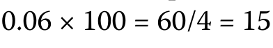PDF 14

#### 补充解析 / Supplementary explanation

结合本题的官方结论：“C正确。 在每个付息日，固定利率债券发行人向投资者支付的票息，等于债券票面利率乘以其面值所对应的付息金额。 对于不足一年的付息期间，年度票息金额会分成金额较小、相等的各期付款。” 下列补充说明解释其背后的票息以面值为基数。

Link to this question’s official result: “C is correct. On each interest payment date, a fixed-rate bond issuer pays investors a coupon payment equal to the bond’s coupon rate times its par value. For periods shorter than a year, the annual coupon amount is divided into smaller equal periodic payments.” The supplementary discussion below explains coupons are based on par value.

解题思路：先把“合同承诺支付多少”与“今天买入花多少钱”分开。固定票息金额由票面利率和面值决定；债券在二级市场涨价或跌价，不会自动改写发行时的固定票息。

Reasoning: Separate the contractual payment from the price paid in the market. A fixed coupon is determined by the coupon rate and par value. A change in the secondary-market price does not rewrite that contractual coupon.

应用方法：计算时先求全年票息，再按每年付息次数分摊；到期最后一笔通常还要加本金。若问当前收益率，才用全年票息除以当前价格。不要把到期收益率乘面值当作合同利息。

Application: First calculate the annual coupon, then divide it by the payment frequency. The final cash flow normally also includes principal. Divide annual coupon income by the current price only when current yield is requested; YTM is not the contractual coupon rate.

#### 相关知识点 / Related concepts

#### 票息以面值为基数 / Coupons are based on par value

Coupon rate 是合同票面利率；current yield 只看当期票息收入；yield to maturity 将未来票息和本金全部折现。三者回答的是不同问题。

The coupon rate is contractual. Current yield measures annual coupon income relative to price. YTM discounts all promised coupon and principal payments.

Annual coupon = Par × Coupon rate; periodic coupon = Annual coupon / m

### FI-LM01-SA01-02 · 模块自测 2 Module self-assessment 2

课前自测 / Pre-test / self-assessment · 原版 PDF 页码 / Source PDF pages: 14-15

#### 题目与资料 / Question and data

2\. 将左栏的每种债券类型与右栏的描述配对。

2\. Match each bond type in the left column with a description in the right column.

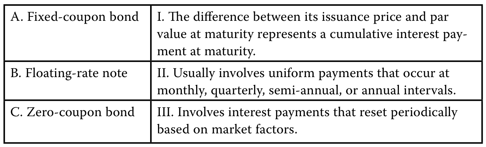PDF 14

图表文字译注：A. 固定票息债券；I. 发行价格与到期面值；之间的差额，代表到期时支付的累计利息；款项。；B. 浮动利率票据；II. 通常按固定间隔等额支付，；间隔可以为每月、每季度、每半年或每年。；C. 零息债券；III. 利息支付额会定期重设，；具体取决于市场因素。。

#### 官方答案与解析 / Official answer and explanation

A与II配对正确。固定票息债券通常每月、每季度、每半年或每年支付一次金额相同的票息。

A. II is correct. Fixed-coupon bonds usually involve uniform payments that occur at monthly, quarterly, semi-annual, or annual intervals.

B与III配对正确。浮动利率票据（FRN）的利息支付会根据市场因素定期重设。

B. III is correct. Floating-rate notes (FRNs) involve interest payments that reset periodically based on market factors.

C与I配对正确。零息债券通常以低于面值的价格发行；发行价格与面值之间的差额，代表到期时一次性支付的累计利息。

C. I is correct. Zero-coupon bonds are typically issued at a discount to par; the difference between the issuance price and par value represents a cumulative interest payment at maturity.

#### 补充解析 / Supplementary explanation

结合本题的官方结论：“A与II配对正确。固定票息债券通常每月、每季度、每半年或每年支付一次金额相同的票息。 B与III配对正确。” 下列补充说明解释其背后的浮息票据：合同利差与市场要求利差。

Link to this question’s official result: “A. II is correct. Fixed-coupon bonds usually involve uniform payments that occur at monthly, quarterly, semi-annual, or annual intervals.” The supplementary discussion below explains frns: contractual spread versus required spread.

解题思路：浮息不等于没有信用风险。票息通常是重设时的参考利率加发行时约定的利差；投资者现在要求的信用利差属于估值变量。市场要求利差扩大，并不自动提高原合同中的固定加点。

Reasoning: Floating coupons do not eliminate credit risk. The contractual coupon usually equals the reset reference rate plus a quoted spread. The spread investors currently require is a valuation input; an increase in that required spread does not automatically amend the contract.

应用方法：读题先标出 quoted margin / issuer-specific spread 与 required discount margin。前者生成现金流，后者参与贴现。要求利差高于合同利差时，投资者需要用较低价格获得补偿；相等时，重设日价格通常接近面值。

Application: Identify the quoted spread and required discount margin separately. The first determines cash flows; the second affects discounting. If the required spread exceeds the quoted spread, a lower price compensates investors. At a reset date, equal spreads generally imply a price near par.

#### 相关知识点 / Related concepts

#### 浮息票据：合同利差与市场要求利差 / FRNs: contractual spread versus required spread

MRR 随重设机制变化；quoted margin 通常固定；discount margin 反映市场要求补偿。利率久期较低不代表信用利差敏感度为零。

The MRR resets under the contract, the quoted margin is usually fixed, and the discount margin reflects required compensation. Low interest-rate duration does not imply zero credit-spread exposure.

Coupon = Principal × (MRR + Quoted margin) × Day-count fraction

### FI-LM01-SA01-03 · 模块自测 3 Module self-assessment 3

课前自测 / Pre-test / self-assessment · 原版 PDF 页码 / Source PDF pages: 15

#### 题目与资料 / Question and data

3\. 浮动利率票据（FRN）的票面利率由市场参考利率及以下哪一项组成？

3\. The coupon rate for a floating rate note (FRN) is composed of a market reference rate and:

A. 信用评级。

A. a credit rating.

B. 发行人特定利差。

B. an issuer-specific spread.

C. 固定利率基准债券的收益率。

C. The yield on a fixed-rate benchmark bond.

#### 官方答案与解析 / Official answer and explanation

B正确。

B is correct.

FRN的票面利率由市场参考利率（MRR）和发行人特定利差组成。该利差通常在发行时确定并保持不变，而MRR则根据市场因素定期重设。

An FRN coupon rate comprises a market reference rate (MRR) and an issuer-specific spread that is usually constant and set at the time of issuance, while the MRR resets periodically based on market factors.

MRR发生变化时，FRN的票面利率与利息支付也会相应变化。

As the MRR changes, the FRN coupon rate and interest payment change accordingly.

A不正确。

A is incorrect.

虽然发行人的信用评级可能影响FRN相对于MRR的利差，但信用评级是以字母等级表示的信用风险评估，并不直接参与票面利率的计算。

While the issuer’s credit rating may be a determinant of an FRN’s spread over the MRR, a credit rating is a letter-grade assessment of credit risk and is not directly involved in the calculation of the coupon rate.

C不正确。固定利率基准债券的收益率反映决定利率的自上而下因素，例如实际经济增长和预期通胀，而这些因素已经包含在MRR中。

C is incorrect. The yield on a fixed-rate benchmark bond would reflect top-down factors that determine interest rates, such as real growth and expected inflation, which are already considered in the MRR.

#### 补充解析 / Supplementary explanation

结合本题的官方结论：“B正确。 FRN的票面利率由市场参考利率（MRR）和发行人特定利差组成。该利差通常在发行时确定并保持不变，而MRR则根据市场因素定期重设。” 下列补充说明解释其背后的浮息票据：合同利差与市场要求利差。

Link to this question’s official result: “B is correct. An FRN coupon rate comprises a market reference rate (MRR) and an issuer-specific spread that is usually constant and set at the time of issuance, while the MRR resets periodically based on market factors. As the MRR changes, the FRN coupon rate and interest payment change accordingly.” The supplementary discussion below explains frns: contractual spread versus required spread.

解题思路：浮息不等于没有信用风险。票息通常是重设时的参考利率加发行时约定的利差；投资者现在要求的信用利差属于估值变量。市场要求利差扩大，并不自动提高原合同中的固定加点。

Reasoning: Floating coupons do not eliminate credit risk. The contractual coupon usually equals the reset reference rate plus a quoted spread. The spread investors currently require is a valuation input; an increase in that required spread does not automatically amend the contract.

应用方法：读题先标出 quoted margin / issuer-specific spread 与 required discount margin。前者生成现金流，后者参与贴现。要求利差高于合同利差时，投资者需要用较低价格获得补偿；相等时，重设日价格通常接近面值。

Application: Identify the quoted spread and required discount margin separately. The first determines cash flows; the second affects discounting. If the required spread exceeds the quoted spread, a lower price compensates investors. At a reset date, equal spreads generally imply a price near par.

#### 相关知识点 / Related concepts

#### 浮息票据：合同利差与市场要求利差 / FRNs: contractual spread versus required spread

MRR 随重设机制变化；quoted margin 通常固定；discount margin 反映市场要求补偿。利率久期较低不代表信用利差敏感度为零。

The MRR resets under the contract, the quoted margin is usually fixed, and the discount margin reflects required compensation. Low interest-rate duration does not imply zero credit-spread exposure.

Coupon = Principal × (MRR + Quoted margin) × Day-count fraction

### FI-LM01-SA01-04 · 模块自测 4 Module self-assessment 4

课前自测 / Pre-test / self-assessment · 原版 PDF 页码 / Source PDF pages: 15

#### 题目与资料 / Question and data

4\. 在同一国家内，相比期限相近的企业债券，主权债券通常是一项更安全的投资，原因是：

4\. A sovereign bond is usually a safer investment than a corporate bond of similar maturity issued within a country because:

A. 企业债券面临通胀风险。

A. corporate bonds are subject to inflation risk.

B. 主权债券由发行政府的征税权和财政权力支持。

B. sovereign bonds are backed by taxation and fiscal power of the issuing government.

C. 主权债券以物业及设备等高质量抵押品作担保。

C. sovereign bonds are secured by high-quality collateral, such as property and equipment.

#### 官方答案与解析 / Official answer and explanation

B正确。主权债券由国家政府的征税权和财政权力支持，因此通常是各地区市场中信用质量最高的债券。

B is correct. Sovereign bonds are backed by a national government’s taxation and fiscal power and thus usually represent the highest-credit-quality bonds in each geographic market.

A不正确，因为主权债券除非专门与通胀挂钩，否则也面临通胀风险。

A is incorrect because sovereign bonds, unless specifically indexed to inflation, are also subject to inflation risk.

C不正确，因为主权债券通常不以抵押品作担保；抵押品担保更常见于企业债券和资产支持证券。

C is incorrect because sovereign bonds are typically not secured by collateral; this is more commonly a feature of corporate bonds and asset-backed securities.

#### 补充解析 / Supplementary explanation

结合本题的官方结论：“B正确。主权债券由国家政府的征税权和财政权力支持，因此通常是各地区市场中信用质量最高的债券。 A不正确，因为主权债券除非专门与通胀挂钩，否则也面临通胀风险。” 下列补充说明解释其背后的主权信用：能力与意愿。

Link to this question’s official result: “B is correct. Sovereign bonds are backed by a national government’s taxation and fiscal power and thus usually represent the highest-credit-quality bonds in each geographic market. A is incorrect because sovereign bonds, unless specifically indexed to inflation, are also subject to inflation risk.” The supplementary discussion below explains sovereign credit: ability and willingness to pay.

解题思路：政府有征税能力，但偿债仍受财政、经济、制度和政治条件约束。尤其要区分本币债与外币债：政府不能凭本国货币发行权创造另一国家的货币，因此外汇收入和储备对外币债更关键。

Reasoning: Taxing authority supports government debt, but repayment still depends on fiscal, economic, institutional, and political conditions. Distinguish local- and foreign-currency debt: a government cannot issue another country’s currency, making foreign-exchange earnings and reserves especially relevant.

应用方法：按“偿债意愿 → 财政和债务负担 → 经济增长与制度 → 外部融资和货币灵活性”逐项判断。高外币负债、集中而不稳定的外汇收入或薄弱储备，会限制外部偿付能力；主权豁免则关系到债权人的追索和执行。

Application: Assess willingness, fiscal capacity and debt burden, economic and institutional strength, and external financing flexibility. Foreign-currency debt combined with unstable external earnings or weak reserves constrains repayment capacity. Sovereign immunity affects enforcement and creditor recourse.

#### 相关知识点 / Related concepts

#### 主权信用：能力与意愿 / Sovereign credit: ability and willingness to pay

Creditworthiness 同时包含 ability to pay 和 willingness to pay；较强的本币融资能力不能自动等同于较强的外币偿债能力。

Creditworthiness includes both ability and willingness to pay. Stronger local-currency financing capacity does not automatically imply stronger foreign-currency repayment capacity.

### FI-LM01-SA01-05 · 模块自测 5 Module self-assessment 5

课前自测 / Pre-test / self-assessment · 原版 PDF 页码 / Source PDF pages: 15

#### 题目与资料 / Question and data

5\. 以下哪一项正确列示清算时各类债券债权由高至低的受偿顺序？

5\. Which of the following is the appropriate order of claims in liquidation, by type of bond, in order of highest to lowest?

A. 次级债务、优先有担保债务、优先无担保债务。

A. Junior, senior secured, senior unsecured

B. 优先无担保债务、优先有担保债务、次级债务。

B. Senior unsecured, senior secured, junior

C. 优先有担保债务、优先无担保债务、次级债务。

C. Senior secured, senior unsecured, junior

#### 官方答案与解析 / Official answer and explanation

C正确。

C is correct.

优先有担保债务是最先获得清偿的债权。

Senior secured debts would be the highest-priority claims to be satisfied.

优先无担保债务随后获得清算资产价值的分配，而次级债务的受偿顺序最低。

Senior unsecured debts would be the next to receive allocations of the liquidated asset value, and junior debts would be the lowest-priority claims to be satisfied.

#### 补充解析 / Supplementary explanation

结合本题的官方结论：“C正确。 优先有担保债务是最先获得清偿的债权。 优先无担保债务随后获得清算资产价值的分配，而次级债务的受偿顺序最低。” 下列补充说明解释其背后的清偿顺序与同等受偿。

Link to this question’s official result: “C is correct. Senior secured debts would be the highest-priority claims to be satisfied. Senior unsecured debts would be the next to receive allocations of the liquidated asset value, and junior debts would be the lowest-priority claims to be satisfied.” The supplementary discussion below explains priority of claims and pari passu.

解题思路：债权人拿回多少钱，既取决于发行人剩下多少资产，也取决于自己的排队位置。通常先看担保资产和担保债权，再看同一发行人的高级无担保债、次级债；“发行得早”本身不是更优先的依据。

Reasoning: Recovery depends on both available assets and the creditor’s position in the claims hierarchy. Consider collateral rights, senior unsecured claims, and subordinated claims against the same issuer. Earlier issuance alone does not confer higher priority.

应用方法：遇到 pari passu，理解为同一层级的债务在法律上同等受偿，不是所有债务一律平等。比较不同实体的债务时，还要判断结构性次级关系，不能仅凭债券名称排队。

Application: Pari passu means equal treatment of comparable-ranking obligations, not equality among all claims. For debts of different entities, examine structural subordination rather than ranking them solely by their names.

#### 相关知识点 / Related concepts

#### 清偿顺序与同等受偿 / Priority of claims and pari passu

Secured 描述担保；senior / subordinated 描述优先级。抵押品不足时，剩余部分的待遇仍取决于法律和合同安排。

Secured describes collateral support; senior or subordinated describes claim priority. The treatment of any collateral shortfall depends on the legal and contractual structure.

关联考点：Primary source 是正常经营下的主要偿债来源；secondary source 是在违约或现金流不足时发挥作用的额外保障。

Related concept: A primary repayment source funds normal debt service. A secondary source provides additional protection when primary cash flows are insufficient.

### FI-LM01-SA01-06 · 模块自测 6 Module self-assessment 6

课前自测 / Pre-test / self-assessment · 原版 PDF 页码 / Source PDF pages: 16

#### 题目与资料 / Question and data

6\. 描述债券契约中同等受偿条款的目的。

6\. Describe the purpose of a pari passu clause in a bond indenture.

#### 官方答案与解析 / Official answer and explanation

同等受偿（pari passu，意为“同等地位”）条款确保该项债务与借款人的其他优先债务工具受到同等对待。

A pari passu (“equal footing”) clause ensures that a debt obligation is treated the same as the borrower’s other senior debt instruments.

#### 补充解析 / Supplementary explanation

结合本题的官方结论：“同等受偿（pari passu，意为“同等地位”）条款确保该项债务与借款人的其他优先债务工具受到同等对待。” 下列补充说明解释其背后的清偿顺序与同等受偿。

Link to this question’s official result: “A pari passu (“equal footing”) clause ensures that a debt obligation is treated the same as the borrower’s other senior debt instruments.” The supplementary discussion below explains priority of claims and pari passu.

解题思路：债权人拿回多少钱，既取决于发行人剩下多少资产，也取决于自己的排队位置。通常先看担保资产和担保债权，再看同一发行人的高级无担保债、次级债；“发行得早”本身不是更优先的依据。

Reasoning: Recovery depends on both available assets and the creditor’s position in the claims hierarchy. Consider collateral rights, senior unsecured claims, and subordinated claims against the same issuer. Earlier issuance alone does not confer higher priority.

应用方法：遇到 pari passu，理解为同一层级的债务在法律上同等受偿，不是所有债务一律平等。比较不同实体的债务时，还要判断结构性次级关系，不能仅凭债券名称排队。

Application: Pari passu means equal treatment of comparable-ranking obligations, not equality among all claims. For debts of different entities, examine structural subordination rather than ranking them solely by their names.

#### 相关知识点 / Related concepts

#### 清偿顺序与同等受偿 / Priority of claims and pari passu

Secured 描述担保；senior / subordinated 描述优先级。抵押品不足时，剩余部分的待遇仍取决于法律和合同安排。

Secured describes collateral support; senior or subordinated describes claim priority. The treatment of any collateral shortfall depends on the legal and contractual structure.

### FI-LM01-QS01-01 · 正文题组 1 · 第 1 题 Question set 1 · Question 1

正文习题组 / Question set · 原版 PDF 页码 / Source PDF pages: 23

#### 题目与资料 / Question and data

1\. 将左栏的固定收益工具类型与右栏的描述配对。

1\. Match the fixed-income instrument type in the left column with its description in the right column.

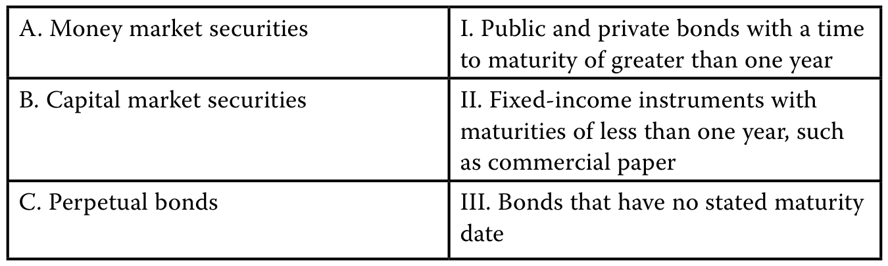PDF 23

图表文字译注：A. 货币市场证券；I. 公共及私营部门债券，剩余；到期期限超过1年；B. 资本市场证券；II. 固定收益工具，其；到期期限不足1年，例如；商业票据；C. 永续债券；III. 没有规定到期；日期的债券。

#### 官方答案与解析 / Official answer and explanation

A与II配对正确。货币市场证券是期限不足一年的固定收益工具，例如商业票据。

A. II is correct. Money market securities are fixed-income instruments with maturities of less than one year, such as commercial paper.

B与I配对正确。资本市场证券包括到期期限超过一年的公共部门和私营部门债券。

B. I is correct. Capital market securities are public and private bonds with a time to maturity of greater than one year.

C与III配对正确。永续债券没有规定的到期日。

C. III is correct. Perpetual bonds have no stated maturity date.

#### 补充解析 / Supplementary explanation

结合本题的官方结论：“A与II配对正确。货币市场证券是期限不足一年的固定收益工具，例如商业票据。 B与I配对正确。” 下列补充说明解释其背后的票息以面值为基数。

Link to this question’s official result: “A. II is correct. Money market securities are fixed-income instruments with maturities of less than one year, such as commercial paper.” The supplementary discussion below explains coupons are based on par value.

解题思路：先把“合同承诺支付多少”与“今天买入花多少钱”分开。固定票息金额由票面利率和面值决定；债券在二级市场涨价或跌价，不会自动改写发行时的固定票息。

Reasoning: Separate the contractual payment from the price paid in the market. A fixed coupon is determined by the coupon rate and par value. A change in the secondary-market price does not rewrite that contractual coupon.

应用方法：计算时先求全年票息，再按每年付息次数分摊；到期最后一笔通常还要加本金。若问当前收益率，才用全年票息除以当前价格。不要把到期收益率乘面值当作合同利息。

Application: First calculate the annual coupon, then divide it by the payment frequency. The final cash flow normally also includes principal. Divide annual coupon income by the current price only when current yield is requested; YTM is not the contractual coupon rate.

#### 相关知识点 / Related concepts

#### 票息以面值为基数 / Coupons are based on par value

Coupon rate 是合同票面利率；current yield 只看当期票息收入；yield to maturity 将未来票息和本金全部折现。三者回答的是不同问题。

The coupon rate is contractual. Current yield measures annual coupon income relative to price. YTM discounts all promised coupon and principal payments.

Annual coupon = Par × Coupon rate; periodic coupon = Annual coupon / m

### FI-LM01-QS01-02 · 正文题组 1 · 第 2 题 Question set 1 · Question 2

正文习题组 / Question set · 原版 PDF 页码 / Source PDF pages: 23

#### 题目与资料 / Question and data

2\. 一只债券的票面利率为2.5%、面值为GBP100,000、每半年付息一次，计算其每次票息支付金额。

2\. Calculate the coupon payment on a 2.5% coupon bond with GBP100,000 par value and a semiannual payment frequency.

#### 官方答案与解析 / Official answer and explanation

正确答案为GBP1,250。

The correct answer is GBP1,250.

债券年度票息通过票面利率乘以面值计算。

The annual coupon on a bond is calculated by multiplying the coupon rate and the par value.

对于这只债券，2.5%的票面利率与GBP100,000面值对应的年度票息为GBP2,500。

For this bond, the coupon rate of 2.5% and par value of GBP100,000 results in a GBP2,500 annual coupon.

但由于付息频率为每半年一次，即每年两次，因此每次票息支付为GBP1,250。

However, since the payment frequency is semiannual (twice a year), each coupon payment is GBP1,250.

#### 补充解析 / Supplementary explanation

结合本题的官方结论：“正确答案为GBP1,250。 债券年度票息通过票面利率乘以面值计算。 对于这只债券，2.5%的票面利率与GBP100,000面值对应的年度票息为GBP2,500。” 下列补充说明解释其背后的票息以面值为基数。

Link to this question’s official result: “The correct answer is GBP1,250. The annual coupon on a bond is calculated by multiplying the coupon rate and the par value. For this bond, the coupon rate of 2.5% and par value of GBP100,000 results in a GBP2,500 annual coupon.” The supplementary discussion below explains coupons are based on par value.

解题思路：先把“合同承诺支付多少”与“今天买入花多少钱”分开。固定票息金额由票面利率和面值决定；债券在二级市场涨价或跌价，不会自动改写发行时的固定票息。

Reasoning: Separate the contractual payment from the price paid in the market. A fixed coupon is determined by the coupon rate and par value. A change in the secondary-market price does not rewrite that contractual coupon.

应用方法：计算时先求全年票息，再按每年付息次数分摊；到期最后一笔通常还要加本金。若问当前收益率，才用全年票息除以当前价格。不要把到期收益率乘面值当作合同利息。

Application: First calculate the annual coupon, then divide it by the payment frequency. The final cash flow normally also includes principal. Divide annual coupon income by the current price only when current yield is requested; YTM is not the contractual coupon rate.

#### 相关知识点 / Related concepts

#### 票息以面值为基数 / Coupons are based on par value

Coupon rate 是合同票面利率；current yield 只看当期票息收入；yield to maturity 将未来票息和本金全部折现。三者回答的是不同问题。

The coupon rate is contractual. Current yield measures annual coupon income relative to price. YTM discounts all promised coupon and principal payments.

Annual coupon = Par × Coupon rate; periodic coupon = Annual coupon / m

### FI-LM01-QS01-03 · 正文题组 1 · 第 3 题 Question set 1 · Question 3

正文习题组 / Question set · 原版 PDF 页码 / Source PDF pages: 23

#### 题目与资料 / Question and data

3\. 根据以下例子确定适当的FRN票面利率及应付利息：一家欧洲企业发行EUR10 million的FRN，每季度支付利息，利率等于三个月MRR加125个基点。

3\. Determine the appropriate FRN coupon and interest payable in the following example: A European corporation issues a EUR10 million FRN that pays quarterly interest equal to the three-month MRR plus 125 bps.

如果三个月MRR为−0.50%，该企业本期应为这只FRN支付多少票息？

If three-month MRR is –0.50%, what is the corporation’s FRN coupon interest payable on the FRN for the period?

#### 官方答案与解析 / Official answer and explanation

答案为EUR18,750。

The answer is EUR18,750.

FRN票面利率等于MRR加发行人特定利差。

An FRN coupon comprises MRR plus the issuer-specific spread.

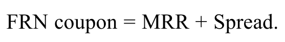PDF 23 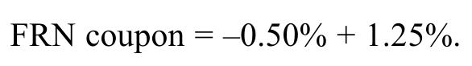PDF 23 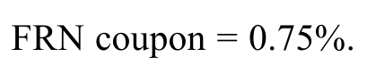PDF 23 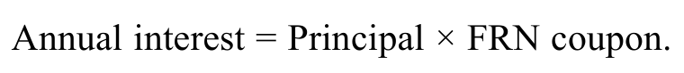PDF 23 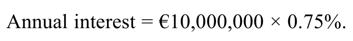PDF 23 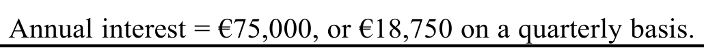PDF 23

#### 补充解析 / Supplementary explanation

结合本题的官方结论：“答案为EUR18,750。 FRN票面利率等于MRR加发行人特定利差。” 下列补充说明解释其背后的浮息票据：合同利差与市场要求利差。

Link to this question’s official result: “The answer is EUR18,750. An FRN coupon comprises MRR plus the issuer-specific spread.” The supplementary discussion below explains frns: contractual spread versus required spread.

解题思路：浮息不等于没有信用风险。票息通常是重设时的参考利率加发行时约定的利差；投资者现在要求的信用利差属于估值变量。市场要求利差扩大，并不自动提高原合同中的固定加点。

Reasoning: Floating coupons do not eliminate credit risk. The contractual coupon usually equals the reset reference rate plus a quoted spread. The spread investors currently require is a valuation input; an increase in that required spread does not automatically amend the contract.

应用方法：读题先标出 quoted margin / issuer-specific spread 与 required discount margin。前者生成现金流，后者参与贴现。要求利差高于合同利差时，投资者需要用较低价格获得补偿；相等时，重设日价格通常接近面值。

Application: Identify the quoted spread and required discount margin separately. The first determines cash flows; the second affects discounting. If the required spread exceeds the quoted spread, a lower price compensates investors. At a reset date, equal spreads generally imply a price near par.

#### 相关知识点 / Related concepts

#### 浮息票据：合同利差与市场要求利差 / FRNs: contractual spread versus required spread

MRR 随重设机制变化；quoted margin 通常固定；discount margin 反映市场要求补偿。利率久期较低不代表信用利差敏感度为零。

The MRR resets under the contract, the quoted margin is usually fixed, and the discount margin reflects required compensation. Low interest-rate duration does not imply zero credit-spread exposure.

Coupon = Principal × (MRR + Quoted margin) × Day-count fraction

### FI-LM01-QS01-04 · 正文题组 1 · 第 4 题 Question set 1 · Question 4

正文习题组 / Question set · 原版 PDF 页码 / Source PDF pages: 24

#### 题目与资料 / Question and data

4\. 填空。

4\. Fill in the blanks.

当期收益率等于债券年度\_\_\_\_\_除以债券价格，并以百分比表示。

The current yield is equal to a bond’s annual \_\_\_\_\_ divided by the bond’s price expressed as a percentage.

如果债券价格下跌，预计当期收益率会\_\_\_\_。

If the bond’s price were to fall, we would expect the current yield to \_\_\_\_.

#### 官方答案与解析 / Official answer and explanation

当期收益率等于债券年度票息除以债券价格，并以百分比表示。

The current yield is equal to a bond’s annual coupon divided by the bond’s price expressed as a percentage.

如果债券价格下跌，预计当期收益率会上升。

If the bond’s price were to fall, we would expect the current yield to rise.

#### 补充解析 / Supplementary explanation

结合本题的官方结论：“当期收益率等于债券年度票息除以债券价格，并以百分比表示。 如果债券价格下跌，预计当期收益率会上升。” 下列补充说明解释其背后的当前收益率与到期收益率。

Link to this question’s official result: “The current yield is equal to a bond’s annual coupon divided by the bond’s price expressed as a percentage. If the bond’s price were to fall, we would expect the current yield to rise.” The supplementary discussion below explains current yield and yield to maturity.

解题思路：当前收益率只把一年票息与当前价格比较，忽略到期本金的资本利得或损失，也忽略票息再投资。相同固定票息下价格下跌，当前收益率就上升。

Reasoning: Current yield compares annual coupon income with price. It omits the capital gain or loss at redemption and coupon reinvestment. With a fixed coupon, a lower price means a higher current yield.

应用方法：先用面值乘票面利率求全年现金票息，再除以当前价格。若问题比较整体持有至到期回报，则应使用包含全部现金流的 YTM；不要用 current yield 代替。

Application: Calculate annual coupon cash flow from par and the coupon rate, then divide by price. For the full promised return to maturity, use YTM, which includes all payments, rather than substituting current yield.

#### 相关知识点 / Related concepts

#### 当前收益率与到期收益率 / Current yield and yield to maturity

按每100面值报价时，全年票息与价格必须采用同一面值尺度。

When prices are quoted per 100 of par, coupon income and price must use the same par-value scale.

Current yield = Annual coupon / Current bond price

### FI-LM01-QS01-05 · 正文题组 1 · 第 5 题 Question set 1 · Question 5

正文习题组 / Question set · 原版 PDF 页码 / Source PDF pages: 24

#### 题目与资料 / Question and data

5\. 填空。向下倾斜的收益率曲线表示，某发行人较长期债券的到期收益率\_\_\_\_\_\_\_\_\_\_该发行人较短期债券的到期收益率。

5\. Fill in the blanks. A downward-sloping yield curve indicates that yields-to-maturity on an issuer’s longer-term bonds are \_\_\_\_\_\_\_\_\_\_ than yields-to-maturity on that issuer’s shorter-term bonds.

#### 官方答案与解析 / Official answer and explanation

向下倾斜的收益率曲线表示，某发行人较长期债券的到期收益率低于该发行人较短期债券的到期收益率。

A downward-sloping yield curve indicates that yields-to-maturity on an issuer’s longer-term bonds are lower than yields-to-maturity on that issuer’s shorter-term bonds.

#### 补充解析 / Supplementary explanation

结合本题的官方结论：“向下倾斜的收益率曲线表示，某发行人较长期债券的到期收益率低于该发行人较短期债券的到期收益率。” 下列补充说明解释其背后的收益率曲线的形状。

Link to this question’s official result: “A downward-sloping yield curve indicates that yields-to-maturity on an issuer’s longer-term bonds are lower than yields-to-maturity on that issuer’s shorter-term bonds.” The supplementary discussion below explains the shape of the yield curve.

解题思路：收益率曲线把同一比较基础下的收益率与期限对应起来。向下倾斜意味着较长期限收益率较低；向上倾斜意味着较高。它并不表示较长期债券每期支付的票息一定更低或更高。

Reasoning: A yield curve relates yield to maturity on a consistent basis. A downward slope means lower yields at longer maturities; an upward slope means higher yields. It does not directly specify contractual coupon payments.

应用方法：读图先确认横轴期限和纵轴利率，再确认是即期、平价还是到期收益率曲线。比较不同发行人时，信用和流动性差异也可能影响收益率，不能全部归因于期限。

Application: Check the maturity and yield axes and identify whether the curve uses spot, par, or yield-to-maturity rates. Across issuers, credit and liquidity differences also affect yields and should not be attributed entirely to maturity.

#### 相关知识点 / Related concepts

#### 收益率曲线的形状 / The shape of the yield curve

曲线斜率、曲线整体水平与曲线弯曲程度是不同维度；收益率更高不等于无风险套利机会。

Slope, overall level, and curvature are distinct. A higher yield alone does not establish riskless arbitrage.

### FI-LM01-QS02-01 · 正文题组 2 · 第 1 题 Question set 2 · Question 1

正文习题组 / Question set · 原版 PDF 页码 / Source PDF pages: 28

#### 题目与资料 / Question and data

1\. 解释有担保与无担保企业债券在偿付来源上的区别。

1\. Explain the difference in the sources of repayment for a secured and an unsecured corporate bond.

#### 官方答案与解析 / Official answer and explanation

无担保企业债券的唯一偿付来源通常是发行人的经营现金流；有担保企业债券除依赖发行人的经营现金流外，还以特定资产作为次要偿债来源。

The sole source of repayment for unsecured corporate bonds is typically operating cash flows of the issuer, while secured corporate bonds also include specific assets as a secondary source of debt repayment in addition to the issuer’s operating cash flows.

#### 补充解析 / Supplementary explanation

结合本题的官方结论：“无担保企业债券的唯一偿付来源通常是发行人的经营现金流；有担保企业债券除依赖发行人的经营现金流外，还以特定资产作为次要偿债来源。” 下列补充说明解释其背后的偿债现金流与担保资产。

Link to this question’s official result: “The sole source of repayment for unsecured corporate bonds is typically operating cash flows of the issuer, while secured corporate bonds also include specific assets as a secondary source of debt repayment in addition to the issuer’s operating cash flows.” The supplementary discussion below explains repayment cash flows and collateral.

解题思路：“有资产担保的公司债”与“资产支持证券”不是同一个发行结构。普通有担保公司债通常首先依靠公司的经营现金流，抵押品提供第二道保护；ABS 通常由特殊目的实体发行，依靠独立资产池的现金流偿付。

Reasoning: A secured corporate bond and an asset-backed security use different issuance structures. A secured corporate bond normally relies first on operating cash flows, with collateral providing additional protection. ABS are typically issued by a special-purpose entity and paid from a distinct asset pool.

应用方法：做题先画出谁发行债券、谁拥有资产、借款人的付款流向谁。只看到“抵押”二字就选 ABS，或认为担保债完全不依赖经营现金流，都会把两种结构混淆。

Application: Identify the issuer, the owner of the assets, and the recipient of borrowers’ payments. The existence of collateral alone does not make a corporate bond an ABS, and collateral does not make operating cash flows irrelevant.

#### 相关知识点 / Related concepts

#### 偿债现金流与担保资产 / Repayment cash flows and collateral

Primary source 是正常经营下的主要偿债来源；secondary source 是在违约或现金流不足时发挥作用的额外保障。

A primary repayment source funds normal debt service. A secondary source provides additional protection when primary cash flows are insufficient.

### FI-LM01-QS02-02 · 正文题组 2 · 第 2 题 Question set 2 · Question 2

正文习题组 / Question set · 原版 PDF 页码 / Source PDF pages: 28

#### 题目与资料 / Question and data

2\. 描述资产支持证券的偿付来源。

2\. Describe the source of repayment for asset-backed securities.

#### 官方答案与解析 / Official answer and explanation

资产支持证券的偿付来源，是特殊目的发行人所持有的一组贷款或应收款项产生的现金流。

The source of repayment for asset-backed securities are cash flows from the group of loans or receivables owned by the special purpose issuer.

#### 补充解析 / Supplementary explanation

结合本题的官方结论：“资产支持证券的偿付来源，是特殊目的发行人所持有的一组贷款或应收款项产生的现金流。” 下列补充说明解释其背后的偿债现金流与担保资产。

Link to this question’s official result: “The source of repayment for asset-backed securities are cash flows from the group of loans or receivables owned by the special purpose issuer.” The supplementary discussion below explains repayment cash flows and collateral.

解题思路：“有资产担保的公司债”与“资产支持证券”不是同一个发行结构。普通有担保公司债通常首先依靠公司的经营现金流，抵押品提供第二道保护；ABS 通常由特殊目的实体发行，依靠独立资产池的现金流偿付。

Reasoning: A secured corporate bond and an asset-backed security use different issuance structures. A secured corporate bond normally relies first on operating cash flows, with collateral providing additional protection. ABS are typically issued by a special-purpose entity and paid from a distinct asset pool.

应用方法：做题先画出谁发行债券、谁拥有资产、借款人的付款流向谁。只看到“抵押”二字就选 ABS，或认为担保债完全不依赖经营现金流，都会把两种结构混淆。

Application: Identify the issuer, the owner of the assets, and the recipient of borrowers’ payments. The existence of collateral alone does not make a corporate bond an ABS, and collateral does not make operating cash flows irrelevant.

#### 相关知识点 / Related concepts

#### 偿债现金流与担保资产 / Repayment cash flows and collateral

Primary source 是正常经营下的主要偿债来源；secondary source 是在违约或现金流不足时发挥作用的额外保障。

A primary repayment source funds normal debt service. A secondary source provides additional protection when primary cash flows are insufficient.

### FI-LM01-QS02-03 · 正文题组 2 · 第 3 题 Question set 2 · Question 3

正文习题组 / Question set · 原版 PDF 页码 / Source PDF pages: 28

#### 题目与资料 / Question and data

3\. 将左栏的债券约定条款类型与右栏的例子配对。

3\. Match the bond covenant type in the left column with the examples in the right column.

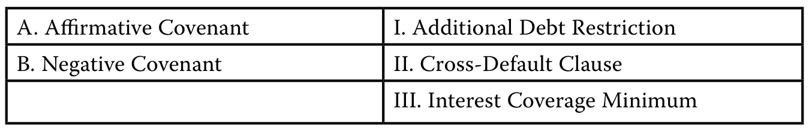PDF 28

图表文字译注：A. 肯定性契约条款；I. 新增债务限制；B. 否定性契约条款；II. 交叉违约条款；III. 最低利息覆盖倍数。

#### 官方答案与解析 / Official answer and explanation

A与II配对正确。交叉违约条款规定，借款人若在另一项债务上违约，即被视为发生违约；它属于肯定性约定条款。

A. II is correct. A cross-default clause specifies that borrowers are considered in default if they default on another debt obligation and is an affirmative covenant.

B与I和III配对正确。

B. I and III are correct.

限制新增债务的条款会限制发行人增加债务，属于否定性约定条款。

An additional debt restriction clause limits an increase in issuer debt and is a negative covenant.

最低利息覆盖要求限制了相对于发行人经营收益或EBITDA的杠杆规模。

An interest coverage minimum limits the amount of leverage relative to an issuer’s operating income or EBITDA.

#### 补充解析 / Supplementary explanation

结合本题的官方结论：“A与II配对正确。交叉违约条款规定，借款人若在另一项债务上违约，即被视为发生违约；它属于肯定性约定条款。 B与I和III配对正确。” 下列补充说明解释其背后的契约条款的保护机制。

Link to this question’s official result: “A. II is correct. A cross-default clause specifies that borrowers are considered in default if they default on another debt obligation and is an affirmative covenant.” The supplementary discussion below explains how covenants protect creditors.

解题思路：契约条款的作用是约束借款人未来的行为，降低债权被稀释或偿债能力恶化的风险。肯定性条款要求做某事；否定性条款限制某事。判断应看条款的经济效果，不要只靠句子中有没有“不”字。

Reasoning: Covenants constrain future borrower behavior to reduce claim dilution or deterioration in repayment capacity. Affirmative covenants require actions; negative covenants restrict actions. Classify a clause by its economic function rather than the wording of a single sentence.

应用方法：先问：条款要求披露、履行或维持什么，还是限制新增负债、分红、资产处置或抵押？违反条款后可能调整利率、加速还款或触发其他救济；违约不一定要等到漏付票息才发生。

Application: Ask whether the clause requires reporting or performance, or restricts borrowing, distributions, asset sales, or pledging assets. Breach can trigger repricing, acceleration, or other remedies; a covenant default need not wait for a missed coupon.

#### 相关知识点 / Related concepts

#### 契约条款的保护机制 / How covenants protect creditors

Indenture 是债券法律契约；cross-default 把另一笔债务的违约与本债务关联；negative pledge 保护既有债权免受新增担保债权的削弱。

The indenture is the legal bond contract. Cross-default links default on another obligation to this one. A negative pledge protects existing creditors against dilution from newly secured borrowing.

### FI-LM01-QS02-04 · 正文题组 2 · 第 4 题 Question set 2 · Question 4

正文习题组 / Question set · 原版 PDF 页码 / Source PDF pages: 28

#### 题目与资料 / Question and data

4\. 描述肯定性与否定性债券约定条款的区别。

4\. Describe the difference between affirmative and negative bond covenants.

#### 官方答案与解析 / Official answer and explanation

肯定性约定条款规定发行人必须做什么，否定性约定条款则规定发行人禁止做什么。

Affirmative covenants specify what issuers are required to do, whereas negative covenants specify what issuers are prohibited from doing.

#### 补充解析 / Supplementary explanation

结合本题的官方结论：“肯定性约定条款规定发行人必须做什么，否定性约定条款则规定发行人禁止做什么。” 下列补充说明解释其背后的契约条款的保护机制。

Link to this question’s official result: “Affirmative covenants specify what issuers are required to do, whereas negative covenants specify what issuers are prohibited from doing.” The supplementary discussion below explains how covenants protect creditors.

解题思路：契约条款的作用是约束借款人未来的行为，降低债权被稀释或偿债能力恶化的风险。肯定性条款要求做某事；否定性条款限制某事。判断应看条款的经济效果，不要只靠句子中有没有“不”字。

Reasoning: Covenants constrain future borrower behavior to reduce claim dilution or deterioration in repayment capacity. Affirmative covenants require actions; negative covenants restrict actions. Classify a clause by its economic function rather than the wording of a single sentence.

应用方法：先问：条款要求披露、履行或维持什么，还是限制新增负债、分红、资产处置或抵押？违反条款后可能调整利率、加速还款或触发其他救济；违约不一定要等到漏付票息才发生。

Application: Ask whether the clause requires reporting or performance, or restricts borrowing, distributions, asset sales, or pledging assets. Breach can trigger repricing, acceleration, or other remedies; a covenant default need not wait for a missed coupon.

#### 相关知识点 / Related concepts

#### 契约条款的保护机制 / How covenants protect creditors

Indenture 是债券法律契约；cross-default 把另一笔债务的违约与本债务关联；negative pledge 保护既有债权免受新增担保债权的削弱。

The indenture is the legal bond contract. Cross-default links default on another obligation to this one. A negative pledge protects existing creditors against dilution from newly secured borrowing.

### FI-LM01-QS02-05 · 正文题组 2 · 第 5 题 Question set 2 · Question 5

正文习题组 / Question set · 原版 PDF 页码 / Source PDF pages: 28-29

#### 题目与资料 / Question and data

5\. 填空。

5\. Fill in the blanks.

违反约定条款可使债券持有人通过多种方式寻求救济，包括改变\_\_\_\_\_\_\_\_\_条款，例如提高债券利率或增强担保、\_\_\_\_\_\_\_\_\_\_\_债务支付，或\_\_\_\_\_\_\_\_\_\_\_债务协议。

Covenant violations provide bondholders recourse in several possible ways, including a change in \_\_\_\_\_\_\_\_\_ terms, such as an increase in a bond’s interest rate or security, \_\_\_\_\_\_\_\_\_\_\_ debt payments, or \_\_\_\_\_\_\_\_\_\_\_ of the debt agreement.

#### 官方答案与解析 / Official answer and explanation

违反约定条款可使债券持有人通过多种方式寻求救济，包括改变财务条款，例如提高债券利率或增强担保、加速偿还债务，或终止债务协议。

Covenant violations provide bondholders recourse in several possible ways, including a change in financial terms, such as an increase in a bond’s interest rate or security, accelerated debt payments, or termination of the debt agreement.

#### 补充解析 / Supplementary explanation

结合本题的官方结论：“违反约定条款可使债券持有人通过多种方式寻求救济，包括改变财务条款，例如提高债券利率或增强担保、加速偿还债务，或终止债务协议。” 下列补充说明解释其背后的契约条款的保护机制。

Link to this question’s official result: “Covenant violations provide bondholders recourse in several possible ways, including a change in financial terms, such as an increase in a bond’s interest rate or security, accelerated debt payments, or termination of the debt agreement.” The supplementary discussion below explains how covenants protect creditors.

解题思路：契约条款的作用是约束借款人未来的行为，降低债权被稀释或偿债能力恶化的风险。肯定性条款要求做某事；否定性条款限制某事。判断应看条款的经济效果，不要只靠句子中有没有“不”字。

Reasoning: Covenants constrain future borrower behavior to reduce claim dilution or deterioration in repayment capacity. Affirmative covenants require actions; negative covenants restrict actions. Classify a clause by its economic function rather than the wording of a single sentence.

应用方法：先问：条款要求披露、履行或维持什么，还是限制新增负债、分红、资产处置或抵押？违反条款后可能调整利率、加速还款或触发其他救济；违约不一定要等到漏付票息才发生。

Application: Ask whether the clause requires reporting or performance, or restricts borrowing, distributions, asset sales, or pledging assets. Breach can trigger repricing, acceleration, or other remedies; a covenant default need not wait for a missed coupon.

#### 相关知识点 / Related concepts

#### 契约条款的保护机制 / How covenants protect creditors

Indenture 是债券法律契约；cross-default 把另一笔债务的违约与本债务关联；negative pledge 保护既有债权免受新增担保债权的削弱。

The indenture is the legal bond contract. Cross-default links default on another obligation to this one. A negative pledge protects existing creditors against dilution from newly secured borrowing.

### FI-LM01-P01-01 · 章末练习 1 Practice problem 1

章末练习 / Practice problem · 原版 PDF 页码 / Source PDF pages: 30, 32

#### 题目与资料 / Question and data

#### 共用资料 / Shared information

以下信息适用于第1–5题

The following information relates to questions 1-5

Antelas AG是一家专注于制造工艺设计的德国新兴科技企业。

Antelas AG is a German emerging technology company focused on manufacturing process design.

该企业开发了多项与微加工和金属3D打印技术有关的有价值专利，并通过许可使用费和咨询服务取得收入。

The firm has developed several valuable patents related to micromachining and metal 3D printing technology and derives its revenue through licensing royalties and consultation services.

Antelas最近发行了以下债务工具：

Antelas recently issued the following debt instrument:

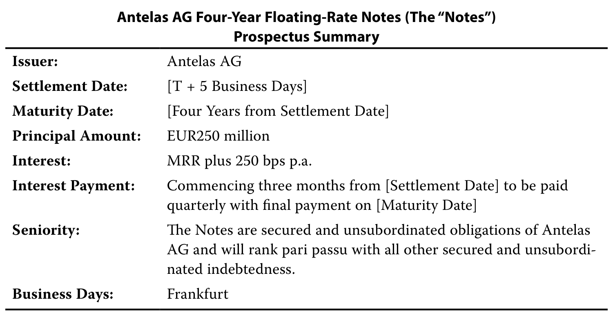PDF 30

图表文字译注：Antelas AG的4年期浮动利率票据（以下简称“票据”）；募集说明书概要；发行人：；结算日：；［T + 5个营业日］；到期日：；［结算日起4年］；本金金额：；利息：；年利率为MRR加250个基点；付息安排：；自［结算日］起3个月开始，；每季度付息一次，最后付款日在［到期日］；受偿顺序：；本票据属于Antelas；AG的有担保、非次级债务，并与其他所有有担保、非次级；债务享有同等受偿顺序。；营业日：；法兰克福。

1\. 截至结算日，“四年”和“MRR加每年250个基点”分别指债券的哪些特征？

1\. “Four years” and “MRR plus 250 bps p.a.” refer, respectively, to which bond features as of the settlement date?

A. 到期期限和票面利率。

A. Time to maturity and coupon rate

B. 付息频率和当期收益率。

B. Coupon frequency and current yield

C. 到期期限和或有条款。

C. Time to maturity and contingency provision

#### 官方答案与解析 / Official answer and explanation

1\. A正确。

1\. A is correct.

票据在交易结算日四年后到期，即Antelas AG支付最后一期票息和本金的日期；票面利率为浮动利率，由MRR加固定250个基点利差决定。

The notes mature (the date Antelas AG will pay the final coupon and principal amount) four years after the trade settlement date, and the coupon rate is variable, determined by the MRR plus a fixed 250 bp spread.

#### 补充解析 / Supplementary explanation

结合本题的官方结论：“A正确。 票据在交易结算日四年后到期，即Antelas AG支付最后一期票息和本金的日期；票面利率为浮动利率，由MRR加固定250个基点利差决定。” 下列补充说明解释其背后的当前收益率与到期收益率。

Link to this question’s official result: “A is correct. The notes mature (the date Antelas AG will pay the final coupon and principal amount) four years after the trade settlement date, and the coupon rate is variable, determined by the MRR plus a fixed 250 bp spread.” The supplementary discussion below explains current yield and yield to maturity.

解题思路：当前收益率只把一年票息与当前价格比较，忽略到期本金的资本利得或损失，也忽略票息再投资。相同固定票息下价格下跌，当前收益率就上升。

Reasoning: Current yield compares annual coupon income with price. It omits the capital gain or loss at redemption and coupon reinvestment. With a fixed coupon, a lower price means a higher current yield.

应用方法：先用面值乘票面利率求全年现金票息，再除以当前价格。若问题比较整体持有至到期回报，则应使用包含全部现金流的 YTM；不要用 current yield 代替。

Application: Calculate annual coupon cash flow from par and the coupon rate, then divide by price. For the full promised return to maturity, use YTM, which includes all payments, rather than substituting current yield.

#### 相关知识点 / Related concepts

#### 当前收益率与到期收益率 / Current yield and yield to maturity

按每100面值报价时，全年票息与价格必须采用同一面值尺度。

When prices are quoted per 100 of par, coupon income and price must use the same par-value scale.

Current yield = Annual coupon / Current bond price

### FI-LM01-P01-02 · 章末练习 2 Practice problem 2

章末练习 / Practice problem · 原版 PDF 页码 / Source PDF pages: 30, 32

#### 题目与资料 / Question and data

#### 共用资料 / Shared information

以下信息适用于第1–5题

The following information relates to questions 1-5

Antelas AG是一家专注于制造工艺设计的德国新兴科技企业。

Antelas AG is a German emerging technology company focused on manufacturing process design.

该企业开发了多项与微加工和金属3D打印技术有关的有价值专利，并通过许可使用费和咨询服务取得收入。

The firm has developed several valuable patents related to micromachining and metal 3D printing technology and derives its revenue through licensing royalties and consultation services.

Antelas最近发行了以下债务工具：

Antelas recently issued the following debt instrument:

PDF 30

图表文字译注：Antelas AG的4年期浮动利率票据（以下简称“票据”）；募集说明书概要；发行人：；结算日：；［T + 5个营业日］；到期日：；［结算日起4年］；本金金额：；利息：；年利率为MRR加250个基点；付息安排：；自［结算日］起3个月开始，；每季度付息一次，最后付款日在［到期日］；受偿顺序：；本票据属于Antelas；AG的有担保、非次级债务，并与其他所有有担保、非次级；债务享有同等受偿顺序。；营业日：；法兰克福。

2\. 以下哪一项最准确地描述Antelas AG浮动利率票据的偿付来源？

2\. Which of the following statements best describes the source(s) of repayment for the Antelas AG floating-rate notes?

A. 由于票据由Antelas AG的资产作担保或支持，因此该浮动利率票据应属于资产支持证券。

A. Since the notes are secured (or backed) by Antelas AG’s assets, the floating-rate notes would be considered asset-backed securities.

B. Antelas AG票据仅依赖企业经营现金流支付利息和本金。

B. The Antelas AG notes rely on the operating cash flows of the firm as their sole source for interest and principal payments.

C. Antelas AG票据以企业经营现金流作为支付利息和本金的主要来源。

C. The Antelas AG notes rely on the operating cash flows of the firm as their primary source for interest and principal payments.

#### 官方答案与解析 / Official answer and explanation

2\. C正确。

2\. C is correct.

有担保企业债券以企业经营现金流作为支付利息和本金的主要来源，并以对资产的法律权利作为次要偿付来源。

Secured corporate bonds rely on the operating cash flows of the firm as their primary source for interest and principal payments and a legal claim on assets as a secondary source of payment.

A不正确，因为资产支持证券（ABS）由为持有贷款或应收款项而成立的特殊目的实体发行，这些资产产生的现金流用于向投资者支付利息和本金。

A is incorrect because asset-backed securities (ABS) are issued by special-purpose entities created to take ownership in loans or receivables, the cash flows from which are used to pay interest and principal to investors.

B不正确，因为它描述的是无担保企业债务，而非有担保企业债务。

B is incorrect because it describes unsecured, not secured, corporate debt.

#### 补充解析 / Supplementary explanation

结合本题的官方结论：“C正确。 有担保企业债券以企业经营现金流作为支付利息和本金的主要来源，并以对资产的法律权利作为次要偿付来源。 A不正确，因为资产支持证券（ABS）由为持有贷款或应收款项而成立的特殊目的实体发行，这些资产产生的现金流用于向投资者支付利息和本金。” 下列补充说明解释其背后的偿债现金流与担保资产。

Link to this question’s official result: “C is correct. Secured corporate bonds rely on the operating cash flows of the firm as their primary source for interest and principal payments and a legal claim on assets as a secondary source of payment. A is incorrect because asset-backed securities (ABS) are issued by special-purpose entities created to take ownership in loans or receivables, the cash flows from which are used to pay interest and principal to investors.” The supplementary discussion below explains repayment cash flows and collateral.

解题思路：“有资产担保的公司债”与“资产支持证券”不是同一个发行结构。普通有担保公司债通常首先依靠公司的经营现金流，抵押品提供第二道保护；ABS 通常由特殊目的实体发行，依靠独立资产池的现金流偿付。

Reasoning: A secured corporate bond and an asset-backed security use different issuance structures. A secured corporate bond normally relies first on operating cash flows, with collateral providing additional protection. ABS are typically issued by a special-purpose entity and paid from a distinct asset pool.

应用方法：做题先画出谁发行债券、谁拥有资产、借款人的付款流向谁。只看到“抵押”二字就选 ABS，或认为担保债完全不依赖经营现金流，都会把两种结构混淆。

Application: Identify the issuer, the owner of the assets, and the recipient of borrowers’ payments. The existence of collateral alone does not make a corporate bond an ABS, and collateral does not make operating cash flows irrelevant.

#### 相关知识点 / Related concepts

#### 偿债现金流与担保资产 / Repayment cash flows and collateral

Primary source 是正常经营下的主要偿债来源；secondary source 是在违约或现金流不足时发挥作用的额外保障。

A primary repayment source funds normal debt service. A secondary source provides additional protection when primary cash flows are insufficient.

### FI-LM01-P01-03 · 章末练习 3 Practice problem 3

章末练习 / Practice problem · 原版 PDF 页码 / Source PDF pages: 30-32

#### 题目与资料 / Question and data

#### 共用资料 / Shared information

以下信息适用于第1–5题

The following information relates to questions 1-5

Antelas AG是一家专注于制造工艺设计的德国新兴科技企业。

Antelas AG is a German emerging technology company focused on manufacturing process design.

该企业开发了多项与微加工和金属3D打印技术有关的有价值专利，并通过许可使用费和咨询服务取得收入。

The firm has developed several valuable patents related to micromachining and metal 3D printing technology and derives its revenue through licensing royalties and consultation services.

Antelas最近发行了以下债务工具：

Antelas recently issued the following debt instrument:

PDF 30

图表文字译注：Antelas AG的4年期浮动利率票据（以下简称“票据”）；募集说明书概要；发行人：；结算日：；［T + 5个营业日］；到期日：；［结算日起4年］；本金金额：；利息：；年利率为MRR加250个基点；付息安排：；自［结算日］起3个月开始，；每季度付息一次，最后付款日在［到期日］；受偿顺序：；本票据属于Antelas；AG的有担保、非次级债务，并与其他所有有担保、非次级；债务享有同等受偿顺序。；营业日：；法兰克福。

3\. 浮动利率票据（FRN）发行一年后，Antelas AG 的发行人特定年化信用利差上升 25 个基点。下列哪项最准确地描述了这一变化对 Antelas AG 的 FRN 票息的影响？

3\. Antelas AG’s issuer-specific credit spread rises by 25 bps p.a. one year after the FRN issuance. Which of the following best describes how Antelas AG’s FRN coupon would change as a result?

A. Antelas AG向投资者支付的FRN票息将立即增加每年25个基点。

A. Antelas AG’s FRN coupon payment to investors will immediately increase by 25 bps p.a.

B. Antelas AG向投资者支付的FRN票息将增加每年25个基点，但到下一个完整付息期间开始时才生效。

B. Antelas AG’s FRN coupon payment to investors will increase by 25 bps p.a. but will not become effective until the next full debt coupon period begins.

C. Antelas AG的FRN票息将保持不变。

C. Antelas AG’s FRN coupon will remain unchanged.

#### 官方答案与解析 / Official answer and explanation

3\. C正确。Antelas AG的FRN利差固定为250个基点，票息只会随着MRR变化而变化。

3\. C is correct. For the Antelas AG FRN, the spread is fixed at 250 bps and the coupon will only change with changes in the MRR.

#### 补充解析 / Supplementary explanation

结合本题的官方结论：“C正确。Antelas AG的FRN利差固定为250个基点，票息只会随着MRR变化而变化。” 下列补充说明解释其背后的浮息票据：合同利差与市场要求利差。

Link to this question’s official result: “C is correct. For the Antelas AG FRN, the spread is fixed at 250 bps and the coupon will only change with changes in the MRR.” The supplementary discussion below explains frns: contractual spread versus required spread.

解题思路：浮息不等于没有信用风险。票息通常是重设时的参考利率加发行时约定的利差；投资者现在要求的信用利差属于估值变量。市场要求利差扩大，并不自动提高原合同中的固定加点。

Reasoning: Floating coupons do not eliminate credit risk. The contractual coupon usually equals the reset reference rate plus a quoted spread. The spread investors currently require is a valuation input; an increase in that required spread does not automatically amend the contract.

应用方法：读题先标出 quoted margin / issuer-specific spread 与 required discount margin。前者生成现金流，后者参与贴现。要求利差高于合同利差时，投资者需要用较低价格获得补偿；相等时，重设日价格通常接近面值。

Application: Identify the quoted spread and required discount margin separately. The first determines cash flows; the second affects discounting. If the required spread exceeds the quoted spread, a lower price compensates investors. At a reset date, equal spreads generally imply a price near par.

#### 相关知识点 / Related concepts

#### 浮息票据：合同利差与市场要求利差 / FRNs: contractual spread versus required spread

MRR 随重设机制变化；quoted margin 通常固定；discount margin 反映市场要求补偿。利率久期较低不代表信用利差敏感度为零。

The MRR resets under the contract, the quoted margin is usually fixed, and the discount margin reflects required compensation. Low interest-rate duration does not imply zero credit-spread exposure.

Coupon = Principal × (MRR + Quoted margin) × Day-count fraction

### FI-LM01-P01-04 · 章末练习 4 Practice problem 4

章末练习 / Practice problem · 原版 PDF 页码 / Source PDF pages: 30-32

#### 题目与资料 / Question and data

#### 共用资料 / Shared information

以下信息适用于第1–5题

The following information relates to questions 1-5

Antelas AG是一家专注于制造工艺设计的德国新兴科技企业。

Antelas AG is a German emerging technology company focused on manufacturing process design.

该企业开发了多项与微加工和金属3D打印技术有关的有价值专利，并通过许可使用费和咨询服务取得收入。

The firm has developed several valuable patents related to micromachining and metal 3D printing technology and derives its revenue through licensing royalties and consultation services.

Antelas最近发行了以下债务工具：

Antelas recently issued the following debt instrument:

PDF 30

图表文字译注：Antelas AG的4年期浮动利率票据（以下简称“票据”）；募集说明书概要；发行人：；结算日：；［T + 5个营业日］；到期日：；［结算日起4年］；本金金额：；利息：；年利率为MRR加250个基点；付息安排：；自［结算日］起3个月开始，；每季度付息一次，最后付款日在［到期日］；受偿顺序：；本票据属于Antelas；AG的有担保、非次级债务，并与其他所有有担保、非次级；债务享有同等受偿顺序。；营业日：；法兰克福。

4\. 如果最后一个计息期间的MRR为每年0.25%，计算Antelas到期日向债券持有人支付的金额。

4\. Calculate the value of Antelas’s payment to bondholders on the maturity date if the MRR is 0.25% p.a. for the final interest period.

A. EUR1,718,750

B. EUR251,718,750

C. EUR256,875,000

#### 官方答案与解析 / Official answer and explanation

4\. B正确。到期日，Antelas AG向投资者支付最后一期FRN票息及债券本金。FRN票面利率由MRR与发行人特定利差组成。

4\. B is correct. On the maturity date, Antelas AG pays investors the final FRN coupon payment plus the bond’s principal amount. The FRN coupon comprises MRR plus the issuer-specific spread.

■ FRN票面利率：MRR加利差，即〔算式见下〕。

■ FRN coupon rate: MRR plus spread, or \[calculation below\]

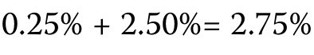PDF 32

■ 年度利息费用：本金×FRN票面利率，即〔算式见下〕。

■ Annual interest expense: Principal × FRN coupon, or \[calculation below\]

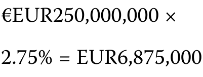PDF 32

■ 季度利息费用：年度利息费用／4，即〔算式见下〕。

■ Quarterly interest expense: Annual interest expense/4, or \[calculation below\]

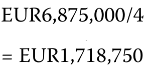PDF 32

■ 本金金额：EUR250,000,000。

■ Principal Amount: EUR250,000,000

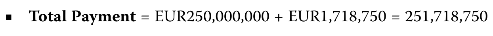PDF 32

#### 补充解析 / Supplementary explanation

解题思路：浮息不等于没有信用风险。票息通常是重设时的参考利率加发行时约定的利差；投资者现在要求的信用利差属于估值变量。市场要求利差扩大，并不自动提高原合同中的固定加点。

Reasoning: Floating coupons do not eliminate credit risk. The contractual coupon usually equals the reset reference rate plus a quoted spread. The spread investors currently require is a valuation input; an increase in that required spread does not automatically amend the contract.

应用方法：读题先标出 quoted margin / issuer-specific spread 与 required discount margin。前者生成现金流，后者参与贴现。要求利差高于合同利差时，投资者需要用较低价格获得补偿；相等时，重设日价格通常接近面值。

Application: Identify the quoted spread and required discount margin separately. The first determines cash flows; the second affects discounting. If the required spread exceeds the quoted spread, a lower price compensates investors. At a reset date, equal spreads generally imply a price near par.

#### 相关知识点 / Related concepts

#### 浮息票据：合同利差与市场要求利差 / FRNs: contractual spread versus required spread

MRR 随重设机制变化；quoted margin 通常固定；discount margin 反映市场要求补偿。利率久期较低不代表信用利差敏感度为零。

The MRR resets under the contract, the quoted margin is usually fixed, and the discount margin reflects required compensation. Low interest-rate duration does not imply zero credit-spread exposure.

Coupon = Principal × (MRR + Quoted margin) × Day-count fraction

### FI-LM01-P01-05 · 章末练习 5 Practice problem 5

章末练习 / Practice problem · 原版 PDF 页码 / Source PDF pages: 30-32

#### 题目与资料 / Question and data

#### 共用资料 / Shared information

以下信息适用于第1–5题

The following information relates to questions 1-5

Antelas AG是一家专注于制造工艺设计的德国新兴科技企业。

Antelas AG is a German emerging technology company focused on manufacturing process design.

该企业开发了多项与微加工和金属3D打印技术有关的有价值专利，并通过许可使用费和咨询服务取得收入。

The firm has developed several valuable patents related to micromachining and metal 3D printing technology and derives its revenue through licensing royalties and consultation services.

Antelas最近发行了以下债务工具：

Antelas recently issued the following debt instrument:

PDF 30

图表文字译注：Antelas AG的4年期浮动利率票据（以下简称“票据”）；募集说明书概要；发行人：；结算日：；［T + 5个营业日］；到期日：；［结算日起4年］；本金金额：；利息：；年利率为MRR加250个基点；付息安排：；自［结算日］起3个月开始，；每季度付息一次，最后付款日在［到期日］；受偿顺序：；本票据属于Antelas；AG的有担保、非次级债务，并与其他所有有担保、非次级；债务享有同等受偿顺序。；营业日：；法兰克福。

5\. Antelas决定发行新的有担保非次级债务。以下哪一项最准确地描述发行人新债务与现有债务之间的偿付优先顺序？

5\. Antelas decides to raise new secured, unsubordinated debt. Which of the following best describes the priority of payments between the issuer’s new debt and its existing debt?

A. 由于Antelas AG票据包含同等受偿（或“同等地位”）条款，该债务将与该借款人的其他有担保非次级债务受到同等对待。

A. Because the Antelas AG notes have a pari passu (or “equal footing”) clause, this debt obligation will be treated the same as any other secured, unsubordinated debt from this borrower.

B. 由于现有债务发行较早，因此其利息和本金的支付将优先于新债务。

B. Because the existing debt was issued earlier, it would receive priority over the new debt in terms of the payment of interest and principal.

C. 信息不足，无法回答；所需信息将列载于新发行有担保非次级票据的契约中。

C. We do not have enough information to answer this question; the necessary information would be provided in the indenture for new secured, unsubordinated notes.

#### 官方答案与解析 / Official answer and explanation

5\. A正确。Antelas AG现有的有担保非次级债务包含同等受偿条款，

5\. A is correct. Antelas AG’s existing secured, unsubordinated debt has a pari passu

也称“同等地位”条款，确保该债务与同一借款人的其他有担保非次级债务受到同等对待。

(or “equal footing”) clause, which ensures that this debt obligation will be treated the same as any other secured, unsubordinated debt from this borrower.

B不正确，因为偿付优先顺序与发行时间无关。

B is incorrect because the priority of payments is unrelated to the timing of issuance.

C不正确，因为同等受偿条款确保性质相近的新债务享有同等地位。

C is incorrect because the pari passu clause ensures equal footing for similar new debt.

#### 补充解析 / Supplementary explanation

结合本题的官方结论：“A正确。Antelas AG现有的有担保非次级债务包含同等受偿条款， 也称“同等地位”条款，确保该债务与同一借款人的其他有担保非次级债务受到同等对待。 B不正确，因为偿付优先顺序与发行时间无关。” 下列补充说明解释其背后的清偿顺序与同等受偿。

Link to this question’s official result: “A is correct. Antelas AG’s existing secured, unsubordinated debt has a pari passu (or “equal footing”) clause, which ensures that this debt obligation will be treated the same as any other secured, unsubordinated debt from this borrower. B is incorrect because the priority of payments is unrelated to the timing of issuance.” The supplementary discussion below explains priority of claims and pari passu.

解题思路：债权人拿回多少钱，既取决于发行人剩下多少资产，也取决于自己的排队位置。通常先看担保资产和担保债权，再看同一发行人的高级无担保债、次级债；“发行得早”本身不是更优先的依据。

Reasoning: Recovery depends on both available assets and the creditor’s position in the claims hierarchy. Consider collateral rights, senior unsecured claims, and subordinated claims against the same issuer. Earlier issuance alone does not confer higher priority.

应用方法：遇到 pari passu，理解为同一层级的债务在法律上同等受偿，不是所有债务一律平等。比较不同实体的债务时，还要判断结构性次级关系，不能仅凭债券名称排队。

Application: Pari passu means equal treatment of comparable-ranking obligations, not equality among all claims. For debts of different entities, examine structural subordination rather than ranking them solely by their names.

#### 相关知识点 / Related concepts

#### 清偿顺序与同等受偿 / Priority of claims and pari passu

Secured 描述担保；senior / subordinated 描述优先级。抵押品不足时，剩余部分的待遇仍取决于法律和合同安排。

Secured describes collateral support; senior or subordinated describes claim priority. The treatment of any collateral shortfall depends on the legal and contractual structure.

## LM 2 · 固定收益现金流与类型 Fixed-Income Cash Flows and Types 29 条目 · 原题与解析逐条对应 / Paired source questions and explanations

### FI-LM02-SA01-01 · 模块自测 1 Module self-assessment 1

课前自测 / Pre-test / self-assessment · 原版 PDF 页码 / Source PDF pages: 34

#### 题目与资料 / Question and data

1\. 相比再投资风险，一位更关注发行人信用风险的投资者，最可能投资于：

1\. An investor that is more sensitive to an issuer’s credit risk than to reinvesting risk would most likely invest in a:

A. 到期一次还本债券。

A. bullet bond.

B. 本金部分摊还债券。

B. partially amortizing bond.

C. 本金完全摊还债券。

C. fully amortizing bond.

#### 官方答案与解析 / Official answer and explanation

C正确。

C is correct.

相比到期一次还本债券，摊还债务使投资者在近期取得更多现金流；由于借款人的负债随时间减少，投资者承担的信用风险也较低。

Investors receive higher near-term cash flows on amortizing debt versus bullet bonds and face lower credit risk because the borrower’s liability is reduced over time.

不过，投资者也面临按当时市场利率再投资这些较高近期现金流的风险，而市场利率可能波动。

However, investors also face the risk of reinvesting the higher near-term cash flows at prevailing market interest rates, which can fluctuate.

相比本金部分摊还债券，本金完全摊还债券的这种影响更大。

This effect is larger for fully amortizing bonds versus partially amortizing bonds.

#### 补充解析 / Supplementary explanation

结合本题的官方结论：“C正确。 相比到期一次还本债券，摊还债务使投资者在近期取得更多现金流；由于借款人的负债随时间减少，投资者承担的信用风险也较低。 不过，投资者也面临按当时市场利率再投资这些较高近期现金流的风险，而市场利率可能波动。” 下列补充说明解释其背后的摊还、到期还本与气球付款。

Link to this question’s official result: “C is correct. Investors receive higher near-term cash flows on amortizing debt versus bullet bonds and face lower credit risk because the borrower’s liability is reduced over time. However, investors also face the risk of reinvesting the higher near-term cash flows at prevailing market interest rates, which can fluctuate.” The supplementary discussion below explains amortization, bullet repayment, and balloon payments.

解题思路：每期付款不全是利息：摊还贷款把一部分付款用于减少本金。余额下降后，下一期利息随之下降，因此固定总付款中的本金部分通常逐期增加。到期一次还本债券则把本金集中到最后。

Reasoning: An amortizing payment includes principal as well as interest. As the balance declines, subsequent interest falls, so the principal portion of a constant payment generally increases. A bullet instrument instead repays principal at maturity.

应用方法：按“期初本金 → 当期利息 → 当期本金归还 → 期末本金”逐期推进。部分摊还贷款到期仍有余额，最后要支付 balloon payment。提前收回本金会降低后续信用敞口，却增加本金再投资的需要。

Application: Work period by period: opening balance, interest, principal repaid, and closing balance. A partially amortizing loan leaves a balloon payment at maturity. Earlier principal repayment reduces later credit exposure but creates reinvestment needs.

#### 相关知识点 / Related concepts

#### 摊还、到期还本与气球付款 / Amortization, bullet repayment, and balloon payments

Fully amortizing 在最后一次常规付款后余额为零；partially amortizing 仍有到期余额；sinking fund 是按契约逐步偿债的安排。

A fully amortizing schedule ends with a zero balance. Partial amortization leaves a maturity balance. A sinking fund is a contractual arrangement for periodic debt retirement.

Interestₜ = Opening balanceₜ × Periodic rate; Principal repaidₜ = Paymentₜ − Interestₜ

### FI-LM02-SA01-02 · 模块自测 2 Module self-assessment 2

课前自测 / Pre-test / self-assessment · 原版 PDF 页码 / Source PDF pages: 34-35

#### 题目与资料 / Question and data

2\. 将左栏的术语与右栏的描述配对。

2\. Match the term in the left column with its description in the right column.

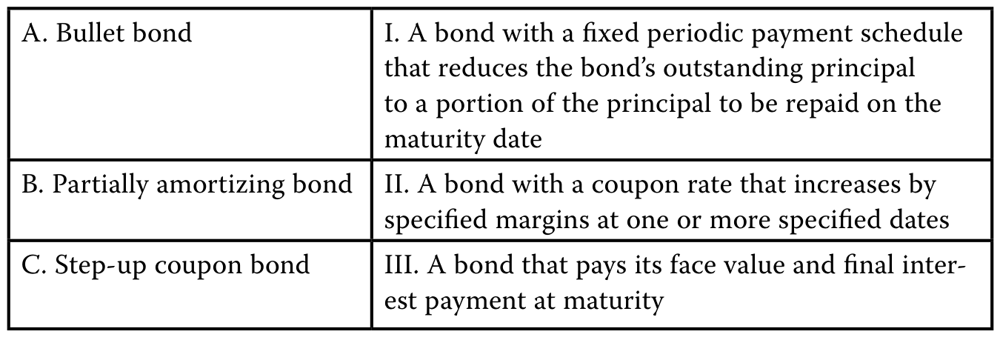PDF 34

图表文字译注：A. 到期一次还本债券；I. 具有固定定期付款安排的债券，；逐步减少未偿本金，；剩余部分本金将在；到期日；B. 部分摊还债券；II. 票面利率会按照；规定幅度，在一个或多个指定日期上调的债券；C. 阶梯票息债券；III. 在到期时支付面值及最后一期利；息的债券。

#### 官方答案与解析 / Official answer and explanation

A与III配对正确。到期一次还本债券在到期时支付100%的面值及最后一期利息。

A. III is correct. A bullet bond pays 100% of its face value plus a final interest payment at the bond’s maturity.

B与I配对正确。

B. I is correct.

一种债券按固定的定期支付计划逐步减少未偿本金，但到期日仍有部分本金需要偿还，这类债券称为本金部分摊还债券。

A bond characterized by a fixed periodic payment schedule that reduces the bond’s outstanding principal to a portion of the principal to be repaid on the maturity date is known as a partially amortizing bond.

C与II配对正确。票面利率在一个或多个规定日期按规定幅度提高的债券，称为票息递增债券。

C. II is correct. A bond with a coupon rate that increases by specified margins at one or more specified dates is known as a step-up coupon bond.

#### 补充解析 / Supplementary explanation

结合本题的官方结论：“A与III配对正确。到期一次还本债券在到期时支付100%的面值及最后一期利息。 B与I配对正确。” 下列补充说明解释其背后的摊还、到期还本与气球付款。

Link to this question’s official result: “A. III is correct. A bullet bond pays 100% of its face value plus a final interest payment at the bond’s maturity.” The supplementary discussion below explains amortization, bullet repayment, and balloon payments.

解题思路：每期付款不全是利息：摊还贷款把一部分付款用于减少本金。余额下降后，下一期利息随之下降，因此固定总付款中的本金部分通常逐期增加。到期一次还本债券则把本金集中到最后。

Reasoning: An amortizing payment includes principal as well as interest. As the balance declines, subsequent interest falls, so the principal portion of a constant payment generally increases. A bullet instrument instead repays principal at maturity.

应用方法：按“期初本金 → 当期利息 → 当期本金归还 → 期末本金”逐期推进。部分摊还贷款到期仍有余额，最后要支付 balloon payment。提前收回本金会降低后续信用敞口，却增加本金再投资的需要。

Application: Work period by period: opening balance, interest, principal repaid, and closing balance. A partially amortizing loan leaves a balloon payment at maturity. Earlier principal repayment reduces later credit exposure but creates reinvestment needs.

#### 相关知识点 / Related concepts

#### 摊还、到期还本与气球付款 / Amortization, bullet repayment, and balloon payments

Fully amortizing 在最后一次常规付款后余额为零；partially amortizing 仍有到期余额；sinking fund 是按契约逐步偿债的安排。

A fully amortizing schedule ends with a zero balance. Partial amortization leaves a maturity balance. A sinking fund is a contractual arrangement for periodic debt retirement.

Interestₜ = Opening balanceₜ × Periodic rate; Principal repaidₜ = Paymentₜ − Interestₜ

### FI-LM02-SA01-03 · 模块自测 3 Module self-assessment 3

课前自测 / Pre-test / self-assessment · 原版 PDF 页码 / Source PDF pages: 35

#### 题目与资料 / Question and data

3\. 固定收益证券中嵌入的赎回条款：

3\. A call provision embedded in a fixed-income security:

A. 有利于发行人。

A. is a benefit to the issuer.

B. 赋予债券持有人出售债券的权利，但并非义务。

B. gives the bondholder the right but not an obligation to sell the bond.

C. 为债券持有人提供一定程度的通胀保护。

C. grants the bondholder some degree of inflation protection.

#### 官方答案与解析 / Official answer and explanation

A正确。

A is correct.

赎回条款赋予发行人在规定日期、按预定价格赎回全部或部分债券的权利。

A call provision gives the issuer the right to redeem all or part of the bond at a pre-determined price on specified dates.

这一条款有利于发行人，因为市场利率下降时，发行人可以用利率更低的债券替代原有可赎回债券。

It is a benefit to the issuer because if market interest rates fall, the issuer can replace the callable bond with one with a lower interest rate.

如果发行人拥有多余现金，或未来希望调整资本结构，该条款也赋予其更大的灵活性。

It also gives the issuer added flexibility if it has excess cash or wishes to change its capital structure in the future.

B不正确。该描述适用于可回售债券，而非可赎回债券。若发行人行使赎回权，债券持有人必须按照规定条款向发行人出售债券。

B is incorrect. This describes a putable bond, not a callable bond. If a callable bond is called, the bondholder is obliged to sell it to the issuer according to the specified terms.

C不正确。赎回条款不会为债券持有人提供通胀保护。利率下降时，发行人会行使赎回权。

C is incorrect. A call provision does not grant the bondholder inflation protection. A call would be exercised by the issuer if interest rates fall.

#### 补充解析 / Supplementary explanation

结合本题的官方结论：“A正确。 赎回条款赋予发行人在规定日期、按预定价格赎回全部或部分债券的权利。 这一条款有利于发行人，因为市场利率下降时，发行人可以用利率更低的债券替代原有可赎回债券。” 下列补充说明解释其背后的赎回权与回售权属于谁。

Link to this question’s official result: “A is correct. A call provision gives the issuer the right to redeem all or part of the bond at a pre-determined price on specified dates. It is a benefit to the issuer because if market interest rates fall, the issuer can replace the callable bond with one with a lower interest rate.” The supplementary discussion below explains who owns the call or put option?.

解题思路：判断含权债券先确认权利属于谁。发行人持有赎回权，利率下降时可较低成本再融资，投资者因而失去部分价格上涨空间；投资者持有回售权，利率上升、债券价格下降时可以按条款卖回。

Reasoning: Start with the option holder. An issuer call permits refinancing when rates fall and limits the investor’s price upside. An investor put offers protection when rates rise and the bond’s market value falls.

应用方法：其他条件相同，call 对发行人有利，通常需要更高收益率补偿买方；put 对投资者有利，通常允许较低收益率。计算 yield-to-call 用赎回日期和赎回价替换到期日期和本金；yield-to-worst 比较适用的承诺收益率情景。

Application: All else equal, a call benefits the issuer and normally requires a higher investor yield; a put benefits the investor and normally permits a lower yield. For yield-to-call, substitute the call date and call price. Yield-to-worst compares applicable contractual redemption scenarios.

#### 相关知识点 / Related concepts

#### 赎回权与回售权属于谁 / Who owns the call or put option?

Make-whole call 的赎回价与参考收益率及约定利差相关，其经济效果不能直接等同于固定价格赎回。含权现金流会随市场利率改变，风险分析常需有效久期。

A make-whole redemption price depends on a benchmark yield and contractual spread; it is not equivalent to a fixed-price call. Rate-dependent cash flows often require effective-duration analysis.

### FI-LM02-SA01-04 · 模块自测 4 Module self-assessment 4

课前自测 / Pre-test / self-assessment · 原版 PDF 页码 / Source PDF pages: 35

#### 题目与资料 / Question and data

4\. 固定收益证券中嵌入的回售条款：

4\. A put provision embedded in a fixed-income security:

A. 有利于债券持有人。

A. is a benefit to the bondholders.

B. 使债券价值低于到期一次还本债券。

B. leads to a lower value compared to a bullet bond.

C. 增加发行人被收购的可能性。

C. increases the likelihood that its issuer will be acquired.

#### 官方答案与解析 / Official answer and explanation

A正确。

A is correct.

回售条款赋予债券持有人在规定日期、按预定价格将债券卖回发行人的权利。

A put provision gives bondholders the right to sell the bonds back to the issuer at a pre-determined price on specified dates.

回售条款有利于债券持有人，因为它可以保护持有人免受债券价格下降的风险，例如由利率上升引起的价格下跌。

The put provision is a benefit to bondholders because it can protect them from the risk of the price of the bond falling from, for example, rising interest rates.

B不正确。由于回售条款有利于投资者，可回售债券相对于其他条件相同的不含权债券应以溢价而非折价定价。

B is incorrect. As put provisions are beneficial to investors, putable bonds are priced at a premium, not a discount, relative to option-free counterparts.

C不正确。

C is incorrect.

回售条款可能阻止收购者，因为行使债券回售权会产生即时现金支付要求，使收购成本提高。

Put provisions can deter acquirers because the exercise of putable bonds results in an immediate claim on cash, making the acquisition more expensive.

某些企业通过发行带回售条款的债券阻止恶意收购，这种策略称为“毒丸回售条款”（poison puts）。

Issuing bonds with put provisions is a strategy employed by some firms to deter unfriendly takeovers known as a “poison puts.”

#### 补充解析 / Supplementary explanation

结合本题的官方结论：“A正确。 回售条款赋予债券持有人在规定日期、按预定价格将债券卖回发行人的权利。 回售条款有利于债券持有人，因为它可以保护持有人免受债券价格下降的风险，例如由利率上升引起的价格下跌。” 下列补充说明解释其背后的赎回权与回售权属于谁。

Link to this question’s official result: “A is correct. A put provision gives bondholders the right to sell the bonds back to the issuer at a pre-determined price on specified dates. The put provision is a benefit to bondholders because it can protect them from the risk of the price of the bond falling from, for example, rising interest rates.” The supplementary discussion below explains who owns the call or put option?.

解题思路：判断含权债券先确认权利属于谁。发行人持有赎回权，利率下降时可较低成本再融资，投资者因而失去部分价格上涨空间；投资者持有回售权，利率上升、债券价格下降时可以按条款卖回。

Reasoning: Start with the option holder. An issuer call permits refinancing when rates fall and limits the investor’s price upside. An investor put offers protection when rates rise and the bond’s market value falls.

应用方法：其他条件相同，call 对发行人有利，通常需要更高收益率补偿买方；put 对投资者有利，通常允许较低收益率。计算 yield-to-call 用赎回日期和赎回价替换到期日期和本金；yield-to-worst 比较适用的承诺收益率情景。

Application: All else equal, a call benefits the issuer and normally requires a higher investor yield; a put benefits the investor and normally permits a lower yield. For yield-to-call, substitute the call date and call price. Yield-to-worst compares applicable contractual redemption scenarios.

#### 相关知识点 / Related concepts

#### 赎回权与回售权属于谁 / Who owns the call or put option?

Make-whole call 的赎回价与参考收益率及约定利差相关，其经济效果不能直接等同于固定价格赎回。含权现金流会随市场利率改变，风险分析常需有效久期。

A make-whole redemption price depends on a benchmark yield and contractual spread; it is not equivalent to a fixed-price call. Rate-dependent cash flows often require effective-duration analysis.

### FI-LM02-SA01-05 · 模块自测 5 Module self-assessment 5

课前自测 / Pre-test / self-assessment · 原版 PDF 页码 / Source PDF pages: 35-36

#### 题目与资料 / Question and data

5\. 将左栏的术语与右栏的描述配对。

5\. Match the term in the left column with its description in the right column.

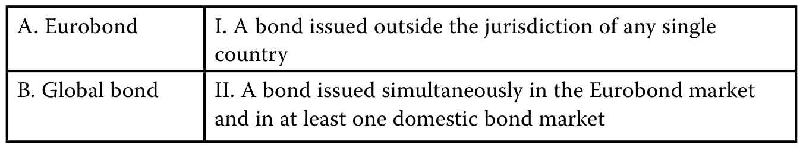PDF 35

图表文字译注：A. 欧洲债券；I. 在任何单一国家的管辖范围之外发行的债券，；不受单一国家管辖；B. 全球债券；II. 同时在欧洲债券市场；及至少一个国内债券市场发行的债券。

#### 官方答案与解析 / Official answer and explanation

A与I配对正确。欧洲债券在单一国家管辖范围之外发行，通常没有担保，并可使用任何货币计价，包括发行人的本国货币。

A. I is correct. Eurobonds are issued outside the jurisdiction of any single country, are usually unsecured, and may be denominated in any currency, including the issuer’s domestic currency.

B. II 正确。全球债券是在欧洲债券市场和至少一个国内债券市场同时发行的债券，可确保大规模债券发行获得足够需求，并使各地固定收益投资者都能够参与。

B. II is correct. A global bond is a bond issued simultaneously in the Eurobond market and in at least one domestic bond market, ensuring sufficient demand for large bond issues and access to all fixed-income investors regardless of location.

#### 补充解析 / Supplementary explanation

结合本题的官方结论：“A与I配对正确。欧洲债券在单一国家管辖范围之外发行，通常没有担保，并可使用任何货币计价，包括发行人的本国货币。 B. II 正确。” 下列补充说明解释其背后的债券市场分类看发行地与币种。

Link to this question’s official result: “A. I is correct. Eurobonds are issued outside the jurisdiction of any single country, are usually unsecured, and may be denominated in any currency, including the issuer’s domestic currency.” The supplementary discussion below explains classify markets by location and denomination.

解题思路：Eurobond 的 euro 不是欧元币种要求。分类需要同时看发行人所属市场、发行市场以及计价货币；只看公司国籍或只看币种，都可能错判。

Reasoning: The euro in Eurobond does not require euro denomination. Classification depends jointly on the issuer’s home market, issuance market, and currency; nationality or currency alone is insufficient.

应用方法：把原题三个信息分别列出，再依据定义判断：外国发行人在一国本地市场用该国货币发行，通常属于 foreign bond；在一种货币的本国市场之外发行，可属于 Eurobond；global bond 同时面向欧洲债券市场与本地市场。

Application: List the three facts separately. A foreign issuer using the local currency in a domestic market generally issues a foreign bond. Issuance outside a currency’s home market can be a Eurobond. A global bond is offered simultaneously in Eurobond and domestic markets.

#### 相关知识点 / Related concepts

#### 债券市场分类看发行地与币种 / Classify markets by location and denomination

Domestic、foreign、Eurobond 和 global 是市场结构概念，不是信用质量排序，也不直接决定投资者回报。

Domestic, foreign, Eurobond, and global describe market structures rather than credit-quality rankings or investment returns.

### FI-LM02-SA01-06 · 模块自测 6 Module self-assessment 6

课前自测 / Pre-test / self-assessment · 原版 PDF 页码 / Source PDF pages: 36

#### 题目与资料 / Question and data

6\. 与适用原始发行折价（OID）税务规定的债券相比，其他条件相同但不适用该规定的债券，在到期时最可能：

6\. Compared to a bond with an original issue discount (OID) tax provision, an otherwise identical bond without this provision would most likely have:

A. 应缴税款较少。

A. lower taxes due at maturity.

B. 应缴税款相同。

B. the same taxes due at maturity.

C. 应缴税款较多。

C. higher taxes due at maturity.

#### 官方答案与解析 / Official answer and explanation

C正确。

C is correct.

在OID税务规定下，投资者每年按比例将一部分原始发行折价确认为应税收入，到期时无需缴纳资本利得税。

Under the OID tax provision, the investor will recognize a prorated portion of the OID as taxable income each year and pay no capital gains tax upon maturity.

不适用OID税务规定的投资者，在到期前不确认应税收入；到期时则需对OID缴纳资本利得税，前提是所在司法管辖区征收资本利得税。

Investors without an OID tax provision will recognize no taxable income until maturity, upon which they will face capital gains tax on the OID (provided there is capital gains tax in their jurisdiction).

#### 补充解析 / Supplementary explanation

结合本题的官方结论：“C正确。 在OID税务规定下，投资者每年按比例将一部分原始发行折价确认为应税收入，到期时无需缴纳资本利得税。 不适用OID税务规定的投资者，在到期前不确认应税收入；到期时则需对OID缴纳资本利得税，前提是所在司法管辖区征收资本利得税。” 下列补充说明解释其背后的折价债券的收益确认与现金到账。

Link to this question’s official result: “C is correct. Under the OID tax provision, the investor will recognize a prorated portion of the OID as taxable income each year and pay no capital gains tax upon maturity. Investors without an OID tax provision will recognize no taxable income until maturity, upon which they will face capital gains tax on the OID (provided there is capital gains tax in their jurisdiction).” The supplementary discussion below explains discount accretion versus cash receipts.

解题思路：零息债券没有定期现金票息，但仍有利息性质的经济收益：以折价买入，逐步接近到期面值。税务或会计上的收益确认时点，可能早于实际收到本金和累计收益的时点。

Reasoning: A zero-coupon bond has no periodic cash coupon but still earns an economic return through discount accretion toward par. Tax or accounting recognition can precede the actual cash receipt at maturity.

应用方法：这类题必须按照原题指定司法辖区和规则作答。先算发行折价，再分清每期应计收入、到期现金流与买卖产生的资本利得。教材案例中的税务假设不能直接外推成所有国家的实际税务规则。

Application: Use the jurisdiction and rules specified in the problem. Separate original issue discount, periodic accrued income, maturity cash flow, and any gain from trading. Do not generalize a curriculum tax assumption to every jurisdiction.

#### 相关知识点 / Related concepts

#### 折价债券的收益确认与现金到账 / Discount accretion versus cash receipts

OID = 到期面值减发行价格；无现金票息不等于没有应税或应计收益。

OID is par minus the issue price. The absence of a cash coupon does not imply the absence of accrued or taxable income.

Original issue discount = Par value − Original issue price

### FI-LM02-EX01-01 · 已解例题 1 · 30年期固定利率住宅抵押贷款 Worked example 1 · 30-Year Fixed-Rate Residential Mortgage Loan

正文例题／案例 / Worked example / case · 原版 PDF 页码 / Source PDF pages: 41-42

#### 题目与资料 / Question and data

30年期固定利率住宅抵押贷款

30-Year Fixed-Rate Residential Mortgage Loan

#### 官方答案与解析 / Official answer and explanation

一名借款人同意购房，并按照以下条款与金融中介机构订立抵押贷款：

A borrower agrees to purchase a home and enters into a mortgage loan with a financial intermediary based on the following terms:

房屋价格：USD500,000。

Home price: USD500,000

贷款金额：USD400,000。

Loan amount: USD400,000

年利率：3.50%。

Annual interest rate: 3.50%

贷款期限：360个月。

Loan term: 360 months

借款人的月利率为〔算式见下〕，因此可以用公式1，按下式计算这笔USD400,000住房贷款的每月还款额：

Noting that the borrower’s monthly interest rate is \[calculation below\], we can use Equation 1 to calculate the homeowner’s monthly mortgage payment on the USD400,000 loan as follows:

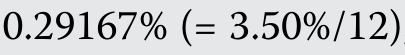PDF 41 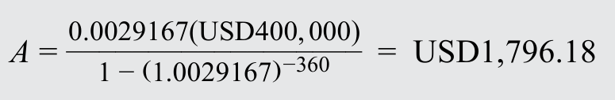PDF 41

与BRWA的例子一样，我们可以计算每期付款中的利息和本金部分；下表列示这笔30年期抵押贷款最初五个月及最后五个月的付款。

As in the case of BRWA, we can calculate the interest and principal components of each periodic payment, with the first five and final five monthly payments of the 30-year mortgage shown below.

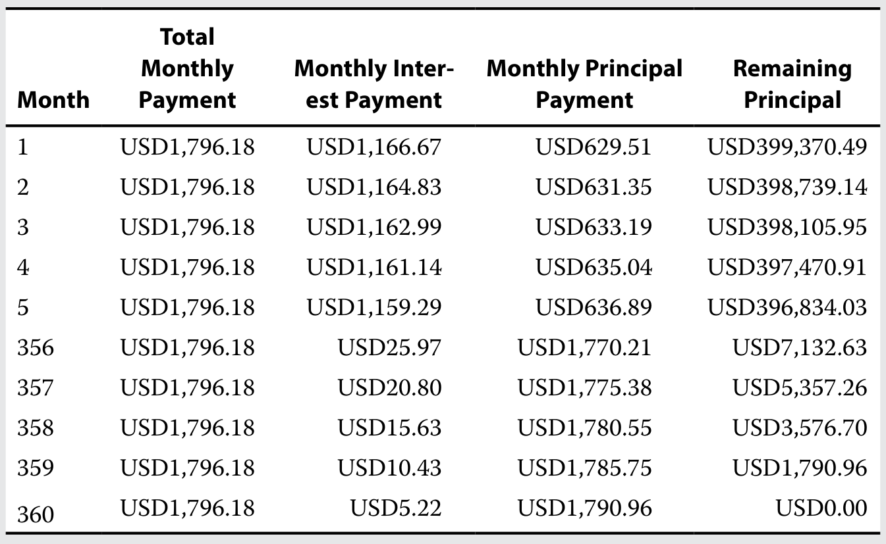PDF 41

图表文字译注：月份；合计；每月；付款额；每月利息；支付额；每月本金；剩余；本金。

另外两种常见的债券本金摊还安排是偿债基金和瀑布式分配结构：前者主要由政府及某些企业发行人采用，后者则常见于资产支持证券（ABS）和抵押贷款支持证券（MBS）。

Two additional bond amortization arrangements commonly encountered are sinking funds, used primarily by government and some corporate issuers, and waterfall structures, which are commonly used in asset-backed securities (ABS) and mortgage-backed securities (MBS).

发行人采用偿债基金安排，定期偿还一部分债券未偿本金。

A sinking fund arrangement is used by issuers to periodically retire a bond’s principal outstanding.

偿债基金是指发行人按照发行时约定的条款，逐步在托管账户中预留资金，以提前偿还债券的安排。

The term sinking fund refers to an issuer’s plans to set aside funds over time in an escrow account to retire the bond early based on terms agreed upon issuance.

例如，发行人可以指示债券受托人，从投资者中随机抽选债券，赎回预先确定的本金金额。

For example, an issuer may direct the bond trustee to redeem a predetermined principal amount selected from among investors at random.

或者，发行人可能依据本课稍后介绍的或有条款，拥有在到期前按预定固定价格回购债券的权利。

Alternatively, the issuer may have the right to repurchase bonds prior to maturity at a predetermined fixed price under a contingency feature addressed later in this lesson.

与本金摊还一样，偿债基金在到期前减少未偿本金，因此降低信用风险，却增加再投资风险。

Like amortization, sinking funds reduce credit risk while increasing reinvestment risk due to a reduction of principal outstanding prior to maturity.

另一种本金偿还结构是瀑布式分配。

Another structure for principal repayment is a waterfall.

这种方法用于确定各类投资者取得现金流的时间顺序，而这些投资者对相同现金流拥有不同的优先受偿权。

This approach is used to determine the timing of cash flows to investor classes with different priority claims to the same cash flows.

最常见的形式是向所有档次支付利息或票息时不设优先顺序，但本金按先后次序偿还：资本结构中受偿顺序最高的投资者档次先取得本金偿还，在其本金全部偿清后，再轮到第二顺位投资者。

In the most common form, interest or coupon payments are paid to all classes with no preference, but the repayment of principal occurs sequentially so that the most senior investor class with the highest ranking in the capital structure receives principal payments first, followed by the second-highest ranked investors once the most senior class has been fully repaid.

图表5以前一模块中的三档结构为例，展示典型的瀑布式分配结构。

Exhibit 5 shows a typical waterfall structure based on the three-tranche example from the prior module.

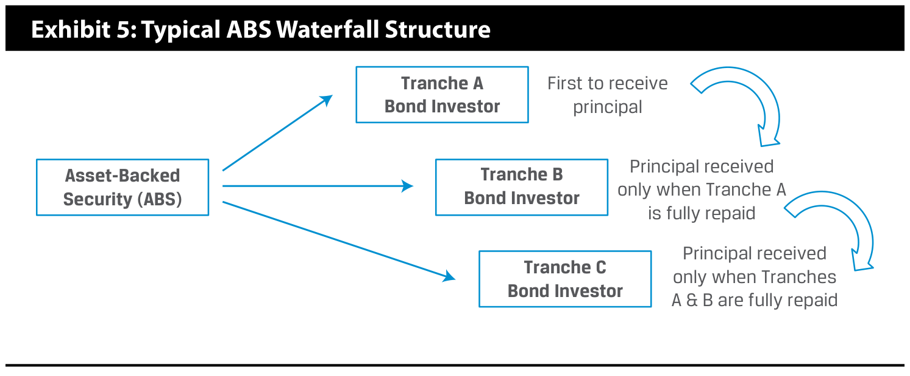PDF 42

图表文字译注：图表5：典型ABS瀑布式分配结构；资产支持；证券（ABS）；A档；债券投资者；B档；C档；最先收到；本金；收到本金，；仅在A档；已全额偿还之后；仅在各档中的；A档及B档已全额偿还之后。

由于优先档先获偿，支付缺口由较次级档次承担，因此A档信用风险最低，其次为B档，再其次为C档。

Payment shortfalls are borne by the more junior tranches since the senior tranches are paid first, so Tranche A faces the lowest credit risk, followed by Tranches B and C.

#### 补充解析 / Supplementary explanation

解题思路：每期付款不全是利息：摊还贷款把一部分付款用于减少本金。余额下降后，下一期利息随之下降，因此固定总付款中的本金部分通常逐期增加。到期一次还本债券则把本金集中到最后。

Reasoning: An amortizing payment includes principal as well as interest. As the balance declines, subsequent interest falls, so the principal portion of a constant payment generally increases. A bullet instrument instead repays principal at maturity.

应用方法：按“期初本金 → 当期利息 → 当期本金归还 → 期末本金”逐期推进。部分摊还贷款到期仍有余额，最后要支付 balloon payment。提前收回本金会降低后续信用敞口，却增加本金再投资的需要。

Application: Work period by period: opening balance, interest, principal repaid, and closing balance. A partially amortizing loan leaves a balloon payment at maturity. Earlier principal repayment reduces later credit exposure but creates reinvestment needs.

#### 相关知识点 / Related concepts

#### 摊还、到期还本与气球付款 / Amortization, bullet repayment, and balloon payments

Fully amortizing 在最后一次常规付款后余额为零；partially amortizing 仍有到期余额；sinking fund 是按契约逐步偿债的安排。

A fully amortizing schedule ends with a zero balance. Partial amortization leaves a maturity balance. A sinking fund is a contractual arrangement for periodic debt retirement.

Interestₜ = Opening balanceₜ × Periodic rate; Principal repaidₜ = Paymentₜ − Interestₜ

原书为叙述式已解例题，完整条件、计算及结论保留在官方解析区。

### FI-LM02-EX02-02 · 已解例题 2 · 美国通胀保值国债（TIPS）现金流 Worked example 2 · TIPS Cash Flow

正文例题／案例 / Worked example / case · 原版 PDF 页码 / Source PDF pages: 45-46

#### 题目与资料 / Question and data

美国通胀保值国债（TIPS）现金流

TIPS Cash Flow

#### 官方答案与解析 / Official answer and explanation

一名投资者购买了条款如下的TIPS：

An investor purchases TIPS with the following terms:

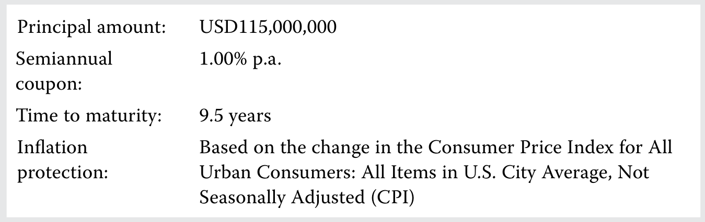PDF 45

图表文字译注：本金金额：；每半年；票息：；剩余到期期限：；9.5年；通胀；保护：；依据所有城市消费者消费价格指数的变化，；该指数涵盖美国城市平均全部项目，未经；季节调整（CPI）。

如果下一半年度计息期间内，CPI由265.00升至267.25，则下一次票息支付按下式计算：

If the CPI rises from 265.00 to 267.25 over the next semiannual interest period, the next coupon payment is calculated as follows:

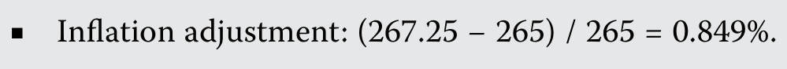PDF 45 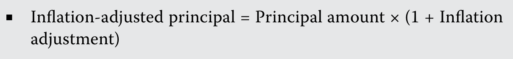PDF 45 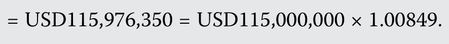PDF 45 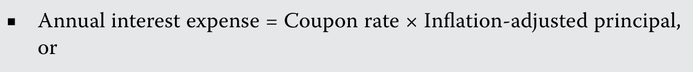PDF 45 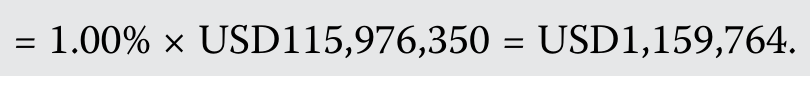PDF 45 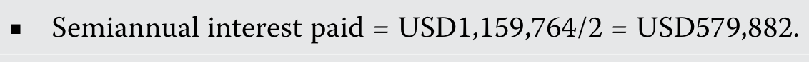PDF 46

#### 补充解析 / Supplementary explanation

结合本题的官方结论：“一名投资者购买了条款如下的TIPS： 如果下一半年度计息期间内，CPI由265.00升至267.25，则下一次票息支付按下式计算：” 下列补充说明解释其背后的通胀挂钩现金流。

Link to this question’s official result: “An investor purchases TIPS with the following terms: If the CPI rises from 265.00 to 267.25 over the next semiannual interest period, the next coupon payment is calculated as follows:” The supplementary discussion below explains inflation-linked cash flows.

解题思路：通胀保护来自合同如何调整本金或利息，不是把票面利率与通胀率简单相加。以本金随物价指数调整的结构为例，固定票息率乘的是调整后的本金，因此票息金额也随之变化。

Reasoning: Inflation protection comes from the contractual adjustment of principal or coupons, not simply adding inflation to the coupon rate. Where principal is indexed, a fixed coupon rate applies to adjusted principal, so the cash coupon also changes.

应用方法：先查题目规定的指数比率、调整时点及本金保护，再依次计算调整后本金和当期票息。区分名义购买力与实际购买力；通胀挂钩并不消除利率波动带来的市场价格风险。

Application: Apply the stated index ratio, timing, and principal floor before calculating the coupon. Distinguish nominal cash flows from purchasing power. Inflation linkage does not eliminate market-price exposure to real interest rates.

#### 相关知识点 / Related concepts

#### 通胀挂钩现金流 / Inflation-linked cash flows

实际利率是扣除通胀影响后的回报；精确关系为名义增长因子等于实际增长因子与通胀增长因子的乘积。

A real rate measures return after inflation. The exact relation multiplies the real-return growth factor by the inflation growth factor.

(1 + nominal rate) = (1 + real rate) × (1 + inflation rate)

原书为叙述式已解例题，完整条件、计算及结论保留在官方解析区。

### FI-LM02-QS01-01 · 正文题组 1 · 第 1 题 Question set 1 · Question 1

正文习题组 / Question set · 原版 PDF 页码 / Source PDF pages: 47

#### 题目与资料 / Question and data

1\. 与到期一次还本债券相比，其他条件相同的摊还债券最可能具有：

1\. Compared to a bullet bond, an otherwise identical amortizing bond would most likely have:

A. 较低信用风险。

A. lower credit risk.

B. 较低再投资风险。

B. lower reinvestment risk.

C. 较低近期现金流。

C. lower near-term cash flows.

#### 官方答案与解析 / Official answer and explanation

A正确。

A is correct.

与到期一次还本债券相比，其他条件相同的摊还债券每期提前偿还部分本金，而非到期时偿还全部本金，因此投资者对发行人信用风险的敞口较低。

Compared to a bullet bond, an otherwise identical amortizing bond would have early principal repayments each period instead of all principal paid at maturity, lowering exposure to the issuers credit risk.

但较高的定期支付会增加再投资风险。

However, larger periodic payments increase reinvestment risk.

#### 补充解析 / Supplementary explanation

结合本题的官方结论：“A正确。 与到期一次还本债券相比，其他条件相同的摊还债券每期提前偿还部分本金，而非到期时偿还全部本金，因此投资者对发行人信用风险的敞口较低。 但较高的定期支付会增加再投资风险。” 下列补充说明解释其背后的摊还、到期还本与气球付款。

Link to this question’s official result: “A is correct. Compared to a bullet bond, an otherwise identical amortizing bond would have early principal repayments each period instead of all principal paid at maturity, lowering exposure to the issuers credit risk. However, larger periodic payments increase reinvestment risk.” The supplementary discussion below explains amortization, bullet repayment, and balloon payments.

解题思路：每期付款不全是利息：摊还贷款把一部分付款用于减少本金。余额下降后，下一期利息随之下降，因此固定总付款中的本金部分通常逐期增加。到期一次还本债券则把本金集中到最后。

Reasoning: An amortizing payment includes principal as well as interest. As the balance declines, subsequent interest falls, so the principal portion of a constant payment generally increases. A bullet instrument instead repays principal at maturity.

应用方法：按“期初本金 → 当期利息 → 当期本金归还 → 期末本金”逐期推进。部分摊还贷款到期仍有余额，最后要支付 balloon payment。提前收回本金会降低后续信用敞口，却增加本金再投资的需要。

Application: Work period by period: opening balance, interest, principal repaid, and closing balance. A partially amortizing loan leaves a balloon payment at maturity. Earlier principal repayment reduces later credit exposure but creates reinvestment needs.

#### 相关知识点 / Related concepts

#### 摊还、到期还本与气球付款 / Amortization, bullet repayment, and balloon payments

Fully amortizing 在最后一次常规付款后余额为零；partially amortizing 仍有到期余额；sinking fund 是按契约逐步偿债的安排。

A fully amortizing schedule ends with a zero balance. Partial amortization leaves a maturity balance. A sinking fund is a contractual arrangement for periodic debt retirement.

Interestₜ = Opening balanceₜ × Periodic rate; Principal repaidₜ = Paymentₜ − Interestₜ

### FI-LM02-QS01-02 · 正文题组 1 · 第 2 题 Question set 1 · Question 2

正文习题组 / Question set · 原版 PDF 页码 / Source PDF pages: 47-48

#### 题目与资料 / Question and data

2\. 根据以下条件，计算一只本金完全摊还债券的每期付款额，以及首次付款中的利息和本金部分：

2\. Calculate the periodic payment and the interest and principal components of the first payment for a fully amortizing bond based on the following:

■ 贷款金额：USD10,000,000。

■ Loan amount: USD10,000,000

■ 年利率：2.75%。

■ Annual interest rate: 2.75%

■ 贷款期限：10个半年期间，即5年。

■ Loan term: 10 semiannual periods (5 years)

#### 官方答案与解析 / Official answer and explanation

使用公式1：

Using Equation 1:

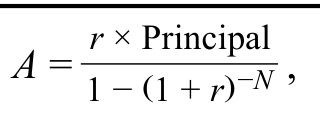PDF 48

其中：

where

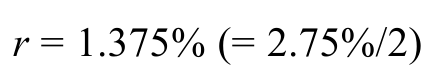PDF 48 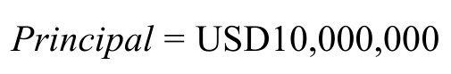PDF 48 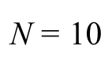PDF 48

按以下方式求每期付款额A：

Solve for the periodic payment (A) as follows:

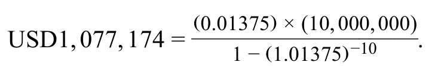PDF 48

首期付款额USD1,077,174由以下部分组成：

The initial USD1,077,174 periodic payment comprises the following:

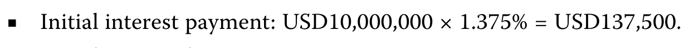PDF 48 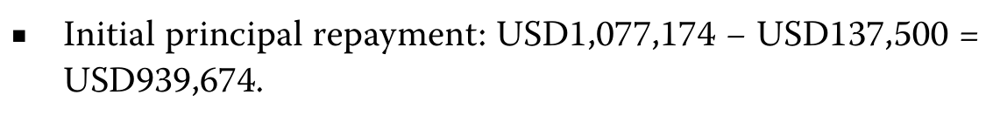PDF 48

#### 补充解析 / Supplementary explanation

结合本题的官方结论：“使用公式1： 其中： 按以下方式求每期付款额A： 首期付款额USD1,077,174由以下部分组成：” 下列补充说明解释其背后的摊还、到期还本与气球付款。

Link to this question’s official result: “Using Equation 1: where Solve for the periodic payment (A) as follows: The initial USD1,077,174 periodic payment comprises the following:” The supplementary discussion below explains amortization, bullet repayment, and balloon payments.

解题思路：每期付款不全是利息：摊还贷款把一部分付款用于减少本金。余额下降后，下一期利息随之下降，因此固定总付款中的本金部分通常逐期增加。到期一次还本债券则把本金集中到最后。

Reasoning: An amortizing payment includes principal as well as interest. As the balance declines, subsequent interest falls, so the principal portion of a constant payment generally increases. A bullet instrument instead repays principal at maturity.

应用方法：按“期初本金 → 当期利息 → 当期本金归还 → 期末本金”逐期推进。部分摊还贷款到期仍有余额，最后要支付 balloon payment。提前收回本金会降低后续信用敞口，却增加本金再投资的需要。

Application: Work period by period: opening balance, interest, principal repaid, and closing balance. A partially amortizing loan leaves a balloon payment at maturity. Earlier principal repayment reduces later credit exposure but creates reinvestment needs.

#### 相关知识点 / Related concepts

#### 摊还、到期还本与气球付款 / Amortization, bullet repayment, and balloon payments

Fully amortizing 在最后一次常规付款后余额为零；partially amortizing 仍有到期余额；sinking fund 是按契约逐步偿债的安排。

A fully amortizing schedule ends with a zero balance. Partial amortization leaves a maturity balance. A sinking fund is a contractual arrangement for periodic debt retirement.

Interestₜ = Opening balanceₜ × Periodic rate; Principal repaidₜ = Paymentₜ − Interestₜ

### FI-LM02-QS01-03 · 正文题组 1 · 第 3 题 Question set 1 · Question 3

正文习题组 / Question set · 原版 PDF 页码 / Source PDF pages: 48

#### 题目与资料 / Question and data

3\. 描述消费者价格指数下降，将如何影响本金指数挂钩型通胀挂钩债券的下一次票息支付。

3\. Describe how a decrease in the consumer price index would affect the next coupon payment of a capital-indexed inflation-linked bond.

#### 官方答案与解析 / Official answer and explanation

本金指数挂钩型通胀挂钩债券会按价格指数调整本金，票息则根据固定票面利率和调整后本金计算。

The principal of capital-indexed inflation-linked bonds is adjusted using a price index, with coupon payments calculated using a fixed coupon rate and the adjusted principal.

消费者价格指数下降，即通缩，会使这类债券下一期本金向下调整，从而减少票息支付。

A decrease in the consumer price index (or deflation) will cause the principal of a capital-indexed inflation-linked bond to be adjusted downward in the next period and result in a lower coupon payment.

#### 补充解析 / Supplementary explanation

结合本题的官方结论：“本金指数挂钩型通胀挂钩债券会按价格指数调整本金，票息则根据固定票面利率和调整后本金计算。 消费者价格指数下降，即通缩，会使这类债券下一期本金向下调整，从而减少票息支付。” 下列补充说明解释其背后的通胀挂钩现金流。

Link to this question’s official result: “The principal of capital-indexed inflation-linked bonds is adjusted using a price index, with coupon payments calculated using a fixed coupon rate and the adjusted principal. A decrease in the consumer price index (or deflation) will cause the principal of a capital-indexed inflation-linked bond to be adjusted downward in the next period and result in a lower coupon payment.” The supplementary discussion below explains inflation-linked cash flows.

解题思路：通胀保护来自合同如何调整本金或利息，不是把票面利率与通胀率简单相加。以本金随物价指数调整的结构为例，固定票息率乘的是调整后的本金，因此票息金额也随之变化。

Reasoning: Inflation protection comes from the contractual adjustment of principal or coupons, not simply adding inflation to the coupon rate. Where principal is indexed, a fixed coupon rate applies to adjusted principal, so the cash coupon also changes.

应用方法：先查题目规定的指数比率、调整时点及本金保护，再依次计算调整后本金和当期票息。区分名义购买力与实际购买力；通胀挂钩并不消除利率波动带来的市场价格风险。

Application: Apply the stated index ratio, timing, and principal floor before calculating the coupon. Distinguish nominal cash flows from purchasing power. Inflation linkage does not eliminate market-price exposure to real interest rates.

#### 相关知识点 / Related concepts

#### 通胀挂钩现金流 / Inflation-linked cash flows

实际利率是扣除通胀影响后的回报；精确关系为名义增长因子等于实际增长因子与通胀增长因子的乘积。

A real rate measures return after inflation. The exact relation multiplies the real-return growth factor by the inflation growth factor.

(1 + nominal rate) = (1 + real rate) × (1 + inflation rate)

### FI-LM02-QS01-04 · 正文题组 1 · 第 4 题 Question set 1 · Question 4

正文习题组 / Question set · 原版 PDF 页码 / Source PDF pages: 48

#### 题目与资料 / Question and data

4\. 将左栏的术语与右栏的描述配对。

4\. Match the term in the left column with its description in the right column.

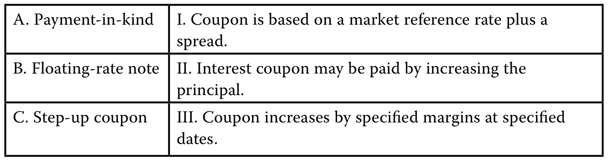PDF 48

图表文字译注：A. 实物付息；I. 票息以市场参考利率加；利差确定。；B. 浮动利率票据；II. 可以通过增加；本金来支付利息。；C. 阶梯票息；III. 票息在指定日期按规定幅度；上调。。

#### 官方答案与解析 / Official answer and explanation

A与II配对正确。实物付息条款允许发行人通过增加本金来支付债券或贷款利息。

A. II is correct. A payment-in-kind feature allows an issuer to pay a bond or loan interest coupon by increasing principal.

B与I配对正确。浮动利率票据的票面利率由市场参考利率加利差组成。

B. I is correct. A floating-rate note coupon is based on a market reference rate plus a spread.

C与III配对正确。票息递增条款使票息在规定日期按规定幅度提高。

C. III is correct. A step-up coupon feature involves a coupon that increases by specified margins at specified dates.

#### 补充解析 / Supplementary explanation

结合本题的官方结论：“A与II配对正确。实物付息条款允许发行人通过增加本金来支付债券或贷款利息。 B与I配对正确。” 下列补充说明解释其背后的浮息票据：合同利差与市场要求利差。

Link to this question’s official result: “A. II is correct. A payment-in-kind feature allows an issuer to pay a bond or loan interest coupon by increasing principal.” The supplementary discussion below explains frns: contractual spread versus required spread.

解题思路：浮息不等于没有信用风险。票息通常是重设时的参考利率加发行时约定的利差；投资者现在要求的信用利差属于估值变量。市场要求利差扩大，并不自动提高原合同中的固定加点。

Reasoning: Floating coupons do not eliminate credit risk. The contractual coupon usually equals the reset reference rate plus a quoted spread. The spread investors currently require is a valuation input; an increase in that required spread does not automatically amend the contract.

应用方法：读题先标出 quoted margin / issuer-specific spread 与 required discount margin。前者生成现金流，后者参与贴现。要求利差高于合同利差时，投资者需要用较低价格获得补偿；相等时，重设日价格通常接近面值。

Application: Identify the quoted spread and required discount margin separately. The first determines cash flows; the second affects discounting. If the required spread exceeds the quoted spread, a lower price compensates investors. At a reset date, equal spreads generally imply a price near par.

#### 相关知识点 / Related concepts

#### 浮息票据：合同利差与市场要求利差 / FRNs: contractual spread versus required spread

MRR 随重设机制变化；quoted margin 通常固定；discount margin 反映市场要求补偿。利率久期较低不代表信用利差敏感度为零。

The MRR resets under the contract, the quoted margin is usually fixed, and the discount margin reflects required compensation. Low interest-rate duration does not imply zero credit-spread exposure.

Coupon = Principal × (MRR + Quoted margin) × Day-count fraction

### FI-LM02-QS02-01 · 正文题组 2 · 第 1 题 Question set 2 · Question 1

正文习题组 / Question set · 原版 PDF 页码 / Source PDF pages: 52

#### 题目与资料 / Question and data

1\. 在其他条件相同时，以下哪种债券最有利于发行人？

1\. All else equal, the bond with the greatest benefit to the issuer is a bond with:

A. 不含或有条款的债券。

A. no contingency provisions.

B. 含固定价格赎回条款的债券。

B. a fixed-price call provision.

C. 含整体补偿赎回条款的债券。

C. a make-whole call provision.

#### 官方答案与解析 / Official answer and explanation

B正确。固定价格赎回条款赋予发行人未来按预定价格买回债券的权利；若利率下降，这一条款有利于发行人。

B is correct. Fixed-price calls grant the issuer the right to buy back the bond at a predetermined price in the future, which is a benefit to the issuer if interest rates fall.

A不正确。不含或有条款的债券是不含权债券，其对发行人的好处不及含固定价格赎回条款的债券。

A is incorrect. A bond with no contingency provisions is an option-free bond and is not as beneficial to the issuer as a bond with a fixed-price call provision.

C不正确。

C is incorrect.

整体补偿赎回是一种或有条款，允许发行人按某一价格买回债券；该价格通常根据相近期限主权债券的到期收益率加预定利差确定。

A make-whole call is a contingency feature under which issuers can buy bonds back at a price usually based on the yield-to-maturity of a sovereign bond of similar maturity plus a predetermined spread.

整体补偿赎回很少被执行，对发行人或投资者的经济影响很小。

Make-whole calls are rarely executed and have little economic impact on issuers or investors.

#### 补充解析 / Supplementary explanation

结合本题的官方结论：“B正确。固定价格赎回条款赋予发行人未来按预定价格买回债券的权利；若利率下降，这一条款有利于发行人。 A不正确。” 下列补充说明解释其背后的赎回权与回售权属于谁。

Link to this question’s official result: “B is correct. Fixed-price calls grant the issuer the right to buy back the bond at a predetermined price in the future, which is a benefit to the issuer if interest rates fall. A is incorrect.” The supplementary discussion below explains who owns the call or put option?.

解题思路：判断含权债券先确认权利属于谁。发行人持有赎回权，利率下降时可较低成本再融资，投资者因而失去部分价格上涨空间；投资者持有回售权，利率上升、债券价格下降时可以按条款卖回。

Reasoning: Start with the option holder. An issuer call permits refinancing when rates fall and limits the investor’s price upside. An investor put offers protection when rates rise and the bond’s market value falls.

应用方法：其他条件相同，call 对发行人有利，通常需要更高收益率补偿买方；put 对投资者有利，通常允许较低收益率。计算 yield-to-call 用赎回日期和赎回价替换到期日期和本金；yield-to-worst 比较适用的承诺收益率情景。

Application: All else equal, a call benefits the issuer and normally requires a higher investor yield; a put benefits the investor and normally permits a lower yield. For yield-to-call, substitute the call date and call price. Yield-to-worst compares applicable contractual redemption scenarios.

#### 相关知识点 / Related concepts

#### 赎回权与回售权属于谁 / Who owns the call or put option?

Make-whole call 的赎回价与参考收益率及约定利差相关，其经济效果不能直接等同于固定价格赎回。含权现金流会随市场利率改变，风险分析常需有效久期。

A make-whole redemption price depends on a benchmark yield and contractual spread; it is not equivalent to a fixed-price call. Rate-dependent cash flows often require effective-duration analysis.

### FI-LM02-QS02-02 · 正文题组 2 · 第 2 题 Question set 2 · Question 2

正文习题组 / Question set · 原版 PDF 页码 / Source PDF pages: 53

#### 题目与资料 / Question and data

2\. 对于票面利率相同的可赎回和可回售债券，当两者YTM分别处于哪种情况时，其价格表现最接近其他条件相同的不含权债券？

2\. Callable and putable bond prices with the same coupon rate will behave most like an option-free equivalent bond when their YTMs are, respectively:

A. 高于票面利率，以及低于票面利率。

A. above the coupon rate and below the coupon rate.

B. 低于票面利率，以及高于票面利率。

B. below the coupon rate and above the coupon rate.

C. 两者均接近票面利率。

C. both near the coupon rate.

#### 官方答案与解析 / Official answer and explanation

A正确。

A is correct.

如果可赎回债券的YTM升至高于票面利率，赎回权价值较低，因此就利率变化引起的价格变动而言，其表现非常接近不可赎回债券。

If a callable bond’s YTM rises above its coupon rate, the call feature is less valuable and a callable bond behaves much like a non-callable bond with respect to price movements due to interest rate changes.

如果可回售债券的YTM低于票面利率，回售权价值较低，因此就利率变化而言，其价格表现接近其他条件相同的不含权债券。

If a putable bond’s YTM is less than its coupon rate, the put feature is less valuable and the putable bond’s price behaves like an option-free equivalent bond with respect to interest rate changes.

B不正确，因为它将正确关系颠倒了。

B is incorrect. This is the reverse of the correct relationship.

C不正确。

C is incorrect.

如果两者的YTM均接近票面利率，其价格都会接近可行使赎回权或回售权的价格边界。

If their YTMs are both near the coupon rate, both bonds will be near their price limits where the call and put features would be exercised.

相对于不可赎回债券，它们的价格变动幅度会更小。

Their price changes would be lower in magnitude relative to a non-callable bond.

#### 补充解析 / Supplementary explanation

结合本题的官方结论：“A正确。 如果可赎回债券的YTM升至高于票面利率，赎回权价值较低，因此就利率变化引起的价格变动而言，其表现非常接近不可赎回债券。 如果可回售债券的YTM低于票面利率，回售权价值较低，因此就利率变化而言，其价格表现接近其他条件相同的不含权债券。” 下列补充说明解释其背后的赎回权与回售权属于谁。

Link to this question’s official result: “A is correct. If a callable bond’s YTM rises above its coupon rate, the call feature is less valuable and a callable bond behaves much like a non-callable bond with respect to price movements due to interest rate changes. If a putable bond’s YTM is less than its coupon rate, the put feature is less valuable and the putable bond’s price behaves like an option-free equivalent bond with respect to interest rate changes.” The supplementary discussion below explains who owns the call or put option?.

解题思路：判断含权债券先确认权利属于谁。发行人持有赎回权，利率下降时可较低成本再融资，投资者因而失去部分价格上涨空间；投资者持有回售权，利率上升、债券价格下降时可以按条款卖回。

Reasoning: Start with the option holder. An issuer call permits refinancing when rates fall and limits the investor’s price upside. An investor put offers protection when rates rise and the bond’s market value falls.

应用方法：其他条件相同，call 对发行人有利，通常需要更高收益率补偿买方；put 对投资者有利，通常允许较低收益率。计算 yield-to-call 用赎回日期和赎回价替换到期日期和本金；yield-to-worst 比较适用的承诺收益率情景。

Application: All else equal, a call benefits the issuer and normally requires a higher investor yield; a put benefits the investor and normally permits a lower yield. For yield-to-call, substitute the call date and call price. Yield-to-worst compares applicable contractual redemption scenarios.

#### 相关知识点 / Related concepts

#### 赎回权与回售权属于谁 / Who owns the call or put option?

Make-whole call 的赎回价与参考收益率及约定利差相关，其经济效果不能直接等同于固定价格赎回。含权现金流会随市场利率改变，风险分析常需有效久期。

A make-whole redemption price depends on a benchmark yield and contractual spread; it is not equivalent to a fixed-price call. Rate-dependent cash flows often require effective-duration analysis.

### FI-LM02-QS02-03 · 正文题组 2 · 第 3 题 Question set 2 · Question 3

正文习题组 / Question set · 原版 PDF 页码 / Source PDF pages: 53

#### 题目与资料 / Question and data

3\. 如果发行人股价处于以下哪种情况，可转换债券价格将紧密跟随其转换价值？

3\. A convertible bond will closely track its conversion value if the issuer’s share price is:

A. 低于转换价格。

A. below the conversion price.

B. 等于转换价格。

B. equal to the conversion price.

C. 高于转换价格。

C. above the conversion price.

#### 官方答案与解析 / Official answer and explanation

C正确。

C is correct.

一般而言，可转换债券的价格会随发行人股价变化。

In general, a convertible bond’s price will vary with that of the issuer’s shares.

如果发行人股价远高于转换价格，债券价格将更紧密地跟随其转换价值。

If the issuer’s share price far exceeds the conversion price, the bond’s price will more closely track its conversion value.

A不正确。如果股价远低于转换价格，可转换债券价格将接近不可转换债券价格。

A is incorrect. If the share price is well below the conversion price, the convertible bond’s price will approach that of a non-convertible bond.

B不正确。在这种情况下，可转换债券将同时具有不可转换债券与可转换债券的价格特征。

B is incorrect. In this case, the convertible bond would have a mix of price properties between that of a non-convertible bond and a convertible bond.

#### 补充解析 / Supplementary explanation

结合本题的官方结论：“C正确。 一般而言，可转换债券的价格会随发行人股价变化。 如果发行人股价远高于转换价格，债券价格将更紧密地跟随其转换价值。” 下列补充说明解释其背后的可转债：债券底价与股权价值。

Link to this question’s official result: “C is correct. In general, a convertible bond’s price will vary with that of the issuer’s shares. If the issuer’s share price far exceeds the conversion price, the bond’s price will more closely track its conversion value.” The supplementary discussion below explains convertible bonds: bond value and conversion value.

解题思路：普通可转债把债券现金流与股票上行参与权放在一起。股票价格远低于转股价时，债券属性更重要；股价大幅高于转股价时，转股价值更重要，因此不能在所有股价情景下都把它当普通债券。

Reasoning: A conventional convertible combines bond cash flows with equity upside. Debt characteristics dominate far below the conversion price, while conversion value becomes more important far above it. Its behavior is therefore state-dependent.

应用方法：先算一张债券可换多少股，再用股数乘当前股价得到转股价值。CoCo 要另看触发条款：资本指标恶化时可能自动转股或减记，不能把它理解为投资者等股价上涨后自愿转股。

Application: First find shares received per bond, then multiply by the share price to obtain conversion value. For a CoCo, inspect the trigger: deterioration in capital measures may force conversion or a write-down, unlike voluntary upside conversion.

#### 相关知识点 / Related concepts

#### 可转债：债券底价与股权价值 / Convertible bonds: bond value and conversion value

Conversion ratio 是每张债券可换股数；conversion value 是按市场股价计算的股票价值；contingent conversion 由特定事件触发。

The conversion ratio is shares per bond. Conversion value prices those shares at the market price. Contingent conversion depends on a specified trigger event.

Conversion value = Conversion ratio × Share price

### FI-LM02-QS02-04 · 正文题组 2 · 第 4 题 Question set 2 · Question 4

正文习题组 / Question set · 原版 PDF 页码 / Source PDF pages: 53-54

#### 题目与资料 / Question and data

4\. 将右栏每项描述与左栏正确的债券类型配对。

4\. Match each description in the right column with the correct bond in the left column.

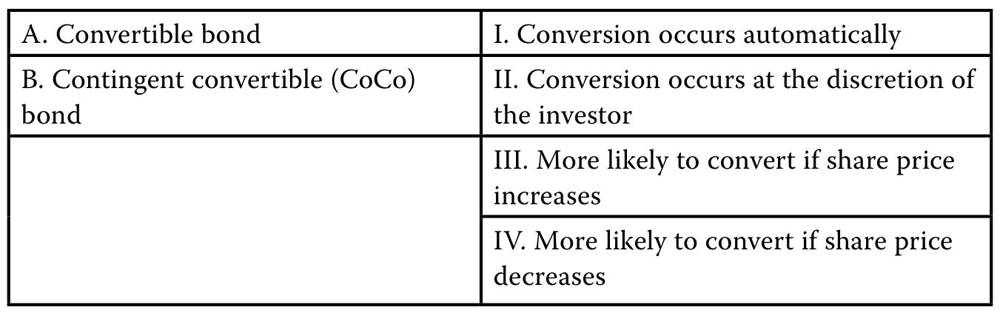PDF 53

图表文字译注：A. 可转换债券；I. 转换自动发生；B. 或有可转换债券（CoCo）；债券；II. 转换由；投资者自行决定；III. 股价发生以下变化时更可能转换：；上涨；IV. 股价发生以下变化时更可能转换：；下跌。

#### 官方答案与解析 / Official answer and explanation

A与II和III配对正确。

A. II and III are correct.

标准可转换债券赋予投资者将债券换成发行人权益的权利，是否转换由投资者决定；发行人股价上升时，转换更可能发生。

A standard convertible bond grants the right to redeem a bond for an issuer’s equity, occurs at the discretion of the investor, and is more likely if the issuer’s share price increases.

B与I和IV配对正确。

B. I and IV are correct.

或有可转换债券（CoCo）在不利情形下转换，且在特定事件发生时自动转换，例如银行资本降至监管最低水平以下。

Contingent convertible (CoCo) bonds are convertible on the downside and occur automatically if a specified event occurs, such as a decline in bank capital below a regulatory minimum level.

#### 补充解析 / Supplementary explanation

结合本题的官方结论：“A与II和III配对正确。 标准可转换债券赋予投资者将债券换成发行人权益的权利，是否转换由投资者决定；发行人股价上升时，转换更可能发生。 B与I和IV配对正确。” 下列补充说明解释其背后的可转债：债券底价与股权价值。

Link to this question’s official result: “A. II and III are correct. A standard convertible bond grants the right to redeem a bond for an issuer’s equity, occurs at the discretion of the investor, and is more likely if the issuer’s share price increases.” The supplementary discussion below explains convertible bonds: bond value and conversion value.

解题思路：普通可转债把债券现金流与股票上行参与权放在一起。股票价格远低于转股价时，债券属性更重要；股价大幅高于转股价时，转股价值更重要，因此不能在所有股价情景下都把它当普通债券。

Reasoning: A conventional convertible combines bond cash flows with equity upside. Debt characteristics dominate far below the conversion price, while conversion value becomes more important far above it. Its behavior is therefore state-dependent.

应用方法：先算一张债券可换多少股，再用股数乘当前股价得到转股价值。CoCo 要另看触发条款：资本指标恶化时可能自动转股或减记，不能把它理解为投资者等股价上涨后自愿转股。

Application: First find shares received per bond, then multiply by the share price to obtain conversion value. For a CoCo, inspect the trigger: deterioration in capital measures may force conversion or a write-down, unlike voluntary upside conversion.

#### 相关知识点 / Related concepts

#### 可转债：债券底价与股权价值 / Convertible bonds: bond value and conversion value

Conversion ratio 是每张债券可换股数；conversion value 是按市场股价计算的股票价值；contingent conversion 由特定事件触发。

The conversion ratio is shares per bond. Conversion value prices those shares at the market price. Contingent conversion depends on a specified trigger event.

Conversion value = Conversion ratio × Share price

### FI-LM02-QS02-05 · 正文题组 2 · 第 5 题 Question set 2 · Question 5

正文习题组 / Question set · 原版 PDF 页码 / Source PDF pages: 54

#### 题目与资料 / Question and data

5\. 希望减少近期现金流出的发行人，最可能发行：

5\. An issuer that would like to conserve near-term cash outflows would most likely issue a:

A. 可回售债券。

A. putable bond.

B. 可赎回债券。

B. callable bond.

C. 可转换债券。

C. convertible bond.

#### 官方答案与解析 / Official answer and explanation

C正确。

C is correct.

在其他条件相同时，可转换债券的利息支付对发行人而言最低。

All else equal, an issuer would have the lowest interest payments on a convertible bond.

债券持有人通常愿意接受很低、甚至为零的到期收益率，以换取转换权。

Bondholders are often willing to accept a yield-to-maturity that is very low (or even zero) in exchange for conversion rights.

可回售债券收益率低于可赎回债券，因为回售期权有利于债券持有人，而赎回期权有利于发行人。

Putable bonds offer lower yields than callable bonds because the put option is a benefit to the bondholder while the call option is a benefit to the issuer.

但与可转换债券相比，可赎回及可回售债券的收益率都较高。

However, the yields on callable and putable bonds are high compared to yields on convertibles.

#### 补充解析 / Supplementary explanation

结合本题的官方结论：“C正确。 在其他条件相同时，可转换债券的利息支付对发行人而言最低。 债券持有人通常愿意接受很低、甚至为零的到期收益率，以换取转换权。” 下列补充说明解释其背后的赎回权与回售权属于谁。

Link to this question’s official result: “C is correct. All else equal, an issuer would have the lowest interest payments on a convertible bond. Bondholders are often willing to accept a yield-to-maturity that is very low (or even zero) in exchange for conversion rights.” The supplementary discussion below explains who owns the call or put option?.

解题思路：判断含权债券先确认权利属于谁。发行人持有赎回权，利率下降时可较低成本再融资，投资者因而失去部分价格上涨空间；投资者持有回售权，利率上升、债券价格下降时可以按条款卖回。

Reasoning: Start with the option holder. An issuer call permits refinancing when rates fall and limits the investor’s price upside. An investor put offers protection when rates rise and the bond’s market value falls.

应用方法：其他条件相同，call 对发行人有利，通常需要更高收益率补偿买方；put 对投资者有利，通常允许较低收益率。计算 yield-to-call 用赎回日期和赎回价替换到期日期和本金；yield-to-worst 比较适用的承诺收益率情景。

Application: All else equal, a call benefits the issuer and normally requires a higher investor yield; a put benefits the investor and normally permits a lower yield. For yield-to-call, substitute the call date and call price. Yield-to-worst compares applicable contractual redemption scenarios.

#### 相关知识点 / Related concepts

#### 赎回权与回售权属于谁 / Who owns the call or put option?

Make-whole call 的赎回价与参考收益率及约定利差相关，其经济效果不能直接等同于固定价格赎回。含权现金流会随市场利率改变，风险分析常需有效久期。

A make-whole redemption price depends on a benchmark yield and contractual spread; it is not equivalent to a fixed-price call. Rate-dependent cash flows often require effective-duration analysis.

### FI-LM02-EX03-03 · 已解例题 3 · 零息债券的税务处理 Worked example 3 · Zero-Coupon Bond Tax Treatment

正文例题／案例 / Worked example / case · 原版 PDF 页码 / Source PDF pages: 58

#### 题目与资料 / Question and data

零息债券的税务处理

Zero-Coupon Bond Tax Treatment

#### 官方答案与解析 / Official answer and explanation

假设一位美国投资者和一位所在司法管辖区不适用原始发行折价税务规定的投资者，都按以下条款购买相同的美国零息国债：

Assume both a US-based investor and an investor based in a tax jurisdiction without an original discount tax provision purchase an identical zero-coupon US Treasury security based on the following terms:

■ 本金金额：USD25,000,000。

■ Principal amount: USD25,000,000

■ 到期期限：5年。

■ Time to maturity: 5 years

■ 发行价格：每USD100面值USD92.83。

■ Issuance price: USD92.83 (per USD100 par value)

原始发行折价计算如下：

The original issue discount may be calculated as follows:

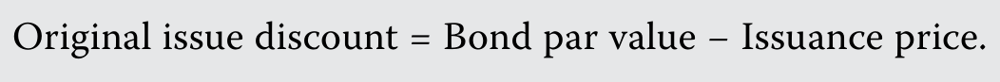PDF 58 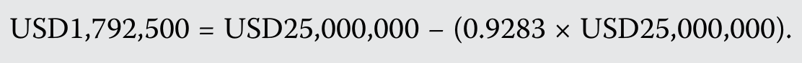PDF 58

USD1,792,500的原始发行折价，代表两位投资者在五年期间累计取得的利息。

The USD1,792,500 original issue discount represents the interest that will accrue to both investors over five years.

根据美国OID税务规定，美国投资者每年将USD1,792,500原始发行折价中的按比例部分确认为应税收入，到期时无需缴纳资本利得税。

Under the original issue discount tax provision in the United States, the US-based investor will recognize a prorated portion of the USD1,792,500 OID as taxable income each year and pay no capital gains tax upon maturity.

不适用OID税务规定的非美国投资者，在到期前不确认应税收入；到期时则对OID缴纳资本利得税，前提是其所在司法管辖区征收资本利得税。

The non-US investor without an OID tax provision will recognize no taxable income until maturity, upon which it will face capital gains tax on the OID (provided there is capital gains tax in their jurisdiction).

#### 补充解析 / Supplementary explanation

结合本题的官方结论：“假设一位美国投资者和一位所在司法管辖区不适用原始发行折价税务规定的投资者，都按以下条款购买相同的美国零息国债： ■ 本金金额：USD25,000,000。 ■ 到期期限：5年。 ■ 发行价格：每USD100面值USD92.83。” 下列补充说明解释其背后的折价债券的收益确认与现金到账。

Link to this question’s official result: “Assume both a US-based investor and an investor based in a tax jurisdiction without an original discount tax provision purchase an identical zero-coupon US Treasury security based on the following terms: ■ Principal amount: USD25,000,000 ■ Time to maturity: 5 years ■ Issuance price: USD92.83 (per USD100 par value) The original issue discount may be calculated as follows: The USD1,792,500 original issue discount represents the interest that will accrue to both investors over five years.” The supplementary discussion below explains discount accretion versus cash receipts.

解题思路：零息债券没有定期现金票息，但仍有利息性质的经济收益：以折价买入，逐步接近到期面值。税务或会计上的收益确认时点，可能早于实际收到本金和累计收益的时点。

Reasoning: A zero-coupon bond has no periodic cash coupon but still earns an economic return through discount accretion toward par. Tax or accounting recognition can precede the actual cash receipt at maturity.

应用方法：这类题必须按照原题指定司法辖区和规则作答。先算发行折价，再分清每期应计收入、到期现金流与买卖产生的资本利得。教材案例中的税务假设不能直接外推成所有国家的实际税务规则。

Application: Use the jurisdiction and rules specified in the problem. Separate original issue discount, periodic accrued income, maturity cash flow, and any gain from trading. Do not generalize a curriculum tax assumption to every jurisdiction.

#### 相关知识点 / Related concepts

#### 折价债券的收益确认与现金到账 / Discount accretion versus cash receipts

OID = 到期面值减发行价格；无现金票息不等于没有应税或应计收益。

OID is par minus the issue price. The absence of a cash coupon does not imply the absence of accrued or taxable income.

Original issue discount = Par value − Original issue price

原书为叙述式已解例题，完整条件、计算及结论保留在官方解析区。

### FI-LM02-QS03-01 · 正文题组 3 · 第 1 题 Question set 3 · Question 1

正文习题组 / Question set · 原版 PDF 页码 / Source PDF pages: 58

#### 题目与资料 / Question and data

1\. 判断以下陈述正误：债券票息最可能作为普通收入征税。

1\. Identify the following statement as true or false: A bond’s coupon payment is most likely to be taxed as ordinary income.

#### 官方答案与解析 / Official answer and explanation

正确。债券利息通常按普通所得税税率征税，该税率一般与个人工资或薪金收入的税率相同。

True. Bond interest is usually taxed at the ordinary income tax rate, which is typically the same tax rate that an individual would pay on wage or salary income.

#### 补充解析 / Supplementary explanation

结合本题的官方结论：“正确。债券利息通常按普通所得税税率征税，该税率一般与个人工资或薪金收入的税率相同。” 下列补充说明解释其背后的票息以面值为基数。

Link to this question’s official result: “True. Bond interest is usually taxed at the ordinary income tax rate, which is typically the same tax rate that an individual would pay on wage or salary income.” The supplementary discussion below explains coupons are based on par value.

解题思路：先把“合同承诺支付多少”与“今天买入花多少钱”分开。固定票息金额由票面利率和面值决定；债券在二级市场涨价或跌价，不会自动改写发行时的固定票息。

Reasoning: Separate the contractual payment from the price paid in the market. A fixed coupon is determined by the coupon rate and par value. A change in the secondary-market price does not rewrite that contractual coupon.

应用方法：计算时先求全年票息，再按每年付息次数分摊；到期最后一笔通常还要加本金。若问当前收益率，才用全年票息除以当前价格。不要把到期收益率乘面值当作合同利息。

Application: First calculate the annual coupon, then divide it by the payment frequency. The final cash flow normally also includes principal. Divide annual coupon income by the current price only when current yield is requested; YTM is not the contractual coupon rate.

#### 相关知识点 / Related concepts

#### 票息以面值为基数 / Coupons are based on par value

Coupon rate 是合同票面利率；current yield 只看当期票息收入；yield to maturity 将未来票息和本金全部折现。三者回答的是不同问题。

The coupon rate is contractual. Current yield measures annual coupon income relative to price. YTM discounts all promised coupon and principal payments.

Annual coupon = Par × Coupon rate; periodic coupon = Annual coupon / m

### FI-LM02-QS03-02 · 正文题组 3 · 第 2 题 Question set 3 · Question 2

正文习题组 / Question set · 原版 PDF 页码 / Source PDF pages: 59

#### 题目与资料 / Question and data

2\. 将左栏的债券类型与右栏的正确描述配对。

2\. Match the bond type in the left column to its correct description in the right column.

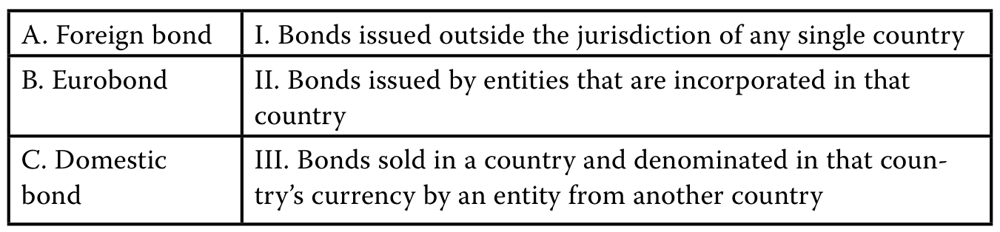PDF 59

图表文字译注：A. 外国债券；I. 在任何单一国家管辖范围之外发行的债券；B. 欧洲债券；II. 由在该国注册成立的实体发行的债券，；不受单一国家管辖；C. 国内债券；债券；III. 由外国实体在某国出售，且以该国；货币计价的债券。

#### 官方答案与解析 / Official answer and explanation

A与III配对正确。一国实体在另一国家出售、并以该出售国货币计价的债券，称为外国债券。

A. III is correct. Bonds sold in a country and denominated in that country’s currency by an entity from another country are known as foreign bonds.

B与I配对正确。在单一国家管辖范围之外发行的债券，称为欧洲债券。

B. I is correct. Bonds issued outside the jurisdiction of any single country are known as Eurobonds.

C与II配对正确。由在本国注册的实体在本国发行的债券，称为国内债券。

C. II is correct. Bonds issued by entities that are incorporated in that country are known as domestic bonds.

#### 补充解析 / Supplementary explanation

结合本题的官方结论：“A与III配对正确。一国实体在另一国家出售、并以该出售国货币计价的债券，称为外国债券。 B与I配对正确。” 下列补充说明解释其背后的债券市场分类看发行地与币种。

Link to this question’s official result: “A. III is correct. Bonds sold in a country and denominated in that country’s currency by an entity from another country are known as foreign bonds.” The supplementary discussion below explains classify markets by location and denomination.

解题思路：Eurobond 的 euro 不是欧元币种要求。分类需要同时看发行人所属市场、发行市场以及计价货币；只看公司国籍或只看币种，都可能错判。

Reasoning: The euro in Eurobond does not require euro denomination. Classification depends jointly on the issuer’s home market, issuance market, and currency; nationality or currency alone is insufficient.

应用方法：把原题三个信息分别列出，再依据定义判断：外国发行人在一国本地市场用该国货币发行，通常属于 foreign bond；在一种货币的本国市场之外发行，可属于 Eurobond；global bond 同时面向欧洲债券市场与本地市场。

Application: List the three facts separately. A foreign issuer using the local currency in a domestic market generally issues a foreign bond. Issuance outside a currency’s home market can be a Eurobond. A global bond is offered simultaneously in Eurobond and domestic markets.

#### 相关知识点 / Related concepts

#### 债券市场分类看发行地与币种 / Classify markets by location and denomination

Domestic、foreign、Eurobond 和 global 是市场结构概念，不是信用质量排序，也不直接决定投资者回报。

Domestic, foreign, Eurobond, and global describe market structures rather than credit-quality rankings or investment returns.

### FI-LM02-QS03-03 · 正文题组 3 · 第 3 题 Question set 3 · Question 3

正文习题组 / Question set · 原版 PDF 页码 / Source PDF pages: 59

#### 题目与资料 / Question and data

3\. 填空。

3\. Fill in the blanks.

发行人在本国境外发行、以本币计价且不受相关国内监管的债券，称为\_\_\_\_\_\_\_\_\_\_\_\_\_\_\_。

An unregulated bond issued in domestic currency outside the issuer’s national borders is known as a \_\_\_\_\_\_\_\_\_\_\_\_\_\_\_.

同时在欧洲债券市场和至少一个国内债券市场发行的债券，称为\_\_\_\_\_\_\_\_\_\_\_\_债券。

A bond issued simultaneously in the Eurobond market and in at least one domestic bond market is known as a \_\_\_\_\_\_\_\_\_\_\_\_ bond.

#### 官方答案与解析 / Official answer and explanation

发行人在本国境外发行、以本币计价且不受相关国内监管的债券，称为欧洲债券。

An unregulated bond issued in domestic currency outside the issuer’s national borders is known as a Eurobond.

同时在欧洲债券市场和至少一个国内债券市场发行的债券，称为全球债券。

A bond issued simultaneously in the Eurobond market and in at least one domestic bond market is known as a global bond.

#### 补充解析 / Supplementary explanation

结合本题的官方结论：“发行人在本国境外发行、以本币计价且不受相关国内监管的债券，称为欧洲债券。 同时在欧洲债券市场和至少一个国内债券市场发行的债券，称为全球债券。” 下列补充说明解释其背后的债券市场分类看发行地与币种。

Link to this question’s official result: “An unregulated bond issued in domestic currency outside the issuer’s national borders is known as a Eurobond. A bond issued simultaneously in the Eurobond market and in at least one domestic bond market is known as a global bond.” The supplementary discussion below explains classify markets by location and denomination.

解题思路：Eurobond 的 euro 不是欧元币种要求。分类需要同时看发行人所属市场、发行市场以及计价货币；只看公司国籍或只看币种，都可能错判。

Reasoning: The euro in Eurobond does not require euro denomination. Classification depends jointly on the issuer’s home market, issuance market, and currency; nationality or currency alone is insufficient.

应用方法：把原题三个信息分别列出，再依据定义判断：外国发行人在一国本地市场用该国货币发行，通常属于 foreign bond；在一种货币的本国市场之外发行，可属于 Eurobond；global bond 同时面向欧洲债券市场与本地市场。

Application: List the three facts separately. A foreign issuer using the local currency in a domestic market generally issues a foreign bond. Issuance outside a currency’s home market can be a Eurobond. A global bond is offered simultaneously in Eurobond and domestic markets.

#### 相关知识点 / Related concepts

#### 债券市场分类看发行地与币种 / Classify markets by location and denomination

Domestic、foreign、Eurobond 和 global 是市场结构概念，不是信用质量排序，也不直接决定投资者回报。

Domestic, foreign, Eurobond, and global describe market structures rather than credit-quality rankings or investment returns.

### FI-LM02-QS03-04 · 正文题组 3 · 第 4 题 Question set 3 · Question 4

正文习题组 / Question set · 原版 PDF 页码 / Source PDF pages: 59

#### 题目与资料 / Question and data

4\. 将左栏的税务规定与右栏的正确税务处理配对。

4\. Match the tax provision in the left column with the correct tax treatment in the right column.

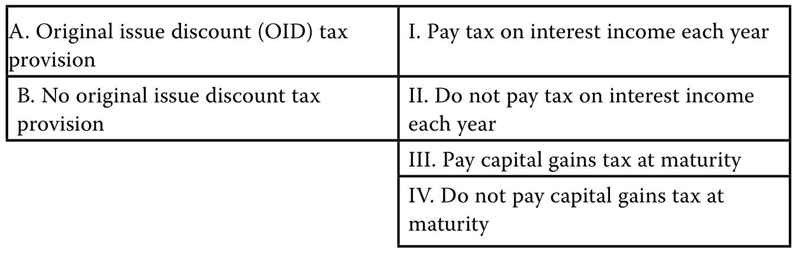PDF 59

图表文字译注：A. 原始发行折价（OID）税收；规定；I. 每年就利息收入纳税；B. 无原始发行折价税收规定；II. 不对利息收入纳税，；按年而言；III. 到期时缴纳资本利得税；IV. 不缴纳资本利得税，时间为；到期时。

#### 官方答案与解析 / Official answer and explanation

A与I和IV配对正确。

A. I and IV are correct.

适用OID税务规定并购买折价发行债券的投资者，必须每年将按比例分摊的OID计入应税收入，到期时无需缴纳资本利得税。

Investors who face an original issue discount tax provision and purchase bonds issued at a discount must recognize a prorated portion of the OID in taxable income each year and pay no capital gains tax upon maturity.

B与II和III配对正确。

B. II and III are correct.

购买折价发行债券但不适用OID税务规定的投资者，在到期前不确认利息收入，到期时对OID缴纳资本利得税。

Investors in bonds issued at a discount who do not face an OID tax provision will recognize no interest income until maturity, when they face capital gains tax on the OID.

#### 补充解析 / Supplementary explanation

结合本题的官方结论：“A与I和IV配对正确。 适用OID税务规定并购买折价发行债券的投资者，必须每年将按比例分摊的OID计入应税收入，到期时无需缴纳资本利得税。 B与II和III配对正确。” 下列补充说明解释其背后的折价债券的收益确认与现金到账。

Link to this question’s official result: “A. I and IV are correct. Investors who face an original issue discount tax provision and purchase bonds issued at a discount must recognize a prorated portion of the OID in taxable income each year and pay no capital gains tax upon maturity.” The supplementary discussion below explains discount accretion versus cash receipts.

解题思路：零息债券没有定期现金票息，但仍有利息性质的经济收益：以折价买入，逐步接近到期面值。税务或会计上的收益确认时点，可能早于实际收到本金和累计收益的时点。

Reasoning: A zero-coupon bond has no periodic cash coupon but still earns an economic return through discount accretion toward par. Tax or accounting recognition can precede the actual cash receipt at maturity.

应用方法：这类题必须按照原题指定司法辖区和规则作答。先算发行折价，再分清每期应计收入、到期现金流与买卖产生的资本利得。教材案例中的税务假设不能直接外推成所有国家的实际税务规则。

Application: Use the jurisdiction and rules specified in the problem. Separate original issue discount, periodic accrued income, maturity cash flow, and any gain from trading. Do not generalize a curriculum tax assumption to every jurisdiction.

#### 相关知识点 / Related concepts

#### 折价债券的收益确认与现金到账 / Discount accretion versus cash receipts

OID = 到期面值减发行价格；无现金票息不等于没有应税或应计收益。

OID is par minus the issue price. The absence of a cash coupon does not imply the absence of accrued or taxable income.

Original issue discount = Par value − Original issue price

### FI-LM02-QS03-05 · 正文题组 3 · 第 5 题 Question set 3 · Question 5

正文习题组 / Question set · 原版 PDF 页码 / Source PDF pages: 60

#### 题目与资料 / Question and data

5\. 一家南非企业发行英镑计价债券，并仅向法律居所在英国的投资者销售，该债券最可能被归类为：

5\. A bond issued by a South African company denominated in British pounds sold exclusively to investors who are legally domiciled in the United Kingdom would most likely be classified as:

A. 外国债券。

A. foreign.

B. 国内债券。

B. domestic.

C. 欧洲债券。

C. a Eurobond.

#### 官方答案与解析 / Official answer and explanation

A正确。一国实体（南非）在另一国家（英国）销售，并以该国货币（英镑）计价的债券，称为外国债券。

A is correct. Bonds sold in a country (United Kingdom) and denominated in that country’s currency (British pounds) by an entity from another country (South Africa) are referred to as foreign bonds.

#### 补充解析 / Supplementary explanation

结合本题的官方结论：“A正确。一国实体（南非）在另一国家（英国）销售，并以该国货币（英镑）计价的债券，称为外国债券。” 下列补充说明解释其背后的债券市场分类看发行地与币种。

Link to this question’s official result: “A is correct. Bonds sold in a country (United Kingdom) and denominated in that country’s currency (British pounds) by an entity from another country (South Africa) are referred to as foreign bonds.” The supplementary discussion below explains classify markets by location and denomination.

解题思路：Eurobond 的 euro 不是欧元币种要求。分类需要同时看发行人所属市场、发行市场以及计价货币；只看公司国籍或只看币种，都可能错判。

Reasoning: The euro in Eurobond does not require euro denomination. Classification depends jointly on the issuer’s home market, issuance market, and currency; nationality or currency alone is insufficient.

应用方法：把原题三个信息分别列出，再依据定义判断：外国发行人在一国本地市场用该国货币发行，通常属于 foreign bond；在一种货币的本国市场之外发行，可属于 Eurobond；global bond 同时面向欧洲债券市场与本地市场。

Application: List the three facts separately. A foreign issuer using the local currency in a domestic market generally issues a foreign bond. Issuance outside a currency’s home market can be a Eurobond. A global bond is offered simultaneously in Eurobond and domestic markets.

#### 相关知识点 / Related concepts

#### 债券市场分类看发行地与币种 / Classify markets by location and denomination

Domestic、foreign、Eurobond 和 global 是市场结构概念，不是信用质量排序，也不直接决定投资者回报。

Domestic, foreign, Eurobond, and global describe market structures rather than credit-quality rankings or investment returns.

### FI-LM02-QS03-06 · 正文题组 3 · 第 6 题 Question set 3 · Question 6

正文习题组 / Question set · 原版 PDF 页码 / Source PDF pages: 60

#### 题目与资料 / Question and data

6\. 一家本国企业发行人若希望为海外市场的经营活动融资，最可能发行：

6\. A domestic corporate issuer seeking to finance operations in a foreign market would most likely issue:

A. 外国债券。

A. foreign bonds.

B. 国内债券。

B. domestic bonds.

C. 国债。

C. Treasury bonds.

#### 官方答案与解析 / Official answer and explanation

A正确。企业发行人通常利用外国债券，使债务融资现金流的币种与海外经营活动的币种相匹配。

A is correct. Corporate issuers often match the currency of their bond financing cash flows with that of their foreign operations using foreign bonds.

B不正确。

B is incorrect.

使用国内债券无法直接匹配发行人海外经营活动的币种。

The use of domestic bonds would not match the currency of the issuer’s foreign operations.

另一种办法是先发行国内债券，再通过互换取得所需的外币敞口。

A second possibility would be to issue a domestic bond and then use a swap to obtain the desired foreign currency exposure.

但这种方法超出本课范围，将在后续内容中介绍。

However, this method is beyond the scope of this lesson and will be introduced later.

C不正确。国债由主权发行人发行。

C is incorrect. Treasury bonds are issued by sovereign issuers.

#### 补充解析 / Supplementary explanation

结合本题的官方结论：“A正确。企业发行人通常利用外国债券，使债务融资现金流的币种与海外经营活动的币种相匹配。 B不正确。” 下列补充说明解释其背后的债券市场分类看发行地与币种。

Link to this question’s official result: “A is correct. Corporate issuers often match the currency of their bond financing cash flows with that of their foreign operations using foreign bonds. B is incorrect.” The supplementary discussion below explains classify markets by location and denomination.

解题思路：Eurobond 的 euro 不是欧元币种要求。分类需要同时看发行人所属市场、发行市场以及计价货币；只看公司国籍或只看币种，都可能错判。

Reasoning: The euro in Eurobond does not require euro denomination. Classification depends jointly on the issuer’s home market, issuance market, and currency; nationality or currency alone is insufficient.

应用方法：把原题三个信息分别列出，再依据定义判断：外国发行人在一国本地市场用该国货币发行，通常属于 foreign bond；在一种货币的本国市场之外发行，可属于 Eurobond；global bond 同时面向欧洲债券市场与本地市场。

Application: List the three facts separately. A foreign issuer using the local currency in a domestic market generally issues a foreign bond. Issuance outside a currency’s home market can be a Eurobond. A global bond is offered simultaneously in Eurobond and domestic markets.

#### 相关知识点 / Related concepts

#### 债券市场分类看发行地与币种 / Classify markets by location and denomination

Domestic、foreign、Eurobond 和 global 是市场结构概念，不是信用质量排序，也不直接决定投资者回报。

Domestic, foreign, Eurobond, and global describe market structures rather than credit-quality rankings or investment returns.

### FI-LM02-P01-01 · 章末练习 1 Practice problem 1

章末练习 / Practice problem · 原版 PDF 页码 / Source PDF pages: 61, 63

#### 题目与资料 / Question and data

#### 共用资料 / Shared information

以下信息适用于第1–5题

The following information relates to questions 1-5

Digistrype Logistics（DILO）是一家加拿大企业，其大部分收入来自欧洲。

Digistrype Logistics (DILO) is a Canadian firm that generates a large portion of revenue in Europe.

为计划中的数字物流扩张融资，DILO拟向德国机构投资者发行欧元计价债券。

To finance its planned expansion into digital logistics, DILO is seeking to issue euro-denominated bonds to institutional investors in Germany.

拟议债券发行的条款清单如下。

A term sheet for the proposed bond issue is presented below.

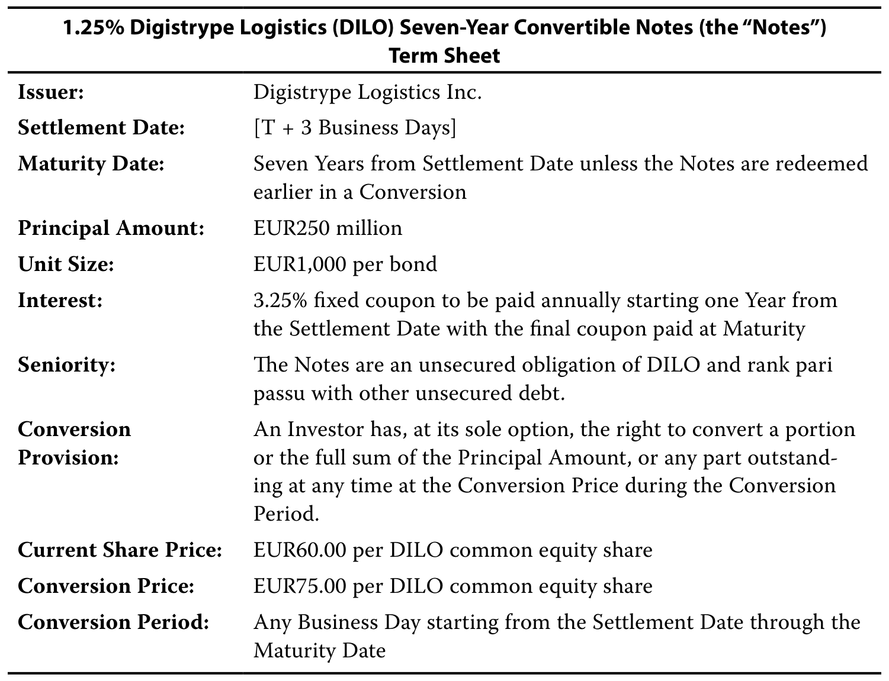PDF 61

图表文字译注：票面利率1.25%的Digistrype Logistics（DILO）7年期可转换票据（以下简称“票据”）；条款清单；发行人：；结算日：；［T + 3个营业日］；到期日：；结算日起7年，除非票据；通过转换提前偿还；本金金额：；每单位金额：；每只债券EUR1,000；利息：；3.25%固定票息，自结算日起满1年开始按年支付，；最后一期票息在到期时支付；受偿顺序：；本票据属于DILO的无担保债务，并与；其他无担保债务享有同等受偿顺序。；转换；条款：；投资者可自行决定是否行使转换权，将部分；或全部本金，或任何未偿；金额，在转换期间内的任何时点，按转换价格；进行转换。；当前股价：；每股DILO普通股EUR60.00；转换价格：；每股DILO普通股EUR75.00；转换期间：；自结算日起的任一营业日，直至；到期日。

机构投资者担心，Digistrype计划拓展核心业务以外的领域会增加信用风险。

Institutional investors have expressed concern about increased credit risk due to Digistrype’s planned expansion outside of its core business.

尽管预计未来几年市场利率将下降，Digistrype的首席财务官仍倾向于通过债务为扩张融资。

Digistrype’s CFO would prefer to fund the expansion using debt, despite an expectation of lower market interest rates in the next few years.

首席财务官还考虑取消转换条款，因为他担心债券转股可能稀释现有股权，并认为DILO股票被严重低估。

The CFO is also considering removing the conversion feature because of a concern about the possible share dilution if the bonds are converted to equity and a belief that DILO shares are significantly undervalued.

1\. 根据发行人所在国家及债券发行和交易地点，以下哪一项最准确地描述拟发行债券的类型？

1\. Which of the following statements best describes the type of bonds to be issued given the issuer’s country and where the bonds will be issued and traded?

A. 由于Digistrype计划发行和出售欧元计价债券，其债券应属于欧洲债券。

A. Since Digistrype is planning to issue and sell euro-denominated bonds, its bonds would be considered Eurobonds.

B. 由于Digistrype计划向德国投资者发行和出售欧元计价债券，其债券应属于外国债券。

B. Since Digistrype is planning to issue and sell euro-denominated bonds to investors in Germany, its bonds would be considered foreign bonds.

C. 由于 Digistrype 计划向德国境内投资者发行并出售债券，这些债券将被视为国内债券。

C. Since Digistrype is planning to issue and sell bonds to domestic investors in Germany, its bonds would be considered domestic bonds.

#### 官方答案与解析 / Official answer and explanation

1\. B正确。

1\. B is correct.

加拿大企业Digistrype计划向德国投资者发行和出售欧元计价债券。

Digistrype, a Canadian firm, is planning to issue and sell euro-denominated bonds to investors in Germany.

由在另一国家注册的实体发行的债券，称为外国债券。

Bonds issued by entities that are incorporated in another country are called foreign bonds.

A不正确，因为欧洲债券是跨境债券，并不一定以欧元计价。

A is incorrect because Eurobonds are cross-border bonds that are not necessarily denominated in euros.

C不正确，因为国内债券的分类依据是发行人属于本国，而不是投资者属于本国。

C is incorrect because domestic bonds refer to a domestic issuer, not investor.

#### 补充解析 / Supplementary explanation

结合本题的官方结论：“B正确。 加拿大企业Digistrype计划向德国投资者发行和出售欧元计价债券。 由在另一国家注册的实体发行的债券，称为外国债券。” 下列补充说明解释其背后的债券市场分类看发行地与币种。

Link to this question’s official result: “B is correct. Digistrype, a Canadian firm, is planning to issue and sell euro-denominated bonds to investors in Germany. Bonds issued by entities that are incorporated in another country are called foreign bonds.” The supplementary discussion below explains classify markets by location and denomination.

解题思路：Eurobond 的 euro 不是欧元币种要求。分类需要同时看发行人所属市场、发行市场以及计价货币；只看公司国籍或只看币种，都可能错判。

Reasoning: The euro in Eurobond does not require euro denomination. Classification depends jointly on the issuer’s home market, issuance market, and currency; nationality or currency alone is insufficient.

应用方法：把原题三个信息分别列出，再依据定义判断：外国发行人在一国本地市场用该国货币发行，通常属于 foreign bond；在一种货币的本国市场之外发行，可属于 Eurobond；global bond 同时面向欧洲债券市场与本地市场。

Application: List the three facts separately. A foreign issuer using the local currency in a domestic market generally issues a foreign bond. Issuance outside a currency’s home market can be a Eurobond. A global bond is offered simultaneously in Eurobond and domestic markets.

#### 相关知识点 / Related concepts

#### 债券市场分类看发行地与币种 / Classify markets by location and denomination

Domestic、foreign、Eurobond 和 global 是市场结构概念，不是信用质量排序，也不直接决定投资者回报。

Domestic, foreign, Eurobond, and global describe market structures rather than credit-quality rankings or investment returns.

### FI-LM02-P01-02 · 章末练习 2 Practice problem 2

章末练习 / Practice problem · 原版 PDF 页码 / Source PDF pages: 61-63

#### 题目与资料 / Question and data

#### 共用资料 / Shared information

以下信息适用于第1–5题

The following information relates to questions 1-5

Digistrype Logistics（DILO）是一家加拿大企业，其大部分收入来自欧洲。

Digistrype Logistics (DILO) is a Canadian firm that generates a large portion of revenue in Europe.

为计划中的数字物流扩张融资，DILO拟向德国机构投资者发行欧元计价债券。

To finance its planned expansion into digital logistics, DILO is seeking to issue euro-denominated bonds to institutional investors in Germany.

拟议债券发行的条款清单如下。

A term sheet for the proposed bond issue is presented below.

PDF 61

图表文字译注：票面利率1.25%的Digistrype Logistics（DILO）7年期可转换票据（以下简称“票据”）；条款清单；发行人：；结算日：；［T + 3个营业日］；到期日：；结算日起7年，除非票据；通过转换提前偿还；本金金额：；每单位金额：；每只债券EUR1,000；利息：；3.25%固定票息，自结算日起满1年开始按年支付，；最后一期票息在到期时支付；受偿顺序：；本票据属于DILO的无担保债务，并与；其他无担保债务享有同等受偿顺序。；转换；条款：；投资者可自行决定是否行使转换权，将部分；或全部本金，或任何未偿；金额，在转换期间内的任何时点，按转换价格；进行转换。；当前股价：；每股DILO普通股EUR60.00；转换价格：；每股DILO普通股EUR75.00；转换期间：；自结算日起的任一营业日，直至；到期日。

机构投资者担心，Digistrype计划拓展核心业务以外的领域会增加信用风险。

Institutional investors have expressed concern about increased credit risk due to Digistrype’s planned expansion outside of its core business.

尽管预计未来几年市场利率将下降，Digistrype的首席财务官仍倾向于通过债务为扩张融资。

Digistrype’s CFO would prefer to fund the expansion using debt, despite an expectation of lower market interest rates in the next few years.

首席财务官还考虑取消转换条款，因为他担心债券转股可能稀释现有股权，并认为DILO股票被严重低估。

The CFO is also considering removing the conversion feature because of a concern about the possible share dilution if the bonds are converted to equity and a belief that DILO shares are significantly undervalued.

2\. Digistrype可以作出以下哪项修改，以最有效地缓解投资者的信用风险担忧？

2\. Which of the following modifications could Digistrype incorporate to best mitigate the investors’ credit concerns?

A. 考虑递延支付债务票息和／或本金。

A. Digistrype could consider deferred debt coupons and/or principal payments.

B. 考虑为新债务加入赎回条款。

B. Digistrype could consider adding a call provision to its new debt.

C. 考虑加快偿还本金，或将债务票息变化与财务约定条款挂钩。

C. Digistrype could consider accelerating principal repayment or linking debt coupon changes to financial covenants.

#### 官方答案与解析 / Official answer and explanation

2\. C正确。

2\. C is correct.

通过本金完全摊还、部分摊还或偿债基金安排等方式加快偿还本金，可以降低信用风险。

Principal repayment acceleration, such as full amortization, partial principal amortization, or a sinking fund arrangement, is a way to reduce credit risk.

另外，Digistrype也可以将债务票息变化与财务约定条款和／或信用评级挂钩，以回应投资者的担忧。

Alternatively, Digistrype could incorporate debt coupon changes linked to financial covenants and/or credit ratings in order to address investor concerns.

A不正确，因为该做法会延迟而非加快偿付。

A is incorrect because it would delay rather than accelerate repayment.

B不正确，因为赎回条款不能解决信用风险担忧。

B is incorrect because a call provision does not address credit concerns.

#### 补充解析 / Supplementary explanation

结合本题的官方结论：“C正确。 通过本金完全摊还、部分摊还或偿债基金安排等方式加快偿还本金，可以降低信用风险。 另外，Digistrype也可以将债务票息变化与财务约定条款和／或信用评级挂钩，以回应投资者的担忧。” 下列补充说明解释其背后的赎回权与回售权属于谁。

Link to this question’s official result: “C is correct. Principal repayment acceleration, such as full amortization, partial principal amortization, or a sinking fund arrangement, is a way to reduce credit risk. Alternatively, Digistrype could incorporate debt coupon changes linked to financial covenants and/or credit ratings in order to address investor concerns.” The supplementary discussion below explains who owns the call or put option?.

解题思路：判断含权债券先确认权利属于谁。发行人持有赎回权，利率下降时可较低成本再融资，投资者因而失去部分价格上涨空间；投资者持有回售权，利率上升、债券价格下降时可以按条款卖回。

Reasoning: Start with the option holder. An issuer call permits refinancing when rates fall and limits the investor’s price upside. An investor put offers protection when rates rise and the bond’s market value falls.

应用方法：其他条件相同，call 对发行人有利，通常需要更高收益率补偿买方；put 对投资者有利，通常允许较低收益率。计算 yield-to-call 用赎回日期和赎回价替换到期日期和本金；yield-to-worst 比较适用的承诺收益率情景。

Application: All else equal, a call benefits the issuer and normally requires a higher investor yield; a put benefits the investor and normally permits a lower yield. For yield-to-call, substitute the call date and call price. Yield-to-worst compares applicable contractual redemption scenarios.

#### 相关知识点 / Related concepts

#### 赎回权与回售权属于谁 / Who owns the call or put option?

Make-whole call 的赎回价与参考收益率及约定利差相关，其经济效果不能直接等同于固定价格赎回。含权现金流会随市场利率改变，风险分析常需有效久期。

A make-whole redemption price depends on a benchmark yield and contractual spread; it is not equivalent to a fixed-price call. Rate-dependent cash flows often require effective-duration analysis.

### FI-LM02-P01-03 · 章末练习 3 Practice problem 3

章末练习 / Practice problem · 原版 PDF 页码 / Source PDF pages: 61-63

#### 题目与资料 / Question and data

#### 共用资料 / Shared information

以下信息适用于第1–5题

The following information relates to questions 1-5

Digistrype Logistics（DILO）是一家加拿大企业，其大部分收入来自欧洲。

Digistrype Logistics (DILO) is a Canadian firm that generates a large portion of revenue in Europe.

为计划中的数字物流扩张融资，DILO拟向德国机构投资者发行欧元计价债券。

To finance its planned expansion into digital logistics, DILO is seeking to issue euro-denominated bonds to institutional investors in Germany.

拟议债券发行的条款清单如下。

A term sheet for the proposed bond issue is presented below.

PDF 61

图表文字译注：票面利率1.25%的Digistrype Logistics（DILO）7年期可转换票据（以下简称“票据”）；条款清单；发行人：；结算日：；［T + 3个营业日］；到期日：；结算日起7年，除非票据；通过转换提前偿还；本金金额：；每单位金额：；每只债券EUR1,000；利息：；3.25%固定票息，自结算日起满1年开始按年支付，；最后一期票息在到期时支付；受偿顺序：；本票据属于DILO的无担保债务，并与；其他无担保债务享有同等受偿顺序。；转换；条款：；投资者可自行决定是否行使转换权，将部分；或全部本金，或任何未偿；金额，在转换期间内的任何时点，按转换价格；进行转换。；当前股价：；每股DILO普通股EUR60.00；转换价格：；每股DILO普通股EUR75.00；转换期间：；自结算日起的任一营业日，直至；到期日。

机构投资者担心，Digistrype计划拓展核心业务以外的领域会增加信用风险。

Institutional investors have expressed concern about increased credit risk due to Digistrype’s planned expansion outside of its core business.

尽管预计未来几年市场利率将下降，Digistrype的首席财务官仍倾向于通过债务为扩张融资。

Digistrype’s CFO would prefer to fund the expansion using debt, despite an expectation of lower market interest rates in the next few years.

首席财务官还考虑取消转换条款，因为他担心债券转股可能稀释现有股权，并认为DILO股票被严重低估。

The CFO is also considering removing the conversion feature because of a concern about the possible share dilution if the bonds are converted to equity and a belief that DILO shares are significantly undervalued.

3\. 为缓解自身对利率下降的担忧，Digistrype最适合加入哪种或有条款？

3\. Which of the following is the best contingency feature Digistrype could add to mitigate its own concerns regarding lower interest rates?

A. 为拟发行的新债务加入赎回条款。

A. Add a call provision to the proposed new debt.

B. 为拟发行的新债务加入回售条款。

B. Add a put provision to the proposed new debt.

C. 为拟发行的新债务加入票息递增条款。

C. Add a step-up coupon to the proposed new debt.

#### 官方答案与解析 / Official answer and explanation

3\. A正确。

3\. A is correct.

赎回条款赋予Digistrype在利率下降时，于到期前赎回全部或部分债券的权利，使公司能够以更低成本发行新债务。

A call provision gives Digistrype the right to redeem all or part of the bond prior to maturity if interest rates decline, so new debt could be issued at a lower cost.

B不正确。回售条款赋予投资者而非发行人在到期前要求偿还债务的权利；利率下降时通常不会行使该权利，因为其目的是限制投资者的下行损失，而不是上行收益。

B is incorrect because a put provision grants investors, not issuers, the right to redeem debt prior to maturity but would not be exercised if interest rates fell, because a put provision is intended to limit investor’s downside, not upside.

C不正确；票息递增条款并非或有条款。

C is incorrect; a step-up coupon is not a contingency provision.

#### 补充解析 / Supplementary explanation

结合本题的官方结论：“A正确。 赎回条款赋予Digistrype在利率下降时，于到期前赎回全部或部分债券的权利，使公司能够以更低成本发行新债务。 B不正确。” 下列补充说明解释其背后的赎回权与回售权属于谁。

Link to this question’s official result: “A is correct. A call provision gives Digistrype the right to redeem all or part of the bond prior to maturity if interest rates decline, so new debt could be issued at a lower cost. B is incorrect because a put provision grants investors, not issuers, the right to redeem debt prior to maturity but would not be exercised if interest rates fell, because a put provision is intended to limit investor’s downside, not upside.” The supplementary discussion below explains who owns the call or put option?.

解题思路：判断含权债券先确认权利属于谁。发行人持有赎回权，利率下降时可较低成本再融资，投资者因而失去部分价格上涨空间；投资者持有回售权，利率上升、债券价格下降时可以按条款卖回。

Reasoning: Start with the option holder. An issuer call permits refinancing when rates fall and limits the investor’s price upside. An investor put offers protection when rates rise and the bond’s market value falls.

应用方法：其他条件相同，call 对发行人有利，通常需要更高收益率补偿买方；put 对投资者有利，通常允许较低收益率。计算 yield-to-call 用赎回日期和赎回价替换到期日期和本金；yield-to-worst 比较适用的承诺收益率情景。

Application: All else equal, a call benefits the issuer and normally requires a higher investor yield; a put benefits the investor and normally permits a lower yield. For yield-to-call, substitute the call date and call price. Yield-to-worst compares applicable contractual redemption scenarios.

#### 相关知识点 / Related concepts

#### 赎回权与回售权属于谁 / Who owns the call or put option?

Make-whole call 的赎回价与参考收益率及约定利差相关，其经济效果不能直接等同于固定价格赎回。含权现金流会随市场利率改变，风险分析常需有效久期。

A make-whole redemption price depends on a benchmark yield and contractual spread; it is not equivalent to a fixed-price call. Rate-dependent cash flows often require effective-duration analysis.

### FI-LM02-P01-04 · 章末练习 4 Practice problem 4

章末练习 / Practice problem · 原版 PDF 页码 / Source PDF pages: 61-63

#### 题目与资料 / Question and data

#### 共用资料 / Shared information

以下信息适用于第1–5题

The following information relates to questions 1-5

Digistrype Logistics（DILO）是一家加拿大企业，其大部分收入来自欧洲。

Digistrype Logistics (DILO) is a Canadian firm that generates a large portion of revenue in Europe.

为计划中的数字物流扩张融资，DILO拟向德国机构投资者发行欧元计价债券。

To finance its planned expansion into digital logistics, DILO is seeking to issue euro-denominated bonds to institutional investors in Germany.

拟议债券发行的条款清单如下。

A term sheet for the proposed bond issue is presented below.

PDF 61

图表文字译注：票面利率1.25%的Digistrype Logistics（DILO）7年期可转换票据（以下简称“票据”）；条款清单；发行人：；结算日：；［T + 3个营业日］；到期日：；结算日起7年，除非票据；通过转换提前偿还；本金金额：；每单位金额：；每只债券EUR1,000；利息：；3.25%固定票息，自结算日起满1年开始按年支付，；最后一期票息在到期时支付；受偿顺序：；本票据属于DILO的无担保债务，并与；其他无担保债务享有同等受偿顺序。；转换；条款：；投资者可自行决定是否行使转换权，将部分；或全部本金，或任何未偿；金额，在转换期间内的任何时点，按转换价格；进行转换。；当前股价：；每股DILO普通股EUR60.00；转换价格：；每股DILO普通股EUR75.00；转换期间：；自结算日起的任一营业日，直至；到期日。

机构投资者担心，Digistrype计划拓展核心业务以外的领域会增加信用风险。

Institutional investors have expressed concern about increased credit risk due to Digistrype’s planned expansion outside of its core business.

尽管预计未来几年市场利率将下降，Digistrype的首席财务官仍倾向于通过债务为扩张融资。

Digistrype’s CFO would prefer to fund the expansion using debt, despite an expectation of lower market interest rates in the next few years.

首席财务官还考虑取消转换条款，因为他担心债券转股可能稀释现有股权，并认为DILO股票被严重低估。

The CFO is also considering removing the conversion feature because of a concern about the possible share dilution if the bonds are converted to equity and a belief that DILO shares are significantly undervalued.

4\. 如果DILO在法兰克福证券交易所的股价升至EUR75，债券的转换价值为：

4\. If DILO’s share price on the Frankfurt Stock Exchange were to rise to EUR75, the bond’s conversion value would be:

A. EUR1,000.

B. EUR15,000.

C. EUR75,000.

#### 官方答案与解析 / Official answer and explanation

4\. A正确。当当前股价等于转换价格时，债券的转换价值等于其面值。

4\. A is correct. The conversion value of a bond equals its par value if the current share price and conversion price are equal.

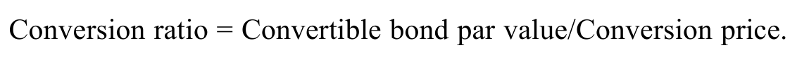PDF 63

公式文字译注

可转换债券面值／转换价格

我们知道：

We know that

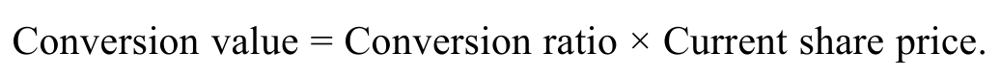PDF 63

或者，重新整理后：

Or, after rearranging,

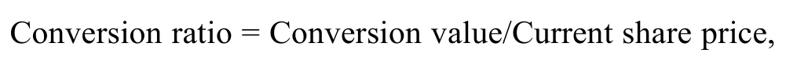PDF 63

公式文字译注

转换价值／当前股价

可将其代入第一个等式的左侧：

which can be substituted into the lefthand side of the first equation:

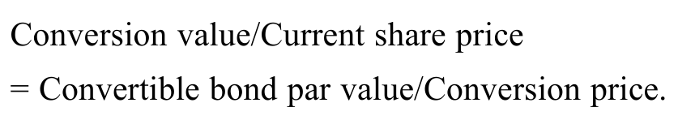PDF 63

公式文字译注

转换价值／当前股价

可转换债券面值／转换价格

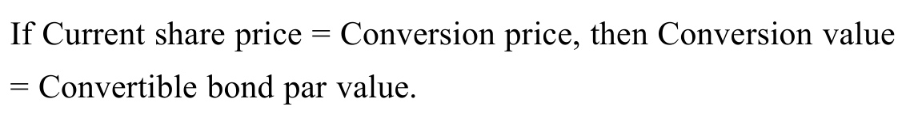PDF 63

公式文字译注

若当前股价

转换价格，则转换价值

可转换债券面值

#### 补充解析 / Supplementary explanation

结合本题的官方结论：“A正确。当当前股价等于转换价格时，债券的转换价值等于其面值。 我们知道： 或者，重新整理后： 可将其代入第一个等式的左侧：” 下列补充说明解释其背后的可转债：债券底价与股权价值。

Link to this question’s official result: “A is correct. The conversion value of a bond equals its par value if the current share price and conversion price are equal. We know that Or, after rearranging, which can be substituted into the lefthand side of the first equation:” The supplementary discussion below explains convertible bonds: bond value and conversion value.

解题思路：普通可转债把债券现金流与股票上行参与权放在一起。股票价格远低于转股价时，债券属性更重要；股价大幅高于转股价时，转股价值更重要，因此不能在所有股价情景下都把它当普通债券。

Reasoning: A conventional convertible combines bond cash flows with equity upside. Debt characteristics dominate far below the conversion price, while conversion value becomes more important far above it. Its behavior is therefore state-dependent.

应用方法：先算一张债券可换多少股，再用股数乘当前股价得到转股价值。CoCo 要另看触发条款：资本指标恶化时可能自动转股或减记，不能把它理解为投资者等股价上涨后自愿转股。

Application: First find shares received per bond, then multiply by the share price to obtain conversion value. For a CoCo, inspect the trigger: deterioration in capital measures may force conversion or a write-down, unlike voluntary upside conversion.

#### 相关知识点 / Related concepts

#### 可转债：债券底价与股权价值 / Convertible bonds: bond value and conversion value

Conversion ratio 是每张债券可换股数；conversion value 是按市场股价计算的股票价值；contingent conversion 由特定事件触发。

The conversion ratio is shares per bond. Conversion value prices those shares at the market price. Contingent conversion depends on a specified trigger event.

Conversion value = Conversion ratio × Share price

### FI-LM02-P01-05 · 章末练习 5 Practice problem 5

章末练习 / Practice problem · 原版 PDF 页码 / Source PDF pages: 61-63

#### 题目与资料 / Question and data

#### 共用资料 / Shared information

以下信息适用于第1–5题

The following information relates to questions 1-5

Digistrype Logistics（DILO）是一家加拿大企业，其大部分收入来自欧洲。

Digistrype Logistics (DILO) is a Canadian firm that generates a large portion of revenue in Europe.

为计划中的数字物流扩张融资，DILO拟向德国机构投资者发行欧元计价债券。

To finance its planned expansion into digital logistics, DILO is seeking to issue euro-denominated bonds to institutional investors in Germany.

拟议债券发行的条款清单如下。

A term sheet for the proposed bond issue is presented below.

PDF 61

图表文字译注：票面利率1.25%的Digistrype Logistics（DILO）7年期可转换票据（以下简称“票据”）；条款清单；发行人：；结算日：；［T + 3个营业日］；到期日：；结算日起7年，除非票据；通过转换提前偿还；本金金额：；每单位金额：；每只债券EUR1,000；利息：；3.25%固定票息，自结算日起满1年开始按年支付，；最后一期票息在到期时支付；受偿顺序：；本票据属于DILO的无担保债务，并与；其他无担保债务享有同等受偿顺序。；转换；条款：；投资者可自行决定是否行使转换权，将部分；或全部本金，或任何未偿；金额，在转换期间内的任何时点，按转换价格；进行转换。；当前股价：；每股DILO普通股EUR60.00；转换价格：；每股DILO普通股EUR75.00；转换期间：；自结算日起的任一营业日，直至；到期日。

机构投资者担心，Digistrype计划拓展核心业务以外的领域会增加信用风险。

Institutional investors have expressed concern about increased credit risk due to Digistrype’s planned expansion outside of its core business.

尽管预计未来几年市场利率将下降，Digistrype的首席财务官仍倾向于通过债务为扩张融资。

Digistrype’s CFO would prefer to fund the expansion using debt, despite an expectation of lower market interest rates in the next few years.

首席财务官还考虑取消转换条款，因为他担心债券转股可能稀释现有股权，并认为DILO股票被严重低估。

The CFO is also considering removing the conversion feature because of a concern about the possible share dilution if the bonds are converted to equity and a belief that DILO shares are significantly undervalued.

5\. 以下哪一项最准确地描述取消债券转换条款的影响？

5\. Which of the following statements best describes the implications of removing the conversion feature from the bond?

A. 取消转换条款很可能导致票息提高。

A. Removal of the conversion feature would likely result in a higher coupon.

B. 取消转换条款很可能提高债券价格。

B. Removal of the conversion feature would likely increase the bond price.

C. 取消转换条款很可能降低信用风险。

C. Removal of the conversion feature would likely reduce credit risk.

#### 官方答案与解析 / Official answer and explanation

5\. A正确。

5\. A is correct.

由于转换条款对债券持有人有价值，可转换债券的价格高于其他条件相同、但不含转换条款的债券。

Because the conversion provision is valuable to bondholders, the convertible bond price is higher than the price of an otherwise similar bond without the conversion provision.

同样，可转换债券的收益率低于其他条件相同的不可转换债券。

Similarly, the yield on a convertible bond is lower than the yield on an otherwise similar non-convertible bond.

因此，如果Digistrype团队决定取消转换条款，很可能需要提高债券票面利率，以吸引投资者。

Thus, should the Digistrype team elect to remove the conversion feature, it would likely have to increase the bond’s coupon rate in order to attract investors.

B不正确，因为取消转换条款会降低而非提高债券价格。

B is incorrect because removal of the conversion feature would decrease, not increase, the bond price.

C不正确，因为取消转换条款不会改变信用风险。

C is incorrect because removal of the conversion feature would not change the credit risk.

#### 补充解析 / Supplementary explanation

结合本题的官方结论：“A正确。 由于转换条款对债券持有人有价值，可转换债券的价格高于其他条件相同、但不含转换条款的债券。 同样，可转换债券的收益率低于其他条件相同的不可转换债券。” 下列补充说明解释其背后的可转债：债券底价与股权价值。

Link to this question’s official result: “A is correct. Because the conversion provision is valuable to bondholders, the convertible bond price is higher than the price of an otherwise similar bond without the conversion provision. Similarly, the yield on a convertible bond is lower than the yield on an otherwise similar non-convertible bond.” The supplementary discussion below explains convertible bonds: bond value and conversion value.

解题思路：普通可转债把债券现金流与股票上行参与权放在一起。股票价格远低于转股价时，债券属性更重要；股价大幅高于转股价时，转股价值更重要，因此不能在所有股价情景下都把它当普通债券。

Reasoning: A conventional convertible combines bond cash flows with equity upside. Debt characteristics dominate far below the conversion price, while conversion value becomes more important far above it. Its behavior is therefore state-dependent.

应用方法：先算一张债券可换多少股，再用股数乘当前股价得到转股价值。CoCo 要另看触发条款：资本指标恶化时可能自动转股或减记，不能把它理解为投资者等股价上涨后自愿转股。

Application: First find shares received per bond, then multiply by the share price to obtain conversion value. For a CoCo, inspect the trigger: deterioration in capital measures may force conversion or a write-down, unlike voluntary upside conversion.

#### 相关知识点 / Related concepts

#### 可转债：债券底价与股权价值 / Convertible bonds: bond value and conversion value

Conversion ratio 是每张债券可换股数；conversion value 是按市场股价计算的股票价值；contingent conversion 由特定事件触发。

The conversion ratio is shares per bond. Conversion value prices those shares at the market price. Contingent conversion depends on a specified trigger event.

Conversion value = Conversion ratio × Share price

## LM 3 · 固定收益证券的发行与交易 Fixed-Income Issuance and Trading 29 条目 · 原题与解析逐条对应 / Paired source questions and explanations

### FI-LM03-SA01-01 · 模块自测 1 Module self-assessment 1

课前自测 / Pre-test / self-assessment · 原版 PDF 页码 / Source PDF pages: 66

#### 题目与资料 / Question and data

1\. 讨论投资者提高固定收益投资组合预期收益的两种方法。

1\. Discuss two ways that an investor could seek to increase her expected return on a fixed-income portfolio.

#### 官方答案与解析 / Official answer and explanation

投资者可以通过持有信用评级较低的工具增加信用风险。第二，如果收益率曲线向上倾斜，投资者也可以通过较长期债券提高预期收益。

Investors could increase credit risk with instruments with lower credit ratings. Second, provided that the yield curve is upward sloping, investors may also increase expected returns with longer-term bonds.

#### 补充解析 / Supplementary explanation

结合本题的官方结论：“投资者可以通过持有信用评级较低的工具增加信用风险。第二，如果收益率曲线向上倾斜，投资者也可以通过较长期债券提高预期收益。” 下列补充说明解释其背后的债券组合、指数与风险选择。

Link to this question’s official result: “Investors could increase credit risk with instruments with lower credit ratings. Second, provided that the yield curve is upward sloping, investors may also increase expected returns with longer-term bonds.” The supplementary discussion below explains bond portfolios, indexes, and risk choices.

解题思路：提高债券组合预期收益通常要接受额外风险，例如更长久期、更弱信用或较差流动性。指数有明确纳入规则，可能限制币种、最低发行规模、评级和剩余期限，因此不能默认覆盖全部债券。

Reasoning: A higher expected bond-portfolio return generally requires accepting more duration, credit, or liquidity risk. Index rules may restrict currency, issue size, rating, and remaining maturity; an index need not cover every bond.

应用方法：先按题目中的投资授权或指数条件筛选，再比较风险。基金名称不是完整的投资约束，必须核对是否允许高收益债、外币或某种期限；对指数成分的判断也应按纳入条件逐项进行。

Application: Apply the mandate or index conditions before comparing risk. A fund name does not specify every constraint: check eligibility for high-yield debt, foreign currencies, and maturities. Evaluate index membership against each inclusion rule.

#### 相关知识点 / Related concepts

#### 债券组合、指数与风险选择 / Bond portfolios, indexes, and risk choices

高收益率可能包含预期违约损失补偿；较长久期会放大利率变化对价格的影响。

A high yield can compensate for expected credit losses, and longer duration magnifies price sensitivity to rate changes.

### FI-LM03-SA01-02 · 模块自测 2 Module self-assessment 2

课前自测 / Pre-test / self-assessment · 原版 PDF 页码 / Source PDF pages: 66

#### 题目与资料 / Question and data

2\. 以下哪一项关于固定收益和股票指数的陈述正确？

2\. Which of the following statements about fixed-income and equity indexes is correct?

A. 股票指数的成分更替比固定收益指数更频繁。

A. There is more turnover in equity indexes than in fixed-income indexes.

B. 固定收益指数的成分证券通常比股票指数更多。

B. Fixed-income indexes often have more constituent securities than equity indexes.

C. 固定收益指数成分通常等权重，而股票指数成分通常按发行人市值加权。

C. Fixed-income index constituents are typically equally weighted, while equity index constituents are typically weighted by issuers’ market capitalization.

#### 官方答案与解析 / Official answer and explanation

B正确。

B is correct.

固定收益指数通常比股票指数包含更多成分证券，因为发行人往往有多类未偿债务工具，而且政府会大量发行固定收益证券，但不发行权益证券。

Fixed-income indexes often have more constituent securities than equity indexes because issuers tend to have many types of instruments outstanding, and governments issue large amounts of fixed-income securities but not equity securities.

债券期限有限，且新债发行更频繁，因此固定收益指数的成分更替远多于股票指数。

The finite maturity of bonds and the higher frequency of new issuance lead to far more turnover in fixed-income indexes than in equity indexes.

固定收益指数成分通常按未偿债务的市场价值加权，而股票指数按发行人股票市值加权。

Fixed-income index constituents are usually weighted by market value of debt outstanding, whereas equity indexes are weighted by issuers’ market capitalizations.

#### 补充解析 / Supplementary explanation

结合本题的官方结论：“B正确。 固定收益指数通常比股票指数包含更多成分证券，因为发行人往往有多类未偿债务工具，而且政府会大量发行固定收益证券，但不发行权益证券。 债券期限有限，且新债发行更频繁，因此固定收益指数的成分更替远多于股票指数。” 下列补充说明解释其背后的债券流动性与买卖价差。

Link to this question’s official result: “B is correct. Fixed-income indexes often have more constituent securities than equity indexes because issuers tend to have many types of instruments outstanding, and governments issue large amounts of fixed-income securities but not equity securities. The finite maturity of bonds and the higher frequency of new issuance lead to far more turnover in fixed-income indexes than in equity indexes.” The supplementary discussion below explains bond liquidity and bid–offer spreads.

解题思路：买卖价差可以理解为立即成交所付出的成本。交易活跃、发行规模较大、报价竞争充分的债券通常更易成交；很少交易的旧券或信用较弱债券，需要更大的价差补偿做市库存和信息风险。

Reasoning: The bid–offer spread is a cost of immediacy. Active trading, larger issues, and competitive quoting usually support liquidity. Less-traded seasoned issues or weaker credits require compensation for inventory and information risk.

应用方法：比较选项时同时看发行人类型、信用质量、发行新旧与成交活跃度。债券数量很多不等于每只债券都很流动；债券指数还会因新发行、到期、评级或期限条件变化而调整成分。

Application: Compare issuer type, credit quality, issue age, and trading activity. A large bond universe does not make every issue liquid. Index constituents also change as bonds are issued, mature, or cease to satisfy eligibility rules.

#### 相关知识点 / Related concepts

#### 债券流动性与买卖价差 / Bond liquidity and bid–offer spreads

Bid 是交易商买入价，offer/ask 是交易商卖出价。投资者买入用 ask，卖出用 bid。

Bid is the dealer’s buying price and ask is the dealer’s selling price. An investor normally buys at ask and sells at bid.

### FI-LM03-SA01-03 · 模块自测 3 Module self-assessment 3

课前自测 / Pre-test / self-assessment · 原版 PDF 页码 / Source PDF pages: 66-67

#### 题目与资料 / Question and data

3\. 彭博巴克莱全球综合指数包括：

3\. The Bloomberg Barclays Global Aggregate Index includes:

A. 所有规模的发行人。

A. all issuer sizes.

B. 以多种货币发行证券的发行人。

B. issuers in multiple currencies.

C. 高收益及未评级发行人。

C. high-yield and unrated issuers.

#### 官方答案与解析 / Official answer and explanation

B正确。

B is correct.

彭博巴克莱全球综合指数包括28个发达及新兴市场中，满足纳入标准的各主要类型发行人的固定票息资本市场证券。

The Bloomberg Barclays Global Aggregate Index includes fixed-coupon capital market securities from all major issuer types in 28 developed and emerging markets that meet the inclusion criteria.

但该指数不包括高收益债务、未评级债务，以及不满足最低发行规模的工具。

However, the index excludes high-yield and unrated debt instruments and those that do not meet minimum issuance size.

#### 补充解析 / Supplementary explanation

结合本题的官方结论：“B正确。 彭博巴克莱全球综合指数包括28个发达及新兴市场中，满足纳入标准的各主要类型发行人的固定票息资本市场证券。 但该指数不包括高收益债务、未评级债务，以及不满足最低发行规模的工具。” 下列补充说明解释其背后的信用评级、评级边界与高收益债。

Link to this question’s official result: “B is correct. The Bloomberg Barclays Global Aggregate Index includes fixed-coupon capital market securities from all major issuer types in 28 developed and emerging markets that meet the inclusion criteria. However, the index excludes high-yield and unrated debt instruments and those that do not meet minimum issuance size.” The supplementary discussion below explains credit ratings and the investment-grade boundary.

解题思路：评级是对相对违约风险的意见，不是对价格或未来回报的保证。投资级与高收益的分界会改变某些投资者是否有资格持有，因此评级下降还可能通过被迫卖出和流动性影响价格。

Reasoning: A rating is an opinion about relative default risk, not a guarantee of price or return. The investment-grade boundary can affect investor eligibility, so a downgrade may also affect price through forced selling and liquidity.

应用方法：按题目使用的评级体系先定位等级，再判断问的是发行人还是某一债项。高收益债现金流对企业经营成败更敏感；违约概率、违约损失和清偿位置尤其重要。不能把较高承诺收益率直接当作较高实现收益率。

Application: Locate the grade in the stated rating scale, then distinguish issuer credit from a particular obligation. High-yield cash flows depend more strongly on business outcomes, making default probability, loss severity, and claim priority important. A higher promised yield is not a guaranteed higher realized return.

#### 相关知识点 / Related concepts

#### 信用评级、评级边界与高收益债 / Credit ratings and the investment-grade boundary

S&P/Fitch 的 BBB− 及以上通常为投资级；BB+ 及以下为非投资级。债项评级还可能因担保和清偿次序而偏离发行人评级。

BBB− and above are generally investment grade on the S&P/Fitch scales; BB+ and below are non-investment grade. Security and priority can cause an issue rating to differ from its issuer rating.

### FI-LM03-SA01-04 · 模块自测 4 Module self-assessment 4

课前自测 / Pre-test / self-assessment · 原版 PDF 页码 / Source PDF pages: 67

#### 题目与资料 / Question and data

4\. 一家首次发债、希望仅向指定投资者群体销售债券的发行人，最可能采用：

4\. A debut issuer seeking to sell its bonds only to a select group of investors will most likely undertake a:

A. 公开发行。

A. public offering.

B. 储架注册。

B. shelf registration.

C. 私募发行。

C. private placement.

#### 官方答案与解析 / Official answer and explanation

C正确。

C is correct.

债券可以通过私募出售，由一个指定投资者或一组指定投资者购买。

Bonds can be sold via a private placement, in which only a select group of investors or a single investor purchases the bonds.

债券也可以公开发行，任何公众投资者均可购买。

Bonds can also be sold in a public offering in which any member of the public may buy the bonds.

经常发债的发行人使用储架注册，定期更新注册文件，并可将其用于未来一系列债券发行。

Frequent bond issuers use a shelf registration, which is updated regularly and may be used for a range of future bond issuances.

#### 补充解析 / Supplementary explanation

结合本题的官方结论：“C正确。 债券可以通过私募出售，由一个指定投资者或一组指定投资者购买。 债券也可以公开发行，任何公众投资者均可购买。” 下列补充说明解释其背后的发行市场：融资与二级交易。

Link to this question’s official result: “C is correct. Bonds can be sold via a private placement, in which only a select group of investors or a single investor purchases the bonds. Bonds can also be sold in a public offering in which any member of the public may buy the bonds.” The supplementary discussion below explains issuance versus secondary-market trading.

解题思路：初级市场解决发行人如何获得新资金；二级市场解决投资者如何把已有债券转让给别人。发行程序、承销安排和配售对象会改变发行风险与信息披露要求，但不能把二级市场成交当成发行人再次获得融资。

Reasoning: The primary market raises funds for the issuer; the secondary market transfers existing claims between investors. Issuance methods affect underwriting and distribution risk, but secondary trading does not itself raise new issuer capital.

应用方法：若是在原有债券上增加发行规模、沿用其票息和到期日，应识别为增发或 reopening；市场收益率已经变化时，增发价格不必等于面值。拍卖题则逐步区分投标、排序、获配和最终支付价格。

Application: An increase in the size of an existing bond with the same coupon and maturity is a reopening. Its price need not equal par because market yields may have changed. For an auction, distinguish bids, ranking, allocation, and the final price paid.

#### 相关知识点 / Related concepts

#### 发行市场：融资与二级交易 / Issuance versus secondary-market trading

Underwriting 承销可由中介承担配售风险；private placement 面向有限投资者；secondary trading 不改变债券原有合同现金流。

Underwriting can shift distribution risk to an intermediary. Private placements target a limited investor group. Secondary trading does not alter the original contractual cash flows.

### FI-LM03-SA01-05 · 模块自测 5 Module self-assessment 5

课前自测 / Pre-test / self-assessment · 原版 PDF 页码 / Source PDF pages: 67

#### 题目与资料 / Question and data

5\. 一家经常发债、希望在有利市场条件下灵活择机发行债券的发行人，最可能使用：

5\. A frequent bond issuer that seeks flexibility to issue bonds opportunistically when market conditions are favorable would most likely use a:

A. 增发原有债券。

A. reopening.

B. 储架发行。

B. shelf offering.

C. 私募发行。

C. private placement.

#### 官方答案与解析 / Official answer and explanation

B正确。

B is correct.

经常发债的发行人能够便捷地进入债券市场，并通常在市场条件最有利时择机发行。

Frequent issuers of bonds have ready access to the bond market and often choose issuance timing on an opportunistic basis, when market conditions are most favorable.

经常发债的发行人使用储架注册，或覆盖范围广泛的综合发行通函，定期更新后可用于未来一系列债券发行。

Frequent bond issuers use a shelf registration or a broad, all-encompassing offering circular that is updated regularly and may be used for a range of future bond issuances.

一种较少采用的策略，是以明显偏离面值的价格增加现有债券发行规模，称为现有债券的重新开放发行或增发。

A less common strategy is to increase the size of an existing bond with a price significantly different from par, which is referred to as the reopening of an existing bond.

私募发行只允许一个指定投资者或一组指定投资者购买债券。

In a private placement, only a selected investor or group of investors may buy the bonds.

#### 补充解析 / Supplementary explanation

结合本题的官方结论：“B正确。 经常发债的发行人能够便捷地进入债券市场，并通常在市场条件最有利时择机发行。 经常发债的发行人使用储架注册，或覆盖范围广泛的综合发行通函，定期更新后可用于未来一系列债券发行。” 下列补充说明解释其背后的发行市场：融资与二级交易。

Link to this question’s official result: “B is correct. Frequent issuers of bonds have ready access to the bond market and often choose issuance timing on an opportunistic basis, when market conditions are most favorable. Frequent bond issuers use a shelf registration or a broad, all-encompassing offering circular that is updated regularly and may be used for a range of future bond issuances.” The supplementary discussion below explains issuance versus secondary-market trading.

解题思路：初级市场解决发行人如何获得新资金；二级市场解决投资者如何把已有债券转让给别人。发行程序、承销安排和配售对象会改变发行风险与信息披露要求，但不能把二级市场成交当成发行人再次获得融资。

Reasoning: The primary market raises funds for the issuer; the secondary market transfers existing claims between investors. Issuance methods affect underwriting and distribution risk, but secondary trading does not itself raise new issuer capital.

应用方法：若是在原有债券上增加发行规模、沿用其票息和到期日，应识别为增发或 reopening；市场收益率已经变化时，增发价格不必等于面值。拍卖题则逐步区分投标、排序、获配和最终支付价格。

Application: An increase in the size of an existing bond with the same coupon and maturity is a reopening. Its price need not equal par because market yields may have changed. For an auction, distinguish bids, ranking, allocation, and the final price paid.

#### 相关知识点 / Related concepts

#### 发行市场：融资与二级交易 / Issuance versus secondary-market trading

Underwriting 承销可由中介承担配售风险；private placement 面向有限投资者；secondary trading 不改变债券原有合同现金流。

Underwriting can shift distribution risk to an intermediary. Private placements target a limited investor group. Secondary trading does not alter the original contractual cash flows.

### FI-LM03-EX01-01 · 已解例题 1 · BRWA公司债务概况 Worked example 1 · BRWA Corporation Debt Profile

正文例题／案例 / Worked example / case · 原版 PDF 页码 / Source PDF pages: 71

#### 题目与资料 / Question and data

BRWA公司债务概况

BRWA Corporation Debt Profile

#### 官方答案与解析 / Official answer and explanation

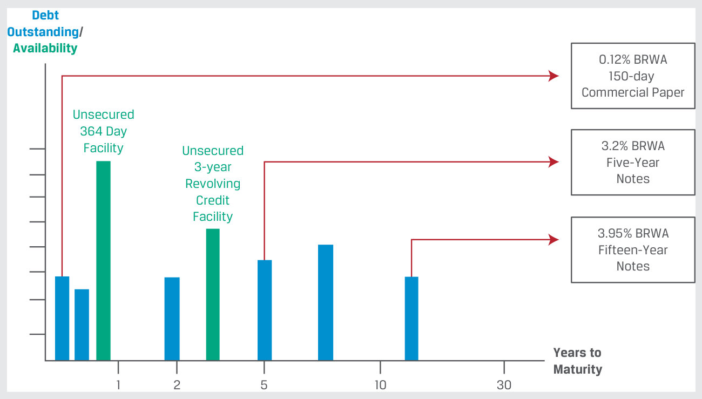PDF 71

图表文字译注：150天；商业票据；债务；未偿余额／；可用额度；距到期年数；到期期限；无担保；3年；循环；信用；信贷额度；364天；5年期；票据；15年期。

BRWA是投资级企业发行人的例子，能够直接或通过关联公司，便捷地在不同期限、不同市场和不同币种取得无担保债务融资。

BRWA is an example of an investment-grade corporate issuer with ready access to unsecured debt across maturities and markets as well as in different currencies either directly or through its affiliates.

它用商业票据满足短期或季节性营运资金需求，用中期债务覆盖较长期的营运资金或中期投资，并用长期债务匹配新生产设备、工厂等资本投资较长的使用年限。

It uses commercial paper to meet its short-term or seasonal working capital needs, intermediate-term debt to cover more permanent working capital or medium-term investments, and long-term debt to match the longer useful life of capital investments, such as new manufacturing equipment or factories.

BRWA向一组银行，即银团，付费取得两项授信额度。这些贷款协议预先规定条款和限额，但使用余额会根据借款人在不同时点的具体需求变化，与信用卡类似。

BRWA pays a fee to a group (or syndicate) of banks for two credit facilities, which are loan agreements with pre-specified terms and limits but with fluctuating balances based on borrower-specific needs at different points in time, analogous to a credit card.

第一项是为商业票据计划提供支持的364天授信额度，第二项是较长期的循环信贷额度。

The first is a 364-day facility which backs the commercial paper program, and the second is a longer-term revolving credit facility.

#### 补充解析 / Supplementary explanation

结合本题的官方结论：“BRWA是投资级企业发行人的例子，能够直接或通过关联公司，便捷地在不同期限、不同市场和不同币种取得无担保债务融资。 它用商业票据满足短期或季节性营运资金需求，用中期债务覆盖较长期的营运资金或中期投资，并用长期债务匹配新生产设备、工厂等资本投资较长的使用年限。 BRWA向一组银行，即银团，付费取得两项授信额度。” 下列补充说明解释其背后的企业短期融资与展期风险。

Link to this question’s official result: “BRWA is an example of an investment-grade corporate issuer with ready access to unsecured debt across maturities and markets as well as in different currencies either directly or through its affiliates. It uses commercial paper to meet its short-term or seasonal working capital needs, intermediate-term debt to cover more permanent working capital or medium-term investments, and long-term debt to match the longer useful life of capital investments, such as new manufacturing equipment or factories.” The supplementary discussion below explains corporate short-term funding and rollover risk.

解题思路：短期借款便宜或灵活，并不代表能永久滚动。企业用短期负债支持较长期资产时，除了利率风险，还承担到期能否借到下一笔资金的展期风险。商业票据通常依靠发行人的信用和流动性支持。

Reasoning: Cheap or flexible short-term borrowing is not guaranteed to roll over indefinitely. Funding longer-lived assets with short-term debt creates refinancing risk as well as interest-rate exposure. Commercial paper relies on issuer credit and liquidity support.

应用方法：先辨认融资工具是否有担保、是否承诺可用，以及额度是否需定期续期。信用额度可以提供流动性后备，但它与已经收到的现金不是同一回事；不同银行贷款结构也会改变借款人与贷款人之间的协商方式。

Application: Identify collateral, commitment, and renewal terms. A credit line offers contingent liquidity, not cash already on hand. Bilateral and syndicated loans also differ in how lenders coordinate and negotiate with the borrower.

#### 相关知识点 / Related concepts

#### 企业短期融资与展期风险 / Corporate short-term funding and rollover risk

Rollover risk 指到期无法以可接受条件再融资的风险；committed line 与 uncommitted line 的可用性不同。

Rollover risk is the inability to refinance maturing debt on acceptable terms. Committed and uncommitted credit lines provide different degrees of funding certainty.

原书为叙述式已解例题，完整条件、计算及结论保留在官方解析区。

### FI-LM03-EX02-02 · 已解例题 2 · VIVU固定收益证券发行 Worked example 2 · VIVU Fixed-Income Issuance

正文例题／案例 / Worked example / case · 原版 PDF 页码 / Source PDF pages: 72

#### 题目与资料 / Question and data

VIVU固定收益证券发行

VIVU Fixed-Income Issuance

#### 官方答案与解析 / Official answer and explanation

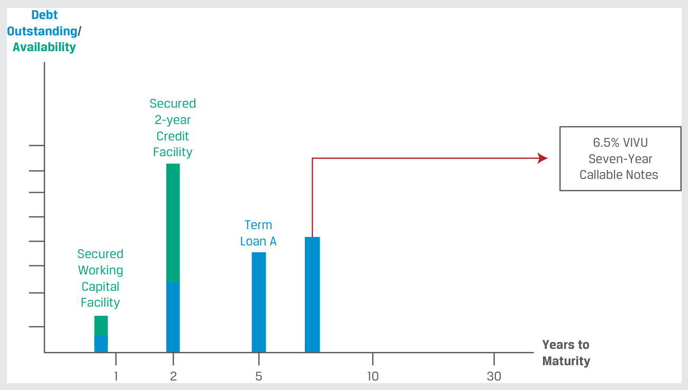PDF 72

图表文字译注：债务；未偿余额／；可用额度；距到期年数；到期期限；7年期；可赎回票据；有担保；2年；信用；信贷额度；营运；资金；定期；A类贷款。

VIVU是高收益企业发行人的例子，只能有限地取得较短期限的有担保债务融资。

VIVU is an example of a high-yield corporate issuer that has limited access to secured debt across shorter maturities.

VIVU无法进入无担保商业票据市场，而是依赖银行提供、已部分提用的有担保营运资金和授信额度满足短期需求。

VIVU has no access to the unsecured commercial paper market but, rather, relies on partially drawn secured working capital and credit facilities from banks to meet its short-term needs.

VIVU还有一笔已全额提用的贷款，即定期贷款A，采用浮动票面利率，等于MRR加固定信用利差。

VIVU has a fully drawn loan (Term Loan A) that has a floating-rate coupon equal to MRR plus a fixed credit spread.

VIVU还发行了七年期可赎回票据，公司自发行满三年起有权按固定价格赎回票据。

VIVU also has seven-year callable notes outstanding under which it has the right to redeem the notes at a fixed price starting three years from issuance.

#### 补充解析 / Supplementary explanation

结合本题的官方结论：“VIVU是高收益企业发行人的例子，只能有限地取得较短期限的有担保债务融资。 VIVU无法进入无担保商业票据市场，而是依赖银行提供、已部分提用的有担保营运资金和授信额度满足短期需求。 VIVU还有一笔已全额提用的贷款，即定期贷款A，采用浮动票面利率，等于MRR加固定信用利差。” 下列补充说明解释其背后的企业短期融资与展期风险。

Link to this question’s official result: “VIVU is an example of a high-yield corporate issuer that has limited access to secured debt across shorter maturities. VIVU has no access to the unsecured commercial paper market but, rather, relies on partially drawn secured working capital and credit facilities from banks to meet its short-term needs. VIVU has a fully drawn loan (Term Loan A) that has a floating-rate coupon equal to MRR plus a fixed credit spread.” The supplementary discussion below explains corporate short-term funding and rollover risk.

解题思路：短期借款便宜或灵活，并不代表能永久滚动。企业用短期负债支持较长期资产时，除了利率风险，还承担到期能否借到下一笔资金的展期风险。商业票据通常依靠发行人的信用和流动性支持。

Reasoning: Cheap or flexible short-term borrowing is not guaranteed to roll over indefinitely. Funding longer-lived assets with short-term debt creates refinancing risk as well as interest-rate exposure. Commercial paper relies on issuer credit and liquidity support.

应用方法：先辨认融资工具是否有担保、是否承诺可用，以及额度是否需定期续期。信用额度可以提供流动性后备，但它与已经收到的现金不是同一回事；不同银行贷款结构也会改变借款人与贷款人之间的协商方式。

Application: Identify collateral, commitment, and renewal terms. A credit line offers contingent liquidity, not cash already on hand. Bilateral and syndicated loans also differ in how lenders coordinate and negotiate with the borrower.

#### 相关知识点 / Related concepts

#### 企业短期融资与展期风险 / Corporate short-term funding and rollover risk

Rollover risk 指到期无法以可接受条件再融资的风险；committed line 与 uncommitted line 的可用性不同。

Rollover risk is the inability to refinance maturing debt on acceptable terms. Committed and uncommitted credit lines provide different degrees of funding certainty.

原书为叙述式已解例题，完整条件、计算及结论保留在官方解析区。

### FI-LM03-EX03-03 · 已解例题 3 · Baywhite Financial的债券基金 Worked example 3 · Baywhite Financial’s Bond Funds

正文例题／案例 / Worked example / case · 原版 PDF 页码 / Source PDF pages: 72-74

#### 题目与资料 / Question and data

Baywhite Financial的债券基金

Baywhite Financial’s Bond Funds

#### 官方答案与解析 / Official answer and explanation

Baywhite Financial管理的核心债券基金以长期资本增值为目标，对信用风险的容忍度相对较低。

Baywhite Financial manages its Core Bond Fund with the objectives of long-run capital appreciation with a relatively low tolerance for credit risk.

该基金投资于投资级中长期债券，包括BRWA的5年期和15年期票据。

The fund invests in investment-grade intermediate- and long-term bonds, including BRWA’s 5- and 15-year notes.

基金拥有3,601个持仓，其组成如下：

The composition of the fund’s holdings, which include 3,601 positions, is as follows:

Baywhite核心债券基金持仓：按信用评级分类。

Baywhite Core Bond Fund Holdings by Credit Rating

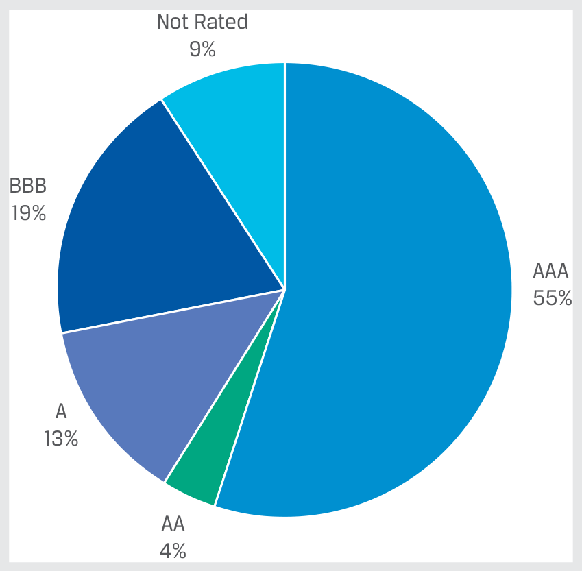PDF 73

图表文字译注：未评级。

Baywhite核心债券基金持仓：按发行人类型分类。

Baywhite Core Bond Fund Holdings by Issuer Type

PDF 73

图表文字译注：其他资产；支持证券；抵押贷款；公司；主权。

Baywhite核心债券基金持仓：按到期期限分类。

Baywhite Core Bond Fund Holdings by Time to Maturity

PDF 73

图表文字译注：距到期年数。

Baywhite还管理短期债券基金，作为投资者的高流动性现金替代工具；该基金通过投资BRWA商业票据等投资级短期债务，将信用和利率风险维持在很低水平。

Baywhite also manages the Short-Term Bond Fund as a liquid cash alternative for investors, and it takes minimal credit and interest rate risk by investing in investment-grade, short-term bonds, such as BRWA’s commercial paper.

短期债券基金拥有451个持仓，其组成如下：

The composition of the Short-Term Bond Fund’s holdings, which include 451 positions, is as follows:

Baywhite短期债券基金持仓：按信用评级分类。

Baywhite Short-Term Bond Fund Holdings by Credit Rating

PDF 74

图表文字译注：未评级。

Baywhite短期债券基金持仓：按发行人类型分类。

Baywhite Short-Term Bond Fund Holdings by Issuer Type

PDF 74

图表文字译注：其他资产；支持证券；抵押贷款；公司；主权。

Baywhite短期债券基金持仓：按到期期限分类。

Baywhite Short-Term Bond Fund Holdings by Time to Maturity

PDF 74

图表文字译注：距到期年数。

这两只基金都不会投资VIVU的七年期可赎回票据，因为它们均只允许持有投资级债务。

Neither of these funds would invest in VIVU’s seven-year callable notes, because both are restricted to owning investment-grade debt.

#### 补充解析 / Supplementary explanation

结合本题的官方结论：“Baywhite Financial管理的核心债券基金以长期资本增值为目标，对信用风险的容忍度相对较低。 该基金投资于投资级中长期债券，包括BRWA的5年期和15年期票据。 基金拥有3,601个持仓，其组成如下： Baywhite核心债券基金持仓：按信用评级分类。” 下列补充说明解释其背后的债券组合、指数与风险选择。

Link to this question’s official result: “Baywhite Financial manages its Core Bond Fund with the objectives of long-run capital appreciation with a relatively low tolerance for credit risk. The fund invests in investment-grade intermediate- and long-term bonds, including BRWA’s 5- and 15-year notes.” The supplementary discussion below explains bond portfolios, indexes, and risk choices.

解题思路：提高债券组合预期收益通常要接受额外风险，例如更长久期、更弱信用或较差流动性。指数有明确纳入规则，可能限制币种、最低发行规模、评级和剩余期限，因此不能默认覆盖全部债券。

Reasoning: A higher expected bond-portfolio return generally requires accepting more duration, credit, or liquidity risk. Index rules may restrict currency, issue size, rating, and remaining maturity; an index need not cover every bond.

应用方法：先按题目中的投资授权或指数条件筛选，再比较风险。基金名称不是完整的投资约束，必须核对是否允许高收益债、外币或某种期限；对指数成分的判断也应按纳入条件逐项进行。

Application: Apply the mandate or index conditions before comparing risk. A fund name does not specify every constraint: check eligibility for high-yield debt, foreign currencies, and maturities. Evaluate index membership against each inclusion rule.

#### 相关知识点 / Related concepts

#### 债券组合、指数与风险选择 / Bond portfolios, indexes, and risk choices

高收益率可能包含预期违约损失补偿；较长久期会放大利率变化对价格的影响。

A high yield can compensate for expected credit losses, and longer duration magnifies price sensitivity to rate changes.

原书为叙述式已解例题，完整条件、计算及结论保留在官方解析区。

### FI-LM03-QS01-01 · 正文题组 1 · 第 1 题 Question set 1 · Question 1

正文习题组 / Question set · 原版 PDF 页码 / Source PDF pages: 75

#### 题目与资料 / Question and data

1\. 一只被要求仅投资投资级债券的固定收益共同基金，最可能投资：

1\. A fixed-income mutual fund that is required to invest in only investment-grade bonds would most likely invest in:

A. B评级债券。

A. B rated bonds.

B. BB+评级债券。

B. BB+ rated bonds.

C. BBB−评级债券。

C. BBB- rated bonds.

#### 官方答案与解析 / Official answer and explanation

C正确。B及BB+评级债券都属于高收益债券；BBB−是投资级债券的最低评级。

C is correct. Both B and BB+ rated bonds are considered high-yield bonds. A BBB- rated bond is considered the lowest investment-grade bond.

#### 补充解析 / Supplementary explanation

结合本题的官方结论：“C正确。B及BB+评级债券都属于高收益债券；BBB−是投资级债券的最低评级。” 下列补充说明解释其背后的信用评级、评级边界与高收益债。

Link to this question’s official result: “C is correct. Both B and BB+ rated bonds are considered high-yield bonds. A BBB- rated bond is considered the lowest investment-grade bond.” The supplementary discussion below explains credit ratings and the investment-grade boundary.

解题思路：评级是对相对违约风险的意见，不是对价格或未来回报的保证。投资级与高收益的分界会改变某些投资者是否有资格持有，因此评级下降还可能通过被迫卖出和流动性影响价格。

Reasoning: A rating is an opinion about relative default risk, not a guarantee of price or return. The investment-grade boundary can affect investor eligibility, so a downgrade may also affect price through forced selling and liquidity.

应用方法：按题目使用的评级体系先定位等级，再判断问的是发行人还是某一债项。高收益债现金流对企业经营成败更敏感；违约概率、违约损失和清偿位置尤其重要。不能把较高承诺收益率直接当作较高实现收益率。

Application: Locate the grade in the stated rating scale, then distinguish issuer credit from a particular obligation. High-yield cash flows depend more strongly on business outcomes, making default probability, loss severity, and claim priority important. A higher promised yield is not a guaranteed higher realized return.

#### 相关知识点 / Related concepts

#### 信用评级、评级边界与高收益债 / Credit ratings and the investment-grade boundary

S&P/Fitch 的 BBB− 及以上通常为投资级；BB+ 及以下为非投资级。债项评级还可能因担保和清偿次序而偏离发行人评级。

BBB− and above are generally investment grade on the S&P/Fitch scales; BB+ and below are non-investment grade. Security and priority can cause an issue rating to differ from its issuer rating.

### FI-LM03-QS01-02 · 正文题组 1 · 第 2 题 Question set 1 · Question 2

正文习题组 / Question set · 原版 PDF 页码 / Source PDF pages: 75

#### 题目与资料 / Question and data

2\. 对于经营现金流波动较大、投资者可能要求提供抵押担保的新发行人，最适合归类为：

2\. New issuers for which investors are likely to require collateral due to more volatile operating cash flows are best categorized as:

A. 堕落天使。

A. fallen angels.

B. 高收益发行人。

B. high-yield issuers.

C. 投资级发行人。

C. investment-grade issuers.

#### 官方答案与解析 / Official answer and explanation

B正确。

B is correct.

经营现金流不够稳定、投资者更可能要求提供抵押担保的新发行人，属于高收益而非投资级发行人。

High-yield issuers (not investment-grade issuers) include new issuers for which investors are more likely to require collateral due to less stable operating cash flows.

发行时原为投资级、后来信用质量恶化的发行人，称为堕落天使。

Investment-grade issuers whose credit quality has deteriorated since the time of issuance are known as fallen angels.

#### 补充解析 / Supplementary explanation

结合本题的官方结论：“B正确。 经营现金流不够稳定、投资者更可能要求提供抵押担保的新发行人，属于高收益而非投资级发行人。 发行时原为投资级、后来信用质量恶化的发行人，称为堕落天使。” 下列补充说明解释其背后的信用评级、评级边界与高收益债。

Link to this question’s official result: “B is correct. High-yield issuers (not investment-grade issuers) include new issuers for which investors are more likely to require collateral due to less stable operating cash flows. Investment-grade issuers whose credit quality has deteriorated since the time of issuance are known as fallen angels.” The supplementary discussion below explains credit ratings and the investment-grade boundary.

解题思路：评级是对相对违约风险的意见，不是对价格或未来回报的保证。投资级与高收益的分界会改变某些投资者是否有资格持有，因此评级下降还可能通过被迫卖出和流动性影响价格。

Reasoning: A rating is an opinion about relative default risk, not a guarantee of price or return. The investment-grade boundary can affect investor eligibility, so a downgrade may also affect price through forced selling and liquidity.

应用方法：按题目使用的评级体系先定位等级，再判断问的是发行人还是某一债项。高收益债现金流对企业经营成败更敏感；违约概率、违约损失和清偿位置尤其重要。不能把较高承诺收益率直接当作较高实现收益率。

Application: Locate the grade in the stated rating scale, then distinguish issuer credit from a particular obligation. High-yield cash flows depend more strongly on business outcomes, making default probability, loss severity, and claim priority important. A higher promised yield is not a guaranteed higher realized return.

#### 相关知识点 / Related concepts

#### 信用评级、评级边界与高收益债 / Credit ratings and the investment-grade boundary

S&P/Fitch 的 BBB− 及以上通常为投资级；BB+ 及以下为非投资级。债项评级还可能因担保和清偿次序而偏离发行人评级。

BBB− and above are generally investment grade on the S&P/Fitch scales; BB+ and below are non-investment grade. Security and priority can cause an issue rating to differ from its issuer rating.

### FI-LM03-QS01-03 · 正文题组 1 · 第 3 题 Question set 1 · Question 3

正文习题组 / Question set · 原版 PDF 页码 / Source PDF pages: 75

#### 题目与资料 / Question and data

3\. 希望为营运资金需求融资的企业发行人，最可能发行：

3\. A corporate issuer seeking to fund working capital needs would most likely issue:

A. 商业票据。

A. commercial paper.

B. 中期债务。

B. intermediate-term debt.

C. 长期债务。

C. long-term debt.

#### 官方答案与解析 / Official answer and explanation

A正确。

A is correct.

企业发行人通常用商业票据满足短期或季节性营运资金需求，用中期债务支持中期投资，并用长期债务或权益匹配资本投资较长的使用年限。

A corporate issuer would use commercial paper to meet its short-term or seasonal working capital needs, intermediate-term debt to cover more medium-term investments, and long-term debt or equity to match the longer useful life of capital investments.

#### 补充解析 / Supplementary explanation

结合本题的官方结论：“A正确。 企业发行人通常用商业票据满足短期或季节性营运资金需求，用中期债务支持中期投资，并用长期债务或权益匹配资本投资较长的使用年限。” 下列补充说明解释其背后的企业短期融资与展期风险。

Link to this question’s official result: “A is correct. A corporate issuer would use commercial paper to meet its short-term or seasonal working capital needs, intermediate-term debt to cover more medium-term investments, and long-term debt or equity to match the longer useful life of capital investments.” The supplementary discussion below explains corporate short-term funding and rollover risk.

解题思路：短期借款便宜或灵活，并不代表能永久滚动。企业用短期负债支持较长期资产时，除了利率风险，还承担到期能否借到下一笔资金的展期风险。商业票据通常依靠发行人的信用和流动性支持。

Reasoning: Cheap or flexible short-term borrowing is not guaranteed to roll over indefinitely. Funding longer-lived assets with short-term debt creates refinancing risk as well as interest-rate exposure. Commercial paper relies on issuer credit and liquidity support.

应用方法：先辨认融资工具是否有担保、是否承诺可用，以及额度是否需定期续期。信用额度可以提供流动性后备，但它与已经收到的现金不是同一回事；不同银行贷款结构也会改变借款人与贷款人之间的协商方式。

Application: Identify collateral, commitment, and renewal terms. A credit line offers contingent liquidity, not cash already on hand. Bilateral and syndicated loans also differ in how lenders coordinate and negotiate with the borrower.

#### 相关知识点 / Related concepts

#### 企业短期融资与展期风险 / Corporate short-term funding and rollover risk

Rollover risk 指到期无法以可接受条件再融资的风险；committed line 与 uncommitted line 的可用性不同。

Rollover risk is the inability to refinance maturing debt on acceptable terms. Committed and uncommitted credit lines provide different degrees of funding certainty.

### FI-LM03-QS01-04 · 正文题组 1 · 第 4 题 Question set 1 · Question 4

正文习题组 / Question set · 原版 PDF 页码 / Source PDF pages: 75

#### 题目与资料 / Question and data

4\. 高收益企业发行人最可能采用以下哪种方式为经营活动融资？

4\. A high-yield corporate issuer would most likely finance its operations using:

A. 有担保定期贷款。

A. secured term loans.

B. 长期可赎回债券。

B. long-term callable bonds.

C. 无担保商业票据。

C. unsecured commercial paper.

#### 官方答案与解析 / Official answer and explanation

A正确。高收益企业发行人只能有限地获得较短期限的有担保债务，无法进入无担保商业票据或长期债券市场。参见例2。

A is correct. A high-yield corporate issuer has limited access to secured debt across shorter maturities but has no access to unsecured commercial paper or the long-term bond market. (See Example 2.)

#### 补充解析 / Supplementary explanation

结合本题的官方结论：“A正确。高收益企业发行人只能有限地获得较短期限的有担保债务，无法进入无担保商业票据或长期债券市场。参见例2。” 下列补充说明解释其背后的企业短期融资与展期风险。

Link to this question’s official result: “A is correct. A high-yield corporate issuer has limited access to secured debt across shorter maturities but has no access to unsecured commercial paper or the long-term bond market. (See Example 2.)” The supplementary discussion below explains corporate short-term funding and rollover risk.

解题思路：短期借款便宜或灵活，并不代表能永久滚动。企业用短期负债支持较长期资产时，除了利率风险，还承担到期能否借到下一笔资金的展期风险。商业票据通常依靠发行人的信用和流动性支持。

Reasoning: Cheap or flexible short-term borrowing is not guaranteed to roll over indefinitely. Funding longer-lived assets with short-term debt creates refinancing risk as well as interest-rate exposure. Commercial paper relies on issuer credit and liquidity support.

应用方法：先辨认融资工具是否有担保、是否承诺可用，以及额度是否需定期续期。信用额度可以提供流动性后备，但它与已经收到的现金不是同一回事；不同银行贷款结构也会改变借款人与贷款人之间的协商方式。

Application: Identify collateral, commitment, and renewal terms. A credit line offers contingent liquidity, not cash already on hand. Bilateral and syndicated loans also differ in how lenders coordinate and negotiate with the borrower.

#### 相关知识点 / Related concepts

#### 企业短期融资与展期风险 / Corporate short-term funding and rollover risk

Rollover risk 指到期无法以可接受条件再融资的风险；committed line 与 uncommitted line 的可用性不同。

Rollover risk is the inability to refinance maturing debt on acceptable terms. Committed and uncommitted credit lines provide different degrees of funding certainty.

### FI-LM03-QS01-05 · 正文题组 1 · 第 5 题 Question set 1 · Question 5

正文习题组 / Question set · 原版 PDF 页码 / Source PDF pages: 76

#### 题目与资料 / Question and data

5\. 判断以下陈述正误，并说明理由。

5\. Identify the following statement as true or false. Justify your answer.

投资新兴市场债务的外国投资者，其预期收益与发达市场主权债券相近。

Foreign investors in emerging market debt have an expected return that is similar to that of developed market sovereign bonds.

#### 官方答案与解析 / Official answer and explanation

错误。外国投资者要求新兴市场债务提供高于发达市场主权债券的收益，以补偿较低信用质量及较高汇率波动风险。

False. Foreign investors in emerging market debt expect a return above that of developed market sovereign bonds in exchange for holding bonds with lower credit quality and higher risk related to currency fluctuations.

#### 补充解析 / Supplementary explanation

结合本题的官方结论：“错误。外国投资者要求新兴市场债务提供高于发达市场主权债券的收益，以补偿较低信用质量及较高汇率波动风险。” 下列补充说明解释其背后的债券组合、指数与风险选择。

Link to this question’s official result: “False. Foreign investors in emerging market debt expect a return above that of developed market sovereign bonds in exchange for holding bonds with lower credit quality and higher risk related to currency fluctuations.” The supplementary discussion below explains bond portfolios, indexes, and risk choices.

解题思路：提高债券组合预期收益通常要接受额外风险，例如更长久期、更弱信用或较差流动性。指数有明确纳入规则，可能限制币种、最低发行规模、评级和剩余期限，因此不能默认覆盖全部债券。

Reasoning: A higher expected bond-portfolio return generally requires accepting more duration, credit, or liquidity risk. Index rules may restrict currency, issue size, rating, and remaining maturity; an index need not cover every bond.

应用方法：先按题目中的投资授权或指数条件筛选，再比较风险。基金名称不是完整的投资约束，必须核对是否允许高收益债、外币或某种期限；对指数成分的判断也应按纳入条件逐项进行。

Application: Apply the mandate or index conditions before comparing risk. A fund name does not specify every constraint: check eligibility for high-yield debt, foreign currencies, and maturities. Evaluate index membership against each inclusion rule.

#### 相关知识点 / Related concepts

#### 债券组合、指数与风险选择 / Bond portfolios, indexes, and risk choices

高收益率可能包含预期违约损失补偿；较长久期会放大利率变化对价格的影响。

A high yield can compensate for expected credit losses, and longer duration magnifies price sensitivity to rate changes.

### FI-LM03-QS02-01 · 正文题组 2 · 第 1 题 Question set 2 · Question 1

正文习题组 / Question set · 原版 PDF 页码 / Source PDF pages: 79

#### 题目与资料 / Question and data

1\. 以下哪种指数最适合用于评价Baywhite短期债券基金？

1\. Which of the following indexes would be most suitable for evaluating Baywhite’s Short-Term Bond Fund?

主要由以下工具组成的指数：

An index composed primarily of:

A. 高收益短期债券。

A. high-yield short-term bonds.

B. 投资级短期债券。

B. investment-grade short-term bonds.

C. 剩余到期期限超过五年的投资级债券。

C. investment-grade bonds with more than five years to maturity.

#### 官方答案与解析 / Official answer and explanation

B正确。Baywhite短期债券基金投资投资级短期债券。评价该基金时，应将其收益与期限及信用特征相近工具构成的指数比较。

B is correct. Baywhite’s Short-Term Bond Fund invests in investment-grade, short-term bonds. To evaluate this fund, its returns should be compared to those of an index of similar maturity and credit instruments.

#### 补充解析 / Supplementary explanation

结合本题的官方结论：“B正确。Baywhite短期债券基金投资投资级短期债券。评价该基金时，应将其收益与期限及信用特征相近工具构成的指数比较。” 下列补充说明解释其背后的信用评级、评级边界与高收益债。

Link to this question’s official result: “B is correct. Baywhite’s Short-Term Bond Fund invests in investment-grade, short-term bonds. To evaluate this fund, its returns should be compared to those of an index of similar maturity and credit instruments.” The supplementary discussion below explains credit ratings and the investment-grade boundary.

解题思路：评级是对相对违约风险的意见，不是对价格或未来回报的保证。投资级与高收益的分界会改变某些投资者是否有资格持有，因此评级下降还可能通过被迫卖出和流动性影响价格。

Reasoning: A rating is an opinion about relative default risk, not a guarantee of price or return. The investment-grade boundary can affect investor eligibility, so a downgrade may also affect price through forced selling and liquidity.

应用方法：按题目使用的评级体系先定位等级，再判断问的是发行人还是某一债项。高收益债现金流对企业经营成败更敏感；违约概率、违约损失和清偿位置尤其重要。不能把较高承诺收益率直接当作较高实现收益率。

Application: Locate the grade in the stated rating scale, then distinguish issuer credit from a particular obligation. High-yield cash flows depend more strongly on business outcomes, making default probability, loss severity, and claim priority important. A higher promised yield is not a guaranteed higher realized return.

#### 相关知识点 / Related concepts

#### 信用评级、评级边界与高收益债 / Credit ratings and the investment-grade boundary

S&P/Fitch 的 BBB− 及以上通常为投资级；BB+ 及以下为非投资级。债项评级还可能因担保和清偿次序而偏离发行人评级。

BBB− and above are generally investment grade on the S&P/Fitch scales; BB+ and below are non-investment grade. Security and priority can cause an issue rating to differ from its issuer rating.

### FI-LM03-QS02-02 · 正文题组 2 · 第 2 题 Question set 2 · Question 2

正文习题组 / Question set · 原版 PDF 页码 / Source PDF pages: 79-80

#### 题目与资料 / Question and data

2\. 将右栏的特征与左栏的指数配对。

2\. Match the characteristics on the right with the indexes on the left.

PDF 79

图表文字译注：A. 广泛股票指数；I. 包括主权发行人；B. 广泛债券指数；II. 再平衡频率较低。

PDF 80

图表文字译注：III. 更容易完全复制；IV. 成分证券数量更多。

#### 官方答案与解析 / Official answer and explanation

A：II和III。

A. II and III

B：I和IV。

B. I and IV

#### 补充解析 / Supplementary explanation

结合本题的官方结论：“A：II和III。 B：I和IV。” 下列补充说明解释其背后的债券组合、指数与风险选择。

Link to this question’s official result: “A. II and III B. I and IV” The supplementary discussion below explains bond portfolios, indexes, and risk choices.

解题思路：提高债券组合预期收益通常要接受额外风险，例如更长久期、更弱信用或较差流动性。指数有明确纳入规则，可能限制币种、最低发行规模、评级和剩余期限，因此不能默认覆盖全部债券。

Reasoning: A higher expected bond-portfolio return generally requires accepting more duration, credit, or liquidity risk. Index rules may restrict currency, issue size, rating, and remaining maturity; an index need not cover every bond.

应用方法：先按题目中的投资授权或指数条件筛选，再比较风险。基金名称不是完整的投资约束，必须核对是否允许高收益债、外币或某种期限；对指数成分的判断也应按纳入条件逐项进行。

Application: Apply the mandate or index conditions before comparing risk. A fund name does not specify every constraint: check eligibility for high-yield debt, foreign currencies, and maturities. Evaluate index membership against each inclusion rule.

#### 相关知识点 / Related concepts

#### 债券组合、指数与风险选择 / Bond portfolios, indexes, and risk choices

高收益率可能包含预期违约损失补偿；较长久期会放大利率变化对价格的影响。

A high yield can compensate for expected credit losses, and longer duration magnifies price sensitivity to rate changes.

### FI-LM03-QS02-03 · 正文题组 2 · 第 3 题 Question set 2 · Question 3

正文习题组 / Question set · 原版 PDF 页码 / Source PDF pages: 80

#### 题目与资料 / Question and data

3\. 相比股票指数，固定收益指数成分更替更频繁，原因是：

3\. Relative to equity indexes, fixed-income indexes exhibit more turnover due to:

A. 每年再平衡一次。

A. annual rebalancing.

B. 债券的到期期限有限。

B. the finite maturity of bonds.

C. 新发行频率更低。

C. the lower frequency of new issues.

#### 官方答案与解析 / Official answer and explanation

B正确。

B is correct.

债券期限有限，而且新债发行更加频繁，因此固定收益指数的成分更替远多于股票指数。

The finite maturity of bonds and the higher frequency of new issuance leads to far more turnover in fixed-income indexes than in equity indexes.

债券指数通常每月再平衡一次，既纳入新发行债券，也剔除剩余期限低于最低要求的债券。

Bond indexes are usually rebalanced each month to both add new issues and remove those that fall below a minimum maturity.

#### 补充解析 / Supplementary explanation

结合本题的官方结论：“B正确。 债券期限有限，而且新债发行更加频繁，因此固定收益指数的成分更替远多于股票指数。 债券指数通常每月再平衡一次，既纳入新发行债券，也剔除剩余期限低于最低要求的债券。” 下列补充说明解释其背后的债券流动性与买卖价差。

Link to this question’s official result: “B is correct. The finite maturity of bonds and the higher frequency of new issuance leads to far more turnover in fixed-income indexes than in equity indexes. Bond indexes are usually rebalanced each month to both add new issues and remove those that fall below a minimum maturity.” The supplementary discussion below explains bond liquidity and bid–offer spreads.

解题思路：买卖价差可以理解为立即成交所付出的成本。交易活跃、发行规模较大、报价竞争充分的债券通常更易成交；很少交易的旧券或信用较弱债券，需要更大的价差补偿做市库存和信息风险。

Reasoning: The bid–offer spread is a cost of immediacy. Active trading, larger issues, and competitive quoting usually support liquidity. Less-traded seasoned issues or weaker credits require compensation for inventory and information risk.

应用方法：比较选项时同时看发行人类型、信用质量、发行新旧与成交活跃度。债券数量很多不等于每只债券都很流动；债券指数还会因新发行、到期、评级或期限条件变化而调整成分。

Application: Compare issuer type, credit quality, issue age, and trading activity. A large bond universe does not make every issue liquid. Index constituents also change as bonds are issued, mature, or cease to satisfy eligibility rules.

#### 相关知识点 / Related concepts

#### 债券流动性与买卖价差 / Bond liquidity and bid–offer spreads

Bid 是交易商买入价，offer/ask 是交易商卖出价。投资者买入用 ask，卖出用 bid。

Bid is the dealer’s buying price and ask is the dealer’s selling price. An investor normally buys at ask and sells at bid.

### FI-LM03-QS02-04 · 正文题组 2 · 第 4 题 Question set 2 · Question 4

正文习题组 / Question set · 原版 PDF 页码 / Source PDF pages: 80

#### 题目与资料 / Question and data

4\. 广泛债券指数的构成最可能因以下哪些变化而改变？

4\. The composition of broad bond indexes will most likely change due to changes in:

A. 仅发行人的期限组合变化。

A. the maturity mix of issuers only.

B. 仅公共部门与私人部门发行人的相对比例变化。

B. the proportion of public versus private issuers only.

C. 发行人的期限组合，以及公共部门与私人部门发行人的相对比例均发生变化。

C. both the maturity mix of issuers and the proportion of public versus private issuers.

#### 官方答案与解析 / Official answer and explanation

C正确。

C is correct.

由于债券由多类发行人发行，广泛债券指数会随时间反映债券市场构成的变化，例如公共部门债务相对于私人部门债务增加、期限延长，以及信用质量下降。

Since bonds are issued by many types of issuers, broad bond indexes will reflect changes to bond market composition over time—for example, increases in public versus private issuer debt, longer maturities, and deterioration in credit quality.

#### 补充解析 / Supplementary explanation

结合本题的官方结论：“C正确。 由于债券由多类发行人发行，广泛债券指数会随时间反映债券市场构成的变化，例如公共部门债务相对于私人部门债务增加、期限延长，以及信用质量下降。” 下列补充说明解释其背后的债券组合、指数与风险选择。

Link to this question’s official result: “C is correct. Since bonds are issued by many types of issuers, broad bond indexes will reflect changes to bond market composition over time—for example, increases in public versus private issuer debt, longer maturities, and deterioration in credit quality.” The supplementary discussion below explains bond portfolios, indexes, and risk choices.

解题思路：提高债券组合预期收益通常要接受额外风险，例如更长久期、更弱信用或较差流动性。指数有明确纳入规则，可能限制币种、最低发行规模、评级和剩余期限，因此不能默认覆盖全部债券。

Reasoning: A higher expected bond-portfolio return generally requires accepting more duration, credit, or liquidity risk. Index rules may restrict currency, issue size, rating, and remaining maturity; an index need not cover every bond.

应用方法：先按题目中的投资授权或指数条件筛选，再比较风险。基金名称不是完整的投资约束，必须核对是否允许高收益债、外币或某种期限；对指数成分的判断也应按纳入条件逐项进行。

Application: Apply the mandate or index conditions before comparing risk. A fund name does not specify every constraint: check eligibility for high-yield debt, foreign currencies, and maturities. Evaluate index membership against each inclusion rule.

#### 相关知识点 / Related concepts

#### 债券组合、指数与风险选择 / Bond portfolios, indexes, and risk choices

高收益率可能包含预期违约损失补偿；较长久期会放大利率变化对价格的影响。

A high yield can compensate for expected credit losses, and longer duration magnifies price sensitivity to rate changes.

### FI-LM03-QS02-05 · 正文题组 2 · 第 5 题 Question set 2 · Question 5

正文习题组 / Question set · 原版 PDF 页码 / Source PDF pages: 80

#### 题目与资料 / Question and data

5\. 判断以下陈述正误，并说明理由。

5\. Identify the following statement as true or false. Justify your answer.

彭博巴克莱MSCI欧元企业可持续SRI指数要求MSCI ESG评级达到AAA，并排除所有新兴市场发行人。

The Bloomberg Barclays MSCI Euro Corporate Sustainable SRI Index requires an MSCI ESG rating of AAA and excludes all emerging market issuers.

#### 官方答案与解析 / Official answer and explanation

错误。

False.

该指数要求MSCI ESG评级达到BBB或以上，并排除酒类、烟草、赌博和动力煤等特定业务领域或活动。

The Bloomberg Barclays MSCI Euro Corporate Sustainable SRI Index requires an MSCI ESG rating of BBB or higher and excludes certain business lines/activities, including alcohol, tobacco, gambling, and thermal coal.

新兴市场发行人并未被排除。

Emerging market issuers are not excluded.

#### 补充解析 / Supplementary explanation

结合本题的官方结论：“错误。 该指数要求MSCI ESG评级达到BBB或以上，并排除酒类、烟草、赌博和动力煤等特定业务领域或活动。 新兴市场发行人并未被排除。” 下列补充说明解释其背后的债券组合、指数与风险选择。

Link to this question’s official result: “False. The Bloomberg Barclays MSCI Euro Corporate Sustainable SRI Index requires an MSCI ESG rating of BBB or higher and excludes certain business lines/activities, including alcohol, tobacco, gambling, and thermal coal. Emerging market issuers are not excluded.” The supplementary discussion below explains bond portfolios, indexes, and risk choices.

解题思路：提高债券组合预期收益通常要接受额外风险，例如更长久期、更弱信用或较差流动性。指数有明确纳入规则，可能限制币种、最低发行规模、评级和剩余期限，因此不能默认覆盖全部债券。

Reasoning: A higher expected bond-portfolio return generally requires accepting more duration, credit, or liquidity risk. Index rules may restrict currency, issue size, rating, and remaining maturity; an index need not cover every bond.

应用方法：先按题目中的投资授权或指数条件筛选，再比较风险。基金名称不是完整的投资约束，必须核对是否允许高收益债、外币或某种期限；对指数成分的判断也应按纳入条件逐项进行。

Application: Apply the mandate or index conditions before comparing risk. A fund name does not specify every constraint: check eligibility for high-yield debt, foreign currencies, and maturities. Evaluate index membership against each inclusion rule.

#### 相关知识点 / Related concepts

#### 债券组合、指数与风险选择 / Bond portfolios, indexes, and risk choices

高收益率可能包含预期违约损失补偿；较长久期会放大利率变化对价格的影响。

A high yield can compensate for expected credit losses, and longer duration magnifies price sensitivity to rate changes.

### FI-LM03-EX04-04 · 已解例题 4 · Hertz公司 Worked example 4 · Hertz Corporation

正文例题／案例 / Worked example / case · 原版 PDF 页码 / Source PDF pages: 83

#### 题目与资料 / Question and data

Hertz公司

Hertz Corporation

#### 官方答案与解析 / Official answer and explanation

Hertz Global Holdings Inc.（Hertz）是一家美国汽车租赁企业，在美国新冠疫情（COVID-19）初期，于2020年5月申请《破产法》第11章破产保护。

Hertz Global Holdings Inc. (Hertz) is a US-based car rental company that filed for Chapter 11 bankruptcy protection in May 2020 amid the initial outbreak of COVID-19 in the United States.

Hertz于2022年和2028年到期的债券，当时平均交易价格不足面值的10%，较三个月前下跌超过90%。

Hertz’s bonds maturing in 2022 and 2028 were trading at an average of less than 10% of par value, a decline of more than 90% from three months earlier.

但一年后，随着公司通过引入外部投资者重组并退出破产程序，这些债券权益保持完整，其价格也恢复至疫情前水平。

However, a year later, the bonds rose back to their pre-pandemic price as the company exited bankruptcy through a reorganization with outside investors that kept these bonds intact.

来源：彭博新闻。

Source: Bloomberg News

#### 补充解析 / Supplementary explanation

结合本题的官方结论：“Hertz Global Holdings Inc.（Hertz）是一家美国汽车租赁企业，在美国新冠疫情（COVID-19）初期，于2020年5月申请《破产法》第11章破产保护。 Hertz于2022年和2028年到期的债券，当时平均交易价格不足面值的10%，较三个月前下跌超过90%。 但一年后，随着公司通过引入外部投资者重组并退出破产程序，这些债券权益保持完整，其价格也恢复至疫情前水平。” 下列补充说明解释其背后的债券流动性与买卖价差。

Link to this question’s official result: “Hertz Global Holdings Inc. (Hertz) is a US-based car rental company that filed for Chapter 11 bankruptcy protection in May 2020 amid the initial outbreak of COVID-19 in the United States. Hertz’s bonds maturing in 2022 and 2028 were trading at an average of less than 10% of par value, a decline of more than 90% from three months earlier. However, a year later, the bonds rose back to their pre-pandemic price as the company exited bankruptcy through a reorganization with outside investors that kept these bonds intact.” The supplementary discussion below explains bond liquidity and bid–offer spreads.

解题思路：买卖价差可以理解为立即成交所付出的成本。交易活跃、发行规模较大、报价竞争充分的债券通常更易成交；很少交易的旧券或信用较弱债券，需要更大的价差补偿做市库存和信息风险。

Reasoning: The bid–offer spread is a cost of immediacy. Active trading, larger issues, and competitive quoting usually support liquidity. Less-traded seasoned issues or weaker credits require compensation for inventory and information risk.

应用方法：比较选项时同时看发行人类型、信用质量、发行新旧与成交活跃度。债券数量很多不等于每只债券都很流动；债券指数还会因新发行、到期、评级或期限条件变化而调整成分。

Application: Compare issuer type, credit quality, issue age, and trading activity. A large bond universe does not make every issue liquid. Index constituents also change as bonds are issued, mature, or cease to satisfy eligibility rules.

#### 相关知识点 / Related concepts

#### 债券流动性与买卖价差 / Bond liquidity and bid–offer spreads

Bid 是交易商买入价，offer/ask 是交易商卖出价。投资者买入用 ask，卖出用 bid。

Bid is the dealer’s buying price and ask is the dealer’s selling price. An investor normally buys at ask and sells at bid.

原书为叙述式已解例题，完整条件、计算及结论保留在官方解析区。

### FI-LM03-QS03-01 · 正文题组 3 · 第 1 题 Question set 3 · Question 1

正文习题组 / Question set · 原版 PDF 页码 / Source PDF pages: 84

#### 题目与资料 / Question and data

1\. 一家企业进入生命周期较成熟、现金流更可预测的阶段后发行债券，这最适合归类为：

1\. A bond issuance by a company after it has reached a more mature stage of the life cycle with more predictable cash flows would be best considered a:

A. 私募发行。

A. private placement.

B. 固定收益一级市场交易。

B. primary fixed-income market transaction.

C. 固定收益二级市场交易。

C. secondary fixed-income market transaction.

#### 官方答案与解析 / Official answer and explanation

B正确。

B is correct.

债券一级市场是发行人向投资者出售新债券以筹集资本的市场。

Primary bond markets are markets in which an issuer sells a new bond or bonds to investors to raise capital.

债券二级市场是投资者之间交易现有债券的市场。

Secondary bond markets are markets in which existing bonds are traded among investors.

债券可以私募销售，只允许指定投资者或指定投资者群体购买。

Bonds can be sold via a private placement, in which only a selected investor or group of investors may buy the bonds.

#### 补充解析 / Supplementary explanation

结合本题的官方结论：“B正确。 债券一级市场是发行人向投资者出售新债券以筹集资本的市场。 债券二级市场是投资者之间交易现有债券的市场。” 下列补充说明解释其背后的发行市场：融资与二级交易。

Link to this question’s official result: “B is correct. Primary bond markets are markets in which an issuer sells a new bond or bonds to investors to raise capital. Secondary bond markets are markets in which existing bonds are traded among investors.” The supplementary discussion below explains issuance versus secondary-market trading.

解题思路：初级市场解决发行人如何获得新资金；二级市场解决投资者如何把已有债券转让给别人。发行程序、承销安排和配售对象会改变发行风险与信息披露要求，但不能把二级市场成交当成发行人再次获得融资。

Reasoning: The primary market raises funds for the issuer; the secondary market transfers existing claims between investors. Issuance methods affect underwriting and distribution risk, but secondary trading does not itself raise new issuer capital.

应用方法：若是在原有债券上增加发行规模、沿用其票息和到期日，应识别为增发或 reopening；市场收益率已经变化时，增发价格不必等于面值。拍卖题则逐步区分投标、排序、获配和最终支付价格。

Application: An increase in the size of an existing bond with the same coupon and maturity is a reopening. Its price need not equal par because market yields may have changed. For an auction, distinguish bids, ranking, allocation, and the final price paid.

#### 相关知识点 / Related concepts

#### 发行市场：融资与二级交易 / Issuance versus secondary-market trading

Underwriting 承销可由中介承担配售风险；private placement 面向有限投资者；secondary trading 不改变债券原有合同现金流。

Underwriting can shift distribution risk to an intermediary. Private placements target a limited investor group. Secondary trading does not alter the original contractual cash flows.

### FI-LM03-QS03-02 · 正文题组 3 · 第 2 题 Question set 3 · Question 2

正文习题组 / Question set · 原版 PDF 页码 / Source PDF pages: 84

#### 题目与资料 / Question and data

2\. 以下哪项关于首次发债发行人的陈述正确？

2\. Which of the following statements about debut issuers is correct?

A. 首次发债发行人通常用债券替换银行贷款。

A. A debut issuer typically replaces bank loans with bonds.

B. 首次发债使所有权从公开市场转向私人市场。

B. Debut issuers transfer ownership from public to private markets.

C. 首次发债必须公开发行，不能私募。

C. Debut issuers offer bonds in a public offering, not a private placement.

#### 官方答案与解析 / Official answer and explanation

A正确。

A is correct.

股票首次发行通常涉及从私人持有转向公众持有；类似地，首次发债发行人通常用债券替换银行贷款等私人债务。

Similar to primary equity issuance, which typically involves a transfer from private to public ownership, a first-time bond issuer is often replacing private debt, such as a bank loan, with bonds.

B不正确。固定收益证券没有投票权或控制权，而且首次发债体现的是从私人融资转向公开市场融资，而非相反方向。

B is incorrect. Fixed-income securities have no voting or control rights, and debut issues represent a private to public (not public to private) transition.

C不正确。首次发债既可以公开发行，也可以私募发行。

C is incorrect. A debut issuer can offer bonds in either a public offering or a private placement.

#### 补充解析 / Supplementary explanation

结合本题的官方结论：“A正确。 股票首次发行通常涉及从私人持有转向公众持有；类似地，首次发债发行人通常用债券替换银行贷款等私人债务。 B不正确。” 下列补充说明解释其背后的发行市场：融资与二级交易。

Link to this question’s official result: “A is correct. Similar to primary equity issuance, which typically involves a transfer from private to public ownership, a first-time bond issuer is often replacing private debt, such as a bank loan, with bonds. B is incorrect.” The supplementary discussion below explains issuance versus secondary-market trading.

解题思路：初级市场解决发行人如何获得新资金；二级市场解决投资者如何把已有债券转让给别人。发行程序、承销安排和配售对象会改变发行风险与信息披露要求，但不能把二级市场成交当成发行人再次获得融资。

Reasoning: The primary market raises funds for the issuer; the secondary market transfers existing claims between investors. Issuance methods affect underwriting and distribution risk, but secondary trading does not itself raise new issuer capital.

应用方法：若是在原有债券上增加发行规模、沿用其票息和到期日，应识别为增发或 reopening；市场收益率已经变化时，增发价格不必等于面值。拍卖题则逐步区分投标、排序、获配和最终支付价格。

Application: An increase in the size of an existing bond with the same coupon and maturity is a reopening. Its price need not equal par because market yields may have changed. For an auction, distinguish bids, ranking, allocation, and the final price paid.

#### 相关知识点 / Related concepts

#### 发行市场：融资与二级交易 / Issuance versus secondary-market trading

Underwriting 承销可由中介承担配售风险；private placement 面向有限投资者；secondary trading 不改变债券原有合同现金流。

Underwriting can shift distribution risk to an intermediary. Private placements target a limited investor group. Secondary trading does not alter the original contractual cash flows.

### FI-LM03-QS03-03 · 正文题组 3 · 第 3 题 Question set 3 · Question 3

正文习题组 / Question set · 原版 PDF 页码 / Source PDF pages: 84

#### 题目与资料 / Question and data

3\. 相比无担保债券发行人，有担保债券发行人最可能经历怎样的发行时间？

3\. Relative to unsecured issuers, secured issuers most likely experience an issuance timeline that is:

A. 更短。

A. shorter.

B. 相同。

B. the same.

C. 更长。

C. longer.

#### 官方答案与解析 / Official answer and explanation

C正确。

C is correct.

高收益企业、某些特殊目的实体及其他发行人（例如VIVU）发行有担保债券的过程，通常比无担保投资级债券更长、更复杂。

Secured bond issuance among corporate high-yield, some special purpose entities, and other issuers (e.g., VIVU) is usually a longer and more involved process than for unsecured investment-grade bonds.

投资者必须了解独特且更复杂的约定条款，以及如何同时以经营现金流和抵押品作为债券偿付来源。

Investors must familiarize themselves with unique and more complex covenants, as well as the use of both operating cash flows and collateral as sources of bond repayment.

#### 补充解析 / Supplementary explanation

结合本题的官方结论：“C正确。 高收益企业、某些特殊目的实体及其他发行人（例如VIVU）发行有担保债券的过程，通常比无担保投资级债券更长、更复杂。 投资者必须了解独特且更复杂的约定条款，以及如何同时以经营现金流和抵押品作为债券偿付来源。” 下列补充说明解释其背后的发行市场：融资与二级交易。

Link to this question’s official result: “C is correct. Secured bond issuance among corporate high-yield, some special purpose entities, and other issuers (e.g., VIVU) is usually a longer and more involved process than for unsecured investment-grade bonds. Investors must familiarize themselves with unique and more complex covenants, as well as the use of both operating cash flows and collateral as sources of bond repayment.” The supplementary discussion below explains issuance versus secondary-market trading.

解题思路：初级市场解决发行人如何获得新资金；二级市场解决投资者如何把已有债券转让给别人。发行程序、承销安排和配售对象会改变发行风险与信息披露要求，但不能把二级市场成交当成发行人再次获得融资。

Reasoning: The primary market raises funds for the issuer; the secondary market transfers existing claims between investors. Issuance methods affect underwriting and distribution risk, but secondary trading does not itself raise new issuer capital.

应用方法：若是在原有债券上增加发行规模、沿用其票息和到期日，应识别为增发或 reopening；市场收益率已经变化时，增发价格不必等于面值。拍卖题则逐步区分投标、排序、获配和最终支付价格。

Application: An increase in the size of an existing bond with the same coupon and maturity is a reopening. Its price need not equal par because market yields may have changed. For an auction, distinguish bids, ranking, allocation, and the final price paid.

#### 相关知识点 / Related concepts

#### 发行市场：融资与二级交易 / Issuance versus secondary-market trading

Underwriting 承销可由中介承担配售风险；private placement 面向有限投资者；secondary trading 不改变债券原有合同现金流。

Underwriting can shift distribution risk to an intermediary. Private placements target a limited investor group. Secondary trading does not alter the original contractual cash flows.

### FI-LM03-QS03-04 · 正文题组 3 · 第 4 题 Question set 3 · Question 4

正文习题组 / Question set · 原版 PDF 页码 / Source PDF pages: 85

#### 题目与资料 / Question and data

4\. 判断以下陈述正误，并说明理由。

4\. Identify the following statement as true or false. Justify your answer.

固定收益二级市场主要由报价驱动或场外交易市场构成，而上市股票的二级交易主要在电子交易所进行。

Secondary fixed-income markets consist mostly of quote-driven or over-the-counter markets, while secondary trading for listed equity markets primarily occurs on an electronic exchange.

#### 官方答案与解析 / Official answer and explanation

正确。上市股票的二级交易主要在电子交易所进行；固定收益市场则主要是报价驱动或场外交易市场。

True. Unlike listed equities, for which secondary trading largely occurs on an electronic exchange, fixed-income markets consist mostly of quote-driven or over-the-counter markets.

#### 补充解析 / Supplementary explanation

结合本题的官方结论：“正确。上市股票的二级交易主要在电子交易所进行；固定收益市场则主要是报价驱动或场外交易市场。” 下列补充说明解释其背后的债券流动性与买卖价差。

Link to this question’s official result: “True. Unlike listed equities, for which secondary trading largely occurs on an electronic exchange, fixed-income markets consist mostly of quote-driven or over-the-counter markets.” The supplementary discussion below explains bond liquidity and bid–offer spreads.

解题思路：买卖价差可以理解为立即成交所付出的成本。交易活跃、发行规模较大、报价竞争充分的债券通常更易成交；很少交易的旧券或信用较弱债券，需要更大的价差补偿做市库存和信息风险。

Reasoning: The bid–offer spread is a cost of immediacy. Active trading, larger issues, and competitive quoting usually support liquidity. Less-traded seasoned issues or weaker credits require compensation for inventory and information risk.

应用方法：比较选项时同时看发行人类型、信用质量、发行新旧与成交活跃度。债券数量很多不等于每只债券都很流动；债券指数还会因新发行、到期、评级或期限条件变化而调整成分。

Application: Compare issuer type, credit quality, issue age, and trading activity. A large bond universe does not make every issue liquid. Index constituents also change as bonds are issued, mature, or cease to satisfy eligibility rules.

#### 相关知识点 / Related concepts

#### 债券流动性与买卖价差 / Bond liquidity and bid–offer spreads

Bid 是交易商买入价，offer/ask 是交易商卖出价。投资者买入用 ask，卖出用 bid。

Bid is the dealer’s buying price and ask is the dealer’s selling price. An investor normally buys at ask and sells at bid.

### FI-LM03-QS03-05 · 正文题组 3 · 第 5 题 Question set 3 · Question 5

正文习题组 / Question set · 原版 PDF 页码 / Source PDF pages: 85

#### 题目与资料 / Question and data

5\. 对于陷入困境的企业，其债券最可能在何时停止交易？

5\. For a firm in distress, its bonds will most likely stop trading:

A. 早于该企业股票。

A. before the firm’s equity.

B. 与该企业股票同时。

B. at the same time as the firm’s equity.

C. 晚于该企业股票。

C. after the firm’s equity.

#### 官方答案与解析 / Official answer and explanation

C正确。

C is correct.

困境债务通常持续交易，直到企业发行人完成资产清算，或未偿债券完成重组。

Distressed debt is traded until either the corporate issuer has liquidated its assets or its outstanding bonds have been restructured.

相比之下，如果股票不再符合交易所上市要求，就可能被停止二级交易或退市；上市要求通常包括最低股价、净资产及公众持股量。

In contrast, an equity security may be removed or delisted from secondary trading on an exchange if it fails to meet the listing requirements of the exchange, which often include minimum share prices, net worth, and free float.

当发行人债务已陷入困境时，其股票往往早已退市。

By the time an issuer’s debt has become distressed, its equity securities will likely have already been delisted.

#### 补充解析 / Supplementary explanation

结合本题的官方结论：“C正确。 困境债务通常持续交易，直到企业发行人完成资产清算，或未偿债券完成重组。 相比之下，如果股票不再符合交易所上市要求，就可能被停止二级交易或退市；上市要求通常包括最低股价、净资产及公众持股量。” 下列补充说明解释其背后的债券流动性与买卖价差。

Link to this question’s official result: “C is correct. Distressed debt is traded until either the corporate issuer has liquidated its assets or its outstanding bonds have been restructured. In contrast, an equity security may be removed or delisted from secondary trading on an exchange if it fails to meet the listing requirements of the exchange, which often include minimum share prices, net worth, and free float.” The supplementary discussion below explains bond liquidity and bid–offer spreads.

解题思路：买卖价差可以理解为立即成交所付出的成本。交易活跃、发行规模较大、报价竞争充分的债券通常更易成交；很少交易的旧券或信用较弱债券，需要更大的价差补偿做市库存和信息风险。

Reasoning: The bid–offer spread is a cost of immediacy. Active trading, larger issues, and competitive quoting usually support liquidity. Less-traded seasoned issues or weaker credits require compensation for inventory and information risk.

应用方法：比较选项时同时看发行人类型、信用质量、发行新旧与成交活跃度。债券数量很多不等于每只债券都很流动；债券指数还会因新发行、到期、评级或期限条件变化而调整成分。

Application: Compare issuer type, credit quality, issue age, and trading activity. A large bond universe does not make every issue liquid. Index constituents also change as bonds are issued, mature, or cease to satisfy eligibility rules.

#### 相关知识点 / Related concepts

#### 债券流动性与买卖价差 / Bond liquidity and bid–offer spreads

Bid 是交易商买入价，offer/ask 是交易商卖出价。投资者买入用 ask，卖出用 bid。

Bid is the dealer’s buying price and ask is the dealer’s selling price. An investor normally buys at ask and sells at bid.

### FI-LM03-P01-01 · 章末练习 1 Practice problem 1

章末练习 / Practice problem · 原版 PDF 页码 / Source PDF pages: 86-87

#### 题目与资料 / Question and data

1\. 将左栏的工具类型与右栏的典型投资者配对。

1\. Match the instrument type on the left with its typical investor on the right.

PDF 86

图表文字译注：A. 商业票据；I. 保险公司；B. 无担保公司债券；II. 对冲基金；C. 有担保公司债券；III. 货币市场基金。

#### 官方答案与解析 / Official answer and explanation

1\.

A：III。

A. III

B：II。

B. II

C：I。

C. I

#### 补充解析 / Supplementary explanation

结合本题的官方结论：“A：III。 B：II。 C：I。” 下列补充说明解释其背后的债券流动性与买卖价差。

Link to this question’s official result: “A. III B. II C.” The supplementary discussion below explains bond liquidity and bid–offer spreads.

解题思路：买卖价差可以理解为立即成交所付出的成本。交易活跃、发行规模较大、报价竞争充分的债券通常更易成交；很少交易的旧券或信用较弱债券，需要更大的价差补偿做市库存和信息风险。

Reasoning: The bid–offer spread is a cost of immediacy. Active trading, larger issues, and competitive quoting usually support liquidity. Less-traded seasoned issues or weaker credits require compensation for inventory and information risk.

应用方法：比较选项时同时看发行人类型、信用质量、发行新旧与成交活跃度。债券数量很多不等于每只债券都很流动；债券指数还会因新发行、到期、评级或期限条件变化而调整成分。

Application: Compare issuer type, credit quality, issue age, and trading activity. A large bond universe does not make every issue liquid. Index constituents also change as bonds are issued, mature, or cease to satisfy eligibility rules.

#### 相关知识点 / Related concepts

#### 债券流动性与买卖价差 / Bond liquidity and bid–offer spreads

Bid 是交易商买入价，offer/ask 是交易商卖出价。投资者买入用 ask，卖出用 bid。

Bid is the dealer’s buying price and ask is the dealer’s selling price. An investor normally buys at ask and sells at bid.

### FI-LM03-P01-02 · 章末练习 2 Practice problem 2

章末练习 / Practice problem · 原版 PDF 页码 / Source PDF pages: 86-87

#### 题目与资料 / Question and data

2\. 拥有AAA信用评级的发行人最可能是：

2\. An issuer with a AAA credit rating would most likely be a:

A. 困境发行人。

A. distressed issuer.

B. 高收益发行人。

B. high-yield issuer.

C. 主权发行人。

C. sovereign issuer.

#### 官方答案与解析 / Official answer and explanation

2\. C正确。主权政府发行人在各市场通常具有最低信用风险，

2\. C is correct. Sovereign government issuers typically have the lowest credit risk

即最高信用评级，因为主权政府拥有对经济活动征税的权力。

(highest credit rating) in each market, due to sovereign governments’ right to tax economic activity.

高收益发行人的信用评级低于投资级（原文此处写为BBB−或以下），而困境发行人通常被评为高收益级，或已经违约。

High-yield issuers have below-investment-grade credit ratings (BBB- or below), while distressed issuers typically have high-yield ratings or are in default.

#### 补充解析 / Supplementary explanation

结合本题的官方结论：“C正确。主权政府发行人在各市场通常具有最低信用风险， 即最高信用评级，因为主权政府拥有对经济活动征税的权力。 高收益发行人的信用评级低于投资级（原文此处写为BBB−或以下），而困境发行人通常被评为高收益级，或已经违约。” 下列补充说明解释其背后的信用评级、评级边界与高收益债。

Link to this question’s official result: “C is correct. Sovereign government issuers typically have the lowest credit risk (highest credit rating) in each market, due to sovereign governments’ right to tax economic activity. High-yield issuers have below-investment-grade credit ratings (BBB- or below), while distressed issuers typically have high-yield ratings or are in default.” The supplementary discussion below explains credit ratings and the investment-grade boundary.

解题思路：评级是对相对违约风险的意见，不是对价格或未来回报的保证。投资级与高收益的分界会改变某些投资者是否有资格持有，因此评级下降还可能通过被迫卖出和流动性影响价格。

Reasoning: A rating is an opinion about relative default risk, not a guarantee of price or return. The investment-grade boundary can affect investor eligibility, so a downgrade may also affect price through forced selling and liquidity.

应用方法：按题目使用的评级体系先定位等级，再判断问的是发行人还是某一债项。高收益债现金流对企业经营成败更敏感；违约概率、违约损失和清偿位置尤其重要。不能把较高承诺收益率直接当作较高实现收益率。

Application: Locate the grade in the stated rating scale, then distinguish issuer credit from a particular obligation. High-yield cash flows depend more strongly on business outcomes, making default probability, loss severity, and claim priority important. A higher promised yield is not a guaranteed higher realized return.

#### 相关知识点 / Related concepts

#### 信用评级、评级边界与高收益债 / Credit ratings and the investment-grade boundary

S&P/Fitch 的 BBB− 及以上通常为投资级；BB+ 及以下为非投资级。债项评级还可能因担保和清偿次序而偏离发行人评级。

BBB− and above are generally investment grade on the S&P/Fitch scales; BB+ and below are non-investment grade. Security and priority can cause an issue rating to differ from its issuer rating.

### FI-LM03-P01-03 · 章末练习 3 Practice problem 3

章末练习 / Practice problem · 原版 PDF 页码 / Source PDF pages: 86-87

#### 题目与资料 / Question and data

3\. 跟踪彭博巴克莱全球综合指数的指数投资，最可能具有：

3\. An index tracking the Bloomberg Barclays Global Aggregate Index would most likely have:

A. 有限的证券选择范围。

A. limited security selection.

B. 因市场价值变化而产生适度换仓。

B. modest turnover due to changes in market values.

C. 广泛的固定收益市场敞口。

C. comprehensive exposure to fixed-income markets.

#### 官方答案与解析 / Official answer and explanation

3\. C正确。

3\. C is correct.

跟踪这一基准指数的共同基金和ETF提供广泛固定收益市场敞口，不主动选券，组合换仓仅源于新债发行或现有债券不再满足纳入标准。

Mutual funds and ETFs that track this benchmark index offer comprehensive exposure to many fixed-income markets with no active security selection and portfolio turnover limited solely to either new issuance or issues no longer meeting inclusion criteria.

#### 补充解析 / Supplementary explanation

结合本题的官方结论：“C正确。 跟踪这一基准指数的共同基金和ETF提供广泛固定收益市场敞口，不主动选券，组合换仓仅源于新债发行或现有债券不再满足纳入标准。” 下列补充说明解释其背后的债券组合、指数与风险选择。

Link to this question’s official result: “C is correct. Mutual funds and ETFs that track this benchmark index offer comprehensive exposure to many fixed-income markets with no active security selection and portfolio turnover limited solely to either new issuance or issues no longer meeting inclusion criteria.” The supplementary discussion below explains bond portfolios, indexes, and risk choices.

解题思路：提高债券组合预期收益通常要接受额外风险，例如更长久期、更弱信用或较差流动性。指数有明确纳入规则，可能限制币种、最低发行规模、评级和剩余期限，因此不能默认覆盖全部债券。

Reasoning: A higher expected bond-portfolio return generally requires accepting more duration, credit, or liquidity risk. Index rules may restrict currency, issue size, rating, and remaining maturity; an index need not cover every bond.

应用方法：先按题目中的投资授权或指数条件筛选，再比较风险。基金名称不是完整的投资约束，必须核对是否允许高收益债、外币或某种期限；对指数成分的判断也应按纳入条件逐项进行。

Application: Apply the mandate or index conditions before comparing risk. A fund name does not specify every constraint: check eligibility for high-yield debt, foreign currencies, and maturities. Evaluate index membership against each inclusion rule.

#### 相关知识点 / Related concepts

#### 债券组合、指数与风险选择 / Bond portfolios, indexes, and risk choices

高收益率可能包含预期违约损失补偿；较长久期会放大利率变化对价格的影响。

A high yield can compensate for expected credit losses, and longer duration magnifies price sensitivity to rate changes.

### FI-LM03-P01-04 · 章末练习 4 Practice problem 4

章末练习 / Practice problem · 原版 PDF 页码 / Source PDF pages: 86-87

#### 题目与资料 / Question and data

4\. 一家企业以明显偏离面值的价格增加现有债券发行规模，该行为称为：

4\. A firm that increases the size of an existing bond issue with a price significantly different from par is conducting a:

A. 增发原有债券。

A. reopening.

B. 私募发行。

B. private placement.

C. 困境债务发行。

C. distressed debt issuance.

#### 官方答案与解析 / Official answer and explanation

4\. A正确。

4\. A is correct.

以明显偏离面值的价格增加现有债券发行规模，称为现有债券的重新开放发行或增发。

Increasing the size of an existing bond with a price significantly different from par is referred to as the reopening of an existing bond.

私募发行指只向指定投资者或指定投资者群体出售债券，而非向公众发行。

A private placement refers to bonds being sold to a selected investor or group of investors, versus a sale to the public.

被认为即将破产或已经进入破产程序的发行人所发行债券，称为困境债券。

Bonds of issuers believed to be very close to or in bankruptcy are referred to as distressed.

#### 补充解析 / Supplementary explanation

结合本题的官方结论：“A正确。 以明显偏离面值的价格增加现有债券发行规模，称为现有债券的重新开放发行或增发。 私募发行指只向指定投资者或指定投资者群体出售债券，而非向公众发行。” 下列补充说明解释其背后的发行市场：融资与二级交易。

Link to this question’s official result: “A is correct. Increasing the size of an existing bond with a price significantly different from par is referred to as the reopening of an existing bond. A private placement refers to bonds being sold to a selected investor or group of investors, versus a sale to the public.” The supplementary discussion below explains issuance versus secondary-market trading.

解题思路：初级市场解决发行人如何获得新资金；二级市场解决投资者如何把已有债券转让给别人。发行程序、承销安排和配售对象会改变发行风险与信息披露要求，但不能把二级市场成交当成发行人再次获得融资。

Reasoning: The primary market raises funds for the issuer; the secondary market transfers existing claims between investors. Issuance methods affect underwriting and distribution risk, but secondary trading does not itself raise new issuer capital.

应用方法：若是在原有债券上增加发行规模、沿用其票息和到期日，应识别为增发或 reopening；市场收益率已经变化时，增发价格不必等于面值。拍卖题则逐步区分投标、排序、获配和最终支付价格。

Application: An increase in the size of an existing bond with the same coupon and maturity is a reopening. Its price need not equal par because market yields may have changed. For an auction, distinguish bids, ranking, allocation, and the final price paid.

#### 相关知识点 / Related concepts

#### 发行市场：融资与二级交易 / Issuance versus secondary-market trading

Underwriting 承销可由中介承担配售风险；private placement 面向有限投资者；secondary trading 不改变债券原有合同现金流。

Underwriting can shift distribution risk to an intermediary. Private placements target a limited investor group. Secondary trading does not alter the original contractual cash flows.

### FI-LM03-P01-05 · 章末练习 5 Practice problem 5

章末练习 / Practice problem · 原版 PDF 页码 / Source PDF pages: 86-87

#### 题目与资料 / Question and data

5\. 以下哪种债券最可能具有最高买卖价差？

5\. The bond issue trading at the highest bid–offer spread is most likely a:

A. 最近发行的主权债券。

A. recently issued sovereign bond.

B. 发行已有一段时间的投资级企业债券。

B. seasoned investment-grade corporate bond.

C. 最近发行的投资级企业债券。

C. recently issued investment-grade corporate bond.

#### 官方答案与解析 / Official answer and explanation

5\. B正确。

5\. B is correct.

不经常发债企业的债券，或经常发债企业较早发行的旧券，交易较少，交易商即使对小额交易也可能报出至少10–20个基点、甚至更宽的买卖价差。

Bonds of less frequent corporate issuers or more seasoned bonds of frequent issuers are rarely traded, leading dealers to quote bid–offer spreads of at least 10–20 basis points or more for small sizes.

发达市场最近发行的主权债券，即新券，通常是流动性最高的固定收益证券；一级交易商会进行大额、活跃的做市，其买卖价差可以小于一个基点。

The most recently issued, or on-the-run, developed market sovereign bonds are typically the most liquid fixed-income securities, with primary dealers making active markets in large size with bid–offer spreads equal to a fraction of a basis point.

对于企业发行人，信用质量较高且经常发债的企业最近发行的债券，通常流动性最好，买卖价差最窄。

Among corporate issuers, recently issued corporate bonds from frequent issuers of higher credit quality usually exhibit the greatest liquidity and tightest bid–offer spreads.

#### 补充解析 / Supplementary explanation

结合本题的官方结论：“B正确。 不经常发债企业的债券，或经常发债企业较早发行的旧券，交易较少，交易商即使对小额交易也可能报出至少10–20个基点、甚至更宽的买卖价差。 发达市场最近发行的主权债券，即新券，通常是流动性最高的固定收益证券；一级交易商会进行大额、活跃的做市，其买卖价差可以小于一个基点。” 下列补充说明解释其背后的债券流动性与买卖价差。

Link to this question’s official result: “B is correct. Bonds of less frequent corporate issuers or more seasoned bonds of frequent issuers are rarely traded, leading dealers to quote bid–offer spreads of at least 10–20 basis points or more for small sizes. The most recently issued, or on-the-run, developed market sovereign bonds are typically the most liquid fixed-income securities, with primary dealers making active markets in large size with bid–offer spreads equal to a fraction of a basis point.” The supplementary discussion below explains bond liquidity and bid–offer spreads.

解题思路：买卖价差可以理解为立即成交所付出的成本。交易活跃、发行规模较大、报价竞争充分的债券通常更易成交；很少交易的旧券或信用较弱债券，需要更大的价差补偿做市库存和信息风险。

Reasoning: The bid–offer spread is a cost of immediacy. Active trading, larger issues, and competitive quoting usually support liquidity. Less-traded seasoned issues or weaker credits require compensation for inventory and information risk.

应用方法：比较选项时同时看发行人类型、信用质量、发行新旧与成交活跃度。债券数量很多不等于每只债券都很流动；债券指数还会因新发行、到期、评级或期限条件变化而调整成分。

Application: Compare issuer type, credit quality, issue age, and trading activity. A large bond universe does not make every issue liquid. Index constituents also change as bonds are issued, mature, or cease to satisfy eligibility rules.

#### 相关知识点 / Related concepts

#### 债券流动性与买卖价差 / Bond liquidity and bid–offer spreads

Bid 是交易商买入价，offer/ask 是交易商卖出价。投资者买入用 ask，卖出用 bid。

Bid is the dealer’s buying price and ask is the dealer’s selling price. An investor normally buys at ask and sells at bid.

## LM 4 · 企业发行人的固定收益市场 Fixed-Income Markets for Corporate Issuers 30 条目 · 原题与解析逐条对应 / Paired source questions and explanations

### FI-LM04-SA01-01 · 模块自测 1 Module self-assessment 1

课前自测 / Pre-test / self-assessment · 原版 PDF 页码 / Source PDF pages: 90

#### 题目与资料 / Question and data

1\. 以下哪种融资工具，为非金融企业提供最可靠的短期银行融资来源？

1\. Which of the following financing instruments provides the most reliable source of short-term bank funding for a non-financial corporation?

A. 循环信贷协议。

A. Revolving credit agreement

B. 承诺性银行信贷额度。

B. Committed bank line of credit

C. 非承诺性银行信贷额度。

C. Uncommitted bank line of credit

#### 官方答案与解析 / Official answer and explanation

A正确。循环信贷协议，亦称revolver，是最可靠的短期银行融资来源。

A is correct. Revolving credit agreements, also referred to as revolvers, are the most reliable source of short-term bank funding.

B不正确。

B is incorrect.

承诺性信贷额度具有正式书面承诺，因此比非承诺性额度更可靠，但仍不如循环信贷额度可靠。

While committed lines of credit are a more reliable source of financing than uncommitted lines because they involve a formal written commitment, they are less reliable than revolvers.

C不正确，因为非承诺性银行信贷额度是企业最不可靠的银行借款方式。

C is incorrect because uncommitted bank lines of credit are the least reliable form of bank borrowing for a company.

#### 补充解析 / Supplementary explanation

结合本题的官方结论：“A正确。循环信贷协议，亦称revolver，是最可靠的短期银行融资来源。 B不正确。” 下列补充说明解释其背后的企业短期融资与展期风险。

Link to this question’s official result: “A is correct. Revolving credit agreements, also referred to as revolvers, are the most reliable source of short-term bank funding. B is incorrect.” The supplementary discussion below explains corporate short-term funding and rollover risk.

解题思路：短期借款便宜或灵活，并不代表能永久滚动。企业用短期负债支持较长期资产时，除了利率风险，还承担到期能否借到下一笔资金的展期风险。商业票据通常依靠发行人的信用和流动性支持。

Reasoning: Cheap or flexible short-term borrowing is not guaranteed to roll over indefinitely. Funding longer-lived assets with short-term debt creates refinancing risk as well as interest-rate exposure. Commercial paper relies on issuer credit and liquidity support.

应用方法：先辨认融资工具是否有担保、是否承诺可用，以及额度是否需定期续期。信用额度可以提供流动性后备，但它与已经收到的现金不是同一回事；不同银行贷款结构也会改变借款人与贷款人之间的协商方式。

Application: Identify collateral, commitment, and renewal terms. A credit line offers contingent liquidity, not cash already on hand. Bilateral and syndicated loans also differ in how lenders coordinate and negotiate with the borrower.

#### 相关知识点 / Related concepts

#### 企业短期融资与展期风险 / Corporate short-term funding and rollover risk

Rollover risk 指到期无法以可接受条件再融资的风险；committed line 与 uncommitted line 的可用性不同。

Rollover risk is the inability to refinance maturing debt on acceptable terms. Committed and uncommitted credit lines provide different degrees of funding certainty.

### FI-LM04-SA01-02 · 模块自测 2 Module self-assessment 2

课前自测 / Pre-test / self-assessment · 原版 PDF 页码 / Source PDF pages: 90

#### 题目与资料 / Question and data

2\. 判断以下陈述正误，并说明理由。

2\. Identify the following statement as true or false. Justify your answer.

无担保贷款中，贷款人要求企业提供资产作为抵押品，为贷款作担保。

In an unsecured loan, the lender requires the company to provide collateral in the form of an asset that is pledged against the loan.

#### 官方答案与解析 / Official answer and explanation

错误。

False.

有担保贷款是指贷款人要求企业提供资产作为抵押品，例如企业拥有的固定资产、高质量应收款项或存货。

Secured loans are loans in which the lender requires the company to provide collateral in the form of an asset, such as a fixed asset that the company owns or high-quality receivables or inventory.

这些资产被用于担保贷款，贷款人会登记对这些资产的担保权益。

These assets are pledged against the loan, and the lender files a security interest against them.

这项质押权或担保权会记入借款企业的财务记录，并反映于其信用报告。

This pledge or lien is added to the borrowing company’s financial record and reflected on its credit report.

信用质量不足以取得无担保贷款的企业，可能尝试申请有担保贷款。

Companies that lack sufficient credit quality to qualify for unsecured loans may attempt to obtain secured loans.

#### 补充解析 / Supplementary explanation

结合本题的官方结论：“错误。 有担保贷款是指贷款人要求企业提供资产作为抵押品，例如企业拥有的固定资产、高质量应收款项或存货。 这些资产被用于担保贷款，贷款人会登记对这些资产的担保权益。” 下列补充说明解释其背后的偿债现金流与担保资产。

Link to this question’s official result: “False. Secured loans are loans in which the lender requires the company to provide collateral in the form of an asset, such as a fixed asset that the company owns or high-quality receivables or inventory. These assets are pledged against the loan, and the lender files a security interest against them.” The supplementary discussion below explains repayment cash flows and collateral.

解题思路：“有资产担保的公司债”与“资产支持证券”不是同一个发行结构。普通有担保公司债通常首先依靠公司的经营现金流，抵押品提供第二道保护；ABS 通常由特殊目的实体发行，依靠独立资产池的现金流偿付。

Reasoning: A secured corporate bond and an asset-backed security use different issuance structures. A secured corporate bond normally relies first on operating cash flows, with collateral providing additional protection. ABS are typically issued by a special-purpose entity and paid from a distinct asset pool.

应用方法：做题先画出谁发行债券、谁拥有资产、借款人的付款流向谁。只看到“抵押”二字就选 ABS，或认为担保债完全不依赖经营现金流，都会把两种结构混淆。

Application: Identify the issuer, the owner of the assets, and the recipient of borrowers’ payments. The existence of collateral alone does not make a corporate bond an ABS, and collateral does not make operating cash flows irrelevant.

#### 相关知识点 / Related concepts

#### 偿债现金流与担保资产 / Repayment cash flows and collateral

Primary source 是正常经营下的主要偿债来源；secondary source 是在违约或现金流不足时发挥作用的额外保障。

A primary repayment source funds normal debt service. A secondary source provides additional protection when primary cash flows are insufficient.

### FI-LM04-SA01-03 · 模块自测 3 Module self-assessment 3

课前自测 / Pre-test / self-assessment · 原版 PDF 页码 / Source PDF pages: 90

#### 题目与资料 / Question and data

3\. 与长期债务和权益相比，回购融资为金融机构提供以下哪项好处？

3\. Relative to long-term debt and equity, repo funding provides which of the following benefits to a financial institution?

A. 成本较低。

A. Lower cost

B. 融资期限较长。

B. Longer-term financing

C. 财务灵活性更大。

C. Greater financial flexibility

#### 官方答案与解析 / Official answer and explanation

A正确。

A is correct.

金融机构必须在回购融资的低成本，与长期债务和权益等成本较高的长期融资方式所提供的更大财务灵活性之间作出权衡。

Financial institutions must balance the low cost of repo funding with the greater financial flexibility of more costly longer-term financing alternatives, such as long-term debt and equity.

B和C不正确，因为两者都是长期债务和权益融资的优势。

B and C are incorrect because they are both benefits of long-term debt and equity.

#### 补充解析 / Supplementary explanation

结合本题的官方结论：“A正确。 金融机构必须在回购融资的低成本，与长期债务和权益等成本较高的长期融资方式所提供的更大财务灵活性之间作出权衡。 B和C不正确，因为两者都是长期债务和权益融资的优势。” 下列补充说明解释其背后的回购的经济实质与折扣。

Link to this question’s official result: “A is correct. Financial institutions must balance the low cost of repo funding with the greater financial flexibility of more costly longer-term financing alternatives, such as long-term debt and equity. B and C are incorrect because they are both benefits of long-term debt and equity.” The supplementary discussion below explains repo economics and haircuts.

解题思路：回购交易在经济上接近以证券作抵押的短期融资。卖出证券并承诺回购的一方是现金借入方；买入并约定返售的一方是现金贷出方。同一交易从两边看分别称 repo 与 reverse repo。

Reasoning: Economically, a repo resembles short-term borrowing against securities. The party selling securities and agreeing to repurchase borrows cash; the counterparty lends cash. Repo and reverse repo describe opposite sides of the same transaction.

应用方法：先确定现金流方向，再算初始融资额和回购利息。Haircut 是对抵押证券市值的折扣，不是回购利率。抵押品流动性差、价格波动大或交易对手风险高，通常要求更大的保护缓冲。

Application: Determine the direction of the cash flow before calculating funding and interest. A haircut discounts collateral value; it is not the repo interest rate. Less liquid or more volatile collateral generally requires a larger protection buffer.

#### 相关知识点 / Related concepts

#### 回购的经济实质与折扣 / Repo economics and haircuts

本金与证券市值不能混用；日数基准按题目规定。回购利息以实际借出的现金额为基础。

Do not confuse cash principal with collateral market value. Apply the stated day-count convention; repo interest accrues on the cash lent.

Cash lent = Collateral value × (1 − Haircut); Repurchase price = Cash lent × (1 + Repo rate × t)

### FI-LM04-SA01-04 · 模块自测 4 Module self-assessment 4

课前自测 / Pre-test / self-assessment · 原版 PDF 页码 / Source PDF pages: 91

#### 题目与资料 / Question and data

4\. 金融机构Venus, Inc.与一家大型区域性银行A银行签订回购协议，Venus是证券卖方，A银行是证券买方。

4\. Venus, Inc., a financial institution, and Bank A, a large regional bank, enter into a repurchase agreement in which Venus is the security seller and Bank A is the security buyer.

回购交易的初始保证金比例为102%。

The repo is subject to a 102% initial margin.

以下哪一项陈述正确？

Which of the following statements is correct?

A. A银行取得了一项有抵押担保、流动性风险极低的长期现金投资。

A. Bank A benefits from a long-term cash investment on a collateralized basis with minimal liquidity risk.

B. A银行可以通过更长的回购期限，和／或接受流动性较低、质量较差的抵押品，获得更高收益。

B. Bank A could generate higher returns for longer repo terms and/or by accepting less liquid or lower-quality collateral.

C. 回购交易使Venus为该证券提供的资金，仅占债券购买价格的一部分。

C. The repo transaction reduces Venus’s funding requirement for the security to a fraction of the bond’s purchase price.

#### 官方答案与解析 / Official answer and explanation

B正确。

B is correct.

以高质量抵押品进行的短期回购风险最低，收益也最低；但投资者可以通过更长期限，和／或接受流动性较低或质量较差的抵押品，预期获得更高收益。

Short-term repos with high-quality collateral (lowest risk) result in the lowest return; however, investors can expect higher returns for longer repo terms and/or by accepting less liquid or lower quality collateral.

A不正确，因为A银行取得的是有抵押担保、流动性风险极低的短期现金投资，而非长期投资。

A is incorrect because Bank A benefits from a short-term (not long-term) cash investment on a collateralized basis with minimal liquidity risk.

C不正确，因为102%的初始保证金比例，使A银行而非Venus为该证券提供的资金低于债券购买价格。

C is incorrect because the repo transaction reduces Bank A’s (not Venus’s) funding requirement for the security to a fraction of the bond’s purchase price due to the 102% initial margin.

#### 补充解析 / Supplementary explanation

结合本题的官方结论：“B正确。 以高质量抵押品进行的短期回购风险最低，收益也最低；但投资者可以通过更长期限，和／或接受流动性较低或质量较差的抵押品，预期获得更高收益。 A不正确，因为A银行取得的是有抵押担保、流动性风险极低的短期现金投资，而非长期投资。” 下列补充说明解释其背后的回购的经济实质与折扣。

Link to this question’s official result: “B is correct. Short-term repos with high-quality collateral (lowest risk) result in the lowest return; however, investors can expect higher returns for longer repo terms and/or by accepting less liquid or lower quality collateral. A is incorrect because Bank A benefits from a short-term (not long-term) cash investment on a collateralized basis with minimal liquidity risk.” The supplementary discussion below explains repo economics and haircuts.

解题思路：回购交易在经济上接近以证券作抵押的短期融资。卖出证券并承诺回购的一方是现金借入方；买入并约定返售的一方是现金贷出方。同一交易从两边看分别称 repo 与 reverse repo。

Reasoning: Economically, a repo resembles short-term borrowing against securities. The party selling securities and agreeing to repurchase borrows cash; the counterparty lends cash. Repo and reverse repo describe opposite sides of the same transaction.

应用方法：先确定现金流方向，再算初始融资额和回购利息。Haircut 是对抵押证券市值的折扣，不是回购利率。抵押品流动性差、价格波动大或交易对手风险高，通常要求更大的保护缓冲。

Application: Determine the direction of the cash flow before calculating funding and interest. A haircut discounts collateral value; it is not the repo interest rate. Less liquid or more volatile collateral generally requires a larger protection buffer.

#### 相关知识点 / Related concepts

#### 回购的经济实质与折扣 / Repo economics and haircuts

本金与证券市值不能混用；日数基准按题目规定。回购利息以实际借出的现金额为基础。

Do not confuse cash principal with collateral market value. Apply the stated day-count convention; repo interest accrues on the cash lent.

Cash lent = Collateral value × (1 − Haircut); Repurchase price = Cash lent × (1 + Repo rate × t)

### FI-LM04-SA01-05 · 模块自测 5 Module self-assessment 5

课前自测 / Pre-test / self-assessment · 原版 PDF 页码 / Source PDF pages: 91

#### 题目与资料 / Question and data

5\. 一名投资者正在分析三只候选债券，评级分别为AA、B和CCC。

5\. An investor is analyzing three bonds for a potential investment: a AA rated bond, a B rated bond, and a CCC rated bond.

如果投资者追求安全性，同时希望对发行人的限制较少，哪只债券最合适？

Which of the bonds is most appropriate if the investor is seeking safety with few issuer restrictions?

A. AA评级债券。

A. AA rated bond

B. B评级债券。

B. B rated bond

C. CCC评级债券。

C. CCC rated bond

#### 官方答案与解析 / Official answer and explanation

A正确。

A is correct.

AA评级债券属于投资级，违约可能性低，对发行人的限制很少。

The AA rated bond is investment grade with low likelihood of default and minimal issuer restrictions.

B和C不正确，因为B及CCC评级债券属于高收益债券，具有类似股票的风险特征，通常对发行人的限制也更多。

B and C are incorrect because the B rated and CCC rated bonds are considered high yield with equity-like risk attributes and often greater issuer restrictions.

#### 补充解析 / Supplementary explanation

结合本题的官方结论：“A正确。 AA评级债券属于投资级，违约可能性低，对发行人的限制很少。 B和C不正确，因为B及CCC评级债券属于高收益债券，具有类似股票的风险特征，通常对发行人的限制也更多。” 下列补充说明解释其背后的信用评级、评级边界与高收益债。

Link to this question’s official result: “A is correct. The AA rated bond is investment grade with low likelihood of default and minimal issuer restrictions. B and C are incorrect because the B rated and CCC rated bonds are considered high yield with equity-like risk attributes and often greater issuer restrictions.” The supplementary discussion below explains credit ratings and the investment-grade boundary.

解题思路：评级是对相对违约风险的意见，不是对价格或未来回报的保证。投资级与高收益的分界会改变某些投资者是否有资格持有，因此评级下降还可能通过被迫卖出和流动性影响价格。

Reasoning: A rating is an opinion about relative default risk, not a guarantee of price or return. The investment-grade boundary can affect investor eligibility, so a downgrade may also affect price through forced selling and liquidity.

应用方法：按题目使用的评级体系先定位等级，再判断问的是发行人还是某一债项。高收益债现金流对企业经营成败更敏感；违约概率、违约损失和清偿位置尤其重要。不能把较高承诺收益率直接当作较高实现收益率。

Application: Locate the grade in the stated rating scale, then distinguish issuer credit from a particular obligation. High-yield cash flows depend more strongly on business outcomes, making default probability, loss severity, and claim priority important. A higher promised yield is not a guaranteed higher realized return.

#### 相关知识点 / Related concepts

#### 信用评级、评级边界与高收益债 / Credit ratings and the investment-grade boundary

S&P/Fitch 的 BBB− 及以上通常为投资级；BB+ 及以下为非投资级。债项评级还可能因担保和清偿次序而偏离发行人评级。

BBB− and above are generally investment grade on the S&P/Fitch scales; BB+ and below are non-investment grade. Security and priority can cause an issue rating to differ from its issuer rating.

### FI-LM04-SA01-06 · 模块自测 6 Module self-assessment 6

课前自测 / Pre-test / self-assessment · 原版 PDF 页码 / Source PDF pages: 91

#### 题目与资料 / Question and data

6\. 债券分析师最可能在哪种情况下重点考虑违约概率及违约损失？

6\. A bond analyst would most likely consider the probability of default and loss given default for:

A. 投资级债券，因为其现金流类似股票。

A. an investment-grade bond because of its equity-like cash flow.

B. 高收益债券，因为其陷入财务困境的预期可能性较高。

B. a high-yield bond because of its higher expected likelihood of financial distress.

C. 投资级债券，因为财务比率与信用评级对判断发行人违约可能性十分重要。

C. an investment-grade bond because of the importance of financial ratios and credit ratings to determine the issuer’s likelihood of default.

#### 官方答案与解析 / Official answer and explanation

B正确。

B is correct.

高收益发行人的特征是陷入财务困境的预期可能性较高。

High-yield issuers are characterized by a higher expected likelihood of financial distress.

由于违约可能性较高，这类工具的性质更接近股票，因此分析师更重视违约概率、潜在违约损失，以及可获得的保护措施和次要偿付来源。

Given the higher chance of default, these instruments are more equity-like in nature and analysts place a greater emphasis on the likelihood (probability) of default, potential loss given default, and the protections and secondary repayment sources that are available.

A不正确，因为投资级债券呈现典型债券现金流，投资者收到约定利息和本金的概率很高。

A is incorrect because investment-grade bonds exhibit bond-like cash flows, for which there is a high probability of receiving the agreed-upon interest and principal payments.

C不正确，因为投资级债券分析师利用财务比率与信用评级，判断发行人违约可能性是否及何时改变，而不主要依赖违约概率或违约损失指标。

C is incorrect because investment-grade bond analysts use financial ratios and credit ratings to determine if and when an investment-grade issuer’s likelihood of default will change and don’t rely on probability of default or loss given default measures.

#### 补充解析 / Supplementary explanation

结合本题的官方结论：“B正确。 高收益发行人的特征是陷入财务困境的预期可能性较高。 由于违约可能性较高，这类工具的性质更接近股票，因此分析师更重视违约概率、潜在违约损失，以及可获得的保护措施和次要偿付来源。” 下列补充说明解释其背后的信用评级、评级边界与高收益债。

Link to this question’s official result: “B is correct. High-yield issuers are characterized by a higher expected likelihood of financial distress. Given the higher chance of default, these instruments are more equity-like in nature and analysts place a greater emphasis on the likelihood (probability) of default, potential loss given default, and the protections and secondary repayment sources that are available.” The supplementary discussion below explains credit ratings and the investment-grade boundary.

解题思路：评级是对相对违约风险的意见，不是对价格或未来回报的保证。投资级与高收益的分界会改变某些投资者是否有资格持有，因此评级下降还可能通过被迫卖出和流动性影响价格。

Reasoning: A rating is an opinion about relative default risk, not a guarantee of price or return. The investment-grade boundary can affect investor eligibility, so a downgrade may also affect price through forced selling and liquidity.

应用方法：按题目使用的评级体系先定位等级，再判断问的是发行人还是某一债项。高收益债现金流对企业经营成败更敏感；违约概率、违约损失和清偿位置尤其重要。不能把较高承诺收益率直接当作较高实现收益率。

Application: Locate the grade in the stated rating scale, then distinguish issuer credit from a particular obligation. High-yield cash flows depend more strongly on business outcomes, making default probability, loss severity, and claim priority important. A higher promised yield is not a guaranteed higher realized return.

#### 相关知识点 / Related concepts

#### 信用评级、评级边界与高收益债 / Credit ratings and the investment-grade boundary

S&P/Fitch 的 BBB− 及以上通常为投资级；BB+ 及以下为非投资级。债项评级还可能因担保和清偿次序而偏离发行人评级。

BBB− and above are generally investment grade on the S&P/Fitch scales; BB+ and below are non-investment grade. Security and priority can cause an issue rating to differ from its issuer rating.

关联考点：PD 是违约概率；LGD 是违约条件下的损失；EAD 是违约时敞口。信用利差还可能包含流动性及风险厌恶补偿，不必恰好等于预期损失率。

Related concept: PD is default probability, LGD is loss conditional on default, and EAD is exposure at default. Credit spreads can also contain liquidity and risk-premium components.

### FI-LM04-QS01-01 · 正文题组 1 · 第 1 题 Question set 1 · Question 1

正文习题组 / Question set · 原版 PDF 页码 / Source PDF pages: 97

#### 题目与资料 / Question and data

1\. Pennington公司是一家拥有投资级信用评级的大型制药公司，部分融资需求由Cavalier银行满足。

1\. Pennington Corporation is a large pharmaceutical company with an investment-grade credit rating and uses Cavalier Bank for some of its financing needs.

Pennington在Cavalier银行保持稳定的现金存款，正在寻找无需预付承诺费的短期融资方式。

Pennington maintains stable cash deposits at Cavalier Bank and is seeking a short-term financing option with no upfront commitment fee.

下列哪种融资方式最适合Pennington？

Which of the following financing options would be most appropriate for Pennington?

A. 有担保贷款

A. Secured loan

B. 承诺性银行信贷额度。

B. Committed bank line of credit

C. 非承诺性银行信贷额度。

C. Uncommitted bank line of credit

#### 官方答案与解析 / Official answer and explanation

C正确。

C is correct.

对于在银行保持稳定现金存款的客户，银行会提供无担保的非承诺性信贷额度；这使银行能够密切监测借款人的不利变化，例如账户余额下降，并作出应对。

Banks offer uncommitted lines of credit on an unsecured basis to clients who maintain stable cash deposits at the bank, allowing the banks to closely monitor and react to adverse borrower developments, such as declining account balances.

非承诺性信贷额度也无需预付承诺费，通常由Pennington这类实力较强的公司取得。

Uncommitted lines of credit also have no upfront commitment fee and are obtained by stronger companies, such as Pennington.

A不正确，因为有担保贷款适用于信用质量不足、无法获得无担保贷款的公司。

A is incorrect because secured loans are obtained by companies that lack sufficient credit quality to qualify for unsecured loans.

B不正确，因为承诺性信贷额度需要预付承诺费。

B is incorrect because committed lines of credit have upfront commitment fees.

#### 补充解析 / Supplementary explanation

结合本题的官方结论：“C正确。 对于在银行保持稳定现金存款的客户，银行会提供无担保的非承诺性信贷额度；这使银行能够密切监测借款人的不利变化，例如账户余额下降，并作出应对。 非承诺性信贷额度也无需预付承诺费，通常由Pennington这类实力较强的公司取得。” 下列补充说明解释其背后的信用评级、评级边界与高收益债。

Link to this question’s official result: “C is correct. Banks offer uncommitted lines of credit on an unsecured basis to clients who maintain stable cash deposits at the bank, allowing the banks to closely monitor and react to adverse borrower developments, such as declining account balances. Uncommitted lines of credit also have no upfront commitment fee and are obtained by stronger companies, such as Pennington.” The supplementary discussion below explains credit ratings and the investment-grade boundary.

解题思路：评级是对相对违约风险的意见，不是对价格或未来回报的保证。投资级与高收益的分界会改变某些投资者是否有资格持有，因此评级下降还可能通过被迫卖出和流动性影响价格。

Reasoning: A rating is an opinion about relative default risk, not a guarantee of price or return. The investment-grade boundary can affect investor eligibility, so a downgrade may also affect price through forced selling and liquidity.

应用方法：按题目使用的评级体系先定位等级，再判断问的是发行人还是某一债项。高收益债现金流对企业经营成败更敏感；违约概率、违约损失和清偿位置尤其重要。不能把较高承诺收益率直接当作较高实现收益率。

Application: Locate the grade in the stated rating scale, then distinguish issuer credit from a particular obligation. High-yield cash flows depend more strongly on business outcomes, making default probability, loss severity, and claim priority important. A higher promised yield is not a guaranteed higher realized return.

#### 相关知识点 / Related concepts

#### 信用评级、评级边界与高收益债 / Credit ratings and the investment-grade boundary

S&P/Fitch 的 BBB− 及以上通常为投资级；BB+ 及以下为非投资级。债项评级还可能因担保和清偿次序而偏离发行人评级。

BBB− and above are generally investment grade on the S&P/Fitch scales; BB+ and below are non-investment grade. Security and priority can cause an issue rating to differ from its issuer rating.

### FI-LM04-QS01-02 · 正文题组 1 · 第 2 题 Question set 1 · Question 2

正文习题组 / Question set · 原版 PDF 页码 / Source PDF pages: 97

#### 题目与资料 / Question and data

2\. 下列关于循环信贷的说法，哪一项正确？

2\. Which of the following statements about revolvers is correct?

A. 循环信贷是公司最不可靠的银行借款形式。

A. Revolvers are the least reliable form of bank borrowing for a company.

B. 循环信贷属于多年期信贷承诺，贷款人通常要求加入规定或限制借款人某些行为的契约条款。

B. Revolvers are multiyear credit commitments where lenders typically seek covenants that require or restrict certain borrower actions.

C. 循环信贷通常涉及预付费用，即在承诺期内按全部额度或未使用额度收取承诺费。

C. Revolvers usually involve upfront costs in the form of a commitment fee on either the full or the unused amount of the line for the commitment period.

#### 官方答案与解析 / Official answer and explanation

B正确。

B is correct.

循环信贷属于多年期信贷承诺，贷款人通常会要求获得保护，例如类似债券契约的条款，规定或限制借款人的某些行为。

Revolvers are multiyear credit commitments in which lenders typically seek protections, such as covenants, which require or restrict certain borrower actions, as in the case of a bond indenture.

A不正确，因为非承诺性信贷额度才是公司最不可靠的银行借款形式。

A is incorrect because uncommitted lines of credit are the least reliable form of bank borrowing for a company.

C不正确，因为通常需要在承诺期内按全部额度或未使用额度预付承诺费的是承诺性信贷额度，而非循环信贷。

C is incorrect because committed lines of credit, not revolvers, usually involve upfront costs in the form of a commitment fee on either the full or the unused amount of the line for the commitment period.

#### 补充解析 / Supplementary explanation

结合本题的官方结论：“B正确。 循环信贷属于多年期信贷承诺，贷款人通常会要求获得保护，例如类似债券契约的条款，规定或限制借款人的某些行为。 A不正确，因为非承诺性信贷额度才是公司最不可靠的银行借款形式。” 下列补充说明解释其背后的企业短期融资与展期风险。

Link to this question’s official result: “B is correct. Revolvers are multiyear credit commitments in which lenders typically seek protections, such as covenants, which require or restrict certain borrower actions, as in the case of a bond indenture. A is incorrect because uncommitted lines of credit are the least reliable form of bank borrowing for a company.” The supplementary discussion below explains corporate short-term funding and rollover risk.

解题思路：短期借款便宜或灵活，并不代表能永久滚动。企业用短期负债支持较长期资产时，除了利率风险，还承担到期能否借到下一笔资金的展期风险。商业票据通常依靠发行人的信用和流动性支持。

Reasoning: Cheap or flexible short-term borrowing is not guaranteed to roll over indefinitely. Funding longer-lived assets with short-term debt creates refinancing risk as well as interest-rate exposure. Commercial paper relies on issuer credit and liquidity support.

应用方法：先辨认融资工具是否有担保、是否承诺可用，以及额度是否需定期续期。信用额度可以提供流动性后备，但它与已经收到的现金不是同一回事；不同银行贷款结构也会改变借款人与贷款人之间的协商方式。

Application: Identify collateral, commitment, and renewal terms. A credit line offers contingent liquidity, not cash already on hand. Bilateral and syndicated loans also differ in how lenders coordinate and negotiate with the borrower.

#### 相关知识点 / Related concepts

#### 企业短期融资与展期风险 / Corporate short-term funding and rollover risk

Rollover risk 指到期无法以可接受条件再融资的风险；committed line 与 uncommitted line 的可用性不同。

Rollover risk is the inability to refinance maturing debt on acceptable terms. Committed and uncommitted credit lines provide different degrees of funding certainty.

### FI-LM04-QS01-03 · 正文题组 1 · 第 3 题 Question set 1 · Question 3

正文习题组 / Question set · 原版 PDF 页码 / Source PDF pages: 97-98

#### 题目与资料 / Question and data

3\. 为尽量降低展期风险，商业票据发行人最可能取得下列哪一项？

3\. Which of the following would a commercial paper issuer most likely obtain to minimize rollover risk?

A. 信用评级

A. Credit rating

B. 过桥融资

B. Bridge financing

C. 流动性增级。

C. Liquidity enhancement

#### 官方答案与解析 / Official answer and explanation

C正确。

C is correct.

为尽量降低展期风险，投资者通常要求提供流动性增级，以确保在无法展期时，发行人能够全额偿还到期商业票据。

To minimize rollover risk, investors usually require a liquidity enhancement to ensure that the issuer can fully repay maturing commercial paper if a rollover is not possible.

B不正确，因为过桥融资是在安排永久性融资之前提供资金的临时融资，这需要发行人额外发行商业票据，从而增加展期风险。

B is incorrect because bridge financing, which is interim financing that provides funds until permanent financing can be arranged, would require additional issuance of commercial paper by the issuer, increasing rollover risk.

A不正确，因为信用评级并不影响展期风险。

A is incorrect because a credit rating does not affect rollover risk.

#### 补充解析 / Supplementary explanation

结合本题的官方结论：“C正确。 为尽量降低展期风险，投资者通常要求提供流动性增级，以确保在无法展期时，发行人能够全额偿还到期商业票据。 B不正确，因为过桥融资是在安排永久性融资之前提供资金的临时融资，这需要发行人额外发行商业票据，从而增加展期风险。” 下列补充说明解释其背后的企业短期融资与展期风险。

Link to this question’s official result: “C is correct. To minimize rollover risk, investors usually require a liquidity enhancement to ensure that the issuer can fully repay maturing commercial paper if a rollover is not possible. B is incorrect because bridge financing, which is interim financing that provides funds until permanent financing can be arranged, would require additional issuance of commercial paper by the issuer, increasing rollover risk.” The supplementary discussion below explains corporate short-term funding and rollover risk.

解题思路：短期借款便宜或灵活，并不代表能永久滚动。企业用短期负债支持较长期资产时，除了利率风险，还承担到期能否借到下一笔资金的展期风险。商业票据通常依靠发行人的信用和流动性支持。

Reasoning: Cheap or flexible short-term borrowing is not guaranteed to roll over indefinitely. Funding longer-lived assets with short-term debt creates refinancing risk as well as interest-rate exposure. Commercial paper relies on issuer credit and liquidity support.

应用方法：先辨认融资工具是否有担保、是否承诺可用，以及额度是否需定期续期。信用额度可以提供流动性后备，但它与已经收到的现金不是同一回事；不同银行贷款结构也会改变借款人与贷款人之间的协商方式。

Application: Identify collateral, commitment, and renewal terms. A credit line offers contingent liquidity, not cash already on hand. Bilateral and syndicated loans also differ in how lenders coordinate and negotiate with the borrower.

#### 相关知识点 / Related concepts

#### 企业短期融资与展期风险 / Corporate short-term funding and rollover risk

Rollover risk 指到期无法以可接受条件再融资的风险；committed line 与 uncommitted line 的可用性不同。

Rollover risk is the inability to refinance maturing debt on acceptable terms. Committed and uncommitted credit lines provide different degrees of funding certainty.

### FI-LM04-QS01-04 · 正文题组 1 · 第 4 题 Question set 1 · Question 4

正文习题组 / Question set · 原版 PDF 页码 / Source PDF pages: 98

#### 题目与资料 / Question and data

4\. 下列关于资产支持商业票据的说法，哪一项正确？

4\. Which of the following statements about asset-backed commercial paper is correct?

A. 这种融资不计入发行人的资产负债表。

A. This financing is not recorded on the balance sheet of the issuer.

B. 银行向投资者发行ABCP，并由SPE提供备用流动性信贷额度。

B. The bank issues ABCP to investors with a backup credit liquidity line provided by the SPE.

C. 投资者购买缺乏流动性的短期票据，其利息和本金由SPE支付。

C. Investors purchase an illiquid, short-term note with interest and principal payments from the SPE.

#### 官方答案与解析 / Official answer and explanation

A正确。

A is correct.

这种融资不计入发行人的资产负债表。

This financing is not recorded on the balance sheet of the issuer.

B不正确，因为向投资者发行ABCP的是SPE（而非银行），备用流动性信贷额度则由银行提供。

B is incorrect because the SPE (not the bank) issues ABCP to investors with a backup credit liquidity line provided by the bank.

C不正确，因为投资者向SPE购买的是具有流动性的短期票据。

C is incorrect because investors purchase a liquid, short-term note from the SPE.

#### 补充解析 / Supplementary explanation

结合本题的官方结论：“A正确。 这种融资不计入发行人的资产负债表。 B不正确，因为向投资者发行ABCP的是SPE（而非银行），备用流动性信贷额度则由银行提供。” 下列补充说明解释其背后的企业短期融资与展期风险。

Link to this question’s official result: “A is correct. This financing is not recorded on the balance sheet of the issuer. B is incorrect because the SPE (not the bank) issues ABCP to investors with a backup credit liquidity line provided by the bank.” The supplementary discussion below explains corporate short-term funding and rollover risk.

解题思路：短期借款便宜或灵活，并不代表能永久滚动。企业用短期负债支持较长期资产时，除了利率风险，还承担到期能否借到下一笔资金的展期风险。商业票据通常依靠发行人的信用和流动性支持。

Reasoning: Cheap or flexible short-term borrowing is not guaranteed to roll over indefinitely. Funding longer-lived assets with short-term debt creates refinancing risk as well as interest-rate exposure. Commercial paper relies on issuer credit and liquidity support.

应用方法：先辨认融资工具是否有担保、是否承诺可用，以及额度是否需定期续期。信用额度可以提供流动性后备，但它与已经收到的现金不是同一回事；不同银行贷款结构也会改变借款人与贷款人之间的协商方式。

Application: Identify collateral, commitment, and renewal terms. A credit line offers contingent liquidity, not cash already on hand. Bilateral and syndicated loans also differ in how lenders coordinate and negotiate with the borrower.

#### 相关知识点 / Related concepts

#### 企业短期融资与展期风险 / Corporate short-term funding and rollover risk

Rollover risk 指到期无法以可接受条件再融资的风险；committed line 与 uncommitted line 的可用性不同。

Rollover risk is the inability to refinance maturing debt on acceptable terms. Committed and uncommitted credit lines provide different degrees of funding certainty.

### FI-LM04-KC01-01 · 知识检查 1 Knowledge check 1

知识检查 / Knowledge check · 原版 PDF 页码 / Source PDF pages: 100

#### 题目与资料 / Question and data

1\. 假设图表4中的回购协议要求102%的初始保证金。

1\. Assume the repurchase agreement in Exhibit 4 is subject to a 102% initial margin.

计算调整后的初始购买价格（贷款金额）。

Calculate the revised original purchase price (loan amount).

#### 官方答案与解析 / Official answer and explanation

使用102%的初始保证金，可利用公式1求得调整后的购买价格：

Using an initial margin of 102%, we can solve for a revised purchase price using Equation 1:

PDF 100 PDF 100 PDF 100

注意，证券卖方必须通过其他来源为剩余的USD1,960,784融资。

Note that security seller must finance the remaining USD1,960,784 from other sources.

#### 补充解析 / Supplementary explanation

结合本题的官方结论：“使用102%的初始保证金，可利用公式1求得调整后的购买价格： 注意，证券卖方必须通过其他来源为剩余的USD1,960,784融资。” 下列补充说明解释其背后的回购的经济实质与折扣。

Link to this question’s official result: “Using an initial margin of 102%, we can solve for a revised purchase price using Equation 1: Note that security seller must finance the remaining USD1,960,784 from other sources.” The supplementary discussion below explains repo economics and haircuts.

解题思路：回购交易在经济上接近以证券作抵押的短期融资。卖出证券并承诺回购的一方是现金借入方；买入并约定返售的一方是现金贷出方。同一交易从两边看分别称 repo 与 reverse repo。

Reasoning: Economically, a repo resembles short-term borrowing against securities. The party selling securities and agreeing to repurchase borrows cash; the counterparty lends cash. Repo and reverse repo describe opposite sides of the same transaction.

应用方法：先确定现金流方向，再算初始融资额和回购利息。Haircut 是对抵押证券市值的折扣，不是回购利率。抵押品流动性差、价格波动大或交易对手风险高，通常要求更大的保护缓冲。

Application: Determine the direction of the cash flow before calculating funding and interest. A haircut discounts collateral value; it is not the repo interest rate. Less liquid or more volatile collateral generally requires a larger protection buffer.

#### 相关知识点 / Related concepts

#### 回购的经济实质与折扣 / Repo economics and haircuts

本金与证券市值不能混用；日数基准按题目规定。回购利息以实际借出的现金额为基础。

Do not confuse cash principal with collateral market value. Apply the stated day-count convention; repo interest accrues on the cash lent.

Cash lent = Collateral value × (1 − Haircut); Repurchase price = Cash lent × (1 + Repo rate × t)

### FI-LM04-KC01-02 · 知识检查 2 Knowledge check 2

知识检查 / Knowledge check · 原版 PDF 页码 / Source PDF pages: 100

#### 题目与资料 / Question and data

2\. 计算相应的回购抵押品折扣。

2\. Calculate the associated repo haircut.

#### 官方答案与解析 / Official answer and explanation

使用公式2，按以下方法求出抵押品折扣：

Using Equation 2, solve for the haircut as follows:

PDF 100 PDF 100 PDF 100

#### 补充解析 / Supplementary explanation

结合本题的官方结论：“使用公式2，按以下方法求出抵押品折扣：” 下列补充说明解释其背后的回购的经济实质与折扣。

Link to this question’s official result: “Using Equation 2, solve for the haircut as follows:” The supplementary discussion below explains repo economics and haircuts.

解题思路：回购交易在经济上接近以证券作抵押的短期融资。卖出证券并承诺回购的一方是现金借入方；买入并约定返售的一方是现金贷出方。同一交易从两边看分别称 repo 与 reverse repo。

Reasoning: Economically, a repo resembles short-term borrowing against securities. The party selling securities and agreeing to repurchase borrows cash; the counterparty lends cash. Repo and reverse repo describe opposite sides of the same transaction.

应用方法：先确定现金流方向，再算初始融资额和回购利息。Haircut 是对抵押证券市值的折扣，不是回购利率。抵押品流动性差、价格波动大或交易对手风险高，通常要求更大的保护缓冲。

Application: Determine the direction of the cash flow before calculating funding and interest. A haircut discounts collateral value; it is not the repo interest rate. Less liquid or more volatile collateral generally requires a larger protection buffer.

#### 相关知识点 / Related concepts

#### 回购的经济实质与折扣 / Repo economics and haircuts

本金与证券市值不能混用；日数基准按题目规定。回购利息以实际借出的现金额为基础。

Do not confuse cash principal with collateral market value. Apply the stated day-count convention; repo interest accrues on the cash lent.

Cash lent = Collateral value × (1 − Haircut); Repurchase price = Cash lent × (1 + Repo rate × t)

### FI-LM04-KC01-03 · 知识检查 3 Knowledge check 3

知识检查 / Knowledge check · 原版 PDF 页码 / Source PDF pages: 100

#### 题目与资料 / Question and data

3\. 沿用30天的回购期限和0.25%的回购利率，计算回购价格。

3\. Calculate the repurchase price using the same 30-day repo term and 0.25% repo rate.

#### 官方答案与解析 / Official answer and explanation

回购价格可按以下方法计算：

The repurchase price may be calculated as follows:

PDF 100 PDF 100

#### 补充解析 / Supplementary explanation

结合本题的官方结论：“回购价格可按以下方法计算：” 下列补充说明解释其背后的回购的经济实质与折扣。

Link to this question’s official result: “The repurchase price may be calculated as follows:” The supplementary discussion below explains repo economics and haircuts.

解题思路：回购交易在经济上接近以证券作抵押的短期融资。卖出证券并承诺回购的一方是现金借入方；买入并约定返售的一方是现金贷出方。同一交易从两边看分别称 repo 与 reverse repo。

Reasoning: Economically, a repo resembles short-term borrowing against securities. The party selling securities and agreeing to repurchase borrows cash; the counterparty lends cash. Repo and reverse repo describe opposite sides of the same transaction.

应用方法：先确定现金流方向，再算初始融资额和回购利息。Haircut 是对抵押证券市值的折扣，不是回购利率。抵押品流动性差、价格波动大或交易对手风险高，通常要求更大的保护缓冲。

Application: Determine the direction of the cash flow before calculating funding and interest. A haircut discounts collateral value; it is not the repo interest rate. Less liquid or more volatile collateral generally requires a larger protection buffer.

#### 相关知识点 / Related concepts

#### 回购的经济实质与折扣 / Repo economics and haircuts

本金与证券市值不能混用；日数基准按题目规定。回购利息以实际借出的现金额为基础。

Do not confuse cash principal with collateral market value. Apply the stated day-count convention; repo interest accrues on the cash lent.

Cash lent = Collateral value × (1 − Haircut); Repurchase price = Cash lent × (1 + Repo rate × t)

### FI-LM04-KC02-01 · 知识检查 1 Knowledge check 1

知识检查 / Knowledge check · 原版 PDF 页码 / Source PDF pages: 101

#### 题目与资料 / Question and data

1\. 假设采用图表4及上一道知识检验题中相同的回购协议条款。

1\. Assume the same repurchase agreement terms from Exhibit 4 and the previous Knowledge Check.

如果5年期美国国债价格升至其USD100 million面值的103%，计算交易开始5天后的变动保证金。

Calculate the variation margin five days after trade inception if the price of the five-year US Treasury note rises to 103% of the security’s USD100 million face value.

#### 官方答案与解析 / Official answer and explanation

回顾可知，初始贷款金额（即t = 0时的购买价格）等于USD98,039,216，即USD100,000,000/1.02。t = 5时的购买价格可按以下方法求得：

Recall the original loan amount (or purchase price at t = 0) is equal to USD98,039,216, or USD100,000,000/1.02. We may solve for the purchase price when t = 5 as follows:

PDF 101 PDF 101

计算变动保证金时，使用公式3：

To calculate the variation margin, we use Equation 3:

PDF 101 PDF 101 PDF 101

证券价格升至USD103,000,000，使该贷款的超额抵押金额达到USD2,996,528，因此现金借入方（证券卖方）可以要求释放面值约为USD2.91 million（= USD2,996,528/1.03）的5年期美国国债。

The security price increase to USD103,000,000 resulted in an overcollateralization of the loan by USD2,996,528, allowing the cash borrower (security seller) to request the release of five-year US Treasury notes with a face value of approximately USD2.91 million (= USD2,996,528/1.03).

#### 补充解析 / Supplementary explanation

结合本题的官方结论：“回顾可知，初始贷款金额（即t = 0时的购买价格）等于USD98,039,216，即USD100,000,000/1.02。” 下列补充说明解释其背后的回购的经济实质与折扣。

Link to this question’s official result: “Recall the original loan amount (or purchase price at t = 0) is equal to USD98,039,216, or USD100,000,000/1.02. We may solve for the purchase price when t = 5 as follows: To calculate the variation margin, we use Equation 3: The security price increase to USD103,000,000 resulted in an overcollateralization of the loan by USD2,996,528, allowing the cash borrower (security seller) to request the release of five-year US Treasury notes with a face value of approximately USD2.91 million (= USD2,996,528/1.03).” The supplementary discussion below explains repo economics and haircuts.

解题思路：回购交易在经济上接近以证券作抵押的短期融资。卖出证券并承诺回购的一方是现金借入方；买入并约定返售的一方是现金贷出方。同一交易从两边看分别称 repo 与 reverse repo。

Reasoning: Economically, a repo resembles short-term borrowing against securities. The party selling securities and agreeing to repurchase borrows cash; the counterparty lends cash. Repo and reverse repo describe opposite sides of the same transaction.

应用方法：先确定现金流方向，再算初始融资额和回购利息。Haircut 是对抵押证券市值的折扣，不是回购利率。抵押品流动性差、价格波动大或交易对手风险高，通常要求更大的保护缓冲。

Application: Determine the direction of the cash flow before calculating funding and interest. A haircut discounts collateral value; it is not the repo interest rate. Less liquid or more volatile collateral generally requires a larger protection buffer.

#### 相关知识点 / Related concepts

#### 回购的经济实质与折扣 / Repo economics and haircuts

本金与证券市值不能混用；日数基准按题目规定。回购利息以实际借出的现金额为基础。

Do not confuse cash principal with collateral market value. Apply the stated day-count convention; repo interest accrues on the cash lent.

Cash lent = Collateral value × (1 − Haircut); Repurchase price = Cash lent × (1 + Repo rate × t)

### FI-LM04-KC03-01 · 知识检查 1 Knowledge check 1

知识检查 / Knowledge check · 原版 PDF 页码 / Source PDF pages: 103

#### 题目与资料 / Question and data

1\. 假设某对冲基金作为证券买方（现金贷出方）签订图表4中的同一回购协议，今天在二级市场卖空该证券，并在30天后买回证券交付，以完成回购结算。

1\. Assume that a hedge fund enters the same repurchase agreement from Exhibit 4 as the security buyer (cash lender), sells the security short in the secondary market today, and buys back the security to deliver for repo settlement in 30 days.

本例不考虑初始保证金或变动保证金。

For purposes of this example, we exclude initial or variation margin.

如果该对冲基金在30天后能以面值99%的价格，在二级市场买入5年期美国国债，计算其通过该交易获得的收益。

Calculate the hedge fund’s return on the transaction if it is able to purchase the five-year US Treasury note in 30 days in the secondary market at a price equal to 99% of the face value.

#### 官方答案与解析 / Official answer and explanation

按照图表5中的四个步骤：

Follow the four steps in Exhibit 5:

1\. 对冲基金今天借入价格为 USD100,000,000 的 5 年期美国国债，并在回购交易中向证券卖方交付 USD100,000,000 现金。

1\. The hedge fund borrows the five-year US Treasury note priced at USD100,000,000 today and delivers USD100,000,000 in cash to the security seller in a repo transaction.

与图表4相同，对冲基金（证券买方）同意在今天起30天后，将5年期国债交还卖方，回购价格为USD100,020,833；该价格按0.25%的回购利率计算如下：

As in Exhibit 4, the hedge fund (security buyer) agrees to return the five-year Treasury note 30 days from today to the seller at a repurchase price of USD100,020,833, calculated (using a 0.25% repo rate) as follows:

PDF 103

2\. 对冲基金今天同时在二级市场出售这只5年期美国国债，收到USD100,000,000现金。

2\. The hedge fund simultaneously sells the five-year US Treasury note in the secondary market today and receives USD100,000,000 in cash.

3\. 30天后，对冲基金按USD99,000,000的当前市场价格，在二级市场买入这只5年期美国国债。

3\. In 30 days, the hedge fund purchases the five-year US Treasury note in the secondary market at the current market price of USD99,000,000.

4\. 对冲基金同时交付5年期美国国债，并收取预先约定的回购价款USD100,020,833，以结清回购交易。

4\. The hedge fund simultaneously delivers the five-year US Treasury note and receives the pre-agreed repurchase price of USD100,020,833 to settle the repo.

因此，不计交易成本，对冲基金获得〔算式见下〕的收益。

The hedge fund has therefore earned a return of \[calculation below\], ignoring transaction costs.

PDF 103

由于国债价格在此期间下跌，对冲基金的空头头寸产生了利润。

The hedge fund’s short position yields a profit because the price of the Treasury note fell over the time period.

#### 补充解析 / Supplementary explanation

结合本题的官方结论：“按照图表5中的四个步骤： 1. 对冲基金今天借入价格为 USD100,000,000 的 5 年期美国国债，并在回购交易中向证券卖方交付 USD100,000,000 现金。” 下列补充说明解释其背后的回购的经济实质与折扣。

Link to this question’s official result: “Follow the four steps in Exhibit 5: 1. The hedge fund borrows the five-year US Treasury note priced at USD100,000,000 today and delivers USD100,000,000 in cash to the security seller in a repo transaction. As in Exhibit 4, the hedge fund (security buyer) agrees to return the five-year Treasury note 30 days from today to the seller at a repurchase price of USD100,020,833, calculated (using a 0.25% repo rate) as follows: 2.” The supplementary discussion below explains repo economics and haircuts.

解题思路：回购交易在经济上接近以证券作抵押的短期融资。卖出证券并承诺回购的一方是现金借入方；买入并约定返售的一方是现金贷出方。同一交易从两边看分别称 repo 与 reverse repo。

Reasoning: Economically, a repo resembles short-term borrowing against securities. The party selling securities and agreeing to repurchase borrows cash; the counterparty lends cash. Repo and reverse repo describe opposite sides of the same transaction.

应用方法：先确定现金流方向，再算初始融资额和回购利息。Haircut 是对抵押证券市值的折扣，不是回购利率。抵押品流动性差、价格波动大或交易对手风险高，通常要求更大的保护缓冲。

Application: Determine the direction of the cash flow before calculating funding and interest. A haircut discounts collateral value; it is not the repo interest rate. Less liquid or more volatile collateral generally requires a larger protection buffer.

#### 相关知识点 / Related concepts

#### 回购的经济实质与折扣 / Repo economics and haircuts

本金与证券市值不能混用；日数基准按题目规定。回购利息以实际借出的现金额为基础。

Do not confuse cash principal with collateral market value. Apply the stated day-count convention; repo interest accrues on the cash lent.

Cash lent = Collateral value × (1 − Haircut); Repurchase price = Cash lent × (1 + Repo rate × t)

### FI-LM04-QS02-01 · 正文题组 2 · 第 1 题 Question set 2 · Question 1

正文习题组 / Question set · 原版 PDF 页码 / Source PDF pages: 106

#### 题目与资料 / Question and data

1\. 假设今天（t = 0），当前5年期美国国债的交易价格等于债券面值USD100,000,000。

1\. Assume that today (t = 0) the current US five-year Treasury note trades at a price equal to the bond’s face value of USD100,000,000.

证券买方今天接收该美国国债，并按103%的初始保证金要求计算购买价格，向证券卖方付款。

The security buyer takes delivery of the US Treasury note today and pays the security seller a purchase price based on an initial margin of 103%.

回购抵押品折扣最接近：

The repo haircut is closest to:

A. 0.00%.

B. 2.91%.

C. 3.00%。

C. 3.00%.

#### 官方答案与解析 / Official answer and explanation

B正确。采用103%的初始保证金，购买价格（贷款金额）的计算结果为〔算式见下〕。

B is correct. Using an initial margin of 103%, the purchase price (loan amount) is calculated as \[calculation below\].

PDF 106

随后，回购抵押品折扣计算如下：

The repo haircut is then calculated as

PDF 106

#### 补充解析 / Supplementary explanation

解题思路：回购交易在经济上接近以证券作抵押的短期融资。卖出证券并承诺回购的一方是现金借入方；买入并约定返售的一方是现金贷出方。同一交易从两边看分别称 repo 与 reverse repo。

Reasoning: Economically, a repo resembles short-term borrowing against securities. The party selling securities and agreeing to repurchase borrows cash; the counterparty lends cash. Repo and reverse repo describe opposite sides of the same transaction.

应用方法：先确定现金流方向，再算初始融资额和回购利息。Haircut 是对抵押证券市值的折扣，不是回购利率。抵押品流动性差、价格波动大或交易对手风险高，通常要求更大的保护缓冲。

Application: Determine the direction of the cash flow before calculating funding and interest. A haircut discounts collateral value; it is not the repo interest rate. Less liquid or more volatile collateral generally requires a larger protection buffer.

#### 相关知识点 / Related concepts

#### 回购的经济实质与折扣 / Repo economics and haircuts

本金与证券市值不能混用；日数基准按题目规定。回购利息以实际借出的现金额为基础。

Do not confuse cash principal with collateral market value. Apply the stated day-count convention; repo interest accrues on the cash lent.

Cash lent = Collateral value × (1 − Haircut); Repurchase price = Cash lent × (1 + Repo rate × t)

### FI-LM04-QS02-02 · 正文题组 2 · 第 2 题 Question set 2 · Question 2

正文习题组 / Question set · 原版 PDF 页码 / Source PDF pages: 106

#### 题目与资料 / Question and data

2\. 假设今天（t = 0），当前5年期美国国债的交易价格等于债券面值USD200,000,000。

2\. Assume that today (t = 0) the current US five-year Treasury note trades at a price equal to the bond’s face value of USD200,000,000.

证券买方今天接收该美国国债，并按102%的初始保证金要求计算购买价格，向证券卖方付款。

The security buyer takes delivery of the US Treasury note today and pays the security seller a purchase price based on an initial margin of 102%.

假设回购期限为15天（每年按360天计），年利率（即回购利率）为0.50%。

Assume a repo term of 15 days (and 360 days in a year) and an annual interest rate (or repo rate) of 0.50%.

如果买方同意在今天起15天后（t = T）将5年期国债交还卖方，则回购价格最接近：

If the buyer agrees to return the five-year Treasury note 15 days from today (t = T) to the seller, the repurchase price is closest to:

A. USD196,119,281.

B. USD196,160,130.

C. USD200,041,667。

C. USD200,041,667.

#### 官方答案与解析 / Official answer and explanation

A正确。采用102%的初始保证金，购买价格（贷款金额）的计算结果为〔算式见下〕。

A is correct. Using an initial margin of 102%, the purchase price (loan amount) is calculated as \[calculation below\].

PDF 106

随后，回购价格计算如下：

The repurchase price is then calculated as follows:

PDF 106

B不正确，因为其错误地使用了30天的回购期限：

B is incorrect because it incorrectly uses a repo term of 30 days:

PDF 106

C不正确，因为计算购买价格时没有考虑初始保证金：

C is incorrect because it does not incorporate the initial margin in calculating the purchase price:

PDF 106

#### 补充解析 / Supplementary explanation

解题思路：回购交易在经济上接近以证券作抵押的短期融资。卖出证券并承诺回购的一方是现金借入方；买入并约定返售的一方是现金贷出方。同一交易从两边看分别称 repo 与 reverse repo。

Reasoning: Economically, a repo resembles short-term borrowing against securities. The party selling securities and agreeing to repurchase borrows cash; the counterparty lends cash. Repo and reverse repo describe opposite sides of the same transaction.

应用方法：先确定现金流方向，再算初始融资额和回购利息。Haircut 是对抵押证券市值的折扣，不是回购利率。抵押品流动性差、价格波动大或交易对手风险高，通常要求更大的保护缓冲。

Application: Determine the direction of the cash flow before calculating funding and interest. A haircut discounts collateral value; it is not the repo interest rate. Less liquid or more volatile collateral generally requires a larger protection buffer.

#### 相关知识点 / Related concepts

#### 回购的经济实质与折扣 / Repo economics and haircuts

本金与证券市值不能混用；日数基准按题目规定。回购利息以实际借出的现金额为基础。

Do not confuse cash principal with collateral market value. Apply the stated day-count convention; repo interest accrues on the cash lent.

Cash lent = Collateral value × (1 − Haircut); Repurchase price = Cash lent × (1 + Repo rate × t)

### FI-LM04-QS02-03 · 正文题组 2 · 第 3 题 Question set 2 · Question 3

正文习题组 / Question set · 原版 PDF 页码 / Source PDF pages: 107

#### 题目与资料 / Question and data

3\. 下列关于回购的说法，哪一项正确？

3\. Which of the following statements about repos is correct?

A. 金融市场参与者利用回购市场进行有担保放贷，以赚取短期收益。

A. Financial market participants use the repo market to earn short-term income by lending funds on a secured basis.

B. 投资者可通过缩短回购期限获得更高收益。

B. Investors can generate higher returns for shorter repo terms.

C. 从证券买方的角度看，回购是一种有抵押的短期现金投资，但具有显著的流动性风险或违约风险。

C. From a security buyer’s perspective, a repo offers a short-term cash investment on a collateralized basis with significant liquidity or default risk.

#### 官方答案与解析 / Official answer and explanation

A正确。

A is correct.

金融市场参与者利用回购市场进行有担保放贷，以赚取短期收益。

Financial market participants use the repo market to earn short-term income by lending funds on a secured basis.

B不正确，因为投资者可通过延长（而非缩短）回购期限获得更高收益。

B is incorrect because investors can generate higher returns for longer (not shorter) repo terms.

C不正确，因为从证券买方的角度看，回购是一种有抵押的短期现金投资，其流动性风险或违约风险很低，而非显著。

C is incorrect because from a security buyer’s perspective, a repo offers a short-term cash investment on a collateralized basis with minimal (not significant) liquidity or default risk.

#### 补充解析 / Supplementary explanation

结合本题的官方结论：“A正确。 金融市场参与者利用回购市场进行有担保放贷，以赚取短期收益。 B不正确，因为投资者可通过延长（而非缩短）回购期限获得更高收益。” 下列补充说明解释其背后的偿债现金流与担保资产。

Link to this question’s official result: “A is correct. Financial market participants use the repo market to earn short-term income by lending funds on a secured basis. B is incorrect because investors can generate higher returns for longer (not shorter) repo terms.” The supplementary discussion below explains repayment cash flows and collateral.

解题思路：“有资产担保的公司债”与“资产支持证券”不是同一个发行结构。普通有担保公司债通常首先依靠公司的经营现金流，抵押品提供第二道保护；ABS 通常由特殊目的实体发行，依靠独立资产池的现金流偿付。

Reasoning: A secured corporate bond and an asset-backed security use different issuance structures. A secured corporate bond normally relies first on operating cash flows, with collateral providing additional protection. ABS are typically issued by a special-purpose entity and paid from a distinct asset pool.

应用方法：做题先画出谁发行债券、谁拥有资产、借款人的付款流向谁。只看到“抵押”二字就选 ABS，或认为担保债完全不依赖经营现金流，都会把两种结构混淆。

Application: Identify the issuer, the owner of the assets, and the recipient of borrowers’ payments. The existence of collateral alone does not make a corporate bond an ABS, and collateral does not make operating cash flows irrelevant.

#### 相关知识点 / Related concepts

#### 偿债现金流与担保资产 / Repayment cash flows and collateral

Primary source 是正常经营下的主要偿债来源；secondary source 是在违约或现金流不足时发挥作用的额外保障。

A primary repayment source funds normal debt service. A secondary source provides additional protection when primary cash flows are insufficient.

### FI-LM04-QS02-04 · 正文题组 2 · 第 4 题 Question set 2 · Question 4

正文习题组 / Question set · 原版 PDF 页码 / Source PDF pages: 107

#### 题目与资料 / Question and data

4\. 下列关于回购的说法，哪一项正确？

4\. Which of the following statements about repos is correct?

A. 回购利率与其他短期利率相关。

A. Repo rates are correlated with other short-term interest rates.

B. 股票或新兴市场债券的回购利率，通常低于发达市场政府债券的回购利率。

B. Repo rates are usually lower for equity securities or emerging market bonds than for developed market government bonds.

C. 在某一市场中，最新发行或当期的发达市场主权债券，回购利率通常最高。

C. Most recently issued or on-the-run developed market sovereign bonds typically have the highest repo rates in a given market.

#### 官方答案与解析 / Official answer and explanation

A正确。

A is correct.

回购利率与其他短期利率相关。

Repo rates are correlated with other short-term interest rates.

中央银行利用有担保回购市场来影响无担保的中央银行资金利率。

Central banks use secured repo markets to influence the unsecured central bank funds rate.

B不正确，因为股票或新兴市场债券的回购利率，通常高于发达市场政府债券的回购利率。

B is incorrect because repo rates are usually higher for equity securities or emerging market bonds than for developed market government bonds.

C不正确，因为在某一市场中，最新发行或当期的发达市场主权债券，回购利率通常最低。

C is incorrect because the most recently issued or on-the-run developed market sovereign bonds typically have the lowest repo rates in a given market.

#### 补充解析 / Supplementary explanation

结合本题的官方结论：“A正确。 回购利率与其他短期利率相关。 中央银行利用有担保回购市场来影响无担保的中央银行资金利率。” 下列补充说明解释其背后的企业短期融资与展期风险。

Link to this question’s official result: “A is correct. Repo rates are correlated with other short-term interest rates. Central banks use secured repo markets to influence the unsecured central bank funds rate.” The supplementary discussion below explains corporate short-term funding and rollover risk.

解题思路：短期借款便宜或灵活，并不代表能永久滚动。企业用短期负债支持较长期资产时，除了利率风险，还承担到期能否借到下一笔资金的展期风险。商业票据通常依靠发行人的信用和流动性支持。

Reasoning: Cheap or flexible short-term borrowing is not guaranteed to roll over indefinitely. Funding longer-lived assets with short-term debt creates refinancing risk as well as interest-rate exposure. Commercial paper relies on issuer credit and liquidity support.

应用方法：先辨认融资工具是否有担保、是否承诺可用，以及额度是否需定期续期。信用额度可以提供流动性后备，但它与已经收到的现金不是同一回事；不同银行贷款结构也会改变借款人与贷款人之间的协商方式。

Application: Identify collateral, commitment, and renewal terms. A credit line offers contingent liquidity, not cash already on hand. Bilateral and syndicated loans also differ in how lenders coordinate and negotiate with the borrower.

#### 相关知识点 / Related concepts

#### 企业短期融资与展期风险 / Corporate short-term funding and rollover risk

Rollover risk 指到期无法以可接受条件再融资的风险；committed line 与 uncommitted line 的可用性不同。

Rollover risk is the inability to refinance maturing debt on acceptable terms. Committed and uncommitted credit lines provide different degrees of funding certainty.

### FI-LM04-QS03-01 · 正文题组 3 · 第 1 题 Question set 3 · Question 1

正文习题组 / Question set · 原版 PDF 页码 / Source PDF pages: 111

#### 题目与资料 / Question and data

1\. 对于某一发行人，较长期限通常对应：

1\. For a given issuer, longer maturities are typically associated with:

A. 较低利率和较低信用利差。

A. lower interest rates and lower credit spreads.

B. 较低利率和较高信用利差。

B. lower interest rates and higher credit spreads.

C. 较高利率和较高信用利差。

C. higher interest rates and higher credit spreads.

#### 官方答案与解析 / Official answer and explanation

C正确。

C is correct.

在正常市场条件下，对于某一发行人，期限越长，利率和信用利差通常都越高。

Under normal market conditions, longer maturities are associated with both higher interest rates and higher credit spreads for a given issuer.

A和B不正确，因为较长期限通常对应较高利率和较高信用利差。

A and B are incorrect because longer maturities are typically associated with higher interest rates and higher credit spreads.

#### 补充解析 / Supplementary explanation

结合本题的官方结论：“C正确。 在正常市场条件下，对于某一发行人，期限越长，利率和信用利差通常都越高。 A和B不正确，因为较长期限通常对应较高利率和较高信用利差。” 下列补充说明解释其背后的偿债现金流与担保资产。

Link to this question’s official result: “C is correct. Under normal market conditions, longer maturities are associated with both higher interest rates and higher credit spreads for a given issuer. A and B are incorrect because longer maturities are typically associated with higher interest rates and higher credit spreads.” The supplementary discussion below explains repayment cash flows and collateral.

解题思路：“有资产担保的公司债”与“资产支持证券”不是同一个发行结构。普通有担保公司债通常首先依靠公司的经营现金流，抵押品提供第二道保护；ABS 通常由特殊目的实体发行，依靠独立资产池的现金流偿付。

Reasoning: A secured corporate bond and an asset-backed security use different issuance structures. A secured corporate bond normally relies first on operating cash flows, with collateral providing additional protection. ABS are typically issued by a special-purpose entity and paid from a distinct asset pool.

应用方法：做题先画出谁发行债券、谁拥有资产、借款人的付款流向谁。只看到“抵押”二字就选 ABS，或认为担保债完全不依赖经营现金流，都会把两种结构混淆。

Application: Identify the issuer, the owner of the assets, and the recipient of borrowers’ payments. The existence of collateral alone does not make a corporate bond an ABS, and collateral does not make operating cash flows irrelevant.

#### 相关知识点 / Related concepts

#### 偿债现金流与担保资产 / Repayment cash flows and collateral

Primary source 是正常经营下的主要偿债来源；secondary source 是在违约或现金流不足时发挥作用的额外保障。

A primary repayment source funds normal debt service. A secondary source provides additional protection when primary cash flows are insufficient.

### FI-LM04-QS03-02 · 正文题组 3 · 第 2 题 Question set 3 · Question 2

正文习题组 / Question set · 原版 PDF 页码 / Source PDF pages: 111-112

#### 题目与资料 / Question and data

2\. 下列哪一项是高收益发行人可能选择发行股权而非债券的原因？

2\. Which of the following is a reason why a high-yield issuer may elect to issue equity as opposed to bonds?

A. 高收益债券的期限限制在30年或以下。

A. High-yield bond maturities are limited to 30 years or less.

B. 高收益发行人在发行债务时面临诸多限制。

B. High-yield issuers face numerous restrictions when issuing debt.

C. 高收益债券分析师使用财务比率和信用评级，判断高收益发行人的信用评级何时可能变化。

C. High-yield bond analysts use financial ratios and credit ratings to determine when a high-yield issuer’s credit rating is likely to change.

#### 官方答案与解析 / Official answer and explanation

B正确。

B is correct.

高收益发行人在发行债务时面临诸多限制；然而，发行股权时受到的限制较少。

High-yield issuers face numerous restrictions when issuing debt; however, there are limited restrictions when issuing equity.

A不正确，因为高收益债券的期限通常限于10年或以下，而非30年；股权则没有到期日。

A is incorrect because high-yield bond maturities tend to be limited to 10 years (not 30 years) or less whereas there is no maturity date on equity.

C不正确，因为使用财务比率和信用评级，判断投资级发行人的信用评级何时可能变化的是投资级债券分析师。

C is incorrect because investment-grade bond analysts use financial ratios and credit ratings to determine when an investment-grade issuer’s credit rating is likely to change.

#### 补充解析 / Supplementary explanation

结合本题的官方结论：“B正确。 高收益发行人在发行债务时面临诸多限制；然而，发行股权时受到的限制较少。 A不正确，因为高收益债券的期限通常限于10年或以下，而非30年；股权则没有到期日。” 下列补充说明解释其背后的信用评级、评级边界与高收益债。

Link to this question’s official result: “B is correct. High-yield issuers face numerous restrictions when issuing debt; however, there are limited restrictions when issuing equity. A is incorrect because high-yield bond maturities tend to be limited to 10 years (not 30 years) or less whereas there is no maturity date on equity.” The supplementary discussion below explains credit ratings and the investment-grade boundary.

解题思路：评级是对相对违约风险的意见，不是对价格或未来回报的保证。投资级与高收益的分界会改变某些投资者是否有资格持有，因此评级下降还可能通过被迫卖出和流动性影响价格。

Reasoning: A rating is an opinion about relative default risk, not a guarantee of price or return. The investment-grade boundary can affect investor eligibility, so a downgrade may also affect price through forced selling and liquidity.

应用方法：按题目使用的评级体系先定位等级，再判断问的是发行人还是某一债项。高收益债现金流对企业经营成败更敏感；违约概率、违约损失和清偿位置尤其重要。不能把较高承诺收益率直接当作较高实现收益率。

Application: Locate the grade in the stated rating scale, then distinguish issuer credit from a particular obligation. High-yield cash flows depend more strongly on business outcomes, making default probability, loss severity, and claim priority important. A higher promised yield is not a guaranteed higher realized return.

#### 相关知识点 / Related concepts

#### 信用评级、评级边界与高收益债 / Credit ratings and the investment-grade boundary

S&P/Fitch 的 BBB− 及以上通常为投资级；BB+ 及以下为非投资级。债项评级还可能因担保和清偿次序而偏离发行人评级。

BBB− and above are generally investment grade on the S&P/Fitch scales; BB+ and below are non-investment grade. Security and priority can cause an issue rating to differ from its issuer rating.

### FI-LM04-QS03-03 · 正文题组 3 · 第 3 题 Question set 3 · Question 3

正文习题组 / Question set · 原版 PDF 页码 / Source PDF pages: 112

#### 题目与资料 / Question and data

3\. 相对于投资级债券，高收益债券具有：

3\. Relative to investment-grade bonds, high-yield bonds exhibit:

A. 较低的市场融资可获得性。

A. less market availability.

B. 更类似债券的现金流。

B. more bond-like cash flows.

C. 投资者施加的约束更少。

C. fewer constraints by investors.

#### 官方答案与解析 / Official answer and explanation

A正确。

A is correct.

投资者对高收益发行人施加的限制和约束，使其市场融资可获得性低于投资级发行人。

Investor restrictions and constraints on HY issuers lead to less market availability than for IG issuers.

B不正确，因为高收益债券的现金流更类似股票。

B is incorrect because high-yield bonds exhibit more equity-like cash flows.

C不正确，因为高收益债券受到投资者施加的更多限制和约束。

C is incorrect because high-yield bonds exhibit more restrictions and constraints by investors.

#### 补充解析 / Supplementary explanation

结合本题的官方结论：“A正确。 投资者对高收益发行人施加的限制和约束，使其市场融资可获得性低于投资级发行人。 B不正确，因为高收益债券的现金流更类似股票。” 下列补充说明解释其背后的信用评级、评级边界与高收益债。

Link to this question’s official result: “A is correct. Investor restrictions and constraints on HY issuers lead to less market availability than for IG issuers. B is incorrect because high-yield bonds exhibit more equity-like cash flows.” The supplementary discussion below explains credit ratings and the investment-grade boundary.

解题思路：评级是对相对违约风险的意见，不是对价格或未来回报的保证。投资级与高收益的分界会改变某些投资者是否有资格持有，因此评级下降还可能通过被迫卖出和流动性影响价格。

Reasoning: A rating is an opinion about relative default risk, not a guarantee of price or return. The investment-grade boundary can affect investor eligibility, so a downgrade may also affect price through forced selling and liquidity.

应用方法：按题目使用的评级体系先定位等级，再判断问的是发行人还是某一债项。高收益债现金流对企业经营成败更敏感；违约概率、违约损失和清偿位置尤其重要。不能把较高承诺收益率直接当作较高实现收益率。

Application: Locate the grade in the stated rating scale, then distinguish issuer credit from a particular obligation. High-yield cash flows depend more strongly on business outcomes, making default probability, loss severity, and claim priority important. A higher promised yield is not a guaranteed higher realized return.

#### 相关知识点 / Related concepts

#### 信用评级、评级边界与高收益债 / Credit ratings and the investment-grade boundary

S&P/Fitch 的 BBB− 及以上通常为投资级；BB+ 及以下为非投资级。债项评级还可能因担保和清偿次序而偏离发行人评级。

BBB− and above are generally investment grade on the S&P/Fitch scales; BB+ and below are non-investment grade. Security and priority can cause an issue rating to differ from its issuer rating.

### FI-LM04-QS03-04 · 正文题组 3 · 第 4 题 Question set 3 · Question 4

正文习题组 / Question set · 原版 PDF 页码 / Source PDF pages: 112

#### 题目与资料 / Question and data

4\. 关于高收益债券与投资级债券的比较，下列哪一项正确？

4\. Which of the following statements about high-yield bonds relative to investment-grade bonds is correct?

A. 高收益债券的现金流更类似债券。

A. High-yield bonds have more bond-like cash flows.

B. 投资级债券对发行人的限制更多。

B. Investment-grade bonds have greater issuer restrictions.

C. 高收益债券到期收益率中，信用利差所占的比例更高。

C. High-yield bonds have a higher proportion of YTM attributed to a credit spread.

#### 官方答案与解析 / Official answer and explanation

C正确。

C is correct.

高收益债券到期收益率中，信用利差所占的比例较高；投资级债券到期收益率中，信用利差所占的比例较低。

High-yield bonds have a higher proportion of YTM attributed to a credit spread, while investment-grade bonds have a lower proportion of YTM attributed to a credit spread.

A不正确，因为高收益债券的现金流更类似股票，而投资级债券的现金流更类似债券。

A is incorrect because high-yield bonds have more equity-like cash flows while investment-grade bonds have more bond-like cash flows.

B不正确，因为投资级债券对发行人的限制少于高收益债券。

B is incorrect because investment-grade bonds have fewer issuer restrictions than high-yield bonds.

#### 补充解析 / Supplementary explanation

结合本题的官方结论：“C正确。 高收益债券到期收益率中，信用利差所占的比例较高；投资级债券到期收益率中，信用利差所占的比例较低。 A不正确，因为高收益债券的现金流更类似股票，而投资级债券的现金流更类似债券。” 下列补充说明解释其背后的信用评级、评级边界与高收益债。

Link to this question’s official result: “C is correct. High-yield bonds have a higher proportion of YTM attributed to a credit spread, while investment-grade bonds have a lower proportion of YTM attributed to a credit spread. A is incorrect because high-yield bonds have more equity-like cash flows while investment-grade bonds have more bond-like cash flows.” The supplementary discussion below explains credit ratings and the investment-grade boundary.

解题思路：评级是对相对违约风险的意见，不是对价格或未来回报的保证。投资级与高收益的分界会改变某些投资者是否有资格持有，因此评级下降还可能通过被迫卖出和流动性影响价格。

Reasoning: A rating is an opinion about relative default risk, not a guarantee of price or return. The investment-grade boundary can affect investor eligibility, so a downgrade may also affect price through forced selling and liquidity.

应用方法：按题目使用的评级体系先定位等级，再判断问的是发行人还是某一债项。高收益债现金流对企业经营成败更敏感；违约概率、违约损失和清偿位置尤其重要。不能把较高承诺收益率直接当作较高实现收益率。

Application: Locate the grade in the stated rating scale, then distinguish issuer credit from a particular obligation. High-yield cash flows depend more strongly on business outcomes, making default probability, loss severity, and claim priority important. A higher promised yield is not a guaranteed higher realized return.

#### 相关知识点 / Related concepts

#### 信用评级、评级边界与高收益债 / Credit ratings and the investment-grade boundary

S&P/Fitch 的 BBB− 及以上通常为投资级；BB+ 及以下为非投资级。债项评级还可能因担保和清偿次序而偏离发行人评级。

BBB− and above are generally investment grade on the S&P/Fitch scales; BB+ and below are non-investment grade. Security and priority can cause an issue rating to differ from its issuer rating.

### FI-LM04-QS03-05 · 正文题组 3 · 第 5 题 Question set 3 · Question 5

正文习题组 / Question set · 原版 PDF 页码 / Source PDF pages: 112

#### 题目与资料 / Question and data

5\. 下列关于堕落天使的说法，哪一项正确？

5\. Which of the following statements about fallen angels is correct?

A. 其流通在外债务具有高收益债券特征。

A. Their outstanding debt has high-yield bond features.

B. 其发生财务困境的可能性与其他高收益发行人相近。

B. Their likelihood of financial distress is similar to that of other high-yield issuers.

C. 发行人信用质量改善，使原投资者获得收益。

C. The improvement in issuer credit quality results in gains to the original investors.

#### 官方答案与解析 / Official answer and explanation

B正确。

B is correct.

堕落天使发生财务困境的可能性与其他高收益发行人相近。

Fallen angels’ likelihood of financial distress is similar to that of other high-yield issuers.

A不正确，因为其流通在外债务具有投资级债券特征，而非高收益债券特征；这些债券通常不可赎回、限制和契约条款较少、期限较长。

A is incorrect because their outstanding debt has investment-grade (not high-yield) bond features; they are typically non-callable, with few restrictions and covenants and longer maturities.

C不正确，因为发行人信用质量是恶化而非改善，导致原投资者遭受损失而非获得收益；其中许多投资者必须出售这些债券，因为其不再满足最低评级要求。

C is incorrect because the deterioration (not improvement) in issuer credit quality results in losses (not gains) to the original investors, many of whom must divest these bonds because they no longer meet minimum rating requirements.

由于高收益债券市场的规模仅为投资级债券市场的一小部分，这可能导致价格大幅下跌。

This can result in significant price deterioration because the high-yield bond market is a fraction of the size of the investment-grade bond market.

#### 补充解析 / Supplementary explanation

结合本题的官方结论：“B正确。 堕落天使发生财务困境的可能性与其他高收益发行人相近。 A不正确，因为其流通在外债务具有投资级债券特征，而非高收益债券特征；这些债券通常不可赎回、限制和契约条款较少、期限较长。” 下列补充说明解释其背后的信用评级、评级边界与高收益债。

Link to this question’s official result: “B is correct. Fallen angels’ likelihood of financial distress is similar to that of other high-yield issuers. A is incorrect because their outstanding debt has investment-grade (not high-yield) bond features; they are typically non-callable, with few restrictions and covenants and longer maturities.” The supplementary discussion below explains credit ratings and the investment-grade boundary.

解题思路：评级是对相对违约风险的意见，不是对价格或未来回报的保证。投资级与高收益的分界会改变某些投资者是否有资格持有，因此评级下降还可能通过被迫卖出和流动性影响价格。

Reasoning: A rating is an opinion about relative default risk, not a guarantee of price or return. The investment-grade boundary can affect investor eligibility, so a downgrade may also affect price through forced selling and liquidity.

应用方法：按题目使用的评级体系先定位等级，再判断问的是发行人还是某一债项。高收益债现金流对企业经营成败更敏感；违约概率、违约损失和清偿位置尤其重要。不能把较高承诺收益率直接当作较高实现收益率。

Application: Locate the grade in the stated rating scale, then distinguish issuer credit from a particular obligation. High-yield cash flows depend more strongly on business outcomes, making default probability, loss severity, and claim priority important. A higher promised yield is not a guaranteed higher realized return.

#### 相关知识点 / Related concepts

#### 信用评级、评级边界与高收益债 / Credit ratings and the investment-grade boundary

S&P/Fitch 的 BBB− 及以上通常为投资级；BB+ 及以下为非投资级。债项评级还可能因担保和清偿次序而偏离发行人评级。

BBB− and above are generally investment grade on the S&P/Fitch scales; BB+ and below are non-investment grade. Security and priority can cause an issue rating to differ from its issuer rating.

### FI-LM04-P01-01 · 章末练习 1 Practice problem 1

章末练习 / Practice problem · 原版 PDF 页码 / Source PDF pages: 114, 116

#### 题目与资料 / Question and data

1\. 对于发放短期贷款并发行资产支持商业票据的银行，下列哪一项是其获得的好处？

1\. Which of the following is a benefit to a bank that makes short-term loans and issues asset-backed commercial paper?

A. ABCP发行时，银行取得商业票据。

A. The bank receives commercial paper when the ABCP is issued.

B. 通过提供尚未动用的备用流动性支持，而非将短期贷款持有至到期，降低资本成本。

B. Capital costs are reduced by providing undrawn backup liquidity instead of holding the short-term loans to maturity.

C. 银行购买具有流动性的短期票据，其利息和本金来自一个短期贷款组合；否则，银行无法直接投资该组合。

C. The bank purchases a liquid, short-term note with interest and principal payments from a short-term loan portfolio to which it would otherwise not have direct access.

#### 官方答案与解析 / Official answer and explanation

1\. B正确。

1\. B is correct.

银行通过提供尚未动用的备用流动性支持，而非将短期贷款持有至到期，降低资本成本。

The bank will reduce capital costs by providing undrawn backup liquidity instead of holding the short-term loans to maturity.

A不正确，因为ABCP发行时，银行取得的是现金，这会提高银行的收益。

A is incorrect because the bank receives cash when the ABCP is issued, which increases the bank’s return.

C不正确，因为购买此类具有流动性的短期票据的是投资者；其利息和本金来自一个投资者原本无法直接投资的短期贷款组合。

C is incorrect because investors purchase a liquid, short-term note with interest and principal payments from a short-term loan portfolio to which it would otherwise not have direct access.

#### 补充解析 / Supplementary explanation

结合本题的官方结论：“B正确。 银行通过提供尚未动用的备用流动性支持，而非将短期贷款持有至到期，降低资本成本。 A不正确，因为ABCP发行时，银行取得的是现金，这会提高银行的收益。” 下列补充说明解释其背后的企业短期融资与展期风险。

Link to this question’s official result: “B is correct. The bank will reduce capital costs by providing undrawn backup liquidity instead of holding the short-term loans to maturity. A is incorrect because the bank receives cash when the ABCP is issued, which increases the bank’s return.” The supplementary discussion below explains corporate short-term funding and rollover risk.

解题思路：短期借款便宜或灵活，并不代表能永久滚动。企业用短期负债支持较长期资产时，除了利率风险，还承担到期能否借到下一笔资金的展期风险。商业票据通常依靠发行人的信用和流动性支持。

Reasoning: Cheap or flexible short-term borrowing is not guaranteed to roll over indefinitely. Funding longer-lived assets with short-term debt creates refinancing risk as well as interest-rate exposure. Commercial paper relies on issuer credit and liquidity support.

应用方法：先辨认融资工具是否有担保、是否承诺可用，以及额度是否需定期续期。信用额度可以提供流动性后备，但它与已经收到的现金不是同一回事；不同银行贷款结构也会改变借款人与贷款人之间的协商方式。

Application: Identify collateral, commitment, and renewal terms. A credit line offers contingent liquidity, not cash already on hand. Bilateral and syndicated loans also differ in how lenders coordinate and negotiate with the borrower.

#### 相关知识点 / Related concepts

#### 企业短期融资与展期风险 / Corporate short-term funding and rollover risk

Rollover risk 指到期无法以可接受条件再融资的风险；committed line 与 uncommitted line 的可用性不同。

Rollover risk is the inability to refinance maturing debt on acceptable terms. Committed and uncommitted credit lines provide different degrees of funding certainty.

### FI-LM04-P01-02 · 章末练习 2 Practice problem 2

章末练习 / Practice problem · 原版 PDF 页码 / Source PDF pages: 114, 116

#### 题目与资料 / Question and data

2\. Ewing公司是一家与Sycamore银行已有业务关系的大型公司。

2\. Ewing Corp. is a large corporation that has an existing relationship with Sycamore Bank.

Ewing希望通过承诺性信贷额度获得短期融资，但Sycamore仅愿意提供非承诺性信贷额度。

Ewing is seeking short-term financing from a committed line of credit; however, Sycamore will offer only an uncommitted line of credit.

下列哪一项最能支持Sycamore的决定？

Which of the following best supports Sycamore’s decision?

A. Sycamore将从非承诺性信贷额度收取预付承诺费。

A. Sycamore will receive an upfront commitment fee on the uncommitted line of credit.

B. 非承诺性信贷额度所需的银行资本少于承诺性信贷额度。

B. Sycamore will require less bank capital for the uncommitted line than for the committed line of credit.

C. Sycamore可以组建银团，减少非承诺性信贷额度所需的承诺资本。

C. Sycamore can form a syndicate to reduce the amount of committed capital needed under an uncommitted line of credit.

#### 官方答案与解析 / Official answer and explanation

2\. B正确。

2\. B is correct.

承诺性额度所需银行资本多于非承诺性额度，但不足一年的承诺，通常为364天，可将银行资本要求降至较低水平。

Committed lines require more bank capital than uncommitted lines, although commitments of less than a year (usually 364 days) minimize a bank’s capital requirement.

A不正确，因为Sycamore会对承诺性信贷额度收取预付承诺费。

A is incorrect because Sycamore will receive an upfront commitment fee on a committed line of credit.

C不正确，因为Sycamore可以通过组建银团，减少承诺性信贷额度所需的承诺资本。

C is incorrect because Sycamore can form a syndicate to reduce the amount of committed capital needed under a committed line of credit.

#### 补充解析 / Supplementary explanation

结合本题的官方结论：“B正确。 承诺性额度所需银行资本多于非承诺性额度，但不足一年的承诺，通常为364天，可将银行资本要求降至较低水平。 A不正确，因为Sycamore会对承诺性信贷额度收取预付承诺费。” 下列补充说明解释其背后的企业短期融资与展期风险。

Link to this question’s official result: “B is correct. Committed lines require more bank capital than uncommitted lines, although commitments of less than a year (usually 364 days) minimize a bank’s capital requirement. A is incorrect because Sycamore will receive an upfront commitment fee on a committed line of credit.” The supplementary discussion below explains corporate short-term funding and rollover risk.

解题思路：短期借款便宜或灵活，并不代表能永久滚动。企业用短期负债支持较长期资产时，除了利率风险，还承担到期能否借到下一笔资金的展期风险。商业票据通常依靠发行人的信用和流动性支持。

Reasoning: Cheap or flexible short-term borrowing is not guaranteed to roll over indefinitely. Funding longer-lived assets with short-term debt creates refinancing risk as well as interest-rate exposure. Commercial paper relies on issuer credit and liquidity support.

应用方法：先辨认融资工具是否有担保、是否承诺可用，以及额度是否需定期续期。信用额度可以提供流动性后备，但它与已经收到的现金不是同一回事；不同银行贷款结构也会改变借款人与贷款人之间的协商方式。

Application: Identify collateral, commitment, and renewal terms. A credit line offers contingent liquidity, not cash already on hand. Bilateral and syndicated loans also differ in how lenders coordinate and negotiate with the borrower.

#### 相关知识点 / Related concepts

#### 企业短期融资与展期风险 / Corporate short-term funding and rollover risk

Rollover risk 指到期无法以可接受条件再融资的风险；committed line 与 uncommitted line 的可用性不同。

Rollover risk is the inability to refinance maturing debt on acceptable terms. Committed and uncommitted credit lines provide different degrees of funding certainty.

### FI-LM04-P01-03 · 章末练习 3 Practice problem 3

章末练习 / Practice problem · 原版 PDF 页码 / Source PDF pages: 114, 116

#### 题目与资料 / Question and data

3\. 假设今天（t = 0），当前5年期美国国债的交易价格等于其面值USD50,000,000。

3\. Assume that today (t = 0) the current US five-year Treasury note trades at a price equal to the bond’s face value of USD50,000,000.

证券买方今天接收该美国国债，并向证券卖方支付USD50,000,000。

The security buyer takes delivery of the US Treasury note today and pays the security seller USD50,000,000.

假设回购期限为45天（每年按360天计），回购利率为0.375%。

Assume a repo term of 45 days (and 360 days in a year) and a repo rate of 0.375%.

如果买方同意在今天起45天后（t = T）将5年期国债交还卖方，则回购价格最接近：

If the buyer agrees to return the five-year Treasury note 45 days from today (t = T) to the seller, the repurchase price is closest to:

A. USD50,015,625.

B. USD50,023,438.

C. USD50,187,500.

#### 官方答案与解析 / Official answer and explanation

3\. B正确。USD50,023,438的计算如下：

3\. B is correct. USD50,023,438 is calculated as:

PDF 116

实质上，证券卖方以较低成本短期借入USD50,000,000，并在到期时支付利息USD23,438；融资成本较低是因为贷款以美国国债作抵押。

In effect, the security seller borrows USD50,000,000 on a short-term basis at a low cost, with interest (USD23,438) paid at maturity, because the loan is collateralized by the US Treasury note.

A不正确，因为其错误地使用了30天而非45天的回购期限：

A is incorrect because a repo term of 30 days, as opposed to 45 days, is incorrectly used:

PDF 116

C不正确，因为其没有使用回购期限和每年天数：

C is incorrect because the repo term and number of days in a year are not used:

PDF 116

#### 补充解析 / Supplementary explanation

结合本题的官方结论：“B正确。USD50,023,438的计算如下： 实质上，证券卖方以较低成本短期借入USD50,000,000，并在到期时支付利息USD23,438；融资成本较低是因为贷款以美国国债作抵押。 A不正确，因为其错误地使用了30天而非45天的回购期限： C不正确，因为其没有使用回购期限和每年天数：” 下列补充说明解释其背后的回购的经济实质与折扣。

Link to this question’s official result: “B is correct. USD50,023,438 is calculated as: In effect, the security seller borrows USD50,000,000 on a short-term basis at a low cost, with interest (USD23,438) paid at maturity, because the loan is collateralized by the US Treasury note. A is incorrect because a repo term of 30 days, as opposed to 45 days, is incorrectly used: C is incorrect because the repo term and number of days in a year are not used:” The supplementary discussion below explains repo economics and haircuts.

解题思路：回购交易在经济上接近以证券作抵押的短期融资。卖出证券并承诺回购的一方是现金借入方；买入并约定返售的一方是现金贷出方。同一交易从两边看分别称 repo 与 reverse repo。

Reasoning: Economically, a repo resembles short-term borrowing against securities. The party selling securities and agreeing to repurchase borrows cash; the counterparty lends cash. Repo and reverse repo describe opposite sides of the same transaction.

应用方法：先确定现金流方向，再算初始融资额和回购利息。Haircut 是对抵押证券市值的折扣，不是回购利率。抵押品流动性差、价格波动大或交易对手风险高，通常要求更大的保护缓冲。

Application: Determine the direction of the cash flow before calculating funding and interest. A haircut discounts collateral value; it is not the repo interest rate. Less liquid or more volatile collateral generally requires a larger protection buffer.

#### 相关知识点 / Related concepts

#### 回购的经济实质与折扣 / Repo economics and haircuts

本金与证券市值不能混用；日数基准按题目规定。回购利息以实际借出的现金额为基础。

Do not confuse cash principal with collateral market value. Apply the stated day-count convention; repo interest accrues on the cash lent.

Cash lent = Collateral value × (1 − Haircut); Repurchase price = Cash lent × (1 + Repo rate × t)

### FI-LM04-P01-04 · 章末练习 4 Practice problem 4

章末练习 / Practice problem · 原版 PDF 页码 / Source PDF pages: 114, 116

#### 题目与资料 / Question and data

4\. 对冲基金预期某证券的价格相对于其持有的另一证券将下跌，于是建立该证券的空头头寸，并为此进行回购交易。这种交易最适合称为：

4\. A transaction where a hedge fund enters into a repo by taking a short position in a security with a view that its price will decline relative to the price of another security held is best described as:

A. 逆回购。

A. a reverse repo.

B. 三方回购。

B. a triparty repo.

C. 为持有证券融资。

C. financing the ownership of a security.

#### 官方答案与解析 / Official answer and explanation

4\. A正确。

4\. A is correct.

从证券买方（现金贷出方）的角度看，回购交易称为逆回购协议，简称逆回购。

When viewed from the perspective of the security buyer (cash lender), a repo transaction is referred to as a reverse repurchase agreement or reverse repo.

B不正确，因为在三方回购中，双方同意使用第三方代理机构办理交易。

B is incorrect because under a triparty repo, both parties agree to use a third-party agent for the transaction.

C不正确，因为为持有证券融资并非该对冲基金进行这笔交易的目的。

C is incorrect because financing the ownership of a security is not the purpose undertaken by the hedge fund.

#### 补充解析 / Supplementary explanation

结合本题的官方结论：“A正确。 从证券买方（现金贷出方）的角度看，回购交易称为逆回购协议，简称逆回购。 B不正确，因为在三方回购中，双方同意使用第三方代理机构办理交易。” 下列补充说明解释其背后的回购的经济实质与折扣。

Link to this question’s official result: “A is correct. When viewed from the perspective of the security buyer (cash lender), a repo transaction is referred to as a reverse repurchase agreement or reverse repo. B is incorrect because under a triparty repo, both parties agree to use a third-party agent for the transaction.” The supplementary discussion below explains repo economics and haircuts.

解题思路：回购交易在经济上接近以证券作抵押的短期融资。卖出证券并承诺回购的一方是现金借入方；买入并约定返售的一方是现金贷出方。同一交易从两边看分别称 repo 与 reverse repo。

Reasoning: Economically, a repo resembles short-term borrowing against securities. The party selling securities and agreeing to repurchase borrows cash; the counterparty lends cash. Repo and reverse repo describe opposite sides of the same transaction.

应用方法：先确定现金流方向，再算初始融资额和回购利息。Haircut 是对抵押证券市值的折扣，不是回购利率。抵押品流动性差、价格波动大或交易对手风险高，通常要求更大的保护缓冲。

Application: Determine the direction of the cash flow before calculating funding and interest. A haircut discounts collateral value; it is not the repo interest rate. Less liquid or more volatile collateral generally requires a larger protection buffer.

#### 相关知识点 / Related concepts

#### 回购的经济实质与折扣 / Repo economics and haircuts

本金与证券市值不能混用；日数基准按题目规定。回购利息以实际借出的现金额为基础。

Do not confuse cash principal with collateral market value. Apply the stated day-count convention; repo interest accrues on the cash lent.

Cash lent = Collateral value × (1 − Haircut); Repurchase price = Cash lent × (1 + Repo rate × t)

### FI-LM04-P01-05 · 章末练习 5 Practice problem 5

章末练习 / Practice problem · 原版 PDF 页码 / Source PDF pages: 114-116

#### 题目与资料 / Question and data

5\. 下列哪一项不是发行人选择发行长期债务而非短期债务的原因？

5\. Which of the following is not a reason why issuers elect to issue long-term debt as opposed to short-term debt?

A. 为短期经营活动提供更稳定的资金

A. More stable funding for short-term activities

B. 对某一发行人而言，较长期限的利率较低

B. Lower interest rates for longer maturities for a given issuer

C. 为资本投资等长期需求提供更稳定的资金

C. More stable funding for long-term needs, such as capital investments

#### 官方答案与解析 / Official answer and explanation

5\. B正确。

5\. B is correct.

在正常市场条件下，对某一发行人而言，期限越长，利率（政府债券到期收益率）和信用利差通常都越高。

Under normal market conditions, longer maturities are associated with both higher interest rates (yields-to-maturity on government bonds) and higher credit spreads for a given issuer.

A不正确，因为长期债务确实可以为短期经营活动提供更稳定的资金。

A is incorrect because long-term debt provides more stable funding for short-term activities.

C不正确，因为长期债务确实可以为资本投资等长期需求提供更稳定的资金。

C is incorrect because long-term debt provides more stable funding for long-term needs, such as capital investments.

#### 补充解析 / Supplementary explanation

结合本题的官方结论：“B正确。 在正常市场条件下，对某一发行人而言，期限越长，利率（政府债券到期收益率）和信用利差通常都越高。 A不正确，因为长期债务确实可以为短期经营活动提供更稳定的资金。” 下列补充说明解释其背后的企业短期融资与展期风险。

Link to this question’s official result: “B is correct. Under normal market conditions, longer maturities are associated with both higher interest rates (yields-to-maturity on government bonds) and higher credit spreads for a given issuer. A is incorrect because long-term debt provides more stable funding for short-term activities.” The supplementary discussion below explains corporate short-term funding and rollover risk.

解题思路：短期借款便宜或灵活，并不代表能永久滚动。企业用短期负债支持较长期资产时，除了利率风险，还承担到期能否借到下一笔资金的展期风险。商业票据通常依靠发行人的信用和流动性支持。

Reasoning: Cheap or flexible short-term borrowing is not guaranteed to roll over indefinitely. Funding longer-lived assets with short-term debt creates refinancing risk as well as interest-rate exposure. Commercial paper relies on issuer credit and liquidity support.

应用方法：先辨认融资工具是否有担保、是否承诺可用，以及额度是否需定期续期。信用额度可以提供流动性后备，但它与已经收到的现金不是同一回事；不同银行贷款结构也会改变借款人与贷款人之间的协商方式。

Application: Identify collateral, commitment, and renewal terms. A credit line offers contingent liquidity, not cash already on hand. Bilateral and syndicated loans also differ in how lenders coordinate and negotiate with the borrower.

#### 相关知识点 / Related concepts

#### 企业短期融资与展期风险 / Corporate short-term funding and rollover risk

Rollover risk 指到期无法以可接受条件再融资的风险；committed line 与 uncommitted line 的可用性不同。

Rollover risk is the inability to refinance maturing debt on acceptable terms. Committed and uncommitted credit lines provide different degrees of funding certainty.

### FI-LM04-P01-06 · 章末练习 6 Practice problem 6

章末练习 / Practice problem · 原版 PDF 页码 / Source PDF pages: 115-116

#### 题目与资料 / Question and data

6\. 下列关于高收益债务的说法，哪一项正确？

6\. Which of the following statements about high yield is correct?

A. 当发行人特定信用利差下降时，高收益投资者受益于债券价格上涨；但对于可赎回债务，价格收益受到原始购买价格的限制。

A. High-yield investors benefit from higher bond prices as issuer-specific credit spreads fall, but in the case of callable debt, these gains are capped at the original purchase price.

B. 高收益市场的发行人通过借入允许提前偿还的杠杆贷款，或发行附有或有条款的债券，寻求保留融资灵活性。

B. Issuers in the high-yield market seek to retain financial flexibility by borrowing under leveraged loans with prepayment features or issuing bonds with contingency features.

C. 预期自身信用状况将恶化的发行人，经常选择发行可赎回债务，因为随着公司借款成本上升，这项或有条款的价值也上升。

C. Issuers who believe that their creditworthiness will decline frequently choose to issue callable debt, because the value of this contingency feature rises as a firm’s borrowing costs rise.

#### 官方答案与解析 / Official answer and explanation

6\. B正确。

6\. B is correct.

高收益市场的发行人常通过借入允许提前偿还的杠杆贷款，或发行附有或有条款的债券（例如可赎回债务），寻求保留融资灵活性。

Issuers in the high-yield market often seek to retain financial flexibility by borrowing under leveraged loans with prepayment features or issuing bonds with contingency features, such as callable debt.

A不正确，因为当发行人特定信用利差下降时，高收益投资者受益于债券价格上涨；但对于可赎回债务，价格收益受到赎回价格而非原始购买价格的限制。

A is incorrect because high-yield investors benefit from higher bond prices as issuer-specific credit spreads fall, but in the case of callable debt, these gains are capped at the call price and not the original purchase price.

C不正确，因为预期自身信用状况不会恶化的发行人，经常选择发行可赎回债务；随着公司借款成本下降，这项或有条款的价值会上升。

C is incorrect because issuers who believe that their creditworthiness will not decline frequently choose to issue callable debt, because the value of this contingency feature rises as a firm’s borrowing costs fall.

#### 补充解析 / Supplementary explanation

结合本题的官方结论：“B正确。 高收益市场的发行人常通过借入允许提前偿还的杠杆贷款，或发行附有或有条款的债券（例如可赎回债务），寻求保留融资灵活性。 A不正确，因为当发行人特定信用利差下降时，高收益投资者受益于债券价格上涨；但对于可赎回债务，价格收益受到赎回价格而非原始购买价格的限制。” 下列补充说明解释其背后的信用评级、评级边界与高收益债。

Link to this question’s official result: “B is correct. Issuers in the high-yield market often seek to retain financial flexibility by borrowing under leveraged loans with prepayment features or issuing bonds with contingency features, such as callable debt. A is incorrect because high-yield investors benefit from higher bond prices as issuer-specific credit spreads fall, but in the case of callable debt, these gains are capped at the call price and not the original purchase price.” The supplementary discussion below explains credit ratings and the investment-grade boundary.

解题思路：评级是对相对违约风险的意见，不是对价格或未来回报的保证。投资级与高收益的分界会改变某些投资者是否有资格持有，因此评级下降还可能通过被迫卖出和流动性影响价格。

Reasoning: A rating is an opinion about relative default risk, not a guarantee of price or return. The investment-grade boundary can affect investor eligibility, so a downgrade may also affect price through forced selling and liquidity.

应用方法：按题目使用的评级体系先定位等级，再判断问的是发行人还是某一债项。高收益债现金流对企业经营成败更敏感；违约概率、违约损失和清偿位置尤其重要。不能把较高承诺收益率直接当作较高实现收益率。

Application: Locate the grade in the stated rating scale, then distinguish issuer credit from a particular obligation. High-yield cash flows depend more strongly on business outcomes, making default probability, loss severity, and claim priority important. A higher promised yield is not a guaranteed higher realized return.

#### 相关知识点 / Related concepts

#### 信用评级、评级边界与高收益债 / Credit ratings and the investment-grade boundary

S&P/Fitch 的 BBB− 及以上通常为投资级；BB+ 及以下为非投资级。债项评级还可能因担保和清偿次序而偏离发行人评级。

BBB− and above are generally investment grade on the S&P/Fitch scales; BB+ and below are non-investment grade. Security and priority can cause an issue rating to differ from its issuer rating.

## LM 5 · 政府发行人的固定收益市场 Fixed-Income Markets for Government Issuers 22 条目 · 原题与解析逐条对应 / Paired source questions and explanations

### FI-LM05-SA01-01 · 模块自测 1 Module self-assessment 1

课前自测 / Pre-test / self-assessment · 原版 PDF 页码 / Source PDF pages: 118

#### 题目与资料 / Question and data

1\. 从给定选项中选择正确词语，补全句子。

1\. Complete the sentence by selecting the correct words from the options given.

一国财政政策通过中央政府支出决定主权债务的（规模／构成），而政府债务管理政策处理主权债务的（规模／构成），即短期与长期债务的配置及其他特征。

A nation’s fiscal policy determines the (level/composition) of sovereign debt through central government spending, and government debt management policies address the (level/composition) of sovereign debt—that is, short term versus long term, as well as other features.

#### 官方答案与解析 / Official answer and explanation

一国财政政策通过中央政府支出决定主权债务的规模，而政府债务管理政策处理主权债务的构成，即短期与长期债务的配置及其他特征。

A nation’s fiscal policy determines the level of sovereign debt through central government spending, and government debt management policies address the composition of sovereign debt—that is, short term versus long term, as well as other features.

#### 补充解析 / Supplementary explanation

结合本题的官方结论：“一国财政政策通过中央政府支出决定主权债务的规模，而政府债务管理政策处理主权债务的构成，即短期与长期债务的配置及其他特征。” 下列补充说明解释其背后的主权信用：能力与意愿。

Link to this question’s official result: “A nation’s fiscal policy determines the level of sovereign debt through central government spending, and government debt management policies address the composition of sovereign debt—that is, short term versus long term, as well as other features.” The supplementary discussion below explains sovereign credit: ability and willingness to pay.

解题思路：政府有征税能力，但偿债仍受财政、经济、制度和政治条件约束。尤其要区分本币债与外币债：政府不能凭本国货币发行权创造另一国家的货币，因此外汇收入和储备对外币债更关键。

Reasoning: Taxing authority supports government debt, but repayment still depends on fiscal, economic, institutional, and political conditions. Distinguish local- and foreign-currency debt: a government cannot issue another country’s currency, making foreign-exchange earnings and reserves especially relevant.

应用方法：按“偿债意愿 → 财政和债务负担 → 经济增长与制度 → 外部融资和货币灵活性”逐项判断。高外币负债、集中而不稳定的外汇收入或薄弱储备，会限制外部偿付能力；主权豁免则关系到债权人的追索和执行。

Application: Assess willingness, fiscal capacity and debt burden, economic and institutional strength, and external financing flexibility. Foreign-currency debt combined with unstable external earnings or weak reserves constrains repayment capacity. Sovereign immunity affects enforcement and creditor recourse.

#### 相关知识点 / Related concepts

#### 主权信用：能力与意愿 / Sovereign credit: ability and willingness to pay

Creditworthiness 同时包含 ability to pay 和 willingness to pay；较强的本币融资能力不能自动等同于较强的外币偿债能力。

Creditworthiness includes both ability and willingness to pay. Stronger local-currency financing capacity does not automatically imply stronger foreign-currency repayment capacity.

### FI-LM05-SA01-02 · 模块自测 2 Module self-assessment 2

课前自测 / Pre-test / self-assessment · 原版 PDF 页码 / Source PDF pages: 118-119

#### 题目与资料 / Question and data

2\. 在下列哪种拍卖中，发行人按投标价格由高到低排序并接受投标，直至达到目标发行规模？

2\. The issuer ranks bids by prices, choosing bids from highest to lowest until the desired issuance amount is reached, for:

A. 单一价格拍卖。

A. single-price auctions.

B. 多重价格拍卖。

B. multiple-price auctions.

C. 单一价格拍卖和多重价格拍卖。

C. single-price and multiple-price auctions.

#### 官方答案与解析 / Official answer and explanation

C正确。无论是单一价格拍卖还是多重价格拍卖，发行人都会按投标价格由高到低排序并接受投标，直至达到目标发行规模。

C is correct. For both a single-price and a multiple-price auction, the issuer ranks bids by prices, choosing bids from highest to lowest until the desired issuance amount is reached.

#### 补充解析 / Supplementary explanation

结合本题的官方结论：“C正确。无论是单一价格拍卖还是多重价格拍卖，发行人都会按投标价格由高到低排序并接受投标，直至达到目标发行规模。” 下列补充说明解释其背后的发行市场：融资与二级交易。

Link to this question’s official result: “C is correct. For both a single-price and a multiple-price auction, the issuer ranks bids by prices, choosing bids from highest to lowest until the desired issuance amount is reached.” The supplementary discussion below explains issuance versus secondary-market trading.

解题思路：初级市场解决发行人如何获得新资金；二级市场解决投资者如何把已有债券转让给别人。发行程序、承销安排和配售对象会改变发行风险与信息披露要求，但不能把二级市场成交当成发行人再次获得融资。

Reasoning: The primary market raises funds for the issuer; the secondary market transfers existing claims between investors. Issuance methods affect underwriting and distribution risk, but secondary trading does not itself raise new issuer capital.

应用方法：若是在原有债券上增加发行规模、沿用其票息和到期日，应识别为增发或 reopening；市场收益率已经变化时，增发价格不必等于面值。拍卖题则逐步区分投标、排序、获配和最终支付价格。

Application: An increase in the size of an existing bond with the same coupon and maturity is a reopening. Its price need not equal par because market yields may have changed. For an auction, distinguish bids, ranking, allocation, and the final price paid.

#### 相关知识点 / Related concepts

#### 发行市场：融资与二级交易 / Issuance versus secondary-market trading

Underwriting 承销可由中介承担配售风险；private placement 面向有限投资者；secondary trading 不改变债券原有合同现金流。

Underwriting can shift distribution risk to an intermediary. Private placements target a limited investor group. Secondary trading does not alter the original contractual cash flows.

### FI-LM05-SA01-03 · 模块自测 3 Module self-assessment 3

课前自测 / Pre-test / self-assessment · 原版 PDF 页码 / Source PDF pages: 119

#### 题目与资料 / Question and data

3\. 比较金融中介在为主权发行人与公司债务发行人服务时所承担的角色。

3\. Compare the role of financial intermediaries when engaging with sovereign issuers versus corporate debt issuers.

#### 官方答案与解析 / Official answer and explanation

主权发行人与公司债务发行人一样，会与金融中介合作，但合作形式不同。

Sovereign issuers engage with financial intermediaries, like corporate debt issuers, but in a different form.

主权政府指定一组金融中介作为一级交易商，要求其以具有竞争力的报价参加所有拍卖；这些交易商还经常担任中央银行公开市场操作的交易对手，并协助外国中央银行及其他间接投标人买卖政府债务。

Sovereign governments designate a group of financial intermediaries as primary dealers that are required to participate in all auctions with competitive prices, often serve as the central bank’s counterparty for open market operations, and facilitate the purchase and sale of government debt by foreign central banks and other indirect bidders.

相比之下，公司债务发行由投资银行承销商代表发行人安排。

Corporate debt issuances, in contrast, are managed by investment bank underwriters on behalf of issuers.

#### 补充解析 / Supplementary explanation

结合本题的官方结论：“主权发行人与公司债务发行人一样，会与金融中介合作，但合作形式不同。 主权政府指定一组金融中介作为一级交易商，要求其以具有竞争力的报价参加所有拍卖；这些交易商还经常担任中央银行公开市场操作的交易对手，并协助外国中央银行及其他间接投标人买卖政府债务。 相比之下，公司债务发行由投资银行承销商代表发行人安排。” 下列补充说明解释其背后的主权信用：能力与意愿。

Link to this question’s official result: “Sovereign issuers engage with financial intermediaries, like corporate debt issuers, but in a different form. Sovereign governments designate a group of financial intermediaries as primary dealers that are required to participate in all auctions with competitive prices, often serve as the central bank’s counterparty for open market operations, and facilitate the purchase and sale of government debt by foreign central banks and other indirect bidders. Corporate debt issuances, in contrast, are managed by investment bank underwriters on behalf of issuers.” The supplementary discussion below explains sovereign credit: ability and willingness to pay.

解题思路：政府有征税能力，但偿债仍受财政、经济、制度和政治条件约束。尤其要区分本币债与外币债：政府不能凭本国货币发行权创造另一国家的货币，因此外汇收入和储备对外币债更关键。

Reasoning: Taxing authority supports government debt, but repayment still depends on fiscal, economic, institutional, and political conditions. Distinguish local- and foreign-currency debt: a government cannot issue another country’s currency, making foreign-exchange earnings and reserves especially relevant.

应用方法：按“偿债意愿 → 财政和债务负担 → 经济增长与制度 → 外部融资和货币灵活性”逐项判断。高外币负债、集中而不稳定的外汇收入或薄弱储备，会限制外部偿付能力；主权豁免则关系到债权人的追索和执行。

Application: Assess willingness, fiscal capacity and debt burden, economic and institutional strength, and external financing flexibility. Foreign-currency debt combined with unstable external earnings or weak reserves constrains repayment capacity. Sovereign immunity affects enforcement and creditor recourse.

#### 相关知识点 / Related concepts

#### 主权信用：能力与意愿 / Sovereign credit: ability and willingness to pay

Creditworthiness 同时包含 ability to pay 和 willingness to pay；较强的本币融资能力不能自动等同于较强的外币偿债能力。

Creditworthiness includes both ability and willingness to pay. Stronger local-currency financing capacity does not automatically imply stronger foreign-currency repayment capacity.

### FI-LM05-SA01-04 · 模块自测 4 Module self-assessment 4

课前自测 / Pre-test / self-assessment · 原版 PDF 页码 / Source PDF pages: 119

#### 题目与资料 / Question and data

4\. \_\_\_\_\_\_\_\_\_\_\_\_\_\_\_\_\_\_\_\_\_\_\_政府发行人获得不同期限融资的能力，受到偿债来源可预测性与稳定性的影响。

4\. The ability of \_\_\_\_\_\_\_\_\_\_\_\_\_\_\_\_\_\_\_\_\_\_\_ government issuers to access funding across maturities is affected by the predictability and stability of sources of repayment.

A. 主权

A. Sovereign

B. 非主权

B. Non-sovereign

C. 主权和非主权。

C. Both sovereign and non-sovereign

#### 官方答案与解析 / Official answer and explanation

C正确。主权和非主权政府发行人的借款成本及融资可获得性，都会受到其信用质量的影响。

C is correct. Borrowing costs and access to financing for both sovereign and non-sovereign government issuers are affected by their credit quality.

#### 补充解析 / Supplementary explanation

结合本题的官方结论：“C正确。主权和非主权政府发行人的借款成本及融资可获得性，都会受到其信用质量的影响。” 下列补充说明解释其背后的主权信用：能力与意愿。

Link to this question’s official result: “C is correct. Borrowing costs and access to financing for both sovereign and non-sovereign government issuers are affected by their credit quality.” The supplementary discussion below explains sovereign credit: ability and willingness to pay.

解题思路：政府有征税能力，但偿债仍受财政、经济、制度和政治条件约束。尤其要区分本币债与外币债：政府不能凭本国货币发行权创造另一国家的货币，因此外汇收入和储备对外币债更关键。

Reasoning: Taxing authority supports government debt, but repayment still depends on fiscal, economic, institutional, and political conditions. Distinguish local- and foreign-currency debt: a government cannot issue another country’s currency, making foreign-exchange earnings and reserves especially relevant.

应用方法：按“偿债意愿 → 财政和债务负担 → 经济增长与制度 → 外部融资和货币灵活性”逐项判断。高外币负债、集中而不稳定的外汇收入或薄弱储备，会限制外部偿付能力；主权豁免则关系到债权人的追索和执行。

Application: Assess willingness, fiscal capacity and debt burden, economic and institutional strength, and external financing flexibility. Foreign-currency debt combined with unstable external earnings or weak reserves constrains repayment capacity. Sovereign immunity affects enforcement and creditor recourse.

#### 相关知识点 / Related concepts

#### 主权信用：能力与意愿 / Sovereign credit: ability and willingness to pay

Creditworthiness 同时包含 ability to pay 和 willingness to pay；较强的本币融资能力不能自动等同于较强的外币偿债能力。

Creditworthiness includes both ability and willingness to pay. Stronger local-currency financing capacity does not automatically imply stronger foreign-currency repayment capacity.

### FI-LM05-SA01-05 · 模块自测 5 Module self-assessment 5

课前自测 / Pre-test / self-assessment · 原版 PDF 页码 / Source PDF pages: 119

#### 题目与资料 / Question and data

5\. 判断以下陈述正误，并说明理由。

5\. Identify the following statement as true or false. Justify your answer.

香港机场管理局（AAHK）和美国政府国民抵押贷款协会（Ginnie Mae）等主权政府机构，能够享有主权债务的全部流动性溢价。

Sovereign agencies, such as the Airport Authority of Hong Kong (AAHK) and the Government National Mortgage Association (Ginnie Mae), benefit from the full liquidity premium associated with sovereign debt.

#### 官方答案与解析 / Official answer and explanation

错误。虽然这些主权政府机构通常能够以接近其主权担保人到期收益率的水平借款，但均无法享有主权债务的全部流动性溢价。

False. While each of these sovereign agencies is typically able to borrow at a yield-to-maturity near that of their sovereign guarantor, neither will benefit from the full liquidity premium associated with sovereign debt.

#### 补充解析 / Supplementary explanation

结合本题的官方结论：“错误。虽然这些主权政府机构通常能够以接近其主权担保人到期收益率的水平借款，但均无法享有主权债务的全部流动性溢价。” 下列补充说明解释其背后的政府相关发行人的偿付来源。

Link to this question’s official result: “False. While each of these sovereign agencies is typically able to borrow at a yield-to-maturity near that of their sovereign guarantor, neither will benefit from the full liquidity premium associated with sovereign debt.” The supplementary discussion below explains repayment sources of government-related issuers.

解题思路：不能把所有政府相关债券都当作中央政府直接担保。一般责任债常依赖地方财政和征税能力；收入债主要依靠特定项目或公共服务的收入；机构债、超主权债还需检查法律支持与成员国支持安排。

Reasoning: Government-related debt is not automatically a direct central-government guarantee. General obligation bonds rely on fiscal and taxing capacity, while revenue bonds depend mainly on specified project or service revenues. Agency and supranational issues require analysis of their actual support arrangements.

应用方法：先看谁是法律发行人，再追踪实际付款现金流。若题目给出地方税基、人口、税收或财政数据，重点是税收偿债能力；若给出收费公路、供水等项目数据，重点是项目收入是否足以覆盖债务。

Application: Identify the legal issuer and trace debt-service cash flows. Tax-base, population, and fiscal data point toward general credit capacity; toll-road or utility revenues point toward project cash-flow coverage.

#### 相关知识点 / Related concepts

#### 政府相关发行人的偿付来源 / Repayment sources of government-related issuers

General obligation 与 revenue bond 的关键差异是偿付来源，不是债券名称中是否出现“政府”字样。

The central distinction between general obligation and revenue bonds is the source of repayment, not whether the issuer’s name sounds governmental.

关联考点：Creditworthiness 同时包含 ability to pay 和 willingness to pay；较强的本币融资能力不能自动等同于较强的外币偿债能力。

Related concept: Creditworthiness includes both ability and willingness to pay. Stronger local-currency financing capacity does not automatically imply stronger foreign-currency repayment capacity.

### FI-LM05-QS01-01 · 正文题组 1 · 第 1 题 Question set 1 · Question 1

正文习题组 / Question set · 原版 PDF 页码 / Source PDF pages: 125

#### 题目与资料 / Question and data

1\. 判断以下陈述正确还是错误，并说明理由。

1\. Identify the following statement as true or false. Justify your answer.

新兴市场主权外债均以外币计价。

Emerging market external sovereign debt is denominated in a foreign currency.

#### 官方答案与解析 / Official answer and explanation

错误。

False.

新兴市场主权政府确实会发行外币债务，以吸引希望减少货币风险的外国投资者；但许多新兴市场主权政府也有以本币计价的外债，尤其是那些汇率表现较稳定的国家。

Although EM sovereigns do issue debt in foreign currencies to increase demand by foreign investors who desire less currency risk, many EM sovereigns have external debt denominated in their domestic currency as well, especially those with currencies that have exhibited exchange rate stability.

#### 补充解析 / Supplementary explanation

结合本题的官方结论：“错误。 新兴市场主权政府确实会发行外币债务，以吸引希望减少货币风险的外国投资者；但许多新兴市场主权政府也有以本币计价的外债，尤其是那些汇率表现较稳定的国家。” 下列补充说明解释其背后的主权信用：能力与意愿。

Link to this question’s official result: “False. Although EM sovereigns do issue debt in foreign currencies to increase demand by foreign investors who desire less currency risk, many EM sovereigns have external debt denominated in their domestic currency as well, especially those with currencies that have exhibited exchange rate stability.” The supplementary discussion below explains sovereign credit: ability and willingness to pay.

解题思路：政府有征税能力，但偿债仍受财政、经济、制度和政治条件约束。尤其要区分本币债与外币债：政府不能凭本国货币发行权创造另一国家的货币，因此外汇收入和储备对外币债更关键。

Reasoning: Taxing authority supports government debt, but repayment still depends on fiscal, economic, institutional, and political conditions. Distinguish local- and foreign-currency debt: a government cannot issue another country’s currency, making foreign-exchange earnings and reserves especially relevant.

应用方法：按“偿债意愿 → 财政和债务负担 → 经济增长与制度 → 外部融资和货币灵活性”逐项判断。高外币负债、集中而不稳定的外汇收入或薄弱储备，会限制外部偿付能力；主权豁免则关系到债权人的追索和执行。

Application: Assess willingness, fiscal capacity and debt burden, economic and institutional strength, and external financing flexibility. Foreign-currency debt combined with unstable external earnings or weak reserves constrains repayment capacity. Sovereign immunity affects enforcement and creditor recourse.

#### 相关知识点 / Related concepts

#### 主权信用：能力与意愿 / Sovereign credit: ability and willingness to pay

Creditworthiness 同时包含 ability to pay 和 willingness to pay；较强的本币融资能力不能自动等同于较强的外币偿债能力。

Creditworthiness includes both ability and willingness to pay. Stronger local-currency financing capacity does not automatically imply stronger foreign-currency repayment capacity.

### FI-LM05-QS01-02 · 正文题组 1 · 第 2 题 Question set 1 · Question 2

正文习题组 / Question set · 原版 PDF 页码 / Source PDF pages: 125

#### 题目与资料 / Question and data

2\. 美国投资者持有以美元计价的主权外债，仍可能面临货币风险，因为：

2\. US-based investors of US dollar–denominated external sovereign debt can still face exposure to currency risk because:

A. 主权固定收益证券以自由浮动的本币计价。

A. sovereign fixed-income securities are denominated in freely floating domestic currencies.

B. 发行人的信用评级可能被下调。

B. the issuer’s credit rating may be downgraded.

C. 发行人必须能够获得外币收入。

C. the issuer must be able to generate foreign currency revenue.

#### 官方答案与解析 / Official answer and explanation

C正确。

C is correct.

发达市场投资者购买新兴市场和前沿市场主权发行人的外债，仍会间接面临汇率波动风险，因为其回报取决于发行人能否通过国际资本、商品和服务流动获得外币收入，以支付外币利息和本金。

Investors based in developed markets who purchase external debt of emerging and frontier market sovereign issuers face indirect exposure to currency fluctuations, because their returns depend on an issuer’s ability to generate foreign currency revenue to meet foreign currency interest and principal payments through international capital, goods, and services flows.

#### 补充解析 / Supplementary explanation

结合本题的官方结论：“C正确。 发达市场投资者购买新兴市场和前沿市场主权发行人的外债，仍会间接面临汇率波动风险，因为其回报取决于发行人能否通过国际资本、商品和服务流动获得外币收入，以支付外币利息和本金。” 下列补充说明解释其背后的主权信用：能力与意愿。

Link to this question’s official result: “C is correct. Investors based in developed markets who purchase external debt of emerging and frontier market sovereign issuers face indirect exposure to currency fluctuations, because their returns depend on an issuer’s ability to generate foreign currency revenue to meet foreign currency interest and principal payments through international capital, goods, and services flows.” The supplementary discussion below explains sovereign credit: ability and willingness to pay.

解题思路：政府有征税能力，但偿债仍受财政、经济、制度和政治条件约束。尤其要区分本币债与外币债：政府不能凭本国货币发行权创造另一国家的货币，因此外汇收入和储备对外币债更关键。

Reasoning: Taxing authority supports government debt, but repayment still depends on fiscal, economic, institutional, and political conditions. Distinguish local- and foreign-currency debt: a government cannot issue another country’s currency, making foreign-exchange earnings and reserves especially relevant.

应用方法：按“偿债意愿 → 财政和债务负担 → 经济增长与制度 → 外部融资和货币灵活性”逐项判断。高外币负债、集中而不稳定的外汇收入或薄弱储备，会限制外部偿付能力；主权豁免则关系到债权人的追索和执行。

Application: Assess willingness, fiscal capacity and debt burden, economic and institutional strength, and external financing flexibility. Foreign-currency debt combined with unstable external earnings or weak reserves constrains repayment capacity. Sovereign immunity affects enforcement and creditor recourse.

#### 相关知识点 / Related concepts

#### 主权信用：能力与意愿 / Sovereign credit: ability and willingness to pay

Creditworthiness 同时包含 ability to pay 和 willingness to pay；较强的本币融资能力不能自动等同于较强的外币偿债能力。

Creditworthiness includes both ability and willingness to pay. Stronger local-currency financing capacity does not automatically imply stronger foreign-currency repayment capacity.

### FI-LM05-QS01-03 · 正文题组 1 · 第 3 题 Question set 1 · Question 3

正文习题组 / Question set · 原版 PDF 页码 / Source PDF pages: 126

#### 题目与资料 / Question and data

3\. 解释为什么国家政府在本币发行人中违约风险最低。

3\. Explain why national governments represent the lowest default risk among domestic currency issuers.

#### 官方答案与解析 / Official answer and explanation

国家政府拥有从辖区内经济活动中取得税收现金流的主权权力；这与私营部门发行人不同，后者需要依靠经营现金流及资产出售等第二还款来源，履行偿债义务。

National governments are distinguished by their sovereign right to generate tax cash flows from economic activity within a jurisdiction, unlike private sector issuers that rely on operating cash flows and secondary sources of repayment, such as asset sales, to service debt obligations.

#### 补充解析 / Supplementary explanation

结合本题的官方结论：“国家政府拥有从辖区内经济活动中取得税收现金流的主权权力；这与私营部门发行人不同，后者需要依靠经营现金流及资产出售等第二还款来源，履行偿债义务。” 下列补充说明解释其背后的主权信用：能力与意愿。

Link to this question’s official result: “National governments are distinguished by their sovereign right to generate tax cash flows from economic activity within a jurisdiction, unlike private sector issuers that rely on operating cash flows and secondary sources of repayment, such as asset sales, to service debt obligations.” The supplementary discussion below explains sovereign credit: ability and willingness to pay.

解题思路：政府有征税能力，但偿债仍受财政、经济、制度和政治条件约束。尤其要区分本币债与外币债：政府不能凭本国货币发行权创造另一国家的货币，因此外汇收入和储备对外币债更关键。

Reasoning: Taxing authority supports government debt, but repayment still depends on fiscal, economic, institutional, and political conditions. Distinguish local- and foreign-currency debt: a government cannot issue another country’s currency, making foreign-exchange earnings and reserves especially relevant.

应用方法：按“偿债意愿 → 财政和债务负担 → 经济增长与制度 → 外部融资和货币灵活性”逐项判断。高外币负债、集中而不稳定的外汇收入或薄弱储备，会限制外部偿付能力；主权豁免则关系到债权人的追索和执行。

Application: Assess willingness, fiscal capacity and debt burden, economic and institutional strength, and external financing flexibility. Foreign-currency debt combined with unstable external earnings or weak reserves constrains repayment capacity. Sovereign immunity affects enforcement and creditor recourse.

#### 相关知识点 / Related concepts

#### 主权信用：能力与意愿 / Sovereign credit: ability and willingness to pay

Creditworthiness 同时包含 ability to pay 和 willingness to pay；较强的本币融资能力不能自动等同于较强的外币偿债能力。

Creditworthiness includes both ability and willingness to pay. Stronger local-currency financing capacity does not automatically imply stronger foreign-currency repayment capacity.

### FI-LM05-QS01-04 · 正文题组 1 · 第 4 题 Question set 1 · Question 4

正文习题组 / Question set · 原版 PDF 页码 / Source PDF pages: 126

#### 题目与资料 / Question and data

4\. 由于流动性和安全性较高，回购和衍生工具交易中最常见的抵押品是：

4\. Due to their high degree of liquidity and safety, the most common form of collateral for both repo and derivative transactions is:

A. 较短期政府证券。

A. shorter-term government securities.

B. 中期政府证券。

B. medium-term government securities.

C. 较长期政府证券。

C. longer-term government securities.

#### 官方答案与解析 / Official answer and explanation

C正确。由于流动性和安全性较高，较长期政府证券是回购和衍生工具交易中最常见的抵押品。

C is correct. Longer-term government securities are the most common form of collateral for both repo and derivative transactions due to their high degree of liquidity and safety.

#### 补充解析 / Supplementary explanation

结合本题的官方结论：“C正确。由于流动性和安全性较高，较长期政府证券是回购和衍生工具交易中最常见的抵押品。” 下列补充说明解释其背后的主权信用：能力与意愿。

Link to this question’s official result: “C is correct. Longer-term government securities are the most common form of collateral for both repo and derivative transactions due to their high degree of liquidity and safety.” The supplementary discussion below explains sovereign credit: ability and willingness to pay.

解题思路：政府有征税能力，但偿债仍受财政、经济、制度和政治条件约束。尤其要区分本币债与外币债：政府不能凭本国货币发行权创造另一国家的货币，因此外汇收入和储备对外币债更关键。

Reasoning: Taxing authority supports government debt, but repayment still depends on fiscal, economic, institutional, and political conditions. Distinguish local- and foreign-currency debt: a government cannot issue another country’s currency, making foreign-exchange earnings and reserves especially relevant.

应用方法：按“偿债意愿 → 财政和债务负担 → 经济增长与制度 → 外部融资和货币灵活性”逐项判断。高外币负债、集中而不稳定的外汇收入或薄弱储备，会限制外部偿付能力；主权豁免则关系到债权人的追索和执行。

Application: Assess willingness, fiscal capacity and debt burden, economic and institutional strength, and external financing flexibility. Foreign-currency debt combined with unstable external earnings or weak reserves constrains repayment capacity. Sovereign immunity affects enforcement and creditor recourse.

#### 相关知识点 / Related concepts

#### 主权信用：能力与意愿 / Sovereign credit: ability and willingness to pay

Creditworthiness 同时包含 ability to pay 和 willingness to pay；较强的本币融资能力不能自动等同于较强的外币偿债能力。

Creditworthiness includes both ability and willingness to pay. Stronger local-currency financing capacity does not automatically imply stronger foreign-currency repayment capacity.

### FI-LM05-QS01-05 · 正文题组 1 · 第 5 题 Question set 1 · Question 5

正文习题组 / Question set · 原版 PDF 页码 / Source PDF pages: 126

#### 题目与资料 / Question and data

5\. 面临赤字扩大并担忧展期风险的主权政府，最可能：

5\. A sovereign government faced with growing deficits and concerns about rollover risk would most likely:

A. 降低税率。

A. lower tax rates.

B. 停止偿债。

B. stop servicing the debt.

C. 发行中长期证券。

C. issue medium- to long-term securities.

#### 官方答案与解析 / Official answer and explanation

C正确。

C is correct.

政府预算赤字会增加借款需求，而预算盈余则会减少借款需求。

Government budget deficits increase the need for borrowing at a higher level while surpluses reduce borrowing needs.

政府过度依赖短期融资，会产生展期风险，即再融资成本不确定，从而增加预算成本以及税率的波动性。

Excessive government reliance on short-term funding introduces rollover risk, or uncertain refinancing costs, increasing the variability of budget costs and therefore tax rates.

因此，在实践中，政府通过将债务分散于不同期限，并按固定、可预测的时间间隔发行债务，尽量降低利率风险和展期风险。

Therefore, in practice, governments seek to minimize interest rate and rollover risks by distributing debt across maturities while issuing debt in regular, predictable intervals.

A不正确，因为在这种情况下，应提高而非降低税收。

A is incorrect because taxes should be raised, not lowered, in such a scenario.

B不正确，因为这种做法会使政府违约，对其信用状况和履行财政政策承诺的能力造成严重影响。

B is incorrect because such an action would put the government in default, with severe consequences for its credit standing and its ability to meet fiscal policy commitments.

#### 补充解析 / Supplementary explanation

结合本题的官方结论：“C正确。 政府预算赤字会增加借款需求，而预算盈余则会减少借款需求。 政府过度依赖短期融资，会产生展期风险，即再融资成本不确定，从而增加预算成本以及税率的波动性。” 下列补充说明解释其背后的主权信用：能力与意愿。

Link to this question’s official result: “C is correct. Government budget deficits increase the need for borrowing at a higher level while surpluses reduce borrowing needs. Excessive government reliance on short-term funding introduces rollover risk, or uncertain refinancing costs, increasing the variability of budget costs and therefore tax rates.” The supplementary discussion below explains sovereign credit: ability and willingness to pay.

解题思路：政府有征税能力，但偿债仍受财政、经济、制度和政治条件约束。尤其要区分本币债与外币债：政府不能凭本国货币发行权创造另一国家的货币，因此外汇收入和储备对外币债更关键。

Reasoning: Taxing authority supports government debt, but repayment still depends on fiscal, economic, institutional, and political conditions. Distinguish local- and foreign-currency debt: a government cannot issue another country’s currency, making foreign-exchange earnings and reserves especially relevant.

应用方法：按“偿债意愿 → 财政和债务负担 → 经济增长与制度 → 外部融资和货币灵活性”逐项判断。高外币负债、集中而不稳定的外汇收入或薄弱储备，会限制外部偿付能力；主权豁免则关系到债权人的追索和执行。

Application: Assess willingness, fiscal capacity and debt burden, economic and institutional strength, and external financing flexibility. Foreign-currency debt combined with unstable external earnings or weak reserves constrains repayment capacity. Sovereign immunity affects enforcement and creditor recourse.

#### 相关知识点 / Related concepts

#### 主权信用：能力与意愿 / Sovereign credit: ability and willingness to pay

Creditworthiness 同时包含 ability to pay 和 willingness to pay；较强的本币融资能力不能自动等同于较强的外币偿债能力。

Creditworthiness includes both ability and willingness to pay. Stronger local-currency financing capacity does not automatically imply stronger foreign-currency repayment capacity.

### FI-LM05-QS02-01 · 正文题组 2 · 第 1 题 Question set 2 · Question 1

正文习题组 / Question set · 原版 PDF 页码 / Source PDF pages: 129

#### 题目与资料 / Question and data

1\. 相对于多重价格拍卖，单一价格拍卖的一个优势，是其可能带来：

1\. An advantage of a single-price auction versus a multiple-price auction is that a single-price auction may result in a:

A. 较低的融资成本，以及更广泛的投资者分布。

A. lower cost of funds and broader distribution among investors.

B. 大额投标更加集中，因为投资者必须按自己的投标价格接受债券。

B. narrower distribution of large bids because investors must accept bonds at their bid prices.

C. 按投标价格排序，从最高价到最低价依次接受，直至达到目标发行规模。

C. ranking of bids by prices, where bids from highest to lowest are chosen until the desired issuance amount is reached.

#### 官方答案与解析 / Official answer and explanation

A正确。

A is correct.

单一价格拍卖可能带来较低的融资成本，以及更广泛的投资者分布。

The single-price auction process may result in a lower cost of funds and broader distribution among investors.

B不正确，因为大额投标更加集中是多重价格拍卖可能造成的结果，原因是投资者必须按自己的投标价格接受债券。

B is incorrect because multiple-price auctions may result in a narrower distribution of large bids because investors must accept bonds at their bid price.

C不正确，因为两种拍卖中，发行人都会按投标价格由高到低排序并接受投标，直至达到目标发行规模。

C is incorrect because in both cases, the issuer ranks bids by prices, choosing bids from highest to lowest until the desired issuance amount is reached.

1 美国国会研究处，《美元作为全球主要储备货币》（2022年9月15日）。https://crsreports.congress.gov/product/pdf/IF/IF11707。

1 Congressional Research Service, “The U.S. Dollar as the World’s Dominant Reserve Currency” (15 September 2022). https://crsreports.congress.gov/product/pdf/IF/IF11707.

#### 补充解析 / Supplementary explanation

结合本题的官方结论：“A正确。 单一价格拍卖可能带来较低的融资成本，以及更广泛的投资者分布。 B不正确，因为大额投标更加集中是多重价格拍卖可能造成的结果，原因是投资者必须按自己的投标价格接受债券。” 下列补充说明解释其背后的发行市场：融资与二级交易。

Link to this question’s official result: “A is correct. The single-price auction process may result in a lower cost of funds and broader distribution among investors. B is incorrect because multiple-price auctions may result in a narrower distribution of large bids because investors must accept bonds at their bid price.” The supplementary discussion below explains issuance versus secondary-market trading.

解题思路：初级市场解决发行人如何获得新资金；二级市场解决投资者如何把已有债券转让给别人。发行程序、承销安排和配售对象会改变发行风险与信息披露要求，但不能把二级市场成交当成发行人再次获得融资。

Reasoning: The primary market raises funds for the issuer; the secondary market transfers existing claims between investors. Issuance methods affect underwriting and distribution risk, but secondary trading does not itself raise new issuer capital.

应用方法：若是在原有债券上增加发行规模、沿用其票息和到期日，应识别为增发或 reopening；市场收益率已经变化时，增发价格不必等于面值。拍卖题则逐步区分投标、排序、获配和最终支付价格。

Application: An increase in the size of an existing bond with the same coupon and maturity is a reopening. Its price need not equal par because market yields may have changed. For an auction, distinguish bids, ranking, allocation, and the final price paid.

#### 相关知识点 / Related concepts

#### 发行市场：融资与二级交易 / Issuance versus secondary-market trading

Underwriting 承销可由中介承担配售风险；private placement 面向有限投资者；secondary trading 不改变债券原有合同现金流。

Underwriting can shift distribution risk to an intermediary. Private placements target a limited investor group. Secondary trading does not alter the original contractual cash flows.

### FI-LM05-QS02-02 · 正文题组 2 · 第 2 题 Question set 2 · Question 2

正文习题组 / Question set · 原版 PDF 页码 / Source PDF pages: 130

#### 题目与资料 / Question and data

2\. 讨论拍卖类型（单一价格或多重价格）如何影响拍卖成功率及收益率波动。

2\. Discuss how the type of auction (single price or multiple price) can impact the success of auctions and yield volatility.

#### 官方答案与解析 / Official answer and explanation

在多重价格拍卖中，同一批发行债券的不同中标人会支付不同价格。

A multiple-price auction process generates different prices among bidders for the same bond issue.

在单一价格拍卖中，所有中标人获得相同收益率，因此收益率波动会降低。

Under a single-price auction, volatility in yields is reduced because all successful bidders receive the same rate.

印度储备银行在经历数次部分发行失败的拍卖后，将政府债券发行方法从多重价格改为单一价格。

The Reserve Bank of India changed the methodology it uses (from multiple price to single price) for government bond issuance after it faced a number of partially failed auctions.

#### 补充解析 / Supplementary explanation

结合本题的官方结论：“在多重价格拍卖中，同一批发行债券的不同中标人会支付不同价格。 在单一价格拍卖中，所有中标人获得相同收益率，因此收益率波动会降低。 印度储备银行在经历数次部分发行失败的拍卖后，将政府债券发行方法从多重价格改为单一价格。” 下列补充说明解释其背后的发行市场：融资与二级交易。

Link to this question’s official result: “A multiple-price auction process generates different prices among bidders for the same bond issue. Under a single-price auction, volatility in yields is reduced because all successful bidders receive the same rate. The Reserve Bank of India changed the methodology it uses (from multiple price to single price) for government bond issuance after it faced a number of partially failed auctions.” The supplementary discussion below explains issuance versus secondary-market trading.

解题思路：初级市场解决发行人如何获得新资金；二级市场解决投资者如何把已有债券转让给别人。发行程序、承销安排和配售对象会改变发行风险与信息披露要求，但不能把二级市场成交当成发行人再次获得融资。

Reasoning: The primary market raises funds for the issuer; the secondary market transfers existing claims between investors. Issuance methods affect underwriting and distribution risk, but secondary trading does not itself raise new issuer capital.

应用方法：若是在原有债券上增加发行规模、沿用其票息和到期日，应识别为增发或 reopening；市场收益率已经变化时，增发价格不必等于面值。拍卖题则逐步区分投标、排序、获配和最终支付价格。

Application: An increase in the size of an existing bond with the same coupon and maturity is a reopening. Its price need not equal par because market yields may have changed. For an auction, distinguish bids, ranking, allocation, and the final price paid.

#### 相关知识点 / Related concepts

#### 发行市场：融资与二级交易 / Issuance versus secondary-market trading

Underwriting 承销可由中介承担配售风险；private placement 面向有限投资者；secondary trading 不改变债券原有合同现金流。

Underwriting can shift distribution risk to an intermediary. Private placements target a limited investor group. Secondary trading does not alter the original contractual cash flows.

### FI-LM05-QS02-03 · 正文题组 2 · 第 3 题 Question set 2 · Question 3

正文习题组 / Question set · 原版 PDF 页码 / Source PDF pages: 130

#### 题目与资料 / Question and data

3\. 主权债务与公司债务交易的一个显著差异是：

3\. A significant difference in trading between sovereign and corporate debt is:

A. 主权债务市场存在具有不同“非经济”目标的投资者。

A. the presence of investors in sovereign debt with varying “non-economic” objectives.

B. 主权债务由投资银行承销商代表发行人根据市场机会安排发行。

B. the opportunistic nature of sovereign debt issuance managed by investment bank underwriters on behalf of issuers.

C. 主权债务通常在交易所交易，而私营部门债务主要由经纪商或交易商撮合在场外市场交易。

C. that sovereign debt is usually traded on an exchange while private sector debt primarily trades on OTC markets mediated by broker/dealers.

#### 官方答案与解析 / Official answer and explanation

A正确。

A is correct.

主权债务与公司债务交易的一个显著差异，是主权债务市场存在具有不同“非经济”目标的投资者。

A significant difference in trading between sovereign and corporate debt is the presence of investors in sovereign debt with varying “non-economic” objectives.

例如，美国国债的主要投资者包括：将国债用于实施货币政策的美联储；将其作为美元储备持有的主要外国政府；持有其他类型证券受到限制的州和地方政府；以及为满足监管要求而必须或受到激励持有国债的银行和保险公司。

For example, major investors in US Treasuries include the Federal Reserve, which uses Treasuries in the conduct of monetary policy; major foreign governments, which hold the securities as US dollar reserves; state and local governments, which face restrictions on holding other types of securities; and banks and insurance companies that either must hold Treasuries or are incentivized to do so to meet regulatory requirements.

B不正确，因为由投资银行承销商代表发行人根据市场机会安排的是公司债务发行；主权债务拍卖则采用标准程序，在透明的价格发现过程中确保广泛分配给投资者。

B is incorrect because in contrast to the opportunistic nature of corporate debt issuance managed by investment bank underwriters on behalf of issuers, sovereign auctions use standard procedures to ensure broad distribution among investors under a transparent price discovery process.

C不正确，因为发行之后，主权债务通常采用与私营部门债务证券类似的方式交易，主要由经纪商或交易商撮合在场外市场进行；但在澳大利亚等一些市场，也会在交易所交易。

C is incorrect because once issued, sovereign debt is usually traded in a manner similar to that of private sector debt securities: primarily on OTC markets mediated by broker/dealers, although in some markets, such as Australia, they are traded on an exchange.

#### 补充解析 / Supplementary explanation

结合本题的官方结论：“A正确。 主权债务与公司债务交易的一个显著差异，是主权债务市场存在具有不同“非经济”目标的投资者。 例如，美国国债的主要投资者包括：将国债用于实施货币政策的美联储；将其作为美元储备持有的主要外国政府；持有其他类型证券受到限制的州和地方政府；以及为满足监管要求而必须或受到激励持有国债的银行和保险公司。” 下列补充说明解释其背后的发行市场：融资与二级交易。

Link to this question’s official result: “A is correct. A significant difference in trading between sovereign and corporate debt is the presence of investors in sovereign debt with varying “non-economic” objectives.” The supplementary discussion below explains issuance versus secondary-market trading.

解题思路：初级市场解决发行人如何获得新资金；二级市场解决投资者如何把已有债券转让给别人。发行程序、承销安排和配售对象会改变发行风险与信息披露要求，但不能把二级市场成交当成发行人再次获得融资。

Reasoning: The primary market raises funds for the issuer; the secondary market transfers existing claims between investors. Issuance methods affect underwriting and distribution risk, but secondary trading does not itself raise new issuer capital.

应用方法：若是在原有债券上增加发行规模、沿用其票息和到期日，应识别为增发或 reopening；市场收益率已经变化时，增发价格不必等于面值。拍卖题则逐步区分投标、排序、获配和最终支付价格。

Application: An increase in the size of an existing bond with the same coupon and maturity is a reopening. Its price need not equal par because market yields may have changed. For an auction, distinguish bids, ranking, allocation, and the final price paid.

#### 相关知识点 / Related concepts

#### 发行市场：融资与二级交易 / Issuance versus secondary-market trading

Underwriting 承销可由中介承担配售风险；private placement 面向有限投资者；secondary trading 不改变债券原有合同现金流。

Underwriting can shift distribution risk to an intermediary. Private placements target a limited investor group. Secondary trading does not alter the original contractual cash flows.

### FI-LM05-QS03-01 · 正文题组 3 · 第 1 题 Question set 3 · Question 1

正文习题组 / Question set · 原版 PDF 页码 / Source PDF pages: 133

#### 题目与资料 / Question and data

1\. 下列哪一项是收益债券的典型特征？收益债券通常：

1\. Which of the following features is typical of revenue bonds? Revenue bonds typically:

A. 提供较短期融资。

A. provide shorter-dated funding.

B. 为地方政府的一般支出融资。

B. fund general local government spending.

C. 期限与相应项目现金流的预期存续期相匹配。

C. have maturities matching the expected life of matching project cash flows.

#### 官方答案与解析 / Official answer and explanation

C正确。

C is correct.

收益债券通常提供较长期融资，其期限往往与相应项目现金流的预期存续期相匹配。

Revenue bonds usually involve longer-dated funding, the maturity of which often matches the expected life of matching project cash flows.

A不正确，因为收益债券通常提供较长期融资。

A is incorrect because revenue bonds usually involve longer-dated funding.

B不正确，因为收益债券为特定项目融资，而一般责任债券为地方政府的一般用途融资。

B is incorrect because revenue bonds fund specific projects while general obligation bonds fund local governments generally.

#### 补充解析 / Supplementary explanation

结合本题的官方结论：“C正确。 收益债券通常提供较长期融资，其期限往往与相应项目现金流的预期存续期相匹配。 A不正确，因为收益债券通常提供较长期融资。” 下列补充说明解释其背后的政府相关发行人的偿付来源。

Link to this question’s official result: “C is correct. Revenue bonds usually involve longer-dated funding, the maturity of which often matches the expected life of matching project cash flows. A is incorrect because revenue bonds usually involve longer-dated funding.” The supplementary discussion below explains repayment sources of government-related issuers.

解题思路：不能把所有政府相关债券都当作中央政府直接担保。一般责任债常依赖地方财政和征税能力；收入债主要依靠特定项目或公共服务的收入；机构债、超主权债还需检查法律支持与成员国支持安排。

Reasoning: Government-related debt is not automatically a direct central-government guarantee. General obligation bonds rely on fiscal and taxing capacity, while revenue bonds depend mainly on specified project or service revenues. Agency and supranational issues require analysis of their actual support arrangements.

应用方法：先看谁是法律发行人，再追踪实际付款现金流。若题目给出地方税基、人口、税收或财政数据，重点是税收偿债能力；若给出收费公路、供水等项目数据，重点是项目收入是否足以覆盖债务。

Application: Identify the legal issuer and trace debt-service cash flows. Tax-base, population, and fiscal data point toward general credit capacity; toll-road or utility revenues point toward project cash-flow coverage.

#### 相关知识点 / Related concepts

#### 政府相关发行人的偿付来源 / Repayment sources of government-related issuers

General obligation 与 revenue bond 的关键差异是偿付来源，不是债券名称中是否出现“政府”字样。

The central distinction between general obligation and revenue bonds is the source of repayment, not whether the issuer’s name sounds governmental.

### FI-LM05-QS03-02 · 正文题组 3 · 第 2 题 Question set 3 · Question 2

正文习题组 / Question set · 原版 PDF 页码 / Source PDF pages: 133

#### 题目与资料 / Question and data

2\. 亚洲开发银行属于：

2\. The Asian Development Bank is an example of a:

A. 政府机构。

A. government agency.

B. 非主权政府。

B. non-sovereign government.

C. 超国家组织。

C. supranational organization.

#### 官方答案与解析 / Official answer and explanation

C正确。

C is correct.

世界银行、IMF和ADB等超国家组织，由多个主权政府为实现共同目标而设立；这些目标包括促进经济合作与发展、推动贸易，或为新兴经济体的可持续增长提供融资。

Supranational organizations, such as the World Bank, IMF, and ADB, are created by several sovereign governments in pursuit of a common objective, such as fostering economic cooperation and development, promoting trade, or providing financing to emerging economies in pursuit of sustainable growth.

A不正确，因为政府机构是为执行特定法律或目标而设立的政府下属单位。

A is incorrect because government agencies are subunits of governments formed to carry out specific laws or objectives.

B不正确，因为非主权政府依据宪法或立法授权，管理国家的下级行政区域，例如加拿大安大略省。

B is incorrect because non-sovereign governments preside over subdivisions of countries (e.g., the province of Ontario in Canada) through constitutional or legislative authority.

#### 补充解析 / Supplementary explanation

结合本题的官方结论：“C正确。 世界银行、IMF和ADB等超国家组织，由多个主权政府为实现共同目标而设立；这些目标包括促进经济合作与发展、推动贸易，或为新兴经济体的可持续增长提供融资。 A不正确，因为政府机构是为执行特定法律或目标而设立的政府下属单位。” 下列补充说明解释其背后的政府相关发行人的偿付来源。

Link to this question’s official result: “C is correct. Supranational organizations, such as the World Bank, IMF, and ADB, are created by several sovereign governments in pursuit of a common objective, such as fostering economic cooperation and development, promoting trade, or providing financing to emerging economies in pursuit of sustainable growth. A is incorrect because government agencies are subunits of governments formed to carry out specific laws or objectives.” The supplementary discussion below explains repayment sources of government-related issuers.

解题思路：不能把所有政府相关债券都当作中央政府直接担保。一般责任债常依赖地方财政和征税能力；收入债主要依靠特定项目或公共服务的收入；机构债、超主权债还需检查法律支持与成员国支持安排。

Reasoning: Government-related debt is not automatically a direct central-government guarantee. General obligation bonds rely on fiscal and taxing capacity, while revenue bonds depend mainly on specified project or service revenues. Agency and supranational issues require analysis of their actual support arrangements.

应用方法：先看谁是法律发行人，再追踪实际付款现金流。若题目给出地方税基、人口、税收或财政数据，重点是税收偿债能力；若给出收费公路、供水等项目数据，重点是项目收入是否足以覆盖债务。

Application: Identify the legal issuer and trace debt-service cash flows. Tax-base, population, and fiscal data point toward general credit capacity; toll-road or utility revenues point toward project cash-flow coverage.

#### 相关知识点 / Related concepts

#### 政府相关发行人的偿付来源 / Repayment sources of government-related issuers

General obligation 与 revenue bond 的关键差异是偿付来源，不是债券名称中是否出现“政府”字样。

The central distinction between general obligation and revenue bonds is the source of repayment, not whether the issuer’s name sounds governmental.

### FI-LM05-QS03-03 · 正文题组 3 · 第 3 题 Question set 3 · Question 3

正文习题组 / Question set · 原版 PDF 页码 / Source PDF pages: 133-134

#### 题目与资料 / Question and data

3\. 超国家组织成员国通常共享决策权，并向组织提供隐性和显性财政支持，使这些发行人的信用质量处于下列哪一水平？

3\. Member states of a supranational organization typically share decision-making authority and provide implicit and explicit financial support to the organization, resulting in which of the following levels of credit quality among these issuers?

A. 最低

A. Lowest

B. 平均

B. Average

C. 最高。

C. Highest

#### 官方答案与解析 / Official answer and explanation

C正确。

C is correct.

成员国通常共享决策权，并向这些组织提供隐性和显性财政支持，使这些发行人拥有最高信用质量，以及在各个期限进入资本市场的强大能力。

Member states typically share decision-making authority and provide implicit and explicit financial support to these organizations, resulting in the highest credit quality among these issuers and a strong ability to access capital markets across maturities.

#### 补充解析 / Supplementary explanation

结合本题的官方结论：“C正确。 成员国通常共享决策权，并向这些组织提供隐性和显性财政支持，使这些发行人拥有最高信用质量，以及在各个期限进入资本市场的强大能力。” 下列补充说明解释其背后的政府相关发行人的偿付来源。

Link to this question’s official result: “C is correct. Member states typically share decision-making authority and provide implicit and explicit financial support to these organizations, resulting in the highest credit quality among these issuers and a strong ability to access capital markets across maturities.” The supplementary discussion below explains repayment sources of government-related issuers.

解题思路：不能把所有政府相关债券都当作中央政府直接担保。一般责任债常依赖地方财政和征税能力；收入债主要依靠特定项目或公共服务的收入；机构债、超主权债还需检查法律支持与成员国支持安排。

Reasoning: Government-related debt is not automatically a direct central-government guarantee. General obligation bonds rely on fiscal and taxing capacity, while revenue bonds depend mainly on specified project or service revenues. Agency and supranational issues require analysis of their actual support arrangements.

应用方法：先看谁是法律发行人，再追踪实际付款现金流。若题目给出地方税基、人口、税收或财政数据，重点是税收偿债能力；若给出收费公路、供水等项目数据，重点是项目收入是否足以覆盖债务。

Application: Identify the legal issuer and trace debt-service cash flows. Tax-base, population, and fiscal data point toward general credit capacity; toll-road or utility revenues point toward project cash-flow coverage.

#### 相关知识点 / Related concepts

#### 政府相关发行人的偿付来源 / Repayment sources of government-related issuers

General obligation 与 revenue bond 的关键差异是偿付来源，不是债券名称中是否出现“政府”字样。

The central distinction between general obligation and revenue bonds is the source of repayment, not whether the issuer’s name sounds governmental.

### FI-LM05-P01-01 · 章末练习 1 Practice problem 1

章末练习 / Practice problem · 原版 PDF 页码 / Source PDF pages: 135-136

#### 题目与资料 / Question and data

1\. 政府实体的资产负债表不太可能包括：

1\. Balance sheets of government entities are unlikely to include:

A. 外汇储备。

A. FX reserves.

B. 长期债务。

B. long-term debt.

C. 无资金支持负债的应计确认。

C. accrual of unfunded liabilities.

#### 官方答案与解析 / Official answer and explanation

1\. C正确。

1\. C is correct.

公共部门财务会计准则差异很大，通常采用收付实现制而非权责发生制，往往不计入联邦公路等固定公共资产的折旧，也不确认政府养老金义务等无资金支持负债的应计金额。

Public sector financial accounting standards vary widely and are often prepared using cash, rather than accrual-based, principles, typically excluding such items as the depreciation of fixed public goods, such as federal highways, or the accrual of unfunded liabilities, such as government pension obligations.

A和B不正确，因为政府实体的资产负债表通常会包括外汇储备和长期债务。

A and B are incorrect because balance sheets of government entities are likely to include FX reserves and long-term debt.

#### 补充解析 / Supplementary explanation

结合本题的官方结论：“C正确。 公共部门财务会计准则差异很大，通常采用收付实现制而非权责发生制，往往不计入联邦公路等固定公共资产的折旧，也不确认政府养老金义务等无资金支持负债的应计金额。 A和B不正确，因为政府实体的资产负债表通常会包括外汇储备和长期债务。” 下列补充说明解释其背后的主权信用：能力与意愿。

Link to this question’s official result: “C is correct. Public sector financial accounting standards vary widely and are often prepared using cash, rather than accrual-based, principles, typically excluding such items as the depreciation of fixed public goods, such as federal highways, or the accrual of unfunded liabilities, such as government pension obligations. A and B are incorrect because balance sheets of government entities are likely to include FX reserves and long-term debt.” The supplementary discussion below explains sovereign credit: ability and willingness to pay.

解题思路：政府有征税能力，但偿债仍受财政、经济、制度和政治条件约束。尤其要区分本币债与外币债：政府不能凭本国货币发行权创造另一国家的货币，因此外汇收入和储备对外币债更关键。

Reasoning: Taxing authority supports government debt, but repayment still depends on fiscal, economic, institutional, and political conditions. Distinguish local- and foreign-currency debt: a government cannot issue another country’s currency, making foreign-exchange earnings and reserves especially relevant.

应用方法：按“偿债意愿 → 财政和债务负担 → 经济增长与制度 → 外部融资和货币灵活性”逐项判断。高外币负债、集中而不稳定的外汇收入或薄弱储备，会限制外部偿付能力；主权豁免则关系到债权人的追索和执行。

Application: Assess willingness, fiscal capacity and debt burden, economic and institutional strength, and external financing flexibility. Foreign-currency debt combined with unstable external earnings or weak reserves constrains repayment capacity. Sovereign immunity affects enforcement and creditor recourse.

#### 相关知识点 / Related concepts

#### 主权信用：能力与意愿 / Sovereign credit: ability and willingness to pay

Creditworthiness 同时包含 ability to pay 和 willingness to pay；较强的本币融资能力不能自动等同于较强的外币偿债能力。

Creditworthiness includes both ability and willingness to pay. Stronger local-currency financing capacity does not automatically imply stronger foreign-currency repayment capacity.

### FI-LM05-P01-02 · 章末练习 2 Practice problem 2

章末练习 / Practice problem · 原版 PDF 页码 / Source PDF pages: 135-136

#### 题目与资料 / Question and data

2\. 在实践中，下列哪一项适用于主权政府融资？

2\. In practice, which of the following applies as it relates to sovereign government financing?

A. 纳税人会跨期平滑消费，将预期未来需缴纳的税款在今天储蓄起来，以备将来支付。

A. Taxpayers smooth consumption over time, saving expected future taxes today for future payment.

B. 纳税人具有理性预期，知道当前减税将导致未来增税，并会将节税所得留给后代。

B. Taxpayers form rational expectations that today’s tax cuts will result in future tax increases and pass on tax savings to descendants.

C. 政府将债务分散于不同期限，并按固定、可预测的时间间隔发行债务，以尽量降低利率风险和展期风险。

C. Governments seek to minimize interest rate and rollover risks by distributing debt across maturities while issuing debt in regular, predictable intervals.

#### 官方答案与解析 / Official answer and explanation

2\. C正确。

2\. C is correct.

政府将债务分散于不同期限，并按固定、可预测的时间间隔发行债务，以尽量降低利率风险和展期风险。

Governments seek to minimize interest rate and rollover risks by distributing debt across maturities while issuing debt in regular, predictable intervals.

A和B不正确，因为纳税人既无法完全跨期平滑消费，也无法跨代对当前与未来税收形成理性预期；这会造成财政不稳定、未来税率不确定，并威胁长期经济增长的稳定。

A and B are incorrect because taxpayers are neither able to perfectly smooth consumption over time, nor do they form rational expectations about current versus future taxes across generations, leading to fiscal instability, creating uncertainty in future tax rates, and threatening the stability of economic growth over time.

#### 补充解析 / Supplementary explanation

结合本题的官方结论：“C正确。 政府将债务分散于不同期限，并按固定、可预测的时间间隔发行债务，以尽量降低利率风险和展期风险。 A和B不正确，因为纳税人既无法完全跨期平滑消费，也无法跨代对当前与未来税收形成理性预期；这会造成财政不稳定、未来税率不确定，并威胁长期经济增长的稳定。” 下列补充说明解释其背后的主权信用：能力与意愿。

Link to this question’s official result: “C is correct. Governments seek to minimize interest rate and rollover risks by distributing debt across maturities while issuing debt in regular, predictable intervals. A and B are incorrect because taxpayers are neither able to perfectly smooth consumption over time, nor do they form rational expectations about current versus future taxes across generations, leading to fiscal instability, creating uncertainty in future tax rates, and threatening the stability of economic growth over time.” The supplementary discussion below explains sovereign credit: ability and willingness to pay.

解题思路：政府有征税能力，但偿债仍受财政、经济、制度和政治条件约束。尤其要区分本币债与外币债：政府不能凭本国货币发行权创造另一国家的货币，因此外汇收入和储备对外币债更关键。

Reasoning: Taxing authority supports government debt, but repayment still depends on fiscal, economic, institutional, and political conditions. Distinguish local- and foreign-currency debt: a government cannot issue another country’s currency, making foreign-exchange earnings and reserves especially relevant.

应用方法：按“偿债意愿 → 财政和债务负担 → 经济增长与制度 → 外部融资和货币灵活性”逐项判断。高外币负债、集中而不稳定的外汇收入或薄弱储备，会限制外部偿付能力；主权豁免则关系到债权人的追索和执行。

Application: Assess willingness, fiscal capacity and debt burden, economic and institutional strength, and external financing flexibility. Foreign-currency debt combined with unstable external earnings or weak reserves constrains repayment capacity. Sovereign immunity affects enforcement and creditor recourse.

#### 相关知识点 / Related concepts

#### 主权信用：能力与意愿 / Sovereign credit: ability and willingness to pay

Creditworthiness 同时包含 ability to pay 和 willingness to pay；较强的本币融资能力不能自动等同于较强的外币偿债能力。

Creditworthiness includes both ability and willingness to pay. Stronger local-currency financing capacity does not automatically imply stronger foreign-currency repayment capacity.

### FI-LM05-P01-03 · 章末练习 3 Practice problem 3

章末练习 / Practice problem · 原版 PDF 页码 / Source PDF pages: 135-136

#### 题目与资料 / Question and data

3\. 下列关于单一价格拍卖过程的说法，哪一项正确？

3\. Which of the following is correct regarding the single-price auction process?

A. 投标人仅包括交易商和机构投资者。

A. Bidders include only dealers and institutional investors.

B. 投标收益率高于截止收益率的竞争性投标人将获配证券。

B. Competitive bidders who bid higher than the stop yield are allocated securities.

C. 所有非竞争性投标均被接受，竞争性投标则从最低收益率（最高债券价格）开始排序。

C. All non-competitive bids are accepted, while competitive bids are ranked starting at the lowest yield (highest bond price).

#### 官方答案与解析 / Official answer and explanation

3\. C正确。

3\. C is correct.

所有非竞争性投标均被接受，竞争性投标则从最低收益率（最高债券价格）开始排序。

All non-competitive bids are accepted, while competitive bids are ranked starting at the lowest yield (highest bond price).

A不正确，因为除交易商和机构投资者外，个人也可以投标。

A is incorrect because individuals can also bid, in addition to dealers and institutional investors.

B不正确，因为投标收益率高于截止收益率（即投标价格较低）的竞争性投标人，无法购买任何证券。

B is incorrect because competitive bidders who bid higher than the stop yield (lower price) do not purchase any securities.

所有证券均按截止收益率所对应的同一价格出售。

All securities are sold for a single price, using a stop yield.

#### 补充解析 / Supplementary explanation

结合本题的官方结论：“C正确。 所有非竞争性投标均被接受，竞争性投标则从最低收益率（最高债券价格）开始排序。 A不正确，因为除交易商和机构投资者外，个人也可以投标。” 下列补充说明解释其背后的发行市场：融资与二级交易。

Link to this question’s official result: “C is correct. All non-competitive bids are accepted, while competitive bids are ranked starting at the lowest yield (highest bond price). A is incorrect because individuals can also bid, in addition to dealers and institutional investors.” The supplementary discussion below explains issuance versus secondary-market trading.

解题思路：初级市场解决发行人如何获得新资金；二级市场解决投资者如何把已有债券转让给别人。发行程序、承销安排和配售对象会改变发行风险与信息披露要求，但不能把二级市场成交当成发行人再次获得融资。

Reasoning: The primary market raises funds for the issuer; the secondary market transfers existing claims between investors. Issuance methods affect underwriting and distribution risk, but secondary trading does not itself raise new issuer capital.

应用方法：若是在原有债券上增加发行规模、沿用其票息和到期日，应识别为增发或 reopening；市场收益率已经变化时，增发价格不必等于面值。拍卖题则逐步区分投标、排序、获配和最终支付价格。

Application: An increase in the size of an existing bond with the same coupon and maturity is a reopening. Its price need not equal par because market yields may have changed. For an auction, distinguish bids, ranking, allocation, and the final price paid.

#### 相关知识点 / Related concepts

#### 发行市场：融资与二级交易 / Issuance versus secondary-market trading

Underwriting 承销可由中介承担配售风险；private placement 面向有限投资者；secondary trading 不改变债券原有合同现金流。

Underwriting can shift distribution risk to an intermediary. Private placements target a limited investor group. Secondary trading does not alter the original contractual cash flows.

### FI-LM05-P01-04 · 章末练习 4 Practice problem 4

章末练习 / Practice problem · 原版 PDF 页码 / Source PDF pages: 135-136

#### 题目与资料 / Question and data

4\. 当期主权债务证券：

4\. On-the-run sovereign debt securities are:

A. 用于基准收益率分析。

A. used for benchmark yield analyses.

B. 在非当期证券之前发行。

B. issued prior to off-the-run securities.

C. 流动性弱于非当期证券。

C. less liquid than off-the-run securities.

#### 官方答案与解析 / Official answer and explanation

4\. A正确。

4\. A is correct.

最新发行的主权证券称为当期券，用于基准收益率分析。

The most recently issued sovereign securities, known as on-the-run securities, are used for benchmark yield analyses.

B不正确，因为非当期券在当期券之前发行。

B is incorrect because off-the-run securities are issued prior to on-the-run securities.

C不正确，因为当期券的流动性并不低于非当期券。

C is incorrect because on-the-run securities are not less liquid than off-the-run securities.

#### 补充解析 / Supplementary explanation

结合本题的官方结论：“A正确。 最新发行的主权证券称为当期券，用于基准收益率分析。 B不正确，因为非当期券在当期券之前发行。” 下列补充说明解释其背后的主权信用：能力与意愿。

Link to this question’s official result: “A is correct. The most recently issued sovereign securities, known as on-the-run securities, are used for benchmark yield analyses. B is incorrect because off-the-run securities are issued prior to on-the-run securities.” The supplementary discussion below explains sovereign credit: ability and willingness to pay.

解题思路：政府有征税能力，但偿债仍受财政、经济、制度和政治条件约束。尤其要区分本币债与外币债：政府不能凭本国货币发行权创造另一国家的货币，因此外汇收入和储备对外币债更关键。

Reasoning: Taxing authority supports government debt, but repayment still depends on fiscal, economic, institutional, and political conditions. Distinguish local- and foreign-currency debt: a government cannot issue another country’s currency, making foreign-exchange earnings and reserves especially relevant.

应用方法：按“偿债意愿 → 财政和债务负担 → 经济增长与制度 → 外部融资和货币灵活性”逐项判断。高外币负债、集中而不稳定的外汇收入或薄弱储备，会限制外部偿付能力；主权豁免则关系到债权人的追索和执行。

Application: Assess willingness, fiscal capacity and debt burden, economic and institutional strength, and external financing flexibility. Foreign-currency debt combined with unstable external earnings or weak reserves constrains repayment capacity. Sovereign immunity affects enforcement and creditor recourse.

#### 相关知识点 / Related concepts

#### 主权信用：能力与意愿 / Sovereign credit: ability and willingness to pay

Creditworthiness 同时包含 ability to pay 和 willingness to pay；较强的本币融资能力不能自动等同于较强的外币偿债能力。

Creditworthiness includes both ability and willingness to pay. Stronger local-currency financing capacity does not automatically imply stronger foreign-currency repayment capacity.

### FI-LM05-P01-05 · 章末练习 5 Practice problem 5

章末练习 / Practice problem · 原版 PDF 页码 / Source PDF pages: 135-136

#### 题目与资料 / Question and data

5\. 一只非主权债券用于为该非主权政府有限辖区内的公共产品与服务融资，并以地方税收现金流偿还，称为：

5\. A non-sovereign bond issued to fund public goods and services in the non-sovereign’s limited jurisdiction that is repaid from local tax cash flows is referred to as:

A. 一般责任债券。

A. a GO bond.

B. 收益债券。

B. a revenue bond.

C. 机构债券。

C. an agency bond.

#### 官方答案与解析 / Official answer and explanation

5\. A正确。

5\. A is correct.

一般责任债券用于为非主权政府有限辖区内的公共产品与服务融资，并以地方税收现金流偿还。

General obligation bonds are used to fund public goods and services in the non-sovereign’s limited jurisdiction and are repaid from local tax cash flows.

B不正确，因为收益债券为特定项目融资而发行，例如道路、桥梁或隧道等基础设施，其偿还来源通常与项目收入流（通行费、收费等）挂钩。

B is incorrect because revenue bonds are issued for a specific project financing (infrastructure such as roads, bridges, or tunnels) with the source of repayment often linked to a project’s revenue stream (tolls, fees, etc.).

C不正确，因为政府机构属于准政府实体，依据国家或地方法律发行债务，为政府支持提供的特定公共产品或服务融资；主要还款来源与该公共产品或服务有关，主权政府支持则是第二还款来源。

C is incorrect because government agencies are quasi-government entities that issue debt in order to fund the government-sponsored provision of specific public goods or services based on sovereign or local law, with the primary source of repayment related to the public good or service and the sovereign government backing as a secondary source of repayment.

#### 补充解析 / Supplementary explanation

结合本题的官方结论：“A正确。 一般责任债券用于为非主权政府有限辖区内的公共产品与服务融资，并以地方税收现金流偿还。 B不正确，因为收益债券为特定项目融资而发行，例如道路、桥梁或隧道等基础设施，其偿还来源通常与项目收入流（通行费、收费等）挂钩。” 下列补充说明解释其背后的政府相关发行人的偿付来源。

Link to this question’s official result: “A is correct. General obligation bonds are used to fund public goods and services in the non-sovereign’s limited jurisdiction and are repaid from local tax cash flows. B is incorrect because revenue bonds are issued for a specific project financing (infrastructure such as roads, bridges, or tunnels) with the source of repayment often linked to a project’s revenue stream (tolls, fees, etc.).” The supplementary discussion below explains repayment sources of government-related issuers.

解题思路：不能把所有政府相关债券都当作中央政府直接担保。一般责任债常依赖地方财政和征税能力；收入债主要依靠特定项目或公共服务的收入；机构债、超主权债还需检查法律支持与成员国支持安排。

Reasoning: Government-related debt is not automatically a direct central-government guarantee. General obligation bonds rely on fiscal and taxing capacity, while revenue bonds depend mainly on specified project or service revenues. Agency and supranational issues require analysis of their actual support arrangements.

应用方法：先看谁是法律发行人，再追踪实际付款现金流。若题目给出地方税基、人口、税收或财政数据，重点是税收偿债能力；若给出收费公路、供水等项目数据，重点是项目收入是否足以覆盖债务。

Application: Identify the legal issuer and trace debt-service cash flows. Tax-base, population, and fiscal data point toward general credit capacity; toll-road or utility revenues point toward project cash-flow coverage.

#### 相关知识点 / Related concepts

#### 政府相关发行人的偿付来源 / Repayment sources of government-related issuers

General obligation 与 revenue bond 的关键差异是偿付来源，不是债券名称中是否出现“政府”字样。

The central distinction between general obligation and revenue bonds is the source of repayment, not whether the issuer’s name sounds governmental.

### FI-LM05-P01-06 · 章末练习 6 Practice problem 6

章末练习 / Practice problem · 原版 PDF 页码 / Source PDF pages: 135-136

#### 题目与资料 / Question and data

6\. 政府机构发行的债务：

6\. Government agencies issue debt that is:

A. 到期收益率等于其主权担保人的到期收益率。

A. at a yield-to-maturity equal to that of its sovereign guarantor.

B. 主要以相关基础业务产生的现金流偿还。

B. primarily repaid by cash flows related to its underlying activities.

C. 均为短期债务，仅用于满足营运资金和资本投资需求。

C. short term, only to meet working capital and capital investment needs.

#### 官方答案与解析 / Official answer and explanation

6\. B正确。

6\. B is correct.

例如，香港机场管理局的主要还款来源是机场运营现金流，主权政府支持则是第二还款来源。

For the Airport Authority of Hong Kong, for example, the primary source of repayment is cash flows from airport operations, while its sovereign government backing is a secondary source of repayment.

同样，Ginnie Mae的主要还款来源，是与抵押贷款相关的担保费及其他现金流；主权政府支持则是第二还款来源。

Similarly, the primary source of repayment for Ginnie Mae is mortgage-based guaranty fees and other cash flows, with its sovereign government backing as a secondary source of repayment.

A不正确，因为主权政府机构通常以接近其主权担保人到期收益率的水平借款，但不能享有主权债务的全部流动性溢价。

A is incorrect because while sovereign agencies typically borrow at a yield-to-maturity near that of their sovereign guarantor, they do not benefit from the full liquidity premium associated with sovereign debt.

C不正确，因为政府机构会同时发行短期和长期债务，以满足具体的营运资金和资本投资需求。

C is incorrect because agencies issue a combination of short- and long-term debt to meet specific working capital and capital investment needs.

#### 补充解析 / Supplementary explanation

结合本题的官方结论：“B正确。 例如，香港机场管理局的主要还款来源是机场运营现金流，主权政府支持则是第二还款来源。 同样，Ginnie Mae的主要还款来源，是与抵押贷款相关的担保费及其他现金流；主权政府支持则是第二还款来源。” 下列补充说明解释其背后的政府相关发行人的偿付来源。

Link to this question’s official result: “B is correct. For the Airport Authority of Hong Kong, for example, the primary source of repayment is cash flows from airport operations, while its sovereign government backing is a secondary source of repayment. Similarly, the primary source of repayment for Ginnie Mae is mortgage-based guaranty fees and other cash flows, with its sovereign government backing as a secondary source of repayment.” The supplementary discussion below explains repayment sources of government-related issuers.

解题思路：不能把所有政府相关债券都当作中央政府直接担保。一般责任债常依赖地方财政和征税能力；收入债主要依靠特定项目或公共服务的收入；机构债、超主权债还需检查法律支持与成员国支持安排。

Reasoning: Government-related debt is not automatically a direct central-government guarantee. General obligation bonds rely on fiscal and taxing capacity, while revenue bonds depend mainly on specified project or service revenues. Agency and supranational issues require analysis of their actual support arrangements.

应用方法：先看谁是法律发行人，再追踪实际付款现金流。若题目给出地方税基、人口、税收或财政数据，重点是税收偿债能力；若给出收费公路、供水等项目数据，重点是项目收入是否足以覆盖债务。

Application: Identify the legal issuer and trace debt-service cash flows. Tax-base, population, and fiscal data point toward general credit capacity; toll-road or utility revenues point toward project cash-flow coverage.

#### 相关知识点 / Related concepts

#### 政府相关发行人的偿付来源 / Repayment sources of government-related issuers

General obligation 与 revenue bond 的关键差异是偿付来源，不是债券名称中是否出现“政府”字样。

The central distinction between general obligation and revenue bonds is the source of repayment, not whether the issuer’s name sounds governmental.

关联考点：Creditworthiness 同时包含 ability to pay 和 willingness to pay；较强的本币融资能力不能自动等同于较强的外币偿债能力。

Related concept: Creditworthiness includes both ability and willingness to pay. Stronger local-currency financing capacity does not automatically imply stronger foreign-currency repayment capacity.

## LM 6 · 固定收益债券估值：价格与收益率 Fixed-Income Bond Valuation: Prices and Yields 33 条目 · 原题与解析逐条对应 / Paired source questions and explanations

### FI-LM06-SA01-01 · 模块自测 1 Module self-assessment 1

课前自测 / Pre-test / self-assessment · 原版 PDF 页码 / Source PDF pages: 138-139

#### 题目与资料 / Question and data

1\. 一只于2035年1月1日到期的公司债券，年票面利率为3.25%，每半年付息一次，面值为100。市场折现率为4.0%。

1\. A corporate bond that matures on 1 January 2035 pays semiannual coupons of 3.25% per year and has a face value of 100. The market discount rate is 4.0%.

假设采用30/360计日惯例，交易结算日为2030年1月1日，则债券价格占面值的百分比最接近：

For a trade settlement date of 1 January 2030, the price of the bond as a percentage of par value, assuming a 30/360 day count, is closest to:

A. 96.632.

B. 96.661.

C. 103.436。

C. 103.436.

#### 官方答案与解析 / Official answer and explanation

A正确。债券价格等于按市场折现率折现的票息及本金支付额之和。

A is correct. The bond price is the sum of the coupon and principal payments discounted at the market discount rate.

PDF 139

其中：

where

PDF 139 PDF 139 PDF 139 PDF 139 PDF 139 PDF 139 PDF 139

注：计算过程中不对数值进行舍入，展示时虽保留三位小数，但仅为呈现之用。答案保留三位小数。

Note: Quantities in the calculation are not rounded, though they are shown with three decimal places for presentation purposes. Solutions are rounded to three decimal places.

也可以使用Microsoft Excel和Google Sheets中的PV或PRICE函数完成计算：

The calculation can also be done using the PV or PRICE functions in Microsoft Excel and Google Sheets:

PDF 139 PDF 139 PDF 139 PDF 139 PDF 139 PDF 139

#### 补充解析 / Supplementary explanation

结合本题的官方结论：“A正确。债券价格等于按市场折现率折现的票息及本金支付额之和。 其中： 注：计算过程中不对数值进行舍入，展示时虽保留三位小数，但仅为呈现之用。” 下列补充说明解释其背后的票息以面值为基数。

Link to this question’s official result: “A is correct. The bond price is the sum of the coupon and principal payments discounted at the market discount rate. where Note: Quantities in the calculation are not rounded, though they are shown with three decimal places for presentation purposes. Solutions are rounded to three decimal places.” The supplementary discussion below explains coupons are based on par value.

解题思路：先把“合同承诺支付多少”与“今天买入花多少钱”分开。固定票息金额由票面利率和面值决定；债券在二级市场涨价或跌价，不会自动改写发行时的固定票息。

Reasoning: Separate the contractual payment from the price paid in the market. A fixed coupon is determined by the coupon rate and par value. A change in the secondary-market price does not rewrite that contractual coupon.

应用方法：计算时先求全年票息，再按每年付息次数分摊；到期最后一笔通常还要加本金。若问当前收益率，才用全年票息除以当前价格。不要把到期收益率乘面值当作合同利息。

Application: First calculate the annual coupon, then divide it by the payment frequency. The final cash flow normally also includes principal. Divide annual coupon income by the current price only when current yield is requested; YTM is not the contractual coupon rate.

#### 相关知识点 / Related concepts

#### 票息以面值为基数 / Coupons are based on par value

Coupon rate 是合同票面利率；current yield 只看当期票息收入；yield to maturity 将未来票息和本金全部折现。三者回答的是不同问题。

The coupon rate is contractual. Current yield measures annual coupon income relative to price. YTM discounts all promised coupon and principal payments.

Annual coupon = Par × Coupon rate; periodic coupon = Annual coupon / m

### FI-LM06-SA01-02 · 模块自测 2 Module self-assessment 2

课前自测 / Pre-test / self-assessment · 原版 PDF 页码 / Source PDF pages: 139

#### 题目与资料 / Question and data

2\. 要使债券投资者的投资回报率等于债券到期收益率，下列哪一项并非必要条件？

2\. Which of the following is not required for a bond investor’s rate of return on a bond investment to equal the bond’s YTM?

A. 持有债券至到期。

A. The bond is held to maturity.

B. 发行人可以违约一次票息支付，但只能违约一次。

B. The issuer may default on one, but only one, coupon payment.

C. 将票息按与到期收益率相同的利率再投资。

C. Coupon payments are reinvested at the same rate as the YTM.

#### 官方答案与解析 / Official answer and explanation

B正确。要使债券投资者获得到期收益率，发行人必须按预定日期支付所有票息和本金。

B is correct. For a bond investor to earn the YTM, the issuer must make all coupon and principal payments on their scheduled dates.

A不正确，因为债券投资者确实需要持有债券至到期，才能获得到期收益率。

A is incorrect because a bond investor does have to hold the bond to maturity to earn the YTM.

C不正确，因为债券投资者确实需要将票息按与到期收益率相同的利率再投资，才能获得到期收益率。

C is incorrect because a bond investor does have to reinvest coupons at the same rate as the YTM to earn the YTM.

#### 补充解析 / Supplementary explanation

结合本题的官方结论：“B正确。要使债券投资者获得到期收益率，发行人必须按预定日期支付所有票息和本金。 A不正确，因为债券投资者确实需要持有债券至到期，才能获得到期收益率。” 下列补充说明解释其背后的票息以面值为基数。

Link to this question’s official result: “B is correct. For a bond investor to earn the YTM, the issuer must make all coupon and principal payments on their scheduled dates. A is incorrect because a bond investor does have to hold the bond to maturity to earn the YTM.” The supplementary discussion below explains coupons are based on par value.

解题思路：先把“合同承诺支付多少”与“今天买入花多少钱”分开。固定票息金额由票面利率和面值决定；债券在二级市场涨价或跌价，不会自动改写发行时的固定票息。

Reasoning: Separate the contractual payment from the price paid in the market. A fixed coupon is determined by the coupon rate and par value. A change in the secondary-market price does not rewrite that contractual coupon.

应用方法：计算时先求全年票息，再按每年付息次数分摊；到期最后一笔通常还要加本金。若问当前收益率，才用全年票息除以当前价格。不要把到期收益率乘面值当作合同利息。

Application: First calculate the annual coupon, then divide it by the payment frequency. The final cash flow normally also includes principal. Divide annual coupon income by the current price only when current yield is requested; YTM is not the contractual coupon rate.

#### 相关知识点 / Related concepts

#### 票息以面值为基数 / Coupons are based on par value

Coupon rate 是合同票面利率；current yield 只看当期票息收入；yield to maturity 将未来票息和本金全部折现。三者回答的是不同问题。

The coupon rate is contractual. Current yield measures annual coupon income relative to price. YTM discounts all promised coupon and principal payments.

Annual coupon = Par × Coupon rate; periodic coupon = Annual coupon / m

### FI-LM06-SA01-03 · 模块自测 3 Module self-assessment 3

课前自测 / Pre-test / self-assessment · 原版 PDF 页码 / Source PDF pages: 139-140

#### 题目与资料 / Question and data

3\. 一只于2030年1月1日发行的3年期主权债券，年票面利率为1.5%，每年6月30日和12月31日各付息一次，面值为100。市场折现率为2.0%。

3\. A three-year sovereign bond issued on 1 January 2030 pays semiannual coupons of 1.5% per year on 30 June and 31 December each year and has a face value of 100. The market discount rate is 2.0%.

假设采用实际天数／实际天数计日惯例，交易结算日为2031年8月29日，则债券净价占面值的百分比最接近：

For a trade settlement date of 29 August 2031, the flat price of the bond as a percentage of par value, assuming an actual/actual day count, is closest to:

A. 99.343.

B. 99.587.

C. 99.832。

C. 99.832.

#### 官方答案与解析 / Official answer and explanation

A正确。

A is correct.

净价等于全价减去应计利息。

The flat price is the full price less accrued interest.

全价是交易结算日的现值；由于结算日在两个付息日之间，因此涉及不足一个完整付息期的期间。

The full price is the present value as of the trade settlement date, which involves partial payment periods because we’re between coupon dates.

PDF 140

此处，

Here,

PDF 140 PDF 140 PDF 140 PDF 140

公式文字译注

至下一付息日

PDF 140 PDF 140 PDF 140 PDF 140

应计利息是下一期票息中按比例归属于卖方的部分。

Accrued interest is the proportional share of the next coupon payment owed the seller.

PDF 140 PDF 140 PDF 140 PDF 140

公式文字译注

净价为

现值也可以用电子表格软件轻松计算。

The present value calculations can also be done easily on spreadsheet software.

此外，可以使用Microsoft Excel和Google Sheets中的PRICE函数直接求得净价（注意：不是全价）。

Additionally, the PRICE function in Microsoft Excel and Google Sheets can be used to directly solve for the flat price (note: not full prices).

PDF 140 PDF 140 PDF 140

#### 补充解析 / Supplementary explanation

结合本题的官方结论：“A正确。 净价等于全价减去应计利息。 全价是交易结算日的现值；由于结算日在两个付息日之间，因此涉及不足一个完整付息期的期间。” 下列补充说明解释其背后的净价、全价与应计利息。

Link to this question’s official result: “A is correct. The flat price is the full price less accrued interest. The full price is the present value as of the trade settlement date, which involves partial payment periods because we’re between coupon dates.” The supplementary discussion below explains clean price, full price, and accrued interest.

解题思路：债券在两次付息日之间交易时，卖方已经持有并赚取了部分当期利息。因此实际结算金额通常包含应计利息。净价把这项随日期机械累积的部分剥离，便于观察债券价值变化。

Reasoning: Between coupon dates, the seller has earned part of the current coupon. Settlement therefore usually includes accrued interest. Clean pricing removes this mechanical accrual to make market-price movements easier to interpret.

应用方法：先按题目日数规则算已过付息期比例，再乘该期票息；全价等于净价加应计利息。若先用现金流折现得到估值，确认得到的是全价，不能再重复加应计利息。

Application: Use the stated day-count convention to find the elapsed fraction of the coupon period, then multiply by the periodic coupon. Full price equals clean price plus accrued interest. Discounted-cash-flow valuation normally produces a full value, so do not add accrual twice.

#### 相关知识点 / Related concepts

#### 净价、全价与应计利息 / Clean price, full price, and accrued interest

Flat/clean price 是报价口径；full/dirty price 更接近现金结算口径。30/360 与 actual/actual 等日数方法可能产生不同应计金额。

Flat or clean price is a quotation convention; full or dirty price is the settlement-value convention. Different day-count rules can produce different accruals.

Full price = Clean price + Accrued interest

### FI-LM06-SA01-04 · 模块自测 4 Module self-assessment 4

课前自测 / Pre-test / self-assessment · 原版 PDF 页码 / Source PDF pages: 140-141

#### 题目与资料 / Question and data

4\. 判断正误：债券报价也称为全价，因为它是买方向卖方支付的金额。

4\. True or false: A bond’s quoted price is also called its full price because it is the amount that the buyer pays the seller.

A. 正确

A. True

B. 错误。

B. False

#### 官方答案与解析 / Official answer and explanation

错误。

False.

债券按净价报价。

A bond is quoted by its flat price.

全价是买方向卖方实际支付的金额；如果结算日不是付息日，全价就包括应计利息。

The full price is the amount paid by the buyer to the seller, and it includes accrued interest if settlement does not occur on a coupon payment date.

#### 补充解析 / Supplementary explanation

结合本题的官方结论：“错误。 债券按净价报价。 全价是买方向卖方实际支付的金额；如果结算日不是付息日，全价就包括应计利息。” 下列补充说明解释其背后的净价、全价与应计利息。

Link to this question’s official result: “False. A bond is quoted by its flat price. The full price is the amount paid by the buyer to the seller, and it includes accrued interest if settlement does not occur on a coupon payment date.” The supplementary discussion below explains clean price, full price, and accrued interest.

解题思路：债券在两次付息日之间交易时，卖方已经持有并赚取了部分当期利息。因此实际结算金额通常包含应计利息。净价把这项随日期机械累积的部分剥离，便于观察债券价值变化。

Reasoning: Between coupon dates, the seller has earned part of the current coupon. Settlement therefore usually includes accrued interest. Clean pricing removes this mechanical accrual to make market-price movements easier to interpret.

应用方法：先按题目日数规则算已过付息期比例，再乘该期票息；全价等于净价加应计利息。若先用现金流折现得到估值，确认得到的是全价，不能再重复加应计利息。

Application: Use the stated day-count convention to find the elapsed fraction of the coupon period, then multiply by the periodic coupon. Full price equals clean price plus accrued interest. Discounted-cash-flow valuation normally produces a full value, so do not add accrual twice.

#### 相关知识点 / Related concepts

#### 净价、全价与应计利息 / Clean price, full price, and accrued interest

Flat/clean price 是报价口径；full/dirty price 更接近现金结算口径。30/360 与 actual/actual 等日数方法可能产生不同应计金额。

Flat or clean price is a quotation convention; full or dirty price is the settlement-value convention. Different day-count rules can produce different accruals.

Full price = Clean price + Accrued interest

### FI-LM06-SA01-05 · 模块自测 5 Module self-assessment 5

课前自测 / Pre-test / self-assessment · 原版 PDF 页码 / Source PDF pages: 141

#### 题目与资料 / Question and data

5\. 假设日本政府在同一天发行两只不可赎回的固定票息债券，票面利率相同。

5\. Assume that the Japanese government issues two non-callable fixed-coupon bonds on the same date with the same coupon rate.

除了其中一只在10年后到期、另一只在30年后到期之外，两只债券的其他条件完全相同。

The bonds are identical except that one matures in 10 years and the other matures in 30 years.

如果两只债券各自适用的市场折现率均上升65个基点，下列哪一项正确？

If the relevant market discount rates for both bonds rise by 65 bps, which of the following will be true?

A. 10年期债券的价格百分比变动将大于

A. The 10-year bond will have a larger percentage price change than the

30年期债券。

30-year bond.

B. 10年期债券的价格百分比变动将小于

B. The 10-year bond will have a smaller percentage price change than the

30年期债券。

30-year bond.

C. 10年期债券和30年期债券的价格百分比变动相等。

C. The 10-year bond and the 30-year bond will have equal percentage price changes.

#### 官方答案与解析 / Official answer and explanation

B正确。

B is correct.

通常，在票面利率相同的情况下，当各自适用的市场折现率发生同等变化时，较短期债券的价格百分比变动小于较长期债券。

Generally, for the same coupon rate, a shorter-term bond will have a smaller percentage price change than a longer-term bond when their relevant market discount rates change by the same amount.

A不正确，因为通常在市场折现率发生同等变化时，较短期债券的价格百分比变动小于较长期债券。

A is incorrect because generally a shorter-term bond will have a smaller percentage price change than a longer-term bond when their market discount rates change by the same amount.

C不正确，因为在市场折现率发生同等变化时，较短期债券与较长期债券的价格百分比变动不会相同。

C is incorrect because shorter-term bonds and longer-term bonds will not have the same percentage price changes when their market discount rates change by the same amount.

#### 补充解析 / Supplementary explanation

结合本题的官方结论：“B正确。 通常，在票面利率相同的情况下，当各自适用的市场折现率发生同等变化时，较短期债券的价格百分比变动小于较长期债券。 A不正确，因为通常在市场折现率发生同等变化时，较短期债券的价格百分比变动小于较长期债券。” 下列补充说明解释其背后的债券估值：逐期现金流折现。

Link to this question’s official result: “B is correct. Generally, for the same coupon rate, a shorter-term bond will have a smaller percentage price change than a longer-term bond when their relevant market discount rates change by the same amount. A is incorrect because generally a shorter-term bond will have a smaller percentage price change than a longer-term bond when their market discount rates change by the same amount.” The supplementary discussion below explains bond valuation by discounting cash flows.

解题思路：债券价格是未来承诺现金流的现值。市场要求收益率上升，未来同一笔钱今天就值更少，债券价格因而下降；票息率较高或较低，不能独立决定债券现在贵或便宜，还要与市场要求收益率比较。

Reasoning: A bond’s value is the present value of promised cash flows. A higher required yield lowers the present value of the same payments. Whether a bond trades above or below par depends on its coupon relative to the required yield.

应用方法：把付息频率、每期利率和剩余期数统一，再分别折现票息与到期本金。用单一 YTM 是用一个内部收益率概括全部现金流；用即期利率曲线则按每一期限对应的利率分别折现。

Application: Align payment frequency, periodic yield, and the number of remaining periods, then discount coupons and principal. YTM summarizes all cash flows with one internal rate; spot-curve valuation discounts each cash flow using its own maturity-specific rate.

#### 相关知识点 / Related concepts

#### 债券估值：逐期现金流折现 / Bond valuation by discounting cash flows

Coupon rate \> required yield 通常对应溢价；小于对应折价；相等通常接近面值，结论要在付息时点等既定条件下理解。

A coupon above the required yield usually implies a premium; a lower coupon implies a discount. Equality generally implies par under the relevant timing assumptions.

P = Σ\[C / (1 + y/m)^t\] + Par / (1 + y/m)^N

### FI-LM06-SA01-06 · 模块自测 6 Module self-assessment 6

课前自测 / Pre-test / self-assessment · 原版 PDF 页码 / Source PDF pages: 141

#### 题目与资料 / Question and data

6\. 判断正误，并说明理由。

6\. True or false. Justify your answer.

矩阵定价是一种估值过程，利用衍生工具市场（例如利率互换）的报价，确定缺少交易数据的低流动性债券或新债券的价格。

Matrix pricing is an estimation process in which quotes from derivative markets (e.g., interest rates swaps) are used to determine the price of illiquid or new bonds for which transactional data are scarce.

A. 正确

A. True

B. 错误。

B. False

#### 官方答案与解析 / Official answer and explanation

错误。

False.

矩阵定价利用可比债券的价格，估计低流动性债券或新发行债券的价格，而非利用衍生工具市场交易数据。

Matrix pricing is a process for estimating prices of illiquid or newly issued bonds using prices of comparable bonds, not from transactions in derivative markets.

这些可比债券的剩余期限、票面利率和信用质量，与被分析债券相似。

The comparable bonds have similar times-to-maturity, coupon rates, and credit quality as those of the bond under study.

#### 补充解析 / Supplementary explanation

结合本题的官方结论：“错误。 矩阵定价利用可比债券的价格，估计低流动性债券或新发行债券的价格，而非利用衍生工具市场交易数据。 这些可比债券的剩余期限、票面利率和信用质量，与被分析债券相似。” 下列补充说明解释其背后的矩阵定价与可比债券。

Link to this question’s official result: “False. Matrix pricing is a process for estimating prices of illiquid or newly issued bonds using prices of comparable bonds, not from transactions in derivative markets. The comparable bonds have similar times-to-maturity, coupon rates, and credit quality as those of the bond under study.” The supplementary discussion below explains matrix pricing and comparable bonds.

解题思路：没有可靠成交价格的债券，可以用相近债券的市场收益率估值。可比性要看信用质量、期限、票息和结构；与目标债券差异过大时，直接复制价格会引入偏差。

Reasoning: A bond without reliable trading prices can be valued using yields of comparable bonds. Credit quality, maturity, coupon, and structure determine comparability; copying a materially different bond’s price can be misleading.

应用方法：先从可比债券价格求收益率，再对期限进行题目要求的插值或利差调整，最后用目标债券自身的票息与本金折现。插值的是可比收益率或利差，不是把不同现金流债券的价格随意平均。

Application: First infer yields from comparables, then perform the required maturity interpolation or spread adjustment. Finally discount the target bond’s own coupons and principal. Interpolate appropriate yields or spreads rather than averaging prices of different cash-flow structures.

#### 相关知识点 / Related concepts

#### 矩阵定价与可比债券 / Matrix pricing and comparable bonds

矩阵定价属于估计，输入质量取决于可比券是否活跃且具有相似风险。

Matrix pricing is an estimate whose quality depends on liquid and genuinely comparable inputs.

### FI-LM06-EX01-01 · 已解例题 1 · BRWA平价、折价及溢价债券 Worked example 1 · BRWA Par, Discount, and Premium Bond

正文例题／案例 / Worked example / case · 原版 PDF 页码 / Source PDF pages: 142-144

#### 题目与资料 / Question and data

BRWA平价、折价及溢价债券

BRWA Par, Discount, and Premium Bond

#### 官方答案与解析 / Official answer and explanation

PDF 142

图表文字译注：期间：；现金流：；按每期到期收益率1.2%计算的现金流现值：；债券价格（总和）：；按每期到期收益率1.6%计算的现金流现值：；债券价格：；按每期到期收益率2.0%计算的现金流现值：。

注：请在考生在线学习系统中，查看下载的Microsoft Excel工作簿内相关计算表。

Note: Please refer to the candidate learning ecosystem online for a spreadsheet of these calculations in the downloaded Microsoft Excel workbook.

如果市场折现率升至每半年2%，那么以平价发行的新债券也必须提供每半年2%的票面利率。

If the market discount rate rises to 2% semiannually, new bonds to be issued at par must provide coupon rates that are also 2% semiannually.

此前发行的BRWA债券按1.6%的利率付息，因此其价格应低于按2%付息的债券。

The previously issued BRWA bond pays coupons at a 1.6% rate, so it should have a lower price than a bond that pays 2%.

可以说，相对于更高的2%市场折现率，BRWA债券1.6%的票面利率偏低。

We could say that the BRWA bond’s 1.6% coupon rate is deficient relative to the higher 2% market discount rate.

因此，票息较低的BRWA债券，其市场价格将降至面值的100%以下。

The market price of the BRWA bond, with its lower coupon, will therefore fall below 100% of par.

示例1表明，将BRWA债券现金流按2%的市场折现率折现，算得价格为96.41。

Example 1 shows that when we discount the BRWA bond cash flows at a market discount rate of 2%, we calculate a price of 96.41.

这一较低价格补偿了票面利率低于市场折现率的不足。

This lower price compensates for a coupon rate below the market discount rate.

当债券价格低于100时，称为折价交易。

When a bond’s price is less than 100, we say that the bond trades at a discount.

（这里描述债券价格的“折价”，与市场折现率中的“折现”含义不同。）

(This use of “discount” when referring to the bond price is not connected to the use of “discount” in market discount rates).

图表1展示了一只折价交易的债券。

Exhibit 1 illustrates a bond trading at a discount.

PDF 143

图表文字译注：图表1：折价债券现金流；“不足”的票息 = 0.4；市场水平（平价）票息 = 2.0；折价债券现值；= 96.41 \< 面值；“不足”票息的现值；平价债券。

现在考虑市场折现率降至1.2%时，现有BRWA债券价格如何变化。

We now consider how the price of the existing BRWA bond will change if the market discount rate falls to 1.2%.

在5年期市场折现率为每半年1.2%时发行的一只类似债券（5年到期、每半年付息），其半年票面利率也将为1.2%，从而使价格等于面值的100%。

A similar bond (five-year maturity, semi-annual coupon) issued when the five-year market discount rate is 1.2% semiannually will also have a semi-annual coupon rate of 1.2% so that its price will be 100% of par.

由于BRWA债券支付更高的1.6%票息，其价格应高于仅支付1.2%票息的债券。

Because the BRWA bond pays a higher coupon rate of 1.6%, its price should be higher than that of a bond that pays only 1.2%.

可以说，相对于更低的1.2%市场折现率，BRWA债券1.6%的票面利率偏高。

We could say that the BRWA bond’s 1.6% coupon rate is excessive relative to the lower 1.2% market discount rate.

因此，市场折现率下降时，BRWA债券价格上升。

Therefore, the BRWA bond’s price rises as the market discount rate falls.

将BRWA债券各笔现金流按1.2%的市场折现率折现后加总，计算得到的债券价格为面值的103.73%。

When we discount the cash flows of the BRWA bond at the market discount rate of 1.2% and then add them up, we calculate a bond price equal to 103.73% of par.

由于它支付的票息更高，其价格也高于票面利率为1.2%的债券。

It has a higher price than the 1.2% coupon bond because it pays a higher coupon.

图表2展示了一只溢价交易的债券。

Exhibit 2 illustrates a bond trading at a premium.

PDF 143

图表文字译注：图表2：溢价债券现金流；每期票息 = 1.6；市场水平（平价）票息 = 1.2；“超额”票息 = 0.4；折价债券现值；= 103.75 \> 面值；“超额”；票息；平价债券。

也可以使用Microsoft Excel或Google Sheets中的PV函数计算价格：

The PV function in Microsoft Excel or Google Sheets may also be used for the price calculation:

PDF 143

其中，rate为每期市场折现率；nper为期数；pmt为每期票息；FV为终值或面值；type表示在每期期末（0）还是期初（1）付款。

where rate is the market discount rate per period nper is the number of periods pmt is the periodic coupon payment FV is future or face value type corresponds to payments made at the end (0) or beginning (1) of each period

图表3总结了折价、溢价和平价之间的关系。

The discount, premium, and par relationships are summarized in Exhibit 3.

PDF 144

图表文字译注：图表3：固定利率折价、溢价和平价债券；债券；价格；价格与终值比较；票面利率与市场折现率比较；面值／平价；PMT = 市场折现率；折价；PMT \< 市场折现率；溢价；PMT \> 市场折现率。

将每期利率乘以每年的期数，即可将其年化。

The interest rates per period are annualized by multiplying the rate per period by the number of periods in a year.

因此，也可以表述为：BRWA债券以溢价定价，因为其标示年票面利率3.2%，高于标示年市场折现率2.4%。

Therefore, an equivalent statement is that the BRWA bond is priced at a premium because its stated annual coupon rate of 3.2% is greater than the stated annual market discount rate of 2.4%.

除非另有说明，利率通常按年利率报价。

Unless stated otherwise, interest rates are typically quoted as annual rates.

#### 补充解析 / Supplementary explanation

结合本题的官方结论：“注：请在考生在线学习系统中，查看下载的Microsoft Excel工作簿内相关计算表。 如果市场折现率升至每半年2%，那么以平价发行的新债券也必须提供每半年2%的票面利率。 此前发行的BRWA债券按1.6%的利率付息，因此其价格应低于按2%付息的债券。” 下列补充说明解释其背后的票息以面值为基数。

Link to this question’s official result: “Note: Please refer to the candidate learning ecosystem online for a spreadsheet of these calculations in the downloaded Microsoft Excel workbook. If the market discount rate rises to 2% semiannually, new bonds to be issued at par must provide coupon rates that are also 2% semiannually. The previously issued BRWA bond pays coupons at a 1.6% rate, so it should have a lower price than a bond that pays 2%.” The supplementary discussion below explains coupons are based on par value.

解题思路：先把“合同承诺支付多少”与“今天买入花多少钱”分开。固定票息金额由票面利率和面值决定；债券在二级市场涨价或跌价，不会自动改写发行时的固定票息。

Reasoning: Separate the contractual payment from the price paid in the market. A fixed coupon is determined by the coupon rate and par value. A change in the secondary-market price does not rewrite that contractual coupon.

应用方法：计算时先求全年票息，再按每年付息次数分摊；到期最后一笔通常还要加本金。若问当前收益率，才用全年票息除以当前价格。不要把到期收益率乘面值当作合同利息。

Application: First calculate the annual coupon, then divide it by the payment frequency. The final cash flow normally also includes principal. Divide annual coupon income by the current price only when current yield is requested; YTM is not the contractual coupon rate.

#### 相关知识点 / Related concepts

#### 票息以面值为基数 / Coupons are based on par value

Coupon rate 是合同票面利率；current yield 只看当期票息收入；yield to maturity 将未来票息和本金全部折现。三者回答的是不同问题。

The coupon rate is contractual. Current yield measures annual coupon income relative to price. YTM discounts all promised coupon and principal payments.

Annual coupon = Par × Coupon rate; periodic coupon = Annual coupon / m

原书为叙述式已解例题，完整条件、计算及结论保留在官方解析区。

### FI-LM06-EX02-02 · 已解例题 2 · 实际天数／实际天数与30/360计日惯例比较 Worked example 2 · Actual/Actual vs. 30/360 Day Count

正文例题／案例 / Worked example / case · 原版 PDF 页码 / Source PDF pages: 147-148

#### 题目与资料 / Question and data

实际天数／实际天数与30/360计日惯例比较

Actual/Actual vs. 30/360 Day Count

#### 官方答案与解析 / Official answer and explanation

考虑两只其他条件相同的债券，票面利率为4.375%，每半年付息一次，付息日为每年5月15日和11月15日。

Consider two otherwise identical bonds that pay 4.375% semiannual interest on 15 May and 15 November of each year.

其中一只是采用实际天数／实际天数计日惯例的政府债券，另一只是采用30/360计日惯例的公司债券。

One is a government bond with an actual/actual day count and the other is a corporate bond with a 30/360 day count.

实际天数／实际天数法使用实际天数，包括周末、节假日和闰日。

The actual/actual method uses the actual number of days, including weekends, holidays, and leap days.

30/360法假设每月30天，每年360天。

The 30/360 method assumes 30 days in a month and 360 days in each year.

计算这两只债券于6月27日结算时的应计利息。

Calculate accrued interest for settlement on 27 June for both bonds.

采用实际天数／实际天数惯例的债券，其应计利息等于5月15日至6月27日的实际天数（t = 43天），除以5月15日至11月15日的实际天数（T = 184天），再乘以票息支付额。

Accrued interest for the actual/actual bond is the actual number of days between 15 May and 27 June (t = 43 days) divided by the actual number of days between 15 May and 15 November (T = 184 days), times the coupon payment.

对于30/360债券，5月15日至6月27日按42天计算：5月15日至5月30日为15天，6月1日至6月27日为27天（30/360惯例不计算5月31日）。

For the 30/360 bond, we 42 days between 15 May and 27 June: 15 days between 15 May and 30 May and 27 days between 1 June and 27 June (31 May is not counted in the 30/360 convention).

假定5月15日至11月15日的六个月期间共有180天。

There are assumed to be 180 days in the six-month period between 15 May and 15 November.

PDF 148

图表文字译注：采用实际天数／实际天数惯例的债券；采用30/360惯例的债券；天数（t）；期间（T）。

应计利息计算如下：

Accrued interest is calculated as follows:

PDF 148 PDF 148 PDF 148 PDF 148

#### 补充解析 / Supplementary explanation

结合本题的官方结论：“考虑两只其他条件相同的债券，票面利率为4.375%，每半年付息一次，付息日为每年5月15日和11月15日。 其中一只是采用实际天数／实际天数计日惯例的政府债券，另一只是采用30/360计日惯例的公司债券。 实际天数／实际天数法使用实际天数，包括周末、节假日和闰日。” 下列补充说明解释其背后的净价、全价与应计利息。

Link to this question’s official result: “Consider two otherwise identical bonds that pay 4.375% semiannual interest on 15 May and 15 November of each year. One is a government bond with an actual/actual day count and the other is a corporate bond with a 30/360 day count. The actual/actual method uses the actual number of days, including weekends, holidays, and leap days.” The supplementary discussion below explains clean price, full price, and accrued interest.

解题思路：债券在两次付息日之间交易时，卖方已经持有并赚取了部分当期利息。因此实际结算金额通常包含应计利息。净价把这项随日期机械累积的部分剥离，便于观察债券价值变化。

Reasoning: Between coupon dates, the seller has earned part of the current coupon. Settlement therefore usually includes accrued interest. Clean pricing removes this mechanical accrual to make market-price movements easier to interpret.

应用方法：先按题目日数规则算已过付息期比例，再乘该期票息；全价等于净价加应计利息。若先用现金流折现得到估值，确认得到的是全价，不能再重复加应计利息。

Application: Use the stated day-count convention to find the elapsed fraction of the coupon period, then multiply by the periodic coupon. Full price equals clean price plus accrued interest. Discounted-cash-flow valuation normally produces a full value, so do not add accrual twice.

#### 相关知识点 / Related concepts

#### 净价、全价与应计利息 / Clean price, full price, and accrued interest

Flat/clean price 是报价口径；full/dirty price 更接近现金结算口径。30/360 与 actual/actual 等日数方法可能产生不同应计金额。

Flat or clean price is a quotation convention; full or dirty price is the settlement-value convention. Different day-count rules can produce different accruals.

Full price = Clean price + Accrued interest

原书为叙述式已解例题，完整条件、计算及结论保留在官方解析区。

### FI-LM06-EX03-03 · 已解例题 3 · BRWA债券：净价与全价 Worked example 3 · BRWA Bond—Flat and Full Price

正文例题／案例 / Worked example / case · 原版 PDF 页码 / Source PDF pages: 148-149

#### 题目与资料 / Question and data

BRWA债券：净价与全价

BRWA Bond—Flat and Full Price

#### 官方答案与解析 / Official answer and explanation

计算票面利率为3.2%的固定利率BRWA债券，在首次付息90天后的净价和全价。

Calculate the flat price and full price of the 3.2% fixed BRWA bond 90 days after the first coupon payment.

首先，使用公式2或Microsoft Excel、Google Sheets中的PV函数，计算结算所在付息期间起始付息日的债券现值。

First, we calculate the bond’s present value on the coupon date that begins the period during which settlement occurs, using Equation 2 or the PV function in Microsoft Excel or Google Sheets.

PDF 148 PDF 149 PDF 149

其次，按指定计日惯例计算天数，并使用公式6求取全价。

Next, we calculate the full price by counting the days using the specified day count convention and using Equation 6.

从期间开始至结算的天数t = 90；结算所在期间的总天数T = 180。

Number of days from beginning of period until settlement, t = 90 Number of days in the period containing settlement, T = 180

PDF 149 PDF 149 PDF 149

然后，使用公式4计算应计利息。

Then we use Equation 4 to calculate accrued interest.

PDF 149 PDF 149 PDF 149

最后，使用公式3，从全价中减去应计利息，得到净价。

Finally, we calculate the flat price using Equation 3 by subtracting the accrued interest from the full price.

PDF 149 PDF 149 PDF 149 PDF 149

注：计算过程中不对数值进行舍入，展示时虽保留三位小数，但仅为呈现之用。答案保留三位小数。

Note: Quantities in the calculation are not rounded, though they are shown with three decimal places for presentation purposes. Solutions are rounded to three decimal places.

#### 补充解析 / Supplementary explanation

结合本题的官方结论：“计算票面利率为3.2%的固定利率BRWA债券，在首次付息90天后的净价和全价。 首先，使用公式2或Microsoft Excel、Google Sheets中的PV函数，计算结算所在付息期间起始付息日的债券现值。 其次，按指定计日惯例计算天数，并使用公式6求取全价。” 下列补充说明解释其背后的净价、全价与应计利息。

Link to this question’s official result: “Calculate the flat price and full price of the 3.2% fixed BRWA bond 90 days after the first coupon payment. First, we calculate the bond’s present value on the coupon date that begins the period during which settlement occurs, using Equation 2 or the PV function in Microsoft Excel or Google Sheets. Next, we calculate the full price by counting the days using the specified day count convention and using Equation 6.” The supplementary discussion below explains clean price, full price, and accrued interest.

解题思路：债券在两次付息日之间交易时，卖方已经持有并赚取了部分当期利息。因此实际结算金额通常包含应计利息。净价把这项随日期机械累积的部分剥离，便于观察债券价值变化。

Reasoning: Between coupon dates, the seller has earned part of the current coupon. Settlement therefore usually includes accrued interest. Clean pricing removes this mechanical accrual to make market-price movements easier to interpret.

应用方法：先按题目日数规则算已过付息期比例，再乘该期票息；全价等于净价加应计利息。若先用现金流折现得到估值，确认得到的是全价，不能再重复加应计利息。

Application: Use the stated day-count convention to find the elapsed fraction of the coupon period, then multiply by the periodic coupon. Full price equals clean price plus accrued interest. Discounted-cash-flow valuation normally produces a full value, so do not add accrual twice.

#### 相关知识点 / Related concepts

#### 净价、全价与应计利息 / Clean price, full price, and accrued interest

Flat/clean price 是报价口径；full/dirty price 更接近现金结算口径。30/360 与 actual/actual 等日数方法可能产生不同应计金额。

Flat or clean price is a quotation convention; full or dirty price is the settlement-value convention. Different day-count rules can produce different accruals.

Full price = Clean price + Accrued interest

原书为叙述式已解例题，完整条件、计算及结论保留在官方解析区。

### FI-LM06-EX04-04 · 已解例题 4 · 罗马尼亚债券：净价与全价 Worked example 4 · Romania Bond—Flat and Full Price

正文例题／案例 / Worked example / case · 原版 PDF 页码 / Source PDF pages: 149-150

#### 题目与资料 / Question and data

罗马尼亚债券：净价与全价

Romania Bond—Flat and Full Price

#### 官方答案与解析 / Official answer and explanation

前面的课程介绍过罗马尼亚发行的一只欧元固定票息债券，票面利率4.625%，每年付息一次，采用实际天数／实际天数惯例，2049年4月3日到期。

The 4.625% EUR annual, actual/actual fixed-coupon bond issued by Romania maturing 3 April 2049 was introduced in an earlier lesson.

假设2031年12月15日的年化到期收益率为3.50%，计算该日结算的全价（PVFull）、应计利息（AI）和净价（PVFlat）。

Calculate the full price (PVFull), the accrued interest (AI), and the flat price (PVFlat) for settlement on 15 December 2031 assuming an annual yield-to-maturity on that date of 3.50%.

解答

Solution

步骤1：计算结算所在当前付息期间期初的PV：

Step 1 Calculate PV as of the beginning of the current coupon period for the settlement date:

PDF 149 PDF 149 PDF 149

步骤2：计算实际天数t：

Step 2 Calculate the actual number of days (t):

PDF 150

图表文字译注：天数；月份；12月；4月；6月、9月、11月；5月、7月、8月、10月；合计。

步骤3：计算付息期间的实际天数T：

Step 3 Calculate the actual number of days in the coupon period (T):

PDF 150

图表文字译注：期初日期；期末日期；期间内实际天数。

注意，2032年是闰年，因此多一天。

Notice that 2032 is a leap year so it has an extra day.

步骤4：使用公式6求解PVFull：

Step 4 Use Equation 6 to solve for PVFull:

PDF 150 PDF 150 PDF 150

步骤5：使用公式4求解应计利息：

Step 5 Use Equation 4 to solve for accrued interest:

PDF 150 PDF 150 PDF 150

步骤6：使用公式3求解PVFlat：

Step 6 Use Equation 3 to solve for PVFlat:

PDF 150 PDF 150 PDF 150 PDF 150

注：计算过程中不对数值进行舍入，展示时虽保留三位小数，但仅为呈现之用。答案保留三位小数。

Note: Quantities in the calculation are not rounded, though they are shown with three decimal places for presentation purposes. Solutions are rounded to three decimal places.

#### 补充解析 / Supplementary explanation

结合本题的官方结论：“前面的课程介绍过罗马尼亚发行的一只欧元固定票息债券，票面利率4.625%，每年付息一次，采用实际天数／实际天数惯例，2049年4月3日到期。 假设2031年12月15日的年化到期收益率为3.50%，计算该日结算的全价（PVFull）、应计利息（AI）和净价（PVFlat）。” 下列补充说明解释其背后的净价、全价与应计利息。

Link to this question’s official result: “The 4.625% EUR annual, actual/actual fixed-coupon bond issued by Romania maturing 3 April 2049 was introduced in an earlier lesson. Calculate the full price (PVFull), the accrued interest (AI), and the flat price (PVFlat) for settlement on 15 December 2031 assuming an annual yield-to-maturity on that date of 3.50%.” The supplementary discussion below explains clean price, full price, and accrued interest.

解题思路：债券在两次付息日之间交易时，卖方已经持有并赚取了部分当期利息。因此实际结算金额通常包含应计利息。净价把这项随日期机械累积的部分剥离，便于观察债券价值变化。

Reasoning: Between coupon dates, the seller has earned part of the current coupon. Settlement therefore usually includes accrued interest. Clean pricing removes this mechanical accrual to make market-price movements easier to interpret.

应用方法：先按题目日数规则算已过付息期比例，再乘该期票息；全价等于净价加应计利息。若先用现金流折现得到估值，确认得到的是全价，不能再重复加应计利息。

Application: Use the stated day-count convention to find the elapsed fraction of the coupon period, then multiply by the periodic coupon. Full price equals clean price plus accrued interest. Discounted-cash-flow valuation normally produces a full value, so do not add accrual twice.

#### 相关知识点 / Related concepts

#### 净价、全价与应计利息 / Clean price, full price, and accrued interest

Flat/clean price 是报价口径；full/dirty price 更接近现金结算口径。30/360 与 actual/actual 等日数方法可能产生不同应计金额。

Flat or clean price is a quotation convention; full or dirty price is the settlement-value convention. Different day-count rules can produce different accruals.

Full price = Clean price + Accrued interest

原书为叙述式已解例题，完整条件、计算及结论保留在官方解析区。

### FI-LM06-KC01-01 · 知识检查 1 Knowledge check 1

知识检查 / Knowledge check · 原版 PDF 页码 / Source PDF pages: 150

#### 题目与资料 / Question and data

1\. 定义到期收益率。

1\. Define yield-to-maturity.

#### 官方答案与解析 / Official answer and explanation

到期收益率是债券现金流的内部收益率，即使未来所有现金流按同一利率折现后的现值总和等于债券价格的利率。

Yield-to-maturity is the internal rate of return on a bond’s cash flows—the uniform interest rate such that when the future cash flows are discounted at that rate, the sum of the present values equals the price of the bond.

#### 补充解析 / Supplementary explanation

结合本题的官方结论：“到期收益率是债券现金流的内部收益率，即使未来所有现金流按同一利率折现后的现值总和等于债券价格的利率。” 下列补充说明解释其背后的债券估值：逐期现金流折现。

Link to this question’s official result: “Yield-to-maturity is the internal rate of return on a bond’s cash flows—the uniform interest rate such that when the future cash flows are discounted at that rate, the sum of the present values equals the price of the bond.” The supplementary discussion below explains bond valuation by discounting cash flows.

解题思路：债券价格是未来承诺现金流的现值。市场要求收益率上升，未来同一笔钱今天就值更少，债券价格因而下降；票息率较高或较低，不能独立决定债券现在贵或便宜，还要与市场要求收益率比较。

Reasoning: A bond’s value is the present value of promised cash flows. A higher required yield lowers the present value of the same payments. Whether a bond trades above or below par depends on its coupon relative to the required yield.

应用方法：把付息频率、每期利率和剩余期数统一，再分别折现票息与到期本金。用单一 YTM 是用一个内部收益率概括全部现金流；用即期利率曲线则按每一期限对应的利率分别折现。

Application: Align payment frequency, periodic yield, and the number of remaining periods, then discount coupons and principal. YTM summarizes all cash flows with one internal rate; spot-curve valuation discounts each cash flow using its own maturity-specific rate.

#### 相关知识点 / Related concepts

#### 债券估值：逐期现金流折现 / Bond valuation by discounting cash flows

Coupon rate \> required yield 通常对应溢价；小于对应折价；相等通常接近面值，结论要在付息时点等既定条件下理解。

A coupon above the required yield usually implies a premium; a lower coupon implies a discount. Equality generally implies par under the relevant timing assumptions.

P = Σ\[C / (1 + y/m)^t\] + Par / (1 + y/m)^N

### FI-LM06-KC01-02 · 知识检查 2 Knowledge check 2

知识检查 / Knowledge check · 原版 PDF 页码 / Source PDF pages: 151

#### 题目与资料 / Question and data

2\. 一只不可赎回的固定票息债券在10年后到期，面值为100，发行时年票面利率为2.8%，适用的市场折现率也为2.8%。

2\. A non-callable fixed-coupon bond with a maturity in 10 years and a face value of 100 is issued with an annual coupon rate of 2.8% when the applicable market discount rate is also 2.8%.

该债券的发行价格为：

The price of this bond at issuance is:

A. 低于100。

A. less than 100.

B. 恰好为100。

B. exactly 100.

C. 高于100。

C. more than 100.

#### 官方答案与解析 / Official answer and explanation

B正确。当债券发行时票面利率等于市场折现率，其价格等于面值。

B is correct. When a bond is issued with a coupon rate that equals the market discount rate, it is priced at par.

#### 补充解析 / Supplementary explanation

结合本题的官方结论：“B正确。当债券发行时票面利率等于市场折现率，其价格等于面值。” 下列补充说明解释其背后的债券估值：逐期现金流折现。

Link to this question’s official result: “B is correct. When a bond is issued with a coupon rate that equals the market discount rate, it is priced at par.” The supplementary discussion below explains bond valuation by discounting cash flows.

解题思路：债券价格是未来承诺现金流的现值。市场要求收益率上升，未来同一笔钱今天就值更少，债券价格因而下降；票息率较高或较低，不能独立决定债券现在贵或便宜，还要与市场要求收益率比较。

Reasoning: A bond’s value is the present value of promised cash flows. A higher required yield lowers the present value of the same payments. Whether a bond trades above or below par depends on its coupon relative to the required yield.

应用方法：把付息频率、每期利率和剩余期数统一，再分别折现票息与到期本金。用单一 YTM 是用一个内部收益率概括全部现金流；用即期利率曲线则按每一期限对应的利率分别折现。

Application: Align payment frequency, periodic yield, and the number of remaining periods, then discount coupons and principal. YTM summarizes all cash flows with one internal rate; spot-curve valuation discounts each cash flow using its own maturity-specific rate.

#### 相关知识点 / Related concepts

#### 债券估值：逐期现金流折现 / Bond valuation by discounting cash flows

Coupon rate \> required yield 通常对应溢价；小于对应折价；相等通常接近面值，结论要在付息时点等既定条件下理解。

A coupon above the required yield usually implies a premium; a lower coupon implies a discount. Equality generally implies par under the relevant timing assumptions.

P = Σ\[C / (1 + y/m)^t\] + Par / (1 + y/m)^N

### FI-LM06-KC01-03 · 知识检查 3 Knowledge check 3

知识检查 / Knowledge check · 原版 PDF 页码 / Source PDF pages: 151

#### 题目与资料 / Question and data

3\. 一只不可赎回的固定票息债券在10年后到期，面值为100，年票面利率为2.8%，而市场折现率为4.0%。

3\. A non-callable fixed-coupon bond with a maturity in 10 years and a face value of 100 has an annual coupon rate of 2.8%, while the market discount rate is 4.0%.

该债券的发行价格为：

The price of this bond at issuance is:

A. 低于100。

A. less than 100.

B. 恰好为100。

B. exactly 100.

C. 高于100。

C. more than 100.

#### 官方答案与解析 / Official answer and explanation

A正确。票面利率低于市场折现率的债券会以低于面值的价格交易，以补偿票息相对于市场利率的“不足”。

A is correct. A bond with a coupon rate lower than the market discount rate will trade at a discount to par, to compensate for its “deficient” coupons relative to the market rate.

#### 补充解析 / Supplementary explanation

结合本题的官方结论：“A正确。票面利率低于市场折现率的债券会以低于面值的价格交易，以补偿票息相对于市场利率的“不足”。” 下列补充说明解释其背后的债券估值：逐期现金流折现。

Link to this question’s official result: “A is correct. A bond with a coupon rate lower than the market discount rate will trade at a discount to par, to compensate for its “deficient” coupons relative to the market rate.” The supplementary discussion below explains bond valuation by discounting cash flows.

解题思路：债券价格是未来承诺现金流的现值。市场要求收益率上升，未来同一笔钱今天就值更少，债券价格因而下降；票息率较高或较低，不能独立决定债券现在贵或便宜，还要与市场要求收益率比较。

Reasoning: A bond’s value is the present value of promised cash flows. A higher required yield lowers the present value of the same payments. Whether a bond trades above or below par depends on its coupon relative to the required yield.

应用方法：把付息频率、每期利率和剩余期数统一，再分别折现票息与到期本金。用单一 YTM 是用一个内部收益率概括全部现金流；用即期利率曲线则按每一期限对应的利率分别折现。

Application: Align payment frequency, periodic yield, and the number of remaining periods, then discount coupons and principal. YTM summarizes all cash flows with one internal rate; spot-curve valuation discounts each cash flow using its own maturity-specific rate.

#### 相关知识点 / Related concepts

#### 债券估值：逐期现金流折现 / Bond valuation by discounting cash flows

Coupon rate \> required yield 通常对应溢价；小于对应折价；相等通常接近面值，结论要在付息时点等既定条件下理解。

A coupon above the required yield usually implies a premium; a lower coupon implies a discount. Equality generally implies par under the relevant timing assumptions.

P = Σ\[C / (1 + y/m)^t\] + Par / (1 + y/m)^N

### FI-LM06-KC01-04 · 知识检查 4 Knowledge check 4

知识检查 / Knowledge check · 原版 PDF 页码 / Source PDF pages: 151

#### 题目与资料 / Question and data

4\. 一只2030年1月1日到期的主权债券，每年支付1.2%的票息，面值为100。对于2020年1月1日的交易结算日，债券价格为128。根据该结算日及价格，计算到期收益率。

4\. A sovereign bond that matures on 1 January 2030 pays an annual coupon of 1.2% and has a face value of 100. For a trade settlement date of 1 January 2020, the bonds are priced at 128. Calculate the yield-to-maturity as of the settlement date and price.

#### 官方答案与解析 / Official answer and explanation

−1.390%。使用Microsoft Excel或Google Sheets中的YIELD函数：

–1.390%. We use the YIELD function in Microsoft Excel or Google Sheets:

PDF 151 PDF 151 PDF 151

#### 补充解析 / Supplementary explanation

结合本题的官方结论：“−1.390%。使用Microsoft Excel或Google Sheets中的YIELD函数：” 下列补充说明解释其背后的债券估值：逐期现金流折现。

Link to this question’s official result: “–1.390%. We use the YIELD function in Microsoft Excel or Google Sheets:” The supplementary discussion below explains bond valuation by discounting cash flows.

解题思路：债券价格是未来承诺现金流的现值。市场要求收益率上升，未来同一笔钱今天就值更少，债券价格因而下降；票息率较高或较低，不能独立决定债券现在贵或便宜，还要与市场要求收益率比较。

Reasoning: A bond’s value is the present value of promised cash flows. A higher required yield lowers the present value of the same payments. Whether a bond trades above or below par depends on its coupon relative to the required yield.

应用方法：把付息频率、每期利率和剩余期数统一，再分别折现票息与到期本金。用单一 YTM 是用一个内部收益率概括全部现金流；用即期利率曲线则按每一期限对应的利率分别折现。

Application: Align payment frequency, periodic yield, and the number of remaining periods, then discount coupons and principal. YTM summarizes all cash flows with one internal rate; spot-curve valuation discounts each cash flow using its own maturity-specific rate.

#### 相关知识点 / Related concepts

#### 债券估值：逐期现金流折现 / Bond valuation by discounting cash flows

Coupon rate \> required yield 通常对应溢价；小于对应折价；相等通常接近面值，结论要在付息时点等既定条件下理解。

A coupon above the required yield usually implies a premium; a lower coupon implies a discount. Equality generally implies par under the relevant timing assumptions.

P = Σ\[C / (1 + y/m)^t\] + Par / (1 + y/m)^N

### FI-LM06-KC01-05 · 知识检查 5 Knowledge check 5

知识检查 / Knowledge check · 原版 PDF 页码 / Source PDF pages: 151-152

#### 题目与资料 / Question and data

5\. 一只面值为100的债券，每年支付12%的票息，于2007年8月14日到期，采用实际天数／实际天数计日惯例。

5\. A bond with a face value of 100 pays an annual coupon of 12% and matures on Ad14 August 2007. It uses the actual/actual day count convention.

假设结算日为2002年12月23日，年化到期收益率为9.75%，计算全价、应计利息和净价。

For a settlement date of 23 December 2002 and an annual YTM of 9.75%, calculate the full price, accrued interest, and flat price.

假设采用实际天数／实际天数计日惯例。

Assume an actual/actual day count.

#### 官方答案与解析 / Official answer and explanation

步骤1：计算结算所在当前付息期间期初的PV：

Step 1 Calculate PV as of the beginning of the current coupon period for the settlement date:

PDF 151 PDF 151 PDF 151

步骤2：计算实际天数t：

Step 2 Calculate the actual number of days (t):

PDF 152

图表文字译注：月份；天数；8月；9月；10月；11月；12月；合计。

步骤3：计算付息期间的实际天数T：

Step 3 Calculate the actual number of days in the coupon period (T):

PDF 152

图表文字译注：期初日期；期末日期；期间内实际天数。

步骤4：使用公式6求解PVFull：

Step 4 Use Equation 6 to solve for PVFull:

PDF 152 PDF 152 PDF 152

步骤5：使用公式4求解应计利息：

Step 5 Use Equation 4 to solve for accrued interest:

PDF 152 PDF 152 PDF 152

步骤6：使用公式3求解PVFlat：

Step 6 Use Equation 3 to solve for PVFlat:

PDF 152 PDF 152 PDF 152 PDF 152

注：计算过程中不对数值进行舍入，展示时虽保留三位小数，但仅为呈现之用。答案保留三位小数。

Note: Quantities in the calculation are not rounded, though they are shown with three decimal places for presentation purposes. Solutions are rounded to three decimal places.

#### 补充解析 / Supplementary explanation

结合本题的官方结论：“步骤1：计算结算所在当前付息期间期初的PV： 步骤2：计算实际天数t： 步骤3：计算付息期间的实际天数T： 步骤4：使用公式6求解PVFull： 步骤5：使用公式4求解应计利息： 步骤6：使用公式3求解PVFlat： 注：计算过程中不对数值进行舍入，展示时虽保留三位小数，但仅为呈现之用。答案保留三位小数。” 下列补充说明解释其背后的净价、全价与应计利息。

Link to this question’s official result: “Step 1 Calculate PV as of the beginning of the current coupon period for the settlement date: Step 2 Calculate the actual number of days (t): Step 3 Calculate the actual number of days in the coupon period (T): Step 4 Use Equation 6 to solve for PVFull: Step 5 Use Equation 4 to solve for accrued interest: Step 6 Use Equation 3 to solve for PVFlat: Note: Quantities in the calculation are not rounded, though they are shown with three decimal places for presentation purposes. Solutions are rounded to three decimal places.” The supplementary discussion below explains clean price, full price, and accrued interest.

解题思路：债券在两次付息日之间交易时，卖方已经持有并赚取了部分当期利息。因此实际结算金额通常包含应计利息。净价把这项随日期机械累积的部分剥离，便于观察债券价值变化。

Reasoning: Between coupon dates, the seller has earned part of the current coupon. Settlement therefore usually includes accrued interest. Clean pricing removes this mechanical accrual to make market-price movements easier to interpret.

应用方法：先按题目日数规则算已过付息期比例，再乘该期票息；全价等于净价加应计利息。若先用现金流折现得到估值，确认得到的是全价，不能再重复加应计利息。

Application: Use the stated day-count convention to find the elapsed fraction of the coupon period, then multiply by the periodic coupon. Full price equals clean price plus accrued interest. Discounted-cash-flow valuation normally produces a full value, so do not add accrual twice.

#### 相关知识点 / Related concepts

#### 净价、全价与应计利息 / Clean price, full price, and accrued interest

Flat/clean price 是报价口径；full/dirty price 更接近现金结算口径。30/360 与 actual/actual 等日数方法可能产生不同应计金额。

Flat or clean price is a quotation convention; full or dirty price is the settlement-value convention. Different day-count rules can produce different accruals.

Full price = Clean price + Accrued interest

### FI-LM06-KC01-06 · 知识检查 6 Knowledge check 6

知识检查 / Knowledge check · 原版 PDF 页码 / Source PDF pages: 152-153

#### 题目与资料 / Question and data

6\. 对第5题中的同一债券进行相同计算，但改用

6\. Perform the same calculations for the same bond in Question 5, but use a

30/360计日惯例。

30/360 day count convention.

#### 官方答案与解析 / Official answer and explanation

步骤1：计算结算所在当前付息期间期初的PV：

Step 1 Calculate PV as of the beginning of the current coupon period for the settlement date:

PDF 152 PDF 152 PDF 153

步骤2：计算天数t：

Step 2 Calculate the number of days (t):

PDF 153

图表文字译注：月份；天数；8月；9月；10月；11月；12月；合计。

步骤3：假设付息期间的天数T为360。

Step 3 Assume the number of days in the coupon period (T) is 360.

步骤4：使用公式6求解PVFull：

Step 4 Use Equation 6 to solve for PVFull:

PDF 153 PDF 153 PDF 153

步骤5：使用公式4求解应计利息：

Step 5 Use Equation 4 to solve for accrued interest:

PDF 153 PDF 153 PDF 153

步骤6：使用公式3求解PVFlat：

Step 6 Use Equation 3 to solve for PVFlat:

PDF 153 PDF 153 PDF 153 PDF 153

注：计算过程中不对数值进行舍入，展示时虽保留三位小数，但仅为呈现之用。答案保留三位小数。

Note: Quantities in the calculation are not rounded, though they are shown with three decimal places for presentation purposes. Solutions are rounded to three decimal places.

#### 补充解析 / Supplementary explanation

结合本题的官方结论：“步骤1：计算结算所在当前付息期间期初的PV： 步骤2：计算天数t： 步骤3：假设付息期间的天数T为360。 步骤4：使用公式6求解PVFull： 步骤5：使用公式4求解应计利息： 步骤6：使用公式3求解PVFlat： 注：计算过程中不对数值进行舍入，展示时虽保留三位小数，但仅为呈现之用。答案保留三位小数。” 下列补充说明解释其背后的净价、全价与应计利息。

Link to this question’s official result: “Step 1 Calculate PV as of the beginning of the current coupon period for the settlement date: Step 2 Calculate the number of days (t): Step 3 Assume the number of days in the coupon period (T) is 360. Step 4 Use Equation 6 to solve for PVFull: Step 5 Use Equation 4 to solve for accrued interest: Step 6 Use Equation 3 to solve for PVFlat: Note: Quantities in the calculation are not rounded, though they are shown with three decimal places for presentation purposes. Solutions are rounded to three decimal places.” The supplementary discussion below explains clean price, full price, and accrued interest.

解题思路：债券在两次付息日之间交易时，卖方已经持有并赚取了部分当期利息。因此实际结算金额通常包含应计利息。净价把这项随日期机械累积的部分剥离，便于观察债券价值变化。

Reasoning: Between coupon dates, the seller has earned part of the current coupon. Settlement therefore usually includes accrued interest. Clean pricing removes this mechanical accrual to make market-price movements easier to interpret.

应用方法：先按题目日数规则算已过付息期比例，再乘该期票息；全价等于净价加应计利息。若先用现金流折现得到估值，确认得到的是全价，不能再重复加应计利息。

Application: Use the stated day-count convention to find the elapsed fraction of the coupon period, then multiply by the periodic coupon. Full price equals clean price plus accrued interest. Discounted-cash-flow valuation normally produces a full value, so do not add accrual twice.

#### 相关知识点 / Related concepts

#### 净价、全价与应计利息 / Clean price, full price, and accrued interest

Flat/clean price 是报价口径；full/dirty price 更接近现金结算口径。30/360 与 actual/actual 等日数方法可能产生不同应计金额。

Flat or clean price is a quotation convention; full or dirty price is the settlement-value convention. Different day-count rules can produce different accruals.

Full price = Clean price + Accrued interest

### FI-LM06-EX05-05 · 已解例题 5 · 收益率变化对零息债券与付息债券的影响 Worked example 5 · Yield Change Effect for Zero-Coupon vs. Coupon Bond

正文例题／案例 / Worked example / case · 原版 PDF 页码 / Source PDF pages: 154

#### 题目与资料 / Question and data

收益率变化对零息债券与付息债券的影响

Yield Change Effect for Zero-Coupon vs. Coupon Bond

#### 官方答案与解析 / Official answer and explanation

假设投资者可以选择一只以平价交易、票面利率为4.625%的30年期罗马尼亚欧洲债券，或同一发行人发行、其他条件相同、到期收益率同为4.625%的零息债券。

Assume an investor has the choice between the 4.625% fixed-coupon 30-year Romania Eurobond priced at par and an otherwise identical zero-coupon bond from the same issuer at the same yield-to-maturity of 4.625%.

如果发行时到期收益率上升或下降100个基点，分别计算两种债券价格的百分比变动。

Calculate the percentage change in price for both bond alternatives if YTM rises or falls by 100 bps upon issuance.

使用公式1计算零息债券，并使用Excel或Google Sheets的PV函数计算4.625%票息债券，以计算和比较这些变化。

Use Equation 1 (zero-coupon bond) and the Excel or Google Sheets PV function (4.625% coupon bond) to calculate and compare these changes.

请在考生在线学习系统中，查看下载的Microsoft Excel工作簿内相关计算表。

Please refer to the candidate learning ecosystem online for a spreadsheet of these calculations in the downloaded Microsoft Excel workbook.

PDF 154

图表文字译注：面值；每年期数；数量：；期数；票息支付；变化；价格；价格变化；价格百分比；票息；零。

在剩余期限相同、市场折现率发生同等变化时，低票息或零息债券的价格百分比变动，大于高票息债券。

For the same time-to-maturity, a lower-coupon (or zero-coupon) bond has a greater percentage price change than a higher-coupon bond when market discount rates change by the same amount.

#### 补充解析 / Supplementary explanation

结合本题的官方结论：“假设投资者可以选择一只以平价交易、票面利率为4.625%的30年期罗马尼亚欧洲债券，或同一发行人发行、其他条件相同、到期收益率同为4.625%的零息债券。 如果发行时到期收益率上升或下降100个基点，分别计算两种债券价格的百分比变动。 使用公式1计算零息债券，并使用Excel或Google Sheets的PV函数计算4.625%票息债券，以计算和比较这些变化。” 下列补充说明解释其背后的债券估值：逐期现金流折现。

Link to this question’s official result: “Assume an investor has the choice between the 4.625% fixed-coupon 30-year Romania Eurobond priced at par and an otherwise identical zero-coupon bond from the same issuer at the same yield-to-maturity of 4.625%. Calculate the percentage change in price for both bond alternatives if YTM rises or falls by 100 bps upon issuance. Use Equation 1 (zero-coupon bond) and the Excel or Google Sheets PV function (4.625% coupon bond) to calculate and compare these changes.” The supplementary discussion below explains bond valuation by discounting cash flows.

解题思路：债券价格是未来承诺现金流的现值。市场要求收益率上升，未来同一笔钱今天就值更少，债券价格因而下降；票息率较高或较低，不能独立决定债券现在贵或便宜，还要与市场要求收益率比较。

Reasoning: A bond’s value is the present value of promised cash flows. A higher required yield lowers the present value of the same payments. Whether a bond trades above or below par depends on its coupon relative to the required yield.

应用方法：把付息频率、每期利率和剩余期数统一，再分别折现票息与到期本金。用单一 YTM 是用一个内部收益率概括全部现金流；用即期利率曲线则按每一期限对应的利率分别折现。

Application: Align payment frequency, periodic yield, and the number of remaining periods, then discount coupons and principal. YTM summarizes all cash flows with one internal rate; spot-curve valuation discounts each cash flow using its own maturity-specific rate.

#### 相关知识点 / Related concepts

#### 债券估值：逐期现金流折现 / Bond valuation by discounting cash flows

Coupon rate \> required yield 通常对应溢价；小于对应折价；相等通常接近面值，结论要在付息时点等既定条件下理解。

A coupon above the required yield usually implies a premium; a lower coupon implies a discount. Equality generally implies par under the relevant timing assumptions.

P = Σ\[C / (1 + y/m)^t\] + Par / (1 + y/m)^N

原书为叙述式已解例题，完整条件、计算及结论保留在官方解析区。

### FI-LM06-EX06-06 · 已解例题 6 · 收益率变化对不同期限债券的影响 Worked example 6 · Yield Change Effect for Different Maturities

正文例题／案例 / Worked example / case · 原版 PDF 页码 / Source PDF pages: 155

#### 题目与资料 / Question and data

收益率变化对不同期限债券的影响

Yield Change Effect for Different Maturities

#### 官方答案与解析 / Official answer and explanation

假设投资者可以在债券A与债券B之间选择：A为平价交易、票面利率1.5%的30年期固定票息债券；B为同一发行人的10年期、票面利率1.5%的固定票息债券，也以平价交易。

Assume an investor has a choice between Bond A, with a 1.5% fixed coupon and a 30-year maturity priced at par, and Bond B, a 10-year, 1.5% fixed-coupon bond priced at par from the same issuer.

如果发行时到期收益率上升或下降100个基点，计算两只债券价格的百分比变动。

Calculate the percentage change in price for these if YTM rises or falls by 100 bps upon issuance.

使用PV函数计算并比较10年期与30年期债券的价格变化。

Compare the price changes in the 10-year and 30-year bonds using the PV function to calculate and compare these changes.

请在考生在线学习系统中，查看下载的Microsoft Excel工作簿内相关计算表。

Please refer to the candidate learning ecosystem online for a spreadsheet of these calculations in the downloaded Microsoft Excel workbook.

PDF 155

图表文字译注：债券；面值；价格；票面利率；票息支付；到期期限；到期收益率上升100个基点；百分比变化；到期收益率下降100个基点。

可以看到，较长期债券的价格百分比变动大于较短期债券。

We see that the percentage price change for the longer-maturity bond is larger than that for the shorter-maturity bond.

还可以看到，以价格变动衡量，到期收益率下降所引起的变化，大于到期收益率上升所引起的变化。

Also, we see that, in price terms, the change for a YTM decrease is larger than that for a YTM increase.

#### 补充解析 / Supplementary explanation

结合本题的官方结论：“假设投资者可以在债券A与债券B之间选择：A为平价交易、票面利率1.5%的30年期固定票息债券；B为同一发行人的10年期、票面利率1.5%的固定票息债券，也以平价交易。 如果发行时到期收益率上升或下降100个基点，计算两只债券价格的百分比变动。 使用PV函数计算并比较10年期与30年期债券的价格变化。” 下列补充说明解释其背后的债券估值：逐期现金流折现。

Link to this question’s official result: “Assume an investor has a choice between Bond A, with a 1.5% fixed coupon and a 30-year maturity priced at par, and Bond B, a 10-year, 1.5% fixed-coupon bond priced at par from the same issuer. Calculate the percentage change in price for these if YTM rises or falls by 100 bps upon issuance. Compare the price changes in the 10-year and 30-year bonds using the PV function to calculate and compare these changes.” The supplementary discussion below explains bond valuation by discounting cash flows.

解题思路：债券价格是未来承诺现金流的现值。市场要求收益率上升，未来同一笔钱今天就值更少，债券价格因而下降；票息率较高或较低，不能独立决定债券现在贵或便宜，还要与市场要求收益率比较。

Reasoning: A bond’s value is the present value of promised cash flows. A higher required yield lowers the present value of the same payments. Whether a bond trades above or below par depends on its coupon relative to the required yield.

应用方法：把付息频率、每期利率和剩余期数统一，再分别折现票息与到期本金。用单一 YTM 是用一个内部收益率概括全部现金流；用即期利率曲线则按每一期限对应的利率分别折现。

Application: Align payment frequency, periodic yield, and the number of remaining periods, then discount coupons and principal. YTM summarizes all cash flows with one internal rate; spot-curve valuation discounts each cash flow using its own maturity-specific rate.

#### 相关知识点 / Related concepts

#### 债券估值：逐期现金流折现 / Bond valuation by discounting cash flows

Coupon rate \> required yield 通常对应溢价；小于对应折价；相等通常接近面值，结论要在付息时点等既定条件下理解。

A coupon above the required yield usually implies a premium; a lower coupon implies a discount. Equality generally implies par under the relevant timing assumptions.

P = Σ\[C / (1 + y/m)^t\] + Par / (1 + y/m)^N

原书为叙述式已解例题，完整条件、计算及结论保留在官方解析区。

### FI-LM06-EX07-07 · 已解例题 7 · BRWA债券：凸性关系 Worked example 7 · BRWA Bond: Convex Relationship

正文例题／案例 / Worked example / case · 原版 PDF 页码 / Source PDF pages: 157

#### 题目与资料 / Question and data

BRWA债券：凸性关系

BRWA Bond: Convex Relationship

#### 官方答案与解析 / Official answer and explanation

注意，尽管BRWA债券年化到期收益率上升和下降的幅度相同，所产生的价格变化却不同。

Despite a uniform increase and decrease in the BRWA bond’s annual yield-to-maturity, notice how the resulting changes in price are different.

请在考生在线学习系统中，查看下载的Microsoft Excel工作簿内相关计算表。

Please refer to the candidate learning ecosystem online for a spreadsheet of these calculations in the downloaded Microsoft Excel workbook.

PDF 157

图表文字译注：面值；票息支付；期数。

PDF 157

图表文字译注：到期收益率变化；价格；价格百分比；变化。

到期收益率从160个基点降至120个基点，会使债券价格上涨3.75%；但到期收益率从160个基点升至200个基点时，债券价格下跌的幅度较小。

A decrease in the yield-to-maturity from 160 bps to 120 bps results in a bond price increase of 3.75%, but an increase in the YTM from 160 bps to 200 bps results in a smaller bond price decrease.

据此，可以说BRWA债券具有正凸性。

Based on this, we can say that the BRWA bond has positive convexity.

后面的课程将更详细地讨论凸性。

Convexity will be discussed in greater detail in a later lesson.

#### 补充解析 / Supplementary explanation

结合本题的官方结论：“注意，尽管BRWA债券年化到期收益率上升和下降的幅度相同，所产生的价格变化却不同。 请在考生在线学习系统中，查看下载的Microsoft Excel工作簿内相关计算表。 到期收益率从160个基点降至120个基点，会使债券价格上涨3.75%；但到期收益率从160个基点升至200个基点时，债券价格下跌的幅度较小。” 下列补充说明解释其背后的债券估值：逐期现金流折现。

Link to this question’s official result: “Despite a uniform increase and decrease in the BRWA bond’s annual yield-to-maturity, notice how the resulting changes in price are different. Please refer to the candidate learning ecosystem online for a spreadsheet of these calculations in the downloaded Microsoft Excel workbook. A decrease in the yield-to-maturity from 160 bps to 120 bps results in a bond price increase of 3.75%, but an increase in the YTM from 160 bps to 200 bps results in a smaller bond price decrease.” The supplementary discussion below explains bond valuation by discounting cash flows.

解题思路：债券价格是未来承诺现金流的现值。市场要求收益率上升，未来同一笔钱今天就值更少，债券价格因而下降；票息率较高或较低，不能独立决定债券现在贵或便宜，还要与市场要求收益率比较。

Reasoning: A bond’s value is the present value of promised cash flows. A higher required yield lowers the present value of the same payments. Whether a bond trades above or below par depends on its coupon relative to the required yield.

应用方法：把付息频率、每期利率和剩余期数统一，再分别折现票息与到期本金。用单一 YTM 是用一个内部收益率概括全部现金流；用即期利率曲线则按每一期限对应的利率分别折现。

Application: Align payment frequency, periodic yield, and the number of remaining periods, then discount coupons and principal. YTM summarizes all cash flows with one internal rate; spot-curve valuation discounts each cash flow using its own maturity-specific rate.

#### 相关知识点 / Related concepts

#### 债券估值：逐期现金流折现 / Bond valuation by discounting cash flows

Coupon rate \> required yield 通常对应溢价；小于对应折价；相等通常接近面值，结论要在付息时点等既定条件下理解。

A coupon above the required yield usually implies a premium; a lower coupon implies a discount. Equality generally implies par under the relevant timing assumptions.

P = Σ\[C / (1 + y/m)^t\] + Par / (1 + y/m)^N

原书为叙述式已解例题，完整条件、计算及结论保留在官方解析区。

### FI-LM06-KC02-01 · 知识检查 1 Knowledge check 1

知识检查 / Knowledge check · 原版 PDF 页码 / Source PDF pages: 158

#### 题目与资料 / Question and data

关联原书案例 / Referenced original case: 原书例题 4 / Example 4

1\. 回顾示例4中的罗马尼亚债券。该债券每年按4.625%的利率付息，面值为100，发行日为2019年4月3日，到期日为2049年4月3日。如果发行价格为99.488，计算发行时的原始到期收益率。

1\. Recall the Romania bond from Example 4. It pays annual coupons at a rate of 4.625% and has a face value of 100. Its issue date is 3 April 2019 and its maturity date is 3 April 2049. Calculate its original yield-to-maturity at issue if its issue price is 99.488.

#### 官方答案与解析 / Official answer and explanation

原始到期收益率为4.657%。Microsoft Excel或Google Sheets中YIELD函数的参数如下：

The original yield-to-maturity is 4.657%. The YIELD function arguments in Microsoft Excel or Google Sheets are as follows:

PDF 158 PDF 158 PDF 158

#### 补充解析 / Supplementary explanation

结合本题的官方结论：“原始到期收益率为4.657%。Microsoft Excel或Google Sheets中YIELD函数的参数如下：” 下列补充说明解释其背后的债券估值：逐期现金流折现。

Link to this question’s official result: “The original yield-to-maturity is 4.657%. The YIELD function arguments in Microsoft Excel or Google Sheets are as follows:” The supplementary discussion below explains bond valuation by discounting cash flows.

解题思路：债券价格是未来承诺现金流的现值。市场要求收益率上升，未来同一笔钱今天就值更少，债券价格因而下降；票息率较高或较低，不能独立决定债券现在贵或便宜，还要与市场要求收益率比较。

Reasoning: A bond’s value is the present value of promised cash flows. A higher required yield lowers the present value of the same payments. Whether a bond trades above or below par depends on its coupon relative to the required yield.

应用方法：把付息频率、每期利率和剩余期数统一，再分别折现票息与到期本金。用单一 YTM 是用一个内部收益率概括全部现金流；用即期利率曲线则按每一期限对应的利率分别折现。

Application: Align payment frequency, periodic yield, and the number of remaining periods, then discount coupons and principal. YTM summarizes all cash flows with one internal rate; spot-curve valuation discounts each cash flow using its own maturity-specific rate.

#### 相关知识点 / Related concepts

#### 债券估值：逐期现金流折现 / Bond valuation by discounting cash flows

Coupon rate \> required yield 通常对应溢价；小于对应折价；相等通常接近面值，结论要在付息时点等既定条件下理解。

A coupon above the required yield usually implies a premium; a lower coupon implies a discount. Equality generally implies par under the relevant timing assumptions.

P = Σ\[C / (1 + y/m)^t\] + Par / (1 + y/m)^N

### FI-LM06-KC02-02 · 知识检查 2 Knowledge check 2

知识检查 / Knowledge check · 原版 PDF 页码 / Source PDF pages: 158

#### 题目与资料 / Question and data

2\. 描述票息效应。

2\. Describe the coupon effect.

#### 官方答案与解析 / Official answer and explanation

对于两只不可赎回、除票息不同外其他条件相同的固定票息债券，当收益率变化时，低票息债券的价格百分比变动将大于高票息债券。

Given two non-callable, fixed-coupon bonds that have different coupons but are otherwise identical, for a change in yield, the lower-coupon bond will have a greater percentage price change than the higher-coupon bond.

#### 补充解析 / Supplementary explanation

结合本题的官方结论：“对于两只不可赎回、除票息不同外其他条件相同的固定票息债券，当收益率变化时，低票息债券的价格百分比变动将大于高票息债券。” 下列补充说明解释其背后的债券估值：逐期现金流折现。

Link to this question’s official result: “Given two non-callable, fixed-coupon bonds that have different coupons but are otherwise identical, for a change in yield, the lower-coupon bond will have a greater percentage price change than the higher-coupon bond.” The supplementary discussion below explains bond valuation by discounting cash flows.

解题思路：债券价格是未来承诺现金流的现值。市场要求收益率上升，未来同一笔钱今天就值更少，债券价格因而下降；票息率较高或较低，不能独立决定债券现在贵或便宜，还要与市场要求收益率比较。

Reasoning: A bond’s value is the present value of promised cash flows. A higher required yield lowers the present value of the same payments. Whether a bond trades above or below par depends on its coupon relative to the required yield.

应用方法：把付息频率、每期利率和剩余期数统一，再分别折现票息与到期本金。用单一 YTM 是用一个内部收益率概括全部现金流；用即期利率曲线则按每一期限对应的利率分别折现。

Application: Align payment frequency, periodic yield, and the number of remaining periods, then discount coupons and principal. YTM summarizes all cash flows with one internal rate; spot-curve valuation discounts each cash flow using its own maturity-specific rate.

#### 相关知识点 / Related concepts

#### 债券估值：逐期现金流折现 / Bond valuation by discounting cash flows

Coupon rate \> required yield 通常对应溢价；小于对应折价；相等通常接近面值，结论要在付息时点等既定条件下理解。

A coupon above the required yield usually implies a premium; a lower coupon implies a discount. Equality generally implies par under the relevant timing assumptions.

P = Σ\[C / (1 + y/m)^t\] + Par / (1 + y/m)^N

### FI-LM06-KC02-03 · 知识检查 3 Knowledge check 3

知识检查 / Knowledge check · 原版 PDF 页码 / Source PDF pages: 158

#### 题目与资料 / Question and data

3\. 描述期限效应。

3\. Describe the maturity effect.

#### 官方答案与解析 / Official answer and explanation

通常，对于两只仅剩余期限不同、其他条件相同的债券，当收益率发生同等变化时，较长期债券的价格百分比变动将大于较短期债券。

Generally, for two bonds that are identical except for their times-to-maturity, the longer-maturity bond will have a larger percentage price change than will the shorter-maturity bond when yields change by the same amount.

#### 补充解析 / Supplementary explanation

结合本题的官方结论：“通常，对于两只仅剩余期限不同、其他条件相同的债券，当收益率发生同等变化时，较长期债券的价格百分比变动将大于较短期债券。” 下列补充说明解释其背后的债券估值：逐期现金流折现。

Link to this question’s official result: “Generally, for two bonds that are identical except for their times-to-maturity, the longer-maturity bond will have a larger percentage price change than will the shorter-maturity bond when yields change by the same amount.” The supplementary discussion below explains bond valuation by discounting cash flows.

解题思路：债券价格是未来承诺现金流的现值。市场要求收益率上升，未来同一笔钱今天就值更少，债券价格因而下降；票息率较高或较低，不能独立决定债券现在贵或便宜，还要与市场要求收益率比较。

Reasoning: A bond’s value is the present value of promised cash flows. A higher required yield lowers the present value of the same payments. Whether a bond trades above or below par depends on its coupon relative to the required yield.

应用方法：把付息频率、每期利率和剩余期数统一，再分别折现票息与到期本金。用单一 YTM 是用一个内部收益率概括全部现金流；用即期利率曲线则按每一期限对应的利率分别折现。

Application: Align payment frequency, periodic yield, and the number of remaining periods, then discount coupons and principal. YTM summarizes all cash flows with one internal rate; spot-curve valuation discounts each cash flow using its own maturity-specific rate.

#### 相关知识点 / Related concepts

#### 债券估值：逐期现金流折现 / Bond valuation by discounting cash flows

Coupon rate \> required yield 通常对应溢价；小于对应折价；相等通常接近面值，结论要在付息时点等既定条件下理解。

A coupon above the required yield usually implies a premium; a lower coupon implies a discount. Equality generally implies par under the relevant timing assumptions.

P = Σ\[C / (1 + y/m)^t\] + Par / (1 + y/m)^N

### FI-LM06-KC02-04 · 知识检查 4 Knowledge check 4

知识检查 / Knowledge check · 原版 PDF 页码 / Source PDF pages: 158

#### 题目与资料 / Question and data

4\. 两只不可赎回的固定票息债券具有相同到期日。

4\. Two non-callable, fixed-coupon bonds have the same maturity date.

其中一只折价交易，另一只溢价交易。

One trades at a discount; the other trades at a premium.

如果收益率一直保持不变直至到期，且两只债券均不违约，则其价格将随时间推移：

If the yield stays constant until the bonds mature and neither defaults, the two bonds’ prices will, over time:

A. 趋于一致。

A. converge.

B. 保持不变。

B. remain unchanged.

C. 相互远离。

C. diverge.

#### 官方答案与解析 / Official answer and explanation

A正确。

A is correct.

由于“向面值收敛”效应，两只债券的价格将趋于一致。

The prices will converge because of the “pull-to-par” effect.

随着到期日临近，只要发行人不违约，未来现金流现值就会下降或上升至面值。

As the maturity date nears, the present values of future cash flows will fall or rise to the par value, provided that the issuer does not default.

#### 补充解析 / Supplementary explanation

结合本题的官方结论：“A正确。 由于“向面值收敛”效应，两只债券的价格将趋于一致。 随着到期日临近，只要发行人不违约，未来现金流现值就会下降或上升至面值。” 下列补充说明解释其背后的债券估值：逐期现金流折现。

Link to this question’s official result: “A is correct. The prices will converge because of the “pull-to-par” effect. As the maturity date nears, the present values of future cash flows will fall or rise to the par value, provided that the issuer does not default.” The supplementary discussion below explains bond valuation by discounting cash flows.

解题思路：债券价格是未来承诺现金流的现值。市场要求收益率上升，未来同一笔钱今天就值更少，债券价格因而下降；票息率较高或较低，不能独立决定债券现在贵或便宜，还要与市场要求收益率比较。

Reasoning: A bond’s value is the present value of promised cash flows. A higher required yield lowers the present value of the same payments. Whether a bond trades above or below par depends on its coupon relative to the required yield.

应用方法：把付息频率、每期利率和剩余期数统一，再分别折现票息与到期本金。用单一 YTM 是用一个内部收益率概括全部现金流；用即期利率曲线则按每一期限对应的利率分别折现。

Application: Align payment frequency, periodic yield, and the number of remaining periods, then discount coupons and principal. YTM summarizes all cash flows with one internal rate; spot-curve valuation discounts each cash flow using its own maturity-specific rate.

#### 相关知识点 / Related concepts

#### 债券估值：逐期现金流折现 / Bond valuation by discounting cash flows

Coupon rate \> required yield 通常对应溢价；小于对应折价；相等通常接近面值，结论要在付息时点等既定条件下理解。

A coupon above the required yield usually implies a premium; a lower coupon implies a discount. Equality generally implies par under the relevant timing assumptions.

P = Σ\[C / (1 + y/m)^t\] + Par / (1 + y/m)^N

### FI-LM06-QS01-01 · 正文题组 1 · 第 1 题 Question set 1 · Question 1

正文习题组 / Question set · 原版 PDF 页码 / Source PDF pages: 161

#### 题目与资料 / Question and data

1\. 判断正误：彭博等平台上的债券报价，通常代表该债券最近一笔交易的成交价格。

1\. True or false: Bond price quotes on such platforms as Bloomberg often represent the price at which the most recent trade for that bond was made.

A. 正确

A. True

B. 错误。

B. False

#### 官方答案与解析 / Official answer and explanation

错误。大多数债券交易不频繁，因此彭博等平台上的报价通常是采用矩阵定价方法估计的。

False. Most bonds are infrequently traded, so price quotes on such platforms as Bloomberg are often estimated using matrix pricing methods.

#### 补充解析 / Supplementary explanation

结合本题的官方结论：“错误。大多数债券交易不频繁，因此彭博等平台上的报价通常是采用矩阵定价方法估计的。” 下列补充说明解释其背后的债券估值：逐期现金流折现。

Link to this question’s official result: “False. Most bonds are infrequently traded, so price quotes on such platforms as Bloomberg are often estimated using matrix pricing methods.” The supplementary discussion below explains bond valuation by discounting cash flows.

解题思路：债券价格是未来承诺现金流的现值。市场要求收益率上升，未来同一笔钱今天就值更少，债券价格因而下降；票息率较高或较低，不能独立决定债券现在贵或便宜，还要与市场要求收益率比较。

Reasoning: A bond’s value is the present value of promised cash flows. A higher required yield lowers the present value of the same payments. Whether a bond trades above or below par depends on its coupon relative to the required yield.

应用方法：把付息频率、每期利率和剩余期数统一，再分别折现票息与到期本金。用单一 YTM 是用一个内部收益率概括全部现金流；用即期利率曲线则按每一期限对应的利率分别折现。

Application: Align payment frequency, periodic yield, and the number of remaining periods, then discount coupons and principal. YTM summarizes all cash flows with one internal rate; spot-curve valuation discounts each cash flow using its own maturity-specific rate.

#### 相关知识点 / Related concepts

#### 债券估值：逐期现金流折现 / Bond valuation by discounting cash flows

Coupon rate \> required yield 通常对应溢价；小于对应折价；相等通常接近面值，结论要在付息时点等既定条件下理解。

A coupon above the required yield usually implies a premium; a lower coupon implies a discount. Equality generally implies par under the relevant timing assumptions.

P = Σ\[C / (1 + y/m)^t\] + Par / (1 + y/m)^N

### FI-LM06-QS01-02 · 正文题组 1 · 第 2 题 Question set 1 · Question 2

正文习题组 / Question set · 原版 PDF 页码 / Source PDF pages: 161-162

#### 题目与资料 / Question and data

2\. 一位分析师正在估计一只缺乏流动性的4年期公司债券价格，其票面利率为4.5%，每年付息。

2\. An analyst is estimating a price for an illiquid four-year, 4.5% annual coupon payment corporate bond.

分析师找到两只信用质量相似的公司债券：一只是3年期、票面利率5.50%、每年付息，价格为每100面值对应107.500；另一只是5年期、票面利率4.50%、每年付息，价格为每100面值对应104.750。

The analyst identifies two corporate bonds that have similar credit quality: One is a three-year, 5.50% annual coupon payment bond priced at 107.500 per 100 of par value, and the other is a five-year, 4.50% annual coupon payment bond priced at 104.750 per 100 of par value.

使用矩阵定价，该低流动性债券每100面值的估计价格最接近：

Using matrix pricing, the estimated price of the illiquid bond per 100 of par value is closest to:

A. 103.895.

B. 104.991.

C. 106.125。

C. 106.125.

#### 官方答案与解析 / Official answer and explanation

B正确。第一步是确定已观察债券的到期收益率。价格为107.500的3年期、5.50%票息债券，其必要收益率为2.856%：

B is correct. The first step is to determine the yields-to-maturity on the observed bonds. The required yield on the three-year, 5.50% bond priced at 107.500 is 2.856%:

PDF 162

价格为104.750的5年期、4.50%票息债券，其必要收益率为3.449%：

The required yield on the five-year, 4.50% bond priced at 104.750 is 3.449%:

PDF 162

具有相同信用质量的4年期债券，其估计收益率为上述两个必要收益率的平均值：

The estimated yield for a four-year bond having the same credit quality is the average of two required yields:

PDF 162

给定估计到期收益率3.153%，该缺乏流动性的4年期、票面利率4.50%、每年付息公司债券的估计价格，为每100面值对应104.991：

Given an estimated yield-to-maturity of 3.153%, the estimated price of the illiquid four-year, 4.50% annual coupon payment corporate bond is 104.991 per 100 of par value:

PDF 162

#### 补充解析 / Supplementary explanation

结合本题的官方结论：“B正确。第一步是确定已观察债券的到期收益率。价格为107.500的3年期、5.50%票息债券，其必要收益率为2.856%： 价格为104.750的5年期、4.50%票息债券，其必要收益率为3.449%： 具有相同信用质量的4年期债券，其估计收益率为上述两个必要收益率的平均值： 给定估计到期收益率3.153%，该缺乏流动性的4年期、票面利率4.50%、每年付息公司债券的估计价格，为每100面值对应104.991：” 下列补充说明解释其背后的票息以面值为基数。

Link to this question’s official result: “B is correct. The first step is to determine the yields-to-maturity on the observed bonds. The required yield on the three-year, 5.50% bond priced at 107.500 is 2.856%: The required yield on the five-year, 4.50% bond priced at 104.750 is 3.449%: The estimated yield for a four-year bond having the same credit quality is the average of two required yields: Given an estimated yield-to-maturity of 3.153%, the estimated price of the illiquid four-year, 4.50% annual coupon payment corporate bond is 104.991 per 100 of par value:” The supplementary discussion below explains coupons are based on par value.

解题思路：先把“合同承诺支付多少”与“今天买入花多少钱”分开。固定票息金额由票面利率和面值决定；债券在二级市场涨价或跌价，不会自动改写发行时的固定票息。

Reasoning: Separate the contractual payment from the price paid in the market. A fixed coupon is determined by the coupon rate and par value. A change in the secondary-market price does not rewrite that contractual coupon.

应用方法：计算时先求全年票息，再按每年付息次数分摊；到期最后一笔通常还要加本金。若问当前收益率，才用全年票息除以当前价格。不要把到期收益率乘面值当作合同利息。

Application: First calculate the annual coupon, then divide it by the payment frequency. The final cash flow normally also includes principal. Divide annual coupon income by the current price only when current yield is requested; YTM is not the contractual coupon rate.

#### 相关知识点 / Related concepts

#### 票息以面值为基数 / Coupons are based on par value

Coupon rate 是合同票面利率；current yield 只看当期票息收入；yield to maturity 将未来票息和本金全部折现。三者回答的是不同问题。

The coupon rate is contractual. Current yield measures annual coupon income relative to price. YTM discounts all promised coupon and principal payments.

Annual coupon = Par × Coupon rate; periodic coupon = Annual coupon / m

### FI-LM06-QS01-03 · 正文题组 1 · 第 3 题 Question set 1 · Question 3

正文习题组 / Question set · 原版 PDF 页码 / Source PDF pages: 162

#### 题目与资料 / Question and data

3\. 分析师使用矩阵定价法确定一只低流动性债券的价格。列出可用于比较交易频繁债券与该低流动性债券的三个债券特征。

3\. An analyst uses the matrix pricing approach to determine the price of an illiquid bond. Identify three bond features that could be used to compare frequently traded bonds with the illiquid one.

#### 官方答案与解析 / Official answer and explanation

矩阵定价通过将新发行或低流动性债券与交易频繁、以下特征相似的债券比较，确定其价格：

Matrix pricing involves determining the price of a new or illiquid bond by comparing it to frequently traded bonds with similar

1\. 到期期限；

1\. maturity,

2\. 票面利率；以及

2\. coupon rates, and

3\. 信用质量。

3\. credit quality.

#### 补充解析 / Supplementary explanation

结合本题的官方结论：“矩阵定价通过将新发行或低流动性债券与交易频繁、以下特征相似的债券比较，确定其价格： 1. 到期期限； 2. 票面利率；以及 3. 信用质量。” 下列补充说明解释其背后的矩阵定价与可比债券。

Link to this question’s official result: “Matrix pricing involves determining the price of a new or illiquid bond by comparing it to frequently traded bonds with similar 1. maturity, 2. coupon rates, and 3. credit quality.” The supplementary discussion below explains matrix pricing and comparable bonds.

解题思路：没有可靠成交价格的债券，可以用相近债券的市场收益率估值。可比性要看信用质量、期限、票息和结构；与目标债券差异过大时，直接复制价格会引入偏差。

Reasoning: A bond without reliable trading prices can be valued using yields of comparable bonds. Credit quality, maturity, coupon, and structure determine comparability; copying a materially different bond’s price can be misleading.

应用方法：先从可比债券价格求收益率，再对期限进行题目要求的插值或利差调整，最后用目标债券自身的票息与本金折现。插值的是可比收益率或利差，不是把不同现金流债券的价格随意平均。

Application: First infer yields from comparables, then perform the required maturity interpolation or spread adjustment. Finally discount the target bond’s own coupons and principal. Interpolate appropriate yields or spreads rather than averaging prices of different cash-flow structures.

#### 相关知识点 / Related concepts

#### 矩阵定价与可比债券 / Matrix pricing and comparable bonds

矩阵定价属于估计，输入质量取决于可比券是否活跃且具有相似风险。

Matrix pricing is an estimate whose quality depends on liquid and genuinely comparable inputs.

### FI-LM06-P01-01 · 章末练习 1 Practice problem 1

章末练习 / Practice problem · 原版 PDF 页码 / Source PDF pages: 163, 165

#### 题目与资料 / Question and data

1\. 一只不可赎回固定票息债券的价格为106.0625，到期收益率为2.8%。

1\. A non-callable, fixed-coupon bond has a price of 106.0625 and a YTM of 2.8%.

如果到期收益率立即上升80个基点，债券价格将下跌11%。

If the YTM were to increase instantaneously by 80 bps, the price of the bond would decrease by 11%.

如果到期收益率立即下降80个基点，债券价格将上涨：

If the YTM were to decrease instantaneously by 80 bps, the price of the bond would increase by:

A. 不到11%。

A. less than 11%.

B. 恰好11%。

B. exactly 11%.

C. 超过11%。

C. more than 11%.

#### 官方答案与解析 / Official answer and explanation

1\. C正确。

1\. C is correct.

由于债券价格与收益率之间具有凸性关系，在到期收益率发生相同绝对幅度变化时，价格上涨的绝对金额会大于价格下跌的绝对金额。

The absolute amount of the price increase would be more than the absolute amount of the price decrease for the same absolute change in YTM because of the convex relationship between bond price and yield.

A不正确，因为债券价格与收益率之间具有正凸性关系。

A is incorrect because of the positive convex relationship between bond price and yield.

对于给定幅度的收益率变化，收益率下降所带来的价格上涨幅度，大于同幅度收益率上升所带来的价格下跌幅度。

For a given level of yield change, the price rise for that given amount of yield decrease will be larger than the price decline for that amount of yield increase.

B不正确，因为债券价格与收益率之间不是线性关系。

B is incorrect because the relationship between bond price and yield is not linear.

#### 补充解析 / Supplementary explanation

结合本题的官方结论：“C正确。 由于债券价格与收益率之间具有凸性关系，在到期收益率发生相同绝对幅度变化时，价格上涨的绝对金额会大于价格下跌的绝对金额。 A不正确，因为债券价格与收益率之间具有正凸性关系。” 下列补充说明解释其背后的债券估值：逐期现金流折现。

Link to this question’s official result: “C is correct. The absolute amount of the price increase would be more than the absolute amount of the price decrease for the same absolute change in YTM because of the convex relationship between bond price and yield. A is incorrect because of the positive convex relationship between bond price and yield.” The supplementary discussion below explains bond valuation by discounting cash flows.

解题思路：债券价格是未来承诺现金流的现值。市场要求收益率上升，未来同一笔钱今天就值更少，债券价格因而下降；票息率较高或较低，不能独立决定债券现在贵或便宜，还要与市场要求收益率比较。

Reasoning: A bond’s value is the present value of promised cash flows. A higher required yield lowers the present value of the same payments. Whether a bond trades above or below par depends on its coupon relative to the required yield.

应用方法：把付息频率、每期利率和剩余期数统一，再分别折现票息与到期本金。用单一 YTM 是用一个内部收益率概括全部现金流；用即期利率曲线则按每一期限对应的利率分别折现。

Application: Align payment frequency, periodic yield, and the number of remaining periods, then discount coupons and principal. YTM summarizes all cash flows with one internal rate; spot-curve valuation discounts each cash flow using its own maturity-specific rate.

#### 相关知识点 / Related concepts

#### 债券估值：逐期现金流折现 / Bond valuation by discounting cash flows

Coupon rate \> required yield 通常对应溢价；小于对应折价；相等通常接近面值，结论要在付息时点等既定条件下理解。

A coupon above the required yield usually implies a premium; a lower coupon implies a discount. Equality generally implies par under the relevant timing assumptions.

P = Σ\[C / (1 + y/m)^t\] + Par / (1 + y/m)^N

### FI-LM06-P01-02 · 章末练习 2 Practice problem 2

章末练习 / Practice problem · 原版 PDF 页码 / Source PDF pages: 163, 165

#### 题目与资料 / Question and data

2\. 下列哪类债券可能不符合期限效应？

2\. Exceptions to the maturity effect exist for bonds that have:

A. 期限较长、票息较低且折价交易的债券。

A. long maturities, make small coupon payments, and trade at a discount.

B. 期限较短、票面利率较高且折价交易的债券。

B. short maturities, have high coupon rates, and trade at a discount.

C. 期限较长、票面利率较高且溢价交易的债券。

C. long maturities, have high coupon rates, and trade at a premium.

#### 官方答案与解析 / Official answer and explanation

2\. A正确。

2\. A is correct.

期限效应的例外较少见，仅发生于折价交易、票息较低但非零息的长期债券。

Exceptions to the maturity effect are rare and occur only for low-coupon (but not zero-coupon) long-term bonds trading at a discount.

B不正确，因为期限效应适用于期限较短、票息较高的债券。

B is incorrect because the maturity effect holds for bonds that have short maturities and high coupons.

C不正确，因为期限效应始终适用于以高于面值的溢价交易的债券。

C is incorrect because the maturity effect always holds on bonds priced at a premium above par value.

#### 补充解析 / Supplementary explanation

结合本题的官方结论：“A正确。 期限效应的例外较少见，仅发生于折价交易、票息较低但非零息的长期债券。 B不正确，因为期限效应适用于期限较短、票息较高的债券。” 下列补充说明解释其背后的债券估值：逐期现金流折现。

Link to this question’s official result: “A is correct. Exceptions to the maturity effect are rare and occur only for low-coupon (but not zero-coupon) long-term bonds trading at a discount. B is incorrect because the maturity effect holds for bonds that have short maturities and high coupons.” The supplementary discussion below explains bond valuation by discounting cash flows.

解题思路：债券价格是未来承诺现金流的现值。市场要求收益率上升，未来同一笔钱今天就值更少，债券价格因而下降；票息率较高或较低，不能独立决定债券现在贵或便宜，还要与市场要求收益率比较。

Reasoning: A bond’s value is the present value of promised cash flows. A higher required yield lowers the present value of the same payments. Whether a bond trades above or below par depends on its coupon relative to the required yield.

应用方法：把付息频率、每期利率和剩余期数统一，再分别折现票息与到期本金。用单一 YTM 是用一个内部收益率概括全部现金流；用即期利率曲线则按每一期限对应的利率分别折现。

Application: Align payment frequency, periodic yield, and the number of remaining periods, then discount coupons and principal. YTM summarizes all cash flows with one internal rate; spot-curve valuation discounts each cash flow using its own maturity-specific rate.

#### 相关知识点 / Related concepts

#### 债券估值：逐期现金流折现 / Bond valuation by discounting cash flows

Coupon rate \> required yield 通常对应溢价；小于对应折价；相等通常接近面值，结论要在付息时点等既定条件下理解。

A coupon above the required yield usually implies a premium; a lower coupon implies a discount. Equality generally implies par under the relevant timing assumptions.

P = Σ\[C / (1 + y/m)^t\] + Par / (1 + y/m)^N

### FI-LM06-P01-03 · 章末练习 3 Practice problem 3

章末练习 / Practice problem · 原版 PDF 页码 / Source PDF pages: 163, 165

#### 题目与资料 / Question and data

3\. 市场折现率保持不变时，随着不可赎回固定票息债券临近到期：

3\. With a constant market discount rate, as a non-callable, fixed-coupon bond approaches maturity:

A. 价格与收益率关系的凸性会增强。

A. the price–yield relationship will become more convex.

B. 折价交易的低票息债券价格会上升。

B. a low-coupon bond trading at a discount will increase in price.

C. 溢价交易的高票息债券价格会上升。

C. a high-coupon bond trading at a premium will increase in price.

#### 官方答案与解析 / Official answer and explanation

3\. B正确。

3\. B is correct.

任何折价交易的债券，都会因向面值收敛效应而价格上升。

Any bond trading at a discount will increase in price because of the pull-to-par effect.

A不正确，因为随着债券临近到期，价格与收益率关系的凸性通常会减弱。

A is incorrect because the price–yield relationship generally becomes less convex as a bond approaches maturity.

C不正确，因为溢价交易的高票息债券，其价格会随着到期临近而下降。

C is incorrect because a high-coupon bond trading at a premium will decrease in price as it approaches maturity.

#### 补充解析 / Supplementary explanation

结合本题的官方结论：“B正确。 任何折价交易的债券，都会因向面值收敛效应而价格上升。 A不正确，因为随着债券临近到期，价格与收益率关系的凸性通常会减弱。” 下列补充说明解释其背后的债券估值：逐期现金流折现。

Link to this question’s official result: “B is correct. Any bond trading at a discount will increase in price because of the pull-to-par effect. A is incorrect because the price–yield relationship generally becomes less convex as a bond approaches maturity.” The supplementary discussion below explains bond valuation by discounting cash flows.

解题思路：债券价格是未来承诺现金流的现值。市场要求收益率上升，未来同一笔钱今天就值更少，债券价格因而下降；票息率较高或较低，不能独立决定债券现在贵或便宜，还要与市场要求收益率比较。

Reasoning: A bond’s value is the present value of promised cash flows. A higher required yield lowers the present value of the same payments. Whether a bond trades above or below par depends on its coupon relative to the required yield.

应用方法：把付息频率、每期利率和剩余期数统一，再分别折现票息与到期本金。用单一 YTM 是用一个内部收益率概括全部现金流；用即期利率曲线则按每一期限对应的利率分别折现。

Application: Align payment frequency, periodic yield, and the number of remaining periods, then discount coupons and principal. YTM summarizes all cash flows with one internal rate; spot-curve valuation discounts each cash flow using its own maturity-specific rate.

#### 相关知识点 / Related concepts

#### 债券估值：逐期现金流折现 / Bond valuation by discounting cash flows

Coupon rate \> required yield 通常对应溢价；小于对应折价；相等通常接近面值，结论要在付息时点等既定条件下理解。

A coupon above the required yield usually implies a premium; a lower coupon implies a discount. Equality generally implies par under the relevant timing assumptions.

P = Σ\[C / (1 + y/m)^t\] + Par / (1 + y/m)^N

### FI-LM06-P01-04 · 章末练习 4 Practice problem 4

章末练习 / Practice problem · 原版 PDF 页码 / Source PDF pages: 163, 165

#### 题目与资料 / Question and data

4\. 一名固定收益分析师使用以下公式为债券定价。

4\. A fixed-income analyst is pricing a bond using the following equation.

PDF 163

该债券以面值为基准的价格最可能：

The bond’s price, relative to par, is most likely:

A. 高于100。

A. greater than 100.

B. 恰好为100。

B. exactly 100.

C. 低于100。

C. less than 100.

#### 官方答案与解析 / Official answer and explanation

4\. A正确。

4\. A is correct.

该债券每期票面利率高于每期市场折现率，也就是说，其票面利率相对于市场“偏高”。

The bond’s periodic coupon rate exceeds the periodic market discount rate, or its coupon rate is “excessive” relative to the market.

因此，该债券将以高于面值的价格，即溢价交易。

Therefore, the bond will trade at a premium to par.

B不正确。

B is incorrect.

如果债券以平价交易，票面利率与市场折现率（到期收益率）必须相等。

For the bond to trade at par, the coupon rate and market discount rate (yield-to-maturity) must be equal.

C不正确。

C is incorrect.

如果债券以折价交易，到期收益率必须高于票面利率。

For the bond to trade at a discount, the yield-to-maturity would have to be higher than the coupon rate.

#### 补充解析 / Supplementary explanation

结合本题的官方结论：“A正确。 该债券每期票面利率高于每期市场折现率，也就是说，其票面利率相对于市场“偏高”。 因此，该债券将以高于面值的价格，即溢价交易。” 下列补充说明解释其背后的债券估值：逐期现金流折现。

Link to this question’s official result: “A is correct. The bond’s periodic coupon rate exceeds the periodic market discount rate, or its coupon rate is “excessive” relative to the market. Therefore, the bond will trade at a premium to par.” The supplementary discussion below explains bond valuation by discounting cash flows.

解题思路：债券价格是未来承诺现金流的现值。市场要求收益率上升，未来同一笔钱今天就值更少，债券价格因而下降；票息率较高或较低，不能独立决定债券现在贵或便宜，还要与市场要求收益率比较。

Reasoning: A bond’s value is the present value of promised cash flows. A higher required yield lowers the present value of the same payments. Whether a bond trades above or below par depends on its coupon relative to the required yield.

应用方法：把付息频率、每期利率和剩余期数统一，再分别折现票息与到期本金。用单一 YTM 是用一个内部收益率概括全部现金流；用即期利率曲线则按每一期限对应的利率分别折现。

Application: Align payment frequency, periodic yield, and the number of remaining periods, then discount coupons and principal. YTM summarizes all cash flows with one internal rate; spot-curve valuation discounts each cash flow using its own maturity-specific rate.

#### 相关知识点 / Related concepts

#### 债券估值：逐期现金流折现 / Bond valuation by discounting cash flows

Coupon rate \> required yield 通常对应溢价；小于对应折价；相等通常接近面值，结论要在付息时点等既定条件下理解。

A coupon above the required yield usually implies a premium; a lower coupon implies a discount. Equality generally implies par under the relevant timing assumptions.

P = Σ\[C / (1 + y/m)^t\] + Par / (1 + y/m)^N

### FI-LM06-P01-05 · 章末练习 5 Practice problem 5

章末练习 / Practice problem · 原版 PDF 页码 / Source PDF pages: 163, 165-166

#### 题目与资料 / Question and data

5\. 一只4年期债券，票面利率为2.0%，每半年付息一次，目前价格为102.581。其年化到期收益率最接近：

5\. A four-year, 2.0% semiannual coupon bond that pays coupons semiannually is trading at a price of 102.581. The bond’s annualized yield-to-maturity is closest to:

A. 0.67%.

B. 1.34%.

C. 2.22%.

#### 官方答案与解析 / Official answer and explanation

5\. B正确。

5\. B is correct.

计算到期收益率有两种方法：计算内部收益率，或使用Microsoft Excel、Google Sheets中的YIELD函数。

Two approaches to calculating the yield-to-maturity are calculating an IRR or using the YIELD function in Microsoft Excel or Google Sheets.

将每期内部收益率乘以2，即得到年化值。

The periodic IRR is annualized by multiplying by two.

PDF 165

图表文字译注：期间；现金流；YIELD函数；结算日；到期日；票息；价格；偿还金额；付息频率；收益率；每期内部收益率；年化内部收益率。

A不正确，因为0.67%是每期到期收益率，而非年化到期收益率。

A is incorrect because 0.67% is the periodic, not annualized, yield-to-maturity.

C不正确。

C is incorrect.

注意，这个选项可以排除，因为债券以溢价交易，其到期收益率应低于2.0%的票面利率。

Note that this choice can be eliminated because the bond is trading at a premium; thus its yield-to-maturity is lower than its coupon rate of 2.0%.

请在考生在线学习系统中，查看下载的Microsoft Excel工作簿内相关计算表。

Please refer to the candidate learning ecosystem online for a spreadsheet of these calculations in the downloaded Microsoft Excel workbook.

#### 补充解析 / Supplementary explanation

结合本题的官方结论：“B正确。 计算到期收益率有两种方法：计算内部收益率，或使用Microsoft Excel、Google Sheets中的YIELD函数。 将每期内部收益率乘以2，即得到年化值。” 下列补充说明解释其背后的债券估值：逐期现金流折现。

Link to this question’s official result: “B is correct. Two approaches to calculating the yield-to-maturity are calculating an IRR or using the YIELD function in Microsoft Excel or Google Sheets. The periodic IRR is annualized by multiplying by two.” The supplementary discussion below explains bond valuation by discounting cash flows.

解题思路：债券价格是未来承诺现金流的现值。市场要求收益率上升，未来同一笔钱今天就值更少，债券价格因而下降；票息率较高或较低，不能独立决定债券现在贵或便宜，还要与市场要求收益率比较。

Reasoning: A bond’s value is the present value of promised cash flows. A higher required yield lowers the present value of the same payments. Whether a bond trades above or below par depends on its coupon relative to the required yield.

应用方法：把付息频率、每期利率和剩余期数统一，再分别折现票息与到期本金。用单一 YTM 是用一个内部收益率概括全部现金流；用即期利率曲线则按每一期限对应的利率分别折现。

Application: Align payment frequency, periodic yield, and the number of remaining periods, then discount coupons and principal. YTM summarizes all cash flows with one internal rate; spot-curve valuation discounts each cash flow using its own maturity-specific rate.

#### 相关知识点 / Related concepts

#### 债券估值：逐期现金流折现 / Bond valuation by discounting cash flows

Coupon rate \> required yield 通常对应溢价；小于对应折价；相等通常接近面值，结论要在付息时点等既定条件下理解。

A coupon above the required yield usually implies a premium; a lower coupon implies a discount. Equality generally implies par under the relevant timing assumptions.

P = Σ\[C / (1 + y/m)^t\] + Par / (1 + y/m)^N

### FI-LM06-P01-06 · 章末练习 6 Practice problem 6

章末练习 / Practice problem · 原版 PDF 页码 / Source PDF pages: 163, 166

#### 题目与资料 / Question and data

6\. 某债券在两个付息日之间交易。下列哪一项正确？

6\. A bond is traded in between its coupon payment dates. Which of the following is true?

A. 买方必须支付全价加应计利息。

A. The buyer must pay the full price plus the accrued interest.

B. 债券报价高于净价。

B. The bond’s quoted price is greater than its flat price.

C. 净价不包括应计利息。

C. Accrued interest is not included in the flat price.

#### 官方答案与解析 / Official answer and explanation

6\. C正确。

6\. C is correct.

债券交易商报价采用的净价，等于全价减去应计利息。

The flat price, quoted by bond dealers, is the full price less accrued interest.

净价不包括应计利息。

Accrued interest is not included in the flat price.

A不正确。

A is incorrect.

买方必须支付全价，而全价已包含应计利息。

The buyer must pay the full price, which already includes accrued interest.

B不正确。

B is incorrect.

净价就是报价。

The flat price is the quoted price.

#### 补充解析 / Supplementary explanation

结合本题的官方结论：“C正确。 债券交易商报价采用的净价，等于全价减去应计利息。 净价不包括应计利息。” 下列补充说明解释其背后的净价、全价与应计利息。

Link to this question’s official result: “C is correct. The flat price, quoted by bond dealers, is the full price less accrued interest. Accrued interest is not included in the flat price.” The supplementary discussion below explains clean price, full price, and accrued interest.

解题思路：债券在两次付息日之间交易时，卖方已经持有并赚取了部分当期利息。因此实际结算金额通常包含应计利息。净价把这项随日期机械累积的部分剥离，便于观察债券价值变化。

Reasoning: Between coupon dates, the seller has earned part of the current coupon. Settlement therefore usually includes accrued interest. Clean pricing removes this mechanical accrual to make market-price movements easier to interpret.

应用方法：先按题目日数规则算已过付息期比例，再乘该期票息；全价等于净价加应计利息。若先用现金流折现得到估值，确认得到的是全价，不能再重复加应计利息。

Application: Use the stated day-count convention to find the elapsed fraction of the coupon period, then multiply by the periodic coupon. Full price equals clean price plus accrued interest. Discounted-cash-flow valuation normally produces a full value, so do not add accrual twice.

#### 相关知识点 / Related concepts

#### 净价、全价与应计利息 / Clean price, full price, and accrued interest

Flat/clean price 是报价口径；full/dirty price 更接近现金结算口径。30/360 与 actual/actual 等日数方法可能产生不同应计金额。

Flat or clean price is a quotation convention; full or dirty price is the settlement-value convention. Different day-count rules can produce different accruals.

Full price = Clean price + Accrued interest

### FI-LM06-P01-07 · 章末练习 7 Practice problem 7

章末练习 / Practice problem · 原版 PDF 页码 / Source PDF pages: 164, 166

#### 题目与资料 / Question and data

7\. 一位分析师正在分析XYZ公司即将发行的债券。

7\. An analyst is analyzing a bond that will soon be issued by XYZ Company.

新债券期限为5年，票面利率为2.25%，每半年付息。

The new bond will have five years to maturity and a 2.25% coupon, paid semiannually.

XYZ此前从未发行过债券，因此分析师将使用矩阵定价。

XYZ has never issued bonds before, so the analyst will use matrix pricing.

分析师已找到四只具有以下特征的类似债券。

The analyst has identified four similar bonds with the following characteristics.

PDF 164

图表文字译注：债券；到期期限；票息（每半年支付）；4年；7年。

利用所给信息，将债券A、B、C和D填入下方矩阵，为分析师建立定价矩阵，以估计XYZ的5年期债券价格：

Using the information provided, create a pricing matrix for the analyst to estimate the price of the XYZ five-year bond by filling in the matrix below with Bonds A, B, C, and D:

票面利率

Coupon Rate

1.50% 1.75% 2.25% 2.25%

4年

4 Years

5年

5 Years

6年

6 Years

7年

7 Years

#### 官方答案与解析 / Official answer and explanation

7\. 为新发行的XYZ债券定价，分析师应按到期期限和票面利率，将可比债券收益率整理到矩阵中。

7\. To price the new XYZ bond, the analyst should group yields for comparable bonds in a matrix with maturities and coupon rates.

PDF 166

图表文字译注：票面利率；4年；5年；6年；7年。

#### 补充解析 / Supplementary explanation

结合本题的官方结论：“为新发行的XYZ债券定价，分析师应按到期期限和票面利率，将可比债券收益率整理到矩阵中。” 下列补充说明解释其背后的矩阵定价与可比债券。

Link to this question’s official result: “To price the new XYZ bond, the analyst should group yields for comparable bonds in a matrix with maturities and coupon rates.” The supplementary discussion below explains matrix pricing and comparable bonds.

解题思路：没有可靠成交价格的债券，可以用相近债券的市场收益率估值。可比性要看信用质量、期限、票息和结构；与目标债券差异过大时，直接复制价格会引入偏差。

Reasoning: A bond without reliable trading prices can be valued using yields of comparable bonds. Credit quality, maturity, coupon, and structure determine comparability; copying a materially different bond’s price can be misleading.

应用方法：先从可比债券价格求收益率，再对期限进行题目要求的插值或利差调整，最后用目标债券自身的票息与本金折现。插值的是可比收益率或利差，不是把不同现金流债券的价格随意平均。

Application: First infer yields from comparables, then perform the required maturity interpolation or spread adjustment. Finally discount the target bond’s own coupons and principal. Interpolate appropriate yields or spreads rather than averaging prices of different cash-flow structures.

#### 相关知识点 / Related concepts

#### 矩阵定价与可比债券 / Matrix pricing and comparable bonds

矩阵定价属于估计，输入质量取决于可比券是否活跃且具有相似风险。

Matrix pricing is an estimate whose quality depends on liquid and genuinely comparable inputs.

## LM 7 · 固定利率债券的收益率与收益率利差指标 Yield and Yield Spread Measures for Fixed-Rate Bonds 32 条目 · 原题与解析逐条对应 / Paired source questions and explanations

### FI-LM07-SA01-01 · 模块自测 1 Module self-assessment 1

课前自测 / Pre-test / self-assessment · 原版 PDF 页码 / Source PDF pages: 168

#### 题目与资料 / Question and data

1\. 使用下列词语填空，补全句子：

1\. Complete the sentences by filling in the blanks using the following words:

年化

annualized

复利计算

compounded

标准化

standardized

资本市场证券收益率和到期期限不足1年的货币市场利率，均经过\_\_\_\_\_\_\_\_\_\_\_\_\_\_\_\_\_。然而，货币市场利率并不进行\_\_\_\_\_\_\_\_\_\_\_\_\_\_\_\_\_。

Both capital market securities’ yields and money market rates with maturity dates shorter than one year are \_\_\_\_\_\_\_\_\_\_\_\_\_\_\_\_\_. However, money market rates are not \_\_\_\_\_\_\_\_\_\_\_\_\_\_\_\_.

#### 官方答案与解析 / Official answer and explanation

资本市场证券收益率和到期期限不足1年的货币市场利率，均经过年化。然而，货币市场利率不按复利计算。

Both capital market securities’ yields and money market rates with maturity dates shorter than one year are annualized. However, money market rates are not compounded.

#### 补充解析 / Supplementary explanation

结合本题的官方结论：“资本市场证券收益率和到期期限不足1年的货币市场利率，均经过年化。然而，货币市场利率不按复利计算。” 下列补充说明解释其背后的收益率比较先统一口径。

Link to this question’s official result: “Both capital market securities’ yields and money market rates with maturity dates shorter than one year are annualized. However, money market rates are not compounded.” The supplementary discussion below explains put yields on a common basis.

解题思路：两个年化收益率数字不同，可能只是复利频率、日数基准或分母不同，未必代表投资回报不同。先把每个报价还原成实际持有期的现金收益，再转换到同一个口径，才有可比性。

Reasoning: Different annualized quotations may reflect compounding frequency, day-count basis, or denominator rather than different economic returns. Recover the holding-period return first, then convert both investments to a common convention.

应用方法：折价报价可能以到期面值为分母，而投资回报应以实际投入价格为分母。频率转换时使用增长因子，不要只做简单乘除；零息债没有票息频率，但仍可以采用不同的收益率报价周期。

Application: A discount quote may use maturity value as its denominator, whereas an investment return uses the price paid. Convert compounding conventions through growth factors. A zero-coupon bond has no coupon frequency but can still use different yield-quotation periodicities.

#### 相关知识点 / Related concepts

#### 收益率比较先统一口径 / Put yields on a common basis

APR/名义年利率与 effective annual rate 不同；题目中的 ACT/360、ACT/365 和半年复利都属于必须保留的条件。

A nominal annual rate differs from an effective annual rate. Preserve the problem’s ACT/360, ACT/365, or semiannual-compounding convention.

EAR = (1 + APR/m)^m − 1

### FI-LM07-SA01-02 · 模块自测 2 Module self-assessment 2

课前自测 / Pre-test / self-assessment · 原版 PDF 页码 / Source PDF pages: 168-169

#### 题目与资料 / Question and data

2\. 一只3年期不可赎回主权债券，每100面值的价格为106.24，票面利率为2%，每半年付息。其年化到期收益率最接近：

2\. A three-year sovereign non-callable bond is priced at 106.24 per 100. The bond pays a 2% semiannual coupon. The annual yield-to-maturity for the bond is closest to:

A. 0.077%.

B. 0.039%.

C. 1.883%。

C. 1.883%.

#### 官方答案与解析 / Official answer and explanation

A正确。

A is correct.

由于该债券每半年付息一次，可通过求解以下方程中的r，计算半年到期收益率。

Given that the bond pays coupons semiannually, the semiannual yield-to-maturity is calculated by solving for r in the following equation.

此外，也可以使用Microsoft Excel和Google Sheets中的IRR或YIELD函数。

Additionally, the IRR or YIELD functions in Microsoft Excel and Google Sheets can be used.

PDF 169

由于该收益率按半年表示，需要乘以2进行年化，得到−0.000772，即−0.077%。

Given that the yield is expressed in semiannual terms, it needs to be annualized by multiplying by 2, which results in –0.000772, or –0.077%.

B不正确，因为它是半年收益率，而非年化收益率。

B is incorrect because it is the semiannual, not annual, yield.

C不正确，因为1.883%是债券的当期收益率，而非到期收益率。

C is incorrect because 1.883% is the bond’s current yield, not yield-to-maturity.

#### 补充解析 / Supplementary explanation

结合本题的官方结论：“A正确。 由于该债券每半年付息一次，可通过求解以下方程中的r，计算半年到期收益率。 此外，也可以使用Microsoft Excel和Google Sheets中的IRR或YIELD函数。” 下列补充说明解释其背后的赎回权与回售权属于谁。

Link to this question’s official result: “A is correct. Given that the bond pays coupons semiannually, the semiannual yield-to-maturity is calculated by solving for r in the following equation. Additionally, the IRR or YIELD functions in Microsoft Excel and Google Sheets can be used.” The supplementary discussion below explains who owns the call or put option?.

解题思路：判断含权债券先确认权利属于谁。发行人持有赎回权，利率下降时可较低成本再融资，投资者因而失去部分价格上涨空间；投资者持有回售权，利率上升、债券价格下降时可以按条款卖回。

Reasoning: Start with the option holder. An issuer call permits refinancing when rates fall and limits the investor’s price upside. An investor put offers protection when rates rise and the bond’s market value falls.

应用方法：其他条件相同，call 对发行人有利，通常需要更高收益率补偿买方；put 对投资者有利，通常允许较低收益率。计算 yield-to-call 用赎回日期和赎回价替换到期日期和本金；yield-to-worst 比较适用的承诺收益率情景。

Application: All else equal, a call benefits the issuer and normally requires a higher investor yield; a put benefits the investor and normally permits a lower yield. For yield-to-call, substitute the call date and call price. Yield-to-worst compares applicable contractual redemption scenarios.

#### 相关知识点 / Related concepts

#### 赎回权与回售权属于谁 / Who owns the call or put option?

Make-whole call 的赎回价与参考收益率及约定利差相关，其经济效果不能直接等同于固定价格赎回。含权现金流会随市场利率改变，风险分析常需有效久期。

A make-whole redemption price depends on a benchmark yield and contractual spread; it is not equivalent to a fixed-price call. Rate-dependent cash flows often require effective-duration analysis.

### FI-LM07-SA01-03 · 模块自测 3 Module self-assessment 3

课前自测 / Pre-test / self-assessment · 原版 PDF 页码 / Source PDF pages: 169

#### 题目与资料 / Question and data

3\. 一名固定收益分析师获得了以下三只到期日相同的公司债券数据。

3\. A fixed-income analyst obtains the following data for three corporate bonds with the same maturity dates.

以每半年复利的债券等价收益率口径计算，相关政府债券基准利率为1.10%。

The relevant government bond benchmark rate, calculated on a semiannual bond equivalent basis, is 1.10%.

计算每只债券的G利差。

Calculate the G-spread for each bond.

PDF 169

图表文字译注：债券A；债券B；债券C；到期收益率；票息频率与；假设复利频率；每年；每半年；每季度。

#### 官方答案与解析 / Official answer and explanation

债券B的G利差为(〔算式见下〕。

The G-spread for Bond B is (\[calculation below\].

PDF 169

计算债券A和C的G利差之前，必须先将其到期收益率转换为每年复利2次的口径。债券A的半年复利等价年收益率为1.267%：

Before computing the G-spreads for Bonds A and C, the yields-to-maturity must first be converted to a periodicity of two. The semiannual equivalent yield for Bond A is 1.267%:

PDF 169 PDF 169

公式文字译注

因此，其G利差为

债券C的半年复利等价年收益率为1.1797%：

The semiannual equivalent yield for Bond C is 1.1797%:

PDF 169 PDF 169

公式文字译注

因此，其G利差为

#### 补充解析 / Supplementary explanation

解题思路：两个年化收益率数字不同，可能只是复利频率、日数基准或分母不同，未必代表投资回报不同。先把每个报价还原成实际持有期的现金收益，再转换到同一个口径，才有可比性。

Reasoning: Different annualized quotations may reflect compounding frequency, day-count basis, or denominator rather than different economic returns. Recover the holding-period return first, then convert both investments to a common convention.

应用方法：折价报价可能以到期面值为分母，而投资回报应以实际投入价格为分母。频率转换时使用增长因子，不要只做简单乘除；零息债没有票息频率，但仍可以采用不同的收益率报价周期。

Application: A discount quote may use maturity value as its denominator, whereas an investment return uses the price paid. Convert compounding conventions through growth factors. A zero-coupon bond has no coupon frequency but can still use different yield-quotation periodicities.

#### 相关知识点 / Related concepts

#### 收益率比较先统一口径 / Put yields on a common basis

APR/名义年利率与 effective annual rate 不同；题目中的 ACT/360、ACT/365 和半年复利都属于必须保留的条件。

A nominal annual rate differs from an effective annual rate. Preserve the problem’s ACT/360, ACT/365, or semiannual-compounding convention.

EAR = (1 + APR/m)^m − 1

关联考点：Spread widening 是市场要求更高补偿，不是发行人自动提高固定票息。信用变化和市场流动性变化都可能驱动利差。

Related concept: Spread widening means investors require more compensation; it does not automatically increase a fixed contractual coupon. Both credit and liquidity can drive spread changes.

### FI-LM07-SA01-04 · 模块自测 4 Module self-assessment 4

课前自测 / Pre-test / self-assessment · 原版 PDF 页码 / Source PDF pages: 169-170

#### 题目与资料 / Question and data

4\. 如果债券含有嵌入式赎回期权，且赎回期权价值为正，则期权调整后的价格相对于该债券净价最可能：

4\. If a bond has an embedded call option and the value of the call option is positive, the option-adjusted price, compared to the flat price of the bond, is most likely:

A. 较低。

A. lower.

B. 相同。

B. the same.

C. 较高。

C. higher.

#### 官方答案与解析 / Official answer and explanation

A正确。

A is correct.

赎回期权价值等于无期权债券价格减去可赎回债券价格。

The value of the call option is the price of the option-free bond minus the price of the callable bond.

如果赎回期权价值为正，则期权调整后的价格低于该债券净价。

If the value of the call option is positive, then the option-adjusted price is lower compared to the flat price of the bond.

B不正确，因为如果赎回期权价值为正，期权调整后的价格相对于该债券净价应更低，而非相同。

B is incorrect because if the value of the call option is positive, the option-adjusted price compared to the flat price of the bond is lower, not the same.

C不正确，因为如果赎回期权价值为正，期权调整后的价格相对于该债券净价应更低，而非更高。

C is incorrect because if the value of the call option is positive, the option-adjusted price compared to the flat price of the bond is lower, not higher.

#### 补充解析 / Supplementary explanation

结合本题的官方结论：“A正确。 赎回期权价值等于无期权债券价格减去可赎回债券价格。 如果赎回期权价值为正，则期权调整后的价格低于该债券净价。” 下列补充说明解释其背后的利差：先确定比较的基准。

Link to this question’s official result: “A is correct. The value of the call option is the price of the option-free bond minus the price of the callable bond. If the value of the call option is positive, then the option-adjusted price is lower compared to the flat price of the bond.” The supplementary discussion below explains spreads depend on the benchmark.

解题思路：利差衡量的是相对于某一基准的额外收益率。它可能补偿信用、流动性以及其他风险；若债券含嵌入式期权，观察到的利差还可能混入期权价值。不同利差指标不能只因单位相同就直接替换。

Reasoning: A spread measures additional yield relative to a chosen benchmark. It can compensate for credit, liquidity, and other risks. Embedded options can also affect observed spreads, so equally quoted spreads are not necessarily conceptually interchangeable.

应用方法：先识别用的是单点政府收益率、互换利率，还是整条即期曲线。Z-spread 是对每个即期贴现率加入同一差额；OAS 还要剥离期权效应。利差扩大通常压低既有债券价格。

Application: Identify whether the benchmark is a government yield, swap rate, or full spot curve. A Z-spread is added uniformly to spot discount rates; OAS additionally adjusts for embedded-option effects. A wider required spread generally lowers an existing bond’s price.

#### 相关知识点 / Related concepts

#### 利差：先确定比较的基准 / Spreads depend on the benchmark

Spread widening 是市场要求更高补偿，不是发行人自动提高固定票息。信用变化和市场流动性变化都可能驱动利差。

Spread widening means investors require more compensation; it does not automatically increase a fixed contractual coupon. Both credit and liquidity can drive spread changes.

### FI-LM07-EX01-01 · 已解例题 1 · 零息债券的复利频率 Worked example 1 · Periodicity of Zero-Coupon Bonds

正文例题／案例 / Worked example / case · 原版 PDF 页码 / Source PDF pages: 171-172

#### 题目与资料 / Question and data

零息债券的复利频率

Periodicity of Zero-Coupon Bonds

#### 官方答案与解析 / Official answer and explanation

由于零息债券没有票息支付，其年市场折现率的复利频率可以任意选择。

The periodicity of the annual market discount rate for a zero-coupon bond is arbitrary because there are no coupon payments.

考虑一只5年期零息债券，每100面值的价格为80。

Consider a five-year, zero-coupon bond priced at 80 per 100 of par value.

假设按年复利，即每年复利1次，到期收益率为4.564%。

Assuming annual compounding, or a periodicity of one, the yield-to-maturity is 4.564%.

PDF 171

假设按季度复利，即每年复利4次，同一只5年期零息债券的年化到期收益率为4.488%。

Assuming quarterly compounding, or a periodicity of four, the annual yield-to-maturity for this same five-year, zero-coupon bond is 4.488%.

PDF 171

如图表2所示，每次利率2.2565%、每年复利2次；每次利率1.1220%、每年复利4次；以及每次利率0.3726%、每年复利12次，均等价于4.564%的有效年利率。

As shown in Exhibit 2, 2.2565% compounded 2 times a year, 1.1220% compounded 4 times a year, and 0.3726% compounded 12 times a year are all equivalent to an effective annual rate of 4.564%.

PDF 172

图表文字译注：图表2：零息债券年折现率的复利频率；第1列；第2列；第3列：；（第2列 × 5）；第4列；第5列：；（第2列 × 第4列）；第6列：；（1 + 第4列）^(第2列)；复利频率；期数，；按每年计算；复利；期数；每期；到期收益；率（%）；年化到期收益；每期到期收益率，按；每年指定期数；复利计算（%）；每年；每半年；每季度；每月。

每一种年利率表示方式对应的复利总回报都相同。

The compounded total return is the same for each expression for the annual rate.

它们的区别在于每年的复利次数，即年利率的复利频率。

They differ in terms of the number of compounding periods per year—that is, in terms of the periodicity of the annual rate.

对于给定的一对现金流，标示年利率与复利频率呈反向关系。

For a given pair of cash flows, the stated annual rate and the periodicity are inversely related.

#### 补充解析 / Supplementary explanation

结合本题的官方结论：“由于零息债券没有票息支付，其年市场折现率的复利频率可以任意选择。 考虑一只5年期零息债券，每100面值的价格为80。 假设按年复利，即每年复利1次，到期收益率为4.564%。” 下列补充说明解释其背后的收益率比较先统一口径。

Link to this question’s official result: “The periodicity of the annual market discount rate for a zero-coupon bond is arbitrary because there are no coupon payments. Consider a five-year, zero-coupon bond priced at 80 per 100 of par value. Assuming annual compounding, or a periodicity of one, the yield-to-maturity is 4.564%.” The supplementary discussion below explains put yields on a common basis.

解题思路：两个年化收益率数字不同，可能只是复利频率、日数基准或分母不同，未必代表投资回报不同。先把每个报价还原成实际持有期的现金收益，再转换到同一个口径，才有可比性。

Reasoning: Different annualized quotations may reflect compounding frequency, day-count basis, or denominator rather than different economic returns. Recover the holding-period return first, then convert both investments to a common convention.

应用方法：折价报价可能以到期面值为分母，而投资回报应以实际投入价格为分母。频率转换时使用增长因子，不要只做简单乘除；零息债没有票息频率，但仍可以采用不同的收益率报价周期。

Application: A discount quote may use maturity value as its denominator, whereas an investment return uses the price paid. Convert compounding conventions through growth factors. A zero-coupon bond has no coupon frequency but can still use different yield-quotation periodicities.

#### 相关知识点 / Related concepts

#### 收益率比较先统一口径 / Put yields on a common basis

APR/名义年利率与 effective annual rate 不同；题目中的 ACT/360、ACT/365 和半年复利都属于必须保留的条件。

A nominal annual rate differs from an effective annual rate. Preserve the problem’s ACT/360, ACT/365, or semiannual-compounding convention.

EAR = (1 + APR/m)^m − 1

原书为叙述式已解例题，完整条件、计算及结论保留在官方解析区。

### FI-LM07-EX02-02 · 已解例题 2 · 剥离债券与付息债券的比较 Worked example 2 · Comparing Strip Bonds to Coupon Bonds

正文例题／案例 / Worked example / case · 原版 PDF 页码 / Source PDF pages: 173

#### 题目与资料 / Question and data

剥离债券与付息债券的比较

Comparing Strip Bonds to Coupon Bonds

#### 官方答案与解析 / Official answer and explanation

金融中介可以持有付息债券，然后将其中的票息或本金支付分别构成单独的零息债券并发行。

Financial intermediaries can own coupon bonds and then issue individual zero-coupon bonds composed of coupon or principal payments from the coupon bonds.

这些零息债券称为剥离债券。

These zero-coupon bonds are known as strip bonds.

剥离债券适合希望匹配未来特定日期已知现金流的投资者。

Strip bonds are attractive to investors seeking to match known cash flows on a specific future date.

一只20年期加拿大政府剥离债券（零息债券），每100面值的价格为69.4300。分析师希望将其收益率与一只新发行的20年期付息债券比较。

A 20-year government of Canada strip (zero-coupon) bond is priced at 69.4300 per 100. An analyst wants to compare the yield of the strip bond with that of a newly issued 20-year coupon bond.

这只剥离债券和付息债券都不可赎回。

Both the strip bond and the coupon bond are non-callable.

20年期付息债券的票面利率为2%，每半年付息，每100面值的当前价格为101.99，对应半年复利债券等价收益率1.880%。

The 20-year coupon bond pays semiannual coupons of 2%, and its current price is 101.99 per 100, which corresponds to a semiannual bond equivalent yield of 1.880%.

分析师将计算剥离债券的半年复利债券等价收益率，并与20年期付息债券的1.880%半年复利债券等价收益率比较。

The analyst will compute a semiannual bond equivalent yield for the strip bond and compare it to the semiannual bond equivalent yield of 1.880% of the 20-year coupon bond.

有两种方法。

There are two approaches.

第一种方法是先假设按年复利，计算剥离债券的到期收益率，再将其转换为半年复利债券等价收益率。

The first involves calculating a yield-to-maturity assuming annual compounding for the strip bond and converting it to a semiannual equivalent bond yield.

第二种方法是直接计算剥离债券的半年到期收益率，再乘以2予以年化。

The second approach involves directly computing a semiannual yield-to-maturity for the strip bond and annualizing it by multiplying it by 2.

方法1

Approach 1

20年期剥离债券不支付票息，因此第一步假设按年复利（复利频率为1），根据当前价格和剩余到期年数计算有效年利率。

The 20-year strip bond does not pay any coupons, so as the first step, we assume annual compounding (periodicity of 1) to calculate an effective annual rate based on the current price and remaining years to maturity.

PDF 173

下一步，将有效年利率转换为半年复利债券等价收益率。

The next step is to convert the effective annual rate to semiannual bond equivalent yield.

使用公式1，将复利频率从1转换为2，即可完成。

This is done by using Equation 1 to convert from a periodicity of 1 to a periodicity of 2.

PDF 173

方法2

Approach 2

也可以假设每半年复利一次（每年复利2次），此时计算得到的是半年有效利率。

Alternatively, we can assume that compounding happens semiannually (periodicity of two) and the effective rate calculated would be semiannual.

PDF 173

将其乘以2进行年化，得到与第一种方法相同的结果：1.833%。

To annualize this, we multiply it by 2 and obtain the same result as the first approach: 1.833%.

#### 补充解析 / Supplementary explanation

结合本题的官方结论：“金融中介可以持有付息债券，然后将其中的票息或本金支付分别构成单独的零息债券并发行。 这些零息债券称为剥离债券。 剥离债券适合希望匹配未来特定日期已知现金流的投资者。” 下列补充说明解释其背后的收益率比较先统一口径。

Link to this question’s official result: “Financial intermediaries can own coupon bonds and then issue individual zero-coupon bonds composed of coupon or principal payments from the coupon bonds. These zero-coupon bonds are known as strip bonds. Strip bonds are attractive to investors seeking to match known cash flows on a specific future date.” The supplementary discussion below explains put yields on a common basis.

解题思路：两个年化收益率数字不同，可能只是复利频率、日数基准或分母不同，未必代表投资回报不同。先把每个报价还原成实际持有期的现金收益，再转换到同一个口径，才有可比性。

Reasoning: Different annualized quotations may reflect compounding frequency, day-count basis, or denominator rather than different economic returns. Recover the holding-period return first, then convert both investments to a common convention.

应用方法：折价报价可能以到期面值为分母，而投资回报应以实际投入价格为分母。频率转换时使用增长因子，不要只做简单乘除；零息债没有票息频率，但仍可以采用不同的收益率报价周期。

Application: A discount quote may use maturity value as its denominator, whereas an investment return uses the price paid. Convert compounding conventions through growth factors. A zero-coupon bond has no coupon frequency but can still use different yield-quotation periodicities.

#### 相关知识点 / Related concepts

#### 收益率比较先统一口径 / Put yields on a common basis

APR/名义年利率与 effective annual rate 不同；题目中的 ACT/360、ACT/365 和半年复利都属于必须保留的条件。

A nominal annual rate differs from an effective annual rate. Preserve the problem’s ACT/360, ACT/365, or semiannual-compounding convention.

EAR = (1 + APR/m)^m − 1

原书为叙述式已解例题，完整条件、计算及结论保留在官方解析区。

### FI-LM07-EX03-03 · 已解例题 3 · 负收益率下的复利频率转换 Worked example 3 · Periodicity Conversion with Negative Yields

正文例题／案例 / Worked example / case · 原版 PDF 页码 / Source PDF pages: 174

#### 题目与资料 / Question and data

负收益率下的复利频率转换

Periodicity Conversion with Negative Yields

#### 官方答案与解析 / Official answer and explanation

假设德国政府以103.72的价格发行一只5年期零息债券。分别假设按年、半年和月复利，计算发行时的有效年利率。

Assume the German government issues a five-year zero-coupon bond at a price of 103.72. Calculate the effective annual rate of the bond at issuance assuming annual, semiannual, and monthly compounding.

答案与解析：

Solution:

首先，假设每年复利1次，可以计算德国债券以有效年利率表示的到期收益率。

First, we can calculate the German bond’s yield-to-maturity as an effective annual rate assuming the periodicity of 1.

PDF 174

要将该收益率转换为半年和按月复利，需要使用公式1，将复利频率从1分别转换为2和12。

Converting that yield to semiannual and monthly compounding requires using Equation 1 to convert to from a periodicity of 1 to periodicities of 2 and 12, respectively.

将按年收益率（m = 1）转换为半年复利（n = 2）：

Conversion of an annual yield (m = 1) to semiannual (n = 2):

PDF 174

将按年收益率（m = 1）转换为按月复利（n = 12）：

Conversion of an annual yield (m = 1) to monthly (n = 12):

PDF 174

注：计算过程中不对数值进行舍入，展示时虽保留三位小数，但仅为呈现之用。答案保留三位小数。

Note: Quantities in the calculation are not rounded, though they are shown with three decimal places for presentation purposes. Solutions are rounded to three decimal places.

#### 补充解析 / Supplementary explanation

结合本题的官方结论：“假设德国政府以103.72的价格发行一只5年期零息债券。分别假设按年、半年和月复利，计算发行时的有效年利率。 答案与解析： 首先，假设每年复利1次，可以计算德国债券以有效年利率表示的到期收益率。” 下列补充说明解释其背后的收益率比较先统一口径。

Link to this question’s official result: “Assume the German government issues a five-year zero-coupon bond at a price of 103.72. Calculate the effective annual rate of the bond at issuance assuming annual, semiannual, and monthly compounding. Solution: First, we can calculate the German bond’s yield-to-maturity as an effective annual rate assuming the periodicity of 1.” The supplementary discussion below explains put yields on a common basis.

解题思路：两个年化收益率数字不同，可能只是复利频率、日数基准或分母不同，未必代表投资回报不同。先把每个报价还原成实际持有期的现金收益，再转换到同一个口径，才有可比性。

Reasoning: Different annualized quotations may reflect compounding frequency, day-count basis, or denominator rather than different economic returns. Recover the holding-period return first, then convert both investments to a common convention.

应用方法：折价报价可能以到期面值为分母，而投资回报应以实际投入价格为分母。频率转换时使用增长因子，不要只做简单乘除；零息债没有票息频率，但仍可以采用不同的收益率报价周期。

Application: A discount quote may use maturity value as its denominator, whereas an investment return uses the price paid. Convert compounding conventions through growth factors. A zero-coupon bond has no coupon frequency but can still use different yield-quotation periodicities.

#### 相关知识点 / Related concepts

#### 收益率比较先统一口径 / Put yields on a common basis

APR/名义年利率与 effective annual rate 不同；题目中的 ACT/360、ACT/365 和半年复利都属于必须保留的条件。

A nominal annual rate differs from an effective annual rate. Preserve the problem’s ACT/360, ACT/365, or semiannual-compounding convention.

EAR = (1 + APR/m)^m − 1

原书为叙述式已解例题，完整条件、计算及结论保留在官方解析区。

### FI-LM07-QS01-01 · 正文题组 1 · 第 1 题 Question set 1 · Question 1

正文习题组 / Question set · 原版 PDF 页码 / Source PDF pages: 174

#### 题目与资料 / Question and data

1\. 一只债券按年复利的到期收益率为−0.50%。如果转换为按月复利，收益率最可能：

1\. A bond has a yield-to-maturity of –0.50% using annual compounding. If the yield is converted to monthly compounding, it will most likely be:

A. 高于−0.50%。

A. greater than –0.50%.

B. 等于−0.50%。

B. equal to –0.50%.

C. 低于−0.50%。

C. less than –0.50%.

#### 官方答案与解析 / Official answer and explanation

C正确。复利频率转换的一般规则是，一年内复利越频繁，对应的到期收益率越低；对于负收益率，意味着更负。

C is correct. A general rule for periodicity conversions is compounding more frequently within the year corresponds to a lower (or more negative) yield-to-maturity.

#### 补充解析 / Supplementary explanation

结合本题的官方结论：“C正确。复利频率转换的一般规则是，一年内复利越频繁，对应的到期收益率越低；对于负收益率，意味着更负。” 下列补充说明解释其背后的收益率比较先统一口径。

Link to this question’s official result: “C is correct. A general rule for periodicity conversions is compounding more frequently within the year corresponds to a lower (or more negative) yield-to-maturity.” The supplementary discussion below explains put yields on a common basis.

解题思路：两个年化收益率数字不同，可能只是复利频率、日数基准或分母不同，未必代表投资回报不同。先把每个报价还原成实际持有期的现金收益，再转换到同一个口径，才有可比性。

Reasoning: Different annualized quotations may reflect compounding frequency, day-count basis, or denominator rather than different economic returns. Recover the holding-period return first, then convert both investments to a common convention.

应用方法：折价报价可能以到期面值为分母，而投资回报应以实际投入价格为分母。频率转换时使用增长因子，不要只做简单乘除；零息债没有票息频率，但仍可以采用不同的收益率报价周期。

Application: A discount quote may use maturity value as its denominator, whereas an investment return uses the price paid. Convert compounding conventions through growth factors. A zero-coupon bond has no coupon frequency but can still use different yield-quotation periodicities.

#### 相关知识点 / Related concepts

#### 收益率比较先统一口径 / Put yields on a common basis

APR/名义年利率与 effective annual rate 不同；题目中的 ACT/360、ACT/365 和半年复利都属于必须保留的条件。

A nominal annual rate differs from an effective annual rate. Preserve the problem’s ACT/360, ACT/365, or semiannual-compounding convention.

EAR = (1 + APR/m)^m − 1

### FI-LM07-QS01-02 · 正文题组 1 · 第 2 题 Question set 1 · Question 2

正文习题组 / Question set · 原版 PDF 页码 / Source PDF pages: 174-175

#### 题目与资料 / Question and data

2\. 将按月复利的1.736%收益率转换为有效年利率。

2\. Convert a yield of 1.736% compounded monthly to an effective annual rate.

#### 官方答案与解析 / Official answer and explanation

有效年利率假设一年仅有一个复利期间，即复利频率为1。从按月复利转换为按年复利，需要将复利频率从12转换为1：

The effective annual rate assumes only one compounding period in a year (periodicity of 1). Converting from monthly to annual compounding requires converting from a periodicity of 12 to 1:

PDF 175

#### 补充解析 / Supplementary explanation

结合本题的官方结论：“有效年利率假设一年仅有一个复利期间，即复利频率为1。从按月复利转换为按年复利，需要将复利频率从12转换为1：” 下列补充说明解释其背后的收益率比较先统一口径。

Link to this question’s official result: “The effective annual rate assumes only one compounding period in a year (periodicity of 1). Converting from monthly to annual compounding requires converting from a periodicity of 12 to 1:” The supplementary discussion below explains put yields on a common basis.

解题思路：两个年化收益率数字不同，可能只是复利频率、日数基准或分母不同，未必代表投资回报不同。先把每个报价还原成实际持有期的现金收益，再转换到同一个口径，才有可比性。

Reasoning: Different annualized quotations may reflect compounding frequency, day-count basis, or denominator rather than different economic returns. Recover the holding-period return first, then convert both investments to a common convention.

应用方法：折价报价可能以到期面值为分母，而投资回报应以实际投入价格为分母。频率转换时使用增长因子，不要只做简单乘除；零息债没有票息频率，但仍可以采用不同的收益率报价周期。

Application: A discount quote may use maturity value as its denominator, whereas an investment return uses the price paid. Convert compounding conventions through growth factors. A zero-coupon bond has no coupon frequency but can still use different yield-quotation periodicities.

#### 相关知识点 / Related concepts

#### 收益率比较先统一口径 / Put yields on a common basis

APR/名义年利率与 effective annual rate 不同；题目中的 ACT/360、ACT/365 和半年复利都属于必须保留的条件。

A nominal annual rate differs from an effective annual rate. Preserve the problem’s ACT/360, ACT/365, or semiannual-compounding convention.

EAR = (1 + APR/m)^m − 1

### FI-LM07-QS01-03 · 正文题组 1 · 第 3 题 Question set 1 · Question 3

正文习题组 / Question set · 原版 PDF 页码 / Source PDF pages: 175

#### 题目与资料 / Question and data

3\. 计算剥离债券（零息债券）的到期收益率时，复利频率必须为1。

3\. When calculating yield-to-maturity for a strip (zero-coupon) bond, the periodicity must be 1.

请说明理由。

Justify your answer.

A. 正确

A. True

B. 错误。

B. False

#### 官方答案与解析 / Official answer and explanation

错误。

False.

由于零息债券没有票息支付，其年市场折现率的复利频率可以任意选择。

The periodicity of the annual market discount rate for a zero-coupon bond is arbitrary because there are no coupon payments.

例如，采用季度复利频率4计算的收益率，可以直接转换为采用年度复利频率1的收益率。

For example, a yield calculated using quarterly periodicity (4) can simply be converted to a yield with annual periodicity (1).

#### 补充解析 / Supplementary explanation

结合本题的官方结论：“错误。 由于零息债券没有票息支付，其年市场折现率的复利频率可以任意选择。 例如，采用季度复利频率4计算的收益率，可以直接转换为采用年度复利频率1的收益率。” 下列补充说明解释其背后的收益率比较先统一口径。

Link to this question’s official result: “False. The periodicity of the annual market discount rate for a zero-coupon bond is arbitrary because there are no coupon payments. For example, a yield calculated using quarterly periodicity (4) can simply be converted to a yield with annual periodicity (1).” The supplementary discussion below explains put yields on a common basis.

解题思路：两个年化收益率数字不同，可能只是复利频率、日数基准或分母不同，未必代表投资回报不同。先把每个报价还原成实际持有期的现金收益，再转换到同一个口径，才有可比性。

Reasoning: Different annualized quotations may reflect compounding frequency, day-count basis, or denominator rather than different economic returns. Recover the holding-period return first, then convert both investments to a common convention.

应用方法：折价报价可能以到期面值为分母，而投资回报应以实际投入价格为分母。频率转换时使用增长因子，不要只做简单乘除；零息债没有票息频率，但仍可以采用不同的收益率报价周期。

Application: A discount quote may use maturity value as its denominator, whereas an investment return uses the price paid. Convert compounding conventions through growth factors. A zero-coupon bond has no coupon frequency but can still use different yield-quotation periodicities.

#### 相关知识点 / Related concepts

#### 收益率比较先统一口径 / Put yields on a common basis

APR/名义年利率与 effective annual rate 不同；题目中的 ACT/360、ACT/365 和半年复利都属于必须保留的条件。

A nominal annual rate differs from an effective annual rate. Preserve the problem’s ACT/360, ACT/365, or semiannual-compounding convention.

EAR = (1 + APR/m)^m − 1

### FI-LM07-EX04-04 · 已解例题 4 · BRWA的5年期债券政府债券等价收益率 Worked example 4 · Government Equivalent Yield for BRWA Five-Year Bond

正文例题／案例 / Worked example / case · 原版 PDF 页码 / Source PDF pages: 176

#### 题目与资料 / Question and data

BRWA的5年期债券政府债券等价收益率

Government Equivalent Yield for BRWA Five-Year Bond

#### 官方答案与解析 / Official answer and explanation

在前面的示例中，BRWA按面值发行了一只票面利率3.2%、每半年付息的5年期固定票息债券。

In an earlier example, BRWA issued a 3.2% semiannual fixed-coupon five-year bond at par.

按公司债券的标准惯例，BRWA债券收益率基于30/360计日口径计算。

As is standard for corporate bonds, the BRWA bond yield is calculated on a 30/360 day count basis.

可比的5年期美国国债收益率为2.3%，但作为政府债券，其收益率按实际天数／实际天数口径计算。

The comparable five-year US Treasury bond yields 2.3%, but as a government bond, the yield is calculated using the actual/ actual day count basis.

虽然收益率差看似为〔算式见下〕，但两者计日口径不同。

While the yield difference appears to be \[calculation below\], the day count bases differ.

PDF 176

计算BRWA债券的政府债券等价收益率，并在同一计日口径下，给出BRWA债券与政府债券之间的收益率差。

Calculate the government equivalent yield for the BRWA bond and show the yield difference between the BRWA and government bonds based on the same day count basis.

解答：将公司债券收益率从30/360口径改为实际天数／实际天数口径的一种简单近似方法，是将BRWA债券收益率乘以365/360。

Solution: A simple approximation for restating a corporate bond yield from the 30/360 day count basis to the actual/actual day count basis is to multiply the BRWA bond yield by 365/360.

PDF 176 PDF 176 PDF 176

BRWA债券的债券等价收益率为3.2444%，因此两只债券的到期收益率差为〔算式见下〕。

The bond equivalent yield for the BRWA bond is 3.2444%; hence, the yield-to-maturity difference between two bonds is \[calculation below\].

PDF 176

#### 补充解析 / Supplementary explanation

结合本题的官方结论：“在前面的示例中，BRWA按面值发行了一只票面利率3.2%、每半年付息的5年期固定票息债券。 按公司债券的标准惯例，BRWA债券收益率基于30/360计日口径计算。 可比的5年期美国国债收益率为2.3%，但作为政府债券，其收益率按实际天数／实际天数口径计算。” 下列补充说明解释其背后的收益率比较先统一口径。

Link to this question’s official result: “In an earlier example, BRWA issued a 3.2% semiannual fixed-coupon five-year bond at par. As is standard for corporate bonds, the BRWA bond yield is calculated on a 30/360 day count basis. The comparable five-year US Treasury bond yields 2.3%, but as a government bond, the yield is calculated using the actual/ actual day count basis.” The supplementary discussion below explains put yields on a common basis.

解题思路：两个年化收益率数字不同，可能只是复利频率、日数基准或分母不同，未必代表投资回报不同。先把每个报价还原成实际持有期的现金收益，再转换到同一个口径，才有可比性。

Reasoning: Different annualized quotations may reflect compounding frequency, day-count basis, or denominator rather than different economic returns. Recover the holding-period return first, then convert both investments to a common convention.

应用方法：折价报价可能以到期面值为分母，而投资回报应以实际投入价格为分母。频率转换时使用增长因子，不要只做简单乘除；零息债没有票息频率，但仍可以采用不同的收益率报价周期。

Application: A discount quote may use maturity value as its denominator, whereas an investment return uses the price paid. Convert compounding conventions through growth factors. A zero-coupon bond has no coupon frequency but can still use different yield-quotation periodicities.

#### 相关知识点 / Related concepts

#### 收益率比较先统一口径 / Put yields on a common basis

APR/名义年利率与 effective annual rate 不同；题目中的 ACT/360、ACT/365 和半年复利都属于必须保留的条件。

A nominal annual rate differs from an effective annual rate. Preserve the problem’s ACT/360, ACT/365, or semiannual-compounding convention.

EAR = (1 + APR/m)^m − 1

原书为叙述式已解例题，完整条件、计算及结论保留在官方解析区。

### FI-LM07-EX05-01 · 已解例题 1 Worked example 1

正文例题／案例 / Worked example / case · 原版 PDF 页码 / Source PDF pages: 177-178

#### 题目与资料 / Question and data

#### 共用资料 / Shared information

比较不同复利频率的收益率

Comparing Yields for Different Periodicities

分析师观察到以下两只债券的已报告统计数据。

An analyst observes the following reported statistics for two bonds.

PDF 177

图表文字译注：Antelas AG债券；债券；年票面利率；票息支付频率；每季度；每半年；距到期年数；5年；价格（每100面值）；当期收益率；到期收益率。

1\. 验证两只债券的当期收益率和到期收益率计算。

1\. Confirm the calculation of the current yield and yield-to-maturity for the two bonds.

#### 官方答案与解析 / Official answer and explanation

PDF 177

Antelas AG债券的当期收益率：

Current yield for Antelas AG bond:

PDF 178

BRWA债券的当期收益率：

Current yield for BRWA bond:

PDF 178

回顾可知，到期收益率是一种内部收益率，即使债券价格等于未来现金流现值的折现率r。

Recall that the yield-to-maturity is an internal rate of return, the discount rate r that equates the price of a bond to the present value of future cash flows.

PDF 178

也可以使用Microsoft Excel或Google Sheets中的YIELD和IRR函数计算到期收益率。

The yield-to-maturity can also be calculated using the YIELD and IRR functions in Microsoft Excel or Google Sheets.

PDF 178

图表文字译注：Antelas AG债券；BRWA债券；结算日；到期日；票息；价格；偿还金额；付息频率；收益率。

#### 补充解析 / Supplementary explanation

结合本题的官方结论：“Antelas AG债券的当期收益率： BRWA债券的当期收益率： 回顾可知，到期收益率是一种内部收益率，即使债券价格等于未来现金流现值的折现率r。 也可以使用Microsoft Excel或Google Sheets中的YIELD和IRR函数计算到期收益率。” 下列补充说明解释其背后的当前收益率与到期收益率。

Link to this question’s official result: “Current yield for Antelas AG bond: Current yield for BRWA bond: Recall that the yield-to-maturity is an internal rate of return, the discount rate r that equates the price of a bond to the present value of future cash flows. The yield-to-maturity can also be calculated using the YIELD and IRR functions in Microsoft Excel or Google Sheets.” The supplementary discussion below explains current yield and yield to maturity.

解题思路：当前收益率只把一年票息与当前价格比较，忽略到期本金的资本利得或损失，也忽略票息再投资。相同固定票息下价格下跌，当前收益率就上升。

Reasoning: Current yield compares annual coupon income with price. It omits the capital gain or loss at redemption and coupon reinvestment. With a fixed coupon, a lower price means a higher current yield.

应用方法：先用面值乘票面利率求全年现金票息，再除以当前价格。若问题比较整体持有至到期回报，则应使用包含全部现金流的 YTM；不要用 current yield 代替。

Application: Calculate annual coupon cash flow from par and the coupon rate, then divide by price. For the full promised return to maturity, use YTM, which includes all payments, rather than substituting current yield.

#### 相关知识点 / Related concepts

#### 当前收益率与到期收益率 / Current yield and yield to maturity

按每100面值报价时，全年票息与价格必须采用同一面值尺度。

When prices are quoted per 100 of par, coupon income and price must use the same par-value scale.

Current yield = Annual coupon / Current bond price

### FI-LM07-EX05-02 · 已解例题 2 Worked example 2

正文例题／案例 / Worked example / case · 原版 PDF 页码 / Source PDF pages: 177-178

#### 题目与资料 / Question and data

#### 共用资料 / Shared information

比较不同复利频率的收益率

Comparing Yields for Different Periodicities

分析师观察到以下两只债券的已报告统计数据。

An analyst observes the following reported statistics for two bonds.

PDF 177

图表文字译注：Antelas AG债券；债券；年票面利率；票息支付频率；每季度；每半年；距到期年数；5年；价格（每100面值）；当期收益率；到期收益率。

2\. 分析师认为 BRWA 债券的风险低于 Antelas AG 债券。与 BRWA 债券相比，Antelas AG 债券的买方为承担这项额外风险，可以获得多少以到期收益率基点数表示的额外补偿？

2\. The analyst believes that the BRWA bond has less risk than the Antelas AG bond. How much additional compensation, in terms of basis points of yield-to-maturity, does a buyer of the Antelas AG bond receive for bearing this risk compared with the BRWA bond?

#### 官方答案与解析 / Official answer and explanation

因此，收益率之差并非177个基点（0.04548 − 0.02780）。

Therefore, the difference in the yields is not 177 bps (0.04548 – 0.02780).

要判断相对价值，必须比较采用相同复利频率的收益率。

It is essential to compare the yields for the same periodicity to make a statement about relative value.

Antelas AG债券按每年复利4次计算的到期收益率为4.548%，转换为每年复利2次后为4.574%：

The Antelas AG bond yield-to-maturity of 4.548% for a periodicity of 4 converts to 4.574% for a periodicity of 2:

PDF 178 PDF 178 PDF 178

将Antelas AG和BRWA债券的到期收益率按同一复利频率表示后，Antelas AG债券买方为承担高于BRWA债券的风险，得到的额外收益率为(〔算式见下〕。

When the yields-to-maturity for the Antelas AG and BRWA bonds are stated on a common periodicity, the additional yield that the buyer of the Antelas AG bond receives to compensate for its higher risk, compared to the BRWA bond, is (\[calculation below\].

PDF 178

#### 补充解析 / Supplementary explanation

解题思路：两个年化收益率数字不同，可能只是复利频率、日数基准或分母不同，未必代表投资回报不同。先把每个报价还原成实际持有期的现金收益，再转换到同一个口径，才有可比性。

Reasoning: Different annualized quotations may reflect compounding frequency, day-count basis, or denominator rather than different economic returns. Recover the holding-period return first, then convert both investments to a common convention.

应用方法：折价报价可能以到期面值为分母，而投资回报应以实际投入价格为分母。频率转换时使用增长因子，不要只做简单乘除；零息债没有票息频率，但仍可以采用不同的收益率报价周期。

Application: A discount quote may use maturity value as its denominator, whereas an investment return uses the price paid. Convert compounding conventions through growth factors. A zero-coupon bond has no coupon frequency but can still use different yield-quotation periodicities.

#### 相关知识点 / Related concepts

#### 收益率比较先统一口径 / Put yields on a common basis

APR/名义年利率与 effective annual rate 不同；题目中的 ACT/360、ACT/365 和半年复利都属于必须保留的条件。

A nominal annual rate differs from an effective annual rate. Preserve the problem’s ACT/360, ACT/365, or semiannual-compounding convention.

EAR = (1 + APR/m)^m − 1

### FI-LM07-EX06-06 · 已解例题 6 · VIVU债券的各次赎回收益率 Worked example 6 · Yields-to-Call for the VIVU Bond

正文例题／案例 / Worked example / case · 原版 PDF 页码 / Source PDF pages: 180

#### 题目与资料 / Question and data

VIVU债券的各次赎回收益率

Yields-to-Call for the VIVU Bond

#### 官方答案与解析 / Official answer and explanation

根据VIVU债券的赎回价格表，首次、第二次、第三次、第四次及最差赎回收益率，以及到期收益率，计算如下：

Assuming the call price schedule for the VIVU bond, the calculation of yields-to-first, -second, -third, -fourth, and -worst call and yield-to-maturity are as follows:

首次赎回收益率：

Yield-to-first call:

PDF 180 PDF 180

也可以使用Microsoft Excel或Google Sheets中的YIELD函数。

Alternatively, the YIELD function in Microsoft Excel or Google Sheets can be used.

第二次赎回收益率：

Yield-to-second call:

PDF 180 PDF 180

第三次赎回收益率：

Yield-to-third call:

PDF 180 PDF 180

第四次赎回收益率：

Yield-to-fourth call:

PDF 180 PDF 180

最后，假设债券不被赎回时的到期收益率：

And finally, the yield-to-maturity assuming the bond is not called:

PDF 180 PDF 180

汇总而言，VIVU债券的各项收益率指标如下：

In summary, the yield measures for the VIVU bond are as follows:

PDF 180

图表文字译注：首次赎回收益率；第二次赎回收益率；第三次赎回收益率；第四次赎回收益率；到期收益率。

#### 补充解析 / Supplementary explanation

结合本题的官方结论：“根据VIVU债券的赎回价格表，首次、第二次、第三次、第四次及最差赎回收益率，以及到期收益率，计算如下： 首次赎回收益率： 也可以使用Microsoft Excel或Google Sheets中的YIELD函数。 第二次赎回收益率： 第三次赎回收益率： 第四次赎回收益率： 最后，假设债券不被赎回时的到期收益率： 汇总而言，VIVU债券的各项收益率指标如下：” 下列补充说明解释其背后的赎回权与回售权属于谁。

Link to this question’s official result: “Assuming the call price schedule for the VIVU bond, the calculation of yields-to-first, -second, -third, -fourth, and -worst call and yield-to-maturity are as follows: Yield-to-first call: Alternatively, the YIELD function in Microsoft Excel or Google Sheets can be used. Yield-to-second call: Yield-to-third call: Yield-to-fourth call: And finally, the yield-to-maturity assuming the bond is not called: In summary, the yield measures for the VIVU bond are as follows:” The supplementary discussion below explains who owns the call or put option?.

解题思路：判断含权债券先确认权利属于谁。发行人持有赎回权，利率下降时可较低成本再融资，投资者因而失去部分价格上涨空间；投资者持有回售权，利率上升、债券价格下降时可以按条款卖回。

Reasoning: Start with the option holder. An issuer call permits refinancing when rates fall and limits the investor’s price upside. An investor put offers protection when rates rise and the bond’s market value falls.

应用方法：其他条件相同，call 对发行人有利，通常需要更高收益率补偿买方；put 对投资者有利，通常允许较低收益率。计算 yield-to-call 用赎回日期和赎回价替换到期日期和本金；yield-to-worst 比较适用的承诺收益率情景。

Application: All else equal, a call benefits the issuer and normally requires a higher investor yield; a put benefits the investor and normally permits a lower yield. For yield-to-call, substitute the call date and call price. Yield-to-worst compares applicable contractual redemption scenarios.

#### 相关知识点 / Related concepts

#### 赎回权与回售权属于谁 / Who owns the call or put option?

Make-whole call 的赎回价与参考收益率及约定利差相关，其经济效果不能直接等同于固定价格赎回。含权现金流会随市场利率改变，风险分析常需有效久期。

A make-whole redemption price depends on a benchmark yield and contractual spread; it is not equivalent to a fixed-price call. Rate-dependent cash flows often require effective-duration analysis.

原书为叙述式已解例题，完整条件、计算及结论保留在官方解析区。

### FI-LM07-QS02-01 · 正文题组 2 · 第 1 题 Question set 2 · Question 1

正文习题组 / Question set · 原版 PDF 页码 / Source PDF pages: 181

#### 题目与资料 / Question and data

1\. 判断下列收益率指标分别对应下面列出的哪些特征。

1\. Identify which of the following yield measures corresponds to the characteristics listed below.

PDF 181

图表文字译注：收益率指标；特征；A. 简单收益率；1. 假设每年只有一个复利；期间的收益率指标；B. 有效年利率；2. 将收益率从；30/360计日惯例改为实际天数／；实际天数惯例的指标；C. 街市惯例收益率；3. 等于票息支付额，；加上以直线法分摊的；资本利得或损失，再除以净价的指标；D. 政府债券等价收益率；收益率；4. 假设现金流在预定；日期支付，不考虑周末和；银行假日。

#### 官方答案与解析 / Official answer and explanation

PDF 181

图表文字译注：收益率指标；特征；B. 有效年利率；1. 假设每年只有一个复利；每年一个期间；D. 政府债券等价收益率；收益率；2. 将到期收益率从；30/360计日惯例改为；实际天数／实际天数惯例的指标；A. 简单收益率；3. 等于票息支付额，；加上以直线法分摊的；资本利得或损失，再除以净价的指标；C. 街市惯例收益率；4. 假设现金流在预定；日期支付，不考虑周末；及银行假日。

#### 补充解析 / Supplementary explanation

解题思路：判断含权债券先确认权利属于谁。发行人持有赎回权，利率下降时可较低成本再融资，投资者因而失去部分价格上涨空间；投资者持有回售权，利率上升、债券价格下降时可以按条款卖回。

Reasoning: Start with the option holder. An issuer call permits refinancing when rates fall and limits the investor’s price upside. An investor put offers protection when rates rise and the bond’s market value falls.

应用方法：其他条件相同，call 对发行人有利，通常需要更高收益率补偿买方；put 对投资者有利，通常允许较低收益率。计算 yield-to-call 用赎回日期和赎回价替换到期日期和本金；yield-to-worst 比较适用的承诺收益率情景。

Application: All else equal, a call benefits the issuer and normally requires a higher investor yield; a put benefits the investor and normally permits a lower yield. For yield-to-call, substitute the call date and call price. Yield-to-worst compares applicable contractual redemption scenarios.

#### 相关知识点 / Related concepts

#### 赎回权与回售权属于谁 / Who owns the call or put option?

Make-whole call 的赎回价与参考收益率及约定利差相关，其经济效果不能直接等同于固定价格赎回。含权现金流会随市场利率改变，风险分析常需有效久期。

A make-whole redemption price depends on a benchmark yield and contractual spread; it is not equivalent to a fixed-price call. Rate-dependent cash flows often require effective-duration analysis.

### FI-LM07-QS02-02 · 正文题组 2 · 第 2 题 Question set 2 · Question 2

正文习题组 / Question set · 原版 PDF 页码 / Source PDF pages: 182

#### 题目与资料 / Question and data

2\. 分析师计算了一只4年期可赎回债券的以下收益率。确定其最差收益率。

2\. An analyst calculated the following yields for a four-year callable bond. Determine the yield-to-worst.

PDF 182

图表文字译注：收益率指标；数值；首次赎回收益率；第二次赎回收益率；第三次赎回收益率；到期收益率。

#### 官方答案与解析 / Official answer and explanation

−0.3852%。最差收益率是一系列赎回收益率与到期收益率中的最低值。其目的在于向投资者提供最保守的回报率假设。

–0.3852%. The yield-to-worst is the lowest of the sequence of yields-to-call and the yield-to-maturity. The intent of yield-to-worst is to provide to the investor the most conservative assumption for the rate of return.

使用固定收益分析师在两只债券发行当日整理的以下信息，回答第3题和第4题。

Use the following information compiled by a fixed-income analyst for two bonds, on the day both were issued, to answer Questions 3 and 4.

PDF 182

图表文字译注：公司债券；主权债券；年票面利率；付息频率；每半年；每季度；距到期年数；3年；价格（每100面值）；计日基础；实际天数／实际天数；赎回价格表：；101.25，结算后1–2年，；结算。

#### 补充解析 / Supplementary explanation

结合本题的官方结论：“−0.3852%。最差收益率是一系列赎回收益率与到期收益率中的最低值。其目的在于向投资者提供最保守的回报率假设。” 下列补充说明解释其背后的赎回权与回售权属于谁。

Link to this question’s official result: “–0.3852%. The yield-to-worst is the lowest of the sequence of yields-to-call and the yield-to-maturity. The intent of yield-to-worst is to provide to the investor the most conservative assumption for the rate of return.” The supplementary discussion below explains who owns the call or put option?.

解题思路：判断含权债券先确认权利属于谁。发行人持有赎回权，利率下降时可较低成本再融资，投资者因而失去部分价格上涨空间；投资者持有回售权，利率上升、债券价格下降时可以按条款卖回。

Reasoning: Start with the option holder. An issuer call permits refinancing when rates fall and limits the investor’s price upside. An investor put offers protection when rates rise and the bond’s market value falls.

应用方法：其他条件相同，call 对发行人有利，通常需要更高收益率补偿买方；put 对投资者有利，通常允许较低收益率。计算 yield-to-call 用赎回日期和赎回价替换到期日期和本金；yield-to-worst 比较适用的承诺收益率情景。

Application: All else equal, a call benefits the issuer and normally requires a higher investor yield; a put benefits the investor and normally permits a lower yield. For yield-to-call, substitute the call date and call price. Yield-to-worst compares applicable contractual redemption scenarios.

#### 相关知识点 / Related concepts

#### 赎回权与回售权属于谁 / Who owns the call or put option?

Make-whole call 的赎回价与参考收益率及约定利差相关，其经济效果不能直接等同于固定价格赎回。含权现金流会随市场利率改变，风险分析常需有效久期。

A make-whole redemption price depends on a benchmark yield and contractual spread; it is not equivalent to a fixed-price call. Rate-dependent cash flows often require effective-duration analysis.

### FI-LM07-QS02-03 · 正文题组 2 · 第 3 题 Question set 2 · Question 3

正文习题组 / Question set · 原版 PDF 页码 / Source PDF pages: 182

#### 题目与资料 / Question and data

3\. 主权债券的当期收益率约：

3\. The current yield of the sovereign bond is approximately:

A. 比公司债券的当期收益率低140个基点。

A. 140 bps lower than the current yield of the corporate bond.

B. 比公司债券的当期收益率低340个基点。

B. 340 bps lower than the current yield of the corporate bond.

C. 比公司债券的当期收益率高140个基点。

C. 140 bps higher than the current yield of the corporate bond.

#### 官方答案与解析 / Official answer and explanation

B正确。

B is correct.

当期收益率是以债券价格百分比表示的年度票息。

The current yield is the annual coupon expressed as a percentage of a bond’s price.

公司债券当期收益率为440个基点，主权债券当期收益率为98个基点，后者低342个基点。

The current yield of the corporate bond is 440 bps, while the current yield of the sovereign bond is 98 bps, 342 bps lower.

#### 补充解析 / Supplementary explanation

结合本题的官方结论：“B正确。 当期收益率是以债券价格百分比表示的年度票息。 公司债券当期收益率为440个基点，主权债券当期收益率为98个基点，后者低342个基点。” 下列补充说明解释其背后的当前收益率与到期收益率。

Link to this question’s official result: “B is correct. The current yield is the annual coupon expressed as a percentage of a bond’s price. The current yield of the corporate bond is 440 bps, while the current yield of the sovereign bond is 98 bps, 342 bps lower.” The supplementary discussion below explains current yield and yield to maturity.

解题思路：当前收益率只把一年票息与当前价格比较，忽略到期本金的资本利得或损失，也忽略票息再投资。相同固定票息下价格下跌，当前收益率就上升。

Reasoning: Current yield compares annual coupon income with price. It omits the capital gain or loss at redemption and coupon reinvestment. With a fixed coupon, a lower price means a higher current yield.

应用方法：先用面值乘票面利率求全年现金票息，再除以当前价格。若问题比较整体持有至到期回报，则应使用包含全部现金流的 YTM；不要用 current yield 代替。

Application: Calculate annual coupon cash flow from par and the coupon rate, then divide by price. For the full promised return to maturity, use YTM, which includes all payments, rather than substituting current yield.

#### 相关知识点 / Related concepts

#### 当前收益率与到期收益率 / Current yield and yield to maturity

按每100面值报价时，全年票息与价格必须采用同一面值尺度。

When prices are quoted per 100 of par, coupon income and price must use the same par-value scale.

Current yield = Annual coupon / Current bond price

### FI-LM07-QS02-04 · 正文题组 2 · 第 4 题 Question set 2 · Question 4

正文习题组 / Question set · 原版 PDF 页码 / Source PDF pages: 182-183

#### 题目与资料 / Question and data

4\. 公司债券的首次赎回收益率最接近：

4\. The yield-to-first call of the corporate bond is closest to:

A. 2.15%.

B. 7.80%.

C. 15.00%。

C. 15.00%.

#### 官方答案与解析 / Official answer and explanation

C正确。首次赎回收益率是可赎回债券的内部收益率r，假设债券在最早预定赎回日按赎回价格被赎回。

C is correct. The yield-to-first call is the internal rate of return r for a callable bond assuming it is called at its earliest scheduled call date for its call price.

PDF 182 PDF 182 PDF 183

该债券的首次赎回收益率为15.25%。

The yield-to-first call for the bond is 15.25%.

#### 补充解析 / Supplementary explanation

结合本题的官方结论：“C正确。首次赎回收益率是可赎回债券的内部收益率r，假设债券在最早预定赎回日按赎回价格被赎回。 该债券的首次赎回收益率为15.25%。” 下列补充说明解释其背后的赎回权与回售权属于谁。

Link to this question’s official result: “C is correct. The yield-to-first call is the internal rate of return r for a callable bond assuming it is called at its earliest scheduled call date for its call price. The yield-to-first call for the bond is 15.25%.” The supplementary discussion below explains who owns the call or put option?.

解题思路：判断含权债券先确认权利属于谁。发行人持有赎回权，利率下降时可较低成本再融资，投资者因而失去部分价格上涨空间；投资者持有回售权，利率上升、债券价格下降时可以按条款卖回。

Reasoning: Start with the option holder. An issuer call permits refinancing when rates fall and limits the investor’s price upside. An investor put offers protection when rates rise and the bond’s market value falls.

应用方法：其他条件相同，call 对发行人有利，通常需要更高收益率补偿买方；put 对投资者有利，通常允许较低收益率。计算 yield-to-call 用赎回日期和赎回价替换到期日期和本金；yield-to-worst 比较适用的承诺收益率情景。

Application: All else equal, a call benefits the issuer and normally requires a higher investor yield; a put benefits the investor and normally permits a lower yield. For yield-to-call, substitute the call date and call price. Yield-to-worst compares applicable contractual redemption scenarios.

#### 相关知识点 / Related concepts

#### 赎回权与回售权属于谁 / Who owns the call or put option?

Make-whole call 的赎回价与参考收益率及约定利差相关，其经济效果不能直接等同于固定价格赎回。含权现金流会随市场利率改变，风险分析常需有效久期。

A make-whole redemption price depends on a benchmark yield and contractual spread; it is not equivalent to a fixed-price call. Rate-dependent cash flows often require effective-duration analysis.

### FI-LM07-EX07-07 · 已解例题 7 · 不存在可比基准债券时计算G利差 Worked example 7 · Calculating G-Spread without a Comparable Benchmark Bond

正文例题／案例 / Worked example / case · 原版 PDF 页码 / Source PDF pages: 185-186

#### 题目与资料 / Question and data

不存在可比基准债券时计算G利差

Calculating G-Spread without a Comparable Benchmark Bond

#### 官方答案与解析 / Official answer and explanation

假设俄罗斯联邦依据以下条款，发行了一只30年期美元计价主权债券：

Assume that the Russian Federation has issued a 30-year US dollar–denominated sovereign bond based on the following terms:

PDF 185

图表文字译注：票面利率5.25%的俄罗斯联邦债券；主要条款概要；发行人：；俄罗斯联邦；结算日：；［T + 5个营业日］；到期日：；［结算日起30年］；本金金额：；利息：；5.25%固定票息，每半年支付，30/360口径；发行价格：；发行利差：；相对于当前美国30年期国债，利差200个基点；发行与交易：；依据144A规则在美国私募发行；DTC／Euroclear／Clearstream；受偿顺序：；优先无担保；交易所：；卢森堡。

原始发行日6年后，即2026年3月15日，该债券每100面值的交易价格为123.5；分析师观察到当前20年期和30年期美国国债收益率分别为2.00%和2.25%。

Six years after the original issuance date, on 15 March 2026, the bond is trading at a price of 123.5 per 100 face value, and an analyst observes that 20-year and 30-year US Treasury yields are currently 2.00% and 2.25%, respectively.

计算这只俄罗斯联邦债券当前的G利差。

Calculate the current G-spread of the Russian Federation bond.

步骤1：计算俄罗斯联邦债券当前的到期收益率。可以使用债券价格与收益率的一般公式求解r：

Step 1 Calculate the current yield-to-maturity of the Russian Federation bond. We may solve for r using the general formula for bond price and yield:

PDF 185

也可以使用Excel或Google Sheets中的YIELD函数，假设结算日为2026年3月15日：

Or we can use the Excel or Google Sheets YIELD function assuming a settlement date of 15 March 2026:

PDF 185 PDF 186

步骤 2：对当前 20 年期（r20y）和 30 年期（r30y）美国国债收益率进行线性插值，求得近似的 24 年期（r24y）美国国债基准收益率：

Step 2 Linearly interpolate the current 20-year (r20y) and 30-year (r30y) US Treasury yields to solve for an approximate 24-year (r24y) US Treasury benchmark:

1\. 求解插值计算中20年期和30年期债券的权重：

1\. Solve for the weights of the 20-year and the 30-year bonds in the interpolation calculation:

PDF 186 PDF 186 PDF 186

2\. 使用上述权重，24年期政府利率等于20年期债券利率与30年期美国国债利率的加权平均值。

2\. The 24-year government rate is a weighted average of the 20-year bond rate and the 30-year US Treasury rate using the weights above.

PDF 186 PDF 186

步骤 3：G 利差等于当前俄罗斯联邦债券的到期收益率与 24 年期美国政府债券利率之差：

Step 3 The G-spread is the difference between the current Russian Federation bond yield-to-maturity and the 24-year US government rate:

PDF 186

公式文字译注

因此，G利差为

#### 补充解析 / Supplementary explanation

结合本题的官方结论：“假设俄罗斯联邦依据以下条款，发行了一只30年期美元计价主权债券： 原始发行日6年后，即2026年3月15日，该债券每100面值的交易价格为123.5；分析师观察到当前20年期和30年期美国国债收益率分别为2.00%和2.25%。 计算这只俄罗斯联邦债券当前的G利差。 步骤1：计算俄罗斯联邦债券当前的到期收益率。” 下列补充说明解释其背后的利差：先确定比较的基准。

Link to this question’s official result: “Assume that the Russian Federation has issued a 30-year US dollar–denominated sovereign bond based on the following terms: Six years after the original issuance date, on 15 March 2026, the bond is trading at a price of 123.5 per 100 face value, and an analyst observes that 20-year and 30-year US Treasury yields are currently 2.00% and 2.25%, respectively. Calculate the current G-spread of the Russian Federation bond. Step 1 Calculate the current yield-to-maturity of the Russian Federation bond.” The supplementary discussion below explains spreads depend on the benchmark.

解题思路：利差衡量的是相对于某一基准的额外收益率。它可能补偿信用、流动性以及其他风险；若债券含嵌入式期权，观察到的利差还可能混入期权价值。不同利差指标不能只因单位相同就直接替换。

Reasoning: A spread measures additional yield relative to a chosen benchmark. It can compensate for credit, liquidity, and other risks. Embedded options can also affect observed spreads, so equally quoted spreads are not necessarily conceptually interchangeable.

应用方法：先识别用的是单点政府收益率、互换利率，还是整条即期曲线。Z-spread 是对每个即期贴现率加入同一差额；OAS 还要剥离期权效应。利差扩大通常压低既有债券价格。

Application: Identify whether the benchmark is a government yield, swap rate, or full spot curve. A Z-spread is added uniformly to spot discount rates; OAS additionally adjusts for embedded-option effects. A wider required spread generally lowers an existing bond’s price.

#### 相关知识点 / Related concepts

#### 利差：先确定比较的基准 / Spreads depend on the benchmark

Spread widening 是市场要求更高补偿，不是发行人自动提高固定票息。信用变化和市场流动性变化都可能驱动利差。

Spread widening means investors require more compensation; it does not automatically increase a fixed contractual coupon. Both credit and liquidity can drive spread changes.

原书为叙述式已解例题，完整条件、计算及结论保留在官方解析区。

### FI-LM07-EX08-08 · 已解例题 8 · 使用彭博固定收益相对价值（FIRV）功能分析收益率利差 Worked example 8 · Yield Spreads Using Bloomberg Fixed-Income Relative Value (FIRV)

正文例题／案例 / Worked example / case · 原版 PDF 页码 / Source PDF pages: 186-187

#### 题目与资料 / Question and data

使用彭博固定收益相对价值（FIRV）功能分析收益率利差

Yield Spreads Using Bloomberg Fixed-Income Relative Value (FIRV)

#### 官方答案与解析 / Official answer and explanation

彭博FIRV功能展示了以下一只票面利率3.75%、2047年9月12日到期的苹果公司债券数据。识别其中的收益率和收益率利差指标。

The Bloomberg FIRV function for the 3.75% Apple bond that matures on 12 September 2047 shows the following. Identify the yield and yield spread measures.

2047年9月12日到期、票面利率3.75%的AAPL债券FIRV页面

FIRV Function for 3.75% AAPL Bond Maturing 12 September 2047

PDF 187

图表文字译注：BVAL估值截至；2021年1月11日；Z利差；2021年6月11日；95）买入；96）卖出；标准差倍数；标准差；基点；平均值 +/−；高；区间；低值；利差；基准@ 13:19；价格；收益率；差额；6）信用相对价值（CRVD）；8）债券与可比证券比较（COMB）；日期区间内可比Z利差之差；3）G利差；自定义；设置；固定收益相对价值；可比证券平均值；公司；互换基准利差；信用违约互换基差；相对于曲线的利差（RV）；利差—基准；零波动利差；15）BVAL价格；平均值；当前。

澳大利亚61 2 9777 8600；日本81 3 4565 8900；新加坡65 6212 1000；美国1 212 318 2000。版权2022 Bloomberg Finance L.P.；SN 2363375 H462–2316–173；05-OCt-22 13:21:55 EDT GMT–4:00。

Australia 61 2 9777 8600 Japan 81 3 4565 8900 Singapore 65 6212 1000 U.S. 1 212 318 2000 Copyright 2022 Bloomberg Finance L.P. SN 2363375 H462–2316–173 05-OCt-22 13:21:55 EDT GMT–4:00

巴西5511 2395 9000；欧洲44 20 7330 7500；德国49 69 9204 1210。

Brazil 5511 2395 9000 Europe 44 20 7330 7500 Germany 49 69 9204 1210

香港852 2977 6000。

Hong Kong 852 2977 6000

© 2021 Bloomberg L.P. 保留所有权利。经许可转载。

© 2021 Bloomberg L.P. All rights reserved. Reproduced with permission.

解答：收益率利差位于左上角。在分析当日：

Solution: The yield spreads are in the top left corner. On the date of analysis:

■ 相对于某一特定美国国债基准的收益率利差为72个基点。

■ The yield spread over a particular Treasury benchmark was 72 bps.

■ 相对于插值所得政府债券收益率的G利差为76个基点。

■ The G-spread over an interpolated government bond yield was 76 bps.

相对于基准的利差与G利差有时相差几个基点，尤其是在基准期限与被分析债券期限不同时。

The spread over the benchmark and the G-spread sometimes differ by a few basis points, especially if the benchmark maturity differs from that of the underlying bond.

■ 该债券的I利差为106个基点。I利差大于G利差，表明当时美国国债收益率略高于互换利率。

■ The bond’s I-spread was 106 bps. An I-spread larger than the G-spread indicates that Treasury yields were slightly higher than swap rates at that time.

后文将更详细地介绍这些利差在投资策略中的应用。

The use of these spreads in investment strategies will be covered in more detail later.

通常，分析师会跟踪这些利差相对于其均值及历史高低点的位置，以识别相对价值。

In general, an analyst will track these spreads relative to their averages and historical highs and lows to identify relative value.

#### 补充解析 / Supplementary explanation

结合本题的官方结论：“彭博FIRV功能展示了以下一只票面利率3.75%、2047年9月12日到期的苹果公司债券数据。识别其中的收益率和收益率利差指标。 2047年9月12日到期、票面利率3.75%的AAPL债券FIRV页面 澳大利亚61 2 9777 8600；日本81 3 4565 8900；新加坡65 6212 1000；美国1 212 318 2000。” 下列补充说明解释其背后的利差：先确定比较的基准。

Link to this question’s official result: “The Bloomberg FIRV function for the 3.75% Apple bond that matures on 12 September 2047 shows the following. Identify the yield and yield spread measures. FIRV Function for 3.75% AAPL Bond Maturing 12 September 2047 Australia 61 2 9777 8600 Japan 81 3 4565 8900 Singapore 65 6212 1000 U.S. 1 212 318 2000 Copyright 2022 Bloomberg Finance L.P.” The supplementary discussion below explains spreads depend on the benchmark.

解题思路：利差衡量的是相对于某一基准的额外收益率。它可能补偿信用、流动性以及其他风险；若债券含嵌入式期权，观察到的利差还可能混入期权价值。不同利差指标不能只因单位相同就直接替换。

Reasoning: A spread measures additional yield relative to a chosen benchmark. It can compensate for credit, liquidity, and other risks. Embedded options can also affect observed spreads, so equally quoted spreads are not necessarily conceptually interchangeable.

应用方法：先识别用的是单点政府收益率、互换利率，还是整条即期曲线。Z-spread 是对每个即期贴现率加入同一差额；OAS 还要剥离期权效应。利差扩大通常压低既有债券价格。

Application: Identify whether the benchmark is a government yield, swap rate, or full spot curve. A Z-spread is added uniformly to spot discount rates; OAS additionally adjusts for embedded-option effects. A wider required spread generally lowers an existing bond’s price.

#### 相关知识点 / Related concepts

#### 利差：先确定比较的基准 / Spreads depend on the benchmark

Spread widening 是市场要求更高补偿，不是发行人自动提高固定票息。信用变化和市场流动性变化都可能驱动利差。

Spread widening means investors require more compensation; it does not automatically increase a fixed contractual coupon. Both credit and liquidity can drive spread changes.

原书为叙述式已解例题，完整条件、计算及结论保留在官方解析区。

### FI-LM07-EX09-01 · 已解例题 1 Worked example 1

正文例题／案例 / Worked example / case · 原版 PDF 页码 / Source PDF pages: 188-189

#### 题目与资料 / Question and data

#### 共用资料 / Shared information

G利差与Z利差

The G-Spread and Z-Spread

PT Indonesia Infrastructure Finance（IIF）于3年前发行了一只美元计价债券，票面利率为1.5%，每半年付息。

A 1.5% semiannual coupon, US dollar–denominated bond was issued by PT Indonesia Infrastructure Finance (IIF) three years ago.

目前，该债券剩余到期期限为2年，交易价格为100.45。

Currently, the bond has two years remaining to maturity and is trading at a price of 100.45.

2年期政府基准债券票面利率为0.75%，每半年付息，交易价格为100.750。

The two-year, 0.75% semiannual payment government benchmark bond is trading at a price of 100.750.

政府即期利率（以有效年利率表示）如下：

The government spot rates (stated as effective annual rates) are as follows:

PDF 188

图表文字译注：到期期限；即期利率。

1\. 计算IIF债券的G利差。

1\. Calculate the G-spread for the IIF bond.

#### 官方答案与解析 / Official answer and explanation

第1问解答：G利差是相对于实际或插值所得政府债券收益率、以基点表示的收益率利差。IIF债券到期收益率为1.271%：

Solution to 1: The G-spread is the yield spread in basis points over an actual or interpolated government bond. The yield-to-maturity for the IIF bond is 1.271%:

PDF 189

相关政府基准债券的到期收益率为0.373%：

The yield-to-maturity for the relevant government benchmark bond is 0.373%:

PDF 189

因此，G利差为〔算式见下〕。

Therefore, the G-spread is \[calculation below\].

PDF 189

#### 补充解析 / Supplementary explanation

两只债券都剩四个半年期。分别用每期票息0.75和0.375、各自市场价格求半年收益率，再乘2得到同口径名义年化YTM。由题面重算：IIF约1.271413%，政府债约0.373249%，两者相差89.816基点，与官方89.8基点结论一致。

Both bonds have four semiannual periods left. Solve periodic yields using coupons 0.75 and 0.375 and the respective prices, then multiply by two to obtain comparable nominal annual YTMs. The inputs give IIF 1.271413% and government 0.373249%, a spread of 89.816 bps, consistent with the official 89.8 bps conclusion.

原PDF第189页政府债公式下方写r=0.002618×2=0.005235，与同页0.373%的文字及给定价格不一致。按题干计算的半年收益率约0.00186624，年化0.00373249；原公式图片保留，这里标明其数值不一致。

The government-bond equation on original PDF page 189 is followed by r=0.002618×2=0.005235, inconsistent with its 0.373% prose and the supplied price. Recalculation gives a periodic yield about 0.00186624 and annualized 0.00373249. The original equation image is retained and the discrepancy is identified here.

#### 相关知识点 / Related concepts

#### 同口径YTM与G利差 / Consistent YTMs and the G-spread

G利差是债券YTM减去实际或插值政府基准YTM。比较前必须统一年化方式和期限；百分比差乘100得到基点差。

G-spread is bond YTM minus actual or interpolated government-benchmark YTM. Align annualization and maturity before subtraction; a percentage-point difference multiplied by 100 gives basis points.

G-spread (bps) = (yBond − yGovernment) × 10,000, with yields expressed as decimals

原书PDF189政府基准债券YTM的公式尾行与题干及正文不一致；按题干核算年化约0.373249%，G利差约89.816bps。

### FI-LM07-EX09-02 · 已解例题 2 Worked example 2

正文例题／案例 / Worked example / case · 原版 PDF 页码 / Source PDF pages: 188-189

#### 题目与资料 / Question and data

#### 共用资料 / Shared information

G利差与Z利差

The G-Spread and Z-Spread

PT Indonesia Infrastructure Finance（IIF）于3年前发行了一只美元计价债券，票面利率为1.5%，每半年付息。

A 1.5% semiannual coupon, US dollar–denominated bond was issued by PT Indonesia Infrastructure Finance (IIF) three years ago.

目前，该债券剩余到期期限为2年，交易价格为100.45。

Currently, the bond has two years remaining to maturity and is trading at a price of 100.45.

2年期政府基准债券票面利率为0.75%，每半年付息，交易价格为100.750。

The two-year, 0.75% semiannual payment government benchmark bond is trading at a price of 100.750.

政府即期利率（以有效年利率表示）如下：

The government spot rates (stated as effective annual rates) are as follows:

PDF 188

图表文字译注：到期期限；即期利率。

2\. 计算IIF债券的Z利差。

2\. Calculate the Z-spread for the IIF bond.

#### 官方答案与解析 / Official answer and explanation

第2问解答：Z利差是政府即期曲线或利率互换曲线之上的恒定收益率利差。

Solution to 2: The Z-spread is a constant yield spread over a government spot or interest rate swap curve.

利用给定的政府即期利率，IIF债券的Z利差是使以下方程成立的Z值：

The Z-spread for the IIF bond is the value of Z that solves the following equation, using the government spot rates provided:

PDF 189PDF 189

Microsoft Excel的规划求解加载项，以价格（现金流现值之和）等于100.45为目标，以Z为可变单元格，求得Z = 0.00268，即27个基点。

The Solver add-in for Microsoft Excel finds Z = 0.00268, or 27 bps, by setting the price (sum of present values of cash flows) equal to 100.45 as the objective and Z as the change variable.

请在考生在线学习系统中，查看可下载Excel工作簿内展示该计算的电子表格。

Please refer to the candidate learning ecosystem online for a spreadsheet demonstrating the calculation in the downloadable Excel workbook.

#### 补充解析 / Supplementary explanation

Z利差通过统一加点，使全部现金流按各自期限的即期利率折现后等于观察价格。原书将0.75、0.75、0.75和100.75四笔半年现金流代入价格100.45的方程，并报告Z=0.00268，约27bps。这一官方过程与结论完整保留在上方。

A Z-spread is a common spread that makes the present value of all cash flows, using their maturity-specific spot rates, equal observed price. The source uses semiannual payments 0.75,0.75,0.75,100.75 and price 100.45, reporting Z=0.00268, approximately 27 bps. That official process and result are fully preserved above.

需要核对原书的年化口径：PDF188表格将即期利率明确称为有效年利率，PDF189的数值式却对四笔半年现金流使用1、2、3、4次幂。若严格按表格的有效年利率定义，应使用0.5、1、1.5、2年指数，并在年利率上统一加点；这时求根得到年利差约0.0090371，即90.37bps。若逐字复算原书所印1至4指数方程，则约为0.0026396，即26.40bps，与其27bps还存在小数差异。因此27bps不宜视为与年化G利差可直接比较的单位一致结果。

Check the source’s rate convention. PDF 188 calls the spot rates effective annual rates, but the numerical equation on PDF 189 applies powers 1,2,3,4 to semiannual payments. Using the stated effective annual convention requires exponents 0.5,1,1.5,2 and an annual additive spread, which solves to about 0.0090371, or 90.37 bps. Solving the printed powers 1–4 equation literally gives about 0.0026396, or 26.40 bps, also slightly different from 27 bps. The source’s 27 bps should therefore not be treated as a convention-consistent direct comparison with annualized G-spread.

#### 相关知识点 / Related concepts

#### Z利差与利率单位一致性 / Z-spread and rate-convention consistency

Z是对整条即期曲线施加的相同加点，不是简单用债券YTM减去某一个即期利率。现金流频率、利率年化方式和折现指数必须相互匹配；公式不一致时应保留原官方答案并把复算依据说清楚。

Z is added to the entire spot curve, not obtained by subtracting one spot rate from bond YTM. Payment frequency, rate convention, and discount exponents must agree. When the source is inconsistent, preserve its answer while stating the recalculation basis.

For annual effective spot rates: P = Σ CFt / (1 + zt + Zannual)^t, with t in years

原书PDF188将即期利率标为有效年利率，PDF189使用半年度期数1至4作指数且报告27bps，存在口径/数值不一致；原答案保留，补充解析说明一致年化口径约90.37bps。

### FI-LM07-QS03-01 · 正文题组 3 · 第 1 题 Question set 3 · Question 1

正文习题组 / Question set · 原版 PDF 页码 / Source PDF pages: 189-190

#### 题目与资料 / Question and data

1\. 以下五项均为固定收益工具投资风险。逐项判断，到期收益率中的哪个组成部分提供该风险补偿：基准利率还是利差。

1\. Each of the five items below is a risk of investing in fixed-income instruments. For each, identify the component of yield-to-maturity that provides compensation for that risk: benchmark or spread.

信用

Credit

预期实际利率

Expected Real Rate

税收

Taxation

预期通胀率

Expected Inflation Rate

流动性

Liquidity

基准利率／利差

Benchmark Spread

#### 官方答案与解析 / Official answer and explanation

PDF 190

图表文字译注：基准；利差；预期实际利率；信用风险；预期通胀率；税收风险；流动性风险。

收益率的两个组成部分，即基准利率与利差，使我们能够区分宏观和微观经济因素。

The two components of yield—the benchmark and the spread—allow us to distinguish macroeconomic and microeconomic factors.

基准收益率反映宏观经济因素：债券计价货币的预期通胀率、总体经济增长与经济周期、汇率，以及货币和财政政策的影响。

The benchmark yield captures the macroeconomic factors: the expected rate of inflation in the currency in which the bond is denominated, general economic growth and the business cycle, foreign exchange rates, and the impact of monetary and fiscal policy.

这些因素的变化会影响市场中的所有债券。

Changes in those factors impact all bonds in the market.

收益率利差反映债券发行人及债券本身特有的微观经济因素：信用风险、可比证券的流动性与交易状况，以及债券税收待遇。

The yield spread captures the microeconomic factors specific to the bond issuer and the bond itself: credit risk, liquidity and trading in comparable securities, and the tax status of the bond.

#### 补充解析 / Supplementary explanation

结合本题的官方结论：“收益率的两个组成部分，即基准利率与利差，使我们能够区分宏观和微观经济因素。 基准收益率反映宏观经济因素：债券计价货币的预期通胀率、总体经济增长与经济周期、汇率，以及货币和财政政策的影响。 这些因素的变化会影响市场中的所有债券。” 下列补充说明解释其背后的利差：先确定比较的基准。

Link to this question’s official result: “The two components of yield—the benchmark and the spread—allow us to distinguish macroeconomic and microeconomic factors. The benchmark yield captures the macroeconomic factors: the expected rate of inflation in the currency in which the bond is denominated, general economic growth and the business cycle, foreign exchange rates, and the impact of monetary and fiscal policy. Changes in those factors impact all bonds in the market.” The supplementary discussion below explains spreads depend on the benchmark.

解题思路：利差衡量的是相对于某一基准的额外收益率。它可能补偿信用、流动性以及其他风险；若债券含嵌入式期权，观察到的利差还可能混入期权价值。不同利差指标不能只因单位相同就直接替换。

Reasoning: A spread measures additional yield relative to a chosen benchmark. It can compensate for credit, liquidity, and other risks. Embedded options can also affect observed spreads, so equally quoted spreads are not necessarily conceptually interchangeable.

应用方法：先识别用的是单点政府收益率、互换利率，还是整条即期曲线。Z-spread 是对每个即期贴现率加入同一差额；OAS 还要剥离期权效应。利差扩大通常压低既有债券价格。

Application: Identify whether the benchmark is a government yield, swap rate, or full spot curve. A Z-spread is added uniformly to spot discount rates; OAS additionally adjusts for embedded-option effects. A wider required spread generally lowers an existing bond’s price.

#### 相关知识点 / Related concepts

#### 利差：先确定比较的基准 / Spreads depend on the benchmark

Spread widening 是市场要求更高补偿，不是发行人自动提高固定票息。信用变化和市场流动性变化都可能驱动利差。

Spread widening means investors require more compensation; it does not automatically increase a fixed contractual coupon. Both credit and liquidity can drive spread changes.

### FI-LM07-QS03-02 · 正文题组 3 · 第 2 题 Question set 3 · Question 2

正文习题组 / Question set · 原版 PDF 页码 / Source PDF pages: 190

#### 题目与资料 / Question and data

2\. 一只墨西哥公司不可赎回债券在3年后到期，每年支付5.5%的票息。政府即期利率（以有效年利率表示）如下：

2\. A Mexican corporate non-callable bond matures in three years and has an annual coupon of 5.5%. The government spot rates (stated as effective annual rates) are as follows:

PDF 190

图表文字译注：政府即期利率；到期期限；即期利率。

使用给定的即期利率和378个基点的Z利差，计算该墨西哥公司债券价格。

Using the provided spot rates and a Z-spread of 378 bps, calculate the price of the Mexican corporate bond.

#### 官方答案与解析 / Official answer and explanation

该债券价格为94.20。

The price of the bond is 94.20.

PDF 190 PDF 190 PDF 190

使用以下信息回答第3题和第4题。

Use the information provided for Questions 3 and 4.

一名固定收益分析师整理了以下三只公司债券的统计数据，其发行公司分别位于三个不同国家。

A fixed-income analyst has compiled the following statistics for three corporate bonds issued by companies domiciled in three different countries.

PDF 190

图表文字译注：债券；到期收益率；适用互换利率。

#### 补充解析 / Supplementary explanation

结合本题的官方结论：“该债券价格为94.20。 使用以下信息回答第3题和第4题。 一名固定收益分析师整理了以下三只公司债券的统计数据，其发行公司分别位于三个不同国家。” 下列补充说明解释其背后的赎回权与回售权属于谁。

Link to this question’s official result: “The price of the bond is 94.20. Use the information provided for Questions 3 and 4. A fixed-income analyst has compiled the following statistics for three corporate bonds issued by companies domiciled in three different countries.” The supplementary discussion below explains who owns the call or put option?.

解题思路：判断含权债券先确认权利属于谁。发行人持有赎回权，利率下降时可较低成本再融资，投资者因而失去部分价格上涨空间；投资者持有回售权，利率上升、债券价格下降时可以按条款卖回。

Reasoning: Start with the option holder. An issuer call permits refinancing when rates fall and limits the investor’s price upside. An investor put offers protection when rates rise and the bond’s market value falls.

应用方法：其他条件相同，call 对发行人有利，通常需要更高收益率补偿买方；put 对投资者有利，通常允许较低收益率。计算 yield-to-call 用赎回日期和赎回价替换到期日期和本金；yield-to-worst 比较适用的承诺收益率情景。

Application: All else equal, a call benefits the issuer and normally requires a higher investor yield; a put benefits the investor and normally permits a lower yield. For yield-to-call, substitute the call date and call price. Yield-to-worst compares applicable contractual redemption scenarios.

#### 相关知识点 / Related concepts

#### 赎回权与回售权属于谁 / Who owns the call or put option?

Make-whole call 的赎回价与参考收益率及约定利差相关，其经济效果不能直接等同于固定价格赎回。含权现金流会随市场利率改变，风险分析常需有效久期。

A make-whole redemption price depends on a benchmark yield and contractual spread; it is not equivalent to a fixed-price call. Rate-dependent cash flows often require effective-duration analysis.

### FI-LM07-QS03-03 · 正文题组 3 · 第 3 题 Question set 3 · Question 3

正文习题组 / Question set · 原版 PDF 页码 / Source PDF pages: 190-191

#### 题目与资料 / Question and data

3\. 哪只债券最可能具有最高信用风险？

3\. Which bond most likely has the greatest credit risk?

A. 债券A

A. Bond A

B. 债券B

B. Bond B

C. 债券C。

C. Bond C

#### 官方答案与解析 / Official answer and explanation

B正确。

B is correct.

信用风险是“自下而上”或发行人特定的风险因素，因此属于收益率利差的组成部分。

As a “bottom-up” or issuer-specific risk factor, credit risk is a component of a yield spread.

为判断哪只债券最可能具有最高信用风险，计算I利差，即债券收益率相对于同币种、同期限互换利率的利差。

To estimate which bond most likely has the greatest credit risk, we calculate the I-spread, or the yield spread for a bond over a swap rate for the same currency and tenor.

PDF 191

图表文字译注：债券；到期收益率；适用互换利率；互换基准利差；96个基点；159个基点；122个基点。

#### 补充解析 / Supplementary explanation

结合本题的官方结论：“B正确。 信用风险是“自下而上”或发行人特定的风险因素，因此属于收益率利差的组成部分。 为判断哪只债券最可能具有最高信用风险，计算I利差，即债券收益率相对于同币种、同期限互换利率的利差。” 下列补充说明解释其背后的利差：先确定比较的基准。

Link to this question’s official result: “B is correct. As a “bottom-up” or issuer-specific risk factor, credit risk is a component of a yield spread. To estimate which bond most likely has the greatest credit risk, we calculate the I-spread, or the yield spread for a bond over a swap rate for the same currency and tenor.” The supplementary discussion below explains spreads depend on the benchmark.

解题思路：利差衡量的是相对于某一基准的额外收益率。它可能补偿信用、流动性以及其他风险；若债券含嵌入式期权，观察到的利差还可能混入期权价值。不同利差指标不能只因单位相同就直接替换。

Reasoning: A spread measures additional yield relative to a chosen benchmark. It can compensate for credit, liquidity, and other risks. Embedded options can also affect observed spreads, so equally quoted spreads are not necessarily conceptually interchangeable.

应用方法：先识别用的是单点政府收益率、互换利率，还是整条即期曲线。Z-spread 是对每个即期贴现率加入同一差额；OAS 还要剥离期权效应。利差扩大通常压低既有债券价格。

Application: Identify whether the benchmark is a government yield, swap rate, or full spot curve. A Z-spread is added uniformly to spot discount rates; OAS additionally adjusts for embedded-option effects. A wider required spread generally lowers an existing bond’s price.

#### 相关知识点 / Related concepts

#### 利差：先确定比较的基准 / Spreads depend on the benchmark

Spread widening 是市场要求更高补偿，不是发行人自动提高固定票息。信用变化和市场流动性变化都可能驱动利差。

Spread widening means investors require more compensation; it does not automatically increase a fixed contractual coupon. Both credit and liquidity can drive spread changes.

### FI-LM07-QS03-04 · 正文题组 3 · 第 4 题 Question set 3 · Question 4

正文习题组 / Question set · 原版 PDF 页码 / Source PDF pages: 191

#### 题目与资料 / Question and data

4\. 假设债券A、B和C的发行人信用风险相当，债券的流动性与税收特征也相似。

4\. Assume that the issuers of Bonds A, B, and C are comparable in terms of credit risk and that the bonds have similar liquidity and tax characteristics.

仅根据所给信息，哪只债券对投资者的相对价值可能最低？

Based solely on the information provided, which bond might offer an investor the least relative value?

A. 债券A

A. Bond A

B. 债券B

B. Bond B

C. 债券C。

C. Bond C

#### 官方答案与解析 / Official answer and explanation

A正确。

A is correct.

如果认为这些债券在所有重要方面均可比，则相对价值最低（最高）的，是利差最低（最高）的债券。

If the bonds are judged to be comparable in all material respects, then the least (most) relative value corresponds to the bond with the lowest (highest) spread.

债券A的利差为96个基点，是三者中最低的，因此其估值对投资者最缺乏吸引力。

At 96 bps, Bond A has the lowest spread and thus the least attractive valuation to an investor.

#### 补充解析 / Supplementary explanation

结合本题的官方结论：“A正确。 如果认为这些债券在所有重要方面均可比，则相对价值最低（最高）的，是利差最低（最高）的债券。 债券A的利差为96个基点，是三者中最低的，因此其估值对投资者最缺乏吸引力。” 下列补充说明解释其背后的利差：先确定比较的基准。

Link to this question’s official result: “A is correct. If the bonds are judged to be comparable in all material respects, then the least (most) relative value corresponds to the bond with the lowest (highest) spread. At 96 bps, Bond A has the lowest spread and thus the least attractive valuation to an investor.” The supplementary discussion below explains spreads depend on the benchmark.

解题思路：利差衡量的是相对于某一基准的额外收益率。它可能补偿信用、流动性以及其他风险；若债券含嵌入式期权，观察到的利差还可能混入期权价值。不同利差指标不能只因单位相同就直接替换。

Reasoning: A spread measures additional yield relative to a chosen benchmark. It can compensate for credit, liquidity, and other risks. Embedded options can also affect observed spreads, so equally quoted spreads are not necessarily conceptually interchangeable.

应用方法：先识别用的是单点政府收益率、互换利率，还是整条即期曲线。Z-spread 是对每个即期贴现率加入同一差额；OAS 还要剥离期权效应。利差扩大通常压低既有债券价格。

Application: Identify whether the benchmark is a government yield, swap rate, or full spot curve. A Z-spread is added uniformly to spot discount rates; OAS additionally adjusts for embedded-option effects. A wider required spread generally lowers an existing bond’s price.

#### 相关知识点 / Related concepts

#### 利差：先确定比较的基准 / Spreads depend on the benchmark

Spread widening 是市场要求更高补偿，不是发行人自动提高固定票息。信用变化和市场流动性变化都可能驱动利差。

Spread widening means investors require more compensation; it does not automatically increase a fixed contractual coupon. Both credit and liquidity can drive spread changes.

### FI-LM07-QS03-05 · 正文题组 3 · 第 5 题 Question set 3 · Question 5

正文习题组 / Question set · 原版 PDF 页码 / Source PDF pages: 191-192

#### 题目与资料 / Question and data

5\. 将下列特征与当期券及非当期券相匹配：

5\. Match the following characteristics to on-the-run and off-the-run bonds:

■ 较早发行的政府债券

■ Seasoned government bonds

■ 最新发行的政府债券

■ Most recently issued government bonds

■ 票面利率低于或高于该期限当前市场折现率

■ Has a coupon rate below or above the current market discount rate for that maturity

■ 票面利率最接近该期限当前市场折现率

■ Has a coupon rate closest to the current market discount rate for that maturity

■ 与剩余期限相同或相近的债券相比，到期收益率略低

■ Trades at slightly lower yields-to-maturity compared to bonds with the same or a similar time-to-maturity

■ 与剩余期限相同或相近的债券相比，到期收益率略高

■ Trades at slightly higher yields-to-maturity compared to bonds with the same or a similar time-to-maturity

#### 官方答案与解析 / Official answer and explanation

PDF 192

图表文字译注：当期券；非当期券；最新发行的政府债券；债券；较早发行的政府债券；票面利率最接近；该期限当前市场折现率；到期时；票面利率低于或高于；交易时收益率略低，；以到期收益率比较，；相对于剩余期限相同或相近的债券；剩余到期期限。；交易时收益率略高，。

#### 补充解析 / Supplementary explanation

解题思路：两个年化收益率数字不同，可能只是复利频率、日数基准或分母不同，未必代表投资回报不同。先把每个报价还原成实际持有期的现金收益，再转换到同一个口径，才有可比性。

Reasoning: Different annualized quotations may reflect compounding frequency, day-count basis, or denominator rather than different economic returns. Recover the holding-period return first, then convert both investments to a common convention.

应用方法：折价报价可能以到期面值为分母，而投资回报应以实际投入价格为分母。频率转换时使用增长因子，不要只做简单乘除；零息债没有票息频率，但仍可以采用不同的收益率报价周期。

Application: A discount quote may use maturity value as its denominator, whereas an investment return uses the price paid. Convert compounding conventions through growth factors. A zero-coupon bond has no coupon frequency but can still use different yield-quotation periodicities.

#### 相关知识点 / Related concepts

#### 收益率比较先统一口径 / Put yields on a common basis

APR/名义年利率与 effective annual rate 不同；题目中的 ACT/360、ACT/365 和半年复利都属于必须保留的条件。

A nominal annual rate differs from an effective annual rate. Preserve the problem’s ACT/360, ACT/365, or semiannual-compounding convention.

EAR = (1 + APR/m)^m − 1

### FI-LM07-P01-01 · 章末练习 1 Practice problem 1

章末练习 / Practice problem · 原版 PDF 页码 / Source PDF pages: 193, 195

#### 题目与资料 / Question and data

1\. RTR发行的一只债券，票面利率3.25%，每季度付息，剩余期限为3年，目前交易价格为97.28。其半年复利债券基础收益率最接近：

1\. A bond issued by RTR pays a quarterly coupon of 3.25%, has three years to maturity, and is currently trading at 97.28. The semiannual bond basis yield is closest to:

A. 1.055%.

B. 2.121%.

C. 4.242%.

#### 官方答案与解析 / Official answer and explanation

1\. C正确。第一步，需要计算季度收益率并进行年化：

1\. C is correct. As a first step, we need to calculate the quarterly yield and annualize it:

PDF 195 PDF 195 PDF 195

下一步，将按季度复利的年化收益率转换为半年复利债券基础收益率。

The next step is to convert the annualized quarterly yield to the semiannual bond basis yield.

PDF 195 PDF 195 PDF 195

A不正确，因为1.0550%是每季度收益率。B不正确，因为2.1100%是将每季度收益率1.0550%直接乘以2得到的结果。

A is incorrect because 1.0550% is the yield per quarter. B is incorrect because 2.1100% is the yield per quarter (1.0550%) multiplied by 2.

#### 补充解析 / Supplementary explanation

结合本题的官方结论：“C正确。第一步，需要计算季度收益率并进行年化： 下一步，将按季度复利的年化收益率转换为半年复利债券基础收益率。 A不正确，因为1.0550%是每季度收益率。” 下列补充说明解释其背后的收益率比较先统一口径。

Link to this question’s official result: “C is correct. As a first step, we need to calculate the quarterly yield and annualize it: The next step is to convert the annualized quarterly yield to the semiannual bond basis yield. A is incorrect because 1.0550% is the yield per quarter.” The supplementary discussion below explains put yields on a common basis.

解题思路：两个年化收益率数字不同，可能只是复利频率、日数基准或分母不同，未必代表投资回报不同。先把每个报价还原成实际持有期的现金收益，再转换到同一个口径，才有可比性。

Reasoning: Different annualized quotations may reflect compounding frequency, day-count basis, or denominator rather than different economic returns. Recover the holding-period return first, then convert both investments to a common convention.

应用方法：折价报价可能以到期面值为分母，而投资回报应以实际投入价格为分母。频率转换时使用增长因子，不要只做简单乘除；零息债没有票息频率，但仍可以采用不同的收益率报价周期。

Application: A discount quote may use maturity value as its denominator, whereas an investment return uses the price paid. Convert compounding conventions through growth factors. A zero-coupon bond has no coupon frequency but can still use different yield-quotation periodicities.

#### 相关知识点 / Related concepts

#### 收益率比较先统一口径 / Put yields on a common basis

APR/名义年利率与 effective annual rate 不同；题目中的 ACT/360、ACT/365 和半年复利都属于必须保留的条件。

A nominal annual rate differs from an effective annual rate. Preserve the problem’s ACT/360, ACT/365, or semiannual-compounding convention.

EAR = (1 + APR/m)^m − 1

### FI-LM07-P01-02 · 章末练习 2 Practice problem 2

章末练习 / Practice problem · 原版 PDF 页码 / Source PDF pages: 193, 195

#### 题目与资料 / Question and data

2\. 一名分析师正在分析 QWE Company 发行的一只 3 年期债券，年度票面利率为 2.25%。该债券当前的到期收益率为 2.707%，3 年期互换利率为 1.840%。政府债券的即期利率列于表中。

2\. An analyst is analyzing a three-year, 2.25% annual coupon bond issued by QWE Company. Currently, the bond’s yield-to-maturity is 2.707%. The three-year swap rate is 1.840%. The government spot rates are presented in the table.

PDF 193

图表文字译注：到期期限；政府即期利率；利率。

QWE债券的G利差（基点）最接近：

The G-Spread (in basis points) for the QWE bond is closest to:

A. 80.

B. 87.

C. 135.

#### 官方答案与解析 / Official answer and explanation

2\. A正确。

2\. A is correct.

G利差是债券收益率相对于同到期日政府债券收益率的利差。

The G-spread is a yield spread above that of a government bond with the same maturity date.

公司债券到期收益率为2.7070%。

The yield-to-maturity for the corporate bond is 2.7070%.

政府基准债券到期收益率为1.9036%。

The yield-to-maturity for the government benchmark bond is 1.9036%.

PDF 195

B不正确，因为87个基点是I利差，即债券收益率相对于同币种、同期限标准互换利率的利差。

B is incorrect because 87 bps is the I-spread calculated as the yield spread of a bond over the standard swap rate in the same currency and with the same tenor.

C不正确，因为135个基点是QWE债券到期收益率与所有期限政府利率平均值之间的差额。

C is incorrect because 135 bps is the spread calculated as the difference between the yield-to-maturity of the QWE bond and the average of government rates for all maturities.

#### 补充解析 / Supplementary explanation

结合本题的官方结论：“A正确。 G利差是债券收益率相对于同到期日政府债券收益率的利差。 公司债券到期收益率为2.7070%。” 下列补充说明解释其背后的利差：先确定比较的基准。

Link to this question’s official result: “A is correct. The G-spread is a yield spread above that of a government bond with the same maturity date. The yield-to-maturity for the corporate bond is 2.7070%.” The supplementary discussion below explains spreads depend on the benchmark.

解题思路：利差衡量的是相对于某一基准的额外收益率。它可能补偿信用、流动性以及其他风险；若债券含嵌入式期权，观察到的利差还可能混入期权价值。不同利差指标不能只因单位相同就直接替换。

Reasoning: A spread measures additional yield relative to a chosen benchmark. It can compensate for credit, liquidity, and other risks. Embedded options can also affect observed spreads, so equally quoted spreads are not necessarily conceptually interchangeable.

应用方法：先识别用的是单点政府收益率、互换利率，还是整条即期曲线。Z-spread 是对每个即期贴现率加入同一差额；OAS 还要剥离期权效应。利差扩大通常压低既有债券价格。

Application: Identify whether the benchmark is a government yield, swap rate, or full spot curve. A Z-spread is added uniformly to spot discount rates; OAS additionally adjusts for embedded-option effects. A wider required spread generally lowers an existing bond’s price.

#### 相关知识点 / Related concepts

#### 利差：先确定比较的基准 / Spreads depend on the benchmark

Spread widening 是市场要求更高补偿，不是发行人自动提高固定票息。信用变化和市场流动性变化都可能驱动利差。

Spread widening means investors require more compensation; it does not automatically increase a fixed contractual coupon. Both credit and liquidity can drive spread changes.

### FI-LM07-P01-03 · 章末练习 3 Practice problem 3

章末练习 / Practice problem · 原版 PDF 页码 / Source PDF pages: 193, 195

#### 题目与资料 / Question and data

3\. QWE债券的I利差（基点）最接近：

3\. The I-spread (in basis points) for the QWE bond is closest to:

A. 46.

B. 80.

C. 87.

#### 官方答案与解析 / Official answer and explanation

3\. C正确。

3\. C is correct.

I利差是债券收益率相对于同币种、同期限标准互换利率的利差。

The I-spread is the yield spread of a bond over the standard swap rate in the same currency and with the same tenor.

公司债券到期收益率为2.707%，同期限互换利率为1.840%。

The yield-to-maturity for the corporate bond is 2.707%, and the swap rate for the same maturity is 1.840%.

PDF 195

A不正确，因为46个基点是债券到期收益率与票面利率之间的差额。

A is incorrect because 46 bps is the difference between the bond’s yield-to-maturity and coupon rate.

PDF 195

B不正确，因为80个基点是G利差，即公司债券到期收益率减去政府基准债券到期收益率。

B is incorrect because 80 bps is the G-spread—the yield-to-maturity for the corporate bond less the yield-to-maturity for the government benchmark bond.

PDF 195

#### 补充解析 / Supplementary explanation

结合本题的官方结论：“C正确。 I利差是债券收益率相对于同币种、同期限标准互换利率的利差。 公司债券到期收益率为2.707%，同期限互换利率为1.840%。” 下列补充说明解释其背后的利差：先确定比较的基准。

Link to this question’s official result: “C is correct. The I-spread is the yield spread of a bond over the standard swap rate in the same currency and with the same tenor. The yield-to-maturity for the corporate bond is 2.707%, and the swap rate for the same maturity is 1.840%.” The supplementary discussion below explains spreads depend on the benchmark.

解题思路：利差衡量的是相对于某一基准的额外收益率。它可能补偿信用、流动性以及其他风险；若债券含嵌入式期权，观察到的利差还可能混入期权价值。不同利差指标不能只因单位相同就直接替换。

Reasoning: A spread measures additional yield relative to a chosen benchmark. It can compensate for credit, liquidity, and other risks. Embedded options can also affect observed spreads, so equally quoted spreads are not necessarily conceptually interchangeable.

应用方法：先识别用的是单点政府收益率、互换利率，还是整条即期曲线。Z-spread 是对每个即期贴现率加入同一差额；OAS 还要剥离期权效应。利差扩大通常压低既有债券价格。

Application: Identify whether the benchmark is a government yield, swap rate, or full spot curve. A Z-spread is added uniformly to spot discount rates; OAS additionally adjusts for embedded-option effects. A wider required spread generally lowers an existing bond’s price.

#### 相关知识点 / Related concepts

#### 利差：先确定比较的基准 / Spreads depend on the benchmark

Spread widening 是市场要求更高补偿，不是发行人自动提高固定票息。信用变化和市场流动性变化都可能驱动利差。

Spread widening means investors require more compensation; it does not automatically increase a fixed contractual coupon. Both credit and liquidity can drive spread changes.

### FI-LM07-P01-04 · 章末练习 4 Practice problem 4

章末练习 / Practice problem · 原版 PDF 页码 / Source PDF pages: 193, 195-196

#### 题目与资料 / Question and data

4\. 如果QWE债券的价格为面值的98.70%，其Z利差（基点）最接近：

4\. If the price of the QWE bond is 98.70% of par, its Z-spread (in basis points) is closest to:

A. 80.

B. 82.

C. 87.

#### 官方答案与解析 / Official answer and explanation

4\. B正确。计算Z利差时，需给定即期利率和债券价格，求解以下方程中的Z：

4\. B is correct. To calculate the Z-spread, we must solve for Z in the following equation, given the spot rates and price of the bond:

PDF 195 PDF 196

Microsoft Excel的规划求解加载项，以价格（现金流现值之和）等于98.70为目标，以Z为可变单元格，求得Z = 0.0082，即82个基点。

The Solver add-in for Microsoft Excel finds Z = 0.0082, or 82 bps, by setting the price (sum of present values of cash flows) equal to 98.70 as the objective and Z as the change variable.

请在考生在线学习系统中，查看可下载Excel工作簿内展示该计算的电子表格。

Please refer to the candidate learning ecosystem online for a spreadsheet demonstrating the calculation in the downloadable Excel workbook.

A不正确，因为80个基点是G利差，而非Z利差。

A is incorrect because 80 bps is the value of the G-spread, not the Z-spread.

G利差等于QWE债券收益率减去同期限政府债券收益率：

The G-spread is calculated as the difference between the QWE bond yield and the yield of the government bond with the same maturity:

PDF 196

C不正确，因为87个基点是I利差，而非Z利差。

C is incorrect because 87 bps is the I-spread, not the Z-spread.

I利差计算为债券收益率相对于同币种、同期限标准互换利率的利差。

The I-spread is calculated as a yield spread of a bond over the standard swap rate in the same currency and with the same tenor.

公司债券到期收益率为2.707%，同期限互换利率为1.840%。

The yield-to-maturity for the corporate bond is 2.707%, and the swap rate for the same maturity is 1.840%.

PDF 196

#### 补充解析 / Supplementary explanation

结合本题的官方结论：“B正确。计算Z利差时，需给定即期利率和债券价格，求解以下方程中的Z： Microsoft Excel的规划求解加载项，以价格（现金流现值之和）等于98.70为目标，以Z为可变单元格，求得Z = 0.0082，即82个基点。 请在考生在线学习系统中，查看可下载Excel工作簿内展示该计算的电子表格。” 下列补充说明解释其背后的利差：先确定比较的基准。

Link to this question’s official result: “B is correct. To calculate the Z-spread, we must solve for Z in the following equation, given the spot rates and price of the bond: The Solver add-in for Microsoft Excel finds Z = 0.0082, or 82 bps, by setting the price (sum of present values of cash flows) equal to 98.70 as the objective and Z as the change variable. Please refer to the candidate learning ecosystem online for a spreadsheet demonstrating the calculation in the downloadable Excel workbook.” The supplementary discussion below explains spreads depend on the benchmark.

解题思路：利差衡量的是相对于某一基准的额外收益率。它可能补偿信用、流动性以及其他风险；若债券含嵌入式期权，观察到的利差还可能混入期权价值。不同利差指标不能只因单位相同就直接替换。

Reasoning: A spread measures additional yield relative to a chosen benchmark. It can compensate for credit, liquidity, and other risks. Embedded options can also affect observed spreads, so equally quoted spreads are not necessarily conceptually interchangeable.

应用方法：先识别用的是单点政府收益率、互换利率，还是整条即期曲线。Z-spread 是对每个即期贴现率加入同一差额；OAS 还要剥离期权效应。利差扩大通常压低既有债券价格。

Application: Identify whether the benchmark is a government yield, swap rate, or full spot curve. A Z-spread is added uniformly to spot discount rates; OAS additionally adjusts for embedded-option effects. A wider required spread generally lowers an existing bond’s price.

#### 相关知识点 / Related concepts

#### 利差：先确定比较的基准 / Spreads depend on the benchmark

Spread widening 是市场要求更高补偿，不是发行人自动提高固定票息。信用变化和市场流动性变化都可能驱动利差。

Spread widening means investors require more compensation; it does not automatically increase a fixed contractual coupon. Both credit and liquidity can drive spread changes.

### FI-LM07-P01-05 · 章末练习 5 Practice problem 5

章末练习 / Practice problem · 原版 PDF 页码 / Source PDF pages: 193-194, 196

#### 题目与资料 / Question and data

5\. 分析师正在分析一只6年期可赎回债券，每半年付息，票面利率为

5\. An analyst is analyzing a six-year callable bond with a semiannual coupon of

2.50%，每100面值的交易价格为98.90，其赎回安排如下：

2.50% trading at a price of 98.90 per 100 par value and the following call schedule:

PDF 193

图表文字译注：赎回安排；期间；赎回价格；4–5年；5–6年。

将以下收益率与相应收益率指标匹配。

Match the yields below to the respective yield measures.

PDF 194

图表文字译注：收益率；收益率指标；首次赎回收益率；第二次赎回收益率；到期收益率；最差收益率。

#### 官方答案与解析 / Official answer and explanation

5\. 正确收益率数值与相应收益率指标的匹配结果见下表：

5\. The correct yield values matched with the corresponding yield measures are presented in the following table:

PDF 196

图表文字译注：收益率；收益率指标；首次赎回收益率；第二次赎回收益率；到期收益率；最差收益率。

首次赎回收益率计算：

Calculation of yield-to-first call:

PDF 196 PDF 196 PDF 196

第二次赎回收益率计算：

Calculation of yield-to-second call:

PDF 196 PDF 196 PDF 196

到期收益率计算：

Calculation of yield-to-maturity:

PDF 196 PDF 196 PDF 196

#### 补充解析 / Supplementary explanation

结合本题的官方结论：“正确收益率数值与相应收益率指标的匹配结果见下表： 首次赎回收益率计算： 第二次赎回收益率计算： 到期收益率计算：” 下列补充说明解释其背后的赎回权与回售权属于谁。

Link to this question’s official result: “The correct yield values matched with the corresponding yield measures are presented in the following table: Calculation of yield-to-first call: Calculation of yield-to-second call: Calculation of yield-to-maturity:” The supplementary discussion below explains who owns the call or put option?.

解题思路：判断含权债券先确认权利属于谁。发行人持有赎回权，利率下降时可较低成本再融资，投资者因而失去部分价格上涨空间；投资者持有回售权，利率上升、债券价格下降时可以按条款卖回。

Reasoning: Start with the option holder. An issuer call permits refinancing when rates fall and limits the investor’s price upside. An investor put offers protection when rates rise and the bond’s market value falls.

应用方法：其他条件相同，call 对发行人有利，通常需要更高收益率补偿买方；put 对投资者有利，通常允许较低收益率。计算 yield-to-call 用赎回日期和赎回价替换到期日期和本金；yield-to-worst 比较适用的承诺收益率情景。

Application: All else equal, a call benefits the issuer and normally requires a higher investor yield; a put benefits the investor and normally permits a lower yield. For yield-to-call, substitute the call date and call price. Yield-to-worst compares applicable contractual redemption scenarios.

#### 相关知识点 / Related concepts

#### 赎回权与回售权属于谁 / Who owns the call or put option?

Make-whole call 的赎回价与参考收益率及约定利差相关，其经济效果不能直接等同于固定价格赎回。含权现金流会随市场利率改变，风险分析常需有效久期。

A make-whole redemption price depends on a benchmark yield and contractual spread; it is not equivalent to a fixed-price call. Rate-dependent cash flows often require effective-duration analysis.

## LM 8 · 浮动利率工具的收益率与收益率利差指标 Yield and Yield Spread Measures for Floating-Rate Instruments 29 条目 · 原题与解析逐条对应 / Paired source questions and explanations

### FI-LM08-SA01-01 · 模块自测 1 Module self-assessment 1

课前自测 / Pre-test / self-assessment · 原版 PDF 页码 / Source PDF pages: 198

#### 题目与资料 / Question and data

1\. 以下资料涉及三只按面值发行的浮动利率票据（FRN），它们均以三个月市场参考利率为参考利率。

1\. The following information relates to three floating-rate notes (FRNs) issued at par value that have the three-month MRR as their reference rate.

PDF 198

图表文字译注：浮动利率票据；报价利差；贴现利差；140个基点；128个基点；145个基点；150个基点；165个基点。

根据所提供的资料，判断哪只浮动利率票据在下一重设日将以折价定价。

Based on the information provided, identify which FRN will be priced at a discount on the next reset date.

A. FRN 1

B. FRN 2

C. 浮动利率票据3。

C. FRN 3

#### 官方答案与解析 / Official answer and explanation

C正确。

C is correct.

浮动利率票据3在下一重设日将以折价定价，因为其报价利差为150个基点，低于165个基点的贴现利差。

FRN 3 will be priced at a discount on the next reset date since its quoted margin of 150 bps is less than its discount margin of 165 bps.

折价金额等于未来各季度少付15个基点利息（150个基点减去165个基点）的现值。

The discount amount is the present value of the deficient future interest payments of 15 bps per quarter (150 bps – 165 bps).

B不正确，因为浮动利率票据2的报价利差等于贴现利差，所以在下一重设日将按面值定价。

B is incorrect because FRN 2 will be priced at par value on the next reset date since its quoted margin is equal to its discount margin.

A不正确，因为浮动利率票据1的报价利差为140个基点，高于128个基点的贴现利差，因此将以溢价定价。

A is incorrect because FRN 1 will be priced at a premium because its quoted margin of 140 bps is greater than its discount margin of 128 bps.

溢价金额等于每季度额外支付或“超额”支付12个基点利息（140个基点减去128个基点）的现值。

The premium amount is the present value of the extra, or “excess,” interest payments of 12 bps each quarter (140 bps – 128 bps).

#### 补充解析 / Supplementary explanation

结合本题的官方结论：“C正确。 浮动利率票据3在下一重设日将以折价定价，因为其报价利差为150个基点，低于165个基点的贴现利差。 折价金额等于未来各季度少付15个基点利息（150个基点减去165个基点）的现值。” 下列补充说明解释其背后的浮息票据：合同利差与市场要求利差。

Link to this question’s official result: “C is correct. FRN 3 will be priced at a discount on the next reset date since its quoted margin of 150 bps is less than its discount margin of 165 bps. The discount amount is the present value of the deficient future interest payments of 15 bps per quarter (150 bps – 165 bps).” The supplementary discussion below explains frns: contractual spread versus required spread.

解题思路：浮息不等于没有信用风险。票息通常是重设时的参考利率加发行时约定的利差；投资者现在要求的信用利差属于估值变量。市场要求利差扩大，并不自动提高原合同中的固定加点。

Reasoning: Floating coupons do not eliminate credit risk. The contractual coupon usually equals the reset reference rate plus a quoted spread. The spread investors currently require is a valuation input; an increase in that required spread does not automatically amend the contract.

应用方法：读题先标出 quoted margin / issuer-specific spread 与 required discount margin。前者生成现金流，后者参与贴现。要求利差高于合同利差时，投资者需要用较低价格获得补偿；相等时，重设日价格通常接近面值。

Application: Identify the quoted spread and required discount margin separately. The first determines cash flows; the second affects discounting. If the required spread exceeds the quoted spread, a lower price compensates investors. At a reset date, equal spreads generally imply a price near par.

#### 相关知识点 / Related concepts

#### 浮息票据：合同利差与市场要求利差 / FRNs: contractual spread versus required spread

MRR 随重设机制变化；quoted margin 通常固定；discount margin 反映市场要求补偿。利率久期较低不代表信用利差敏感度为零。

The MRR resets under the contract, the quoted margin is usually fixed, and the discount margin reflects required compensation. Low interest-rate duration does not imply zero credit-spread exposure.

Coupon = Principal × (MRR + Quoted margin) × Day-count fraction

### FI-LM08-SA01-02 · 模块自测 2 Module self-assessment 2

课前自测 / Pre-test / self-assessment · 原版 PDF 页码 / Source PDF pages: 199

#### 题目与资料 / Question and data

2\. 在利率重设日，若发行人信用风险的变化使要求利差降至30个基点，则报价利差为50个基点的浮动利率票据将以何种价格交易？

2\. On a reset date, if the required margin falls to 30 bps because of a change in the issuer’s credit risk, an FRN that has a quoted margin of 50 bps will be priced at a:

A. 折价。

A. discount.

B. 溢价。

B. premium.

C. 折价或溢价，取决于其久期。

C. discount or premium, depending on its duration.

#### 官方答案与解析 / Official answer and explanation

B正确。

B is correct.

要求利差反映发行人的信用风险。

The required margin reflects the credit risk of the issuer.

要求利差下降意味着发行人的信用状况改善，即市场所要求的利差降低。

It declined, meaning that the credit risk of the issuer improved; in other words, the market demands a lower spread.

要求利差低于报价利差，因此这只浮息债将以溢价定价。

The required margin is below the quoted margin, so this floater will be priced at a premium.

#### 补充解析 / Supplementary explanation

结合本题的官方结论：“B正确。 要求利差反映发行人的信用风险。 要求利差下降意味着发行人的信用状况改善，即市场所要求的利差降低。” 下列补充说明解释其背后的浮息票据：合同利差与市场要求利差。

Link to this question’s official result: “B is correct. The required margin reflects the credit risk of the issuer. It declined, meaning that the credit risk of the issuer improved; in other words, the market demands a lower spread.” The supplementary discussion below explains frns: contractual spread versus required spread.

解题思路：浮息不等于没有信用风险。票息通常是重设时的参考利率加发行时约定的利差；投资者现在要求的信用利差属于估值变量。市场要求利差扩大，并不自动提高原合同中的固定加点。

Reasoning: Floating coupons do not eliminate credit risk. The contractual coupon usually equals the reset reference rate plus a quoted spread. The spread investors currently require is a valuation input; an increase in that required spread does not automatically amend the contract.

应用方法：读题先标出 quoted margin / issuer-specific spread 与 required discount margin。前者生成现金流，后者参与贴现。要求利差高于合同利差时，投资者需要用较低价格获得补偿；相等时，重设日价格通常接近面值。

Application: Identify the quoted spread and required discount margin separately. The first determines cash flows; the second affects discounting. If the required spread exceeds the quoted spread, a lower price compensates investors. At a reset date, equal spreads generally imply a price near par.

#### 相关知识点 / Related concepts

#### 浮息票据：合同利差与市场要求利差 / FRNs: contractual spread versus required spread

MRR 随重设机制变化；quoted margin 通常固定；discount margin 反映市场要求补偿。利率久期较低不代表信用利差敏感度为零。

The MRR resets under the contract, the quoted margin is usually fixed, and the discount margin reflects required compensation. Low interest-rate duration does not imply zero credit-spread exposure.

Coupon = Principal × (MRR + Quoted margin) × Day-count fraction

### FI-LM08-SA01-03 · 模块自测 3 Module self-assessment 3

课前自测 / Pre-test / self-assessment · 原版 PDF 页码 / Source PDF pages: 199

#### 题目与资料 / Question and data

3\. 一张按一年 365 天计息的银行存款证，初始本金为 USD96.5 million，到期赎回金额为 USD100 million。从结算日至到期日共有 270 天。该存款证的附加利率最接近：

3\. A 365-day year bank certificate of deposit has an initial principal amount of USD96.5 million and a redemption amount due at maturity of USD100 million. The number of days between settlement and maturity is 270. The add-on rate of the certificate of deposit is closest to:

A. 3.63%.

B. 4.82%.

C. 4.90%。

C. 4.90%.

#### 官方答案与解析 / Official answer and explanation

C正确。附加利率最接近4.90%，其计算如下：

C is correct. The add-on rate is closest to 4.90%. The add-on rate is calculated as

PDF 199 PDF 199 PDF 199

#### 补充解析 / Supplementary explanation

结合本题的官方结论：“C正确。附加利率最接近4.90%，其计算如下：” 下列补充说明解释其背后的货币市场：折价与附加利率。

Link to this question’s official result: “C is correct. The add-on rate is closest to 4.90%. The add-on rate is calculated as” The supplementary discussion below explains money-market discount and add-on rates.

解题思路：折价收益率用到期面值作分母，而投资者实际投入的金额较低。因此在利率为正时，折价报价低估同一期间按实际投资金额计算的回报。日数基准也必须一致。

Reasoning: A discount quotation divides income by maturity value rather than the smaller amount actually invested. At a positive rate, this understates the same-period return on invested funds. Day-count conventions must also be aligned.

应用方法：先按原题的天数和一年基准还原价格或实际持有期收益。折价报价先求面值减折价额；附加利率以投入本金为基数。比较两个工具时再转换到共同的年化规则，不能直接比较两个不同口径的报价。

Application: Recover price or holding-period return using the stated days and year basis. Discount pricing subtracts the discount from maturity value; add-on interest is based on invested principal. Convert to a common annualization rule before comparing instruments.

#### 相关知识点 / Related concepts

#### 货币市场：折价与附加利率 / Money-market discount and add-on rates

同一工具的折价率、附加利率与债券等值收益率可能不同，现金流却相同。

Discount, add-on, and bond-equivalent quotations can differ while representing the same cash flows.

P = FV × (1 − d × Days/Year); Add-on yield = (FV − P)/P × Year/Days

### FI-LM08-SA01-04 · 模块自测 4 Module self-assessment 4

课前自测 / Pre-test / self-assessment · 原版 PDF 页码 / Source PDF pages: 199-200

#### 题目与资料 / Question and data

4\. 一张90天期商业票据的报价贴现率为

4\. A 90-day commercial paper instrument is quoted at a discount rate of

0.120%，按一年360天计算。以每100单位面值为计价基础，其债券等价收益率最接近：

0.120%, assuming a 360-day year. Given that the price of the instrument is paid 100 per face value, its bond equivalent yield rate is closest to:

A. 0.107%.

B. 0.120%.

C. 0.135%。

C. 0.135%.

#### 官方答案与解析 / Official answer and explanation

B正确。债券等价收益率最接近0.120%。首先需要计算该工具的价格，然后计算其附加利率（AOR），即债券等价收益率。

B is correct. The bond equivalent yield is closest to 0.120%. First, we need to calculate the price of the instrument. Then, we can calculate the AOR or its bond equivalent yield.

该商业票据的价格（PV）为：

The price (PV) of the commercial paper instrument is

PDF 199 PDF 199 PDF 199

利用PV计算附加利率，即债券等价收益率：

PV is used to calculate the add-on rate or bond equivalent yield:

PDF 200 PDF 200 PDF 200

#### 补充解析 / Supplementary explanation

结合本题的官方结论：“B正确。债券等价收益率最接近0.120%。首先需要计算该工具的价格，然后计算其附加利率（AOR），即债券等价收益率。” 下列补充说明解释其背后的货币市场：折价与附加利率。

Link to this question’s official result: “B is correct. The bond equivalent yield is closest to 0.120%. First, we need to calculate the price of the instrument.” The supplementary discussion below explains money-market discount and add-on rates.

解题思路：折价收益率用到期面值作分母，而投资者实际投入的金额较低。因此在利率为正时，折价报价低估同一期间按实际投资金额计算的回报。日数基准也必须一致。

Reasoning: A discount quotation divides income by maturity value rather than the smaller amount actually invested. At a positive rate, this understates the same-period return on invested funds. Day-count conventions must also be aligned.

应用方法：先按原题的天数和一年基准还原价格或实际持有期收益。折价报价先求面值减折价额；附加利率以投入本金为基数。比较两个工具时再转换到共同的年化规则，不能直接比较两个不同口径的报价。

Application: Recover price or holding-period return using the stated days and year basis. Discount pricing subtracts the discount from maturity value; add-on interest is based on invested principal. Convert to a common annualization rule before comparing instruments.

#### 相关知识点 / Related concepts

#### 货币市场：折价与附加利率 / Money-market discount and add-on rates

同一工具的折价率、附加利率与债券等值收益率可能不同，现金流却相同。

Discount, add-on, and bond-equivalent quotations can differ while representing the same cash flows.

P = FV × (1 − d × Days/Year); Add-on yield = (FV − P)/P × Year/Days

关联考点：APR/名义年利率与 effective annual rate 不同；题目中的 ACT/360、ACT/365 和半年复利都属于必须保留的条件。

Related concept: A nominal annual rate differs from an effective annual rate. Preserve the problem’s ACT/360, ACT/365, or semiannual-compounding convention.

### FI-LM08-SA01-05 · 模块自测 5 Module self-assessment 5

课前自测 / Pre-test / self-assessment · 原版 PDF 页码 / Source PDF pages: 200

#### 题目与资料 / Question and data

5\. 一名固定收益分析师正在评估以下两种工具：

5\. A fixed-income analyst is evaluating two instruments:

■ 一张180天期泰国银行存款证（CD），报价贴现率为5.95%，按一年360天计算，债券等价收益率为6.218%。

■ A 180-day Thai bank certificate of deposit (CD) quoted at a discount rate of 5.95%, assuming a 360-day year and a bond equivalent yield of 6.218%

■ 一张180天期泰国企业商业票据（CP），报价附加利率为6.10%，按一年365天计算，债券等价收益率为6.100%。

■ A 180-day Thai corporate commercial paper (CP) quoted as an add-on rate of 6.10%, assuming a 365-day year and a bond equivalent yield of 6.100%.

假设六个月期泰国国库券的报价收益率为4.36%，哪种工具最有可能具有更高的信用风险？

Assuming the six-month Thai T-bill is quoted at 4.36%, which instrument most likely has higher credit risk?

#### 官方答案与解析 / Official answer and explanation

泰国银行存款证。

The Thai CD.

存款证和商业票据相对于泰国国库券的利差分别为186个基点和174个基点。

The spreads over the Thai T-bill for the CD and CP are 186 bps and 174 bps, respectively.

我们使用债券等价收益率比较两种工具的回报，并计算它们各自相对于泰国国库券的利差。

We use the bond equivalent yield measure to compare the return of each instrument and derive the spread of each one over the Thai T-bill.

泰国银行存款证的利差为：

The Thai bank CD has a spread of

PDF 200

而泰国企业商业票据的利差为：

And the Thai corporate CP has a spread of

PDF 200

因此，泰国银行存款证的信用风险高于泰国企业商业票据。

Therefore, the Thai bank CD has a higher credit risk than the Thai corporate CP.

#### 补充解析 / Supplementary explanation

结合本题的官方结论：“泰国银行存款证。 存款证和商业票据相对于泰国国库券的利差分别为186个基点和174个基点。 我们使用债券等价收益率比较两种工具的回报，并计算它们各自相对于泰国国库券的利差。” 下列补充说明解释其背后的货币市场：折价与附加利率。

Link to this question’s official result: “The Thai CD. The spreads over the Thai T-bill for the CD and CP are 186 bps and 174 bps, respectively. We use the bond equivalent yield measure to compare the return of each instrument and derive the spread of each one over the Thai T-bill.” The supplementary discussion below explains money-market discount and add-on rates.

解题思路：折价收益率用到期面值作分母，而投资者实际投入的金额较低。因此在利率为正时，折价报价低估同一期间按实际投资金额计算的回报。日数基准也必须一致。

Reasoning: A discount quotation divides income by maturity value rather than the smaller amount actually invested. At a positive rate, this understates the same-period return on invested funds. Day-count conventions must also be aligned.

应用方法：先按原题的天数和一年基准还原价格或实际持有期收益。折价报价先求面值减折价额；附加利率以投入本金为基数。比较两个工具时再转换到共同的年化规则，不能直接比较两个不同口径的报价。

Application: Recover price or holding-period return using the stated days and year basis. Discount pricing subtracts the discount from maturity value; add-on interest is based on invested principal. Convert to a common annualization rule before comparing instruments.

#### 相关知识点 / Related concepts

#### 货币市场：折价与附加利率 / Money-market discount and add-on rates

同一工具的折价率、附加利率与债券等值收益率可能不同，现金流却相同。

Discount, add-on, and bond-equivalent quotations can differ while representing the same cash flows.

P = FV × (1 − d × Days/Year); Add-on yield = (FV − P)/P × Year/Days

关联考点：APR/名义年利率与 effective annual rate 不同；题目中的 ACT/360、ACT/365 和半年复利都属于必须保留的条件。

Related concept: A nominal annual rate differs from an effective annual rate. Preserve the problem’s ACT/360, ACT/365, or semiannual-compounding convention.

### FI-LM08-EX01-01 · 已解例题 1 · 计算浮动利率票据的折现利差 Worked example 1 · Calculating the Discount Margin for a Floating-Rate Note

正文例题／案例 / Worked example / case · 原版 PDF 页码 / Source PDF pages: 204

#### 题目与资料 / Question and data

计算浮动利率票据的折现利差

Calculating the Discount Margin for a Floating-Rate Note

#### 官方答案与解析 / Official answer and explanation

假设Antelas AG四年期浮动利率票据采用三个月市场参考利率，报价利差为250个基点。

Suppose that the MRR for the Antelas AG four-year floating-rate note is on a three-month basis and the quoted margin is 250 bps.

该浮息债每100面值的价格为97。

The floater is priced at 97 per 100 of par value.

假设三个月市场参考利率恒定为－0.55%，计算该浮息债的贴现利差。

Calculate the discount margin for the floater assuming that three-month MRR is constant at –0.55%.

假设计息天数惯例为30/360，各期间长度相等。

Assume a 30/360 day-count convention and evenly spaced periods.

解析：可以沿用前例的方法，通过Microsoft Excel的规划求解插件迅速求得DM = 3.29%，即329个基点。

Solution: We can use the Solver add-in in Microsoft Excel to quickly solve for DM = 3.29%, or 329 bps, in the same manner as in the prior example.

演示这一计算的电子表格可在在线考生学习生态系统提供的Excel工作簿中下载。

Please see the candidate learning ecosystem online for a spreadsheet demonstrating the calculation in the downloadable Excel workbook.

也可以使用Microsoft Excel、Google Sheets中的RATE函数或金融计算器：先求出公式1分子中的每期支付额PMT。

Alternatively, we can use the RATE function in Microsoft Excel, Google Sheets, or a financial calculator by first solving for PMT, the numerators in Equation 1.

PDF 204 PDF 204 PDF 204

然后，采用PV = －97、FV = 100、PMT = 0.4875、N = 16，可求得每期贴现率为0.686122%；再据此求出DM。

Then, using PV = –97, FV = 100, PMT = 0.4875, and N = 16, we can solve for the discount rate per period of 0.686122%. We use this to solve for DM.

PDF 204 PDF 204 PDF 204

报价利差为高于参考利率250个基点。

The quoted margin is 250 bps over the reference rate.

根据简化的浮动利率票据定价模型，贴现利差为329个基点；它表示投资者为了使该浮息债按面值定价而要求获得的利差。

Using the simplified FRN pricing model, the discount margin (the spread investors require for the floater to be priced at par) is 329 bps.

#### 补充解析 / Supplementary explanation

结合本题的官方结论：“假设Antelas AG四年期浮动利率票据采用三个月市场参考利率，报价利差为250个基点。 该浮息债每100面值的价格为97。 假设三个月市场参考利率恒定为－0.55%，计算该浮息债的贴现利差。” 下列补充说明解释其背后的浮息票据：合同利差与市场要求利差。

Link to this question’s official result: “Suppose that the MRR for the Antelas AG four-year floating-rate note is on a three-month basis and the quoted margin is 250 bps. The floater is priced at 97 per 100 of par value. Calculate the discount margin for the floater assuming that three-month MRR is constant at –0.55%.” The supplementary discussion below explains frns: contractual spread versus required spread.

解题思路：浮息不等于没有信用风险。票息通常是重设时的参考利率加发行时约定的利差；投资者现在要求的信用利差属于估值变量。市场要求利差扩大，并不自动提高原合同中的固定加点。

Reasoning: Floating coupons do not eliminate credit risk. The contractual coupon usually equals the reset reference rate plus a quoted spread. The spread investors currently require is a valuation input; an increase in that required spread does not automatically amend the contract.

应用方法：读题先标出 quoted margin / issuer-specific spread 与 required discount margin。前者生成现金流，后者参与贴现。要求利差高于合同利差时，投资者需要用较低价格获得补偿；相等时，重设日价格通常接近面值。

Application: Identify the quoted spread and required discount margin separately. The first determines cash flows; the second affects discounting. If the required spread exceeds the quoted spread, a lower price compensates investors. At a reset date, equal spreads generally imply a price near par.

#### 相关知识点 / Related concepts

#### 浮息票据：合同利差与市场要求利差 / FRNs: contractual spread versus required spread

MRR 随重设机制变化；quoted margin 通常固定；discount margin 反映市场要求补偿。利率久期较低不代表信用利差敏感度为零。

The MRR resets under the contract, the quoted margin is usually fixed, and the discount margin reflects required compensation. Low interest-rate duration does not imply zero credit-spread exposure.

Coupon = Principal × (MRR + Quoted margin) × Day-count fraction

原书为叙述式已解例题，完整条件、计算及结论保留在官方解析区。

### FI-LM08-QS01-01 · 正文题组 1 · 第 1 题 Question set 1 · Question 1

正文习题组 / Question set · 原版 PDF 页码 / Source PDF pages: 204-205

#### 题目与资料 / Question and data

1\. 从各组括号中的词语中选择一项填空：

1\. Fill in the blanks using one of the words in each set of parentheses:

重设间隔较长的浮息债可能承受\_\_\_\_\_\_\_\_\_\_（更多、更少）的利率与价格波动风险。

Floaters with longer reset periods may be \_\_\_\_\_\_\_\_\_\_ (more, less) exposed to interest rate and price volatility.

重设间隔越\_\_\_\_\_\_\_\_\_\_（短、长），浮息债的表现就越接近短期限固定利率证券，其价格可能出现的波动也越\_\_\_\_\_\_\_\_\_\_（小、大）。

The \_\_\_\_\_\_\_\_\_\_ (shorter, longer) the reset period, the more a floater will behave similarly to a short-dated fixed-rate security and the \_\_\_\_\_\_\_\_\_\_ (less, more) its price will potentially fluctuate.

#### 官方答案与解析 / Official answer and explanation

重设间隔较长的浮息债可能承受更多的利率与价格波动风险。

Floaters with longer reset periods may be more exposed to interest rate and price volatility.

重设间隔越长，浮息债的表现就越接近短期限固定利率证券，其价格可能出现的波动也越大。

The longer the reset period, the more a floater will behave similarly to a short-dated fixed-rate security and the more its price will potentially fluctuate.

#### 补充解析 / Supplementary explanation

结合本题的官方结论：“重设间隔较长的浮息债可能承受更多的利率与价格波动风险。 重设间隔越长，浮息债的表现就越接近短期限固定利率证券，其价格可能出现的波动也越大。” 下列补充说明解释其背后的浮息票据：合同利差与市场要求利差。

Link to this question’s official result: “Floaters with longer reset periods may be more exposed to interest rate and price volatility. The longer the reset period, the more a floater will behave similarly to a short-dated fixed-rate security and the more its price will potentially fluctuate.” The supplementary discussion below explains frns: contractual spread versus required spread.

解题思路：浮息不等于没有信用风险。票息通常是重设时的参考利率加发行时约定的利差；投资者现在要求的信用利差属于估值变量。市场要求利差扩大，并不自动提高原合同中的固定加点。

Reasoning: Floating coupons do not eliminate credit risk. The contractual coupon usually equals the reset reference rate plus a quoted spread. The spread investors currently require is a valuation input; an increase in that required spread does not automatically amend the contract.

应用方法：读题先标出 quoted margin / issuer-specific spread 与 required discount margin。前者生成现金流，后者参与贴现。要求利差高于合同利差时，投资者需要用较低价格获得补偿；相等时，重设日价格通常接近面值。

Application: Identify the quoted spread and required discount margin separately. The first determines cash flows; the second affects discounting. If the required spread exceeds the quoted spread, a lower price compensates investors. At a reset date, equal spreads generally imply a price near par.

#### 相关知识点 / Related concepts

#### 浮息票据：合同利差与市场要求利差 / FRNs: contractual spread versus required spread

MRR 随重设机制变化；quoted margin 通常固定；discount margin 反映市场要求补偿。利率久期较低不代表信用利差敏感度为零。

The MRR resets under the contract, the quoted margin is usually fixed, and the discount margin reflects required compensation. Low interest-rate duration does not imply zero credit-spread exposure.

Coupon = Principal × (MRR + Quoted margin) × Day-count fraction

### FI-LM08-QS01-02 · 正文题组 1 · 第 2 题 Question set 1 · Question 2

正文习题组 / Question set · 原版 PDF 页码 / Source PDF pages: 205

#### 题目与资料 / Question and data

2\. 对于一只五年期浮动利率证券，若市场利率变化0.5%，其价格变化最有可能：

2\. For a five-year floating-rate security, if market interest rates change by 0.5%, the change in the price of the security will most likely be:

A. 为零。

A. zero.

B. 与其他条件完全相同的固定利率证券相似。

B. like an otherwise identical fixed-rate security.

C. 与该证券的票息重设频率有关。

C. related to the security’s coupon reset frequency.

#### 官方答案与解析 / Official answer and explanation

C正确。浮动利率证券的利率敏感性通常取决于距离下一次票息重设日的剩余时间。

C is correct. The interest rate sensitivity of a floating-rate security comes typically from the time remaining until its next coupon reset date.

A不正确：利率变化时，浮动利率证券的贴现率也会变化，因此贴现其现金流所得的现值会改变。

A is incorrect: when the interest rates changes, the discount rate of the floating rate security also changes, changing the present value of the security when discounting the cashflows.

B不正确：固定利率证券的票息固定、久期较长，因此利率变化对其价格的影响大于其他条件相同、期限相同的浮动利率证券。

B is incorrect: with a fixed-rate security, interest rates changes affect the price more than an identical (same-term) floating-rate security, due to its fixed coupon payments and a higher duration.

#### 补充解析 / Supplementary explanation

结合本题的官方结论：“C正确。浮动利率证券的利率敏感性通常取决于距离下一次票息重设日的剩余时间。 A不正确：利率变化时，浮动利率证券的贴现率也会变化，因此贴现其现金流所得的现值会改变。” 下列补充说明解释其背后的浮息票据：合同利差与市场要求利差。

Link to this question’s official result: “C is correct. The interest rate sensitivity of a floating-rate security comes typically from the time remaining until its next coupon reset date. A is incorrect: when the interest rates changes, the discount rate of the floating rate security also changes, changing the present value of the security when discounting the cashflows.” The supplementary discussion below explains frns: contractual spread versus required spread.

解题思路：浮息不等于没有信用风险。票息通常是重设时的参考利率加发行时约定的利差；投资者现在要求的信用利差属于估值变量。市场要求利差扩大，并不自动提高原合同中的固定加点。

Reasoning: Floating coupons do not eliminate credit risk. The contractual coupon usually equals the reset reference rate plus a quoted spread. The spread investors currently require is a valuation input; an increase in that required spread does not automatically amend the contract.

应用方法：读题先标出 quoted margin / issuer-specific spread 与 required discount margin。前者生成现金流，后者参与贴现。要求利差高于合同利差时，投资者需要用较低价格获得补偿；相等时，重设日价格通常接近面值。

Application: Identify the quoted spread and required discount margin separately. The first determines cash flows; the second affects discounting. If the required spread exceeds the quoted spread, a lower price compensates investors. At a reset date, equal spreads generally imply a price near par.

#### 相关知识点 / Related concepts

#### 浮息票据：合同利差与市场要求利差 / FRNs: contractual spread versus required spread

MRR 随重设机制变化；quoted margin 通常固定；discount margin 反映市场要求补偿。利率久期较低不代表信用利差敏感度为零。

The MRR resets under the contract, the quoted margin is usually fixed, and the discount margin reflects required compensation. Low interest-rate duration does not imply zero credit-spread exposure.

Coupon = Principal × (MRR + Quoted margin) × Day-count fraction

### FI-LM08-QS01-03 · 正文题组 1 · 第 3 题 Question set 1 · Question 3

正文习题组 / Question set · 原版 PDF 页码 / Source PDF pages: 205-206

#### 题目与资料 / Question and data

3\. 判断重设日的要求利差与浮息债价格之间的对应关系：

3\. Identify the relationship between required margin and a floater’s price at the reset date:

1\. 要求利差 \> 报价利差；A. 浮息债按面值定价。

1\. Required margin \> Quoted margin A. Floater priced at par

2\. 要求利差 = 报价利差；B. 浮息债折价定价。

2\. Required margin = Quoted margin B. Floater priced at a discount

3\. 要求利差 \< 报价利差；C. 浮息债溢价定价。

3\. Required margin \< Quoted margin C. Floater priced at a premium

#### 官方答案与解析 / Official answer and explanation

1\. 要求利差 \> 报价利差；B. 浮息债折价定价。

1\. Required margin \> Quoted margin B. Floater priced at a discount

2\. 要求利差 = 报价利差；A. 浮息债按面值定价。

2\. Required margin = Quoted margin A. Floater priced at par

3\. 要求利差 \< 报价利差；C. 浮息债溢价定价。

3\. Required margin \< Quoted margin C. Floater priced at a premium

当要求利差 \> 报价利差时，B正确。

For Required margin \> Quoted margin, B is correct.

要求利差的变化通常源于发行人信用风险的变化。

Changes in the required margin usually come from changes in the issuer’s credit risk.

如果要求利差上升，并在重设日高于报价利差，则浮息债支付的利息相对于市场要求存在“不足”。

If the required margin increases and is above the quoted margin at the reset date, the floater pays a “deficient” interest payment.

该浮息债将以低于面值的折价定价。

The floater will be priced at a discount below par value.

当要求利差 = 报价利差时，A正确。

For Required margin = Quoted margin, A is correct.

若要求利差持续等于报价利差，随着下一重设日临近，净价会“回归面值”。

If the required margin continues to be the same as the quoted margin, the flat price is “pulled to par” as the next reset date nears.

当要求利差 \< 报价利差时，C正确。若要求利差下降至报价利差以下，浮息债将以溢价定价。

For Required margin \< Quoted margin, C is correct. If the required margin decreases and is below the quoted margin, the floater will be priced at a premium.

#### 补充解析 / Supplementary explanation

结合本题的官方结论：“要求利差 \> 报价利差；B. 浮息债折价定价。 2. 要求利差 = 报价利差；A. 浮息债按面值定价。 3. 要求利差 \< 报价利差；C. 浮息债溢价定价。” 下列补充说明解释其背后的浮息票据：合同利差与市场要求利差。

Link to this question’s official result: “Required margin \> Quoted margin B. Floater priced at a discount 2. Required margin = Quoted margin A.” The supplementary discussion below explains frns: contractual spread versus required spread.

解题思路：浮息不等于没有信用风险。票息通常是重设时的参考利率加发行时约定的利差；投资者现在要求的信用利差属于估值变量。市场要求利差扩大，并不自动提高原合同中的固定加点。

Reasoning: Floating coupons do not eliminate credit risk. The contractual coupon usually equals the reset reference rate plus a quoted spread. The spread investors currently require is a valuation input; an increase in that required spread does not automatically amend the contract.

应用方法：读题先标出 quoted margin / issuer-specific spread 与 required discount margin。前者生成现金流，后者参与贴现。要求利差高于合同利差时，投资者需要用较低价格获得补偿；相等时，重设日价格通常接近面值。

Application: Identify the quoted spread and required discount margin separately. The first determines cash flows; the second affects discounting. If the required spread exceeds the quoted spread, a lower price compensates investors. At a reset date, equal spreads generally imply a price near par.

#### 相关知识点 / Related concepts

#### 浮息票据：合同利差与市场要求利差 / FRNs: contractual spread versus required spread

MRR 随重设机制变化；quoted margin 通常固定；discount margin 反映市场要求补偿。利率久期较低不代表信用利差敏感度为零。

The MRR resets under the contract, the quoted margin is usually fixed, and the discount margin reflects required compensation. Low interest-rate duration does not imply zero credit-spread exposure.

Coupon = Principal × (MRR + Quoted margin) × Day-count fraction

### FI-LM08-QS01-04 · 正文题组 1 · 第 4 题 Question set 1 · Question 4

正文习题组 / Question set · 原版 PDF 页码 / Source PDF pages: 206

#### 题目与资料 / Question and data

4\. 一只两年期意大利浮动利率票据支付三个月Euribor加250个基点的利息；三个月Euribor为－0.50%。

4\. A two-year Italian floating-rate note pays three-month Euribor of –0.50% plus 250 bp.

该浮息债每100面值的价格为99。

The floater is priced at 99 per 100 of par value.

假设计息天数惯例为30/360，各期间长度相等，则该浮息债的贴现利差最接近：

Assuming the 30/360 day-count convention and evenly spaced periods, the discount margin for the floater is closest to:

A. 201 bps.

B. 251 bps.

C. 300个基点。

C. 300 bps.

#### 官方答案与解析 / Official answer and explanation

C正确。该浮息债的贴现利差最接近300个基点。根据所给资料，每期支付额PMT等于：

C is correct. The discount margin for the floater is closest to 300 bps. Using the information provided, the periodic PMT is equal to

PDF 206

采用Microsoft Excel或Google Sheets中的RATE函数，或使用金融计算器，输入PV = －99、FV = 100、PMT = 0.5、N = 8，可求得每期贴现率为0.628562%。

Using the RATE function in Microsoft Excel, Google Sheets, or a financial calculator using PV = –99, FV = 100, PMT = 0.5, and N = 8, we solve for the discount rate per period of 0.628562%.

通过求解DM，可以估计贴现利差：

The discount margin can be estimated by solving for DM:

PDF 206 PDF 206 PDF 206

#### 补充解析 / Supplementary explanation

结合本题的官方结论：“C正确。该浮息债的贴现利差最接近300个基点。根据所给资料，每期支付额PMT等于： 采用Microsoft Excel或Google Sheets中的RATE函数，或使用金融计算器，输入PV = －99、FV = 100、PMT = 0.5、N = 8，可求得每期贴现率为0.628562%。” 下列补充说明解释其背后的浮息票据：合同利差与市场要求利差。

Link to this question’s official result: “C is correct. The discount margin for the floater is closest to 300 bps. Using the information provided, the periodic PMT is equal to Using the RATE function in Microsoft Excel, Google Sheets, or a financial calculator using PV = –99, FV = 100, PMT = 0.5, and N = 8, we solve for the discount rate per period of 0.628562%.” The supplementary discussion below explains frns: contractual spread versus required spread.

解题思路：浮息不等于没有信用风险。票息通常是重设时的参考利率加发行时约定的利差；投资者现在要求的信用利差属于估值变量。市场要求利差扩大，并不自动提高原合同中的固定加点。

Reasoning: Floating coupons do not eliminate credit risk. The contractual coupon usually equals the reset reference rate plus a quoted spread. The spread investors currently require is a valuation input; an increase in that required spread does not automatically amend the contract.

应用方法：读题先标出 quoted margin / issuer-specific spread 与 required discount margin。前者生成现金流，后者参与贴现。要求利差高于合同利差时，投资者需要用较低价格获得补偿；相等时，重设日价格通常接近面值。

Application: Identify the quoted spread and required discount margin separately. The first determines cash flows; the second affects discounting. If the required spread exceeds the quoted spread, a lower price compensates investors. At a reset date, equal spreads generally imply a price near par.

#### 相关知识点 / Related concepts

#### 浮息票据：合同利差与市场要求利差 / FRNs: contractual spread versus required spread

MRR 随重设机制变化；quoted margin 通常固定；discount margin 反映市场要求补偿。利率久期较低不代表信用利差敏感度为零。

The MRR resets under the contract, the quoted margin is usually fixed, and the discount margin reflects required compensation. Low interest-rate duration does not imply zero credit-spread exposure.

Coupon = Principal × (MRR + Quoted margin) × Day-count fraction

### FI-LM08-QS01-05 · 正文题组 1 · 第 5 题 Question set 1 · Question 5

正文习题组 / Question set · 原版 PDF 页码 / Source PDF pages: 206

#### 题目与资料 / Question and data

5\. Antelas AG四年期浮动利率票据支付三个月市场参考利率

5\. The Antelas AG four-year floating-rate note pays three-month MRR of

－0.55%加250个基点的利息。该浮息债每100面值的价格为102。假设计息天数惯例为30/360，各期间长度相等，计算该浮动利率票据的贴现利差。

–0.55% plus 250 bps. The floater is priced at 102 per 100 of par value. Assuming the 30/360 day-count convention and evenly spaced periods, calculate the discount margin for the floating-rate note.

#### 官方答案与解析 / Official answer and explanation

估计贴现利差为199个基点。

The estimated discount margin is 199 bps.

根据所给资料，每期支付额PMT等于：

Using the information provided, the periodic PMT is equal to

PDF 206

采用Microsoft Excel或Google Sheets中的RATE函数，或使用金融计算器，输入PV = －102、FV = 100、PMT = 0.4875、N = 16，可求得每期贴现率为0.358655%。

Using the RATE function in Microsoft Excel, Google Sheets, or a financial calculator using PV = –102, FV = 100, PMT = 0.4875, and N = 16, we solve for the discount rate per period of 0.358655%.

然后通过求解DM，可以估计贴现利差：

The discount margin can then be estimated by solving for DM:

PDF 206 PDF 206 PDF 206

#### 补充解析 / Supplementary explanation

结合本题的官方结论：“估计贴现利差为199个基点。 根据所给资料，每期支付额PMT等于： 采用Microsoft Excel或Google Sheets中的RATE函数，或使用金融计算器，输入PV = －102、FV = 100、PMT = 0.4875、N = 16，可求得每期贴现率为0.358655%。 然后通过求解DM，可以估计贴现利差：” 下列补充说明解释其背后的浮息票据：合同利差与市场要求利差。

Link to this question’s official result: “The estimated discount margin is 199 bps. Using the information provided, the periodic PMT is equal to Using the RATE function in Microsoft Excel, Google Sheets, or a financial calculator using PV = –102, FV = 100, PMT = 0.4875, and N = 16, we solve for the discount rate per period of 0.358655%. The discount margin can then be estimated by solving for DM:” The supplementary discussion below explains frns: contractual spread versus required spread.

解题思路：浮息不等于没有信用风险。票息通常是重设时的参考利率加发行时约定的利差；投资者现在要求的信用利差属于估值变量。市场要求利差扩大，并不自动提高原合同中的固定加点。

Reasoning: Floating coupons do not eliminate credit risk. The contractual coupon usually equals the reset reference rate plus a quoted spread. The spread investors currently require is a valuation input; an increase in that required spread does not automatically amend the contract.

应用方法：读题先标出 quoted margin / issuer-specific spread 与 required discount margin。前者生成现金流，后者参与贴现。要求利差高于合同利差时，投资者需要用较低价格获得补偿；相等时，重设日价格通常接近面值。

Application: Identify the quoted spread and required discount margin separately. The first determines cash flows; the second affects discounting. If the required spread exceeds the quoted spread, a lower price compensates investors. At a reset date, equal spreads generally imply a price near par.

#### 相关知识点 / Related concepts

#### 浮息票据：合同利差与市场要求利差 / FRNs: contractual spread versus required spread

MRR 随重设机制变化；quoted margin 通常固定；discount margin 反映市场要求补偿。利率久期较低不代表信用利差敏感度为零。

The MRR resets under the contract, the quoted margin is usually fixed, and the discount margin reflects required compensation. Low interest-rate duration does not imply zero credit-spread exposure.

Coupon = Principal × (MRR + Quoted margin) × Day-count fraction

### FI-LM08-EX02-02 · 已解例题 2 · 银行存款证的收益率指标 Worked example 2 · Yield Measures on Bank Certificates of Deposit

正文例题／案例 / Worked example / case · 原版 PDF 页码 / Source PDF pages: 208-209

#### 题目与资料 / Question and data

银行存款证的收益率指标

Yield Measures on Bank Certificates of Deposit

#### 官方答案与解析 / Official answer and explanation

Commercial Finance Partners AG（CFP银行）发行90天期存款证（CD），为其向客户发放的浮动利率贷款融资。

Commercial Finance Partners AG (CFP Bank) issues 90-day certificates of deposit (CDs) to fund its floating-rate loans made to customers.

其目的是保持银行资产（浮动利率贷款）与资金来源的匹配。

The objective is to maintain a match between the bank’s assets (floating-rate loans) and its funding sources.

其90天期存款证的报价附加利率为0.12%，按一年365天计算。

The quoted add-on rate for its 90-day CD is 0.12%, assuming a 365-day year.

若初始本金为2,000万欧元，可将公式4变形，并代入PV = 20,000,000、Days = 90、Year = 365、AOR = 0.0012，求出到期兑付金额。

If the initial principal amount is EUR20 million, the redemption amount due at maturity is found by rearranging Equation 4 and entering PV = 20,000,000, Days = 90, Year = 365, and AOR = 0.0012.

PDF 208 PDF 208

到期时，CFP银行支付20,005,918欧元，包括20,000,000欧元本金和5,918欧元利息。

At maturity, CFP Bank pays EUR20,005,918, the principal of EUR20,000,000 plus interest of EUR5,918.

利息等于本金乘以该期间占一年的比例，再乘以年附加利率。

The interest is calculated as the principal times the fraction of the year times the annual add-on rate.

将利息加到本金上，即可确定到期兑付金额。

It is added to the principal to determine the redemption amount.

假设45天后，存款证投资者将存款证卖给交易商。

Suppose that after 45 days, the CD investor sells the CD to a dealer.

此时，45天期存款证的报价附加利率为0.12%。

At that time, the quoted add-on rate for a 45-day CD is 0.12%.

在公式4中代入FV = 20,005,918、Days = 45、Year = 365、AOR = 0.0012，即可计算存款证的卖出价格。

The sale price for the CD can be calculated using Equation 4 for FV = 20,005,918, Days = 45, Year = 365, and AOR = 0.0012.

卖出价格为20,004,438欧元。

The sale price is EUR20,004,438.

PDF 209 PDF 209 PDF 209

将公式4作代数变形，使AOR单独列在等式一边，便得到公式5；通过公式5可以考察附加利率的性质。

The characteristics of an add-on rate can be examined with Equation 5, which transforms Equation 4 algebraically to isolate the AOR term.

PDF 209

第一项Year/Days表示该年利率所采用的每年期数。第二项是所赚取的利息FV－PV除以投资金额PV。

The first term, Year/Days, is the periodicity of the annual rate. The second term is the interest earned (FV – PV) divided by the amount invested (PV).

CFP银行对存款证进行45天投资的收益率，可用公式5计算。

CFP Bank’s rate of return on its 45-day investment in the certificates of deposit can be calculated with Equation 5.

PDF 209 PDF 209 PDF 209

按一年365天的附加利率口径表示，该收益率为0.06%。

The rate of return, stated on a 365-day add-on rate basis, is 0.06%.

这一结果是以〔算式见下〕为每年期数计算的年利率。

This result is an annual rate for a periodicity of \[calculation below\].

PDF 209

其中隐含的假设是：一年内可以重复进行这项投资8.11次。

Implicitly, this assumes that the investment can be replicated 8.11 times over the year.

#### 补充解析 / Supplementary explanation

结合本题的官方结论：“Commercial Finance Partners AG（CFP银行）发行90天期存款证（CD），为其向客户发放的浮动利率贷款融资。 其目的是保持银行资产（浮动利率贷款）与资金来源的匹配。 其90天期存款证的报价附加利率为0.12%，按一年365天计算。” 下列补充说明解释其背后的货币市场：折价与附加利率。

Link to this question’s official result: “Commercial Finance Partners AG (CFP Bank) issues 90-day certificates of deposit (CDs) to fund its floating-rate loans made to customers. The objective is to maintain a match between the bank’s assets (floating-rate loans) and its funding sources. The quoted add-on rate for its 90-day CD is 0.12%, assuming a 365-day year.” The supplementary discussion below explains money-market discount and add-on rates.

解题思路：折价收益率用到期面值作分母，而投资者实际投入的金额较低。因此在利率为正时，折价报价低估同一期间按实际投资金额计算的回报。日数基准也必须一致。

Reasoning: A discount quotation divides income by maturity value rather than the smaller amount actually invested. At a positive rate, this understates the same-period return on invested funds. Day-count conventions must also be aligned.

应用方法：先按原题的天数和一年基准还原价格或实际持有期收益。折价报价先求面值减折价额；附加利率以投入本金为基数。比较两个工具时再转换到共同的年化规则，不能直接比较两个不同口径的报价。

Application: Recover price or holding-period return using the stated days and year basis. Discount pricing subtracts the discount from maturity value; add-on interest is based on invested principal. Convert to a common annualization rule before comparing instruments.

#### 相关知识点 / Related concepts

#### 货币市场：折价与附加利率 / Money-market discount and add-on rates

同一工具的折价率、附加利率与债券等值收益率可能不同，现金流却相同。

Discount, add-on, and bond-equivalent quotations can differ while representing the same cash flows.

P = FV × (1 − d × Days/Year); Add-on yield = (FV − P)/P × Year/Days

原书为叙述式已解例题，完整条件、计算及结论保留在官方解析区。

### FI-LM08-EX03-03 · 已解例题 3 · 银行存款证的收益率指标 Worked example 3 · Yield Measures on Bank Certificates of Deposit

正文例题／案例 / Worked example / case · 原版 PDF 页码 / Source PDF pages: 210

#### 题目与资料 / Question and data

银行存款证的收益率指标

Yield Measures on Bank Certificates of Deposit

#### 官方答案与解析 / Official answer and explanation

假设一名投资者正在比较以下两种货币市场工具。在信用风险相同的情况下，哪一种的预期收益率更高？

Suppose that an investor is comparing the following two money market instruments. Which offers the higher expected rate of return, assuming that credit risks are the same?

■ Bright Wheel Automotive Corporation（BRWA）发行的90天期商业票据（CP），报价贴现率为0.100%，按一年360天计算。

■ A 90-day commercial paper (CP) issued by Bright Wheel Automotive Corporation (BRWA), quoted at a discount rate of 0.100% for a 360-day year

■ CFP银行发行的90天期存款证，报价附加利率为0.120%，按一年365天计算。

■ A 90-day certificate of deposit issued by CFP Bank, quoted at an add-on rate of 0.120% for a 365-day year

在公式2中代入FV = 100、Days = 90、Year = 360、DR = 0.0010，可得商业票据每100面值的价格为99.975。

The price of the commercial paper is 99.975 per 100 of face value, calculated using Equation 2 and entering FV = 100, Days = 90, Year = 360, and DR = 0.0010.

PDF 210 PDF 210 PDF 210

接着，使用公式5求出按一年365天计算的AOR，其中Year = 365、Days = 90、FV = 100、PV = 99.975。

Next, use Equation 5 to solve for AOR for a 365-day year, where Year = 365, Days = 90, FV = 100, and PV = 99.975.

PDF 210 PDF 210 PDF 210

90天期商业票据的0.10%贴现率，换算为一年365天口径的附加利率后为0.1014%。

The 90-day commercial paper discount rate of 0.10% converts to an add-on rate for a 365-day year of 0.1014%.

这种换算后的利率称为债券等价收益率，有时也直接称为“投资收益率”。

This converted rate is called a bond equivalent yield, or sometimes just an “investment yield.”

债券等价收益率是按一年365天的附加利率口径表示的货币市场利率。

A bond equivalent yield is a money market rate stated on a 365-day add-on rate basis.

若风险相同，BRWA商业票据的年回报比CFP银行存款证高0.2个基点。

If the risks are the same, BRWA’s CP offers 0.2 bps more in annual return than CFP Bank’s CD.

#### 补充解析 / Supplementary explanation

结合本题的官方结论：“假设一名投资者正在比较以下两种货币市场工具。在信用风险相同的情况下，哪一种的预期收益率更高？ ■ Bright Wheel Automotive Corporation（BRWA）发行的90天期商业票据（CP），报价贴现率为0.100%，按一年360天计算。” 下列补充说明解释其背后的货币市场：折价与附加利率。

Link to this question’s official result: “Suppose that an investor is comparing the following two money market instruments.” The supplementary discussion below explains money-market discount and add-on rates.

解题思路：折价收益率用到期面值作分母，而投资者实际投入的金额较低。因此在利率为正时，折价报价低估同一期间按实际投资金额计算的回报。日数基准也必须一致。

Reasoning: A discount quotation divides income by maturity value rather than the smaller amount actually invested. At a positive rate, this understates the same-period return on invested funds. Day-count conventions must also be aligned.

应用方法：先按原题的天数和一年基准还原价格或实际持有期收益。折价报价先求面值减折价额；附加利率以投入本金为基数。比较两个工具时再转换到共同的年化规则，不能直接比较两个不同口径的报价。

Application: Recover price or holding-period return using the stated days and year basis. Discount pricing subtracts the discount from maturity value; add-on interest is based on invested principal. Convert to a common annualization rule before comparing instruments.

#### 相关知识点 / Related concepts

#### 货币市场：折价与附加利率 / Money-market discount and add-on rates

同一工具的折价率、附加利率与债券等值收益率可能不同，现金流却相同。

Discount, add-on, and bond-equivalent quotations can differ while representing the same cash flows.

P = FV × (1 − d × Days/Year); Add-on yield = (FV − P)/P × Year/Days

关联考点：APR/名义年利率与 effective annual rate 不同；题目中的 ACT/360、ACT/365 和半年复利都属于必须保留的条件。

Related concept: A nominal annual rate differs from an effective annual rate. Preserve the problem’s ACT/360, ACT/365, or semiannual-compounding convention.

原书为叙述式已解例题，完整条件、计算及结论保留在官方解析区。

### FI-LM08-EX04-04 · 已解例题 4 · 根据债券等价收益率比较货币市场工具 Worked example 4 · Comparing Money Market Instruments Based on Bond Equivalent Yields

正文例题／案例 / Worked example / case · 原版 PDF 页码 / Source PDF pages: 211

#### 题目与资料 / Question and data

根据债券等价收益率比较货币市场工具

Comparing Money Market Instruments Based on Bond Equivalent Yields

#### 官方答案与解析 / Official answer and explanation

一名货币市场投资者观察到A、B、C、D四种180天期货币市场工具的报价利率。

A money market investor observes quoted rates on four 180-day money market instruments: A, B, C, and D.

PDF 211

图表文字译注：货币市场；工具；报价口径；假定的；天数，所处期间为；年度；报价利率；贴现率；附加利率。

使用电子表格可以计算每种工具的债券等价收益率，从而比较它们的回报率。

Using a spreadsheet, we can calculate the bond equivalent yield for each instrument so that rates of return can be compared.

按债券等价收益率口径，债券A的收益率最高，为4.487%；债券C的收益率最低，为4.410%。

Bond A offers the highest rate of return (4.487%) and Bond C offers the lowest rate of return (4.410%) on a bond equivalent yield basis.

请在考生在线学习系统中，查看可下载Excel工作簿内展示该计算的电子表格。

Please refer to the candidate learning ecosystem online for a spreadsheet demonstrating the calculation in the downloadable Excel workbook.

PDF 211

图表文字译注：货币市场工具；输入；报价口径；贴现率；附加利率；每年天数；报价利率（%）；输出；加算利率；债券等价收益率（%）。

#### 补充解析 / Supplementary explanation

结合本题的官方结论：“一名货币市场投资者观察到A、B、C、D四种180天期货币市场工具的报价利率。 使用电子表格可以计算每种工具的债券等价收益率，从而比较它们的回报率。 按债券等价收益率口径，债券A的收益率最高，为4.487%；债券C的收益率最低，为4.410%。” 下列补充说明解释其背后的货币市场：折价与附加利率。

Link to this question’s official result: “A money market investor observes quoted rates on four 180-day money market instruments: A, B, C, and D. Using a spreadsheet, we can calculate the bond equivalent yield for each instrument so that rates of return can be compared. Bond A offers the highest rate of return (4.487%) and Bond C offers the lowest rate of return (4.410%) on a bond equivalent yield basis.” The supplementary discussion below explains money-market discount and add-on rates.

解题思路：折价收益率用到期面值作分母，而投资者实际投入的金额较低。因此在利率为正时，折价报价低估同一期间按实际投资金额计算的回报。日数基准也必须一致。

Reasoning: A discount quotation divides income by maturity value rather than the smaller amount actually invested. At a positive rate, this understates the same-period return on invested funds. Day-count conventions must also be aligned.

应用方法：先按原题的天数和一年基准还原价格或实际持有期收益。折价报价先求面值减折价额；附加利率以投入本金为基数。比较两个工具时再转换到共同的年化规则，不能直接比较两个不同口径的报价。

Application: Recover price or holding-period return using the stated days and year basis. Discount pricing subtracts the discount from maturity value; add-on interest is based on invested principal. Convert to a common annualization rule before comparing instruments.

#### 相关知识点 / Related concepts

#### 货币市场：折价与附加利率 / Money-market discount and add-on rates

同一工具的折价率、附加利率与债券等值收益率可能不同，现金流却相同。

Discount, add-on, and bond-equivalent quotations can differ while representing the same cash flows.

P = FV × (1 − d × Days/Year); Add-on yield = (FV − P)/P × Year/Days

关联考点：APR/名义年利率与 effective annual rate 不同；题目中的 ACT/360、ACT/365 和半年复利都属于必须保留的条件。

Related concept: A nominal annual rate differs from an effective annual rate. Preserve the problem’s ACT/360, ACT/365, or semiannual-compounding convention.

原书为叙述式已解例题，完整条件、计算及结论保留在官方解析区。

### FI-LM08-QS02-01 · 正文题组 2 · 第 1 题 Question set 2 · Question 1

正文习题组 / Question set · 原版 PDF 页码 / Source PDF pages: 212

#### 题目与资料 / Question and data

1\. 判断采用贴现率报价的货币市场工具应满足的正确关系：

1\. Identify the correct relationship for a money market instrument quoted on a discount rate basis:

PDF 212

#### 官方答案与解析 / Official answer and explanation

A正确。在货币市场中，贴现率是一种特定的报价利率，因此货币市场工具的价格或现值由以下公式确定：

A is correct. In the money market, the discount rate is a specific type of quoted rate. Hence, the price or the present value of a money market instrument is determined by

PDF 212

其中：

where

PDF 212

公式文字译注

现值，即货币市场工具价格

PDF 212

公式文字译注

到期支付的终值，即货币市场工具的面值，

PDF 212

公式文字译注

结算日至到期日的天数

PDF 212

公式文字译注

每年天数

PDF 212

公式文字译注

贴现率，以年百分率表示

#### 补充解析 / Supplementary explanation

结合本题的官方结论：“A正确。在货币市场中，贴现率是一种特定的报价利率，因此货币市场工具的价格或现值由以下公式确定： 其中：” 下列补充说明解释其背后的货币市场：折价与附加利率。

Link to this question’s official result: “A is correct. In the money market, the discount rate is a specific type of quoted rate. Hence, the price or the present value of a money market instrument is determined by where” The supplementary discussion below explains money-market discount and add-on rates.

解题思路：折价收益率用到期面值作分母，而投资者实际投入的金额较低。因此在利率为正时，折价报价低估同一期间按实际投资金额计算的回报。日数基准也必须一致。

Reasoning: A discount quotation divides income by maturity value rather than the smaller amount actually invested. At a positive rate, this understates the same-period return on invested funds. Day-count conventions must also be aligned.

应用方法：先按原题的天数和一年基准还原价格或实际持有期收益。折价报价先求面值减折价额；附加利率以投入本金为基数。比较两个工具时再转换到共同的年化规则，不能直接比较两个不同口径的报价。

Application: Recover price or holding-period return using the stated days and year basis. Discount pricing subtracts the discount from maturity value; add-on interest is based on invested principal. Convert to a common annualization rule before comparing instruments.

#### 相关知识点 / Related concepts

#### 货币市场：折价与附加利率 / Money-market discount and add-on rates

同一工具的折价率、附加利率与债券等值收益率可能不同，现金流却相同。

Discount, add-on, and bond-equivalent quotations can differ while representing the same cash flows.

P = FV × (1 − d × Days/Year); Add-on yield = (FV − P)/P × Year/Days

关联考点：APR/名义年利率与 effective annual rate 不同；题目中的 ACT/360、ACT/365 和半年复利都属于必须保留的条件。

Related concept: A nominal annual rate differs from an effective annual rate. Preserve the problem’s ACT/360, ACT/365, or semiannual-compounding convention.

### FI-LM08-QS02-02 · 正文题组 2 · 第 2 题 Question set 2 · Question 2

正文习题组 / Question set · 原版 PDF 页码 / Source PDF pages: 213

#### 题目与资料 / Question and data

2\. 判断正误：货币市场工具的收益率指标经过年化，并采用复利计算。

2\. True or false: Yield measures in money market instruments are annualized and compounded.

A. 正确

A. True

B. 错误。

B. False

#### 官方答案与解析 / Official answer and explanation

错误。债券到期收益率经过年化，并采用复利计算；但货币市场的收益率指标只进行年化，不采用复利。

False. Bond yields-to-maturity are annualized and compounded. However, yield measures in money markets are annualized but not compounded.

#### 补充解析 / Supplementary explanation

结合本题的官方结论：“错误。债券到期收益率经过年化，并采用复利计算；但货币市场的收益率指标只进行年化，不采用复利。” 下列补充说明解释其背后的货币市场：折价与附加利率。

Link to this question’s official result: “False. Bond yields-to-maturity are annualized and compounded. However, yield measures in money markets are annualized but not compounded.” The supplementary discussion below explains money-market discount and add-on rates.

解题思路：折价收益率用到期面值作分母，而投资者实际投入的金额较低。因此在利率为正时，折价报价低估同一期间按实际投资金额计算的回报。日数基准也必须一致。

Reasoning: A discount quotation divides income by maturity value rather than the smaller amount actually invested. At a positive rate, this understates the same-period return on invested funds. Day-count conventions must also be aligned.

应用方法：先按原题的天数和一年基准还原价格或实际持有期收益。折价报价先求面值减折价额；附加利率以投入本金为基数。比较两个工具时再转换到共同的年化规则，不能直接比较两个不同口径的报价。

Application: Recover price or holding-period return using the stated days and year basis. Discount pricing subtracts the discount from maturity value; add-on interest is based on invested principal. Convert to a common annualization rule before comparing instruments.

#### 相关知识点 / Related concepts

#### 货币市场：折价与附加利率 / Money-market discount and add-on rates

同一工具的折价率、附加利率与债券等值收益率可能不同，现金流却相同。

Discount, add-on, and bond-equivalent quotations can differ while representing the same cash flows.

P = FV × (1 − d × Days/Year); Add-on yield = (FV − P)/P × Year/Days

关联考点：APR/名义年利率与 effective annual rate 不同；题目中的 ACT/360、ACT/365 和半年复利都属于必须保留的条件。

Related concept: A nominal annual rate differs from an effective annual rate. Preserve the problem’s ACT/360, ACT/365, or semiannual-compounding convention.

### FI-LM08-QS02-03 · 正文题组 2 · 第 3 题 Question set 2 · Question 3

正文习题组 / Question set · 原版 PDF 页码 / Source PDF pages: 213

#### 题目与资料 / Question and data

3\. 判断正误：货币市场工具采用标准的货币时间价值方法，例如贴现率或附加利率。

3\. True or false: Money market instruments use the standard time value of money, such as discount rates or add-on rates.

A. 正确

A. True

B. 错误。

B. False

#### 官方答案与解析 / Official answer and explanation

错误。债券到期收益率采用标准的货币时间价值方法计算。货币市场工具则经常以贴现率或附加利率等非标准利率报价。

False. Bond yields-to-maturity are calculated using the standard time value of money. Money market instruments are often quoted using non-standard interest rates, such as discount rates or add-on rates.

#### 补充解析 / Supplementary explanation

结合本题的官方结论：“错误。债券到期收益率采用标准的货币时间价值方法计算。货币市场工具则经常以贴现率或附加利率等非标准利率报价。” 下列补充说明解释其背后的货币市场：折价与附加利率。

Link to this question’s official result: “False. Bond yields-to-maturity are calculated using the standard time value of money. Money market instruments are often quoted using non-standard interest rates, such as discount rates or add-on rates.” The supplementary discussion below explains money-market discount and add-on rates.

解题思路：折价收益率用到期面值作分母，而投资者实际投入的金额较低。因此在利率为正时，折价报价低估同一期间按实际投资金额计算的回报。日数基准也必须一致。

Reasoning: A discount quotation divides income by maturity value rather than the smaller amount actually invested. At a positive rate, this understates the same-period return on invested funds. Day-count conventions must also be aligned.

应用方法：先按原题的天数和一年基准还原价格或实际持有期收益。折价报价先求面值减折价额；附加利率以投入本金为基数。比较两个工具时再转换到共同的年化规则，不能直接比较两个不同口径的报价。

Application: Recover price or holding-period return using the stated days and year basis. Discount pricing subtracts the discount from maturity value; add-on interest is based on invested principal. Convert to a common annualization rule before comparing instruments.

#### 相关知识点 / Related concepts

#### 货币市场：折价与附加利率 / Money-market discount and add-on rates

同一工具的折价率、附加利率与债券等值收益率可能不同，现金流却相同。

Discount, add-on, and bond-equivalent quotations can differ while representing the same cash flows.

P = FV × (1 − d × Days/Year); Add-on yield = (FV − P)/P × Year/Days

关联考点：APR/名义年利率与 effective annual rate 不同；题目中的 ACT/360、ACT/365 和半年复利都属于必须保留的条件。

Related concept: A nominal annual rate differs from an effective annual rate. Preserve the problem’s ACT/360, ACT/365, or semiannual-compounding convention.

### FI-LM08-QS02-04 · 正文题组 2 · 第 4 题 Question set 2 · Question 4

正文习题组 / Question set · 原版 PDF 页码 / Source PDF pages: 213

#### 题目与资料 / Question and data

4\. 判断正误：不同剩余期限的货币市场工具采用不同的每年期数。

4\. True or false: Money market instruments with different times-to-maturity have different periodicities.

A. 正确

A. True

B. 错误。

B. False

#### 官方答案与解析 / Official answer and explanation

正确。不同剩余期限的货币市场工具采用不同的每年期数；而不同剩余期限债券的到期收益率则采用统一的期数口径。

True. Money market instruments with different times-to-maturities have different periodicities. However, bond yields-to-maturity are given for a common periodicity for all times-to-maturity.

#### 补充解析 / Supplementary explanation

结合本题的官方结论：“正确。不同剩余期限的货币市场工具采用不同的每年期数；而不同剩余期限债券的到期收益率则采用统一的期数口径。” 下列补充说明解释其背后的货币市场：折价与附加利率。

Link to this question’s official result: “True. Money market instruments with different times-to-maturities have different periodicities. However, bond yields-to-maturity are given for a common periodicity for all times-to-maturity.” The supplementary discussion below explains money-market discount and add-on rates.

解题思路：折价收益率用到期面值作分母，而投资者实际投入的金额较低。因此在利率为正时，折价报价低估同一期间按实际投资金额计算的回报。日数基准也必须一致。

Reasoning: A discount quotation divides income by maturity value rather than the smaller amount actually invested. At a positive rate, this understates the same-period return on invested funds. Day-count conventions must also be aligned.

应用方法：先按原题的天数和一年基准还原价格或实际持有期收益。折价报价先求面值减折价额；附加利率以投入本金为基数。比较两个工具时再转换到共同的年化规则，不能直接比较两个不同口径的报价。

Application: Recover price or holding-period return using the stated days and year basis. Discount pricing subtracts the discount from maturity value; add-on interest is based on invested principal. Convert to a common annualization rule before comparing instruments.

#### 相关知识点 / Related concepts

#### 货币市场：折价与附加利率 / Money-market discount and add-on rates

同一工具的折价率、附加利率与债券等值收益率可能不同，现金流却相同。

Discount, add-on, and bond-equivalent quotations can differ while representing the same cash flows.

P = FV × (1 − d × Days/Year); Add-on yield = (FV − P)/P × Year/Days

### FI-LM08-QS02-05 · 正文题组 2 · 第 5 题 Question set 2 · Question 5

正文习题组 / Question set · 原版 PDF 页码 / Source PDF pages: 213

#### 题目与资料 / Question and data

5\. 解释货币市场工具债券等价收益率的概念。

5\. Explain the concept of a bond equivalent yield for a money market instrument.

#### 官方答案与解析 / Official answer and explanation

债券等价收益率是以工具的购买价格为计算基础，并按一年365天计算的货币市场工具收益率。

A bond equivalent yield is the rate of return on a money market instrument that is calculated with reference to the purchase price of the instrument based on a 365-day year.

换算后的利率或收益率，可以用于比较货币市场工具所赚取的回报与债券按类似口径计算的回报。

The converted rate or yield can be used to compare the return earned on the money market instrument with a similar return earned by a bond.

#### 补充解析 / Supplementary explanation

结合本题的官方结论：“债券等价收益率是以工具的购买价格为计算基础，并按一年365天计算的货币市场工具收益率。 换算后的利率或收益率，可以用于比较货币市场工具所赚取的回报与债券按类似口径计算的回报。” 下列补充说明解释其背后的货币市场：折价与附加利率。

Link to this question’s official result: “A bond equivalent yield is the rate of return on a money market instrument that is calculated with reference to the purchase price of the instrument based on a 365-day year. The converted rate or yield can be used to compare the return earned on the money market instrument with a similar return earned by a bond.” The supplementary discussion below explains money-market discount and add-on rates.

解题思路：折价收益率用到期面值作分母，而投资者实际投入的金额较低。因此在利率为正时，折价报价低估同一期间按实际投资金额计算的回报。日数基准也必须一致。

Reasoning: A discount quotation divides income by maturity value rather than the smaller amount actually invested. At a positive rate, this understates the same-period return on invested funds. Day-count conventions must also be aligned.

应用方法：先按原题的天数和一年基准还原价格或实际持有期收益。折价报价先求面值减折价额；附加利率以投入本金为基数。比较两个工具时再转换到共同的年化规则，不能直接比较两个不同口径的报价。

Application: Recover price or holding-period return using the stated days and year basis. Discount pricing subtracts the discount from maturity value; add-on interest is based on invested principal. Convert to a common annualization rule before comparing instruments.

#### 相关知识点 / Related concepts

#### 货币市场：折价与附加利率 / Money-market discount and add-on rates

同一工具的折价率、附加利率与债券等值收益率可能不同，现金流却相同。

Discount, add-on, and bond-equivalent quotations can differ while representing the same cash flows.

P = FV × (1 − d × Days/Year); Add-on yield = (FV − P)/P × Year/Days

关联考点：APR/名义年利率与 effective annual rate 不同；题目中的 ACT/360、ACT/365 和半年复利都属于必须保留的条件。

Related concept: A nominal annual rate differs from an effective annual rate. Preserve the problem’s ACT/360, ACT/365, or semiannual-compounding convention.

### FI-LM08-QS02-06 · 正文题组 2 · 第 6 题 Question set 2 · Question 6

正文习题组 / Question set · 原版 PDF 页码 / Source PDF pages: 213-214

#### 题目与资料 / Question and data

6\. 一名投资组合经理请你评估以下以泰铢计价、期限为180天且信用风险相同的货币市场工具。

6\. A portfolio manager has asked you to evaluate the following Thai baht–denominated 180 days money market instruments with equivalent credit risk.

PDF 213

图表文字译注：货币市场工具；报价口径；数量：；期间天数，；年度；报价；利率；泰国短期国库券；贴现率；泰国银行存款；证；泰国公司商业；票据；附加利率。

按债券等价收益率口径，哪种工具的收益率最高？

Which instrument has the highest rate of return on a bond equivalent yield basis?

A. 泰国短期国库券。

A. Short-term Thai T-bills

B. 泰国银行存款证。

B. Thai bank certificate of deposit

C. 泰国企业商业票据。

C. Thai corporate commercial paper

#### 官方答案与解析 / Official answer and explanation

A正确。

A is correct.

使用电子表格计算各工具的债券等价收益率最为方便。

The bond equivalent yield for each instrument is most easily calculated using a spreadsheet.

演示这些计算的电子表格可在在线考生学习生态系统提供的Excel工作簿中下载。

Please refer to the candidate learning ecosystem online for a spreadsheet demonstrating the calculations in the downloadable Excel workbook.

按债券等价收益率口径，泰国短期国库券的回报最高，为4.965%。

The short-term Thai T-bills offer the highest return of 4.965% on a bond equivalent yield basis.

PDF 214

图表文字译注：货币市场；工具；短期；泰国国库券；泰国银行存款证；泰国公司；商业票据；输入；报价口径；贴现率；加算；利率；天数，按；每年计；报价利率（%）；输出；加算利率；债券等价；收益率（%）。

以下资料适用于第7—8题。

The following information relates to questions 7-8

一家德国保险公司购买了一张91天期存款证，其报价附加利率为0.40%，按一年365天计算。

A German insurance company buys a 91-day certificate of deposit with a quoted add-on rate of 0.40% for a 365-day year.

#### 补充解析 / Supplementary explanation

结合本题的官方结论：“A正确。 使用电子表格计算各工具的债券等价收益率最为方便。 演示这些计算的电子表格可在在线考生学习生态系统提供的Excel工作簿中下载。” 下列补充说明解释其背后的货币市场：折价与附加利率。

Link to this question’s official result: “A is correct. The bond equivalent yield for each instrument is most easily calculated using a spreadsheet. Please refer to the candidate learning ecosystem online for a spreadsheet demonstrating the calculations in the downloadable Excel workbook.” The supplementary discussion below explains money-market discount and add-on rates.

解题思路：折价收益率用到期面值作分母，而投资者实际投入的金额较低。因此在利率为正时，折价报价低估同一期间按实际投资金额计算的回报。日数基准也必须一致。

Reasoning: A discount quotation divides income by maturity value rather than the smaller amount actually invested. At a positive rate, this understates the same-period return on invested funds. Day-count conventions must also be aligned.

应用方法：先按原题的天数和一年基准还原价格或实际持有期收益。折价报价先求面值减折价额；附加利率以投入本金为基数。比较两个工具时再转换到共同的年化规则，不能直接比较两个不同口径的报价。

Application: Recover price or holding-period return using the stated days and year basis. Discount pricing subtracts the discount from maturity value; add-on interest is based on invested principal. Convert to a common annualization rule before comparing instruments.

#### 相关知识点 / Related concepts

#### 货币市场：折价与附加利率 / Money-market discount and add-on rates

同一工具的折价率、附加利率与债券等值收益率可能不同，现金流却相同。

Discount, add-on, and bond-equivalent quotations can differ while representing the same cash flows.

P = FV × (1 − d × Days/Year); Add-on yield = (FV − P)/P × Year/Days

关联考点：APR/名义年利率与 effective annual rate 不同；题目中的 ACT/360、ACT/365 和半年复利都属于必须保留的条件。

Related concept: A nominal annual rate differs from an effective annual rate. Preserve the problem’s ACT/360, ACT/365, or semiannual-compounding convention.

### FI-LM08-QS02-07 · 正文题组 2 · 第 7 题 Question set 2 · Question 7

正文习题组 / Question set · 原版 PDF 页码 / Source PDF pages: 214

#### 题目与资料 / Question and data

7\. 若初始支付金额为2,000万欧元，计算到期兑付金额。

7\. If the initial payment amount is EUR20 million, calculate the redemption amount due at maturity.

#### 官方答案与解析 / Official answer and explanation

可以用公式4计算到期兑付金额：

The redemption amount can be calculated using Equation 4:

PDF 214 PDF 214 PDF 214

#### 补充解析 / Supplementary explanation

结合本题的官方结论：“可以用公式4计算到期兑付金额：” 下列补充说明解释其背后的浮息票据：合同利差与市场要求利差。

Link to this question’s official result: “The redemption amount can be calculated using Equation 4:” The supplementary discussion below explains frns: contractual spread versus required spread.

解题思路：浮息不等于没有信用风险。票息通常是重设时的参考利率加发行时约定的利差；投资者现在要求的信用利差属于估值变量。市场要求利差扩大，并不自动提高原合同中的固定加点。

Reasoning: Floating coupons do not eliminate credit risk. The contractual coupon usually equals the reset reference rate plus a quoted spread. The spread investors currently require is a valuation input; an increase in that required spread does not automatically amend the contract.

应用方法：读题先标出 quoted margin / issuer-specific spread 与 required discount margin。前者生成现金流，后者参与贴现。要求利差高于合同利差时，投资者需要用较低价格获得补偿；相等时，重设日价格通常接近面值。

Application: Identify the quoted spread and required discount margin separately. The first determines cash flows; the second affects discounting. If the required spread exceeds the quoted spread, a lower price compensates investors. At a reset date, equal spreads generally imply a price near par.

#### 相关知识点 / Related concepts

#### 浮息票据：合同利差与市场要求利差 / FRNs: contractual spread versus required spread

MRR 随重设机制变化；quoted margin 通常固定；discount margin 反映市场要求补偿。利率久期较低不代表信用利差敏感度为零。

The MRR resets under the contract, the quoted margin is usually fixed, and the discount margin reflects required compensation. Low interest-rate duration does not imply zero credit-spread exposure.

Coupon = Principal × (MRR + Quoted margin) × Day-count fraction

### FI-LM08-QS02-08 · 正文题组 2 · 第 8 题 Question set 2 · Question 8

正文习题组 / Question set · 原版 PDF 页码 / Source PDF pages: 214-215

#### 题目与资料 / Question and data

8\. 假设31天后，保险公司将该存款证卖出。

8\. Suppose that after 31 days, the insurance company sells the CD.

卖出时，60天期存款证的报价附加利率为0.21%。

At the time of the sale, the quoted add-on rate for a 60-day CD is 0.21%.

计算该存款证的卖出价格。

Calculate the sale price for the CD.

#### 官方答案与解析 / Official answer and explanation

31天后，该存款证的卖出价格同样可用公式4计算：

After 31 days, the sale price of the certificate of deposit is also calculated using Equation 4:

PDF 214 PDF 214 PDF 215

#### 补充解析 / Supplementary explanation

结合本题的官方结论：“31天后，该存款证的卖出价格同样可用公式4计算：” 下列补充说明解释其背后的货币市场：折价与附加利率。

Link to this question’s official result: “After 31 days, the sale price of the certificate of deposit is also calculated using Equation 4:” The supplementary discussion below explains money-market discount and add-on rates.

解题思路：折价收益率用到期面值作分母，而投资者实际投入的金额较低。因此在利率为正时，折价报价低估同一期间按实际投资金额计算的回报。日数基准也必须一致。

Reasoning: A discount quotation divides income by maturity value rather than the smaller amount actually invested. At a positive rate, this understates the same-period return on invested funds. Day-count conventions must also be aligned.

应用方法：先按原题的天数和一年基准还原价格或实际持有期收益。折价报价先求面值减折价额；附加利率以投入本金为基数。比较两个工具时再转换到共同的年化规则，不能直接比较两个不同口径的报价。

Application: Recover price or holding-period return using the stated days and year basis. Discount pricing subtracts the discount from maturity value; add-on interest is based on invested principal. Convert to a common annualization rule before comparing instruments.

#### 相关知识点 / Related concepts

#### 货币市场：折价与附加利率 / Money-market discount and add-on rates

同一工具的折价率、附加利率与债券等值收益率可能不同，现金流却相同。

Discount, add-on, and bond-equivalent quotations can differ while representing the same cash flows.

P = FV × (1 − d × Days/Year); Add-on yield = (FV − P)/P × Year/Days

### FI-LM08-P01-01 · 章末练习 1 Practice problem 1

章末练习 / Practice problem · 原版 PDF 页码 / Source PDF pages: 216, 218

#### 题目与资料 / Question and data

1\. 一家法国企业发行的两年期浮动利率票据，支付三个月市场参考利率－0.55%加160个基点的利息。

1\. A two-year floating-rate note issued by a French corporation pays the three-month MRR of –0.55% plus 160 bps.

该浮息债每100面值的价格为101.20。

The floater is priced at 101.20 per 100 of par value.

假设计息天数惯例为30/360，每期90天，且收益率曲线平坦，则该浮息债的贴现利差最接近：

Assuming the 30/360 day-count convention and 90 days per period and a flat yield curve, the discount margin for the floater is closest to:

A. 25 bps.

B. 50 bps.

C. 100 bps.

#### 官方答案与解析 / Official answer and explanation

1\. C正确。

1\. C is correct.

根据所给资料，每期支付额PMT等于：

Using the information provided, the periodic PMT is equal to

PDF 218

采用Microsoft Excel或Google Sheets中的RATE函数，或使用金融计算器，输入PV = －101.20、FV = 100、PMT = 0.275、N = 8，可求得每期贴现率为0.11175%。

Using the RATE function in Microsoft Excel, Google Sheets, or a financial calculator and using PV = –101.20, FV = 100, PMT =0.275, and N = 8, we solve for the discount rate per period of 0.11175%.

然后通过求解DM，可以估计贴现利差：

The discount margin can then be estimated by solving for DM:

PDF 218 PDF 218 PDF 218

估计贴现利差为99.7个基点。

The estimated discount margin is 99.7 bps.

#### 补充解析 / Supplementary explanation

结合本题的官方结论：“C正确。 根据所给资料，每期支付额PMT等于： 采用Microsoft Excel或Google Sheets中的RATE函数，或使用金融计算器，输入PV = －101.20、FV = 100、PMT = 0.275、N = 8，可求得每期贴现率为0.11175%。 然后通过求解DM，可以估计贴现利差： 估计贴现利差为99.7个基点。” 下列补充说明解释其背后的浮息票据：合同利差与市场要求利差。

Link to this question’s official result: “C is correct. Using the information provided, the periodic PMT is equal to Using the RATE function in Microsoft Excel, Google Sheets, or a financial calculator and using PV = –101.20, FV = 100, PMT =0.275, and N = 8, we solve for the discount rate per period of 0.11175%. The discount margin can then be estimated by solving for DM: The estimated discount margin is 99.7 bps.” The supplementary discussion below explains frns: contractual spread versus required spread.

解题思路：浮息不等于没有信用风险。票息通常是重设时的参考利率加发行时约定的利差；投资者现在要求的信用利差属于估值变量。市场要求利差扩大，并不自动提高原合同中的固定加点。

Reasoning: Floating coupons do not eliminate credit risk. The contractual coupon usually equals the reset reference rate plus a quoted spread. The spread investors currently require is a valuation input; an increase in that required spread does not automatically amend the contract.

应用方法：读题先标出 quoted margin / issuer-specific spread 与 required discount margin。前者生成现金流，后者参与贴现。要求利差高于合同利差时，投资者需要用较低价格获得补偿；相等时，重设日价格通常接近面值。

Application: Identify the quoted spread and required discount margin separately. The first determines cash flows; the second affects discounting. If the required spread exceeds the quoted spread, a lower price compensates investors. At a reset date, equal spreads generally imply a price near par.

#### 相关知识点 / Related concepts

#### 浮息票据：合同利差与市场要求利差 / FRNs: contractual spread versus required spread

MRR 随重设机制变化；quoted margin 通常固定；discount margin 反映市场要求补偿。利率久期较低不代表信用利差敏感度为零。

The MRR resets under the contract, the quoted margin is usually fixed, and the discount margin reflects required compensation. Low interest-rate duration does not imply zero credit-spread exposure.

Coupon = Principal × (MRR + Quoted margin) × Day-count fraction

### FI-LM08-P01-02 · 章末练习 2 Practice problem 2

章末练习 / Practice problem · 原版 PDF 页码 / Source PDF pages: 216, 218

#### 题目与资料 / Question and data

2\. 浮息债要求利差的变化通常源于：

2\. Changes in the required margin for a floater usually come from:

A. 收益率曲线的移动。

A. shifts in the yield curve.

B. 信用风险的变化。

B. changes in credit risk.

C. 通货膨胀的上升或下降。

C. increases or decrease in inflation.

#### 官方答案与解析 / Official answer and explanation

2\. B正确。

2\. B is correct.

要求利差是相对于参考利率加上或减去的收益率利差，反映发行人的信用风险。

The required margin is the yield spread over or under a reference rate, reflecting the credit risk of an issuer.

要求利差的变化通常源于发行人信用风险的变化。

Changes in the required margin typically come from a change in the issuer’s credit risk.

A和C不正确。

A and C are incorrect.

这两种风险属于自上而下的宏观经济风险，会反映在市场参考利率的变化中，而不是反映在要求利差等利差指标中。

Both risks, as “top-down” or macroeconomic risks, would be reflected in changes in the MRR, not in a spread such as the required margin.

#### 补充解析 / Supplementary explanation

结合本题的官方结论：“B正确。 要求利差是相对于参考利率加上或减去的收益率利差，反映发行人的信用风险。 要求利差的变化通常源于发行人信用风险的变化。” 下列补充说明解释其背后的浮息票据：合同利差与市场要求利差。

Link to this question’s official result: “B is correct. The required margin is the yield spread over or under a reference rate, reflecting the credit risk of an issuer. Changes in the required margin typically come from a change in the issuer’s credit risk.” The supplementary discussion below explains frns: contractual spread versus required spread.

解题思路：浮息不等于没有信用风险。票息通常是重设时的参考利率加发行时约定的利差；投资者现在要求的信用利差属于估值变量。市场要求利差扩大，并不自动提高原合同中的固定加点。

Reasoning: Floating coupons do not eliminate credit risk. The contractual coupon usually equals the reset reference rate plus a quoted spread. The spread investors currently require is a valuation input; an increase in that required spread does not automatically amend the contract.

应用方法：读题先标出 quoted margin / issuer-specific spread 与 required discount margin。前者生成现金流，后者参与贴现。要求利差高于合同利差时，投资者需要用较低价格获得补偿；相等时，重设日价格通常接近面值。

Application: Identify the quoted spread and required discount margin separately. The first determines cash flows; the second affects discounting. If the required spread exceeds the quoted spread, a lower price compensates investors. At a reset date, equal spreads generally imply a price near par.

#### 相关知识点 / Related concepts

#### 浮息票据：合同利差与市场要求利差 / FRNs: contractual spread versus required spread

MRR 随重设机制变化；quoted margin 通常固定；discount margin 反映市场要求补偿。利率久期较低不代表信用利差敏感度为零。

The MRR resets under the contract, the quoted margin is usually fixed, and the discount margin reflects required compensation. Low interest-rate duration does not imply zero credit-spread exposure.

Coupon = Principal × (MRR + Quoted margin) × Day-count fraction

### FI-LM08-P01-03 · 章末练习 3 Practice problem 3

章末练习 / Practice problem · 原版 PDF 页码 / Source PDF pages: 216, 218

#### 题目与资料 / Question and data

#### 共用资料 / Shared information

以下信息适用于第3–4题

The following information relates to questions 3-4

一名固定收益投资组合经理拟对一只一年期美元浮动利率票据估值。该票据每季度付息，票息以90天市场参考利率加80个基点确定。假设资料如下：

A fixed-income portfolio manager is looking to value a one-year US dollar– denominated floating-rate note that has quarterly payments based on 90-day MRR plus 80 bps. Assume the following information:

90-Day MRR: 2.5%

报价利差：80个基点。

Quoted Margin: 80 bps

贴现利差：100个基点。

Discount Margin: 100 bps

面值：100美元。

Face Value: USD100

3\. 无需计算，即可判断该浮动利率票据的价格为：

3\. Without doing any calculation, this floating-rate note is priced at:

A. 溢价。

A. a premium.

B. 折价。

B. a discount.

C. 面值。

C. par.

#### 官方答案与解析 / Official answer and explanation

3\. B正确。这只浮动利率票据折价交易，因为报价利差低于贴现利差，即要求利差。

3\. B is correct. This FRN is priced at a discount, because the quoted margin is less than the discount (required) margin.

#### 补充解析 / Supplementary explanation

结合本题的官方结论：“B正确。这只浮动利率票据折价交易，因为报价利差低于贴现利差，即要求利差。” 下列补充说明解释其背后的浮息票据：合同利差与市场要求利差。

Link to this question’s official result: “B is correct. This FRN is priced at a discount, because the quoted margin is less than the discount (required) margin.” The supplementary discussion below explains frns: contractual spread versus required spread.

解题思路：浮息不等于没有信用风险。票息通常是重设时的参考利率加发行时约定的利差；投资者现在要求的信用利差属于估值变量。市场要求利差扩大，并不自动提高原合同中的固定加点。

Reasoning: Floating coupons do not eliminate credit risk. The contractual coupon usually equals the reset reference rate plus a quoted spread. The spread investors currently require is a valuation input; an increase in that required spread does not automatically amend the contract.

应用方法：读题先标出 quoted margin / issuer-specific spread 与 required discount margin。前者生成现金流，后者参与贴现。要求利差高于合同利差时，投资者需要用较低价格获得补偿；相等时，重设日价格通常接近面值。

Application: Identify the quoted spread and required discount margin separately. The first determines cash flows; the second affects discounting. If the required spread exceeds the quoted spread, a lower price compensates investors. At a reset date, equal spreads generally imply a price near par.

#### 相关知识点 / Related concepts

#### 浮息票据：合同利差与市场要求利差 / FRNs: contractual spread versus required spread

MRR 随重设机制变化；quoted margin 通常固定；discount margin 反映市场要求补偿。利率久期较低不代表信用利差敏感度为零。

The MRR resets under the contract, the quoted margin is usually fixed, and the discount margin reflects required compensation. Low interest-rate duration does not imply zero credit-spread exposure.

Coupon = Principal × (MRR + Quoted margin) × Day-count fraction

### FI-LM08-P01-04 · 章末练习 4 Practice problem 4

章末练习 / Practice problem · 原版 PDF 页码 / Source PDF pages: 216, 218

#### 题目与资料 / Question and data

#### 共用资料 / Shared information

以下信息适用于第3–4题

The following information relates to questions 3-4

一名固定收益投资组合经理拟对一只一年期美元浮动利率票据估值。该票据每季度付息，票息以90天市场参考利率加80个基点确定。假设资料如下：

A fixed-income portfolio manager is looking to value a one-year US dollar– denominated floating-rate note that has quarterly payments based on 90-day MRR plus 80 bps. Assume the following information:

90-Day MRR: 2.5%

报价利差：80个基点。

Quoted Margin: 80 bps

贴现利差：100个基点。

Discount Margin: 100 bps

面值：100美元。

Face Value: USD100

4\. 该浮动利率票据的价格最接近：

4\. The price of the FRN is closest to:

A. 98.804.

B. 99.804.

C. 100.804.

#### 官方答案与解析 / Official answer and explanation

4\. B正确。该浮动利率票据每100面值的价格为99.804。根据所给资料，每期支付额PMT等于：

4\. B is correct. The FRN is priced at 99.804 per 100 of par value. Using the information provided, the periodic PMT is equal to

PDF 218

假定的每期贴现率为0.875%。

The assumed discount rate per period is equal to 0.875%.

PDF 218 PDF 218 PDF 218

对这只浮动利率票据估值时，使用每期贴现率计算每笔现金流的现值。所得价格为每100面值99.804。

To value this FRN, take the present value of each cash flow using the discount rate per period. The FRN is priced at 99.804 per 100 of par value.

PDF 218 PDF 218

#### 补充解析 / Supplementary explanation

结合本题的官方结论：“B正确。该浮动利率票据每100面值的价格为99.804。根据所给资料，每期支付额PMT等于： 假定的每期贴现率为0.875%。” 下列补充说明解释其背后的浮息票据：合同利差与市场要求利差。

Link to this question’s official result: “B is correct. The FRN is priced at 99.804 per 100 of par value. Using the information provided, the periodic PMT is equal to The assumed discount rate per period is equal to 0.875%.” The supplementary discussion below explains frns: contractual spread versus required spread.

解题思路：浮息不等于没有信用风险。票息通常是重设时的参考利率加发行时约定的利差；投资者现在要求的信用利差属于估值变量。市场要求利差扩大，并不自动提高原合同中的固定加点。

Reasoning: Floating coupons do not eliminate credit risk. The contractual coupon usually equals the reset reference rate plus a quoted spread. The spread investors currently require is a valuation input; an increase in that required spread does not automatically amend the contract.

应用方法：读题先标出 quoted margin / issuer-specific spread 与 required discount margin。前者生成现金流，后者参与贴现。要求利差高于合同利差时，投资者需要用较低价格获得补偿；相等时，重设日价格通常接近面值。

Application: Identify the quoted spread and required discount margin separately. The first determines cash flows; the second affects discounting. If the required spread exceeds the quoted spread, a lower price compensates investors. At a reset date, equal spreads generally imply a price near par.

#### 相关知识点 / Related concepts

#### 浮息票据：合同利差与市场要求利差 / FRNs: contractual spread versus required spread

MRR 随重设机制变化；quoted margin 通常固定；discount margin 反映市场要求补偿。利率久期较低不代表信用利差敏感度为零。

The MRR resets under the contract, the quoted margin is usually fixed, and the discount margin reflects required compensation. Low interest-rate duration does not imply zero credit-spread exposure.

Coupon = Principal × (MRR + Quoted margin) × Day-count fraction

### FI-LM08-P01-05 · 章末练习 5 Practice problem 5

章末练习 / Practice problem · 原版 PDF 页码 / Source PDF pages: 216-219

#### 题目与资料 / Question and data

5\. 一张90天期欧洲银行存款证的报价贴现率为0.55%，按一年360天计算，其债券等价收益率最接近：

5\. The bond equivalent yield of a 90-day European bank certificate of deposit quoted at a discount rate of 0.55% for a 360-day year is closest to:

A. 0.21%.

B. 0.24%.

C. 0.56%.

#### 官方答案与解析 / Official answer and explanation

5\. C正确。债券等价收益率最接近0.56%。

5\. C is correct. The bond equivalent yield is closest to 0.56%.

该银行存款证的现值计算如下：

The present value of the banker’s certificate of deposit is calculated as follows:

PDF 218 PDF 218 PDF 219

债券等价收益率（按一年365天计算的AOR）约为0.56%，计算如下：

The bond equivalent yield (AOR using a 365-day year) is calculated to be approximately 0.56%:

PDF 219 PDF 219 PDF 219

#### 补充解析 / Supplementary explanation

结合本题的官方结论：“C正确。债券等价收益率最接近0.56%。 该银行存款证的现值计算如下： 债券等价收益率（按一年365天计算的AOR）约为0.56%，计算如下：” 下列补充说明解释其背后的货币市场：折价与附加利率。

Link to this question’s official result: “C is correct. The bond equivalent yield is closest to 0.56%. The present value of the banker’s certificate of deposit is calculated as follows: The bond equivalent yield (AOR using a 365-day year) is calculated to be approximately 0.56%:” The supplementary discussion below explains money-market discount and add-on rates.

解题思路：折价收益率用到期面值作分母，而投资者实际投入的金额较低。因此在利率为正时，折价报价低估同一期间按实际投资金额计算的回报。日数基准也必须一致。

Reasoning: A discount quotation divides income by maturity value rather than the smaller amount actually invested. At a positive rate, this understates the same-period return on invested funds. Day-count conventions must also be aligned.

应用方法：先按原题的天数和一年基准还原价格或实际持有期收益。折价报价先求面值减折价额；附加利率以投入本金为基数。比较两个工具时再转换到共同的年化规则，不能直接比较两个不同口径的报价。

Application: Recover price or holding-period return using the stated days and year basis. Discount pricing subtracts the discount from maturity value; add-on interest is based on invested principal. Convert to a common annualization rule before comparing instruments.

#### 相关知识点 / Related concepts

#### 货币市场：折价与附加利率 / Money-market discount and add-on rates

同一工具的折价率、附加利率与债券等值收益率可能不同，现金流却相同。

Discount, add-on, and bond-equivalent quotations can differ while representing the same cash flows.

P = FV × (1 − d × Days/Year); Add-on yield = (FV − P)/P × Year/Days

关联考点：APR/名义年利率与 effective annual rate 不同；题目中的 ACT/360、ACT/365 和半年复利都属于必须保留的条件。

Related concept: A nominal annual rate differs from an effective annual rate. Preserve the problem’s ACT/360, ACT/365, or semiannual-compounding convention.

### FI-LM08-P01-06 · 章末练习 6 Practice problem 6

章末练习 / Practice problem · 原版 PDF 页码 / Source PDF pages: 217, 219

#### 题目与资料 / Question and data

6\. 一张91天期英国国债（国库券）的面值为200万英镑，贴现率为0.25%，价格为190万英镑。

6\. A 91-day UK gilt (Treasury bill) has a face value of GBP2 million, a discount rate of 0.25%, and a price of GBP1.9 million.

若一年有366天，该英国国债的贴现率最接近：

If a year has 366 days, the discount rate for the UK gilt is closest to:

A. 0.1821.

B. 0.2011.

C. 0.2134.

#### 官方答案与解析 / Official answer and explanation

6\. B正确。贴现率最接近0.2011。

6\. B is correct. The discount rate is closest to 0.2011.

PDF 219 PDF 219 PDF 219

#### 补充解析 / Supplementary explanation

结合本题的官方结论：“B正确。贴现率最接近0.2011。” 下列补充说明解释其背后的货币市场：折价与附加利率。

Link to this question’s official result: “B is correct. The discount rate is closest to 0.2011.” The supplementary discussion below explains money-market discount and add-on rates.

解题思路：折价收益率用到期面值作分母，而投资者实际投入的金额较低。因此在利率为正时，折价报价低估同一期间按实际投资金额计算的回报。日数基准也必须一致。

Reasoning: A discount quotation divides income by maturity value rather than the smaller amount actually invested. At a positive rate, this understates the same-period return on invested funds. Day-count conventions must also be aligned.

应用方法：先按原题的天数和一年基准还原价格或实际持有期收益。折价报价先求面值减折价额；附加利率以投入本金为基数。比较两个工具时再转换到共同的年化规则，不能直接比较两个不同口径的报价。

Application: Recover price or holding-period return using the stated days and year basis. Discount pricing subtracts the discount from maturity value; add-on interest is based on invested principal. Convert to a common annualization rule before comparing instruments.

#### 相关知识点 / Related concepts

#### 货币市场：折价与附加利率 / Money-market discount and add-on rates

同一工具的折价率、附加利率与债券等值收益率可能不同，现金流却相同。

Discount, add-on, and bond-equivalent quotations can differ while representing the same cash flows.

P = FV × (1 − d × Days/Year); Add-on yield = (FV − P)/P × Year/Days

### FI-LM08-P01-07 · 章末练习 7 Practice problem 7

章末练习 / Practice problem · 原版 PDF 页码 / Source PDF pages: 217, 219

#### 题目与资料 / Question and data

7\. 解释为什么大于零的货币市场贴现率会低估投资者的收益率，同时低估发行人的借款资金成本。

7\. Explain why a money market discount rate greater than zero understates the rate of return to an investor and understates the cost of borrowed funds for the issuer.

#### 官方答案与解析 / Official answer and explanation

7\. 对于货币市场工具，贴现率计算如下：

7\. For a money market instrument, the discount rate is calculated as

PDF 219

第二项的分母是FV，而不是PV。

The denominator for the second term is FV, not PV.

从理论上讲，利率应是所赚取的金额除以投资金额PV，而不是除以包含收益在内的到期价值FV。

In theory, an interest rate is the amount earned divided by the investment amount (PV), not the maturity value (FV), which includes the earnings.

只要DR大于零，FV就会高于PV。

So long as DR is greater than zero, FV will be higher than PV.

因此，按其定义，货币市场贴现率会低估投资者的收益率，也会低估发行人的借款资金成本。

Therefore, by design, a money market discount rate understates the rate of return to the investor, and it understates the cost of borrowed funds to the issuer.

#### 补充解析 / Supplementary explanation

结合本题的官方结论：“对于货币市场工具，贴现率计算如下： 第二项的分母是FV，而不是PV。 从理论上讲，利率应是所赚取的金额除以投资金额PV，而不是除以包含收益在内的到期价值FV。 只要DR大于零，FV就会高于PV。” 下列补充说明解释其背后的货币市场：折价与附加利率。

Link to this question’s official result: “For a money market instrument, the discount rate is calculated as The denominator for the second term is FV, not PV. In theory, an interest rate is the amount earned divided by the investment amount (PV), not the maturity value (FV), which includes the earnings. So long as DR is greater than zero, FV will be higher than PV.” The supplementary discussion below explains money-market discount and add-on rates.

解题思路：折价收益率用到期面值作分母，而投资者实际投入的金额较低。因此在利率为正时，折价报价低估同一期间按实际投资金额计算的回报。日数基准也必须一致。

Reasoning: A discount quotation divides income by maturity value rather than the smaller amount actually invested. At a positive rate, this understates the same-period return on invested funds. Day-count conventions must also be aligned.

应用方法：先按原题的天数和一年基准还原价格或实际持有期收益。折价报价先求面值减折价额；附加利率以投入本金为基数。比较两个工具时再转换到共同的年化规则，不能直接比较两个不同口径的报价。

Application: Recover price or holding-period return using the stated days and year basis. Discount pricing subtracts the discount from maturity value; add-on interest is based on invested principal. Convert to a common annualization rule before comparing instruments.

#### 相关知识点 / Related concepts

#### 货币市场：折价与附加利率 / Money-market discount and add-on rates

同一工具的折价率、附加利率与债券等值收益率可能不同，现金流却相同。

Discount, add-on, and bond-equivalent quotations can differ while representing the same cash flows.

P = FV × (1 − d × Days/Year); Add-on yield = (FV − P)/P × Year/Days

关联考点：APR/名义年利率与 effective annual rate 不同；题目中的 ACT/360、ACT/365 和半年复利都属于必须保留的条件。

Related concept: A nominal annual rate differs from an effective annual rate. Preserve the problem’s ACT/360, ACT/365, or semiannual-compounding convention.

## LM 9 · 利率期限结构：即期、平价与远期收益率曲线 The Term Structure of Interest Rates: Spot, Par, and Forward Curves 38 条目 · 原题与解析逐条对应 / Paired source questions and explanations

### FI-LM09-SA01-01 · 模块自测 1 Module self-assessment 1

课前自测 / Pre-test / self-assessment · 原版 PDF 页码 / Source PDF pages: 222

#### 题目与资料 / Question and data

1\. 根据以下即期利率，计算一只票面利率为1%、期限为三年、面值为100的债券的价格和到期收益率（YTM）：

1\. Calculate the price and yield-to-maturity (YTM) of a 1% coupon, three-year bond with par value of 100 given the following spot rates:

PDF 222

图表文字译注：1年；2年；3年。

#### 官方答案与解析 / Official answer and explanation

价格为97.135：

The price is 97.135:

PDF 222 PDF 222 PDF 222

The YTM is 1.993%:

PDF 222 PDF 222 PDF 222

#### 补充解析 / Supplementary explanation

结合本题的官方结论：“价格为97.135：” 下列补充说明解释其背后的债券估值：逐期现金流折现。

Link to this question’s official result: “The price is 97.135: The YTM is 1.993%:” The supplementary discussion below explains bond valuation by discounting cash flows.

解题思路：债券价格是未来承诺现金流的现值。市场要求收益率上升，未来同一笔钱今天就值更少，债券价格因而下降；票息率较高或较低，不能独立决定债券现在贵或便宜，还要与市场要求收益率比较。

Reasoning: A bond’s value is the present value of promised cash flows. A higher required yield lowers the present value of the same payments. Whether a bond trades above or below par depends on its coupon relative to the required yield.

应用方法：把付息频率、每期利率和剩余期数统一，再分别折现票息与到期本金。用单一 YTM 是用一个内部收益率概括全部现金流；用即期利率曲线则按每一期限对应的利率分别折现。

Application: Align payment frequency, periodic yield, and the number of remaining periods, then discount coupons and principal. YTM summarizes all cash flows with one internal rate; spot-curve valuation discounts each cash flow using its own maturity-specific rate.

#### 相关知识点 / Related concepts

#### 债券估值：逐期现金流折现 / Bond valuation by discounting cash flows

Coupon rate \> required yield 通常对应溢价；小于对应折价；相等通常接近面值，结论要在付息时点等既定条件下理解。

A coupon above the required yield usually implies a premium; a lower coupon implies a discount. Equality generally implies par under the relevant timing assumptions.

P = Σ\[C / (1 + y/m)^t\] + Par / (1 + y/m)^N

### FI-LM09-SA01-02 · 模块自测 2 Module self-assessment 2

课前自测 / Pre-test / self-assessment · 原版 PDF 页码 / Source PDF pages: 223

#### 题目与资料 / Question and data

2\. 说明平价利率在债券定价中的含义。

2\. Define what a par rate represents in the context of bond pricing.

#### 官方答案与解析 / Official answer and explanation

平价利率是使债券现金流的现值（即债券价格）等于其本金面值的到期收益率。

The par rate is the yield-to-maturity that makes the present value of a bond’s cash flows (i.e., its price) equal to its par or face value.

#### 补充解析 / Supplementary explanation

结合本题的官方结论：“平价利率是使债券现金流的现值（即债券价格）等于其本金面值的到期收益率。” 下列补充说明解释其背后的即期、平价与远期利率的联系。

Link to this question’s official result: “The par rate is the yield-to-maturity that makes the present value of a bond’s cash flows (i.e., its price) equal to its par or face value.” The supplementary discussion below explains connecting spot, par, and forward rates.

解题思路：三条曲线描述同一组无套利贴现关系，但所指对象不同。即期利率对应单笔未来现金流；平价利率是让某只标准票息债券等于面值的票息率；远期利率对应未来某一段时间的隐含借贷利率。

Reasoning: The three curves express consistent discounting relationships for different objects. A spot rate prices one future payment; a par rate sets a standard coupon bond’s price to par; a forward rate applies to an implied future investment interval.

应用方法：先统一期限与复利方式。求远期利率时，让“从今天投资到终点”与“先投到中间、再按远期利率投资”得到同一终值。求平价票息时，让全部票息现值加本金现值恰好等于面值。

Application: Align maturities and compounding. Derive a forward rate by equating a direct investment to one rolled through an intermediate date. Derive a par coupon by setting the discounted coupons plus principal equal to par.

#### 相关知识点 / Related concepts

#### 即期、平价与远期利率的联系 / Connecting spot, par, and forward rates

远期利率是无套利隐含值，并非对未来实际即期利率的保证。Bootstrap 逐步利用已知较短期限贴现因子解出更长期限。

A forward rate is implied by no-arbitrage relationships, not a guaranteed future spot rate. Bootstrapping solves longer discount factors sequentially from shorter ones.

(1 + z₂)^2 = (1 + z₁)(1 + f₁,₁)

### FI-LM09-SA01-03 · 模块自测 3 Module self-assessment 3

课前自测 / Pre-test / self-assessment · 原版 PDF 页码 / Source PDF pages: 223

#### 题目与资料 / Question and data

3\. 假设按年复利，根据以下即期利率，计算两年后开始的一年期隐含远期利率，即2y1y：

3\. Calculate an implied one-year forward rate two years from now (i.e., 2y1y) given the following spot rates, assuming annual compounding:

PDF 223

图表文字译注：1年；2年；3年。

#### 官方答案与解析 / Official answer and explanation

PDF 223 PDF 223

#### 补充解析 / Supplementary explanation

解题思路：三条曲线描述同一组无套利贴现关系，但所指对象不同。即期利率对应单笔未来现金流；平价利率是让某只标准票息债券等于面值的票息率；远期利率对应未来某一段时间的隐含借贷利率。

Reasoning: The three curves express consistent discounting relationships for different objects. A spot rate prices one future payment; a par rate sets a standard coupon bond’s price to par; a forward rate applies to an implied future investment interval.

应用方法：先统一期限与复利方式。求远期利率时，让“从今天投资到终点”与“先投到中间、再按远期利率投资”得到同一终值。求平价票息时，让全部票息现值加本金现值恰好等于面值。

Application: Align maturities and compounding. Derive a forward rate by equating a direct investment to one rolled through an intermediate date. Derive a par coupon by setting the discounted coupons plus principal equal to par.

#### 相关知识点 / Related concepts

#### 即期、平价与远期利率的联系 / Connecting spot, par, and forward rates

远期利率是无套利隐含值，并非对未来实际即期利率的保证。Bootstrap 逐步利用已知较短期限贴现因子解出更长期限。

A forward rate is implied by no-arbitrage relationships, not a guaranteed future spot rate. Bootstrapping solves longer discount factors sequentially from shorter ones.

(1 + z₂)^2 = (1 + z₁)(1 + f₁,₁)

### FI-LM09-SA01-04 · 模块自测 4 Module self-assessment 4

课前自测 / Pre-test / self-assessment · 原版 PDF 页码 / Source PDF pages: 223

#### 题目与资料 / Question and data

4\. 解释第3题所求远期利率的经济含义。

4\. Explain the economic meaning of the forward rate result calculated in Question 3.

#### 官方答案与解析 / Official answer and explanation

两年后开始的一年期远期利率（2y1y）为3.01%，意味着投资者预期两年后的一年期利率为3.01%。

The one-year forward rate two years from now (2y1y) of 3.01% implies that investors expect the one-year interest rate to be 3.01% at the end of two years.

若按此利率进行再投资，则在三年的投资期限内，无论投资者最初购买的是两年期债券还是三年期债券，最终结果都相同。

This reflects the rate at which reinvestment would yield the same results over a three-year horizon regardless of whether the investor initially bought a two-year bond versus a three-year bond.

#### 补充解析 / Supplementary explanation

结合本题的官方结论：“两年后开始的一年期远期利率（2y1y）为3.01%，意味着投资者预期两年后的一年期利率为3.01%。 若按此利率进行再投资，则在三年的投资期限内，无论投资者最初购买的是两年期债券还是三年期债券，最终结果都相同。” 下列补充说明解释其背后的即期、平价与远期利率的联系。

Link to this question’s official result: “The one-year forward rate two years from now (2y1y) of 3.01% implies that investors expect the one-year interest rate to be 3.01% at the end of two years. This reflects the rate at which reinvestment would yield the same results over a three-year horizon regardless of whether the investor initially bought a two-year bond versus a three-year bond.” The supplementary discussion below explains connecting spot, par, and forward rates.

解题思路：三条曲线描述同一组无套利贴现关系，但所指对象不同。即期利率对应单笔未来现金流；平价利率是让某只标准票息债券等于面值的票息率；远期利率对应未来某一段时间的隐含借贷利率。

Reasoning: The three curves express consistent discounting relationships for different objects. A spot rate prices one future payment; a par rate sets a standard coupon bond’s price to par; a forward rate applies to an implied future investment interval.

应用方法：先统一期限与复利方式。求远期利率时，让“从今天投资到终点”与“先投到中间、再按远期利率投资”得到同一终值。求平价票息时，让全部票息现值加本金现值恰好等于面值。

Application: Align maturities and compounding. Derive a forward rate by equating a direct investment to one rolled through an intermediate date. Derive a par coupon by setting the discounted coupons plus principal equal to par.

#### 相关知识点 / Related concepts

#### 即期、平价与远期利率的联系 / Connecting spot, par, and forward rates

远期利率是无套利隐含值，并非对未来实际即期利率的保证。Bootstrap 逐步利用已知较短期限贴现因子解出更长期限。

A forward rate is implied by no-arbitrage relationships, not a guaranteed future spot rate. Bootstrapping solves longer discount factors sequentially from shorter ones.

(1 + z₂)^2 = (1 + z₁)(1 + f₁,₁)

### FI-LM09-SA01-05 · 模块自测 5 Module self-assessment 5

课前自测 / Pre-test / self-assessment · 原版 PDF 页码 / Source PDF pages: 223

#### 题目与资料 / Question and data

5\. 比较即期利率与远期利率。

5\. Contrast spot and forward rates.

#### 官方答案与解析 / Official answer and explanation

即期利率反映从即刻或未来几天内开始、在指定期限内借入或投入资金所适用的利率；远期利率则反映约定在未来某日开始、在指定期限内借款或投资所适用的利率。

Spot rates reflect borrowing and investing rates for funds immediately (or in the next few days) over the specified tenor, while forward rates reflect rates applicable to agreements to borrow or invest beginning on a future date for a specified tenor.

#### 补充解析 / Supplementary explanation

结合本题的官方结论：“即期利率反映从即刻或未来几天内开始、在指定期限内借入或投入资金所适用的利率；远期利率则反映约定在未来某日开始、在指定期限内借款或投资所适用的利率。” 下列补充说明解释其背后的即期、平价与远期利率的联系。

Link to this question’s official result: “Spot rates reflect borrowing and investing rates for funds immediately (or in the next few days) over the specified tenor, while forward rates reflect rates applicable to agreements to borrow or invest beginning on a future date for a specified tenor.” The supplementary discussion below explains connecting spot, par, and forward rates.

解题思路：三条曲线描述同一组无套利贴现关系，但所指对象不同。即期利率对应单笔未来现金流；平价利率是让某只标准票息债券等于面值的票息率；远期利率对应未来某一段时间的隐含借贷利率。

Reasoning: The three curves express consistent discounting relationships for different objects. A spot rate prices one future payment; a par rate sets a standard coupon bond’s price to par; a forward rate applies to an implied future investment interval.

应用方法：先统一期限与复利方式。求远期利率时，让“从今天投资到终点”与“先投到中间、再按远期利率投资”得到同一终值。求平价票息时，让全部票息现值加本金现值恰好等于面值。

Application: Align maturities and compounding. Derive a forward rate by equating a direct investment to one rolled through an intermediate date. Derive a par coupon by setting the discounted coupons plus principal equal to par.

#### 相关知识点 / Related concepts

#### 即期、平价与远期利率的联系 / Connecting spot, par, and forward rates

远期利率是无套利隐含值，并非对未来实际即期利率的保证。Bootstrap 逐步利用已知较短期限贴现因子解出更长期限。

A forward rate is implied by no-arbitrage relationships, not a guaranteed future spot rate. Bootstrapping solves longer discount factors sequentially from shorter ones.

(1 + z₂)^2 = (1 + z₁)(1 + f₁,₁)

### FI-LM09-SA01-06 · 模块自测 6 Module self-assessment 6

课前自测 / Pre-test / self-assessment · 原版 PDF 页码 / Source PDF pages: 223

#### 题目与资料 / Question and data

6\. 判断正误：当即期利率曲线向下倾斜时，一年期远期利率高于其对应的即期利率。

6\. True or false: One-year forward rates are higher compared to their corresponding spot rates when the spot rate curve is downward sloping.

A. 正确

A. True

B. 错误。

B. False

#### 官方答案与解析 / Official answer and explanation

错误。

False.

当即期利率曲线向下倾斜时，一年期远期利率曲线位于即期利率曲线下方。

When the spot curve is downward sloping, the one-year forward rate curve will lie below the spot rate curve.

期限越长、即期利率越低，意味着投资者应预期未来年份的再投资利率较低，远期利率曲线反映了这些预期。

Declining spot rates for longer maturities imply that investors should expect lower rates of reinvestment in future years, and the forward curve reflects these expectations.

#### 补充解析 / Supplementary explanation

结合本题的官方结论：“错误。 当即期利率曲线向下倾斜时，一年期远期利率曲线位于即期利率曲线下方。 期限越长、即期利率越低，意味着投资者应预期未来年份的再投资利率较低，远期利率曲线反映了这些预期。” 下列补充说明解释其背后的即期、平价与远期利率的联系。

Link to this question’s official result: “False. When the spot curve is downward sloping, the one-year forward rate curve will lie below the spot rate curve. Declining spot rates for longer maturities imply that investors should expect lower rates of reinvestment in future years, and the forward curve reflects these expectations.” The supplementary discussion below explains connecting spot, par, and forward rates.

解题思路：三条曲线描述同一组无套利贴现关系，但所指对象不同。即期利率对应单笔未来现金流；平价利率是让某只标准票息债券等于面值的票息率；远期利率对应未来某一段时间的隐含借贷利率。

Reasoning: The three curves express consistent discounting relationships for different objects. A spot rate prices one future payment; a par rate sets a standard coupon bond’s price to par; a forward rate applies to an implied future investment interval.

应用方法：先统一期限与复利方式。求远期利率时，让“从今天投资到终点”与“先投到中间、再按远期利率投资”得到同一终值。求平价票息时，让全部票息现值加本金现值恰好等于面值。

Application: Align maturities and compounding. Derive a forward rate by equating a direct investment to one rolled through an intermediate date. Derive a par coupon by setting the discounted coupons plus principal equal to par.

#### 相关知识点 / Related concepts

#### 即期、平价与远期利率的联系 / Connecting spot, par, and forward rates

远期利率是无套利隐含值，并非对未来实际即期利率的保证。Bootstrap 逐步利用已知较短期限贴现因子解出更长期限。

A forward rate is implied by no-arbitrage relationships, not a guaranteed future spot rate. Bootstrapping solves longer discount factors sequentially from shorter ones.

(1 + z₂)^2 = (1 + z₁)(1 + f₁,₁)

### FI-LM09-EX01-01 · 已解例题 1 Worked example 1

正文例题／案例 / Worked example / case · 原版 PDF 页码 / Source PDF pages: 228

#### 题目与资料 / Question and data

#### 原书图表3：题目引用的即期利率 / Exhibit 3: referenced spot-rate data

PDF 228

图表文字译注：图表3：加拿大与澳大利亚政府债券即期利率；即期利率（%）；距到期年数；加拿大；澳大利亚；到期期限；（年）；示例1。

#### 共用资料 / Shared information

基于即期利率的债券价格与到期收益率

Bond Prices and Yields-to-Maturity Based on Spot Rates

1\. 根据图表3给出的即期利率，计算一只票面利率为1.00%的五年期加拿大政府债券的价格，以每100面值表示。

1\. Calculate the price (per 100 par value) of a five-year Canadian government bond with a 1.00% coupon given the spot rates shown in Exhibit 3.

#### 官方答案与解析 / Official answer and explanation

99.50。使用公式1，并对各笔现金流采用相应的即期利率，即可计算债券价格。

99.50. To calculate the price of the bond, we use Equation 1 and the spot rates provided for each cash flow.

PDF 228 PDF 228 PDF 228

#### 补充解析 / Supplementary explanation

结合本题的官方结论：“50。使用公式1，并对各笔现金流采用相应的即期利率，即可计算债券价格。” 下列补充说明解释其背后的即期、平价与远期利率的联系。

Link to this question’s official result: “50. To calculate the price of the bond, we use Equation 1 and the spot rates provided for each cash flow.” The supplementary discussion below explains connecting spot, par, and forward rates.

解题思路：三条曲线描述同一组无套利贴现关系，但所指对象不同。即期利率对应单笔未来现金流；平价利率是让某只标准票息债券等于面值的票息率；远期利率对应未来某一段时间的隐含借贷利率。

Reasoning: The three curves express consistent discounting relationships for different objects. A spot rate prices one future payment; a par rate sets a standard coupon bond’s price to par; a forward rate applies to an implied future investment interval.

应用方法：先统一期限与复利方式。求远期利率时，让“从今天投资到终点”与“先投到中间、再按远期利率投资”得到同一终值。求平价票息时，让全部票息现值加本金现值恰好等于面值。

Application: Align maturities and compounding. Derive a forward rate by equating a direct investment to one rolled through an intermediate date. Derive a par coupon by setting the discounted coupons plus principal equal to par.

#### 相关知识点 / Related concepts

#### 即期、平价与远期利率的联系 / Connecting spot, par, and forward rates

远期利率是无套利隐含值，并非对未来实际即期利率的保证。Bootstrap 逐步利用已知较短期限贴现因子解出更长期限。

A forward rate is implied by no-arbitrage relationships, not a guaranteed future spot rate. Bootstrapping solves longer discount factors sequentially from shorter ones.

(1 + z₂)^2 = (1 + z₁)(1 + f₁,₁)

### FI-LM09-EX01-02 · 已解例题 2 Worked example 2

正文例题／案例 / Worked example / case · 原版 PDF 页码 / Source PDF pages: 228-229

#### 题目与资料 / Question and data

#### 原书图表3：题目引用的即期利率 / Exhibit 3: referenced spot-rate data

PDF 228

图表文字译注：图表3：加拿大与澳大利亚政府债券即期利率；即期利率（%）；距到期年数；加拿大；澳大利亚；到期期限；（年）；示例1。

#### 共用资料 / Shared information

基于即期利率的债券价格与到期收益率

Bond Prices and Yields-to-Maturity Based on Spot Rates

2\. 根据图表3给出的即期利率，计算一只票面利率为0.80%的五年期澳大利亚政府债券的价格，以每100面值表示。

2\. Calculate the price (per 100 par value) of a five-year Australian government bond with a 0.80% coupon given the spot rates shown in Exhibit 3.

#### 官方答案与解析 / Official answer and explanation

99.99。使用公式1，并对各笔现金流采用相应的即期利率，即可计算债券价格。

99.99. To calculate the price of the bond, we use Equation 1 and the spot rates provided for each cash flow.

PDF 228 PDF 228 PDF 229

#### 补充解析 / Supplementary explanation

结合本题的官方结论：“99。使用公式1，并对各笔现金流采用相应的即期利率，即可计算债券价格。” 下列补充说明解释其背后的即期、平价与远期利率的联系。

Link to this question’s official result: “99. To calculate the price of the bond, we use Equation 1 and the spot rates provided for each cash flow.” The supplementary discussion below explains connecting spot, par, and forward rates.

解题思路：三条曲线描述同一组无套利贴现关系，但所指对象不同。即期利率对应单笔未来现金流；平价利率是让某只标准票息债券等于面值的票息率；远期利率对应未来某一段时间的隐含借贷利率。

Reasoning: The three curves express consistent discounting relationships for different objects. A spot rate prices one future payment; a par rate sets a standard coupon bond’s price to par; a forward rate applies to an implied future investment interval.

应用方法：先统一期限与复利方式。求远期利率时，让“从今天投资到终点”与“先投到中间、再按远期利率投资”得到同一终值。求平价票息时，让全部票息现值加本金现值恰好等于面值。

Application: Align maturities and compounding. Derive a forward rate by equating a direct investment to one rolled through an intermediate date. Derive a par coupon by setting the discounted coupons plus principal equal to par.

#### 相关知识点 / Related concepts

#### 即期、平价与远期利率的联系 / Connecting spot, par, and forward rates

远期利率是无套利隐含值，并非对未来实际即期利率的保证。Bootstrap 逐步利用已知较短期限贴现因子解出更长期限。

A forward rate is implied by no-arbitrage relationships, not a guaranteed future spot rate. Bootstrapping solves longer discount factors sequentially from shorter ones.

(1 + z₂)^2 = (1 + z₁)(1 + f₁,₁)

### FI-LM09-EX01-03 · 已解例题 3 Worked example 3

正文例题／案例 / Worked example / case · 原版 PDF 页码 / Source PDF pages: 228-229

#### 题目与资料 / Question and data

#### 原书图表3：题目引用的即期利率 / Exhibit 3: referenced spot-rate data

PDF 228

图表文字译注：图表3：加拿大与澳大利亚政府债券即期利率；即期利率（%）；距到期年数；加拿大；澳大利亚；到期期限；（年）；示例1。

#### 共用资料 / Shared information

基于即期利率的债券价格与到期收益率

Bond Prices and Yields-to-Maturity Based on Spot Rates

3\. 使用第1题计算的价格，求五年期加拿大政府债券的到期收益率。

3\. Calculate the YTM of the five-year Canadian government bond, using the price obtained in Question 1.

#### 官方答案与解析 / Official answer and explanation

1.104%.

此处不再求价格，而是利用公式1求到期收益率，即使未来现金流现值等于第1题所求价格的内部收益率。

Instead of solving for the price, we use Equation 1 to solve for the YTM, the IRR that equates the price computed in Question 1 with the present value of future cash flows.

在Microsoft Excel或Google Sheets中，可以使用RATE或IRR函数求解r。

In Microsoft Excel or Google Sheets, the RATE or IRR function can be used to solve for r.

PDF 229 PDF 229

请注意，这只附息债券的收益率略低于五年期即期利率。

Notice that the yield of the coupon bond is slightly below the five-year spot rate.

#### 补充解析 / Supplementary explanation

结合本题的官方结论：“此处不再求价格，而是利用公式1求到期收益率，即使未来现金流现值等于第1题所求价格的内部收益率。 在Microsoft Excel或Google Sheets中，可以使用RATE或IRR函数求解r。 请注意，这只附息债券的收益率略低于五年期即期利率。” 下列补充说明解释其背后的债券估值：逐期现金流折现。

Link to this question’s official result: “104%. Instead of solving for the price, we use Equation 1 to solve for the YTM, the IRR that equates the price computed in Question 1 with the present value of future cash flows. In Microsoft Excel or Google Sheets, the RATE or IRR function can be used to solve for r.” The supplementary discussion below explains bond valuation by discounting cash flows.

解题思路：债券价格是未来承诺现金流的现值。市场要求收益率上升，未来同一笔钱今天就值更少，债券价格因而下降；票息率较高或较低，不能独立决定债券现在贵或便宜，还要与市场要求收益率比较。

Reasoning: A bond’s value is the present value of promised cash flows. A higher required yield lowers the present value of the same payments. Whether a bond trades above or below par depends on its coupon relative to the required yield.

应用方法：把付息频率、每期利率和剩余期数统一，再分别折现票息与到期本金。用单一 YTM 是用一个内部收益率概括全部现金流；用即期利率曲线则按每一期限对应的利率分别折现。

Application: Align payment frequency, periodic yield, and the number of remaining periods, then discount coupons and principal. YTM summarizes all cash flows with one internal rate; spot-curve valuation discounts each cash flow using its own maturity-specific rate.

#### 相关知识点 / Related concepts

#### 债券估值：逐期现金流折现 / Bond valuation by discounting cash flows

Coupon rate \> required yield 通常对应溢价；小于对应折价；相等通常接近面值，结论要在付息时点等既定条件下理解。

A coupon above the required yield usually implies a premium; a lower coupon implies a discount. Equality generally implies par under the relevant timing assumptions.

P = Σ\[C / (1 + y/m)^t\] + Par / (1 + y/m)^N

### FI-LM09-QS01-01 · 正文题组 1 · 第 1 题 Question set 1 · Question 1

正文习题组 / Question set · 原版 PDF 页码 / Source PDF pages: 229

#### 题目与资料 / Question and data

1\. 判断正误：实践中，即期利率曲线通过计算不同期限、近期发行的附息政府债券的到期收益率构建。

1\. True or false: In practice, a spot curve is created by calculating the yields-to-maturity on recently issued coupon-paying government bonds of varying maturities.

A. 正确

A. True

B. 错误。

B. False

#### 官方答案与解析 / Official answer and explanation

正确。

True.

虽然采用无风险零息政府债券更理想，但实际操作中，即期利率曲线是利用近期发行的附息政府债券收益率和线性插值法构建的。

While zero-coupon government risk-free bonds would be preferable, in practice, the spot curve is created using yields on recently issued coupon-paying government bonds and linear interpolation.

这些债券最符合期限结构分析的条件。

These bonds best satisfy the conditions for term structure analysis.

#### 补充解析 / Supplementary explanation

结合本题的官方结论：“正确。 虽然采用无风险零息政府债券更理想，但实际操作中，即期利率曲线是利用近期发行的附息政府债券收益率和线性插值法构建的。 这些债券最符合期限结构分析的条件。” 下列补充说明解释其背后的即期、平价与远期利率的联系。

Link to this question’s official result: “True. While zero-coupon government risk-free bonds would be preferable, in practice, the spot curve is created using yields on recently issued coupon-paying government bonds and linear interpolation. These bonds best satisfy the conditions for term structure analysis.” The supplementary discussion below explains connecting spot, par, and forward rates.

解题思路：三条曲线描述同一组无套利贴现关系，但所指对象不同。即期利率对应单笔未来现金流；平价利率是让某只标准票息债券等于面值的票息率；远期利率对应未来某一段时间的隐含借贷利率。

Reasoning: The three curves express consistent discounting relationships for different objects. A spot rate prices one future payment; a par rate sets a standard coupon bond’s price to par; a forward rate applies to an implied future investment interval.

应用方法：先统一期限与复利方式。求远期利率时，让“从今天投资到终点”与“先投到中间、再按远期利率投资”得到同一终值。求平价票息时，让全部票息现值加本金现值恰好等于面值。

Application: Align maturities and compounding. Derive a forward rate by equating a direct investment to one rolled through an intermediate date. Derive a par coupon by setting the discounted coupons plus principal equal to par.

#### 相关知识点 / Related concepts

#### 即期、平价与远期利率的联系 / Connecting spot, par, and forward rates

远期利率是无套利隐含值，并非对未来实际即期利率的保证。Bootstrap 逐步利用已知较短期限贴现因子解出更长期限。

A forward rate is implied by no-arbitrage relationships, not a guaranteed future spot rate. Bootstrapping solves longer discount factors sequentially from shorter ones.

(1 + z₂)^2 = (1 + z₁)(1 + f₁,₁)

### FI-LM09-QS01-02 · 正文题组 1 · 第 2 题 Question set 1 · Question 2

正文习题组 / Question set · 原版 PDF 页码 / Source PDF pages: 229

#### 题目与资料 / Question and data

2\. 补全下句：由于通常缺乏覆盖全部期限的收益率数据，为补全曲线数据，往往需要在已观察到的收益率之间进行\_\_\_\_\_\_\_\_\_\_。

2\. Determine the missing word in the following sentence: Because there are usually limited data to calculate yields for the full range of maturities, it is usually necessary to \_\_\_\_\_\_\_\_\_\_ between observed yields to complete curve data.

#### 官方答案与解析 / Official answer and explanation

由于通常缺乏覆盖全部期限的收益率数据，为补全曲线数据，往往需要在已观察到的收益率之间进行插值。

Because there are usually limited data to calculate yields for the full range of maturities, it is usually necessary to interpolate between observed yields to complete curve data.

#### 补充解析 / Supplementary explanation

结合本题的官方结论：“由于通常缺乏覆盖全部期限的收益率数据，为补全曲线数据，往往需要在已观察到的收益率之间进行插值。” 下列补充说明解释其背后的债券估值：逐期现金流折现。

Link to this question’s official result: “Because there are usually limited data to calculate yields for the full range of maturities, it is usually necessary to interpolate between observed yields to complete curve data.” The supplementary discussion below explains bond valuation by discounting cash flows.

解题思路：债券价格是未来承诺现金流的现值。市场要求收益率上升，未来同一笔钱今天就值更少，债券价格因而下降；票息率较高或较低，不能独立决定债券现在贵或便宜，还要与市场要求收益率比较。

Reasoning: A bond’s value is the present value of promised cash flows. A higher required yield lowers the present value of the same payments. Whether a bond trades above or below par depends on its coupon relative to the required yield.

应用方法：把付息频率、每期利率和剩余期数统一，再分别折现票息与到期本金。用单一 YTM 是用一个内部收益率概括全部现金流；用即期利率曲线则按每一期限对应的利率分别折现。

Application: Align payment frequency, periodic yield, and the number of remaining periods, then discount coupons and principal. YTM summarizes all cash flows with one internal rate; spot-curve valuation discounts each cash flow using its own maturity-specific rate.

#### 相关知识点 / Related concepts

#### 债券估值：逐期现金流折现 / Bond valuation by discounting cash flows

Coupon rate \> required yield 通常对应溢价；小于对应折价；相等通常接近面值，结论要在付息时点等既定条件下理解。

A coupon above the required yield usually implies a premium; a lower coupon implies a discount. Equality generally implies par under the relevant timing assumptions.

P = Σ\[C / (1 + y/m)^t\] + Par / (1 + y/m)^N

### FI-LM09-QS01-03 · 正文题组 1 · 第 3 题 Question set 1 · Question 3

正文习题组 / Question set · 原版 PDF 页码 / Source PDF pages: 229-230

#### 题目与资料 / Question and data

3\. 根据以下即期利率，计算一只票面利率为2.5%的五年期债券的价格和到期收益率。假设按年复利。

3\. Calculate the price and yield-to-maturity of a 2.5% coupon, five-year bond given the following spot rates. Assume annual compounding.

PDF 229

图表文字译注：1年；2年；3年。

四年期：2.400%。

4-year 2.400%

五年期：2.200%。

5-year 2.200%

#### 官方答案与解析 / Official answer and explanation

价格为101.314。

The price is 101.314.

PDF 230 PDF 230 PDF 230

The YTM is 2.22%.

PDF 230 PDF 230 PDF 230

#### 补充解析 / Supplementary explanation

结合本题的官方结论：“价格为101.314。” 下列补充说明解释其背后的债券估值：逐期现金流折现。

Link to this question’s official result: “The price is 101.314. The YTM is 2.22%.” The supplementary discussion below explains bond valuation by discounting cash flows.

解题思路：债券价格是未来承诺现金流的现值。市场要求收益率上升，未来同一笔钱今天就值更少，债券价格因而下降；票息率较高或较低，不能独立决定债券现在贵或便宜，还要与市场要求收益率比较。

Reasoning: A bond’s value is the present value of promised cash flows. A higher required yield lowers the present value of the same payments. Whether a bond trades above or below par depends on its coupon relative to the required yield.

应用方法：把付息频率、每期利率和剩余期数统一，再分别折现票息与到期本金。用单一 YTM 是用一个内部收益率概括全部现金流；用即期利率曲线则按每一期限对应的利率分别折现。

Application: Align payment frequency, periodic yield, and the number of remaining periods, then discount coupons and principal. YTM summarizes all cash flows with one internal rate; spot-curve valuation discounts each cash flow using its own maturity-specific rate.

#### 相关知识点 / Related concepts

#### 债券估值：逐期现金流折现 / Bond valuation by discounting cash flows

Coupon rate \> required yield 通常对应溢价；小于对应折价；相等通常接近面值，结论要在付息时点等既定条件下理解。

A coupon above the required yield usually implies a premium; a lower coupon implies a discount. Equality generally implies par under the relevant timing assumptions.

P = Σ\[C / (1 + y/m)^t\] + Par / (1 + y/m)^N

### FI-LM09-QS01-04 · 正文题组 1 · 第 4 题 Question set 1 · Question 4

正文习题组 / Question set · 原版 PDF 页码 / Source PDF pages: 230

#### 题目与资料 / Question and data

4\. 假设观察到以下加拿大政府债券利率期限结构，计算一只票面利率为0.50%的三年期加拿大政府债券的价格。

4\. Suppose we observed the following term structure for Canadian government bonds. Calculate the price of a 0.50% coupon, three-year Canadian government bond.

PDF 230

图表文字译注：到期期限；到期收益率；1年期；2年期；3年期；4年期；5年期。

#### 官方答案与解析 / Official answer and explanation

价格为99.126。

The price is 99.126.

PDF 230 PDF 230 PDF 230

#### 补充解析 / Supplementary explanation

结合本题的官方结论：“价格为99.126。” 下列补充说明解释其背后的收益率曲线的形状。

Link to this question’s official result: “The price is 99.126.” The supplementary discussion below explains the shape of the yield curve.

解题思路：收益率曲线把同一比较基础下的收益率与期限对应起来。向下倾斜意味着较长期限收益率较低；向上倾斜意味着较高。它并不表示较长期债券每期支付的票息一定更低或更高。

Reasoning: A yield curve relates yield to maturity on a consistent basis. A downward slope means lower yields at longer maturities; an upward slope means higher yields. It does not directly specify contractual coupon payments.

应用方法：读图先确认横轴期限和纵轴利率，再确认是即期、平价还是到期收益率曲线。比较不同发行人时，信用和流动性差异也可能影响收益率，不能全部归因于期限。

Application: Check the maturity and yield axes and identify whether the curve uses spot, par, or yield-to-maturity rates. Across issuers, credit and liquidity differences also affect yields and should not be attributed entirely to maturity.

#### 相关知识点 / Related concepts

#### 收益率曲线的形状 / The shape of the yield curve

曲线斜率、曲线整体水平与曲线弯曲程度是不同维度；收益率更高不等于无风险套利机会。

Slope, overall level, and curvature are distinct. A higher yield alone does not establish riskless arbitrage.

### FI-LM09-QS01-05 · 正文题组 1 · 第 5 题 Question set 1 · Question 5

正文习题组 / Question set · 原版 PDF 页码 / Source PDF pages: 230

#### 题目与资料 / Question and data

关联原书案例 / Referenced original case: 原书例题 1 / Example 1

5\. 例1中有一道关于票面利率为0.50%的三年期加拿大政府债券的题目，该债券的价格同样为99.126，与上面第4题的价格一致。

5\. Example 1 includes a question for a 0.50% coupon, three-year Canadian government bond, in which the bond’s price is the same as the 99.126 price in Question 4 above.

比较例1与第4题中的加拿大即期利率曲线，并解释为什么两条不同的收益率曲线会得到相同的定价结果。

Contrast the Canadian spot curves in Example 1 and Question 4 and explain why these two different yield curves produced the same pricing result.

#### 官方答案与解析 / Official answer and explanation

例1的期限结构向上倾斜，而第4题的期限结构向下倾斜。

Example 1 has an upward-sloping term structure, while in Question 4, the term structure is downward sloping.

两者的重要共同点在于：虽然起点（即一年期即期利率）相差很大，但三年期即期利率接近。

An important similarity is that, despite the vast difference in starting points (i.e., the one-year spot rates) between the two examples, the three-year spot rates are similar.

例1的三年期利率为0.7977%，而第4题的三年期利率为0.7951%。

In Example 1, the three-year rate is 0.7977%, and the three-year rate in Question 4 is 0.7951%.

由于上述向上和向下倾斜的期限结构中相关即期利率接近，所以在不同斜率的期限结构环境下，可能出现相同的债券价格和到期收益率。

As a result of the similarity of the spot rates in the upward- and downward-sloping term structure examples, it is possible to exhibit the same price (and YTM) in upward- and downward-sloping term structure environments.

#### 补充解析 / Supplementary explanation

结合本题的官方结论：“例1的期限结构向上倾斜，而第4题的期限结构向下倾斜。 两者的重要共同点在于：虽然起点（即一年期即期利率）相差很大，但三年期即期利率接近。 例1的三年期利率为0.7977%，而第4题的三年期利率为0.7951%。” 下列补充说明解释其背后的收益率曲线的形状。

Link to this question’s official result: “Example 1 has an upward-sloping term structure, while in Question 4, the term structure is downward sloping. An important similarity is that, despite the vast difference in starting points (i.e., the one-year spot rates) between the two examples, the three-year spot rates are similar. In Example 1, the three-year rate is 0.7977%, and the three-year rate in Question 4 is 0.7951%.” The supplementary discussion below explains the shape of the yield curve.

解题思路：收益率曲线把同一比较基础下的收益率与期限对应起来。向下倾斜意味着较长期限收益率较低；向上倾斜意味着较高。它并不表示较长期债券每期支付的票息一定更低或更高。

Reasoning: A yield curve relates yield to maturity on a consistent basis. A downward slope means lower yields at longer maturities; an upward slope means higher yields. It does not directly specify contractual coupon payments.

应用方法：读图先确认横轴期限和纵轴利率，再确认是即期、平价还是到期收益率曲线。比较不同发行人时，信用和流动性差异也可能影响收益率，不能全部归因于期限。

Application: Check the maturity and yield axes and identify whether the curve uses spot, par, or yield-to-maturity rates. Across issuers, credit and liquidity differences also affect yields and should not be attributed entirely to maturity.

#### 相关知识点 / Related concepts

#### 收益率曲线的形状 / The shape of the yield curve

曲线斜率、曲线整体水平与曲线弯曲程度是不同维度；收益率更高不等于无风险套利机会。

Slope, overall level, and curvature are distinct. A higher yield alone does not establish riskless arbitrage.

### FI-LM09-EX02-01 · 已解例题 1 Worked example 1

正文例题／案例 / Worked example / case · 原版 PDF 页码 / Source PDF pages: 232

#### 题目与资料 / Question and data

#### 共用资料 / Shared information

基于平价利率的债券价格与到期收益率

Bond Prices and Yields-to-Maturity Based on Par Rates

1\. 某一期限债券的平价利率，可根据截至该期限、包括该期限在内的各期即期利率计算。

1\. The par rate for a bond may be calculated from the set of spot rates reflecting maturities up to and including the maturity of the desired par rate.

使用图表1的即期利率数据，计算三年期加拿大政府债券的平价利率。

Using the spot rate data shown in Exhibit 1, calculate the par rate for a three-year Canadian government bond.

本例及后续例子均假设每年付息并按年复利。

In this example (and subsequent examples), annual payments and compounding are assumed.

#### 官方答案与解析 / Official answer and explanation

使用公式2求解PMT，如下：

Use Equation 2 to solve for PMT, as follows:

PDF 232 PDF 232

可以将PMT提取为公因子，再求出其数值：

We can factor out PMT and then solve for it:

PDF 232 PDF 232

将票息支付额除以100，即0.7952/100，就可换算为每期平价利率。因此，平价利率为0.7952%。

To convert the coupon payment to a par rate per period, we divide by 100 (i.e., 0.7952/100). Thus, the par rate equals 0.7952%.

#### 补充解析 / Supplementary explanation

结合本题的官方结论：“使用公式2求解PMT，如下： 可以将PMT提取为公因子，再求出其数值： 将票息支付额除以100，即0.7952/100，就可换算为每期平价利率。因此，平价利率为0.7952%。” 下列补充说明解释其背后的即期、平价与远期利率的联系。

Link to this question’s official result: “Use Equation 2 to solve for PMT, as follows: We can factor out PMT and then solve for it: To convert the coupon payment to a par rate per period, we divide by 100 (i.e., 0.7952/100). Thus, the par rate equals 0.7952%.” The supplementary discussion below explains connecting spot, par, and forward rates.

解题思路：三条曲线描述同一组无套利贴现关系，但所指对象不同。即期利率对应单笔未来现金流；平价利率是让某只标准票息债券等于面值的票息率；远期利率对应未来某一段时间的隐含借贷利率。

Reasoning: The three curves express consistent discounting relationships for different objects. A spot rate prices one future payment; a par rate sets a standard coupon bond’s price to par; a forward rate applies to an implied future investment interval.

应用方法：先统一期限与复利方式。求远期利率时，让“从今天投资到终点”与“先投到中间、再按远期利率投资”得到同一终值。求平价票息时，让全部票息现值加本金现值恰好等于面值。

Application: Align maturities and compounding. Derive a forward rate by equating a direct investment to one rolled through an intermediate date. Derive a par coupon by setting the discounted coupons plus principal equal to par.

#### 相关知识点 / Related concepts

#### 即期、平价与远期利率的联系 / Connecting spot, par, and forward rates

远期利率是无套利隐含值，并非对未来实际即期利率的保证。Bootstrap 逐步利用已知较短期限贴现因子解出更长期限。

A forward rate is implied by no-arbitrage relationships, not a guaranteed future spot rate. Bootstrapping solves longer discount factors sequentially from shorter ones.

(1 + z₂)^2 = (1 + z₁)(1 + f₁,₁)

### FI-LM09-EX03-01 · 已解例题 1 Worked example 1

正文例题／案例 / Worked example / case · 原版 PDF 页码 / Source PDF pages: 234

#### 题目与资料 / Question and data

#### 共用资料 / Shared information

由即期利率推导远期利率

Deriving Forward Rates from Spot Rates

1\. 再次使用图表1中的即期利率。本例假设按年复利，即每年期数为1。

1\. Let’s return to the spot rates shown in Exhibit 1. In the following example, we will assume annual compounding (i.e., periodicity of 1).

计算加拿大政府债券的2y1y隐含远期利率。

Calculate the 2y1y implied forward rate on Canadian government bonds.

#### 官方答案与解析 / Official answer and explanation

计算2y1y隐含远期利率时，我们估计的是从时点0起两年后开始的一年期利率。因此，A = 2、B = 3，ZA为两年期即期利率，ZB为三年期即期利率：

To calculate the 2y1y implied forward rate, we recognize that we are estimating the one-year rate at a point two years from Time 0. Therefore, A = 2, B = 3, ZA is the two-year spot rate, and ZB is the three-year spot rate:

PDF 234 PDF 234

因此，两年后开始的一年期债券隐含远期利率为1.26%。

Thus, the implied forward rate for a one-year bond two years from now is 1.26%.

#### 补充解析 / Supplementary explanation

结合本题的官方结论：“计算2y1y隐含远期利率时，我们估计的是从时点0起两年后开始的一年期利率。因此，A = 2、B = 3，ZA为两年期即期利率，ZB为三年期即期利率： 因此，两年后开始的一年期债券隐含远期利率为1.26%。” 下列补充说明解释其背后的即期、平价与远期利率的联系。

Link to this question’s official result: “To calculate the 2y1y implied forward rate, we recognize that we are estimating the one-year rate at a point two years from Time 0. Therefore, A = 2, B = 3, ZA is the two-year spot rate, and ZB is the three-year spot rate: Thus, the implied forward rate for a one-year bond two years from now is 1.26%.” The supplementary discussion below explains connecting spot, par, and forward rates.

解题思路：三条曲线描述同一组无套利贴现关系，但所指对象不同。即期利率对应单笔未来现金流；平价利率是让某只标准票息债券等于面值的票息率；远期利率对应未来某一段时间的隐含借贷利率。

Reasoning: The three curves express consistent discounting relationships for different objects. A spot rate prices one future payment; a par rate sets a standard coupon bond’s price to par; a forward rate applies to an implied future investment interval.

应用方法：先统一期限与复利方式。求远期利率时，让“从今天投资到终点”与“先投到中间、再按远期利率投资”得到同一终值。求平价票息时，让全部票息现值加本金现值恰好等于面值。

Application: Align maturities and compounding. Derive a forward rate by equating a direct investment to one rolled through an intermediate date. Derive a par coupon by setting the discounted coupons plus principal equal to par.

#### 相关知识点 / Related concepts

#### 即期、平价与远期利率的联系 / Connecting spot, par, and forward rates

远期利率是无套利隐含值，并非对未来实际即期利率的保证。Bootstrap 逐步利用已知较短期限贴现因子解出更长期限。

A forward rate is implied by no-arbitrage relationships, not a guaranteed future spot rate. Bootstrapping solves longer discount factors sequentially from shorter ones.

(1 + z₂)^2 = (1 + z₁)(1 + f₁,₁)

### FI-LM09-EX04-01 · 已解例题 1 Worked example 1

正文例题／案例 / Worked example / case · 原版 PDF 页码 / Source PDF pages: 235

#### 题目与资料 / Question and data

#### 共用资料 / Shared information

由远期利率推导即期利率及使用远期利率为债券定价

Deriving Spot Rates from Forward Rates and Pricing Bonds Using Forward Rates

假设加拿大政府债券的远期利率如下：

Suppose we have the following forward rates for Canadian government bonds:

PDF 235

图表文字译注：远期期限；利率。

1\. 根据远期利率资料，计算加拿大政府债券的三年期即期利率。

1\. Calculate a three-year spot rate on Canadian government bonds using the forward rate information.

#### 官方答案与解析 / Official answer and explanation

三年期即期利率使用上述三个一年期远期利率计算，即0y1y、1y1y和2y1y。

The three-year spot rate is calculated using three of the one-year forward rates above: the 0y1y, 1y1y, and 2y1y.

PDF 235 PDF 235

#### 补充解析 / Supplementary explanation

结合本题的官方结论：“三年期即期利率使用上述三个一年期远期利率计算，即0y1y、1y1y和2y1y。” 下列补充说明解释其背后的即期、平价与远期利率的联系。

Link to this question’s official result: “The three-year spot rate is calculated using three of the one-year forward rates above: the 0y1y, 1y1y, and 2y1y.” The supplementary discussion below explains connecting spot, par, and forward rates.

解题思路：三条曲线描述同一组无套利贴现关系，但所指对象不同。即期利率对应单笔未来现金流；平价利率是让某只标准票息债券等于面值的票息率；远期利率对应未来某一段时间的隐含借贷利率。

Reasoning: The three curves express consistent discounting relationships for different objects. A spot rate prices one future payment; a par rate sets a standard coupon bond’s price to par; a forward rate applies to an implied future investment interval.

应用方法：先统一期限与复利方式。求远期利率时，让“从今天投资到终点”与“先投到中间、再按远期利率投资”得到同一终值。求平价票息时，让全部票息现值加本金现值恰好等于面值。

Application: Align maturities and compounding. Derive a forward rate by equating a direct investment to one rolled through an intermediate date. Derive a par coupon by setting the discounted coupons plus principal equal to par.

#### 相关知识点 / Related concepts

#### 即期、平价与远期利率的联系 / Connecting spot, par, and forward rates

远期利率是无套利隐含值，并非对未来实际即期利率的保证。Bootstrap 逐步利用已知较短期限贴现因子解出更长期限。

A forward rate is implied by no-arbitrage relationships, not a guaranteed future spot rate. Bootstrapping solves longer discount factors sequentially from shorter ones.

(1 + z₂)^2 = (1 + z₁)(1 + f₁,₁)

### FI-LM09-EX04-02 · 已解例题 2 Worked example 2

正文例题／案例 / Worked example / case · 原版 PDF 页码 / Source PDF pages: 235-236

#### 题目与资料 / Question and data

#### 共用资料 / Shared information

由远期利率推导即期利率及使用远期利率为债券定价

Deriving Spot Rates from Forward Rates and Pricing Bonds Using Forward Rates

假设加拿大政府债券的远期利率如下：

Suppose we have the following forward rates for Canadian government bonds:

PDF 235

图表文字译注：远期期限；利率。

2\. 使用远期利率，计算一只三年期加拿大政府债券的价值，其票面利率为

2\. Calculate the value of a three-year Canadian government bond paying a

0.50%。

0.50% coupon using forward rates.

#### 官方答案与解析 / Official answer and explanation

PDF 236 PDF 236

本例对应前面课程题组中的第4题。

This example corresponds to Question 4 in the earlier Lesson Question Set.

回顾该题解答可知，无论使用即期利率还是远期利率，这只三年期、票面利率为0.50%的加拿大政府债券的价值均为99.126。

A review of the solution to that problem indicates that we have shown that the value of the three-year 0.50% coupon Canadian government bond is equal to 99.126 regardless of whether we use spot rates or forward rates.

#### 补充解析 / Supplementary explanation

结合本题的官方结论：“本例对应前面课程题组中的第4题。 回顾该题解答可知，无论使用即期利率还是远期利率，这只三年期、票面利率为0.50%的加拿大政府债券的价值均为99.126。” 下列补充说明解释其背后的即期、平价与远期利率的联系。

Link to this question’s official result: “This example corresponds to Question 4 in the earlier Lesson Question Set. A review of the solution to that problem indicates that we have shown that the value of the three-year 0.50% coupon Canadian government bond is equal to 99.126 regardless of whether we use spot rates or forward rates.” The supplementary discussion below explains connecting spot, par, and forward rates.

解题思路：三条曲线描述同一组无套利贴现关系，但所指对象不同。即期利率对应单笔未来现金流；平价利率是让某只标准票息债券等于面值的票息率；远期利率对应未来某一段时间的隐含借贷利率。

Reasoning: The three curves express consistent discounting relationships for different objects. A spot rate prices one future payment; a par rate sets a standard coupon bond’s price to par; a forward rate applies to an implied future investment interval.

应用方法：先统一期限与复利方式。求远期利率时，让“从今天投资到终点”与“先投到中间、再按远期利率投资”得到同一终值。求平价票息时，让全部票息现值加本金现值恰好等于面值。

Application: Align maturities and compounding. Derive a forward rate by equating a direct investment to one rolled through an intermediate date. Derive a par coupon by setting the discounted coupons plus principal equal to par.

#### 相关知识点 / Related concepts

#### 即期、平价与远期利率的联系 / Connecting spot, par, and forward rates

远期利率是无套利隐含值，并非对未来实际即期利率的保证。Bootstrap 逐步利用已知较短期限贴现因子解出更长期限。

A forward rate is implied by no-arbitrage relationships, not a guaranteed future spot rate. Bootstrapping solves longer discount factors sequentially from shorter ones.

(1 + z₂)^2 = (1 + z₁)(1 + f₁,₁)

### FI-LM09-QS02-01 · 正文题组 2 · 第 1 题 Question set 2 · Question 1

正文习题组 / Question set · 原版 PDF 页码 / Source PDF pages: 236

#### 题目与资料 / Question and data

1\. 比较平价利率与到期收益率。

1\. Contrast a par rate and a yield-to-maturity.

#### 官方答案与解析 / Official answer and explanation

平价利率是指以即期利率贴现现金流、并使债券按面值定价时所对应的到期收益率和票面利率；到期收益率则是根据债券当前价格计算的债券现金流内部收益率。

A par rate is the YTM and coupon rate assuming a bond is priced at par value and cash flows are discounted using spot rates, while the yield-to-maturity is the internal rate of return on a bond’s cash flows using a bond’s current price.

#### 补充解析 / Supplementary explanation

结合本题的官方结论：“平价利率是指以即期利率贴现现金流、并使债券按面值定价时所对应的到期收益率和票面利率；到期收益率则是根据债券当前价格计算的债券现金流内部收益率。” 下列补充说明解释其背后的债券估值：逐期现金流折现。

Link to this question’s official result: “A par rate is the YTM and coupon rate assuming a bond is priced at par value and cash flows are discounted using spot rates, while the yield-to-maturity is the internal rate of return on a bond’s cash flows using a bond’s current price.” The supplementary discussion below explains bond valuation by discounting cash flows.

解题思路：债券价格是未来承诺现金流的现值。市场要求收益率上升，未来同一笔钱今天就值更少，债券价格因而下降；票息率较高或较低，不能独立决定债券现在贵或便宜，还要与市场要求收益率比较。

Reasoning: A bond’s value is the present value of promised cash flows. A higher required yield lowers the present value of the same payments. Whether a bond trades above or below par depends on its coupon relative to the required yield.

应用方法：把付息频率、每期利率和剩余期数统一，再分别折现票息与到期本金。用单一 YTM 是用一个内部收益率概括全部现金流；用即期利率曲线则按每一期限对应的利率分别折现。

Application: Align payment frequency, periodic yield, and the number of remaining periods, then discount coupons and principal. YTM summarizes all cash flows with one internal rate; spot-curve valuation discounts each cash flow using its own maturity-specific rate.

#### 相关知识点 / Related concepts

#### 债券估值：逐期现金流折现 / Bond valuation by discounting cash flows

Coupon rate \> required yield 通常对应溢价；小于对应折价；相等通常接近面值，结论要在付息时点等既定条件下理解。

A coupon above the required yield usually implies a premium; a lower coupon implies a discount. Equality generally implies par under the relevant timing assumptions.

P = Σ\[C / (1 + y/m)^t\] + Par / (1 + y/m)^N

### FI-LM09-QS02-02 · 正文题组 2 · 第 2 题 Question set 2 · Question 2

正文习题组 / Question set · 原版 PDF 页码 / Source PDF pages: 236

#### 题目与资料 / Question and data

2\. 根据以下即期利率计算三年期平价利率，假设按年复利：

2\. Calculate a three-year par rate given the following spot rates. Assume annual compounding:

PDF 236

图表文字译注：1年；2年；3年。

#### 官方答案与解析 / Official answer and explanation

2.607%.

PDF 236 PDF 236 PDF 236 PDF 236

#### 补充解析 / Supplementary explanation

解题思路：三条曲线描述同一组无套利贴现关系，但所指对象不同。即期利率对应单笔未来现金流；平价利率是让某只标准票息债券等于面值的票息率；远期利率对应未来某一段时间的隐含借贷利率。

Reasoning: The three curves express consistent discounting relationships for different objects. A spot rate prices one future payment; a par rate sets a standard coupon bond’s price to par; a forward rate applies to an implied future investment interval.

应用方法：先统一期限与复利方式。求远期利率时，让“从今天投资到终点”与“先投到中间、再按远期利率投资”得到同一终值。求平价票息时，让全部票息现值加本金现值恰好等于面值。

Application: Align maturities and compounding. Derive a forward rate by equating a direct investment to one rolled through an intermediate date. Derive a par coupon by setting the discounted coupons plus principal equal to par.

#### 相关知识点 / Related concepts

#### 即期、平价与远期利率的联系 / Connecting spot, par, and forward rates

远期利率是无套利隐含值，并非对未来实际即期利率的保证。Bootstrap 逐步利用已知较短期限贴现因子解出更长期限。

A forward rate is implied by no-arbitrage relationships, not a guaranteed future spot rate. Bootstrapping solves longer discount factors sequentially from shorter ones.

(1 + z₂)^2 = (1 + z₁)(1 + f₁,₁)

### FI-LM09-QS02-03 · 正文题组 2 · 第 3 题 Question set 2 · Question 3

正文习题组 / Question set · 原版 PDF 页码 / Source PDF pages: 236-237

#### 题目与资料 / Question and data

3\. 将各隐含远期利率与计算它所需的即期利率进行配对。

3\. Match the implied forward rate to the spot rates necessary to calculate it.

PDF 236

图表文字译注：A. 3年期与2年期即期利率；B. 3年期与1年期即期利率；C. 5年期与3年期即期利率。

#### 官方答案与解析 / Official answer and explanation

1\. B。1y2y表示一年后开始的两年期远期利率。因此，应以三年期即期利率为基础，再结合一年期即期利率，求出隐含的两年期远期利率。

1\. B. The 1y2y is a two-year forward rate in one year. Thus, we start with the three-year spot rate and use the one-year spot rate to find an implied two-year forward rate.

2\. C。3y2y表示三年后开始的两年期远期利率。因此，应以五年期即期利率为基础，再结合三年期即期利率，求出隐含的两年期远期利率。

2\. C. The 3y2y is a two-year forward rate in three years. Thus, we start with the five-year spot rate and use the three-year spot rate to find an implied two-year forward rate.

3\. A。2y1y表示两年后开始的一年期远期利率。因此，应以三年期即期利率为基础，再结合两年期即期利率，求出隐含的一年期远期利率。

3\. A. The 2y1y is a one-year forward rate in two years. Thus, we start with the three-year spot rate and use the two-year spot rate to find an implied one-year forward rate.

#### 补充解析 / Supplementary explanation

结合本题的官方结论：“B。1y2y表示一年后开始的两年期远期利率。因此，应以三年期即期利率为基础，再结合一年期即期利率，求出隐含的两年期远期利率。” 下列补充说明解释其背后的即期、平价与远期利率的联系。

Link to this question’s official result: “B. The 1y2y is a two-year forward rate in one year. Thus, we start with the three-year spot rate and use the one-year spot rate to find an implied two-year forward rate. 2.” The supplementary discussion below explains connecting spot, par, and forward rates.

解题思路：三条曲线描述同一组无套利贴现关系，但所指对象不同。即期利率对应单笔未来现金流；平价利率是让某只标准票息债券等于面值的票息率；远期利率对应未来某一段时间的隐含借贷利率。

Reasoning: The three curves express consistent discounting relationships for different objects. A spot rate prices one future payment; a par rate sets a standard coupon bond’s price to par; a forward rate applies to an implied future investment interval.

应用方法：先统一期限与复利方式。求远期利率时，让“从今天投资到终点”与“先投到中间、再按远期利率投资”得到同一终值。求平价票息时，让全部票息现值加本金现值恰好等于面值。

Application: Align maturities and compounding. Derive a forward rate by equating a direct investment to one rolled through an intermediate date. Derive a par coupon by setting the discounted coupons plus principal equal to par.

#### 相关知识点 / Related concepts

#### 即期、平价与远期利率的联系 / Connecting spot, par, and forward rates

远期利率是无套利隐含值，并非对未来实际即期利率的保证。Bootstrap 逐步利用已知较短期限贴现因子解出更长期限。

A forward rate is implied by no-arbitrage relationships, not a guaranteed future spot rate. Bootstrapping solves longer discount factors sequentially from shorter ones.

(1 + z₂)^2 = (1 + z₁)(1 + f₁,₁)

### FI-LM09-QS02-04 · 正文题组 2 · 第 4 题 Question set 2 · Question 4

正文习题组 / Question set · 原版 PDF 页码 / Source PDF pages: 237

#### 题目与资料 / Question and data

4\. 补全下句：隐含远期利率代表\_\_\_\_\_\_\_\_\_\_再投资利率，使即期利率与远期利率之间不存在套利机会。

4\. Determine the missing words in the following sentence: An implied forward rate represents a \_\_\_\_\_\_\_\_\_\_\_\_ reinvestment rate such that no arbitrage opportunities exist between spot and forward rates.

#### 官方答案与解析 / Official answer and explanation

隐含远期利率代表盈亏平衡再投资利率，使即期利率与远期利率之间不存在套利机会。

An implied forward rate represents a breakeven reinvestment rate such that no arbitrage opportunities exist between spot and forward rates.

#### 补充解析 / Supplementary explanation

结合本题的官方结论：“隐含远期利率代表盈亏平衡再投资利率，使即期利率与远期利率之间不存在套利机会。” 下列补充说明解释其背后的即期、平价与远期利率的联系。

Link to this question’s official result: “An implied forward rate represents a breakeven reinvestment rate such that no arbitrage opportunities exist between spot and forward rates.” The supplementary discussion below explains connecting spot, par, and forward rates.

解题思路：三条曲线描述同一组无套利贴现关系，但所指对象不同。即期利率对应单笔未来现金流；平价利率是让某只标准票息债券等于面值的票息率；远期利率对应未来某一段时间的隐含借贷利率。

Reasoning: The three curves express consistent discounting relationships for different objects. A spot rate prices one future payment; a par rate sets a standard coupon bond’s price to par; a forward rate applies to an implied future investment interval.

应用方法：先统一期限与复利方式。求远期利率时，让“从今天投资到终点”与“先投到中间、再按远期利率投资”得到同一终值。求平价票息时，让全部票息现值加本金现值恰好等于面值。

Application: Align maturities and compounding. Derive a forward rate by equating a direct investment to one rolled through an intermediate date. Derive a par coupon by setting the discounted coupons plus principal equal to par.

#### 相关知识点 / Related concepts

#### 即期、平价与远期利率的联系 / Connecting spot, par, and forward rates

远期利率是无套利隐含值，并非对未来实际即期利率的保证。Bootstrap 逐步利用已知较短期限贴现因子解出更长期限。

A forward rate is implied by no-arbitrage relationships, not a guaranteed future spot rate. Bootstrapping solves longer discount factors sequentially from shorter ones.

(1 + z₂)^2 = (1 + z₁)(1 + f₁,₁)

### FI-LM09-QS02-05 · 正文题组 2 · 第 5 题 Question set 2 · Question 5

正文习题组 / Question set · 原版 PDF 页码 / Source PDF pages: 237

#### 题目与资料 / Question and data

5\. 根据以下即期利率计算2y3y隐含远期利率，假设按年复利。

5\. Calculate the implied forward rate 2y3y given the following spot rates. Assume annual compounding.

PDF 237

图表文字译注：期限；即期利率；1年；2年；3年；4年；5年。

#### 官方答案与解析 / Official answer and explanation

2.467%.

PDF 237 PDF 237

#### 补充解析 / Supplementary explanation

解题思路：三条曲线描述同一组无套利贴现关系，但所指对象不同。即期利率对应单笔未来现金流；平价利率是让某只标准票息债券等于面值的票息率；远期利率对应未来某一段时间的隐含借贷利率。

Reasoning: The three curves express consistent discounting relationships for different objects. A spot rate prices one future payment; a par rate sets a standard coupon bond’s price to par; a forward rate applies to an implied future investment interval.

应用方法：先统一期限与复利方式。求远期利率时，让“从今天投资到终点”与“先投到中间、再按远期利率投资”得到同一终值。求平价票息时，让全部票息现值加本金现值恰好等于面值。

Application: Align maturities and compounding. Derive a forward rate by equating a direct investment to one rolled through an intermediate date. Derive a par coupon by setting the discounted coupons plus principal equal to par.

#### 相关知识点 / Related concepts

#### 即期、平价与远期利率的联系 / Connecting spot, par, and forward rates

远期利率是无套利隐含值，并非对未来实际即期利率的保证。Bootstrap 逐步利用已知较短期限贴现因子解出更长期限。

A forward rate is implied by no-arbitrage relationships, not a guaranteed future spot rate. Bootstrapping solves longer discount factors sequentially from shorter ones.

(1 + z₂)^2 = (1 + z₁)(1 + f₁,₁)

### FI-LM09-QS02-06 · 正文题组 2 · 第 6 题 Question set 2 · Question 6

正文习题组 / Question set · 原版 PDF 页码 / Source PDF pages: 237-238

#### 题目与资料 / Question and data

6\. 给定以下远期利率，计算一只面值为100、三年后到期、票面利率为2%的债券价格，并证明采用即期利率或远期利率作为贴现率，所得价格相同。

6\. Calculate the price of a 2% coupon bond with 100 par value maturing in three years given the following forward rates, and demonstrate that this price is equivalent regardless of whether spot rates or forward rates are used as discount rates.

假设按年复利，远期利率如下。

Assume annual compounding and the following forward rates.

PDF 237

图表文字译注：期限；远期利率。

#### 官方答案与解析 / Official answer and explanation

价格为98.619。

The price is 98.619.

远期利率法：

Forward rate approach:

PDF 237 PDF 238

隐含的一年、两年和三年期即期利率如下：

The implied one-, two-, and three-year spot rates are as follows:

PDF 238 PDF 238 PDF 238

使用即期利率对债券定价，可得：

Using the spot prices to price the bond gives the following:

PDF 238 PDF 238

#### 补充解析 / Supplementary explanation

结合本题的官方结论：“价格为98.619。 远期利率法： 隐含的一年、两年和三年期即期利率如下： 使用即期利率对债券定价，可得：” 下列补充说明解释其背后的即期、平价与远期利率的联系。

Link to this question’s official result: “The price is 98.619. Forward rate approach: The implied one-, two-, and three-year spot rates are as follows: Using the spot prices to price the bond gives the following:” The supplementary discussion below explains connecting spot, par, and forward rates.

解题思路：三条曲线描述同一组无套利贴现关系，但所指对象不同。即期利率对应单笔未来现金流；平价利率是让某只标准票息债券等于面值的票息率；远期利率对应未来某一段时间的隐含借贷利率。

Reasoning: The three curves express consistent discounting relationships for different objects. A spot rate prices one future payment; a par rate sets a standard coupon bond’s price to par; a forward rate applies to an implied future investment interval.

应用方法：先统一期限与复利方式。求远期利率时，让“从今天投资到终点”与“先投到中间、再按远期利率投资”得到同一终值。求平价票息时，让全部票息现值加本金现值恰好等于面值。

Application: Align maturities and compounding. Derive a forward rate by equating a direct investment to one rolled through an intermediate date. Derive a par coupon by setting the discounted coupons plus principal equal to par.

#### 相关知识点 / Related concepts

#### 即期、平价与远期利率的联系 / Connecting spot, par, and forward rates

远期利率是无套利隐含值，并非对未来实际即期利率的保证。Bootstrap 逐步利用已知较短期限贴现因子解出更长期限。

A forward rate is implied by no-arbitrage relationships, not a guaranteed future spot rate. Bootstrapping solves longer discount factors sequentially from shorter ones.

(1 + z₂)^2 = (1 + z₁)(1 + f₁,₁)

### FI-LM09-QS02-07 · 正文题组 2 · 第 7 题 Question set 2 · Question 7

正文习题组 / Question set · 原版 PDF 页码 / Source PDF pages: 238

#### 题目与资料 / Question and data

7\. 说明一名投资期限为五年的投资者，应如何在以下两种策略之间作出最优选择：

7\. Demonstrate how an investor with a five-year investment horizon would optimally decide between the two following strategies:

■ 以3%的即期利率买入三年期政府债券，之后按预期的未来两年期利率再投资两年。

■ Buy a three-year government bond at the 3% spot rate, and then reinvest for two years at the expected future two-year rate.

■ 以4%的即期利率买入五年期政府债券。

■ Buy a five-year government bond at the 4% spot rate.

#### 官方答案与解析 / Official answer and explanation

计算三年后开始的两年期隐含远期利率：

Calculate the implied two-year forward rate in three years:

PDF 238 PDF 238

若投资者认为三年后的两年期利率将高于5.52%，则较好的策略是买入三年期政府债券，到期后按较高利率再投资。

If the investor believes that the two-year rate in three years will be greater than 5.52%, then the better strategy is to buy the three-year government bond and reinvest at a higher rate.

若投资者认为三年后的两年期利率将低于5.52%，则应买入五年期债券。

If the investor believes that the two-year rate in three years will be less than 5.52%, then the five-year bond should be purchased.

隐含远期利率代表盈亏平衡再投资利率。

The implied forward rate represents the breakeven reinvestment rate.

#### 补充解析 / Supplementary explanation

结合本题的官方结论：“计算三年后开始的两年期隐含远期利率： 若投资者认为三年后的两年期利率将高于5.52%，则较好的策略是买入三年期政府债券，到期后按较高利率再投资。 若投资者认为三年后的两年期利率将低于5.52%，则应买入五年期债券。 隐含远期利率代表盈亏平衡再投资利率。” 下列补充说明解释其背后的即期、平价与远期利率的联系。

Link to this question’s official result: “Calculate the implied two-year forward rate in three years: If the investor believes that the two-year rate in three years will be greater than 5.52%, then the better strategy is to buy the three-year government bond and reinvest at a higher rate. If the investor believes that the two-year rate in three years will be less than 5.52%, then the five-year bond should be purchased. The implied forward rate represents the breakeven reinvestment rate.” The supplementary discussion below explains connecting spot, par, and forward rates.

解题思路：三条曲线描述同一组无套利贴现关系，但所指对象不同。即期利率对应单笔未来现金流；平价利率是让某只标准票息债券等于面值的票息率；远期利率对应未来某一段时间的隐含借贷利率。

Reasoning: The three curves express consistent discounting relationships for different objects. A spot rate prices one future payment; a par rate sets a standard coupon bond’s price to par; a forward rate applies to an implied future investment interval.

应用方法：先统一期限与复利方式。求远期利率时，让“从今天投资到终点”与“先投到中间、再按远期利率投资”得到同一终值。求平价票息时，让全部票息现值加本金现值恰好等于面值。

Application: Align maturities and compounding. Derive a forward rate by equating a direct investment to one rolled through an intermediate date. Derive a par coupon by setting the discounted coupons plus principal equal to par.

#### 相关知识点 / Related concepts

#### 即期、平价与远期利率的联系 / Connecting spot, par, and forward rates

远期利率是无套利隐含值，并非对未来实际即期利率的保证。Bootstrap 逐步利用已知较短期限贴现因子解出更长期限。

A forward rate is implied by no-arbitrage relationships, not a guaranteed future spot rate. Bootstrapping solves longer discount factors sequentially from shorter ones.

(1 + z₂)^2 = (1 + z₁)(1 + f₁,₁)

### FI-LM09-QS03-01 · 正文题组 3 · 第 1 题 Question set 3 · Question 1

正文习题组 / Question set · 原版 PDF 页码 / Source PDF pages: 242

#### 题目与资料 / Question and data

1\. 下图展示了一条即期利率曲线及其隐含远期利率曲线。

1\. The chart below shows a spot curve and its implied forward curve.

指出哪一条是远期利率曲线，并说明理由。

Identify the forward curve, and justify your choice.

PDF 242

#### 官方答案与解析 / Official answer and explanation

远期利率曲线是这样一条线：从3.0%下降至第5年约1.5%，随后在第5年至第6年间大幅上升，到第10年约为4.5%。

The forward curve is represented by the line that moves from 3.0% to approximately 1.5% in Year 5 and then slopes dramatically higher from Year 5 to 6, ending at about 4.5% in Year 10.

当即期利率曲线向下倾斜时（第1—5年），远期利率低于即期利率；当即期利率曲线向上倾斜时（第6—10年），远期利率高于即期利率。

When the spot curve is sloping downward (Years 1–5), forward rates will be below spot rates. When the spot curve is sloping upward (Years 6–10), forward rates will be above spot rates.

第2题和第3题请参考图表10中的即期利率数据。需要注意，有些债券会以负收益率交易。

For Questions 2 and 3, refer to the spot rate data shown in Exhibit 10. It is important to note that some bonds will trade at negative yield.

金融危机之后，央行为应对低于目标的通货膨胀而采取宽松货币政策，这种现象在发达市场主权债券中较为普遍。

This was prevalent among developed market sovereign bonds in the wake of the financial crisis as central banks pursued accommodative monetary policy in response to below-target inflation.

负利率不会改变债券定价所采用的基本数学方法。

Negative rates do not change the fundamental mathematics used in bond pricing.

PDF 242

图表文字译注：图表10：德国与瑞士的负即期利率；到期期限；德国；瑞士；1年；2年；3年；4年；5年；6年；7年；8年；9年；10年。

#### 补充解析 / Supplementary explanation

结合本题的官方结论：“远期利率曲线是这样一条线：从3.0%下降至第5年约1.5%，随后在第5年至第6年间大幅上升，到第10年约为4.5%。 当即期利率曲线向下倾斜时（第1—5年），远期利率低于即期利率；当即期利率曲线向上倾斜时（第6—10年），远期利率高于即期利率。 第2题和第3题请参考图表10中的即期利率数据。” 下列补充说明解释其背后的即期、平价与远期利率的联系。

Link to this question’s official result: “The forward curve is represented by the line that moves from 3.0% to approximately 1.5% in Year 5 and then slopes dramatically higher from Year 5 to 6, ending at about 4.5% in Year 10. When the spot curve is sloping downward (Years 1–5), forward rates will be below spot rates. When the spot curve is sloping upward (Years 6–10), forward rates will be above spot rates.” The supplementary discussion below explains connecting spot, par, and forward rates.

解题思路：三条曲线描述同一组无套利贴现关系，但所指对象不同。即期利率对应单笔未来现金流；平价利率是让某只标准票息债券等于面值的票息率；远期利率对应未来某一段时间的隐含借贷利率。

Reasoning: The three curves express consistent discounting relationships for different objects. A spot rate prices one future payment; a par rate sets a standard coupon bond’s price to par; a forward rate applies to an implied future investment interval.

应用方法：先统一期限与复利方式。求远期利率时，让“从今天投资到终点”与“先投到中间、再按远期利率投资”得到同一终值。求平价票息时，让全部票息现值加本金现值恰好等于面值。

Application: Align maturities and compounding. Derive a forward rate by equating a direct investment to one rolled through an intermediate date. Derive a par coupon by setting the discounted coupons plus principal equal to par.

#### 相关知识点 / Related concepts

#### 即期、平价与远期利率的联系 / Connecting spot, par, and forward rates

远期利率是无套利隐含值，并非对未来实际即期利率的保证。Bootstrap 逐步利用已知较短期限贴现因子解出更长期限。

A forward rate is implied by no-arbitrage relationships, not a guaranteed future spot rate. Bootstrapping solves longer discount factors sequentially from shorter ones.

(1 + z₂)^2 = (1 + z₁)(1 + f₁,₁)

### FI-LM09-QS03-02 · 正文题组 3 · 第 2 题 Question set 3 · Question 2

正文习题组 / Question set · 原版 PDF 页码 / Source PDF pages: 243

#### 题目与资料 / Question and data

2\. 计算瑞士九年后开始的一年期隐含远期利率。

2\. Calculate the implied one-year forward rate in nine years in Switzerland.

#### 官方答案与解析 / Official answer and explanation

题目要求计算的是9y1y远期利率，它由十年期和九年期即期利率计算，如下：

The question is requesting the 9y1y forward rate. This is calculated from the 10-year and 9-year spot rates, as follows:

PDF 243 PDF 243

因此，瑞士政府债券九年后开始的一年期隐含远期利率为0.537%。

Thus, the implied one-year forward rate in nine years for Swiss government bonds is 0.537%.

#### 补充解析 / Supplementary explanation

结合本题的官方结论：“题目要求计算的是9y1y远期利率，它由十年期和九年期即期利率计算，如下： 因此，瑞士政府债券九年后开始的一年期隐含远期利率为0.537%。” 下列补充说明解释其背后的即期、平价与远期利率的联系。

Link to this question’s official result: “The question is requesting the 9y1y forward rate. This is calculated from the 10-year and 9-year spot rates, as follows: Thus, the implied one-year forward rate in nine years for Swiss government bonds is 0.537%.” The supplementary discussion below explains connecting spot, par, and forward rates.

解题思路：三条曲线描述同一组无套利贴现关系，但所指对象不同。即期利率对应单笔未来现金流；平价利率是让某只标准票息债券等于面值的票息率；远期利率对应未来某一段时间的隐含借贷利率。

Reasoning: The three curves express consistent discounting relationships for different objects. A spot rate prices one future payment; a par rate sets a standard coupon bond’s price to par; a forward rate applies to an implied future investment interval.

应用方法：先统一期限与复利方式。求远期利率时，让“从今天投资到终点”与“先投到中间、再按远期利率投资”得到同一终值。求平价票息时，让全部票息现值加本金现值恰好等于面值。

Application: Align maturities and compounding. Derive a forward rate by equating a direct investment to one rolled through an intermediate date. Derive a par coupon by setting the discounted coupons plus principal equal to par.

#### 相关知识点 / Related concepts

#### 即期、平价与远期利率的联系 / Connecting spot, par, and forward rates

远期利率是无套利隐含值，并非对未来实际即期利率的保证。Bootstrap 逐步利用已知较短期限贴现因子解出更长期限。

A forward rate is implied by no-arbitrage relationships, not a guaranteed future spot rate. Bootstrapping solves longer discount factors sequentially from shorter ones.

(1 + z₂)^2 = (1 + z₁)(1 + f₁,₁)

### FI-LM09-QS03-03 · 正文题组 3 · 第 3 题 Question set 3 · Question 3

正文习题组 / Question set · 原版 PDF 页码 / Source PDF pages: 243

#### 题目与资料 / Question and data

3\. 解释为什么瑞士等即期利率为负的国家，也可能具有正的远期利率。

3\. Explain why a country with negative spot rates, such as Switzerland, may have positive forward rates.

#### 官方答案与解析 / Official answer and explanation

如前面的例子所示，当即期利率曲线向上倾斜时（瑞士即属此类），远期利率高于即期利率。

As shown in earlier examples, an upward-sloping spot curve (which Switzerland has) will be characterized by forward rates that are greater than spot rates.

随着负利率逐渐上升、越来越接近零，向上倾斜的即期利率曲线所对应的远期利率就越可能为正。

As the negative rates become less negative and move closer to zero, the more likely that forward rates will be positive with an upward-sloping spot curve.

#### 补充解析 / Supplementary explanation

结合本题的官方结论：“如前面的例子所示，当即期利率曲线向上倾斜时（瑞士即属此类），远期利率高于即期利率。 随着负利率逐渐上升、越来越接近零，向上倾斜的即期利率曲线所对应的远期利率就越可能为正。” 下列补充说明解释其背后的即期、平价与远期利率的联系。

Link to this question’s official result: “As shown in earlier examples, an upward-sloping spot curve (which Switzerland has) will be characterized by forward rates that are greater than spot rates. As the negative rates become less negative and move closer to zero, the more likely that forward rates will be positive with an upward-sloping spot curve.” The supplementary discussion below explains connecting spot, par, and forward rates.

解题思路：三条曲线描述同一组无套利贴现关系，但所指对象不同。即期利率对应单笔未来现金流；平价利率是让某只标准票息债券等于面值的票息率；远期利率对应未来某一段时间的隐含借贷利率。

Reasoning: The three curves express consistent discounting relationships for different objects. A spot rate prices one future payment; a par rate sets a standard coupon bond’s price to par; a forward rate applies to an implied future investment interval.

应用方法：先统一期限与复利方式。求远期利率时，让“从今天投资到终点”与“先投到中间、再按远期利率投资”得到同一终值。求平价票息时，让全部票息现值加本金现值恰好等于面值。

Application: Align maturities and compounding. Derive a forward rate by equating a direct investment to one rolled through an intermediate date. Derive a par coupon by setting the discounted coupons plus principal equal to par.

#### 相关知识点 / Related concepts

#### 即期、平价与远期利率的联系 / Connecting spot, par, and forward rates

远期利率是无套利隐含值，并非对未来实际即期利率的保证。Bootstrap 逐步利用已知较短期限贴现因子解出更长期限。

A forward rate is implied by no-arbitrage relationships, not a guaranteed future spot rate. Bootstrapping solves longer discount factors sequentially from shorter ones.

(1 + z₂)^2 = (1 + z₁)(1 + f₁,₁)

### FI-LM09-QS03-04 · 正文题组 3 · 第 4 题 Question set 3 · Question 4

正文习题组 / Question set · 原版 PDF 页码 / Source PDF pages: 243

#### 题目与资料 / Question and data

4\. 下图展示了德国主权债券的即期利率曲线和远期利率曲线。解释为什么在两年期和三年期处，远期利率曲线几乎与即期利率曲线重合。

4\. The following chart shows spot and forward curves for German sovereign bonds. Explain why the forward curve is close to identical to the spot curve for two and three-year maturities.

PDF 243

图表文字译注：即期；面值／平价；远期。

#### 官方答案与解析 / Official answer and explanation

当期限结构平坦时，远期利率等于即期利率。

In flat term structure environments, forward rates equal spot rates.

德国两年期和三年期即期利率看起来与一年期即期利率大致相同。

The spot rates in Germany for two and three-year maturities appear to be approximately equivalent to the one-year spot rate.

因此，德国利率期限结构在前三年较为平坦，远期利率应大致等于即期利率。

Thus, Germany’s term structure is flat for the first three years, and forward rates should be approximately equal to spot rates.

#### 补充解析 / Supplementary explanation

结合本题的官方结论：“当期限结构平坦时，远期利率等于即期利率。 德国两年期和三年期即期利率看起来与一年期即期利率大致相同。 因此，德国利率期限结构在前三年较为平坦，远期利率应大致等于即期利率。” 下列补充说明解释其背后的即期、平价与远期利率的联系。

Link to this question’s official result: “In flat term structure environments, forward rates equal spot rates. The spot rates in Germany for two and three-year maturities appear to be approximately equivalent to the one-year spot rate. Thus, Germany’s term structure is flat for the first three years, and forward rates should be approximately equal to spot rates.” The supplementary discussion below explains connecting spot, par, and forward rates.

解题思路：三条曲线描述同一组无套利贴现关系，但所指对象不同。即期利率对应单笔未来现金流；平价利率是让某只标准票息债券等于面值的票息率；远期利率对应未来某一段时间的隐含借贷利率。

Reasoning: The three curves express consistent discounting relationships for different objects. A spot rate prices one future payment; a par rate sets a standard coupon bond’s price to par; a forward rate applies to an implied future investment interval.

应用方法：先统一期限与复利方式。求远期利率时，让“从今天投资到终点”与“先投到中间、再按远期利率投资”得到同一终值。求平价票息时，让全部票息现值加本金现值恰好等于面值。

Application: Align maturities and compounding. Derive a forward rate by equating a direct investment to one rolled through an intermediate date. Derive a par coupon by setting the discounted coupons plus principal equal to par.

#### 相关知识点 / Related concepts

#### 即期、平价与远期利率的联系 / Connecting spot, par, and forward rates

远期利率是无套利隐含值，并非对未来实际即期利率的保证。Bootstrap 逐步利用已知较短期限贴现因子解出更长期限。

A forward rate is implied by no-arbitrage relationships, not a guaranteed future spot rate. Bootstrapping solves longer discount factors sequentially from shorter ones.

(1 + z₂)^2 = (1 + z₁)(1 + f₁,₁)

### FI-LM09-P01-01 · 章末练习 1 Practice problem 1

章末练习 / Practice problem · 原版 PDF 页码 / Source PDF pages: 244, 247

#### 题目与资料 / Question and data

#### 共用资料 / Shared information

以下信息适用于第1–9题

The following information relates to questions 1-9

使用所提供的即期利率回答以下问题。

Use the spot rates provided to answer the following questions.

政府债券即期利率。

Government Bond Spot Rates

PDF 244

图表文字译注：到期期限；加拿大；澳大利亚；德国；瑞士；1年；2年；3年；4年；5年；6年；7年；8年；9年；10年。

1\. 如果瑞士政府希望将一笔五年期债券发行相对于面值的溢价降至最低，应选择哪一票面利率水平？

1\. Which level of coupon would the Swiss government choose if its goal is to minimize the premium over par value for a five-year debt issue?

A. 1.0%

B. 0.5%

C. 0.0%

#### 官方答案与解析 / Official answer and explanation

1\. C正确。

1\. C is correct.

由于瑞士目前的五年期即期利率和平价利率均为负，任何非负票息都会使瑞士政府以高于面值的溢价发行债券。

Given that Switzerland’s current five-year spot (and par) rate is negative, any non-negative coupon will cause the Swiss government to issue debt at a premium to par.

发行不付票息的债券，可使溢价幅度降至最低。

Issuance of debt without a coupon will minimize the size of the premium.

#### 补充解析 / Supplementary explanation

结合本题的官方结论：“C正确。 由于瑞士目前的五年期即期利率和平价利率均为负，任何非负票息都会使瑞士政府以高于面值的溢价发行债券。 发行不付票息的债券，可使溢价幅度降至最低。” 下列补充说明解释其背后的债券估值：逐期现金流折现。

Link to this question’s official result: “C is correct. Given that Switzerland’s current five-year spot (and par) rate is negative, any non-negative coupon will cause the Swiss government to issue debt at a premium to par. Issuance of debt without a coupon will minimize the size of the premium.” The supplementary discussion below explains bond valuation by discounting cash flows.

解题思路：债券价格是未来承诺现金流的现值。市场要求收益率上升，未来同一笔钱今天就值更少，债券价格因而下降；票息率较高或较低，不能独立决定债券现在贵或便宜，还要与市场要求收益率比较。

Reasoning: A bond’s value is the present value of promised cash flows. A higher required yield lowers the present value of the same payments. Whether a bond trades above or below par depends on its coupon relative to the required yield.

应用方法：把付息频率、每期利率和剩余期数统一，再分别折现票息与到期本金。用单一 YTM 是用一个内部收益率概括全部现金流；用即期利率曲线则按每一期限对应的利率分别折现。

Application: Align payment frequency, periodic yield, and the number of remaining periods, then discount coupons and principal. YTM summarizes all cash flows with one internal rate; spot-curve valuation discounts each cash flow using its own maturity-specific rate.

#### 相关知识点 / Related concepts

#### 债券估值：逐期现金流折现 / Bond valuation by discounting cash flows

Coupon rate \> required yield 通常对应溢价；小于对应折价；相等通常接近面值，结论要在付息时点等既定条件下理解。

A coupon above the required yield usually implies a premium; a lower coupon implies a discount. Equality generally implies par under the relevant timing assumptions.

P = Σ\[C / (1 + y/m)^t\] + Par / (1 + y/m)^N

### FI-LM09-P01-02 · 章末练习 2 Practice problem 2

章末练习 / Practice problem · 原版 PDF 页码 / Source PDF pages: 244, 247

#### 题目与资料 / Question and data

#### 共用资料 / Shared information

以下信息适用于第1–9题

The following information relates to questions 1-9

使用所提供的即期利率回答以下问题。

Use the spot rates provided to answer the following questions.

政府债券即期利率。

Government Bond Spot Rates

PDF 244

图表文字译注：到期期限；加拿大；澳大利亚；德国；瑞士；1年；2年；3年；4年；5年；6年；7年；8年；9年；10年。

2\. 澳大利亚政府考虑发行三年期、票面利率为3.0%、每年付息的债券。根据澳大利亚的即期利率，价格最接近：

2\. The Australian government is considering issuing three-year bonds with a 3.0% coupon with annual payments. Given the spot rates in Australia, the price is closest to:

A. 108.05.

B. 108.07.

C. 108.69.

#### 官方答案与解析 / Official answer and explanation

2\. B正确。

2\. B is correct.

PDF 247 PDF 247 PDF 247

#### 补充解析 / Supplementary explanation

结合本题的官方结论：“B正确。” 下列补充说明解释其背后的即期、平价与远期利率的联系。

Link to this question’s official result: “B is correct.” The supplementary discussion below explains connecting spot, par, and forward rates.

解题思路：三条曲线描述同一组无套利贴现关系，但所指对象不同。即期利率对应单笔未来现金流；平价利率是让某只标准票息债券等于面值的票息率；远期利率对应未来某一段时间的隐含借贷利率。

Reasoning: The three curves express consistent discounting relationships for different objects. A spot rate prices one future payment; a par rate sets a standard coupon bond’s price to par; a forward rate applies to an implied future investment interval.

应用方法：先统一期限与复利方式。求远期利率时，让“从今天投资到终点”与“先投到中间、再按远期利率投资”得到同一终值。求平价票息时，让全部票息现值加本金现值恰好等于面值。

Application: Align maturities and compounding. Derive a forward rate by equating a direct investment to one rolled through an intermediate date. Derive a par coupon by setting the discounted coupons plus principal equal to par.

#### 相关知识点 / Related concepts

#### 即期、平价与远期利率的联系 / Connecting spot, par, and forward rates

远期利率是无套利隐含值，并非对未来实际即期利率的保证。Bootstrap 逐步利用已知较短期限贴现因子解出更长期限。

A forward rate is implied by no-arbitrage relationships, not a guaranteed future spot rate. Bootstrapping solves longer discount factors sequentially from shorter ones.

(1 + z₂)^2 = (1 + z₁)(1 + f₁,₁)

### FI-LM09-P01-03 · 章末练习 3 Practice problem 3

章末练习 / Practice problem · 原版 PDF 页码 / Source PDF pages: 244, 247

#### 题目与资料 / Question and data

#### 共用资料 / Shared information

以下信息适用于第1–9题

The following information relates to questions 1-9

使用所提供的即期利率回答以下问题。

Use the spot rates provided to answer the following questions.

政府债券即期利率。

Government Bond Spot Rates

PDF 244

图表文字译注：到期期限；加拿大；澳大利亚；德国；瑞士；1年；2年；3年；4年；5年；6年；7年；8年；9年；10年。

3\. 假设加拿大一年期和两年期即期利率上升20个基点，而三年期即期利率保持不变。

3\. Suppose the one-year and two-year spot rates in Canada move upward by 20 bps but the three-year Canadian spot rate remains unchanged.

以下哪项最准确地反映加拿大三年期平价利率的变化？

Which of the following best reflects the updated three-year Canadian par rate?

A. 上升约13个基点。

A. Increases by approximately 13 bps

B. 上升约7个基点。

B. Increases by approximately 7 bps

C. 上升约0.16个基点。

C. Increases by approximately 0.16 bps

#### 官方答案与解析 / Official answer and explanation

3\. C正确。

3\. C is correct.

在例2中，我们计算了加拿大三年期平价利率。

In Example 2, we calculated the three-year Canadian par rate.

0.7952%的平价利率接近0.7977%的即期利率，因此影响三年期平价利率最重要的变化，是三年期即期利率的变化。

The par rate of 0.7952% approximates the spot rate of 0.7977%, so the most important change affecting the three-year par rate is the change in the three-year spot rate.

由于三年期即期利率没有变化，平价利率只会略微向即期利率靠近，上升至约0.7968%。

Because it does not change, the only change will be a slight move in the par rate toward the spot rate (to approximately 0.7968%).

#### 补充解析 / Supplementary explanation

结合本题的官方结论：“C正确。 在例2中，我们计算了加拿大三年期平价利率。 0.7952%的平价利率接近0.7977%的即期利率，因此影响三年期平价利率最重要的变化，是三年期即期利率的变化。” 下列补充说明解释其背后的即期、平价与远期利率的联系。

Link to this question’s official result: “C is correct. In Example 2, we calculated the three-year Canadian par rate. The par rate of 0.7952% approximates the spot rate of 0.7977%, so the most important change affecting the three-year par rate is the change in the three-year spot rate.” The supplementary discussion below explains connecting spot, par, and forward rates.

解题思路：三条曲线描述同一组无套利贴现关系，但所指对象不同。即期利率对应单笔未来现金流；平价利率是让某只标准票息债券等于面值的票息率；远期利率对应未来某一段时间的隐含借贷利率。

Reasoning: The three curves express consistent discounting relationships for different objects. A spot rate prices one future payment; a par rate sets a standard coupon bond’s price to par; a forward rate applies to an implied future investment interval.

应用方法：先统一期限与复利方式。求远期利率时，让“从今天投资到终点”与“先投到中间、再按远期利率投资”得到同一终值。求平价票息时，让全部票息现值加本金现值恰好等于面值。

Application: Align maturities and compounding. Derive a forward rate by equating a direct investment to one rolled through an intermediate date. Derive a par coupon by setting the discounted coupons plus principal equal to par.

#### 相关知识点 / Related concepts

#### 即期、平价与远期利率的联系 / Connecting spot, par, and forward rates

远期利率是无套利隐含值，并非对未来实际即期利率的保证。Bootstrap 逐步利用已知较短期限贴现因子解出更长期限。

A forward rate is implied by no-arbitrage relationships, not a guaranteed future spot rate. Bootstrapping solves longer discount factors sequentially from shorter ones.

(1 + z₂)^2 = (1 + z₁)(1 + f₁,₁)

### FI-LM09-P01-04 · 章末练习 4 Practice problem 4

章末练习 / Practice problem · 原版 PDF 页码 / Source PDF pages: 244-245, 247

#### 题目与资料 / Question and data

#### 共用资料 / Shared information

以下信息适用于第1–9题

The following information relates to questions 1-9

使用所提供的即期利率回答以下问题。

Use the spot rates provided to answer the following questions.

政府债券即期利率。

Government Bond Spot Rates

PDF 244

图表文字译注：到期期限；加拿大；澳大利亚；德国；瑞士；1年；2年；3年；4年；5年；6年；7年；8年；9年；10年。

4\. 将相应的隐含远期利率与计算它所需的即期利率进行配对。

4\. Match the spot rates needed to calculate the corresponding implied forward rates.

PDF 245

图表文字译注：1. 2年期与5年期即期利率；A. 5年后开始的2年期隐含远期利率，；年；2. 2年期与7年期即期利率；B. 2年后开始的3年期隐含远期利率，；3. 5年期与7年期即期利率；C. 2年后开始的5年期隐含远期利率，。

#### 官方答案与解析 / Official answer and explanation

4\. 1. B。使用两年期和五年期利率，两者期限之差表明隐含远期利率的期限为三年，而较短期限表明远期在两年后开始。

4\. 1. B. By using two-year and five-year rates, the difference represents the tenor of the implied forward rate of three years, and the shorter tenor rate reflects the beginning of the forward in two years.

2\. C。使用两年期和七年期利率，两者期限之差表明隐含远期利率的期限为五年，而较短期限表明远期在两年后开始。

2\. C. By using two-year and seven-year rates, the difference represents the tenor of the implied forward rate of five years, and the shorter tenor rate reflects the beginning of the forward in two years.

3\. A。使用五年期和七年期利率，两者期限之差表明隐含远期利率的期限为两年，而较短期限表明远期在五年后开始。

3\. A. By using five-year and seven-year rates, the difference represents the tenor of the implied forward rate of two years, and the shorter tenor rate reflects the beginning of the forward in five years.

#### 补充解析 / Supplementary explanation

结合本题的官方结论：“1. B。使用两年期和五年期利率，两者期限之差表明隐含远期利率的期限为三年，而较短期限表明远期在两年后开始。 2. C。” 下列补充说明解释其背后的即期、平价与远期利率的联系。

Link to this question’s official result: “1. B. By using two-year and five-year rates, the difference represents the tenor of the implied forward rate of three years, and the shorter tenor rate reflects the beginning of the forward in two years. 2.” The supplementary discussion below explains connecting spot, par, and forward rates.

解题思路：三条曲线描述同一组无套利贴现关系，但所指对象不同。即期利率对应单笔未来现金流；平价利率是让某只标准票息债券等于面值的票息率；远期利率对应未来某一段时间的隐含借贷利率。

Reasoning: The three curves express consistent discounting relationships for different objects. A spot rate prices one future payment; a par rate sets a standard coupon bond’s price to par; a forward rate applies to an implied future investment interval.

应用方法：先统一期限与复利方式。求远期利率时，让“从今天投资到终点”与“先投到中间、再按远期利率投资”得到同一终值。求平价票息时，让全部票息现值加本金现值恰好等于面值。

Application: Align maturities and compounding. Derive a forward rate by equating a direct investment to one rolled through an intermediate date. Derive a par coupon by setting the discounted coupons plus principal equal to par.

#### 相关知识点 / Related concepts

#### 即期、平价与远期利率的联系 / Connecting spot, par, and forward rates

远期利率是无套利隐含值，并非对未来实际即期利率的保证。Bootstrap 逐步利用已知较短期限贴现因子解出更长期限。

A forward rate is implied by no-arbitrage relationships, not a guaranteed future spot rate. Bootstrapping solves longer discount factors sequentially from shorter ones.

(1 + z₂)^2 = (1 + z₁)(1 + f₁,₁)

### FI-LM09-P01-05 · 章末练习 5 Practice problem 5

章末练习 / Practice problem · 原版 PDF 页码 / Source PDF pages: 244-245, 247

#### 题目与资料 / Question and data

#### 共用资料 / Shared information

以下信息适用于第1–9题

The following information relates to questions 1-9

使用所提供的即期利率回答以下问题。

Use the spot rates provided to answer the following questions.

政府债券即期利率。

Government Bond Spot Rates

PDF 244

图表文字译注：到期期限；加拿大；澳大利亚；德国；瑞士；1年；2年；3年；4年；5年；6年；7年；8年；9年；10年。

5\. 以下哪项最接近瑞士政府债券两年后开始的五年期隐含远期利率？

5\. Which of the following choices is the closest to the implied five-year forward rate in two years for Swiss government bonds?

A. –0.191%

B. –0.001%

C. –0.317%

#### 官方答案与解析 / Official answer and explanation

5\. 正确答案为A。两年后开始的五年期隐含远期利率，就是

5\. The correct answer is A. The implied five-year forward rate in two years is the

2y5y利率。使用瑞士政府债券的七年期和两年期利率计算，如下：

2y5y rate. To calculate, we use the seven-year Swiss government rate and the two-year Swiss government rate, as follows:

PDF 247

选项B对应5y2y隐含远期利率，选项C对应2y3y隐含远期利率。

Choice B represents the 5y2y implied forward rate, and Choice C represents the 2y3y implied forward rate.

#### 补充解析 / Supplementary explanation

结合本题的官方结论：“正确答案为A。两年后开始的五年期隐含远期利率，就是 2y5y利率。使用瑞士政府债券的七年期和两年期利率计算，如下： 选项B对应5y2y隐含远期利率，选项C对应2y3y隐含远期利率。” 下列补充说明解释其背后的即期、平价与远期利率的联系。

Link to this question’s official result: “The correct answer is A. The implied five-year forward rate in two years is the 2y5y rate. To calculate, we use the seven-year Swiss government rate and the two-year Swiss government rate, as follows: Choice B represents the 5y2y implied forward rate, and Choice C represents the 2y3y implied forward rate.” The supplementary discussion below explains connecting spot, par, and forward rates.

解题思路：三条曲线描述同一组无套利贴现关系，但所指对象不同。即期利率对应单笔未来现金流；平价利率是让某只标准票息债券等于面值的票息率；远期利率对应未来某一段时间的隐含借贷利率。

Reasoning: The three curves express consistent discounting relationships for different objects. A spot rate prices one future payment; a par rate sets a standard coupon bond’s price to par; a forward rate applies to an implied future investment interval.

应用方法：先统一期限与复利方式。求远期利率时，让“从今天投资到终点”与“先投到中间、再按远期利率投资”得到同一终值。求平价票息时，让全部票息现值加本金现值恰好等于面值。

Application: Align maturities and compounding. Derive a forward rate by equating a direct investment to one rolled through an intermediate date. Derive a par coupon by setting the discounted coupons plus principal equal to par.

#### 相关知识点 / Related concepts

#### 即期、平价与远期利率的联系 / Connecting spot, par, and forward rates

远期利率是无套利隐含值，并非对未来实际即期利率的保证。Bootstrap 逐步利用已知较短期限贴现因子解出更长期限。

A forward rate is implied by no-arbitrage relationships, not a guaranteed future spot rate. Bootstrapping solves longer discount factors sequentially from shorter ones.

(1 + z₂)^2 = (1 + z₁)(1 + f₁,₁)

### FI-LM09-P01-06 · 章末练习 6 Practice problem 6

章末练习 / Practice problem · 原版 PDF 页码 / Source PDF pages: 244-245, 247

#### 题目与资料 / Question and data

#### 共用资料 / Shared information

以下信息适用于第1–9题

The following information relates to questions 1-9

使用所提供的即期利率回答以下问题。

Use the spot rates provided to answer the following questions.

政府债券即期利率。

Government Bond Spot Rates

PDF 244

图表文字译注：到期期限；加拿大；澳大利亚；德国；瑞士；1年；2年；3年；4年；5年；6年；7年；8年；9年；10年。

6\. 将各组远期利率序列与它们可以计算出的相应即期利率进行配对。

6\. Match the sequence of forward rates and the corresponding spot rate that the forward rates will calculate.

PDF 245

图表文字译注：远期利率；即期利率计算；A. 4年期即期利率；B. 3年期即期利率；C. 6年期即期利率。

#### 官方答案与解析 / Official answer and explanation

6\. 1. B。这是一组由三个一年期远期利率构成的序列，因此提供了计算三年期即期利率所需的信息。

6\. 1. B. This is a series of three one-year forwards, thus providing the information for a three-year spot rate.

2\. C。该序列依次为一年期即期利率、一年后开始的两年期远期利率，以及三年后开始的三年期远期利率。

2\. C. This sequence is a one-year spot rate, followed by a two-year forward rate in one year, followed by a three-year forward rate in three years.

3\. A。该序列由四个一年期远期利率构成。

3\. A. This sequence is a series of four one-year forwards.

#### 补充解析 / Supplementary explanation

结合本题的官方结论：“1. B。这是一组由三个一年期远期利率构成的序列，因此提供了计算三年期即期利率所需的信息。 2. C。” 下列补充说明解释其背后的即期、平价与远期利率的联系。

Link to this question’s official result: “1. B. This is a series of three one-year forwards, thus providing the information for a three-year spot rate. 2.” The supplementary discussion below explains connecting spot, par, and forward rates.

解题思路：三条曲线描述同一组无套利贴现关系，但所指对象不同。即期利率对应单笔未来现金流；平价利率是让某只标准票息债券等于面值的票息率；远期利率对应未来某一段时间的隐含借贷利率。

Reasoning: The three curves express consistent discounting relationships for different objects. A spot rate prices one future payment; a par rate sets a standard coupon bond’s price to par; a forward rate applies to an implied future investment interval.

应用方法：先统一期限与复利方式。求远期利率时，让“从今天投资到终点”与“先投到中间、再按远期利率投资”得到同一终值。求平价票息时，让全部票息现值加本金现值恰好等于面值。

Application: Align maturities and compounding. Derive a forward rate by equating a direct investment to one rolled through an intermediate date. Derive a par coupon by setting the discounted coupons plus principal equal to par.

#### 相关知识点 / Related concepts

#### 即期、平价与远期利率的联系 / Connecting spot, par, and forward rates

远期利率是无套利隐含值，并非对未来实际即期利率的保证。Bootstrap 逐步利用已知较短期限贴现因子解出更长期限。

A forward rate is implied by no-arbitrage relationships, not a guaranteed future spot rate. Bootstrapping solves longer discount factors sequentially from shorter ones.

(1 + z₂)^2 = (1 + z₁)(1 + f₁,₁)

### FI-LM09-P01-07 · 章末练习 7 Practice problem 7

章末练习 / Practice problem · 原版 PDF 页码 / Source PDF pages: 244-245, 247

#### 题目与资料 / Question and data

#### 共用资料 / Shared information

以下信息适用于第1–9题

The following information relates to questions 1-9

使用所提供的即期利率回答以下问题。

Use the spot rates provided to answer the following questions.

政府债券即期利率。

Government Bond Spot Rates

PDF 244

图表文字译注：到期期限；加拿大；澳大利亚；德国；瑞士；1年；2年；3年；4年；5年；6年；7年；8年；9年；10年。

7\. 以下关于收益率曲线的陈述，哪一项正确？

7\. Which of the following statements about yield curves is true?

A. 即期利率曲线由平价利率推导。

A. Spot curves are derived from par rates.

B. 平价利率曲线由远期利率推导。

B. Par curves are derived from forward rates.

C. 远期利率曲线由即期利率推导。

C. Forward curves are derived from spot rates.

#### 官方答案与解析 / Official answer and explanation

7\. 正确答案为C。用于构建远期利率曲线的远期利率，是由即期利率推导而来的。

7\. The correct answer is C. The forward rates used to construct forward curves are derived from spot rates.

陈述A不正确，因为平价利率由即期利率推导。

Statement A is not true, because par rates are derived from spot rates.

陈述B不正确，因为平价利率曲线由即期利率推导。

Statement B is not true, because par curves are derived from spot rates.

#### 补充解析 / Supplementary explanation

结合本题的官方结论：“正确答案为C。用于构建远期利率曲线的远期利率，是由即期利率推导而来的。 陈述A不正确，因为平价利率由即期利率推导。” 下列补充说明解释其背后的即期、平价与远期利率的联系。

Link to this question’s official result: “The correct answer is C. The forward rates used to construct forward curves are derived from spot rates. Statement A is not true, because par rates are derived from spot rates.” The supplementary discussion below explains connecting spot, par, and forward rates.

解题思路：三条曲线描述同一组无套利贴现关系，但所指对象不同。即期利率对应单笔未来现金流；平价利率是让某只标准票息债券等于面值的票息率；远期利率对应未来某一段时间的隐含借贷利率。

Reasoning: The three curves express consistent discounting relationships for different objects. A spot rate prices one future payment; a par rate sets a standard coupon bond’s price to par; a forward rate applies to an implied future investment interval.

应用方法：先统一期限与复利方式。求远期利率时，让“从今天投资到终点”与“先投到中间、再按远期利率投资”得到同一终值。求平价票息时，让全部票息现值加本金现值恰好等于面值。

Application: Align maturities and compounding. Derive a forward rate by equating a direct investment to one rolled through an intermediate date. Derive a par coupon by setting the discounted coupons plus principal equal to par.

#### 相关知识点 / Related concepts

#### 即期、平价与远期利率的联系 / Connecting spot, par, and forward rates

远期利率是无套利隐含值，并非对未来实际即期利率的保证。Bootstrap 逐步利用已知较短期限贴现因子解出更长期限。

A forward rate is implied by no-arbitrage relationships, not a guaranteed future spot rate. Bootstrapping solves longer discount factors sequentially from shorter ones.

(1 + z₂)^2 = (1 + z₁)(1 + f₁,₁)

### FI-LM09-P01-08 · 章末练习 8 Practice problem 8

章末练习 / Practice problem · 原版 PDF 页码 / Source PDF pages: 244-245, 247

#### 题目与资料 / Question and data

#### 共用资料 / Shared information

以下信息适用于第1–9题

The following information relates to questions 1-9

使用所提供的即期利率回答以下问题。

Use the spot rates provided to answer the following questions.

政府债券即期利率。

Government Bond Spot Rates

PDF 244

图表文字译注：到期期限；加拿大；澳大利亚；德国；瑞士；1年；2年；3年；4年；5年；6年；7年；8年；9年；10年。

8\. 将以下有关远期利率曲线的陈述，与对应的即期利率曲线陈述进行配对。

8\. Match the following statements about forward rate curves with corresponding statements about spot rate curves.

PDF 245

图表文字译注：1. 远期利率曲线位于即期；利率曲线上方。；A. 即期利率曲线向下倾斜，；即倒挂。；2. 远期利率曲线位于；即期利率曲线下方。；B. 即期利率曲线向上倾斜，；即正常形态。；3. 远期利率曲线等于；即期利率曲线。；C. 即期利率曲线在所有；期限上均为水平。。

#### 官方答案与解析 / Official answer and explanation

8\. 1. B。在收益率曲线向上倾斜的正常利率环境中，各期限的远期利率均高于其对应的即期利率。

8\. 1. B. In a normal interest rate environment with an upward-sloping yield curve, forward interest rates will be greater than their corresponding spot rates across all maturities.

2\. A。当即期利率曲线倒挂时，远期利率低于其对应的即期利率。

2\. A. In an inverted spot rate environment, forward interest rates will be below their corresponding spot rates.

3\. C。有时会假设利率期限结构平坦。

3\. C. A flat maturity structure of interest rates is sometimes assumed.

在即期利率保持不变的这种环境下，隐含的未来预期是利率将保持在同一水平。

In such an environment in which spot rates are constant, this implies that future expectations are for interest rates to remain at a constant level.

因此，当期限结构平坦时，远期利率等于即期利率。

Thus, forward rates equal spot rates in a flat term structure environment.

#### 补充解析 / Supplementary explanation

结合本题的官方结论：“1. B。在收益率曲线向上倾斜的正常利率环境中，各期限的远期利率均高于其对应的即期利率。 2. A。” 下列补充说明解释其背后的即期、平价与远期利率的联系。

Link to this question’s official result: “1. B. In a normal interest rate environment with an upward-sloping yield curve, forward interest rates will be greater than their corresponding spot rates across all maturities. 2.” The supplementary discussion below explains connecting spot, par, and forward rates.

解题思路：三条曲线描述同一组无套利贴现关系，但所指对象不同。即期利率对应单笔未来现金流；平价利率是让某只标准票息债券等于面值的票息率；远期利率对应未来某一段时间的隐含借贷利率。

Reasoning: The three curves express consistent discounting relationships for different objects. A spot rate prices one future payment; a par rate sets a standard coupon bond’s price to par; a forward rate applies to an implied future investment interval.

应用方法：先统一期限与复利方式。求远期利率时，让“从今天投资到终点”与“先投到中间、再按远期利率投资”得到同一终值。求平价票息时，让全部票息现值加本金现值恰好等于面值。

Application: Align maturities and compounding. Derive a forward rate by equating a direct investment to one rolled through an intermediate date. Derive a par coupon by setting the discounted coupons plus principal equal to par.

#### 相关知识点 / Related concepts

#### 即期、平价与远期利率的联系 / Connecting spot, par, and forward rates

远期利率是无套利隐含值，并非对未来实际即期利率的保证。Bootstrap 逐步利用已知较短期限贴现因子解出更长期限。

A forward rate is implied by no-arbitrage relationships, not a guaranteed future spot rate. Bootstrapping solves longer discount factors sequentially from shorter ones.

(1 + z₂)^2 = (1 + z₁)(1 + f₁,₁)

### FI-LM09-P01-09 · 章末练习 9 Practice problem 9

章末练习 / Practice problem · 原版 PDF 页码 / Source PDF pages: 244-246, 248

#### 题目与资料 / Question and data

#### 共用资料 / Shared information

以下信息适用于第1–9题

The following information relates to questions 1-9

使用所提供的即期利率回答以下问题。

Use the spot rates provided to answer the following questions.

政府债券即期利率。

Government Bond Spot Rates

PDF 244

图表文字译注：到期期限；加拿大；澳大利亚；德国；瑞士；1年；2年；3年；4年；5年；6年；7年；8年；9年；10年。

9\. 将以下有关平价利率曲线的陈述，与对应的即期利率曲线陈述进行配对。

9\. Match the following statements about par rate curves with corresponding statements about spot rate curves.

PDF 246

图表文字译注：1. 平价利率曲线位于即期利率；曲线上方。；A. 即期利率曲线向上倾斜，；即正常形态，且即期利率为负。；2. 平价利率曲线位于即期利率；B. 即期利率曲线向上倾斜，；即正常形态，且即期利率为正。；3. 平价利率曲线等于；即期利率曲线下方。；C. 即期利率曲线在所有；期限上均为水平。。

#### 官方答案与解析 / Official answer and explanation

9\. 1. A。德国和瑞士政府债券的利率数据展示了这种情形：即期利率为负，但即期利率曲线向上倾斜。

9\. 1. A. This situation is illustrated in the German and Swiss government interest rate data in which spot rates are negative while the spot rate curve is upward sloping.

在这种情况下，平价利率高于即期利率。

In such instances, par rates lie above spot rates.

2\. B。加拿大和澳大利亚政府债券的利率数据展示了这种情形：即期利率为正，即期利率曲线呈正常形状。

2\. B. This situation is illustrated in the Canadian and Australian government interest rate data in which spot rates are positive and the spot curve is normal.

3\. C。这是一种假设情形，可以通过构建平坦的即期利率曲线加以观察。

3\. C. This is a hypothetical case but can be seen by creating a flat spot rate curve.

#### 补充解析 / Supplementary explanation

结合本题的官方结论：“1. A。德国和瑞士政府债券的利率数据展示了这种情形：即期利率为负，但即期利率曲线向上倾斜。 在这种情况下，平价利率高于即期利率。” 下列补充说明解释其背后的即期、平价与远期利率的联系。

Link to this question’s official result: “1. A. This situation is illustrated in the German and Swiss government interest rate data in which spot rates are negative while the spot rate curve is upward sloping.” The supplementary discussion below explains connecting spot, par, and forward rates.

解题思路：三条曲线描述同一组无套利贴现关系，但所指对象不同。即期利率对应单笔未来现金流；平价利率是让某只标准票息债券等于面值的票息率；远期利率对应未来某一段时间的隐含借贷利率。

Reasoning: The three curves express consistent discounting relationships for different objects. A spot rate prices one future payment; a par rate sets a standard coupon bond’s price to par; a forward rate applies to an implied future investment interval.

应用方法：先统一期限与复利方式。求远期利率时，让“从今天投资到终点”与“先投到中间、再按远期利率投资”得到同一终值。求平价票息时，让全部票息现值加本金现值恰好等于面值。

Application: Align maturities and compounding. Derive a forward rate by equating a direct investment to one rolled through an intermediate date. Derive a par coupon by setting the discounted coupons plus principal equal to par.

#### 相关知识点 / Related concepts

#### 即期、平价与远期利率的联系 / Connecting spot, par, and forward rates

远期利率是无套利隐含值，并非对未来实际即期利率的保证。Bootstrap 逐步利用已知较短期限贴现因子解出更长期限。

A forward rate is implied by no-arbitrage relationships, not a guaranteed future spot rate. Bootstrapping solves longer discount factors sequentially from shorter ones.

(1 + z₂)^2 = (1 + z₁)(1 + f₁,₁)

## LM 10 · 利率风险与收益 Interest Rate Risk and Return 39 条目 · 原题与解析逐条对应 / Paired source questions and explanations

### FI-LM10-SA01-01 · 模块自测 1 Module self-assessment 1

课前自测 / Pre-test / self-assessment · 原版 PDF 页码 / Source PDF pages: 250

#### 题目与资料 / Question and data

1\. 不考虑信用风险时，一名买入并持有至到期的固定收益投资者，其风险来源为：

1\. A source of risk for a buy-and-hold fixed-income investor, ignoring credit risk, is from:

A. 仅来自卖出时的资本利得或损失。

A. capital gain/loss on sale only.

B. 仅来自票息再投资。

B. coupon reinvestment only.

C. 既不来自卖出时的资本利得或损失，也不来自票息再投资。

C. neither capital gain/loss on sale nor coupon reinvestment.

#### 官方答案与解析 / Official answer and explanation

B正确。债券持有期间的利率变化，会影响票息再投资产生的回报。

B is correct. Changes in interest rates during the holding period of the bond will impact returns from reinvestment of coupons.

A不正确，因为买入并持有至到期的投资者不会在债券到期前卖出，且将在到期日收回面值，因此不存在卖出产生的资本利得或损失风险。

A is incorrect because for a buy-and-hold investor, there is no risk of capital gain or loss since the investor is not selling the bond prior to maturity and will get the par value of the bond at the maturity date.

C不正确，因为买入并持有至到期的投资者，其回报会受到票息再投资利率的影响，即面临再投资风险。

C is incorrect because a buy-and-hold investor’s returns are impacted by the rate earned on the reinvestment of coupons, or reinvestment risk.

#### 补充解析 / Supplementary explanation

结合本题的官方结论：“B正确。债券持有期间的利率变化，会影响票息再投资产生的回报。 A不正确，因为买入并持有至到期的投资者不会在债券到期前卖出，且将在到期日收回面值，因此不存在卖出产生的资本利得或损失风险。” 下列补充说明解释其背后的持有期限决定利率变化的净影响。

Link to this question’s official result: “B is correct. Changes in interest rates during the holding period of the bond will impact returns from reinvestment of coupons. A is incorrect because for a buy-and-hold investor, there is no risk of capital gain or loss since the investor is not selling the bond prior to maturity and will get the par value of the bond at the maturity date.” The supplementary discussion below explains the horizon determines net interest-rate exposure.

解题思路：利率变化有两条相反的传导路径：价格效应和再投资效应。利率上升会压低现有债券的出售价格，却让之后收到的票息以更高利率再投资。只看其中一条，就会误判总持有期回报。

Reasoning: Rate changes work through opposing price and reinvestment effects. Higher rates reduce an existing bond’s resale value but improve reinvestment of later coupons. Evaluating only one channel can misstate the horizon return.

应用方法：列出期间收到的票息及其再投资终值，再加期末卖价；与初始全价比较。较短持有期通常更受价格风险影响，较长持有期更受再投资影响；在特定假设下，麦考利久期附近可使两者相互抵消。

Application: Accumulate coupons to the horizon, add the terminal sale price, and compare with the initial full price. Short horizons are usually dominated by price risk and long horizons by reinvestment risk. Under specified assumptions, matching the horizon to Macaulay duration balances the two effects.

#### 相关知识点 / Related concepts

#### 持有期限决定利率变化的净影响 / The horizon determines net interest-rate exposure

YTM 是购买时的承诺收益率指标；实现该复合回报需要满足相应现金流、再投资和持有条件。

YTM is an inception promised-yield measure. Realizing that compound return requires the relevant payment, reinvestment, and holding assumptions.

### FI-LM10-SA01-02 · 模块自测 2 Module self-assessment 2

课前自测 / Pre-test / self-assessment · 原版 PDF 页码 / Source PDF pages: 250-251

#### 题目与资料 / Question and data

2\. 一家家族办公室按面值购买了一只六年期、年票面利率为5.8%的欧洲债券，于2031年12月15日结算，并于2037年12月15日到期。买入后，利率立即升至6.5%。

2\. A family office purchases a six-year, 5.8% annual coupon eurobond priced at par for settlement on 15 December 2031. The bond matures on 15 December 2037. Immediately after the purchase of the bond, interest rates rise to 6.5%.

该家族办公室在三年后卖出债券。

The family office sells the bond after three years.

这项投资的年化总回报最接近：

The family office’s total annualized return on the investment was closest to:

A. 5.28%.

B. 5.80%.

C. 6.50%。

C. 6.50%.

#### 官方答案与解析 / Official answer and explanation

A正确。年化总回报由（1）票息支付、（2）票息再投资，以及（3）卖出利得或损失构成，计算结果为5.28%，如下所示。

A is correct. The total annualized return is composed of the (1) coupon payments, (2) reinvestment of coupons, and (3) gain/loss on the sale. This is equal to 5.28%, as shown below.

包括再投资收益在内的票息终值为：

The future value of the coupons including reinvestment is

PDF 251

三年后债券的卖出价格为：

The sale price of the bond after three years is

PDF 251

实现收益率r为：

The realized return, r, is

PDF 251 PDF 251 PDF 251

B不正确，因为只有利率始终维持在5.8%时，才会获得该回报。

B is incorrect because it would be the return if interest rates remained at 5.8%.

C不正确，因为6.5%是票息再投资所采用的利率，而不是家族办公室这项投资的收益率。

C is incorrect because 6.5% is the interest rate at which the coupons will be reinvested, not the rate of return for the family office on the investment.

#### 补充解析 / Supplementary explanation

结合本题的官方结论：“A正确。年化总回报由（1）票息支付、（2）票息再投资，以及（3）卖出利得或损失构成，计算结果为5.28%，如下所示。 包括再投资收益在内的票息终值为： 三年后债券的卖出价格为： 实现收益率r为： B不正确，因为只有利率始终维持在5.8%时，才会获得该回报。” 下列补充说明解释其背后的债券估值：逐期现金流折现。

Link to this question’s official result: “A is correct. The total annualized return is composed of the (1) coupon payments, (2) reinvestment of coupons, and (3) gain/loss on the sale. This is equal to 5.28%, as shown below.” The supplementary discussion below explains bond valuation by discounting cash flows.

解题思路：债券价格是未来承诺现金流的现值。市场要求收益率上升，未来同一笔钱今天就值更少，债券价格因而下降；票息率较高或较低，不能独立决定债券现在贵或便宜，还要与市场要求收益率比较。

Reasoning: A bond’s value is the present value of promised cash flows. A higher required yield lowers the present value of the same payments. Whether a bond trades above or below par depends on its coupon relative to the required yield.

应用方法：把付息频率、每期利率和剩余期数统一，再分别折现票息与到期本金。用单一 YTM 是用一个内部收益率概括全部现金流；用即期利率曲线则按每一期限对应的利率分别折现。

Application: Align payment frequency, periodic yield, and the number of remaining periods, then discount coupons and principal. YTM summarizes all cash flows with one internal rate; spot-curve valuation discounts each cash flow using its own maturity-specific rate.

#### 相关知识点 / Related concepts

#### 债券估值：逐期现金流折现 / Bond valuation by discounting cash flows

Coupon rate \> required yield 通常对应溢价；小于对应折价；相等通常接近面值，结论要在付息时点等既定条件下理解。

A coupon above the required yield usually implies a premium; a lower coupon implies a discount. Equality generally implies par under the relevant timing assumptions.

P = Σ\[C / (1 + y/m)^t\] + Par / (1 + y/m)^N

### FI-LM10-SA01-03 · 模块自测 3 Module self-assessment 3

课前自测 / Pre-test / self-assessment · 原版 PDF 页码 / Source PDF pages: 251

#### 题目与资料 / Question and data

3\. 一名投资者按面值买入债券，并计划在收到第一笔票息之前卖出。不考虑信用风险时，其风险最有可能来自：

3\. The risk to an investor who buys a bond at par value and intends to sell it before the receipt of the first coupon payment, ignoring credit risk, is most likely from:

A. 价格风险。

A. price risk.

B. 再投资风险。

B. reinvestment risk.

C. 既无价格风险，也无再投资风险。

C. neither price risk nor reinvestment risk.

#### 官方答案与解析 / Official answer and explanation

A正确。利率变化会影响债券价格，进而影响投资者的回报。

A is correct. Changes in interest rates can affect the price of the bond and, therefore, the returns for the investor.

B不正确，因为若投资者计划在收到第一笔票息前卖出，就不会再投资任何票息，因此再投资风险与其无关。

B is incorrect because if the investor intends to sell the bond before the receipt of the first coupon, then reinvestment risk is irrelevant because no coupons will be reinvested.

C不正确，因为该投资者面临价格风险。

C is incorrect because the investor faces price risk.

#### 补充解析 / Supplementary explanation

结合本题的官方结论：“A正确。利率变化会影响债券价格，进而影响投资者的回报。 B不正确，因为若投资者计划在收到第一笔票息前卖出，就不会再投资任何票息，因此再投资风险与其无关。” 下列补充说明解释其背后的持有期限决定利率变化的净影响。

Link to this question’s official result: “A is correct. Changes in interest rates can affect the price of the bond and, therefore, the returns for the investor. B is incorrect because if the investor intends to sell the bond before the receipt of the first coupon, then reinvestment risk is irrelevant because no coupons will be reinvested.” The supplementary discussion below explains the horizon determines net interest-rate exposure.

解题思路：利率变化有两条相反的传导路径：价格效应和再投资效应。利率上升会压低现有债券的出售价格，却让之后收到的票息以更高利率再投资。只看其中一条，就会误判总持有期回报。

Reasoning: Rate changes work through opposing price and reinvestment effects. Higher rates reduce an existing bond’s resale value but improve reinvestment of later coupons. Evaluating only one channel can misstate the horizon return.

应用方法：列出期间收到的票息及其再投资终值，再加期末卖价；与初始全价比较。较短持有期通常更受价格风险影响，较长持有期更受再投资影响；在特定假设下，麦考利久期附近可使两者相互抵消。

Application: Accumulate coupons to the horizon, add the terminal sale price, and compare with the initial full price. Short horizons are usually dominated by price risk and long horizons by reinvestment risk. Under specified assumptions, matching the horizon to Macaulay duration balances the two effects.

#### 相关知识点 / Related concepts

#### 持有期限决定利率变化的净影响 / The horizon determines net interest-rate exposure

YTM 是购买时的承诺收益率指标；实现该复合回报需要满足相应现金流、再投资和持有条件。

YTM is an inception promised-yield measure. Realizing that compound return requires the relevant payment, reinvestment, and holding assumptions.

### FI-LM10-SA01-04 · 模块自测 4 Module self-assessment 4

课前自测 / Pre-test / self-assessment · 原版 PDF 页码 / Source PDF pages: 251-252

#### 题目与资料 / Question and data

4\. 当投资者的投资期限满足以下哪项条件时，债券的再投资风险与价格风险会相互抵消？

4\. Reinvestment risk and price risk of a bond offset one another if an investor’s investment horizon is:

A. 等于债券的剩余期限。

A. equal to the bond’s time-to-maturity.

B. 等于债券的麦考利久期。

B. equal to the bond’s Macaulay duration.

C. 小于债券的麦考利久期。

C. less than the bond’s Macaulay duration.

#### 官方答案与解析 / Official answer and explanation

B正确。

B is correct.

当投资期限等于麦考利久期时，利率变化引起的票息再投资收益增加（减少），会被债券价格下跌（上涨）造成的损失（利得）抵消。

When the investment horizon is equal to the Macaulay duration, the gain (loss) from coupon reinvestment is offset by the loss (gain) in the price of the bond from changes in interest rates.

A不正确，因为投资者若持有债券至到期，在不考虑信用风险的情况下，不面临价格风险，但仍面临再投资风险，因此再投资风险占主导。

A is incorrect because if an investor holds a bond to maturity (ignoring credit risk), the investor faces no price risk but does face reinvestment risk. Therefore, reinvestment risk will dominate price risk.

C不正确，因为当投资期限短于麦考利久期时，价格风险超过再投资风险。

C is incorrect because if the investment horizon is less than the Macaulay duration, price risk dominates reinvestment risk.

#### 补充解析 / Supplementary explanation

结合本题的官方结论：“B正确。 当投资期限等于麦考利久期时，利率变化引起的票息再投资收益增加（减少），会被债券价格下跌（上涨）造成的损失（利得）抵消。 A不正确，因为投资者若持有债券至到期，在不考虑信用风险的情况下，不面临价格风险，但仍面临再投资风险，因此再投资风险占主导。” 下列补充说明解释其背后的持有期限决定利率变化的净影响。

Link to this question’s official result: “B is correct. When the investment horizon is equal to the Macaulay duration, the gain (loss) from coupon reinvestment is offset by the loss (gain) in the price of the bond from changes in interest rates. A is incorrect because if an investor holds a bond to maturity (ignoring credit risk), the investor faces no price risk but does face reinvestment risk.” The supplementary discussion below explains the horizon determines net interest-rate exposure.

解题思路：利率变化有两条相反的传导路径：价格效应和再投资效应。利率上升会压低现有债券的出售价格，却让之后收到的票息以更高利率再投资。只看其中一条，就会误判总持有期回报。

Reasoning: Rate changes work through opposing price and reinvestment effects. Higher rates reduce an existing bond’s resale value but improve reinvestment of later coupons. Evaluating only one channel can misstate the horizon return.

应用方法：列出期间收到的票息及其再投资终值，再加期末卖价；与初始全价比较。较短持有期通常更受价格风险影响，较长持有期更受再投资影响；在特定假设下，麦考利久期附近可使两者相互抵消。

Application: Accumulate coupons to the horizon, add the terminal sale price, and compare with the initial full price. Short horizons are usually dominated by price risk and long horizons by reinvestment risk. Under specified assumptions, matching the horizon to Macaulay duration balances the two effects.

#### 相关知识点 / Related concepts

#### 持有期限决定利率变化的净影响 / The horizon determines net interest-rate exposure

YTM 是购买时的承诺收益率指标；实现该复合回报需要满足相应现金流、再投资和持有条件。

YTM is an inception promised-yield measure. Realizing that compound return requires the relevant payment, reinvestment, and holding assumptions.

### FI-LM10-SA01-05 · 模块自测 5 Module self-assessment 5

课前自测 / Pre-test / self-assessment · 原版 PDF 页码 / Source PDF pages: 252

#### 题目与资料 / Question and data

5\. Hightest Capital购买了一只15年期、年票面利率为6.8%的债券，投资期限为7.0年。

5\. Hightest Capital purchases a 15-year, 6.8% annual coupon bond and has an investment horizon of 7.0 years.

该债券的麦考利久期为9.85年。

The Macaulay duration of the bond is 9.85 years.

买入时的久期缺口最接近：

The duration gap at the time of purchase is closest to:

A. 2.85.

B. 5.15.

C. 8.00。

C. 8.00.

#### 官方答案与解析 / Official answer and explanation

A正确。债券的久期缺口等于麦考利久期与投资者投资期限之差：〔算式见下〕。

A is correct. The duration gap for a bond is the difference between its Macaulay duration and the investor’s investment horizon: \[calculation below\].

PDF 252

B不正确，因为它是债券期限与麦考利久期之差：〔算式见下〕。

B is incorrect because it is the difference between the bond’s maturity and its Macaulay duration (\[calculation below\]).

PDF 252

C不正确，因为它是债券期限与投资者投资期限之差：〔算式见下〕。

C is incorrect because it is the difference between the bond’s maturity and the investor’s investment horizon (\[calculation below\]).

PDF 252

#### 补充解析 / Supplementary explanation

解题思路：修正久期衡量收益率小幅变化时价格的近似百分比敏感度。它不是到期日，也不是直接的金额损失。麦考利久期则以现金流现值权重衡量平均收款时间；两者关系取决于报价的每期收益率。

Reasoning: Modified duration approximates percentage price sensitivity to a small yield change; it is neither maturity nor an immediate dollar loss. Macaulay duration is a present-value-weighted time to cash flows, and the conversion depends on the periodic yield.

应用方法：先把基点换成小数，再乘久期并加负号。求金额变动时，还要乘当前全价或组合市值。零息债的麦考利久期等于到期时间，但其修正久期仍需按收益率口径调整。

Application: Convert basis points to a decimal yield change, multiply by duration, and apply the negative sign. For a money change, also multiply by full value. A zero-coupon bond’s Macaulay duration equals maturity, but modified duration still adjusts for yield.

#### 相关知识点 / Related concepts

#### 久期：把收益率变化换成价格变化 / Duration translates yield moves into price moves

1 bp = 0.0001；修正久期用于对自身收益率变化的敏感度；money duration / BPV 需要价格或市值尺度。

One basis point is 0.0001. Modified duration measures sensitivity to the bond’s own yield. Money duration and BPV also require a price or portfolio-value scale.

ΔP/P ≈ −Dmod × Δy; BPV ≈ Dmod × P × 0.0001

### FI-LM10-SA01-06 · 模块自测 6 Module self-assessment 6

课前自测 / Pre-test / self-assessment · 原版 PDF 页码 / Source PDF pages: 252

#### 题目与资料 / Question and data

6\. 一只债券还有两年到期，票面利率为4%，每半年付息，到期收益率为4.60%。

6\. Consider a bond that has two years remaining to maturity, a coupon of 4% paid semiannually, and a yield-to-maturity of 4.60%.

假设第一付息期已过去63天，采用30/360计息天数惯例，则该债券以年表示的麦考利久期最接近：

Assuming it is 63 days into the first coupon period and a 30/360 basis, the bond’s annualized Macaulay duration is closest to:

A. 0.9419年。

A. 0.9419 years.

B. 1.7666年。

B. 1.7666 years.

C. 1.9416年。

C. 1.9416 years.

#### 官方答案与解析 / Official answer and explanation

B正确。

B is correct.

PDF 252

图表文字译注：期间；距收到款项的；时间；现金流；权重；收款时间 ×；年化；麦考利久期（MacDur）。

由于本期已过去63天，第一笔现金流距今尚有〔算式见下〕个期间。

The first cash flow’s time-to-receipt is \[calculation below\] periods from now as it is 63 days into the period.

PDF 252

此后每笔现金流均比前一笔晚一个期间收到，因此距收取日的期数依次为0.65 + 1、0.65 + 2，以此类推。

Each subsequent cash flow is received one period later after the first, so time-to-receipt = 0.65 + 1, 0.65 + 2, and so on.

#### 补充解析 / Supplementary explanation

解题思路：修正久期衡量收益率小幅变化时价格的近似百分比敏感度。它不是到期日，也不是直接的金额损失。麦考利久期则以现金流现值权重衡量平均收款时间；两者关系取决于报价的每期收益率。

Reasoning: Modified duration approximates percentage price sensitivity to a small yield change; it is neither maturity nor an immediate dollar loss. Macaulay duration is a present-value-weighted time to cash flows, and the conversion depends on the periodic yield.

应用方法：先把基点换成小数，再乘久期并加负号。求金额变动时，还要乘当前全价或组合市值。零息债的麦考利久期等于到期时间，但其修正久期仍需按收益率口径调整。

Application: Convert basis points to a decimal yield change, multiply by duration, and apply the negative sign. For a money change, also multiply by full value. A zero-coupon bond’s Macaulay duration equals maturity, but modified duration still adjusts for yield.

#### 相关知识点 / Related concepts

#### 久期：把收益率变化换成价格变化 / Duration translates yield moves into price moves

1 bp = 0.0001；修正久期用于对自身收益率变化的敏感度；money duration / BPV 需要价格或市值尺度。

One basis point is 0.0001. Modified duration measures sensitivity to the bond’s own yield. Money duration and BPV also require a price or portfolio-value scale.

ΔP/P ≈ −Dmod × Δy; BPV ≈ Dmod × P × 0.0001

### FI-LM10-SA01-07 · 模块自测 7 Module self-assessment 7

课前自测 / Pre-test / self-assessment · 原版 PDF 页码 / Source PDF pages: 252-253

#### 题目与资料 / Question and data

7\. 一只债券还有五年到期，按年付息，票面利率为0%，到期收益率为－0.38%。

7\. Consider a bond that has five years remaining to maturity, a coupon of 0% paid annually, and a yield-to-maturity of –0.38%.

假设当前为发行日，采用30/360计息天数惯例，则该债券以年表示的麦考利久期最接近：

Assuming it is the issuance date and a 30/360 basis, the bond’s annualized Macaulay duration is closest to:

A. 3.5361年。

A. 3.5361 years.

B. 5.0000年。

B. 5.0000 years.

C. 6.3412年。

C. 6.3412 years.

#### 官方答案与解析 / Official answer and explanation

B正确。无需计算，因为零息债券的麦考利久期就是其剩余期限，除非估值时点位于付息日之间。下面的表格展示了计算过程：

B is correct. No calculation is required, because the Macaulay duration of a zero-coupon bond is its time-to-maturity unless it is between coupon dates. To demonstrate, however, see the following table:

PDF 253

图表文字译注：期间；距收到款项的；时间；现金流；权重；收款时间 ×。

#### 补充解析 / Supplementary explanation

结合本题的官方结论：“B正确。无需计算，因为零息债券的麦考利久期就是其剩余期限，除非估值时点位于付息日之间。下面的表格展示了计算过程：” 下列补充说明解释其背后的久期：把收益率变化换成价格变化。

Link to this question’s official result: “B is correct. No calculation is required, because the Macaulay duration of a zero-coupon bond is its time-to-maturity unless it is between coupon dates. To demonstrate, however, see the following table:” The supplementary discussion below explains duration translates yield moves into price moves.

解题思路：修正久期衡量收益率小幅变化时价格的近似百分比敏感度。它不是到期日，也不是直接的金额损失。麦考利久期则以现金流现值权重衡量平均收款时间；两者关系取决于报价的每期收益率。

Reasoning: Modified duration approximates percentage price sensitivity to a small yield change; it is neither maturity nor an immediate dollar loss. Macaulay duration is a present-value-weighted time to cash flows, and the conversion depends on the periodic yield.

应用方法：先把基点换成小数，再乘久期并加负号。求金额变动时，还要乘当前全价或组合市值。零息债的麦考利久期等于到期时间，但其修正久期仍需按收益率口径调整。

Application: Convert basis points to a decimal yield change, multiply by duration, and apply the negative sign. For a money change, also multiply by full value. A zero-coupon bond’s Macaulay duration equals maturity, but modified duration still adjusts for yield.

#### 相关知识点 / Related concepts

#### 久期：把收益率变化换成价格变化 / Duration translates yield moves into price moves

1 bp = 0.0001；修正久期用于对自身收益率变化的敏感度；money duration / BPV 需要价格或市值尺度。

One basis point is 0.0001. Modified duration measures sensitivity to the bond’s own yield. Money duration and BPV also require a price or portfolio-value scale.

ΔP/P ≈ −Dmod × Δy; BPV ≈ Dmod × P × 0.0001

### FI-LM10-EX01-01 · 已解例题 1 Worked example 1

正文例题／案例 / Worked example / case · 原版 PDF 页码 / Source PDF pages: 253-254

#### 题目与资料 / Question and data

第一名投资者Viswan Family Office（VFO）采取买入并持有策略，按面值购买BRWA新发行的十年期、年票面利率为6.2%的欧洲债券，并持有至到期；结算日为2025年10月15日，到期日为2035年10月15日。

The first investor, Viswan Family Office (VFO), is a “buy-and-hold” investor, purchasing BRWA’s new 10-year, 6.2% (annual) coupon eurobond priced at par (settlement: 15 October 2025; maturity: 15 October 2035) and holds it to maturity.

#### 官方答案与解析 / Official answer and explanation

第一名投资者Viswan Family Office（VFO）采取买入并持有策略，按面值购买BRWA新发行的十年期、年票面利率为6.2%的欧洲债券，并持有至到期；结算日为2025年10月15日，到期日为2035年10月15日。

The first investor, Viswan Family Office (VFO), is a “buy-and-hold” investor, purchasing BRWA’s new 10-year, 6.2% (annual) coupon eurobond priced at par (settlement: 15 October 2025; maturity: 15 October 2035) and holds it to maturity.

若票息按6.2%的到期收益率再投资，可以使用Microsoft Excel的FV函数计算债券到期日的票息终值：

If the coupon payments are reinvested at 6.2%, the yield-to-maturity, the future value of the coupons on the bond’s maturity date, is found using Microsoft Excel’s FV function:

PDF 253

其中Type表示支付发生在期末（0）还是期初（1）。对于本债券：

where Type indicates payment at the end (0) or beginning (1) of the period. For this bond,

PDF 254

虽然收到的票息合计为〔算式见下〕，但超出的〔算式见下〕是再投资和复利累积所产生的“利息之上的利息”。

While \[calculation below\] in total coupons is received, the excess amount, \[calculation below\], is the “interest-on-interest” gain from reinvesting and compounding.

PDF 254 PDF 254

以复合年增长率表示，投资者的收益率为6.20%。

The investor’s rate of return, expressed as a compound annual growth rate, is 6.20%.

PDF 254 PDF 254 PDF 254

#### 补充解析 / Supplementary explanation

结合本题的官方结论：“第一名投资者Viswan Family Office（VFO）采取买入并持有策略，按面值购买BRWA新发行的十年期、年票面利率为6.2%的欧洲债券，并持有至到期；结算日为2025年10月15日，到期日为2035年10月15日。 若票息按6.2%的到期收益率再投资，可以使用Microsoft Excel的FV函数计算债券到期日的票息终值： 其中Type表示支付发生在期末（0）还是期初（1）。” 下列补充说明解释其背后的债券估值：逐期现金流折现。

Link to this question’s official result: “The first investor, Viswan Family Office (VFO), is a “buy-and-hold” investor, purchasing BRWA’s new 10-year, 6.2% (annual) coupon eurobond priced at par (settlement: 15 October 2025; maturity: 15 October 2035) and holds it to maturity. If the coupon payments are reinvested at 6.2%, the yield-to-maturity, the future value of the coupons on the bond’s maturity date, is found using Microsoft Excel’s FV function: where Type indicates payment at the end (0) or beginning (1) of the period.” The supplementary discussion below explains bond valuation by discounting cash flows.

解题思路：债券价格是未来承诺现金流的现值。市场要求收益率上升，未来同一笔钱今天就值更少，债券价格因而下降；票息率较高或较低，不能独立决定债券现在贵或便宜，还要与市场要求收益率比较。

Reasoning: A bond’s value is the present value of promised cash flows. A higher required yield lowers the present value of the same payments. Whether a bond trades above or below par depends on its coupon relative to the required yield.

应用方法：把付息频率、每期利率和剩余期数统一，再分别折现票息与到期本金。用单一 YTM 是用一个内部收益率概括全部现金流；用即期利率曲线则按每一期限对应的利率分别折现。

Application: Align payment frequency, periodic yield, and the number of remaining periods, then discount coupons and principal. YTM summarizes all cash flows with one internal rate; spot-curve valuation discounts each cash flow using its own maturity-specific rate.

#### 相关知识点 / Related concepts

#### 债券估值：逐期现金流折现 / Bond valuation by discounting cash flows

Coupon rate \> required yield 通常对应溢价；小于对应折价；相等通常接近面值，结论要在付息时点等既定条件下理解。

A coupon above the required yield usually implies a premium; a lower coupon implies a discount. Equality generally implies par under the relevant timing assumptions.

P = Σ\[C / (1 + y/m)^t\] + Par / (1 + y/m)^N

原书为叙述式已解例题；题目区保留开场条件，官方解析区保留完整原文、计算和结论。

### FI-LM10-EX02-02 · 已解例题 2 Worked example 2

正文例题／案例 / Worked example / case · 原版 PDF 页码 / Source PDF pages: 254-255

#### 题目与资料 / Question and data

关联原书案例 / Referenced original case: 原书例题 1 / Example 1

#### 官方答案与解析 / Official answer and explanation

Baywhite买入BRWA十年期、票面利率为6.2%的欧洲债券，并在四年后卖出。

Baywhite buys BRWA’s 10-year, 6.2% eurobond but sells after four years.

若票息按6.2%再投资四年，再投资票息的终值为每100面值27.20321。

If the coupon payments are reinvested at 6.2% for four years, the future value of the reinvested coupons is 27.20321 per 100 of par value.

PDF 254

再投资和复利累积产生的利滚利收益为〔算式见下〕。

Interest-on-interest gain from reinvesting and compounding is \[calculation below\].

PDF 254

卖出时，该债券距离到期还有六年。

When the bond is sold, it has six years remaining to maturity.

假设到期收益率仍为6.2%，卖出价格仍为面值的100%。

Assuming yield-to-maturity remains 6.2%, the sale price is still 100% of par.

Baywhite的年化收益率为6.20%：

Baywhite’s annualized rate of return is 6.20%:

PDF 254 PDF 254 PDF 254

投资期收益率是根据总回报（再投资后的票息加卖出价格或到期兑付金额）与债券买入价格计算的投资者内部收益率。

Horizon yield is an investor’s IRR based on the total return (reinvested coupon payments plus sale price or redemption amount) and the purchase price of the bond.

债券投资的投资期收益率，就是年化持有期收益率。

The horizon yield on a bond investment is the annualized holding-period rate of return.

在例2中，Baywhite的投资期收益率为6.2%，与最初的到期收益率一致，尽管Baywhite并未持有债券至到期。

In Example 2, Baywhite’s horizon yield is 6.2%, which matches the original yield-to-maturity even though Baywhite did not hold the bond until maturity.

本例说明，若（1）票息按最初到期收益率相同的利率再投资，且（2）债券按恒定收益率价格路径上的价格卖出，即卖出时没有额外资本利得或损失，则实际投资期收益率等于最初的到期收益率。

This example shows that the realized horizon yield matches the original yield-to-maturity if (1) coupon payments are reinvested at the same interest rate as the original yield-to-maturity and (2) the bond is sold at a price on the constant-yield price trajectory, implying there is no capital gain or loss when the bond is sold.

正如前面课程所示，若债券卖出价格高于（低于）其恒定收益率价格路径，就会产生资本利得（损失）。

Importantly, capital gains (losses) arise if a bond is sold at a price above (below) its constant-yield price trajectory, as shown in a prior lesson.

该路径上的一个点代表债券在相应时点的账面价值。

A point on the trajectory represents the carrying value of the bond at that time.

若债券以低于（高于）面值的价格购入，则账面价值等于买入价格加上（减去）已摊销的折价（溢价）金额。

The carrying value is the purchase price plus (minus) the amortized amount of the discount (premium) if the bond is purchased at a price below (above) par value.

例1和例2中的债券均按面值买入和卖出，因此两名投资者所对应的恒定收益率价格路径，是位于价格100的一条水平线。

The constant-yield price trajectory for the investors in Example 1 and Example 2 is a flat curve at a price of 100 as the bonds were purchased and sold at par.

下面假设投资完成后利率立即上升100个基点，展示利率上升对VFO与Baywhite的影响。

We now demonstrate the impact of higher interest rates on VFO and Baywhite by increasing interest rates by 100 basis points (bps) immediately after investment.

债券收益率从6.20%升至7.20%，票息再投资利率也上升100个基点。

The yield on the bond increases from 6.20% to 7.20%, and coupon reinvestment rates go up by 100 bps as well.

#### 补充解析 / Supplementary explanation

解题思路：按初始收益率计算的账面价值描述折价摊增或溢价摊销路径，市场价格则会随新的市场收益率变化。两者的差异不能仅用已经收到多少票息解释。

Reasoning: Carrying value at the original yield follows discount accretion or premium amortization. Market value responds to current yields. Coupon receipts alone do not explain the difference.

应用方法：求账面价值时使用原始购入收益率折现剩余现金流；求卖出价时使用卖出时市场收益率。把卖出价与相关成本基础比较，再与票息及再投资收入合并分析总回报。

Application: Use the original purchase yield to value remaining cash flows for carrying value, and the current market yield for the sale price. Compare sale proceeds with the relevant cost basis and combine that result with coupons and reinvestment income.

#### 相关知识点 / Related concepts

#### 持有期间的账面价值与价格变动 / Carrying value and holding-period price changes

折价债券在收益率不变时通常向面值上升；溢价债券通常向面值下降。

With an unchanged yield, discount bonds generally accrete toward par and premium bonds amortize toward par.

原书为叙述式已解例题，完整条件、计算及结论保留在官方解析区。

### FI-LM10-EX03-03 · 已解例题 3 Worked example 3

正文例题／案例 / Worked example / case · 原版 PDF 页码 / Source PDF pages: 255

#### 题目与资料 / Question and data

采取买入并持有策略的VFO按面值购买BRWA新发行的十年期、年票面利率为6.2%的欧洲债券，随后利率立即升至7.20%。

VFO, the buy-and-hold investor, purchases BRWA’s new 10-year, 6.2% (annual) coupon eurobond at par, and then interest rates immediately increase to 7.20%.

#### 官方答案与解析 / Official answer and explanation

采取买入并持有策略的VFO按面值购买BRWA新发行的十年期、年票面利率为6.2%的欧洲债券，随后利率立即升至7.20%。

VFO, the buy-and-hold investor, purchases BRWA’s new 10-year, 6.2% (annual) coupon eurobond at par, and then interest rates immediately increase to 7.20%.

票息按7.20%再投资十年的终值为：

The future value of the reinvested coupons at 7.20% for 10 years is

PDF 255

VFO的实际收益率，即投资期收益率，为6.43%：

And VFO’s realized rate of return (horizon yield) is 6.43%:

PDF 255 PDF 255 PDF 255

#### 补充解析 / Supplementary explanation

结合本题的官方结论：“采取买入并持有策略的VFO按面值购买BRWA新发行的十年期、年票面利率为6.2%的欧洲债券，随后利率立即升至7.20%。 票息按7.20%再投资十年的终值为： VFO的实际收益率，即投资期收益率，为6.43%：” 下列补充说明解释其背后的持有期限决定利率变化的净影响。

Link to this question’s official result: “VFO, the buy-and-hold investor, purchases BRWA’s new 10-year, 6.2% (annual) coupon eurobond at par, and then interest rates immediately increase to 7.20%. The future value of the reinvested coupons at 7.20% for 10 years is And VFO’s realized rate of return (horizon yield) is 6.43%:” The supplementary discussion below explains the horizon determines net interest-rate exposure.

解题思路：利率变化有两条相反的传导路径：价格效应和再投资效应。利率上升会压低现有债券的出售价格，却让之后收到的票息以更高利率再投资。只看其中一条，就会误判总持有期回报。

Reasoning: Rate changes work through opposing price and reinvestment effects. Higher rates reduce an existing bond’s resale value but improve reinvestment of later coupons. Evaluating only one channel can misstate the horizon return.

应用方法：列出期间收到的票息及其再投资终值，再加期末卖价；与初始全价比较。较短持有期通常更受价格风险影响，较长持有期更受再投资影响；在特定假设下，麦考利久期附近可使两者相互抵消。

Application: Accumulate coupons to the horizon, add the terminal sale price, and compare with the initial full price. Short horizons are usually dominated by price risk and long horizons by reinvestment risk. Under specified assumptions, matching the horizon to Macaulay duration balances the two effects.

#### 相关知识点 / Related concepts

#### 持有期限决定利率变化的净影响 / The horizon determines net interest-rate exposure

YTM 是购买时的承诺收益率指标；实现该复合回报需要满足相应现金流、再投资和持有条件。

YTM is an inception promised-yield measure. Realizing that compound return requires the relevant payment, reinvestment, and holding assumptions.

原书为叙述式已解例题；题目区保留开场条件，官方解析区保留完整原文、计算和结论。

### FI-LM10-EX04-04 · 已解例题 4 Worked example 4

正文例题／案例 / Worked example / case · 原版 PDF 页码 / Source PDF pages: 255-256

#### 题目与资料 / Question and data

Baywhite按面值购买同一只BRWA欧洲债券，随后利率立即升至7.2%，并在四年后卖出。票息按7.2%再投资的终值为：

Baywhite buys the same BRWA eurobond at par, interest rates immediately rise to 7.2%, and it sells the bonds four years later. The future value of the reinvested coupons at 7.2% is

#### 官方答案与解析 / Official answer and explanation

Baywhite按面值购买同一只BRWA欧洲债券，随后利率立即升至7.2%，并在四年后卖出。票息按7.2%再投资的终值为：

Baywhite buys the same BRWA eurobond at par, interest rates immediately rise to 7.2%, and it sells the bonds four years later. The future value of the reinvested coupons at 7.2% is

PDF 255

还必须计算债券的卖出价格，因为利率变化会影响债券价格；与VFO不同，Baywhite会在债券到期前卖出。

We must also calculate the sale price of the bond because the change in interest rates affects the bond’s price and, unlike VFO, Baywhite is selling it before maturity.

四年后卖出价格的计算如下：

We calculate the sale price after four years as

PDF 255

由此得到四年投资期的实际年化收益率为5.28%：

resulting in a realized four-year horizon yield of 5.28%:

PDF 255 PDF 255 PDF 256

#### 补充解析 / Supplementary explanation

结合本题的官方结论：“Baywhite按面值购买同一只BRWA欧洲债券，随后利率立即升至7.2%，并在四年后卖出。票息按7.2%再投资的终值为： 还必须计算债券的卖出价格，因为利率变化会影响债券价格；与VFO不同，Baywhite会在债券到期前卖出。 四年后卖出价格的计算如下： 由此得到四年投资期的实际年化收益率为5.28%：” 下列补充说明解释其背后的持有期限决定利率变化的净影响。

Link to this question’s official result: “Baywhite buys the same BRWA eurobond at par, interest rates immediately rise to 7.2%, and it sells the bonds four years later. The future value of the reinvested coupons at 7.2% is We must also calculate the sale price of the bond because the change in interest rates affects the bond’s price and, unlike VFO, Baywhite is selling it before maturity. We calculate the sale price after four years as resulting in a realized four-year horizon yield of 5.28%:” The supplementary discussion below explains the horizon determines net interest-rate exposure.

解题思路：利率变化有两条相反的传导路径：价格效应和再投资效应。利率上升会压低现有债券的出售价格，却让之后收到的票息以更高利率再投资。只看其中一条，就会误判总持有期回报。

Reasoning: Rate changes work through opposing price and reinvestment effects. Higher rates reduce an existing bond’s resale value but improve reinvestment of later coupons. Evaluating only one channel can misstate the horizon return.

应用方法：列出期间收到的票息及其再投资终值，再加期末卖价；与初始全价比较。较短持有期通常更受价格风险影响，较长持有期更受再投资影响；在特定假设下，麦考利久期附近可使两者相互抵消。

Application: Accumulate coupons to the horizon, add the terminal sale price, and compare with the initial full price. Short horizons are usually dominated by price risk and long horizons by reinvestment risk. Under specified assumptions, matching the horizon to Macaulay duration balances the two effects.

#### 相关知识点 / Related concepts

#### 持有期限决定利率变化的净影响 / The horizon determines net interest-rate exposure

YTM 是购买时的承诺收益率指标；实现该复合回报需要满足相应现金流、再投资和持有条件。

YTM is an inception promised-yield measure. Realizing that compound return requires the relevant payment, reinvestment, and holding assumptions.

原书为叙述式已解例题；题目区保留开场条件，官方解析区保留完整原文、计算和结论。

### FI-LM10-KC01-01 · 知识检查 1 Knowledge check 1

知识检查 / Knowledge check · 原版 PDF 页码 / Source PDF pages: 256

#### 题目与资料 / Question and data

#### 共用资料 / Shared information

采取买入并持有策略的VFO按面值购买BRWA十年期欧洲债券后，利率立即降至5.20%。

Immediately after VFO, the buy-and-hold investor, purchases BRWA’s 10-year eurobonds at par, interest rates fall to 5.20%.

1\. 计算再投资票息的终值。

1\. Calculate the future value of reinvested coupons.

#### 官方答案与解析 / Official answer and explanation

将票息按5.20%再投资十年的终值为：

The future value of reinvesting the coupon payments at 5.20% for 10 years is

PDF 256

#### 补充解析 / Supplementary explanation

结合本题的官方结论：“将票息按5.20%再投资十年的终值为：” 下列补充说明解释其背后的债券估值：逐期现金流折现。

Link to this question’s official result: “The future value of reinvesting the coupon payments at 5.20% for 10 years is” The supplementary discussion below explains bond valuation by discounting cash flows.

解题思路：债券价格是未来承诺现金流的现值。市场要求收益率上升，未来同一笔钱今天就值更少，债券价格因而下降；票息率较高或较低，不能独立决定债券现在贵或便宜，还要与市场要求收益率比较。

Reasoning: A bond’s value is the present value of promised cash flows. A higher required yield lowers the present value of the same payments. Whether a bond trades above or below par depends on its coupon relative to the required yield.

应用方法：把付息频率、每期利率和剩余期数统一，再分别折现票息与到期本金。用单一 YTM 是用一个内部收益率概括全部现金流；用即期利率曲线则按每一期限对应的利率分别折现。

Application: Align payment frequency, periodic yield, and the number of remaining periods, then discount coupons and principal. YTM summarizes all cash flows with one internal rate; spot-curve valuation discounts each cash flow using its own maturity-specific rate.

#### 相关知识点 / Related concepts

#### 债券估值：逐期现金流折现 / Bond valuation by discounting cash flows

Coupon rate \> required yield 通常对应溢价；小于对应折价；相等通常接近面值，结论要在付息时点等既定条件下理解。

A coupon above the required yield usually implies a premium; a lower coupon implies a discount. Equality generally implies par under the relevant timing assumptions.

P = Σ\[C / (1 + y/m)^t\] + Par / (1 + y/m)^N

### FI-LM10-KC01-02 · 知识检查 2 Knowledge check 2

知识检查 / Knowledge check · 原版 PDF 页码 / Source PDF pages: 256

#### 题目与资料 / Question and data

#### 共用资料 / Shared information

采取买入并持有策略的VFO按面值购买BRWA十年期欧洲债券后，利率立即降至5.20%。

Immediately after VFO, the buy-and-hold investor, purchases BRWA’s 10-year eurobonds at par, interest rates fall to 5.20%.

2\. 计算VFO的投资期收益率，即实际收益率。

2\. Calculate VFO’s horizon yield (realized rate of return).

#### 官方答案与解析 / Official answer and explanation

VFO的投资期收益率为5.98%：

VFO’s horizon yield is 5.98%:

PDF 256 PDF 256 PDF 256

#### 补充解析 / Supplementary explanation

结合本题的官方结论：“VFO的投资期收益率为5.98%：” 下列补充说明解释其背后的持有期限决定利率变化的净影响。

Link to this question’s official result: “VFO’s horizon yield is 5.98%:” The supplementary discussion below explains the horizon determines net interest-rate exposure.

解题思路：利率变化有两条相反的传导路径：价格效应和再投资效应。利率上升会压低现有债券的出售价格，却让之后收到的票息以更高利率再投资。只看其中一条，就会误判总持有期回报。

Reasoning: Rate changes work through opposing price and reinvestment effects. Higher rates reduce an existing bond’s resale value but improve reinvestment of later coupons. Evaluating only one channel can misstate the horizon return.

应用方法：列出期间收到的票息及其再投资终值，再加期末卖价；与初始全价比较。较短持有期通常更受价格风险影响，较长持有期更受再投资影响；在特定假设下，麦考利久期附近可使两者相互抵消。

Application: Accumulate coupons to the horizon, add the terminal sale price, and compare with the initial full price. Short horizons are usually dominated by price risk and long horizons by reinvestment risk. Under specified assumptions, matching the horizon to Macaulay duration balances the two effects.

#### 相关知识点 / Related concepts

#### 持有期限决定利率变化的净影响 / The horizon determines net interest-rate exposure

YTM 是购买时的承诺收益率指标；实现该复合回报需要满足相应现金流、再投资和持有条件。

YTM is an inception promised-yield measure. Realizing that compound return requires the relevant payment, reinvestment, and holding assumptions.

### FI-LM10-KC01-03 · 知识检查 3 Knowledge check 3

知识检查 / Knowledge check · 原版 PDF 页码 / Source PDF pages: 256

#### 题目与资料 / Question and data

关联原书案例 / Referenced original case: 原书例题 1 / Example 1；原书例题 3 / Example 3

#### 共用资料 / Shared information

采取买入并持有策略的VFO按面值购买BRWA十年期欧洲债券后，利率立即降至5.20%。

Immediately after VFO, the buy-and-hold investor, purchases BRWA’s 10-year eurobonds at par, interest rates fall to 5.20%.

3\. 比较VFO在本情形、例1和例3中的投资结果。

3\. Contrast VFO’s investment outcome in this scenario to Example 1 and Example 3.

#### 官方答案与解析 / Official answer and explanation

较低的票息再投资利率对VFO不利。

VFO suffers from the lower coupon reinvestment rate.

实际投资期收益率为5.98%，比利率不变的例1低22个基点，比例3低45个基点。由于债券持有至到期，没有资本利得或损失。

The realized horizon yield of 5.98% is 22 bps lower than the result in Example 1, when interest rates were unchanged, and 45 bps lower than the result in Example 3. There is no capital gain or loss, because the bonds are held until maturity.

VFO的经历表明，买入并持有至到期投资者的利率风险完全来自再投资风险。

VFO’s experience indicates that interest rate risk for a buy-and-hold investor arises entirely from reinvestment risk.

Baywhite按面值购买BRWA十年期欧洲债券后，利率立即降至5.20%；Baywhite在四年后卖出债券。

Baywhite buys BRWA’s 10-year Eurobonds at par, and interest rates fall immediately to 5.20%. Baywhite sells the bonds after four years.

#### 补充解析 / Supplementary explanation

结合本题的官方结论：“较低的票息再投资利率对VFO不利。 实际投资期收益率为5.98%，比利率不变的例1低22个基点，比例3低45个基点。由于债券持有至到期，没有资本利得或损失。” 下列补充说明解释其背后的持有期限决定利率变化的净影响。

Link to this question’s official result: “VFO suffers from the lower coupon reinvestment rate. The realized horizon yield of 5.98% is 22 bps lower than the result in Example 1, when interest rates were unchanged, and 45 bps lower than the result in Example 3. There is no capital gain or loss, because the bonds are held until maturity.” The supplementary discussion below explains the horizon determines net interest-rate exposure.

解题思路：利率变化有两条相反的传导路径：价格效应和再投资效应。利率上升会压低现有债券的出售价格，却让之后收到的票息以更高利率再投资。只看其中一条，就会误判总持有期回报。

Reasoning: Rate changes work through opposing price and reinvestment effects. Higher rates reduce an existing bond’s resale value but improve reinvestment of later coupons. Evaluating only one channel can misstate the horizon return.

应用方法：列出期间收到的票息及其再投资终值，再加期末卖价；与初始全价比较。较短持有期通常更受价格风险影响，较长持有期更受再投资影响；在特定假设下，麦考利久期附近可使两者相互抵消。

Application: Accumulate coupons to the horizon, add the terminal sale price, and compare with the initial full price. Short horizons are usually dominated by price risk and long horizons by reinvestment risk. Under specified assumptions, matching the horizon to Macaulay duration balances the two effects.

#### 相关知识点 / Related concepts

#### 持有期限决定利率变化的净影响 / The horizon determines net interest-rate exposure

YTM 是购买时的承诺收益率指标；实现该复合回报需要满足相应现金流、再投资和持有条件。

YTM is an inception promised-yield measure. Realizing that compound return requires the relevant payment, reinvestment, and holding assumptions.

### FI-LM10-KC01-04 · 知识检查 4 Knowledge check 4

知识检查 / Knowledge check · 原版 PDF 页码 / Source PDF pages: 256

#### 题目与资料 / Question and data

#### 共用资料 / Shared information

采取买入并持有策略的VFO按面值购买BRWA十年期欧洲债券后，利率立即降至5.20%。

Immediately after VFO, the buy-and-hold investor, purchases BRWA’s 10-year eurobonds at par, interest rates fall to 5.20%.

4\. 计算再投资票息的终值。

4\. Calculate the future value of the reinvested coupons.

#### 官方答案与解析 / Official answer and explanation

再投资票息的终值为：

The future of the reinvested coupons is

PDF 256

#### 补充解析 / Supplementary explanation

结合本题的官方结论：“再投资票息的终值为：” 下列补充说明解释其背后的债券估值：逐期现金流折现。

Link to this question’s official result: “The future of the reinvested coupons is” The supplementary discussion below explains bond valuation by discounting cash flows.

解题思路：债券价格是未来承诺现金流的现值。市场要求收益率上升，未来同一笔钱今天就值更少，债券价格因而下降；票息率较高或较低，不能独立决定债券现在贵或便宜，还要与市场要求收益率比较。

Reasoning: A bond’s value is the present value of promised cash flows. A higher required yield lowers the present value of the same payments. Whether a bond trades above or below par depends on its coupon relative to the required yield.

应用方法：把付息频率、每期利率和剩余期数统一，再分别折现票息与到期本金。用单一 YTM 是用一个内部收益率概括全部现金流；用即期利率曲线则按每一期限对应的利率分别折现。

Application: Align payment frequency, periodic yield, and the number of remaining periods, then discount coupons and principal. YTM summarizes all cash flows with one internal rate; spot-curve valuation discounts each cash flow using its own maturity-specific rate.

#### 相关知识点 / Related concepts

#### 债券估值：逐期现金流折现 / Bond valuation by discounting cash flows

Coupon rate \> required yield 通常对应溢价；小于对应折价；相等通常接近面值，结论要在付息时点等既定条件下理解。

A coupon above the required yield usually implies a premium; a lower coupon implies a discount. Equality generally implies par under the relevant timing assumptions.

P = Σ\[C / (1 + y/m)^t\] + Par / (1 + y/m)^N

### FI-LM10-KC01-05 · 知识检查 5 Knowledge check 5

知识检查 / Knowledge check · 原版 PDF 页码 / Source PDF pages: 256-257

#### 题目与资料 / Question and data

#### 共用资料 / Shared information

采取买入并持有策略的VFO按面值购买BRWA十年期欧洲债券后，利率立即降至5.20%。

Immediately after VFO, the buy-and-hold investor, purchases BRWA’s 10-year eurobonds at par, interest rates fall to 5.20%.

5\. 计算Baywhite的投资期收益率，即实际收益率。

5\. Calculate Baywhite’s horizon yield (realized rate of return).

#### 官方答案与解析 / Official answer and explanation

四年后债券的卖出价格为：

The sale price of the bond after four years is

PDF 257

由此得到四年投资期的实际年化收益率为7.16%：

resulting in a realized four-year horizon yield of 7.16%:

PDF 257 PDF 257 PDF 257

#### 补充解析 / Supplementary explanation

结合本题的官方结论：“四年后债券的卖出价格为： 由此得到四年投资期的实际年化收益率为7.16%：” 下列补充说明解释其背后的持有期限决定利率变化的净影响。

Link to this question’s official result: “The sale price of the bond after four years is resulting in a realized four-year horizon yield of 7.16%:” The supplementary discussion below explains the horizon determines net interest-rate exposure.

解题思路：利率变化有两条相反的传导路径：价格效应和再投资效应。利率上升会压低现有债券的出售价格，却让之后收到的票息以更高利率再投资。只看其中一条，就会误判总持有期回报。

Reasoning: Rate changes work through opposing price and reinvestment effects. Higher rates reduce an existing bond’s resale value but improve reinvestment of later coupons. Evaluating only one channel can misstate the horizon return.

应用方法：列出期间收到的票息及其再投资终值，再加期末卖价；与初始全价比较。较短持有期通常更受价格风险影响，较长持有期更受再投资影响；在特定假设下，麦考利久期附近可使两者相互抵消。

Application: Accumulate coupons to the horizon, add the terminal sale price, and compare with the initial full price. Short horizons are usually dominated by price risk and long horizons by reinvestment risk. Under specified assumptions, matching the horizon to Macaulay duration balances the two effects.

#### 相关知识点 / Related concepts

#### 持有期限决定利率变化的净影响 / The horizon determines net interest-rate exposure

YTM 是购买时的承诺收益率指标；实现该复合回报需要满足相应现金流、再投资和持有条件。

YTM is an inception promised-yield measure. Realizing that compound return requires the relevant payment, reinvestment, and holding assumptions.

### FI-LM10-KC01-06 · 知识检查 6 Knowledge check 6

知识检查 / Knowledge check · 原版 PDF 页码 / Source PDF pages: 256-257

#### 题目与资料 / Question and data

关联原书案例 / Referenced original case: 原书例题 2 / Example 2；原书例题 4 / Example 4

#### 共用资料 / Shared information

采取买入并持有策略的VFO按面值购买BRWA十年期欧洲债券后，利率立即降至5.20%。

Immediately after VFO, the buy-and-hold investor, purchases BRWA’s 10-year eurobonds at par, interest rates fall to 5.20%.

6\. 将 Baywhite 在本情景中的投资结果，与例 2 和例 4 进行比较。

6\. Contrast Baywhite’s investment outcome in this scenario to Example 2 and Example 4.

#### 官方答案与解析 / Official answer and explanation

Baywhite卖出债券所获得的资本利得，超过了票息终值的减少。

The reduction in the future value of the coupons is more than offset by Baywhite’s capital gain from the sale.

因此，Baywhite的投资期收益率高于例2和例4。

Consequently, Baywhite’s horizon yield is higher than in both Example 2 and Example 4.

#### 补充解析 / Supplementary explanation

结合本题的官方结论：“Baywhite卖出债券所获得的资本利得，超过了票息终值的减少。 因此，Baywhite的投资期收益率高于例2和例4。” 下列补充说明解释其背后的持有期限决定利率变化的净影响。

Link to this question’s official result: “The reduction in the future value of the coupons is more than offset by Baywhite’s capital gain from the sale. Consequently, Baywhite’s horizon yield is higher than in both Example 2 and Example 4.” The supplementary discussion below explains the horizon determines net interest-rate exposure.

解题思路：利率变化有两条相反的传导路径：价格效应和再投资效应。利率上升会压低现有债券的出售价格，却让之后收到的票息以更高利率再投资。只看其中一条，就会误判总持有期回报。

Reasoning: Rate changes work through opposing price and reinvestment effects. Higher rates reduce an existing bond’s resale value but improve reinvestment of later coupons. Evaluating only one channel can misstate the horizon return.

应用方法：列出期间收到的票息及其再投资终值，再加期末卖价；与初始全价比较。较短持有期通常更受价格风险影响，较长持有期更受再投资影响；在特定假设下，麦考利久期附近可使两者相互抵消。

Application: Accumulate coupons to the horizon, add the terminal sale price, and compare with the initial full price. Short horizons are usually dominated by price risk and long horizons by reinvestment risk. Under specified assumptions, matching the horizon to Macaulay duration balances the two effects.

#### 相关知识点 / Related concepts

#### 持有期限决定利率变化的净影响 / The horizon determines net interest-rate exposure

YTM 是购买时的承诺收益率指标；实现该复合回报需要满足相应现金流、再投资和持有条件。

YTM is an inception promised-yield measure. Realizing that compound return requires the relevant payment, reinvestment, and holding assumptions.

### FI-LM10-QS01-01 · 正文题组 1 · 第 1 题 Question set 1 · Question 1

正文习题组 / Question set · 原版 PDF 页码 / Source PDF pages: 257-258

#### 题目与资料 / Question and data

1\. 使用以下两个词语填空：

1\. Fill in the blanks using the two words below:

再投资风险。

Reinvestment risk

价格风险。

Price risk

投资期限较长的投资者更关注\_\_\_\_\_\_\_\_\_\_\_\_\_，而投资期限较短的投资者更关注\_\_\_\_\_\_\_\_\_\_\_\_。

An investor who has a long-term investment horizon is more concerned about \_\_\_\_\_\_\_\_\_\_\_\_\_, while the investor with a short-term investment horizon is more concerned about \_\_\_\_\_\_\_\_\_\_\_\_.

#### 官方答案与解析 / Official answer and explanation

投资期限较长的投资者更关注再投资风险，而投资期限较短的投资者更关注价格风险。

An investor who has a long-term investment horizon is more concerned about reinvestment risk, while the investor with a short-term investment horizon is more concerned about price risk.

#### 补充解析 / Supplementary explanation

结合本题的官方结论：“投资期限较长的投资者更关注再投资风险，而投资期限较短的投资者更关注价格风险。” 下列补充说明解释其背后的持有期限决定利率变化的净影响。

Link to this question’s official result: “An investor who has a long-term investment horizon is more concerned about reinvestment risk, while the investor with a short-term investment horizon is more concerned about price risk.” The supplementary discussion below explains the horizon determines net interest-rate exposure.

解题思路：利率变化有两条相反的传导路径：价格效应和再投资效应。利率上升会压低现有债券的出售价格，却让之后收到的票息以更高利率再投资。只看其中一条，就会误判总持有期回报。

Reasoning: Rate changes work through opposing price and reinvestment effects. Higher rates reduce an existing bond’s resale value but improve reinvestment of later coupons. Evaluating only one channel can misstate the horizon return.

应用方法：列出期间收到的票息及其再投资终值，再加期末卖价；与初始全价比较。较短持有期通常更受价格风险影响，较长持有期更受再投资影响；在特定假设下，麦考利久期附近可使两者相互抵消。

Application: Accumulate coupons to the horizon, add the terminal sale price, and compare with the initial full price. Short horizons are usually dominated by price risk and long horizons by reinvestment risk. Under specified assumptions, matching the horizon to Macaulay duration balances the two effects.

#### 相关知识点 / Related concepts

#### 持有期限决定利率变化的净影响 / The horizon determines net interest-rate exposure

YTM 是购买时的承诺收益率指标；实现该复合回报需要满足相应现金流、再投资和持有条件。

YTM is an inception promised-yield measure. Realizing that compound return requires the relevant payment, reinvestment, and holding assumptions.

### FI-LM10-QS01-02 · 正文题组 1 · 第 2 题 Question set 1 · Question 2

正文习题组 / Question set · 原版 PDF 页码 / Source PDF pages: 258

#### 题目与资料 / Question and data

2\. 什么是债券的账面价值？

2\. What is the carrying value of a bond?

#### 官方答案与解析 / Official answer and explanation

债券的账面价值等于买入价格；若买入价格低于（高于）面值，再加上（减去）折价（溢价）摊销的调整额。

The carrying value of a bond is the total value of the price at which the bond was purchased plus (minus) the adjustment for amortization of the discount (premium) if the bond is purchased at a price below (above) par value.

#### 补充解析 / Supplementary explanation

结合本题的官方结论：“债券的账面价值等于买入价格；若买入价格低于（高于）面值，再加上（减去）折价（溢价）摊销的调整额。” 下列补充说明解释其背后的持有期间的账面价值与价格变动。

Link to this question’s official result: “The carrying value of a bond is the total value of the price at which the bond was purchased plus (minus) the adjustment for amortization of the discount (premium) if the bond is purchased at a price below (above) par value.” The supplementary discussion below explains carrying value and holding-period price changes.

解题思路：按初始收益率计算的账面价值描述折价摊增或溢价摊销路径，市场价格则会随新的市场收益率变化。两者的差异不能仅用已经收到多少票息解释。

Reasoning: Carrying value at the original yield follows discount accretion or premium amortization. Market value responds to current yields. Coupon receipts alone do not explain the difference.

应用方法：求账面价值时使用原始购入收益率折现剩余现金流；求卖出价时使用卖出时市场收益率。把卖出价与相关成本基础比较，再与票息及再投资收入合并分析总回报。

Application: Use the original purchase yield to value remaining cash flows for carrying value, and the current market yield for the sale price. Compare sale proceeds with the relevant cost basis and combine that result with coupons and reinvestment income.

#### 相关知识点 / Related concepts

#### 持有期间的账面价值与价格变动 / Carrying value and holding-period price changes

折价债券在收益率不变时通常向面值上升；溢价债券通常向面值下降。

With an unchanged yield, discount bonds generally accrete toward par and premium bonds amortize toward par.

### FI-LM10-QS01-03 · 正文题组 1 · 第 3 题 Question set 1 · Question 3

正文习题组 / Question set · 原版 PDF 页码 / Source PDF pages: 258

#### 题目与资料 / Question and data

3\. 将以下项目进行配对。

3\. Match the following

PDF 258

图表文字译注：票息终值；利率；A. 上升；下降；B. 下降；上升。

#### 官方答案与解析 / Official answer and explanation

A的答案为增加。票息终值与利率呈正向关系。利率上升意味着票息可以按更高利率再投资，因此终值增加。

The answer to A is increase. The future value of coupons has a direct relationship with interest rates. Rising interest rates mean coupons are reinvested at a higher rate, increasing their future value.

B的答案为减少。票息终值与利率呈正向关系。利率下降意味着票息只能按更低利率再投资，因此终值减少。

The answer to B is decrease. The future value of coupons has a direct relationship with interest rates. Falling interest rates mean coupons are reinvested at a lower rate, decreasing their future value.

#### 补充解析 / Supplementary explanation

结合本题的官方结论：“A的答案为增加。票息终值与利率呈正向关系。利率上升意味着票息可以按更高利率再投资，因此终值增加。” 下列补充说明解释其背后的债券估值：逐期现金流折现。

Link to this question’s official result: “The answer to A is increase. The future value of coupons has a direct relationship with interest rates. Rising interest rates mean coupons are reinvested at a higher rate, increasing their future value.” The supplementary discussion below explains bond valuation by discounting cash flows.

解题思路：债券价格是未来承诺现金流的现值。市场要求收益率上升，未来同一笔钱今天就值更少，债券价格因而下降；票息率较高或较低，不能独立决定债券现在贵或便宜，还要与市场要求收益率比较。

Reasoning: A bond’s value is the present value of promised cash flows. A higher required yield lowers the present value of the same payments. Whether a bond trades above or below par depends on its coupon relative to the required yield.

应用方法：把付息频率、每期利率和剩余期数统一，再分别折现票息与到期本金。用单一 YTM 是用一个内部收益率概括全部现金流；用即期利率曲线则按每一期限对应的利率分别折现。

Application: Align payment frequency, periodic yield, and the number of remaining periods, then discount coupons and principal. YTM summarizes all cash flows with one internal rate; spot-curve valuation discounts each cash flow using its own maturity-specific rate.

#### 相关知识点 / Related concepts

#### 债券估值：逐期现金流折现 / Bond valuation by discounting cash flows

Coupon rate \> required yield 通常对应溢价；小于对应折价；相等通常接近面值，结论要在付息时点等既定条件下理解。

A coupon above the required yield usually implies a premium; a lower coupon implies a discount. Equality generally implies par under the relevant timing assumptions.

P = Σ\[C / (1 + y/m)^t\] + Par / (1 + y/m)^N

### FI-LM10-QS01-04 · 正文题组 1 · 第 4 题 Question set 1 · Question 4

正文习题组 / Question set · 原版 PDF 页码 / Source PDF pages: 258-259

#### 题目与资料 / Question and data

4\. 一名投资者按面值购买一只五年期、年票面利率为5.6%的债券，结算日为2031年12月15日，到期日为2036年12月15日，并在两年后卖出。

4\. An investor purchases a five-year, 5.6% (annual) coupon priced at par (settlement: 15 December 2031; maturity: 15 December 2036) and sells it after two years.

买入后，利率立即升至5.9%。

Immediately after the purchase of the bond, interest rates rise to 5.9%.

两年结束时，投资者的总回报最接近：

The investor’s total return at the end of two years is closest to:

A. 5.23%.

B. 5.60%.

C. 5.75%。

C. 5.75%.

#### 官方答案与解析 / Official answer and explanation

A正确。投资者的总回报由（1）票息、（2）票息再投资，以及（3）到期前卖出的利得或损失构成。

A is correct. The investor’s total return is composed of the (1) coupons, (2) reinvestment of coupons, and (3) gain/loss on sale prior to maturity.

假设按5.90%再投资，票息终值为：

The future value of the coupons assuming reinvestment at 5.90% is

PDF 258

两年后卖出时，债券还有三年到期，其卖出价格为：

The sale price of the bond after two years, when three years remain to maturity, is

PDF 258

实际收益率为5.23%：

The realized rate of return is 5.23%:

PDF 258 PDF 259 PDF 259

B不正确，因为只有利率始终维持在5.60%时，才会得到该收益率。

B is incorrect because it is the rate of return if interest rates remain at 5.60%.

C不正确，因为它只是两个利率的平均值，即5.6%的票面利率与上升后5.9%的利率的平均值。

C is incorrect because it is the average of the two rates (i.e., the coupon rate, 5.6%, and the new, higher interest rate, 5.9%).

#### 补充解析 / Supplementary explanation

结合本题的官方结论：“A正确。投资者的总回报由（1）票息、（2）票息再投资，以及（3）到期前卖出的利得或损失构成。 假设按5.90%再投资，票息终值为： 两年后卖出时，债券还有三年到期，其卖出价格为： 实际收益率为5.23%： B不正确，因为只有利率始终维持在5.60%时，才会得到该收益率。” 下列补充说明解释其背后的持有期限决定利率变化的净影响。

Link to this question’s official result: “A is correct. The investor’s total return is composed of the (1) coupons, (2) reinvestment of coupons, and (3) gain/loss on sale prior to maturity. The future value of the coupons assuming reinvestment at 5.90% is The sale price of the bond after two years, when three years remain to maturity, is The realized rate of return is 5.23%: B is incorrect because it is the rate of return if interest rates remain at 5.60%.” The supplementary discussion below explains the horizon determines net interest-rate exposure.

解题思路：利率变化有两条相反的传导路径：价格效应和再投资效应。利率上升会压低现有债券的出售价格，却让之后收到的票息以更高利率再投资。只看其中一条，就会误判总持有期回报。

Reasoning: Rate changes work through opposing price and reinvestment effects. Higher rates reduce an existing bond’s resale value but improve reinvestment of later coupons. Evaluating only one channel can misstate the horizon return.

应用方法：列出期间收到的票息及其再投资终值，再加期末卖价；与初始全价比较。较短持有期通常更受价格风险影响，较长持有期更受再投资影响；在特定假设下，麦考利久期附近可使两者相互抵消。

Application: Accumulate coupons to the horizon, add the terminal sale price, and compare with the initial full price. Short horizons are usually dominated by price risk and long horizons by reinvestment risk. Under specified assumptions, matching the horizon to Macaulay duration balances the two effects.

#### 相关知识点 / Related concepts

#### 持有期限决定利率变化的净影响 / The horizon determines net interest-rate exposure

YTM 是购买时的承诺收益率指标；实现该复合回报需要满足相应现金流、再投资和持有条件。

YTM is an inception promised-yield measure. Realizing that compound return requires the relevant payment, reinvestment, and holding assumptions.

### FI-LM10-QS01-05 · 正文题组 1 · 第 5 题 Question set 1 · Question 5

正文习题组 / Question set · 原版 PDF 页码 / Source PDF pages: 259

#### 题目与资料 / Question and data

5\. 一名投资者按面值购买一只七年期、年票面利率为6.7%的欧洲债券，结算日为2031年12月15日，到期日为2038年12月15日，并在四年后卖出。

5\. An investor purchases a seven-year, 6.7% (annual) coupon eurobond priced at par (settlement: 15 December 2031; maturity: 15 December 2038) and sells it after four years.

买入后，利率立即降至6.3%。

Immediately after the purchase of the bond, interest rates fall to 6.3%.

四年结束时，投资者的年化收益率最接近：

The investor’s annualized rate of return at the end of four years is closest to:

A. 6.50%.

B. 6.66%.

C. 6.89%。

C. 6.89%.

#### 官方答案与解析 / Official answer and explanation

C正确。票息按6.30%再投资后的终值为：

C is correct. The future value of the coupon and its reinvestment at 6.30% is

PDF 259

四年后债券的卖出价格为：

The sale price of the bond after four years is

PDF 259

投资者的收益率为6.89%：

The investor’s rate of return is 6.89%:

PDF 259 PDF 259 PDF 259

A不正确，因为它只是年票面利率与当前市场利率的平均值。

A is incorrect because this is the average of the annual coupon rate and the prevailing interest rate.

B不正确，因为该计算没有计入利率下降后债券价格上涨带来的收益。

B is incorrect because this calculation does not account for the appreciation in the bond price after interest rates fall.

#### 补充解析 / Supplementary explanation

结合本题的官方结论：“C正确。票息按6.30%再投资后的终值为： 四年后债券的卖出价格为： 投资者的收益率为6.89%： A不正确，因为它只是年票面利率与当前市场利率的平均值。 B不正确，因为该计算没有计入利率下降后债券价格上涨带来的收益。” 下列补充说明解释其背后的债券估值：逐期现金流折现。

Link to this question’s official result: “C is correct. The future value of the coupon and its reinvestment at 6.30% is The sale price of the bond after four years is The investor’s rate of return is 6.89%: A is incorrect because this is the average of the annual coupon rate and the prevailing interest rate. B is incorrect because this calculation does not account for the appreciation in the bond price after interest rates fall.” The supplementary discussion below explains bond valuation by discounting cash flows.

解题思路：债券价格是未来承诺现金流的现值。市场要求收益率上升，未来同一笔钱今天就值更少，债券价格因而下降；票息率较高或较低，不能独立决定债券现在贵或便宜，还要与市场要求收益率比较。

Reasoning: A bond’s value is the present value of promised cash flows. A higher required yield lowers the present value of the same payments. Whether a bond trades above or below par depends on its coupon relative to the required yield.

应用方法：把付息频率、每期利率和剩余期数统一，再分别折现票息与到期本金。用单一 YTM 是用一个内部收益率概括全部现金流；用即期利率曲线则按每一期限对应的利率分别折现。

Application: Align payment frequency, periodic yield, and the number of remaining periods, then discount coupons and principal. YTM summarizes all cash flows with one internal rate; spot-curve valuation discounts each cash flow using its own maturity-specific rate.

#### 相关知识点 / Related concepts

#### 债券估值：逐期现金流折现 / Bond valuation by discounting cash flows

Coupon rate \> required yield 通常对应溢价；小于对应折价；相等通常接近面值，结论要在付息时点等既定条件下理解。

A coupon above the required yield usually implies a premium; a lower coupon implies a discount. Equality generally implies par under the relevant timing assumptions.

P = Σ\[C / (1 + y/m)^t\] + Par / (1 + y/m)^N

### FI-LM10-KC02-01 · 知识检查 1 Knowledge check 1

知识检查 / Knowledge check · 原版 PDF 页码 / Source PDF pages: 263-264

#### 题目与资料 / Question and data

#### 共用资料 / Shared information

Rook Point Investors、Fyleton Investments和Amy Investments三名投资者，按面值购买一只票面利率为5.61%的30年期罗马尼亚欧洲债券。

Three investors, Rook Point Investors, Fyleton Investments, and Amy Investments, purchase a 5.61%, 30-year Romanian eurobond at par value.

该债券的麦考利久期为15.16年。

The bond’s Macaulay duration is 15.16 years.

Rook Point的投资期限为五年，Fyleton和Amy的投资期限分别为15年和30年。

Rook Point’s investment horizon is five years, while Fyleton and Amy have investment horizons of 15 and 30 years, respectively.

1\. 分别计算三名投资者在以下三种情形中的回报：

1\. Calculate the returns for the three investors for three scenarios:

情形1：买入后利率立即下降50个基点。

Scenario 1: Interest rates fall by 50 bps immediately after the purchase.

情形2：利率稳定在5.61%。

Scenario 2: Interest rates stay stable at 5.61%.

情形3：买入后利率立即上升50个基点。

Scenario 3: Interest rates rise by 50 bps immediately after the purchase.

#### 官方答案与解析 / Official answer and explanation

下表列出了各投资者在不同情形下的总回报。

The total returns under the various scenarios for each investor are shown in the table below.

需要注意的关键点是：当投资者的投资期限几乎等于债券麦考利久期时，在不同利率情形下的回报保持相同。

The key point to note is that when an investor’s investment horizon is almost equal to the bond’s Macaulay duration, the returns under various interest rate scenarios remain the same.

票息再投资风险带来的利得（损失），会被价格风险带来的损失（利得）抵消。

The gain (loss) from coupon reinvestment risk is offset by the loss (gain) from the price risk.

PDF 263

图表文字译注：利率稳定在5.61%；利率升至6.11%；利率降至5.11%；投资期限。。

PDF 264

图表文字译注：利率稳定在5.61%；利率升至6.11%；利率降至5.11%；麦考利久期 \>；投资期限；麦考利久期 ≅；麦考利久期 \<；票息终值；到期偿还价值或售价；持有期年化收益率。

#### 补充解析 / Supplementary explanation

结合本题的官方结论：“下表列出了各投资者在不同情形下的总回报。 需要注意的关键点是：当投资者的投资期限几乎等于债券麦考利久期时，在不同利率情形下的回报保持相同。 票息再投资风险带来的利得（损失），会被价格风险带来的损失（利得）抵消。” 下列补充说明解释其背后的持有期限决定利率变化的净影响。

Link to this question’s official result: “The total returns under the various scenarios for each investor are shown in the table below. The key point to note is that when an investor’s investment horizon is almost equal to the bond’s Macaulay duration, the returns under various interest rate scenarios remain the same. The gain (loss) from coupon reinvestment risk is offset by the loss (gain) from the price risk.” The supplementary discussion below explains the horizon determines net interest-rate exposure.

解题思路：利率变化有两条相反的传导路径：价格效应和再投资效应。利率上升会压低现有债券的出售价格，却让之后收到的票息以更高利率再投资。只看其中一条，就会误判总持有期回报。

Reasoning: Rate changes work through opposing price and reinvestment effects. Higher rates reduce an existing bond’s resale value but improve reinvestment of later coupons. Evaluating only one channel can misstate the horizon return.

应用方法：列出期间收到的票息及其再投资终值，再加期末卖价；与初始全价比较。较短持有期通常更受价格风险影响，较长持有期更受再投资影响；在特定假设下，麦考利久期附近可使两者相互抵消。

Application: Accumulate coupons to the horizon, add the terminal sale price, and compare with the initial full price. Short horizons are usually dominated by price risk and long horizons by reinvestment risk. Under specified assumptions, matching the horizon to Macaulay duration balances the two effects.

#### 相关知识点 / Related concepts

#### 持有期限决定利率变化的净影响 / The horizon determines net interest-rate exposure

YTM 是购买时的承诺收益率指标；实现该复合回报需要满足相应现金流、再投资和持有条件。

YTM is an inception promised-yield measure. Realizing that compound return requires the relevant payment, reinvestment, and holding assumptions.

### FI-LM10-QS02-01 · 正文题组 2 · 第 1 题 Question set 2 · Question 1

正文习题组 / Question set · 原版 PDF 页码 / Source PDF pages: 264

#### 题目与资料 / Question and data

1\. 将以下项目进行配对：

1\. Match the following:

PDF 264

图表文字译注：久期缺口；风险来源；A. 负；利率上升；B. 正；利率下降。

#### 官方答案与解析 / Official answer and explanation

A的答案是利率下降。

The answer to A is falling interest rates.

久期缺口为负，意味着债券的麦考利久期短于投资者的投资期限，因此主要的利率风险来自利率下降所造成的再投资风险。

A negative duration gap means that the bond’s Macaulay duration is lower than the investor’s investment horizon, which means that reinvestment risk is the dominant source of interest rate risk, from falling interest rates.

B的答案是利率上升。

The answer to B is rising interest rates.

正的久期缺口意味着债券麦考利久期长于投资者的投资期限，因此价格风险是主要的利率风险来源，具体表现为利率上升风险。

A positive duration gap means that the bond’s Macaulay duration is higher than the investor’s investment horizon, which means that price risk is the dominant source of interest rate risk, from rising interest rates.

#### 补充解析 / Supplementary explanation

结合本题的官方结论：“A的答案是利率下降。 久期缺口为负，意味着债券的麦考利久期短于投资者的投资期限，因此主要的利率风险来自利率下降所造成的再投资风险。 B的答案是利率上升。” 下列补充说明解释其背后的持有期限决定利率变化的净影响。

Link to this question’s official result: “The answer to A is falling interest rates. A negative duration gap means that the bond’s Macaulay duration is lower than the investor’s investment horizon, which means that reinvestment risk is the dominant source of interest rate risk, from falling interest rates. The answer to B is rising interest rates.” The supplementary discussion below explains the horizon determines net interest-rate exposure.

解题思路：利率变化有两条相反的传导路径：价格效应和再投资效应。利率上升会压低现有债券的出售价格，却让之后收到的票息以更高利率再投资。只看其中一条，就会误判总持有期回报。

Reasoning: Rate changes work through opposing price and reinvestment effects. Higher rates reduce an existing bond’s resale value but improve reinvestment of later coupons. Evaluating only one channel can misstate the horizon return.

应用方法：列出期间收到的票息及其再投资终值，再加期末卖价；与初始全价比较。较短持有期通常更受价格风险影响，较长持有期更受再投资影响；在特定假设下，麦考利久期附近可使两者相互抵消。

Application: Accumulate coupons to the horizon, add the terminal sale price, and compare with the initial full price. Short horizons are usually dominated by price risk and long horizons by reinvestment risk. Under specified assumptions, matching the horizon to Macaulay duration balances the two effects.

#### 相关知识点 / Related concepts

#### 持有期限决定利率变化的净影响 / The horizon determines net interest-rate exposure

YTM 是购买时的承诺收益率指标；实现该复合回报需要满足相应现金流、再投资和持有条件。

YTM is an inception promised-yield measure. Realizing that compound return requires the relevant payment, reinvestment, and holding assumptions.

### FI-LM10-QS02-02 · 正文题组 2 · 第 2 题 Question set 2 · Question 2

正文习题组 / Question set · 原版 PDF 页码 / Source PDF pages: 264

#### 题目与资料 / Question and data

2\. 使用以下术语补全下方等式：

2\. Complete the equation below with the following terms:

麦考利久期

Macaulay duration

投资期限。

Investment horizon

剩余到期期限。

Time-to-maturity

PDF 264

#### 官方答案与解析 / Official answer and explanation

PDF 264

#### 补充解析 / Supplementary explanation

解题思路：修正久期衡量收益率小幅变化时价格的近似百分比敏感度。它不是到期日，也不是直接的金额损失。麦考利久期则以现金流现值权重衡量平均收款时间；两者关系取决于报价的每期收益率。

Reasoning: Modified duration approximates percentage price sensitivity to a small yield change; it is neither maturity nor an immediate dollar loss. Macaulay duration is a present-value-weighted time to cash flows, and the conversion depends on the periodic yield.

应用方法：先把基点换成小数，再乘久期并加负号。求金额变动时，还要乘当前全价或组合市值。零息债的麦考利久期等于到期时间，但其修正久期仍需按收益率口径调整。

Application: Convert basis points to a decimal yield change, multiply by duration, and apply the negative sign. For a money change, also multiply by full value. A zero-coupon bond’s Macaulay duration equals maturity, but modified duration still adjusts for yield.

#### 相关知识点 / Related concepts

#### 久期：把收益率变化换成价格变化 / Duration translates yield moves into price moves

1 bp = 0.0001；修正久期用于对自身收益率变化的敏感度；money duration / BPV 需要价格或市值尺度。

One basis point is 0.0001. Modified duration measures sensitivity to the bond’s own yield. Money duration and BPV also require a price or portfolio-value scale.

ΔP/P ≈ −Dmod × Δy; BPV ≈ Dmod × P × 0.0001

### FI-LM10-QS02-03 · 正文题组 2 · 第 3 题 Question set 2 · Question 3

正文习题组 / Question set · 原版 PDF 页码 / Source PDF pages: 264-265

#### 题目与资料 / Question and data

3\. 一名投资者计划将一只还有八年到期的债券持有八年。

3\. An investor intends to hold a bond with eight years remaining to maturity for eight years.

该债券的麦考利久期为6.841年。

The bond’s Macaulay duration is 6.841.

投资者主要面临以下哪一种利率风险？

The investor is primarily exposed to which of the following interest rate risks:

A. 价格风险。

A. Price risk

B. 再投资风险。

B. Reinvestment risk

C. 既无价格风险，也无再投资风险。

C. Neither price nor reinvestment risk

#### 官方答案与解析 / Official answer and explanation

B正确。

B is correct.

买入并持有至到期的投资者不面临价格风险，因为她不打算在到期前卖出债券。

A buy-and-hold investor is not exposed to price risk, because she does not intend to sell the bond prior to maturity.

但是，她的收益率会受到票息能够按何种利率再投资的影响。

However, her rate of return is impacted by the rate at which she can reinvest coupons.

也可以从期限角度解释：投资者的投资期限为八年，而债券的麦考利久期为6.841年。当投资期限超过麦考利久期时，再投资风险占主导。

Alternatively, the investor’s investment horizon is eight years, whereas the bond’s Macaulay duration is 6.841. When the investment horizon exceeds the Macaulay duration, reinvestment risk dominates.

#### 补充解析 / Supplementary explanation

结合本题的官方结论：“B正确。 买入并持有至到期的投资者不面临价格风险，因为她不打算在到期前卖出债券。 但是，她的收益率会受到票息能够按何种利率再投资的影响。” 下列补充说明解释其背后的持有期限决定利率变化的净影响。

Link to this question’s official result: “B is correct. A buy-and-hold investor is not exposed to price risk, because she does not intend to sell the bond prior to maturity. However, her rate of return is impacted by the rate at which she can reinvest coupons.” The supplementary discussion below explains the horizon determines net interest-rate exposure.

解题思路：利率变化有两条相反的传导路径：价格效应和再投资效应。利率上升会压低现有债券的出售价格，却让之后收到的票息以更高利率再投资。只看其中一条，就会误判总持有期回报。

Reasoning: Rate changes work through opposing price and reinvestment effects. Higher rates reduce an existing bond’s resale value but improve reinvestment of later coupons. Evaluating only one channel can misstate the horizon return.

应用方法：列出期间收到的票息及其再投资终值，再加期末卖价；与初始全价比较。较短持有期通常更受价格风险影响，较长持有期更受再投资影响；在特定假设下，麦考利久期附近可使两者相互抵消。

Application: Accumulate coupons to the horizon, add the terminal sale price, and compare with the initial full price. Short horizons are usually dominated by price risk and long horizons by reinvestment risk. Under specified assumptions, matching the horizon to Macaulay duration balances the two effects.

#### 相关知识点 / Related concepts

#### 持有期限决定利率变化的净影响 / The horizon determines net interest-rate exposure

YTM 是购买时的承诺收益率指标；实现该复合回报需要满足相应现金流、再投资和持有条件。

YTM is an inception promised-yield measure. Realizing that compound return requires the relevant payment, reinvestment, and holding assumptions.

关联考点：1 bp = 0.0001；修正久期用于对自身收益率变化的敏感度；money duration / BPV 需要价格或市值尺度。

Related concept: One basis point is 0.0001. Modified duration measures sensitivity to the bond’s own yield. Money duration and BPV also require a price or portfolio-value scale.

### FI-LM10-EX05-05 · 已解例题 5 · 两个付息日之间的麦考利久期 Worked example 5 · Macaulay Duration between Coupon Dates

正文例题／案例 / Worked example / case · 原版 PDF 页码 / Source PDF pages: 267-268

#### 题目与资料 / Question and data

两个付息日之间的麦考利久期

Macaulay Duration between Coupon Dates

#### 官方答案与解析 / Official answer and explanation

现在计算BRWA债券在两次付息日之间的麦考利久期，具体时点为发行57天后的2025年12月11日。

Now let’s compute the Macaulay duration for the BRWA bond between coupon dates—specifically, on 11 December 2025, 57 days after issuance.

与前例的唯一区别是时间已向后推进57天，因此t/T不再像发行时那样等于0，而是等于57/360；距离每笔现金流收取日的时间均缩短了57天。

The only difference from the prior example is that we are 57 days in the future, so rather than t/T = 0 like at issuance, t/T = 57/360, and each cash flow’s time to receipt is 57 days earlier.

发行57天后结算的BRWA公司十年期、年票面利率为6.2%的欧洲债券的麦考利久期。

Macaulay Duration of BRWA Corp. 10-Year, 6.2% Annual Eurobond Settling 57 Days after Issuance

PDF 267

图表文字译注：票息；每年付息频率；每100面值的价格；到期收益率；结算日；2025年12月11日；到期期限；2035年10月15日；距到期年数。

PDF 267

图表文字译注：（4）÷ 总和；现值；期间；距收到款项的；收取；现金；流；现；值；权重；距收款时间 ×。

PDF 268

图表文字译注：期间；距收到款项的；收取；现金；流；现；值；权重；距收款时间 ×。

与前例比较可知，由于时间已过去57天，各笔现金流的等待时间缩短，因此每笔现金流的现值增加。

Comparing this example to the prior example, we see that the time to receipt of each flow is lower, reflecting the fact that we are 57 days later, which increases the present value of each cash flow.

但各笔现金流的现值权重保持不变。

However, the present value weight of each cash flow remains the same.

麦考利久期为7.5845，低于前例的7.7429，反映了现金流等待时间的缩短。

The Macaulay duration (7.5845) is lower than in the prior example (7.7429), reflecting the lower times to receipt.

本例展示了麦考利久期的一项重要性质：它并非静止不变；随着时间推移、距离各笔现金流的时间缩短，它也会下降。

This example demonstrates an important property of Macaulay duration: it is not static; it falls as time elapses and the time to receipt of each cash flow falls.

#### 补充解析 / Supplementary explanation

结合本题的官方结论：“现在计算BRWA债券在两次付息日之间的麦考利久期，具体时点为发行57天后的2025年12月11日。 与前例的唯一区别是时间已向后推进57天，因此t/T不再像发行时那样等于0，而是等于57/360；距离每笔现金流收取日的时间均缩短了57天。 发行57天后结算的BRWA公司十年期、年票面利率为6.2%的欧洲债券的麦考利久期。” 下列补充说明解释其背后的久期：把收益率变化换成价格变化。

Link to this question’s official result: “Now let’s compute the Macaulay duration for the BRWA bond between coupon dates—specifically, on 11 December 2025, 57 days after issuance. The only difference from the prior example is that we are 57 days in the future, so rather than t/T = 0 like at issuance, t/T = 57/360, and each cash flow’s time to receipt is 57 days earlier.” The supplementary discussion below explains duration translates yield moves into price moves.

解题思路：修正久期衡量收益率小幅变化时价格的近似百分比敏感度。它不是到期日，也不是直接的金额损失。麦考利久期则以现金流现值权重衡量平均收款时间；两者关系取决于报价的每期收益率。

Reasoning: Modified duration approximates percentage price sensitivity to a small yield change; it is neither maturity nor an immediate dollar loss. Macaulay duration is a present-value-weighted time to cash flows, and the conversion depends on the periodic yield.

应用方法：先把基点换成小数，再乘久期并加负号。求金额变动时，还要乘当前全价或组合市值。零息债的麦考利久期等于到期时间，但其修正久期仍需按收益率口径调整。

Application: Convert basis points to a decimal yield change, multiply by duration, and apply the negative sign. For a money change, also multiply by full value. A zero-coupon bond’s Macaulay duration equals maturity, but modified duration still adjusts for yield.

#### 相关知识点 / Related concepts

#### 久期：把收益率变化换成价格变化 / Duration translates yield moves into price moves

1 bp = 0.0001；修正久期用于对自身收益率变化的敏感度；money duration / BPV 需要价格或市值尺度。

One basis point is 0.0001. Modified duration measures sensitivity to the bond’s own yield. Money duration and BPV also require a price or portfolio-value scale.

ΔP/P ≈ −Dmod × Δy; BPV ≈ Dmod × P × 0.0001

原书为叙述式已解例题，完整条件、计算及结论保留在官方解析区。

### FI-LM10-QS03-01 · 正文题组 3 · 第 1 题 Question set 3 · Question 1

正文习题组 / Question set · 原版 PDF 页码 / Source PDF pages: 269

#### 题目与资料 / Question and data

1\. 一只债券还有三年到期，票面利率为4%，每半年付息，价格为100。该债券以年表示的麦考利久期最接近：

1\. Consider a bond that has three years remaining to maturity and a coupon of 4% paid semiannually and is priced at 100. The bond’s annualized Macaulay duration is closest to:

A. 2.801年。

A. 2.801 years.

B. 2.857年。

B. 2.857 years.

C. 3.000年。

C. 3.000 years.

#### 官方答案与解析 / Official answer and explanation

B正确。

B is correct.

PDF 269

图表文字译注：期间；距收到款项的；收取；现金；流；现值；权重；收款时间 ×；年化麦考利久期（年）。

#### 补充解析 / Supplementary explanation

结合本题的官方结论：“B正确。” 下列补充说明解释其背后的久期：把收益率变化换成价格变化。

Link to this question’s official result: “B is correct.” The supplementary discussion below explains duration translates yield moves into price moves.

解题思路：修正久期衡量收益率小幅变化时价格的近似百分比敏感度。它不是到期日，也不是直接的金额损失。麦考利久期则以现金流现值权重衡量平均收款时间；两者关系取决于报价的每期收益率。

Reasoning: Modified duration approximates percentage price sensitivity to a small yield change; it is neither maturity nor an immediate dollar loss. Macaulay duration is a present-value-weighted time to cash flows, and the conversion depends on the periodic yield.

应用方法：先把基点换成小数，再乘久期并加负号。求金额变动时，还要乘当前全价或组合市值。零息债的麦考利久期等于到期时间，但其修正久期仍需按收益率口径调整。

Application: Convert basis points to a decimal yield change, multiply by duration, and apply the negative sign. For a money change, also multiply by full value. A zero-coupon bond’s Macaulay duration equals maturity, but modified duration still adjusts for yield.

#### 相关知识点 / Related concepts

#### 久期：把收益率变化换成价格变化 / Duration translates yield moves into price moves

1 bp = 0.0001；修正久期用于对自身收益率变化的敏感度；money duration / BPV 需要价格或市值尺度。

One basis point is 0.0001. Modified duration measures sensitivity to the bond’s own yield. Money duration and BPV also require a price or portfolio-value scale.

ΔP/P ≈ −Dmod × Δy; BPV ≈ Dmod × P × 0.0001

### FI-LM10-QS03-02 · 正文题组 3 · 第 2 题 Question set 3 · Question 2

正文习题组 / Question set · 原版 PDF 页码 / Source PDF pages: 269-270

#### 题目与资料 / Question and data

2\. 一名投资期限为三年的投资者，购买了一只还有四年到期、票面利率为1%、每半年付息、到期收益率为0.90%的债券。

2\. An investor with a three-year investment horizon purchases a bond with four years remaining to maturity, a coupon of 1% paid semiannually, and a yield-to-maturity of 0.90%.

就利率风险而言，该投资者主要担心：

With respect to interest rate risk, the investor is primarily concerned about:

A. 利率上升。

A. rising interest rates.

B. 利率下降。

B. falling interest rates.

C. 既不担心利率上升，也不担心利率下降。

C. neither rising nor falling interest rates.

#### 官方答案与解析 / Official answer and explanation

A正确。该债券的麦考利久期为3.9312年。

A is correct. The Macaulay duration of the bond is 3.9312 years.

PDF 269

图表文字译注：期间；距收到款项的；时间；现金流；权重；收款时间 ×。

PDF 270

图表文字译注：期间；距收到款项的；时间；现金流；权重；收款时间 ×；年化麦考利久期MacDur（年）。

当债券麦考利久期长于投资者三年的投资期限时，价格风险占主导，因此投资者主要担心利率上升造成的不利影响。

When the Macaulay duration of a bond is longer than the investor’s investment horizon (three years), price risk dominates and the investor’s primary downside concern is rising interest rates.

#### 补充解析 / Supplementary explanation

结合本题的官方结论：“A正确。该债券的麦考利久期为3.9312年。 当债券麦考利久期长于投资者三年的投资期限时，价格风险占主导，因此投资者主要担心利率上升造成的不利影响。” 下列补充说明解释其背后的持有期限决定利率变化的净影响。

Link to this question’s official result: “A is correct. The Macaulay duration of the bond is 3.9312 years. When the Macaulay duration of a bond is longer than the investor’s investment horizon (three years), price risk dominates and the investor’s primary downside concern is rising interest rates.” The supplementary discussion below explains the horizon determines net interest-rate exposure.

解题思路：利率变化有两条相反的传导路径：价格效应和再投资效应。利率上升会压低现有债券的出售价格，却让之后收到的票息以更高利率再投资。只看其中一条，就会误判总持有期回报。

Reasoning: Rate changes work through opposing price and reinvestment effects. Higher rates reduce an existing bond’s resale value but improve reinvestment of later coupons. Evaluating only one channel can misstate the horizon return.

应用方法：列出期间收到的票息及其再投资终值，再加期末卖价；与初始全价比较。较短持有期通常更受价格风险影响，较长持有期更受再投资影响；在特定假设下，麦考利久期附近可使两者相互抵消。

Application: Accumulate coupons to the horizon, add the terminal sale price, and compare with the initial full price. Short horizons are usually dominated by price risk and long horizons by reinvestment risk. Under specified assumptions, matching the horizon to Macaulay duration balances the two effects.

#### 相关知识点 / Related concepts

#### 持有期限决定利率变化的净影响 / The horizon determines net interest-rate exposure

YTM 是购买时的承诺收益率指标；实现该复合回报需要满足相应现金流、再投资和持有条件。

YTM is an inception promised-yield measure. Realizing that compound return requires the relevant payment, reinvestment, and holding assumptions.

### FI-LM10-QS03-03 · 正文题组 3 · 第 3 题 Question set 3 · Question 3

正文习题组 / Question set · 原版 PDF 页码 / Source PDF pages: 270

#### 题目与资料 / Question and data

3\. 一只债券还有五年到期，票面利率为0.5%，每年付息，到期收益率为－0.20%。该债券以年表示的麦考利久期最接近：

3\. Consider a bond that has five years remaining to maturity, a coupon of 0.5% paid annually, and a yield-to-maturity of –0.20%. The bond’s annualized Macaulay duration is closest to:

A. 2.4758.

B. 4.9515.

C. 5.3130。

C. 5.3130.

#### 官方答案与解析 / Official answer and explanation

B正确。

B is correct.

PDF 270

图表文字译注：期间；距收到款项的；时间；权重；收款时间 ×。

#### 补充解析 / Supplementary explanation

结合本题的官方结论：“B正确。” 下列补充说明解释其背后的久期：把收益率变化换成价格变化。

Link to this question’s official result: “B is correct.” The supplementary discussion below explains duration translates yield moves into price moves.

解题思路：修正久期衡量收益率小幅变化时价格的近似百分比敏感度。它不是到期日，也不是直接的金额损失。麦考利久期则以现金流现值权重衡量平均收款时间；两者关系取决于报价的每期收益率。

Reasoning: Modified duration approximates percentage price sensitivity to a small yield change; it is neither maturity nor an immediate dollar loss. Macaulay duration is a present-value-weighted time to cash flows, and the conversion depends on the periodic yield.

应用方法：先把基点换成小数，再乘久期并加负号。求金额变动时，还要乘当前全价或组合市值。零息债的麦考利久期等于到期时间，但其修正久期仍需按收益率口径调整。

Application: Convert basis points to a decimal yield change, multiply by duration, and apply the negative sign. For a money change, also multiply by full value. A zero-coupon bond’s Macaulay duration equals maturity, but modified duration still adjusts for yield.

#### 相关知识点 / Related concepts

#### 久期：把收益率变化换成价格变化 / Duration translates yield moves into price moves

1 bp = 0.0001；修正久期用于对自身收益率变化的敏感度；money duration / BPV 需要价格或市值尺度。

One basis point is 0.0001. Modified duration measures sensitivity to the bond’s own yield. Money duration and BPV also require a price or portfolio-value scale.

ΔP/P ≈ −Dmod × Δy; BPV ≈ Dmod × P × 0.0001

### FI-LM10-QS03-04 · 正文题组 3 · 第 4 题 Question set 3 · Question 4

正文习题组 / Question set · 原版 PDF 页码 / Source PDF pages: 270-271

#### 题目与资料 / Question and data

4\. 一只债券还有五年到期，票面利率为0.5%，每年付息，到期收益率为－0.20%。

4\. Consider a bond that has five years remaining to maturity, a coupon of 0.5% paid annually, and a yield-to-maturity of –0.20%.

假设第一付息期已过去91天，采用30/360计息天数惯例。

Assume it is 91 days into the first coupon period and a 30/360 basis.

该债券以年表示的麦考利久期最接近：

The bond’s annualized Macaulay duration is closest to:

A. 4.2371.

B. 4.5054.

C. 4.6987。

C. 4.6987.

#### 官方答案与解析 / Official answer and explanation

C正确。

C is correct.

PDF 270

图表文字译注：期间；距收到款项的；时间；现金流；权重；收款时间 ×。

PDF 271

图表文字译注：期间；距收到款项的；时间；现金流；权重；收款时间 ×。

在两次付息日之间使用电子表格计算麦考利久期，一个直接的方法是：将第一笔现金流的等待期数设为1－t/T，此处为1－91/360；此后每笔现金流的等待期数在前一笔基础上加1。

Note that a straightforward way to calculate Macaulay duration using a spreadsheet between coupon periods is to set the first cash flow’s time to receipt as 1 – t/T (here = 1 – 91/360) and subsequent times to receipt as the prior plus 1.

#### 补充解析 / Supplementary explanation

结合本题的官方结论：“C正确。 在两次付息日之间使用电子表格计算麦考利久期，一个直接的方法是：将第一笔现金流的等待期数设为1－t/T，此处为1－91/360；此后每笔现金流的等待期数在前一笔基础上加1。” 下列补充说明解释其背后的久期：把收益率变化换成价格变化。

Link to this question’s official result: “C is correct. Note that a straightforward way to calculate Macaulay duration using a spreadsheet between coupon periods is to set the first cash flow’s time to receipt as 1 – t/T (here = 1 – 91/360) and subsequent times to receipt as the prior plus 1.” The supplementary discussion below explains duration translates yield moves into price moves.

解题思路：修正久期衡量收益率小幅变化时价格的近似百分比敏感度。它不是到期日，也不是直接的金额损失。麦考利久期则以现金流现值权重衡量平均收款时间；两者关系取决于报价的每期收益率。

Reasoning: Modified duration approximates percentage price sensitivity to a small yield change; it is neither maturity nor an immediate dollar loss. Macaulay duration is a present-value-weighted time to cash flows, and the conversion depends on the periodic yield.

应用方法：先把基点换成小数，再乘久期并加负号。求金额变动时，还要乘当前全价或组合市值。零息债的麦考利久期等于到期时间，但其修正久期仍需按收益率口径调整。

Application: Convert basis points to a decimal yield change, multiply by duration, and apply the negative sign. For a money change, also multiply by full value. A zero-coupon bond’s Macaulay duration equals maturity, but modified duration still adjusts for yield.

#### 相关知识点 / Related concepts

#### 久期：把收益率变化换成价格变化 / Duration translates yield moves into price moves

1 bp = 0.0001；修正久期用于对自身收益率变化的敏感度；money duration / BPV 需要价格或市值尺度。

One basis point is 0.0001. Modified duration measures sensitivity to the bond’s own yield. Money duration and BPV also require a price or portfolio-value scale.

ΔP/P ≈ −Dmod × Δy; BPV ≈ Dmod × P × 0.0001

### FI-LM10-P01-01 · 章末练习 1 Practice problem 1

章末练习 / Practice problem · 原版 PDF 页码 / Source PDF pages: 272, 274

#### 题目与资料 / Question and data

1\. 假设债券卖出时没有资本利得或损失，若票息再投资利率满足以下哪一条件，投资者的投资期收益率将等于投资时债券的到期收益率？

1\. Assuming no capital gain or loss when the bond is sold, an investor’s horizon yield is equal to a bond’s yield-to-maturity at the time of investment if coupons are reinvested at a rate:

A. 低于投资时债券的到期收益率。

A. lower than the bond’s yield-to-maturity at investment.

B. 等于投资时债券的到期收益率。

B. equal to the bond’s yield-to-maturity at investment.

C. 高于投资时债券的到期收益率。

C. higher than the bond’s yield-to-maturity at investment.

#### 官方答案与解析 / Official answer and explanation

1\. B正确。

1\. B is correct.

要使投资期收益率等于债券最初的到期收益率，必须满足两个条件：（1）票息按最初的到期收益率再投资。

For the horizon yield to match the original yield-to-maturity of the bond, two conditions must be met: (1) The coupon payments are reinvested at the original yield-to-maturity.

（2）债券按恒定收益率价格路径上的价格卖出，即卖出时没有资本利得或损失。

\(2\) The bond is sold at the constant-yield price trajectory, implying no capital gain or loss when the bond is sold.

既然债券卖出时没有利得或损失，只要满足第一个条件，即票息按最初到期收益率再投资，投资期收益率就会等于到期收益率。

Since there is no gain or loss when the bond is sold, the horizon yield will be equal to the yield-to-maturity if the first condition is met (i.e., the coupons are reinvested at the original yield-to-maturity).

A不正确，因为在卖出没有资本利得或损失的前提下，若票息再投资利率低于最初到期收益率，投资期收益率也会低于到期收益率。

A is incorrect because the horizon yield will be lower than the yield-to-maturity if the coupons are reinvested at a lower rate than the original yield-to-maturity, assuming no capital gain or loss on sale of the bond.

C不正确，因为在卖出没有资本利得或损失的前提下，若票息再投资利率高于最初到期收益率，投资期收益率也会高于到期收益率。

C is incorrect because the horizon yield will be higher than the yield-to-maturity if the coupons are reinvested at a higher rate than the original yield-to-maturity, assuming no capital gain or loss on sale of the bond.

#### 补充解析 / Supplementary explanation

结合本题的官方结论：“B正确。 要使投资期收益率等于债券最初的到期收益率，必须满足两个条件：（1）票息按最初的到期收益率再投资。 （2）债券按恒定收益率价格路径上的价格卖出，即卖出时没有资本利得或损失。” 下列补充说明解释其背后的持有期间的账面价值与价格变动。

Link to this question’s official result: “B is correct. For the horizon yield to match the original yield-to-maturity of the bond, two conditions must be met: (1) The coupon payments are reinvested at the original yield-to-maturity. (2) The bond is sold at the constant-yield price trajectory, implying no capital gain or loss when the bond is sold. Since there is no gain or loss when the bond is sold, the horizon yield will be equal to the yield-to-maturity if the first condition is met (i.e., the coupons are reinvested at the original yield-to-maturity).” The supplementary discussion below explains carrying value and holding-period price changes.

解题思路：按初始收益率计算的账面价值描述折价摊增或溢价摊销路径，市场价格则会随新的市场收益率变化。两者的差异不能仅用已经收到多少票息解释。

Reasoning: Carrying value at the original yield follows discount accretion or premium amortization. Market value responds to current yields. Coupon receipts alone do not explain the difference.

应用方法：求账面价值时使用原始购入收益率折现剩余现金流；求卖出价时使用卖出时市场收益率。把卖出价与相关成本基础比较，再与票息及再投资收入合并分析总回报。

Application: Use the original purchase yield to value remaining cash flows for carrying value, and the current market yield for the sale price. Compare sale proceeds with the relevant cost basis and combine that result with coupons and reinvestment income.

#### 相关知识点 / Related concepts

#### 持有期间的账面价值与价格变动 / Carrying value and holding-period price changes

折价债券在收益率不变时通常向面值上升；溢价债券通常向面值下降。

With an unchanged yield, discount bonds generally accrete toward par and premium bonds amortize toward par.

### FI-LM10-P01-02 · 章末练习 2 Practice problem 2

章末练习 / Practice problem · 原版 PDF 页码 / Source PDF pages: 272, 274

#### 题目与资料 / Question and data

2\. 一名投资者按面值购买一只八年期、年票面利率为6.4%的欧洲债券，结算日为2031年6月15日，到期日为2039年12月15日，并在六年后卖出。

2\. An investor purchases an eight-year, 6.4% annual coupon eurobond priced at par (settlement: 15 June 2031; maturity: 15 December 2039) and sells it after six years.

假设买入后利率立即上升100个基点，六年结束时该投资者的收益率将：

Assuming interest rates rise by 100 bps immediately after purchase, the investor’s rate of return at the end of six years is:

A. 低于6.4%。

A. lower than 6.4%.

B. 等于6.4%。

B. equal to 6.4%.

C. 高于6.4%。

C. higher than 6.4%.

#### 官方答案与解析 / Official answer and explanation

2\. A正确。再投资票息的终值为：

2\. A is correct. The future value of reinvested coupon interest is

PDF 274

六年末债券的卖出价格为：

The sale price of the bond at the end of six years is

PDF 274

由此得到六年投资期的年化收益率为6.32%，低于6.40%：

which results in a six-year horizon yield of 6.32%, which is lower than 6.40%:

PDF 274 PDF 274 PDF 274

B和C不正确，因为利率已上升，而投资者的持有期限不够长，额外再投资收益不足以抵消债券价格下降造成的损失。

B and C are incorrect, because interest rates have risen and the investor’s investment horizon is not long enough to offset the price decline with additional reinvestment return.

#### 补充解析 / Supplementary explanation

结合本题的官方结论：“A正确。再投资票息的终值为： 六年末债券的卖出价格为： 由此得到六年投资期的年化收益率为6.32%，低于6.40%： B和C不正确，因为利率已上升，而投资者的持有期限不够长，额外再投资收益不足以抵消债券价格下降造成的损失。” 下列补充说明解释其背后的持有期限决定利率变化的净影响。

Link to this question’s official result: “A is correct. The future value of reinvested coupon interest is The sale price of the bond at the end of six years is which results in a six-year horizon yield of 6.32%, which is lower than 6.40%: B and C are incorrect, because interest rates have risen and the investor’s investment horizon is not long enough to offset the price decline with additional reinvestment return.” The supplementary discussion below explains the horizon determines net interest-rate exposure.

解题思路：利率变化有两条相反的传导路径：价格效应和再投资效应。利率上升会压低现有债券的出售价格，却让之后收到的票息以更高利率再投资。只看其中一条，就会误判总持有期回报。

Reasoning: Rate changes work through opposing price and reinvestment effects. Higher rates reduce an existing bond’s resale value but improve reinvestment of later coupons. Evaluating only one channel can misstate the horizon return.

应用方法：列出期间收到的票息及其再投资终值，再加期末卖价；与初始全价比较。较短持有期通常更受价格风险影响，较长持有期更受再投资影响；在特定假设下，麦考利久期附近可使两者相互抵消。

Application: Accumulate coupons to the horizon, add the terminal sale price, and compare with the initial full price. Short horizons are usually dominated by price risk and long horizons by reinvestment risk. Under specified assumptions, matching the horizon to Macaulay duration balances the two effects.

#### 相关知识点 / Related concepts

#### 持有期限决定利率变化的净影响 / The horizon determines net interest-rate exposure

YTM 是购买时的承诺收益率指标；实现该复合回报需要满足相应现金流、再投资和持有条件。

YTM is an inception promised-yield measure. Realizing that compound return requires the relevant payment, reinvestment, and holding assumptions.

### FI-LM10-P01-03 · 章末练习 3 Practice problem 3

章末练习 / Practice problem · 原版 PDF 页码 / Source PDF pages: 272, 274

#### 题目与资料 / Question and data

3\. 以低于面值的价格购入的债券，其账面价值等于最初买入价格：

3\. The carrying value of a bond purchased at a price below par is equal to the original purchase price:

A. 减去累计溢价摊销额。

A. minus the accumulated premium amortization.

B. 减去累计折价摊销额。

B. minus the accumulated discount amortization.

C. 加上累计折价摊销额。

C. plus the accumulated discount amortization.

#### 官方答案与解析 / Official answer and explanation

3\. C正确。

3\. C is correct.

折价购入的债券，其价格会随着到期日临近而“回归面值”。

A bond purchased at a discount will have its price “pulled to par” as it approaches maturity.

它在时点t的账面价值，等于买入价格加上累计折价摊销额。

Its carrying value at time t is equal to its purchase price plus the accumulated discount amortization.

A不正确，因为低于面值购入属于折价买入，而非溢价买入。

A is incorrect because a bond purchased below par is purchased at a discount, not a premium.

B不正确，因为计算账面价值时，累计折价摊销额应加到买入价格上，而不是从买入价格中减去。

B is incorrect because the accumulated discount amortization is added, not subtracted, from the purchase price to calculate carrying value.

#### 补充解析 / Supplementary explanation

结合本题的官方结论：“C正确。 折价购入的债券，其价格会随着到期日临近而“回归面值”。 它在时点t的账面价值，等于买入价格加上累计折价摊销额。” 下列补充说明解释其背后的持有期间的账面价值与价格变动。

Link to this question’s official result: “C is correct. A bond purchased at a discount will have its price “pulled to par” as it approaches maturity. Its carrying value at time t is equal to its purchase price plus the accumulated discount amortization.” The supplementary discussion below explains carrying value and holding-period price changes.

解题思路：按初始收益率计算的账面价值描述折价摊增或溢价摊销路径，市场价格则会随新的市场收益率变化。两者的差异不能仅用已经收到多少票息解释。

Reasoning: Carrying value at the original yield follows discount accretion or premium amortization. Market value responds to current yields. Coupon receipts alone do not explain the difference.

应用方法：求账面价值时使用原始购入收益率折现剩余现金流；求卖出价时使用卖出时市场收益率。把卖出价与相关成本基础比较，再与票息及再投资收入合并分析总回报。

Application: Use the original purchase yield to value remaining cash flows for carrying value, and the current market yield for the sale price. Compare sale proceeds with the relevant cost basis and combine that result with coupons and reinvestment income.

#### 相关知识点 / Related concepts

#### 持有期间的账面价值与价格变动 / Carrying value and holding-period price changes

折价债券在收益率不变时通常向面值上升；溢价债券通常向面值下降。

With an unchanged yield, discount bonds generally accrete toward par and premium bonds amortize toward par.

### FI-LM10-P01-04 · 章末练习 4 Practice problem 4

章末练习 / Practice problem · 原版 PDF 页码 / Source PDF pages: 272, 274

#### 题目与资料 / Question and data

4\. 再投资风险与价格风险相等时，久期缺口：

4\. The duration gap at which reinvestment risk and price risk are equal is:

A. 小于零。

A. less than zero.

B. 等于零。

B. equal to zero.

C. 大于零。

C. greater than zero.

#### 官方答案与解析 / Official answer and explanation

4\. B正确。

4\. B is correct.

当投资者的投资期限等于债券麦考利久期时，再投资风险与价格风险会恰好相互抵消。

Reinvestment risk and price risk equally offset each other when an investor’s investment horizon equals a bond’s Macaulay duration.

此时久期缺口为零。

This is when the duration gap is zero.

A不正确，因为久期缺口小于零意味着麦考利久期短于投资者的投资期限，再投资风险大于价格风险。

A is incorrect because a duration gap of less than zero means that Macaulay duration is less than the investor’s investment horizon and that reinvestment risk is higher than price risk.

C不正确，因为久期缺口大于零意味着麦考利久期长于投资者的投资期限，因此价格风险大于再投资风险。

C is incorrect because when the duration gap is greater than zero, the Macaulay duration is greater than the investor’s investment horizon, so price risk is higher than reinvestment risk.

#### 补充解析 / Supplementary explanation

结合本题的官方结论：“B正确。 当投资者的投资期限等于债券麦考利久期时，再投资风险与价格风险会恰好相互抵消。 此时久期缺口为零。” 下列补充说明解释其背后的持有期限决定利率变化的净影响。

Link to this question’s official result: “B is correct. Reinvestment risk and price risk equally offset each other when an investor’s investment horizon equals a bond’s Macaulay duration. This is when the duration gap is zero.” The supplementary discussion below explains the horizon determines net interest-rate exposure.

解题思路：利率变化有两条相反的传导路径：价格效应和再投资效应。利率上升会压低现有债券的出售价格，却让之后收到的票息以更高利率再投资。只看其中一条，就会误判总持有期回报。

Reasoning: Rate changes work through opposing price and reinvestment effects. Higher rates reduce an existing bond’s resale value but improve reinvestment of later coupons. Evaluating only one channel can misstate the horizon return.

应用方法：列出期间收到的票息及其再投资终值，再加期末卖价；与初始全价比较。较短持有期通常更受价格风险影响，较长持有期更受再投资影响；在特定假设下，麦考利久期附近可使两者相互抵消。

Application: Accumulate coupons to the horizon, add the terminal sale price, and compare with the initial full price. Short horizons are usually dominated by price risk and long horizons by reinvestment risk. Under specified assumptions, matching the horizon to Macaulay duration balances the two effects.

#### 相关知识点 / Related concepts

#### 持有期限决定利率变化的净影响 / The horizon determines net interest-rate exposure

YTM 是购买时的承诺收益率指标；实现该复合回报需要满足相应现金流、再投资和持有条件。

YTM is an inception promised-yield measure. Realizing that compound return requires the relevant payment, reinvestment, and holding assumptions.

### FI-LM10-P01-05 · 章末练习 5 Practice problem 5

章末练习 / Practice problem · 原版 PDF 页码 / Source PDF pages: 272, 275

#### 题目与资料 / Question and data

5\. 若投资者的投资期限短于债券的麦考利久期，则买入后利率发生何种变化时，投资者面临不利风险？

5\. When an investor’s investment horizon is less than a bond’s Macaulay duration, the investor faces downside risk if, after the purchase of the bond, interest rates:

A. 下降。

A. decrease.

B. 上升。

B. increase.

C. 无论下降还是上升。

C. either decrease or increase.

#### 官方答案与解析 / Official answer and explanation

5\. B正确。

5\. B is correct.

如果投资期限短于债券的麦考利久期，投资者面临的风险就是利率上升。

If the investment horizon is less than the bond’s Macaulay duration, then the investor’s risk is higher interest rates.

对于这样的投资者，市场价格风险超过票息再投资风险。

For such an investor, the market price risk dominates the coupon reinvestment risk.

A不正确，因为只有在投资期限长于债券麦考利久期时，利率下降才是投资者面临的主要风险。

A is incorrect because an investor faces risk due to a lower interest rate when the investment horizon is greater than the bond’s Macaulay duration.

C不正确，因为当投资期限短于麦考利久期时，投资者面临的是利率上升风险，而不是利率下降风险。

C is incorrect because when the investment horizon is less than the Macaulay duration, the investor faces risk due to higher interest rates, not lower interest rates.

#### 补充解析 / Supplementary explanation

结合本题的官方结论：“B正确。 如果投资期限短于债券的麦考利久期，投资者面临的风险就是利率上升。 对于这样的投资者，市场价格风险超过票息再投资风险。” 下列补充说明解释其背后的久期：把收益率变化换成价格变化。

Link to this question’s official result: “B is correct. If the investment horizon is less than the bond’s Macaulay duration, then the investor’s risk is higher interest rates. For such an investor, the market price risk dominates the coupon reinvestment risk.” The supplementary discussion below explains duration translates yield moves into price moves.

解题思路：修正久期衡量收益率小幅变化时价格的近似百分比敏感度。它不是到期日，也不是直接的金额损失。麦考利久期则以现金流现值权重衡量平均收款时间；两者关系取决于报价的每期收益率。

Reasoning: Modified duration approximates percentage price sensitivity to a small yield change; it is neither maturity nor an immediate dollar loss. Macaulay duration is a present-value-weighted time to cash flows, and the conversion depends on the periodic yield.

应用方法：先把基点换成小数，再乘久期并加负号。求金额变动时，还要乘当前全价或组合市值。零息债的麦考利久期等于到期时间，但其修正久期仍需按收益率口径调整。

Application: Convert basis points to a decimal yield change, multiply by duration, and apply the negative sign. For a money change, also multiply by full value. A zero-coupon bond’s Macaulay duration equals maturity, but modified duration still adjusts for yield.

#### 相关知识点 / Related concepts

#### 久期：把收益率变化换成价格变化 / Duration translates yield moves into price moves

1 bp = 0.0001；修正久期用于对自身收益率变化的敏感度；money duration / BPV 需要价格或市值尺度。

One basis point is 0.0001. Modified duration measures sensitivity to the bond’s own yield. Money duration and BPV also require a price or portfolio-value scale.

ΔP/P ≈ −Dmod × Δy; BPV ≈ Dmod × P × 0.0001

关联考点：YTM 是购买时的承诺收益率指标；实现该复合回报需要满足相应现金流、再投资和持有条件。

Related concept: YTM is an inception promised-yield measure. Realizing that compound return requires the relevant payment, reinvestment, and holding assumptions.

### FI-LM10-P01-06 · 章末练习 6 Practice problem 6

章末练习 / Practice problem · 原版 PDF 页码 / Source PDF pages: 272, 275

#### 题目与资料 / Question and data

6\. 一名投资者购买一只12年期、年票面利率为5.8%的债券，并计划在十年后卖出。

6\. An investor purchases a 12-year, 5.8% annual bond and intends to sell it after 10 years.

该债券的麦考利久期为8.97年。

The Macaulay duration of the bond is 8.97 years.

如果买入后利率立即下降75个基点，投资者将面临：

If interest rates fall by 75 bps immediately after the purchase of the bond, the investor faces:

A. 负向再投资风险。

A. negative reinvestment risk.

B. 没有再投资风险。

B. no reinvestment risk.

C. 正向再投资风险。

C. positive reinvestment risk.

#### 官方答案与解析 / Official answer and explanation

6\. A正确。

6\. A is correct.

该投资者的投资期限为十年，长于8.97年的麦考利久期。

The investor has an investment horizon of 10 years, which is greater than the Macaulay duration of 8.97 years.

因此，再投资风险超过价格风险。

Therefore, reinvestment risk dominates price risk.

B不正确，因为投资期限长于麦考利久期，该投资者仍然面临再投资风险。

B is incorrect because the investor faces reinvestment risk because the investment horizon is higher than the Macaulay duration.

C不正确，因为票息将按更低利率再投资，投资者面临的是负向票息再投资风险，而不是正向风险。

C is incorrect because the investor faces negative coupon reinvestment risk, not positive coupon reinvestment risk, since the coupons will be reinvested at a lower interest rate.

#### 补充解析 / Supplementary explanation

结合本题的官方结论：“A正确。 该投资者的投资期限为十年，长于8.97年的麦考利久期。 因此，再投资风险超过价格风险。” 下列补充说明解释其背后的久期：把收益率变化换成价格变化。

Link to this question’s official result: “A is correct. The investor has an investment horizon of 10 years, which is greater than the Macaulay duration of 8.97 years. Therefore, reinvestment risk dominates price risk.” The supplementary discussion below explains duration translates yield moves into price moves.

解题思路：修正久期衡量收益率小幅变化时价格的近似百分比敏感度。它不是到期日，也不是直接的金额损失。麦考利久期则以现金流现值权重衡量平均收款时间；两者关系取决于报价的每期收益率。

Reasoning: Modified duration approximates percentage price sensitivity to a small yield change; it is neither maturity nor an immediate dollar loss. Macaulay duration is a present-value-weighted time to cash flows, and the conversion depends on the periodic yield.

应用方法：先把基点换成小数，再乘久期并加负号。求金额变动时，还要乘当前全价或组合市值。零息债的麦考利久期等于到期时间，但其修正久期仍需按收益率口径调整。

Application: Convert basis points to a decimal yield change, multiply by duration, and apply the negative sign. For a money change, also multiply by full value. A zero-coupon bond’s Macaulay duration equals maturity, but modified duration still adjusts for yield.

#### 相关知识点 / Related concepts

#### 久期：把收益率变化换成价格变化 / Duration translates yield moves into price moves

1 bp = 0.0001；修正久期用于对自身收益率变化的敏感度；money duration / BPV 需要价格或市值尺度。

One basis point is 0.0001. Modified duration measures sensitivity to the bond’s own yield. Money duration and BPV also require a price or portfolio-value scale.

ΔP/P ≈ −Dmod × Δy; BPV ≈ Dmod × P × 0.0001

关联考点：YTM 是购买时的承诺收益率指标；实现该复合回报需要满足相应现金流、再投资和持有条件。

Related concept: YTM is an inception promised-yield measure. Realizing that compound return requires the relevant payment, reinvestment, and holding assumptions.

### FI-LM10-P01-07 · 章末练习 7 Practice problem 7

章末练习 / Practice problem · 原版 PDF 页码 / Source PDF pages: 273, 275

#### 题目与资料 / Question and data

7\. 一只债券还有三年到期，票面利率为4%，每半年付息，到期收益率为4.60%。

7\. Consider a bond that has three years remaining to maturity, a coupon of 4% paid semiannually, and a yield-to-maturity of 4.60%.

假设第一付息期已过去12天，采用30/360计息天数惯例，则该债券以年表示的麦考利久期最接近：

Assuming it is 12 days into the first coupon period and a 30/360 basis, the bond’s annualized Macaulay duration is closest to:

A. 1.8764年。

A. 1.8764 years.

B. 2.8386年。

B. 2.8386 years.

C. 2.8553年。

C. 2.8553 years.

#### 官方答案与解析 / Official answer and explanation

7\. B正确。

7\. B is correct.

PDF 275

图表文字译注：期间；距收到款项的；时间；现金流；权重；收款时间 ×；年化麦考利久期MacDur。

#### 补充解析 / Supplementary explanation

结合本题的官方结论：“B正确。” 下列补充说明解释其背后的久期：把收益率变化换成价格变化。

Link to this question’s official result: “B is correct.” The supplementary discussion below explains duration translates yield moves into price moves.

解题思路：修正久期衡量收益率小幅变化时价格的近似百分比敏感度。它不是到期日，也不是直接的金额损失。麦考利久期则以现金流现值权重衡量平均收款时间；两者关系取决于报价的每期收益率。

Reasoning: Modified duration approximates percentage price sensitivity to a small yield change; it is neither maturity nor an immediate dollar loss. Macaulay duration is a present-value-weighted time to cash flows, and the conversion depends on the periodic yield.

应用方法：先把基点换成小数，再乘久期并加负号。求金额变动时，还要乘当前全价或组合市值。零息债的麦考利久期等于到期时间，但其修正久期仍需按收益率口径调整。

Application: Convert basis points to a decimal yield change, multiply by duration, and apply the negative sign. For a money change, also multiply by full value. A zero-coupon bond’s Macaulay duration equals maturity, but modified duration still adjusts for yield.

#### 相关知识点 / Related concepts

#### 久期：把收益率变化换成价格变化 / Duration translates yield moves into price moves

1 bp = 0.0001；修正久期用于对自身收益率变化的敏感度；money duration / BPV 需要价格或市值尺度。

One basis point is 0.0001. Modified duration measures sensitivity to the bond’s own yield. Money duration and BPV also require a price or portfolio-value scale.

ΔP/P ≈ −Dmod × Δy; BPV ≈ Dmod × P × 0.0001

### FI-LM10-P01-08 · 章末练习 8 Practice problem 8

章末练习 / Practice problem · 原版 PDF 页码 / Source PDF pages: 273, 275

#### 题目与资料 / Question and data

8\. Hightest Capital购买了一只七年期、票面利率为6.4%的债券，计划投资期限为四年。

8\. Hightest Capital purchases a seven-year, 6.4% coupon bond and has an intended investment horizon of four years.

该债券的麦考利久期为5.86年。

The Macaulay duration of the bond is 5.86 years.

如果买入后利率立即上升50个基点，Hightest Capital将面临：

If interest rates increase by 50 bps immediately after buying the bond, Hightest Capital faces:

A. 负向价格风险。

A. negative price risk.

B. 负向再投资风险。

B. negative reinvestment risk.

C. 正向价格风险。

C. positive price risk.

#### 官方答案与解析 / Official answer and explanation

8\. A正确。

8\. A is correct.

Hightest Capital的投资期限为四年，短于债券5.86年的麦考利久期。

Hightest Capital’s investment horizon is four years, which is less than the bond’s Macaulay duration of 5.86 years.

因此，价格风险超过再投资风险，Hightest Capital面临利率上升导致的价格风险。

Therefore, price risk dominates reinvestment risk and Hightest Capital faces price risk from rising interest rates.

B不正确，因为利率上升有利于票息再投资。

B is incorrect because the increase in interest rates is beneficial for coupon reinvestment.

因此，Hightest Capital在再投资方面受到正向影响。

Therefore, Hightest Capital has positive reinvestment risk.

C不正确，因为利率上升50个基点会使债券价格下降，Hightest Capital因此面临负向价格风险。

C is incorrect because Hightest Capital faces the risk that the price of the bond will fall as a result of the 50 bp increase in interest rates and therefore has negative price risk.

#### 补充解析 / Supplementary explanation

结合本题的官方结论：“A正确。 Hightest Capital的投资期限为四年，短于债券5.86年的麦考利久期。 因此，价格风险超过再投资风险，Hightest Capital面临利率上升导致的价格风险。” 下列补充说明解释其背后的持有期限决定利率变化的净影响。

Link to this question’s official result: “A is correct. Hightest Capital’s investment horizon is four years, which is less than the bond’s Macaulay duration of 5.86 years. Therefore, price risk dominates reinvestment risk and Hightest Capital faces price risk from rising interest rates.” The supplementary discussion below explains the horizon determines net interest-rate exposure.

解题思路：利率变化有两条相反的传导路径：价格效应和再投资效应。利率上升会压低现有债券的出售价格，却让之后收到的票息以更高利率再投资。只看其中一条，就会误判总持有期回报。

Reasoning: Rate changes work through opposing price and reinvestment effects. Higher rates reduce an existing bond’s resale value but improve reinvestment of later coupons. Evaluating only one channel can misstate the horizon return.

应用方法：列出期间收到的票息及其再投资终值，再加期末卖价；与初始全价比较。较短持有期通常更受价格风险影响，较长持有期更受再投资影响；在特定假设下，麦考利久期附近可使两者相互抵消。

Application: Accumulate coupons to the horizon, add the terminal sale price, and compare with the initial full price. Short horizons are usually dominated by price risk and long horizons by reinvestment risk. Under specified assumptions, matching the horizon to Macaulay duration balances the two effects.

#### 相关知识点 / Related concepts

#### 持有期限决定利率变化的净影响 / The horizon determines net interest-rate exposure

YTM 是购买时的承诺收益率指标；实现该复合回报需要满足相应现金流、再投资和持有条件。

YTM is an inception promised-yield measure. Realizing that compound return requires the relevant payment, reinvestment, and holding assumptions.

## LM 11 · 基于收益率的债券久期指标及其性质 Yield-Based Bond Duration Measures and Properties 31 条目 · 原题与解析逐条对应 / Paired source questions and explanations

### FI-LM11-SA01-01 · 模块自测 1 Module self-assessment 1

课前自测 / Pre-test / self-assessment · 原版 PDF 页码 / Source PDF pages: 278

#### 题目与资料 / Question and data

1\. 将以下各项描述与相应术语进行配对：

1\. Match each of the following descriptions with the appropriate term:

PDF 278

图表文字译注：说明；定期；以现值为权重的平均收款时间，；针对债券现金流；i. 金额久期；用于估计百分比变化，；即债券价格随其收益率发生给定变化时的变动，；到期收益率；ii. 每基点价格；价值；年化修正久期与；债券全价的乘积；iii. 麦考利久期；收益率变动1个基点时债券全价的；变化；iv. 修正久期。

#### 官方答案与解析 / Official answer and explanation

债券现金流收取时间按现值加权的平均值，对应iii. 麦考利久期。

Present value weighted average time-to-receipt of a bond cash flows matches with iii. Macaulay duration.

用于估计给定到期收益率变化所引起的债券价格百分比变化，对应iv. 修正久期。

Used to estimate the percentage change in a bond’s price for a given change in the bond’s yield-to-maturity matches with iv. Modified duration.

年化修正久期与债券全价的乘积，对应i. 货币久期。

The product of the annualized modified duration and the full price of a bond matches with i. Money duration.

收益率变化1个基点时债券全价的变化额，对应ii. 基点价格价值。

Change in the full price of a bond for a 1 bp change in yield matches with ii. Price value per basis point.

#### 补充解析 / Supplementary explanation

结合本题的官方结论：“债券现金流收取时间按现值加权的平均值，对应iii. 麦考利久期。 用于估计给定到期收益率变化所引起的债券价格百分比变化，对应iv. 修正久期。 年化修正久期与债券全价的乘积，对应i. 货币久期。” 下列补充说明解释其背后的久期：把收益率变化换成价格变化。

Link to this question’s official result: “Present value weighted average time-to-receipt of a bond cash flows matches with iii. Macaulay duration. Used to estimate the percentage change in a bond’s price for a given change in the bond’s yield-to-maturity matches with iv.” The supplementary discussion below explains duration translates yield moves into price moves.

解题思路：修正久期衡量收益率小幅变化时价格的近似百分比敏感度。它不是到期日，也不是直接的金额损失。麦考利久期则以现金流现值权重衡量平均收款时间；两者关系取决于报价的每期收益率。

Reasoning: Modified duration approximates percentage price sensitivity to a small yield change; it is neither maturity nor an immediate dollar loss. Macaulay duration is a present-value-weighted time to cash flows, and the conversion depends on the periodic yield.

应用方法：先把基点换成小数，再乘久期并加负号。求金额变动时，还要乘当前全价或组合市值。零息债的麦考利久期等于到期时间，但其修正久期仍需按收益率口径调整。

Application: Convert basis points to a decimal yield change, multiply by duration, and apply the negative sign. For a money change, also multiply by full value. A zero-coupon bond’s Macaulay duration equals maturity, but modified duration still adjusts for yield.

#### 相关知识点 / Related concepts

#### 久期：把收益率变化换成价格变化 / Duration translates yield moves into price moves

1 bp = 0.0001；修正久期用于对自身收益率变化的敏感度；money duration / BPV 需要价格或市值尺度。

One basis point is 0.0001. Modified duration measures sensitivity to the bond’s own yield. Money duration and BPV also require a price or portfolio-value scale.

ΔP/P ≈ −Dmod × Δy; BPV ≈ Dmod × P × 0.0001

### FI-LM11-SA01-02 · 模块自测 2 Module self-assessment 2

课前自测 / Pre-test / self-assessment · 原版 PDF 页码 / Source PDF pages: 279

#### 题目与资料 / Question and data

2\. 若债券其他特征保持不变，到期收益率上升最可能导致：

2\. If all other characteristics of a bond are held constant, an increase in the bond’s yield-to-maturity will most likely result in:

A. 债券修正久期下降。

A. a decrease in the bond’s modified duration.

B. 债券修正久期不变。

B. no change in the bond’s modified duration.

C. 债券修正久期上升。

C. an increase in the bond’s modified duration.

#### 官方答案与解析 / Official answer and explanation

A正确。

A is correct.

到期收益率上升会使修正久期下降，因为未来现金流按更高利率贴现，从而降低现金流收取时间按现值加权的平均值。

An increase in the bond’s yield-to-maturity will result in a lower modified duration because future cash flows are discounted at a higher rate, which reduces the present-value-weighted average of their time to receipt.

B不正确，因为久期受债券现金流现值影响，而现金流现值又受债券收益率影响。

B is incorrect because duration is affected by the present value of the bond’s cash flows, which, in turn, is affected by the bond’s yield.

C不正确，因为到期收益率上升会降低各笔现金流现值，从而降低债券久期。

C is incorrect because an increase in the bond’s yield-to-maturity reduces the present value of each cash flow and hence reduces the bond’s duration.

#### 补充解析 / Supplementary explanation

结合本题的官方结论：“A正确。 到期收益率上升会使修正久期下降，因为未来现金流按更高利率贴现，从而降低现金流收取时间按现值加权的平均值。 B不正确，因为久期受债券现金流现值影响，而现金流现值又受债券收益率影响。” 下列补充说明解释其背后的久期：把收益率变化换成价格变化。

Link to this question’s official result: “A is correct. An increase in the bond’s yield-to-maturity will result in a lower modified duration because future cash flows are discounted at a higher rate, which reduces the present-value-weighted average of their time to receipt. B is incorrect because duration is affected by the present value of the bond’s cash flows, which, in turn, is affected by the bond’s yield.” The supplementary discussion below explains duration translates yield moves into price moves.

解题思路：修正久期衡量收益率小幅变化时价格的近似百分比敏感度。它不是到期日，也不是直接的金额损失。麦考利久期则以现金流现值权重衡量平均收款时间；两者关系取决于报价的每期收益率。

Reasoning: Modified duration approximates percentage price sensitivity to a small yield change; it is neither maturity nor an immediate dollar loss. Macaulay duration is a present-value-weighted time to cash flows, and the conversion depends on the periodic yield.

应用方法：先把基点换成小数，再乘久期并加负号。求金额变动时，还要乘当前全价或组合市值。零息债的麦考利久期等于到期时间，但其修正久期仍需按收益率口径调整。

Application: Convert basis points to a decimal yield change, multiply by duration, and apply the negative sign. For a money change, also multiply by full value. A zero-coupon bond’s Macaulay duration equals maturity, but modified duration still adjusts for yield.

#### 相关知识点 / Related concepts

#### 久期：把收益率变化换成价格变化 / Duration translates yield moves into price moves

1 bp = 0.0001；修正久期用于对自身收益率变化的敏感度；money duration / BPV 需要价格或市值尺度。

One basis point is 0.0001. Modified duration measures sensitivity to the bond’s own yield. Money duration and BPV also require a price or portfolio-value scale.

ΔP/P ≈ −Dmod × Δy; BPV ≈ Dmod × P × 0.0001

### FI-LM11-SA01-03 · 模块自测 3 Module self-assessment 3

课前自测 / Pre-test / self-assessment · 原版 PDF 页码 / Source PDF pages: 279

#### 题目与资料 / Question and data

3\. 一只债券的年化修正久期为4，票面利率为5%，价格为95。若到期收益率上升50个基点，每100面值对应的预期价格变化幅度最接近：

3\. Consider a bond with an annualized modified duration of 4, a coupon of 5%, and a price of 95. The expected change in the price of the bond, per 100 of par value, for a 50 bp increase in the bond’s yield-to-maturity is closest to:

A. 4.75.

B. 3.80.

C. 1.90。

C. 1.90.

#### 官方答案与解析 / Official answer and explanation

C正确。货币久期为380：

C is correct. The money duration is 380:

PDF 279 PDF 279 PDF 279

因此，债券收益率上升50个基点时，价格变化为－1.90：

This results in a change in price of –1.90 for a 50 bp increase in the bond’s yield:

PDF 279 PDF 279 PDF 279

到期收益率上升时，价格变化为负。

The change in price is negative for the increase in the yield-to-maturity.

#### 补充解析 / Supplementary explanation

结合本题的官方结论：“C正确。货币久期为380： 因此，债券收益率上升50个基点时，价格变化为－1.90： 到期收益率上升时，价格变化为负。” 下列补充说明解释其背后的久期：把收益率变化换成价格变化。

Link to this question’s official result: “C is correct. The money duration is 380: This results in a change in price of –1.90 for a 50 bp increase in the bond’s yield: The change in price is negative for the increase in the yield-to-maturity.” The supplementary discussion below explains duration translates yield moves into price moves.

解题思路：修正久期衡量收益率小幅变化时价格的近似百分比敏感度。它不是到期日，也不是直接的金额损失。麦考利久期则以现金流现值权重衡量平均收款时间；两者关系取决于报价的每期收益率。

Reasoning: Modified duration approximates percentage price sensitivity to a small yield change; it is neither maturity nor an immediate dollar loss. Macaulay duration is a present-value-weighted time to cash flows, and the conversion depends on the periodic yield.

应用方法：先把基点换成小数，再乘久期并加负号。求金额变动时，还要乘当前全价或组合市值。零息债的麦考利久期等于到期时间，但其修正久期仍需按收益率口径调整。

Application: Convert basis points to a decimal yield change, multiply by duration, and apply the negative sign. For a money change, also multiply by full value. A zero-coupon bond’s Macaulay duration equals maturity, but modified duration still adjusts for yield.

#### 相关知识点 / Related concepts

#### 久期：把收益率变化换成价格变化 / Duration translates yield moves into price moves

1 bp = 0.0001；修正久期用于对自身收益率变化的敏感度；money duration / BPV 需要价格或市值尺度。

One basis point is 0.0001. Modified duration measures sensitivity to the bond’s own yield. Money duration and BPV also require a price or portfolio-value scale.

ΔP/P ≈ −Dmod × Δy; BPV ≈ Dmod × P × 0.0001

### FI-LM11-SA01-04 · 模块自测 4 Module self-assessment 4

课前自测 / Pre-test / self-assessment · 原版 PDF 页码 / Source PDF pages: 279

#### 题目与资料 / Question and data

4\. 债券X和债券Y除票面利率外其他条件相同，且X的票面利率低于Y。因此：

4\. Two bonds, Bond X and Bond Y, are identical except that Bond X has a lower coupon rate than Bond Y. Therefore:

A. 两只债券的修正久期相同。

A. the bonds will have identical modified duration.

B. 债券X的修正久期低于债券Y。

B. Bond X will have a lower modified duration compared to Bond Y.

C. 债券Y的修正久期低于债券X。

C. Bond Y will have a lower modified duration compared to Bond X.

#### 官方答案与解析 / Official answer and explanation

C正确。

C is correct.

若两只债券在剩余期限、收益率等其他方面完全相同，票面利率较低的债券会具有更高的修正久期。

If two bonds are identical in all other respects (e.g., time-to-maturity, yield, etc.), the bond with the lower coupon rate will have the higher modified duration.

这是因为，与债券Y相比，债券X各笔票息现金流现值在价格中所占的比重较小，而面值偿还对债券价格的贡献较大。

This is because, compared to Bond Y, the present value of each of Bond X’s coupon cash flows will make up less of the bond’s price, while the contribution to the price of the bond from the face value will be greater.

#### 补充解析 / Supplementary explanation

结合本题的官方结论：“C正确。 若两只债券在剩余期限、收益率等其他方面完全相同，票面利率较低的债券会具有更高的修正久期。 这是因为，与债券Y相比，债券X各笔票息现金流现值在价格中所占的比重较小，而面值偿还对债券价格的贡献较大。” 下列补充说明解释其背后的久期：把收益率变化换成价格变化。

Link to this question’s official result: “C is correct. If two bonds are identical in all other respects (e.g., time-to-maturity, yield, etc.), the bond with the lower coupon rate will have the higher modified duration. This is because, compared to Bond Y, the present value of each of Bond X’s coupon cash flows will make up less of the bond’s price, while the contribution to the price of the bond from the face value will be greater.” The supplementary discussion below explains duration translates yield moves into price moves.

解题思路：修正久期衡量收益率小幅变化时价格的近似百分比敏感度。它不是到期日，也不是直接的金额损失。麦考利久期则以现金流现值权重衡量平均收款时间；两者关系取决于报价的每期收益率。

Reasoning: Modified duration approximates percentage price sensitivity to a small yield change; it is neither maturity nor an immediate dollar loss. Macaulay duration is a present-value-weighted time to cash flows, and the conversion depends on the periodic yield.

应用方法：先把基点换成小数，再乘久期并加负号。求金额变动时，还要乘当前全价或组合市值。零息债的麦考利久期等于到期时间，但其修正久期仍需按收益率口径调整。

Application: Convert basis points to a decimal yield change, multiply by duration, and apply the negative sign. For a money change, also multiply by full value. A zero-coupon bond’s Macaulay duration equals maturity, but modified duration still adjusts for yield.

#### 相关知识点 / Related concepts

#### 久期：把收益率变化换成价格变化 / Duration translates yield moves into price moves

1 bp = 0.0001；修正久期用于对自身收益率变化的敏感度；money duration / BPV 需要价格或市值尺度。

One basis point is 0.0001. Modified duration measures sensitivity to the bond’s own yield. Money duration and BPV also require a price or portfolio-value scale.

ΔP/P ≈ −Dmod × Δy; BPV ≈ Dmod × P × 0.0001

### FI-LM11-SA01-05 · 模块自测 5 Module self-assessment 5

课前自测 / Pre-test / self-assessment · 原版 PDF 页码 / Source PDF pages: 280

#### 题目与资料 / Question and data

5\. 将收益率下降0.0001时的债券价格与上升0.0001时的债券价格之差除以2，来估计基点价格价值，这种方法忽略了：

5\. Estimating the price value per basis point by dividing the difference in the price of a bond for a 0.0001 decrease and a 0.0001 increase by 2 ignores:

A. 债券价格与收益率关系的凸性。

A. convexity of the bond’s price–yield relationship.

B. 债券价格与收益率关系的凹性。

B. concavity of the bond’s price–yield relationship.

C. 债券价格与收益率关系的对称性。

C. symmetry in the bond’s price–yield relationship.

#### 官方答案与解析 / Official answer and explanation

A正确。

A is correct.

这种基点价格价值计算方法没有包含凸性调整。

This formulation of the price value of a basis point does not include an adjustment for convexity.

这很重要，因为价格与收益率之间存在凸性，同幅度的收益率上升和下降，会引起不对称的价格变化。

This is important because the price change for increases and decreases in yields is asymmetric, owing to the convex relationship between price and yield.

#### 补充解析 / Supplementary explanation

结合本题的官方结论：“A正确。 这种基点价格价值计算方法没有包含凸性调整。 这很重要，因为价格与收益率之间存在凸性，同幅度的收益率上升和下降，会引起不对称的价格变化。” 下列补充说明解释其背后的凸性与组合加权。

Link to this question’s official result: “A is correct. This formulation of the price value of a basis point does not include an adjustment for convexity. This is important because the price change for increases and decreases in yields is asymmetric, owing to the convex relationship between price and yield.” The supplementary discussion below explains convexity and portfolio aggregation.

解题思路：久期用一条切线近似弯曲的价格—收益率关系；收益率变化越大，遗漏曲率的误差通常越明显。凸性项补上这部分弯曲效应，对普通正凸性债券，向上和向下同幅度变动的价格影响并不对称。

Reasoning: Duration replaces a curved price–yield relationship with a tangent line. Larger yield moves generally make curvature more important. Convexity adjusts the approximation and explains the asymmetry of equal-sized upward and downward yield changes for ordinary positive-convexity bonds.

应用方法：先算带负号的一阶久期项，再加半个凸性乘收益率变动平方。组合风险按市值权重加总，并明确是否假定平行移动；只平均票息或到期年限，不能替代组合久期。

Application: Calculate the negative duration term, then add one-half convexity times the squared yield change. Aggregate portfolio sensitivities with market-value weights and state the parallel-shift assumption. Averaging coupons or maturities is not a substitute for duration.

#### 相关知识点 / Related concepts

#### 凸性与组合加权 / Convexity and portfolio aggregation

凸性项中的收益率变动要平方；正凸性通常改善近似估值。带赎回权债券在某些利率区域可能呈现负凸性。

Square the yield change in the convexity term. Positive convexity generally improves the price approximation. Callable bonds may exhibit negative convexity in some rate regions.

ΔP/P ≈ −Dmod Δy + ½ Convexity (Δy)²

### FI-LM11-SA01-06 · 模块自测 6 Module self-assessment 6

课前自测 / Pre-test / self-assessment · 原版 PDF 页码 / Source PDF pages: 280

#### 题目与资料 / Question and data

6\. 当债券收益率上升100个基点时，价格变动幅度最准确的描述为：

6\. The change in the price of a bond when its yield increases by 100 bps is best described as:

A. 小于收益率下降100个基点时的价格变动幅度。

A. less than the change in price for a decrease in its yield by 100 bps.

B. 等于收益率下降100个基点时的价格变动幅度。

B. the same as the change in price for a decrease in its yield by 100 bps.

C. 大于收益率下降100个基点时的价格变动幅度。

C. greater than the change in price for a decrease in its yield by 100 bps.

#### 官方答案与解析 / Official answer and explanation

A正确。

A is correct.

大多数债券的价格与收益率关系具有凸性，因此收益率下降引起的价格涨幅，大于收益率等幅上升引起的价格跌幅。

The price–yield relationship for most bonds is convex, such that the increase in the price of a bond is greater for yield decreases than a decrease in the price for the same yield increase.

#### 补充解析 / Supplementary explanation

结合本题的官方结论：“A正确。 大多数债券的价格与收益率关系具有凸性，因此收益率下降引起的价格涨幅，大于收益率等幅上升引起的价格跌幅。” 下列补充说明解释其背后的久期：把收益率变化换成价格变化。

Link to this question’s official result: “A is correct. The price–yield relationship for most bonds is convex, such that the increase in the price of a bond is greater for yield decreases than a decrease in the price for the same yield increase.” The supplementary discussion below explains duration translates yield moves into price moves.

解题思路：修正久期衡量收益率小幅变化时价格的近似百分比敏感度。它不是到期日，也不是直接的金额损失。麦考利久期则以现金流现值权重衡量平均收款时间；两者关系取决于报价的每期收益率。

Reasoning: Modified duration approximates percentage price sensitivity to a small yield change; it is neither maturity nor an immediate dollar loss. Macaulay duration is a present-value-weighted time to cash flows, and the conversion depends on the periodic yield.

应用方法：先把基点换成小数，再乘久期并加负号。求金额变动时，还要乘当前全价或组合市值。零息债的麦考利久期等于到期时间，但其修正久期仍需按收益率口径调整。

Application: Convert basis points to a decimal yield change, multiply by duration, and apply the negative sign. For a money change, also multiply by full value. A zero-coupon bond’s Macaulay duration equals maturity, but modified duration still adjusts for yield.

#### 相关知识点 / Related concepts

#### 久期：把收益率变化换成价格变化 / Duration translates yield moves into price moves

1 bp = 0.0001；修正久期用于对自身收益率变化的敏感度；money duration / BPV 需要价格或市值尺度。

One basis point is 0.0001. Modified duration measures sensitivity to the bond’s own yield. Money duration and BPV also require a price or portfolio-value scale.

ΔP/P ≈ −Dmod × Δy; BPV ≈ Dmod × P × 0.0001

### FI-LM11-EX01-01 · 已解例题 1 · BRWA债券的修正久期 Worked example 1 · Modified Duration for the BRWA Bond

正文例题／案例 / Worked example / case · 原版 PDF 页码 / Source PDF pages: 282-284

#### 题目与资料 / Question and data

BRWA债券的修正久期

Modified Duration for the BRWA Bond

#### 官方答案与解析 / Official answer and explanation

可以使用公式2，分别计算五年期BRWA债券在发行日结算和发行57天后结算时的修正久期。

We can use Equation 2 to calculate modified duration for the five-year BRWA bond for settlement at issuance and for 57 days after issuance.

票面利率：3.20%。

Coupon 3.20%

每年付息次数：2。

Coupon frequency per year 2

PDF 283

图表文字译注：每100面值的价格；到期收益率；发行日；2025年10月15日；到期期限；2030年10月15日；距到期年数。

PDF 283

图表文字译注：期间；距收到款项的；收取；现金流；权重；时间 ×。

发行时，麦考利久期为9.3203个期间。

At issuance, the Macaulay duration is 9.3203.

使用公式2求解修正久期：

To solve for modified duration, we use Equation 2:

PDF 283 PDF 283 PDF 283

发行57天后结算时，麦考利久期为9.0036个期间。

For settlement 57 days after issuance, the Macaulay duration is 9.0036.

PDF 283

图表文字译注：票息；每年付息频率；每100面值的价格；到期收益率；结算日；2025年12月11日；到期期限；2030年10月15日；距到期年数。

PDF 283

图表文字译注：期间；距收到款项的；收取；现金流；权重；时间 ×。

PDF 284

图表文字译注：期间；距收到款项的；收取；现金流；权重；时间 ×。

使用公式2求解修正久期：

To solve for modified duration, we use Equation 2:

PDF 284 PDF 284 PDF 284

BRWA的五年期债券票面利率为3.2%，每半年付息，结算日为2025年10月15日，到期日为2030年10月15日。若发行后年收益率立即上升80个基点至4.00%，估计价格变化为－3.67%。

If the annual yield on BRWA’s five-year, 3.2% semiannual coupon bond, settling on 15 October 2025 and maturing on 15 October 2030, were to instantaneously (right after issuance) increase by 80 bps, to 4.00%, the estimated change in price would be –3.67%.

PDF 284

若发行后到期收益率立即下降80个基点至2.40%，估计价格变化为＋3.67%。

If the yield-to-maturity were to instantaneously (right after issuance) decrease by 80 bps, to 2.40%, the estimated change in price would be +3.67%.

PDF 284

注意，对于收益率上升和下降，估计价格变化的绝对值相等。

Notice that the estimates for price changes are equal (in absolute value) for both an increase and a decrease in the yield-to-maturity.

但正如图表1所示，价格与收益率关系并非直线，而是一条弯曲的、具有凸性的曲线。

However, as we saw in Exhibit 1, the price–yield relationship is not a straight line but, rather, a curved or “convex” line.

后续课程将加入“凸性调整”，以反映这一点并提高价格变化估计的准确性。

In a later lesson, we will add a “convexity adjustment” to account for this and improve the accuracy of price change estimations.

#### 补充解析 / Supplementary explanation

结合本题的官方结论：“可以使用公式2，分别计算五年期BRWA债券在发行日结算和发行57天后结算时的修正久期。 票面利率：3.20%。 每年付息次数：2。” 下列补充说明解释其背后的久期：把收益率变化换成价格变化。

Link to this question’s official result: “We can use Equation 2 to calculate modified duration for the five-year BRWA bond for settlement at issuance and for 57 days after issuance. Coupon 3.20% Coupon frequency per year 2 At issuance, the Macaulay duration is 9.3203. To solve for modified duration, we use Equation 2: For settlement 57 days after issuance, the Macaulay duration is 9.0036.” The supplementary discussion below explains duration translates yield moves into price moves.

解题思路：修正久期衡量收益率小幅变化时价格的近似百分比敏感度。它不是到期日，也不是直接的金额损失。麦考利久期则以现金流现值权重衡量平均收款时间；两者关系取决于报价的每期收益率。

Reasoning: Modified duration approximates percentage price sensitivity to a small yield change; it is neither maturity nor an immediate dollar loss. Macaulay duration is a present-value-weighted time to cash flows, and the conversion depends on the periodic yield.

应用方法：先把基点换成小数，再乘久期并加负号。求金额变动时，还要乘当前全价或组合市值。零息债的麦考利久期等于到期时间，但其修正久期仍需按收益率口径调整。

Application: Convert basis points to a decimal yield change, multiply by duration, and apply the negative sign. For a money change, also multiply by full value. A zero-coupon bond’s Macaulay duration equals maturity, but modified duration still adjusts for yield.

#### 相关知识点 / Related concepts

#### 久期：把收益率变化换成价格变化 / Duration translates yield moves into price moves

1 bp = 0.0001；修正久期用于对自身收益率变化的敏感度；money duration / BPV 需要价格或市值尺度。

One basis point is 0.0001. Modified duration measures sensitivity to the bond’s own yield. Money duration and BPV also require a price or portfolio-value scale.

ΔP/P ≈ −Dmod × Δy; BPV ≈ Dmod × P × 0.0001

原书为叙述式已解例题，完整条件、计算及结论保留在官方解析区。

### FI-LM11-EX02-02 · 已解例题 2 · BRWA债券的近似修正久期 Worked example 2 · Approximate Modified Duration for the BRWA Bond

正文例题／案例 / Worked example / case · 原版 PDF 页码 / Source PDF pages: 285-286

#### 题目与资料 / Question and data

BRWA债券的近似修正久期

Approximate Modified Duration for the BRWA Bond

#### 官方答案与解析 / Official answer and explanation

考虑BRWA票面利率为3.2%、每半年付息的债券，结算日为2025年10月15日，到期日为2030年10月15日，收益率为3.2%。其全价PV0等于面值，即100.00。

Consider BRWA’s 3.2% semiannual coupon payment bond for settlement 15 October 2025, maturing 15 October 2030 and yielding 3.2%. The full price (PV0) is par or 100.00.

将年化到期收益率上调5个基点，从3.20%升至3.25%，记为r+，可得到PV+为99.771。

We can raise the annual yield-to-maturity by 5 bps, from 3.20% to 3.25% (denoted r+), to obtain PV+ of 99.771.

PDF 285 PDF 285 PDF 285

再将年化到期收益率下调5个基点，从3.20%降至3.15%，记为r−，可得到PV−为100.230。

And we can lower the annual yield-to-maturity by 5 bps, from 3.20% to 3.15% (denoted r–), to obtain PV– of 100.230.

PDF 285 PDF 285 PDF 286

将这些结果代入公式4，其中年化到期收益率变动5个基点，即ΔYield = 0.0005：

We can substitute these results into Equation 4 for the 5 bp change in the annual yield-to-maturity, or ΔYield = 0.0005:

PDF 286 PDF 286 PDF 286

此前计算的这只BRWA债券的“精确”年化修正久期为4.58675，而“近似值”为4.586765，二者几乎完全相同。

The “exact” annual modified duration we calculated for this BRWA bond was 4.58675, and the “approximation” is 4.586765—virtually identical results.

因此，除了通过麦考利久期计算外，也可以相当准确地估计修正久期。

Therefore, although duration can be calculated using the Macaulay duration approach, it can also be estimated quite accurately.

#### 补充解析 / Supplementary explanation

结合本题的官方结论：“考虑BRWA票面利率为3.2%、每半年付息的债券，结算日为2025年10月15日，到期日为2030年10月15日，收益率为3.2%。其全价PV0等于面值，即100.00。 将年化到期收益率上调5个基点，从3.20%升至3.25%，记为r+，可得到PV+为99.771。” 下列补充说明解释其背后的久期：把收益率变化换成价格变化。

Link to this question’s official result: “Consider BRWA’s 3.2% semiannual coupon payment bond for settlement 15 October 2025, maturing 15 October 2030 and yielding 3.2%. The full price (PV0) is par or 100.00. We can raise the annual yield-to-maturity by 5 bps, from 3.20% to 3.25% (denoted r+), to obtain PV+ of 99.771.” The supplementary discussion below explains duration translates yield moves into price moves.

解题思路：修正久期衡量收益率小幅变化时价格的近似百分比敏感度。它不是到期日，也不是直接的金额损失。麦考利久期则以现金流现值权重衡量平均收款时间；两者关系取决于报价的每期收益率。

Reasoning: Modified duration approximates percentage price sensitivity to a small yield change; it is neither maturity nor an immediate dollar loss. Macaulay duration is a present-value-weighted time to cash flows, and the conversion depends on the periodic yield.

应用方法：先把基点换成小数，再乘久期并加负号。求金额变动时，还要乘当前全价或组合市值。零息债的麦考利久期等于到期时间，但其修正久期仍需按收益率口径调整。

Application: Convert basis points to a decimal yield change, multiply by duration, and apply the negative sign. For a money change, also multiply by full value. A zero-coupon bond’s Macaulay duration equals maturity, but modified duration still adjusts for yield.

#### 相关知识点 / Related concepts

#### 久期：把收益率变化换成价格变化 / Duration translates yield moves into price moves

1 bp = 0.0001；修正久期用于对自身收益率变化的敏感度；money duration / BPV 需要价格或市值尺度。

One basis point is 0.0001. Modified duration measures sensitivity to the bond’s own yield. Money duration and BPV also require a price or portfolio-value scale.

ΔP/P ≈ −Dmod × Δy; BPV ≈ Dmod × P × 0.0001

原书为叙述式已解例题，完整条件、计算及结论保留在官方解析区。

### FI-LM11-QS01-01 · 正文题组 1 · 第 1 题 Question set 1 · Question 1

正文习题组 / Question set · 原版 PDF 页码 / Source PDF pages: 286

#### 题目与资料 / Question and data

1\. 假设一只票面利率为4%、每半年付息的债券，其年化麦考利久期为3.589。

1\. Suppose a 4%, semiannual coupon bond has an annualized Macaulay duration of 3.589.

若债券收益率从5%升至6%，预计全价的百分比变化幅度最接近：

The anticipated percentage change in the bond’s full price if the bond’s yield rises from 5% to 6% is closest to:

A. 3.485%.

B. 3.502%.

C. 3.589%。

C. 3.589%.

#### 官方答案与解析 / Official answer and explanation

B正确。以年表示的麦考利久期为3.589，因此年化修正久期为3.502%：

B is correct. The Macaulay duration in years is 3.589; therefore, the annualized modified duration is 3.502%:

PDF 286 PDF 286 PDF 286

因此，收益率上升100个基点时，估计价格百分比变化为－3.502%：

This results in an estimated percentage change in price for a 100 bp increase in yield of –3.502%:

PDF 286 PDF 286 PDF 286

#### 补充解析 / Supplementary explanation

结合本题的官方结论：“B正确。以年表示的麦考利久期为3.589，因此年化修正久期为3.502%： 因此，收益率上升100个基点时，估计价格百分比变化为－3.502%：” 下列补充说明解释其背后的久期：把收益率变化换成价格变化。

Link to this question’s official result: “B is correct. The Macaulay duration in years is 3.589; therefore, the annualized modified duration is 3.502%: This results in an estimated percentage change in price for a 100 bp increase in yield of –3.502%:” The supplementary discussion below explains duration translates yield moves into price moves.

解题思路：修正久期衡量收益率小幅变化时价格的近似百分比敏感度。它不是到期日，也不是直接的金额损失。麦考利久期则以现金流现值权重衡量平均收款时间；两者关系取决于报价的每期收益率。

Reasoning: Modified duration approximates percentage price sensitivity to a small yield change; it is neither maturity nor an immediate dollar loss. Macaulay duration is a present-value-weighted time to cash flows, and the conversion depends on the periodic yield.

应用方法：先把基点换成小数，再乘久期并加负号。求金额变动时，还要乘当前全价或组合市值。零息债的麦考利久期等于到期时间，但其修正久期仍需按收益率口径调整。

Application: Convert basis points to a decimal yield change, multiply by duration, and apply the negative sign. For a money change, also multiply by full value. A zero-coupon bond’s Macaulay duration equals maturity, but modified duration still adjusts for yield.

#### 相关知识点 / Related concepts

#### 久期：把收益率变化换成价格变化 / Duration translates yield moves into price moves

1 bp = 0.0001；修正久期用于对自身收益率变化的敏感度；money duration / BPV 需要价格或市值尺度。

One basis point is 0.0001. Modified duration measures sensitivity to the bond’s own yield. Money duration and BPV also require a price or portfolio-value scale.

ΔP/P ≈ −Dmod × Δy; BPV ≈ Dmod × P × 0.0001

### FI-LM11-QS01-02 · 正文题组 1 · 第 2 题 Question set 1 · Question 2

正文习题组 / Question set · 原版 PDF 页码 / Source PDF pages: 286-287

#### 题目与资料 / Question and data

2\. 判断正误：久期指标用于衡量债券净价对收益率变化的敏感性。

2\. True or false: Duration measures are used to measure the sensitivity of flat bond prices to changes in yields.

A. 正确

A. True

B. 错误。

B. False

#### 官方答案与解析 / Official answer and explanation

B正确。

B is correct.

久期指标用于衡量债券全价对收益率变化的敏感性。

Duration measures are used to measure the sensitivity of full prices to changes in yields.

全价也称为债券脏价，包含各笔现金流恰当的时间价值；净价则不包含应计利息。

Also known as the dirty price of a bond, full prices include the appropriate time value of each cash flow, whereas the flat price does not include accrued interest.

#### 补充解析 / Supplementary explanation

结合本题的官方结论：“B正确。 久期指标用于衡量债券全价对收益率变化的敏感性。 全价也称为债券脏价，包含各笔现金流恰当的时间价值；净价则不包含应计利息。” 下列补充说明解释其背后的久期：把收益率变化换成价格变化。

Link to this question’s official result: “B is correct. Duration measures are used to measure the sensitivity of full prices to changes in yields. Also known as the dirty price of a bond, full prices include the appropriate time value of each cash flow, whereas the flat price does not include accrued interest.” The supplementary discussion below explains duration translates yield moves into price moves.

解题思路：修正久期衡量收益率小幅变化时价格的近似百分比敏感度。它不是到期日，也不是直接的金额损失。麦考利久期则以现金流现值权重衡量平均收款时间；两者关系取决于报价的每期收益率。

Reasoning: Modified duration approximates percentage price sensitivity to a small yield change; it is neither maturity nor an immediate dollar loss. Macaulay duration is a present-value-weighted time to cash flows, and the conversion depends on the periodic yield.

应用方法：先把基点换成小数，再乘久期并加负号。求金额变动时，还要乘当前全价或组合市值。零息债的麦考利久期等于到期时间，但其修正久期仍需按收益率口径调整。

Application: Convert basis points to a decimal yield change, multiply by duration, and apply the negative sign. For a money change, also multiply by full value. A zero-coupon bond’s Macaulay duration equals maturity, but modified duration still adjusts for yield.

#### 相关知识点 / Related concepts

#### 久期：把收益率变化换成价格变化 / Duration translates yield moves into price moves

1 bp = 0.0001；修正久期用于对自身收益率变化的敏感度；money duration / BPV 需要价格或市值尺度。

One basis point is 0.0001. Modified duration measures sensitivity to the bond’s own yield. Money duration and BPV also require a price or portfolio-value scale.

ΔP/P ≈ −Dmod × Δy; BPV ≈ Dmod × P × 0.0001

### FI-LM11-QS01-03 · 正文题组 1 · 第 3 题 Question set 1 · Question 3

正文习题组 / Question set · 原版 PDF 页码 / Source PDF pages: 287

#### 题目与资料 / Question and data

3\. 债券C的票面利率为1%，每半年付息，五年后到期。如果到期收益率为－0.5%，其麦考利久期最有可能：

3\. Bond C has a coupon rate of 1%, paid semiannually, and matures in five years. If its yield-to-maturity is –0.5%, its Macaulay duration is most likely:

A. 小于其修正久期。

A. less than its modified duration.

B. 等于其修正久期。

B. the same as its modified duration.

C. 大于其修正久期。

C. greater than its modified duration.

#### 官方答案与解析 / Official answer and explanation

A正确。回顾：债券修正久期等于麦考利久期除以1加相应的到期收益率：

A is correct. Recall that a bond’s modified duration is equal to its Macaulay duration divided by 1 plus its yield-to-maturity:

PDF 287

若收益率r为负，分母就小于1，因此MacDur小于修正久期。

If the yield, r, is negative, the denominator will be less than 1, which results in a MacDur less than the modified duration.

#### 补充解析 / Supplementary explanation

结合本题的官方结论：“A正确。回顾：债券修正久期等于麦考利久期除以1加相应的到期收益率： 若收益率r为负，分母就小于1，因此MacDur小于修正久期。” 下列补充说明解释其背后的久期：把收益率变化换成价格变化。

Link to this question’s official result: “A is correct. Recall that a bond’s modified duration is equal to its Macaulay duration divided by 1 plus its yield-to-maturity: If the yield, r, is negative, the denominator will be less than 1, which results in a MacDur less than the modified duration.” The supplementary discussion below explains duration translates yield moves into price moves.

解题思路：修正久期衡量收益率小幅变化时价格的近似百分比敏感度。它不是到期日，也不是直接的金额损失。麦考利久期则以现金流现值权重衡量平均收款时间；两者关系取决于报价的每期收益率。

Reasoning: Modified duration approximates percentage price sensitivity to a small yield change; it is neither maturity nor an immediate dollar loss. Macaulay duration is a present-value-weighted time to cash flows, and the conversion depends on the periodic yield.

应用方法：先把基点换成小数，再乘久期并加负号。求金额变动时，还要乘当前全价或组合市值。零息债的麦考利久期等于到期时间，但其修正久期仍需按收益率口径调整。

Application: Convert basis points to a decimal yield change, multiply by duration, and apply the negative sign. For a money change, also multiply by full value. A zero-coupon bond’s Macaulay duration equals maturity, but modified duration still adjusts for yield.

#### 相关知识点 / Related concepts

#### 久期：把收益率变化换成价格变化 / Duration translates yield moves into price moves

1 bp = 0.0001；修正久期用于对自身收益率变化的敏感度；money duration / BPV 需要价格或市值尺度。

One basis point is 0.0001. Modified duration measures sensitivity to the bond’s own yield. Money duration and BPV also require a price or portfolio-value scale.

ΔP/P ≈ −Dmod × Δy; BPV ≈ Dmod × P × 0.0001

### FI-LM11-QS01-04 · 正文题组 1 · 第 4 题 Question set 1 · Question 4

正文习题组 / Question set · 原版 PDF 页码 / Source PDF pages: 287

#### 题目与资料 / Question and data

4\. 一只零息债券五年后到期，定价对应收益率为3%。该债券的修正久期：

4\. Consider a zero-coupon bond that matures in five years and is priced to yield 3%. The modified duration of this bond is:

A. 小于五年。

A. less than five years.

B. 等于五年。

B. five years.

C. 大于五年。

C. more than five years.

#### 官方答案与解析 / Official answer and explanation

A正确。

A is correct.

零息债券只有一笔现金流，其现值权重为1.0，因此麦考利久期等于剩余到期期限。

The Macaulay duration of a zero-coupon bond is its time-to-maturity, because a zero-coupon bond has a single cash flow with a present value weight of 1.0.

由于该零息债券的收益率为正，修正久期小于麦考利久期。

The modified duration of this zero-coupon bond is less than its Macaulay duration because its yield is positive.

第5—7题使用以下资料。

Questions 5–7 relate to the following information.

债券分析师Deepak Chowdhury正在评估BRWA债券、一年期澳大利亚政府债券及30年期罗马尼亚政府债券。

Deepak Chowdhury, a bond analyst, is evaluating the BRWA bond, the 1-year Australian government bond, and the 30-year Romanian government bond.

假设三只债券均于2025年10月15日发行，目前为2026年1月15日，即第一付息期已过去92天，Chowdhury整理了以下数据：

Assuming that all three bonds were issued on 15 October 2025 and it is currently 15 January 2026, 92 days into the first coupon period, Chowdhury has compiled the following data:

PDF 287

图表文字译注：澳大利亚；罗马尼亚；票息；付息频率；到期收益率；到期期限；2030年10月15日；2026年10月15日；2055年10月15日。

#### 补充解析 / Supplementary explanation

结合本题的官方结论：“A正确。 零息债券只有一笔现金流，其现值权重为1.0，因此麦考利久期等于剩余到期期限。 由于该零息债券的收益率为正，修正久期小于麦考利久期。” 下列补充说明解释其背后的久期：把收益率变化换成价格变化。

Link to this question’s official result: “A is correct. The Macaulay duration of a zero-coupon bond is its time-to-maturity, because a zero-coupon bond has a single cash flow with a present value weight of 1.0. The modified duration of this zero-coupon bond is less than its Macaulay duration because its yield is positive.” The supplementary discussion below explains duration translates yield moves into price moves.

解题思路：修正久期衡量收益率小幅变化时价格的近似百分比敏感度。它不是到期日，也不是直接的金额损失。麦考利久期则以现金流现值权重衡量平均收款时间；两者关系取决于报价的每期收益率。

Reasoning: Modified duration approximates percentage price sensitivity to a small yield change; it is neither maturity nor an immediate dollar loss. Macaulay duration is a present-value-weighted time to cash flows, and the conversion depends on the periodic yield.

应用方法：先把基点换成小数，再乘久期并加负号。求金额变动时，还要乘当前全价或组合市值。零息债的麦考利久期等于到期时间，但其修正久期仍需按收益率口径调整。

Application: Convert basis points to a decimal yield change, multiply by duration, and apply the negative sign. For a money change, also multiply by full value. A zero-coupon bond’s Macaulay duration equals maturity, but modified duration still adjusts for yield.

#### 相关知识点 / Related concepts

#### 久期：把收益率变化换成价格变化 / Duration translates yield moves into price moves

1 bp = 0.0001；修正久期用于对自身收益率变化的敏感度；money duration / BPV 需要价格或市值尺度。

One basis point is 0.0001. Modified duration measures sensitivity to the bond’s own yield. Money duration and BPV also require a price or portfolio-value scale.

ΔP/P ≈ −Dmod × Δy; BPV ≈ Dmod × P × 0.0001

### FI-LM11-QS01-05 · 正文题组 1 · 第 5 题 Question set 1 · Question 5

正文习题组 / Question set · 原版 PDF 页码 / Source PDF pages: 287-291

#### 题目与资料 / Question and data

5\. 补全下表：

5\. Complete the following table:

PDF 287

图表文字译注：澳大利亚；罗马尼亚；全价（每100面值）；麦考利久期。

PDF 288

图表文字译注：澳大利亚；罗马尼亚；修正久期；假设到期收益率上升5个基点时的全价；假设到期收益率下降5个基点时的全价；近似修正久期。

#### 官方答案与解析 / Official answer and explanation

PDF 288

图表文字译注：澳大利亚；罗马尼亚；全价（每100面值）；年化麦考利久期；年化修正久期；假设到期收益率上升5个基点时的全价；假设到期收益率下降5个基点时的全价；近似年化修正久期。

计算过程以表格形式展示。

The calculations are shown in tabular form.

相关电子表格可在在线考生学习生态系统提供的Microsoft Excel工作簿中下载。

Please refer to the candidate learning ecosystem online for a spreadsheet in the downloadable Microsoft Excel workbook.

注意，答案四舍五入至小数点后三位；其他数值实际未舍入，只是为便于展示而显示三位小数。

Note that while solutions are rounded to three decimal places, other quantities are unrounded but shown only to three decimal places for presentation purposes.

PDF 288

图表文字译注：BRWA债券：全价与久期；每期到期收益率；期间；距收到款项的；时间；现金流；权重；时间 ×；年化麦考利久期；修正久期；年化修正久期。

PDF 288

图表文字译注：BRWA债券：到期收益率上升5个基点时的全价；BRWA债券：到期收益率下降5个基点时的全价；每期到期收益率。

PDF 289

图表文字译注：期间；距收到款项的；时间；现金流。

PDF 289

图表文字译注：BRWA债券：近似年化修正久期；近似年化修正久期。

PDF 289

图表文字译注：澳大利亚债券：全价与久期；每期到期收益率；期间；距收到款项的；时间；现金；流量；权重；时间 ×；年化麦考利久期；久期；修正久期；年化修正久期。

PDF 289

图表文字译注：澳大利亚债券：全价，假设；到期收益率上升5个基点；到期收益率下降5个基点；每期到期收益率。

PDF 290

图表文字译注：期间；距收到款项的；时间；现金；流量。

PDF 290

图表文字译注：澳大利亚债券：近似年化修正久期；近似年化修正久期。

罗马尼亚债券：全价与久期。

Romanian Bond: Full Price and Duration

每期到期收益率：0.0425。

YTM (periodic) 0.0425

PDF 290

图表文字译注：期间；距收款时间；现金流；权重；时间 × 权重；年化麦考利久期；修正久期；年化修正久期。

PDF 290

图表文字译注：罗马尼亚债券：到期收益率上升5个基点时的全价；罗马尼亚债券：到期收益率下降5个基点时的全价；每期到期收益率。

PDF 290

图表文字译注：期间；距收到款项的；时间；现金流。

PDF 291

图表文字译注：期间；距收到款项的；时间；现金流。

PDF 291

图表文字译注：罗马尼亚债券：近似年化修正久期；近似修正久期。

#### 补充解析 / Supplementary explanation

结合本题的官方结论：“计算过程以表格形式展示。 相关电子表格可在在线考生学习生态系统提供的Microsoft Excel工作簿中下载。 注意，答案四舍五入至小数点后三位；其他数值实际未舍入，只是为便于展示而显示三位小数。” 下列补充说明解释其背后的久期：把收益率变化换成价格变化。

Link to this question’s official result: “The calculations are shown in tabular form. Please refer to the candidate learning ecosystem online for a spreadsheet in the downloadable Microsoft Excel workbook. Note that while solutions are rounded to three decimal places, other quantities are unrounded but shown only to three decimal places for presentation purposes.” The supplementary discussion below explains duration translates yield moves into price moves.

解题思路：修正久期衡量收益率小幅变化时价格的近似百分比敏感度。它不是到期日，也不是直接的金额损失。麦考利久期则以现金流现值权重衡量平均收款时间；两者关系取决于报价的每期收益率。

Reasoning: Modified duration approximates percentage price sensitivity to a small yield change; it is neither maturity nor an immediate dollar loss. Macaulay duration is a present-value-weighted time to cash flows, and the conversion depends on the periodic yield.

应用方法：先把基点换成小数，再乘久期并加负号。求金额变动时，还要乘当前全价或组合市值。零息债的麦考利久期等于到期时间，但其修正久期仍需按收益率口径调整。

Application: Convert basis points to a decimal yield change, multiply by duration, and apply the negative sign. For a money change, also multiply by full value. A zero-coupon bond’s Macaulay duration equals maturity, but modified duration still adjusts for yield.

#### 相关知识点 / Related concepts

#### 久期：把收益率变化换成价格变化 / Duration translates yield moves into price moves

1 bp = 0.0001；修正久期用于对自身收益率变化的敏感度；money duration / BPV 需要价格或市值尺度。

One basis point is 0.0001. Modified duration measures sensitivity to the bond’s own yield. Money duration and BPV also require a price or portfolio-value scale.

ΔP/P ≈ −Dmod × Δy; BPV ≈ Dmod × P × 0.0001

### FI-LM11-QS01-06 · 正文题组 1 · 第 6 题 Question set 1 · Question 6

正文习题组 / Question set · 原版 PDF 页码 / Source PDF pages: 291

#### 题目与资料 / Question and data

6\. 判断这三只债券中哪只的利率风险最大、哪只最小，并说明理由。

6\. Of these three bonds, identify which has the most and least interest rate risk. Justify your answers.

#### 官方答案与解析 / Official answer and explanation

罗马尼亚债券的利率风险最大，其麦考利久期和修正久期均接近BRWA债券的四倍。

The Romanian bond has the most interest rate risk, reflected in the bond’s Macaulay and modified durations, which are nearly four times that of the BRWA bond.

澳大利亚债券的利率风险最小，其麦考利久期和修正久期均不到BRWA债券的四分之一。

The Australian bond has the least interest rate risk, because its Macaulay and modified durations are less than a quarter of that of the BRWA bond.

#### 补充解析 / Supplementary explanation

结合本题的官方结论：“罗马尼亚债券的利率风险最大，其麦考利久期和修正久期均接近BRWA债券的四倍。 澳大利亚债券的利率风险最小，其麦考利久期和修正久期均不到BRWA债券的四分之一。” 下列补充说明解释其背后的久期：把收益率变化换成价格变化。

Link to this question’s official result: “The Romanian bond has the most interest rate risk, reflected in the bond’s Macaulay and modified durations, which are nearly four times that of the BRWA bond. The Australian bond has the least interest rate risk, because its Macaulay and modified durations are less than a quarter of that of the BRWA bond.” The supplementary discussion below explains duration translates yield moves into price moves.

解题思路：修正久期衡量收益率小幅变化时价格的近似百分比敏感度。它不是到期日，也不是直接的金额损失。麦考利久期则以现金流现值权重衡量平均收款时间；两者关系取决于报价的每期收益率。

Reasoning: Modified duration approximates percentage price sensitivity to a small yield change; it is neither maturity nor an immediate dollar loss. Macaulay duration is a present-value-weighted time to cash flows, and the conversion depends on the periodic yield.

应用方法：先把基点换成小数，再乘久期并加负号。求金额变动时，还要乘当前全价或组合市值。零息债的麦考利久期等于到期时间，但其修正久期仍需按收益率口径调整。

Application: Convert basis points to a decimal yield change, multiply by duration, and apply the negative sign. For a money change, also multiply by full value. A zero-coupon bond’s Macaulay duration equals maturity, but modified duration still adjusts for yield.

#### 相关知识点 / Related concepts

#### 久期：把收益率变化换成价格变化 / Duration translates yield moves into price moves

1 bp = 0.0001；修正久期用于对自身收益率变化的敏感度；money duration / BPV 需要价格或市值尺度。

One basis point is 0.0001. Modified duration measures sensitivity to the bond’s own yield. Money duration and BPV also require a price or portfolio-value scale.

ΔP/P ≈ −Dmod × Δy; BPV ≈ Dmod × P × 0.0001

### FI-LM11-QS01-07 · 正文题组 1 · 第 7 题 Question set 1 · Question 7

正文习题组 / Question set · 原版 PDF 页码 / Source PDF pages: 291

#### 题目与资料 / Question and data

7\. Chowdhury的投资组合经理预计利率将从当前水平下降。其他条件相同时，三只债券中哪只最有可能表现最好？请说明理由。

7\. Chowdhury’s portfolio manager expects interest rates to decrease from current levels. Which of these three bonds would most likely perform best in that environment, all else equal? Justify your answer.

#### 官方答案与解析 / Official answer and explanation

罗马尼亚债券会表现最好。利率下降会使债券价格上涨，利率风险或久期最大的债券，价格涨幅也最大。

The Romanian bond would perform best. A decrease in interest rates would increase bond prices, with those having the greatest interest rate risk or duration having the highest increase.

#### 补充解析 / Supplementary explanation

结合本题的官方结论：“罗马尼亚债券会表现最好。利率下降会使债券价格上涨，利率风险或久期最大的债券，价格涨幅也最大。” 下列补充说明解释其背后的久期：把收益率变化换成价格变化。

Link to this question’s official result: “The Romanian bond would perform best. A decrease in interest rates would increase bond prices, with those having the greatest interest rate risk or duration having the highest increase.” The supplementary discussion below explains duration translates yield moves into price moves.

解题思路：修正久期衡量收益率小幅变化时价格的近似百分比敏感度。它不是到期日，也不是直接的金额损失。麦考利久期则以现金流现值权重衡量平均收款时间；两者关系取决于报价的每期收益率。

Reasoning: Modified duration approximates percentage price sensitivity to a small yield change; it is neither maturity nor an immediate dollar loss. Macaulay duration is a present-value-weighted time to cash flows, and the conversion depends on the periodic yield.

应用方法：先把基点换成小数，再乘久期并加负号。求金额变动时，还要乘当前全价或组合市值。零息债的麦考利久期等于到期时间，但其修正久期仍需按收益率口径调整。

Application: Convert basis points to a decimal yield change, multiply by duration, and apply the negative sign. For a money change, also multiply by full value. A zero-coupon bond’s Macaulay duration equals maturity, but modified duration still adjusts for yield.

#### 相关知识点 / Related concepts

#### 久期：把收益率变化换成价格变化 / Duration translates yield moves into price moves

1 bp = 0.0001；修正久期用于对自身收益率变化的敏感度；money duration / BPV 需要价格或市值尺度。

One basis point is 0.0001. Modified duration measures sensitivity to the bond’s own yield. Money duration and BPV also require a price or portfolio-value scale.

ΔP/P ≈ −Dmod × Δy; BPV ≈ Dmod × P × 0.0001

### FI-LM11-KC01-01 · 知识检查 1 Knowledge check 1

知识检查 / Knowledge check · 原版 PDF 页码 / Source PDF pages: 294

#### 题目与资料 / Question and data

#### 共用资料 / Shared information

一名分析师正在比较BRWA于2030年10月15日到期、票面利率为3.2%的债券，与一只同日到期且每半年重设票息的浮动利率票据的利率风险。

An analyst is comparing the interest rate risk of the BRWA 3.2% bond maturing 15 October 2030 to a floating-rate note (FRN) that also matures 15 October 2030 and has its coupon reset semiannually.

在上一次重设日2027年10月15日，该浮动利率票据的票面利率为3.2%；BRWA债券在同一天的定价收益率也为3.2%。

At the last reset, 15 October 2027, the coupon rate of the FRN was 3.2%. The BRWA bond was priced to yield 3.2% at that same date.

1\. 为什么预期该浮动利率票据的久期低于BRWA固定利率债券？

1\. Why would you expect the FRN to have a lower duration than the BRWA fixed-rate bond?

#### 官方答案与解析 / Official answer and explanation

浮动利率工具的麦考利久期反映距离下次票息重设日的时间；固定利率工具的麦考利久期则主要反映剩余期限，同时也受票面利率、收益率及当前付息期已过去比例的影响。

A floating-rate instrument has a Macaulay duration that reflects the time to the next coupon reset date, while a fixed-rate instrument has a Macaulay duration that primarily reflects time-to-maturity but also its coupon rate, yield, and fraction of the coupon period that has passed.

该浮动利率票据的最大麦考利久期为六个月，而BRWA债券的麦考利久期略短于其五年期限。

The maximum Macaulay duration the FRN would have is six months, while the BRWA bond has a Macaulay duration slightly lower than its maturity (five years).

#### 补充解析 / Supplementary explanation

结合本题的官方结论：“浮动利率工具的麦考利久期反映距离下次票息重设日的时间；固定利率工具的麦考利久期则主要反映剩余期限，同时也受票面利率、收益率及当前付息期已过去比例的影响。 该浮动利率票据的最大麦考利久期为六个月，而BRWA债券的麦考利久期略短于其五年期限。” 下列补充说明解释其背后的久期：把收益率变化换成价格变化。

Link to this question’s official result: “A floating-rate instrument has a Macaulay duration that reflects the time to the next coupon reset date, while a fixed-rate instrument has a Macaulay duration that primarily reflects time-to-maturity but also its coupon rate, yield, and fraction of the coupon period that has passed. The maximum Macaulay duration the FRN would have is six months, while the BRWA bond has a Macaulay duration slightly lower than its maturity (five years).” The supplementary discussion below explains duration translates yield moves into price moves.

解题思路：修正久期衡量收益率小幅变化时价格的近似百分比敏感度。它不是到期日，也不是直接的金额损失。麦考利久期则以现金流现值权重衡量平均收款时间；两者关系取决于报价的每期收益率。

Reasoning: Modified duration approximates percentage price sensitivity to a small yield change; it is neither maturity nor an immediate dollar loss. Macaulay duration is a present-value-weighted time to cash flows, and the conversion depends on the periodic yield.

应用方法：先把基点换成小数，再乘久期并加负号。求金额变动时，还要乘当前全价或组合市值。零息债的麦考利久期等于到期时间，但其修正久期仍需按收益率口径调整。

Application: Convert basis points to a decimal yield change, multiply by duration, and apply the negative sign. For a money change, also multiply by full value. A zero-coupon bond’s Macaulay duration equals maturity, but modified duration still adjusts for yield.

#### 相关知识点 / Related concepts

#### 久期：把收益率变化换成价格变化 / Duration translates yield moves into price moves

1 bp = 0.0001；修正久期用于对自身收益率变化的敏感度；money duration / BPV 需要价格或市值尺度。

One basis point is 0.0001. Modified duration measures sensitivity to the bond’s own yield. Money duration and BPV also require a price or portfolio-value scale.

ΔP/P ≈ −Dmod × Δy; BPV ≈ Dmod × P × 0.0001

### FI-LM11-KC01-02 · 知识检查 2 Knowledge check 2

知识检查 / Knowledge check · 原版 PDF 页码 / Source PDF pages: 294-295

#### 题目与资料 / Question and data

#### 共用资料 / Shared information

一名分析师正在比较BRWA于2030年10月15日到期、票面利率为3.2%的债券，与一只同日到期且每半年重设票息的浮动利率票据的利率风险。

An analyst is comparing the interest rate risk of the BRWA 3.2% bond maturing 15 October 2030 to a floating-rate note (FRN) that also matures 15 October 2030 and has its coupon reset semiannually.

在上一次重设日2027年10月15日，该浮动利率票据的票面利率为3.2%；BRWA债券在同一天的定价收益率也为3.2%。

At the last reset, 15 October 2027, the coupon rate of the FRN was 3.2%. The BRWA bond was priced to yield 3.2% at that same date.

2\. 补全下表：

2\. Complete the following table:

麦考利久期

Macaulay duration

PDF 294

图表文字译注：2027年10月15日；2027年11月15日；2027年12月15日；2028年1月15日；2028年2月15日；2028年3月15日；2028年4月15日。

#### 官方答案与解析 / Official answer and explanation

PDF 294

图表文字译注：麦考利久期；2027年10月15日；2027年11月15日；2027年12月15日；2028年1月15日；2028年2月15日。

PDF 295

图表文字译注：麦考利久期；2028年3月15日；2028年4月15日。

例如，在2027年12月15日，距离上次付息日已过去61天。

For example, for 15 December 2027, the number of days since the next coupon is 61 days.

该付息期间共有183天，可在Microsoft Excel或Google Sheets中如下计算：

The number of days in the coupon period is 183, calculated using Microsoft Excel or Google Sheets as

PDF 295

因此，麦考利久期为〔算式见下〕。

Therefore, the Macaulay duration is \[calculation below\].

PDF 295

#### 补充解析 / Supplementary explanation

解题思路：修正久期衡量收益率小幅变化时价格的近似百分比敏感度。它不是到期日，也不是直接的金额损失。麦考利久期则以现金流现值权重衡量平均收款时间；两者关系取决于报价的每期收益率。

Reasoning: Modified duration approximates percentage price sensitivity to a small yield change; it is neither maturity nor an immediate dollar loss. Macaulay duration is a present-value-weighted time to cash flows, and the conversion depends on the periodic yield.

应用方法：先把基点换成小数，再乘久期并加负号。求金额变动时，还要乘当前全价或组合市值。零息债的麦考利久期等于到期时间，但其修正久期仍需按收益率口径调整。

Application: Convert basis points to a decimal yield change, multiply by duration, and apply the negative sign. For a money change, also multiply by full value. A zero-coupon bond’s Macaulay duration equals maturity, but modified duration still adjusts for yield.

#### 相关知识点 / Related concepts

#### 久期：把收益率变化换成价格变化 / Duration translates yield moves into price moves

1 bp = 0.0001；修正久期用于对自身收益率变化的敏感度；money duration / BPV 需要价格或市值尺度。

One basis point is 0.0001. Modified duration measures sensitivity to the bond’s own yield. Money duration and BPV also require a price or portfolio-value scale.

ΔP/P ≈ −Dmod × Δy; BPV ≈ Dmod × P × 0.0001

### FI-LM11-QS02-01 · 正文题组 2 · 第 1 题 Question set 2 · Question 1

正文习题组 / Question set · 原版 PDF 页码 / Source PDF pages: 295-298

#### 题目与资料 / Question and data

#### 共用资料 / Shared information

Deepak Chowdhury正在评估对BRWA、澳大利亚政府及罗马尼亚政府债券进行面值3,000万美元投资的方案。

Deepak Chowdhury is evaluating a USD30 million investment in par value terms in the BRWA, Australian, and Romanian bonds.

假设所有债券以同一种货币计价，并且均于2025年10月15日发行。

Assume all bonds are denominated in the same currency and that all three bonds were issued on 15 October 2025.

Chowdhury在2026年1月15日进行评估，此时第一付息期已过去92天。他整理了以下数据。

Chowdhury is evaluating the bonds on 15 January 2026, 92 days into the first coupon period. Chowdhury has compiled the following data.

PDF 295

图表文字译注：特征；澳大利亚；罗马尼亚；票息；付息频率；到期收益率；到期期限；2030年10月15日；2026年10月15日；10月15日；全价；年化麦考利久期；久期；年化修正久期。

作为分析的一部分，Chowdhury正在评估收益率分别变化1个基点和100个基点时，债券投资价值可能发生的变化。

As part of his analysis, Chowdhury is evaluating the potential change in the prices of the bond investments for 1 bp and 100 bp changes in yields.

1\. 补全下表：

1\. Complete the following table:

对3,000万美元投资的影响。

Effect on a USD30 million investment

PDF 295

图表文字译注：澳大利亚；罗马尼亚；每基点价格价值；投资市值（USD）；金额久期（面值百分比）；到期收益率上升100个基点的预期损失，；以USD计。

#### 官方答案与解析 / Official answer and explanation

对3,000万美元投资的影响。

Effect on a USD30 million investment

PDF 296

图表文字译注：澳大利亚；罗马尼亚；每基点价格价值；投资市值（USD）；金额久期（面值百分比）；到期收益率上升100个基点的预期损失（USD）。

计算过程以表格形式展示。

The calculations are shown in tabular form.

相关电子表格可在在线考生学习生态系统提供的Microsoft Excel工作簿中下载。

Please refer to the candidate learning ecosystem online for a spreadsheet in the downloadable Microsoft Excel workbook.

注意，答案四舍五入至小数点后三位；其他数值实际未舍入，只是为便于展示而显示三位小数。

Note that while solutions are rounded to three decimal places, other quantities are unrounded but shown only to three decimal places for presentation purposes.

PDF 296

图表文字译注：BRWA债券：到期收益率上升1个基点时的全价；BRWA债券：到期收益率下降1个基点时的全价；每期到期收益率；期间；距收到款项的；时间；现金流。

PDF 296

图表文字译注：BRWA债券；全价；面值／平价；每基点价格价值（PVBP）；市值；年化修正久期（AnnModDur）；金额久期（MoneyDur）；收益率变化（ChgYield）；预期损失。

PDF 296

图表文字译注：澳大利亚债券：到期收益率上升1个基点时的全价；澳大利亚债券：到期收益率下降1个基点时的全价；每期到期收益率。

PDF 297

图表文字译注：期间；距收款时间；现金流；距收到款项的；时间。

PDF 297

图表文字译注：澳大利亚债券；全价；面值／平价；每基点价格价值（PVBP）；市值。

PDF 297

图表文字译注：年化修正久期（AnnModDur）；金额久期（MoneyDur）；全价；收益率变化（ChgYield）；预期损失。

PDF 297

图表文字译注：罗马尼亚债券：全价，假设到期收益率变动1个基点，；上升；下降；（每期）；期间；距收到款项的；时间；现金流。

PDF 297

图表文字译注：罗马尼亚债券；全价；面值／平价；每基点价格价值（PVBP）。

PDF 297

图表文字译注：年化修正久期（AnnModDur）；金额久期（MoneyDur）；全价。

PDF 298

图表文字译注：罗马尼亚债券；金额久期（MoneyDur）；收益率变化（ChgYield）；预期损失。

#### 补充解析 / Supplementary explanation

结合本题的官方结论：“对3,000万美元投资的影响。 计算过程以表格形式展示。 相关电子表格可在在线考生学习生态系统提供的Microsoft Excel工作簿中下载。” 下列补充说明解释其背后的久期：把收益率变化换成价格变化。

Link to this question’s official result: “Effect on a USD30 million investment The calculations are shown in tabular form. Please refer to the candidate learning ecosystem online for a spreadsheet in the downloadable Microsoft Excel workbook. Note that while solutions are rounded to three decimal places, other quantities are unrounded but shown only to three decimal places for presentation purposes.” The supplementary discussion below explains duration translates yield moves into price moves.

解题思路：修正久期衡量收益率小幅变化时价格的近似百分比敏感度。它不是到期日，也不是直接的金额损失。麦考利久期则以现金流现值权重衡量平均收款时间；两者关系取决于报价的每期收益率。

Reasoning: Modified duration approximates percentage price sensitivity to a small yield change; it is neither maturity nor an immediate dollar loss. Macaulay duration is a present-value-weighted time to cash flows, and the conversion depends on the periodic yield.

应用方法：先把基点换成小数，再乘久期并加负号。求金额变动时，还要乘当前全价或组合市值。零息债的麦考利久期等于到期时间，但其修正久期仍需按收益率口径调整。

Application: Convert basis points to a decimal yield change, multiply by duration, and apply the negative sign. For a money change, also multiply by full value. A zero-coupon bond’s Macaulay duration equals maturity, but modified duration still adjusts for yield.

#### 相关知识点 / Related concepts

#### 久期：把收益率变化换成价格变化 / Duration translates yield moves into price moves

1 bp = 0.0001；修正久期用于对自身收益率变化的敏感度；money duration / BPV 需要价格或市值尺度。

One basis point is 0.0001. Modified duration measures sensitivity to the bond’s own yield. Money duration and BPV also require a price or portfolio-value scale.

ΔP/P ≈ −Dmod × Δy; BPV ≈ Dmod × P × 0.0001

### FI-LM11-QS02-02 · 正文题组 2 · 第 2 题 Question set 2 · Question 2

正文习题组 / Question set · 原版 PDF 页码 / Source PDF pages: 295, 298

#### 题目与资料 / Question and data

#### 共用资料 / Shared information

Deepak Chowdhury正在评估对BRWA、澳大利亚政府及罗马尼亚政府债券进行面值3,000万美元投资的方案。

Deepak Chowdhury is evaluating a USD30 million investment in par value terms in the BRWA, Australian, and Romanian bonds.

假设所有债券以同一种货币计价，并且均于2025年10月15日发行。

Assume all bonds are denominated in the same currency and that all three bonds were issued on 15 October 2025.

Chowdhury在2026年1月15日进行评估，此时第一付息期已过去92天。他整理了以下数据。

Chowdhury is evaluating the bonds on 15 January 2026, 92 days into the first coupon period. Chowdhury has compiled the following data.

PDF 295

图表文字译注：特征；澳大利亚；罗马尼亚；票息；付息频率；到期收益率；到期期限；2030年10月15日；2026年10月15日；10月15日；全价；年化麦考利久期；久期；年化修正久期。

作为分析的一部分，Chowdhury正在评估收益率分别变化1个基点和100个基点时，债券投资价值可能发生的变化。

As part of his analysis, Chowdhury is evaluating the potential change in the prices of the bond investments for 1 bp and 100 bp changes in yields.

2\. 如果客户认为未来利率将上升，其他条件不变，哪种债券投资最有可能表现最好？

2\. If the client believes that interest rates will rise in the future, with all else held constant, which bond investment would most likely perform best?

#### 官方答案与解析 / Official answer and explanation

澳大利亚债券会表现最好。

The Australian bond would perform best.

由于其久期和PVBP最低，收益率上升造成的预期投资损失低于BRWA债券和罗马尼亚债券。

Since it has the lowest duration and PVBP, the expected loss on the investment from an increase in its yield is lower than the BRWA and Romanian bonds.

例如，收益率上升100个基点时，BRWA债券的预期损失几乎是澳大利亚债券的六倍，两者对应金额为130万美元和219,490美元。

The expected loss from a 100 bp increase in yield on the BRWA bond, for example, is almost six times that for the Australian bond (USD219,490 versus USD1.3 million).

#### 补充解析 / Supplementary explanation

结合本题的官方结论：“澳大利亚债券会表现最好。 由于其久期和PVBP最低，收益率上升造成的预期投资损失低于BRWA债券和罗马尼亚债券。 例如，收益率上升100个基点时，BRWA债券的预期损失几乎是澳大利亚债券的六倍，两者对应金额为130万美元和219,490美元。” 下列补充说明解释其背后的久期：把收益率变化换成价格变化。

Link to this question’s official result: “The Australian bond would perform best. Since it has the lowest duration and PVBP, the expected loss on the investment from an increase in its yield is lower than the BRWA and Romanian bonds. The expected loss from a 100 bp increase in yield on the BRWA bond, for example, is almost six times that for the Australian bond (USD219,490 versus USD1.3 million).” The supplementary discussion below explains duration translates yield moves into price moves.

解题思路：修正久期衡量收益率小幅变化时价格的近似百分比敏感度。它不是到期日，也不是直接的金额损失。麦考利久期则以现金流现值权重衡量平均收款时间；两者关系取决于报价的每期收益率。

Reasoning: Modified duration approximates percentage price sensitivity to a small yield change; it is neither maturity nor an immediate dollar loss. Macaulay duration is a present-value-weighted time to cash flows, and the conversion depends on the periodic yield.

应用方法：先把基点换成小数，再乘久期并加负号。求金额变动时，还要乘当前全价或组合市值。零息债的麦考利久期等于到期时间，但其修正久期仍需按收益率口径调整。

Application: Convert basis points to a decimal yield change, multiply by duration, and apply the negative sign. For a money change, also multiply by full value. A zero-coupon bond’s Macaulay duration equals maturity, but modified duration still adjusts for yield.

#### 相关知识点 / Related concepts

#### 久期：把收益率变化换成价格变化 / Duration translates yield moves into price moves

1 bp = 0.0001；修正久期用于对自身收益率变化的敏感度；money duration / BPV 需要价格或市值尺度。

One basis point is 0.0001. Modified duration measures sensitivity to the bond’s own yield. Money duration and BPV also require a price or portfolio-value scale.

ΔP/P ≈ −Dmod × Δy; BPV ≈ Dmod × P × 0.0001

### FI-LM11-QS03-01 · 正文题组 3 · 第 1 题 Question set 3 · Question 1

正文习题组 / Question set · 原版 PDF 页码 / Source PDF pages: 300-301

#### 题目与资料 / Question and data

1\. 对于每一对债券，指出哪一只最有可能具有更高的利率风险：

1\. For each pair of bonds, indicate the bond that most likely has greater interest rate risk:

PDF 300

图表文字译注：第一只债券；第二只债券；哪一只具有更高的；利率风险？；4%票息，每半年；付息，距离到期还有5年，；定价对应收益率为；5%票息，每半年；付息，距离到期还有6年，。

#### 官方答案与解析 / Official answer and explanation

PDF 301

图表文字译注：第一只债券；第二只债券；哪一只具有更高的；利率风险？；4%票息，每半年；付息，距离到期还有5年，；定价对应收益率为；5%票息，每半年；付息，距离到期还有6年，。

#### 补充解析 / Supplementary explanation

解题思路：修正久期衡量收益率小幅变化时价格的近似百分比敏感度。它不是到期日，也不是直接的金额损失。麦考利久期则以现金流现值权重衡量平均收款时间；两者关系取决于报价的每期收益率。

Reasoning: Modified duration approximates percentage price sensitivity to a small yield change; it is neither maturity nor an immediate dollar loss. Macaulay duration is a present-value-weighted time to cash flows, and the conversion depends on the periodic yield.

应用方法：先把基点换成小数，再乘久期并加负号。求金额变动时，还要乘当前全价或组合市值。零息债的麦考利久期等于到期时间，但其修正久期仍需按收益率口径调整。

Application: Convert basis points to a decimal yield change, multiply by duration, and apply the negative sign. For a money change, also multiply by full value. A zero-coupon bond’s Macaulay duration equals maturity, but modified duration still adjusts for yield.

#### 相关知识点 / Related concepts

#### 久期：把收益率变化换成价格变化 / Duration translates yield moves into price moves

1 bp = 0.0001；修正久期用于对自身收益率变化的敏感度；money duration / BPV 需要价格或市值尺度。

One basis point is 0.0001. Modified duration measures sensitivity to the bond’s own yield. Money duration and BPV also require a price or portfolio-value scale.

ΔP/P ≈ −Dmod × Δy; BPV ≈ Dmod × P × 0.0001

### FI-LM11-QS03-02 · 正文题组 3 · 第 2 题 Question set 3 · Question 2

正文习题组 / Question set · 原版 PDF 页码 / Source PDF pages: 301

#### 题目与资料 / Question and data

2\. 一名债券分析师正在比较债券D与债券E：D是票面利率为5%的永续债券，E是五年后到期的零息债券。

2\. A bond analyst is comparing Bond D, a perpetual bond with a coupon of 5%, with Bond E, a zero-coupon bond maturing in five years.

若两只债券的定价收益率均为6%，债券D具有：

If both bonds are priced to yield 6%, Bond D has:

A. 较低的利率风险。

A. lower interest rate risk.

B. 相同的利率风险。

B. the same interest rate risk.

C. 较高的利率风险。

C. higher interest rate risk.

#### 官方答案与解析 / Official answer and explanation

C正确。债券D的麦考利久期为〔算式见下〕；债券E的麦考利久期为五年。因此，永续债券D的利率风险更高。

C is correct. The Macaulay duration for Bond D is \[calculation below\]. The Macaulay duration for Bond E is five years. The perpetual bond, Bond D, has higher interest rate risk.

PDF 301

#### 补充解析 / Supplementary explanation

解题思路：修正久期衡量收益率小幅变化时价格的近似百分比敏感度。它不是到期日，也不是直接的金额损失。麦考利久期则以现金流现值权重衡量平均收款时间；两者关系取决于报价的每期收益率。

Reasoning: Modified duration approximates percentage price sensitivity to a small yield change; it is neither maturity nor an immediate dollar loss. Macaulay duration is a present-value-weighted time to cash flows, and the conversion depends on the periodic yield.

应用方法：先把基点换成小数，再乘久期并加负号。求金额变动时，还要乘当前全价或组合市值。零息债的麦考利久期等于到期时间，但其修正久期仍需按收益率口径调整。

Application: Convert basis points to a decimal yield change, multiply by duration, and apply the negative sign. For a money change, also multiply by full value. A zero-coupon bond’s Macaulay duration equals maturity, but modified duration still adjusts for yield.

#### 相关知识点 / Related concepts

#### 久期：把收益率变化换成价格变化 / Duration translates yield moves into price moves

1 bp = 0.0001；修正久期用于对自身收益率变化的敏感度；money duration / BPV 需要价格或市值尺度。

One basis point is 0.0001. Modified duration measures sensitivity to the bond’s own yield. Money duration and BPV also require a price or portfolio-value scale.

ΔP/P ≈ −Dmod × Δy; BPV ≈ Dmod × P × 0.0001

### FI-LM11-QS03-03 · 正文题组 3 · 第 3 题 Question set 3 · Question 3

正文习题组 / Question set · 原版 PDF 页码 / Source PDF pages: 301-302

#### 题目与资料 / Question and data

3\. 图中展示了债券 X、债券 Y 和债券 Z 的价格与收益率关系。这三只债券的票面利率均为 5%。

3\. The graph depicts the price–yield relationships for three bonds, Bond X, Bond Y, and Bond Z. The three bonds have the same coupon rate, 5%.

PDF 301

图表文字译注：价格；到期收益率；债券X；债券Z；债券Y。

三只债券中，哪一只最有可能具有最长的剩余期限？

Which of the three bonds most likely has the longest time to maturity?

A. 债券X。

A. Bond X

B. 债券Y。

B. Bond Y

C. 债券Z。

C. Bond Z

#### 官方答案与解析 / Official answer and explanation

B正确。债券Y的价格—收益率曲线最陡，表明其修正久期最大，也最有可能具有最长的剩余期限。

B is correct. Bond Y has the steepest price-yield line, indicating that it has the greatest modified duration and, most likely, the longest time-to-maturity.

#### 补充解析 / Supplementary explanation

结合本题的官方结论：“B正确。债券Y的价格—收益率曲线最陡，表明其修正久期最大，也最有可能具有最长的剩余期限。” 下列补充说明解释其背后的久期：把收益率变化换成价格变化。

Link to this question’s official result: “B is correct. Bond Y has the steepest price-yield line, indicating that it has the greatest modified duration and, most likely, the longest time-to-maturity.” The supplementary discussion below explains duration translates yield moves into price moves.

解题思路：修正久期衡量收益率小幅变化时价格的近似百分比敏感度。它不是到期日，也不是直接的金额损失。麦考利久期则以现金流现值权重衡量平均收款时间；两者关系取决于报价的每期收益率。

Reasoning: Modified duration approximates percentage price sensitivity to a small yield change; it is neither maturity nor an immediate dollar loss. Macaulay duration is a present-value-weighted time to cash flows, and the conversion depends on the periodic yield.

应用方法：先把基点换成小数，再乘久期并加负号。求金额变动时，还要乘当前全价或组合市值。零息债的麦考利久期等于到期时间，但其修正久期仍需按收益率口径调整。

Application: Convert basis points to a decimal yield change, multiply by duration, and apply the negative sign. For a money change, also multiply by full value. A zero-coupon bond’s Macaulay duration equals maturity, but modified duration still adjusts for yield.

#### 相关知识点 / Related concepts

#### 久期：把收益率变化换成价格变化 / Duration translates yield moves into price moves

1 bp = 0.0001；修正久期用于对自身收益率变化的敏感度；money duration / BPV 需要价格或市值尺度。

One basis point is 0.0001. Modified duration measures sensitivity to the bond’s own yield. Money duration and BPV also require a price or portfolio-value scale.

ΔP/P ≈ −Dmod × Δy; BPV ≈ Dmod × P × 0.0001

### FI-LM11-QS03-04 · 正文题组 3 · 第 4 题 Question set 3 · Question 4

正文习题组 / Question set · 原版 PDF 页码 / Source PDF pages: 302

#### 题目与资料 / Question and data

4\. 在两次付息之间，如果到期收益率不变，债券的麦考利久期：

4\. Between coupon payments, if the yield-to-maturity does not change, the Macaulay duration of a bond:

A. 在整个付息期间持续下降。

A. decreases throughout the coupon period.

B. 在整个付息期间保持不变。

B. is constant throughout the coupon period.

C. 在整个付息期间持续上升。

C. increases throughout the coupon period.

#### 官方答案与解析 / Official answer and explanation

A正确。在付息期间，麦考利久期平滑下降，到下一付息期开始时再发生跳升，如图表6所示。

A is correct. During the coupon period, the Macaulay duration declines smoothly until the next coupon period, at which time it jumps. This is illustrated in Exhibit 6.

#### 补充解析 / Supplementary explanation

结合本题的官方结论：“A正确。在付息期间，麦考利久期平滑下降，到下一付息期开始时再发生跳升，如图表6所示。” 下列补充说明解释其背后的久期：把收益率变化换成价格变化。

Link to this question’s official result: “A is correct. During the coupon period, the Macaulay duration declines smoothly until the next coupon period, at which time it jumps. This is illustrated in Exhibit 6.” The supplementary discussion below explains duration translates yield moves into price moves.

解题思路：修正久期衡量收益率小幅变化时价格的近似百分比敏感度。它不是到期日，也不是直接的金额损失。麦考利久期则以现金流现值权重衡量平均收款时间；两者关系取决于报价的每期收益率。

Reasoning: Modified duration approximates percentage price sensitivity to a small yield change; it is neither maturity nor an immediate dollar loss. Macaulay duration is a present-value-weighted time to cash flows, and the conversion depends on the periodic yield.

应用方法：先把基点换成小数，再乘久期并加负号。求金额变动时，还要乘当前全价或组合市值。零息债的麦考利久期等于到期时间，但其修正久期仍需按收益率口径调整。

Application: Convert basis points to a decimal yield change, multiply by duration, and apply the negative sign. For a money change, also multiply by full value. A zero-coupon bond’s Macaulay duration equals maturity, but modified duration still adjusts for yield.

#### 相关知识点 / Related concepts

#### 久期：把收益率变化换成价格变化 / Duration translates yield moves into price moves

1 bp = 0.0001；修正久期用于对自身收益率变化的敏感度；money duration / BPV 需要价格或市值尺度。

One basis point is 0.0001. Modified duration measures sensitivity to the bond’s own yield. Money duration and BPV also require a price or portfolio-value scale.

ΔP/P ≈ −Dmod × Δy; BPV ≈ Dmod × P × 0.0001

### FI-LM11-QS03-05 · 正文题组 3 · 第 5 题 Question set 3 · Question 5

正文习题组 / Question set · 原版 PDF 页码 / Source PDF pages: 302

#### 题目与资料 / Question and data

5\. 两只债券的剩余期限和到期收益率相同，但一只溢价交易，另一只折价交易。

5\. Two bonds have the same time-to-maturity and yield-to-maturity, but one is trading at a premium to par and the other at a discount.

溢价债券的麦考利久期最有可能\_\_\_\_\_\_\_\_\_折价债券的麦考利久期。

The Macaulay duration for the premium bond is most likely\_\_\_\_\_\_\_\_\_ that of the discount bond.

A. 低于。

A. lower than

B. 等于。

B. the same as

C. 高于。

C. higher than

#### 官方答案与解析 / Official answer and explanation

A正确。

A is correct.

如果两只债券的期限和到期收益率相同，但一只溢价交易、另一只折价交易，则溢价债券的票面利率一定更高。

If two bonds have the same maturity and the same yield-to-maturity but one trades at a premium and one trades at a discount to par, the premium bond must have a higher coupon rate.

因此，溢价债券的麦考利久期更低。

Therefore, the premium bond has the lower Macaulay duration.

#### 补充解析 / Supplementary explanation

结合本题的官方结论：“A正确。 如果两只债券的期限和到期收益率相同，但一只溢价交易、另一只折价交易，则溢价债券的票面利率一定更高。 因此，溢价债券的麦考利久期更低。” 下列补充说明解释其背后的久期：把收益率变化换成价格变化。

Link to this question’s official result: “A is correct. If two bonds have the same maturity and the same yield-to-maturity but one trades at a premium and one trades at a discount to par, the premium bond must have a higher coupon rate. Therefore, the premium bond has the lower Macaulay duration.” The supplementary discussion below explains duration translates yield moves into price moves.

解题思路：修正久期衡量收益率小幅变化时价格的近似百分比敏感度。它不是到期日，也不是直接的金额损失。麦考利久期则以现金流现值权重衡量平均收款时间；两者关系取决于报价的每期收益率。

Reasoning: Modified duration approximates percentage price sensitivity to a small yield change; it is neither maturity nor an immediate dollar loss. Macaulay duration is a present-value-weighted time to cash flows, and the conversion depends on the periodic yield.

应用方法：先把基点换成小数，再乘久期并加负号。求金额变动时，还要乘当前全价或组合市值。零息债的麦考利久期等于到期时间，但其修正久期仍需按收益率口径调整。

Application: Convert basis points to a decimal yield change, multiply by duration, and apply the negative sign. For a money change, also multiply by full value. A zero-coupon bond’s Macaulay duration equals maturity, but modified duration still adjusts for yield.

#### 相关知识点 / Related concepts

#### 久期：把收益率变化换成价格变化 / Duration translates yield moves into price moves

1 bp = 0.0001；修正久期用于对自身收益率变化的敏感度；money duration / BPV 需要价格或市值尺度。

One basis point is 0.0001. Modified duration measures sensitivity to the bond’s own yield. Money duration and BPV also require a price or portfolio-value scale.

ΔP/P ≈ −Dmod × Δy; BPV ≈ Dmod × P × 0.0001

### FI-LM11-P01-01 · 章末练习 1 Practice problem 1

章末练习 / Practice problem · 原版 PDF 页码 / Source PDF pages: 303, 305

#### 题目与资料 / Question and data

1\. 判断正误：曲线久期属于收益率久期的一种。

1\. True or false: Curve duration is a type of yield duration.

A. 正确

A. True

B. 错误。

B. False

#### 官方答案与解析 / Official answer and explanation

1\. B正确。

1\. B is correct.

麦考利久期、修正久期、货币久期及基点价格价值，都属于收益率久期指标。

The Macaulay, modified, and money duration measures, as well as the price value of a basis point, are all types of yield duration.

曲线久期不属于收益率久期。

The curve duration is not classified as a type of yield duration.

#### 补充解析 / Supplementary explanation

结合本题的官方结论：“B正确。 麦考利久期、修正久期、货币久期及基点价格价值，都属于收益率久期指标。 曲线久期不属于收益率久期。” 下列补充说明解释其背后的久期：把收益率变化换成价格变化。

Link to this question’s official result: “B is correct. The Macaulay, modified, and money duration measures, as well as the price value of a basis point, are all types of yield duration. The curve duration is not classified as a type of yield duration.” The supplementary discussion below explains duration translates yield moves into price moves.

解题思路：修正久期衡量收益率小幅变化时价格的近似百分比敏感度。它不是到期日，也不是直接的金额损失。麦考利久期则以现金流现值权重衡量平均收款时间；两者关系取决于报价的每期收益率。

Reasoning: Modified duration approximates percentage price sensitivity to a small yield change; it is neither maturity nor an immediate dollar loss. Macaulay duration is a present-value-weighted time to cash flows, and the conversion depends on the periodic yield.

应用方法：先把基点换成小数，再乘久期并加负号。求金额变动时，还要乘当前全价或组合市值。零息债的麦考利久期等于到期时间，但其修正久期仍需按收益率口径调整。

Application: Convert basis points to a decimal yield change, multiply by duration, and apply the negative sign. For a money change, also multiply by full value. A zero-coupon bond’s Macaulay duration equals maturity, but modified duration still adjusts for yield.

#### 相关知识点 / Related concepts

#### 久期：把收益率变化换成价格变化 / Duration translates yield moves into price moves

1 bp = 0.0001；修正久期用于对自身收益率变化的敏感度；money duration / BPV 需要价格或市值尺度。

One basis point is 0.0001. Modified duration measures sensitivity to the bond’s own yield. Money duration and BPV also require a price or portfolio-value scale.

ΔP/P ≈ −Dmod × Δy; BPV ≈ Dmod × P × 0.0001

### FI-LM11-P01-02 · 章末练习 2 Practice problem 2

章末练习 / Practice problem · 原版 PDF 页码 / Source PDF pages: 303, 305

#### 题目与资料 / Question and data

#### 共用资料 / Shared information

以下信息适用于第2–7题

The following information relates to questions 2-7

一名投资组合经理考虑进行5,000万美元的投资，正在评估三只债券的利率风险。

A portfolio manager is assessing the interest rate risk of three bonds as she considers making an investment of USD50 million.

三只债券均于2026年6月1日发行，2030年6月1日到期，特征如下：

All three bonds are issued on 1 June 2026 and mature on 1 June 2030, and they have the following characteristics:

PDF 303

图表文字译注：特征；债券一；债券二；债券三；票息（每半年）；到期收益率。

2\. 债券一以年表示的麦考利久期最接近：

2\. The Macaulay duration, in years, for Bond One is closest to:

A. 3.54.

B. 3.59.

C. 3.78.

#### 官方答案与解析 / Official answer and explanation

2\. B正确。

2\. B is correct.

PDF 305

图表文字译注：期间；距收到款项的；收取；现金；流；现值；权重；距收款时间；× 权重；年化麦考利久期。

#### 补充解析 / Supplementary explanation

结合本题的官方结论：“B正确。” 下列补充说明解释其背后的久期：把收益率变化换成价格变化。

Link to this question’s official result: “B is correct.” The supplementary discussion below explains duration translates yield moves into price moves.

解题思路：修正久期衡量收益率小幅变化时价格的近似百分比敏感度。它不是到期日，也不是直接的金额损失。麦考利久期则以现金流现值权重衡量平均收款时间；两者关系取决于报价的每期收益率。

Reasoning: Modified duration approximates percentage price sensitivity to a small yield change; it is neither maturity nor an immediate dollar loss. Macaulay duration is a present-value-weighted time to cash flows, and the conversion depends on the periodic yield.

应用方法：先把基点换成小数，再乘久期并加负号。求金额变动时，还要乘当前全价或组合市值。零息债的麦考利久期等于到期时间，但其修正久期仍需按收益率口径调整。

Application: Convert basis points to a decimal yield change, multiply by duration, and apply the negative sign. For a money change, also multiply by full value. A zero-coupon bond’s Macaulay duration equals maturity, but modified duration still adjusts for yield.

#### 相关知识点 / Related concepts

#### 久期：把收益率变化换成价格变化 / Duration translates yield moves into price moves

1 bp = 0.0001；修正久期用于对自身收益率变化的敏感度；money duration / BPV 需要价格或市值尺度。

One basis point is 0.0001. Modified duration measures sensitivity to the bond’s own yield. Money duration and BPV also require a price or portfolio-value scale.

ΔP/P ≈ −Dmod × Δy; BPV ≈ Dmod × P × 0.0001

### FI-LM11-P01-03 · 章末练习 3 Practice problem 3

章末练习 / Practice problem · 原版 PDF 页码 / Source PDF pages: 303, 305

#### 题目与资料 / Question and data

#### 共用资料 / Shared information

以下信息适用于第2–7题

The following information relates to questions 2-7

一名投资组合经理考虑进行5,000万美元的投资，正在评估三只债券的利率风险。

A portfolio manager is assessing the interest rate risk of three bonds as she considers making an investment of USD50 million.

三只债券均于2026年6月1日发行，2030年6月1日到期，特征如下：

All three bonds are issued on 1 June 2026 and mature on 1 June 2030, and they have the following characteristics:

PDF 303

图表文字译注：特征；债券一；债券二；债券三；票息（每半年）；到期收益率。

3\. 债券二的修正久期最接近：

3\. The modified duration for Bond Two is closest to:

A. 3.59.

B. 3.65.

C. 3.78

#### 官方答案与解析 / Official answer and explanation

3\. B正确。

3\. B is correct.

PDF 305

图表文字译注：期间；距收到款项的；收取；现金；流；现值；权重；距收款时间 ×；年化麦考利久期；修正久期。

#### 补充解析 / Supplementary explanation

结合本题的官方结论：“B正确。” 下列补充说明解释其背后的久期：把收益率变化换成价格变化。

Link to this question’s official result: “B is correct.” The supplementary discussion below explains duration translates yield moves into price moves.

解题思路：修正久期衡量收益率小幅变化时价格的近似百分比敏感度。它不是到期日，也不是直接的金额损失。麦考利久期则以现金流现值权重衡量平均收款时间；两者关系取决于报价的每期收益率。

Reasoning: Modified duration approximates percentage price sensitivity to a small yield change; it is neither maturity nor an immediate dollar loss. Macaulay duration is a present-value-weighted time to cash flows, and the conversion depends on the periodic yield.

应用方法：先把基点换成小数，再乘久期并加负号。求金额变动时，还要乘当前全价或组合市值。零息债的麦考利久期等于到期时间，但其修正久期仍需按收益率口径调整。

Application: Convert basis points to a decimal yield change, multiply by duration, and apply the negative sign. For a money change, also multiply by full value. A zero-coupon bond’s Macaulay duration equals maturity, but modified duration still adjusts for yield.

#### 相关知识点 / Related concepts

#### 久期：把收益率变化换成价格变化 / Duration translates yield moves into price moves

1 bp = 0.0001；修正久期用于对自身收益率变化的敏感度；money duration / BPV 需要价格或市值尺度。

One basis point is 0.0001. Modified duration measures sensitivity to the bond’s own yield. Money duration and BPV also require a price or portfolio-value scale.

ΔP/P ≈ −Dmod × Δy; BPV ≈ Dmod × P × 0.0001

### FI-LM11-P01-04 · 章末练习 4 Practice problem 4

章末练习 / Practice problem · 原版 PDF 页码 / Source PDF pages: 303, 305-306

#### 题目与资料 / Question and data

#### 共用资料 / Shared information

以下信息适用于第2–7题

The following information relates to questions 2-7

一名投资组合经理考虑进行5,000万美元的投资，正在评估三只债券的利率风险。

A portfolio manager is assessing the interest rate risk of three bonds as she considers making an investment of USD50 million.

三只债券均于2026年6月1日发行，2030年6月1日到期，特征如下：

All three bonds are issued on 1 June 2026 and mature on 1 June 2030, and they have the following characteristics:

PDF 303

图表文字译注：特征；债券一；债券二；债券三；票息（每半年）；到期收益率。

4\. 与一只五年期、定价收益率为5%的零息债券相比，债券三的修正久期：

4\. Relative to a five-year zero-coupon bond priced to yield 5%, Bond Three has a modified duration that is best described as:

A. 低于该零息债券的修正久期。

A. lower than the zero-coupon bond’s modified duration.

B. 等于该零息债券的修正久期。

B. the same as the zero-coupon bond’s modified duration.

C. 高于该零息债券的修正久期。

C. greater than the zero-coupon bond’s modified duration.

#### 官方答案与解析 / Official answer and explanation

4\. A正确。

4\. A is correct.

无需计算，因为五年期零息债券的麦考利久期为5，长于债券三这样的附息债券的麦考利久期。

No calculation is necessary, as we know that a five-year zero-coupon bond has a Macaulay duration of 5, which is greater than that of a coupon bond like Bond three.

由于两者收益率相同，其修正久期的大小关系与麦考利久期相同。

Since they have the same yields, the bond’s modified durations will have the same relationship as their Macaulay duration.

也可以直接算出债券三的修正久期为3.585：

Alternatively, we can calculate Bond Three’s modified duration of 3.585:

PDF 306

图表文字译注：期间；距收到款项的；收取；现金；流；现值；权重；距收款时间；× 权重；年化麦考利久期；修正久期。

该零息债券的修正久期为〔算式见下〕。

The zero-coupon’s modified duration is \[calculation below\].

PDF 306

#### 补充解析 / Supplementary explanation

结合本题的官方结论：“A正确。 无需计算，因为五年期零息债券的麦考利久期为5，长于债券三这样的附息债券的麦考利久期。 由于两者收益率相同，其修正久期的大小关系与麦考利久期相同。” 下列补充说明解释其背后的久期：把收益率变化换成价格变化。

Link to this question’s official result: “A is correct. No calculation is necessary, as we know that a five-year zero-coupon bond has a Macaulay duration of 5, which is greater than that of a coupon bond like Bond three. Since they have the same yields, the bond’s modified durations will have the same relationship as their Macaulay duration.” The supplementary discussion below explains duration translates yield moves into price moves.

解题思路：修正久期衡量收益率小幅变化时价格的近似百分比敏感度。它不是到期日，也不是直接的金额损失。麦考利久期则以现金流现值权重衡量平均收款时间；两者关系取决于报价的每期收益率。

Reasoning: Modified duration approximates percentage price sensitivity to a small yield change; it is neither maturity nor an immediate dollar loss. Macaulay duration is a present-value-weighted time to cash flows, and the conversion depends on the periodic yield.

应用方法：先把基点换成小数，再乘久期并加负号。求金额变动时，还要乘当前全价或组合市值。零息债的麦考利久期等于到期时间，但其修正久期仍需按收益率口径调整。

Application: Convert basis points to a decimal yield change, multiply by duration, and apply the negative sign. For a money change, also multiply by full value. A zero-coupon bond’s Macaulay duration equals maturity, but modified duration still adjusts for yield.

#### 相关知识点 / Related concepts

#### 久期：把收益率变化换成价格变化 / Duration translates yield moves into price moves

1 bp = 0.0001；修正久期用于对自身收益率变化的敏感度；money duration / BPV 需要价格或市值尺度。

One basis point is 0.0001. Modified duration measures sensitivity to the bond’s own yield. Money duration and BPV also require a price or portfolio-value scale.

ΔP/P ≈ −Dmod × Δy; BPV ≈ Dmod × P × 0.0001

### FI-LM11-P01-05 · 章末练习 5 Practice problem 5

章末练习 / Practice problem · 原版 PDF 页码 / Source PDF pages: 303, 306

#### 题目与资料 / Question and data

#### 共用资料 / Shared information

以下信息适用于第2–7题

The following information relates to questions 2-7

一名投资组合经理考虑进行5,000万美元的投资，正在评估三只债券的利率风险。

A portfolio manager is assessing the interest rate risk of three bonds as she considers making an investment of USD50 million.

三只债券均于2026年6月1日发行，2030年6月1日到期，特征如下：

All three bonds are issued on 1 June 2026 and mature on 1 June 2030, and they have the following characteristics:

PDF 303

图表文字译注：特征；债券一；债券二；债券三；票息（每半年）；到期收益率。

5\. 如果三只债券的到期收益率均上升100个基点，哪只债券的预期价格跌幅最大？

5\. If the yields-to-maturity for all three bonds were to increase by 100 bps, which bond has the greatest anticipated decrease in price?

A. 债券一。

A. Bond One

B. 债券二。

B. Bond Two

C. 债券三。

C. Bond Three

#### 官方答案与解析 / Official answer and explanation

5\. B正确。

5\. B is correct.

PDF 306

图表文字译注：债券一；债券二；债券三；全价（面值百分比）；修正久期；投资金额（USD million）；货币久期；价值变化（USD million）。

#### 补充解析 / Supplementary explanation

结合本题的官方结论：“B正确。” 下列补充说明解释其背后的久期：把收益率变化换成价格变化。

Link to this question’s official result: “B is correct.” The supplementary discussion below explains duration translates yield moves into price moves.

解题思路：修正久期衡量收益率小幅变化时价格的近似百分比敏感度。它不是到期日，也不是直接的金额损失。麦考利久期则以现金流现值权重衡量平均收款时间；两者关系取决于报价的每期收益率。

Reasoning: Modified duration approximates percentage price sensitivity to a small yield change; it is neither maturity nor an immediate dollar loss. Macaulay duration is a present-value-weighted time to cash flows, and the conversion depends on the periodic yield.

应用方法：先把基点换成小数，再乘久期并加负号。求金额变动时，还要乘当前全价或组合市值。零息债的麦考利久期等于到期时间，但其修正久期仍需按收益率口径调整。

Application: Convert basis points to a decimal yield change, multiply by duration, and apply the negative sign. For a money change, also multiply by full value. A zero-coupon bond’s Macaulay duration equals maturity, but modified duration still adjusts for yield.

#### 相关知识点 / Related concepts

#### 久期：把收益率变化换成价格变化 / Duration translates yield moves into price moves

1 bp = 0.0001；修正久期用于对自身收益率变化的敏感度；money duration / BPV 需要价格或市值尺度。

One basis point is 0.0001. Modified duration measures sensitivity to the bond’s own yield. Money duration and BPV also require a price or portfolio-value scale.

ΔP/P ≈ −Dmod × Δy; BPV ≈ Dmod × P × 0.0001

### FI-LM11-P01-06 · 章末练习 6 Practice problem 6

章末练习 / Practice problem · 原版 PDF 页码 / Source PDF pages: 303-304, 306

#### 题目与资料 / Question and data

#### 共用资料 / Shared information

以下信息适用于第2–7题

The following information relates to questions 2-7

一名投资组合经理考虑进行5,000万美元的投资，正在评估三只债券的利率风险。

A portfolio manager is assessing the interest rate risk of three bonds as she considers making an investment of USD50 million.

三只债券均于2026年6月1日发行，2030年6月1日到期，特征如下：

All three bonds are issued on 1 June 2026 and mature on 1 June 2030, and they have the following characteristics:

PDF 303

图表文字译注：特征；债券一；债券二；债券三；票息（每半年）；到期收益率。

6\. 哪只债券的基点价格价值最高？

6\. Which bond has the highest price value of a basis point?

A. 债券一。

A. Bond One

B. 债券二。

B. Bond Two

C. 债券三。

C. Bond Three

#### 官方答案与解析 / Official answer and explanation

6\. A正确。

6\. A is correct.

PDF 306

图表文字译注：债券一；债券二；债券三；价格；收益率+1个基点时的价格；收益率−1个基点时的价格；每基点价格价值（PVBP）。

#### 补充解析 / Supplementary explanation

结合本题的官方结论：“A正确。” 下列补充说明解释其背后的久期：把收益率变化换成价格变化。

Link to this question’s official result: “A is correct.” The supplementary discussion below explains duration translates yield moves into price moves.

解题思路：修正久期衡量收益率小幅变化时价格的近似百分比敏感度。它不是到期日，也不是直接的金额损失。麦考利久期则以现金流现值权重衡量平均收款时间；两者关系取决于报价的每期收益率。

Reasoning: Modified duration approximates percentage price sensitivity to a small yield change; it is neither maturity nor an immediate dollar loss. Macaulay duration is a present-value-weighted time to cash flows, and the conversion depends on the periodic yield.

应用方法：先把基点换成小数，再乘久期并加负号。求金额变动时，还要乘当前全价或组合市值。零息债的麦考利久期等于到期时间，但其修正久期仍需按收益率口径调整。

Application: Convert basis points to a decimal yield change, multiply by duration, and apply the negative sign. For a money change, also multiply by full value. A zero-coupon bond’s Macaulay duration equals maturity, but modified duration still adjusts for yield.

#### 相关知识点 / Related concepts

#### 久期：把收益率变化换成价格变化 / Duration translates yield moves into price moves

1 bp = 0.0001；修正久期用于对自身收益率变化的敏感度；money duration / BPV 需要价格或市值尺度。

One basis point is 0.0001. Modified duration measures sensitivity to the bond’s own yield. Money duration and BPV also require a price or portfolio-value scale.

ΔP/P ≈ −Dmod × Δy; BPV ≈ Dmod × P × 0.0001

### FI-LM11-P01-07 · 章末练习 7 Practice problem 7

章末练习 / Practice problem · 原版 PDF 页码 / Source PDF pages: 303-304, 306

#### 题目与资料 / Question and data

#### 共用资料 / Shared information

以下信息适用于第2–7题

The following information relates to questions 2-7

一名投资组合经理考虑进行5,000万美元的投资，正在评估三只债券的利率风险。

A portfolio manager is assessing the interest rate risk of three bonds as she considers making an investment of USD50 million.

三只债券均于2026年6月1日发行，2030年6月1日到期，特征如下：

All three bonds are issued on 1 June 2026 and mature on 1 June 2030, and they have the following characteristics:

PDF 303

图表文字译注：特征；债券一；债券二；债券三；票息（每半年）；到期收益率。

7\. 投资组合经理希望比较债券三 与债券四 的利率风险，后者是一只每 6 个月重设利率的浮动利率票据。2026 年 6 月 1 日，两只债券的定价收益率均为 5%。如果在第一个付息期中途，收益率从 5% 变为 5.25%，哪只债券的麦考利久期更大？

7\. The portfolio manager is interested in comparing the interest rate risk of Bond Three to that of Bond Four, a floating-rate note that resets every six months. On 1 June 2026, both bonds were priced to yield 5%. If the yield changes from 5% to 5.25% halfway through the first coupon period, which bond has the greater Macaulay duration?

A. 债券三。

A. Bond Three

B. 债券四。

B. Bond Four

C. 二者均不是：两只债券的麦考利久期相同。

C. Neither: The Macaulay duration is the same for both bonds.

#### 官方答案与解析 / Official answer and explanation

7\. A正确。

7\. A is correct.

债券三的麦考利久期为3.6747。

The Macaulay duration for Bond Three is 3.6747.

债券四的麦考利久期为0.5，因为它只在剩余半个付息期间内承担利率变化风险。

The Macaulay duration for Bond Four is 0.5 because there is exposure to interest rate changes for one-half of the coupon period.

#### 补充解析 / Supplementary explanation

结合本题的官方结论：“A正确。 债券三的麦考利久期为3.6747。 债券四的麦考利久期为0.5，因为它只在剩余半个付息期间内承担利率变化风险。” 下列补充说明解释其背后的久期：把收益率变化换成价格变化。

Link to this question’s official result: “A is correct. The Macaulay duration for Bond Three is 3.6747. The Macaulay duration for Bond Four is 0.5 because there is exposure to interest rate changes for one-half of the coupon period.” The supplementary discussion below explains duration translates yield moves into price moves.

解题思路：修正久期衡量收益率小幅变化时价格的近似百分比敏感度。它不是到期日，也不是直接的金额损失。麦考利久期则以现金流现值权重衡量平均收款时间；两者关系取决于报价的每期收益率。

Reasoning: Modified duration approximates percentage price sensitivity to a small yield change; it is neither maturity nor an immediate dollar loss. Macaulay duration is a present-value-weighted time to cash flows, and the conversion depends on the periodic yield.

应用方法：先把基点换成小数，再乘久期并加负号。求金额变动时，还要乘当前全价或组合市值。零息债的麦考利久期等于到期时间，但其修正久期仍需按收益率口径调整。

Application: Convert basis points to a decimal yield change, multiply by duration, and apply the negative sign. For a money change, also multiply by full value. A zero-coupon bond’s Macaulay duration equals maturity, but modified duration still adjusts for yield.

#### 相关知识点 / Related concepts

#### 久期：把收益率变化换成价格变化 / Duration translates yield moves into price moves

1 bp = 0.0001；修正久期用于对自身收益率变化的敏感度；money duration / BPV 需要价格或市值尺度。

One basis point is 0.0001. Modified duration measures sensitivity to the bond’s own yield. Money duration and BPV also require a price or portfolio-value scale.

ΔP/P ≈ −Dmod × Δy; BPV ≈ Dmod × P × 0.0001

## LM 12 · 基于收益率的债券凸性与投资组合性质 Yield-Based Bond Convexity and Portfolio Properties 36 条目 · 原题与解析逐条对应 / Paired source questions and explanations

### FI-LM12-SA01-01 · 模块自测 1 Module self-assessment 1

课前自测 / Pre-test / self-assessment · 原版 PDF 页码 / Source PDF pages: 308-309

#### 题目与资料 / Question and data

1\. 一只四年期、票面利率为2.8%、每半年付息的债券，于2035年8月1日按面值发行，2039年8月1日到期。发行时的年化凸性最接近：

1\. The annualized convexity of a four-year, 2.8% (semiannual) coupon bond priced at par at issuance on 1 August 2035 and maturing on 1 August 2039 is closest to:

A. 7.624.

B. 16.413.

C. 65.651。

C. 65.651.

#### 官方答案与解析 / Official answer and explanation

B正确。

B is correct.

发行时的四年期、票面利率为2.8%、每半年付息的债券。

Four-Year, 2.8% Semiannual Bond at Issuance

PDF 308

图表文字译注：固定票息（%）；每年期数；价格（每100面值）；到期收益率（%）。

PDF 309

图表文字译注：（7）= 第2列 ×（第2列；+ 1）× 第5列 ×（1 +；YTM/2）^−2；期间；距收到款项的；时间；现金流；现；数值；权重；距收款时间；× 权重；现金流的凸性，；年化麦考利久期与凸性。

年化凸性为16.41283，等于第7列的总和65.65133除以每年期数的平方；每年有两期，因此2² = 4。

Annualized convexity is 16.41283 and results from the sum of Column 7 (65.65133) divided by the square of the periods per year (two periods per year: 22 = 4).

#### 补充解析 / Supplementary explanation

结合本题的官方结论：“B正确。 发行时的四年期、票面利率为2.8%、每半年付息的债券。 年化凸性为16.41283，等于第7列的总和65.65133除以每年期数的平方；每年有两期，因此2² = 4。” 下列补充说明解释其背后的凸性与组合加权。

Link to this question’s official result: “B is correct. Four-Year, 2.8% Semiannual Bond at Issuance Annualized convexity is 16.41283 and results from the sum of Column 7 (65.65133) divided by the square of the periods per year (two periods per year: 22 = 4).” The supplementary discussion below explains convexity and portfolio aggregation.

解题思路：久期用一条切线近似弯曲的价格—收益率关系；收益率变化越大，遗漏曲率的误差通常越明显。凸性项补上这部分弯曲效应，对普通正凸性债券，向上和向下同幅度变动的价格影响并不对称。

Reasoning: Duration replaces a curved price–yield relationship with a tangent line. Larger yield moves generally make curvature more important. Convexity adjusts the approximation and explains the asymmetry of equal-sized upward and downward yield changes for ordinary positive-convexity bonds.

应用方法：先算带负号的一阶久期项，再加半个凸性乘收益率变动平方。组合风险按市值权重加总，并明确是否假定平行移动；只平均票息或到期年限，不能替代组合久期。

Application: Calculate the negative duration term, then add one-half convexity times the squared yield change. Aggregate portfolio sensitivities with market-value weights and state the parallel-shift assumption. Averaging coupons or maturities is not a substitute for duration.

#### 相关知识点 / Related concepts

#### 凸性与组合加权 / Convexity and portfolio aggregation

凸性项中的收益率变动要平方；正凸性通常改善近似估值。带赎回权债券在某些利率区域可能呈现负凸性。

Square the yield change in the convexity term. Positive convexity generally improves the price approximation. Callable bonds may exhibit negative convexity in some rate regions.

ΔP/P ≈ −Dmod Δy + ½ Convexity (Δy)²

### FI-LM12-SA01-02 · 模块自测 2 Module self-assessment 2

课前自测 / Pre-test / self-assessment · 原版 PDF 页码 / Source PDF pages: 309

#### 题目与资料 / Question and data

2\. 判断以下哪一项陈述正确。凸性调整：

2\. Identify which of the following statements is true. The convexity adjustment:

A. 对不含期权固定利率债券始终为负。

A. is always negative for an option-free fixed-rate bond.

B. 反映收益率变化对债券的一阶影响。

B. accounts for the first-order effect of yield changes on a bond.

C. 加到修正久期给出的债券价格变化估计上。

C. is added to the bond price change estimate provided by modified duration.

#### 官方答案与解析 / Official answer and explanation

C正确。对于给定的到期收益率变化，凸性调整应加到修正久期给出的价格变化估计上：

C is correct. The convexity adjustment is added to the price change estimate provided by modified duration for a given change in yield-to-maturity:

PDF 309

A不正确，因为不含期权固定利率债券的凸性始终为正。

A is incorrect because convexity is always positive for an option-free fixed-rate bond.

B不正确，因为凸性反映收益率变化对债券价格的二阶影响，而久期反映一阶影响。

B is incorrect because convexity accounts for the second-order effect of yield changes on a bond’s price and duration accounts for the first-order effect.

第3题和第4题使用以下资料。

Questions 3 and 4 relate to the following information.

一名投资者持有5,000万英镑的十年期、固定票面利率为3.50%、每半年付息的债券，该债券按面值交易。

An investor holds a GBP50,000,000 position in a 10-year, 3.50% fixed-coupon bond (semiannual) trading at par value.

年化修正久期为8.376，年化凸性为81.701。

Annualized modified duration is 8.376, and annualized convexity is 81.701.

投资者预计利率将下降100个基点。

The investor expects interest rates to decline by 100 bps.

#### 补充解析 / Supplementary explanation

结合本题的官方结论：“C正确。对于给定的到期收益率变化，凸性调整应加到修正久期给出的价格变化估计上： A不正确，因为不含期权固定利率债券的凸性始终为正。 B不正确，因为凸性反映收益率变化对债券价格的二阶影响，而久期反映一阶影响。” 下列补充说明解释其背后的凸性与组合加权。

Link to this question’s official result: “C is correct. The convexity adjustment is added to the price change estimate provided by modified duration for a given change in yield-to-maturity: A is incorrect because convexity is always positive for an option-free fixed-rate bond. B is incorrect because convexity accounts for the second-order effect of yield changes on a bond’s price and duration accounts for the first-order effect.” The supplementary discussion below explains convexity and portfolio aggregation.

解题思路：久期用一条切线近似弯曲的价格—收益率关系；收益率变化越大，遗漏曲率的误差通常越明显。凸性项补上这部分弯曲效应，对普通正凸性债券，向上和向下同幅度变动的价格影响并不对称。

Reasoning: Duration replaces a curved price–yield relationship with a tangent line. Larger yield moves generally make curvature more important. Convexity adjusts the approximation and explains the asymmetry of equal-sized upward and downward yield changes for ordinary positive-convexity bonds.

应用方法：先算带负号的一阶久期项，再加半个凸性乘收益率变动平方。组合风险按市值权重加总，并明确是否假定平行移动；只平均票息或到期年限，不能替代组合久期。

Application: Calculate the negative duration term, then add one-half convexity times the squared yield change. Aggregate portfolio sensitivities with market-value weights and state the parallel-shift assumption. Averaging coupons or maturities is not a substitute for duration.

#### 相关知识点 / Related concepts

#### 凸性与组合加权 / Convexity and portfolio aggregation

凸性项中的收益率变动要平方；正凸性通常改善近似估值。带赎回权债券在某些利率区域可能呈现负凸性。

Square the yield change in the convexity term. Positive convexity generally improves the price approximation. Callable bonds may exhibit negative convexity in some rate regions.

ΔP/P ≈ −Dmod Δy + ½ Convexity (Δy)²

### FI-LM12-SA01-03 · 模块自测 3 Module self-assessment 3

课前自测 / Pre-test / self-assessment · 原版 PDF 页码 / Source PDF pages: 309-310

#### 题目与资料 / Question and data

3\. 债券价格的预期百分比变化最接近：

3\. The expected percentage change in the price of the bond is closest to:

A. 7.97%.

B. 8.01%.

C. 8.78%。

C. 8.78%.

#### 官方答案与解析 / Official answer and explanation

C正确。预期价格变化计算如下：

C is correct. The expected price change is calculated as follows:

PDF 310 PDF 310 PDF 310

#### 补充解析 / Supplementary explanation

结合本题的官方结论：“C正确。预期价格变化计算如下：” 下列补充说明解释其背后的凸性与组合加权。

Link to this question’s official result: “C is correct. The expected price change is calculated as follows:” The supplementary discussion below explains convexity and portfolio aggregation.

解题思路：久期用一条切线近似弯曲的价格—收益率关系；收益率变化越大，遗漏曲率的误差通常越明显。凸性项补上这部分弯曲效应，对普通正凸性债券，向上和向下同幅度变动的价格影响并不对称。

Reasoning: Duration replaces a curved price–yield relationship with a tangent line. Larger yield moves generally make curvature more important. Convexity adjusts the approximation and explains the asymmetry of equal-sized upward and downward yield changes for ordinary positive-convexity bonds.

应用方法：先算带负号的一阶久期项，再加半个凸性乘收益率变动平方。组合风险按市值权重加总，并明确是否假定平行移动；只平均票息或到期年限，不能替代组合久期。

Application: Calculate the negative duration term, then add one-half convexity times the squared yield change. Aggregate portfolio sensitivities with market-value weights and state the parallel-shift assumption. Averaging coupons or maturities is not a substitute for duration.

#### 相关知识点 / Related concepts

#### 凸性与组合加权 / Convexity and portfolio aggregation

凸性项中的收益率变动要平方；正凸性通常改善近似估值。带赎回权债券在某些利率区域可能呈现负凸性。

Square the yield change in the convexity term. Positive convexity generally improves the price approximation. Callable bonds may exhibit negative convexity in some rate regions.

ΔP/P ≈ −Dmod Δy + ½ Convexity (Δy)²

### FI-LM12-SA01-04 · 模块自测 4 Module self-assessment 4

课前自测 / Pre-test / self-assessment · 原版 PDF 页码 / Source PDF pages: 310

#### 题目与资料 / Question and data

4\. 相对于仅使用货币久期估计的持仓价值变化，加入货币凸性调整后增加的金额最接近：

4\. The addition of money convexity to the estimated change in the value of the bond position using money duration alone is closest to:

A. GBP204,252.

B. GBP408,503.

C. 4,188,220英镑。

C. GBP4,188,220.

#### 官方答案与解析 / Official answer and explanation

A正确。本题要求计算货币凸性调整。首先计算货币凸性：

A is correct. This question is asking for the money convexity adjustment. First we calculate money convexity:

PDF 310 PDF 310 PDF 310

然后计算货币凸性调整额：

Then we calculate the money convexity adjustment:

PDF 310 PDF 310 PDF 310

#### 补充解析 / Supplementary explanation

结合本题的官方结论：“A正确。本题要求计算货币凸性调整。首先计算货币凸性： 然后计算货币凸性调整额：” 下列补充说明解释其背后的久期：把收益率变化换成价格变化。

Link to this question’s official result: “A is correct. This question is asking for the money convexity adjustment. First we calculate money convexity: Then we calculate the money convexity adjustment:” The supplementary discussion below explains duration translates yield moves into price moves.

解题思路：修正久期衡量收益率小幅变化时价格的近似百分比敏感度。它不是到期日，也不是直接的金额损失。麦考利久期则以现金流现值权重衡量平均收款时间；两者关系取决于报价的每期收益率。

Reasoning: Modified duration approximates percentage price sensitivity to a small yield change; it is neither maturity nor an immediate dollar loss. Macaulay duration is a present-value-weighted time to cash flows, and the conversion depends on the periodic yield.

应用方法：先把基点换成小数，再乘久期并加负号。求金额变动时，还要乘当前全价或组合市值。零息债的麦考利久期等于到期时间，但其修正久期仍需按收益率口径调整。

Application: Convert basis points to a decimal yield change, multiply by duration, and apply the negative sign. For a money change, also multiply by full value. A zero-coupon bond’s Macaulay duration equals maturity, but modified duration still adjusts for yield.

#### 相关知识点 / Related concepts

#### 久期：把收益率变化换成价格变化 / Duration translates yield moves into price moves

1 bp = 0.0001；修正久期用于对自身收益率变化的敏感度；money duration / BPV 需要价格或市值尺度。

One basis point is 0.0001. Modified duration measures sensitivity to the bond’s own yield. Money duration and BPV also require a price or portfolio-value scale.

ΔP/P ≈ −Dmod × Δy; BPV ≈ Dmod × P × 0.0001

### FI-LM12-SA01-05 · 模块自测 5 Module self-assessment 5

课前自测 / Pre-test / self-assessment · 原版 PDF 页码 / Source PDF pages: 310-311

#### 题目与资料 / Question and data

5\. 一个规模为1亿欧元的债券投资组合包含以下债券：

5\. A EUR100 million bond portfolio contains the following bonds:

PDF 310

图表文字译注：债券；到期期限；（年）；市值；年化；修正；久期；凸性。

若到期收益率上升50个基点，债券投资组合的预期价格百分比变动幅度最接近：

The expected percentage price change of the bond portfolio given a 50 bp increase in yield-to-maturity is closest to:

A. 3.018%.

B. 3.085%.

C. 3.151%。

C. 3.151%.

#### 官方答案与解析 / Official answer and explanation

A正确。

A is correct.

债券A和债券B的权重分别为40%和60%。

The weights of Bond A and Bond B are 40% and 60%, respectively.

因此，组合的加权平均久期和凸性分别为6.169和52.921。

As a result, the portfolio weighted-average duration and convexity measures are 6.169 and 52.921, respectively.

到期收益率上升50个基点时，组合预期价格百分比变化计算如下：

The expected portfolio percentage price change given a 50 bp increase in YTM is calculated as follows:

PDF 310 PDF 311 PDF 311

#### 补充解析 / Supplementary explanation

结合本题的官方结论：“A正确。 债券A和债券B的权重分别为40%和60%。 因此，组合的加权平均久期和凸性分别为6.169和52.921。” 下列补充说明解释其背后的凸性与组合加权。

Link to this question’s official result: “A is correct. The weights of Bond A and Bond B are 40% and 60%, respectively. As a result, the portfolio weighted-average duration and convexity measures are 6.169 and 52.921, respectively.” The supplementary discussion below explains convexity and portfolio aggregation.

解题思路：久期用一条切线近似弯曲的价格—收益率关系；收益率变化越大，遗漏曲率的误差通常越明显。凸性项补上这部分弯曲效应，对普通正凸性债券，向上和向下同幅度变动的价格影响并不对称。

Reasoning: Duration replaces a curved price–yield relationship with a tangent line. Larger yield moves generally make curvature more important. Convexity adjusts the approximation and explains the asymmetry of equal-sized upward and downward yield changes for ordinary positive-convexity bonds.

应用方法：先算带负号的一阶久期项，再加半个凸性乘收益率变动平方。组合风险按市值权重加总，并明确是否假定平行移动；只平均票息或到期年限，不能替代组合久期。

Application: Calculate the negative duration term, then add one-half convexity times the squared yield change. Aggregate portfolio sensitivities with market-value weights and state the parallel-shift assumption. Averaging coupons or maturities is not a substitute for duration.

#### 相关知识点 / Related concepts

#### 凸性与组合加权 / Convexity and portfolio aggregation

凸性项中的收益率变动要平方；正凸性通常改善近似估值。带赎回权债券在某些利率区域可能呈现负凸性。

Square the yield change in the convexity term. Positive convexity generally improves the price approximation. Callable bonds may exhibit negative convexity in some rate regions.

ΔP/P ≈ −Dmod Δy + ½ Convexity (Δy)²

### FI-LM12-SA01-06 · 模块自测 6 Module self-assessment 6

课前自测 / Pre-test / self-assessment · 原版 PDF 页码 / Source PDF pages: 311

#### 题目与资料 / Question and data

6\. 使用加权平均久期和凸性衡量债券投资组合的利率风险：

6\. Using weighted-average duration and convexity measures to estimate bond portfolio interest rate risk:

A. 实际操作困难。

A. is difficult in practice.

B. 是理论上正确的方法。

B. is the theoretically correct approach.

C. 假设收益率曲线发生平行移动。

C. assumes a parallel shift in the yield curve.

#### 官方答案与解析 / Official answer and explanation

C正确。

C is correct.

使用加权平均久期和凸性估计债券投资组合的利率风险，实际操作较为方便，但并非理论上正确的方法；理论上正确的方法，是根据组合汇总现金流的收取时间进行加权计算。

Using the weighted-average duration and convexity measures to estimate bond portfolio interest rate risk is easy in practice, but it is not the theoretically correct approach (using the weighted average of time to receipt of the aggregate cash flows is theoretically correct).

不过，该方法隐含假设收益率曲线平行移动。

It does, however, implicitly assume a parallel shift in the yield curve.

#### 补充解析 / Supplementary explanation

结合本题的官方结论：“C正确。 使用加权平均久期和凸性估计债券投资组合的利率风险，实际操作较为方便，但并非理论上正确的方法；理论上正确的方法，是根据组合汇总现金流的收取时间进行加权计算。 不过，该方法隐含假设收益率曲线平行移动。” 下列补充说明解释其背后的凸性与组合加权。

Link to this question’s official result: “C is correct. Using the weighted-average duration and convexity measures to estimate bond portfolio interest rate risk is easy in practice, but it is not the theoretically correct approach (using the weighted average of time to receipt of the aggregate cash flows is theoretically correct). It does, however, implicitly assume a parallel shift in the yield curve.” The supplementary discussion below explains convexity and portfolio aggregation.

解题思路：久期用一条切线近似弯曲的价格—收益率关系；收益率变化越大，遗漏曲率的误差通常越明显。凸性项补上这部分弯曲效应，对普通正凸性债券，向上和向下同幅度变动的价格影响并不对称。

Reasoning: Duration replaces a curved price–yield relationship with a tangent line. Larger yield moves generally make curvature more important. Convexity adjusts the approximation and explains the asymmetry of equal-sized upward and downward yield changes for ordinary positive-convexity bonds.

应用方法：先算带负号的一阶久期项，再加半个凸性乘收益率变动平方。组合风险按市值权重加总，并明确是否假定平行移动；只平均票息或到期年限，不能替代组合久期。

Application: Calculate the negative duration term, then add one-half convexity times the squared yield change. Aggregate portfolio sensitivities with market-value weights and state the parallel-shift assumption. Averaging coupons or maturities is not a substitute for duration.

#### 相关知识点 / Related concepts

#### 凸性与组合加权 / Convexity and portfolio aggregation

凸性项中的收益率变动要平方；正凸性通常改善近似估值。带赎回权债券在某些利率区域可能呈现负凸性。

Square the yield change in the convexity term. Positive convexity generally improves the price approximation. Callable bonds may exhibit negative convexity in some rate regions.

ΔP/P ≈ −Dmod Δy + ½ Convexity (Δy)²

### FI-LM12-EX01-01 · 已解例题 1 · 30年期罗马尼亚债券的久期与凸性 Worked example 1 · Duration and Convexity of 30-Year Romanian Bond

正文例题／案例 / Worked example / case · 原版 PDF 页码 / Source PDF pages: 314-315

#### 题目与资料 / Question and data

30年期罗马尼亚债券的久期与凸性

Duration and Convexity of 30-Year Romanian Bond

#### 官方答案与解析 / Official answer and explanation

罗马尼亚政府发行的一只30年期债券，票面利率为4.625%，每年付息；在2025年10月15日，其交易到期收益率为4.75%，到期日为2055年10月15日。

A 30-year bond issued by the government of Romania has a coupon rate of 4.625% (paid annually) and currently trades at a yield-to-maturity of 4.75% on 15 October 2025, with a maturity date of 15 October 2055.

1\. 使用 Excel 的 PRICE 函数，分别假设到期收益率上升和下降 5 个基点，计算近似修正久期 ApproxModDur 和近似凸性 ApproxCon。

1\. Use Excel’s PRICE function to calculate ApproxModDur and ApproxCon using a 5 bp increase and decrease in yield-to-maturity.

2\. 比较并解释

2\. Compare and interpret the duration and convexity measures of the

30年期罗马尼亚债券与BRWA五年期债券的久期和凸性。为求得ApproxModDur和ApproxCon，首先应计算PV0，再将到期收益率分别上调和下调5个基点，计算PV+和PV−：

30-year Romanian bond and BRWA’s 5-year bond. To find ApproxModDur and ApproxCon, we must first calculate PV0 and then, using a 5 bp increase and decrease in YTM, calculate PV+ and PV–:

PDF 314 PDF 315 PDF 315 PDF 315 PDF 315 PDF 315

久期和凸性比较：罗马尼亚债券与BRWA债券。

Duration and Convexity Comparison: Romanian and BRWA Bonds

PDF 315

图表文字译注：债券；到期期限（年）；票息（%）；近似修正久期（Approx-ModDur）；近似凸性（ApproxCon）；罗马尼亚；每年付息；每半年。

罗马尼亚债券的久期和凸性显著高于BRWA债券，主要因为其剩余期限长得多，分别为30年和五年。这一影响超过了罗马尼亚债券较高票面利率和较高到期收益率所带来的降低久期、降低凸性的作用。

The duration and convexity of the Romanian bond are significantly higher than BRWA’s bond primarily due to its much longer time-to-maturity (30 years versus 5 years), which outweighs the Romanian bond’s higher coupon rate and YTM, features that decrease duration and convexity.

#### 补充解析 / Supplementary explanation

结合本题的官方结论：“罗马尼亚政府发行的一只30年期债券，票面利率为4.625%，每年付息；在2025年10月15日，其交易到期收益率为4.75%，到期日为2055年10月15日。 1. 使用 Excel 的 PRICE 函数，分别假设到期收益率上升和下降 5 个基点，计算近似修正久期 ApproxModDur 和近似凸性 ApproxCon。 2. 比较并解释 30年期罗马尼亚债券与BRWA五年期债券的久期和凸性。” 下列补充说明解释其背后的久期：把收益率变化换成价格变化。

Link to this question’s official result: “A 30-year bond issued by the government of Romania has a coupon rate of 4.625% (paid annually) and currently trades at a yield-to-maturity of 4.75% on 15 October 2025, with a maturity date of 15 October 2055. 1. Use Excel’s PRICE function to calculate ApproxModDur and ApproxCon using a 5 bp increase and decrease in yield-to-maturity. 2. Compare and interpret the duration and convexity measures of the 30-year Romanian bond and BRWA’s 5-year bond.” The supplementary discussion below explains duration translates yield moves into price moves.

解题思路：修正久期衡量收益率小幅变化时价格的近似百分比敏感度。它不是到期日，也不是直接的金额损失。麦考利久期则以现金流现值权重衡量平均收款时间；两者关系取决于报价的每期收益率。

Reasoning: Modified duration approximates percentage price sensitivity to a small yield change; it is neither maturity nor an immediate dollar loss. Macaulay duration is a present-value-weighted time to cash flows, and the conversion depends on the periodic yield.

应用方法：先把基点换成小数，再乘久期并加负号。求金额变动时，还要乘当前全价或组合市值。零息债的麦考利久期等于到期时间，但其修正久期仍需按收益率口径调整。

Application: Convert basis points to a decimal yield change, multiply by duration, and apply the negative sign. For a money change, also multiply by full value. A zero-coupon bond’s Macaulay duration equals maturity, but modified duration still adjusts for yield.

#### 相关知识点 / Related concepts

#### 久期：把收益率变化换成价格变化 / Duration translates yield moves into price moves

1 bp = 0.0001；修正久期用于对自身收益率变化的敏感度；money duration / BPV 需要价格或市值尺度。

One basis point is 0.0001. Modified duration measures sensitivity to the bond’s own yield. Money duration and BPV also require a price or portfolio-value scale.

ΔP/P ≈ −Dmod × Δy; BPV ≈ Dmod × P × 0.0001

原书为叙述式已解例题，完整条件、计算及结论保留在官方解析区。

### FI-LM12-QS01-01 · 正文题组 1 · 第 1 题 Question set 1 · Question 1

正文习题组 / Question set · 原版 PDF 页码 / Source PDF pages: 315-316

#### 题目与资料 / Question and data

#### 共用资料 / Shared information

第1—5题使用以下资料。

Questions 1–5 relate to the following information.

PDF 315

图表文字译注：债券；在发行时；日期；到期期限；每年付息的票；息（%）；债券X；债券Y。

1\. 计算债券X在发行时的修正久期和凸性。

1\. Calculate the modified duration and convexity for Bond X at issuance.

#### 官方答案与解析 / Official answer and explanation

PDF 315

图表文字译注：债券X；固定票息（%）；每年期数；价格（每100面值）；到期收益率（%）。

PDF 316

图表文字译注：第1列；第2列；第3列；第4列；第5列；第6列 = 第；2列 × 第5列；第7列 = 第2列；×（第2列 + 1）；× 第5列 ×（1 +；期间；距收到款项的；时间；现金；流量；现值；权重；收款时间 ×；凸性，针对；现金流；年化麦考利久期与凸性；修正久期。

#### 补充解析 / Supplementary explanation

解题思路：久期用一条切线近似弯曲的价格—收益率关系；收益率变化越大，遗漏曲率的误差通常越明显。凸性项补上这部分弯曲效应，对普通正凸性债券，向上和向下同幅度变动的价格影响并不对称。

Reasoning: Duration replaces a curved price–yield relationship with a tangent line. Larger yield moves generally make curvature more important. Convexity adjusts the approximation and explains the asymmetry of equal-sized upward and downward yield changes for ordinary positive-convexity bonds.

应用方法：先算带负号的一阶久期项，再加半个凸性乘收益率变动平方。组合风险按市值权重加总，并明确是否假定平行移动；只平均票息或到期年限，不能替代组合久期。

Application: Calculate the negative duration term, then add one-half convexity times the squared yield change. Aggregate portfolio sensitivities with market-value weights and state the parallel-shift assumption. Averaging coupons or maturities is not a substitute for duration.

#### 相关知识点 / Related concepts

#### 凸性与组合加权 / Convexity and portfolio aggregation

凸性项中的收益率变动要平方；正凸性通常改善近似估值。带赎回权债券在某些利率区域可能呈现负凸性。

Square the yield change in the convexity term. Positive convexity generally improves the price approximation. Callable bonds may exhibit negative convexity in some rate regions.

ΔP/P ≈ −Dmod Δy + ½ Convexity (Δy)²

### FI-LM12-QS01-02 · 正文题组 1 · 第 2 题 Question set 1 · Question 2

正文习题组 / Question set · 原版 PDF 页码 / Source PDF pages: 315-316

#### 题目与资料 / Question and data

#### 共用资料 / Shared information

第1—5题使用以下资料。

Questions 1–5 relate to the following information.

PDF 315

图表文字译注：债券；在发行时；日期；到期期限；每年付息的票；息（%）；债券X；债券Y。

2\. 假设到期收益率分别上调和下调5个基点，计算债券Y的ApproxModDur和ApproxCon。

2\. Calculate ApproxModDur and ApproxCon for Bond Y using a 5 bp increase and decrease in the yield-to-maturity.

#### 官方答案与解析 / Official answer and explanation

为求出债券Y的ApproxModDur和ApproxCon，首先必须计算PV0、PV+和PV−。

To find ApproxModDur and ApproxCon for Bond Y, we must first calculate PV0, PV+, and PV–.

PDF 316 PDF 316 PDF 316 PDF 316 PDF 316

#### 补充解析 / Supplementary explanation

结合本题的官方结论：“为求出债券Y的ApproxModDur和ApproxCon，首先必须计算PV0、PV+和PV−。” 下列补充说明解释其背后的久期：把收益率变化换成价格变化。

Link to this question’s official result: “To find ApproxModDur and ApproxCon for Bond Y, we must first calculate PV0, PV+, and PV–.” The supplementary discussion below explains duration translates yield moves into price moves.

解题思路：修正久期衡量收益率小幅变化时价格的近似百分比敏感度。它不是到期日，也不是直接的金额损失。麦考利久期则以现金流现值权重衡量平均收款时间；两者关系取决于报价的每期收益率。

Reasoning: Modified duration approximates percentage price sensitivity to a small yield change; it is neither maturity nor an immediate dollar loss. Macaulay duration is a present-value-weighted time to cash flows, and the conversion depends on the periodic yield.

应用方法：先把基点换成小数，再乘久期并加负号。求金额变动时，还要乘当前全价或组合市值。零息债的麦考利久期等于到期时间，但其修正久期仍需按收益率口径调整。

Application: Convert basis points to a decimal yield change, multiply by duration, and apply the negative sign. For a money change, also multiply by full value. A zero-coupon bond’s Macaulay duration equals maturity, but modified duration still adjusts for yield.

#### 相关知识点 / Related concepts

#### 久期：把收益率变化换成价格变化 / Duration translates yield moves into price moves

1 bp = 0.0001；修正久期用于对自身收益率变化的敏感度；money duration / BPV 需要价格或市值尺度。

One basis point is 0.0001. Modified duration measures sensitivity to the bond’s own yield. Money duration and BPV also require a price or portfolio-value scale.

ΔP/P ≈ −Dmod × Δy; BPV ≈ Dmod × P × 0.0001

### FI-LM12-QS01-03 · 正文题组 1 · 第 3 题 Question set 1 · Question 3

正文习题组 / Question set · 原版 PDF 页码 / Source PDF pages: 315-316

#### 题目与资料 / Question and data

#### 共用资料 / Shared information

第1—5题使用以下资料。

Questions 1–5 relate to the following information.

PDF 315

图表文字译注：债券；在发行时；日期；到期期限；每年付息的票；息（%）；债券X；债券Y。

3\. 针对预期较小的到期收益率变化，比较并解释第1题和第2题中的风险指标。

3\. Compare and interpret the risk measures from Questions 1 and 2 relative to a small anticipated change in yield-to-maturity.

#### 官方答案与解析 / Official answer and explanation

对于较小的到期收益率变化，修正久期能够合理估计债券的价格变动风险。

For a small change in YTM, modified duration is a reasonable estimate of the price change risk of a bond.

由于债券X与债券Y的修正久期或近似修正久期几乎相同，分别为8.06571和8.06560，因此对于小幅的正向或负向到期收益率变化，两只债券的估计价格变化也几乎相同。

Since the modified duration (or ApproxModDur) values of Bond X and Bond Y are virtually identical (8.06571 and 8.06560, respectively), the estimated price change based on a small change in YTM (either positive or negative) would be nearly identical for each bond.

#### 补充解析 / Supplementary explanation

结合本题的官方结论：“对于较小的到期收益率变化，修正久期能够合理估计债券的价格变动风险。 由于债券X与债券Y的修正久期或近似修正久期几乎相同，分别为8.06571和8.06560，因此对于小幅的正向或负向到期收益率变化，两只债券的估计价格变化也几乎相同。” 下列补充说明解释其背后的债券估值：逐期现金流折现。

Link to this question’s official result: “For a small change in YTM, modified duration is a reasonable estimate of the price change risk of a bond. Since the modified duration (or ApproxModDur) values of Bond X and Bond Y are virtually identical (8.06571 and 8.06560, respectively), the estimated price change based on a small change in YTM (either positive or negative) would be nearly identical for each bond.” The supplementary discussion below explains bond valuation by discounting cash flows.

解题思路：债券价格是未来承诺现金流的现值。市场要求收益率上升，未来同一笔钱今天就值更少，债券价格因而下降；票息率较高或较低，不能独立决定债券现在贵或便宜，还要与市场要求收益率比较。

Reasoning: A bond’s value is the present value of promised cash flows. A higher required yield lowers the present value of the same payments. Whether a bond trades above or below par depends on its coupon relative to the required yield.

应用方法：把付息频率、每期利率和剩余期数统一，再分别折现票息与到期本金。用单一 YTM 是用一个内部收益率概括全部现金流；用即期利率曲线则按每一期限对应的利率分别折现。

Application: Align payment frequency, periodic yield, and the number of remaining periods, then discount coupons and principal. YTM summarizes all cash flows with one internal rate; spot-curve valuation discounts each cash flow using its own maturity-specific rate.

#### 相关知识点 / Related concepts

#### 债券估值：逐期现金流折现 / Bond valuation by discounting cash flows

Coupon rate \> required yield 通常对应溢价；小于对应折价；相等通常接近面值，结论要在付息时点等既定条件下理解。

A coupon above the required yield usually implies a premium; a lower coupon implies a discount. Equality generally implies par under the relevant timing assumptions.

P = Σ\[C / (1 + y/m)^t\] + Par / (1 + y/m)^N

### FI-LM12-QS01-04 · 正文题组 1 · 第 4 题 Question set 1 · Question 4

正文习题组 / Question set · 原版 PDF 页码 / Source PDF pages: 315, 317

#### 题目与资料 / Question and data

#### 共用资料 / Shared information

第1—5题使用以下资料。

Questions 1–5 relate to the following information.

PDF 315

图表文字译注：债券；在发行时；日期；到期期限；每年付息的票；息（%）；债券X；债券Y。

4\. 针对预期较大的到期收益率变化，比较并解释第1题和第2题中的风险指标。

4\. Compare and interpret the risk measures from Questions 1 and 2 relative to a large anticipated change in yield-to-maturity.

#### 官方答案与解析 / Official answer and explanation

对于较大的到期收益率变化，仅靠久期无法充分反映债券的预期价格变化。

For a large change in YTM, duration alone does not capture the expected price change of a bond.

凸性调整用于反映价格与到期收益率之间的非线性关系。

The convexity adjustment accounts for the non-linear nature of the relationship of price to YTM.

由于两只债券的久期几乎相同，债券Y较高的凸性意味着：到期收益率大幅上升时，其价格百分比跌幅较小；到期收益率大幅下降时，其价格百分比涨幅较大。

Since both bonds have virtually the same duration, the higher convexity of Bond Y should result in a smaller percentage drop given a large increase in YTM and a larger percentage increase given a large decrease in YTM.

因此，当到期收益率大幅变化时，无论方向如何，债券Y都应优于债券X。

In either case, Bond Y should perform better than Bond X for a large change in YTM.

#### 补充解析 / Supplementary explanation

结合本题的官方结论：“对于较大的到期收益率变化，仅靠久期无法充分反映债券的预期价格变化。 凸性调整用于反映价格与到期收益率之间的非线性关系。 由于两只债券的久期几乎相同，债券Y较高的凸性意味着：到期收益率大幅上升时，其价格百分比跌幅较小；到期收益率大幅下降时，其价格百分比涨幅较大。” 下列补充说明解释其背后的债券估值：逐期现金流折现。

Link to this question’s official result: “For a large change in YTM, duration alone does not capture the expected price change of a bond. The convexity adjustment accounts for the non-linear nature of the relationship of price to YTM. Since both bonds have virtually the same duration, the higher convexity of Bond Y should result in a smaller percentage drop given a large increase in YTM and a larger percentage increase given a large decrease in YTM.” The supplementary discussion below explains bond valuation by discounting cash flows.

解题思路：债券价格是未来承诺现金流的现值。市场要求收益率上升，未来同一笔钱今天就值更少，债券价格因而下降；票息率较高或较低，不能独立决定债券现在贵或便宜，还要与市场要求收益率比较。

Reasoning: A bond’s value is the present value of promised cash flows. A higher required yield lowers the present value of the same payments. Whether a bond trades above or below par depends on its coupon relative to the required yield.

应用方法：把付息频率、每期利率和剩余期数统一，再分别折现票息与到期本金。用单一 YTM 是用一个内部收益率概括全部现金流；用即期利率曲线则按每一期限对应的利率分别折现。

Application: Align payment frequency, periodic yield, and the number of remaining periods, then discount coupons and principal. YTM summarizes all cash flows with one internal rate; spot-curve valuation discounts each cash flow using its own maturity-specific rate.

#### 相关知识点 / Related concepts

#### 债券估值：逐期现金流折现 / Bond valuation by discounting cash flows

Coupon rate \> required yield 通常对应溢价；小于对应折价；相等通常接近面值，结论要在付息时点等既定条件下理解。

A coupon above the required yield usually implies a premium; a lower coupon implies a discount. Equality generally implies par under the relevant timing assumptions.

P = Σ\[C / (1 + y/m)^t\] + Par / (1 + y/m)^N

### FI-LM12-QS01-05 · 正文题组 1 · 第 5 题 Question set 1 · Question 5

正文习题组 / Question set · 原版 PDF 页码 / Source PDF pages: 315, 317

#### 题目与资料 / Question and data

#### 共用资料 / Shared information

第1—5题使用以下资料。

Questions 1–5 relate to the following information.

PDF 315

图表文字译注：债券；在发行时；日期；到期期限；每年付息的票；息（%）；债券X；债券Y。

5\. 比较并解释以下各项特征对债券X与债券Y凸性的影响：

5\. Compare and interpret each of the following features for its effect on the convexity of Bond X versus Bond Y:

A. 到期期限。

A. Maturity

B. 票面利率。

B. Coupon rate

C. 到期收益率。

C. YTM

#### 官方答案与解析 / Official answer and explanation

A. 债券Y的期限长于债券X，分别为十年和九年，这会使债券Y相对于债券X具有更高的凸性。

A. Bond Y has a longer maturity than Bond X (10 years versus 9 years), which would increase Bond Y’s convexity relative to Bond X.

B. 债券X的票面利率低于债券Y，分别为2.25%和5.33%，这会提高债券X相对于债券Y的凸性。

B. Bond X has a lower coupon rate compared to Bond Y (2.25% versus 5.33%), which would increase Bond X’s convexity relative to Bond Y.

C. 债券X的到期收益率低于债券Y，分别为2.25%和2.34%，这会提高债券X相对于债券Y的凸性。

C. Bond X has a lower YTM compared to Bond Y (2.25% versus 2.34%), which would increase Bond X’s convexity relative to Bond Y.

#### 补充解析 / Supplementary explanation

结合本题的官方结论：“A. 债券Y的期限长于债券X，分别为十年和九年，这会使债券Y相对于债券X具有更高的凸性。 B. 债券X的票面利率低于债券Y，分别为2.25%和5.33%，这会提高债券X相对于债券Y的凸性。 C. 债券X的到期收益率低于债券Y，分别为2.25%和2.34%，这会提高债券X相对于债券Y的凸性。” 下列补充说明解释其背后的凸性与组合加权。

Link to this question’s official result: “A. Bond Y has a longer maturity than Bond X (10 years versus 9 years), which would increase Bond Y’s convexity relative to Bond X. B.” The supplementary discussion below explains convexity and portfolio aggregation.

解题思路：久期用一条切线近似弯曲的价格—收益率关系；收益率变化越大，遗漏曲率的误差通常越明显。凸性项补上这部分弯曲效应，对普通正凸性债券，向上和向下同幅度变动的价格影响并不对称。

Reasoning: Duration replaces a curved price–yield relationship with a tangent line. Larger yield moves generally make curvature more important. Convexity adjusts the approximation and explains the asymmetry of equal-sized upward and downward yield changes for ordinary positive-convexity bonds.

应用方法：先算带负号的一阶久期项，再加半个凸性乘收益率变动平方。组合风险按市值权重加总，并明确是否假定平行移动；只平均票息或到期年限，不能替代组合久期。

Application: Calculate the negative duration term, then add one-half convexity times the squared yield change. Aggregate portfolio sensitivities with market-value weights and state the parallel-shift assumption. Averaging coupons or maturities is not a substitute for duration.

#### 相关知识点 / Related concepts

#### 凸性与组合加权 / Convexity and portfolio aggregation

凸性项中的收益率变动要平方；正凸性通常改善近似估值。带赎回权债券在某些利率区域可能呈现负凸性。

Square the yield change in the convexity term. Positive convexity generally improves the price approximation. Callable bonds may exhibit negative convexity in some rate regions.

ΔP/P ≈ −Dmod Δy + ½ Convexity (Δy)²

### FI-LM12-KC01-01 · 知识检查 1 Knowledge check 1

知识检查 / Knowledge check · 原版 PDF 页码 / Source PDF pages: 319

#### 题目与资料 / Question and data

#### 共用资料 / Shared information

一名投资者持有五年期德意志联邦共和国零息债券，结算日为2025年5月11日，到期日为2030年4月11日。到期收益率为－0.72%，按实际天数/实际天数计息，并以有效年利率表示。

An investor holds a position in five-year, zero-coupon Federal Republic of Germany bonds settling 11 May 2025 and maturing 11 April 2030. The yield-to-maturity is –0.72%, stated as an effective annual rate on an Act/ Act basis.

共有五个年度期间，结算时当前365天年度期间已过去30天。

There are five annual periods, and settlement is 30 days into the 365-day year.

1\. 计算该债券每100面值的全价。

1\. Calculate the full price of the bond per 100 of par value.

#### 官方答案与解析 / Official answer and explanation

由于Excel的PRICE函数不适用于负收益率，必须使用零息债券现值PV公式。

Because Excel’s PRICE function does not work for negative yields, the equation for PV of a zero-coupon bond must be used.

共有五个年度期间，结算时当前365天年度期间已过去30天，且1 + r = 〔算式见下〕，因此该债券每100面值的全价为103.6175：

There are five annual periods, settlement is 30 days into the 365-day year, and because 1 + r = \[calculation below\], the full price of the bond is 103.6175 per 100 of par value:

PDF 319 PDF 319 PDF 319

#### 补充解析 / Supplementary explanation

解题思路：债券价格是未来承诺现金流的现值。市场要求收益率上升，未来同一笔钱今天就值更少，债券价格因而下降；票息率较高或较低，不能独立决定债券现在贵或便宜，还要与市场要求收益率比较。

Reasoning: A bond’s value is the present value of promised cash flows. A higher required yield lowers the present value of the same payments. Whether a bond trades above or below par depends on its coupon relative to the required yield.

应用方法：把付息频率、每期利率和剩余期数统一，再分别折现票息与到期本金。用单一 YTM 是用一个内部收益率概括全部现金流；用即期利率曲线则按每一期限对应的利率分别折现。

Application: Align payment frequency, periodic yield, and the number of remaining periods, then discount coupons and principal. YTM summarizes all cash flows with one internal rate; spot-curve valuation discounts each cash flow using its own maturity-specific rate.

#### 相关知识点 / Related concepts

#### 债券估值：逐期现金流折现 / Bond valuation by discounting cash flows

Coupon rate \> required yield 通常对应溢价；小于对应折价；相等通常接近面值，结论要在付息时点等既定条件下理解。

A coupon above the required yield usually implies a premium; a lower coupon implies a discount. Equality generally implies par under the relevant timing assumptions.

P = Σ\[C / (1 + y/m)^t\] + Par / (1 + y/m)^N

### FI-LM12-KC01-02 · 知识检查 2 Knowledge check 2

知识检查 / Knowledge check · 原版 PDF 页码 / Source PDF pages: 319-320

#### 题目与资料 / Question and data

#### 共用资料 / Shared information

一名投资者持有五年期德意志联邦共和国零息债券，结算日为2025年5月11日，到期日为2030年4月11日。到期收益率为－0.72%，按实际天数/实际天数计息，并以有效年利率表示。

An investor holds a position in five-year, zero-coupon Federal Republic of Germany bonds settling 11 May 2025 and maturing 11 April 2030. The yield-to-maturity is –0.72%, stated as an effective annual rate on an Act/ Act basis.

共有五个年度期间，结算时当前365天年度期间已过去30天。

There are five annual periods, and settlement is 30 days into the 365-day year.

2\. 假设到期收益率分别上调和下调1个基点，计算ApproxModDur和ApproxCon。

2\. Calculate ApproxModDur and ApproxCon using a 1 bp increase and decrease in the yield-to-maturity.

#### 官方答案与解析 / Official answer and explanation

PDF 319 PDF 319 PDF 319 PDF 320 PDF 320

近似修正久期为4.9535：

The approximate modified duration is 4.9535:

PDF 320

近似凸性为29.918：

The approximate convexity is 29.918:

PDF 320

#### 补充解析 / Supplementary explanation

结合本题的官方结论：“近似修正久期为4.9535： 近似凸性为29.918：” 下列补充说明解释其背后的久期：把收益率变化换成价格变化。

Link to this question’s official result: “The approximate modified duration is 4.9535: The approximate convexity is 29.918:” The supplementary discussion below explains duration translates yield moves into price moves.

解题思路：修正久期衡量收益率小幅变化时价格的近似百分比敏感度。它不是到期日，也不是直接的金额损失。麦考利久期则以现金流现值权重衡量平均收款时间；两者关系取决于报价的每期收益率。

Reasoning: Modified duration approximates percentage price sensitivity to a small yield change; it is neither maturity nor an immediate dollar loss. Macaulay duration is a present-value-weighted time to cash flows, and the conversion depends on the periodic yield.

应用方法：先把基点换成小数，再乘久期并加负号。求金额变动时，还要乘当前全价或组合市值。零息债的麦考利久期等于到期时间，但其修正久期仍需按收益率口径调整。

Application: Convert basis points to a decimal yield change, multiply by duration, and apply the negative sign. For a money change, also multiply by full value. A zero-coupon bond’s Macaulay duration equals maturity, but modified duration still adjusts for yield.

#### 相关知识点 / Related concepts

#### 久期：把收益率变化换成价格变化 / Duration translates yield moves into price moves

1 bp = 0.0001；修正久期用于对自身收益率变化的敏感度；money duration / BPV 需要价格或市值尺度。

One basis point is 0.0001. Modified duration measures sensitivity to the bond’s own yield. Money duration and BPV also require a price or portfolio-value scale.

ΔP/P ≈ −Dmod × Δy; BPV ≈ Dmod × P × 0.0001

### FI-LM12-KC01-03 · 知识检查 3 Knowledge check 3

知识检查 / Knowledge check · 原版 PDF 页码 / Source PDF pages: 319-320

#### 题目与资料 / Question and data

#### 共用资料 / Shared information

一名投资者持有五年期德意志联邦共和国零息债券，结算日为2025年5月11日，到期日为2030年4月11日。到期收益率为－0.72%，按实际天数/实际天数计息，并以有效年利率表示。

An investor holds a position in five-year, zero-coupon Federal Republic of Germany bonds settling 11 May 2025 and maturing 11 April 2030. The yield-to-maturity is –0.72%, stated as an effective annual rate on an Act/ Act basis.

共有五个年度期间，结算时当前365天年度期间已过去30天。

There are five annual periods, and settlement is 30 days into the 365-day year.

3\. 估计到期收益率上升100个基点时，经凸性调整后的价格百分比变化。

3\. Calculate the estimated convexity-adjusted percentage price change resulting from a 100 bp increase in the yield-to-maturity.

#### 官方答案与解析 / Official answer and explanation

到期收益率上升100个基点时，凸性调整后的估计价格变化为－4.80391%；仅使用修正久期时为－4.9535%。凸性调整增加了14.96个基点。

The convexity-adjusted percentage price change from a 100 bp increase in yield-to-maturity is estimated as –4.80391%. Modified duration alone estimates the change as –4.9535%. The convexity adjustment adds 14.96 bps.

PDF 320 PDF 320 PDF 320

#### 补充解析 / Supplementary explanation

结合本题的官方结论：“到期收益率上升100个基点时，凸性调整后的估计价格变化为－4.80391%；仅使用修正久期时为－4.9535%。凸性调整增加了14.96个基点。” 下列补充说明解释其背后的凸性与组合加权。

Link to this question’s official result: “The convexity-adjusted percentage price change from a 100 bp increase in yield-to-maturity is estimated as –4.80391%. Modified duration alone estimates the change as –4.9535%. The convexity adjustment adds 14.96 bps.” The supplementary discussion below explains convexity and portfolio aggregation.

解题思路：久期用一条切线近似弯曲的价格—收益率关系；收益率变化越大，遗漏曲率的误差通常越明显。凸性项补上这部分弯曲效应，对普通正凸性债券，向上和向下同幅度变动的价格影响并不对称。

Reasoning: Duration replaces a curved price–yield relationship with a tangent line. Larger yield moves generally make curvature more important. Convexity adjusts the approximation and explains the asymmetry of equal-sized upward and downward yield changes for ordinary positive-convexity bonds.

应用方法：先算带负号的一阶久期项，再加半个凸性乘收益率变动平方。组合风险按市值权重加总，并明确是否假定平行移动；只平均票息或到期年限，不能替代组合久期。

Application: Calculate the negative duration term, then add one-half convexity times the squared yield change. Aggregate portfolio sensitivities with market-value weights and state the parallel-shift assumption. Averaging coupons or maturities is not a substitute for duration.

#### 相关知识点 / Related concepts

#### 凸性与组合加权 / Convexity and portfolio aggregation

凸性项中的收益率变动要平方；正凸性通常改善近似估值。带赎回权债券在某些利率区域可能呈现负凸性。

Square the yield change in the convexity term. Positive convexity generally improves the price approximation. Callable bonds may exhibit negative convexity in some rate regions.

ΔP/P ≈ −Dmod Δy + ½ Convexity (Δy)²

### FI-LM12-KC01-04 · 知识检查 4 Knowledge check 4

知识检查 / Knowledge check · 原版 PDF 页码 / Source PDF pages: 319-320

#### 题目与资料 / Question and data

#### 共用资料 / Shared information

一名投资者持有五年期德意志联邦共和国零息债券，结算日为2025年5月11日，到期日为2030年4月11日。到期收益率为－0.72%，按实际天数/实际天数计息，并以有效年利率表示。

An investor holds a position in five-year, zero-coupon Federal Republic of Germany bonds settling 11 May 2025 and maturing 11 April 2030. The yield-to-maturity is –0.72%, stated as an effective annual rate on an Act/ Act basis.

共有五个年度期间，结算时当前365天年度期间已过去30天。

There are five annual periods, and settlement is 30 days into the 365-day year.

4\. 假设到期收益率在结算日上升100个基点至0.28%，比较估计价格百分比变化与实际变化。

4\. Compare the estimated percentage price change with the actual change, assuming the yield-to-maturity jumps 100 bps, to 0.28%, on the settlement date.

#### 官方答案与解析 / Official answer and explanation

若到期收益率在结算日从－0.72%升至0.28%，新的全价为98.634349：

The new full price if the yield-to-maturity jumps from –0.72% to 0.28% on the settlement date is 98.634349:

PDF 320 PDF 320

实际价格百分比变化为－4.80920%（98.634349/103.617526－1）。凸性调整后的估计值为－4.80391%，而仅使用修正久期的估计值为－4.95350%。

The actual percentage change in the bond price is –4.80920% (98.634349/103.617526 − 1). The convexity-adjusted estimate is –4.80391%, whereas the estimated change using modified duration alone is –4.95350%.

#### 补充解析 / Supplementary explanation

结合本题的官方结论：“若到期收益率在结算日从－0.72%升至0.28%，新的全价为98.634349： 实际价格百分比变化为－4.80920%（98.634349/103.617526－1）。凸性调整后的估计值为－4.80391%，而仅使用修正久期的估计值为－4.95350%。” 下列补充说明解释其背后的债券估值：逐期现金流折现。

Link to this question’s official result: “The new full price if the yield-to-maturity jumps from –0.72% to 0.28% on the settlement date is 98.634349: The actual percentage change in the bond price is –4.80920% (98.634349/103.617526 − 1). The convexity-adjusted estimate is –4.80391%, whereas the estimated change using modified duration alone is –4.95350%.” The supplementary discussion below explains bond valuation by discounting cash flows.

解题思路：债券价格是未来承诺现金流的现值。市场要求收益率上升，未来同一笔钱今天就值更少，债券价格因而下降；票息率较高或较低，不能独立决定债券现在贵或便宜，还要与市场要求收益率比较。

Reasoning: A bond’s value is the present value of promised cash flows. A higher required yield lowers the present value of the same payments. Whether a bond trades above or below par depends on its coupon relative to the required yield.

应用方法：把付息频率、每期利率和剩余期数统一，再分别折现票息与到期本金。用单一 YTM 是用一个内部收益率概括全部现金流；用即期利率曲线则按每一期限对应的利率分别折现。

Application: Align payment frequency, periodic yield, and the number of remaining periods, then discount coupons and principal. YTM summarizes all cash flows with one internal rate; spot-curve valuation discounts each cash flow using its own maturity-specific rate.

#### 相关知识点 / Related concepts

#### 债券估值：逐期现金流折现 / Bond valuation by discounting cash flows

Coupon rate \> required yield 通常对应溢价；小于对应折价；相等通常接近面值，结论要在付息时点等既定条件下理解。

A coupon above the required yield usually implies a premium; a lower coupon implies a discount. Equality generally implies par under the relevant timing assumptions.

P = Σ\[C / (1 + y/m)^t\] + Par / (1 + y/m)^N

### FI-LM12-QS02-01 · 正文题组 2 · 第 1 题 Question set 2 · Question 1

正文习题组 / Question set · 原版 PDF 页码 / Source PDF pages: 320-321

#### 题目与资料 / Question and data

#### 共用资料 / Shared information

第1—4题使用以下资料。

Questions 1–4 relate to the following information.

一名投资者购买1,000万欧元的债券，票面利率为2.95%，每半年付息，到期收益率为2.95%，结算日为2025年6月30日，到期日为2032年6月30日。

An investor purchases a €10 million semi-annual 2.95% coupon bond with a yield-to-maturity of 2.95%, settling 30 June 2025 and maturing 30 June 2032.

1\. 假设到期收益率分别上调和下调1个基点，计算债券的ApproxModDur和ApproxCon。

1\. Calculate ApproxModDur and ApproxCon for the bond using a 1 bp increase and decrease in yield-to-maturity.

#### 官方答案与解析 / Official answer and explanation

PDF 320 PDF 321 PDF 321 PDF 321 PDF 321

#### 补充解析 / Supplementary explanation

解题思路：债券价格是未来承诺现金流的现值。市场要求收益率上升，未来同一笔钱今天就值更少，债券价格因而下降；票息率较高或较低，不能独立决定债券现在贵或便宜，还要与市场要求收益率比较。

Reasoning: A bond’s value is the present value of promised cash flows. A higher required yield lowers the present value of the same payments. Whether a bond trades above or below par depends on its coupon relative to the required yield.

应用方法：把付息频率、每期利率和剩余期数统一，再分别折现票息与到期本金。用单一 YTM 是用一个内部收益率概括全部现金流；用即期利率曲线则按每一期限对应的利率分别折现。

Application: Align payment frequency, periodic yield, and the number of remaining periods, then discount coupons and principal. YTM summarizes all cash flows with one internal rate; spot-curve valuation discounts each cash flow using its own maturity-specific rate.

#### 相关知识点 / Related concepts

#### 债券估值：逐期现金流折现 / Bond valuation by discounting cash flows

Coupon rate \> required yield 通常对应溢价；小于对应折价；相等通常接近面值，结论要在付息时点等既定条件下理解。

A coupon above the required yield usually implies a premium; a lower coupon implies a discount. Equality generally implies par under the relevant timing assumptions.

P = Σ\[C / (1 + y/m)^t\] + Par / (1 + y/m)^N

### FI-LM12-QS02-02 · 正文题组 2 · 第 2 题 Question set 2 · Question 2

正文习题组 / Question set · 原版 PDF 页码 / Source PDF pages: 320-321

#### 题目与资料 / Question and data

#### 共用资料 / Shared information

第1—4题使用以下资料。

Questions 1–4 relate to the following information.

一名投资者购买1,000万欧元的债券，票面利率为2.95%，每半年付息，到期收益率为2.95%，结算日为2025年6月30日，到期日为2032年6月30日。

An investor purchases a €10 million semi-annual 2.95% coupon bond with a yield-to-maturity of 2.95%, settling 30 June 2025 and maturing 30 June 2032.

2\. 根据第1题结果，计算该债券持仓的MoneyDur和MoneyCon。

2\. Calculate MoneyDur and MoneyCon for the bond position using the results from Question 1.

#### 官方答案与解析 / Official answer and explanation

PDF 321 PDF 321

#### 补充解析 / Supplementary explanation

解题思路：债券价格是未来承诺现金流的现值。市场要求收益率上升，未来同一笔钱今天就值更少，债券价格因而下降；票息率较高或较低，不能独立决定债券现在贵或便宜，还要与市场要求收益率比较。

Reasoning: A bond’s value is the present value of promised cash flows. A higher required yield lowers the present value of the same payments. Whether a bond trades above or below par depends on its coupon relative to the required yield.

应用方法：把付息频率、每期利率和剩余期数统一，再分别折现票息与到期本金。用单一 YTM 是用一个内部收益率概括全部现金流；用即期利率曲线则按每一期限对应的利率分别折现。

Application: Align payment frequency, periodic yield, and the number of remaining periods, then discount coupons and principal. YTM summarizes all cash flows with one internal rate; spot-curve valuation discounts each cash flow using its own maturity-specific rate.

#### 相关知识点 / Related concepts

#### 债券估值：逐期现金流折现 / Bond valuation by discounting cash flows

Coupon rate \> required yield 通常对应溢价；小于对应折价；相等通常接近面值，结论要在付息时点等既定条件下理解。

A coupon above the required yield usually implies a premium; a lower coupon implies a discount. Equality generally implies par under the relevant timing assumptions.

P = Σ\[C / (1 + y/m)^t\] + Par / (1 + y/m)^N

### FI-LM12-QS02-03 · 正文题组 2 · 第 3 题 Question set 2 · Question 3

正文习题组 / Question set · 原版 PDF 页码 / Source PDF pages: 320-321

#### 题目与资料 / Question and data

#### 共用资料 / Shared information

第1—4题使用以下资料。

Questions 1–4 relate to the following information.

一名投资者购买1,000万欧元的债券，票面利率为2.95%，每半年付息，到期收益率为2.95%，结算日为2025年6月30日，到期日为2032年6月30日。

An investor purchases a €10 million semi-annual 2.95% coupon bond with a yield-to-maturity of 2.95%, settling 30 June 2025 and maturing 30 June 2032.

3\. 使用MoneyDur和MoneyCon，估计到期收益率下降50个基点时投资者债券持仓的价格变化。

3\. Calculate the estimated price change in the investor’s position in the bond using MoneyDur and MoneyCon for a 50 bp decrease in yield-to-maturity.

#### 官方答案与解析 / Official answer and explanation

PDF 321

#### 补充解析 / Supplementary explanation

解题思路：债券价格是未来承诺现金流的现值。市场要求收益率上升，未来同一笔钱今天就值更少，债券价格因而下降；票息率较高或较低，不能独立决定债券现在贵或便宜，还要与市场要求收益率比较。

Reasoning: A bond’s value is the present value of promised cash flows. A higher required yield lowers the present value of the same payments. Whether a bond trades above or below par depends on its coupon relative to the required yield.

应用方法：把付息频率、每期利率和剩余期数统一，再分别折现票息与到期本金。用单一 YTM 是用一个内部收益率概括全部现金流；用即期利率曲线则按每一期限对应的利率分别折现。

Application: Align payment frequency, periodic yield, and the number of remaining periods, then discount coupons and principal. YTM summarizes all cash flows with one internal rate; spot-curve valuation discounts each cash flow using its own maturity-specific rate.

#### 相关知识点 / Related concepts

#### 债券估值：逐期现金流折现 / Bond valuation by discounting cash flows

Coupon rate \> required yield 通常对应溢价；小于对应折价；相等通常接近面值，结论要在付息时点等既定条件下理解。

A coupon above the required yield usually implies a premium; a lower coupon implies a discount. Equality generally implies par under the relevant timing assumptions.

P = Σ\[C / (1 + y/m)^t\] + Par / (1 + y/m)^N

### FI-LM12-QS02-04 · 正文题组 2 · 第 4 题 Question set 2 · Question 4

正文习题组 / Question set · 原版 PDF 页码 / Source PDF pages: 320-321

#### 题目与资料 / Question and data

#### 共用资料 / Shared information

第1—4题使用以下资料。

Questions 1–4 relate to the following information.

一名投资者购买1,000万欧元的债券，票面利率为2.95%，每半年付息，到期收益率为2.95%，结算日为2025年6月30日，到期日为2032年6月30日。

An investor purchases a €10 million semi-annual 2.95% coupon bond with a yield-to-maturity of 2.95%, settling 30 June 2025 and maturing 30 June 2032.

4\. 计算到期收益率下降50个基点时，估计价格变化与实际价格变化之间的差额。

4\. Calculate the difference between the estimated price change and the actual price change given a 50 bp yield-to-maturity decrease.

#### 官方答案与解析 / Official answer and explanation

PDF 321

债券价格实际上涨3.1984%：

The actual increase in the bond price is 3.1984%:

PDF 321

实际与估计价格变化之间相差〔算式见下〕。

The difference between the actual and the estimated price change is \[calculation below\].

PDF 321

#### 补充解析 / Supplementary explanation

解题思路：债券价格是未来承诺现金流的现值。市场要求收益率上升，未来同一笔钱今天就值更少，债券价格因而下降；票息率较高或较低，不能独立决定债券现在贵或便宜，还要与市场要求收益率比较。

Reasoning: A bond’s value is the present value of promised cash flows. A higher required yield lowers the present value of the same payments. Whether a bond trades above or below par depends on its coupon relative to the required yield.

应用方法：把付息频率、每期利率和剩余期数统一，再分别折现票息与到期本金。用单一 YTM 是用一个内部收益率概括全部现金流；用即期利率曲线则按每一期限对应的利率分别折现。

Application: Align payment frequency, periodic yield, and the number of remaining periods, then discount coupons and principal. YTM summarizes all cash flows with one internal rate; spot-curve valuation discounts each cash flow using its own maturity-specific rate.

#### 相关知识点 / Related concepts

#### 债券估值：逐期现金流折现 / Bond valuation by discounting cash flows

Coupon rate \> required yield 通常对应溢价；小于对应折价；相等通常接近面值，结论要在付息时点等既定条件下理解。

A coupon above the required yield usually implies a premium; a lower coupon implies a discount. Equality generally implies par under the relevant timing assumptions.

P = Σ\[C / (1 + y/m)^t\] + Par / (1 + y/m)^N

### FI-LM12-EX02-01 · 已解例题 1 Worked example 1

正文例题／案例 / Worked example / case · 原版 PDF 页码 / Source PDF pages: 323

#### 题目与资料 / Question and data

#### 共用资料 / Shared information

投资组合的久期与凸性

Portfolio Duration and Convexity

一家机构投资者考虑在现有BRWA债券和罗马尼亚政府债券组合中，新增面值5,000万美元的十年期美国国债持仓。

An institutional investor considers adding a new USD50 million par value position in a 10-year US Treasury bond to its existing portfolio of BRWA and government of Romania bonds.

相关数据见图表7。

The relevant data are shown in Exhibit 7.

PDF 323

图表文字译注：图表7：计算投资组合久期与凸性的输入数据；债券；到期期限；（年）；票息；价格；收益率；久期；凸性；罗马尼亚；国债；面值（USD）；市值；投资组合权重。

1\. 计算拟议投资组合的加权平均久期和凸性。

1\. Calculate the weighted-average duration and convexity for the proposed portfolio.

#### 官方答案与解析 / Official answer and explanation

根据图表7中的数据，加权平均修正久期和凸性计算如下：

Given the data in Exhibit 7, the weighted-average modified duration and convexity are calculated as follows:

PDF 323

公式文字译注

加权平均修正久期

PDF 323

#### 补充解析 / Supplementary explanation

结合本题的官方结论：“根据图表7中的数据，加权平均修正久期和凸性计算如下：” 下列补充说明解释其背后的凸性与组合加权。

Link to this question’s official result: “Given the data in Exhibit 7, the weighted-average modified duration and convexity are calculated as follows:” The supplementary discussion below explains convexity and portfolio aggregation.

解题思路：久期用一条切线近似弯曲的价格—收益率关系；收益率变化越大，遗漏曲率的误差通常越明显。凸性项补上这部分弯曲效应，对普通正凸性债券，向上和向下同幅度变动的价格影响并不对称。

Reasoning: Duration replaces a curved price–yield relationship with a tangent line. Larger yield moves generally make curvature more important. Convexity adjusts the approximation and explains the asymmetry of equal-sized upward and downward yield changes for ordinary positive-convexity bonds.

应用方法：先算带负号的一阶久期项，再加半个凸性乘收益率变动平方。组合风险按市值权重加总，并明确是否假定平行移动；只平均票息或到期年限，不能替代组合久期。

Application: Calculate the negative duration term, then add one-half convexity times the squared yield change. Aggregate portfolio sensitivities with market-value weights and state the parallel-shift assumption. Averaging coupons or maturities is not a substitute for duration.

#### 相关知识点 / Related concepts

#### 凸性与组合加权 / Convexity and portfolio aggregation

凸性项中的收益率变动要平方；正凸性通常改善近似估值。带赎回权债券在某些利率区域可能呈现负凸性。

Square the yield change in the convexity term. Positive convexity generally improves the price approximation. Callable bonds may exhibit negative convexity in some rate regions.

ΔP/P ≈ −Dmod Δy + ½ Convexity (Δy)²

### FI-LM12-EX02-02 · 已解例题 2 Worked example 2

正文例题／案例 / Worked example / case · 原版 PDF 页码 / Source PDF pages: 323

#### 题目与资料 / Question and data

#### 共用资料 / Shared information

投资组合的久期与凸性

Portfolio Duration and Convexity

一家机构投资者考虑在现有BRWA债券和罗马尼亚政府债券组合中，新增面值5,000万美元的十年期美国国债持仓。

An institutional investor considers adding a new USD50 million par value position in a 10-year US Treasury bond to its existing portfolio of BRWA and government of Romania bonds.

相关数据见图表7。

The relevant data are shown in Exhibit 7.

PDF 323

图表文字译注：图表7：计算投资组合久期与凸性的输入数据；债券；到期期限；（年）；票息；价格；收益率；久期；凸性；罗马尼亚；国债；面值（USD）；市值；投资组合权重。

2\. 比较并解释拟议组合与现有组合的久期和凸性。

2\. Compare and interpret duration and convexity for the proposed portfolio versus the current portfolio.

#### 官方答案与解析 / Official answer and explanation

加入美国国债后，组合久期将从10.19004降至9.87415，凸性将从195.21581降至161.62749。

Adding the US Treasury position would decrease both the portfolio duration (from 10.19004 to 9.87415) and convexity (from 195.21581 to 161.62749).

久期下降会降低组合面对收益率曲线平行上移时的价格风险；但由于凸性也下降，在曲线大幅移动时，降低风险的效果会有所减弱。

The reduction in duration would reduce the price risk of the portfolio against an upward parallel shift in the yield curve, but due to the lower convexity, this reduction in risk would be lessened for large shifts.

#### 补充解析 / Supplementary explanation

结合本题的官方结论：“加入美国国债后，组合久期将从10.19004降至9.87415，凸性将从195.21581降至161.62749。 久期下降会降低组合面对收益率曲线平行上移时的价格风险；但由于凸性也下降，在曲线大幅移动时，降低风险的效果会有所减弱。” 下列补充说明解释其背后的凸性与组合加权。

Link to this question’s official result: “Adding the US Treasury position would decrease both the portfolio duration (from 10.19004 to 9.87415) and convexity (from 195.21581 to 161.62749). The reduction in duration would reduce the price risk of the portfolio against an upward parallel shift in the yield curve, but due to the lower convexity, this reduction in risk would be lessened for large shifts.” The supplementary discussion below explains convexity and portfolio aggregation.

解题思路：久期用一条切线近似弯曲的价格—收益率关系；收益率变化越大，遗漏曲率的误差通常越明显。凸性项补上这部分弯曲效应，对普通正凸性债券，向上和向下同幅度变动的价格影响并不对称。

Reasoning: Duration replaces a curved price–yield relationship with a tangent line. Larger yield moves generally make curvature more important. Convexity adjusts the approximation and explains the asymmetry of equal-sized upward and downward yield changes for ordinary positive-convexity bonds.

应用方法：先算带负号的一阶久期项，再加半个凸性乘收益率变动平方。组合风险按市值权重加总，并明确是否假定平行移动；只平均票息或到期年限，不能替代组合久期。

Application: Calculate the negative duration term, then add one-half convexity times the squared yield change. Aggregate portfolio sensitivities with market-value weights and state the parallel-shift assumption. Averaging coupons or maturities is not a substitute for duration.

#### 相关知识点 / Related concepts

#### 凸性与组合加权 / Convexity and portfolio aggregation

凸性项中的收益率变动要平方；正凸性通常改善近似估值。带赎回权债券在某些利率区域可能呈现负凸性。

Square the yield change in the convexity term. Positive convexity generally improves the price approximation. Callable bonds may exhibit negative convexity in some rate regions.

ΔP/P ≈ −Dmod Δy + ½ Convexity (Δy)²

### FI-LM12-EX02-03 · 已解例题 3 Worked example 3

正文例题／案例 / Worked example / case · 原版 PDF 页码 / Source PDF pages: 323-324

#### 题目与资料 / Question and data

#### 共用资料 / Shared information

投资组合的久期与凸性

Portfolio Duration and Convexity

一家机构投资者考虑在现有BRWA债券和罗马尼亚政府债券组合中，新增面值5,000万美元的十年期美国国债持仓。

An institutional investor considers adding a new USD50 million par value position in a 10-year US Treasury bond to its existing portfolio of BRWA and government of Romania bonds.

相关数据见图表7。

The relevant data are shown in Exhibit 7.

PDF 323

图表文字译注：图表7：计算投资组合久期与凸性的输入数据；债券；到期期限；（年）；票息；价格；收益率；久期；凸性；罗马尼亚；国债；面值（USD）；市值；投资组合权重。

3\. 若投资者预计收益率将平行下降100个基点，建议是否应加入该美国国债持仓。

3\. Recommend whether the US Treasury bond position should be added if the investor expects a 100 bp parallel shift downward in yields.

#### 官方答案与解析 / Official answer and explanation

若预计收益率平行下降100个基点，投资者不应加入该美国国债持仓。

Given an expected 100 bp parallel shift down in yields, the investor should not add the position in US Treasury bonds.

新增持仓会同时降低组合久期和凸性，也会降低组合价值的预期涨幅。

Adding the position lowers both the portfolio duration and convexity, which would also reduce the expected increase in the value of the portfolio.

根据该投资者对收益率曲线的判断，应该寻求同时提高组合久期和凸性。

Given the investor’s yield curve view, it should seek to increase both portfolio duration and convexity.

#### 补充解析 / Supplementary explanation

结合本题的官方结论：“若预计收益率平行下降100个基点，投资者不应加入该美国国债持仓。 新增持仓会同时降低组合久期和凸性，也会降低组合价值的预期涨幅。 根据该投资者对收益率曲线的判断，应该寻求同时提高组合久期和凸性。” 下列补充说明解释其背后的凸性与组合加权。

Link to this question’s official result: “Given an expected 100 bp parallel shift down in yields, the investor should not add the position in US Treasury bonds. Adding the position lowers both the portfolio duration and convexity, which would also reduce the expected increase in the value of the portfolio. Given the investor’s yield curve view, it should seek to increase both portfolio duration and convexity.” The supplementary discussion below explains convexity and portfolio aggregation.

解题思路：久期用一条切线近似弯曲的价格—收益率关系；收益率变化越大，遗漏曲率的误差通常越明显。凸性项补上这部分弯曲效应，对普通正凸性债券，向上和向下同幅度变动的价格影响并不对称。

Reasoning: Duration replaces a curved price–yield relationship with a tangent line. Larger yield moves generally make curvature more important. Convexity adjusts the approximation and explains the asymmetry of equal-sized upward and downward yield changes for ordinary positive-convexity bonds.

应用方法：先算带负号的一阶久期项，再加半个凸性乘收益率变动平方。组合风险按市值权重加总，并明确是否假定平行移动；只平均票息或到期年限，不能替代组合久期。

Application: Calculate the negative duration term, then add one-half convexity times the squared yield change. Aggregate portfolio sensitivities with market-value weights and state the parallel-shift assumption. Averaging coupons or maturities is not a substitute for duration.

#### 相关知识点 / Related concepts

#### 凸性与组合加权 / Convexity and portfolio aggregation

凸性项中的收益率变动要平方；正凸性通常改善近似估值。带赎回权债券在某些利率区域可能呈现负凸性。

Square the yield change in the convexity term. Positive convexity generally improves the price approximation. Callable bonds may exhibit negative convexity in some rate regions.

ΔP/P ≈ −Dmod Δy + ½ Convexity (Δy)²

### FI-LM12-QS03-01 · 正文题组 3 · 第 1 题 Question set 3 · Question 1

正文习题组 / Question set · 原版 PDF 页码 / Source PDF pages: 324

#### 题目与资料 / Question and data

#### 共用资料 / Shared information

第1—4题使用以下资料。

Questions 1–4 relate to the following information.

一名投资者分别购买面值1,000万欧元的五年期零息债券，以及面值1,000万欧元的十年期、每半年付息的固定利率债券。债券详情如下。

An investor purchases EUR10 million par value of a 5-year, zero-coupon bond and a 10-year, fixed-rate semiannual coupon bond. Details of the bonds are shown below.

两只债券构成的投资组合。

Two-Bond Portfolio

PDF 324

图表文字译注：债券；到期期限；（年）；票息（%）；价格；久期；凸性；零；每半年。

1\. 计算该组合的加权平均修正久期。

1\. Calculate the weighted-average modified duration for the portfolio.

#### 官方答案与解析 / Official answer and explanation

各债券的市场价值如下：

The market value of the bonds are as follows:

PDF 324 PDF 324

因此，零息债券的权重为43.991%，半年付息债券的权重为56.009%，加权平均修正久期为：

Therefore, the weights are 43.991% for the zero-coupon bond and 56.009% for the semi-annual bond. As a result, the weighted-average modified duration is

PDF 324

#### 补充解析 / Supplementary explanation

结合本题的官方结论：“各债券的市场价值如下： 因此，零息债券的权重为43.991%，半年付息债券的权重为56.009%，加权平均修正久期为：” 下列补充说明解释其背后的久期：把收益率变化换成价格变化。

Link to this question’s official result: “The market value of the bonds are as follows: Therefore, the weights are 43.991% for the zero-coupon bond and 56.009% for the semi-annual bond. As a result, the weighted-average modified duration is” The supplementary discussion below explains duration translates yield moves into price moves.

解题思路：修正久期衡量收益率小幅变化时价格的近似百分比敏感度。它不是到期日，也不是直接的金额损失。麦考利久期则以现金流现值权重衡量平均收款时间；两者关系取决于报价的每期收益率。

Reasoning: Modified duration approximates percentage price sensitivity to a small yield change; it is neither maturity nor an immediate dollar loss. Macaulay duration is a present-value-weighted time to cash flows, and the conversion depends on the periodic yield.

应用方法：先把基点换成小数，再乘久期并加负号。求金额变动时，还要乘当前全价或组合市值。零息债的麦考利久期等于到期时间，但其修正久期仍需按收益率口径调整。

Application: Convert basis points to a decimal yield change, multiply by duration, and apply the negative sign. For a money change, also multiply by full value. A zero-coupon bond’s Macaulay duration equals maturity, but modified duration still adjusts for yield.

#### 相关知识点 / Related concepts

#### 久期：把收益率变化换成价格变化 / Duration translates yield moves into price moves

1 bp = 0.0001；修正久期用于对自身收益率变化的敏感度；money duration / BPV 需要价格或市值尺度。

One basis point is 0.0001. Modified duration measures sensitivity to the bond’s own yield. Money duration and BPV also require a price or portfolio-value scale.

ΔP/P ≈ −Dmod × Δy; BPV ≈ Dmod × P × 0.0001

### FI-LM12-QS03-02 · 正文题组 3 · 第 2 题 Question set 3 · Question 2

正文习题组 / Question set · 原版 PDF 页码 / Source PDF pages: 324

#### 题目与资料 / Question and data

#### 共用资料 / Shared information

第1—4题使用以下资料。

Questions 1–4 relate to the following information.

一名投资者分别购买面值1,000万欧元的五年期零息债券，以及面值1,000万欧元的十年期、每半年付息的固定利率债券。债券详情如下。

An investor purchases EUR10 million par value of a 5-year, zero-coupon bond and a 10-year, fixed-rate semiannual coupon bond. Details of the bonds are shown below.

两只债券构成的投资组合。

Two-Bond Portfolio

PDF 324

图表文字译注：债券；到期期限；（年）；票息（%）；价格；久期；凸性；零；每半年。

2\. 计算该组合的加权平均凸性。

2\. Calculate the weighted-average convexity for the portfolio.

#### 官方答案与解析 / Official answer and explanation

使用前面计算的权重：

Using the weights calculated previously,

PDF 324

#### 补充解析 / Supplementary explanation

结合本题的官方结论：“使用前面计算的权重：” 下列补充说明解释其背后的凸性与组合加权。

Link to this question’s official result: “Using the weights calculated previously,” The supplementary discussion below explains convexity and portfolio aggregation.

解题思路：久期用一条切线近似弯曲的价格—收益率关系；收益率变化越大，遗漏曲率的误差通常越明显。凸性项补上这部分弯曲效应，对普通正凸性债券，向上和向下同幅度变动的价格影响并不对称。

Reasoning: Duration replaces a curved price–yield relationship with a tangent line. Larger yield moves generally make curvature more important. Convexity adjusts the approximation and explains the asymmetry of equal-sized upward and downward yield changes for ordinary positive-convexity bonds.

应用方法：先算带负号的一阶久期项，再加半个凸性乘收益率变动平方。组合风险按市值权重加总，并明确是否假定平行移动；只平均票息或到期年限，不能替代组合久期。

Application: Calculate the negative duration term, then add one-half convexity times the squared yield change. Aggregate portfolio sensitivities with market-value weights and state the parallel-shift assumption. Averaging coupons or maturities is not a substitute for duration.

#### 相关知识点 / Related concepts

#### 凸性与组合加权 / Convexity and portfolio aggregation

凸性项中的收益率变动要平方；正凸性通常改善近似估值。带赎回权债券在某些利率区域可能呈现负凸性。

Square the yield change in the convexity term. Positive convexity generally improves the price approximation. Callable bonds may exhibit negative convexity in some rate regions.

ΔP/P ≈ −Dmod Δy + ½ Convexity (Δy)²

### FI-LM12-QS03-03 · 正文题组 3 · 第 3 题 Question set 3 · Question 3

正文习题组 / Question set · 原版 PDF 页码 / Source PDF pages: 324

#### 题目与资料 / Question and data

#### 共用资料 / Shared information

第1—4题使用以下资料。

Questions 1–4 relate to the following information.

一名投资者分别购买面值1,000万欧元的五年期零息债券，以及面值1,000万欧元的十年期、每半年付息的固定利率债券。债券详情如下。

An investor purchases EUR10 million par value of a 5-year, zero-coupon bond and a 10-year, fixed-rate semiannual coupon bond. Details of the bonds are shown below.

两只债券构成的投资组合。

Two-Bond Portfolio

PDF 324

图表文字译注：债券；到期期限；（年）；票息（%）；价格；久期；凸性；零；每半年。

3\. 假设每只债券的到期收益率均上升100个基点，估计组合价格的百分比变化。

3\. Calculate the estimated percentage price change of the portfolio given a 100 bp increase in yield-to-maturity on each of the bonds.

#### 官方答案与解析 / Official answer and explanation

PDF 324

#### 补充解析 / Supplementary explanation

解题思路：债券价格是未来承诺现金流的现值。市场要求收益率上升，未来同一笔钱今天就值更少，债券价格因而下降；票息率较高或较低，不能独立决定债券现在贵或便宜，还要与市场要求收益率比较。

Reasoning: A bond’s value is the present value of promised cash flows. A higher required yield lowers the present value of the same payments. Whether a bond trades above or below par depends on its coupon relative to the required yield.

应用方法：把付息频率、每期利率和剩余期数统一，再分别折现票息与到期本金。用单一 YTM 是用一个内部收益率概括全部现金流；用即期利率曲线则按每一期限对应的利率分别折现。

Application: Align payment frequency, periodic yield, and the number of remaining periods, then discount coupons and principal. YTM summarizes all cash flows with one internal rate; spot-curve valuation discounts each cash flow using its own maturity-specific rate.

#### 相关知识点 / Related concepts

#### 债券估值：逐期现金流折现 / Bond valuation by discounting cash flows

Coupon rate \> required yield 通常对应溢价；小于对应折价；相等通常接近面值，结论要在付息时点等既定条件下理解。

A coupon above the required yield usually implies a premium; a lower coupon implies a discount. Equality generally implies par under the relevant timing assumptions.

P = Σ\[C / (1 + y/m)^t\] + Par / (1 + y/m)^N

### FI-LM12-QS03-04 · 正文题组 3 · 第 4 题 Question set 3 · Question 4

正文习题组 / Question set · 原版 PDF 页码 / Source PDF pages: 324-325

#### 题目与资料 / Question and data

#### 共用资料 / Shared information

第1—4题使用以下资料。

Questions 1–4 relate to the following information.

一名投资者分别购买面值1,000万欧元的五年期零息债券，以及面值1,000万欧元的十年期、每半年付息的固定利率债券。债券详情如下。

An investor purchases EUR10 million par value of a 5-year, zero-coupon bond and a 10-year, fixed-rate semiannual coupon bond. Details of the bonds are shown below.

两只债券构成的投资组合。

Two-Bond Portfolio

PDF 324

图表文字译注：债券；到期期限；（年）；票息（%）；价格；久期；凸性；零；每半年。

4\. 基于通胀上升和货币政策收紧，投资者预计利率将上升。根据这一判断，应考虑用哪种债券替换现有十年期债券？

4\. Based on rising inflation and tightening monetary policy, the investor expects interest rates to rise. Given that view, which bond should the investor consider replacing the 10-year bond with?

A. 一只20年期债券。

A. A 20-year bond

B. 一只15年期浮动利率债券。

B. A 15-year floating-rate bond

C. 一只票面利率较低的十年期债券。

C. A 10-year bond with a lower coupon

#### 官方答案与解析 / Official answer and explanation

B正确。

B is correct.

既然预期利率上升，投资者应选择利率风险较低的债券。

With interest rates expected to rise, the investor should choose a bond with lower interest rate risk.

其他条件相同时，20年期债券与票面利率较低的十年期债券，其久期都应高于现有十年期债券；若利率上升，预计它们的价格百分比跌幅也更大。

Both the 20-year bond and the 10-year bond with a lower coupon should have higher durations than the current 10-year bond, all else equal, and would be expected to experience a larger percentage price decrease if interest rates increase.

而浮动利率债券的票息会随利率变化而调整，因此利率风险较低。

Floating-rate bonds, however, have low interest rate risk because coupon payments adjust to changing interest rates.

#### 补充解析 / Supplementary explanation

结合本题的官方结论：“B正确。 既然预期利率上升，投资者应选择利率风险较低的债券。 其他条件相同时，20年期债券与票面利率较低的十年期债券，其久期都应高于现有十年期债券；若利率上升，预计它们的价格百分比跌幅也更大。” 下列补充说明解释其背后的久期：把收益率变化换成价格变化。

Link to this question’s official result: “B is correct. With interest rates expected to rise, the investor should choose a bond with lower interest rate risk. Both the 20-year bond and the 10-year bond with a lower coupon should have higher durations than the current 10-year bond, all else equal, and would be expected to experience a larger percentage price decrease if interest rates increase.” The supplementary discussion below explains duration translates yield moves into price moves.

解题思路：修正久期衡量收益率小幅变化时价格的近似百分比敏感度。它不是到期日，也不是直接的金额损失。麦考利久期则以现金流现值权重衡量平均收款时间；两者关系取决于报价的每期收益率。

Reasoning: Modified duration approximates percentage price sensitivity to a small yield change; it is neither maturity nor an immediate dollar loss. Macaulay duration is a present-value-weighted time to cash flows, and the conversion depends on the periodic yield.

应用方法：先把基点换成小数，再乘久期并加负号。求金额变动时，还要乘当前全价或组合市值。零息债的麦考利久期等于到期时间，但其修正久期仍需按收益率口径调整。

Application: Convert basis points to a decimal yield change, multiply by duration, and apply the negative sign. For a money change, also multiply by full value. A zero-coupon bond’s Macaulay duration equals maturity, but modified duration still adjusts for yield.

#### 相关知识点 / Related concepts

#### 久期：把收益率变化换成价格变化 / Duration translates yield moves into price moves

1 bp = 0.0001；修正久期用于对自身收益率变化的敏感度；money duration / BPV 需要价格或市值尺度。

One basis point is 0.0001. Modified duration measures sensitivity to the bond’s own yield. Money duration and BPV also require a price or portfolio-value scale.

ΔP/P ≈ −Dmod × Δy; BPV ≈ Dmod × P × 0.0001

### FI-LM12-P01-01 · 章末练习 1 Practice problem 1

章末练习 / Practice problem · 原版 PDF 页码 / Source PDF pages: 326, 328

#### 题目与资料 / Question and data

1\. 一只固定票面利率为5.5%、每半年付息的债券，于2025年5月1日按面值发行，2029年5月1日到期。到期收益率分别上调和下调50个基点时，PV+和PV−分别为99.82283和100.177546。

1\. A 5.5% semiannual-pay fixed-coupon bond is issued at par on 1 May 2025 and matures on 1 May 2029. For a 50 bps increase and decrease in yield-to-maturity, PV+ and PV– are 99.82283 and 100.177546, respectively.

近似凸性最接近：

The approximate convexity is closest to:

A. 3.548.

B. 15.045.

C. 101.793.

#### 官方答案与解析 / Official answer and explanation

1\. B正确。

1\. B is correct.

PDF 328

#### 补充解析 / Supplementary explanation

结合本题的官方结论：“B正确。” 下列补充说明解释其背后的债券估值：逐期现金流折现。

Link to this question’s official result: “B is correct.” The supplementary discussion below explains bond valuation by discounting cash flows.

解题思路：债券价格是未来承诺现金流的现值。市场要求收益率上升，未来同一笔钱今天就值更少，债券价格因而下降；票息率较高或较低，不能独立决定债券现在贵或便宜，还要与市场要求收益率比较。

Reasoning: A bond’s value is the present value of promised cash flows. A higher required yield lowers the present value of the same payments. Whether a bond trades above or below par depends on its coupon relative to the required yield.

应用方法：把付息频率、每期利率和剩余期数统一，再分别折现票息与到期本金。用单一 YTM 是用一个内部收益率概括全部现金流；用即期利率曲线则按每一期限对应的利率分别折现。

Application: Align payment frequency, periodic yield, and the number of remaining periods, then discount coupons and principal. YTM summarizes all cash flows with one internal rate; spot-curve valuation discounts each cash flow using its own maturity-specific rate.

#### 相关知识点 / Related concepts

#### 债券估值：逐期现金流折现 / Bond valuation by discounting cash flows

Coupon rate \> required yield 通常对应溢价；小于对应折价；相等通常接近面值，结论要在付息时点等既定条件下理解。

A coupon above the required yield usually implies a premium; a lower coupon implies a discount. Equality generally implies par under the relevant timing assumptions.

P = Σ\[C / (1 + y/m)^t\] + Par / (1 + y/m)^N

### FI-LM12-P01-02 · 章末练习 2 Practice problem 2

章末练习 / Practice problem · 原版 PDF 页码 / Source PDF pages: 326, 328

#### 题目与资料 / Question and data

2\. 一只债券的固定票面利率为4.70%，每半年付息。

2\. A bond pays a semiannual fixed coupon of 4.70%.

它在2025年12月16日付息日按面值交易，于2033年12月16日到期。该债券的年化凸性最接近：

It trades at par on its coupon date of 16 December 2025 and matures on 16 December 2033. The bond’s annualized convexity statistic is closest to:

A. 51.670.

B. 53.231.

C. 206.681.

#### 官方答案与解析 / Official answer and explanation

2\. A正确。

2\. A is correct.

八年期、票面利率为4.70%、每半年付息的债券。

Eight-Year, 4.70% Semiannual Bond

PDF 328

图表文字译注：固定票息（%）；每年期数；价格（每100面值）；到期收益率（%）；第1列；第2列；第3列；第4列；第5列；第6列 = 第2列 ×；第7列 = 第2列 ×（第2列 + 1）；× 第5列 ×（1 + YTM/2）^−2；期间；距收到款项的；时间；现金流；现值；权重；距收款时间 ×；现金流凸性；年化凸性。

#### 补充解析 / Supplementary explanation

结合本题的官方结论：“A正确。 八年期、票面利率为4.70%、每半年付息的债券。” 下列补充说明解释其背后的凸性与组合加权。

Link to this question’s official result: “A is correct. Eight-Year, 4.70% Semiannual Bond” The supplementary discussion below explains convexity and portfolio aggregation.

解题思路：久期用一条切线近似弯曲的价格—收益率关系；收益率变化越大，遗漏曲率的误差通常越明显。凸性项补上这部分弯曲效应，对普通正凸性债券，向上和向下同幅度变动的价格影响并不对称。

Reasoning: Duration replaces a curved price–yield relationship with a tangent line. Larger yield moves generally make curvature more important. Convexity adjusts the approximation and explains the asymmetry of equal-sized upward and downward yield changes for ordinary positive-convexity bonds.

应用方法：先算带负号的一阶久期项，再加半个凸性乘收益率变动平方。组合风险按市值权重加总，并明确是否假定平行移动；只平均票息或到期年限，不能替代组合久期。

Application: Calculate the negative duration term, then add one-half convexity times the squared yield change. Aggregate portfolio sensitivities with market-value weights and state the parallel-shift assumption. Averaging coupons or maturities is not a substitute for duration.

#### 相关知识点 / Related concepts

#### 凸性与组合加权 / Convexity and portfolio aggregation

凸性项中的收益率变动要平方；正凸性通常改善近似估值。带赎回权债券在某些利率区域可能呈现负凸性。

Square the yield change in the convexity term. Positive convexity generally improves the price approximation. Callable bonds may exhibit negative convexity in some rate regions.

ΔP/P ≈ −Dmod Δy + ½ Convexity (Δy)²

### FI-LM12-P01-03 · 章末练习 3 Practice problem 3

章末练习 / Practice problem · 原版 PDF 页码 / Source PDF pages: 326, 328

#### 题目与资料 / Question and data

3\. 针对到期收益率变化，凸性调整最主要用于反映：

3\. For changes in yield-to-maturity, the convexity adjustment is most needed to account for the:

A. 对债券价格的一阶影响。

A. first-order effect on bond prices.

B. 小幅到期收益率变化造成的债券价格风险。

B. bond price risk due to small changes in yield-to-maturity.

C. 债券价格与到期收益率之间的非线性关系。

C. non-linear relationship of bond prices and yield to maturity.

#### 官方答案与解析 / Official answer and explanation

3\. C正确。

3\. C is correct.

凸性调整是一项对久期进行补充的风险指标。

The convexity adjustment is a complementary risk measure to duration.

它反映收益率变化对价格的二阶、非线性影响。

It accounts for the second-order (non-linear) effect of yield changes on price.

其在收益率大幅变化时最有用，因为小幅变化时，仅用久期就能得到较好的近似结果。

It is most useful for large yield changes, because duration provides a good approximation for small yield changes.

#### 补充解析 / Supplementary explanation

结合本题的官方结论：“C正确。 凸性调整是一项对久期进行补充的风险指标。 它反映收益率变化对价格的二阶、非线性影响。” 下列补充说明解释其背后的债券估值：逐期现金流折现。

Link to this question’s official result: “C is correct. The convexity adjustment is a complementary risk measure to duration. It accounts for the second-order (non-linear) effect of yield changes on price.” The supplementary discussion below explains bond valuation by discounting cash flows.

解题思路：债券价格是未来承诺现金流的现值。市场要求收益率上升，未来同一笔钱今天就值更少，债券价格因而下降；票息率较高或较低，不能独立决定债券现在贵或便宜，还要与市场要求收益率比较。

Reasoning: A bond’s value is the present value of promised cash flows. A higher required yield lowers the present value of the same payments. Whether a bond trades above or below par depends on its coupon relative to the required yield.

应用方法：把付息频率、每期利率和剩余期数统一，再分别折现票息与到期本金。用单一 YTM 是用一个内部收益率概括全部现金流；用即期利率曲线则按每一期限对应的利率分别折现。

Application: Align payment frequency, periodic yield, and the number of remaining periods, then discount coupons and principal. YTM summarizes all cash flows with one internal rate; spot-curve valuation discounts each cash flow using its own maturity-specific rate.

#### 相关知识点 / Related concepts

#### 债券估值：逐期现金流折现 / Bond valuation by discounting cash flows

Coupon rate \> required yield 通常对应溢价；小于对应折价；相等通常接近面值，结论要在付息时点等既定条件下理解。

A coupon above the required yield usually implies a premium; a lower coupon implies a discount. Equality generally implies par under the relevant timing assumptions.

P = Σ\[C / (1 + y/m)^t\] + Par / (1 + y/m)^N

### FI-LM12-P01-04 · 章末练习 4 Practice problem 4

章末练习 / Practice problem · 原版 PDF 页码 / Source PDF pages: 326, 328-329

#### 题目与资料 / Question and data

#### 共用资料 / Shared information

以下信息适用于第4–9题

The following information relates to questions 4-9

一个债券投资组合包含以下三只不含期权的固定利率债券：

A bond portfolio consists of the following three option-free, fixed-rate bonds:

PDF 326

图表文字译注：债券；市值（£）；年化修正久期；年化凸性。

4\. 如果债券X的到期收益率上升50个基点，其预期价格百分比变动幅度最接近：

4\. If the yield-to-maturity of Bond X increases by 50 bps, the expected percentage price change of Bond X is closest to:

A. 1.792%.

B. 1.812%.

C. 1.832%.

#### 官方答案与解析 / Official answer and explanation

4\. A正确。预期价格变化计算如下：

4\. A is correct. The expected price change is calculated as follows:

PDF 328 PDF 329

#### 补充解析 / Supplementary explanation

结合本题的官方结论：“A正确。预期价格变化计算如下：” 下列补充说明解释其背后的凸性与组合加权。

Link to this question’s official result: “A is correct. The expected price change is calculated as follows:” The supplementary discussion below explains convexity and portfolio aggregation.

解题思路：久期用一条切线近似弯曲的价格—收益率关系；收益率变化越大，遗漏曲率的误差通常越明显。凸性项补上这部分弯曲效应，对普通正凸性债券，向上和向下同幅度变动的价格影响并不对称。

Reasoning: Duration replaces a curved price–yield relationship with a tangent line. Larger yield moves generally make curvature more important. Convexity adjusts the approximation and explains the asymmetry of equal-sized upward and downward yield changes for ordinary positive-convexity bonds.

应用方法：先算带负号的一阶久期项，再加半个凸性乘收益率变动平方。组合风险按市值权重加总，并明确是否假定平行移动；只平均票息或到期年限，不能替代组合久期。

Application: Calculate the negative duration term, then add one-half convexity times the squared yield change. Aggregate portfolio sensitivities with market-value weights and state the parallel-shift assumption. Averaging coupons or maturities is not a substitute for duration.

#### 相关知识点 / Related concepts

#### 凸性与组合加权 / Convexity and portfolio aggregation

凸性项中的收益率变动要平方；正凸性通常改善近似估值。带赎回权债券在某些利率区域可能呈现负凸性。

Square the yield change in the convexity term. Positive convexity generally improves the price approximation. Callable bonds may exhibit negative convexity in some rate regions.

ΔP/P ≈ −Dmod Δy + ½ Convexity (Δy)²

### FI-LM12-P01-05 · 章末练习 5 Practice problem 5

章末练习 / Practice problem · 原版 PDF 页码 / Source PDF pages: 326-327, 329

#### 题目与资料 / Question and data

#### 共用资料 / Shared information

以下信息适用于第4–9题

The following information relates to questions 4-9

一个债券投资组合包含以下三只不含期权的固定利率债券：

A bond portfolio consists of the following three option-free, fixed-rate bonds:

PDF 326

图表文字译注：债券；市值（£）；年化修正久期；年化凸性。

5\. 假设债券Y和债券Z的到期收益率变化幅度均为75个基点，在以下何种情况下，债券Z的凸性调整大于债券

5\. Given a 75 bps change in the yields-to-maturity for Bonds Y and Z, the convexity adjustment for Bond Z would be greater than the convexity adjustment of Bond

Y？

Y:

A. 仅当到期收益率变化为正时。

A. if the YTM change is positive.

B. 仅当到期收益率变化为负时。

B. if the YTM change is negative.

C. 无论到期收益率向哪个方向变化。

C. regardless of the direction of the change in YTM.

#### 官方答案与解析 / Official answer and explanation

5\. C正确。

5\. C is correct.

由于凸性调整使用收益率变化量的平方，所以无论到期收益率向哪个方向变化，该调整都为正。

Since the convexity adjustment uses the square of the change in yield, it is always positive regardless of the direction of the change in yield-to-maturity.

因此，对于相同幅度的到期收益率变化，债券Z的凸性调整始终大于债券Y。

As a result, the convexity adjustment for Bond Z will always be greater than the convexity adjustment for Bond Y, given the same change in yields-to-maturity.

#### 补充解析 / Supplementary explanation

结合本题的官方结论：“C正确。 由于凸性调整使用收益率变化量的平方，所以无论到期收益率向哪个方向变化，该调整都为正。 因此，对于相同幅度的到期收益率变化，债券Z的凸性调整始终大于债券Y。” 下列补充说明解释其背后的凸性与组合加权。

Link to this question’s official result: “C is correct. Since the convexity adjustment uses the square of the change in yield, it is always positive regardless of the direction of the change in yield-to-maturity. As a result, the convexity adjustment for Bond Z will always be greater than the convexity adjustment for Bond Y, given the same change in yields-to-maturity.” The supplementary discussion below explains convexity and portfolio aggregation.

解题思路：久期用一条切线近似弯曲的价格—收益率关系；收益率变化越大，遗漏曲率的误差通常越明显。凸性项补上这部分弯曲效应，对普通正凸性债券，向上和向下同幅度变动的价格影响并不对称。

Reasoning: Duration replaces a curved price–yield relationship with a tangent line. Larger yield moves generally make curvature more important. Convexity adjusts the approximation and explains the asymmetry of equal-sized upward and downward yield changes for ordinary positive-convexity bonds.

应用方法：先算带负号的一阶久期项，再加半个凸性乘收益率变动平方。组合风险按市值权重加总，并明确是否假定平行移动；只平均票息或到期年限，不能替代组合久期。

Application: Calculate the negative duration term, then add one-half convexity times the squared yield change. Aggregate portfolio sensitivities with market-value weights and state the parallel-shift assumption. Averaging coupons or maturities is not a substitute for duration.

#### 相关知识点 / Related concepts

#### 凸性与组合加权 / Convexity and portfolio aggregation

凸性项中的收益率变动要平方；正凸性通常改善近似估值。带赎回权债券在某些利率区域可能呈现负凸性。

Square the yield change in the convexity term. Positive convexity generally improves the price approximation. Callable bonds may exhibit negative convexity in some rate regions.

ΔP/P ≈ −Dmod Δy + ½ Convexity (Δy)²

### FI-LM12-P01-06 · 章末练习 6 Practice problem 6

章末练习 / Practice problem · 原版 PDF 页码 / Source PDF pages: 326-327, 329

#### 题目与资料 / Question and data

#### 共用资料 / Shared information

以下信息适用于第4–9题

The following information relates to questions 4-9

一个债券投资组合包含以下三只不含期权的固定利率债券：

A bond portfolio consists of the following three option-free, fixed-rate bonds:

PDF 326

图表文字译注：债券；市值（£）；年化修正久期；年化凸性。

6\. 到期收益率上升100个基点时，使用货币久期和货币凸性估计的债券Y全价变动幅度最接近：

6\. For a 100 bps increase in yield-to-maturity and using money duration and money convexity, the estimated change in Bond Y’s full price is closest to:

A. GBP472,937.

B. GBP450,180.

C. GBP427,423.

#### 官方答案与解析 / Official answer and explanation

6\. C正确。

6\. C is correct.

PDF 329 PDF 329 PDF 329

#### 补充解析 / Supplementary explanation

结合本题的官方结论：“C正确。” 下列补充说明解释其背后的久期：把收益率变化换成价格变化。

Link to this question’s official result: “C is correct.” The supplementary discussion below explains duration translates yield moves into price moves.

解题思路：修正久期衡量收益率小幅变化时价格的近似百分比敏感度。它不是到期日，也不是直接的金额损失。麦考利久期则以现金流现值权重衡量平均收款时间；两者关系取决于报价的每期收益率。

Reasoning: Modified duration approximates percentage price sensitivity to a small yield change; it is neither maturity nor an immediate dollar loss. Macaulay duration is a present-value-weighted time to cash flows, and the conversion depends on the periodic yield.

应用方法：先把基点换成小数，再乘久期并加负号。求金额变动时，还要乘当前全价或组合市值。零息债的麦考利久期等于到期时间，但其修正久期仍需按收益率口径调整。

Application: Convert basis points to a decimal yield change, multiply by duration, and apply the negative sign. For a money change, also multiply by full value. A zero-coupon bond’s Macaulay duration equals maturity, but modified duration still adjusts for yield.

#### 相关知识点 / Related concepts

#### 久期：把收益率变化换成价格变化 / Duration translates yield moves into price moves

1 bp = 0.0001；修正久期用于对自身收益率变化的敏感度；money duration / BPV 需要价格或市值尺度。

One basis point is 0.0001. Modified duration measures sensitivity to the bond’s own yield. Money duration and BPV also require a price or portfolio-value scale.

ΔP/P ≈ −Dmod × Δy; BPV ≈ Dmod × P × 0.0001

### FI-LM12-P01-07 · 章末练习 7 Practice problem 7

章末练习 / Practice problem · 原版 PDF 页码 / Source PDF pages: 326-327, 329

#### 题目与资料 / Question and data

#### 共用资料 / Shared information

以下信息适用于第4–9题

The following information relates to questions 4-9

一个债券投资组合包含以下三只不含期权的固定利率债券：

A bond portfolio consists of the following three option-free, fixed-rate bonds:

PDF 326

图表文字译注：债券；市值（£）；年化修正久期；年化凸性。

7\. 到期收益率上升100个基点时，使用加权平均久期和凸性估计的组合价格百分比变动幅度最接近：

7\. For a 100 bps increase in yield-to-maturity and using the weighted average duration and convexity, the expected percentage price change for the bond portfolio is closest to:

A. 7.981%.

B. 8.949%.

C. 9.533%.

#### 官方答案与解析 / Official answer and explanation

7\. B正确。债券X、Y、Z的组合权重分别为0.25、0.25和0.50，加权平均久期和凸性计算如下：

7\. B is correct. The portfolio weights for Bonds X, Y, and Z are 0.25, 0.25, and 0.50, respectively. The weighted average duration and convexity measures are calculated as follows:

PDF 329 PDF 329 PDF 329

#### 补充解析 / Supplementary explanation

结合本题的官方结论：“B正确。债券X、Y、Z的组合权重分别为0.25、0.25和0.50，加权平均久期和凸性计算如下：” 下列补充说明解释其背后的凸性与组合加权。

Link to this question’s official result: “B is correct. The portfolio weights for Bonds X, Y, and Z are 0.25, 0.25, and 0.50, respectively. The weighted average duration and convexity measures are calculated as follows:” The supplementary discussion below explains convexity and portfolio aggregation.

解题思路：久期用一条切线近似弯曲的价格—收益率关系；收益率变化越大，遗漏曲率的误差通常越明显。凸性项补上这部分弯曲效应，对普通正凸性债券，向上和向下同幅度变动的价格影响并不对称。

Reasoning: Duration replaces a curved price–yield relationship with a tangent line. Larger yield moves generally make curvature more important. Convexity adjusts the approximation and explains the asymmetry of equal-sized upward and downward yield changes for ordinary positive-convexity bonds.

应用方法：先算带负号的一阶久期项，再加半个凸性乘收益率变动平方。组合风险按市值权重加总，并明确是否假定平行移动；只平均票息或到期年限，不能替代组合久期。

Application: Calculate the negative duration term, then add one-half convexity times the squared yield change. Aggregate portfolio sensitivities with market-value weights and state the parallel-shift assumption. Averaging coupons or maturities is not a substitute for duration.

#### 相关知识点 / Related concepts

#### 凸性与组合加权 / Convexity and portfolio aggregation

凸性项中的收益率变动要平方；正凸性通常改善近似估值。带赎回权债券在某些利率区域可能呈现负凸性。

Square the yield change in the convexity term. Positive convexity generally improves the price approximation. Callable bonds may exhibit negative convexity in some rate regions.

ΔP/P ≈ −Dmod Δy + ½ Convexity (Δy)²

### FI-LM12-P01-08 · 章末练习 8 Practice problem 8

章末练习 / Practice problem · 原版 PDF 页码 / Source PDF pages: 326-327, 329

#### 题目与资料 / Question and data

#### 共用资料 / Shared information

以下信息适用于第4–9题

The following information relates to questions 4-9

一个债券投资组合包含以下三只不含期权的固定利率债券：

A bond portfolio consists of the following three option-free, fixed-rate bonds:

PDF 326

图表文字译注：债券；市值（£）；年化修正久期；年化凸性。

8\. 该债券组合的业绩基准是一个固定收益指数，其久期为9.5325，凸性为103.0677。

8\. The bond portfolio’s benchmark is a fixed-income index with a duration of 9.5325 and convexity of 103.0677.

根据组合的加权平均久期和凸性，在哪种情形下，组合应优于其基准？

Based on the weighted-average portfolio duration and convexity, the portfolio should outperform its benchmark in which of the following scenarios?

A. 仅在利率上升时。

A. Only when interest rates are rising

B. 仅在利率下降时。

B. Only when interest rates are falling

C. 无论利率上升还是下降。

C. Both when interest rates are rising and falling

#### 官方答案与解析 / Official answer and explanation

8\. C正确。

8\. C is correct.

组合的加权平均久期为9.5325，与基准久期完全相同。

The portfolio has a weighted-average duration of 9.5325, which is identical to the benchmark’s duration.

但组合凸性为116.7493，高于基准的103.0677。

However, the portfolio has higher convexity (116.7493) compared to the benchmark (103.0677).

其他条件相同时，无论利率上升还是下降，组合都应优于凸性较低的基准组合。

All else equal, the portfolio should outperform the lower convexity benchmark portfolio in both rising and falling interest rate environments.

#### 补充解析 / Supplementary explanation

结合本题的官方结论：“C正确。 组合的加权平均久期为9.5325，与基准久期完全相同。 但组合凸性为116.7493，高于基准的103.0677。” 下列补充说明解释其背后的凸性与组合加权。

Link to this question’s official result: “C is correct. The portfolio has a weighted-average duration of 9.5325, which is identical to the benchmark’s duration. However, the portfolio has higher convexity (116.7493) compared to the benchmark (103.0677).” The supplementary discussion below explains convexity and portfolio aggregation.

解题思路：久期用一条切线近似弯曲的价格—收益率关系；收益率变化越大，遗漏曲率的误差通常越明显。凸性项补上这部分弯曲效应，对普通正凸性债券，向上和向下同幅度变动的价格影响并不对称。

Reasoning: Duration replaces a curved price–yield relationship with a tangent line. Larger yield moves generally make curvature more important. Convexity adjusts the approximation and explains the asymmetry of equal-sized upward and downward yield changes for ordinary positive-convexity bonds.

应用方法：先算带负号的一阶久期项，再加半个凸性乘收益率变动平方。组合风险按市值权重加总，并明确是否假定平行移动；只平均票息或到期年限，不能替代组合久期。

Application: Calculate the negative duration term, then add one-half convexity times the squared yield change. Aggregate portfolio sensitivities with market-value weights and state the parallel-shift assumption. Averaging coupons or maturities is not a substitute for duration.

#### 相关知识点 / Related concepts

#### 凸性与组合加权 / Convexity and portfolio aggregation

凸性项中的收益率变动要平方；正凸性通常改善近似估值。带赎回权债券在某些利率区域可能呈现负凸性。

Square the yield change in the convexity term. Positive convexity generally improves the price approximation. Callable bonds may exhibit negative convexity in some rate regions.

ΔP/P ≈ −Dmod Δy + ½ Convexity (Δy)²

### FI-LM12-P01-09 · 章末练习 9 Practice problem 9

章末练习 / Practice problem · 原版 PDF 页码 / Source PDF pages: 326-327, 329

#### 题目与资料 / Question and data

#### 共用资料 / Shared information

以下信息适用于第4–9题

The following information relates to questions 4-9

一个债券投资组合包含以下三只不含期权的固定利率债券：

A bond portfolio consists of the following three option-free, fixed-rate bonds:

PDF 326

图表文字译注：债券；市值（£）；年化修正久期；年化凸性。

9\. 使用加权平均组合久期和凸性评估债券组合价格风险，这种方法最恰当的特征是：

9\. The method of using weighted-average portfolio duration and convexity measures to assess price risk of a bond portfolio is best characterized as:

A. 理论上正确。

A. being theoretically correct.

B. 被投资组合经理广泛采用。

B. being commonly used by portfolio managers.

C. 能适应收益率曲线的非平行移动。

C. accommodating non-parallel shifts in the yield curve.

#### 官方答案与解析 / Official answer and explanation

9\. B正确。

9\. B is correct.

加权平均组合久期和凸性易于计算并在实践中应用，投资组合经理通常使用这种方法评估债券组合的价格风险。

The weighted-average portfolio duration and convexity method is easy to calculate and apply in practice and is commonly used by portfolio managers to assess bond portfolio price risk.

不过，该方法隐含假设收益率曲线平行移动。

It does, however, implicitly assume parallel shifts in the yield curve.

根据汇总现金流的收取时间进行加权计算，是理论上正确的组合久期和凸性计算方法，但实际操作较为困难。

Using the weighted average of time to receipt of the aggregate cash flows is the theoretically correct method to calculate portfolio duration and convexity, but it is difficult to use in practice.

#### 补充解析 / Supplementary explanation

结合本题的官方结论：“B正确。 加权平均组合久期和凸性易于计算并在实践中应用，投资组合经理通常使用这种方法评估债券组合的价格风险。 不过，该方法隐含假设收益率曲线平行移动。” 下列补充说明解释其背后的凸性与组合加权。

Link to this question’s official result: “B is correct. The weighted-average portfolio duration and convexity method is easy to calculate and apply in practice and is commonly used by portfolio managers to assess bond portfolio price risk. It does, however, implicitly assume parallel shifts in the yield curve.” The supplementary discussion below explains convexity and portfolio aggregation.

解题思路：久期用一条切线近似弯曲的价格—收益率关系；收益率变化越大，遗漏曲率的误差通常越明显。凸性项补上这部分弯曲效应，对普通正凸性债券，向上和向下同幅度变动的价格影响并不对称。

Reasoning: Duration replaces a curved price–yield relationship with a tangent line. Larger yield moves generally make curvature more important. Convexity adjusts the approximation and explains the asymmetry of equal-sized upward and downward yield changes for ordinary positive-convexity bonds.

应用方法：先算带负号的一阶久期项，再加半个凸性乘收益率变动平方。组合风险按市值权重加总，并明确是否假定平行移动；只平均票息或到期年限，不能替代组合久期。

Application: Calculate the negative duration term, then add one-half convexity times the squared yield change. Aggregate portfolio sensitivities with market-value weights and state the parallel-shift assumption. Averaging coupons or maturities is not a substitute for duration.

#### 相关知识点 / Related concepts

#### 凸性与组合加权 / Convexity and portfolio aggregation

凸性项中的收益率变动要平方；正凸性通常改善近似估值。带赎回权债券在某些利率区域可能呈现负凸性。

Square the yield change in the convexity term. Positive convexity generally improves the price approximation. Callable bonds may exhibit negative convexity in some rate regions.

ΔP/P ≈ −Dmod Δy + ½ Convexity (Δy)²

## LM 13 · 基于收益率曲线及实证方法的固定收益风险指标 Curve-Based and Empirical Fixed-Income Risk Measures 36 条目 · 原题与解析逐条对应 / Paired source questions and explanations

### FI-LM13-SA01-01 · 模块自测 1 Module self-assessment 1

课前自测 / Pre-test / self-assessment · 原版 PDF 页码 / Source PDF pages: 332

#### 题目与资料 / Question and data

1\. 对于以下哪一种固定收益工具，投资者最有可能使用收益率久期和凸性，而非有效久期和有效凸性，衡量利率风险？

1\. For which of the following-fixed income instruments would an investor most likely use yield duration and convexity to measure interest rate risk rather than effective duration and effective convexity?

A. 30年期固定利率债券。

A. 30-year fixed-rate bond

B. 可赎回债券。

B. Callable bond

C. 抵押贷款支持证券。

C. Mortgage-backed security

#### 官方答案与解析 / Official answer and explanation

A正确。可赎回债券和抵押贷款支持证券包含嵌入式期权，收益率久期与凸性无法反映其影响；30年期固定利率债券不含此类期权，因此两类方法均可使用。

A is correct. The callable bond and mortgage-backed security have embedded options, which yield duration and convexity cannot account for. The 30-year fixed-rate bond does not, so either method could be applied.

#### 补充解析 / Supplementary explanation

结合本题的官方结论：“A正确。可赎回债券和抵押贷款支持证券包含嵌入式期权，收益率久期与凸性无法反映其影响；30年期固定利率债券不含此类期权，因此两类方法均可使用。” 下列补充说明解释其背后的凸性与组合加权。

Link to this question’s official result: “A is correct. The callable bond and mortgage-backed security have embedded options, which yield duration and convexity cannot account for. The 30-year fixed-rate bond does not, so either method could be applied.” The supplementary discussion below explains convexity and portfolio aggregation.

解题思路：久期用一条切线近似弯曲的价格—收益率关系；收益率变化越大，遗漏曲率的误差通常越明显。凸性项补上这部分弯曲效应，对普通正凸性债券，向上和向下同幅度变动的价格影响并不对称。

Reasoning: Duration replaces a curved price–yield relationship with a tangent line. Larger yield moves generally make curvature more important. Convexity adjusts the approximation and explains the asymmetry of equal-sized upward and downward yield changes for ordinary positive-convexity bonds.

应用方法：先算带负号的一阶久期项，再加半个凸性乘收益率变动平方。组合风险按市值权重加总，并明确是否假定平行移动；只平均票息或到期年限，不能替代组合久期。

Application: Calculate the negative duration term, then add one-half convexity times the squared yield change. Aggregate portfolio sensitivities with market-value weights and state the parallel-shift assumption. Averaging coupons or maturities is not a substitute for duration.

#### 相关知识点 / Related concepts

#### 凸性与组合加权 / Convexity and portfolio aggregation

凸性项中的收益率变动要平方；正凸性通常改善近似估值。带赎回权债券在某些利率区域可能呈现负凸性。

Square the yield change in the convexity term. Positive convexity generally improves the price approximation. Callable bonds may exhibit negative convexity in some rate regions.

ΔP/P ≈ −Dmod Δy + ½ Convexity (Δy)²

### FI-LM13-SA01-02 · 模块自测 2 Module self-assessment 2

课前自测 / Pre-test / self-assessment · 原版 PDF 页码 / Source PDF pages: 332-333

#### 题目与资料 / Question and data

2\. 根据以下资料，计算债券的有效久期：

2\. Calculate the effective duration of a bond given the following:

PDF 332

■ 基准收益率曲线上移25个基点时的价格：PV+ = 100.004。

■ Price with the benchmark yield curve shifted up 25 bps: PV+ = 100.004.

■ 基准收益率曲线下移25个基点时的价格：PV− = 103.891。

■ Price with the benchmark yield curve shifted down by 25 bps: PV– = 103.891.

#### 官方答案与解析 / Official answer and explanation

PDF 333 PDF 333 PDF 333

#### 补充解析 / Supplementary explanation

解题思路：单一久期压缩了整条收益率曲线的信息。曲线变陡、变平或扭转时，不同期限利率变化不同，相同总久期的两个组合可能出现不同盈亏。关键利率久期正是把风险拆到具体期限。

Reasoning: One duration number compresses an entire curve. During steepening, flattening, or twisting, different maturities move differently, so portfolios with the same total duration can have different returns. Key-rate durations reveal exposure by tenor.

应用方法：将每个关键期限的利率变动分别乘对应关键利率久期，再加总近似价格影响。有效久期则使用模型在基准曲线上下移动后的重新估值，适用于现金流可能随利率改变的证券；经验久期来自历史统计关系。

Application: Multiply each key-rate move by the corresponding key-rate duration and sum the price effects. Effective duration reprices the instrument after benchmark-curve shifts and can accommodate rate-dependent cash flows. Empirical duration estimates a historical relationship.

#### 相关知识点 / Related concepts

#### 曲线风险：平行移动与局部变动 / Curve risk: parallel and local shifts

Analytical/effective risk 来自估值模型与假设；empirical risk 来自历史样本，关系可能随市场状态改变。

Analytical or effective measures rely on valuation models and assumptions; empirical measures rely on historical samples whose relationships may change.

ΔP/P ≈ −Σ(Key-rate durationᵢ × Δyᵢ)

### FI-LM13-SA01-03 · 模块自测 3 Module self-assessment 3

课前自测 / Pre-test / self-assessment · 原版 PDF 页码 / Source PDF pages: 333

#### 题目与资料 / Question and data

3\. 根据以下资料，计算债券的有效凸性：

3\. Calculate the effective convexity of a bond given the following:

PDF 333

■ 基准收益率曲线上移25个基点时的价格：PV+ = 100.004。

■ Price with the benchmark yield curve shifted up 25 bps: PV+ = 100.004.

■ 基准收益率曲线下移25个基点时的价格：PV− = 103.891。

■ Price with the benchmark yield curve shifted down by 25 bps: PV– = 103.891.

#### 官方答案与解析 / Official answer and explanation

PDF 333 PDF 333 PDF 333

#### 补充解析 / Supplementary explanation

解题思路：久期用一条切线近似弯曲的价格—收益率关系；收益率变化越大，遗漏曲率的误差通常越明显。凸性项补上这部分弯曲效应，对普通正凸性债券，向上和向下同幅度变动的价格影响并不对称。

Reasoning: Duration replaces a curved price–yield relationship with a tangent line. Larger yield moves generally make curvature more important. Convexity adjusts the approximation and explains the asymmetry of equal-sized upward and downward yield changes for ordinary positive-convexity bonds.

应用方法：先算带负号的一阶久期项，再加半个凸性乘收益率变动平方。组合风险按市值权重加总，并明确是否假定平行移动；只平均票息或到期年限，不能替代组合久期。

Application: Calculate the negative duration term, then add one-half convexity times the squared yield change. Aggregate portfolio sensitivities with market-value weights and state the parallel-shift assumption. Averaging coupons or maturities is not a substitute for duration.

#### 相关知识点 / Related concepts

#### 凸性与组合加权 / Convexity and portfolio aggregation

凸性项中的收益率变动要平方；正凸性通常改善近似估值。带赎回权债券在某些利率区域可能呈现负凸性。

Square the yield change in the convexity term. Positive convexity generally improves the price approximation. Callable bonds may exhibit negative convexity in some rate regions.

ΔP/P ≈ −Dmod Δy + ½ Convexity (Δy)²

### FI-LM13-SA01-04 · 模块自测 4 Module self-assessment 4

课前自测 / Pre-test / self-assessment · 原版 PDF 页码 / Source PDF pages: 333

#### 题目与资料 / Question and data

4\. 若基准收益率曲线下移50个基点，一只有效久期为6.094、有效凸性为－230.097的债券，其全价百分比变化是多少？

4\. If the benchmark yield curve downward shifted by 50 bps, what would be the percentage change in the full price of a bond if its effective duration is 6.094 and its effective convexity is –230.097?

#### 官方答案与解析 / Official answer and explanation

PDF 333 PDF 333 PDF 333

#### 补充解析 / Supplementary explanation

解题思路：单一久期压缩了整条收益率曲线的信息。曲线变陡、变平或扭转时，不同期限利率变化不同，相同总久期的两个组合可能出现不同盈亏。关键利率久期正是把风险拆到具体期限。

Reasoning: One duration number compresses an entire curve. During steepening, flattening, or twisting, different maturities move differently, so portfolios with the same total duration can have different returns. Key-rate durations reveal exposure by tenor.

应用方法：将每个关键期限的利率变动分别乘对应关键利率久期，再加总近似价格影响。有效久期则使用模型在基准曲线上下移动后的重新估值，适用于现金流可能随利率改变的证券；经验久期来自历史统计关系。

Application: Multiply each key-rate move by the corresponding key-rate duration and sum the price effects. Effective duration reprices the instrument after benchmark-curve shifts and can accommodate rate-dependent cash flows. Empirical duration estimates a historical relationship.

#### 相关知识点 / Related concepts

#### 曲线风险：平行移动与局部变动 / Curve risk: parallel and local shifts

Analytical/effective risk 来自估值模型与假设；empirical risk 来自历史样本，关系可能随市场状态改变。

Analytical or effective measures rely on valuation models and assumptions; empirical measures rely on historical samples whose relationships may change.

ΔP/P ≈ −Σ(Key-rate durationᵢ × Δyᵢ)

### FI-LM13-SA01-05 · 模块自测 5 Module self-assessment 5

课前自测 / Pre-test / self-assessment · 原版 PDF 页码 / Source PDF pages: 333-334

#### 题目与资料 / Question and data

5\. 下表列出了按不同期限划分的基准收益率曲线预期变化。

5\. The table below contains forecasts of expected changes in the benchmark yield curve by tenor.

PDF 333

图表文字译注：到期期限；1年；5年；10年；20年；30年；曲线移动幅度为；+100个基点；+150个基点；+200个基点；+250个基点；+300个基点。

你的组合对债券A和债券B持有同等规模的头寸，它们的关键利率久期如下。

Your portfolio contains equally sized positions in Bond A and Bond B, which have the following key rate durations.

PDF 334

图表文字译注：期限；关键利率久期；债券A；5年；债券B；10年。

根据这些资料及预期收益率变化，指出可以卖出哪只债券来改善回报。

Given the information and expected changes in yields, identify the bond that could be sold to improve returns.

#### 官方答案与解析 / Official answer and explanation

应卖出债券B，因为基准收益率预期变化所导致的债券B预期价格跌幅，超过债券A的两倍。

Bond B, because its expected price decline from the expected change in benchmark yields is more than twice that of Bond A.

对于债券A，∆PV/PV = 〔算式见下〕。

For Bond A, ∆PV/PV = \[calculation below\].

PDF 334 PDF 334

#### 补充解析 / Supplementary explanation

解题思路：修正久期衡量收益率小幅变化时价格的近似百分比敏感度。它不是到期日，也不是直接的金额损失。麦考利久期则以现金流现值权重衡量平均收款时间；两者关系取决于报价的每期收益率。

Reasoning: Modified duration approximates percentage price sensitivity to a small yield change; it is neither maturity nor an immediate dollar loss. Macaulay duration is a present-value-weighted time to cash flows, and the conversion depends on the periodic yield.

应用方法：先把基点换成小数，再乘久期并加负号。求金额变动时，还要乘当前全价或组合市值。零息债的麦考利久期等于到期时间，但其修正久期仍需按收益率口径调整。

Application: Convert basis points to a decimal yield change, multiply by duration, and apply the negative sign. For a money change, also multiply by full value. A zero-coupon bond’s Macaulay duration equals maturity, but modified duration still adjusts for yield.

#### 相关知识点 / Related concepts

#### 久期：把收益率变化换成价格变化 / Duration translates yield moves into price moves

1 bp = 0.0001；修正久期用于对自身收益率变化的敏感度；money duration / BPV 需要价格或市值尺度。

One basis point is 0.0001. Modified duration measures sensitivity to the bond’s own yield. Money duration and BPV also require a price or portfolio-value scale.

ΔP/P ≈ −Dmod × Δy; BPV ≈ Dmod × P × 0.0001

### FI-LM13-SA01-06 · 模块自测 6 Module self-assessment 6

课前自测 / Pre-test / self-assessment · 原版 PDF 页码 / Source PDF pages: 334

#### 题目与资料 / Question and data

6\. 解释为什么收益率久期和凸性对可赎回债券等具有或有条款的债券用处较小。

6\. Explain why yield duration and convexity are less useful for bonds with contingency features, such as callable bonds.

#### 官方答案与解析 / Official answer and explanation

收益率久期和凸性假设现金流在预定日期收到。

Yield duration and convexity assume cash flows are received on scheduled dates.

具有或有条款的债券，现金流可能不在原定日期收到；例如，利率下降后，发行人可能提前赎回可赎回债券。

Cash flows from bonds with contingency features may not be received on scheduled dates—if, for example, a callable bond is called by the issuer following a decrease in interest rates.

因此，收益率久期和凸性无法正确衡量其价格对利率的敏感性。

Therefore, yield duration and convexity would not correctly measure the price sensitivity to interest rates.

#### 补充解析 / Supplementary explanation

结合本题的官方结论：“收益率久期和凸性假设现金流在预定日期收到。 具有或有条款的债券，现金流可能不在原定日期收到；例如，利率下降后，发行人可能提前赎回可赎回债券。 因此，收益率久期和凸性无法正确衡量其价格对利率的敏感性。” 下列补充说明解释其背后的凸性与组合加权。

Link to this question’s official result: “Yield duration and convexity assume cash flows are received on scheduled dates. Cash flows from bonds with contingency features may not be received on scheduled dates—if, for example, a callable bond is called by the issuer following a decrease in interest rates. Therefore, yield duration and convexity would not correctly measure the price sensitivity to interest rates.” The supplementary discussion below explains convexity and portfolio aggregation.

解题思路：久期用一条切线近似弯曲的价格—收益率关系；收益率变化越大，遗漏曲率的误差通常越明显。凸性项补上这部分弯曲效应，对普通正凸性债券，向上和向下同幅度变动的价格影响并不对称。

Reasoning: Duration replaces a curved price–yield relationship with a tangent line. Larger yield moves generally make curvature more important. Convexity adjusts the approximation and explains the asymmetry of equal-sized upward and downward yield changes for ordinary positive-convexity bonds.

应用方法：先算带负号的一阶久期项，再加半个凸性乘收益率变动平方。组合风险按市值权重加总，并明确是否假定平行移动；只平均票息或到期年限，不能替代组合久期。

Application: Calculate the negative duration term, then add one-half convexity times the squared yield change. Aggregate portfolio sensitivities with market-value weights and state the parallel-shift assumption. Averaging coupons or maturities is not a substitute for duration.

#### 相关知识点 / Related concepts

#### 凸性与组合加权 / Convexity and portfolio aggregation

凸性项中的收益率变动要平方；正凸性通常改善近似估值。带赎回权债券在某些利率区域可能呈现负凸性。

Square the yield change in the convexity term. Positive convexity generally improves the price approximation. Callable bonds may exhibit negative convexity in some rate regions.

ΔP/P ≈ −Dmod Δy + ½ Convexity (Δy)²

### FI-LM13-SA01-07 · 模块自测 7 Module self-assessment 7

课前自测 / Pre-test / self-assessment · 原版 PDF 页码 / Source PDF pages: 334

#### 题目与资料 / Question and data

7\. 比较分析久期与实证久期时，以下哪一项陈述正确？

7\. When comparing analytical duration versus empirical duration, which of the following statements is correct?

A. 分析久期和分析凸性是通过数学公式估计的久期与凸性指标。

A. Analytical duration and convexity are estimated duration and convexity statistics using mathematical formulas.

B. 实证久期和实证凸性利用历史数据，在包含债券价格影响因素的非统计模型中估计。

B. Empirical duration and convexity are estimated using historical data in non-statistical models that incorporate various factors affecting bond prices.

C. A和B均正确。

C. Both A and B

#### 官方答案与解析 / Official answer and explanation

A正确。分析久期和分析凸性是使用数学公式估计的久期与凸性指标。

A is correct. Analytical duration and convexity are estimated duration and convexity statistics using mathematical formulas.

B不正确，因为确定实证久期与实证凸性时，主要使用统计模型。

B is incorrect because statistical models are primarily used to determine empirical duration and convexity.

C不正确，因为B不正确。

C is incorrect because B is incorrect.

#### 补充解析 / Supplementary explanation

结合本题的官方结论：“A正确。分析久期和分析凸性是使用数学公式估计的久期与凸性指标。 B不正确，因为确定实证久期与实证凸性时，主要使用统计模型。” 下列补充说明解释其背后的凸性与组合加权。

Link to this question’s official result: “A is correct. Analytical duration and convexity are estimated duration and convexity statistics using mathematical formulas. B is incorrect because statistical models are primarily used to determine empirical duration and convexity.” The supplementary discussion below explains convexity and portfolio aggregation.

解题思路：久期用一条切线近似弯曲的价格—收益率关系；收益率变化越大，遗漏曲率的误差通常越明显。凸性项补上这部分弯曲效应，对普通正凸性债券，向上和向下同幅度变动的价格影响并不对称。

Reasoning: Duration replaces a curved price–yield relationship with a tangent line. Larger yield moves generally make curvature more important. Convexity adjusts the approximation and explains the asymmetry of equal-sized upward and downward yield changes for ordinary positive-convexity bonds.

应用方法：先算带负号的一阶久期项，再加半个凸性乘收益率变动平方。组合风险按市值权重加总，并明确是否假定平行移动；只平均票息或到期年限，不能替代组合久期。

Application: Calculate the negative duration term, then add one-half convexity times the squared yield change. Aggregate portfolio sensitivities with market-value weights and state the parallel-shift assumption. Averaging coupons or maturities is not a substitute for duration.

#### 相关知识点 / Related concepts

#### 凸性与组合加权 / Convexity and portfolio aggregation

凸性项中的收益率变动要平方；正凸性通常改善近似估值。带赎回权债券在某些利率区域可能呈现负凸性。

Square the yield change in the convexity term. Positive convexity generally improves the price approximation. Callable bonds may exhibit negative convexity in some rate regions.

ΔP/P ≈ −Dmod Δy + ½ Convexity (Δy)²

### FI-LM13-SA01-08 · 模块自测 8 Module self-assessment 8

课前自测 / Pre-test / self-assessment · 原版 PDF 页码 / Source PDF pages: 334

#### 题目与资料 / Question and data

8\. 判断正误：对于具有信用风险的债券，分析久期优于实证久期。

8\. True or false: Analytical duration is superior to empirical duration for bonds with credit risk.

#### 官方答案与解析 / Official answer and explanation

错误。

False.

在市场承压的情形下，政府债券收益率可能被压低；与此同时，预期违约风险上升引发的“避险转移”也会使信用利差扩大。

If government bond yields are driven lower in a market stress scenario, the “flight to safety” will also cause credit spreads to widen because of an increase in expected default risk.

在这种情形下，信用利差与基准收益率呈负相关，扩大的信用利差会部分或完全抵消政府基准收益率的下降，因此实证久期估计值会低于分析久期估计值。

Since credit spreads and benchmark yields are negatively correlated under this scenario, wider credit spreads will partially or fully offset the decline in government benchmark yields, resulting in lower empirical duration estimates than analytical duration estimates.

所以，对具有信用风险的债券而言，实证久期能更准确地预测其价格变化。

Therefore, empirical duration estimates are a more accurate method of forecasting bond price changes for bonds with credit risk.

#### 补充解析 / Supplementary explanation

结合本题的官方结论：“错误。 在市场承压的情形下，政府债券收益率可能被压低；与此同时，预期违约风险上升引发的“避险转移”也会使信用利差扩大。 在这种情形下，信用利差与基准收益率呈负相关，扩大的信用利差会部分或完全抵消政府基准收益率的下降，因此实证久期估计值会低于分析久期估计值。” 下列补充说明解释其背后的曲线风险：平行移动与局部变动。

Link to this question’s official result: “False. If government bond yields are driven lower in a market stress scenario, the “flight to safety” will also cause credit spreads to widen because of an increase in expected default risk. Since credit spreads and benchmark yields are negatively correlated under this scenario, wider credit spreads will partially or fully offset the decline in government benchmark yields, resulting in lower empirical duration estimates than analytical duration estimates.” The supplementary discussion below explains curve risk: parallel and local shifts.

解题思路：单一久期压缩了整条收益率曲线的信息。曲线变陡、变平或扭转时，不同期限利率变化不同，相同总久期的两个组合可能出现不同盈亏。关键利率久期正是把风险拆到具体期限。

Reasoning: One duration number compresses an entire curve. During steepening, flattening, or twisting, different maturities move differently, so portfolios with the same total duration can have different returns. Key-rate durations reveal exposure by tenor.

应用方法：将每个关键期限的利率变动分别乘对应关键利率久期，再加总近似价格影响。有效久期则使用模型在基准曲线上下移动后的重新估值，适用于现金流可能随利率改变的证券；经验久期来自历史统计关系。

Application: Multiply each key-rate move by the corresponding key-rate duration and sum the price effects. Effective duration reprices the instrument after benchmark-curve shifts and can accommodate rate-dependent cash flows. Empirical duration estimates a historical relationship.

#### 相关知识点 / Related concepts

#### 曲线风险：平行移动与局部变动 / Curve risk: parallel and local shifts

Analytical/effective risk 来自估值模型与假设；empirical risk 来自历史样本，关系可能随市场状态改变。

Analytical or effective measures rely on valuation models and assumptions; empirical measures rely on historical samples whose relationships may change.

ΔP/P ≈ −Σ(Key-rate durationᵢ × Δyᵢ)

### FI-LM13-EX01-01 · 已解例题 1 · 有效久期与有效凸性 Worked example 1 · Effective Duration and Convexity

正文例题／案例 / Worked example / case · 原版 PDF 页码 / Source PDF pages: 338

#### 题目与资料 / Question and data

有效久期与有效凸性

Effective Duration and Convexity

#### 官方答案与解析 / Official answer and explanation

你是固定收益团队的分析师，投资组合经理要求你确定一只拟投资可赎回债券的利率敏感性。

The portfolio manager asks you, the analyst on a fixed-income team, to determine the interest rate sensitivity of a callable bond she is considering.

该经理希望投资久期介于7.0与8.0之间，且凸性为正的债券。

The portfolio manager is seeking to invest in a bond with a duration between 7.0 and 8.0 and positive convexity.

假设这只可赎回债券每100面值的全价为101.060。

Suppose the full price of the callable bond is 101.060 per 100 of par value.

当政府平价曲线分别上调和下调25个基点时，你的期权估值模型给出的新全价分别为99.050和102.891。

When the government par curve is raised and lowered by 25 bps, the new full prices for this callable bond from your option valuation model are 99.050 and 102.891, respectively.

因此：

Therefore,

PDF 338

■ PV+ = 99.050,

PDF 338

■ ΔCurve = 0.0025。

■ ΔCurve = 0.0025.

该可赎回债券的有效久期与有效凸性计算如下：

You determine effective duration and effective convexity for this callable bond as follows:

PDF 338 PDF 338 PDF 338 PDF 338 PDF 338 PDF 338

你建议投资组合经理不要购买这只可赎回债券。虽然其有效久期符合她的要求，但该债券的有效凸性为负。

You recommend that the portfolio manager not buy this callable bond. While its effective duration meets her criteria, the bond has negative effective convexity.

#### 补充解析 / Supplementary explanation

结合本题的官方结论：“你是固定收益团队的分析师，投资组合经理要求你确定一只拟投资可赎回债券的利率敏感性。 该经理希望投资久期介于7.0与8.0之间，且凸性为正的债券。 假设这只可赎回债券每100面值的全价为101.060。” 下列补充说明解释其背后的曲线风险：平行移动与局部变动。

Link to this question’s official result: “The portfolio manager asks you, the analyst on a fixed-income team, to determine the interest rate sensitivity of a callable bond she is considering. The portfolio manager is seeking to invest in a bond with a duration between 7.0 and 8.0 and positive convexity. Suppose the full price of the callable bond is 101.060 per 100 of par value.” The supplementary discussion below explains curve risk: parallel and local shifts.

解题思路：单一久期压缩了整条收益率曲线的信息。曲线变陡、变平或扭转时，不同期限利率变化不同，相同总久期的两个组合可能出现不同盈亏。关键利率久期正是把风险拆到具体期限。

Reasoning: One duration number compresses an entire curve. During steepening, flattening, or twisting, different maturities move differently, so portfolios with the same total duration can have different returns. Key-rate durations reveal exposure by tenor.

应用方法：将每个关键期限的利率变动分别乘对应关键利率久期，再加总近似价格影响。有效久期则使用模型在基准曲线上下移动后的重新估值，适用于现金流可能随利率改变的证券；经验久期来自历史统计关系。

Application: Multiply each key-rate move by the corresponding key-rate duration and sum the price effects. Effective duration reprices the instrument after benchmark-curve shifts and can accommodate rate-dependent cash flows. Empirical duration estimates a historical relationship.

#### 相关知识点 / Related concepts

#### 曲线风险：平行移动与局部变动 / Curve risk: parallel and local shifts

Analytical/effective risk 来自估值模型与假设；empirical risk 来自历史样本，关系可能随市场状态改变。

Analytical or effective measures rely on valuation models and assumptions; empirical measures rely on historical samples whose relationships may change.

ΔP/P ≈ −Σ(Key-rate durationᵢ × Δyᵢ)

原书为叙述式已解例题，完整条件、计算及结论保留在官方解析区。

### FI-LM13-QS01-01 · 正文题组 1 · 第 1 题 Question set 1 · Question 1

正文习题组 / Question set · 原版 PDF 页码 / Source PDF pages: 339

#### 题目与资料 / Question and data

1\. 将各情形与下方适当的利率风险指标进行配对。

1\. Match each scenario to the interest rate risk measures below.

PDF 339

图表文字译注：情景；利率风险指标；A. 债券价格百分比变化，对应；其到期收益率变化；货币久期；B. 债券价格变化的线性近似，；以货币计量，对应1%的；变化；修正久期；C. 可赎回债券；有效久期。

#### 官方答案与解析 / Official answer and explanation

A对应修正久期。修正久期用于估计到期收益率变化引起的价格百分比变化。

The match for A is modified duration. Modified duration is used to estimate the percentage price change given a change in yield-to-maturity.

B对应货币久期。货币久期以货币金额表示修正久期的影响，可用于估计债券持仓价值的货币金额变化。

The match for B is money duration. Money duration expresses modified duration in currency units, which can be used to estimate the currency unit change in the position of a bond.

C对应有效久期。

The match for C is effective duration.

对于可赎回债券，未来现金流会随未来利率而变化，因而具有不确定性。

Callable bonds have uncertain future cash flows with respect to future interest rates.

因此，使用有效久期等曲线久期指标衡量其利率风险最为适当。

Therefore, a curve duration statistic, such as effective duration, would be best to measure interest rate risk.

第2—5题使用以下资料：

Questions 2–5 relate to the following information:

作为固定收益团队成员，你被要求检查Viviyu Inc.一只可赎回债券的定价数据。

As a member of a fixed-income team, you are asked to examine pricing data for a Viviyu Inc. callable bond.

当前全价、基准收益率曲线上移25个基点时的价格，以及基准曲线下移25个基点时的价格如下：

The current full price, the price assuming the benchmark yield curve shifts up 25 bps, and the price assuming the benchmark yield curve shifts down by 25 bps, are as follows:

PDF 339

■ PV+ = 100.004, and

PDF 339

#### 补充解析 / Supplementary explanation

结合本题的官方结论：“A对应修正久期。修正久期用于估计到期收益率变化引起的价格百分比变化。 B对应货币久期。” 下列补充说明解释其背后的久期：把收益率变化换成价格变化。

Link to this question’s official result: “The match for A is modified duration. Modified duration is used to estimate the percentage price change given a change in yield-to-maturity. The match for B is money duration.” The supplementary discussion below explains duration translates yield moves into price moves.

解题思路：修正久期衡量收益率小幅变化时价格的近似百分比敏感度。它不是到期日，也不是直接的金额损失。麦考利久期则以现金流现值权重衡量平均收款时间；两者关系取决于报价的每期收益率。

Reasoning: Modified duration approximates percentage price sensitivity to a small yield change; it is neither maturity nor an immediate dollar loss. Macaulay duration is a present-value-weighted time to cash flows, and the conversion depends on the periodic yield.

应用方法：先把基点换成小数，再乘久期并加负号。求金额变动时，还要乘当前全价或组合市值。零息债的麦考利久期等于到期时间，但其修正久期仍需按收益率口径调整。

Application: Convert basis points to a decimal yield change, multiply by duration, and apply the negative sign. For a money change, also multiply by full value. A zero-coupon bond’s Macaulay duration equals maturity, but modified duration still adjusts for yield.

#### 相关知识点 / Related concepts

#### 久期：把收益率变化换成价格变化 / Duration translates yield moves into price moves

1 bp = 0.0001；修正久期用于对自身收益率变化的敏感度；money duration / BPV 需要价格或市值尺度。

One basis point is 0.0001. Modified duration measures sensitivity to the bond’s own yield. Money duration and BPV also require a price or portfolio-value scale.

ΔP/P ≈ −Dmod × Δy; BPV ≈ Dmod × P × 0.0001

### FI-LM13-QS01-02 · 正文题组 1 · 第 2 题 Question set 1 · Question 2

正文习题组 / Question set · 原版 PDF 页码 / Source PDF pages: 339

#### 题目与资料 / Question and data

2\. 计算Viviyu Inc.这只可赎回债券的有效久期。

2\. Calculate the effective duration of the Viviyu Inc. callable bond.

#### 官方答案与解析 / Official answer and explanation

PDF 339 PDF 339 PDF 339

#### 补充解析 / Supplementary explanation

解题思路：单一久期压缩了整条收益率曲线的信息。曲线变陡、变平或扭转时，不同期限利率变化不同，相同总久期的两个组合可能出现不同盈亏。关键利率久期正是把风险拆到具体期限。

Reasoning: One duration number compresses an entire curve. During steepening, flattening, or twisting, different maturities move differently, so portfolios with the same total duration can have different returns. Key-rate durations reveal exposure by tenor.

应用方法：将每个关键期限的利率变动分别乘对应关键利率久期，再加总近似价格影响。有效久期则使用模型在基准曲线上下移动后的重新估值，适用于现金流可能随利率改变的证券；经验久期来自历史统计关系。

Application: Multiply each key-rate move by the corresponding key-rate duration and sum the price effects. Effective duration reprices the instrument after benchmark-curve shifts and can accommodate rate-dependent cash flows. Empirical duration estimates a historical relationship.

#### 相关知识点 / Related concepts

#### 曲线风险：平行移动与局部变动 / Curve risk: parallel and local shifts

Analytical/effective risk 来自估值模型与假设；empirical risk 来自历史样本，关系可能随市场状态改变。

Analytical or effective measures rely on valuation models and assumptions; empirical measures rely on historical samples whose relationships may change.

ΔP/P ≈ −Σ(Key-rate durationᵢ × Δyᵢ)

### FI-LM13-QS01-03 · 正文题组 1 · 第 3 题 Question set 1 · Question 3

正文习题组 / Question set · 原版 PDF 页码 / Source PDF pages: 339-340

#### 题目与资料 / Question and data

3\. 数据核查发现PV+有误，正确值应为100.50426，其他数据均正确。

3\. In an audit of the data, it was determined that PV+ was incorrect and that the correct value of PV+ is 100.50426. All other data values were correct.

解释修正后的数据会提高还是降低有效久期。

Explain whether the updated data would increase or decrease the value of effective duration.

#### 官方答案与解析 / Official answer and explanation

无需重新计算有效久期。

There is no need to recalculate the effective duration.

修正后的PV+大于原值，其他条件不变时，公式分子会变小，因此有效久期下降。

Since the updated PV+ value is larger than the prior one, with all else constant, the numerator would be lower; thus, effective duration would decrease.

#### 补充解析 / Supplementary explanation

结合本题的官方结论：“无需重新计算有效久期。 修正后的PV+大于原值，其他条件不变时，公式分子会变小，因此有效久期下降。” 下列补充说明解释其背后的曲线风险：平行移动与局部变动。

Link to this question’s official result: “There is no need to recalculate the effective duration. Since the updated PV+ value is larger than the prior one, with all else constant, the numerator would be lower; thus, effective duration would decrease.” The supplementary discussion below explains curve risk: parallel and local shifts.

解题思路：单一久期压缩了整条收益率曲线的信息。曲线变陡、变平或扭转时，不同期限利率变化不同，相同总久期的两个组合可能出现不同盈亏。关键利率久期正是把风险拆到具体期限。

Reasoning: One duration number compresses an entire curve. During steepening, flattening, or twisting, different maturities move differently, so portfolios with the same total duration can have different returns. Key-rate durations reveal exposure by tenor.

应用方法：将每个关键期限的利率变动分别乘对应关键利率久期，再加总近似价格影响。有效久期则使用模型在基准曲线上下移动后的重新估值，适用于现金流可能随利率改变的证券；经验久期来自历史统计关系。

Application: Multiply each key-rate move by the corresponding key-rate duration and sum the price effects. Effective duration reprices the instrument after benchmark-curve shifts and can accommodate rate-dependent cash flows. Empirical duration estimates a historical relationship.

#### 相关知识点 / Related concepts

#### 曲线风险：平行移动与局部变动 / Curve risk: parallel and local shifts

Analytical/effective risk 来自估值模型与假设；empirical risk 来自历史样本，关系可能随市场状态改变。

Analytical or effective measures rely on valuation models and assumptions; empirical measures rely on historical samples whose relationships may change.

ΔP/P ≈ −Σ(Key-rate durationᵢ × Δyᵢ)

### FI-LM13-QS01-04 · 正文题组 1 · 第 4 题 Question set 1 · Question 4

正文习题组 / Question set · 原版 PDF 页码 / Source PDF pages: 340

#### 题目与资料 / Question and data

4\. 使用以下数据，计算Viviyu Inc.这只可赎回债券的有效凸性：

4\. Calculate the effective convexity of the Viviyu Inc. callable bond using the following:

PDF 340

■ PV+ = 98.504,

PDF 340

■ ΔCurve = 0.0025。

■ ΔCurve = 0.0025.

#### 官方答案与解析 / Official answer and explanation

PDF 340 PDF 340 PDF 340

#### 补充解析 / Supplementary explanation

解题思路：久期用一条切线近似弯曲的价格—收益率关系；收益率变化越大，遗漏曲率的误差通常越明显。凸性项补上这部分弯曲效应，对普通正凸性债券，向上和向下同幅度变动的价格影响并不对称。

Reasoning: Duration replaces a curved price–yield relationship with a tangent line. Larger yield moves generally make curvature more important. Convexity adjusts the approximation and explains the asymmetry of equal-sized upward and downward yield changes for ordinary positive-convexity bonds.

应用方法：先算带负号的一阶久期项，再加半个凸性乘收益率变动平方。组合风险按市值权重加总，并明确是否假定平行移动；只平均票息或到期年限，不能替代组合久期。

Application: Calculate the negative duration term, then add one-half convexity times the squared yield change. Aggregate portfolio sensitivities with market-value weights and state the parallel-shift assumption. Averaging coupons or maturities is not a substitute for duration.

#### 相关知识点 / Related concepts

#### 凸性与组合加权 / Convexity and portfolio aggregation

凸性项中的收益率变动要平方；正凸性通常改善近似估值。带赎回权债券在某些利率区域可能呈现负凸性。

Square the yield change in the convexity term. Positive convexity generally improves the price approximation. Callable bonds may exhibit negative convexity in some rate regions.

ΔP/P ≈ −Dmod Δy + ½ Convexity (Δy)²

### FI-LM13-QS01-05 · 正文题组 1 · 第 5 题 Question set 1 · Question 5

正文习题组 / Question set · 原版 PDF 页码 / Source PDF pages: 340

#### 题目与资料 / Question and data

5\. 第4题中的有效凸性为负，不像有效久期那样为正。解释负有效凸性的含义。

5\. In Question 4, the effective convexity was negative, not positive as it was for the effective duration. Explain what negative effective convexity implies.

#### 官方答案与解析 / Official answer and explanation

负有效凸性意味着，基准收益率上升造成的价格跌幅，大于基准收益率同幅下降造成的价格涨幅。

Negative effective convexity implies that the bond price will decline by a greater amount with an upward shift in benchmark yield than it will increase with a decline in the benchmark yield.

#### 补充解析 / Supplementary explanation

结合本题的官方结论：“负有效凸性意味着，基准收益率上升造成的价格跌幅，大于基准收益率同幅下降造成的价格涨幅。” 下列补充说明解释其背后的凸性与组合加权。

Link to this question’s official result: “Negative effective convexity implies that the bond price will decline by a greater amount with an upward shift in benchmark yield than it will increase with a decline in the benchmark yield.” The supplementary discussion below explains convexity and portfolio aggregation.

解题思路：久期用一条切线近似弯曲的价格—收益率关系；收益率变化越大，遗漏曲率的误差通常越明显。凸性项补上这部分弯曲效应，对普通正凸性债券，向上和向下同幅度变动的价格影响并不对称。

Reasoning: Duration replaces a curved price–yield relationship with a tangent line. Larger yield moves generally make curvature more important. Convexity adjusts the approximation and explains the asymmetry of equal-sized upward and downward yield changes for ordinary positive-convexity bonds.

应用方法：先算带负号的一阶久期项，再加半个凸性乘收益率变动平方。组合风险按市值权重加总，并明确是否假定平行移动；只平均票息或到期年限，不能替代组合久期。

Application: Calculate the negative duration term, then add one-half convexity times the squared yield change. Aggregate portfolio sensitivities with market-value weights and state the parallel-shift assumption. Averaging coupons or maturities is not a substitute for duration.

#### 相关知识点 / Related concepts

#### 凸性与组合加权 / Convexity and portfolio aggregation

凸性项中的收益率变动要平方；正凸性通常改善近似估值。带赎回权债券在某些利率区域可能呈现负凸性。

Square the yield change in the convexity term. Positive convexity generally improves the price approximation. Callable bonds may exhibit negative convexity in some rate regions.

ΔP/P ≈ −Dmod Δy + ½ Convexity (Δy)²

### FI-LM13-EX02-02 · 已解例题 2 · 使用有效久期与有效凸性，估计基准利率变化引起的债券价格变化 Worked example 2 · Using Effective Duration and Convexity to Estimate Bonds’ Price Changes Given Benchmark Rate Changes

正文例题／案例 / Worked example / case · 原版 PDF 页码 / Source PDF pages: 342

#### 题目与资料 / Question and data

使用有效久期与有效凸性，估计基准利率变化引起的债券价格变化

Using Effective Duration and Convexity to Estimate Bonds’ Price Changes Given Benchmark Rate Changes

#### 官方答案与解析 / Official answer and explanation

承接例1，为进一步支持你向投资组合经理提出的建议，即不要买入价格为101.060的可赎回债券，你希望展示其负有效凸性对价格的影响。

Continuing from Example 1, to bolster your recommendation that the portfolio manager (PM) not buy the callable bond trading at 101.060, you want to demonstrate the price impact of the bond’s negative effective convexity.

你假设政府基准平价曲线分别上移和下移100个基点，并使用公式3，以及根据期权估值模型价格计算的EffDur和EffCon，得到以下结果：

You assume the benchmark government par curve increases and decreases by 100 bps and use Equation 3, with EffDur and EffCon estimates based on bond prices from your option valuation model, to derive the following results:

PDF 342 PDF 342

与经理讨论这些结果时，你总结道：基准利率上升时，负有效凸性会扩大价格跌幅；基准利率下降时，它会缩小价格涨幅。

In discussing these results with the PM, you conclude that the negative effective convexity adds to the bond’s price decline when benchmark rates increase and subtracts from the bond’s price rise when benchmark rates decrease.

如果经理预测基准平价曲线上升与下降的概率相等，就不会进行这项投资。

If the PM’s forecast is an equal probability that the benchmark par curve will increase or decrease, the PM would not invest.

但若经理预测基准利率下降的概率更高，以致预期利得大于零，她也可能决定投资该债券。

However, if the PM’s forecast is that the probability for the benchmark decreasing is greater, such that expected gain is greater than zero, she may decide to invest in the bond.

#### 补充解析 / Supplementary explanation

结合本题的官方结论：“承接例1，为进一步支持你向投资组合经理提出的建议，即不要买入价格为101.060的可赎回债券，你希望展示其负有效凸性对价格的影响。 你假设政府基准平价曲线分别上移和下移100个基点，并使用公式3，以及根据期权估值模型价格计算的EffDur和EffCon，得到以下结果： 与经理讨论这些结果时，你总结道：基准利率上升时，负有效凸性会扩大价格跌幅；基准利率下降时，它会缩小价格涨幅。” 下列补充说明解释其背后的凸性与组合加权。

Link to this question’s official result: “Continuing from Example 1, to bolster your recommendation that the portfolio manager (PM) not buy the callable bond trading at 101.060, you want to demonstrate the price impact of the bond’s negative effective convexity.” The supplementary discussion below explains convexity and portfolio aggregation.

解题思路：久期用一条切线近似弯曲的价格—收益率关系；收益率变化越大，遗漏曲率的误差通常越明显。凸性项补上这部分弯曲效应，对普通正凸性债券，向上和向下同幅度变动的价格影响并不对称。

Reasoning: Duration replaces a curved price–yield relationship with a tangent line. Larger yield moves generally make curvature more important. Convexity adjusts the approximation and explains the asymmetry of equal-sized upward and downward yield changes for ordinary positive-convexity bonds.

应用方法：先算带负号的一阶久期项，再加半个凸性乘收益率变动平方。组合风险按市值权重加总，并明确是否假定平行移动；只平均票息或到期年限，不能替代组合久期。

Application: Calculate the negative duration term, then add one-half convexity times the squared yield change. Aggregate portfolio sensitivities with market-value weights and state the parallel-shift assumption. Averaging coupons or maturities is not a substitute for duration.

#### 相关知识点 / Related concepts

#### 凸性与组合加权 / Convexity and portfolio aggregation

凸性项中的收益率变动要平方；正凸性通常改善近似估值。带赎回权债券在某些利率区域可能呈现负凸性。

Square the yield change in the convexity term. Positive convexity generally improves the price approximation. Callable bonds may exhibit negative convexity in some rate regions.

ΔP/P ≈ −Dmod Δy + ½ Convexity (Δy)²

原书为叙述式已解例题，完整条件、计算及结论保留在官方解析区。

### FI-LM13-QS02-01 · 正文题组 2 · 第 1 题 Question set 2 · Question 1

正文习题组 / Question set · 原版 PDF 页码 / Source PDF pages: 342

#### 题目与资料 / Question and data

#### 共用资料 / Shared information

第1—5题使用以下资料：

Questions 1–5 relate to the following information:

作为固定收益分析师，你被要求在内部压力情景中，评估政府基准平价曲线上移200个基点对两只债券的影响。

As a fixed-income analyst, you are asked to consider the impact of the benchmark government par curve shifting upward by 200 bps on two bonds, as part of an internal stress scenario.

债券定价模型给出的有效久期与有效凸性资料如下。

From a bond pricing model, the following information on effective duration and effective convexity were obtained.

债券A：有效久期 = 9.369；有效凸性 = －353.752。债券B：有效久期 = 8.517；有效凸性 = －321.756。

Bond A: Effective duration = 9.369; Effective convexity = –353.752. Bond B: Effective duration = 8.517; Effective convexity = –321.756.

1\. 估计债券A在收益率曲线

1\. Calculate the estimated percentage change in the full price of bond A for the

移动200个基点时的全价百分比变化。

200 bps curve shift.

#### 官方答案与解析 / Official answer and explanation

PDF 342 PDF 342 PDF 342

#### 补充解析 / Supplementary explanation

解题思路：判断含权债券先确认权利属于谁。发行人持有赎回权，利率下降时可较低成本再融资，投资者因而失去部分价格上涨空间；投资者持有回售权，利率上升、债券价格下降时可以按条款卖回。

Reasoning: Start with the option holder. An issuer call permits refinancing when rates fall and limits the investor’s price upside. An investor put offers protection when rates rise and the bond’s market value falls.

应用方法：其他条件相同，call 对发行人有利，通常需要更高收益率补偿买方；put 对投资者有利，通常允许较低收益率。计算 yield-to-call 用赎回日期和赎回价替换到期日期和本金；yield-to-worst 比较适用的承诺收益率情景。

Application: All else equal, a call benefits the issuer and normally requires a higher investor yield; a put benefits the investor and normally permits a lower yield. For yield-to-call, substitute the call date and call price. Yield-to-worst compares applicable contractual redemption scenarios.

#### 相关知识点 / Related concepts

#### 赎回权与回售权属于谁 / Who owns the call or put option?

Make-whole call 的赎回价与参考收益率及约定利差相关，其经济效果不能直接等同于固定价格赎回。含权现金流会随市场利率改变，风险分析常需有效久期。

A make-whole redemption price depends on a benchmark yield and contractual spread; it is not equivalent to a fixed-price call. Rate-dependent cash flows often require effective-duration analysis.

### FI-LM13-QS02-02 · 正文题组 2 · 第 2 题 Question set 2 · Question 2

正文习题组 / Question set · 原版 PDF 页码 / Source PDF pages: 342

#### 题目与资料 / Question and data

#### 共用资料 / Shared information

第1—5题使用以下资料：

Questions 1–5 relate to the following information:

作为固定收益分析师，你被要求在内部压力情景中，评估政府基准平价曲线上移200个基点对两只债券的影响。

As a fixed-income analyst, you are asked to consider the impact of the benchmark government par curve shifting upward by 200 bps on two bonds, as part of an internal stress scenario.

债券定价模型给出的有效久期与有效凸性资料如下。

From a bond pricing model, the following information on effective duration and effective convexity were obtained.

债券A：有效久期 = 9.369；有效凸性 = －353.752。债券B：有效久期 = 8.517；有效凸性 = －321.756。

Bond A: Effective duration = 9.369; Effective convexity = –353.752. Bond B: Effective duration = 8.517; Effective convexity = –321.756.

2\. 估计债券B在收益率曲线

2\. Calculate the estimated percentage change in the full price of Bond B for the

移动200个基点时的全价百分比变化。

200 bps curve shift.

#### 官方答案与解析 / Official answer and explanation

PDF 342 PDF 342 PDF 342

#### 补充解析 / Supplementary explanation

解题思路：判断含权债券先确认权利属于谁。发行人持有赎回权，利率下降时可较低成本再融资，投资者因而失去部分价格上涨空间；投资者持有回售权，利率上升、债券价格下降时可以按条款卖回。

Reasoning: Start with the option holder. An issuer call permits refinancing when rates fall and limits the investor’s price upside. An investor put offers protection when rates rise and the bond’s market value falls.

应用方法：其他条件相同，call 对发行人有利，通常需要更高收益率补偿买方；put 对投资者有利，通常允许较低收益率。计算 yield-to-call 用赎回日期和赎回价替换到期日期和本金；yield-to-worst 比较适用的承诺收益率情景。

Application: All else equal, a call benefits the issuer and normally requires a higher investor yield; a put benefits the investor and normally permits a lower yield. For yield-to-call, substitute the call date and call price. Yield-to-worst compares applicable contractual redemption scenarios.

#### 相关知识点 / Related concepts

#### 赎回权与回售权属于谁 / Who owns the call or put option?

Make-whole call 的赎回价与参考收益率及约定利差相关，其经济效果不能直接等同于固定价格赎回。含权现金流会随市场利率改变，风险分析常需有效久期。

A make-whole redemption price depends on a benchmark yield and contractual spread; it is not equivalent to a fixed-price call. Rate-dependent cash flows often require effective-duration analysis.

### FI-LM13-QS02-03 · 正文题组 2 · 第 3 题 Question set 2 · Question 3

正文习题组 / Question set · 原版 PDF 页码 / Source PDF pages: 342-343

#### 题目与资料 / Question and data

#### 共用资料 / Shared information

第1—5题使用以下资料：

Questions 1–5 relate to the following information:

作为固定收益分析师，你被要求在内部压力情景中，评估政府基准平价曲线上移200个基点对两只债券的影响。

As a fixed-income analyst, you are asked to consider the impact of the benchmark government par curve shifting upward by 200 bps on two bonds, as part of an internal stress scenario.

债券定价模型给出的有效久期与有效凸性资料如下。

From a bond pricing model, the following information on effective duration and effective convexity were obtained.

债券A：有效久期 = 9.369；有效凸性 = －353.752。债券B：有效久期 = 8.517；有效凸性 = －321.756。

Bond A: Effective duration = 9.369; Effective convexity = –353.752. Bond B: Effective duration = 8.517; Effective convexity = –321.756.

3\. 根据第1题和第2题，如果组合同时持有这两只债券，并基于利率将大幅上升的预测而必须卖出其中一只，应建议卖出债券A还是债券B？

3\. Based on Questions 1 and 2, if both bonds were in a portfolio and a decision to sell one of them had to be made in light of a forecast of sharply rising interest rates, recommend Bond A or Bond B to sell.

请说明理由。

Justify your answer.

#### 官方答案与解析 / Official answer and explanation

应卖出债券A，因为它的全价百分比变化更负，即跌幅更大。

Sell Bond A since it has the more negative percentage change in the full price of the bond.

基准曲线上移200个基点时，其全价下降25.81%。

For every 200 bps increase in the benchmark curve, the full price of the bond drops 25.81%.

#### 补充解析 / Supplementary explanation

结合本题的官方结论：“应卖出债券A，因为它的全价百分比变化更负，即跌幅更大。 基准曲线上移200个基点时，其全价下降25.81%。” 下列补充说明解释其背后的曲线风险：平行移动与局部变动。

Link to this question’s official result: “Sell Bond A since it has the more negative percentage change in the full price of the bond. For every 200 bps increase in the benchmark curve, the full price of the bond drops 25.81%.” The supplementary discussion below explains curve risk: parallel and local shifts.

解题思路：单一久期压缩了整条收益率曲线的信息。曲线变陡、变平或扭转时，不同期限利率变化不同，相同总久期的两个组合可能出现不同盈亏。关键利率久期正是把风险拆到具体期限。

Reasoning: One duration number compresses an entire curve. During steepening, flattening, or twisting, different maturities move differently, so portfolios with the same total duration can have different returns. Key-rate durations reveal exposure by tenor.

应用方法：将每个关键期限的利率变动分别乘对应关键利率久期，再加总近似价格影响。有效久期则使用模型在基准曲线上下移动后的重新估值，适用于现金流可能随利率改变的证券；经验久期来自历史统计关系。

Application: Multiply each key-rate move by the corresponding key-rate duration and sum the price effects. Effective duration reprices the instrument after benchmark-curve shifts and can accommodate rate-dependent cash flows. Empirical duration estimates a historical relationship.

#### 相关知识点 / Related concepts

#### 曲线风险：平行移动与局部变动 / Curve risk: parallel and local shifts

Analytical/effective risk 来自估值模型与假设；empirical risk 来自历史样本，关系可能随市场状态改变。

Analytical or effective measures rely on valuation models and assumptions; empirical measures rely on historical samples whose relationships may change.

ΔP/P ≈ −Σ(Key-rate durationᵢ × Δyᵢ)

### FI-LM13-QS02-04 · 正文题组 2 · 第 4 题 Question set 2 · Question 4

正文习题组 / Question set · 原版 PDF 页码 / Source PDF pages: 342-343

#### 题目与资料 / Question and data

#### 共用资料 / Shared information

第1—5题使用以下资料：

Questions 1–5 relate to the following information:

作为固定收益分析师，你被要求在内部压力情景中，评估政府基准平价曲线上移200个基点对两只债券的影响。

As a fixed-income analyst, you are asked to consider the impact of the benchmark government par curve shifting upward by 200 bps on two bonds, as part of an internal stress scenario.

债券定价模型给出的有效久期与有效凸性资料如下。

From a bond pricing model, the following information on effective duration and effective convexity were obtained.

债券A：有效久期 = 9.369；有效凸性 = －353.752。债券B：有效久期 = 8.517；有效凸性 = －321.756。

Bond A: Effective duration = 9.369; Effective convexity = –353.752. Bond B: Effective duration = 8.517; Effective convexity = –321.756.

4\. 若预测基准收益率曲线将下移200个基点，应建议在曲线移动前向组合加入债券A还是债券B？

4\. If you were forecasting the benchmark yield curve to shift downward by 200 basis points, recommend Bond A or Bond B to add to the portfolio in anticipation of the curve shift.

请说明理由。

Justify your answer.

#### 官方答案与解析 / Official answer and explanation

应加入债券A，因为计算两只债券的全价百分比变化后可知，债券A的正向变化更大。

Add Bond A, since when you calculate the percentage change in the full price for Bonds A and B, Bond A has the higher positive percentage change.

PDF 343 PDF 343

#### 补充解析 / Supplementary explanation

结合本题的官方结论：“应加入债券A，因为计算两只债券的全价百分比变化后可知，债券A的正向变化更大。” 下列补充说明解释其背后的久期：把收益率变化换成价格变化。

Link to this question’s official result: “Add Bond A, since when you calculate the percentage change in the full price for Bonds A and B, Bond A has the higher positive percentage change.” The supplementary discussion below explains duration translates yield moves into price moves.

解题思路：修正久期衡量收益率小幅变化时价格的近似百分比敏感度。它不是到期日，也不是直接的金额损失。麦考利久期则以现金流现值权重衡量平均收款时间；两者关系取决于报价的每期收益率。

Reasoning: Modified duration approximates percentage price sensitivity to a small yield change; it is neither maturity nor an immediate dollar loss. Macaulay duration is a present-value-weighted time to cash flows, and the conversion depends on the periodic yield.

应用方法：先把基点换成小数，再乘久期并加负号。求金额变动时，还要乘当前全价或组合市值。零息债的麦考利久期等于到期时间，但其修正久期仍需按收益率口径调整。

Application: Convert basis points to a decimal yield change, multiply by duration, and apply the negative sign. For a money change, also multiply by full value. A zero-coupon bond’s Macaulay duration equals maturity, but modified duration still adjusts for yield.

#### 相关知识点 / Related concepts

#### 久期：把收益率变化换成价格变化 / Duration translates yield moves into price moves

1 bp = 0.0001；修正久期用于对自身收益率变化的敏感度；money duration / BPV 需要价格或市值尺度。

One basis point is 0.0001. Modified duration measures sensitivity to the bond’s own yield. Money duration and BPV also require a price or portfolio-value scale.

ΔP/P ≈ −Dmod × Δy; BPV ≈ Dmod × P × 0.0001

### FI-LM13-QS02-05 · 正文题组 2 · 第 5 题 Question set 2 · Question 5

正文习题组 / Question set · 原版 PDF 页码 / Source PDF pages: 342-343

#### 题目与资料 / Question and data

#### 共用资料 / Shared information

第1—5题使用以下资料：

Questions 1–5 relate to the following information:

作为固定收益分析师，你被要求在内部压力情景中，评估政府基准平价曲线上移200个基点对两只债券的影响。

As a fixed-income analyst, you are asked to consider the impact of the benchmark government par curve shifting upward by 200 bps on two bonds, as part of an internal stress scenario.

债券定价模型给出的有效久期与有效凸性资料如下。

From a bond pricing model, the following information on effective duration and effective convexity were obtained.

债券A：有效久期 = 9.369；有效凸性 = －353.752。债券B：有效久期 = 8.517；有效凸性 = －321.756。

Bond A: Effective duration = 9.369; Effective convexity = –353.752. Bond B: Effective duration = 8.517; Effective convexity = –321.756.

5\. 解释为什么基准收益率曲线上移200个基点时的估计价格跌幅，会超过曲线下移200个基点时估计价格涨幅的两倍。

5\. Explain why the estimated percentage change in the price of the bond from a 200 bps upward shift in the benchmark yield curve is more than twice the estimated percentage change in the price of the bond from a 200 bps downward yield curve shift.

#### 官方答案与解析 / Official answer and explanation

由于有效凸性为负，收益率曲线上移时的价格变化绝对值大于曲线下移时。

Because effective convexity is negative, an upward shift in the yield curve results in a higher absolute price change than a downward shift in the yield curve.

对于曲线向上移动，久期贡献为正，凸性贡献为负，二者相互抵消。

For the upward shift, the duration contribution is positive and convexity contribution is negative, offsetting each other.

#### 补充解析 / Supplementary explanation

结合本题的官方结论：“由于有效凸性为负，收益率曲线上移时的价格变化绝对值大于曲线下移时。 对于曲线向上移动，久期贡献为正，凸性贡献为负，二者相互抵消。” 下列补充说明解释其背后的凸性与组合加权。

Link to this question’s official result: “Because effective convexity is negative, an upward shift in the yield curve results in a higher absolute price change than a downward shift in the yield curve. For the upward shift, the duration contribution is positive and convexity contribution is negative, offsetting each other.” The supplementary discussion below explains convexity and portfolio aggregation.

解题思路：久期用一条切线近似弯曲的价格—收益率关系；收益率变化越大，遗漏曲率的误差通常越明显。凸性项补上这部分弯曲效应，对普通正凸性债券，向上和向下同幅度变动的价格影响并不对称。

Reasoning: Duration replaces a curved price–yield relationship with a tangent line. Larger yield moves generally make curvature more important. Convexity adjusts the approximation and explains the asymmetry of equal-sized upward and downward yield changes for ordinary positive-convexity bonds.

应用方法：先算带负号的一阶久期项，再加半个凸性乘收益率变动平方。组合风险按市值权重加总，并明确是否假定平行移动；只平均票息或到期年限，不能替代组合久期。

Application: Calculate the negative duration term, then add one-half convexity times the squared yield change. Aggregate portfolio sensitivities with market-value weights and state the parallel-shift assumption. Averaging coupons or maturities is not a substitute for duration.

#### 相关知识点 / Related concepts

#### 凸性与组合加权 / Convexity and portfolio aggregation

凸性项中的收益率变动要平方；正凸性通常改善近似估值。带赎回权债券在某些利率区域可能呈现负凸性。

Square the yield change in the convexity term. Positive convexity generally improves the price approximation. Callable bonds may exhibit negative convexity in some rate regions.

ΔP/P ≈ −Dmod Δy + ½ Convexity (Δy)²

### FI-LM13-EX03-03 · 已解例题 3 · 使用关键利率久期估计投资组合中债券的利率风险 Worked example 3 · Using Key Rate Duration Estimate Interest Rate Risk for Bonds in a Portfolio

正文例题／案例 / Worked example / case · 原版 PDF 页码 / Source PDF pages: 346

#### 题目与资料 / Question and data

使用关键利率久期估计投资组合中债券的利率风险

Using Key Rate Duration Estimate Interest Rate Risk for Bonds in a Portfolio

#### 官方答案与解析 / Official answer and explanation

承接例2，投资组合经理要求你结合组合债券的期限、关键利率久期资料，以及不同期限政府基准平价曲线的预测变动，判断是否需要再平衡组合，以提高整体回报。

Continuing from Example 2, the portfolio manager asks you to determine if the bond portfolio may need rebalancing to improve overall return, given the tenor of the portfolio’s bonds, key rate duration information, and forecasted benchmark government par curve shifts at the various maturities.

四只债券均使用相同的政府基准平价曲线。

All four bonds have the same benchmark government par curve.

各债券的当前资料如下：

Current information for the bonds are as follows:

PDF 346

图表文字译注：债券；期限；头寸规模；关键利率久期；1年；5年；10年；20年。

政府基准平价曲线各期限预测变动的资料如下：

Information on the forecasted benchmark government par curve changes at the various maturities are as follows:

PDF 346

图表文字译注：到期期限；1年；5年；10年；20年；预期；变化；−23个基点；−25个基点；−18个基点；−10个基点。

将某一到期期限的关键利率久期与该期限曲线变化相乘，并考虑负号，就可以预测债券价格变化。

If we take the product of the key rate duration and curve shift at a certain maturity, we can forecast the change in the price of the bond.

例如，一年期对应的变化为〔算式见下〕。

For example, for the one-year maturity, this would be \[calculation below\].

PDF 346

所有债券的计算结果如下：

The calculation for all the bonds is shown below:

PDF 346

图表文字译注：到期期限；1年（债券；5年（债券；10年；（债券C）；20年；（债券D）；百分比变化，针对；债券价格。

由于预测价格变化对债券B和C更有利，因此宜增加这两只债券的权重；资金来源应更多地减少债券A、较少地减少债券D，因为债券A的预测涨幅在各债券中最小。

Therefore, since the forecasted price change in the bonds favor Bonds B and C, it would be advisable to increase the weightings for these bonds, taking more from the Bond A position than the Bond D position, since Bond A is forecasted to give the least gain of all the bonds.

#### 补充解析 / Supplementary explanation

结合本题的官方结论：“承接例2，投资组合经理要求你结合组合债券的期限、关键利率久期资料，以及不同期限政府基准平价曲线的预测变动，判断是否需要再平衡组合，以提高整体回报。 四只债券均使用相同的政府基准平价曲线。 各债券的当前资料如下： 政府基准平价曲线各期限预测变动的资料如下： 将某一到期期限的关键利率久期与该期限曲线变化相乘，并考虑负号，就可以预测债券价格变化。” 下列补充说明解释其背后的久期：把收益率变化换成价格变化。

Link to this question’s official result: “Continuing from Example 2, the portfolio manager asks you to determine if the bond portfolio may need rebalancing to improve overall return, given the tenor of the portfolio’s bonds, key rate duration information, and forecasted benchmark government par curve shifts at the various maturities. All four bonds have the same benchmark government par curve.” The supplementary discussion below explains duration translates yield moves into price moves.

解题思路：修正久期衡量收益率小幅变化时价格的近似百分比敏感度。它不是到期日，也不是直接的金额损失。麦考利久期则以现金流现值权重衡量平均收款时间；两者关系取决于报价的每期收益率。

Reasoning: Modified duration approximates percentage price sensitivity to a small yield change; it is neither maturity nor an immediate dollar loss. Macaulay duration is a present-value-weighted time to cash flows, and the conversion depends on the periodic yield.

应用方法：先把基点换成小数，再乘久期并加负号。求金额变动时，还要乘当前全价或组合市值。零息债的麦考利久期等于到期时间，但其修正久期仍需按收益率口径调整。

Application: Convert basis points to a decimal yield change, multiply by duration, and apply the negative sign. For a money change, also multiply by full value. A zero-coupon bond’s Macaulay duration equals maturity, but modified duration still adjusts for yield.

#### 相关知识点 / Related concepts

#### 久期：把收益率变化换成价格变化 / Duration translates yield moves into price moves

1 bp = 0.0001；修正久期用于对自身收益率变化的敏感度；money duration / BPV 需要价格或市值尺度。

One basis point is 0.0001. Modified duration measures sensitivity to the bond’s own yield. Money duration and BPV also require a price or portfolio-value scale.

ΔP/P ≈ −Dmod × Δy; BPV ≈ Dmod × P × 0.0001

原书为叙述式已解例题，完整条件、计算及结论保留在官方解析区。

### FI-LM13-QS03-01 · 正文题组 3 · 第 1 题 Question set 3 · Question 1

正文习题组 / Question set · 原版 PDF 页码 / Source PDF pages: 346-347

#### 题目与资料 / Question and data

#### 共用资料 / Shared information

第1—3题使用以下资料。

Questions 1–3 relate to the following information.

你之前分析了政府基准平价曲线上移200个基点对两只债券的影响，现在将分析扩展至一个更复杂的情形。

The analysis you performed previously on the consideration of the impact of the benchmark government par curve increasing by 200 bps on two bonds has now been expanded for a more complicated scenario.

你被要求考虑基准政府平价曲线的非平行移动，其中较长期限段的曲线变陡。

You are asked to consider the scenario of a non-parallel shift in the benchmark government par curve, where a steepening of the curve is occurring at longer maturities.

政府基准平价曲线非平行变动的具体资料如下：

Below are the details on non-parallel shifts to the benchmark government par curve:

PDF 347

图表文字译注：到期期限；1年；5年；10年；20年；30年；预期；变化；+100个基点；+150个基点；+200个基点；+250个基点；+300个基点。

两只债券的相关资料如下：

Relevant details on the two bonds are as follows:

PDF 347

图表文字译注：期限；关键利率久期；债券A；5年；债券B；10年。

1\. 根据上述资料，判断基准平价曲线变化会使哪只债券产生更大的价格百分比变动。

1\. Based on the information above, identify which bond will have a greater percentage change in its price due to the benchmark par curve shift.

#### 官方答案与解析 / Official answer and explanation

债券B。

Bond B.

对于债券A，∆PV/PV = 〔算式见下〕。

For Bond A, ∆PV/PV = \[calculation below\].

PDF 347 PDF 347

#### 补充解析 / Supplementary explanation

解题思路：判断含权债券先确认权利属于谁。发行人持有赎回权，利率下降时可较低成本再融资，投资者因而失去部分价格上涨空间；投资者持有回售权，利率上升、债券价格下降时可以按条款卖回。

Reasoning: Start with the option holder. An issuer call permits refinancing when rates fall and limits the investor’s price upside. An investor put offers protection when rates rise and the bond’s market value falls.

应用方法：其他条件相同，call 对发行人有利，通常需要更高收益率补偿买方；put 对投资者有利，通常允许较低收益率。计算 yield-to-call 用赎回日期和赎回价替换到期日期和本金；yield-to-worst 比较适用的承诺收益率情景。

Application: All else equal, a call benefits the issuer and normally requires a higher investor yield; a put benefits the investor and normally permits a lower yield. For yield-to-call, substitute the call date and call price. Yield-to-worst compares applicable contractual redemption scenarios.

#### 相关知识点 / Related concepts

#### 赎回权与回售权属于谁 / Who owns the call or put option?

Make-whole call 的赎回价与参考收益率及约定利差相关，其经济效果不能直接等同于固定价格赎回。含权现金流会随市场利率改变，风险分析常需有效久期。

A make-whole redemption price depends on a benchmark yield and contractual spread; it is not equivalent to a fixed-price call. Rate-dependent cash flows often require effective-duration analysis.

### FI-LM13-QS03-02 · 正文题组 3 · 第 2 题 Question set 3 · Question 2

正文习题组 / Question set · 原版 PDF 页码 / Source PDF pages: 346-347

#### 题目与资料 / Question and data

#### 共用资料 / Shared information

第1—3题使用以下资料。

Questions 1–3 relate to the following information.

你之前分析了政府基准平价曲线上移200个基点对两只债券的影响，现在将分析扩展至一个更复杂的情形。

The analysis you performed previously on the consideration of the impact of the benchmark government par curve increasing by 200 bps on two bonds has now been expanded for a more complicated scenario.

你被要求考虑基准政府平价曲线的非平行移动，其中较长期限段的曲线变陡。

You are asked to consider the scenario of a non-parallel shift in the benchmark government par curve, where a steepening of the curve is occurring at longer maturities.

政府基准平价曲线非平行变动的具体资料如下：

Below are the details on non-parallel shifts to the benchmark government par curve:

PDF 347

图表文字译注：到期期限；1年；5年；10年；20年；30年；预期；变化；+100个基点；+150个基点；+200个基点；+250个基点；+300个基点。

两只债券的相关资料如下：

Relevant details on the two bonds are as follows:

PDF 347

图表文字译注：期限；关键利率久期；债券A；5年；债券B；10年。

2\. 如果上述非平行曲线变动是预测值，而你的组合对两只债券持有相同规模的头寸，以下哪项行动最恰当？

2\. If the values in the table above on the non-parallel yield curve shifts were forecasts and your portfolio contains equal positions in the two bonds, which of the following would be the best course of action?

A. 卖出债券A。

A. Sell Bond A.

B. 卖出债券B。

B. Sell Bond B.

C. 同时卖出债券A和债券B。

C. Sell both Bond A and Bond B.

#### 官方答案与解析 / Official answer and explanation

C正确。两只债券的价格预计都会下降，因此应同时卖出债券A和债券B。

C is correct. Sell both Bonds A and B, since both are expected to see price declines.

#### 补充解析 / Supplementary explanation

结合本题的官方结论：“C正确。两只债券的价格预计都会下降，因此应同时卖出债券A和债券B。” 下列补充说明解释其背后的曲线风险：平行移动与局部变动。

Link to this question’s official result: “C is correct. Sell both Bonds A and B, since both are expected to see price declines.” The supplementary discussion below explains curve risk: parallel and local shifts.

解题思路：单一久期压缩了整条收益率曲线的信息。曲线变陡、变平或扭转时，不同期限利率变化不同，相同总久期的两个组合可能出现不同盈亏。关键利率久期正是把风险拆到具体期限。

Reasoning: One duration number compresses an entire curve. During steepening, flattening, or twisting, different maturities move differently, so portfolios with the same total duration can have different returns. Key-rate durations reveal exposure by tenor.

应用方法：将每个关键期限的利率变动分别乘对应关键利率久期，再加总近似价格影响。有效久期则使用模型在基准曲线上下移动后的重新估值，适用于现金流可能随利率改变的证券；经验久期来自历史统计关系。

Application: Multiply each key-rate move by the corresponding key-rate duration and sum the price effects. Effective duration reprices the instrument after benchmark-curve shifts and can accommodate rate-dependent cash flows. Empirical duration estimates a historical relationship.

#### 相关知识点 / Related concepts

#### 曲线风险：平行移动与局部变动 / Curve risk: parallel and local shifts

Analytical/effective risk 来自估值模型与假设；empirical risk 来自历史样本，关系可能随市场状态改变。

Analytical or effective measures rely on valuation models and assumptions; empirical measures rely on historical samples whose relationships may change.

ΔP/P ≈ −Σ(Key-rate durationᵢ × Δyᵢ)

### FI-LM13-QS03-03 · 正文题组 3 · 第 3 题 Question set 3 · Question 3

正文习题组 / Question set · 原版 PDF 页码 / Source PDF pages: 346-347

#### 题目与资料 / Question and data

#### 共用资料 / Shared information

第1—3题使用以下资料。

Questions 1–3 relate to the following information.

你之前分析了政府基准平价曲线上移200个基点对两只债券的影响，现在将分析扩展至一个更复杂的情形。

The analysis you performed previously on the consideration of the impact of the benchmark government par curve increasing by 200 bps on two bonds has now been expanded for a more complicated scenario.

你被要求考虑基准政府平价曲线的非平行移动，其中较长期限段的曲线变陡。

You are asked to consider the scenario of a non-parallel shift in the benchmark government par curve, where a steepening of the curve is occurring at longer maturities.

政府基准平价曲线非平行变动的具体资料如下：

Below are the details on non-parallel shifts to the benchmark government par curve:

PDF 347

图表文字译注：到期期限；1年；5年；10年；20年；30年；预期；变化；+100个基点；+150个基点；+200个基点；+250个基点；+300个基点。

两只债券的相关资料如下：

Relevant details on the two bonds are as follows:

PDF 347

图表文字译注：期限；关键利率久期；债券A；5年；债券B；10年。

3\. 虽然组合内债券的关键利率久期加总等于组合久期，为什么关键利率久期对组合经理仍然有用？

3\. Explain why key rate durations might be useful for a portfolio manager even though key rate duration values of the bonds in a portfolio sum to the portfolio duration.

#### 官方答案与解析 / Official answer and explanation

知道组合久期和基准收益率曲线的整体移动，可以迅速估计利得或损失；但利用关键利率久期，经理可以对特定期限进行超配或低配，以最大化风险调整后回报。

Knowing the portfolio duration and overall movement of the benchmark yield curve can provide a quick estimate of gains or losses; however, by using key rate durations, a portfolio manager can over- or underweight specific tenors to maximize risk-adjusted return.

#### 补充解析 / Supplementary explanation

结合本题的官方结论：“知道组合久期和基准收益率曲线的整体移动，可以迅速估计利得或损失；但利用关键利率久期，经理可以对特定期限进行超配或低配，以最大化风险调整后回报。” 下列补充说明解释其背后的凸性与组合加权。

Link to this question’s official result: “Knowing the portfolio duration and overall movement of the benchmark yield curve can provide a quick estimate of gains or losses; however, by using key rate durations, a portfolio manager can over- or underweight specific tenors to maximize risk-adjusted return.” The supplementary discussion below explains convexity and portfolio aggregation.

解题思路：久期用一条切线近似弯曲的价格—收益率关系；收益率变化越大，遗漏曲率的误差通常越明显。凸性项补上这部分弯曲效应，对普通正凸性债券，向上和向下同幅度变动的价格影响并不对称。

Reasoning: Duration replaces a curved price–yield relationship with a tangent line. Larger yield moves generally make curvature more important. Convexity adjusts the approximation and explains the asymmetry of equal-sized upward and downward yield changes for ordinary positive-convexity bonds.

应用方法：先算带负号的一阶久期项，再加半个凸性乘收益率变动平方。组合风险按市值权重加总，并明确是否假定平行移动；只平均票息或到期年限，不能替代组合久期。

Application: Calculate the negative duration term, then add one-half convexity times the squared yield change. Aggregate portfolio sensitivities with market-value weights and state the parallel-shift assumption. Averaging coupons or maturities is not a substitute for duration.

#### 相关知识点 / Related concepts

#### 凸性与组合加权 / Convexity and portfolio aggregation

凸性项中的收益率变动要平方；正凸性通常改善近似估值。带赎回权债券在某些利率区域可能呈现负凸性。

Square the yield change in the convexity term. Positive convexity generally improves the price approximation. Callable bonds may exhibit negative convexity in some rate regions.

ΔP/P ≈ −Dmod Δy + ½ Convexity (Δy)²

### FI-LM13-EX04-04 · 已解例题 4 · Viswan家族办公室的公司债券组合：经验久期与分析久期比较 Worked example 4 · Viswan Family Office’s Corporate Bond Portfolio— Empirical vs. Analytical Duration

正文例题／案例 / Worked example / case · 原版 PDF 页码 / Source PDF pages: 349-350

#### 题目与资料 / Question and data

Viswan家族办公室的公司债券组合：经验久期与分析久期比较

Viswan Family Office’s Corporate Bond Portfolio— Empirical vs. Analytical Duration

#### 官方答案与解析 / Official answer and explanation

除股票持仓外，Viswan Family Office（VFO）还管理一个政府债券组合和一个公司债券组合。

In addition to equity holdings, the Viswan Family Office (VFO) manages a government bond portfolio and a corporate bond portfolio.

政府债券组合主要持有中期美国国债，也包括其他评级较高的发达市场主权发行人的债券。

Positions in the government bond portfolio are mainly medium-term US Treasury securities but also include debt of other highly rated developed-market sovereign issuers.

公司债券组合约一半投资于投资级债券，另一半投资于高收益债券，涵盖不同期限以及北美、欧洲和亚洲企业。

About half of the corporate bond portfolio is invested in investment-grade issues, and the other half consists of high-yield issues, with a mix of maturities and a mix of North American, European, and Asian companies.

解释为什么对VFO公司债券组合而言，实证久期比对其政府债券组合而言更适合作为利率风险指标。

Explain why empirical duration is likely to be a more relevant interest rate risk measure for VFO’s corporate bond portfolio than for its government bond portfolio.

解析：政府债券组合包含美国政府及其他高评级发达市场主权发行人的债务证券。

Solution: The government bond portfolio includes debt securities of the US government and other highly rated developed-market sovereign issuers.

由于该组合整体债券收益率变化主要由基准收益率驱动，分析久期和实证久期的结果应大致相似。

Since benchmark yields are the primary driver of changes in overall bond yields in this portfolio, the results of analytical duration and empirical duration should be broadly similar.

公司债券组合包含多种债务证券，其信用质量和流动性风险各不相同，因此信用利差与流动性利差也不同。

The corporate bond portfolio includes a wide variety of debt securities with varying levels of credit quality and liquidity risk and, therefore, different credit and liquidity spreads.

基准收益率变化与信用利差、流动性利差幅度之间呈负相关，尤其是在市场承压时期；此时，信用和流动性利差上升的幅度，可能超过基准收益率下降的幅度。

Correlations between benchmark yield changes and the sizes of the credit and liquidity spreads are negative, particularly during stressed market conditions, such that during such times, lower benchmark yields are more than offset by higher credit and liquidity spreads.

因此，信用质量较低的公司债券收益率反而上升，使其实证久期显著低于分析久期。

So, for the lower-quality corporate bonds, yields increase, which makes their empirical duration significantly lower than their analytical duration.

所以，对于公司债券组合，实证久期是更准确的利率风险指标。

Consequently, empirical duration, not analytical duration, is the more accurate interest rate risk measure for the corporate bond portfolio.

#### 补充解析 / Supplementary explanation

结合本题的官方结论：“除股票持仓外，Viswan Family Office（VFO）还管理一个政府债券组合和一个公司债券组合。 政府债券组合主要持有中期美国国债，也包括其他评级较高的发达市场主权发行人的债券。 公司债券组合约一半投资于投资级债券，另一半投资于高收益债券，涵盖不同期限以及北美、欧洲和亚洲企业。” 下列补充说明解释其背后的曲线风险：平行移动与局部变动。

Link to this question’s official result: “In addition to equity holdings, the Viswan Family Office (VFO) manages a government bond portfolio and a corporate bond portfolio. Positions in the government bond portfolio are mainly medium-term US Treasury securities but also include debt of other highly rated developed-market sovereign issuers. About half of the corporate bond portfolio is invested in investment-grade issues, and the other half consists of high-yield issues, with a mix of maturities and a mix of North American, European, and Asian companies.” The supplementary discussion below explains curve risk: parallel and local shifts.

解题思路：单一久期压缩了整条收益率曲线的信息。曲线变陡、变平或扭转时，不同期限利率变化不同，相同总久期的两个组合可能出现不同盈亏。关键利率久期正是把风险拆到具体期限。

Reasoning: One duration number compresses an entire curve. During steepening, flattening, or twisting, different maturities move differently, so portfolios with the same total duration can have different returns. Key-rate durations reveal exposure by tenor.

应用方法：将每个关键期限的利率变动分别乘对应关键利率久期，再加总近似价格影响。有效久期则使用模型在基准曲线上下移动后的重新估值，适用于现金流可能随利率改变的证券；经验久期来自历史统计关系。

Application: Multiply each key-rate move by the corresponding key-rate duration and sum the price effects. Effective duration reprices the instrument after benchmark-curve shifts and can accommodate rate-dependent cash flows. Empirical duration estimates a historical relationship.

#### 相关知识点 / Related concepts

#### 曲线风险：平行移动与局部变动 / Curve risk: parallel and local shifts

Analytical/effective risk 来自估值模型与假设；empirical risk 来自历史样本，关系可能随市场状态改变。

Analytical or effective measures rely on valuation models and assumptions; empirical measures rely on historical samples whose relationships may change.

ΔP/P ≈ −Σ(Key-rate durationᵢ × Δyᵢ)

原书为叙述式已解例题，完整条件、计算及结论保留在官方解析区。

### FI-LM13-QS04-01 · 正文题组 4 · 第 1 题 Question set 4 · Question 1

正文习题组 / Question set · 原版 PDF 页码 / Source PDF pages: 350

#### 题目与资料 / Question and data

1\. 比较分析久期与实证久期时，以下哪一项陈述正确？

1\. When comparing analytical duration and empirical duration, which of the following statements is correct?

A. 实证久期和实证凸性是通过数学公式估计的久期和凸性指标。

A. Empirical duration and convexity are estimated duration and convexity statistics using mathematical formulas.

B. 分析久期和分析凸性利用历史数据，在包含债券价格影响因素的非统计模型中估计。

B. Analytical duration and convexity are estimated using historical data in non-statistical models that incorporate various factors affecting bond prices.

C. A和B均不正确。

C. Neither A nor B

#### 官方答案与解析 / Official answer and explanation

C正确。

C is correct.

A不正确，因为通过数学公式衡量的是分析久期和分析凸性，而非实证久期和实证凸性。

A is incorrect because it is analytical, not empirical, duration and convexity that are measured using mathematical formulas.

B不正确，因为利用历史数据、在包含债券价格影响因素的非统计模型中估计的，是实证久期和实证凸性，而非分析久期和分析凸性。

B is incorrect because it is empirical, not analytical, duration and convexity that are estimated using historical data in non-statistical models that incorporate various factors affecting bond prices.

#### 补充解析 / Supplementary explanation

结合本题的官方结论：“C正确。 A不正确，因为通过数学公式衡量的是分析久期和分析凸性，而非实证久期和实证凸性。 B不正确，因为利用历史数据、在包含债券价格影响因素的非统计模型中估计的，是实证久期和实证凸性，而非分析久期和分析凸性。” 下列补充说明解释其背后的凸性与组合加权。

Link to this question’s official result: “C is correct. A is incorrect because it is analytical, not empirical, duration and convexity that are measured using mathematical formulas. B is incorrect because it is empirical, not analytical, duration and convexity that are estimated using historical data in non-statistical models that incorporate various factors affecting bond prices.” The supplementary discussion below explains convexity and portfolio aggregation.

解题思路：久期用一条切线近似弯曲的价格—收益率关系；收益率变化越大，遗漏曲率的误差通常越明显。凸性项补上这部分弯曲效应，对普通正凸性债券，向上和向下同幅度变动的价格影响并不对称。

Reasoning: Duration replaces a curved price–yield relationship with a tangent line. Larger yield moves generally make curvature more important. Convexity adjusts the approximation and explains the asymmetry of equal-sized upward and downward yield changes for ordinary positive-convexity bonds.

应用方法：先算带负号的一阶久期项，再加半个凸性乘收益率变动平方。组合风险按市值权重加总，并明确是否假定平行移动；只平均票息或到期年限，不能替代组合久期。

Application: Calculate the negative duration term, then add one-half convexity times the squared yield change. Aggregate portfolio sensitivities with market-value weights and state the parallel-shift assumption. Averaging coupons or maturities is not a substitute for duration.

#### 相关知识点 / Related concepts

#### 凸性与组合加权 / Convexity and portfolio aggregation

凸性项中的收益率变动要平方；正凸性通常改善近似估值。带赎回权债券在某些利率区域可能呈现负凸性。

Square the yield change in the convexity term. Positive convexity generally improves the price approximation. Callable bonds may exhibit negative convexity in some rate regions.

ΔP/P ≈ −Dmod Δy + ½ Convexity (Δy)²

### FI-LM13-QS04-02 · 正文题组 4 · 第 2 题 Question set 4 · Question 2

正文习题组 / Question set · 原版 PDF 页码 / Source PDF pages: 350

#### 题目与资料 / Question and data

2\. 判断正误：对于具有信用风险的债券，实证久期估计优于分析久期估计。

2\. True or false: Empirical duration estimates provide better estimates than the analytical duration estimates for bonds that have credit risk.

#### 官方答案与解析 / Official answer and explanation

正确。

True.

在市场承压情形下，宏观经济因素推动政府债券收益率下降，而预期违约风险上升引发的避险转移会使高收益债券信用利差扩大。

Macroeconomic factors drive government bond yields lower in a market stress scenario, and the flight to safety will cause high-yield bond credit spreads to widen because of an increase in expected default risk.

由于这种情况下信用利差与基准收益率呈负相关，利差扩大将部分或完全抵消政府基准收益率的下降。

Since credit spreads and benchmark yields are negatively correlated under this scenario, wider credit spreads will partially or fully offset the decline in government benchmark yields.

但分析久期假设基准收益率与利差互不相关。

Analytical duration, however, assumes that benchmark yields and spreads are uncorrelated.

对于具有信用风险的债券，实证久期能够提供更准确的预测。

Empirical duration estimates are a more accurate method of forecasting for bonds with credit risk.

#### 补充解析 / Supplementary explanation

结合本题的官方结论：“正确。 在市场承压情形下，宏观经济因素推动政府债券收益率下降，而预期违约风险上升引发的避险转移会使高收益债券信用利差扩大。 由于这种情况下信用利差与基准收益率呈负相关，利差扩大将部分或完全抵消政府基准收益率的下降。” 下列补充说明解释其背后的曲线风险：平行移动与局部变动。

Link to this question’s official result: “True. Macroeconomic factors drive government bond yields lower in a market stress scenario, and the flight to safety will cause high-yield bond credit spreads to widen because of an increase in expected default risk. Since credit spreads and benchmark yields are negatively correlated under this scenario, wider credit spreads will partially or fully offset the decline in government benchmark yields.” The supplementary discussion below explains curve risk: parallel and local shifts.

解题思路：单一久期压缩了整条收益率曲线的信息。曲线变陡、变平或扭转时，不同期限利率变化不同，相同总久期的两个组合可能出现不同盈亏。关键利率久期正是把风险拆到具体期限。

Reasoning: One duration number compresses an entire curve. During steepening, flattening, or twisting, different maturities move differently, so portfolios with the same total duration can have different returns. Key-rate durations reveal exposure by tenor.

应用方法：将每个关键期限的利率变动分别乘对应关键利率久期，再加总近似价格影响。有效久期则使用模型在基准曲线上下移动后的重新估值，适用于现金流可能随利率改变的证券；经验久期来自历史统计关系。

Application: Multiply each key-rate move by the corresponding key-rate duration and sum the price effects. Effective duration reprices the instrument after benchmark-curve shifts and can accommodate rate-dependent cash flows. Empirical duration estimates a historical relationship.

#### 相关知识点 / Related concepts

#### 曲线风险：平行移动与局部变动 / Curve risk: parallel and local shifts

Analytical/effective risk 来自估值模型与假设；empirical risk 来自历史样本，关系可能随市场状态改变。

Analytical or effective measures rely on valuation models and assumptions; empirical measures rely on historical samples whose relationships may change.

ΔP/P ≈ −Σ(Key-rate durationᵢ × Δyᵢ)

### FI-LM13-QS04-03 · 正文题组 4 · 第 3 题 Question set 4 · Question 3

正文习题组 / Question set · 原版 PDF 页码 / Source PDF pages: 350

#### 题目与资料 / Question and data

3\. 指出估计实证久期时可能遇到的一些困难。

3\. Identify some of the challenges that may be encountered in estimating empirical duration.

#### 官方答案与解析 / Official answer and explanation

实证久期估计利用涉及多个因素的历史数据。

Empirical duration estimation utilizes historical data based on multiple factors.

困难包括：哪些因素应该纳入或排除、各因素应赋予多大权重，以及如何分配近期与较早历史数据的权重，例如选择多长的久期估计样本期间。

What factors to use and not use, what weight to give the factors, and how to weight current data versus older data (e.g., the time period to measure duration) are some challenges.

#### 补充解析 / Supplementary explanation

结合本题的官方结论：“实证久期估计利用涉及多个因素的历史数据。 困难包括：哪些因素应该纳入或排除、各因素应赋予多大权重，以及如何分配近期与较早历史数据的权重，例如选择多长的久期估计样本期间。” 下列补充说明解释其背后的曲线风险：平行移动与局部变动。

Link to this question’s official result: “Empirical duration estimation utilizes historical data based on multiple factors. What factors to use and not use, what weight to give the factors, and how to weight current data versus older data (e.g., the time period to measure duration) are some challenges.” The supplementary discussion below explains curve risk: parallel and local shifts.

解题思路：单一久期压缩了整条收益率曲线的信息。曲线变陡、变平或扭转时，不同期限利率变化不同，相同总久期的两个组合可能出现不同盈亏。关键利率久期正是把风险拆到具体期限。

Reasoning: One duration number compresses an entire curve. During steepening, flattening, or twisting, different maturities move differently, so portfolios with the same total duration can have different returns. Key-rate durations reveal exposure by tenor.

应用方法：将每个关键期限的利率变动分别乘对应关键利率久期，再加总近似价格影响。有效久期则使用模型在基准曲线上下移动后的重新估值，适用于现金流可能随利率改变的证券；经验久期来自历史统计关系。

Application: Multiply each key-rate move by the corresponding key-rate duration and sum the price effects. Effective duration reprices the instrument after benchmark-curve shifts and can accommodate rate-dependent cash flows. Empirical duration estimates a historical relationship.

#### 相关知识点 / Related concepts

#### 曲线风险：平行移动与局部变动 / Curve risk: parallel and local shifts

Analytical/effective risk 来自估值模型与假设；empirical risk 来自历史样本，关系可能随市场状态改变。

Analytical or effective measures rely on valuation models and assumptions; empirical measures rely on historical samples whose relationships may change.

ΔP/P ≈ −Σ(Key-rate durationᵢ × Δyᵢ)

### FI-LM13-P01-01 · 章末练习 1 Practice problem 1

章末练习 / Practice problem · 原版 PDF 页码 / Source PDF pages: 352, 354

#### 题目与资料 / Question and data

#### 共用资料 / Shared information

以下信息适用于第1–8题

The following information relates to questions 1-8

一名投资者的充分分散投资组合中有200,000美元现金。

An investor’s well-diversified portfolio has \$200,000 in cash.

投资者计划在将来参与一次即将进行的首次公开募股（IPO）前，先将现金投资于Large-Cap Company发行的一年期短期债券。

The investor aims to invest in short-term, one-year Large-Cap Company bonds, prior to using the cash to invest in an upcoming IPO.

市场上目前有两只可供购买的Large-Cap Company债券，均为一年期。

There are currently two Large-Cap Company bonds on the market to purchase, both with one-year maturities.

债券A不可赎回，债券B则可赎回。

One of the bonds, Bond A, is a non-callable bond, while Bond B is a callable bond.

作为固定收益分析师，你被要求进行分析。

As a fixed-income analyst, you are asked to conduct an analysis.

1\. 对于Large-Cap Company的这两只债券，使用哪一种久期衡量利率风险最恰当？

1\. For the two bonds offered by Large-Cap Company, which duration calculation would be the most appropriate to use to measure interest rate risk?

A. 修正久期。

A. Modified duration

B. 麦考利久期。

B. Macaulay duration

C. 有效久期。

C. Effective duration

#### 官方答案与解析 / Official answer and explanation

1\. C正确。

1\. C is correct.

由于债券B可以被赎回，包含嵌入式期权，所以有效久期是最恰当的久期指标。

Since Bond B is callable, it has an embedded option, and effective duration is the most appropriate duration measure.

有效久期也适用于不含嵌入式期权的债券，因此分析师可以用它比较两只债券的利率风险。

Effective duration also works on bonds without embedded options and would allow the analyst to compare the interest rate risk of the two bonds.

#### 补充解析 / Supplementary explanation

结合本题的官方结论：“C正确。 由于债券B可以被赎回，包含嵌入式期权，所以有效久期是最恰当的久期指标。 有效久期也适用于不含嵌入式期权的债券，因此分析师可以用它比较两只债券的利率风险。” 下列补充说明解释其背后的久期：把收益率变化换成价格变化。

Link to this question’s official result: “C is correct. Since Bond B is callable, it has an embedded option, and effective duration is the most appropriate duration measure. Effective duration also works on bonds without embedded options and would allow the analyst to compare the interest rate risk of the two bonds.” The supplementary discussion below explains duration translates yield moves into price moves.

解题思路：修正久期衡量收益率小幅变化时价格的近似百分比敏感度。它不是到期日，也不是直接的金额损失。麦考利久期则以现金流现值权重衡量平均收款时间；两者关系取决于报价的每期收益率。

Reasoning: Modified duration approximates percentage price sensitivity to a small yield change; it is neither maturity nor an immediate dollar loss. Macaulay duration is a present-value-weighted time to cash flows, and the conversion depends on the periodic yield.

应用方法：先把基点换成小数，再乘久期并加负号。求金额变动时，还要乘当前全价或组合市值。零息债的麦考利久期等于到期时间，但其修正久期仍需按收益率口径调整。

Application: Convert basis points to a decimal yield change, multiply by duration, and apply the negative sign. For a money change, also multiply by full value. A zero-coupon bond’s Macaulay duration equals maturity, but modified duration still adjusts for yield.

#### 相关知识点 / Related concepts

#### 久期：把收益率变化换成价格变化 / Duration translates yield moves into price moves

1 bp = 0.0001；修正久期用于对自身收益率变化的敏感度；money duration / BPV 需要价格或市值尺度。

One basis point is 0.0001. Modified duration measures sensitivity to the bond’s own yield. Money duration and BPV also require a price or portfolio-value scale.

ΔP/P ≈ −Dmod × Δy; BPV ≈ Dmod × P × 0.0001

### FI-LM13-P01-02 · 章末练习 2 Practice problem 2

章末练习 / Practice problem · 原版 PDF 页码 / Source PDF pages: 352, 354

#### 题目与资料 / Question and data

#### 共用资料 / Shared information

以下信息适用于第1–8题

The following information relates to questions 1-8

一名投资者的充分分散投资组合中有200,000美元现金。

An investor’s well-diversified portfolio has \$200,000 in cash.

投资者计划在将来参与一次即将进行的首次公开募股（IPO）前，先将现金投资于Large-Cap Company发行的一年期短期债券。

The investor aims to invest in short-term, one-year Large-Cap Company bonds, prior to using the cash to invest in an upcoming IPO.

市场上目前有两只可供购买的Large-Cap Company债券，均为一年期。

There are currently two Large-Cap Company bonds on the market to purchase, both with one-year maturities.

债券A不可赎回，债券B则可赎回。

One of the bonds, Bond A, is a non-callable bond, while Bond B is a callable bond.

作为固定收益分析师，你被要求进行分析。

As a fixed-income analyst, you are asked to conduct an analysis.

2\. 对债券B而言，随着基准收益率曲线下降，其价格曲线的切线逐渐变平；经过某个拐点后，有效凸性变为：

2\. For Bond B, as the benchmark yield curve declines, the slope of the line tangent to the bond flattens as the benchmark yield declines and reaches an inflection point, after which the effective convexity becomes:

A. 正值。

A. positive.

B. 负值。

B. negative.

C. 既非正值也非负值。

C. neither positive nor negative.

#### 官方答案与解析 / Official answer and explanation

2\. B正确。

2\. B is correct.

由于债券可以被赎回，当收益率曲线下降至某一水平后，发行人会行使赎回权，债券持有人便无法继续从基准曲线下降中获得额外价格利得。

Since the bond is callable, after a certain point on the yield curve, the issuer will exercise the call and the owner will not be able to realize additional gains from declines in the benchmark yield curve.

#### 补充解析 / Supplementary explanation

结合本题的官方结论：“B正确。 由于债券可以被赎回，当收益率曲线下降至某一水平后，发行人会行使赎回权，债券持有人便无法继续从基准曲线下降中获得额外价格利得。” 下列补充说明解释其背后的凸性与组合加权。

Link to this question’s official result: “B is correct. Since the bond is callable, after a certain point on the yield curve, the issuer will exercise the call and the owner will not be able to realize additional gains from declines in the benchmark yield curve.” The supplementary discussion below explains convexity and portfolio aggregation.

解题思路：久期用一条切线近似弯曲的价格—收益率关系；收益率变化越大，遗漏曲率的误差通常越明显。凸性项补上这部分弯曲效应，对普通正凸性债券，向上和向下同幅度变动的价格影响并不对称。

Reasoning: Duration replaces a curved price–yield relationship with a tangent line. Larger yield moves generally make curvature more important. Convexity adjusts the approximation and explains the asymmetry of equal-sized upward and downward yield changes for ordinary positive-convexity bonds.

应用方法：先算带负号的一阶久期项，再加半个凸性乘收益率变动平方。组合风险按市值权重加总，并明确是否假定平行移动；只平均票息或到期年限，不能替代组合久期。

Application: Calculate the negative duration term, then add one-half convexity times the squared yield change. Aggregate portfolio sensitivities with market-value weights and state the parallel-shift assumption. Averaging coupons or maturities is not a substitute for duration.

#### 相关知识点 / Related concepts

#### 凸性与组合加权 / Convexity and portfolio aggregation

凸性项中的收益率变动要平方；正凸性通常改善近似估值。带赎回权债券在某些利率区域可能呈现负凸性。

Square the yield change in the convexity term. Positive convexity generally improves the price approximation. Callable bonds may exhibit negative convexity in some rate regions.

ΔP/P ≈ −Dmod Δy + ½ Convexity (Δy)²

### FI-LM13-P01-03 · 章末练习 3 Practice problem 3

章末练习 / Practice problem · 原版 PDF 页码 / Source PDF pages: 352, 354

#### 题目与资料 / Question and data

#### 共用资料 / Shared information

以下信息适用于第1–8题

The following information relates to questions 1-8

一名投资者的充分分散投资组合中有200,000美元现金。

An investor’s well-diversified portfolio has \$200,000 in cash.

投资者计划在将来参与一次即将进行的首次公开募股（IPO）前，先将现金投资于Large-Cap Company发行的一年期短期债券。

The investor aims to invest in short-term, one-year Large-Cap Company bonds, prior to using the cash to invest in an upcoming IPO.

市场上目前有两只可供购买的Large-Cap Company债券，均为一年期。

There are currently two Large-Cap Company bonds on the market to purchase, both with one-year maturities.

债券A不可赎回，债券B则可赎回。

One of the bonds, Bond A, is a non-callable bond, while Bond B is a callable bond.

作为固定收益分析师，你被要求进行分析。

As a fixed-income analyst, you are asked to conduct an analysis.

3\. 已获得债券A和B的以下资料：

3\. The following information on Bonds A and B was obtained:

PDF 352

图表文字译注：债券；有效；久期；凸性。

比较债券A和债券B的利率风险。

Compare the interest rate risk of Bond A and Bond B.

A. 债券A比债券B风险更高。

A. Bond A is riskier than Bond B.

B. 债券B比债券A风险更高。

B. Bond B is riskier than Bond A.

C. 债券A和债券B的利率风险大致相同。

C. Bond A and Bond B have approximately the same interest rate risk.

#### 官方答案与解析 / Official answer and explanation

3\. B正确。债券B的风险更高，因为其有效凸性为负，收益率曲线上移100个基点时会产生更大的价格百分比跌幅：

3\. B is correct. Bond B is riskier since the 100 bps upward shift in the yield curve results in a greater percentage price decrease, owing to its negative effective convexity:

PDF 354 PDF 354

#### 补充解析 / Supplementary explanation

结合本题的官方结论：“B正确。债券B的风险更高，因为其有效凸性为负，收益率曲线上移100个基点时会产生更大的价格百分比跌幅：” 下列补充说明解释其背后的凸性与组合加权。

Link to this question’s official result: “B is correct. Bond B is riskier since the 100 bps upward shift in the yield curve results in a greater percentage price decrease, owing to its negative effective convexity:” The supplementary discussion below explains convexity and portfolio aggregation.

解题思路：久期用一条切线近似弯曲的价格—收益率关系；收益率变化越大，遗漏曲率的误差通常越明显。凸性项补上这部分弯曲效应，对普通正凸性债券，向上和向下同幅度变动的价格影响并不对称。

Reasoning: Duration replaces a curved price–yield relationship with a tangent line. Larger yield moves generally make curvature more important. Convexity adjusts the approximation and explains the asymmetry of equal-sized upward and downward yield changes for ordinary positive-convexity bonds.

应用方法：先算带负号的一阶久期项，再加半个凸性乘收益率变动平方。组合风险按市值权重加总，并明确是否假定平行移动；只平均票息或到期年限，不能替代组合久期。

Application: Calculate the negative duration term, then add one-half convexity times the squared yield change. Aggregate portfolio sensitivities with market-value weights and state the parallel-shift assumption. Averaging coupons or maturities is not a substitute for duration.

#### 相关知识点 / Related concepts

#### 凸性与组合加权 / Convexity and portfolio aggregation

凸性项中的收益率变动要平方；正凸性通常改善近似估值。带赎回权债券在某些利率区域可能呈现负凸性。

Square the yield change in the convexity term. Positive convexity generally improves the price approximation. Callable bonds may exhibit negative convexity in some rate regions.

ΔP/P ≈ −Dmod Δy + ½ Convexity (Δy)²

### FI-LM13-P01-04 · 章末练习 4 Practice problem 4

章末练习 / Practice problem · 原版 PDF 页码 / Source PDF pages: 352, 354

#### 题目与资料 / Question and data

#### 共用资料 / Shared information

以下信息适用于第1–8题

The following information relates to questions 1-8

一名投资者的充分分散投资组合中有200,000美元现金。

An investor’s well-diversified portfolio has \$200,000 in cash.

投资者计划在将来参与一次即将进行的首次公开募股（IPO）前，先将现金投资于Large-Cap Company发行的一年期短期债券。

The investor aims to invest in short-term, one-year Large-Cap Company bonds, prior to using the cash to invest in an upcoming IPO.

市场上目前有两只可供购买的Large-Cap Company债券，均为一年期。

There are currently two Large-Cap Company bonds on the market to purchase, both with one-year maturities.

债券A不可赎回，债券B则可赎回。

One of the bonds, Bond A, is a non-callable bond, while Bond B is a callable bond.

作为固定收益分析师，你被要求进行分析。

As a fixed-income analyst, you are asked to conduct an analysis.

4\. 基准收益率上升200个基点时，对于债券A的价格百分比变化，哪一部分最值得关注？

4\. For the percentage price change for Bond A, given a 200 bp increase in benchmark yield, what part of the price change is of the most concern?

A. 久期。

A. Duration

B. 凸性。

B. Convexity

C. 无法根据所给资料判断。

C. Not able to determine with given information

#### 官方答案与解析 / Official answer and explanation

4\. A正确。通常，久期效应远大于凸性效应。

4\. A is correct. Typically, the effect of duration is much larger than the effect of convexity.

PDF 354 PDF 354

公式文字译注

债券A全价PVFull：凸性调整

#### 补充解析 / Supplementary explanation

结合本题的官方结论：“A正确。通常，久期效应远大于凸性效应。” 下列补充说明解释其背后的凸性与组合加权。

Link to this question’s official result: “A is correct. Typically, the effect of duration is much larger than the effect of convexity.” The supplementary discussion below explains convexity and portfolio aggregation.

解题思路：久期用一条切线近似弯曲的价格—收益率关系；收益率变化越大，遗漏曲率的误差通常越明显。凸性项补上这部分弯曲效应，对普通正凸性债券，向上和向下同幅度变动的价格影响并不对称。

Reasoning: Duration replaces a curved price–yield relationship with a tangent line. Larger yield moves generally make curvature more important. Convexity adjusts the approximation and explains the asymmetry of equal-sized upward and downward yield changes for ordinary positive-convexity bonds.

应用方法：先算带负号的一阶久期项，再加半个凸性乘收益率变动平方。组合风险按市值权重加总，并明确是否假定平行移动；只平均票息或到期年限，不能替代组合久期。

Application: Calculate the negative duration term, then add one-half convexity times the squared yield change. Aggregate portfolio sensitivities with market-value weights and state the parallel-shift assumption. Averaging coupons or maturities is not a substitute for duration.

#### 相关知识点 / Related concepts

#### 凸性与组合加权 / Convexity and portfolio aggregation

凸性项中的收益率变动要平方；正凸性通常改善近似估值。带赎回权债券在某些利率区域可能呈现负凸性。

Square the yield change in the convexity term. Positive convexity generally improves the price approximation. Callable bonds may exhibit negative convexity in some rate regions.

ΔP/P ≈ −Dmod Δy + ½ Convexity (Δy)²

### FI-LM13-P01-05 · 章末练习 5 Practice problem 5

章末练习 / Practice problem · 原版 PDF 页码 / Source PDF pages: 352-354

#### 题目与资料 / Question and data

#### 共用资料 / Shared information

以下信息适用于第1–8题

The following information relates to questions 1-8

一名投资者的充分分散投资组合中有200,000美元现金。

An investor’s well-diversified portfolio has \$200,000 in cash.

投资者计划在将来参与一次即将进行的首次公开募股（IPO）前，先将现金投资于Large-Cap Company发行的一年期短期债券。

The investor aims to invest in short-term, one-year Large-Cap Company bonds, prior to using the cash to invest in an upcoming IPO.

市场上目前有两只可供购买的Large-Cap Company债券，均为一年期。

There are currently two Large-Cap Company bonds on the market to purchase, both with one-year maturities.

债券A不可赎回，债券B则可赎回。

One of the bonds, Bond A, is a non-callable bond, while Bond B is a callable bond.

作为固定收益分析师，你被要求进行分析。

As a fixed-income analyst, you are asked to conduct an analysis.

5\. 一名同事问，你比较债券A和B的利率风险时，是否也考虑了关键利率久期。研究两只债券的关键利率久期，能否帮助你更好地判断它们的利率风险？

5\. A colleague asks whether you also considered looking at the key rate durations when comparing the interest rate risks of Bond A and Bond B. Would research into key rate durations for Bond A and Bond B help you make a better decision about the interest rate risk of the two bonds?

A. 能。

A. Yes

B. 不能。

B. No

C. 无法确定。

C. Inconclusive

#### 官方答案与解析 / Official answer and explanation

5\. B正确。由于两只债券均在一年后到期，将经历相同期限的曲线移动，因此关键利率久期分析不会提供额外信息。

5\. B is correct. Since both bonds mature in one year, key rate duration analysis would not give you any additional insight, since both bonds would undergo the same shift in the curve.

#### 补充解析 / Supplementary explanation

结合本题的官方结论：“B正确。由于两只债券均在一年后到期，将经历相同期限的曲线移动，因此关键利率久期分析不会提供额外信息。” 下列补充说明解释其背后的久期：把收益率变化换成价格变化。

Link to this question’s official result: “B is correct. Since both bonds mature in one year, key rate duration analysis would not give you any additional insight, since both bonds would undergo the same shift in the curve.” The supplementary discussion below explains duration translates yield moves into price moves.

解题思路：修正久期衡量收益率小幅变化时价格的近似百分比敏感度。它不是到期日，也不是直接的金额损失。麦考利久期则以现金流现值权重衡量平均收款时间；两者关系取决于报价的每期收益率。

Reasoning: Modified duration approximates percentage price sensitivity to a small yield change; it is neither maturity nor an immediate dollar loss. Macaulay duration is a present-value-weighted time to cash flows, and the conversion depends on the periodic yield.

应用方法：先把基点换成小数，再乘久期并加负号。求金额变动时，还要乘当前全价或组合市值。零息债的麦考利久期等于到期时间，但其修正久期仍需按收益率口径调整。

Application: Convert basis points to a decimal yield change, multiply by duration, and apply the negative sign. For a money change, also multiply by full value. A zero-coupon bond’s Macaulay duration equals maturity, but modified duration still adjusts for yield.

#### 相关知识点 / Related concepts

#### 久期：把收益率变化换成价格变化 / Duration translates yield moves into price moves

1 bp = 0.0001；修正久期用于对自身收益率变化的敏感度；money duration / BPV 需要价格或市值尺度。

One basis point is 0.0001. Modified duration measures sensitivity to the bond’s own yield. Money duration and BPV also require a price or portfolio-value scale.

ΔP/P ≈ −Dmod × Δy; BPV ≈ Dmod × P × 0.0001

### FI-LM13-P01-06 · 章末练习 6 Practice problem 6

章末练习 / Practice problem · 原版 PDF 页码 / Source PDF pages: 352-354

#### 题目与资料 / Question and data

#### 共用资料 / Shared information

以下信息适用于第1–8题

The following information relates to questions 1-8

一名投资者的充分分散投资组合中有200,000美元现金。

An investor’s well-diversified portfolio has \$200,000 in cash.

投资者计划在将来参与一次即将进行的首次公开募股（IPO）前，先将现金投资于Large-Cap Company发行的一年期短期债券。

The investor aims to invest in short-term, one-year Large-Cap Company bonds, prior to using the cash to invest in an upcoming IPO.

市场上目前有两只可供购买的Large-Cap Company债券，均为一年期。

There are currently two Large-Cap Company bonds on the market to purchase, both with one-year maturities.

债券A不可赎回，债券B则可赎回。

One of the bonds, Bond A, is a non-callable bond, while Bond B is a callable bond.

作为固定收益分析师，你被要求进行分析。

As a fixed-income analyst, you are asked to conduct an analysis.

6\. 投资者的组合较为分散，其中固定收益部分持有不同期限的债券，久期为7.48621。

6\. The investor’s portfolio is diversified, and the fixed-income component of the portfolio has bonds of various maturities, with a duration of 7.48621.

如果向组合加入债券A，固定收益部分的有效久期会如何变化？

What would happen to the effective duration of the fixed-income component of the investor’s portfolio if Bond A is added to the portfolio?

A. 上升。

A. It would increase.

B. 下降。

B. If would decrease.

C. 保持不变。

C. It would stay the same.

#### 官方答案与解析 / Official answer and explanation

6\. C正确。债券A的有效久期与组合有效久期相同。

6\. C is correct. Bond A has the same effective duration as the portfolio effective duration.

#### 补充解析 / Supplementary explanation

结合本题的官方结论：“C正确。债券A的有效久期与组合有效久期相同。” 下列补充说明解释其背后的曲线风险：平行移动与局部变动。

Link to this question’s official result: “C is correct. Bond A has the same effective duration as the portfolio effective duration.” The supplementary discussion below explains curve risk: parallel and local shifts.

解题思路：单一久期压缩了整条收益率曲线的信息。曲线变陡、变平或扭转时，不同期限利率变化不同，相同总久期的两个组合可能出现不同盈亏。关键利率久期正是把风险拆到具体期限。

Reasoning: One duration number compresses an entire curve. During steepening, flattening, or twisting, different maturities move differently, so portfolios with the same total duration can have different returns. Key-rate durations reveal exposure by tenor.

应用方法：将每个关键期限的利率变动分别乘对应关键利率久期，再加总近似价格影响。有效久期则使用模型在基准曲线上下移动后的重新估值，适用于现金流可能随利率改变的证券；经验久期来自历史统计关系。

Application: Multiply each key-rate move by the corresponding key-rate duration and sum the price effects. Effective duration reprices the instrument after benchmark-curve shifts and can accommodate rate-dependent cash flows. Empirical duration estimates a historical relationship.

#### 相关知识点 / Related concepts

#### 曲线风险：平行移动与局部变动 / Curve risk: parallel and local shifts

Analytical/effective risk 来自估值模型与假设；empirical risk 来自历史样本，关系可能随市场状态改变。

Analytical or effective measures rely on valuation models and assumptions; empirical measures rely on historical samples whose relationships may change.

ΔP/P ≈ −Σ(Key-rate durationᵢ × Δyᵢ)

### FI-LM13-P01-07 · 章末练习 7 Practice problem 7

章末练习 / Practice problem · 原版 PDF 页码 / Source PDF pages: 352-354

#### 题目与资料 / Question and data

#### 共用资料 / Shared information

以下信息适用于第1–8题

The following information relates to questions 1-8

一名投资者的充分分散投资组合中有200,000美元现金。

An investor’s well-diversified portfolio has \$200,000 in cash.

投资者计划在将来参与一次即将进行的首次公开募股（IPO）前，先将现金投资于Large-Cap Company发行的一年期短期债券。

The investor aims to invest in short-term, one-year Large-Cap Company bonds, prior to using the cash to invest in an upcoming IPO.

市场上目前有两只可供购买的Large-Cap Company债券，均为一年期。

There are currently two Large-Cap Company bonds on the market to purchase, both with one-year maturities.

债券A不可赎回，债券B则可赎回。

One of the bonds, Bond A, is a non-callable bond, while Bond B is a callable bond.

作为固定收益分析师，你被要求进行分析。

As a fixed-income analyst, you are asked to conduct an analysis.

7\. 分析所考虑的这两只债券时，采用分析久期还是实证久期估计最为恰当？

7\. For the two bonds under consideration, would analytical duration estimates or empirical duration estimates be most appropriate in conducting your analysis?

A. 分析久期估计。

A. Analytical duration estimates

B. 实证久期估计。

B. Empirical duration estimates

C. 两种估计都恰当。

C. Either type of estimate would be appropriate.

#### 官方答案与解析 / Official answer and explanation

7\. B正确。

7\. B is correct.

两只债券都是公司债券，存在信用风险；由于基准收益率与信用利差可能并非正相关，采用实证久期最为恰当。

Since both Bond A and Bond B are corporate bonds, they have credit risk, and as such, empirical duration would be the most appropriate because benchmark yields and credit spreads may not be positively correlated.

#### 补充解析 / Supplementary explanation

结合本题的官方结论：“B正确。 两只债券都是公司债券，存在信用风险；由于基准收益率与信用利差可能并非正相关，采用实证久期最为恰当。” 下列补充说明解释其背后的曲线风险：平行移动与局部变动。

Link to this question’s official result: “B is correct. Since both Bond A and Bond B are corporate bonds, they have credit risk, and as such, empirical duration would be the most appropriate because benchmark yields and credit spreads may not be positively correlated.” The supplementary discussion below explains curve risk: parallel and local shifts.

解题思路：单一久期压缩了整条收益率曲线的信息。曲线变陡、变平或扭转时，不同期限利率变化不同，相同总久期的两个组合可能出现不同盈亏。关键利率久期正是把风险拆到具体期限。

Reasoning: One duration number compresses an entire curve. During steepening, flattening, or twisting, different maturities move differently, so portfolios with the same total duration can have different returns. Key-rate durations reveal exposure by tenor.

应用方法：将每个关键期限的利率变动分别乘对应关键利率久期，再加总近似价格影响。有效久期则使用模型在基准曲线上下移动后的重新估值，适用于现金流可能随利率改变的证券；经验久期来自历史统计关系。

Application: Multiply each key-rate move by the corresponding key-rate duration and sum the price effects. Effective duration reprices the instrument after benchmark-curve shifts and can accommodate rate-dependent cash flows. Empirical duration estimates a historical relationship.

#### 相关知识点 / Related concepts

#### 曲线风险：平行移动与局部变动 / Curve risk: parallel and local shifts

Analytical/effective risk 来自估值模型与假设；empirical risk 来自历史样本，关系可能随市场状态改变。

Analytical or effective measures rely on valuation models and assumptions; empirical measures rely on historical samples whose relationships may change.

ΔP/P ≈ −Σ(Key-rate durationᵢ × Δyᵢ)

### FI-LM13-P01-08 · 章末练习 8 Practice problem 8

章末练习 / Practice problem · 原版 PDF 页码 / Source PDF pages: 352-354

#### 题目与资料 / Question and data

#### 共用资料 / Shared information

以下信息适用于第1–8题

The following information relates to questions 1-8

一名投资者的充分分散投资组合中有200,000美元现金。

An investor’s well-diversified portfolio has \$200,000 in cash.

投资者计划在将来参与一次即将进行的首次公开募股（IPO）前，先将现金投资于Large-Cap Company发行的一年期短期债券。

The investor aims to invest in short-term, one-year Large-Cap Company bonds, prior to using the cash to invest in an upcoming IPO.

市场上目前有两只可供购买的Large-Cap Company债券，均为一年期。

There are currently two Large-Cap Company bonds on the market to purchase, both with one-year maturities.

债券A不可赎回，债券B则可赎回。

One of the bonds, Bond A, is a non-callable bond, while Bond B is a callable bond.

作为固定收益分析师，你被要求进行分析。

As a fixed-income analyst, you are asked to conduct an analysis.

8\. “避险转移”，即政府债券收益率下降、信用利差扩大，会如何影响债券A的分析久期估计？

8\. What impact would a “flight to safety” (i.e., government bond yields falling and credit spreads widening) have on the analytical duration estimate of Bond A?

A. 久期下降。

A. Decreased duration

B. 久期上升。

B. Increased duration

C. 没有影响。

C. No impact

#### 官方答案与解析 / Official answer and explanation

8\. C正确。

8\. C is correct.

分析久期估计不会受到影响。

There would be no impact on the analytical duration estimate.

但实证久期估计会受到影响。

However, an empirical duration estimate would be impacted.

避险转移导致基准收益率下降，其推动债券价格上涨的作用，会被信用利差扩大所抵消。

A flight to safety would result in an increase in the bond price due to the falling benchmark yield being offset by widening credit spread.

因此，实证久期会低于分析久期。

This would lead to a lower empirical duration than analytical duration.

#### 补充解析 / Supplementary explanation

结合本题的官方结论：“C正确。 分析久期估计不会受到影响。 但实证久期估计会受到影响。” 下列补充说明解释其背后的久期：把收益率变化换成价格变化。

Link to this question’s official result: “C is correct. There would be no impact on the analytical duration estimate. However, an empirical duration estimate would be impacted.” The supplementary discussion below explains duration translates yield moves into price moves.

解题思路：修正久期衡量收益率小幅变化时价格的近似百分比敏感度。它不是到期日，也不是直接的金额损失。麦考利久期则以现金流现值权重衡量平均收款时间；两者关系取决于报价的每期收益率。

Reasoning: Modified duration approximates percentage price sensitivity to a small yield change; it is neither maturity nor an immediate dollar loss. Macaulay duration is a present-value-weighted time to cash flows, and the conversion depends on the periodic yield.

应用方法：先把基点换成小数，再乘久期并加负号。求金额变动时，还要乘当前全价或组合市值。零息债的麦考利久期等于到期时间，但其修正久期仍需按收益率口径调整。

Application: Convert basis points to a decimal yield change, multiply by duration, and apply the negative sign. For a money change, also multiply by full value. A zero-coupon bond’s Macaulay duration equals maturity, but modified duration still adjusts for yield.

#### 相关知识点 / Related concepts

#### 久期：把收益率变化换成价格变化 / Duration translates yield moves into price moves

1 bp = 0.0001；修正久期用于对自身收益率变化的敏感度；money duration / BPV 需要价格或市值尺度。

One basis point is 0.0001. Modified duration measures sensitivity to the bond’s own yield. Money duration and BPV also require a price or portfolio-value scale.

ΔP/P ≈ −Dmod × Δy; BPV ≈ Dmod × P × 0.0001

## LM 14 · 信用风险 Credit Risk 34 条目 · 原题与解析逐条对应 / Paired source questions and explanations

### FI-LM14-SA01-01 · 模块自测 1 Module self-assessment 1

课前自测 / Pre-test / self-assessment · 原版 PDF 页码 / Source PDF pages: 356

#### 题目与资料 / Question and data

1\. 信用风险：

1\. Credit risk is:

A. 只在借款人违约时才产生。

A. activated upon a borrower’s default.

B. 是投资者获得的高于无风险利率的利差。

B. the spread an investor receives above the risk-free rate.

C. 会以多种方式影响贷款人。

C. experienced in several ways by lenders.

#### 官方答案与解析 / Official answer and explanation

正确答案为C。信用风险会以多种方式影响贷款人，例如无法按时收到本金和利息；对于有担保债务，无法以足以偿付发行人债务的市场价格出售抵押品；或者在追偿债务时可能发生法律费用或其他费用。

The correct answer is C. Lenders are impacted by credit risk in several ways, including failure to receive principal and interest payments in a timely manner, the inability to sell collateral at a market price sufficient to meet an issuer’s obligations in the case of secured debt, or the potential incurrence of legal or other costs to collect debt.

A不正确，因为尽管借款人违约会触发已实现损失，但在实际损失发生之前，预期损失就已存在。

A is incorrect because while a borrower default initiates a realized loss, expected loss exists prior to the occurrence of any actual loss.

B不正确，因为它指的是信用利差，即对投资者承担信用风险的补偿。

B is incorrect because it refers to the credit spread, which compensates investors for assuming credit risk.

#### 补充解析 / Supplementary explanation

结合本题的官方结论：“正确答案为C。信用风险会以多种方式影响贷款人，例如无法按时收到本金和利息；对于有担保债务，无法以足以偿付发行人债务的市场价格出售抵押品；或者在追偿债务时可能发生法律费用或其他费用。 A不正确，因为尽管借款人违约会触发已实现损失，但在实际损失发生之前，预期损失就已存在。” 下列补充说明解释其背后的预期信用损失的三个组成部分。

Link to this question’s official result: “The correct answer is C. Lenders are impacted by credit risk in several ways, including failure to receive principal and interest payments in a timely manner, the inability to sell collateral at a market price sufficient to meet an issuer’s obligations in the case of secured debt, or the potential incurrence of legal or other costs to collect debt. A is incorrect because while a borrower default initiates a realized loss, expected loss exists prior to the occurrence of any actual loss.” The supplementary discussion below explains the components of expected credit loss.

解题思路：信用损失不能只看“会不会违约”。同样的违约概率，抵押、优先级和资产回收能力不同，实际损失仍可能差很多。预期损失把违约概率与违约后损失程度结合起来。

Reasoning: Credit loss is not determined by default probability alone. With the same PD, collateral, priority, and recoverability can produce different losses. Expected loss combines the chance of default with severity conditional on default.

应用方法：先确认题目要求的是金额还是比例，以及 LGD 本身是金额还是百分比。若 LGD 已经是金额，就不能再乘一次敞口；若给出 recovery rate，则先用 1 减回收率得到损失率。

Application: Determine whether the required answer and LGD are amounts or percentages. Do not multiply by exposure again if LGD is already an amount. If a recovery rate is supplied, convert it to a loss rate by subtracting it from one.

#### 相关知识点 / Related concepts

#### 预期信用损失的三个组成部分 / The components of expected credit loss

PD 是违约概率；LGD 是违约条件下的损失；EAD 是违约时敞口。信用利差还可能包含流动性及风险厌恶补偿，不必恰好等于预期损失率。

PD is default probability, LGD is loss conditional on default, and EAD is exposure at default. Credit spreads can also contain liquidity and risk-premium components.

Expected loss = PD × LGD × EAD, when LGD is a loss fraction

### FI-LM14-SA01-02 · 模块自测 2 Module self-assessment 2

课前自测 / Pre-test / self-assessment · 原版 PDF 页码 / Source PDF pages: 356-357

#### 题目与资料 / Question and data

2\. 一笔500,000欧元的贷款具有以下特征：

2\. A EUR500,000 loan has the following characteristics:

■ 违约概率为5%

■ Probability of default 5%

■ 回收率为90%

■ Recovery rate 90%

■ 预期风险敞口为400,000欧元

■ Expected exposure EUR400,000

这笔贷款的预期损失为：

The expected loss for this loan is:

A. EUR1,500

B. EUR2,000

C. 20,000欧元。

C. EUR20,000

#### 官方答案与解析 / Official answer and explanation

正确答案为B。预期损失（EL）的计算如下：

The correct answer is B. We solve for expected loss (EL) as follows:

PDF 357

由于违约概率（POD）为5%，预期风险敞口（EE）为400,000欧元，回收率（RR）为90%：

Since probability of default (POD) is 5%, expected exposure (EE) is EUR400,000, and the recovery rate (RR) is 90%:

PDF 357

A不正确，因为没有从预期风险敞口中扣除抵押品；C不正确，因为它只是将EE与POD相乘。

A is incorrect as it fails to reduce the expected exposure by the collateral, while C is incorrect as it simply multiplies EE and POD.

#### 补充解析 / Supplementary explanation

结合本题的官方结论：“正确答案为B。预期损失（EL）的计算如下： 由于违约概率（POD）为5%，预期风险敞口（EE）为400,000欧元，回收率（RR）为90%： A不正确，因为没有从预期风险敞口中扣除抵押品；C不正确，因为它只是将EE与POD相乘。” 下列补充说明解释其背后的预期信用损失的三个组成部分。

Link to this question’s official result: “The correct answer is B. We solve for expected loss (EL) as follows: Since probability of default (POD) is 5%, expected exposure (EE) is EUR400,000, and the recovery rate (RR) is 90%: A is incorrect as it fails to reduce the expected exposure by the collateral, while C is incorrect as it simply multiplies EE and POD.” The supplementary discussion below explains the components of expected credit loss.

解题思路：信用损失不能只看“会不会违约”。同样的违约概率，抵押、优先级和资产回收能力不同，实际损失仍可能差很多。预期损失把违约概率与违约后损失程度结合起来。

Reasoning: Credit loss is not determined by default probability alone. With the same PD, collateral, priority, and recoverability can produce different losses. Expected loss combines the chance of default with severity conditional on default.

应用方法：先确认题目要求的是金额还是比例，以及 LGD 本身是金额还是百分比。若 LGD 已经是金额，就不能再乘一次敞口；若给出 recovery rate，则先用 1 减回收率得到损失率。

Application: Determine whether the required answer and LGD are amounts or percentages. Do not multiply by exposure again if LGD is already an amount. If a recovery rate is supplied, convert it to a loss rate by subtracting it from one.

#### 相关知识点 / Related concepts

#### 预期信用损失的三个组成部分 / The components of expected credit loss

PD 是违约概率；LGD 是违约条件下的损失；EAD 是违约时敞口。信用利差还可能包含流动性及风险厌恶补偿，不必恰好等于预期损失率。

PD is default probability, LGD is loss conditional on default, and EAD is exposure at default. Credit spreads can also contain liquidity and risk-premium components.

Expected loss = PD × LGD × EAD, when LGD is a loss fraction

### FI-LM14-SA01-03 · 模块自测 3 Module self-assessment 3

课前自测 / Pre-test / self-assessment · 原版 PDF 页码 / Source PDF pages: 357

#### 题目与资料 / Question and data

3\. 信用评级：

3\. Credit ratings are:

A. 是代表投资者编制的。

A. developed on behalf of investors.

B. 是以符号表示的、对某项债券发行或某个发行人的潜在违约风险的衡量。

B. a symbol-based measure of the potential default risk of a bond issue or issuer.

C. 是用于确定债券市场定价的信用风险指标。

C. measures of credit risk that are used to determine bond market pricing.

#### 官方答案与解析 / Official answer and explanation

正确答案为B：信用评级以符号表示某项债券发行或某个发行人的潜在违约风险。

The correct answer is B: Credit ratings are a symbol-based measure of the potential default risk of a bond issue or issuer.

A不正确，因为信用评级是代表发行人编制的。

A is incorrect because credit ratings are developed on behalf of the issuer.

C不正确，因为信用评级并不用于确定债券价格。

C is incorrect because credit ratings are not used to determine bond prices.

#### 补充解析 / Supplementary explanation

结合本题的官方结论：“正确答案为B：信用评级以符号表示某项债券发行或某个发行人的潜在违约风险。 A不正确，因为信用评级是代表发行人编制的。 C不正确，因为信用评级并不用于确定债券价格。” 下列补充说明解释其背后的信用评级、评级边界与高收益债。

Link to this question’s official result: “The correct answer is B: Credit ratings are a symbol-based measure of the potential default risk of a bond issue or issuer. A is incorrect because credit ratings are developed on behalf of the issuer. C is incorrect because credit ratings are not used to determine bond prices.” The supplementary discussion below explains credit ratings and the investment-grade boundary.

解题思路：评级是对相对违约风险的意见，不是对价格或未来回报的保证。投资级与高收益的分界会改变某些投资者是否有资格持有，因此评级下降还可能通过被迫卖出和流动性影响价格。

Reasoning: A rating is an opinion about relative default risk, not a guarantee of price or return. The investment-grade boundary can affect investor eligibility, so a downgrade may also affect price through forced selling and liquidity.

应用方法：按题目使用的评级体系先定位等级，再判断问的是发行人还是某一债项。高收益债现金流对企业经营成败更敏感；违约概率、违约损失和清偿位置尤其重要。不能把较高承诺收益率直接当作较高实现收益率。

Application: Locate the grade in the stated rating scale, then distinguish issuer credit from a particular obligation. High-yield cash flows depend more strongly on business outcomes, making default probability, loss severity, and claim priority important. A higher promised yield is not a guaranteed higher realized return.

#### 相关知识点 / Related concepts

#### 信用评级、评级边界与高收益债 / Credit ratings and the investment-grade boundary

S&P/Fitch 的 BBB− 及以上通常为投资级；BB+ 及以下为非投资级。债项评级还可能因担保和清偿次序而偏离发行人评级。

BBB− and above are generally investment grade on the S&P/Fitch scales; BB+ and below are non-investment grade. Security and priority can cause an issue rating to differ from its issuer rating.

### FI-LM14-SA01-04 · 模块自测 4 Module self-assessment 4

课前自测 / Pre-test / self-assessment · 原版 PDF 页码 / Source PDF pages: 357

#### 题目与资料 / Question and data

4\. 下列哪项陈述最准确地描述了信用评级难以反映的风险？

4\. Which of the following statements best describes risks that are difficult to capture in credit ratings?

A. 环境风险由ESG评级反映，而非信用评级反映。

A. Environmental risks are captured by ESG ratings rather than credit ratings.

B. 通过举债融资的收购通常已反映在信用评级中。

B. Debt-financed acquisitions are usually captured in credit ratings.

C. 评级分歧表明，不同信用评级机构对复杂风险的看法可能存在很大差异。

C. Split ratings demonstrate that credit rating agencies may view complex risks very differently.

#### 官方答案与解析 / Official answer and explanation

正确答案为C。A不正确，因为环境风险可能影响信用评级。B不正确，因为通过举债融资的收购难以预料。

The correct answer is C. A is incorrect as environmental risks may affect credit ratings. B is incorrect since debt-financed acquisitions are difficult to anticipate.

#### 补充解析 / Supplementary explanation

结合本题的官方结论：“正确答案为C。A不正确，因为环境风险可能影响信用评级。B不正确，因为通过举债融资的收购难以预料。” 下列补充说明解释其背后的信用评级、评级边界与高收益债。

Link to this question’s official result: “The correct answer is C. A is incorrect as environmental risks may affect credit ratings. B is incorrect since debt-financed acquisitions are difficult to anticipate.” The supplementary discussion below explains credit ratings and the investment-grade boundary.

解题思路：评级是对相对违约风险的意见，不是对价格或未来回报的保证。投资级与高收益的分界会改变某些投资者是否有资格持有，因此评级下降还可能通过被迫卖出和流动性影响价格。

Reasoning: A rating is an opinion about relative default risk, not a guarantee of price or return. The investment-grade boundary can affect investor eligibility, so a downgrade may also affect price through forced selling and liquidity.

应用方法：按题目使用的评级体系先定位等级，再判断问的是发行人还是某一债项。高收益债现金流对企业经营成败更敏感；违约概率、违约损失和清偿位置尤其重要。不能把较高承诺收益率直接当作较高实现收益率。

Application: Locate the grade in the stated rating scale, then distinguish issuer credit from a particular obligation. High-yield cash flows depend more strongly on business outcomes, making default probability, loss severity, and claim priority important. A higher promised yield is not a guaranteed higher realized return.

#### 相关知识点 / Related concepts

#### 信用评级、评级边界与高收益债 / Credit ratings and the investment-grade boundary

S&P/Fitch 的 BBB− 及以上通常为投资级；BB+ 及以下为非投资级。债项评级还可能因担保和清偿次序而偏离发行人评级。

BBB− and above are generally investment grade on the S&P/Fitch scales; BB+ and below are non-investment grade. Security and priority can cause an issue rating to differ from its issuer rating.

### FI-LM14-SA01-05 · 模块自测 5 Module self-assessment 5

课前自测 / Pre-test / self-assessment · 原版 PDF 页码 / Source PDF pages: 357

#### 题目与资料 / Question and data

5\. 选择正确答案填空：在信用周期的顶点或接近顶点时，市场参与者认为信用风险处于最低水平，此时利差\_\_\_\_\_\_\_\_\_\_；在信用周期的谷底或接近谷底时，金融市场认为信用风险已达到最高水平，此时利差\_\_\_\_\_\_\_\_\_\_。

5\. Determine the correct answers to fill in the blanks: Spreads are \_\_\_\_\_\_\_\_\_\_ at or near the top of the credit cycle, when market participants perceive credit risk to be at its lowest; they are \_\_\_\_\_\_\_\_\_\_ at or near the bottom of the credit cycle, when financial markets believe credit risk has reached its peak.

#### 官方答案与解析 / Official answer and explanation

在信用周期的顶点或接近顶点时，市场参与者认为信用风险处于最低水平，此时利差最窄（或最低）；在信用周期的谷底或接近谷底时，金融市场认为信用风险已达到最高水平，此时利差最宽（或最高）。

Spreads are narrowest (or lowest) at or near the top of the credit cycle, when market participants perceive credit risk to be at its lowest; they are widest (or highest) at or near the bottom of the credit cycle, when financial markets believe credit risk has reached its peak.

#### 补充解析 / Supplementary explanation

结合本题的官方结论：“在信用周期的顶点或接近顶点时，市场参与者认为信用风险处于最低水平，此时利差最窄（或最低）；在信用周期的谷底或接近谷底时，金融市场认为信用风险已达到最高水平，此时利差最宽（或最高）。” 下列补充说明解释其背后的利差：先确定比较的基准。

Link to this question’s official result: “Spreads are narrowest (or lowest) at or near the top of the credit cycle, when market participants perceive credit risk to be at its lowest; they are widest (or highest) at or near the bottom of the credit cycle, when financial markets believe credit risk has reached its peak.” The supplementary discussion below explains spreads depend on the benchmark.

解题思路：利差衡量的是相对于某一基准的额外收益率。它可能补偿信用、流动性以及其他风险；若债券含嵌入式期权，观察到的利差还可能混入期权价值。不同利差指标不能只因单位相同就直接替换。

Reasoning: A spread measures additional yield relative to a chosen benchmark. It can compensate for credit, liquidity, and other risks. Embedded options can also affect observed spreads, so equally quoted spreads are not necessarily conceptually interchangeable.

应用方法：先识别用的是单点政府收益率、互换利率，还是整条即期曲线。Z-spread 是对每个即期贴现率加入同一差额；OAS 还要剥离期权效应。利差扩大通常压低既有债券价格。

Application: Identify whether the benchmark is a government yield, swap rate, or full spot curve. A Z-spread is added uniformly to spot discount rates; OAS additionally adjusts for embedded-option effects. A wider required spread generally lowers an existing bond’s price.

#### 相关知识点 / Related concepts

#### 利差：先确定比较的基准 / Spreads depend on the benchmark

Spread widening 是市场要求更高补偿，不是发行人自动提高固定票息。信用变化和市场流动性变化都可能驱动利差。

Spread widening means investors require more compensation; it does not automatically increase a fixed contractual coupon. Both credit and liquidity can drive spread changes.

### FI-LM14-SA01-06 · 模块自测 6 Module self-assessment 6

课前自测 / Pre-test / self-assessment · 原版 PDF 页码 / Source PDF pages: 357-358

#### 题目与资料 / Question and data

6\. 一位投资组合经理在评估下行情景时，认为经济衰退将使高收益（HY）债券利差上升100个基点。

6\. A portfolio manager assessing a downside case believes that HY bond spreads will rise 100 bps in a recession.

如果所观察的高收益债券修正久期为4.5，报告凸性为0.23，则在该情景下，该债券价格的预期变化最接近：

If an observed HY bond has modified duration of 4.5 and reported convexity of 0.23, the expected change in the HY bond’s price under this scenario would be closest to:

A. 4.5%.

B. 4.385%.

C. 4.615%。

C. 4.615%.

#### 官方答案与解析 / Official answer and explanation

正确答案为B。根据修正久期、凸性和利差变化，债券价格变化的计算如下：

The correct answer is B. Bond price changes based upon modified duration, convexity, and the spread change are calculated as follows:

PDF 358

年化修正久期AnnModDur = 4.5，报告凸性为0.23；将凸性按比例还原为23，并代入利差变化等数值，可得

With AnnModDur = 4.5 and reported convexity of 0.23, rescaling convexity to 23 and substituting values to solve for spread results in

PDF 358 PDF 358

#### 补充解析 / Supplementary explanation

结合本题的官方结论：“正确答案为B。根据修正久期、凸性和利差变化，债券价格变化的计算如下： 年化修正久期AnnModDur = 4.5，报告凸性为0.23；将凸性按比例还原为23，并代入利差变化等数值，可得” 下列补充说明解释其背后的凸性与组合加权。

Link to this question’s official result: “The correct answer is B. Bond price changes based upon modified duration, convexity, and the spread change are calculated as follows: With AnnModDur = 4.5 and reported convexity of 0.23, rescaling convexity to 23 and substituting values to solve for spread results in” The supplementary discussion below explains convexity and portfolio aggregation.

解题思路：久期用一条切线近似弯曲的价格—收益率关系；收益率变化越大，遗漏曲率的误差通常越明显。凸性项补上这部分弯曲效应，对普通正凸性债券，向上和向下同幅度变动的价格影响并不对称。

Reasoning: Duration replaces a curved price–yield relationship with a tangent line. Larger yield moves generally make curvature more important. Convexity adjusts the approximation and explains the asymmetry of equal-sized upward and downward yield changes for ordinary positive-convexity bonds.

应用方法：先算带负号的一阶久期项，再加半个凸性乘收益率变动平方。组合风险按市值权重加总，并明确是否假定平行移动；只平均票息或到期年限，不能替代组合久期。

Application: Calculate the negative duration term, then add one-half convexity times the squared yield change. Aggregate portfolio sensitivities with market-value weights and state the parallel-shift assumption. Averaging coupons or maturities is not a substitute for duration.

#### 相关知识点 / Related concepts

#### 凸性与组合加权 / Convexity and portfolio aggregation

凸性项中的收益率变动要平方；正凸性通常改善近似估值。带赎回权债券在某些利率区域可能呈现负凸性。

Square the yield change in the convexity term. Positive convexity generally improves the price approximation. Callable bonds may exhibit negative convexity in some rate regions.

ΔP/P ≈ −Dmod Δy + ½ Convexity (Δy)²

### FI-LM14-EX01-01 · 已解例题 1 · BRWA与VIVU票据的风险比较 Worked example 1 · Risk Comparison of BRWA and VIVU Notes

正文例题／案例 / Worked example / case · 原版 PDF 页码 / Source PDF pages: 360-362

#### 题目与资料 / Question and data

BRWA与VIVU票据的风险比较

Risk Comparison of BRWA and VIVU Notes

#### 官方答案与解析 / Official answer and explanation

假设汽车制造商Bright Wheel Automotive（BRWA）是一家投资级（IG）发行人，能够便利地获得无担保债务融资；而假设公司Vivivyu Inc.（VIVU）是一家高收益（HY）发行人，需要通过提供担保来借款。

The hypothetical car manufacturer Bright Wheel Automotive (BRWA) is an investment-grade (IG) issuer with ready access to unsecured debt, while Vivivyu Inc. (VIVU) is a hypothetical high-yield (HY) issuer that borrows on a secured basis.

我们比较BRWA票面利率为3.2%的优先、无担保、非次级票据与VIVU票面利率为6.5%的有担保、非次级票据。

Let us compare 3.2% senior unsecured and unsubordinated BRWA notes to 6.5% secured unsubordinated VIVU notes.

请看BRWA的债务概况：

Consider BRWA’s debt profile:

BRWA公司债务概况

BRWA Corporation Debt Profile

PDF 361

图表文字译注：150天；商业票据；债务；未偿余额／；可用额度；距到期年数；到期期限；无担保；3年；循环；信用；信贷额度；364天；5年期；票据；15年期。

如果BRWA未能支付票据的利息或本金，即构成违约。

If BRWA fails to make an interest or principal payment on the note, BRWA is in default.

由于其债券属于无担保、非次级债务，且债券契约包含同等地位条款和交叉违约条款，因此，未能偿还无担保债务意味着所有债务均发生违约，投资者必须依赖BRWA的一般资产池获得偿付，如下图所示。

Since its bonds are unsecured and unsubordinated obligations with pari passu and cross-default language in its bond indenture, failure to repay unsecured indebtedness means that all its debt obligations are in default and investors must rely on BRWA’s general asset pool to satisfy their obligations, as shown below.

PDF 361

图表文字译注：150天；商业票据；5年期；票据；15年期；无担保；3年期；循环信贷；364天；信贷额度；其他；债权；无担保债权；（同等受偿顺序）；BRWA一般资产。

另一方面，VIVU作为高收益发行人，只能进入有担保债务市场，这一点反映在其债务概况中。

As an HY issuer, on the other hand, VIVU is limited to secured debt market access, as shown in its debt profile.

VIVU债务概况

VIVU Debt Profile

PDF 362

图表文字译注：债务；未偿余额／；可用额度；距到期年数；到期期限；7年期；可赎回票据；有担保；2年；信用；信贷额度；营运；资金；5年期；A类定期贷款；MRR + 200个基点。

注：MRR代表市场参考利率。

Note: MRR stands for market reference rate.

VIVU未能按时支付票据的到期应付款项，也会构成违约。

VIVU’s failure to make timely payments due on the note will also result in default.

其债券契约中与其他无担保债务有关的同等地位条款和交叉违约条款，也会导致VIVU的所有债务均被视为违约。

The pari passu clause and cross-default language in its bond indenture with other unsecured indebtedness also sends all VIVU debt obligations into default.

虽然VIVU的所有债务投资者均可对未质押资产主张权利，但为特定债务质押的特定资产，也构成该债务的第二还款来源，如下图所示。

While all of VIVU’s debt investors have access to any unpledged assets, specific pledged assets serve as a secondary source of repayment for specific debt, as shown below.

PDF 362

图表文字译注：5年期；A类定期贷款；MRR + 200个基点；7年期；可赎回票据；有担保2年期；信贷额度；已质押；资产；有担保营运；资金信贷额度；存货；有担保债权；（同等受偿顺序）；VIVU未质押资产。

本例中，VIVU的有担保债权包括以短期资产（此处为存货）担保的营运资金融资；其包括可赎回票据在内的长期有担保债务，则由对特定已质押长期资产的求偿权提供支持。

In this example, VIVU’s secured claims include its working capital facility secured by short-term assets (in this case inventory), while its long-term secured debt including the callable notes are backed by a claim to specific long-term assets pledged.

由于质押资产构成第二还款来源，只有当这些资产的价值低于全部同等地位的有担保债务总额时，VIVU票据持有人才会开始遭受信用损失。

As a secondary source of repayment, only when the value of the pledged assets falls below the total amount of pari passu secured debt will VIVU noteholders begin to suffer a credit loss.

虽然BRWA等投资级借款人的违约可能性通常远低于VIVU等高收益发行人，但由于有担保债券存在第二还款来源，违约发生时，投资者持有有担保债务所遭受的损失通常低于无担保债务。

While the likelihood of default for investment-grade borrowers, such as BRWA, is typically well below that of a high-yield issuer such as VIVU, the investor’s loss in the event of a default for secured debt is usually lower than unsecured debt due to the secondary source of repayment for secured bonds.

#### 补充解析 / Supplementary explanation

结合本题的官方结论：“假设汽车制造商Bright Wheel Automotive（BRWA）是一家投资级（IG）发行人，能够便利地获得无担保债务融资；而假设公司Vivivyu Inc.（VIVU）是一家高收益（HY）发行人，需要通过提供担保来借款。 我们比较BRWA票面利率为3.2%的优先、无担保、非次级票据与VIVU票面利率为6.5%的有担保、非次级票据。” 下列补充说明解释其背后的偿债现金流与担保资产。

Link to this question’s official result: “The hypothetical car manufacturer Bright Wheel Automotive (BRWA) is an investment-grade (IG) issuer with ready access to unsecured debt, while Vivivyu Inc. (VIVU) is a hypothetical high-yield (HY) issuer that borrows on a secured basis. Let us compare 3.2% senior unsecured and unsubordinated BRWA notes to 6.5% secured unsubordinated VIVU notes. Consider BRWA’s debt profile: BRWA Corporation Debt Profile If BRWA fails to make an interest or principal payment on the note, BRWA is in default.” The supplementary discussion below explains repayment cash flows and collateral.

解题思路：“有资产担保的公司债”与“资产支持证券”不是同一个发行结构。普通有担保公司债通常首先依靠公司的经营现金流，抵押品提供第二道保护；ABS 通常由特殊目的实体发行，依靠独立资产池的现金流偿付。

Reasoning: A secured corporate bond and an asset-backed security use different issuance structures. A secured corporate bond normally relies first on operating cash flows, with collateral providing additional protection. ABS are typically issued by a special-purpose entity and paid from a distinct asset pool.

应用方法：做题先画出谁发行债券、谁拥有资产、借款人的付款流向谁。只看到“抵押”二字就选 ABS，或认为担保债完全不依赖经营现金流，都会把两种结构混淆。

Application: Identify the issuer, the owner of the assets, and the recipient of borrowers’ payments. The existence of collateral alone does not make a corporate bond an ABS, and collateral does not make operating cash flows irrelevant.

#### 相关知识点 / Related concepts

#### 偿债现金流与担保资产 / Repayment cash flows and collateral

Primary source 是正常经营下的主要偿债来源；secondary source 是在违约或现金流不足时发挥作用的额外保障。

A primary repayment source funds normal debt service. A secondary source provides additional protection when primary cash flows are insufficient.

原书为叙述式已解例题，完整条件、计算及结论保留在官方解析区。

### FI-LM14-EX02-01 · 已解例题 1 Worked example 1

正文例题／案例 / Worked example / case · 原版 PDF 页码 / Source PDF pages: 365

#### 题目与资料 / Question and data

#### 共用资料 / Shared information

比较预期损失与信用利差

Comparing Expected Loss and Credit Spreads

回顾例1，Bright Wheel Automotive（BRWA）发行了一只期限5年、固定票面利率为3.2%的无担保债券。

Recall from Example 1 that Bright Wheel Automotive (BRWA) issued an unsecured five-year bond with a 3.2% fixed coupon.

BRWA的5年期债券与可比美国国债之间的到期收益率差为〔算式见下〕，反映了BRWA相对于美国国债的信用利差，称为G利差。

The yield-to-maturity difference between BRWA’s five-year bond and the comparable US Treasury bond is \[calculation below\], which reflects BRWA’s credit spread over Treasuries, known as the G-spread.

PDF 365

Vivivyu Inc.（VIVU）发行了一只票面利率为6.5%的固定利率债券，发行人有权在发行满3年之后至第7年最终到期日之间的任何时间，按固定价格赎回债券。

Vivivyu Inc. (VIVU) issued a 6.5% fixed-rate bond, which the issuer has the right to call at a fixed price any time from three years from the issuance date until final maturity in seven years.

1\. 假设BRWA债券的违约概率为1%，违约损失率为80%，估计BRWA债券投资者承担BRWA信用风险是否获得了足够的补偿。

1\. Assuming the BRWA bond has a probability of default of 1% and a loss given default of 80%, estimate whether BRWA bond investors are adequately compensated for assuming BRWA credit risk.

#### 官方答案与解析 / Official answer and explanation

利用公式1，可按如下方式求出以百分比表示的BRWA预期损失：

Using Equation 1, we may solve for BRWA’s expected loss in percentage terms as follows:

PDF 365

已知BRWA的信用利差为0.9%，根据公式2的近似关系，可以认定BRWA投资者承担信用风险获得了公平补偿，因为：

Given BRWA’s credit spread of 0.9%, we may conclude based upon the approximation in Equation 2 that BRWA investors are fairly compensated for assuming the credit risk since:

PDF 365

投资者每年获得90个基点的利差，而每年的预期损失为80个基点。

Investors earn a 90 bps spread per year and have an expected loss of 80 bps per year.

#### 补充解析 / Supplementary explanation

结合本题的官方结论：“利用公式1，可按如下方式求出以百分比表示的BRWA预期损失： 已知BRWA的信用利差为0.9%，根据公式2的近似关系，可以认定BRWA投资者承担信用风险获得了公平补偿，因为： 投资者每年获得90个基点的利差，而每年的预期损失为80个基点。” 下列补充说明解释其背后的预期信用损失的三个组成部分。

Link to this question’s official result: “Using Equation 1, we may solve for BRWA’s expected loss in percentage terms as follows: Given BRWA’s credit spread of 0.9%, we may conclude based upon the approximation in Equation 2 that BRWA investors are fairly compensated for assuming the credit risk since: Investors earn a 90 bps spread per year and have an expected loss of 80 bps per year.” The supplementary discussion below explains the components of expected credit loss.

解题思路：信用损失不能只看“会不会违约”。同样的违约概率，抵押、优先级和资产回收能力不同，实际损失仍可能差很多。预期损失把违约概率与违约后损失程度结合起来。

Reasoning: Credit loss is not determined by default probability alone. With the same PD, collateral, priority, and recoverability can produce different losses. Expected loss combines the chance of default with severity conditional on default.

应用方法：先确认题目要求的是金额还是比例，以及 LGD 本身是金额还是百分比。若 LGD 已经是金额，就不能再乘一次敞口；若给出 recovery rate，则先用 1 减回收率得到损失率。

Application: Determine whether the required answer and LGD are amounts or percentages. Do not multiply by exposure again if LGD is already an amount. If a recovery rate is supplied, convert it to a loss rate by subtracting it from one.

#### 相关知识点 / Related concepts

#### 预期信用损失的三个组成部分 / The components of expected credit loss

PD 是违约概率；LGD 是违约条件下的损失；EAD 是违约时敞口。信用利差还可能包含流动性及风险厌恶补偿，不必恰好等于预期损失率。

PD is default probability, LGD is loss conditional on default, and EAD is exposure at default. Credit spreads can also contain liquidity and risk-premium components.

Expected loss = PD × LGD × EAD, when LGD is a loss fraction

### FI-LM14-EX02-02 · 已解例题 2 Worked example 2

正文例题／案例 / Worked example / case · 原版 PDF 页码 / Source PDF pages: 365

#### 题目与资料 / Question and data

#### 共用资料 / Shared information

比较预期损失与信用利差

Comparing Expected Loss and Credit Spreads

回顾例1，Bright Wheel Automotive（BRWA）发行了一只期限5年、固定票面利率为3.2%的无担保债券。

Recall from Example 1 that Bright Wheel Automotive (BRWA) issued an unsecured five-year bond with a 3.2% fixed coupon.

BRWA的5年期债券与可比美国国债之间的到期收益率差为〔算式见下〕，反映了BRWA相对于美国国债的信用利差，称为G利差。

The yield-to-maturity difference between BRWA’s five-year bond and the comparable US Treasury bond is \[calculation below\], which reflects BRWA’s credit spread over Treasuries, known as the G-spread.

PDF 365

Vivivyu Inc.（VIVU）发行了一只票面利率为6.5%的固定利率债券，发行人有权在发行满3年之后至第7年最终到期日之间的任何时间，按固定价格赎回债券。

Vivivyu Inc. (VIVU) issued a 6.5% fixed-rate bond, which the issuer has the right to call at a fixed price any time from three years from the issuance date until final maturity in seven years.

2\. 假设VIVU与BRWA一样，发行了一只5年期不可赎回债券，其违约概率为6%，违约损失率为50%。比较投资者承担VIVU票面利率为6.5%的债务和BRWA固定票面利率为3.2%的债券的信用风险所获得的补偿。

2\. If we assume that VIVU has issued a five-year non-callable bond, as in the case of BRWA, with a probability of default of 6% and a loss given default of 50%, compare investor compensation for assuming the credit risk of the 6.5% VIVU debt coupon to that of the 3.2% fixed rate of the BRWA bond.

#### 官方答案与解析 / Official answer and explanation

利用公式1，可按如下方式求出以百分比表示的VIVU预期损失：

Using Equation 1, we may solve for VIVU’s expected loss in percentage terms as follows:

PDF 365

将VIVU的6.5%票面利率与5年期美国国债的2.3%收益率相减，即可求得VIVU的5年期信用利差，即4.2%的G利差。

We may calculate VIVU’s five-year credit spread by subtracting its 6.5% coupon from the 2.3% five-year US Treasury to solve for a G-spread of 4.2%.

根据公式2的近似关系，可以认定VIVU投资者承担信用风险获得了公平补偿，因为：

Based upon the approximation in Equation 2, we may conclude that VIVU investors are fairly compensated for assuming the credit risk since:

PDF 365

投资者每年获得420个基点的利差，而每年的预期损失为300个基点。

Investors earn a 420 bps per year spread and have an expected loss of 300 bps per year.

#### 补充解析 / Supplementary explanation

结合本题的官方结论：“利用公式1，可按如下方式求出以百分比表示的VIVU预期损失： 将VIVU的6.5%票面利率与5年期美国国债的2.3%收益率相减，即可求得VIVU的5年期信用利差，即4.2%的G利差。 根据公式2的近似关系，可以认定VIVU投资者承担信用风险获得了公平补偿，因为： 投资者每年获得420个基点的利差，而每年的预期损失为300个基点。” 下列补充说明解释其背后的预期信用损失的三个组成部分。

Link to this question’s official result: “Using Equation 1, we may solve for VIVU’s expected loss in percentage terms as follows: We may calculate VIVU’s five-year credit spread by subtracting its 6.5% coupon from the 2.3% five-year US Treasury to solve for a G-spread of 4.2%. Based upon the approximation in Equation 2, we may conclude that VIVU investors are fairly compensated for assuming the credit risk since: Investors earn a 420 bps per year spread and have an expected loss of 300 bps per year.” The supplementary discussion below explains the components of expected credit loss.

解题思路：信用损失不能只看“会不会违约”。同样的违约概率，抵押、优先级和资产回收能力不同，实际损失仍可能差很多。预期损失把违约概率与违约后损失程度结合起来。

Reasoning: Credit loss is not determined by default probability alone. With the same PD, collateral, priority, and recoverability can produce different losses. Expected loss combines the chance of default with severity conditional on default.

应用方法：先确认题目要求的是金额还是比例，以及 LGD 本身是金额还是百分比。若 LGD 已经是金额，就不能再乘一次敞口；若给出 recovery rate，则先用 1 减回收率得到损失率。

Application: Determine whether the required answer and LGD are amounts or percentages. Do not multiply by exposure again if LGD is already an amount. If a recovery rate is supplied, convert it to a loss rate by subtracting it from one.

#### 相关知识点 / Related concepts

#### 预期信用损失的三个组成部分 / The components of expected credit loss

PD 是违约概率；LGD 是违约条件下的损失；EAD 是违约时敞口。信用利差还可能包含流动性及风险厌恶补偿，不必恰好等于预期损失率。

PD is default probability, LGD is loss conditional on default, and EAD is exposure at default. Credit spreads can also contain liquidity and risk-premium components.

Expected loss = PD × LGD × EAD, when LGD is a loss fraction

### FI-LM14-EX02-03 · 已解例题 3 Worked example 3

正文例题／案例 / Worked example / case · 原版 PDF 页码 / Source PDF pages: 365-366

#### 题目与资料 / Question and data

#### 共用资料 / Shared information

比较预期损失与信用利差

Comparing Expected Loss and Credit Spreads

回顾例1，Bright Wheel Automotive（BRWA）发行了一只期限5年、固定票面利率为3.2%的无担保债券。

Recall from Example 1 that Bright Wheel Automotive (BRWA) issued an unsecured five-year bond with a 3.2% fixed coupon.

BRWA的5年期债券与可比美国国债之间的到期收益率差为〔算式见下〕，反映了BRWA相对于美国国债的信用利差，称为G利差。

The yield-to-maturity difference between BRWA’s five-year bond and the comparable US Treasury bond is \[calculation below\], which reflects BRWA’s credit spread over Treasuries, known as the G-spread.

PDF 365

Vivivyu Inc.（VIVU）发行了一只票面利率为6.5%的固定利率债券，发行人有权在发行满3年之后至第7年最终到期日之间的任何时间，按固定价格赎回债券。

Vivivyu Inc. (VIVU) issued a 6.5% fixed-rate bond, which the issuer has the right to call at a fixed price any time from three years from the issuance date until final maturity in seven years.

3\. 如果考虑VIVU债券的实际期限和赎回条款，并保留原来的6.5%票面利率，那么与问题2相比，利差的确定以及投资者对该债券风险与补偿的看法会发生怎样的变化？

3\. How would the determination of the spread as well as investor’s view of the risk versus compensation for the VIVU bond change from Question 2 if we consider the VIVU bond’s actual maturity and call feature with the original 6.5% coupon?

#### 官方答案与解析 / Official answer and explanation

与5年期不可赎回债券相比，VIVU债券的原始条款使投资者既面临赎回风险，也面临更高的期限风险。

VIVU investors face both call risk and greater maturity risk on the original bond terms versus a five-year, non-callable bond.

如前面课程所述，在到期前可按固定价格赎回的债券对发行人有利、对投资者不利。由于期限不确定且价格上涨空间受到限制，即存在赎回风险，投资者要求相对于类似的不可赎回债券获得更高收益率作为补偿。

As described in earlier lessons, bonds callable at a fixed price prior to maturity are advantageous to issuers and disadvantageous to investors, so investors expect to be compensated via a higher yield versus a similar non-callable bond given the uncertain maturity and limited price appreciation known as call risk.

这种期权调整后的收益率，是在按嵌入期权价值调整债券价格之后所对应的市场要求贴现率。

This option-adjusted yield is the required market discount rate for which the bond’s price is adjusted for the value of the embedded option.

投资者还要求以更高的信用利差，补偿更长的剩余期限。

Investors would also expect to be compensated for a longer time to maturity with a higher credit spread.

#### 补充解析 / Supplementary explanation

结合本题的官方结论：“与5年期不可赎回债券相比，VIVU债券的原始条款使投资者既面临赎回风险，也面临更高的期限风险。 如前面课程所述，在到期前可按固定价格赎回的债券对发行人有利、对投资者不利。由于期限不确定且价格上涨空间受到限制，即存在赎回风险，投资者要求相对于类似的不可赎回债券获得更高收益率作为补偿。” 下列补充说明解释其背后的利差：先确定比较的基准。

Link to this question’s official result: “VIVU investors face both call risk and greater maturity risk on the original bond terms versus a five-year, non-callable bond. As described in earlier lessons, bonds callable at a fixed price prior to maturity are advantageous to issuers and disadvantageous to investors, so investors expect to be compensated via a higher yield versus a similar non-callable bond given the uncertain maturity and limited price appreciation known as call risk.” The supplementary discussion below explains spreads depend on the benchmark.

解题思路：利差衡量的是相对于某一基准的额外收益率。它可能补偿信用、流动性以及其他风险；若债券含嵌入式期权，观察到的利差还可能混入期权价值。不同利差指标不能只因单位相同就直接替换。

Reasoning: A spread measures additional yield relative to a chosen benchmark. It can compensate for credit, liquidity, and other risks. Embedded options can also affect observed spreads, so equally quoted spreads are not necessarily conceptually interchangeable.

应用方法：先识别用的是单点政府收益率、互换利率，还是整条即期曲线。Z-spread 是对每个即期贴现率加入同一差额；OAS 还要剥离期权效应。利差扩大通常压低既有债券价格。

Application: Identify whether the benchmark is a government yield, swap rate, or full spot curve. A Z-spread is added uniformly to spot discount rates; OAS additionally adjusts for embedded-option effects. A wider required spread generally lowers an existing bond’s price.

#### 相关知识点 / Related concepts

#### 利差：先确定比较的基准 / Spreads depend on the benchmark

Spread widening 是市场要求更高补偿，不是发行人自动提高固定票息。信用变化和市场流动性变化都可能驱动利差。

Spread widening means investors require more compensation; it does not automatically increase a fixed contractual coupon. Both credit and liquidity can drive spread changes.

### FI-LM14-QS01-01 · 正文题组 1 · 第 1 题 Question set 1 · Question 1

正文习题组 / Question set · 原版 PDF 页码 / Source PDF pages: 368

#### 题目与资料 / Question and data

1\. 选择正确答案填空：信用风险的两个组成部分是通常以12个月为期衡量的\_\_\_\_\_\_\_\_\_\_\_\_\_\_\_\_\_，以及\_\_\_\_\_\_\_\_\_\_\_\_\_\_\_\_\_；后者与回收率共同决定\_\_\_\_\_\_\_\_\_\_\_\_\_\_\_\_\_。

1\. Determine the correct answers to fill in the blanks: The two components of credit risk are the \_\_\_\_\_\_\_\_\_\_\_\_\_\_\_\_\_, typically measured over a 12-month horizon, and the \_\_\_\_\_\_\_\_\_\_\_\_\_\_\_\_\_, which together with the recovery rate determine the \_\_\_\_\_\_\_\_\_\_\_\_\_\_\_\_\_.

#### 官方答案与解析 / Official answer and explanation

信用风险的两个组成部分是通常以12个月为期衡量的违约概率，以及违约风险敞口（或预期风险敞口）；后者与回收率共同决定违约损失。

The two components of credit risk are the probability of default, typically measured over a 12-month horizon, and the exposure at default (or expected exposure), which together with the recovery rate determine the loss given default.

#### 补充解析 / Supplementary explanation

结合本题的官方结论：“信用风险的两个组成部分是通常以12个月为期衡量的违约概率，以及违约风险敞口（或预期风险敞口）；后者与回收率共同决定违约损失。” 下列补充说明解释其背后的预期信用损失的三个组成部分。

Link to this question’s official result: “The two components of credit risk are the probability of default, typically measured over a 12-month horizon, and the exposure at default (or expected exposure), which together with the recovery rate determine the loss given default.” The supplementary discussion below explains the components of expected credit loss.

解题思路：信用损失不能只看“会不会违约”。同样的违约概率，抵押、优先级和资产回收能力不同，实际损失仍可能差很多。预期损失把违约概率与违约后损失程度结合起来。

Reasoning: Credit loss is not determined by default probability alone. With the same PD, collateral, priority, and recoverability can produce different losses. Expected loss combines the chance of default with severity conditional on default.

应用方法：先确认题目要求的是金额还是比例，以及 LGD 本身是金额还是百分比。若 LGD 已经是金额，就不能再乘一次敞口；若给出 recovery rate，则先用 1 减回收率得到损失率。

Application: Determine whether the required answer and LGD are amounts or percentages. Do not multiply by exposure again if LGD is already an amount. If a recovery rate is supplied, convert it to a loss rate by subtracting it from one.

#### 相关知识点 / Related concepts

#### 预期信用损失的三个组成部分 / The components of expected credit loss

PD 是违约概率；LGD 是违约条件下的损失；EAD 是违约时敞口。信用利差还可能包含流动性及风险厌恶补偿，不必恰好等于预期损失率。

PD is default probability, LGD is loss conditional on default, and EAD is exposure at default. Credit spreads can also contain liquidity and risk-premium components.

Expected loss = PD × LGD × EAD, when LGD is a loss fraction

### FI-LM14-QS01-02 · 正文题组 1 · 第 2 题 Question set 1 · Question 2

正文习题组 / Question set · 原版 PDF 页码 / Source PDF pages: 368

#### 题目与资料 / Question and data

2\. 下列哪项陈述最准确地描述了发行人违约时无担保债务与有担保债务的区别？

2\. Which of the following statements best describes the difference between unsecured and secured debt obligations in the event of issuer default?

A. 无担保债权人只能对发行人的现金流主张权利，而有担保债权人只能对特定质押资产主张权利。

A. Unsecured debtholders only have access to issuer cash flows, while secured debtholders only have access to specific pledged assets.

B. 无担保债权人和有担保债权人均可对未质押资产主张权利，而只有有担保债权人可以将特定质押资产作为第二还款来源。

B. Both unsecured and secured debtholders have access to unpledged assets, while only secured debtholders have access to specific pledged assets as a secondary repayment source.

C. 只有无担保债权人可以对质押资产主张权利，而只有有担保债权人可以对特定质押资产主张权利。

C. Only unsecured debtholders have access to pledged assets, while only secured debtholders have access to specific pledged assets.

#### 官方答案与解析 / Official answer and explanation

B正确。

B is correct.

虽然所有债权人的本金和利息均由发行人的现金流支付，但在违约发生时，无担保债权人和有担保债权人均可对未质押资产主张权利，而只有有担保债权人可以将特定质押资产作为额外还款来源。

While all debtholders receive interest and principal payments from issuer cash flows, in an event of default both unsecured and secured debtholders have access to unpledged assets, while only secured debtholders have access to specific pledged assets as an additional repayment source.

#### 补充解析 / Supplementary explanation

结合本题的官方结论：“B正确。 虽然所有债权人的本金和利息均由发行人的现金流支付，但在违约发生时，无担保债权人和有担保债权人均可对未质押资产主张权利，而只有有担保债权人可以将特定质押资产作为额外还款来源。” 下列补充说明解释其背后的偿债现金流与担保资产。

Link to this question’s official result: “B is correct. While all debtholders receive interest and principal payments from issuer cash flows, in an event of default both unsecured and secured debtholders have access to unpledged assets, while only secured debtholders have access to specific pledged assets as an additional repayment source.” The supplementary discussion below explains repayment cash flows and collateral.

解题思路：“有资产担保的公司债”与“资产支持证券”不是同一个发行结构。普通有担保公司债通常首先依靠公司的经营现金流，抵押品提供第二道保护；ABS 通常由特殊目的实体发行，依靠独立资产池的现金流偿付。

Reasoning: A secured corporate bond and an asset-backed security use different issuance structures. A secured corporate bond normally relies first on operating cash flows, with collateral providing additional protection. ABS are typically issued by a special-purpose entity and paid from a distinct asset pool.

应用方法：做题先画出谁发行债券、谁拥有资产、借款人的付款流向谁。只看到“抵押”二字就选 ABS，或认为担保债完全不依赖经营现金流，都会把两种结构混淆。

Application: Identify the issuer, the owner of the assets, and the recipient of borrowers’ payments. The existence of collateral alone does not make a corporate bond an ABS, and collateral does not make operating cash flows irrelevant.

#### 相关知识点 / Related concepts

#### 偿债现金流与担保资产 / Repayment cash flows and collateral

Primary source 是正常经营下的主要偿债来源；secondary source 是在违约或现金流不足时发挥作用的额外保障。

A primary repayment source funds normal debt service. A secondary source provides additional protection when primary cash flows are insufficient.

### FI-LM14-QS01-03 · 正文题组 1 · 第 3 题 Question set 1 · Question 3

正文习题组 / Question set · 原版 PDF 页码 / Source PDF pages: 369

#### 题目与资料 / Question and data

3\. 对于企业发行人，下列哪组因素对应较低的违约概率和较高的信用质量？

3\. Which of the following factors are associated with a lower probability of default and higher credit quality for a corporate issuer?

A. 较高的盈利能力、较高的偿债覆盖能力和较高的杠杆水平

A. Higher profitability, higher coverage, and higher leverage

B. 较高的盈利能力、较低的偿债覆盖能力和较低的杠杆水平

B. Higher profitability, lower coverage, and lower leverage

C. 较高的盈利能力、较高的偿债覆盖能力和较低的杠杆水平。

C. Higher profitability, higher coverage, and lower leverage

#### 官方答案与解析 / Official answer and explanation

C正确。对于企业发行人，较高的盈利能力、较高的偿债覆盖能力和较低的杠杆水平，对应较低的违约概率和较高的信用质量。

C is correct. Higher profitability, higher coverage, and lower leverage are associated with a lower probability of default and higher credit quality for a corporate issuer.

#### 补充解析 / Supplementary explanation

结合本题的官方结论：“C正确。对于企业发行人，较高的盈利能力、较高的偿债覆盖能力和较低的杠杆水平，对应较低的违约概率和较高的信用质量。” 下列补充说明解释其背后的预期信用损失的三个组成部分。

Link to this question’s official result: “C is correct. Higher profitability, higher coverage, and lower leverage are associated with a lower probability of default and higher credit quality for a corporate issuer.” The supplementary discussion below explains the components of expected credit loss.

解题思路：信用损失不能只看“会不会违约”。同样的违约概率，抵押、优先级和资产回收能力不同，实际损失仍可能差很多。预期损失把违约概率与违约后损失程度结合起来。

Reasoning: Credit loss is not determined by default probability alone. With the same PD, collateral, priority, and recoverability can produce different losses. Expected loss combines the chance of default with severity conditional on default.

应用方法：先确认题目要求的是金额还是比例，以及 LGD 本身是金额还是百分比。若 LGD 已经是金额，就不能再乘一次敞口；若给出 recovery rate，则先用 1 减回收率得到损失率。

Application: Determine whether the required answer and LGD are amounts or percentages. Do not multiply by exposure again if LGD is already an amount. If a recovery rate is supplied, convert it to a loss rate by subtracting it from one.

#### 相关知识点 / Related concepts

#### 预期信用损失的三个组成部分 / The components of expected credit loss

PD 是违约概率；LGD 是违约条件下的损失；EAD 是违约时敞口。信用利差还可能包含流动性及风险厌恶补偿，不必恰好等于预期损失率。

PD is default probability, LGD is loss conditional on default, and EAD is exposure at default. Credit spreads can also contain liquidity and risk-premium components.

Expected loss = PD × LGD × EAD, when LGD is a loss fraction

### FI-LM14-QS01-04 · 正文题组 1 · 第 4 题 Question set 1 · Question 4

正文习题组 / Question set · 原版 PDF 页码 / Source PDF pages: 369

#### 题目与资料 / Question and data

4\. 一位债券投资者在分析Broadvue Corporation的无担保债务时，估计其违约概率为2%，违约损失率为80%。

4\. A bond investor analyzing Broadvue Corporation’s unsecured debt estimates a POD of 2% and an LGD of 80%.

利用这些信息估算年度信用利差，并观察到实际信用利差为每年200个基点，下列哪项陈述正确？

Using this information to approximate the annual credit spread and observing an actual credit spread of 200 bps per year, which of the following statements is correct?

A. 投资者承担Broadvue的信用风险将获得公平补偿。

A. An investor would be fairly compensated for assuming Broadvue’s credit risk.

B. 投资者为承担 Broadvue 的信用风险所获得的补偿，低于公平补偿水平。

B. An investor would be less than fairly compensated for assuming Broadvue’s credit risk.

C. 投资者为承担 Broadvue 的信用风险所获得的补偿，高于公平补偿水平。答案

C. An investor would be more than fairly compensated for assuming Broadvue’s credit risk.

#### 官方答案与解析 / Official answer and explanation

C正确。

C is correct.

由于〔算式见下〕，而信用利差为2.00%，因此信用利差 \> POD × LGD，投资者预期因承担Broadvue的信用风险而获得的补偿将高于公平水平。

Since \[calculation below\] and the credit spread is 2.00%, Credit Spread \> POD × LGD and the investor would expect to be more than fairly compensated for assuming Broadvue’s credit risk.

PDF 369

#### 补充解析 / Supplementary explanation

解题思路：“有资产担保的公司债”与“资产支持证券”不是同一个发行结构。普通有担保公司债通常首先依靠公司的经营现金流，抵押品提供第二道保护；ABS 通常由特殊目的实体发行，依靠独立资产池的现金流偿付。

Reasoning: A secured corporate bond and an asset-backed security use different issuance structures. A secured corporate bond normally relies first on operating cash flows, with collateral providing additional protection. ABS are typically issued by a special-purpose entity and paid from a distinct asset pool.

应用方法：做题先画出谁发行债券、谁拥有资产、借款人的付款流向谁。只看到“抵押”二字就选 ABS，或认为担保债完全不依赖经营现金流，都会把两种结构混淆。

Application: Identify the issuer, the owner of the assets, and the recipient of borrowers’ payments. The existence of collateral alone does not make a corporate bond an ABS, and collateral does not make operating cash flows irrelevant.

#### 相关知识点 / Related concepts

#### 偿债现金流与担保资产 / Repayment cash flows and collateral

Primary source 是正常经营下的主要偿债来源；secondary source 是在违约或现金流不足时发挥作用的额外保障。

A primary repayment source funds normal debt service. A secondary source provides additional protection when primary cash flows are insufficient.

### FI-LM14-EX03-03 · 已解例题 3 · Wirecard AG的评级与债券价格 Worked example 3 · Wirecard AG Ratings and Bond Prices

正文例题／案例 / Worked example / case · 原版 PDF 页码 / Source PDF pages: 372-373

#### 题目与资料 / Question and data

Wirecard AG的评级与债券价格

Wirecard AG Ratings and Bond Prices

#### 官方答案与解析 / Official answer and explanation

Wirecard AG是一家德国支付公司，于2019年发行无担保债务，随后因复杂的会计欺诈于2020年6月宣布无力偿债；该欺诈将在后续课程中详细介绍。

Wirecard AG is a German payments firm that issued unsecured debt in 2019 and was subsequently declared insolvent in June 2020 due to complex accounting fraud described in detail later in the curriculum.

Wirecard债券从发行至破产期间的价格如下图所示：

The price of Wirecard’s bonds from issuance until insolvency is shown below:

Wirecard票面利率0.5%、2024年到期债券的价格（占面值的百分比）

Wirecard 0.5% Coupon 2024 Maturity Bond Price (% of Par)

来源：Bloomberg。

Source: Bloomberg.

穆迪于2019年8月首次对Wirecard AG进行评级，给予其Baa3长期发行人评级。该公司于2019年9月初首次公开发行债券，发行规模为5亿欧元，期限5年，为优先无担保债务，固定年票面利率为0.5%，发行价格略低于面值。

Moody’s initiated its coverage of Wirecard AG by issuing a Baa3 long-term issuer rating in August 2019. The company’s debut public bond offering of EUR500 million in five-year senior unsecured debt with a fixed annual coupon of 0.5% was priced just below par in early September 2019.

2019年10月15日，《金融时报》刊登报道，指控Wirecard存在欺诈和虚假会计处理，随后其债券价格跌至面值的85%以下。

On 15 October 2019, Wirecard’s bond price fell below 85% of par following a Financial Times report alleging fraud and false accounting practices at the company.

尽管Wirecard否认这些指控，并随后聘请独立审计机构，债务和股权投资者仍心存疑虑。

While Wirecard denied the claims and subsequently hired an independent auditor, doubts remained among debt and equity investors.

尽管公司监事会发生了变动，也有报道称日本投资公司Softbank进行了战略投资，但2020年4月发布的一份提出严厉质疑的独立审计报告、经审计财务业绩的延迟公布，以及其他异常情况，使投资者持续担忧。

Despite changes at the company’s supervisory board and reports of a strategic investment from Japanese investment firm Softbank, the release of a critical independent audit in April 2020, delays in reporting audited financial results, and other irregularities contributed to ongoing investor concerns.

当Wirecard AG的债券交易价格接近80时，穆迪于2020年6月2日以这些担忧为由，将公司列入可能降级的观察名单，但仍维持其投资级发行人评级。

With Wirecard AG’s bonds trading at a price near 80, Moody’s placed the company on review for downgrade on 2 June 2020, citing these concerns but retaining an IG issuer rating.

两周后，随着有关欺诈和现金余额缺失的指控在6月中旬得到证实，Wirecard AG的债券价格暴跌至40。

Two weeks later, Wirecard AG bond prices plunged to 40 as claims of fraud and missing cash balances were confirmed in mid-June.

2020年6月19日，穆迪将该发行人下调至低于投资级的B3评级，展望为负面；3天后，又以缺乏足够信息支持维持评级为由，完全撤销了信用评级。

On 19 June 2020, Moody’s downgraded the issuer to a sub-investment-grade B3 rating with a negative outlook and withdrew its credit rating altogether three days later, citing insufficient information to support the maintenance of a rating.

该公司于2020年6月25日申请破产，其债券价格跌至面值的20%以下。

The company filed for insolvency on 25 June 2020, and its bond price fell to below 20% of par value.

仅依据Wirecard AG的投资级信用评级买入债券，并一直持有至2020年6月19日的投资者，遭受了重大损失。

Investors who bought and held Wirecard AG bonds until 19 June 2020 solely on the basis of its IG credit rating suffered a substantial loss.

Wirecard的例子表明，在一系列事件迅速演变时，信用评级机构在评估预期损失和调整信用评级方面面临挑战。

The Wirecard example highlights the challenges faced by credit rating agencies in evaluating expected loss and adjusting credit ratings given a rapidly evolving series of events.

#### 补充解析 / Supplementary explanation

结合本题的官方结论：“Wirecard AG是一家德国支付公司，于2019年发行无担保债务，随后因复杂的会计欺诈于2020年6月宣布无力偿债；该欺诈将在后续课程中详细介绍。 Wirecard债券从发行至破产期间的价格如下图所示： Wirecard票面利率0.5%、2024年到期债券的价格（占面值的百分比） 来源：Bloomberg。 穆迪于2019年8月首次对Wirecard AG进行评级，给予其Baa3长期发行人评级。” 下列补充说明解释其背后的信用评级、评级边界与高收益债。

Link to this question’s official result: “Wirecard AG is a German payments firm that issued unsecured debt in 2019 and was subsequently declared insolvent in June 2020 due to complex accounting fraud described in detail later in the curriculum. The price of Wirecard’s bonds from issuance until insolvency is shown below: Wirecard 0.5% Coupon 2024 Maturity Bond Price (% of Par) Source: Bloomberg. Moody’s initiated its coverage of Wirecard AG by issuing a Baa3 long-term issuer rating in August 2019.” The supplementary discussion below explains credit ratings and the investment-grade boundary.

解题思路：评级是对相对违约风险的意见，不是对价格或未来回报的保证。投资级与高收益的分界会改变某些投资者是否有资格持有，因此评级下降还可能通过被迫卖出和流动性影响价格。

Reasoning: A rating is an opinion about relative default risk, not a guarantee of price or return. The investment-grade boundary can affect investor eligibility, so a downgrade may also affect price through forced selling and liquidity.

应用方法：按题目使用的评级体系先定位等级，再判断问的是发行人还是某一债项。高收益债现金流对企业经营成败更敏感；违约概率、违约损失和清偿位置尤其重要。不能把较高承诺收益率直接当作较高实现收益率。

Application: Locate the grade in the stated rating scale, then distinguish issuer credit from a particular obligation. High-yield cash flows depend more strongly on business outcomes, making default probability, loss severity, and claim priority important. A higher promised yield is not a guaranteed higher realized return.

#### 相关知识点 / Related concepts

#### 信用评级、评级边界与高收益债 / Credit ratings and the investment-grade boundary

S&P/Fitch 的 BBB− 及以上通常为投资级；BB+ 及以下为非投资级。债项评级还可能因担保和清偿次序而偏离发行人评级。

BBB− and above are generally investment grade on the S&P/Fitch scales; BB+ and below are non-investment grade. Security and priority can cause an issue rating to differ from its issuer rating.

原书为叙述式已解例题，完整条件、计算及结论保留在官方解析区。

### FI-LM14-QS02-01 · 正文题组 2 · 第 1 题 Question set 2 · Question 1

正文习题组 / Question set · 原版 PDF 页码 / Source PDF pages: 374

#### 题目与资料 / Question and data

1\. 下列哪个选项将三大信用评级机构的评级按信用风险从低到高正确排列？

1\. Which of the following choices properly ranks ratings from the three major credit rating agencies from the lowest to highest credit risk?

A. B1, Ba2, Baa3

B. BBB+, Ba3, B–

C. Baa1、BB、Baa3。

C. Baa1, BB, Baa3

#### 官方答案与解析 / Official answer and explanation

B正确。

B is correct.

#### 补充解析 / Supplementary explanation

结合本题的官方结论：“B正确。” 下列补充说明解释其背后的信用评级、评级边界与高收益债。

Link to this question’s official result: “B is correct.” The supplementary discussion below explains credit ratings and the investment-grade boundary.

解题思路：评级是对相对违约风险的意见，不是对价格或未来回报的保证。投资级与高收益的分界会改变某些投资者是否有资格持有，因此评级下降还可能通过被迫卖出和流动性影响价格。

Reasoning: A rating is an opinion about relative default risk, not a guarantee of price or return. The investment-grade boundary can affect investor eligibility, so a downgrade may also affect price through forced selling and liquidity.

应用方法：按题目使用的评级体系先定位等级，再判断问的是发行人还是某一债项。高收益债现金流对企业经营成败更敏感；违约概率、违约损失和清偿位置尤其重要。不能把较高承诺收益率直接当作较高实现收益率。

Application: Locate the grade in the stated rating scale, then distinguish issuer credit from a particular obligation. High-yield cash flows depend more strongly on business outcomes, making default probability, loss severity, and claim priority important. A higher promised yield is not a guaranteed higher realized return.

#### 相关知识点 / Related concepts

#### 信用评级、评级边界与高收益债 / Credit ratings and the investment-grade boundary

S&P/Fitch 的 BBB− 及以上通常为投资级；BB+ 及以下为非投资级。债项评级还可能因担保和清偿次序而偏离发行人评级。

BBB− and above are generally investment grade on the S&P/Fitch scales; BB+ and below are non-investment grade. Security and priority can cause an issue rating to differ from its issuer rating.

### FI-LM14-QS02-02 · 正文题组 2 · 第 2 题 Question set 2 · Question 2

正文习题组 / Question set · 原版 PDF 页码 / Source PDF pages: 374

#### 题目与资料 / Question and data

2\. 选择正确答案填空：与高收益债券相比，投资级债券的风险水平\_\_\_\_\_\_\_\_\_\_，受到不利经济和市场状况的负面影响\_\_\_\_\_\_\_\_\_\_。

2\. Determine the correct answers to fill in the blanks: In comparison to high-yield bonds, investment-grade bonds have a \_\_\_\_\_\_\_\_\_\_ risk profile and are \_\_\_\_\_\_\_\_\_\_ negatively affected by adverse economic and market conditions.

#### 官方答案与解析 / Official answer and explanation

与高收益债券相比，投资级债券的风险水平较低，受到不利经济和市场状况的负面影响较小。

In comparison to high-yield bonds, investment-grade bonds have a lower risk profile and are less negatively affected by adverse economic and market conditions.

#### 补充解析 / Supplementary explanation

结合本题的官方结论：“与高收益债券相比，投资级债券的风险水平较低，受到不利经济和市场状况的负面影响较小。” 下列补充说明解释其背后的信用评级、评级边界与高收益债。

Link to this question’s official result: “In comparison to high-yield bonds, investment-grade bonds have a lower risk profile and are less negatively affected by adverse economic and market conditions.” The supplementary discussion below explains credit ratings and the investment-grade boundary.

解题思路：评级是对相对违约风险的意见，不是对价格或未来回报的保证。投资级与高收益的分界会改变某些投资者是否有资格持有，因此评级下降还可能通过被迫卖出和流动性影响价格。

Reasoning: A rating is an opinion about relative default risk, not a guarantee of price or return. The investment-grade boundary can affect investor eligibility, so a downgrade may also affect price through forced selling and liquidity.

应用方法：按题目使用的评级体系先定位等级，再判断问的是发行人还是某一债项。高收益债现金流对企业经营成败更敏感；违约概率、违约损失和清偿位置尤其重要。不能把较高承诺收益率直接当作较高实现收益率。

Application: Locate the grade in the stated rating scale, then distinguish issuer credit from a particular obligation. High-yield cash flows depend more strongly on business outcomes, making default probability, loss severity, and claim priority important. A higher promised yield is not a guaranteed higher realized return.

#### 相关知识点 / Related concepts

#### 信用评级、评级边界与高收益债 / Credit ratings and the investment-grade boundary

S&P/Fitch 的 BBB− 及以上通常为投资级；BB+ 及以下为非投资级。债项评级还可能因担保和清偿次序而偏离发行人评级。

BBB− and above are generally investment grade on the S&P/Fitch scales; BB+ and below are non-investment grade. Security and priority can cause an issue rating to differ from its issuer rating.

### FI-LM14-QS02-03 · 正文题组 2 · 第 3 题 Question set 2 · Question 3

正文习题组 / Question set · 原版 PDF 页码 / Source PDF pages: 374

#### 题目与资料 / Question and data

3\. 下列哪项陈述最准确地描述了分析师使用信用评级的最佳做法？

3\. Which of the following statements most accurately characterizes best practices for the use of credit ratings among analysts?

A. 分析师通常可以依靠信用评级和评级展望来预测信用风险的市场定价。

A. Analysts can generally rely on credit ratings and ratings outlooks to predict the market price of credit risk.

B. 分析师必须将信用评级纳入分析，以满足监管要求。

B. Analysts must incorporate credit ratings into their analysis to meet regulatory requirements.

C. 分析师应自行开展信用分析，因为仅依赖信用评级作出投资决策存在一些弊端。

C. Analysts should conduct their own credit analysis, as sole reliance on credit ratings to make investment decisions has several pitfalls.

#### 官方答案与解析 / Official answer and explanation

C正确。A不正确，因为信用评级通常滞后于信用风险的市场定价，而不是对其作出预测。

C is correct. A is incorrect since credit ratings tend to lag rather than predict the market price of credit risk.

#### 补充解析 / Supplementary explanation

结合本题的官方结论：“C正确。A不正确，因为信用评级通常滞后于信用风险的市场定价，而不是对其作出预测。” 下列补充说明解释其背后的信用评级、评级边界与高收益债。

Link to this question’s official result: “C is correct. A is incorrect since credit ratings tend to lag rather than predict the market price of credit risk.” The supplementary discussion below explains credit ratings and the investment-grade boundary.

解题思路：评级是对相对违约风险的意见，不是对价格或未来回报的保证。投资级与高收益的分界会改变某些投资者是否有资格持有，因此评级下降还可能通过被迫卖出和流动性影响价格。

Reasoning: A rating is an opinion about relative default risk, not a guarantee of price or return. The investment-grade boundary can affect investor eligibility, so a downgrade may also affect price through forced selling and liquidity.

应用方法：按题目使用的评级体系先定位等级，再判断问的是发行人还是某一债项。高收益债现金流对企业经营成败更敏感；违约概率、违约损失和清偿位置尤其重要。不能把较高承诺收益率直接当作较高实现收益率。

Application: Locate the grade in the stated rating scale, then distinguish issuer credit from a particular obligation. High-yield cash flows depend more strongly on business outcomes, making default probability, loss severity, and claim priority important. A higher promised yield is not a guaranteed higher realized return.

#### 相关知识点 / Related concepts

#### 信用评级、评级边界与高收益债 / Credit ratings and the investment-grade boundary

S&P/Fitch 的 BBB− 及以上通常为投资级；BB+ 及以下为非投资级。债项评级还可能因担保和清偿次序而偏离发行人评级。

BBB− and above are generally investment grade on the S&P/Fitch scales; BB+ and below are non-investment grade. Security and priority can cause an issue rating to differ from its issuer rating.

### FI-LM14-QS02-04 · 正文题组 2 · 第 4 题 Question set 2 · Question 4

正文习题组 / Question set · 原版 PDF 页码 / Source PDF pages: 374

#### 题目与资料 / Question and data

4\. 下列哪项陈述最准确地描述了信用评级与信用风险市场定价之间的关系？

4\. Which of the following statements best describes the relationship between credit ratings and market pricing of credit risk?

A. 信用评级主要评估预期损失，而投资级债券的信用风险市场定价主要关注违约发生时间和预期回收率。

A. Credit ratings primarily seek to assess expected loss, while market pricing of credit risk for investment-grade bonds is primarily focused on default timing and expected recovery rates.

B. 评级展望通常比信用评级更贴近市场状况。

B. Credit rating outlooks tend to be more closely aligned with market conditions than credit ratings.

C. 信用评级通常能够反映市场对举债融资收购所涉及信用风险的定价。

C. Credit ratings usually capture the market pricing of credit risk associated with debt-financed acquisitions.

#### 官方答案与解析 / Official answer and explanation

正确答案为B。A不正确，因为虽然信用评级主要评估预期损失，但主要关注违约发生时间和预期回收率的是困境债券的信用风险市场定价。

The correct answer is B. A is incorrect, as while credit ratings primarily seek to assess expected loss, the market pricing of credit risk for distressed bonds is primarily focused on default timing and expected recovery rates.

#### 补充解析 / Supplementary explanation

结合本题的官方结论：“正确答案为B。A不正确，因为虽然信用评级主要评估预期损失，但主要关注违约发生时间和预期回收率的是困境债券的信用风险市场定价。” 下列补充说明解释其背后的预期信用损失的三个组成部分。

Link to this question’s official result: “The correct answer is B. A is incorrect, as while credit ratings primarily seek to assess expected loss, the market pricing of credit risk for distressed bonds is primarily focused on default timing and expected recovery rates.” The supplementary discussion below explains the components of expected credit loss.

解题思路：信用损失不能只看“会不会违约”。同样的违约概率，抵押、优先级和资产回收能力不同，实际损失仍可能差很多。预期损失把违约概率与违约后损失程度结合起来。

Reasoning: Credit loss is not determined by default probability alone. With the same PD, collateral, priority, and recoverability can produce different losses. Expected loss combines the chance of default with severity conditional on default.

应用方法：先确认题目要求的是金额还是比例，以及 LGD 本身是金额还是百分比。若 LGD 已经是金额，就不能再乘一次敞口；若给出 recovery rate，则先用 1 减回收率得到损失率。

Application: Determine whether the required answer and LGD are amounts or percentages. Do not multiply by exposure again if LGD is already an amount. If a recovery rate is supplied, convert it to a loss rate by subtracting it from one.

#### 相关知识点 / Related concepts

#### 预期信用损失的三个组成部分 / The components of expected credit loss

PD 是违约概率；LGD 是违约条件下的损失；EAD 是违约时敞口。信用利差还可能包含流动性及风险厌恶补偿，不必恰好等于预期损失率。

PD is default probability, LGD is loss conditional on default, and EAD is exposure at default. Credit spreads can also contain liquidity and risk-premium components.

Expected loss = PD × LGD × EAD, when LGD is a loss fraction

### FI-LM14-EX04-01 · 已解例题 1 Worked example 1

正文例题／案例 / Worked example / case · 原版 PDF 页码 / Source PDF pages: 376-378

#### 题目与资料 / Question and data

#### 共用资料 / Shared information

高收益债券投资的益处与考虑因素

Benefits and Considerations of High-Yield Bond Investments

一位养老基金经理对下一年作出以下经济预测：

A pension fund manager made the economic forecasts for the following year:

PDF 376

图表文字译注：去年；（实际）；今年；（预测）；经济增长；长期利率。

PDF 377

图表文字译注：去年；（实际）；今年；（预测）；高收益债券违约率；（历史低点）；金融市场波动率。

尽管经济和市场状况正在改善，预计金融市场波动性仍将上升。

Despite improving economic and market conditions, financial market volatility is expected to increase.

1\. 描述在该情景下将高收益债券加入投资组合的好处及需要考虑的因素。

1\. Describe the benefits and considerations of adding high-yield bonds to the investment portfolio under this scenario.

#### 官方答案与解析 / Official answer and explanation

好处：在预期出现以下环境时，投资高收益债券应当提高整体投资组合的风险调整后收益：

Benefits: Investing in high-yield bonds should improve the risk-adjusted return of the overall portfolio in an expected environment of:

■ 经济增长加速；

■ accelerating economic growth,

■ 利率上升；以及

■ rising interest rates, and

■ 高收益债券违约风险降至历史低点。

■ falling HY default risk to a historical low.

考虑因素：预期市场波动性上升带来的额外市场风险，可能削弱分散化的好处。

Considerations: The additional market risk arising from higher expected market volatility may temper the diversification benefit.

在波动性加剧时，如果需要从投资组合中提取现金（例如支付定期养老金），高收益债券还可能面临市场流动性风险。

In times of heightened volatility, HY bonds may also be exposed to market liquidity risk when cash is needed from the portfolio (for example, to meet regular pension payments).

图表9以简化形式展示投资级（IG）和高收益（HY）发行人的信用利差曲线水平与形状，如何随经济周期变化；按顺时针顺序经过图中的四个情景。投资级债券的利差变化幅度小于高收益债券。高收益债券对宏观经济与信用环境变化更敏感。

Exhibit 9 presents a stylized view of these credit spread curve level and shape changes for investment-grade (IG) and high-yield (HY) issuers over the economic cycle moving clockwise across the four scenarios shown. The spread change in spread for IG bonds is narrower than that for HY bonds. HY bonds are more sensitive to changing macroeconomic and credit conditions.

PDF 378

图表文字译注：图表9：经济周期中的信用利差曲线；扩张初期；扩张后期；顶峰；收缩；利差；期限。

利差变化还可能存在其他系统性原因。

There may be other systematic reasons why spreads change.

企业债券主要在场外市场通过经纪交易商交易，而经纪交易商必须投入自有资本开展做市业务。

Corporate bonds trade primarily over the counter using broker–dealers who must commit their own capital for market-making purposes.

更严格的金融监管提高了持有资本以交易具有信用风险债券的成本，对占据市场主导地位的大型全球银行尤其如此。

Tighter financial regulations increase the cost of holding capital for trading in credit-risky bonds, particularly for large global banks that are the most dominant market participants.

融资压力也会自然转化为更宽的信用利差。

Funding stresses also naturally translate into wider credit spreads.

资金的可获得性与总体宏观经济和信用周期状况有关，但也可能受到市场情绪的驱动，例如承担风险的意愿。

The availability of funding is related to overall macroeconomic and credit cycle conditions but may also be driven by market sentiment, such as the willingness to take on risk.

此外，在新发行供给较多的时期，如果需求不足，信用利差就会扩大。

Additionally, in periods of heavy new issue supply, credit spreads will widen if there is insufficient demand.

在债券需求旺盛的时期，利差会收窄。

In periods of high demand for bonds, spreads will move tighter.

#### 补充解析 / Supplementary explanation

结合本题的官方结论：“好处：在预期出现以下环境时，投资高收益债券应当提高整体投资组合的风险调整后收益： ■ 经济增长加速； ■ 利率上升；以及 ■ 高收益债券违约风险降至历史低点。 考虑因素：预期市场波动性上升带来的额外市场风险，可能削弱分散化的好处。 在波动性加剧时，如果需要从投资组合中提取现金（例如支付定期养老金），高收益债券还可能面临市场流动性风险。” 下列补充说明解释其背后的信用评级、评级边界与高收益债。

Link to this question’s official result: “Benefits: Investing in high-yield bonds should improve the risk-adjusted return of the overall portfolio in an expected environment of: ■ accelerating economic growth, ■ rising interest rates, and ■ falling HY default risk to a historical low. Considerations: The additional market risk arising from higher expected market volatility may temper the diversification benefit. In times of heightened volatility, HY bonds may also be exposed to market liquidity risk when cash is needed from the portfolio (for example, to meet regular pension payments).” The supplementary discussion below explains credit ratings and the investment-grade boundary.

解题思路：评级是对相对违约风险的意见，不是对价格或未来回报的保证。投资级与高收益的分界会改变某些投资者是否有资格持有，因此评级下降还可能通过被迫卖出和流动性影响价格。

Reasoning: A rating is an opinion about relative default risk, not a guarantee of price or return. The investment-grade boundary can affect investor eligibility, so a downgrade may also affect price through forced selling and liquidity.

应用方法：按题目使用的评级体系先定位等级，再判断问的是发行人还是某一债项。高收益债现金流对企业经营成败更敏感；违约概率、违约损失和清偿位置尤其重要。不能把较高承诺收益率直接当作较高实现收益率。

Application: Locate the grade in the stated rating scale, then distinguish issuer credit from a particular obligation. High-yield cash flows depend more strongly on business outcomes, making default probability, loss severity, and claim priority important. A higher promised yield is not a guaranteed higher realized return.

#### 相关知识点 / Related concepts

#### 信用评级、评级边界与高收益债 / Credit ratings and the investment-grade boundary

S&P/Fitch 的 BBB− 及以上通常为投资级；BB+ 及以下为非投资级。债项评级还可能因担保和清偿次序而偏离发行人评级。

BBB− and above are generally investment grade on the S&P/Fitch scales; BB+ and below are non-investment grade. Security and priority can cause an issue rating to differ from its issuer rating.

### FI-LM14-EX05-05 · 已解例题 5 · WeWork收益率与B级公司债券比较 Worked example 5 · WeWork Yields versus B-Rated Corporates

正文例题／案例 / Worked example / case · 原版 PDF 页码 / Source PDF pages: 379-381

#### 题目与资料 / Question and data

WeWork收益率与B级公司债券比较

WeWork Yields versus B-Rated Corporates

#### 官方答案与解析 / Official answer and explanation

WeWork是一家总部位于美国的房地产公司，通过租赁商业物业，为企业和个人提供共享办公空间。

WeWork is a US-based real estate company that leases commercial properties to provide co-working spaces for firms and individuals.

该公司在成立后的最初几年迅速崛起，在私募股权资本支持下，快速扩张其承租的办公空间。

The company enjoyed a meteoric rise during its first several years of existence as a rapidly expanding office space lessee financed by private equity capital.

尽管采用轻资产商业模式且现金流为负，WeWork仍于2018年4月发行债务：一只私募发行的7亿美元、7年期优先无担保债券，固定票面利率为7.875%，按面值发行，评级分别为穆迪Caa1、标普B+和惠誉BB−。

Despite its asset light business model and negative cash flow, WeWork issued debt in April 2018, a privately placed USD700 million seven-year senior unsecured bond with a fixed coupon of 7.875% priced at par and rated Caa1 by Moody’s, B+ by S&P, and BB– by Fitch.

下图展示了发行后WeWork债券收益率与信用风险较高、期限相近的企业债券平均5年期收益率之间的关系。

The following diagram shows the relationship between the average five-year yield of corporate bonds with high credit risk with a similar maturity and WeWork’s bond yield following the issuance.

WeWork票面利率7.875%、2025年到期债券收益率与5年期B级企业债券收益率的比较

WeWork 7.875% 2025 Bond Yield versus Five-Year B Corporate Yield

来源：Bloomberg；收益率已标准化，以2018年4月 = 100。

Source: Bloomberg, Normalized Yields with April 2018 = 100.

可以看到，在该期间内，B级企业债券收益率在其2018年4月水平的75%至150%之间波动，而WeWork债券收益率的波动幅度大得多，在2020年初达到2018年4月水平的近5倍。虽然详细分析超出了本例范围，但以下三个值得关注的发行人特定事件，可以解释这一期间的相对收益率关系：

We see that B-rated corporate bond yields fluctuated between 75% and 150% of their April 2018 levels over the period, but WeWork’s bond yield exhibited far greater volatility, reaching a yield nearly five times that of April 2018 in early 2020. While a detailed analysis is beyond the scope of this example, three noteworthy issuer-specific events may be used to explain the relative yield relationship over the period:

WeWork首次公开募股失败（2019年9月）：备受期待的WeWork首次公开募股因治理薄弱、增长和盈利预期过高而失败；此前这些预期使公司估值达到500亿美元。

WeWork’s Failed IPO (September 2019): The failure of WeWork’s widely anticipated IPO was caused by weak governance and inflated growth and earnings expectations, which resulted in a company valuation of USD50 billion.

首次公开募股失败后，相对于原先预期获得的新股权资本，WeWork更加依赖现有债务，其债券收益率几乎翻倍；与此同时，在2019年有利的宏观经济环境下，B级企业债券平均收益率有所下降。

As the failure increased WeWork’s relative reliance on existing debt versus anticipated new equity, its bond yield nearly doubled, while average B-rated corporate bond yields fell in a favorable macroeconomic environment through 2019.

新冠疫情（2020年3月）：与其他高收益发行人相比，经济活动停摆和居家办公政策对WeWork共享办公商业模式及预期现金流的负面影响尤为严重。

COVID-19 Pandemic (March 2020): Economic shutdowns and work-from-home policies had a disproportionately negative effect on WeWork’s co-working business model and expected cash flows as compared to other HY issuers.

该公司债券跌至困境价格，最低仅为面值的35%；标普将其下调至CCC+，展望为负面，而标普此前是唯一仍保留WeWork B级评级的信用评级机构。

The company’s bonds traded at distressed prices as low as 35% of par value and were downgraded to CCC+ (negative outlook) by S&P, the only credit rating agency that had retained a B rating for WeWork to date.

经济复苏与WeWork首次公开募股（2021年10月）：2021年，随着经济重新开放、员工重返办公场所，WeWork债券收益率的降幅显著大于B级企业债券收益率。

Recovery and WeWork’s IPO (October 2021): The decline in WeWork’s bond yields was disproportionately large in 2021 as compared to B-rated corporate yields as the economy reopened and employees returned to work.

前景改善使公司得以按更现实的估值重新考虑股权发行计划。

This improved outlook allowed the company to revisit its plans to issue equity at a more realistic valuation.

2021年年中，可能第二次尝试首次公开募股的消息推动WeWork债券收益率下降。

News of a possible second IPO attempt in mid-2021 caused WeWork bond yields to decline.

当WeWork通过与特殊目的收购公司合并完成首次公开募股时，其债券以溢价交易；该公司为

Its bonds traded at a premium when the IPO was completed via a combination with special purpose acquisition company

特殊目的收购公司（SPAC）BowX，该交易对WeWork的估值为90亿美元，并筹集了13亿美元现金。

(SPAC) BowX, which valued WeWork at USD9 billion and raised USD1.3 billion in cash.

WeWork对债务的依赖程度下降、现金流改善，使其债券收益率接近B级债券，尽管其自身评级更低。

WeWork’s reduced reliance on debt and improved cash flow caused its bond yields to trade close to those of B-rated bonds, despite its lower rating.

这个简化的WeWork案例忽略了久期差异，并且比较的是同一评级类别中不同行业的债券，而不是商业房地产行业内部的债券，或Uber等可比的轻资产、现金流为负公司的债券。

This simplified WeWork example ignores duration differences and compares bonds across sectors within a ratings category rather than within the commercial real estate sector or among comparable asset light, negative cash companies, such as Uber.

后续固定收益课程将更详细地介绍如何比较发行人特定因素、宏观经济因素和市场因素。

Later fixed-income lessons will introduce greater detail in comparing issuer-specific, macroeconomic, and market factors.

#### 补充解析 / Supplementary explanation

结合本题的官方结论：“WeWork是一家总部位于美国的房地产公司，通过租赁商业物业，为企业和个人提供共享办公空间。 该公司在成立后的最初几年迅速崛起，在私募股权资本支持下，快速扩张其承租的办公空间。 尽管采用轻资产商业模式且现金流为负，WeWork仍于2018年4月发行债务：一只私募发行的7亿美元、7年期优先无担保债券，固定票面利率为7.875%，按面值发行，评级分别为穆迪Caa1、标普B+和惠誉BB−。” 下列补充说明解释其背后的信用评级、评级边界与高收益债。

Link to this question’s official result: “WeWork is a US-based real estate company that leases commercial properties to provide co-working spaces for firms and individuals. The company enjoyed a meteoric rise during its first several years of existence as a rapidly expanding office space lessee financed by private equity capital. Despite its asset light business model and negative cash flow, WeWork issued debt in April 2018, a privately placed USD700 million seven-year senior unsecured bond with a fixed coupon of 7.875% priced at par and rated Caa1 by Moody’s, B+ by S&P, and BB– by Fitch.” The supplementary discussion below explains credit ratings and the investment-grade boundary.

解题思路：评级是对相对违约风险的意见，不是对价格或未来回报的保证。投资级与高收益的分界会改变某些投资者是否有资格持有，因此评级下降还可能通过被迫卖出和流动性影响价格。

Reasoning: A rating is an opinion about relative default risk, not a guarantee of price or return. The investment-grade boundary can affect investor eligibility, so a downgrade may also affect price through forced selling and liquidity.

应用方法：按题目使用的评级体系先定位等级，再判断问的是发行人还是某一债项。高收益债现金流对企业经营成败更敏感；违约概率、违约损失和清偿位置尤其重要。不能把较高承诺收益率直接当作较高实现收益率。

Application: Locate the grade in the stated rating scale, then distinguish issuer credit from a particular obligation. High-yield cash flows depend more strongly on business outcomes, making default probability, loss severity, and claim priority important. A higher promised yield is not a guaranteed higher realized return.

#### 相关知识点 / Related concepts

#### 信用评级、评级边界与高收益债 / Credit ratings and the investment-grade boundary

S&P/Fitch 的 BBB− 及以上通常为投资级；BB+ 及以下为非投资级。债项评级还可能因担保和清偿次序而偏离发行人评级。

BBB− and above are generally investment grade on the S&P/Fitch scales; BB+ and below are non-investment grade. Security and priority can cause an issue rating to differ from its issuer rating.

原书为叙述式已解例题，完整条件、计算及结论保留在官方解析区。

### FI-LM14-EX06-06 · 已解例题 6 · 罗马尼亚欧洲债券收益率的分解 Worked example 6 · Decomposition of a Romanian Eurobond Yield

正文例题／案例 / Worked example / case · 原版 PDF 页码 / Source PDF pages: 381-384

#### 题目与资料 / Question and data

罗马尼亚欧洲债券收益率的分解

Decomposition of a Romanian Eurobond Yield

#### 官方答案与解析 / Official answer and explanation

2019年，罗马尼亚政府首次发行票面利率为4.625%、期限为30年的欧洲债券，其定价较2048年8月15日到期、票面利率为1.25%的德意志联邦共和国债券高411.4个基点。初始收益率利差反映了该债券的信用风险和流动性风险总和。

In 2019, the Government of Romania issued its first-ever 4.625% 30-year Eurobond, which was priced at a spread of 411.4 bps over the 1.25% Federal Republic of Germany bond maturing 15 August 2048. The initial yield spread indicated the combined credit and liquidity risk of the bond.

随后，这只票面利率为4.625%的罗马尼亚债券在较宽的价格区间内交易，反映了当时市场对其信用风险和收益率利差的评估，以及德国基准收益率的变化，如下图所示：

The 4.625% Romania bond subsequently traded in a wide price range, reflecting the prevailing market assessment of its credit risk and yield spread as well as the benchmark German yield, as shown in the chart below:

来源：Bloomberg。

Source: Bloomberg.

假设发行两年后，该债券的交易报价为122.25／125.75（买入价／卖出价）。

Suppose that two years after issuance, the bond was traded at 122.25/125.75 (bid/offer).

这意味着买方购买该债券需支付125.75的卖出报价，而卖方出售债券可获得122.25的买入报价。

This meant that a buyer would have to pay the offer price of 125.75 for the bond and a seller would receive the bid price of 122.25.

债券市场中间价 =〔算式见下〕。剩余期限为28年时，按市场中间价计算的罗马尼亚债券收益率为3.2988%：

Bond mid-market price = \[calculation below\]. With 28 years remaining to maturity, the Romanian bond yield based on its mid-market price is equivalent to 3.2988%:

PDF 382 PDF 382 PDF 382

假设观察到同一天德意志联邦共和国基准国债的收益率为0.2350%。罗马尼亚债券当前的利差可表示为：

Assume we observe a Federal Republic of Germany benchmark bund yield of 0.2350% on the same day. The current spread of the Romania bond may be shown as:

= 3.2988% − 0.2350% = 3.0638%，即306.38个基点。

= \[calculation below\] or 306.38 bps.

PDF 382

为进一步分解该利差，可以利用买卖报价计算流动性利差。

To further break down this spread, we can compute the liquidity spread using the bid/offer prices.

按卖出报价计算，收益率为3.2396%：

At the offer price, the yield is equivalent to 3.2396%:

PDF 382 PDF 382

按买入报价计算，收益率为3.3588%：

At the bid price, the yield is equivalent to 3.3588%:

PDF 382 PDF 382

因此：流动性利差 = 3.3588% − 3.2396% = 0.1192%，即11.92个基点。

Therefore: Liquidity spread = 3.3588% − 3.2396% = 0.1192% or 11.92 bps.

信用利差 = 306.38个基点 − 11.92个基点 = 294.46个基点。

Credit spread = 306.38 bps − 11.92 bps = 294.46 bps.

罗马尼亚债券收益率的这些组成部分汇总如下：

These “building blocks” of the Romania bond yield are summarized below:

PDF 383

图表文字译注：流动性利差：11.92个基点；债券收益率：3.2988%；信用利差：294.46个基点；基准收益率：；23.50个基点；收益率利差：；306.38个基点。

投资级债务投资者受违约影响的可能性较低，因此更关注利差风险，即利差变化对价格和投资回报的影响。

While IG debt investors are less likely to be impacted by default, they are more focused on spread risk—that is, the effect on prices and returns from changes in spreads.

利差变化对价格的影响主要由两个因素决定：（1）债券的修正久期；（2）利差变化的幅度。

The price impact from spread changes is driven by two main factors: (1) the modified duration of the bond and (2) the magnitude of the spread change.

对债券持有人投资回报的影响，取决于计算回报所采用的持有期。

The effect on return to the bondholder depends on the holding period used to calculate the return.

对于收益率利差瞬间发生的小幅变化，其价格影响可按公式3近似估计为：

In the case of a small, instantaneous change in yield spread, the price impact can be approximated, as shown in Equation 3, by

PDF 383

其中，AnnModDur为年化修正久期，PVFull为债券全价。注意，利差下降（上升）对债券价格乃至投资回报产生正面（负面）影响。

where AnnModDur is the annualized modified duration and PVFull is the bond’s full price. Note that lower (higher) spreads have a positive (negative) impact on bond prices and thus returns.

对于较大的利差变化，需要在近似估计中纳入凸性的影响，如公式4所示：

For larger spread changes, the effect of convexity needs to be incorporated into the approximation, as seen in Equation 4:

PDF 383

其中，AnnConvexity为年化凸性。

where AnnConvexity is annualized convexity.

必须注意正确调整凸性的计量尺度，使其与利差变化的表示方式保持一致。

Care is required to ensure convexity is properly scaled to be consistent with how the spread change is expressed.

对于不含期权的债券，应将凸性调整为与久期平方处于同一数量级，并以小数表示利差变化。

For option-free bonds, convexity should be scaled so it has the same order of magnitude as duration squared and the spread change is expressed as a decimal.

例如，如果某债券的久期为5.0，报告凸性为0.235，应先将凸性按比例还原为23.5，再应用公式。

For example, if a bond has duration of 5.0 and reported convexity of 0.235, then first re-scale convexity to 23.5, and then apply the formula.

如果利差上升1%，结果为

For a 1% increase in spread, the result would be

PDF 383

图表10利用前面课程重点介绍的两只按面值定价、半年付息的BRWA债券，展示利差瞬时变化对价格的影响：

The price impact of instantaneous spread changes is illustrated in Exhibit 10 using the two semiannual coupon BRWA bonds with a price of par highlighted in the preceding lessons:

PDF 383

图表文字译注：图表10：瞬时利差变化对价格的影响；期限及；票息；结算；到期期限；修正；久期；凸性；5年期，3.20%；2025年10月15日；2030年10月15日；10年期，6.20%；2035年10月15日。

从初始利差出发，分别按每次50个基点的幅度扩大和收窄利差，并计算每次利差变化后的新价格与实际回报率。

From the initial spread, in increments of 50 bps and for both wider and narrower spreads, the new price and actual return for each spread change are calculated.

此外，还分别列示了不包含凸性项和包含凸性项的估计回报率。

Moreover, the estimated returns without and then with the convexity term are presented.

如图所示，在利差变化较小时，仅使用久期进行近似估计已相当准确；但在利差变化较大时，加入凸性项通常能显著提高估计精度，如图表11所示。

As shown, the approximation using only duration is reasonably accurate for small spread changes, but for larger changes, the convexity term generally provides a meaningful improvement, as in Exhibit 11.

PDF 384

图表文字译注：图表11：给定利差变化下，久期与凸性对价格的影响；5年期BRWA债券；情景；利差（基点）；相对于5年期美国国债的利差（基点）；债券收益率；实际债券价格；实际回报；近似回报：仅使用久期；近似回报：久期与；凸性；10年期BRWA债券；相对于10年期美国国债的利差；（基点）；（注：假设债券结算日5年期美国国债收益率为2.20%，10年期为4.20%。）。

注意，对于给定的利差变化，较长久期债券的价格变化大于较短久期债券。

Note the price change for a given spread change is higher for the longer-duration bond than for the shorter-duration bond.

与收益率变化类似，久期较长的企业债券具有“较高的利差敏感度”，即其价格和投资回报会随利差变化产生更大的波动。

As with yield changes, longer-duration corporate bonds have “higher spread sensitivity,” meaning their prices, and returns, are more volatile with respect to spread changes.

此外，投资者必须因较长期债券发行人未来资信状况的不确定性更高而获得补偿。

Additionally, investors must be compensated for greater uncertainty about an issuer’s future creditworthiness in longer-dated bonds.

投资者可能对评估发行人的短期违约风险较有把握；但随着时间延长，由于某些因素越来越难以预测，例如管理战略或执行不佳、技术过时、自然或人为灾害、企业增加杠杆的事件，投资者面临的不确定性也会增加。

An investor might be confident in assessing issuer default risk in the near term; however, investor uncertainty grows over time due to factors that are increasingly difficult to forecast (e.g., poor management strategy or execution, technological obsolescence, natural or man-made disasters, corporate leveraging events).

例7展示了信用质量或流动性变化对债券价格的影响。

Example 7 shows the impact on price of a bond due to changes in credit quality or liquidity.

这里我们运用前面课程介绍的方法，近似估计修正久期和凸性。

Here we apply the methodology from an earlier lesson to approximate modified duration and convexity.

对于给定的初始价格PV0，我们将到期收益率分别上调和下调相同幅度（ΔYield），计算相应债券价格PV+和PV\_，以此估计修正久期，如公式5所示：

We estimated the modified duration by increasing and decreasing the yield-to-maturity by the same amount (ΔYield) to calculate corresponding bond prices PV+ and PV\_ for a given initial price (PV0), as shown in Equation 5:

PDF 384

这一近似年化修正久期（ApproxModDur）的债券价格计算，已经考虑了付息频率和到期收益率的周期数。

This approximate annualized modified duration (or ApproxModDur) includes the frequency of coupon payments and the periodicity of the yield-to-maturity in the bond price calculations.

回顾前面的内容，近似年化凸性（ApproxCon）采用类似的输入值，可按如下方式计算。

Recall that approximate annualized convexity (ApproxCon) uses similar inputs and may be calculated as follows.

PDF 384

#### 补充解析 / Supplementary explanation

结合本题的官方结论：“2019年，罗马尼亚政府首次发行票面利率为4.625%、期限为30年的欧洲债券，其定价较2048年8月15日到期、票面利率为1.25%的德意志联邦共和国债券高411.4个基点。初始收益率利差反映了该债券的信用风险和流动性风险总和。 随后，这只票面利率为4.625%的罗马尼亚债券在较宽的价格区间内交易，反映了当时市场对其信用风险和收益率利差的评估，以及德国基准收益率的变化，如下图所示： 来源：Bloomberg。” 下列补充说明解释其背后的凸性与组合加权。

Link to this question’s official result: “In 2019, the Government of Romania issued its first-ever 4.625% 30-year Eurobond, which was priced at a spread of 411.4 bps over the 1.25% Federal Republic of Germany bond maturing 15 August 2048. The initial yield spread indicated the combined credit and liquidity risk of the bond. The 4.625% Romania bond subsequently traded in a wide price range, reflecting the prevailing market assessment of its credit risk and yield spread as well as the benchmark German yield, as shown in the chart below: Source: Bloomberg.” The supplementary discussion below explains convexity and portfolio aggregation.

解题思路：久期用一条切线近似弯曲的价格—收益率关系；收益率变化越大，遗漏曲率的误差通常越明显。凸性项补上这部分弯曲效应，对普通正凸性债券，向上和向下同幅度变动的价格影响并不对称。

Reasoning: Duration replaces a curved price–yield relationship with a tangent line. Larger yield moves generally make curvature more important. Convexity adjusts the approximation and explains the asymmetry of equal-sized upward and downward yield changes for ordinary positive-convexity bonds.

应用方法：先算带负号的一阶久期项，再加半个凸性乘收益率变动平方。组合风险按市值权重加总，并明确是否假定平行移动；只平均票息或到期年限，不能替代组合久期。

Application: Calculate the negative duration term, then add one-half convexity times the squared yield change. Aggregate portfolio sensitivities with market-value weights and state the parallel-shift assumption. Averaging coupons or maturities is not a substitute for duration.

#### 相关知识点 / Related concepts

#### 凸性与组合加权 / Convexity and portfolio aggregation

凸性项中的收益率变动要平方；正凸性通常改善近似估值。带赎回权债券在某些利率区域可能呈现负凸性。

Square the yield change in the convexity term. Positive convexity generally improves the price approximation. Callable bonds may exhibit negative convexity in some rate regions.

ΔP/P ≈ −Dmod Δy + ½ Convexity (Δy)²

原书为叙述式已解例题，完整条件、计算及结论保留在官方解析区。

### FI-LM14-EX07-07 · 已解例题 7 · 债券价格对利差变化的敏感度 Worked example 7 · Bond Price Sensitivity to Spread Changes

正文例题／案例 / Worked example / case · 原版 PDF 页码 / Source PDF pages: 385-386

#### 题目与资料 / Question and data

债券价格对利差变化的敏感度

Bond Price Sensitivity to Spread Changes

#### 官方答案与解析 / Official answer and explanation

如果信用质量及／或流动性变化导致利差变化，比较其对票面利率为4.625%的30年期罗马尼亚欧洲债券与一只新发行的较短期罗马尼亚债券（详见下文）的价格影响。

Show the price impact on the 4.625% 30-year Romania Eurobond versus a new shorter-term Romania bond (details below) if the spread changes due to changes in credit quality and/or liquidity.

列示估计的价格与回报率变化（运用修正久期和凸性）、近似修正久期和凸性，并与实际价格变化和回报率（运用Excel的PRICE函数）比较，讨论所得结果。

Show estimated price and return changes (using modified duration and convexity), approximate modified duration and convexity versus actual price changes and returns (using the Excel PRICE function), and discuss the results.

2021年7月13日，罗马尼亚又发行了20亿欧元、票面利率为1.75%的欧洲债券：

On 13 July 2021, Romania issued another EUR2 billion 1.75% Eurobond:

■ 票面利率：1.75%（每年付息）

■ Coupon: 1.75% (annual)

■ 发行价格：面值的99.95%

■ Priced at 99.95% of par

■ 收益率：1.756%

■ Yield: 1.756%

■ 到期日：2030年7月13日

■ Maturity date: 13 July 2030

■ 结算日：2021年7月13日

■ Settlement date: 13 July 2021

■ 10年期德国基准国债收益率：−0.292%

■ Benchmark 10-year German bund yield: –0.292%

（注：ApproxModDur：8.2600；ApproxCon：79.2963。）

(Note: ApproxModDur: 8.2600; ApproxCon: 79.2963.)

该债券的修正久期和凸性采用上述近似方法计算。

The modified duration and convexity of this bond are computed using the approximation shown above.

结算日信用质量及／或债券流动性变化所引起的利差敏感度列于下表：

The spread sensitivity to changes in credit quality and/or bond liquidity on the settlement date are listed in the table below:

PDF 385

图表文字译注：2030年到期债券；情景；利差变化（基点）；利差（基点）；收益率；实际净价；实际回报；估计价格：；近似修正久期与；近似凸性（ApproxCon）；估计回报：。

相比之下，票面利率为4.625%的30年期欧洲债券具有更高的利差敏感度，其较高的修正久期和凸性反映了这一点：

In contrast, the 4.625% 30-year Eurobond has greater spread sensitivity as reflected by its higher modified duration and convexity:

■ 票面利率：4.625%（每年付息）

■ Coupon: 4.625% (annual)

■ 交易价格：面值的125.13%

■ Traded at 125.13% of par

■ 收益率：3.2373%

■ Yield: 3.2373%

■ 到期日：2049年4月3日

■ Maturity date: 3 April 2049

■ 结算日：2021年7月13日

■ Settlement date: 13 July 2021

■ 30年期德国基准国债收益率：0.206%

■ Benchmark 30-year German bund yield: 0.206%

（注：ApproxModDur：17.2569；ApproxCon：389.1376。）

(Note: ApproxModDur: 17.2569; ApproxCon: 389.1376.)

PDF 386

图表文字译注：2049年到期债券；情景；利差变化；（基点）；利差（基点）；收益率；实际净价；实际回报；估计价格：；近似修正久期与；近似凸性（ApproxCon）；估计回报：。

从上述表格可以得出两项主要观察结果：

There are two main observations from the tables above:

a\.

运用修正久期和凸性估计的价格变化与回报率，与实际价格变化及回报率十分接近，对于久期较短的2030年到期债券尤其如此。

The estimated price changes and returns using modified duration and convexity are quite close to actual price changes and returns, especially for the shorter-duration 2030 bond.

债券久期越长，估计价格变化与实际价格变化之间的差异越大。

The longer a bond’s duration, the greater the discrepancy between estimated and actual price changes.

b\.

2049年到期债券对利差变化的敏感度远高于2030年到期债券。

The 2049 bond is far more sensitive to spread changes than the 2030 bond.

久期越长，债券价格对信用质量和债券流动性变化越敏感。

The longer the duration, the more sensitive a bond’s price is to changes in credit quality and bond liquidity.

PDF 386

图表文字译注：价格变化／实际回报；利差变化（基点）。

#### 补充解析 / Supplementary explanation

结合本题的官方结论：“如果信用质量及／或流动性变化导致利差变化，比较其对票面利率为4.625%的30年期罗马尼亚欧洲债券与一只新发行的较短期罗马尼亚债券（详见下文）的价格影响。 列示估计的价格与回报率变化（运用修正久期和凸性）、近似修正久期和凸性，并与实际价格变化和回报率（运用Excel的PRICE函数）比较，讨论所得结果。” 下列补充说明解释其背后的利差：先确定比较的基准。

Link to this question’s official result: “Show the price impact on the 4.625% 30-year Romania Eurobond versus a new shorter-term Romania bond (details below) if the spread changes due to changes in credit quality and/or liquidity. Show estimated price and return changes (using modified duration and convexity), approximate modified duration and convexity versus actual price changes and returns (using the Excel PRICE function), and discuss the results.” The supplementary discussion below explains spreads depend on the benchmark.

解题思路：利差衡量的是相对于某一基准的额外收益率。它可能补偿信用、流动性以及其他风险；若债券含嵌入式期权，观察到的利差还可能混入期权价值。不同利差指标不能只因单位相同就直接替换。

Reasoning: A spread measures additional yield relative to a chosen benchmark. It can compensate for credit, liquidity, and other risks. Embedded options can also affect observed spreads, so equally quoted spreads are not necessarily conceptually interchangeable.

应用方法：先识别用的是单点政府收益率、互换利率，还是整条即期曲线。Z-spread 是对每个即期贴现率加入同一差额；OAS 还要剥离期权效应。利差扩大通常压低既有债券价格。

Application: Identify whether the benchmark is a government yield, swap rate, or full spot curve. A Z-spread is added uniformly to spot discount rates; OAS additionally adjusts for embedded-option effects. A wider required spread generally lowers an existing bond’s price.

#### 相关知识点 / Related concepts

#### 利差：先确定比较的基准 / Spreads depend on the benchmark

Spread widening 是市场要求更高补偿，不是发行人自动提高固定票息。信用变化和市场流动性变化都可能驱动利差。

Spread widening means investors require more compensation; it does not automatically increase a fixed contractual coupon. Both credit and liquidity can drive spread changes.

原书为叙述式已解例题，完整条件、计算及结论保留在官方解析区。

### FI-LM14-EX08-08 · 已解例题 8 · 信用评级下调后BRWA债券价格的变化 Worked example 8 · Changes in BRWA Bond Price Following a Credit Downgrade

正文例题／案例 / Worked example / case · 原版 PDF 页码 / Source PDF pages: 387

#### 题目与资料 / Question and data

信用评级下调后BRWA债券价格的变化

Changes in BRWA Bond Price Following a Credit Downgrade

#### 官方答案与解析 / Official answer and explanation

票面利率为3.2%的BRWA优先无担保5年期票据最初发行时，仅包含很少的契约限制。

The 3.2% BRWA senior unsecured five-year note was originally offered with few covenants.

假设由于技术风险和环境风险上升，且BRWA仍专注于内燃机这一传统技术，评级机构将BRWA下调一个评级档次。

Suppose that BRWA is downgraded by one notch by the rating agencies due to rising technological and environmental risk and BRWA’s focus on the legacy technology of internal combustion engines.

在当前市场环境下，观察到同一行业中因评级低一个档次而产生的信用利差差异，对于2030年和2035年到期债券分别为1.0%和2.2%。

Based on the current market environment, the differences in credit spread in the same industry due to the one-notch lower rating, applicable to the 2030 and 2035 bond tenors, are observed to be 1.0% and 2.2%, respectively.

假设评级下调时：

Assume that when the rating downgrade happens:

PDF 387

图表文字译注：修正久期；凸性。

运用公式3，可估计其对票面利率为3.20%、2030年到期的BRWA债券价格的影响为：

Using Equation 3, the price impact on the 3.20% BRWA 2030 bond can be estimated as:

PDF 387 PDF 387 PDF 387

对于票面利率为6.20%、2035年到期的BRWA债券，估计的价格影响为：

For the 6.20% BRWA 2035 bond, the price impact is estimated as:

PDF 387 PDF 387

与前面的例子一样，预计信用迁移对久期较长债券价格的负面影响要大得多。

As in the earlier examples, the negative price impact on the longer-duration bond is expected to be much larger due to credit migration.

#### 补充解析 / Supplementary explanation

结合本题的官方结论：“票面利率为3.2%的BRWA优先无担保5年期票据最初发行时，仅包含很少的契约限制。 假设由于技术风险和环境风险上升，且BRWA仍专注于内燃机这一传统技术，评级机构将BRWA下调一个评级档次。 在当前市场环境下，观察到同一行业中因评级低一个档次而产生的信用利差差异，对于2030年和2035年到期债券分别为1.0%和2.2%。” 下列补充说明解释其背后的偿债现金流与担保资产。

Link to this question’s official result: “The 3.2% BRWA senior unsecured five-year note was originally offered with few covenants. Suppose that BRWA is downgraded by one notch by the rating agencies due to rising technological and environmental risk and BRWA’s focus on the legacy technology of internal combustion engines. Based on the current market environment, the differences in credit spread in the same industry due to the one-notch lower rating, applicable to the 2030 and 2035 bond tenors, are observed to be 1.0% and 2.2%, respectively.” The supplementary discussion below explains repayment cash flows and collateral.

解题思路：“有资产担保的公司债”与“资产支持证券”不是同一个发行结构。普通有担保公司债通常首先依靠公司的经营现金流，抵押品提供第二道保护；ABS 通常由特殊目的实体发行，依靠独立资产池的现金流偿付。

Reasoning: A secured corporate bond and an asset-backed security use different issuance structures. A secured corporate bond normally relies first on operating cash flows, with collateral providing additional protection. ABS are typically issued by a special-purpose entity and paid from a distinct asset pool.

应用方法：做题先画出谁发行债券、谁拥有资产、借款人的付款流向谁。只看到“抵押”二字就选 ABS，或认为担保债完全不依赖经营现金流，都会把两种结构混淆。

Application: Identify the issuer, the owner of the assets, and the recipient of borrowers’ payments. The existence of collateral alone does not make a corporate bond an ABS, and collateral does not make operating cash flows irrelevant.

#### 相关知识点 / Related concepts

#### 偿债现金流与担保资产 / Repayment cash flows and collateral

Primary source 是正常经营下的主要偿债来源；secondary source 是在违约或现金流不足时发挥作用的额外保障。

A primary repayment source funds normal debt service. A secondary source provides additional protection when primary cash flows are insufficient.

原书为叙述式已解例题，完整条件、计算及结论保留在官方解析区。

### FI-LM14-QS03-01 · 正文题组 3 · 第 1 题 Question set 3 · Question 1

正文习题组 / Question set · 原版 PDF 页码 / Source PDF pages: 387

#### 题目与资料 / Question and data

1\. 下列哪项陈述最准确地描述了高收益债券在经济周期中的相对表现？

1\. Which of the following statements best describes the relative performance of HY bonds over the economic cycle?

A. 高收益债券与投资级债券及无违约风险利率之间的相关性通常较低。

A. HY bonds often have lower correlation with IG bonds and default risk-free interest rates.

B. 高收益债券和股票价格在经济周期中的波动方式往往相似，但高收益债券回报率更加稳定，因为与股票相比，其收入组成部分所占比例更低。

B. HY bond and equity prices tend to fluctuate similarly over the economic cycle, but HY bond returns exhibit more stability given their smaller income component versus stocks.

C. 经济复苏或发行人自身业绩改善，对高收益债券和投资级债券价格的积极影响通常相近。

C. Economic recovery or improved issuer-specific performance often has a similar positive impact on HY and IG bond prices.

#### 官方答案与解析 / Official answer and explanation

A正确。

A is correct.

B不正确，因为与股票相比，高收益债券收益中收入组成部分所占比例更高，因此更加稳定。

B is incorrect since HY exhibit more stability due to a higher income component versus stocks.

C不正确，因为经济复苏或发行人自身业绩改善，对高收益债券价格的积极影响通常大于对投资级债券价格的影响。

C is incorrect since economic recovery or improved issuer-specific performance usually has a greater positive impact on HY versus IG bond prices.

#### 补充解析 / Supplementary explanation

结合本题的官方结论：“A正确。 B不正确，因为与股票相比，高收益债券收益中收入组成部分所占比例更高，因此更加稳定。 C不正确，因为经济复苏或发行人自身业绩改善，对高收益债券价格的积极影响通常大于对投资级债券价格的影响。” 下列补充说明解释其背后的预期信用损失的三个组成部分。

Link to this question’s official result: “A is correct. B is incorrect since HY exhibit more stability due to a higher income component versus stocks. C is incorrect since economic recovery or improved issuer-specific performance usually has a greater positive impact on HY versus IG bond prices.” The supplementary discussion below explains the components of expected credit loss.

解题思路：信用损失不能只看“会不会违约”。同样的违约概率，抵押、优先级和资产回收能力不同，实际损失仍可能差很多。预期损失把违约概率与违约后损失程度结合起来。

Reasoning: Credit loss is not determined by default probability alone. With the same PD, collateral, priority, and recoverability can produce different losses. Expected loss combines the chance of default with severity conditional on default.

应用方法：先确认题目要求的是金额还是比例，以及 LGD 本身是金额还是百分比。若 LGD 已经是金额，就不能再乘一次敞口；若给出 recovery rate，则先用 1 减回收率得到损失率。

Application: Determine whether the required answer and LGD are amounts or percentages. Do not multiply by exposure again if LGD is already an amount. If a recovery rate is supplied, convert it to a loss rate by subtracting it from one.

#### 相关知识点 / Related concepts

#### 预期信用损失的三个组成部分 / The components of expected credit loss

PD 是违约概率；LGD 是违约条件下的损失；EAD 是违约时敞口。信用利差还可能包含流动性及风险厌恶补偿，不必恰好等于预期损失率。

PD is default probability, LGD is loss conditional on default, and EAD is exposure at default. Credit spreads can also contain liquidity and risk-premium components.

Expected loss = PD × LGD × EAD, when LGD is a loss fraction

### FI-LM14-QS03-02 · 正文题组 3 · 第 2 题 Question set 3 · Question 2

正文习题组 / Question set · 原版 PDF 页码 / Source PDF pages: 388

#### 题目与资料 / Question and data

2\. 一位债券投资者观察到，一只5年期法国政府零息债券的买入／卖出报价为93.75／93.775。该债券的流动性利差最接近：

2\. A bond investor observes a bid/offer quote for a 5-year French government zero-coupon bond of 93.75/93.775. The bond’s liquidity spread is closest to:

A. 25 bps.

B. 5 bps.

C. 0.54个基点。

C. 0.54 bps.

#### 官方答案与解析 / Official answer and explanation

C正确。首先分别计算买入报价和卖出报价对应的收益率，如下所示：

C is correct. We first calculate the respective bid and offer yields as follows:

PDF 388 PDF 388 PDF 388 PDF 388

流动性利差0.54个基点（0.0054%）等于买入报价收益率与卖出报价收益率之差（= 1.2991% − 1.2937%）。

The liquidity spread of 0.54 bps (0.0054%) is equal to the difference in the bid yield and the offer yield (= 1.2991% − 1.2937%).

#### 补充解析 / Supplementary explanation

结合本题的官方结论：“C正确。首先分别计算买入报价和卖出报价对应的收益率，如下所示： 流动性利差0.54个基点（0.0054%）等于买入报价收益率与卖出报价收益率之差（= 1.2991% − 1.2937%）。” 下列补充说明解释其背后的利差：先确定比较的基准。

Link to this question’s official result: “C is correct. We first calculate the respective bid and offer yields as follows: The liquidity spread of 0.54 bps (0.0054%) is equal to the difference in the bid yield and the offer yield (= 1.2991% − 1.2937%).” The supplementary discussion below explains spreads depend on the benchmark.

解题思路：利差衡量的是相对于某一基准的额外收益率。它可能补偿信用、流动性以及其他风险；若债券含嵌入式期权，观察到的利差还可能混入期权价值。不同利差指标不能只因单位相同就直接替换。

Reasoning: A spread measures additional yield relative to a chosen benchmark. It can compensate for credit, liquidity, and other risks. Embedded options can also affect observed spreads, so equally quoted spreads are not necessarily conceptually interchangeable.

应用方法：先识别用的是单点政府收益率、互换利率，还是整条即期曲线。Z-spread 是对每个即期贴现率加入同一差额；OAS 还要剥离期权效应。利差扩大通常压低既有债券价格。

Application: Identify whether the benchmark is a government yield, swap rate, or full spot curve. A Z-spread is added uniformly to spot discount rates; OAS additionally adjusts for embedded-option effects. A wider required spread generally lowers an existing bond’s price.

#### 相关知识点 / Related concepts

#### 利差：先确定比较的基准 / Spreads depend on the benchmark

Spread widening 是市场要求更高补偿，不是发行人自动提高固定票息。信用变化和市场流动性变化都可能驱动利差。

Spread widening means investors require more compensation; it does not automatically increase a fixed contractual coupon. Both credit and liquidity can drive spread changes.

### FI-LM14-QS03-03 · 正文题组 3 · 第 3 题 Question set 3 · Question 3

正文习题组 / Question set · 原版 PDF 页码 / Source PDF pages: 388

#### 题目与资料 / Question and data

3\. 选择正确答案填空：债券久期越长，估计价格变化与实际价格变化之间的差异越\_\_\_\_\_\_\_\_\_\_，债券价格对信用质量和债券流动性变化的敏感度越\_\_\_\_\_\_\_\_\_\_。

3\. Determine the correct answers to fill in the blanks: The longer a bond's duration, the \_\_\_\_\_\_\_\_\_\_ the discrepancy between estimated and actual price changes and the \_\_\_\_\_\_\_\_\_\_ sensitive a bond's price is to changes in credit quality and bond liquidity.

#### 官方答案与解析 / Official answer and explanation

债券久期越长，估计价格变化与实际价格变化之间的差异越大，债券价格对信用质量和债券流动性变化的敏感度越高。

The longer a bond's duration, the greater the discrepancy between estimated and actual price changes and the more sensitive the bond's price is to changes in credit quality and bond liquidity.

#### 补充解析 / Supplementary explanation

结合本题的官方结论：“债券久期越长，估计价格变化与实际价格变化之间的差异越大，债券价格对信用质量和债券流动性变化的敏感度越高。” 下列补充说明解释其背后的凸性与组合加权。

Link to this question’s official result: “The longer a bond's duration, the greater the discrepancy between estimated and actual price changes and the more sensitive the bond's price is to changes in credit quality and bond liquidity.” The supplementary discussion below explains convexity and portfolio aggregation.

解题思路：久期用一条切线近似弯曲的价格—收益率关系；收益率变化越大，遗漏曲率的误差通常越明显。凸性项补上这部分弯曲效应，对普通正凸性债券，向上和向下同幅度变动的价格影响并不对称。

Reasoning: Duration replaces a curved price–yield relationship with a tangent line. Larger yield moves generally make curvature more important. Convexity adjusts the approximation and explains the asymmetry of equal-sized upward and downward yield changes for ordinary positive-convexity bonds.

应用方法：先算带负号的一阶久期项，再加半个凸性乘收益率变动平方。组合风险按市值权重加总，并明确是否假定平行移动；只平均票息或到期年限，不能替代组合久期。

Application: Calculate the negative duration term, then add one-half convexity times the squared yield change. Aggregate portfolio sensitivities with market-value weights and state the parallel-shift assumption. Averaging coupons or maturities is not a substitute for duration.

#### 相关知识点 / Related concepts

#### 凸性与组合加权 / Convexity and portfolio aggregation

凸性项中的收益率变动要平方；正凸性通常改善近似估值。带赎回权债券在某些利率区域可能呈现负凸性。

Square the yield change in the convexity term. Positive convexity generally improves the price approximation. Callable bonds may exhibit negative convexity in some rate regions.

ΔP/P ≈ −Dmod Δy + ½ Convexity (Δy)²

### FI-LM14-QS03-04 · 正文题组 3 · 第 4 题 Question set 3 · Question 4

正文习题组 / Question set · 原版 PDF 页码 / Source PDF pages: 388

#### 题目与资料 / Question and data

4\. 某债券的修正久期为4，凸性为0.25。下列哪种信用利差变化会导致其价格下降幅度最接近7.5%？

4\. For a bond with a modified duration of 4 and a convexity of 0.25, which of the following changes in credit spread would result in a price decrease closest to 7.5%?

A. 下降1%

A. 1% decrease

B. 上升1%

B. 1% increase

C. 上升2%。

C. 2% increase

#### 官方答案与解析 / Official answer and explanation

正确答案为C，可通过在公式4中求解ΔSpread得到：

The correct answer is C, as shown by solving for ∆Spread in Equation 4:

PDF 388 PDF 388

利差变化与价格变化方向相反，利差上升会导致债券价格下降。

The spread change is inversely related to the price effect, with a spread increase leading to a fall in bond price.

注意，由于久期为4，需要将凸性从0.25按比例还原为25。

Note that since duration was 4, we had to rescale the convexity from 0.25 to 25.

#### 补充解析 / Supplementary explanation

结合本题的官方结论：“正确答案为C，可通过在公式4中求解ΔSpread得到： 利差变化与价格变化方向相反，利差上升会导致债券价格下降。 注意，由于久期为4，需要将凸性从0.25按比例还原为25。” 下列补充说明解释其背后的凸性与组合加权。

Link to this question’s official result: “The correct answer is C, as shown by solving for ∆Spread in Equation 4: The spread change is inversely related to the price effect, with a spread increase leading to a fall in bond price. Note that since duration was 4, we had to rescale the convexity from 0.25 to 25.” The supplementary discussion below explains convexity and portfolio aggregation.

解题思路：久期用一条切线近似弯曲的价格—收益率关系；收益率变化越大，遗漏曲率的误差通常越明显。凸性项补上这部分弯曲效应，对普通正凸性债券，向上和向下同幅度变动的价格影响并不对称。

Reasoning: Duration replaces a curved price–yield relationship with a tangent line. Larger yield moves generally make curvature more important. Convexity adjusts the approximation and explains the asymmetry of equal-sized upward and downward yield changes for ordinary positive-convexity bonds.

应用方法：先算带负号的一阶久期项，再加半个凸性乘收益率变动平方。组合风险按市值权重加总，并明确是否假定平行移动；只平均票息或到期年限，不能替代组合久期。

Application: Calculate the negative duration term, then add one-half convexity times the squared yield change. Aggregate portfolio sensitivities with market-value weights and state the parallel-shift assumption. Averaging coupons or maturities is not a substitute for duration.

#### 相关知识点 / Related concepts

#### 凸性与组合加权 / Convexity and portfolio aggregation

凸性项中的收益率变动要平方；正凸性通常改善近似估值。带赎回权债券在某些利率区域可能呈现负凸性。

Square the yield change in the convexity term. Positive convexity generally improves the price approximation. Callable bonds may exhibit negative convexity in some rate regions.

ΔP/P ≈ −Dmod Δy + ½ Convexity (Δy)²

### FI-LM14-P01-01 · 章末练习 1 Practice problem 1

章末练习 / Practice problem · 原版 PDF 页码 / Source PDF pages: 389, 391

#### 题目与资料 / Question and data

1\. 选择正确答案填空：\_\_\_\_\_\_\_\_\_\_\_\_是指债券发行人的资信状况恶化，使投资者认为违约风险\_\_\_\_\_\_\_\_\_\_，从而导致发行人债券的收益率利差\_\_\_\_\_\_\_\_\_、债券价格\_\_\_\_\_\_\_的风险。

1\. Determine the correct answers to fill in the blanks:\_\_\_\_\_\_\_\_\_\_\_\_ is the risk that a bond issuer’s creditworthiness deteriorates, leading investors to believe the risk of default is \_\_\_\_\_\_\_\_\_\_ and causing the yield spreads on the issuer’s bonds to \_\_\_\_\_\_\_\_\_ and the price of its bonds to \_\_\_\_\_\_\_.

#### 官方答案与解析 / Official answer and explanation

1\. 信用迁移风险（或降级风险）是指债券发行人的资信状况恶化，使投资者认为违约风险更高，从而导致该发行人债券的收益率利差扩大、债券价格下跌的风险。

1\. Credit migration risk (or downgrade risk) is the risk that a bond issuer’s creditworthiness deteriorates, leading investors to believe the risk of default is higher and causing the yield spreads on the issuer’s bonds to widen and the price of its bonds to fall.

#### 补充解析 / Supplementary explanation

结合本题的官方结论：“信用迁移风险（或降级风险）是指债券发行人的资信状况恶化，使投资者认为违约风险更高，从而导致该发行人债券的收益率利差扩大、债券价格下跌的风险。” 下列补充说明解释其背后的预期信用损失的三个组成部分。

Link to this question’s official result: “Credit migration risk (or downgrade risk) is the risk that a bond issuer’s creditworthiness deteriorates, leading investors to believe the risk of default is higher and causing the yield spreads on the issuer’s bonds to widen and the price of its bonds to fall.” The supplementary discussion below explains the components of expected credit loss.

解题思路：信用损失不能只看“会不会违约”。同样的违约概率，抵押、优先级和资产回收能力不同，实际损失仍可能差很多。预期损失把违约概率与违约后损失程度结合起来。

Reasoning: Credit loss is not determined by default probability alone. With the same PD, collateral, priority, and recoverability can produce different losses. Expected loss combines the chance of default with severity conditional on default.

应用方法：先确认题目要求的是金额还是比例，以及 LGD 本身是金额还是百分比。若 LGD 已经是金额，就不能再乘一次敞口；若给出 recovery rate，则先用 1 减回收率得到损失率。

Application: Determine whether the required answer and LGD are amounts or percentages. Do not multiply by exposure again if LGD is already an amount. If a recovery rate is supplied, convert it to a loss rate by subtracting it from one.

#### 相关知识点 / Related concepts

#### 预期信用损失的三个组成部分 / The components of expected credit loss

PD 是违约概率；LGD 是违约条件下的损失；EAD 是违约时敞口。信用利差还可能包含流动性及风险厌恶补偿，不必恰好等于预期损失率。

PD is default probability, LGD is loss conditional on default, and EAD is exposure at default. Credit spreads can also contain liquidity and risk-premium components.

Expected loss = PD × LGD × EAD, when LGD is a loss fraction

### FI-LM14-P01-02 · 章末练习 2 Practice problem 2

章末练习 / Practice problem · 原版 PDF 页码 / Source PDF pages: 389, 391

#### 题目与资料 / Question and data

2\. 一只面值为200,000美元的无抵押票据具有以下特征：

2\. An uncollateralized USD200,000 note has the following characteristics:

回收率为95%，违约风险敞口为150,000美元。如果该票据的预期违约损失为2,500美元，则其违约概率最接近：

Recovery rate 95% Exposure at default USD150,000 If the note’s expected loss in the event of default is USD2,500, its probability of default is closest to:

A. 15%.

B. 25%.

C. 33%.

#### 官方答案与解析 / Official answer and explanation

2\. 正确答案为C。

2\. The correct answer is C.

这里可以利用公式1求解违约概率POD：

Here we may use Equation 1 to solve for POD:

PDF 391

代入已知数值：

Substituting in the values provided:

PDF 391 PDF 391

#### 补充解析 / Supplementary explanation

结合本题的官方结论：“正确答案为C。 这里可以利用公式1求解违约概率POD： 代入已知数值：” 下列补充说明解释其背后的预期信用损失的三个组成部分。

Link to this question’s official result: “The correct answer is C. Here we may use Equation 1 to solve for POD: Substituting in the values provided:” The supplementary discussion below explains the components of expected credit loss.

解题思路：信用损失不能只看“会不会违约”。同样的违约概率，抵押、优先级和资产回收能力不同，实际损失仍可能差很多。预期损失把违约概率与违约后损失程度结合起来。

Reasoning: Credit loss is not determined by default probability alone. With the same PD, collateral, priority, and recoverability can produce different losses. Expected loss combines the chance of default with severity conditional on default.

应用方法：先确认题目要求的是金额还是比例，以及 LGD 本身是金额还是百分比。若 LGD 已经是金额，就不能再乘一次敞口；若给出 recovery rate，则先用 1 减回收率得到损失率。

Application: Determine whether the required answer and LGD are amounts or percentages. Do not multiply by exposure again if LGD is already an amount. If a recovery rate is supplied, convert it to a loss rate by subtracting it from one.

#### 相关知识点 / Related concepts

#### 预期信用损失的三个组成部分 / The components of expected credit loss

PD 是违约概率；LGD 是违约条件下的损失；EAD 是违约时敞口。信用利差还可能包含流动性及风险厌恶补偿，不必恰好等于预期损失率。

PD is default probability, LGD is loss conditional on default, and EAD is exposure at default. Credit spreads can also contain liquidity and risk-premium components.

Expected loss = PD × LGD × EAD, when LGD is a loss fraction

### FI-LM14-P01-03 · 章末练习 3 Practice problem 3

章末练习 / Practice problem · 原版 PDF 页码 / Source PDF pages: 389, 391

#### 题目与资料 / Question and data

3\. 选择正确答案填空：虽然投资级借款人的违约可能性通常\_\_\_\_\_\_\_\_\_\_高收益发行人，但由于有第二还款来源，违约时投资者持有有担保债务所遭受的损失通常比无担保债务\_\_\_\_\_\_\_\_\_\_。

3\. Determine the correct answers to fill in the blanks: While the likelihood of default for IG borrowers is typically \_\_\_\_\_\_\_\_\_\_ that of an HY issuer, an investor’s loss in the event of a default for secured debt is usually \_\_\_\_\_\_\_\_\_\_ than unsecured debt due to the secondary source of repayment.

#### 官方答案与解析 / Official answer and explanation

3\. 虽然投资级借款人的违约可能性通常低于高收益发行人，但由于有第二还款来源，违约时投资者持有有担保债务所遭受的损失通常低于无担保债务。

3\. While the likelihood of default for IG borrowers is typically below that of an HY issuer, an investor’s loss in the event of a default for secured debt is usually lower than unsecured debt due to the secondary source of repayment.

#### 补充解析 / Supplementary explanation

结合本题的官方结论：“虽然投资级借款人的违约可能性通常低于高收益发行人，但由于有第二还款来源，违约时投资者持有有担保债务所遭受的损失通常低于无担保债务。” 下列补充说明解释其背后的偿债现金流与担保资产。

Link to this question’s official result: “While the likelihood of default for IG borrowers is typically below that of an HY issuer, an investor’s loss in the event of a default for secured debt is usually lower than unsecured debt due to the secondary source of repayment.” The supplementary discussion below explains repayment cash flows and collateral.

解题思路：“有资产担保的公司债”与“资产支持证券”不是同一个发行结构。普通有担保公司债通常首先依靠公司的经营现金流，抵押品提供第二道保护；ABS 通常由特殊目的实体发行，依靠独立资产池的现金流偿付。

Reasoning: A secured corporate bond and an asset-backed security use different issuance structures. A secured corporate bond normally relies first on operating cash flows, with collateral providing additional protection. ABS are typically issued by a special-purpose entity and paid from a distinct asset pool.

应用方法：做题先画出谁发行债券、谁拥有资产、借款人的付款流向谁。只看到“抵押”二字就选 ABS，或认为担保债完全不依赖经营现金流，都会把两种结构混淆。

Application: Identify the issuer, the owner of the assets, and the recipient of borrowers’ payments. The existence of collateral alone does not make a corporate bond an ABS, and collateral does not make operating cash flows irrelevant.

#### 相关知识点 / Related concepts

#### 偿债现金流与担保资产 / Repayment cash flows and collateral

Primary source 是正常经营下的主要偿债来源；secondary source 是在违约或现金流不足时发挥作用的额外保障。

A primary repayment source funds normal debt service. A secondary source provides additional protection when primary cash flows are insufficient.

### FI-LM14-P01-04 · 章末练习 4 Practice problem 4

章末练习 / Practice problem · 原版 PDF 页码 / Source PDF pages: 389, 391

#### 题目与资料 / Question and data

4\. 一位债券投资者正在考察两只期限和流动性相近的投资级债券的信用风险组成部分及观察到的收益率利差：

4\. A bond investor is considering the credit risk components and observed yield spreads for two IG bonds of similar maturity and liquidity:

PDF 389

图表文字译注：收益率利差；债券1；100个基点；债券2；95个基点。

关于这两只债券之间的关系，下列哪项结论最正确？

Which of the following conclusions about the relationship between these bonds is most correct?

A. 投资者购买债券1或债券2应当无差别，因为债券1较高的利差足以补偿其相对于债券2较高的违约概率。

A. An investor should be indifferent between purchasing Bond 1 and Bond 2, since Bond 1’s higher spread is sufficient compensation for the higher POD versus Bond 2.

B. 投资者应优先选择债券2而非债券1，因为债券2提供的利差足以有余地补偿其承担的信用风险。

B. An investor should prefer Bond 2 over Bond 1, since they may earn a spread that is more than sufficient for assuming the credit risk.

C. 投资者应优先选择债券1而非债券2，因为相对于预期损失，债券1提供的利差最高。

C. An investor should prefer Bond 1 over Bond 2, since it offers the highest spread relative to the expected loss.

#### 官方答案与解析 / Official answer and explanation

4\. 正确答案为C。可以分别计算债券1和债券2的预期损失，并与各自的年度利差比较：

4\. The correct answer is C. We can compare Bond 1 and Bond 2 by calculating the expected loss for each and comparing it to the annual spread:

PDF 391 PDF 391 PDF 391 PDF 391 PDF 391 PDF 391

因此，相对于承担的信用风险，债券1的预期回报更高，投资者应选择债券1。

An investor should therefore choose Bond 1 given its higher expected return versus credit risk.

A不正确，因为它没有考虑违约损失。

A is incorrect as it fails to take the LGD into account.

B不正确，因为虽然债券1获得的利差比预期年度损失高1.5个基点，但这低于购买债券1所获得的、超过预期损失6.2个基点的额外利差。

B is incorrect as although Bond 1 earns a 1.5 bps spread above the expected annual loss, it is less than the additional 6.2 bps spread above the expected loss earned by purchasing Bond 1.

#### 补充解析 / Supplementary explanation

结合本题的官方结论：“正确答案为C。可以分别计算债券1和债券2的预期损失，并与各自的年度利差比较： 因此，相对于承担的信用风险，债券1的预期回报更高，投资者应选择债券1。 A不正确，因为它没有考虑违约损失。” 下列补充说明解释其背后的预期信用损失的三个组成部分。

Link to this question’s official result: “The correct answer is C. We can compare Bond 1 and Bond 2 by calculating the expected loss for each and comparing it to the annual spread: An investor should therefore choose Bond 1 given its higher expected return versus credit risk. A is incorrect as it fails to take the LGD into account.” The supplementary discussion below explains the components of expected credit loss.

解题思路：信用损失不能只看“会不会违约”。同样的违约概率，抵押、优先级和资产回收能力不同，实际损失仍可能差很多。预期损失把违约概率与违约后损失程度结合起来。

Reasoning: Credit loss is not determined by default probability alone. With the same PD, collateral, priority, and recoverability can produce different losses. Expected loss combines the chance of default with severity conditional on default.

应用方法：先确认题目要求的是金额还是比例，以及 LGD 本身是金额还是百分比。若 LGD 已经是金额，就不能再乘一次敞口；若给出 recovery rate，则先用 1 减回收率得到损失率。

Application: Determine whether the required answer and LGD are amounts or percentages. Do not multiply by exposure again if LGD is already an amount. If a recovery rate is supplied, convert it to a loss rate by subtracting it from one.

#### 相关知识点 / Related concepts

#### 预期信用损失的三个组成部分 / The components of expected credit loss

PD 是违约概率；LGD 是违约条件下的损失；EAD 是违约时敞口。信用利差还可能包含流动性及风险厌恶补偿，不必恰好等于预期损失率。

PD is default probability, LGD is loss conditional on default, and EAD is exposure at default. Credit spreads can also contain liquidity and risk-premium components.

Expected loss = PD × LGD × EAD, when LGD is a loss fraction

### FI-LM14-P01-05 · 章末练习 5 Practice problem 5

章末练习 / Practice problem · 原版 PDF 页码 / Source PDF pages: 389, 391

#### 题目与资料 / Question and data

5\. 在进行债券投资决策时，仅依赖信用评级的弊端最适合描述为：

5\. Pitfalls of relying solely on credit ratings when making bond investment decisions may be best described as the following:

A. 当某个发行人所处的市场和信用状况变化时，评级机构可能调整其评级。

A. Rating agencies may change their rating in response to changing market and credit conditions for a given issuer.

B. 当发行人的信用风险上升或下降，但尚不足以支持评级变化时，信用评级机构可能发布正面或负面展望。

B. Credit agencies may issue a positive or negative outlook for an issuer as credit risk rises or falls, but a rating change is not yet warranted.

C. 评级可能涉及计算错误，也可能未能充分反映评级机构前瞻性分析中无法预见的变化。

C. Ratings may involve miscalculations or unforeseen changes not fully captured in a rating agency’s forward-looking analysis.

#### 官方答案与解析 / Official answer and explanation

5\. 正确答案为C。虽然A和B的陈述都正确，但它们并不是债券投资仅依赖信用评级的弊端。

5\. The correct answer is C. While answers A and B are both true, they are not a pitfall of sole reliance on credit ratings when making bond investments.

#### 补充解析 / Supplementary explanation

结合本题的官方结论：“正确答案为C。虽然A和B的陈述都正确，但它们并不是债券投资仅依赖信用评级的弊端。” 下列补充说明解释其背后的信用评级、评级边界与高收益债。

Link to this question’s official result: “The correct answer is C. While answers A and B are both true, they are not a pitfall of sole reliance on credit ratings when making bond investments.” The supplementary discussion below explains credit ratings and the investment-grade boundary.

解题思路：评级是对相对违约风险的意见，不是对价格或未来回报的保证。投资级与高收益的分界会改变某些投资者是否有资格持有，因此评级下降还可能通过被迫卖出和流动性影响价格。

Reasoning: A rating is an opinion about relative default risk, not a guarantee of price or return. The investment-grade boundary can affect investor eligibility, so a downgrade may also affect price through forced selling and liquidity.

应用方法：按题目使用的评级体系先定位等级，再判断问的是发行人还是某一债项。高收益债现金流对企业经营成败更敏感；违约概率、违约损失和清偿位置尤其重要。不能把较高承诺收益率直接当作较高实现收益率。

Application: Locate the grade in the stated rating scale, then distinguish issuer credit from a particular obligation. High-yield cash flows depend more strongly on business outcomes, making default probability, loss severity, and claim priority important. A higher promised yield is not a guaranteed higher realized return.

#### 相关知识点 / Related concepts

#### 信用评级、评级边界与高收益债 / Credit ratings and the investment-grade boundary

S&P/Fitch 的 BBB− 及以上通常为投资级；BB+ 及以下为非投资级。债项评级还可能因担保和清偿次序而偏离发行人评级。

BBB− and above are generally investment grade on the S&P/Fitch scales; BB+ and below are non-investment grade. Security and priority can cause an issue rating to differ from its issuer rating.

### FI-LM14-P01-06 · 章末练习 6 Practice problem 6

章末练习 / Practice problem · 原版 PDF 页码 / Source PDF pages: 390-391

#### 题目与资料 / Question and data

6\. 一只投资级债券的修正久期为7，报告凸性为0.51；收益率利差变化后，其价格上涨了9.93%。

6\. An investment-grade bond with modified duration of 7 and reported convexity of 0.51 increases in price by 9.93% after a yield spread change.

利差变化值最接近：

The value of the spread change would be closest to:

A. −1.5%.

B. 0.15%.

C. 1.5%.

#### 官方答案与解析 / Official answer and explanation

6\. 正确答案为A。公式4根据久期、凸性和利差变化，估计债券价格变化：

6\. The correct answer is A. Equation 4 estimates bond price changes based on duration, convexity, and changes in spread:

PDF 391

已知ModDur = 7，报告凸性为0.51；对凸性作必要的尺度还原，并代入数值求解利差变化，可得

With ModDur = 7 and reported convexity 0.51, making the necessary convexity re-scaling and substituting in values to solve for spread results in

PDF 391 PDF 391

利差下降会使公式中的第一项为正，而第二个基于凸性的项也为正。

Lower spreads make the first expression in the equation positive, along with the equation’s second convexity-based term.

因此，答案必须涉及利差下降，如选项A和B所述。不过，B不正确，因为它没有将凸性按比例还原。

The answer must therefore involve a decline in spreads as in answers A and B. However, B is incorrect since it fails to rescale convexity.

#### 补充解析 / Supplementary explanation

结合本题的官方结论：“正确答案为A。公式4根据久期、凸性和利差变化，估计债券价格变化： 已知ModDur = 7，报告凸性为0.51；对凸性作必要的尺度还原，并代入数值求解利差变化，可得 利差下降会使公式中的第一项为正，而第二个基于凸性的项也为正。 因此，答案必须涉及利差下降，如选项A和B所述。” 下列补充说明解释其背后的凸性与组合加权。

Link to this question’s official result: “The correct answer is A. Equation 4 estimates bond price changes based on duration, convexity, and changes in spread: With ModDur = 7 and reported convexity 0.51, making the necessary convexity re-scaling and substituting in values to solve for spread results in Lower spreads make the first expression in the equation positive, along with the equation’s second convexity-based term. The answer must therefore involve a decline in spreads as in answers A and B.” The supplementary discussion below explains convexity and portfolio aggregation.

解题思路：久期用一条切线近似弯曲的价格—收益率关系；收益率变化越大，遗漏曲率的误差通常越明显。凸性项补上这部分弯曲效应，对普通正凸性债券，向上和向下同幅度变动的价格影响并不对称。

Reasoning: Duration replaces a curved price–yield relationship with a tangent line. Larger yield moves generally make curvature more important. Convexity adjusts the approximation and explains the asymmetry of equal-sized upward and downward yield changes for ordinary positive-convexity bonds.

应用方法：先算带负号的一阶久期项，再加半个凸性乘收益率变动平方。组合风险按市值权重加总，并明确是否假定平行移动；只平均票息或到期年限，不能替代组合久期。

Application: Calculate the negative duration term, then add one-half convexity times the squared yield change. Aggregate portfolio sensitivities with market-value weights and state the parallel-shift assumption. Averaging coupons or maturities is not a substitute for duration.

#### 相关知识点 / Related concepts

#### 凸性与组合加权 / Convexity and portfolio aggregation

凸性项中的收益率变动要平方；正凸性通常改善近似估值。带赎回权债券在某些利率区域可能呈现负凸性。

Square the yield change in the convexity term. Positive convexity generally improves the price approximation. Callable bonds may exhibit negative convexity in some rate regions.

ΔP/P ≈ −Dmod Δy + ½ Convexity (Δy)²

## LM 15 · 政府发行人的信用分析 Credit Analysis for Government Issuers 33 条目 · 原题与解析逐条对应 / Paired source questions and explanations

### FI-LM15-SA01-01 · 模块自测 1 Module self-assessment 1

课前自测 / Pre-test / self-assessment · 原版 PDF 页码 / Source PDF pages: 394

#### 题目与资料 / Question and data

1\. 请指出与各示例正确对应的债务类型：

1\. Identify the debt type that corresponds to the correct example:

A）主权债务，B）非主权债务，C）企业债务。

A\) sovereign debt, B) non-sovereign debt, C) corporate debt

PDF 394

图表文字译注：1. 由某实体发行，以其业务经营的现金；流作为支持；2. 由一国政府发行，；以其征税能力和意愿；作为支持；3. 由地方政府；或实体发行，以其征税能力和；意愿，或某一公共项目的收入，。

#### 官方答案与解析 / Official answer and explanation

1\. C正确。企业债务由非政府企业发行，用于为经营活动融资，并以经营现金流偿付。

1\. C is correct. Corporate debt is issued by non-government corporations to finance business operations, and payments are made from operating cash flow.

2\. A正确。

2\. A is correct.

主权债务由国家政府发行，用于实施财政政策并为预算融资。

Sovereign debt is issued by national governments to conduct fiscal policy and finance their budgets.

这类债务的偿付，取决于政府在其管辖范围内征税的能力与意愿。

This debt is paid based on the government’s ability and willingness to collect taxes from within a jurisdiction.

3\. B正确。非主权债务由次中央级政府、地方政府及相关实体发行。这类债券由发行人的地方征税权或特定公共项目的收入提供支持。

3\. B is correct. Non-sovereign debt is issued by sub-sovereign or local governments and related entities. These bonds are supported by the local taxing authority of the issuer or specific public project revenue.

#### 补充解析 / Supplementary explanation

结合本题的官方结论：“C正确。企业债务由非政府企业发行，用于为经营活动融资，并以经营现金流偿付。 2. A正确。” 下列补充说明解释其背后的主权信用：能力与意愿。

Link to this question’s official result: “C is correct. Corporate debt is issued by non-government corporations to finance business operations, and payments are made from operating cash flow. 2. A is correct.” The supplementary discussion below explains sovereign credit: ability and willingness to pay.

解题思路：政府有征税能力，但偿债仍受财政、经济、制度和政治条件约束。尤其要区分本币债与外币债：政府不能凭本国货币发行权创造另一国家的货币，因此外汇收入和储备对外币债更关键。

Reasoning: Taxing authority supports government debt, but repayment still depends on fiscal, economic, institutional, and political conditions. Distinguish local- and foreign-currency debt: a government cannot issue another country’s currency, making foreign-exchange earnings and reserves especially relevant.

应用方法：按“偿债意愿 → 财政和债务负担 → 经济增长与制度 → 外部融资和货币灵活性”逐项判断。高外币负债、集中而不稳定的外汇收入或薄弱储备，会限制外部偿付能力；主权豁免则关系到债权人的追索和执行。

Application: Assess willingness, fiscal capacity and debt burden, economic and institutional strength, and external financing flexibility. Foreign-currency debt combined with unstable external earnings or weak reserves constrains repayment capacity. Sovereign immunity affects enforcement and creditor recourse.

#### 相关知识点 / Related concepts

#### 主权信用：能力与意愿 / Sovereign credit: ability and willingness to pay

Creditworthiness 同时包含 ability to pay 和 willingness to pay；较强的本币融资能力不能自动等同于较强的外币偿债能力。

Creditworthiness includes both ability and willingness to pay. Stronger local-currency financing capacity does not automatically imply stronger foreign-currency repayment capacity.

### FI-LM15-SA01-02 · 模块自测 2 Module self-assessment 2

课前自测 / Pre-test / self-assessment · 原版 PDF 页码 / Source PDF pages: 395

#### 题目与资料 / Question and data

2\. 主权豁免原则与主权政府的下列哪一项有关？

2\. The principle of sovereign immunity is related to the sovereign government’s:

A. 偿付能力。

A. ability to pay.

B. 征税能力。

B. ability to tax.

C. 偿付意愿。

C. willingness to pay.

#### 官方答案与解析 / Official answer and explanation

C正确。

C is correct.

根据主权豁免原则，一国法律会限制投资者像对待企业发行人那样，强制主权政府破产或清算其资产，以清偿债权。

Under the principle of sovereign immunity, national laws limit investors’ ability to force a sovereign government into bankruptcy or liquidate its assets to settle debt claims as would be the case for a corporate issuer.

#### 补充解析 / Supplementary explanation

结合本题的官方结论：“C正确。 根据主权豁免原则，一国法律会限制投资者像对待企业发行人那样，强制主权政府破产或清算其资产，以清偿债权。” 下列补充说明解释其背后的主权信用：能力与意愿。

Link to this question’s official result: “C is correct. Under the principle of sovereign immunity, national laws limit investors’ ability to force a sovereign government into bankruptcy or liquidate its assets to settle debt claims as would be the case for a corporate issuer.” The supplementary discussion below explains sovereign credit: ability and willingness to pay.

解题思路：政府有征税能力，但偿债仍受财政、经济、制度和政治条件约束。尤其要区分本币债与外币债：政府不能凭本国货币发行权创造另一国家的货币，因此外汇收入和储备对外币债更关键。

Reasoning: Taxing authority supports government debt, but repayment still depends on fiscal, economic, institutional, and political conditions. Distinguish local- and foreign-currency debt: a government cannot issue another country’s currency, making foreign-exchange earnings and reserves especially relevant.

应用方法：按“偿债意愿 → 财政和债务负担 → 经济增长与制度 → 外部融资和货币灵活性”逐项判断。高外币负债、集中而不稳定的外汇收入或薄弱储备，会限制外部偿付能力；主权豁免则关系到债权人的追索和执行。

Application: Assess willingness, fiscal capacity and debt burden, economic and institutional strength, and external financing flexibility. Foreign-currency debt combined with unstable external earnings or weak reserves constrains repayment capacity. Sovereign immunity affects enforcement and creditor recourse.

#### 相关知识点 / Related concepts

#### 主权信用：能力与意愿 / Sovereign credit: ability and willingness to pay

Creditworthiness 同时包含 ability to pay 和 willingness to pay；较强的本币融资能力不能自动等同于较强的外币偿债能力。

Creditworthiness includes both ability and willingness to pay. Stronger local-currency financing capacity does not automatically imply stronger foreign-currency repayment capacity.

### FI-LM15-SA01-03 · 模块自测 3 Module self-assessment 3

课前自测 / Pre-test / self-assessment · 原版 PDF 页码 / Source PDF pages: 395

#### 题目与资料 / Question and data

3\. 主权及其他政府借款人的信用状况依据定性和定量因素评估。以下哪一项不属于定量因素？

3\. The creditworthiness of sovereign and other government borrowers is based upon qualitative and quantitative factors. Which of the following is not a quantitative factor?

A. 对外稳定性。

A. External stability

B. 经济增长与灵活性。

B. Economic growth and flexibility

C. 财政实力。

C. Fiscal strength

#### 官方答案与解析 / Official answer and explanation

B正确。对应的定量因素实际上是经济增长与稳定性，而不是经济灵活性。

B is correct. The quantitative factor is actually economic growth and stability, not flexibility.

#### 补充解析 / Supplementary explanation

结合本题的官方结论：“B正确。对应的定量因素实际上是经济增长与稳定性，而不是经济灵活性。” 下列补充说明解释其背后的主权信用：能力与意愿。

Link to this question’s official result: “B is correct. The quantitative factor is actually economic growth and stability, not flexibility.” The supplementary discussion below explains sovereign credit: ability and willingness to pay.

解题思路：政府有征税能力，但偿债仍受财政、经济、制度和政治条件约束。尤其要区分本币债与外币债：政府不能凭本国货币发行权创造另一国家的货币，因此外汇收入和储备对外币债更关键。

Reasoning: Taxing authority supports government debt, but repayment still depends on fiscal, economic, institutional, and political conditions. Distinguish local- and foreign-currency debt: a government cannot issue another country’s currency, making foreign-exchange earnings and reserves especially relevant.

应用方法：按“偿债意愿 → 财政和债务负担 → 经济增长与制度 → 外部融资和货币灵活性”逐项判断。高外币负债、集中而不稳定的外汇收入或薄弱储备，会限制外部偿付能力；主权豁免则关系到债权人的追索和执行。

Application: Assess willingness, fiscal capacity and debt burden, economic and institutional strength, and external financing flexibility. Foreign-currency debt combined with unstable external earnings or weak reserves constrains repayment capacity. Sovereign immunity affects enforcement and creditor recourse.

#### 相关知识点 / Related concepts

#### 主权信用：能力与意愿 / Sovereign credit: ability and willingness to pay

Creditworthiness 同时包含 ability to pay 和 willingness to pay；较强的本币融资能力不能自动等同于较强的外币偿债能力。

Creditworthiness includes both ability and willingness to pay. Stronger local-currency financing capacity does not automatically imply stronger foreign-currency repayment capacity.

### FI-LM15-SA01-04 · 模块自测 4 Module self-assessment 4

课前自测 / Pre-test / self-assessment · 原版 PDF 页码 / Source PDF pages: 395

#### 题目与资料 / Question and data

4\. 以下哪一项最能描述与较高信用质量相关的对外实力特征？

4\. Which of the following statements best describes characteristics of external strength associated with higher credit quality?

A. 政府能够实施并执行资本管制。

A. A government that is able to impose and enforce capital controls

B. 政府已与邻国签订自由贸易协定。

B. A government that has established free trade agreements with neighboring countries

C. 该国中央银行发行储备货币。

C. A government whose central bank issues a reserve currency

#### 官方答案与解析 / Official answer and explanation

C正确。

C is correct.

主权信用状况的一个关键区别，在于本国货币是否被视为储备货币，即可以完全自由兑换，并经常由外国中央银行及其他投资者持有的货币。

A key distinction for sovereign creditworthiness is whether its domestic currency is considered to be a reserve currency, fully convertible and frequently held by foreign central banks and other investors.

A错误，因为资本管制不一定能够增强举债能力。

A is incorrect as capital controls may not support debt capacity.

B错误，因为自由贸易是建立对外实力的必要条件，但并非充分条件。

B is incorrect since free trade is a necessary, but not a sufficient, condition for establishing external strength.

#### 补充解析 / Supplementary explanation

结合本题的官方结论：“C正确。 主权信用状况的一个关键区别，在于本国货币是否被视为储备货币，即可以完全自由兑换，并经常由外国中央银行及其他投资者持有的货币。 A错误，因为资本管制不一定能够增强举债能力。” 下列补充说明解释其背后的主权信用：能力与意愿。

Link to this question’s official result: “C is correct. A key distinction for sovereign creditworthiness is whether its domestic currency is considered to be a reserve currency, fully convertible and frequently held by foreign central banks and other investors. A is incorrect as capital controls may not support debt capacity.” The supplementary discussion below explains sovereign credit: ability and willingness to pay.

解题思路：政府有征税能力，但偿债仍受财政、经济、制度和政治条件约束。尤其要区分本币债与外币债：政府不能凭本国货币发行权创造另一国家的货币，因此外汇收入和储备对外币债更关键。

Reasoning: Taxing authority supports government debt, but repayment still depends on fiscal, economic, institutional, and political conditions. Distinguish local- and foreign-currency debt: a government cannot issue another country’s currency, making foreign-exchange earnings and reserves especially relevant.

应用方法：按“偿债意愿 → 财政和债务负担 → 经济增长与制度 → 外部融资和货币灵活性”逐项判断。高外币负债、集中而不稳定的外汇收入或薄弱储备，会限制外部偿付能力；主权豁免则关系到债权人的追索和执行。

Application: Assess willingness, fiscal capacity and debt burden, economic and institutional strength, and external financing flexibility. Foreign-currency debt combined with unstable external earnings or weak reserves constrains repayment capacity. Sovereign immunity affects enforcement and creditor recourse.

#### 相关知识点 / Related concepts

#### 主权信用：能力与意愿 / Sovereign credit: ability and willingness to pay

Creditworthiness 同时包含 ability to pay 和 willingness to pay；较强的本币融资能力不能自动等同于较强的外币偿债能力。

Creditworthiness includes both ability and willingness to pay. Stronger local-currency financing capacity does not automatically imply stronger foreign-currency repayment capacity.

### FI-LM15-SA01-05 · 模块自测 5 Module self-assessment 5

课前自测 / Pre-test / self-assessment · 原版 PDF 页码 / Source PDF pages: 395-396

#### 题目与资料 / Question and data

5\. 请将下列债务发行与正确的发行人类型配对：

5\. Match the following debt issuances to the correct issuer type:

A）机构债券，B）一般责任债券，C）收益债券。

A\) agency bonds, B) general obligation bonds, C) revenue bonds

PDF 395

图表文字译注：1. 为建设一条；地区收费公路而发行的债券；2. 由国家；抵押融资公司依照；国家法律发行的债券。；3. 由州政府发行，；用于弥补养老金缺口的债券。

#### 官方答案与解析 / Official answer and explanation

1\. C正确。

1\. C is correct.

收益债券用于为特定公共福利项目融资，这类项目大多获得地方或区域政府的支持。

Revenue bonds are issued to finance a specific public benefit project, mostly supported by the local/regional government.

项目使用需求所依托的经济基础支撑着项目收入，而项目收入决定其信用状况。

The revenue from the project supported by the economic base for utilization of the project determines its credit worthiness.

2\. A正确。

2\. A is correct.

政府机构是准政府实体，其主要活动是履行政府赋予的公共服务使命，通常以特定国家法律或法规为依据。

Agencies are quasi-government entities whose primary activities are to fulfill a government-sponsored mission to provide public services that are often based upon a specific sovereign law or statute.

在许多情况下，设立该实体的法律或法规授权其通过举债为活动融资。

In many cases, either the law or statute creating the entity authorizes it to finance its activities using debt.

3\. B正确。

3\. B is correct.

一般责任债券（GO债券）是不附抵押担保的债券，由发债的非主权政府的一般收入提供支持。

General obligation (GO) bonds are unsecured bonds backed by the general revenues of the issuing non-sovereign government.

这类债券依靠发行人的征税权提供支持，而不是依靠某个特定项目的收入。

These bonds are supported by the taxing authority of the issuer, rather than the revenue from a specific project.

#### 补充解析 / Supplementary explanation

结合本题的官方结论：“C正确。 收益债券用于为特定公共福利项目融资，这类项目大多获得地方或区域政府的支持。 项目使用需求所依托的经济基础支撑着项目收入，而项目收入决定其信用状况。” 下列补充说明解释其背后的政府相关发行人的偿付来源。

Link to this question’s official result: “C is correct. Revenue bonds are issued to finance a specific public benefit project, mostly supported by the local/regional government. The revenue from the project supported by the economic base for utilization of the project determines its credit worthiness. 2.” The supplementary discussion below explains repayment sources of government-related issuers.

解题思路：不能把所有政府相关债券都当作中央政府直接担保。一般责任债常依赖地方财政和征税能力；收入债主要依靠特定项目或公共服务的收入；机构债、超主权债还需检查法律支持与成员国支持安排。

Reasoning: Government-related debt is not automatically a direct central-government guarantee. General obligation bonds rely on fiscal and taxing capacity, while revenue bonds depend mainly on specified project or service revenues. Agency and supranational issues require analysis of their actual support arrangements.

应用方法：先看谁是法律发行人，再追踪实际付款现金流。若题目给出地方税基、人口、税收或财政数据，重点是税收偿债能力；若给出收费公路、供水等项目数据，重点是项目收入是否足以覆盖债务。

Application: Identify the legal issuer and trace debt-service cash flows. Tax-base, population, and fiscal data point toward general credit capacity; toll-road or utility revenues point toward project cash-flow coverage.

#### 相关知识点 / Related concepts

#### 政府相关发行人的偿付来源 / Repayment sources of government-related issuers

General obligation 与 revenue bond 的关键差异是偿付来源，不是债券名称中是否出现“政府”字样。

The central distinction between general obligation and revenue bonds is the source of repayment, not whether the issuer’s name sounds governmental.

### FI-LM15-SA01-06 · 模块自测 6 Module self-assessment 6

课前自测 / Pre-test / self-assessment · 原版 PDF 页码 / Source PDF pages: 396

#### 题目与资料 / Question and data

6\. 评估一国债务发行的主权评级时，以下哪一项属于相关的定性因素？

6\. Which of the following is a relevant qualitative factor for assessing the sovereign rating for a country’s debt issue?

A. 自然资源。

A. Natural resources

B. 与强大经济体的贸易伙伴关系。

B. Trading partnership with a strong economy

C. 经济多元化程度。

C. Economic diversification

#### 官方答案与解析 / Official answer and explanation

C正确。

C is correct.

评估主权发行人债务信用状况的关键因素之一，是经济多元化程度及增长潜力。

One of the key factors for assessing the creditworthiness of a sovereign issuer’s debt is the degree of economic diversification, as well as growth potential.

主权借款人评级最高的国家，通常拥有发达且高度多元化的国内经济，以及强劲、可持续的增长前景。

The economies in countries with the highest-rated sovereign borrowers typically have an advanced and highly diversified domestic economy with strong, sustainable growth prospects.

相比之下，新兴市场或前沿市场经济体往往依赖单一行业、单一商品和／或较少的贸易伙伴，因此这些主权借款人可获得的税收收入，更容易受到经济衰退、关键商品价格波动和／或贸易中断的影响。

Emerging or frontier market economies, on the other hand, often depend upon a single industry or commodity and/or fewer trading partners, causing the tax revenues available to these sovereign borrowers to be more susceptible to an economic downturn, key commodity price fluctuations, and/or trade interruptions.

#### 补充解析 / Supplementary explanation

结合本题的官方结论：“C正确。 评估主权发行人债务信用状况的关键因素之一，是经济多元化程度及增长潜力。 主权借款人评级最高的国家，通常拥有发达且高度多元化的国内经济，以及强劲、可持续的增长前景。” 下列补充说明解释其背后的主权信用：能力与意愿。

Link to this question’s official result: “C is correct. One of the key factors for assessing the creditworthiness of a sovereign issuer’s debt is the degree of economic diversification, as well as growth potential. The economies in countries with the highest-rated sovereign borrowers typically have an advanced and highly diversified domestic economy with strong, sustainable growth prospects.” The supplementary discussion below explains sovereign credit: ability and willingness to pay.

解题思路：政府有征税能力，但偿债仍受财政、经济、制度和政治条件约束。尤其要区分本币债与外币债：政府不能凭本国货币发行权创造另一国家的货币，因此外汇收入和储备对外币债更关键。

Reasoning: Taxing authority supports government debt, but repayment still depends on fiscal, economic, institutional, and political conditions. Distinguish local- and foreign-currency debt: a government cannot issue another country’s currency, making foreign-exchange earnings and reserves especially relevant.

应用方法：按“偿债意愿 → 财政和债务负担 → 经济增长与制度 → 外部融资和货币灵活性”逐项判断。高外币负债、集中而不稳定的外汇收入或薄弱储备，会限制外部偿付能力；主权豁免则关系到债权人的追索和执行。

Application: Assess willingness, fiscal capacity and debt burden, economic and institutional strength, and external financing flexibility. Foreign-currency debt combined with unstable external earnings or weak reserves constrains repayment capacity. Sovereign immunity affects enforcement and creditor recourse.

#### 相关知识点 / Related concepts

#### 主权信用：能力与意愿 / Sovereign credit: ability and willingness to pay

Creditworthiness 同时包含 ability to pay 和 willingness to pay；较强的本币融资能力不能自动等同于较强的外币偿债能力。

Creditworthiness includes both ability and willingness to pay. Stronger local-currency financing capacity does not automatically imply stronger foreign-currency repayment capacity.

### FI-LM15-EX01-01 · 已解例题 1 · 乌拉圭2003年主权债务置换 Worked example 1 · Uruguay’s 2003 Sovereign Debt Exchange

正文例题／案例 / Worked example / case · 原版 PDF 页码 / Source PDF pages: 398

#### 题目与资料 / Question and data

乌拉圭2003年主权债务置换

Uruguay’s 2003 Sovereign Debt Exchange

#### 官方答案与解析 / Official answer and explanation

乌拉圭经历多年经济停滞后，又遭遇银行业危机：先是邻国阿根廷的存款人、随后是本国居民大量提取存款。乌拉圭因此被迫于2002年6月让本国货币自由浮动。这导致乌拉圭比索（UYI）大幅贬值，加上银行业危机带来的财政成本，债务急剧上升，将该国推向违约边缘。

After years of economic stagnation compounded by a banking crisis resulting from large deposit withdrawals first by neighboring Argentines and then by its own residents, Uruguay was forced to float its currency in June 2002. This caused a large depreciation of the Uruguayan peso (UYI) which, together with the fiscal cost of the banking crisis, led to a sharp rise in debt that pushed the country to the brink of default.

在IMF支持下，当局于2003年3月宣布计划开展对市场友好的债务重组，以缓解短期流动性压力，并改善外币计价主权债务的中期偿债安排。

With the support of the IMF, in March 2003 the authorities announced their intention to carry out a market-friendly debt restructuring to moderate short-term liquidity pressures and improve the medium-term servicing profile of foreign currency-denominated sovereign debt.

2003年5月，乌拉圭在获得90%债券持有人同意后，成功达成债务置换协议，将债券到期期限延长5年。

A debt exchange to extend Uruguay’s bond maturities by five years was successfully agreed to in May 2003 with the consent of 90% of bondholders.

虽然这项交易是自愿的，但分析师认为其实质上构成违约，因为债券持有人没有就延迟偿债获得充分补偿，而且未参与置换的债券持有人的受偿顺序被降低。

Although the transaction was voluntary, it was deemed by analysts to be a default in substance given a lack of sufficient bondholder compensation for the delayed debt payment as well as the subordination of bondholders who did not participate in the exchange.

#### 补充解析 / Supplementary explanation

结合本题的官方结论：“乌拉圭经历多年经济停滞后，又遭遇银行业危机：先是邻国阿根廷的存款人、随后是本国居民大量提取存款。乌拉圭因此被迫于2002年6月让本国货币自由浮动。这导致乌拉圭比索（UYI）大幅贬值，加上银行业危机带来的财政成本，债务急剧上升，将该国推向违约边缘。” 下列补充说明解释其背后的主权信用：能力与意愿。

Link to this question’s official result: “After years of economic stagnation compounded by a banking crisis resulting from large deposit withdrawals first by neighboring Argentines and then by its own residents, Uruguay was forced to float its currency in June 2002. This caused a large depreciation of the Uruguayan peso (UYI) which, together with the fiscal cost of the banking crisis, led to a sharp rise in debt that pushed the country to the brink of default.” The supplementary discussion below explains sovereign credit: ability and willingness to pay.

解题思路：政府有征税能力，但偿债仍受财政、经济、制度和政治条件约束。尤其要区分本币债与外币债：政府不能凭本国货币发行权创造另一国家的货币，因此外汇收入和储备对外币债更关键。

Reasoning: Taxing authority supports government debt, but repayment still depends on fiscal, economic, institutional, and political conditions. Distinguish local- and foreign-currency debt: a government cannot issue another country’s currency, making foreign-exchange earnings and reserves especially relevant.

应用方法：按“偿债意愿 → 财政和债务负担 → 经济增长与制度 → 外部融资和货币灵活性”逐项判断。高外币负债、集中而不稳定的外汇收入或薄弱储备，会限制外部偿付能力；主权豁免则关系到债权人的追索和执行。

Application: Assess willingness, fiscal capacity and debt burden, economic and institutional strength, and external financing flexibility. Foreign-currency debt combined with unstable external earnings or weak reserves constrains repayment capacity. Sovereign immunity affects enforcement and creditor recourse.

#### 相关知识点 / Related concepts

#### 主权信用：能力与意愿 / Sovereign credit: ability and willingness to pay

Creditworthiness 同时包含 ability to pay 和 willingness to pay；较强的本币融资能力不能自动等同于较强的外币偿债能力。

Creditworthiness includes both ability and willingness to pay. Stronger local-currency financing capacity does not automatically imply stronger foreign-currency repayment capacity.

原书为叙述式已解例题，完整条件、计算及结论保留在官方解析区。

### FI-LM15-EX02-02 · 已解例题 2 · 罗马尼亚政府评级展望改善 Worked example 2 · Government of Romania’s Improved Ratings Outlook

正文例题／案例 / Worked example / case · 原版 PDF 页码 / Source PDF pages: 398

#### 题目与资料 / Question and data

罗马尼亚政府评级展望改善

Government of Romania’s Improved Ratings Outlook

#### 官方答案与解析 / Official answer and explanation

2021年10月，穆迪投资者服务公司将罗马尼亚政府的评级展望从负面调整为稳定，发行人评级和优先无抵押债务评级均为Baa3。

In October 2021, Moody’s Investors Service changed its ratings outlook on the Government of Romania from negative to stable with a Baa3 issuer and senior unsecured debt rating.

除了稳健的经济增长前景外，穆迪还将对持续、一贯的财政整顿的预期，列为改善评级展望的原因。

In addition to solid economic growth prospects, Moody’s cited an expectation of consistent and sustained fiscal consolidation as a reason for the improved outlook.

罗马尼亚于2007年加入欧盟后，希望成为全面融入欧盟的成员国。为实现这一目标，政府预计将制定并实施财政改革，在3年内把年度赤字降至GDP的3%以下。

As part of Romania’s goal to become a full-fledged member state after joining the EU in 2007, the government was expected to prepare and implement fiscal reforms to reduce its annual deficit to below 3% of GDP within three years.

如果未能达标，欧盟可能暂停结构性及投资补助，这进一步增强了罗马尼亚削减赤字的动力。

The incentive to reduce the deficit was strengthened by the possible suspension of EU structural and investment grants in the case of non-compliance.

#### 补充解析 / Supplementary explanation

结合本题的官方结论：“2021年10月，穆迪投资者服务公司将罗马尼亚政府的评级展望从负面调整为稳定，发行人评级和优先无抵押债务评级均为Baa3。 除了稳健的经济增长前景外，穆迪还将对持续、一贯的财政整顿的预期，列为改善评级展望的原因。 罗马尼亚于2007年加入欧盟后，希望成为全面融入欧盟的成员国。” 下列补充说明解释其背后的主权信用：能力与意愿。

Link to this question’s official result: “In October 2021, Moody’s Investors Service changed its ratings outlook on the Government of Romania from negative to stable with a Baa3 issuer and senior unsecured debt rating. In addition to solid economic growth prospects, Moody’s cited an expectation of consistent and sustained fiscal consolidation as a reason for the improved outlook.” The supplementary discussion below explains sovereign credit: ability and willingness to pay.

解题思路：政府有征税能力，但偿债仍受财政、经济、制度和政治条件约束。尤其要区分本币债与外币债：政府不能凭本国货币发行权创造另一国家的货币，因此外汇收入和储备对外币债更关键。

Reasoning: Taxing authority supports government debt, but repayment still depends on fiscal, economic, institutional, and political conditions. Distinguish local- and foreign-currency debt: a government cannot issue another country’s currency, making foreign-exchange earnings and reserves especially relevant.

应用方法：按“偿债意愿 → 财政和债务负担 → 经济增长与制度 → 外部融资和货币灵活性”逐项判断。高外币负债、集中而不稳定的外汇收入或薄弱储备，会限制外部偿付能力；主权豁免则关系到债权人的追索和执行。

Application: Assess willingness, fiscal capacity and debt burden, economic and institutional strength, and external financing flexibility. Foreign-currency debt combined with unstable external earnings or weak reserves constrains repayment capacity. Sovereign immunity affects enforcement and creditor recourse.

#### 相关知识点 / Related concepts

#### 主权信用：能力与意愿 / Sovereign credit: ability and willingness to pay

Creditworthiness 同时包含 ability to pay 和 willingness to pay；较强的本币融资能力不能自动等同于较强的外币偿债能力。

Creditworthiness includes both ability and willingness to pay. Stronger local-currency financing capacity does not automatically imply stronger foreign-currency repayment capacity.

原书为叙述式已解例题，完整条件、计算及结论保留在官方解析区。

### FI-LM15-EX03-03 · 已解例题 3 · 摩尔多瓦的IMF信贷安排 Worked example 3 · Moldova’s IMF Credit Facility

正文例题／案例 / Worked example / case · 原版 PDF 页码 / Source PDF pages: 399

#### 题目与资料 / Question and data

摩尔多瓦的IMF信贷安排

Moldova’s IMF Credit Facility

#### 官方答案与解析 / Official answer and explanation

2022年2月，俄罗斯对乌克兰发动军事入侵，政治与经济风险随之上升，导致数个东欧国家的信用状况恶化。

Russia’s military invasion of Ukraine in February 2022 caused a deterioration in the creditworthiness of several East European countries due to heightened political and economic risk.

由于靠近冲突地区，而且按人口比例计接收的难民远多于邻国，摩尔多瓦共和国受到的负面经济冲击最大。

Given its proximity to the conflict and the influx of far more refugees on a per capita basis than its neighbors, the Republic of Moldova faced the greatest adverse economic impact.

通胀上升、经济增长停滞，以及出口下降和能源价格上涨导致经常账户赤字扩大，促使摩尔多瓦当局于2022年5月向IMF申请并获准提取部分扩展信贷安排资金，以履行购买能源等即时对外支付义务。摩尔多瓦政府提交了应对危机所带来即时财政需求的预算，并重申推进结构性经济改革以避免违约的承诺，从而获得IMF对这笔临时融资的批准。

Rising inflation, stagnant growth, and a higher current account deficit due to falling exports and rising energy prices led Moldovan authorities to request and receive permission from the IMF to partially draw down an extended credit facility to meet immediate external obligations, such as energy purchases, in May 2022. The Moldovan government received IMF approval for the temporary funding by both submitting a budget to meet immediate fiscal needs due to the crisis and reinforcing its commitment to pursue structural economic reforms in order to avert a default.

#### 补充解析 / Supplementary explanation

结合本题的官方结论：“2022年2月，俄罗斯对乌克兰发动军事入侵，政治与经济风险随之上升，导致数个东欧国家的信用状况恶化。 由于靠近冲突地区，而且按人口比例计接收的难民远多于邻国，摩尔多瓦共和国受到的负面经济冲击最大。 通胀上升、经济增长停滞，以及出口下降和能源价格上涨导致经常账户赤字扩大，促使摩尔多瓦当局于2022年5月向IMF申请并获准提取部分扩展信贷安排资金，以履行购买能源等即时对外支付义务。” 下列补充说明解释其背后的主权信用：能力与意愿。

Link to this question’s official result: “Russia’s military invasion of Ukraine in February 2022 caused a deterioration in the creditworthiness of several East European countries due to heightened political and economic risk. Given its proximity to the conflict and the influx of far more refugees on a per capita basis than its neighbors, the Republic of Moldova faced the greatest adverse economic impact.” The supplementary discussion below explains sovereign credit: ability and willingness to pay.

解题思路：政府有征税能力，但偿债仍受财政、经济、制度和政治条件约束。尤其要区分本币债与外币债：政府不能凭本国货币发行权创造另一国家的货币，因此外汇收入和储备对外币债更关键。

Reasoning: Taxing authority supports government debt, but repayment still depends on fiscal, economic, institutional, and political conditions. Distinguish local- and foreign-currency debt: a government cannot issue another country’s currency, making foreign-exchange earnings and reserves especially relevant.

应用方法：按“偿债意愿 → 财政和债务负担 → 经济增长与制度 → 外部融资和货币灵活性”逐项判断。高外币负债、集中而不稳定的外汇收入或薄弱储备，会限制外部偿付能力；主权豁免则关系到债权人的追索和执行。

Application: Assess willingness, fiscal capacity and debt burden, economic and institutional strength, and external financing flexibility. Foreign-currency debt combined with unstable external earnings or weak reserves constrains repayment capacity. Sovereign immunity affects enforcement and creditor recourse.

#### 相关知识点 / Related concepts

#### 主权信用：能力与意愿 / Sovereign credit: ability and willingness to pay

Creditworthiness 同时包含 ability to pay 和 willingness to pay；较强的本币融资能力不能自动等同于较强的外币偿债能力。

Creditworthiness includes both ability and willingness to pay. Stronger local-currency financing capacity does not automatically imply stronger foreign-currency repayment capacity.

原书为叙述式已解例题，完整条件、计算及结论保留在官方解析区。

### FI-LM15-EX04-04 · 已解例题 4 · 摩尔多瓦与罗马尼亚 Worked example 4 · Moldova and Romania

正文例题／案例 / Worked example / case · 原版 PDF 页码 / Source PDF pages: 400-401

#### 题目与资料 / Question and data

摩尔多瓦与罗马尼亚

Moldova and Romania

#### 官方答案与解析 / Official answer and explanation

从计划经济转向市场经济30年后，罗马尼亚和摩尔多瓦仍具有共同的语言、文化与历史联系，并共享边界，但两国的主权信用风险状况不同。

Three decades after emerging from central planning to a market economy, Romania and Moldova share linguistic, cultural, and historical ties as well as a common border, but they have different sovereign credit risk profiles.

罗马尼亚是投资级主权发行人，穆迪评级为Baa3，标普和惠誉评级为BBB–；摩尔多瓦则是非投资级发行人，穆迪评级为B3，标普和惠誉评级为B–。这一差异部分源于以下因素：

Romania is an investment-grade sovereign issuer (rated Baa3 by Moody’s, and BBB– by S&P and Fitch), while Moldova is a non-investment-grade issuer (rated B3 by Moody’s, and B– by S&P and Fitch) based in part upon the following factors:

政府制度与政策：罗马尼亚与摩尔多瓦都在社会主义一党统治结束后建立了代议制民主政体，但罗马尼亚于1992年与欧盟签署联系国协定，并于2007年正式加入欧盟，从制度上确立了其进入欧洲市场及参与经济一体化的安排。

Government Institutions & Policy: While both Romania and Moldova established representative democracies following one-party rule under socialism, Romania signed an Association Agreement with the EU in 1992 and formally joined in 2007, codifying its access to European markets and economic integration.

摩尔多瓦的政治转型较为缓慢，许多分析师仍认为其民主政体不稳定，治理与制度薄弱，腐败普遍存在。

Moldova’s political transition was slower, and its government is still considered by many analysts to be an unstable democracy, with weak governance and institutions and widespread corruption.

摩尔多瓦加入欧盟面临经济与政治障碍，包括德涅斯特河沿岸地区尚未解决的冲突，以及国内反对加入欧盟的阻力。

Moldova faces economic and political hurdles in joining the EU, including an unresolved conflict within the Transnistria region as well as internal resistance to EU membership.

该国直到2022年才正式申请加入欧盟。

It did not formally apply to join the EU until 2022.

鉴于希望加入欧元区，罗马尼亚的财政和货币政策重点在于满足欧盟严格的趋同标准，包括限制财政赤字和政府未偿债务、稳定汇率，以及管理通胀与长期利率。

Given its aspiration to join the euro currency area, Romania’s fiscal and monetary policy is focused on meeting strict EU convergence criteria, including limiting fiscal deficits and government debt outstanding, stabilizing exchange rates, and managing inflation and long-term interest rates.

罗马尼亚拥有金融和银行体系，其本币政府债券与企业债券市场较为活跃，但规模较小。

Romania has a financial and banking system with an active, but small, domestic currency government and corporate bond market.

摩尔多瓦金融体系的发展程度较低，并面临短期财政与货币挑战；上述乌克兰冲突又进一步加剧了这些挑战。

Moldova’s financial system is less well developed, and it faces near-term fiscal and monetary challenges compounded by the Ukraine conflict as outlined above.

摩尔多瓦发行的本币政府债务以短期债务为主，举债能力有限；尽管中央银行采取货币紧缩措施，国内通胀仍远高于央行目标。

Moldova’s domestic currency government debt issuance is concentrated in short-term maturities, and its ability to borrow is limited, while domestic inflation is well above the central bank’s target despite its monetary tightening measures.

经济：罗马尼亚转向市场经济后，欧盟国家的外国直接投资流入，加上丰富的自然资源，使其工业经济规模更大、多元化程度更高，且更具竞争力。

Economy: Romania has a much larger, more diversified, and competitive industrial economy due to the influx of foreign direct investment from EU countries since its transition to a market economy as well as abundant natural resources.

相比之下，摩尔多瓦在社会主义时期结束后的私有化进程较慢，转型期间吸引资本的能力有限，并在能源进口方面高度依赖俄罗斯。

Moldova in contrast was slower to privatize its economy following socialism, facing a limited ability to attract capital over the transition period with a high degree of dependence on Russia for energy imports.

其国内经济仍依赖农业和食品加工，这两个行业合计占GDP的40%。

The domestic economy remains dependent upon agriculture and food processing (which comprise 40% of GDP).

对外地位：两国结束社会主义体制后，进入外币债券市场的机会均有所增加，但摩尔多瓦于2002年重新安排外币债务偿还计划，以避免违约，并且如前所述，至今仍依赖IMF的信贷安排。

External Status: While both countries increased access to foreign currency bond markets after emerging from socialism, Moldova rescheduled its foreign currency debt in 2002 to avoid default and remains dependent upon IMF credit facilities as outlined earlier.

相比之下，罗马尼亚始终能够进入国际资本市场，并在2022年俄罗斯入侵乌克兰前后都发行了外币债券，币种包括欧元（EUR）和美元（USD）。

In contrast, Romania has maintained access to international capital markets, issuing foreign currency (EUR and USD) bonds both before and after the 2022 invasion of Ukraine.

摩尔多瓦更加依赖区域贸易伙伴，出口多元化程度较低，贸易伙伴也较少，因此乌克兰战争对其贸易造成了更大冲击。

As Moldova is more dependent on regional trading partners, has less well diversified exports and fewer trading partners, it has faced greater trade disruption due to the war in Ukraine.

#### 补充解析 / Supplementary explanation

结合本题的官方结论：“从计划经济转向市场经济30年后，罗马尼亚和摩尔多瓦仍具有共同的语言、文化与历史联系，并共享边界，但两国的主权信用风险状况不同。 罗马尼亚是投资级主权发行人，穆迪评级为Baa3，标普和惠誉评级为BBB–；摩尔多瓦则是非投资级发行人，穆迪评级为B3，标普和惠誉评级为B–。” 下列补充说明解释其背后的主权信用：能力与意愿。

Link to this question’s official result: “Three decades after emerging from central planning to a market economy, Romania and Moldova share linguistic, cultural, and historical ties as well as a common border, but they have different sovereign credit risk profiles.” The supplementary discussion below explains sovereign credit: ability and willingness to pay.

解题思路：政府有征税能力，但偿债仍受财政、经济、制度和政治条件约束。尤其要区分本币债与外币债：政府不能凭本国货币发行权创造另一国家的货币，因此外汇收入和储备对外币债更关键。

Reasoning: Taxing authority supports government debt, but repayment still depends on fiscal, economic, institutional, and political conditions. Distinguish local- and foreign-currency debt: a government cannot issue another country’s currency, making foreign-exchange earnings and reserves especially relevant.

应用方法：按“偿债意愿 → 财政和债务负担 → 经济增长与制度 → 外部融资和货币灵活性”逐项判断。高外币负债、集中而不稳定的外汇收入或薄弱储备，会限制外部偿付能力；主权豁免则关系到债权人的追索和执行。

Application: Assess willingness, fiscal capacity and debt burden, economic and institutional strength, and external financing flexibility. Foreign-currency debt combined with unstable external earnings or weak reserves constrains repayment capacity. Sovereign immunity affects enforcement and creditor recourse.

#### 相关知识点 / Related concepts

#### 主权信用：能力与意愿 / Sovereign credit: ability and willingness to pay

Creditworthiness 同时包含 ability to pay 和 willingness to pay；较强的本币融资能力不能自动等同于较强的外币偿债能力。

Creditworthiness includes both ability and willingness to pay. Stronger local-currency financing capacity does not automatically imply stronger foreign-currency repayment capacity.

原书为叙述式已解例题，完整条件、计算及结论保留在官方解析区。

### FI-LM15-EX05-05 · 已解例题 5 · 欧元区危机中的财政赤字与债务／GDP Worked example 5 · Fiscal Deficits and Debt-to-GDP in the Eurozone Crisis

正文例题／案例 / Worked example / case · 原版 PDF 页码 / Source PDF pages: 402-403

#### 题目与资料 / Question and data

欧元区危机中的财政赤字与债务／GDP

Fiscal Deficits and Debt-to-GDP in the Eurozone Crisis

#### 官方答案与解析 / Official answer and explanation

2010年欧洲债务危机的起因，是希腊、葡萄牙、爱尔兰、西班牙和塞浦路斯等多个欧盟成员国，在没有其他欧盟成员国、欧洲中央银行和／或国际货币基金组织援助的情况下，已无法履行其财务义务。

The European debt crisis of 2010 arose as several European Union member states (including Greece, Portugal, Ireland, Spain, and Cyprus) were no longer able to meet their financial obligations without the assistance of other EU member states, the European Central Bank, and/or the International Monetary Fund.

这一局面主要源于2008—2009年全球金融危机的后续影响：政府向濒临倒闭的本国银行提供财政援助，同时国内经济停滞、税收收入下降。

The situation stemmed largely from the aftermath of the Global Financial Crisis of 2008–09, as governments provided financial assistance to failing domestic banks while their domestic economies stalled and tax revenue fell.

这些国家作为受欧洲中央银行统筹的欧元区成员，无法运用本国货币贬值等货币政策工具应对危机。

As members of the euro currency zone under the direction of the European Central Bank, these countries were prevented from using monetary policy tools, such as devaluing the domestic currency, in response to the crisis.

如下图所示，这些国家原有的债务／GDP比率相对较高，再叠加不断扩大的财政赤字，导致其主权信用利差相对于欧盟规模最大、信用状况最佳的成员国德国大幅扩大。

As shown in the following figures, relatively high pre-existing debt-to-GDP ratios coupled with rising fiscal deficits caused sovereign credit spreads among these countries relative to Germany, the largest and most creditworthy member of the EU, to widen dramatically.

此后，部分欧盟成员国采取财政紧缩措施，改善财政治理并获取实力较强的欧盟成员国支持，其主权信用利差随时间逐渐收窄。

Later, some of these EU members adopted austerity measures to improve their fiscal governance and obtain support from stronger EU member states, which resulted in tighter sovereign credit spreads over time.

PDF 403

图表文字译注：10年期债券相对于德国国债的收益率利差；意大利；希腊；葡萄牙；爱尔兰；西班牙；债务／GDP比率（%）；德国。

来源：Bloomberg。

Source: Bloomberg.

#### 补充解析 / Supplementary explanation

结合本题的官方结论：“2010年欧洲债务危机的起因，是希腊、葡萄牙、爱尔兰、西班牙和塞浦路斯等多个欧盟成员国，在没有其他欧盟成员国、欧洲中央银行和／或国际货币基金组织援助的情况下，已无法履行其财务义务。 这一局面主要源于2008—2009年全球金融危机的后续影响：政府向濒临倒闭的本国银行提供财政援助，同时国内经济停滞、税收收入下降。 这些国家作为受欧洲中央银行统筹的欧元区成员，无法运用本国货币贬值等货币政策工具应对危机。” 下列补充说明解释其背后的主权信用：能力与意愿。

Link to this question’s official result: “The European debt crisis of 2010 arose as several European Union member states (including Greece, Portugal, Ireland, Spain, and Cyprus) were no longer able to meet their financial obligations without the assistance of other EU member states, the European Central Bank, and/or the International Monetary Fund. The situation stemmed largely from the aftermath of the Global Financial Crisis of 2008–09, as governments provided financial assistance to failing domestic banks while their domestic economies stalled and tax revenue fell.” The supplementary discussion below explains sovereign credit: ability and willingness to pay.

解题思路：政府有征税能力，但偿债仍受财政、经济、制度和政治条件约束。尤其要区分本币债与外币债：政府不能凭本国货币发行权创造另一国家的货币，因此外汇收入和储备对外币债更关键。

Reasoning: Taxing authority supports government debt, but repayment still depends on fiscal, economic, institutional, and political conditions. Distinguish local- and foreign-currency debt: a government cannot issue another country’s currency, making foreign-exchange earnings and reserves especially relevant.

应用方法：按“偿债意愿 → 财政和债务负担 → 经济增长与制度 → 外部融资和货币灵活性”逐项判断。高外币负债、集中而不稳定的外汇收入或薄弱储备，会限制外部偿付能力；主权豁免则关系到债权人的追索和执行。

Application: Assess willingness, fiscal capacity and debt burden, economic and institutional strength, and external financing flexibility. Foreign-currency debt combined with unstable external earnings or weak reserves constrains repayment capacity. Sovereign immunity affects enforcement and creditor recourse.

#### 相关知识点 / Related concepts

#### 主权信用：能力与意愿 / Sovereign credit: ability and willingness to pay

Creditworthiness 同时包含 ability to pay 和 willingness to pay；较强的本币融资能力不能自动等同于较强的外币偿债能力。

Creditworthiness includes both ability and willingness to pay. Stronger local-currency financing capacity does not automatically imply stronger foreign-currency repayment capacity.

原书为叙述式已解例题，完整条件、计算及结论保留在官方解析区。

### FI-LM15-EX06-06 · 已解例题 6 · 东南亚经济体的主权信用风险 Worked example 6 · Sovereign Credit Risk of Southeast Asian Economies

正文例题／案例 / Worked example / case · 原版 PDF 页码 / Source PDF pages: 404-406

#### 题目与资料 / Question and data

东南亚经济体的主权信用风险

Sovereign Credit Risk of Southeast Asian Economies

#### 官方答案与解析 / Official answer and explanation

一位初级分析师正在比较新冠疫情之后数个东南亚主权发行人的信用状况，包括马来西亚、泰国、印度尼西亚、越南和菲律宾，其评级范围从中上等级到非投资级。

A junior analyst is conducting a comparative credit analysis of several upper-medium to non-investment-grade Southeast Asian sovereign issuers (Malaysia, Thailand, Indonesia, Vietnam, and the Philippines) in the aftermath of the COVID-19 pandemic.

她首先依据GDP和人均GDP，比较这5个经济体的相对规模：

As a first step, she compares the relative size of these five economies based on GDP as well as per capita GDP:

PDF 405

图表文字译注：马来西亚；泰国；印度尼西亚；越南；菲律宾；东南亚实际GDP与实际人均GDP（购买力平价），2021年；实际GDP（购买力平价）；人均GDP；GDP（购买力平价）。

来源：世界银行（data.worldbank.org）。

Source: World Bank (data.worldbank.org).

按购买力平价（PPP）口径的GDP计算，印度尼西亚是东南亚最大的经济体；马来西亚在这组国家中的经济规模最小，但人均GDP远高于其他国家。

While Indonesia is the largest economy in Southeast Asia in terms of GDP on a purchasing power parity (PPP) basis, Malaysia has the smallest economy but by far the highest per capita GDP.

尽管相对于邻国规模较小，马来西亚仍是增长较快、具有竞争力的出口导向型经济体，重点发展电子和医疗保健等高科技产品。

Despite its size relative to its neighbors, the Malaysian economy is a relatively high-growth, competitive export-based economy focused on high technology products, such as electronics and health care.

马来西亚的经济增长、竞争力与稳定性，是使其获得5国中最高信用评级的重要经济因素，穆迪评级为A3，标普评级为A。

Malaysia’s growth, competitiveness, and stability are among the economic factors that have earned it the highest credit rating among the five countries (A3 from Moody’s and A from S&P).

过去10年的GDP增长率及其波动性，是判断各经济体相对发展趋势的关键指标，下表对过去10年进行了比较：

GDP growth rates over the past decade and volatility are key indicators of relative trends among economies, as shown in the following comparison over the past decade:

PDF 405

图表文字译注：实际人均GDP增长，2012–21年；马来西亚；泰国；印度尼西亚；越南；菲律宾。

来源：世界银行（data.worldbank.org）。

Source: World Bank (data.worldbank.org).

越南虽是5个经济体中规模较小的国家之一，人均GDP也排倒数第2，但其过去10年的增长率最高，而且是2020年东南亚唯一实现增长的经济体。下表汇总平均GDP增长率及波动性，后者以年度GDP变化的标准差衡量：

While Vietnam is among the smallest of the five economies with the second-lowest per capita GDP, it enjoyed the highest growth rate over the decade and was the only Southeast Asian economy that grew in 2020. The following summarizes average GDP growth and volatility (as measured by standard deviation of annual GDP changes):

PDF 406

图表文字译注：实际人均GDP增长及波动率；泰国；平均GDP；年增长率；标准差，；针对GDP增长率；越南；印度尼西亚；马来西亚；菲律宾。

越南在5国中的评级最低，穆迪为Ba3、标准普尔为BB+；但其相对于邻国较高且稳定的增长，使穆迪给予正面评级展望，并促使标普在过去10年中将其评级从BB–上调至BB+。

Despite being the lowest rated of the five countries (rated Ba3 by Moody’s and BB+ by Standard & Poor’s), Vietnam’s stable and high growth relative to its neighbors contributed to a positive outlook from Moody’s and ratings upgrades from BB– to BB+ over the past decade from S&P.

#### 补充解析 / Supplementary explanation

结合本题的官方结论：“一位初级分析师正在比较新冠疫情之后数个东南亚主权发行人的信用状况，包括马来西亚、泰国、印度尼西亚、越南和菲律宾，其评级范围从中上等级到非投资级。 她首先依据GDP和人均GDP，比较这5个经济体的相对规模： 来源：世界银行（data.worldbank.org）。 按购买力平价（PPP）口径的GDP计算，印度尼西亚是东南亚最大的经济体；马来西亚在这组国家中的经济规模最小，但人均GDP远高于其他国家。” 下列补充说明解释其背后的主权信用：能力与意愿。

Link to this question’s official result: “A junior analyst is conducting a comparative credit analysis of several upper-medium to non-investment-grade Southeast Asian sovereign issuers (Malaysia, Thailand, Indonesia, Vietnam, and the Philippines) in the aftermath of the COVID-19 pandemic. As a first step, she compares the relative size of these five economies based on GDP as well as per capita GDP: Source: World Bank (data.worldbank.org).” The supplementary discussion below explains sovereign credit: ability and willingness to pay.

解题思路：政府有征税能力，但偿债仍受财政、经济、制度和政治条件约束。尤其要区分本币债与外币债：政府不能凭本国货币发行权创造另一国家的货币，因此外汇收入和储备对外币债更关键。

Reasoning: Taxing authority supports government debt, but repayment still depends on fiscal, economic, institutional, and political conditions. Distinguish local- and foreign-currency debt: a government cannot issue another country’s currency, making foreign-exchange earnings and reserves especially relevant.

应用方法：按“偿债意愿 → 财政和债务负担 → 经济增长与制度 → 外部融资和货币灵活性”逐项判断。高外币负债、集中而不稳定的外汇收入或薄弱储备，会限制外部偿付能力；主权豁免则关系到债权人的追索和执行。

Application: Assess willingness, fiscal capacity and debt burden, economic and institutional strength, and external financing flexibility. Foreign-currency debt combined with unstable external earnings or weak reserves constrains repayment capacity. Sovereign immunity affects enforcement and creditor recourse.

#### 相关知识点 / Related concepts

#### 主权信用：能力与意愿 / Sovereign credit: ability and willingness to pay

Creditworthiness 同时包含 ability to pay 和 willingness to pay；较强的本币融资能力不能自动等同于较强的外币偿债能力。

Creditworthiness includes both ability and willingness to pay. Stronger local-currency financing capacity does not automatically imply stronger foreign-currency repayment capacity.

原书为叙述式已解例题，完整条件、计算及结论保留在官方解析区。

### FI-LM15-EX07-07 · 已解例题 7 · 东南亚经济体的外汇储备 Worked example 7 · FX Reserves of Southeast Asian Economies

正文例题／案例 / Worked example / case · 原版 PDF 页码 / Source PDF pages: 407

#### 题目与资料 / Question and data

东南亚经济体的外汇储备

FX Reserves of Southeast Asian Economies

#### 官方答案与解析 / Official answer and explanation

PDF 407

图表文字译注：国家；储备比率；外汇储备／GDP；马来西亚；泰国；印度尼西亚；越南；菲律宾。

来源：彭博，2020财年末。粗略比较上述5个东南亚国家基于外汇储备计算的比率，会认为泰国应具有5国中最好的对外信用状况。

Source: Bloomberg, FYE 2020. A cursory comparison of ratios based upon currency reserves among the five Southeast Asian countries shown above suggests that Thailand should have the highest external creditworthiness among the five countries.

但实际上，马来西亚更强的经济竞争力，以及对外币债务较低的依赖程度，使评级机构给予其更高的对外信用评价；穆迪给予马来西亚的长期外币评级为A3，泰国则为Baa1。

In fact, Malaysia’s greater economic competitiveness and lower reliance on foreign currency-denominated debt actually results in higher external creditworthiness as measured by rating agencies (with a Moody’s external long-term foreign currency rating of A3 versus Baa1 for Thailand).

虽然泰国的外汇储备／GDP比率更高，但其外币信用评级与菲律宾相同。

Despite Thailand’s higher FX reserves to GDP, its foreign currency credit rating is the same as that for the Philippines.

主要原因在于，菲律宾有更多劳动者在海外工作并向本国汇入外币；2020年，这类汇款接近菲律宾GDP的10%，而泰国不足2%。

This is due in large part to the far greater proportion of Philippine workers abroad sending foreign currency to the country, which in 2020 comprised nearly 10% of GDP in the Philippines versus less than 2% in Thailand.

#### 补充解析 / Supplementary explanation

结合本题的官方结论：“来源：彭博，2020财年末。粗略比较上述5个东南亚国家基于外汇储备计算的比率，会认为泰国应具有5国中最好的对外信用状况。 但实际上，马来西亚更强的经济竞争力，以及对外币债务较低的依赖程度，使评级机构给予其更高的对外信用评价；穆迪给予马来西亚的长期外币评级为A3，泰国则为Baa1。” 下列补充说明解释其背后的主权信用：能力与意愿。

Link to this question’s official result: “Source: Bloomberg, FYE 2020. A cursory comparison of ratios based upon currency reserves among the five Southeast Asian countries shown above suggests that Thailand should have the highest external creditworthiness among the five countries. In fact, Malaysia’s greater economic competitiveness and lower reliance on foreign currency-denominated debt actually results in higher external creditworthiness as measured by rating agencies (with a Moody’s external long-term foreign currency rating of A3 versus Baa1 for Thailand).” The supplementary discussion below explains sovereign credit: ability and willingness to pay.

解题思路：政府有征税能力，但偿债仍受财政、经济、制度和政治条件约束。尤其要区分本币债与外币债：政府不能凭本国货币发行权创造另一国家的货币，因此外汇收入和储备对外币债更关键。

Reasoning: Taxing authority supports government debt, but repayment still depends on fiscal, economic, institutional, and political conditions. Distinguish local- and foreign-currency debt: a government cannot issue another country’s currency, making foreign-exchange earnings and reserves especially relevant.

应用方法：按“偿债意愿 → 财政和债务负担 → 经济增长与制度 → 外部融资和货币灵活性”逐项判断。高外币负债、集中而不稳定的外汇收入或薄弱储备，会限制外部偿付能力；主权豁免则关系到债权人的追索和执行。

Application: Assess willingness, fiscal capacity and debt burden, economic and institutional strength, and external financing flexibility. Foreign-currency debt combined with unstable external earnings or weak reserves constrains repayment capacity. Sovereign immunity affects enforcement and creditor recourse.

#### 相关知识点 / Related concepts

#### 主权信用：能力与意愿 / Sovereign credit: ability and willingness to pay

Creditworthiness 同时包含 ability to pay 和 willingness to pay；较强的本币融资能力不能自动等同于较强的外币偿债能力。

Creditworthiness includes both ability and willingness to pay. Stronger local-currency financing capacity does not automatically imply stronger foreign-currency repayment capacity.

原书为叙述式已解例题，完整条件、计算及结论保留在官方解析区。

### FI-LM15-EX08-08 · 已解例题 8 · 赞比亚2020年违约 Worked example 8 · Zambia’s Default in 2020

正文例题／案例 / Worked example / case · 原版 PDF 页码 / Source PDF pages: 407

#### 题目与资料 / Question and data

赞比亚2020年违约

Zambia’s Default in 2020

#### 官方答案与解析 / Official answer and explanation

赞比亚共和国于2020年11月未能支付一笔金额为USD42.5 million的欧洲债券款项，构成新冠疫情发生后首宗主权违约。

The Republic of Zambia defaulted on a USD42.5 million Eurobond payment in November 2020, the first sovereign default following the COVID-19 pandemic.

赞比亚是非洲第2大铜生产国，铜占其出口额的60%。

Zambia is Africa’s second-largest producer of copper, which comprises 60% of its exports.

新冠疫情引发的经济放缓，加速了自2014年开始的铜价跌势。至2020年11月，赞比亚的年度通胀率升至17.4%，为4年来最高。

An economic slowdown due to COVID-19 accelerated a decline in copper prices beginning in 2014. By November 2020, Zambia’s annual inflation rate climbed to 17.4%, its highest level in four years.

此外，赞比亚本币克瓦查（ZMK）在2020年对美元贬值33%，进一步加重了本国消费者的负担。

Additionally, the national currency, the kwacha (ZMK), depreciated 33% against the US dollar in 2020, creating more pain for Zambian consumers.

赞比亚外债总额在短短5年内增加了一倍以上，从2014年末的USD4.8 billion、即GDP的18%，增至2019年的USD11.2 billion、即GDP的48%。与此同时，铜出口价格下跌使外汇储备从相当于外债的50%以上，降至仅5%。

Zambia’s total external debt had more than doubled in just five years, increasing from USD4.8 billion, or 18% of gross domestic product, at the end of 2014 to USD11.2 billion, or 48% of GDP, in 2019. At the same time, external reserves fell from over 50% of external debt to just 5% due to falling prices for its copper exports.

这最终导致外债违约，并随后进行债务重组。

This led to the inevitable default on external debt and the consequent restructuring.

#### 补充解析 / Supplementary explanation

结合本题的官方结论：“赞比亚共和国于2020年11月未能支付一笔金额为USD42.5 million的欧洲债券款项，构成新冠疫情发生后首宗主权违约。 赞比亚是非洲第2大铜生产国，铜占其出口额的60%。 新冠疫情引发的经济放缓，加速了自2014年开始的铜价跌势。” 下列补充说明解释其背后的主权信用：能力与意愿。

Link to this question’s official result: “The Republic of Zambia defaulted on a USD42.5 million Eurobond payment in November 2020, the first sovereign default following the COVID-19 pandemic. Zambia is Africa’s second-largest producer of copper, which comprises 60% of its exports. An economic slowdown due to COVID-19 accelerated a decline in copper prices beginning in 2014.” The supplementary discussion below explains sovereign credit: ability and willingness to pay.

解题思路：政府有征税能力，但偿债仍受财政、经济、制度和政治条件约束。尤其要区分本币债与外币债：政府不能凭本国货币发行权创造另一国家的货币，因此外汇收入和储备对外币债更关键。

Reasoning: Taxing authority supports government debt, but repayment still depends on fiscal, economic, institutional, and political conditions. Distinguish local- and foreign-currency debt: a government cannot issue another country’s currency, making foreign-exchange earnings and reserves especially relevant.

应用方法：按“偿债意愿 → 财政和债务负担 → 经济增长与制度 → 外部融资和货币灵活性”逐项判断。高外币负债、集中而不稳定的外汇收入或薄弱储备，会限制外部偿付能力；主权豁免则关系到债权人的追索和执行。

Application: Assess willingness, fiscal capacity and debt burden, economic and institutional strength, and external financing flexibility. Foreign-currency debt combined with unstable external earnings or weak reserves constrains repayment capacity. Sovereign immunity affects enforcement and creditor recourse.

#### 相关知识点 / Related concepts

#### 主权信用：能力与意愿 / Sovereign credit: ability and willingness to pay

Creditworthiness 同时包含 ability to pay 和 willingness to pay；较强的本币融资能力不能自动等同于较强的外币偿债能力。

Creditworthiness includes both ability and willingness to pay. Stronger local-currency financing capacity does not automatically imply stronger foreign-currency repayment capacity.

原书为叙述式已解例题，完整条件、计算及结论保留在官方解析区。

### FI-LM15-QS01-01 · 正文题组 1 · 第 1 题 Question set 1 · Question 1

正文习题组 / Question set · 原版 PDF 页码 / Source PDF pages: 408

#### 题目与资料 / Question and data

1\. 以下哪一项最能描述债务负担指标与债务可负担性指标的区别？

1\. Which of the following statements best describes debt burden versus debt affordability measures?

A. 债务负担指标类似于杠杆指标，反映政府的相对偿债能力；债务可负担性指标则衡量债务覆盖情况。

A. Debt burden measures are similar to leverage, indicating a government’s relative solvency, while debt affordability measures provide a measure of debt coverage.

B. 较高的利息支出／GDP比率对应较高的信用质量，而较低的债务／GDP比率意味着较低的信用风险。

B. A higher interest-to-GDP measure is associated with higher credit quality, while a lower debt-to-GDP ratio signals less credit risk.

C. 较高的债务／收入比率对应较高的信用风险，而较高的利息支出／收入比率意味着较高的信用质量。

C. Higher debt to revenue is associated with greater credit risk, while a higher interest-to-revenue ratio signals higher credit quality.

#### 官方答案与解析 / Official answer and explanation

A正确。

A is correct.

B错误，因为较高的利息支出／GDP比率对应较低的信用质量，而较低的债务／GDP比率意味着较低的信用风险。

B is incorrect, since a higher interest-to-GDP measure is associated with lower credit quality, while a lower debt-to-GDP ratio signals less credit risk.

C错误，因为较高的债务／收入比率对应较高的信用风险，而较高的利息支出／收入比率意味着较低的信用质量。

C is incorrect, as higher debt to revenue is associated with greater credit risk, while a higher interest-to-revenue ratio signals lower credit quality.

#### 补充解析 / Supplementary explanation

结合本题的官方结论：“A正确。 B错误，因为较高的利息支出／GDP比率对应较低的信用质量，而较低的债务／GDP比率意味着较低的信用风险。 C错误，因为较高的债务／收入比率对应较高的信用风险，而较高的利息支出／收入比率意味着较低的信用质量。” 下列补充说明解释其背后的主权信用：能力与意愿。

Link to this question’s official result: “A is correct. B is incorrect, since a higher interest-to-GDP measure is associated with lower credit quality, while a lower debt-to-GDP ratio signals less credit risk. C is incorrect, as higher debt to revenue is associated with greater credit risk, while a higher interest-to-revenue ratio signals lower credit quality.” The supplementary discussion below explains sovereign credit: ability and willingness to pay.

解题思路：政府有征税能力，但偿债仍受财政、经济、制度和政治条件约束。尤其要区分本币债与外币债：政府不能凭本国货币发行权创造另一国家的货币，因此外汇收入和储备对外币债更关键。

Reasoning: Taxing authority supports government debt, but repayment still depends on fiscal, economic, institutional, and political conditions. Distinguish local- and foreign-currency debt: a government cannot issue another country’s currency, making foreign-exchange earnings and reserves especially relevant.

应用方法：按“偿债意愿 → 财政和债务负担 → 经济增长与制度 → 外部融资和货币灵活性”逐项判断。高外币负债、集中而不稳定的外汇收入或薄弱储备，会限制外部偿付能力；主权豁免则关系到债权人的追索和执行。

Application: Assess willingness, fiscal capacity and debt burden, economic and institutional strength, and external financing flexibility. Foreign-currency debt combined with unstable external earnings or weak reserves constrains repayment capacity. Sovereign immunity affects enforcement and creditor recourse.

#### 相关知识点 / Related concepts

#### 主权信用：能力与意愿 / Sovereign credit: ability and willingness to pay

Creditworthiness 同时包含 ability to pay 和 willingness to pay；较强的本币融资能力不能自动等同于较强的外币偿债能力。

Creditworthiness includes both ability and willingness to pay. Stronger local-currency financing capacity does not automatically imply stronger foreign-currency repayment capacity.

### FI-LM15-QS01-02 · 正文题组 1 · 第 2 题 Question set 1 · Question 2

正文习题组 / Question set · 原版 PDF 页码 / Source PDF pages: 408

#### 题目与资料 / Question and data

2\. 请填入正确答案：主权政府信用状况的一个关键区别，在于其本国货币是否被视为\_\_\_\_\_\_\_\_\_\_货币，即可以完全自由兑换，并由外国中央银行及其他投资者持有的货币。

2\. Determine the correct answers to fill in the blanks: A key distinction for the creditworthiness of a sovereign government is whether its domestic currency is considered to be a \_\_\_\_\_\_\_\_\_\_ currency, that is, one that is fully convertible and held by foreign central banks and other investors.

如果外国投资者有能力并愿意持有一国本币资产，就会大大\_\_\_\_\_\_\_\_\_\_\_该政府通过本币债务向外国投资者融资的能力。

When foreign investors are able and willing to hold assets in a country’s currency, it greatly \_\_\_\_\_\_\_\_\_\_\_ the government’s ability to access foreign investors using domestic currency debt.

#### 官方答案与解析 / Official answer and explanation

主权政府信用状况的一个关键区别，在于其本国货币是否被视为储备货币，即可以完全自由兑换，并由外国中央银行及其他投资者持有的货币。

A key distinction for the creditworthiness of a sovereign government is whether its domestic currency is considered to be a reserve currency, that is, one that is fully convertible and held by foreign central banks and other investors.

如果外国投资者有能力并愿意持有一国本币资产，就会大大增强该政府通过本币债务向外国投资者融资的能力。

When foreign investors are able and willing to hold assets in a country’s currency, it greatly expands the government’s ability to access foreign investors using domestic currency debt.

#### 补充解析 / Supplementary explanation

结合本题的官方结论：“主权政府信用状况的一个关键区别，在于其本国货币是否被视为储备货币，即可以完全自由兑换，并由外国中央银行及其他投资者持有的货币。 如果外国投资者有能力并愿意持有一国本币资产，就会大大增强该政府通过本币债务向外国投资者融资的能力。” 下列补充说明解释其背后的主权信用：能力与意愿。

Link to this question’s official result: “A key distinction for the creditworthiness of a sovereign government is whether its domestic currency is considered to be a reserve currency, that is, one that is fully convertible and held by foreign central banks and other investors. When foreign investors are able and willing to hold assets in a country’s currency, it greatly expands the government’s ability to access foreign investors using domestic currency debt.” The supplementary discussion below explains sovereign credit: ability and willingness to pay.

解题思路：政府有征税能力，但偿债仍受财政、经济、制度和政治条件约束。尤其要区分本币债与外币债：政府不能凭本国货币发行权创造另一国家的货币，因此外汇收入和储备对外币债更关键。

Reasoning: Taxing authority supports government debt, but repayment still depends on fiscal, economic, institutional, and political conditions. Distinguish local- and foreign-currency debt: a government cannot issue another country’s currency, making foreign-exchange earnings and reserves especially relevant.

应用方法：按“偿债意愿 → 财政和债务负担 → 经济增长与制度 → 外部融资和货币灵活性”逐项判断。高外币负债、集中而不稳定的外汇收入或薄弱储备，会限制外部偿付能力；主权豁免则关系到债权人的追索和执行。

Application: Assess willingness, fiscal capacity and debt burden, economic and institutional strength, and external financing flexibility. Foreign-currency debt combined with unstable external earnings or weak reserves constrains repayment capacity. Sovereign immunity affects enforcement and creditor recourse.

#### 相关知识点 / Related concepts

#### 主权信用：能力与意愿 / Sovereign credit: ability and willingness to pay

Creditworthiness 同时包含 ability to pay 和 willingness to pay；较强的本币融资能力不能自动等同于较强的外币偿债能力。

Creditworthiness includes both ability and willingness to pay. Stronger local-currency financing capacity does not automatically imply stronger foreign-currency repayment capacity.

### FI-LM15-QS01-03 · 正文题组 1 · 第 3 题 Question set 1 · Question 3

正文习题组 / Question set · 原版 PDF 页码 / Source PDF pages: 408-409

#### 题目与资料 / Question and data

3\. 以下哪一项是衡量主权政府财政实力的关键比率？

3\. Which of the following is a key ratio to measure the fiscal strength of a sovereign government?

A. 外汇储备／GDP。

A. FX reserves to GDP

B. 政府利息支出／GDP。

B. Government interest payments to GDP

C. GDP／人口。

C. GDP to population

#### 官方答案与解析 / Official answer and explanation

B正确。

B is correct.

衡量主权发行人的相对财政实力，需要考察当前债务负担，以及其相对于其他财务资源对债务的依赖程度。

Measuring a sovereign issuer’s relative fiscal strength depends upon both its current debt burden as well as the relative reliance on debt versus other financial resources.

债务负担指标反映政府的偿债能力，其中一项是政府利息支出占GDP的比例。

Debt burden measures provide an indication of a government’s solvency, one of which is the level of government interest payments as a percentage of GDP.

A不正确。

A is incorrect.

外汇储备／GDP虽然是评估主权政府信用状况的关键比率，但它属于对外稳定性指标，衡量可用于偿付外币债务的外币资源。

Although FX reserves to GDP is a key ratio in determining the creditworthiness of a sovereign government, it is an external stability ratio, that is, a measure of foreign currency available to service foreign currency debt payments.

C错误。GDP／人口是评估主权政府信用状况的关键比率，但它反映经济增长与稳定性，而不是财政实力。

C is incorrect. GDP to population is a key ratio in determining the creditworthiness of a sovereign government, but it is related to economic growth and stability rather than fiscal strength.

#### 补充解析 / Supplementary explanation

结合本题的官方结论：“B正确。 衡量主权发行人的相对财政实力，需要考察当前债务负担，以及其相对于其他财务资源对债务的依赖程度。 债务负担指标反映政府的偿债能力，其中一项是政府利息支出占GDP的比例。” 下列补充说明解释其背后的主权信用：能力与意愿。

Link to this question’s official result: “B is correct. Measuring a sovereign issuer’s relative fiscal strength depends upon both its current debt burden as well as the relative reliance on debt versus other financial resources. Debt burden measures provide an indication of a government’s solvency, one of which is the level of government interest payments as a percentage of GDP.” The supplementary discussion below explains sovereign credit: ability and willingness to pay.

解题思路：政府有征税能力，但偿债仍受财政、经济、制度和政治条件约束。尤其要区分本币债与外币债：政府不能凭本国货币发行权创造另一国家的货币，因此外汇收入和储备对外币债更关键。

Reasoning: Taxing authority supports government debt, but repayment still depends on fiscal, economic, institutional, and political conditions. Distinguish local- and foreign-currency debt: a government cannot issue another country’s currency, making foreign-exchange earnings and reserves especially relevant.

应用方法：按“偿债意愿 → 财政和债务负担 → 经济增长与制度 → 外部融资和货币灵活性”逐项判断。高外币负债、集中而不稳定的外汇收入或薄弱储备，会限制外部偿付能力；主权豁免则关系到债权人的追索和执行。

Application: Assess willingness, fiscal capacity and debt burden, economic and institutional strength, and external financing flexibility. Foreign-currency debt combined with unstable external earnings or weak reserves constrains repayment capacity. Sovereign immunity affects enforcement and creditor recourse.

#### 相关知识点 / Related concepts

#### 主权信用：能力与意愿 / Sovereign credit: ability and willingness to pay

Creditworthiness 同时包含 ability to pay 和 willingness to pay；较强的本币融资能力不能自动等同于较强的外币偿债能力。

Creditworthiness includes both ability and willingness to pay. Stronger local-currency financing capacity does not automatically imply stronger foreign-currency repayment capacity.

### FI-LM15-QS01-04 · 正文题组 1 · 第 4 题 Question set 1 · Question 4

正文习题组 / Question set · 原版 PDF 页码 / Source PDF pages: 409

#### 题目与资料 / Question and data

4\. 请将以下指标与主权信用评估中相应的因素配对：

4\. Match the following indicators to the respective factors in sovereign credit assessment:

A. 货币治理。

A. Monetary governance

B. 财政治理。

B. Fiscal governance

C. 对外治理。

C. External governance

D. 经济与政治治理。

D. Economic and political governance

PDF 409

图表文字译注：1. 政府预算赤字／GDP；2. 长期外债／GDP；3. 国际竞争力；排名；4. 中央银行政策独立于；公共财政部门。

#### 官方答案与解析 / Official answer and explanation

PDF 409

图表文字译注：1. 政府预算赤字／GDP；B. 财政治理。；2. 长期外债／GDP；C. 对外治理。；3. 国际竞争力；排名；D. 经济与政治治理。；4. 中央银行政策独立于；公共财政部门；A. 货币治理。。

#### 补充解析 / Supplementary explanation

解题思路：政府有征税能力，但偿债仍受财政、经济、制度和政治条件约束。尤其要区分本币债与外币债：政府不能凭本国货币发行权创造另一国家的货币，因此外汇收入和储备对外币债更关键。

Reasoning: Taxing authority supports government debt, but repayment still depends on fiscal, economic, institutional, and political conditions. Distinguish local- and foreign-currency debt: a government cannot issue another country’s currency, making foreign-exchange earnings and reserves especially relevant.

应用方法：按“偿债意愿 → 财政和债务负担 → 经济增长与制度 → 外部融资和货币灵活性”逐项判断。高外币负债、集中而不稳定的外汇收入或薄弱储备，会限制外部偿付能力；主权豁免则关系到债权人的追索和执行。

Application: Assess willingness, fiscal capacity and debt burden, economic and institutional strength, and external financing flexibility. Foreign-currency debt combined with unstable external earnings or weak reserves constrains repayment capacity. Sovereign immunity affects enforcement and creditor recourse.

#### 相关知识点 / Related concepts

#### 主权信用：能力与意愿 / Sovereign credit: ability and willingness to pay

Creditworthiness 同时包含 ability to pay 和 willingness to pay；较强的本币融资能力不能自动等同于较强的外币偿债能力。

Creditworthiness includes both ability and willingness to pay. Stronger local-currency financing capacity does not automatically imply stronger foreign-currency repayment capacity.

### FI-LM15-EX09-09 · 已解例题 9 · 香港机场管理局（AAHK）永续债券 Worked example 9 · Airport Authority Hong Kong (AAHK) Perpetual Bonds

正文例题／案例 / Worked example / case · 原版 PDF 页码 / Source PDF pages: 410

#### 题目与资料 / Question and data

香港机场管理局（AAHK）永续债券

Airport Authority Hong Kong (AAHK) Perpetual Bonds

#### 官方答案与解析 / Official answer and explanation

香港机场管理局（AAHK）是香港特别行政区政府拥有的法定机构，负责运营和发展香港国际机场（HKIA）。该机场是全球最繁忙的货运机场之一，也是连接全球200多个目的地的重要客运枢纽。

AAHK is a statutory body owned by the Hong Kong SAR government responsible for operating and developing Hong Kong International Airport (HKIA), one of the world’s busiest cargo airports and a major passenger hub connecting to over 200 global destinations.

2020年末，新冠疫情导致客运量大幅下降后，AAHK宣布分两部分发行总额USD1.5 billion的永续债券，用于第三条跑道建设及一般企业用途。

In late 2020, following a sharp decline in passenger volume during the COVID-19 pandemic, AAHK announced a two-part, USD1.5 billion perpetual bond issuance to fund construction of a third runway and for general corporate purposes.

发行金额平均分配至两类债券：一类固定票面利率为2.10%，AAHK可在5.5年后回购；另一类固定票面利率为2.40%，AAHK可在7.5年后回购。

The issuance was evenly split between bonds with a 2.10% fixed coupon, which AAHK has the right to buy back after 5.5 years, and those with a 2.40% fixed coupon, which AAHK can repurchase after 7.5 years.

由于债券含有回购选择权，其评级为AA，比AAHK的AA+长期发行人评级低1个等级。

The bonds were rated AA, one notch down from the long-term issuer rating of AAHK, which was AA+ due to the buyback option.

AAHK的长期发行人评级与香港特别行政区政府AA+的主权评级保持一致。

The long-term issuer rating of AAHK was based on equalization with the Hong Kong SAR government sovereign rating of AA+.

支撑这一评级的假设是：如果AAHK陷入财务困境，预期香港特别行政区政府将向其提供隐性支持。

The assumption supporting this rating is the implicit support for AAHK expected from the Hong Kong SAR government in case of any financial distress of AAHK.

#### 补充解析 / Supplementary explanation

结合本题的官方结论：“香港机场管理局（AAHK）是香港特别行政区政府拥有的法定机构，负责运营和发展香港国际机场（HKIA）。该机场是全球最繁忙的货运机场之一，也是连接全球200多个目的地的重要客运枢纽。 2020年末，新冠疫情导致客运量大幅下降后，AAHK宣布分两部分发行总额USD1.5 billion的永续债券，用于第三条跑道建设及一般企业用途。” 下列补充说明解释其背后的主权信用：能力与意愿。

Link to this question’s official result: “AAHK is a statutory body owned by the Hong Kong SAR government responsible for operating and developing Hong Kong International Airport (HKIA), one of the world’s busiest cargo airports and a major passenger hub connecting to over 200 global destinations. In late 2020, following a sharp decline in passenger volume during the COVID-19 pandemic, AAHK announced a two-part, USD1.5 billion perpetual bond issuance to fund construction of a third runway and for general corporate purposes.” The supplementary discussion below explains sovereign credit: ability and willingness to pay.

解题思路：政府有征税能力，但偿债仍受财政、经济、制度和政治条件约束。尤其要区分本币债与外币债：政府不能凭本国货币发行权创造另一国家的货币，因此外汇收入和储备对外币债更关键。

Reasoning: Taxing authority supports government debt, but repayment still depends on fiscal, economic, institutional, and political conditions. Distinguish local- and foreign-currency debt: a government cannot issue another country’s currency, making foreign-exchange earnings and reserves especially relevant.

应用方法：按“偿债意愿 → 财政和债务负担 → 经济增长与制度 → 外部融资和货币灵活性”逐项判断。高外币负债、集中而不稳定的外汇收入或薄弱储备，会限制外部偿付能力；主权豁免则关系到债权人的追索和执行。

Application: Assess willingness, fiscal capacity and debt burden, economic and institutional strength, and external financing flexibility. Foreign-currency debt combined with unstable external earnings or weak reserves constrains repayment capacity. Sovereign immunity affects enforcement and creditor recourse.

#### 相关知识点 / Related concepts

#### 主权信用：能力与意愿 / Sovereign credit: ability and willingness to pay

Creditworthiness 同时包含 ability to pay 和 willingness to pay；较强的本币融资能力不能自动等同于较强的外币偿债能力。

Creditworthiness includes both ability and willingness to pay. Stronger local-currency financing capacity does not automatically imply stronger foreign-currency repayment capacity.

原书为叙述式已解例题，完整条件、计算及结论保留在官方解析区。

### FI-LM15-EX10-10 · 已解例题 10 · 德国复兴信贷银行（KfW） Worked example 10 · Kreditanstalt für Wiederaufbau (KfW)

正文例题／案例 / Worked example / case · 原版 PDF 页码 / Source PDF pages: 410

#### 题目与资料 / Question and data

德国复兴信贷银行（KfW）

Kreditanstalt für Wiederaufbau (KfW)

#### 官方答案与解析 / Official answer and explanation

德国复兴信贷银行（KfW）于1948年在德意志联邦共和国成立，是最大的国家开发银行，德国联邦政府持有80%股份，各联邦州持有20%。

Established in 1948 in the Federal Republic of Germany, KfW is the largest national development bank (80% owned by the German federal government and 20% by the federal states).

KfW享有德意志联邦共和国提供的明确、直接法定担保，以及政府对机构承担的责任保障。

It benefits from explicit and direct statutory guarantee and institutional liability by the Federal Republic of Germany.

KfW受《KfW法》规管，豁免企业所得税，并由德国联邦财政部及德国联邦金融监管局（通常简称BaFin）监管。

It is regulated by the “Law concerning KfW,” exempt from corporate taxes, and supervised by the German Federal Ministry of Finance and the German Federal Financial Supervisory Authority, better known as “BaFin.”

根据银行资本规则，KfW债券的风险权重为零。

KfW bonds receive a zero risk weighting under bank capital rules.

其债券获AAA评级，ESG评级为“Prime”。

Its bonds are rated AAA and “Prime” ESG rating.

2020年，KfW的ESG承诺包括：至少33%的新增业务用于环境与气候保护项目，且48%的国内新增业务量来自中小企业。

During 2020 its ESG commitment was to originate at least 33% new business in environment and climate protection initiatives and 48% of new domestic business volume from small and medium-sized enterprises.

为这些业务融资，KfW一直是国际资本市场上最活跃的绿色债券发行人。

To fund this business, KfW has been the most active issuer of Green Bonds in the international capital markets.

KfW于2013年发行首只绿色债券，并通过绿色债券筹集20%的新增债务资金，2021年规模为EUR16.2 billion；截至2021年，累计绿色债券发行额达EUR47.1 billion。绿色债券募集资金用于可再生能源和能源效率领域的减缓气候变化项目。

It issued its first Green Bond in 2013, and it raised 20% of its new debt through Green Bonds (EUR16.2 billion in 2021), with total Green Bond issuance totaling EUR47.1 billion by 2021. The proceeds of Green Bond issuance are deployed in projects mitigating climate change in the categories of renewable energies and energy efficiency.

#### 补充解析 / Supplementary explanation

结合本题的官方结论：“德国复兴信贷银行（KfW）于1948年在德意志联邦共和国成立，是最大的国家开发银行，德国联邦政府持有80%股份，各联邦州持有20%。 KfW享有德意志联邦共和国提供的明确、直接法定担保，以及政府对机构承担的责任保障。 KfW受《KfW法》规管，豁免企业所得税，并由德国联邦财政部及德国联邦金融监管局（通常简称BaFin）监管。” 下列补充说明解释其背后的主权信用：能力与意愿。

Link to this question’s official result: “Established in 1948 in the Federal Republic of Germany, KfW is the largest national development bank (80% owned by the German federal government and 20% by the federal states). It benefits from explicit and direct statutory guarantee and institutional liability by the Federal Republic of Germany.” The supplementary discussion below explains sovereign credit: ability and willingness to pay.

解题思路：政府有征税能力，但偿债仍受财政、经济、制度和政治条件约束。尤其要区分本币债与外币债：政府不能凭本国货币发行权创造另一国家的货币，因此外汇收入和储备对外币债更关键。

Reasoning: Taxing authority supports government debt, but repayment still depends on fiscal, economic, institutional, and political conditions. Distinguish local- and foreign-currency debt: a government cannot issue another country’s currency, making foreign-exchange earnings and reserves especially relevant.

应用方法：按“偿债意愿 → 财政和债务负担 → 经济增长与制度 → 外部融资和货币灵活性”逐项判断。高外币负债、集中而不稳定的外汇收入或薄弱储备，会限制外部偿付能力；主权豁免则关系到债权人的追索和执行。

Application: Assess willingness, fiscal capacity and debt burden, economic and institutional strength, and external financing flexibility. Foreign-currency debt combined with unstable external earnings or weak reserves constrains repayment capacity. Sovereign immunity affects enforcement and creditor recourse.

#### 相关知识点 / Related concepts

#### 主权信用：能力与意愿 / Sovereign credit: ability and willingness to pay

Creditworthiness 同时包含 ability to pay 和 willingness to pay；较强的本币融资能力不能自动等同于较强的外币偿债能力。

Creditworthiness includes both ability and willingness to pay. Stronger local-currency financing capacity does not automatically imply stronger foreign-currency repayment capacity.

原书为叙述式已解例题，完整条件、计算及结论保留在官方解析区。

### FI-LM15-EX11-11 · 已解例题 11 · Indonesia Infrastructure Finance（IIF） Worked example 11 · Indonesia Infrastructure Finance (IIF)

正文例题／案例 / Worked example / case · 原版 PDF 页码 / Source PDF pages: 411

#### 题目与资料 / Question and data

Indonesia Infrastructure Finance（IIF）

Indonesia Infrastructure Finance (IIF)

#### 官方答案与解析 / Official answer and explanation

印度尼西亚基础设施融资公司（IIF）由印度尼西亚共和国政府持股30%，世界银行持股20%，亚洲开发银行持股20%，以及KfW持股15%、三井住友银行持股15%等机构共同设立。

The Indonesia Infrastructure Finance (IIF) was established by the Government of the Republic of Indonesia (30% shareholding) along with World Bank (20% shareholding), ADB (20% shareholding), and other multilateral institutions, like KfW (15% shareholding) and Sumitomo Mitsui Banking Corporation (15% shareholding).

IIF于2010年1月成立，旨在加快并改善私营部门参与印度尼西亚基础设施建设的程度。

IIF was established in January 2010 to help accelerate and improve private participation in infrastructure development in Indonesia.

IIF提供长期贷款等需要资金投入的产品，以及担保和其他基础设施项目相关服务等非资金类产品。

IIF provides fund-based products, such as long-term loans, and non-fund-based products, such as guarantees and other services relating to infrastructure projects.

IIF采用国际社会及环境保护标准，以确保印度尼西亚基础设施发展的可持续性。

IIF applies international social and environmental protection standards to ensure sustainability of infrastructure development in Indonesia.

考虑到其战略重要性，以及全球开发机构的隐性支持与持股，IIF的信用评级为BBB，与印度尼西亚政府的主权评级相同。

IIF’s credit rating is BBB, equivalent to the sovereign rating of the Government of Indonesia, based on its strategic importance as well as the implicit support and share ownership of global development institutions.

#### 补充解析 / Supplementary explanation

结合本题的官方结论：“印度尼西亚基础设施融资公司（IIF）由印度尼西亚共和国政府持股30%，世界银行持股20%，亚洲开发银行持股20%，以及KfW持股15%、三井住友银行持股15%等机构共同设立。 IIF于2010年1月成立，旨在加快并改善私营部门参与印度尼西亚基础设施建设的程度。 IIF提供长期贷款等需要资金投入的产品，以及担保和其他基础设施项目相关服务等非资金类产品。” 下列补充说明解释其背后的主权信用：能力与意愿。

Link to this question’s official result: “The Indonesia Infrastructure Finance (IIF) was established by the Government of the Republic of Indonesia (30% shareholding) along with World Bank (20% shareholding), ADB (20% shareholding), and other multilateral institutions, like KfW (15% shareholding) and Sumitomo Mitsui Banking Corporation (15% shareholding). IIF was established in January 2010 to help accelerate and improve private participation in infrastructure development in Indonesia.” The supplementary discussion below explains sovereign credit: ability and willingness to pay.

解题思路：政府有征税能力，但偿债仍受财政、经济、制度和政治条件约束。尤其要区分本币债与外币债：政府不能凭本国货币发行权创造另一国家的货币，因此外汇收入和储备对外币债更关键。

Reasoning: Taxing authority supports government debt, but repayment still depends on fiscal, economic, institutional, and political conditions. Distinguish local- and foreign-currency debt: a government cannot issue another country’s currency, making foreign-exchange earnings and reserves especially relevant.

应用方法：按“偿债意愿 → 财政和债务负担 → 经济增长与制度 → 外部融资和货币灵活性”逐项判断。高外币负债、集中而不稳定的外汇收入或薄弱储备，会限制外部偿付能力；主权豁免则关系到债权人的追索和执行。

Application: Assess willingness, fiscal capacity and debt burden, economic and institutional strength, and external financing flexibility. Foreign-currency debt combined with unstable external earnings or weak reserves constrains repayment capacity. Sovereign immunity affects enforcement and creditor recourse.

#### 相关知识点 / Related concepts

#### 主权信用：能力与意愿 / Sovereign credit: ability and willingness to pay

Creditworthiness 同时包含 ability to pay 和 willingness to pay；较强的本币融资能力不能自动等同于较强的外币偿债能力。

Creditworthiness includes both ability and willingness to pay. Stronger local-currency financing capacity does not automatically imply stronger foreign-currency repayment capacity.

原书为叙述式已解例题，完整条件、计算及结论保留在官方解析区。

### FI-LM15-EX12-12 · 已解例题 12 · 底特律市申请破产 Worked example 12 · City of Detroit Bankruptcy Filing

正文例题／案例 / Worked example / case · 原版 PDF 页码 / Source PDF pages: 412-413

#### 题目与资料 / Question and data

底特律市申请破产

City of Detroit Bankruptcy Filing

#### 官方答案与解析 / Official answer and explanation

汽车业就业长期下降，制造业岗位向工资更低的美国南部各州转移；在经历数十年的衰退后，底特律市于2013年成为美国最大规模的市政破产申请案例。

The City of Detroit became the largest US municipal bankruptcy filing in 2013 following a decades-long decline in automotive industry employment and a shift in manufacturing jobs to lower-wage Southern states.

这些变化引发人口迁移，使城市人口从200万降至70万；种族紧张关系加剧，又加速了居民从市区迁往郊区。

The result was a demographic shift—causing the city’s population to decline from 2 million to 700,000—and increased racial tensions that accelerated a population shift out of the city to the suburbs.

由此造成的房地产税和所得税税基萎缩，使底特律无法足额偿付估计总额为USD18 billion的未偿债务。

The resulting declines in the property and income tax base left Detroit with a shortfall in meeting payments on its estimated USD18 billion in debt outstanding.

由于无法与贷款人、工会及退休人员达成协议，底特律被迫根据《破产法》第9章申请破产保护。

The city was unable to reach an agreement with lenders, unions, and pensioners, forcing it to file for Chapter 9 bankruptcy protection.

经过与债权人17个月的谈判，底特律通过出售和质押资产、作出让步后退出破产程序。退休人员保留了约85%的福利，无限税收支持的一般责任债券持有人每投资1美元收回74美分。

After a 17-month negotiation period with its creditors, Detroit emerged from bankruptcy after selling and pledging assets and offering concessions, with pensioners retaining approximately 85% of their benefits and general obligation unlimited tax bondholders recovering 74 cents on the dollar for their investments.

收益债券。

Revenue Bonds

收益债券为特定项目融资，现金流依赖单一收入来源，因此风险高于一般责任债券。

Revenue bonds, which are issued to finance a specific project, have a higher degree of risk than GO bonds because their cash flows are dependent upon a single source of revenue.

分析这类债券，需要同时分析项目本身及该项目的财务状况。

The analysis of these bonds is a combination of an analysis of the project and the finances around the particular project.

项目分析侧重于项目需求、预计使用程度，以及支撑项目的经济基础。

The project analysis focuses on the need and projected utilization of the project, as well as on the economic base supporting the project.

这与企业债券分析相似，重点考察经营成果、现金流、流动性、资本结构，以及依据现金流预测判断发行人的付息与还本能力。

This analysis has similarities to that of a corporate bond in that it is focused on operating results, cash flow, liquidity, capital structure, and the issuer’s ability to service and repay its debt based upon cash flow projections.

与企业债务相似，以收入支持的非主权政府债券的一项关键信用指标是偿债覆盖率，衡量扣除经营费用后，可用于支付本金与利息的收入。

Similar to corporate debt, a key credit measure for revenue-backed non-sovereign government bonds is the debt service coverage ratio, a measure of revenue available to cover principal and interest payments after operating expenses.

覆盖率越高，信用状况越强。

The higher the coverage ratio, the stronger the creditworthiness.

最低覆盖率契约条款是收益债券的常见安排。

Minimum coverage ratio covenants are a common feature of revenue bonds.

下一个关于企业信用风险的学习模块，将更详细地介绍覆盖率及其他财务比率。

Coverage and other financial ratios are covered in greater detail in the next learning module on corporate credit risk.

分析这类债券时，现金流自身固有的风险程度变得尤其重要。

In analyzing these bonds, the inherent riskiness of the cash flows becomes increasingly important.

因此，除了主权债券评估所重视的基础经济能力、通过税费取得收入的能力外，还必须了解其他偿还来源。

Hence, not only are the underlying capacity and ability to raise revenue through taxes and fees material, which is important for the sovereign bond evaluation, but also an understanding of other repayment sources.

对于各种非主权政府基础设施债券，这一点尤其重要。这类债券可由超国家实体发行，也可由机场管理局或公用事业公司等准政府发行人发行；收入不足时，国家政府可能成为隐性的第二偿还来源。

This becomes particularly material for various non-sovereign government infrastructure bonds, which may be issued either by supranational entities or other quasi-governmental issuers, such as airport authorities or public utility companies (for which the national government may be a secondary implicit source of repayment in the event of a revenue shortfall).

下面介绍一个非主权政府基础设施项目的例子。

An example of a non-sovereign government infrastructure project is described below.

#### 补充解析 / Supplementary explanation

结合本题的官方结论：“汽车业就业长期下降，制造业岗位向工资更低的美国南部各州转移；在经历数十年的衰退后，底特律市于2013年成为美国最大规模的市政破产申请案例。 这些变化引发人口迁移，使城市人口从200万降至70万；种族紧张关系加剧，又加速了居民从市区迁往郊区。 由此造成的房地产税和所得税税基萎缩，使底特律无法足额偿付估计总额为USD18 billion的未偿债务。” 下列补充说明解释其背后的政府相关发行人的偿付来源。

Link to this question’s official result: “The City of Detroit became the largest US municipal bankruptcy filing in 2013 following a decades-long decline in automotive industry employment and a shift in manufacturing jobs to lower-wage Southern states. The result was a demographic shift—causing the city’s population to decline from 2 million to 700,000—and increased racial tensions that accelerated a population shift out of the city to the suburbs.” The supplementary discussion below explains repayment sources of government-related issuers.

解题思路：不能把所有政府相关债券都当作中央政府直接担保。一般责任债常依赖地方财政和征税能力；收入债主要依靠特定项目或公共服务的收入；机构债、超主权债还需检查法律支持与成员国支持安排。

Reasoning: Government-related debt is not automatically a direct central-government guarantee. General obligation bonds rely on fiscal and taxing capacity, while revenue bonds depend mainly on specified project or service revenues. Agency and supranational issues require analysis of their actual support arrangements.

应用方法：先看谁是法律发行人，再追踪实际付款现金流。若题目给出地方税基、人口、税收或财政数据，重点是税收偿债能力；若给出收费公路、供水等项目数据，重点是项目收入是否足以覆盖债务。

Application: Identify the legal issuer and trace debt-service cash flows. Tax-base, population, and fiscal data point toward general credit capacity; toll-road or utility revenues point toward project cash-flow coverage.

#### 相关知识点 / Related concepts

#### 政府相关发行人的偿付来源 / Repayment sources of government-related issuers

General obligation 与 revenue bond 的关键差异是偿付来源，不是债券名称中是否出现“政府”字样。

The central distinction between general obligation and revenue bonds is the source of repayment, not whether the issuer’s name sounds governmental.

原书为叙述式已解例题，完整条件、计算及结论保留在官方解析区。

### FI-LM15-EX13-13 · 已解例题 13 Worked example 13

正文例题／案例 / Worked example / case · 原版 PDF 页码 / Source PDF pages: 413-414

#### 题目与资料 / Question and data

Lima Metro Line 2 Finance Limited

利马地铁2号线融资有限公司（Lima Metro Line 2 Finance Limited，简称Lima Metro 2）的债券，是拉丁美洲规模最大的基础设施债务发行之一，也是迄今规模最大的以RPI-CAO支持的债券发行。

Lima Metro Line 2 Finance Limited (Lima Metro 2) is one of the largest infrastructure debt offerings in Latin America and the largest RPI-CAO-backed offering to date.

#### 官方答案与解析 / Official answer and explanation

Lima Metro Line 2 Finance Limited

利马地铁2号线融资有限公司（Lima Metro Line 2 Finance Limited，简称Lima Metro 2）的债券，是拉丁美洲规模最大的基础设施债务发行之一，也是迄今规模最大的以RPI-CAO支持的债券发行。

Lima Metro Line 2 Finance Limited (Lima Metro 2) is one of the largest infrastructure debt offerings in Latin America and the largest RPI-CAO-backed offering to date.

RPI-CAO（Retribución por Inversión – Certificado de Avance de Obras）是一种由政府支持、按工程里程碑付款的机制，是秘鲁基础设施融资计划的特色安排。

RPI-CAOs (Retribución por Inversión – Certificado de Avance de Obras) are a milestone payment, government-sponsored mechanism characteristic of the Peruvian infrastructure financing program.

根据RPI-CAO付款机制，特许经营者Metro de Lima Línea 2 S.A.取得定期收款的权利，作为其承担项目建设成本的补偿。

The RPI-CAO regime is a payment mechanism under which the concessionaire, Metro de Lima Línea 2 S.A., obtains the right to receive systematic payments as compensation for construction costs incurred for a project.

工程达到规定里程碑，且向秘鲁交通与通信部提交的进度报告获得批准后，便可取得RPI-CAO。

RPI-CAOs are obtained after construction milestones are achieved and progress reports are submitted to, and approved by, the Ministry of Transport and Communications of Peru.

这些美元计价的补偿请求权由该部担保，并按指定分期付款计划支付给特许经营者。

These USD-denominated compensation rights are guaranteed by the Ministry and payable to the concessionaire following a specified installment schedule.

RPI-CAO不是直接主权债务；但如果该部未支付利息和本金，投资者可以向秘鲁政府追索。

RPI-CAOs are not direct sovereign obligations, but investors have recourse to the Peruvian government if the Ministry fails to make interest and principal payments.

这次债券发行用于为秘鲁利马市两条地铁线路及相关机电设备的建设融资。

The bonds were issued to finance the construction of two routes of the subway system in the city of Lima, Peru, along with the related electromechanical equipment.

项目包括建设35个地铁站，以及约35公里的隧道和车辆场地。

The project involved the construction of 35 subway stations and approximately 35 kilometers of tunnels and courtyards.

2014年4月，该部与Metro de Lima Línea 2 S.A.签署特许经营协议，负责建设和运营两条地下铁路线路。该公司是由ACS Iridium、Vialia［FCC］、Salini Impregilo、AnsaldoBreda、Ansaldo STS、COSAPI及项目股权发起人组成的联合体。

In April 2014, the Ministry entered into a concession agreement with Metro de Lima Línea 2 S.A. (a consortium comprised of ACS Iridium, Vialia \[FCC\], Salini Impregilo, AnsaldoBreda, Ansaldo STS, and COSAPI, and the project equity sponsors) for the construction and operation of two underground railway lines.

2015年6月，Lima Metro 2按照144A／Reg S发行总额USD1,150MM、利率5.875%的优先有抵押票据。

In June 2015, Lima Metro 2 issued USD1,150MM in 144A/Reg S senior secured notes at 5.875%.

这些票据期限为19.1年，发行时的平均存续期为12.8年；穆迪评级Baa1，标普评级BBB，惠誉评级BBB。

The 19.1-year notes had an average life at issuance of 12.8 years and are rated Baa1 (Moody’s); BBB (S&P); and BBB (Fitch).

票据吸引了资产管理机构及秘鲁本地投资者的大量需求，这两类投资者占最终订单簿的大部分。

The notes drew significant interest from asset managers and local Peruvian investors, with these investor bases comprising the majority of the final order book.

PDF 413

图表文字译注：主要条款概要；发行人：；发行日期：；2015年6月；到期日：；2034年7月；发行金额。

PDF 414

图表文字译注：主要条款概要；募集资金用途；为利马市一条地铁线路的建设项目；融资；信用评级；Baa1（穆迪）；BBB（标普）；BBB（惠誉）；国家；秘鲁；项目类型；交通运输、铁路；项目发起人；财团成员包括ACS Iridium、Vialia（FCC）、；Salini Impregilo、AnsaldoBreda、Ansaldo STS及；付款来源；RPI-CAO付款机制。

#### 补充解析 / Supplementary explanation

结合本题的官方结论：“利马地铁2号线融资有限公司（Lima Metro Line 2 Finance Limited，简称Lima Metro 2）的债券，是拉丁美洲规模最大的基础设施债务发行之一，也是迄今规模最大的以RPI-CAO支持的债券发行。” 下列补充说明解释其背后的主权信用：能力与意愿。

Link to this question’s official result: “Lima Metro Line 2 Finance Limited Lima Metro Line 2 Finance Limited (Lima Metro 2) is one of the largest infrastructure debt offerings in Latin America and the largest RPI-CAO-backed offering to date. RPI-CAOs (Retribución por Inversión – Certificado de Avance de Obras) are a milestone payment, government-sponsored mechanism characteristic of the Peruvian infrastructure financing program.” The supplementary discussion below explains sovereign credit: ability and willingness to pay.

解题思路：政府有征税能力，但偿债仍受财政、经济、制度和政治条件约束。尤其要区分本币债与外币债：政府不能凭本国货币发行权创造另一国家的货币，因此外汇收入和储备对外币债更关键。

Reasoning: Taxing authority supports government debt, but repayment still depends on fiscal, economic, institutional, and political conditions. Distinguish local- and foreign-currency debt: a government cannot issue another country’s currency, making foreign-exchange earnings and reserves especially relevant.

应用方法：按“偿债意愿 → 财政和债务负担 → 经济增长与制度 → 外部融资和货币灵活性”逐项判断。高外币负债、集中而不稳定的外汇收入或薄弱储备，会限制外部偿付能力；主权豁免则关系到债权人的追索和执行。

Application: Assess willingness, fiscal capacity and debt burden, economic and institutional strength, and external financing flexibility. Foreign-currency debt combined with unstable external earnings or weak reserves constrains repayment capacity. Sovereign immunity affects enforcement and creditor recourse.

#### 相关知识点 / Related concepts

#### 主权信用：能力与意愿 / Sovereign credit: ability and willingness to pay

Creditworthiness 同时包含 ability to pay 和 willingness to pay；较强的本币融资能力不能自动等同于较强的外币偿债能力。

Creditworthiness includes both ability and willingness to pay. Stronger local-currency financing capacity does not automatically imply stronger foreign-currency repayment capacity.

原书为叙述式已解例题；题目区保留开场条件，官方解析区保留完整原文、计算和结论。

### FI-LM15-QS02-01 · 正文题组 2 · 第 1 题 Question set 2 · Question 1

正文习题组 / Question set · 原版 PDF 页码 / Source PDF pages: 414

#### 题目与资料 / Question and data

1\. 以下哪一项最能描述地方政府与主权政府信用状况之间的关系？

1\. Which of the following statements best describes the relationship between local government and sovereign creditworthiness?

A. 地方政府的管辖权力有限，且无法控制经济和货币制度。

A. Local governments have limited jurisdictional powers and no control over economic and monetary institutions.

B. 所有主权政府都在中央和地方政府之间实行税收收入分享制度，以确保地方政府能够履行义务。

B. All sovereign governments use a tax revenue sharing system across sovereign and local governments to ensure that local authorities are able to meet their obligations.

C. 能够吸引并留住主要行业和雇主的地方政府，其信用状况往往优于所属的主权政府。

C. Local governments with the power to attract and retain major industries and employers are often more creditworthy than their sovereign government.

#### 官方答案与解析 / Official answer and explanation

A正确。

A is correct.

地方政府的管辖权力有限，且无法控制国家财政与货币政策。

Local governments have limited jurisdiction and no control over national fiscal and monetary policy.

B错误，因为只有部分主权政府实行税收收入分享制度，并非全部。

B is incorrect, as some, not all, sovereign governments use tax revenue sharing.

C不正确。

C is incorrect.

地方政府受所属主权政府的经济与货币政策影响，因此，其评级通常等于或低于主权政府评级。

Since local governments are subject to the economic and monetary policy of the sovereign, their rating is typically equal or below that of the sovereign government.

#### 补充解析 / Supplementary explanation

结合本题的官方结论：“A正确。 地方政府的管辖权力有限，且无法控制国家财政与货币政策。 B错误，因为只有部分主权政府实行税收收入分享制度，并非全部。” 下列补充说明解释其背后的主权信用：能力与意愿。

Link to this question’s official result: “A is correct. Local governments have limited jurisdiction and no control over national fiscal and monetary policy. B is incorrect, as some, not all, sovereign governments use tax revenue sharing.” The supplementary discussion below explains sovereign credit: ability and willingness to pay.

解题思路：政府有征税能力，但偿债仍受财政、经济、制度和政治条件约束。尤其要区分本币债与外币债：政府不能凭本国货币发行权创造另一国家的货币，因此外汇收入和储备对外币债更关键。

Reasoning: Taxing authority supports government debt, but repayment still depends on fiscal, economic, institutional, and political conditions. Distinguish local- and foreign-currency debt: a government cannot issue another country’s currency, making foreign-exchange earnings and reserves especially relevant.

应用方法：按“偿债意愿 → 财政和债务负担 → 经济增长与制度 → 外部融资和货币灵活性”逐项判断。高外币负债、集中而不稳定的外汇收入或薄弱储备，会限制外部偿付能力；主权豁免则关系到债权人的追索和执行。

Application: Assess willingness, fiscal capacity and debt burden, economic and institutional strength, and external financing flexibility. Foreign-currency debt combined with unstable external earnings or weak reserves constrains repayment capacity. Sovereign immunity affects enforcement and creditor recourse.

#### 相关知识点 / Related concepts

#### 主权信用：能力与意愿 / Sovereign credit: ability and willingness to pay

Creditworthiness 同时包含 ability to pay 和 willingness to pay；较强的本币融资能力不能自动等同于较强的外币偿债能力。

Creditworthiness includes both ability and willingness to pay. Stronger local-currency financing capacity does not automatically imply stronger foreign-currency repayment capacity.

### FI-LM15-QS02-02 · 正文题组 2 · 第 2 题 Question set 2 · Question 2

正文习题组 / Question set · 原版 PDF 页码 / Source PDF pages: 414

#### 题目与资料 / Question and data

2\. 巴黎所在的法兰西岛大区政府发行了一只绿色债券，募集资金将用于建筑物的环保建设与改造、支持可持续出行的公共交通，以及可再生能源项目等投资。

2\. Ile-de-France, the regional government of Paris, issued a green bond, the proceeds of which are to be used for investments including ecofriendly construction and renovation of buildings, public transport to support sustainable mobility, and renewable energy projects.

该债券由法兰西岛大区的税收及其他收入提供支持。

The bond is backed by the tax and other revenue of Ile-de-France.

这只债券属于以下哪一种？

This bond is an example of:

A. 一般责任债券（GO债券）。

A. a general obligation (GO) bond.

B. 收益债券。

B. a revenue bond.

C. 机构债券。

C. an agency bond.

#### 官方答案与解析 / Official answer and explanation

A正确。

A is correct.

虽然募集资金用于特定绿色基础设施建设，但债券利息和本金依靠地方政府的税收及其他收入偿付，而不是依靠某个特定项目的收入。

Though the proceeds of the bond are used for specific green infrastructure development, interest and principal payments are backed by the tax and other revenue of the local government rather than any specific project revenue.

#### 补充解析 / Supplementary explanation

结合本题的官方结论：“A正确。 虽然募集资金用于特定绿色基础设施建设，但债券利息和本金依靠地方政府的税收及其他收入偿付，而不是依靠某个特定项目的收入。” 下列补充说明解释其背后的政府相关发行人的偿付来源。

Link to this question’s official result: “A is correct. Though the proceeds of the bond are used for specific green infrastructure development, interest and principal payments are backed by the tax and other revenue of the local government rather than any specific project revenue.” The supplementary discussion below explains repayment sources of government-related issuers.

解题思路：不能把所有政府相关债券都当作中央政府直接担保。一般责任债常依赖地方财政和征税能力；收入债主要依靠特定项目或公共服务的收入；机构债、超主权债还需检查法律支持与成员国支持安排。

Reasoning: Government-related debt is not automatically a direct central-government guarantee. General obligation bonds rely on fiscal and taxing capacity, while revenue bonds depend mainly on specified project or service revenues. Agency and supranational issues require analysis of their actual support arrangements.

应用方法：先看谁是法律发行人，再追踪实际付款现金流。若题目给出地方税基、人口、税收或财政数据，重点是税收偿债能力；若给出收费公路、供水等项目数据，重点是项目收入是否足以覆盖债务。

Application: Identify the legal issuer and trace debt-service cash flows. Tax-base, population, and fiscal data point toward general credit capacity; toll-road or utility revenues point toward project cash-flow coverage.

#### 相关知识点 / Related concepts

#### 政府相关发行人的偿付来源 / Repayment sources of government-related issuers

General obligation 与 revenue bond 的关键差异是偿付来源，不是债券名称中是否出现“政府”字样。

The central distinction between general obligation and revenue bonds is the source of repayment, not whether the issuer’s name sounds governmental.

### FI-LM15-QS02-03 · 正文题组 2 · 第 3 题 Question set 2 · Question 3

正文习题组 / Question set · 原版 PDF 页码 / Source PDF pages: 414-415

#### 题目与资料 / Question and data

3\. 马来西亚政府的特殊目的载体 Danainfra Nasional Berhad，发行面向零售投资者的债券，为吉隆坡城市轨道交通基础设施融资。利息和本金付款由轨道交通系统的现金流，以及马来西亚政府的信用担保提供支持。这只债券属于：

3\. Danainfra Nasional Berhad, a special purpose vehicle of the Government of Malaysia, issued retail bonds for the purpose of financing mass rapid transport infrastructure in Kuala Lumpur. Interest and principal payments are supported by the cash flows of the mass rapid transport system and a credit guarantee of the Government of Malaysia. This bond is an example of:

A. 一般责任债券（GO债券）。

A. a general obligation (GO) bond.

B. 收益债券。

B. a revenue bond.

C. 机构债券。

C. an agency bond.

#### 官方答案与解析 / Official answer and explanation

B正确。

B is correct.

融资用于吉隆坡某一特定大众捷运项目的开发，偿还资金由该捷运线路的收入提供支持。

The funding is for the development of a specific mass rapid project for Kuala Lumpur, and the repayment is supported by the revenue of the mass rapid transport line.

虽然债券还拥有用于信用增级的主权担保，但主要偿还来源仍是大众运输收入。

While the bonds also have a sovereign guarantee to provide credit enhancement, the primary source of repayment is mass transit revenue.

#### 补充解析 / Supplementary explanation

结合本题的官方结论：“B正确。 融资用于吉隆坡某一特定大众捷运项目的开发，偿还资金由该捷运线路的收入提供支持。 虽然债券还拥有用于信用增级的主权担保，但主要偿还来源仍是大众运输收入。” 下列补充说明解释其背后的政府相关发行人的偿付来源。

Link to this question’s official result: “B is correct. The funding is for the development of a specific mass rapid project for Kuala Lumpur, and the repayment is supported by the revenue of the mass rapid transport line. While the bonds also have a sovereign guarantee to provide credit enhancement, the primary source of repayment is mass transit revenue.” The supplementary discussion below explains repayment sources of government-related issuers.

解题思路：不能把所有政府相关债券都当作中央政府直接担保。一般责任债常依赖地方财政和征税能力；收入债主要依靠特定项目或公共服务的收入；机构债、超主权债还需检查法律支持与成员国支持安排。

Reasoning: Government-related debt is not automatically a direct central-government guarantee. General obligation bonds rely on fiscal and taxing capacity, while revenue bonds depend mainly on specified project or service revenues. Agency and supranational issues require analysis of their actual support arrangements.

应用方法：先看谁是法律发行人，再追踪实际付款现金流。若题目给出地方税基、人口、税收或财政数据，重点是税收偿债能力；若给出收费公路、供水等项目数据，重点是项目收入是否足以覆盖债务。

Application: Identify the legal issuer and trace debt-service cash flows. Tax-base, population, and fiscal data point toward general credit capacity; toll-road or utility revenues point toward project cash-flow coverage.

#### 相关知识点 / Related concepts

#### 政府相关发行人的偿付来源 / Repayment sources of government-related issuers

General obligation 与 revenue bond 的关键差异是偿付来源，不是债券名称中是否出现“政府”字样。

The central distinction between general obligation and revenue bonds is the source of repayment, not whether the issuer’s name sounds governmental.

### FI-LM15-QS02-04 · 正文题组 2 · 第 4 题 Question set 2 · Question 4

正文习题组 / Question set · 原版 PDF 页码 / Source PDF pages: 415

#### 题目与资料 / Question and data

4\. 以收入支持的非主权政府债券的一项关键信用指标是：

4\. A key credit measure for revenue-backed non-sovereign government bonds is:

A. 偿债覆盖率。

A. the debt service coverage ratio.

B. 当地失业率。

B. level of unemployment in the local area.

C. 税基的深度、广度、多元化程度与稳定性。

C. the tax base (depth, breadth, diversification, stability).

#### 官方答案与解析 / Official answer and explanation

A正确。

A is correct.

以收入支持的非主权政府债券的一项关键信用指标是偿债覆盖率，衡量扣除经营费用后，可用于支付债务本金和利息的收入。

A key credit measure for revenue-backed non-sovereign government bonds is the debt service coverage ratio, which measures how much revenue is available to cover debt payments (principal and interest) after operating expenses.

原因在于，这类债券的偿还能力直接取决于特定基础项目的收入，而不是政府的一般税收收入。

This is because the repayment ability for the bond is directly linked to the revenue of the specific underlying project, rather than the general tax revenue of the state.

许多收益债券设有最低覆盖率契约条款；偿债覆盖率越高，信用状况越强。

Many revenue bonds have a minimum ratio covenant; the higher the debt service coverage ratio, the stronger the creditworthiness.

#### 补充解析 / Supplementary explanation

结合本题的官方结论：“A正确。 以收入支持的非主权政府债券的一项关键信用指标是偿债覆盖率，衡量扣除经营费用后，可用于支付债务本金和利息的收入。 原因在于，这类债券的偿还能力直接取决于特定基础项目的收入，而不是政府的一般税收收入。” 下列补充说明解释其背后的主权信用：能力与意愿。

Link to this question’s official result: “A is correct. A key credit measure for revenue-backed non-sovereign government bonds is the debt service coverage ratio, which measures how much revenue is available to cover debt payments (principal and interest) after operating expenses. This is because the repayment ability for the bond is directly linked to the revenue of the specific underlying project, rather than the general tax revenue of the state.” The supplementary discussion below explains sovereign credit: ability and willingness to pay.

解题思路：政府有征税能力，但偿债仍受财政、经济、制度和政治条件约束。尤其要区分本币债与外币债：政府不能凭本国货币发行权创造另一国家的货币，因此外汇收入和储备对外币债更关键。

Reasoning: Taxing authority supports government debt, but repayment still depends on fiscal, economic, institutional, and political conditions. Distinguish local- and foreign-currency debt: a government cannot issue another country’s currency, making foreign-exchange earnings and reserves especially relevant.

应用方法：按“偿债意愿 → 财政和债务负担 → 经济增长与制度 → 外部融资和货币灵活性”逐项判断。高外币负债、集中而不稳定的外汇收入或薄弱储备，会限制外部偿付能力；主权豁免则关系到债权人的追索和执行。

Application: Assess willingness, fiscal capacity and debt burden, economic and institutional strength, and external financing flexibility. Foreign-currency debt combined with unstable external earnings or weak reserves constrains repayment capacity. Sovereign immunity affects enforcement and creditor recourse.

#### 相关知识点 / Related concepts

#### 主权信用：能力与意愿 / Sovereign credit: ability and willingness to pay

Creditworthiness 同时包含 ability to pay 和 willingness to pay；较强的本币融资能力不能自动等同于较强的外币偿债能力。

Creditworthiness includes both ability and willingness to pay. Stronger local-currency financing capacity does not automatically imply stronger foreign-currency repayment capacity.

### FI-LM15-P01-01 · 章末练习 1 Practice problem 1

章末练习 / Practice problem · 原版 PDF 页码 / Source PDF pages: 416, 418

#### 题目与资料 / Question and data

1\. 对于本币不是储备货币的新兴市场主权政府，下列哪一种情况最能体现较高的信用状况？

1\. Which of the following statements best characterizes higher creditworthiness for a non-reserve currency emerging market sovereign government?

A. 政府预算盈余、经常账户盈余、经济高增长，且货币自由浮动的国家。

A. A country with a government budget surplus, current account surplus with high economic growth, and a freely floating currency.

B. 政府预算赤字、经常账户赤字、经济适度增长，且实行固定汇率制度的国家。

B. A country with a government budget deficit, a current account deficit with moderate economic growth and a fixed exchange rate regime.

C. 政府预算赤字、经常账户赤字、经济低增长，且实行固定汇率制度的国家。

C. A country with a government budget deficit, a current account deficit, low economic growth, and a fixed exchange rate regime.

#### 官方答案与解析 / Official answer and explanation

1\. A正确。政府预算盈余体现财政稳定，较高经济增长体现经济实力，而经常账户盈余和自由浮动的货币体现对外实力。

1\. A is correct. This country exhibits fiscal stability as evidenced by its government budget surplus, high economic growth, and external strength given its current account surplus and freely floating currency.

#### 补充解析 / Supplementary explanation

结合本题的官方结论：“A正确。政府预算盈余体现财政稳定，较高经济增长体现经济实力，而经常账户盈余和自由浮动的货币体现对外实力。” 下列补充说明解释其背后的主权信用：能力与意愿。

Link to this question’s official result: “A is correct. This country exhibits fiscal stability as evidenced by its government budget surplus, high economic growth, and external strength given its current account surplus and freely floating currency.” The supplementary discussion below explains sovereign credit: ability and willingness to pay.

解题思路：政府有征税能力，但偿债仍受财政、经济、制度和政治条件约束。尤其要区分本币债与外币债：政府不能凭本国货币发行权创造另一国家的货币，因此外汇收入和储备对外币债更关键。

Reasoning: Taxing authority supports government debt, but repayment still depends on fiscal, economic, institutional, and political conditions. Distinguish local- and foreign-currency debt: a government cannot issue another country’s currency, making foreign-exchange earnings and reserves especially relevant.

应用方法：按“偿债意愿 → 财政和债务负担 → 经济增长与制度 → 外部融资和货币灵活性”逐项判断。高外币负债、集中而不稳定的外汇收入或薄弱储备，会限制外部偿付能力；主权豁免则关系到债权人的追索和执行。

Application: Assess willingness, fiscal capacity and debt burden, economic and institutional strength, and external financing flexibility. Foreign-currency debt combined with unstable external earnings or weak reserves constrains repayment capacity. Sovereign immunity affects enforcement and creditor recourse.

#### 相关知识点 / Related concepts

#### 主权信用：能力与意愿 / Sovereign credit: ability and willingness to pay

Creditworthiness 同时包含 ability to pay 和 willingness to pay；较强的本币融资能力不能自动等同于较强的外币偿债能力。

Creditworthiness includes both ability and willingness to pay. Stronger local-currency financing capacity does not automatically imply stronger foreign-currency repayment capacity.

### FI-LM15-P01-02 · 章末练习 2 Practice problem 2

章末练习 / Practice problem · 原版 PDF 页码 / Source PDF pages: 416, 418

#### 题目与资料 / Question and data

2\. 请将下列指标与其对州政府发行的一般责任债券信用状况的影响（正面或负面）配对：

2\. Match the indicators below to the impact (positive or negative) on the creditworthiness of a general obligation bond issued by a state government:

■ 正面。

■ Positive

■ 负面。

■ Negative

PDF 416

图表文字译注：A. 低失业率；B. 低人均收入；C. 低人均债务；D. 税基较小；E. 高度依赖销售税；F. 退休后给付义务较高。

#### 官方答案与解析 / Official answer and explanation

2\.

PDF 418

图表文字译注：A. 低失业率；正面；B. 低人均收入；负面；C. 低人均债务；D. 税基较小；E. 高度依赖销售税；F. 退休后给付义务较高。

A. 正面。较低失业率意味着人口具有更强的生产与创收能力，因而具有增加税收收入的潜力。

A. Positive, as low unemployment indicates a more productive and income-generating population with potential for higher tax revenue.

B. 负面。较低的人均收入会限制税收征管的潜力，以及进一步提高税负的空间。

B. Negative, as low per capita income reduces the potential for tax collection and any potential tax raise.

C. 正面。较低的人均债务意味着较高的偿债比率，并在需要时具有更大的新增举债空间。

C. Positive, as low per capita debt suggests a higher debt service ratio and greater capacity for additional debt, if required.

D. 负面。较小的税基限制了征税潜力，并显著削弱州政府以收入支付开支和偿还债务的能力。

D. Negative, a low tax base limits the potential for tax collection and significantly weakens the potential for state revenue to meet expenses and service its debt.

E. 负面。州政府收入来源越多元化，信用质量越高。

E. Negative, as the more diversified the state’s revenue stream, the higher its credit quality.

过度依赖单一收入来源，意味着一旦经济受到冲击，收入可能出现较大波动。

Overreliance on a single revenue stream creates the potential for volatility in case of any economic disruption.

F. 负面。较高的退休后福利义务意味着州政府承担更多债务性负担，从而降低其偿债能力。

F. Negative, as high post-retirement obligations indicate further state indebtedness, reducing its ability to service its debt.

#### 补充解析 / Supplementary explanation

结合本题的官方结论：“A. 正面。较低失业率意味着人口具有更强的生产与创收能力，因而具有增加税收收入的潜力。 B. 负面。” 下列补充说明解释其背后的政府相关发行人的偿付来源。

Link to this question’s official result: “A. Positive, as low unemployment indicates a more productive and income-generating population with potential for higher tax revenue. B.” The supplementary discussion below explains repayment sources of government-related issuers.

解题思路：不能把所有政府相关债券都当作中央政府直接担保。一般责任债常依赖地方财政和征税能力；收入债主要依靠特定项目或公共服务的收入；机构债、超主权债还需检查法律支持与成员国支持安排。

Reasoning: Government-related debt is not automatically a direct central-government guarantee. General obligation bonds rely on fiscal and taxing capacity, while revenue bonds depend mainly on specified project or service revenues. Agency and supranational issues require analysis of their actual support arrangements.

应用方法：先看谁是法律发行人，再追踪实际付款现金流。若题目给出地方税基、人口、税收或财政数据，重点是税收偿债能力；若给出收费公路、供水等项目数据，重点是项目收入是否足以覆盖债务。

Application: Identify the legal issuer and trace debt-service cash flows. Tax-base, population, and fiscal data point toward general credit capacity; toll-road or utility revenues point toward project cash-flow coverage.

#### 相关知识点 / Related concepts

#### 政府相关发行人的偿付来源 / Repayment sources of government-related issuers

General obligation 与 revenue bond 的关键差异是偿付来源，不是债券名称中是否出现“政府”字样。

The central distinction between general obligation and revenue bonds is the source of repayment, not whether the issuer’s name sounds governmental.

### FI-LM15-P01-03 · 章末练习 3 Practice problem 3

章末练习 / Practice problem · 原版 PDF 页码 / Source PDF pages: 416, 418

#### 题目与资料 / Question and data

3\. 根据下列数据，哪个国家预计将获得最低的主权信用评级？

3\. Based upon the following data, which country is expected to be assigned the lowest sovereign credit rating?

PDF 416

图表文字译注：国家；经济统计数据；哥斯达黎加；多米尼加；共和国；萨尔瓦多；长期外债／GDP（%）；GDP增长率（%）；外汇储备（占GDP百分比）。

A. 哥斯达黎加。

A. Costa Rica

B. 多米尼加共和国。

B. Dominican Republic

C. 萨尔瓦多。

C. El Salvador

#### 官方答案与解析 / Official answer and explanation

3\. C正确。

3\. C is correct.

萨尔瓦多的长期外债／GDP比率较高，因此预计其信用评级最低。

El Salvador is expected to have the lowest credit rating due to its high long-term external debt-to-GDP ratio.

虽然多米尼加共和国的外汇储备低于萨尔瓦多，但其外债负担较低，经济增长也更快。

While the Dominican Republic has lower currency reserves than El Salvador, it also has a lower external debt burden and higher economic growth.

#### 补充解析 / Supplementary explanation

结合本题的官方结论：“C正确。 萨尔瓦多的长期外债／GDP比率较高，因此预计其信用评级最低。 虽然多米尼加共和国的外汇储备低于萨尔瓦多，但其外债负担较低，经济增长也更快。” 下列补充说明解释其背后的主权信用：能力与意愿。

Link to this question’s official result: “C is correct. El Salvador is expected to have the lowest credit rating due to its high long-term external debt-to-GDP ratio. While the Dominican Republic has lower currency reserves than El Salvador, it also has a lower external debt burden and higher economic growth.” The supplementary discussion below explains sovereign credit: ability and willingness to pay.

解题思路：政府有征税能力，但偿债仍受财政、经济、制度和政治条件约束。尤其要区分本币债与外币债：政府不能凭本国货币发行权创造另一国家的货币，因此外汇收入和储备对外币债更关键。

Reasoning: Taxing authority supports government debt, but repayment still depends on fiscal, economic, institutional, and political conditions. Distinguish local- and foreign-currency debt: a government cannot issue another country’s currency, making foreign-exchange earnings and reserves especially relevant.

应用方法：按“偿债意愿 → 财政和债务负担 → 经济增长与制度 → 外部融资和货币灵活性”逐项判断。高外币负债、集中而不稳定的外汇收入或薄弱储备，会限制外部偿付能力；主权豁免则关系到债权人的追索和执行。

Application: Assess willingness, fiscal capacity and debt burden, economic and institutional strength, and external financing flexibility. Foreign-currency debt combined with unstable external earnings or weak reserves constrains repayment capacity. Sovereign immunity affects enforcement and creditor recourse.

#### 相关知识点 / Related concepts

#### 主权信用：能力与意愿 / Sovereign credit: ability and willingness to pay

Creditworthiness 同时包含 ability to pay 和 willingness to pay；较强的本币融资能力不能自动等同于较强的外币偿债能力。

Creditworthiness includes both ability and willingness to pay. Stronger local-currency financing capacity does not automatically imply stronger foreign-currency repayment capacity.

### FI-LM15-P01-04 · 章末练习 4 Practice problem 4

章末练习 / Practice problem · 原版 PDF 页码 / Source PDF pages: 416-418

#### 题目与资料 / Question and data

4\. 海湾投资公司（GIC）是一家在科威特按海湾股份公司形式注册的投资公司，由海湾合作委员会（GCC）六个成员国的政府等额持有。GIC 的设立旨在促进 GCC 地区的经济增长、经济多元化和资本市场发展。评估 GIC 的信用评级时，应将其视为：

4\. Gulf Investment Corporation (GIC) is an investment company incorporated in Kuwait as a Gulf Shareholding Company. GIC is equally owned by the governments of the six member states of the Gulf Cooperation Council (GCC). GIC was formed to foster economic growth, economic diversification, and capital market development across the GCC region. The credit rating for GIC should be assessed based on its status as a:

A. 主权政府机构。

A. sovereign agency.

B. 超国家发行人。

B. supranational issuer.

C. 专门金融中介机构或公营银行。

C. specialized financial intermediary or public bank.

#### 官方答案与解析 / Official answer and explanation

4\. B正确。

4\. B is correct.

GIC由多个主权政府共同发起并拥有，因此属于超国家发行人。

GIC is a supranational issuer, as it is sponsored and owned by multiple sovereigns.

应按照超国家实体的方式评估其信用评级，依据发起国主权评级的加权情况，以及财务困境下各国隐性支持的性质进行判断。

Its credit rating would be assessed as a supranational based on weighted sovereign ratings of the sponsoring countries and the nature of their implicit support in case of financial distress.

#### 补充解析 / Supplementary explanation

结合本题的官方结论：“B正确。 GIC由多个主权政府共同发起并拥有，因此属于超国家发行人。 应按照超国家实体的方式评估其信用评级，依据发起国主权评级的加权情况，以及财务困境下各国隐性支持的性质进行判断。” 下列补充说明解释其背后的政府相关发行人的偿付来源。

Link to this question’s official result: “B is correct. GIC is a supranational issuer, as it is sponsored and owned by multiple sovereigns. Its credit rating would be assessed as a supranational based on weighted sovereign ratings of the sponsoring countries and the nature of their implicit support in case of financial distress.” The supplementary discussion below explains repayment sources of government-related issuers.

解题思路：不能把所有政府相关债券都当作中央政府直接担保。一般责任债常依赖地方财政和征税能力；收入债主要依靠特定项目或公共服务的收入；机构债、超主权债还需检查法律支持与成员国支持安排。

Reasoning: Government-related debt is not automatically a direct central-government guarantee. General obligation bonds rely on fiscal and taxing capacity, while revenue bonds depend mainly on specified project or service revenues. Agency and supranational issues require analysis of their actual support arrangements.

应用方法：先看谁是法律发行人，再追踪实际付款现金流。若题目给出地方税基、人口、税收或财政数据，重点是税收偿债能力；若给出收费公路、供水等项目数据，重点是项目收入是否足以覆盖债务。

Application: Identify the legal issuer and trace debt-service cash flows. Tax-base, population, and fiscal data point toward general credit capacity; toll-road or utility revenues point toward project cash-flow coverage.

#### 相关知识点 / Related concepts

#### 政府相关发行人的偿付来源 / Repayment sources of government-related issuers

General obligation 与 revenue bond 的关键差异是偿付来源，不是债券名称中是否出现“政府”字样。

The central distinction between general obligation and revenue bonds is the source of repayment, not whether the issuer’s name sounds governmental.

关联考点：Creditworthiness 同时包含 ability to pay 和 willingness to pay；较强的本币融资能力不能自动等同于较强的外币偿债能力。

Related concept: Creditworthiness includes both ability and willingness to pay. Stronger local-currency financing capacity does not automatically imply stronger foreign-currency repayment capacity.

### FI-LM15-P01-05 · 章末练习 5 Practice problem 5

章末练习 / Practice problem · 原版 PDF 页码 / Source PDF pages: 417-418

#### 题目与资料 / Question and data

5\. 对于本币不是储备货币的主权国家，以下哪一项最能体现其对外实力？

5\. Which of the following statements best characterizes external strength for a non-reserve currency sovereign country?

A. 实施并执行严格资本管制的能力。

A. The ability to impose and enforce strict capital controls

B. 建立固定汇率制度。

B. The establishment of a fixed exchange rate regime

C. 产生充足、稳定外币现金流入的能力。

C. The ability to generate sufficient stable foreign currency cash inflows

#### 官方答案与解析 / Official answer and explanation

5\. C正确。

5\. C is correct.

决定非储备货币主权政府能否履行外债义务的关键因素，是其对外流动性与偿债能力，即能否产生充足、稳定的外币现金流入，以支付外债利息与本金。

A key factor influencing whether a non-reserve currency sovereign government can meet external debt obligations is external liquidity and solvency, or the ability to generate sufficient, stable foreign currency cash inflows to meet interest and principal payments on external debt.

A错误，因为资本管制可能限制创造外汇流入的能力。

A is incorrect, as capital controls may restrict the ability to generate FX inflows.

B错误，因为固定汇率制度在货币贬值时可能引发不稳定。

B is incorrect, as a fixed exchange rate regime may cause instability in the case of currency devaluation.

#### 补充解析 / Supplementary explanation

结合本题的官方结论：“C正确。 决定非储备货币主权政府能否履行外债义务的关键因素，是其对外流动性与偿债能力，即能否产生充足、稳定的外币现金流入，以支付外债利息与本金。 A错误，因为资本管制可能限制创造外汇流入的能力。” 下列补充说明解释其背后的主权信用：能力与意愿。

Link to this question’s official result: “C is correct. A key factor influencing whether a non-reserve currency sovereign government can meet external debt obligations is external liquidity and solvency, or the ability to generate sufficient, stable foreign currency cash inflows to meet interest and principal payments on external debt. A is incorrect, as capital controls may restrict the ability to generate FX inflows.” The supplementary discussion below explains sovereign credit: ability and willingness to pay.

解题思路：政府有征税能力，但偿债仍受财政、经济、制度和政治条件约束。尤其要区分本币债与外币债：政府不能凭本国货币发行权创造另一国家的货币，因此外汇收入和储备对外币债更关键。

Reasoning: Taxing authority supports government debt, but repayment still depends on fiscal, economic, institutional, and political conditions. Distinguish local- and foreign-currency debt: a government cannot issue another country’s currency, making foreign-exchange earnings and reserves especially relevant.

应用方法：按“偿债意愿 → 财政和债务负担 → 经济增长与制度 → 外部融资和货币灵活性”逐项判断。高外币负债、集中而不稳定的外汇收入或薄弱储备，会限制外部偿付能力；主权豁免则关系到债权人的追索和执行。

Application: Assess willingness, fiscal capacity and debt burden, economic and institutional strength, and external financing flexibility. Foreign-currency debt combined with unstable external earnings or weak reserves constrains repayment capacity. Sovereign immunity affects enforcement and creditor recourse.

#### 相关知识点 / Related concepts

#### 主权信用：能力与意愿 / Sovereign credit: ability and willingness to pay

Creditworthiness 同时包含 ability to pay 和 willingness to pay；较强的本币融资能力不能自动等同于较强的外币偿债能力。

Creditworthiness includes both ability and willingness to pay. Stronger local-currency financing capacity does not automatically imply stronger foreign-currency repayment capacity.

### FI-LM15-P01-06 · 章末练习 6 Practice problem 6

章末练习 / Practice problem · 原版 PDF 页码 / Source PDF pages: 417-418

#### 题目与资料 / Question and data

6\. Agora是一个资本兑换受到限制的新兴市场经济体，

6\. Agora is an emerging market economy with restricted capital convertibility

即本币不能自由兑换为外币。

(domestic to foreign exchange is not freely convertible).

该国高度依赖旅游业收入，以及在海外居住的本国公民汇回的收入。

It is significantly dependent on income from the tourism sector and repatriation of income by its citizens living in foreign countries.

其外债占GDP的比例也很高。

It also has a high percentage of external debt to GDP.

下列哪一因素最有可能改善该国的主权信用状况？

Which of the following is the most important factor that may result in an improvement in its sovereign creditworthiness?

A. 使外币流入来源多元化。

A. Diversification of its foreign currency inflows

B. 降低外汇储备占GDP的比例。

B. Reducing foreign currency reserves as a percentage of GDP

C. 使本币相对于主要储备货币贬值。

C. Devaluation of its exchange rate versus major reserve currencies

#### 官方答案与解析 / Official answer and explanation

6\. A正确。

6\. A is correct.

由于Agora外债／GDP较高，且高度依赖外币流入，该国应设法使外汇来源多元化，以免旅游收入或海外移民汇款中断时陷入财务困境。

Since Agora has high external debt to GDP and is very dependent on foreign currency inflows, it should seek to diversify its sources of foreign currency to avoid financial distress in case of disruption in tourism revenue or immigrant repatriation.

B错误，因为偿债需要维持或增加外汇储备，而不是减少外汇储备。

B is incorrect, as maintaining or increasing foreign currency reserves is important for debt service rather than reducing FX reserves.

C不正确。

C is incorrect.

虽然Agora本币对储备货币贬值，可能使其成为价格更低廉的旅游目的地，但也可能降低海外收入汇回的动力，导致外汇流入减少，并削弱偿还外债的能力。

While the devaluation of Agora’s exchange rate versus foreign reserve currencies may make it a more affordable tourist destination, it may also reduce the rationale for income repatriation, leading to lower foreign inflows and a reduced ability to service external debt.

#### 补充解析 / Supplementary explanation

结合本题的官方结论：“A正确。 由于Agora外债／GDP较高，且高度依赖外币流入，该国应设法使外汇来源多元化，以免旅游收入或海外移民汇款中断时陷入财务困境。 B错误，因为偿债需要维持或增加外汇储备，而不是减少外汇储备。” 下列补充说明解释其背后的主权信用：能力与意愿。

Link to this question’s official result: “A is correct. Since Agora has high external debt to GDP and is very dependent on foreign currency inflows, it should seek to diversify its sources of foreign currency to avoid financial distress in case of disruption in tourism revenue or immigrant repatriation. B is incorrect, as maintaining or increasing foreign currency reserves is important for debt service rather than reducing FX reserves.” The supplementary discussion below explains sovereign credit: ability and willingness to pay.

解题思路：政府有征税能力，但偿债仍受财政、经济、制度和政治条件约束。尤其要区分本币债与外币债：政府不能凭本国货币发行权创造另一国家的货币，因此外汇收入和储备对外币债更关键。

Reasoning: Taxing authority supports government debt, but repayment still depends on fiscal, economic, institutional, and political conditions. Distinguish local- and foreign-currency debt: a government cannot issue another country’s currency, making foreign-exchange earnings and reserves especially relevant.

应用方法：按“偿债意愿 → 财政和债务负担 → 经济增长与制度 → 外部融资和货币灵活性”逐项判断。高外币负债、集中而不稳定的外汇收入或薄弱储备，会限制外部偿付能力；主权豁免则关系到债权人的追索和执行。

Application: Assess willingness, fiscal capacity and debt burden, economic and institutional strength, and external financing flexibility. Foreign-currency debt combined with unstable external earnings or weak reserves constrains repayment capacity. Sovereign immunity affects enforcement and creditor recourse.

#### 相关知识点 / Related concepts

#### 主权信用：能力与意愿 / Sovereign credit: ability and willingness to pay

Creditworthiness 同时包含 ability to pay 和 willingness to pay；较强的本币融资能力不能自动等同于较强的外币偿债能力。

Creditworthiness includes both ability and willingness to pay. Stronger local-currency financing capacity does not automatically imply stronger foreign-currency repayment capacity.

## LM 16 · 企业发行人的信用分析 Credit Analysis for Corporate Issuers 35 条目 · 原题与解析逐条对应 / Paired source questions and explanations

### FI-LM16-SA01-01 · 模块自测 1 Module self-assessment 1

课前自测 / Pre-test / self-assessment · 原版 PDF 页码 / Source PDF pages: 422

#### 题目与资料 / Question and data

1\. 以下哪一项不属于企业信用状况较好的特征？

1\. Which of the following is not a characteristic of higher corporate creditworthiness?

A. 杠杆较低。

A. Lower leverage

B. 覆盖率较高。

B. Higher coverage

C. 流动性较低。

C. Lower liquidity

#### 官方答案与解析 / Official answer and explanation

正确答案为C。在其他条件相同时，流动性较高的企业，更有能力履行债务利息和本金等短期义务。

The correct answer is C. All else held equal, a company with higher liquidity has a greater ability to meet its short-term obligations, including debt interest and principal.

#### 补充解析 / Supplementary explanation

结合本题的官方结论：“正确答案为C。在其他条件相同时，流动性较高的企业，更有能力履行债务利息和本金等短期义务。” 下列补充说明解释其背后的企业偿债能力：存量杠杆与现金流覆盖。

Link to this question’s official result: “The correct answer is C. All else held equal, a company with higher liquidity has a greater ability to meet its short-term obligations, including debt interest and principal.” The supplementary discussion below explains corporate credit: leverage and coverage.

解题思路：债权人关心能否按时拿到利息和本金，因此利润、现金流和资产负债结构都要看。杠杆比率问债务负担有多重；覆盖比率问可用于偿债的收益或现金流相对付款义务有多充足。

Reasoning: Creditors need timely interest and principal payments, so profitability, cash generation, and the balance sheet all matter. Leverage measures the debt burden; coverage measures resources available relative to debt-service obligations.

应用方法：先辨认分子分母的经济含义。债务/资本或债务/EBITDA 上升通常表示负担加重；利息覆盖或现金流/债务上升通常表示缓冲增强。比较企业时还要考虑行业、周期性和会计口径，不宜只凭一个比率下结论。

Application: Interpret numerator and denominator before comparing values. Higher debt/capital or debt/EBITDA usually means more leverage, while higher interest coverage or cash flow/debt usually means greater protection. Industry, cyclicality, and accounting definitions remain relevant.

#### 相关知识点 / Related concepts

#### 企业偿债能力：存量杠杆与现金流覆盖 / Corporate credit: leverage and coverage

同一 EBITDA 既可作为杠杆比率的分母，也可作为利息覆盖的分子；比率方向因此相反。

The same EBITDA measure can be the denominator of a leverage ratio and the numerator of interest coverage, reversing the direction of improvement.

Interest coverage = EBITDA / Interest expense; Debt/EBITDA measures leverage

### FI-LM16-SA01-02 · 模块自测 2 Module self-assessment 2

课前自测 / Pre-test / self-assessment · 原版 PDF 页码 / Source PDF pages: 422

#### 题目与资料 / Question and data

2\. 在其他条件相同时，如果企业所处行业具有下列哪一种特征，其偿债能力会更强？

2\. All else being equal, a borrower will have higher capacity to repay its debt in an industry where the:

A. 进入壁垒更高。

A. barriers to entry are higher.

B. 替代品威胁更大。

B. threat of substitutes is higher.

C. 买方议价能力更强。

C. bargaining power of buyers is higher.

#### 官方答案与解析 / Official answer and explanation

正确答案为A。进入壁垒较高的行业，通常面临较小的新进入者威胁，竞争也较弱。

The correct answer is A. An industry with higher barriers to entry tend to have lower threat of new entrants and lower competition.

在其他条件相同时，此类行业中的借款人具有更强的债务承受能力。

All else being equal, a borrower in such an industry has higher capacity to support its debt.

#### 补充解析 / Supplementary explanation

结合本题的官方结论：“正确答案为A。进入壁垒较高的行业，通常面临较小的新进入者威胁，竞争也较弱。 在其他条件相同时，此类行业中的借款人具有更强的债务承受能力。” 下列补充说明解释其背后的清偿顺序与同等受偿。

Link to this question’s official result: “The correct answer is A. An industry with higher barriers to entry tend to have lower threat of new entrants and lower competition. All else being equal, a borrower in such an industry has higher capacity to support its debt.” The supplementary discussion below explains priority of claims and pari passu.

解题思路：债权人拿回多少钱，既取决于发行人剩下多少资产，也取决于自己的排队位置。通常先看担保资产和担保债权，再看同一发行人的高级无担保债、次级债；“发行得早”本身不是更优先的依据。

Reasoning: Recovery depends on both available assets and the creditor’s position in the claims hierarchy. Consider collateral rights, senior unsecured claims, and subordinated claims against the same issuer. Earlier issuance alone does not confer higher priority.

应用方法：遇到 pari passu，理解为同一层级的债务在法律上同等受偿，不是所有债务一律平等。比较不同实体的债务时，还要判断结构性次级关系，不能仅凭债券名称排队。

Application: Pari passu means equal treatment of comparable-ranking obligations, not equality among all claims. For debts of different entities, examine structural subordination rather than ranking them solely by their names.

#### 相关知识点 / Related concepts

#### 清偿顺序与同等受偿 / Priority of claims and pari passu

Secured 描述担保；senior / subordinated 描述优先级。抵押品不足时，剩余部分的待遇仍取决于法律和合同安排。

Secured describes collateral support; senior or subordinated describes claim priority. The treatment of any collateral shortfall depends on the legal and contractual structure.

### FI-LM16-SA01-03 · 模块自测 3 Module self-assessment 3

课前自测 / Pre-test / self-assessment · 原版 PDF 页码 / Source PDF pages: 422-423

#### 题目与资料 / Question and data

3\. 请识别信用分析中使用的关键信用指标：

3\. Identify the key credit metrics used in credit analysis:

息税前利润率（EBIT利润率）。

EBIT margin.

债务／EBITDA。

Debt/EBITDA.

EBIT／利息费用。

EBIT/interest expense.

PDF 423

图表文字译注：1. 偿债覆盖指标；2. 杠杆指标；3. 盈利能力指标。

#### 官方答案与解析 / Official answer and explanation

PDF 423

图表文字译注：1. 偿债覆盖指标；C. 息税前利润／利息费用；2. 杠杆指标；B. 债务／EBITDA；3. 盈利能力指标；A. 息税前利润率。

#### 补充解析 / Supplementary explanation

解题思路：债权人关心能否按时拿到利息和本金，因此利润、现金流和资产负债结构都要看。杠杆比率问债务负担有多重；覆盖比率问可用于偿债的收益或现金流相对付款义务有多充足。

Reasoning: Creditors need timely interest and principal payments, so profitability, cash generation, and the balance sheet all matter. Leverage measures the debt burden; coverage measures resources available relative to debt-service obligations.

应用方法：先辨认分子分母的经济含义。债务/资本或债务/EBITDA 上升通常表示负担加重；利息覆盖或现金流/债务上升通常表示缓冲增强。比较企业时还要考虑行业、周期性和会计口径，不宜只凭一个比率下结论。

Application: Interpret numerator and denominator before comparing values. Higher debt/capital or debt/EBITDA usually means more leverage, while higher interest coverage or cash flow/debt usually means greater protection. Industry, cyclicality, and accounting definitions remain relevant.

#### 相关知识点 / Related concepts

#### 企业偿债能力：存量杠杆与现金流覆盖 / Corporate credit: leverage and coverage

同一 EBITDA 既可作为杠杆比率的分母，也可作为利息覆盖的分子；比率方向因此相反。

The same EBITDA measure can be the denominator of a leverage ratio and the numerator of interest coverage, reversing the direction of improvement.

Interest coverage = EBITDA / Interest expense; Debt/EBITDA measures leverage

### FI-LM16-SA01-04 · 模块自测 4 Module self-assessment 4

课前自测 / Pre-test / self-assessment · 原版 PDF 页码 / Source PDF pages: 423

#### 题目与资料 / Question and data

4\. X、Y、Z三家公司属于同一行业，财务比率如下：

4\. Companies X, Y, and Z belong to the same industry with the following financial ratios:

PDF 423

图表文字译注：公司X；公司Y；公司Z；EBITDA利润率；股息支付后的自由现金流（FCF）／；债务享有同等受偿顺序；债务／EBITDA；债务／资本；EBITDA／利息。

仅依据下列财务比率，哪家公司的信用风险最低？

Based on the following financial ratios only, which company has the lowest credit risk?

A. X公司。

A. Company X

B. Y公司。

B. Company Y

C. Z公司。

C. Company Z

#### 官方答案与解析 / Official answer and explanation

正确答案为B。与X公司相比，Y公司的杠杆指标相近，但盈利能力与覆盖率更好。

The correct answer is B. Compared to Company X, Company Y has similar leverage metrics but better profitability and coverage.

与Z公司相比，Y公司的盈利能力和覆盖率相近，但杠杆比率更好。

Compared to Company Z, Company Y has similar profitability and coverage but better leverage ratios.

综合全部指标来看，Y公司的各项数值都等于或优于另外两家公司。

Also, when viewing all the metrics, Company Y has either the same value or better than the other two companies.

因此，Y公司是3家公司中信用风险最低的。

Therefore, Company Y has the lowest credit risk among the three companies.

#### 补充解析 / Supplementary explanation

结合本题的官方结论：“正确答案为B。与X公司相比，Y公司的杠杆指标相近，但盈利能力与覆盖率更好。 与Z公司相比，Y公司的盈利能力和覆盖率相近，但杠杆比率更好。” 下列补充说明解释其背后的企业偿债能力：存量杠杆与现金流覆盖。

Link to this question’s official result: “The correct answer is B. Compared to Company X, Company Y has similar leverage metrics but better profitability and coverage. Compared to Company Z, Company Y has similar profitability and coverage but better leverage ratios.” The supplementary discussion below explains corporate credit: leverage and coverage.

解题思路：债权人关心能否按时拿到利息和本金，因此利润、现金流和资产负债结构都要看。杠杆比率问债务负担有多重；覆盖比率问可用于偿债的收益或现金流相对付款义务有多充足。

Reasoning: Creditors need timely interest and principal payments, so profitability, cash generation, and the balance sheet all matter. Leverage measures the debt burden; coverage measures resources available relative to debt-service obligations.

应用方法：先辨认分子分母的经济含义。债务/资本或债务/EBITDA 上升通常表示负担加重；利息覆盖或现金流/债务上升通常表示缓冲增强。比较企业时还要考虑行业、周期性和会计口径，不宜只凭一个比率下结论。

Application: Interpret numerator and denominator before comparing values. Higher debt/capital or debt/EBITDA usually means more leverage, while higher interest coverage or cash flow/debt usually means greater protection. Industry, cyclicality, and accounting definitions remain relevant.

#### 相关知识点 / Related concepts

#### 企业偿债能力：存量杠杆与现金流覆盖 / Corporate credit: leverage and coverage

同一 EBITDA 既可作为杠杆比率的分母，也可作为利息覆盖的分子；比率方向因此相反。

The same EBITDA measure can be the denominator of a leverage ratio and the numerator of interest coverage, reversing the direction of improvement.

Interest coverage = EBITDA / Interest expense; Debt/EBITDA measures leverage

### FI-LM16-SA01-05 · 模块自测 5 Module self-assessment 5

课前自测 / Pre-test / self-assessment · 原版 PDF 页码 / Source PDF pages: 423-424

#### 题目与资料 / Question and data

5\. 假设公司破产，请按回收率由高到低排列其资本结构中的下列债券：

5\. Rank the recovery rate of the following bonds in the capital structure of a company in bankruptcy from the highest to the lowest:

■ 更次级债务。

■ Junior subordinated debt

■ 优先无抵押债务。

■ Senior unsecured debt

■ 次级债务。

■ Subordinated debt

■ 第二顺位抵押权债务。

■ Second lien debt

■ 第一顺位抵押权债务。

■ First lien debt

#### 官方答案与解析 / Official answer and explanation

1\. 第一顺位抵押权债务。

1\. First lien debt

2\. 第二顺位抵押权债务。

2\. Second lien debt

3\. 优先无抵押债务。

3\. Senior unsecured debt

4\. 次级债务。

4\. Subordinated debt

5\. 更次级债务。

5\. Junior subordinated debt

#### 补充解析 / Supplementary explanation

结合本题的官方结论：“第一顺位抵押权债务。 2. 第二顺位抵押权债务。 3. 优先无抵押债务。” 下列补充说明解释其背后的清偿顺序与同等受偿。

Link to this question’s official result: “First lien debt 2. Second lien debt 3. Senior unsecured debt 4.” The supplementary discussion below explains priority of claims and pari passu.

解题思路：债权人拿回多少钱，既取决于发行人剩下多少资产，也取决于自己的排队位置。通常先看担保资产和担保债权，再看同一发行人的高级无担保债、次级债；“发行得早”本身不是更优先的依据。

Reasoning: Recovery depends on both available assets and the creditor’s position in the claims hierarchy. Consider collateral rights, senior unsecured claims, and subordinated claims against the same issuer. Earlier issuance alone does not confer higher priority.

应用方法：遇到 pari passu，理解为同一层级的债务在法律上同等受偿，不是所有债务一律平等。比较不同实体的债务时，还要判断结构性次级关系，不能仅凭债券名称排队。

Application: Pari passu means equal treatment of comparable-ranking obligations, not equality among all claims. For debts of different entities, examine structural subordination rather than ranking them solely by their names.

#### 相关知识点 / Related concepts

#### 清偿顺序与同等受偿 / Priority of claims and pari passu

Secured 描述担保；senior / subordinated 描述优先级。抵押品不足时，剩余部分的待遇仍取决于法律和合同安排。

Secured describes collateral support; senior or subordinated describes claim priority. The treatment of any collateral shortfall depends on the legal and contractual structure.

### FI-LM16-SA01-06 · 模块自测 6 Module self-assessment 6

课前自测 / Pre-test / self-assessment · 原版 PDF 页码 / Source PDF pages: 424

#### 题目与资料 / Question and data

6\. 同一发行人的两只期限不同的优先无抵押债券，以下哪种评级相同？

6\. Two senior unsecured bonds of the same issuer of different maturities have the same:

A. 仅具体债务信用评级相同。

A. issue credit rating only.

B. 仅发行人信用评级相同。

B. issuer credit rating only.

C. 发行人评级和具体债务评级均相同。

C. issuer and issue credit rating.

#### 官方答案与解析 / Official answer and explanation

正确答案为C。发行人评级通常适用于其优先无抵押债务，旨在反映债务人的整体信用状况。

The correct answer is C. An issuer rating usually applies to its senior unsecured debt and is meant to address an obligor’s overall creditworthiness.

所有优先无抵押债券均被视为同一类别，无论到期期限如何，都具有同等受偿顺序（pari passu）。因此，发行人评级和具体债务评级均相同。

All senior unsecured bonds are treated as one class and rank pari passu irrespective of maturity. Therefore, both the issuer and the issue credit ratings are the same.

#### 补充解析 / Supplementary explanation

结合本题的官方结论：“正确答案为C。发行人评级通常适用于其优先无抵押债务，旨在反映债务人的整体信用状况。 所有优先无抵押债券均被视为同一类别，无论到期期限如何，都具有同等受偿顺序（pari passu）。” 下列补充说明解释其背后的信用评级、评级边界与高收益债。

Link to this question’s official result: “The correct answer is C. An issuer rating usually applies to its senior unsecured debt and is meant to address an obligor’s overall creditworthiness. All senior unsecured bonds are treated as one class and rank pari passu irrespective of maturity.” The supplementary discussion below explains credit ratings and the investment-grade boundary.

解题思路：评级是对相对违约风险的意见，不是对价格或未来回报的保证。投资级与高收益的分界会改变某些投资者是否有资格持有，因此评级下降还可能通过被迫卖出和流动性影响价格。

Reasoning: A rating is an opinion about relative default risk, not a guarantee of price or return. The investment-grade boundary can affect investor eligibility, so a downgrade may also affect price through forced selling and liquidity.

应用方法：按题目使用的评级体系先定位等级，再判断问的是发行人还是某一债项。高收益债现金流对企业经营成败更敏感；违约概率、违约损失和清偿位置尤其重要。不能把较高承诺收益率直接当作较高实现收益率。

Application: Locate the grade in the stated rating scale, then distinguish issuer credit from a particular obligation. High-yield cash flows depend more strongly on business outcomes, making default probability, loss severity, and claim priority important. A higher promised yield is not a guaranteed higher realized return.

#### 相关知识点 / Related concepts

#### 信用评级、评级边界与高收益债 / Credit ratings and the investment-grade boundary

S&P/Fitch 的 BBB− 及以上通常为投资级；BB+ 及以下为非投资级。债项评级还可能因担保和清偿次序而偏离发行人评级。

BBB− and above are generally investment grade on the S&P/Fitch scales; BB+ and below are non-investment grade. Security and priority can cause an issue rating to differ from its issuer rating.

### FI-LM16-EX01-01 · 已解例题 1 · 影响BRWA信用状况的定性因素 Worked example 1 · Qualitative Factors Affecting BRWA Creditworthiness

正文例题／案例 / Worked example / case · 原版 PDF 页码 / Source PDF pages: 425-427

#### 题目与资料 / Question and data

影响BRWA信用状况的定性因素

Qualitative Factors Affecting BRWA Creditworthiness

#### 官方答案与解析 / Official answer and explanation

Bright Wheel Automotive（BRWA）是此前课程介绍的假设汽车制造商，其产品线以传统内燃机（ICE）技术为基础。

Bright Wheel Automotive (BRWA), a hypothetical auto manufacturing firm mentioned in an earlier lesson, has a product line based on traditional internal combustion engine (“ICE”) technology.

BRWA于2年前推出首款电动汽车（EV），目前电动车占收入的5%。管理层计划在未来10年内，将一半以上车型转为纯电动车，并在同一时期将其余车型改用内燃机与电力结合的混合动力技术。

Having introduced its first electric vehicle (EV) two years ago, which comprises 5% of current revenue, BRWA’s management has ambitious plans to convert over half of its models to all-electric over the coming decade, while adopting hybrid (ICE and electric) technology for its remaining fleet over the same period.

BRWA作为投资级企业发行人，其债务结构如下：

BRWA’s debt profile as an investment-grade corporate issuer is as follows:

PDF 426

图表文字译注：150天；商业票据；债务；未偿余额／；可用额度；距到期年数；到期期限；无担保；3年；循环；信用；信贷额度；364天；5年期；票据；15年期。

BRWA的商业模式、行业、竞争与业务风险等定性因素，会影响其未偿150天商业票据、5年期票据和15年期票据的信用状况。

Qualitative factors, including BRWA’s business model, industry, and competition and business risk, affect the creditworthiness of its outstanding 150-day commercial paper, five-year notes and fifteen-year notes.

随着政策制定者因应气候变化而寻求减少汽车排放，BRWA计划未来10年内将产品线主要转向电动车，这与其他全球汽车制造商宣布的转型方向一致。

BRWA’s planned shift to a mostly EV-based product line over the next decade mirrors changes announced by other global automobile producers as policymakers seek to reduce vehicle emissions in the wake of climate change.

BRWA的商业模式、行业、竞争力量和业务风险对其未偿债务的影响，可概括如下：

The impact of BRWA’s business model, industry, and competitive forces and business risk on its outstanding debt may be described as follows:

商业模式：BRWA现有客户基础及备受认可的内燃机车型，使其迄今维持稳定的收入增长和盈利能力；但企业的技术和产品必须不断演进，以满足电动车市场需求。

Business Model: BRWA’s established customer base and acclaimed ICE vehicle lineup have enabled it to maintain stable revenue growth and profitability to date, but the company’s technology and products must evolve over time to meet EV market demand.

这种商业模式转变会提高业务风险。

This business model change results in higher business risk.

行业与竞争环境：全球汽车行业较为分散，BRWA面临日益激烈的竞争，一些竞争对手在建立电动车市场份额方面进展更快。

Industry and Competitive Environment: BRWA faces growing competition within a fragmented global auto industry, with some competitors moving faster in establishing EV market share.

其他传统内燃机汽车制造商也在推行类似的电动车战略，同时特斯拉等纯电动车企业及软件科技公司的进入壁垒可能较低，因此竞争将进一步加剧。

Competition will intensify as other traditional ICE producers pursue a similar EV strategy amid potentially lower barriers to entry for pure EV companies, such as Tesla and software technology companies.

业务风险：电动车战略的执行风险显著提高了BRWA的业务风险。

Business Risk: The execution risk of the EV strategy significantly increases BRWA’s business risk.

原因是电动车技术平台并不以内燃机技术为基础，而是依赖电池、硬件与软件的整合，这增强了BRWA供应商的议价能力。

This is because the EV technology platform is not based on ICE technology, but rather on the integration of batteries, hardware, and software, increasing the bargaining power of BRWA’s supplier base.

下面分别考察BRWA的未偿债务：

Consider BRWA’s debt outstanding as follows:

商业票据：由于债务期限极短，商业票据投资者几乎不承担或完全不承担BRWA长期经营战略的风险。

Commercial Paper: Commercial paper investors face little to no exposure to BRWA’s long-term business strategy given the very short tenor of this debt.

评估信用风险时，投资者主要依据企业现有的内燃机汽车收入基础，关注其流动性状况。

Investors will primarily focus on the company’s liquidity position based upon its existing ICE revenue base when assessing credit risk.

5年期票据：BRWA的中期债券投资者会逐渐增加对电动车战略带来的竞争压力与业务风险的敞口，但企业预计，在债券到期时，大部分收入仍将来自传统内燃机汽车客户。

Five-Year Notes: Investors in BRWA’s medium-term bonds face growing exposure to the greater competitive pressures and business risk associated with BRWA’s EV strategy, but the company expects to generate most of its revenue from its traditional ICE customer base when the bond matures.

15年期票据：BRWA的长期债券投资者，承担与电动车战略、相应竞争压力及业务风险上升有关的最大风险，因为企业后期支付利息和本金所需的现金流，将取决于电动车转型能否成功。

Fifteen-Year Notes: Investors in BRWA’s long-term bonds face the greatest risk to the company’s EV strategy and the associated competitive pressures and elevated business risk, as the company will make later interest and principal payments from cash flows that depend upon a successful EV transition.

#### 补充解析 / Supplementary explanation

结合本题的官方结论：“Bright Wheel Automotive（BRWA）是此前课程介绍的假设汽车制造商，其产品线以传统内燃机（ICE）技术为基础。 BRWA于2年前推出首款电动汽车（EV），目前电动车占收入的5%。管理层计划在未来10年内，将一半以上车型转为纯电动车，并在同一时期将其余车型改用内燃机与电力结合的混合动力技术。” 下列补充说明解释其背后的企业偿债能力：存量杠杆与现金流覆盖。

Link to this question’s official result: “Bright Wheel Automotive (BRWA), a hypothetical auto manufacturing firm mentioned in an earlier lesson, has a product line based on traditional internal combustion engine (“ICE”) technology. Having introduced its first electric vehicle (EV) two years ago, which comprises 5% of current revenue, BRWA’s management has ambitious plans to convert over half of its models to all-electric over the coming decade, while adopting hybrid (ICE and electric) technology for its remaining fleet over the same period.” The supplementary discussion below explains corporate credit: leverage and coverage.

解题思路：债权人关心能否按时拿到利息和本金，因此利润、现金流和资产负债结构都要看。杠杆比率问债务负担有多重；覆盖比率问可用于偿债的收益或现金流相对付款义务有多充足。

Reasoning: Creditors need timely interest and principal payments, so profitability, cash generation, and the balance sheet all matter. Leverage measures the debt burden; coverage measures resources available relative to debt-service obligations.

应用方法：先辨认分子分母的经济含义。债务/资本或债务/EBITDA 上升通常表示负担加重；利息覆盖或现金流/债务上升通常表示缓冲增强。比较企业时还要考虑行业、周期性和会计口径，不宜只凭一个比率下结论。

Application: Interpret numerator and denominator before comparing values. Higher debt/capital or debt/EBITDA usually means more leverage, while higher interest coverage or cash flow/debt usually means greater protection. Industry, cyclicality, and accounting definitions remain relevant.

#### 相关知识点 / Related concepts

#### 企业偿债能力：存量杠杆与现金流覆盖 / Corporate credit: leverage and coverage

同一 EBITDA 既可作为杠杆比率的分母，也可作为利息覆盖的分子；比率方向因此相反。

The same EBITDA measure can be the denominator of a leverage ratio and the numerator of interest coverage, reversing the direction of improvement.

Interest coverage = EBITDA / Interest expense; Debt/EBITDA measures leverage

原书为叙述式已解例题，完整条件、计算及结论保留在官方解析区。

### FI-LM16-EX02-02 · 已解例题 2 · 皇家加勒比邮轮公司的有担保债务 Worked example 2 · Royal Caribbean Cruise Lines Secured Debt

正文例题／案例 / Worked example / case · 原版 PDF 页码 / Source PDF pages: 427

#### 题目与资料 / Question and data

皇家加勒比邮轮公司的有担保债务

Royal Caribbean Cruise Lines Secured Debt

#### 官方答案与解析 / Official answer and explanation

新冠疫情爆发后，皇家加勒比邮轮有限公司（RCL）于2020年3月暂停邮轮运营。由于公共卫生危机的持续时间和严重程度充满不确定性，RCL立即采取措施加强流动性、保存现金并取得额外融资。

In the wake of the COVID-19 pandemic, Royal Caribbean Cruises Ltd. (RCL) suspended its cruise operations in March 2020. Given the uncertainty surrounding the length and severity of the health crisis, RCL took immediate steps to enhance liquidity, preserve cash, and obtain additional financing.

RCL当年多轮融资中的首轮于2020年5月进行，公司私募发行总额\$3.3 billion、分别于2023年和2025年到期的优先有抵押票据。抵押品包括皇家加勒比60多艘船舶中的28艘，以及公司重要的知识产权。

The first of several RCL financings in that year took place in May 2020, when the company initiated a private offering of \$3.3 billion in senior secured notes due in 2023 and 2025. The notes were secured by 28 of Royal Caribbean’s fleet of over 60 vessels and also included material intellectual property of the company.

RCL将债券募集资金用于偿还一项\$2.35 billion、期限364天的优先有抵押定期贷款，其余资金用于一般企业用途。

RCL used the proceeds of the bond to repay a \$2.35 billion 364-day senior secured term loan agreement, with the remainder of the bond proceeds available for general corporate purposes.

疫情持续使邮轮业务继续停运，RCL因此在当年稍后又发行可转换债券和股票；但在疫情危机初期，通过质押有形资产发行有抵押债务，仍是公司在短期内维持流动性和财务灵活性的一种成本较低的融资方式。

While the continued suspension of cruises due to the ongoing pandemic led to subsequent RCL convertible bond and equity issuances later in the year, the initial issuance of secured debt at the outset of the COVID-19 crisis represented a cost-effective alternative for the company to preserve liquidity and financial flexibility in the near term by pledging its tangible assets as collateral.

虽然疫情提高了RCL的违约概率，但有抵押票据的违约损失较低，是投资者仍愿意提供债务融资的部分原因。

Despite the increase in RCL’s POD due to the pandemic, investors were willing to provide debt financing in part due to the reduced LGD of the secured notes.

#### 补充解析 / Supplementary explanation

结合本题的官方结论：“新冠疫情爆发后，皇家加勒比邮轮有限公司（RCL）于2020年3月暂停邮轮运营。由于公共卫生危机的持续时间和严重程度充满不确定性，RCL立即采取措施加强流动性、保存现金并取得额外融资。 RCL当年多轮融资中的首轮于2020年5月进行，公司私募发行总额\$3.3 billion、分别于2023年和2025年到期的优先有抵押票据。” 下列补充说明解释其背后的清偿顺序与同等受偿。

Link to this question’s official result: “In the wake of the COVID-19 pandemic, Royal Caribbean Cruises Ltd. (RCL) suspended its cruise operations in March 2020. Given the uncertainty surrounding the length and severity of the health crisis, RCL took immediate steps to enhance liquidity, preserve cash, and obtain additional financing. The first of several RCL financings in that year took place in May 2020, when the company initiated a private offering of \$3.3 billion in senior secured notes due in 2023 and 2025.” The supplementary discussion below explains priority of claims and pari passu.

解题思路：债权人拿回多少钱，既取决于发行人剩下多少资产，也取决于自己的排队位置。通常先看担保资产和担保债权，再看同一发行人的高级无担保债、次级债；“发行得早”本身不是更优先的依据。

Reasoning: Recovery depends on both available assets and the creditor’s position in the claims hierarchy. Consider collateral rights, senior unsecured claims, and subordinated claims against the same issuer. Earlier issuance alone does not confer higher priority.

应用方法：遇到 pari passu，理解为同一层级的债务在法律上同等受偿，不是所有债务一律平等。比较不同实体的债务时，还要判断结构性次级关系，不能仅凭债券名称排队。

Application: Pari passu means equal treatment of comparable-ranking obligations, not equality among all claims. For debts of different entities, examine structural subordination rather than ranking them solely by their names.

#### 相关知识点 / Related concepts

#### 清偿顺序与同等受偿 / Priority of claims and pari passu

Secured 描述担保；senior / subordinated 描述优先级。抵押品不足时，剩余部分的待遇仍取决于法律和合同安排。

Secured describes collateral support; senior or subordinated describes claim priority. The treatment of any collateral shortfall depends on the legal and contractual structure.

原书为叙述式已解例题，完整条件、计算及结论保留在官方解析区。

### FI-LM16-EX03-03 · 已解例题 3 · Wirecard AG的会计舞弊 Worked example 3 · Wirecard AG’s Accounting Fraud

正文例题／案例 / Worked example / case · 原版 PDF 页码 / Source PDF pages: 428-430

#### 题目与资料 / Question and data

Wirecard AG的会计舞弊

Wirecard AG’s Accounting Fraud

#### 官方答案与解析 / Official answer and explanation

德国支付公司Wirecard AG处理信用卡和在线支付业务，自2005年在法兰克福证券交易所上市后迅速崛起。

Wirecard AG, a German payments firm that processed credit card and online payments, enjoyed a meteoric rise following its 2005 listing on the Frankfurt Stock Exchange.

它加入了由德国市值最高的30家公司组成的DAX指数，2018年市值一度超过EUR27 billion，随后于2020年6月申请破产。

It joined the DAX index of the 30 most valuable companies in Germany and reached a peak market capitalization of over EUR27 billion in 2018 before filing for insolvency in June 2020.

对其破产前数年的管理战略和会计政策进行定性分析，可发现下列反映企业品格的警讯：

A qualitative analysis of its management strategy and accounting policy in the years prior to insolvency raises the following red flags about the company’s character:

Wirecard于2006年取得银行牌照后，通过收购花旗银行亚太信用卡处理业务等合法经营的现有企业，实现了显著收入增长和迅速国际扩张。

After Wirecard received a banking license in 2006, it showed a significant revenue growth and a rapid international expansion through acquiring legitimate existing businesses, such as Citibank’s Asia-Pacific credit card processing arm.

Wirecard不透明且过度复杂的商业模式，掩盖了收入和利润快速增长背后的真实情况，市场因此出现关于可疑交易和洗钱的传闻。

Wirecard’s opaque and overly complex business model masked rapidly rising revenue and profit figures, giving rise to market rumors of suspicious transactions and money laundering.

尽管公司声称，全球数千家中小企业客户及数十家合作伙伴是收入增长来源，但其报告收入的很大部分和大部分利润，实际上仅来自3家第三方合作公司。

While the company claimed thousands of small and medium-sized business customers and dozens of partners globally as sources of revenue growth, just three third-party partner companies provided a large share of Wirecard’s reported revenue and most of its profits.

此外，公司许多资产通过外部离岸信托账户持有。

Additionally, many of the firm’s assets were held through external offshore trust accounts.

Wirecard利用其银行子公司向金融科技合作伙伴放贷。以下引文摘自2019年6月30日的半年度财务报告：

Wirecard used its bank subsidiary as a lender to fintech partner companies, as evidenced by the following excerpt from its half-year financial report dated 30 June 2019:

“Wirecard不仅向金融科技合作伙伴提供风险管理、技术和银行服务，有时还会根据详细的个别评估及适当担保措施提供融资，担保往往采用现金担保形式。

“Wirecard does not only provide risk management, technology, and banking services (to its fintech partner companies) but also sometimes provides the financing based on detailed individual assessments and suitable security measures – often in the form of cash securities.

这使集团一方面能够提高与金融科技公司合作产生的附加价值，另一方面也能显著增加利息收入。”

This enables the Group, on the one hand, to increase the added value from its cooperation with FinTech companies and, on the other, to also significantly increase interest income.”

审计师无法证实一笔EUR1.9 billion现金的存在，这笔现金构成了Wirecard利润的大部分；公司因此于2020年6月申请破产。

The company filed for insolvency in June 2020 when auditors could not confirm the existence of EUR1.9 billion in cash, which comprised the bulk of Wirecard’s profits.

后来发现，Wirecard的收入并未支付给公司本身，而是存入第三方受托人持有的托管账户。

It was later discovered that Wirecard’s revenue was deposited in escrow accounts held by third-party trustees, rather than paid to the company itself.

Wirecard被宣布资不抵债时，负债达EUR3.2 billion；其股价立即下跌超过70%，无抵押债券价格则跌至每1欧元面值仅20欧分。

After Wirecard was declared insolvent with debts of EUR3.2 billion, its share price immediately fell by over 70% and the price of its unsecured bonds fell to 20 cents per EUR.

首席执行官Markus Braun被捕，刑事调查后被控欺诈、背信及操纵会计记录。

CEO Markus Braun was arrested and later charged with fraud, breach of trust, and accounting manipulation following a criminal investigation.

这是德国第二次世界大战后企业史上最大的会计欺诈和破产案件。

It was the biggest accounting fraud and bankruptcy in Germany’s post-World War II corporate history.

定量因素

Quantitative Factors

财务报表建模和预测，将分析师对企业未来表现的预期转化为定量表达。

Financial statement modeling and forecasting are a quantitative expression of analyst expectations for a company’s future performance.

模型输入建立在理解企业基本业务驱动因素，以及评估未来风险和机会的基础上。

Model inputs are based on an understanding of a company’s fundamental business drivers and an assessment of future risks and opportunities.

这些输入可以通过自上而下的宏观经济方法，或自下而上的发行人具体情况分析，在公司层面推导。

These inputs are derived using a top-down, macroeconomic or a bottom-up, issuer-specific approach at the company level.

股票模型依据全部可归属股东的现金流评估股票价值；定量信用分析则旨在估计企业未来履行债务义务的可能性。

In contrast to equity models, which seek to value a firm’s stock based upon all cash flows available to shareholders, quantitative credit analysis aims to estimate the likelihood that a company can meet its debt obligations in the future.

图表2汇总了衡量企业发行人信用风险的关键定量因素。

Exhibit 2 summarizes key quantitative factors used to measure a corporate issuer’s credit risk.

PDF 429

图表文字译注：图表2：公司信用风险评估中的定量方法；资产负债表；流动性、杠杆；盈利能力；发行人特定（自下而上）方法；利润表；收入增长；营业利润；现金流量表；宏观经济；GDP增长；周期性；宏观（自上而下）方法；行业；事件风险；混合方法；可服务市场；市场份额；情景分析；外部冲击；偿债覆盖能力；利息覆盖。

自上而下分析通常从宏观经济预测开始，衡量企业增长相对于GDP的表现，分析可服务市场及市场份额，并评估可能不利事件发生的概率和影响，将其纳入情景分析。

Top-down analysis typically begins with a macroeconomic forecast, gauging a company’s growth relative to GDP, addressing a firm’s addressable market and market share, and assessing the likelihood and impact of possible adverse events that may be incorporated in a scenario analysis.

例如，经济周期与信用周期发生的时点和严重程度相关，因此，常通过预期信用周期对特定公司或行业的影响，从宏观层面评估信用风险。

For example, the economic cycle has a relationship with the timing and severity of the credit cycle; thus, the credit cycle’s expected impact on a specific company or industry is commonly used to gauge credit risk on a macro level.

自下而上分析预测关键收入驱动因素及资产负债表项目；混合方法则可能结合预期周期性与自下而上因素的变化，预测企业现金流。

Bottom-up analysis involves forecasting key revenue drivers and balance sheet positions, while a hybrid approach might combine expected cyclicality with changing bottom-up features to forecast a company’s cash flows.

定量分析的目标，是识别影响企业发行人违约概率的关键因素，以及这些因素如何随信用周期变化。

The goal of quantitative analysis is to identify key factors that drive a corporate issuer’s POD and how they change over the credit cycle.

主要包括以下因素：

These include the following factors:

盈利能力：强劲而稳定的盈利，有助于产生作为主要偿债来源的现金流。

Profitability: Strong and stable earnings are important in generating the cash flows that are a primary source of debt repayment.

评估企业定期支付固定债务款项的能力时，分析师通常侧重营业利润和经常性收入，而不是非经常性或一次性收益。

Analysts gauging a company’s ability to make periodic fixed debt payments typically focus on operating profits and recurring revenues as opposed to non-recurring or one-time gains.

周期性企业面临的预期经济衰退，或市场份额下降等因素，可能对未来盈利能力产生不利影响。

Macro factors, such as an expected economic downturn for cyclical companies or a declining market share, can adversely impact future profitability.

杠杆：财务杠杆衡量企业经营活动对债务融资的相对依赖程度。

Leverage: Financial leverage measures a company’s relative reliance on debt financing in its operations.

杠杆指标通常将债务总额，与以资产、资本、盈利能力或现金流衡量的企业资源进行比较。

Measures of leverage typically compare the total level of debt to a firm’s resources as gauged by assets, capital, or a measure of profitability or cash flow.

债权具有固定支付性质，因此债务投资者偏好较低杠杆，即每单位债务对应更多资源；股票投资者则通常受益于更多债务和更高财务杠杆。

Given the fixed nature of debt claims, debt investors prefer lower leverage—that is, more resources per unit of debt— while equity investors usually benefit from more debt and higher financial leverage.

覆盖率：贷款人通过比较定期收入或现金流与债务偿付额（利息及本金）、利息，或包括租赁在内的类似债务付款，评估信用状况。

Coverage: Lenders gauge creditworthiness by comparing periodic income measures or cash flows to debt service (interest and principal), interest, or debt-like payments, which include leases.

覆盖率越高，意味着可用于支付固定债务义务的收入或现金流越充足，对债务投资者越有利。

Greater coverage means that debt investors benefit from higher income or cash flows from which fixed debt obligations can be paid.

流动性：对于现金流较不稳定的发行人，债权人在评估近期债务义务时，常关注可用于支付利息或本金的短期资源。

Liquidity: Debtholders evaluating near-term debt obligations for issuers with less stable cash flows often consider the availability of short-term resources to pay interest or principal.

即使企业具有偿付能力，拥有超过负债的资产及相应权益，若缺少现金或有价证券等可迅速变现的资产，仍可能无法履行固定支付义务。

While a firm may be solvent (i.e., have assets in excess of liabilities and equity), it may nevertheless fail to meet its fixed obligations if it lacks cash or assets that can be readily converted into cash, such as marketable securities.

如果企业借款人在相关期间拥有按合同提取现金的权利，流动性指标也会包括银行承诺授信额度。

Measures of liquidity also include committed bank facilities if a corporate borrower has the contractual right to draw down cash for the period in question.

下一课将介绍如何利用财务比率计算和解释这些定量因素。

The calculation and interpretation of these quantitative factors using financial ratios is addressed in the next lesson.

优先无抵押投资级债务的投资者几乎只关注违约概率；对于债务结构含有次级安排和／或以抵押品作为第二偿还来源的企业，高收益债务投资者还会考虑历史违约损失率及其他因素，第3课将讨论这些内容。

While investors in senior unsecured investment-grade debt are almost solely focused on POD, high-yield investors in companies that use subordination in their debt structure and/or collateral as a secondary source of repayment also consider historical LGD rates and other factors in assessing credit risk, which is the subject of the third lesson.

#### 补充解析 / Supplementary explanation

结合本题的官方结论：“德国支付公司Wirecard AG处理信用卡和在线支付业务，自2005年在法兰克福证券交易所上市后迅速崛起。 它加入了由德国市值最高的30家公司组成的DAX指数，2018年市值一度超过EUR27 billion，随后于2020年6月申请破产。” 下列补充说明解释其背后的信用评级、评级边界与高收益债。

Link to this question’s official result: “Wirecard AG, a German payments firm that processed credit card and online payments, enjoyed a meteoric rise following its 2005 listing on the Frankfurt Stock Exchange. It joined the DAX index of the 30 most valuable companies in Germany and reached a peak market capitalization of over EUR27 billion in 2018 before filing for insolvency in June 2020.” The supplementary discussion below explains credit ratings and the investment-grade boundary.

解题思路：评级是对相对违约风险的意见，不是对价格或未来回报的保证。投资级与高收益的分界会改变某些投资者是否有资格持有，因此评级下降还可能通过被迫卖出和流动性影响价格。

Reasoning: A rating is an opinion about relative default risk, not a guarantee of price or return. The investment-grade boundary can affect investor eligibility, so a downgrade may also affect price through forced selling and liquidity.

应用方法：按题目使用的评级体系先定位等级，再判断问的是发行人还是某一债项。高收益债现金流对企业经营成败更敏感；违约概率、违约损失和清偿位置尤其重要。不能把较高承诺收益率直接当作较高实现收益率。

Application: Locate the grade in the stated rating scale, then distinguish issuer credit from a particular obligation. High-yield cash flows depend more strongly on business outcomes, making default probability, loss severity, and claim priority important. A higher promised yield is not a guaranteed higher realized return.

#### 相关知识点 / Related concepts

#### 信用评级、评级边界与高收益债 / Credit ratings and the investment-grade boundary

S&P/Fitch 的 BBB− 及以上通常为投资级；BB+ 及以下为非投资级。债项评级还可能因担保和清偿次序而偏离发行人评级。

BBB− and above are generally investment grade on the S&P/Fitch scales; BB+ and below are non-investment grade. Security and priority can cause an issue rating to differ from its issuer rating.

原书为叙述式已解例题，完整条件、计算及结论保留在官方解析区。

### FI-LM16-QS01-01 · 正文题组 1 · 第 1 题 Question set 1 · Question 1

正文习题组 / Question set · 原版 PDF 页码 / Source PDF pages: 430-431

#### 题目与资料 / Question and data

1\. 请匹配下列关键定量因素：

1\. Match the key quantitative factors:

■ 覆盖率。

■ Coverage

■ 杠杆。

■ Leverage

■ 流动性。

■ Liquidity

PDF 431

图表文字译注：对债务融资经营活动的相对依赖程度；借款人履行短期义务的能力；将定期收益或现金流与偿债支出进行比较。

#### 官方答案与解析 / Official answer and explanation

PDF 431

图表文字译注：对债务融资经营活动的相对依赖程度；杠杆；借款人履行短期义务的能力；流动性；将定期收益或现金流与偿债支出进行比较；覆盖能力。

#### 补充解析 / Supplementary explanation

解题思路：债权人关心能否按时拿到利息和本金，因此利润、现金流和资产负债结构都要看。杠杆比率问债务负担有多重；覆盖比率问可用于偿债的收益或现金流相对付款义务有多充足。

Reasoning: Creditors need timely interest and principal payments, so profitability, cash generation, and the balance sheet all matter. Leverage measures the debt burden; coverage measures resources available relative to debt-service obligations.

应用方法：先辨认分子分母的经济含义。债务/资本或债务/EBITDA 上升通常表示负担加重；利息覆盖或现金流/债务上升通常表示缓冲增强。比较企业时还要考虑行业、周期性和会计口径，不宜只凭一个比率下结论。

Application: Interpret numerator and denominator before comparing values. Higher debt/capital or debt/EBITDA usually means more leverage, while higher interest coverage or cash flow/debt usually means greater protection. Industry, cyclicality, and accounting definitions remain relevant.

#### 相关知识点 / Related concepts

#### 企业偿债能力：存量杠杆与现金流覆盖 / Corporate credit: leverage and coverage

同一 EBITDA 既可作为杠杆比率的分母，也可作为利息覆盖的分子；比率方向因此相反。

The same EBITDA measure can be the denominator of a leverage ratio and the numerator of interest coverage, reversing the direction of improvement.

Interest coverage = EBITDA / Interest expense; Debt/EBITDA measures leverage

### FI-LM16-QS01-02 · 正文题组 1 · 第 2 题 Question set 1 · Question 2

正文习题组 / Question set · 原版 PDF 页码 / Source PDF pages: 431

#### 题目与资料 / Question and data

2\. 请填入正确答案：有抵押贷款人更希望取得\_\_\_\_\_\_\_资产（或\_\_\_\_\_抵押品），而不是\_\_\_\_\_\_\_资产（或\_\_\_\_\_抵押品），作为承诺或质押的债务担保。

2\. Determine the correct answers to fill in the blanks: Secured lenders prefer to have \_\_\_\_\_\_\_ assets (or \_\_\_\_\_ collateral) rather than \_\_\_\_\_\_\_ assets (or \_\_\_\_\_ collateral) promised or pledged to secure debt.

#### 官方答案与解析 / Official answer and explanation

有抵押贷款人更希望取得有形资产（硬抵押品），而不是无形资产（软抵押品），作为承诺或质押的债务担保。

Secured lenders prefer to have tangible assets (or hard collateral) rather than intangible assets (or soft collateral) promised or pledged to secure debt.

#### 补充解析 / Supplementary explanation

结合本题的官方结论：“有抵押贷款人更希望取得有形资产（硬抵押品），而不是无形资产（软抵押品），作为承诺或质押的债务担保。” 下列补充说明解释其背后的清偿顺序与同等受偿。

Link to this question’s official result: “Secured lenders prefer to have tangible assets (or hard collateral) rather than intangible assets (or soft collateral) promised or pledged to secure debt.” The supplementary discussion below explains priority of claims and pari passu.

解题思路：债权人拿回多少钱，既取决于发行人剩下多少资产，也取决于自己的排队位置。通常先看担保资产和担保债权，再看同一发行人的高级无担保债、次级债；“发行得早”本身不是更优先的依据。

Reasoning: Recovery depends on both available assets and the creditor’s position in the claims hierarchy. Consider collateral rights, senior unsecured claims, and subordinated claims against the same issuer. Earlier issuance alone does not confer higher priority.

应用方法：遇到 pari passu，理解为同一层级的债务在法律上同等受偿，不是所有债务一律平等。比较不同实体的债务时，还要判断结构性次级关系，不能仅凭债券名称排队。

Application: Pari passu means equal treatment of comparable-ranking obligations, not equality among all claims. For debts of different entities, examine structural subordination rather than ranking them solely by their names.

#### 相关知识点 / Related concepts

#### 清偿顺序与同等受偿 / Priority of claims and pari passu

Secured 描述担保；senior / subordinated 描述优先级。抵押品不足时，剩余部分的待遇仍取决于法律和合同安排。

Secured describes collateral support; senior or subordinated describes claim priority. The treatment of any collateral shortfall depends on the legal and contractual structure.

### FI-LM16-QS01-03 · 正文题组 1 · 第 3 题 Question set 1 · Question 3

正文习题组 / Question set · 原版 PDF 页码 / Source PDF pages: 431

#### 题目与资料 / Question and data

3\. 以下关于股东和债权人的哪项陈述不正确？

3\. Which of the following statements about shareholders and debtholders is not true?

A. 股东和债权人都受益于更高的盈利能力。

A. Both shareholders and debtholders benefit from higher profitability.

B. 股东通常受益于较高杠杆，而债权人偏好较低杠杆。

B. Shareholders generally benefit from higher leverage, while debtholders prefer lower leverage.

C. 股东和债权人都受益于较低覆盖率。

C. Both shareholders and debtholders benefit from lower coverage.

#### 官方答案与解析 / Official answer and explanation

正确答案为C。股东和债权人都受益于更高的覆盖率，即可用于偿付债务的收入或现金流更充足。

The correct answer is C. Both shareholders and debtholders benefit from higher coverage, which is the income or cash flow available to pay debt service.

#### 补充解析 / Supplementary explanation

结合本题的官方结论：“正确答案为C。股东和债权人都受益于更高的覆盖率，即可用于偿付债务的收入或现金流更充足。” 下列补充说明解释其背后的企业偿债能力：存量杠杆与现金流覆盖。

Link to this question’s official result: “The correct answer is C. Both shareholders and debtholders benefit from higher coverage, which is the income or cash flow available to pay debt service.” The supplementary discussion below explains corporate credit: leverage and coverage.

解题思路：债权人关心能否按时拿到利息和本金，因此利润、现金流和资产负债结构都要看。杠杆比率问债务负担有多重；覆盖比率问可用于偿债的收益或现金流相对付款义务有多充足。

Reasoning: Creditors need timely interest and principal payments, so profitability, cash generation, and the balance sheet all matter. Leverage measures the debt burden; coverage measures resources available relative to debt-service obligations.

应用方法：先辨认分子分母的经济含义。债务/资本或债务/EBITDA 上升通常表示负担加重；利息覆盖或现金流/债务上升通常表示缓冲增强。比较企业时还要考虑行业、周期性和会计口径，不宜只凭一个比率下结论。

Application: Interpret numerator and denominator before comparing values. Higher debt/capital or debt/EBITDA usually means more leverage, while higher interest coverage or cash flow/debt usually means greater protection. Industry, cyclicality, and accounting definitions remain relevant.

#### 相关知识点 / Related concepts

#### 企业偿债能力：存量杠杆与现金流覆盖 / Corporate credit: leverage and coverage

同一 EBITDA 既可作为杠杆比率的分母，也可作为利息覆盖的分子；比率方向因此相反。

The same EBITDA measure can be the denominator of a leverage ratio and the numerator of interest coverage, reversing the direction of improvement.

Interest coverage = EBITDA / Interest expense; Debt/EBITDA measures leverage

### FI-LM16-QS01-04 · 正文题组 1 · 第 4 题 Question set 1 · Question 4

正文习题组 / Question set · 原版 PDF 页码 / Source PDF pages: 431

#### 题目与资料 / Question and data

4\. 请填入正确答案：若企业商业模式具有稳定、可预测的现金流、\_\_\_\_\_业务风险和\_\_\_\_\_竞争压力，其资本结构能够承受更多债务，违约可能性也更低。

4\. Determine the correct answers to fill in the blanks: Firms with a business model characterized by stable and predictable cash flows, \_\_\_\_\_ business risk, and \_\_\_\_\_ competitive pressures have a higher capacity to use debt in their capital structure and a lower likelihood of default.

#### 官方答案与解析 / Official answer and explanation

若企业商业模式具有稳定、可预测的现金流、较低业务风险和较弱竞争压力，其资本结构能够承受更多债务，违约可能性也更低。

Firms with a business model characterized by stable and predictable cash flows, low business risk, and less competitive pressures have a higher capacity to use debt in their capital structure and a lower likelihood of default.

#### 补充解析 / Supplementary explanation

结合本题的官方结论：“若企业商业模式具有稳定、可预测的现金流、较低业务风险和较弱竞争压力，其资本结构能够承受更多债务，违约可能性也更低。” 下列补充说明解释其背后的企业偿债能力：存量杠杆与现金流覆盖。

Link to this question’s official result: “Firms with a business model characterized by stable and predictable cash flows, low business risk, and less competitive pressures have a higher capacity to use debt in their capital structure and a lower likelihood of default.” The supplementary discussion below explains corporate credit: leverage and coverage.

解题思路：债权人关心能否按时拿到利息和本金，因此利润、现金流和资产负债结构都要看。杠杆比率问债务负担有多重；覆盖比率问可用于偿债的收益或现金流相对付款义务有多充足。

Reasoning: Creditors need timely interest and principal payments, so profitability, cash generation, and the balance sheet all matter. Leverage measures the debt burden; coverage measures resources available relative to debt-service obligations.

应用方法：先辨认分子分母的经济含义。债务/资本或债务/EBITDA 上升通常表示负担加重；利息覆盖或现金流/债务上升通常表示缓冲增强。比较企业时还要考虑行业、周期性和会计口径，不宜只凭一个比率下结论。

Application: Interpret numerator and denominator before comparing values. Higher debt/capital or debt/EBITDA usually means more leverage, while higher interest coverage or cash flow/debt usually means greater protection. Industry, cyclicality, and accounting definitions remain relevant.

#### 相关知识点 / Related concepts

#### 企业偿债能力：存量杠杆与现金流覆盖 / Corporate credit: leverage and coverage

同一 EBITDA 既可作为杠杆比率的分母，也可作为利息覆盖的分子；比率方向因此相反。

The same EBITDA measure can be the denominator of a leverage ratio and the numerator of interest coverage, reversing the direction of improvement.

Interest coverage = EBITDA / Interest expense; Debt/EBITDA measures leverage

### FI-LM16-EX04-04 · 已解例题 4 · Bowstream公司信用风险评估 Worked example 4 · Bowstream Corporation Credit Risk Assessment

正文例题／案例 / Worked example / case · 原版 PDF 页码 / Source PDF pages: 433-435

#### 题目与资料 / Question and data

Bowstream公司信用风险评估

Bowstream Corporation Credit Risk Assessment

#### 官方答案与解析 / Official answer and explanation

一位信用分析师建立了财务报表模型，用于评估Bowstream Corporation的信用风险；该公司是一家中型、投资级耐用消费品企业。

A credit analyst has created a financial statement model to evaluate the credit risk of Bowstream Corporation, a mid-sized, investment-grade consumer durables company.

Bowstream最新财务数据表现稳健，销售额增长10%，营业利润率高达35%；但分析师希望评估一种下行情景：销售增长放缓，同时通胀推高生产成本和利息成本。

While Bowstream’s most recent financial results show a solid 10% sales growth and a robust 35% operating profit margin, the analyst would like to assess Bowstream’s performance under a downside scenario where the company’s production and interest costs rise due to inflation amid slower sales growth.

模型对Bowstream未来5年的销售增长率、销售成本占销售额比例、利率，以及债务增长率作出如下假设：

Model assumptions used for Bowstream’s sales growth, cost of goods sold as a percentage of sales, interest rates, and debt growth over the next five years are as follows:

PDF 433

图表文字译注：已报告；第0年；预测；第1年；第2年；第3年；第4年；第5年；销售增长率；销售商品；成本／销售额；利率，针对；债务享有同等受偿顺序；债务增长率。

依据这些假设，并假设资产负债表及其他项目与销售额的比率保持稳定，三张报表联动模型得到下列部分财务数据和预测：

Selected financial data and projections from these three-statement model results based on these assumptions and stable ratios of balance sheet and other positions to sales are as follows:

PDF 433

图表文字译注：利润表；第0年；第1年；第2年；第3年；第4年；第5年；销售额；销售成本；毛利润；毛利率（%）；销售、一般及；管理费用；债务利息支付额；现金所赚取的利息，；以及有价证券利息；折旧。

PDF 434

图表文字译注：利润表；第0年；第1年；第2年；第3年；第4年；第5年；税前利润；税项；净利润；净利润（占销售额百分比）；股息；留存收益；资产负债表；现金及有价；证券；流动资产；固定资产；成本基础；累计折旧；固定资产净值；总资产：；流动负债；债务；股本（已发行225股；累计留存；收益；总负债及；权益；合并报表：；现金流；经营活动现金净额；活动；投资活动使用的现金净额；融资活动现金净额。

分析师利用三张报表联动模型的结果，计算图表3中的近期及预测盈利能力、覆盖率和杠杆比率：

The analyst uses data from these three-statement model results to solve for recent and projected profitability, coverage, and leverage ratios in Exhibit 3:

PDF 434

图表文字译注：第0年；第1年；第2年；第3年；第4年；第5年；息税前利润（EBIT）；息税折旧摊销前利润（EBITDA）；FFO（经营活动产生的；现金净额）；留存现金流RCF（FFO − 股息）；息税前利润率；息税前利润／利息费用。

PDF 435

图表文字译注：第0年；第1年；第2年；第3年；第4年；第5年；债务／EBITDA；留存现金流／净债务。

在这一情景下，Bowstream的盈利能力下降，表现为EBIT利润率下滑；债务覆盖能力减弱，表现为EBIT／利息费用下降；杠杆上升，表现为债务／EBITDA上升、RCF／净债务下降。这可能导致信用利差扩大，并可能遭到评级下调。

Under this scenario, Bowstream faces declining profitability (as EBIT margin falls), weaker debt coverage (lower EBIT-to-interest expense), and increased leverage (a higher debt to EBITDA and lower RCF to net debt), which is likely to lead to wider credit spreads and a potential ratings downgrade.

#### 补充解析 / Supplementary explanation

结合本题的官方结论：“一位信用分析师建立了财务报表模型，用于评估Bowstream Corporation的信用风险；该公司是一家中型、投资级耐用消费品企业。 Bowstream最新财务数据表现稳健，销售额增长10%，营业利润率高达35%；但分析师希望评估一种下行情景：销售增长放缓，同时通胀推高生产成本和利息成本。” 下列补充说明解释其背后的企业偿债能力：存量杠杆与现金流覆盖。

Link to this question’s official result: “A credit analyst has created a financial statement model to evaluate the credit risk of Bowstream Corporation, a mid-sized, investment-grade consumer durables company. While Bowstream’s most recent financial results show a solid 10% sales growth and a robust 35% operating profit margin, the analyst would like to assess Bowstream’s performance under a downside scenario where the company’s production and interest costs rise due to inflation amid slower sales growth.” The supplementary discussion below explains corporate credit: leverage and coverage.

解题思路：债权人关心能否按时拿到利息和本金，因此利润、现金流和资产负债结构都要看。杠杆比率问债务负担有多重；覆盖比率问可用于偿债的收益或现金流相对付款义务有多充足。

Reasoning: Creditors need timely interest and principal payments, so profitability, cash generation, and the balance sheet all matter. Leverage measures the debt burden; coverage measures resources available relative to debt-service obligations.

应用方法：先辨认分子分母的经济含义。债务/资本或债务/EBITDA 上升通常表示负担加重；利息覆盖或现金流/债务上升通常表示缓冲增强。比较企业时还要考虑行业、周期性和会计口径，不宜只凭一个比率下结论。

Application: Interpret numerator and denominator before comparing values. Higher debt/capital or debt/EBITDA usually means more leverage, while higher interest coverage or cash flow/debt usually means greater protection. Industry, cyclicality, and accounting definitions remain relevant.

#### 相关知识点 / Related concepts

#### 企业偿债能力：存量杠杆与现金流覆盖 / Corporate credit: leverage and coverage

同一 EBITDA 既可作为杠杆比率的分母，也可作为利息覆盖的分子；比率方向因此相反。

The same EBITDA measure can be the denominator of a leverage ratio and the numerator of interest coverage, reversing the direction of improvement.

Interest coverage = EBITDA / Interest expense; Debt/EBITDA measures leverage

原书为叙述式已解例题，完整条件、计算及结论保留在官方解析区。

### FI-LM16-QS02-01 · 正文题组 2 · 第 1 题 Question set 2 · Question 1

正文习题组 / Question set · 原版 PDF 页码 / Source PDF pages: 437

#### 题目与资料 / Question and data

1\. 请指出与各类指标对应的关键信用分析比率：

1\. Identify the key credit analysis ratios that correspond to the types of metrics:

A. RCF／债务。

A. RCF/Debt

B. EBITDA／利息费用。

B. EBITDA/Interest Expense

C. 债务／资本。

C. Debt/Capital

D. 息税折旧摊销前利润（EBITDA）

D. EBITDA

E. 债务／EBITDA。

E. Debt/EBITDA

F. 自由现金流（FCF）。

F. FCF

G. EBIT／利息费用。

G. EBIT/Interest Expense

1\. 盈利能力及现金流指标。

1\. Profitability and cash flow metrics

2\. 杠杆指标。

2\. Leverage metrics

3\. 覆盖率指标。

3\. Coverage metrics

#### 官方答案与解析 / Official answer and explanation

1\. 盈利能力与现金流指标：D、F。

1\. Profitability and cash flow metrics: D, F

2\. 杠杆指标：A、C、E。

2\. Leverage metrics: A, C, E

3\. 覆盖率指标：B、G。

3\. Coverage metrics: B, G

#### 补充解析 / Supplementary explanation

结合本题的官方结论：“盈利能力与现金流指标：D、F。 2. 杠杆指标：A、C、E。 3. 覆盖率指标：B、G。” 下列补充说明解释其背后的企业偿债能力：存量杠杆与现金流覆盖。

Link to this question’s official result: “Profitability and cash flow metrics: D, F 2. Leverage metrics: A, C, E 3. Coverage metrics: B, G” The supplementary discussion below explains corporate credit: leverage and coverage.

解题思路：债权人关心能否按时拿到利息和本金，因此利润、现金流和资产负债结构都要看。杠杆比率问债务负担有多重；覆盖比率问可用于偿债的收益或现金流相对付款义务有多充足。

Reasoning: Creditors need timely interest and principal payments, so profitability, cash generation, and the balance sheet all matter. Leverage measures the debt burden; coverage measures resources available relative to debt-service obligations.

应用方法：先辨认分子分母的经济含义。债务/资本或债务/EBITDA 上升通常表示负担加重；利息覆盖或现金流/债务上升通常表示缓冲增强。比较企业时还要考虑行业、周期性和会计口径，不宜只凭一个比率下结论。

Application: Interpret numerator and denominator before comparing values. Higher debt/capital or debt/EBITDA usually means more leverage, while higher interest coverage or cash flow/debt usually means greater protection. Industry, cyclicality, and accounting definitions remain relevant.

#### 相关知识点 / Related concepts

#### 企业偿债能力：存量杠杆与现金流覆盖 / Corporate credit: leverage and coverage

同一 EBITDA 既可作为杠杆比率的分母，也可作为利息覆盖的分子；比率方向因此相反。

The same EBITDA measure can be the denominator of a leverage ratio and the numerator of interest coverage, reversing the direction of improvement.

Interest coverage = EBITDA / Interest expense; Debt/EBITDA measures leverage

### FI-LM16-QS02-02 · 正文题组 2 · 第 2 题 Question set 2 · Question 2

正文习题组 / Question set · 原版 PDF 页码 / Source PDF pages: 437

#### 题目与资料 / Question and data

2\. 判断下列陈述是否正确，并解释理由：

2\. State true or false to the following statement and explain your reasoning:

覆盖率越高，借款人的信用风险越高。

The higher the coverage ratios, the higher the credit risk of the borrower.

#### 官方答案与解析 / Official answer and explanation

错误。覆盖率衡量发行人支付利息的能力。覆盖率越高，借款人的信用风险越低。

False. Coverage ratios measure an issuer’s ability to cover its interest payments. The higher the coverage ratios, the lower the credit risk of the borrower.

#### 补充解析 / Supplementary explanation

结合本题的官方结论：“错误。覆盖率衡量发行人支付利息的能力。覆盖率越高，借款人的信用风险越低。” 下列补充说明解释其背后的清偿顺序与同等受偿。

Link to this question’s official result: “False. Coverage ratios measure an issuer’s ability to cover its interest payments. The higher the coverage ratios, the lower the credit risk of the borrower.” The supplementary discussion below explains priority of claims and pari passu.

解题思路：债权人拿回多少钱，既取决于发行人剩下多少资产，也取决于自己的排队位置。通常先看担保资产和担保债权，再看同一发行人的高级无担保债、次级债；“发行得早”本身不是更优先的依据。

Reasoning: Recovery depends on both available assets and the creditor’s position in the claims hierarchy. Consider collateral rights, senior unsecured claims, and subordinated claims against the same issuer. Earlier issuance alone does not confer higher priority.

应用方法：遇到 pari passu，理解为同一层级的债务在法律上同等受偿，不是所有债务一律平等。比较不同实体的债务时，还要判断结构性次级关系，不能仅凭债券名称排队。

Application: Pari passu means equal treatment of comparable-ranking obligations, not equality among all claims. For debts of different entities, examine structural subordination rather than ranking them solely by their names.

#### 相关知识点 / Related concepts

#### 清偿顺序与同等受偿 / Priority of claims and pari passu

Secured 描述担保；senior / subordinated 描述优先级。抵押品不足时，剩余部分的待遇仍取决于法律和合同安排。

Secured describes collateral support; senior or subordinated describes claim priority. The treatment of any collateral shortfall depends on the legal and contractual structure.

### FI-LM16-QS02-03 · 正文题组 2 · 第 3 题 Question set 2 · Question 3

正文习题组 / Question set · 原版 PDF 页码 / Source PDF pages: 438

#### 题目与资料 / Question and data

3\. 根据以下财务资料计算FFO／债务：

3\. Calculate FFO/debt based on the following financial information:

PDF 438

图表文字译注：持续经营净利润；折旧与摊销；递延所得税；其他非现金项目；营运资金增加；已付股息；资本支出；债务。

#### 官方答案与解析 / Official answer and explanation

PDF 438

公式文字译注

FFO 的计算项目依次为持续经营净利润、折旧及摊销、递延所得税，以及其他非现金项目；完整算式和数值见原图。

PDF 438

#### 补充解析 / Supplementary explanation

解题思路：债权人拿回多少钱，既取决于发行人剩下多少资产，也取决于自己的排队位置。通常先看担保资产和担保债权，再看同一发行人的高级无担保债、次级债；“发行得早”本身不是更优先的依据。

Reasoning: Recovery depends on both available assets and the creditor’s position in the claims hierarchy. Consider collateral rights, senior unsecured claims, and subordinated claims against the same issuer. Earlier issuance alone does not confer higher priority.

应用方法：遇到 pari passu，理解为同一层级的债务在法律上同等受偿，不是所有债务一律平等。比较不同实体的债务时，还要判断结构性次级关系，不能仅凭债券名称排队。

Application: Pari passu means equal treatment of comparable-ranking obligations, not equality among all claims. For debts of different entities, examine structural subordination rather than ranking them solely by their names.

#### 相关知识点 / Related concepts

#### 清偿顺序与同等受偿 / Priority of claims and pari passu

Secured 描述担保；senior / subordinated 描述优先级。抵押品不足时，剩余部分的待遇仍取决于法律和合同安排。

Secured describes collateral support; senior or subordinated describes claim priority. The treatment of any collateral shortfall depends on the legal and contractual structure.

### FI-LM16-QS02-04 · 正文题组 2 · 第 4 题 Question set 2 · Question 4

正文习题组 / Question set · 原版 PDF 页码 / Source PDF pages: 438

#### 题目与资料 / Question and data

4\. X公司与Y公司处于同一行业。根据下列财务资料，哪家公司的信用风险较低？

4\. Company X and Company Y operate in the same industry. Based on the financial information below, which company has lower credit risk?

PDF 438

图表文字译注：公司X；公司Y；EBITDA利润率；股息支付前自由现金流；债务／EBITDA；EBITDA／利息费用。

#### 官方答案与解析 / Official answer and explanation

Y公司的信用风险较低。

Company Y has lower credit risk.

虽然X公司与Y公司的EBITDA利润率相同，但Y公司的自由现金流及派息前自由现金流为正，杠杆比率较低，覆盖率也高于X公司。

While Company X and Company Y have the same EBITDA margin, Company Y has positive FCF and FCF before dividends, a lower leverage ratio, and a higher coverage ratio than Company X.

#### 补充解析 / Supplementary explanation

结合本题的官方结论：“Y公司的信用风险较低。 虽然X公司与Y公司的EBITDA利润率相同，但Y公司的自由现金流及派息前自由现金流为正，杠杆比率较低，覆盖率也高于X公司。” 下列补充说明解释其背后的企业偿债能力：存量杠杆与现金流覆盖。

Link to this question’s official result: “Company Y has lower credit risk. While Company X and Company Y have the same EBITDA margin, Company Y has positive FCF and FCF before dividends, a lower leverage ratio, and a higher coverage ratio than Company X.” The supplementary discussion below explains corporate credit: leverage and coverage.

解题思路：债权人关心能否按时拿到利息和本金，因此利润、现金流和资产负债结构都要看。杠杆比率问债务负担有多重；覆盖比率问可用于偿债的收益或现金流相对付款义务有多充足。

Reasoning: Creditors need timely interest and principal payments, so profitability, cash generation, and the balance sheet all matter. Leverage measures the debt burden; coverage measures resources available relative to debt-service obligations.

应用方法：先辨认分子分母的经济含义。债务/资本或债务/EBITDA 上升通常表示负担加重；利息覆盖或现金流/债务上升通常表示缓冲增强。比较企业时还要考虑行业、周期性和会计口径，不宜只凭一个比率下结论。

Application: Interpret numerator and denominator before comparing values. Higher debt/capital or debt/EBITDA usually means more leverage, while higher interest coverage or cash flow/debt usually means greater protection. Industry, cyclicality, and accounting definitions remain relevant.

#### 相关知识点 / Related concepts

#### 企业偿债能力：存量杠杆与现金流覆盖 / Corporate credit: leverage and coverage

同一 EBITDA 既可作为杠杆比率的分母，也可作为利息覆盖的分子；比率方向因此相反。

The same EBITDA measure can be the denominator of a leverage ratio and the numerator of interest coverage, reversing the direction of improvement.

Interest coverage = EBITDA / Interest expense; Debt/EBITDA measures leverage

### FI-LM16-EX05-05 · 已解例题 5 · VIVU债券 Worked example 5 · VIVU Bond

正文例题／案例 / Worked example / case · 原版 PDF 页码 / Source PDF pages: 440-441

#### 题目与资料 / Question and data

VIVU债券

VIVU Bond

#### 官方答案与解析 / Official answer and explanation

教材前面已介绍VIVU票面利率6.5%的7年期可赎回票据。

The 6.5% VIVU seven-year callable notes were introduced earlier in the curriculum.

PDF 440

图表文字译注：票面利率6.5%的Vivivyu Inc.（VIVU）7年期可赎回票据；发行人：；到期日：；7年；本金；金额：；利息：；付息安排：；6.5%固定票息；每半年；受偿顺序：；本票据属于有担保、非次级债务，；由VIVU承担，并与其他所有有担保且；非次级债务享有同等受偿顺序。；担保：；本票据以特定资产质押作为担保，资产具体范围在；契约中列明。。

假设VIVU还发行了一只未到期的10年期次级债券，条款如下：

Assume VIVU also has a 10-year subordinated bond outstanding with the following terms:

PDF 440

图表文字译注：票面利率10.0%的Vivivyu Inc.（VIVU）10年期次级票据；发行人：；到期日：；10年；本金；金额：；利息：；利息；付款：；10.0%固定票息；每半年；受偿顺序：；本票据构成发行人的直接、无担保及次；级债务，各票据之间享有同等受偿顺序，；彼此不存在任何优先权。；担保：；无。

6.5%票据属于优先有抵押债务，10.0%票据则属于无抵押次级债务。

While the 6.5% notes are senior secured debts, the 10.0% notes are unsecured subordinated debt.

发生资不抵债或重组时，6.5%票据因有特定指定资产作为第二偿还来源，其付款优先级最高。

In an insolvency or a restructuring event, the 6.5% notes rank highest in the payment priority as they are backed by certain specified assets as a secondary source of repayment.

如果抵押品价值不足以覆盖所有同等优先级的有抵押债务，剩余未覆盖部分在破产或重组中，与优先无抵押债权人享有同等受偿顺序。

If the value of the collateral falls short of the total amount of pari passu secured debt, the balance will rank pari passu with senior unsecured creditors in insolvency or restructuring.

10.0%次级票据的受偿顺序低于优先有抵押及优先无抵押债务，但高于更次级债务（如有）和股东。

The 10.0% subordinated notes rank below senior secured and senior unsecured debt in the priority of claims, but above junior subordinated debts (if any) and shareholders.

这类票据在违约时属于受偿顺序最低的一类债权，其回收率也往往最低。

These notes have among the lowest priority of claims in an event of default and often have the lowest recovery rate.

#### 补充解析 / Supplementary explanation

结合本题的官方结论：“教材前面已介绍VIVU票面利率6.5%的7年期可赎回票据。 假设VIVU还发行了一只未到期的10年期次级债券，条款如下： 6.5%票据属于优先有抵押债务，10.0%票据则属于无抵押次级债务。 发生资不抵债或重组时，6.5%票据因有特定指定资产作为第二偿还来源，其付款优先级最高。” 下列补充说明解释其背后的清偿顺序与同等受偿。

Link to this question’s official result: “The 6.5% VIVU seven-year callable notes were introduced earlier in the curriculum. Assume VIVU also has a 10-year subordinated bond outstanding with the following terms: While the 6.5% notes are senior secured debts, the 10.0% notes are unsecured subordinated debt. In an insolvency or a restructuring event, the 6.5% notes rank highest in the payment priority as they are backed by certain specified assets as a secondary source of repayment.” The supplementary discussion below explains priority of claims and pari passu.

解题思路：债权人拿回多少钱，既取决于发行人剩下多少资产，也取决于自己的排队位置。通常先看担保资产和担保债权，再看同一发行人的高级无担保债、次级债；“发行得早”本身不是更优先的依据。

Reasoning: Recovery depends on both available assets and the creditor’s position in the claims hierarchy. Consider collateral rights, senior unsecured claims, and subordinated claims against the same issuer. Earlier issuance alone does not confer higher priority.

应用方法：遇到 pari passu，理解为同一层级的债务在法律上同等受偿，不是所有债务一律平等。比较不同实体的债务时，还要判断结构性次级关系，不能仅凭债券名称排队。

Application: Pari passu means equal treatment of comparable-ranking obligations, not equality among all claims. For debts of different entities, examine structural subordination rather than ranking them solely by their names.

#### 相关知识点 / Related concepts

#### 清偿顺序与同等受偿 / Priority of claims and pari passu

Secured 描述担保；senior / subordinated 描述优先级。抵押品不足时，剩余部分的待遇仍取决于法律和合同安排。

Secured describes collateral support; senior or subordinated describes claim priority. The treatment of any collateral shortfall depends on the legal and contractual structure.

原书为叙述式已解例题，完整条件、计算及结论保留在官方解析区。

### FI-LM16-KC01-01 · 知识检查 1 Knowledge check 1

知识检查 / Knowledge check · 原版 PDF 页码 / Source PDF pages: 443

#### 题目与资料 / Question and data

1\. 某汽车行业发行人未来1年的违约率预计为0.8%。

1\. The one-year forward default rate for an issuer in the automotive industry is expected to be 0.8%.

根据历史回收率假设（见图表5），该发行人债券的预期信用损失百分比是多少？

What is the expected percentage credit loss of the issuer’s bonds under the historical recovery rate assumptions (see Exhibit 5)?

PDF 443

图表文字译注：优先有担保债券；优先无担保债券；次级债券。

#### 官方答案与解析 / Official answer and explanation

回顾前面课程中的公式：

Recall from an earlier lesson that:

PDF 443 PDF 443 PDF 443 PDF 443

#### 补充解析 / Supplementary explanation

结合本题的官方结论：“回顾前面课程中的公式：” 下列补充说明解释其背后的清偿顺序与同等受偿。

Link to this question’s official result: “Recall from an earlier lesson that:” The supplementary discussion below explains priority of claims and pari passu.

解题思路：债权人拿回多少钱，既取决于发行人剩下多少资产，也取决于自己的排队位置。通常先看担保资产和担保债权，再看同一发行人的高级无担保债、次级债；“发行得早”本身不是更优先的依据。

Reasoning: Recovery depends on both available assets and the creditor’s position in the claims hierarchy. Consider collateral rights, senior unsecured claims, and subordinated claims against the same issuer. Earlier issuance alone does not confer higher priority.

应用方法：遇到 pari passu，理解为同一层级的债务在法律上同等受偿，不是所有债务一律平等。比较不同实体的债务时，还要判断结构性次级关系，不能仅凭债券名称排队。

Application: Pari passu means equal treatment of comparable-ranking obligations, not equality among all claims. For debts of different entities, examine structural subordination rather than ranking them solely by their names.

#### 相关知识点 / Related concepts

#### 清偿顺序与同等受偿 / Priority of claims and pari passu

Secured 描述担保；senior / subordinated 描述优先级。抵押品不足时，剩余部分的待遇仍取决于法律和合同安排。

Secured describes collateral support; senior or subordinated describes claim priority. The treatment of any collateral shortfall depends on the legal and contractual structure.

### FI-LM16-EX06-06 · 已解例题 6 · 皇家加勒比公司的无担保债务 Worked example 6 · Royal Caribbean Unsecured Debt

正文例题／案例 / Worked example / case · 原版 PDF 页码 / Source PDF pages: 444

#### 题目与资料 / Question and data

皇家加勒比公司的无担保债务

Royal Caribbean Unsecured Debt

#### 官方答案与解析 / Official answer and explanation

2021年新冠疫情开始缓和、皇家加勒比（RCL）宣布恢复邮轮运营后，公司于3月再次进入债务市场，发行总额\$1.5 billion、期限7年的无抵押票据，主要用于偿还现有债务，并为其他到期债务筹集现金。

As the COVID-19 pandemic began to subside and Royal Caribbean (RCL) announced its resumption of cruise operations in 2021, the company once again approached the debt markets in March, this time with a \$1.5 billion 7-year unsecured note issuance used primarily to repay existing debt and to raise cash for other debt maturities.

发行时，RCL的穆迪企业家族评级（CFR）为B1，而新发行无抵押债务的评级为B2。

At the time of issuance, RCL had a Moody’s B1 corporate family rating (CFR), while the new unsecured debt issue was rated B2.

相比之下，公司优先有抵押票据因为获得例2所述船舶和知识产权抵押，评级为Ba2，比该无抵押债务高3个等级。

The company’s senior secured notes, on the other hand, were rated three notches higher, or Ba2, due to the vessels and intellectual property used as collateral, as described in Example 2.

#### 补充解析 / Supplementary explanation

结合本题的官方结论：“2021年新冠疫情开始缓和、皇家加勒比（RCL）宣布恢复邮轮运营后，公司于3月再次进入债务市场，发行总额\$1.5 billion、期限7年的无抵押票据，主要用于偿还现有债务，并为其他到期债务筹集现金。 发行时，RCL的穆迪企业家族评级（CFR）为B1，而新发行无抵押债务的评级为B2。 相比之下，公司优先有抵押票据因为获得例2所述船舶和知识产权抵押，评级为Ba2，比该无抵押债务高3个等级。” 下列补充说明解释其背后的清偿顺序与同等受偿。

Link to this question’s official result: “As the COVID-19 pandemic began to subside and Royal Caribbean (RCL) announced its resumption of cruise operations in 2021, the company once again approached the debt markets in March, this time with a \$1.5 billion 7-year unsecured note issuance used primarily to repay existing debt and to raise cash for other debt maturities. At the time of issuance, RCL had a Moody’s B1 corporate family rating (CFR), while the new unsecured debt issue was rated B2.” The supplementary discussion below explains priority of claims and pari passu.

解题思路：债权人拿回多少钱，既取决于发行人剩下多少资产，也取决于自己的排队位置。通常先看担保资产和担保债权，再看同一发行人的高级无担保债、次级债；“发行得早”本身不是更优先的依据。

Reasoning: Recovery depends on both available assets and the creditor’s position in the claims hierarchy. Consider collateral rights, senior unsecured claims, and subordinated claims against the same issuer. Earlier issuance alone does not confer higher priority.

应用方法：遇到 pari passu，理解为同一层级的债务在法律上同等受偿，不是所有债务一律平等。比较不同实体的债务时，还要判断结构性次级关系，不能仅凭债券名称排队。

Application: Pari passu means equal treatment of comparable-ranking obligations, not equality among all claims. For debts of different entities, examine structural subordination rather than ranking them solely by their names.

#### 相关知识点 / Related concepts

#### 清偿顺序与同等受偿 / Priority of claims and pari passu

Secured 描述担保；senior / subordinated 描述优先级。抵押品不足时，剩余部分的待遇仍取决于法律和合同安排。

Secured describes collateral support; senior or subordinated describes claim priority. The treatment of any collateral shortfall depends on the legal and contractual structure.

原书为叙述式已解例题，完整条件、计算及结论保留在官方解析区。

### FI-LM16-EX07-07 · 已解例题 7 · 信用评级的不同方法 Worked example 7 · Different Approaches to Credit Ratings

正文例题／案例 / Worked example / case · 原版 PDF 页码 / Source PDF pages: 444-445

#### 题目与资料 / Question and data

信用评级的不同方法

Different Approaches to Credit Ratings

#### 官方答案与解析 / Official answer and explanation

所有主要评级机构在评级时都会考虑违约概率和预期损失，其评级最终体现对相对信用风险的前瞻性判断；但不同机构之间仍存在细微差异。

While all the major rating agencies consider POD and EL in assigning their credit ratings, which ultimately reflect the agencies’ forward-looking opinion of the relative level of credit risk, nuanced differences exist between credit rating agencies.

例如，穆迪将信用风险定义为：“实体可能无法在合同约定的财务义务到期时履约，以及违约或减值情况下任何估计财务损失的风险。”

For example, Moody’s defines credit risk as “the risk that an entity may not meet its contractual financial obligations as they come due and any estimated financial loss in the event of default or impairment.”

因此，穆迪在评估债务信用状况时，会将回收情况作为评级因素，尤其是对投机级债务。

In so doing, the rating agency considers recovery as a rating factor in evaluating the creditworthiness of debt (especially for speculative-grade debt).

换言之，穆迪评级体系主要反映预期损失（EL）。

In other words, its rating scale principally reflects EL.

相比之下，标普全球评级主要提供反映违约概率的信用评级。

On the other hand, S&P Global Ratings assigns credit ratings that primarily reflect POD.

除了对具体债务发行评级外，标普还单独发布回收评级。

The agency issues separate recovery ratings in addition to rating specific debt issues.

回收评级考虑具体债务在违约时的相对受偿顺序及损失严重程度。

These recovery ratings consider the relative seniority and loss severity of particular issues in the event of default.

标普在进行级差调整时，也可能参考回收评级。

S&P may also consider recovery ratings in making its notching adjustments.

惠誉的方法与标普类似。惠誉提供反映违约概率的发行人违约评级（IDR），再根据具体债务的回收预期，对债项评级作级差调整。

Fitch Ratings takes a similar approach to S&P. Fitch assigns Issuer Default Ratings (“IDRs”) reflecting a POD view. Notching adjustments then apply to issue ratings by considering recovery expectations for specific issues.

（来源：穆迪、标普与惠誉。）

(Sources: Moody’s, S&P, and Fitch.)

#### 补充解析 / Supplementary explanation

结合本题的官方结论：“所有主要评级机构在评级时都会考虑违约概率和预期损失，其评级最终体现对相对信用风险的前瞻性判断；但不同机构之间仍存在细微差异。 例如，穆迪将信用风险定义为：“实体可能无法在合同约定的财务义务到期时履约，以及违约或减值情况下任何估计财务损失的风险。” 因此，穆迪在评估债务信用状况时，会将回收情况作为评级因素，尤其是对投机级债务。” 下列补充说明解释其背后的信用评级、评级边界与高收益债。

Link to this question’s official result: “While all the major rating agencies consider POD and EL in assigning their credit ratings, which ultimately reflect the agencies’ forward-looking opinion of the relative level of credit risk, nuanced differences exist between credit rating agencies.” The supplementary discussion below explains credit ratings and the investment-grade boundary.

解题思路：评级是对相对违约风险的意见，不是对价格或未来回报的保证。投资级与高收益的分界会改变某些投资者是否有资格持有，因此评级下降还可能通过被迫卖出和流动性影响价格。

Reasoning: A rating is an opinion about relative default risk, not a guarantee of price or return. The investment-grade boundary can affect investor eligibility, so a downgrade may also affect price through forced selling and liquidity.

应用方法：按题目使用的评级体系先定位等级，再判断问的是发行人还是某一债项。高收益债现金流对企业经营成败更敏感；违约概率、违约损失和清偿位置尤其重要。不能把较高承诺收益率直接当作较高实现收益率。

Application: Locate the grade in the stated rating scale, then distinguish issuer credit from a particular obligation. High-yield cash flows depend more strongly on business outcomes, making default probability, loss severity, and claim priority important. A higher promised yield is not a guaranteed higher realized return.

#### 相关知识点 / Related concepts

#### 信用评级、评级边界与高收益债 / Credit ratings and the investment-grade boundary

S&P/Fitch 的 BBB− 及以上通常为投资级；BB+ 及以下为非投资级。债项评级还可能因担保和清偿次序而偏离发行人评级。

BBB− and above are generally investment grade on the S&P/Fitch scales; BB+ and below are non-investment grade. Security and priority can cause an issue rating to differ from its issuer rating.

原书为叙述式已解例题，完整条件、计算及结论保留在官方解析区。

### FI-LM16-QS03-01 · 正文题组 3 · 第 1 题 Question set 3 · Question 1

正文习题组 / Question set · 原版 PDF 页码 / Source PDF pages: 445

#### 题目与资料 / Question and data

1\. 某公司的简化资产负债表如下，其现金以外的净流动资产发生USD90减值。

1\. A company with the following simplified balance sheet faces impairment on its net current assets (other than cash) of USD90.

请根据违约时的债权优先次序，判断公司债务可能获得的回收：

Identify the potential recovery of the company’s debt according to the priority of claims in an event of default:

PDF 445

图表文字译注：资产；负债与权益；现金；有担保银行贷款，以；现金抵押品担保；净流动资产，不包括；无担保债券；固定资产净值；次级债券；普通股；留存收益；总资产；总负债与权益。

A. 股东和次级债权人完全无法收回，无抵押债券持有人只能部分收回。

A. Shareholders and subordinated debtholders receive zero recovery, while unsecured bondholders receive partial recovery.

B. 无抵押债权人完全无法收回，因为减值金额等于未偿无抵押债务金额。

B. Unsecured debtholders receive zero recovery as the impairment equals the amount of unsecured debt outstanding.

C. 次级与无抵押债券持有人都只能部分收回，因为减值金额大于这两类债券未偿金额之和。

C. Subordinated and unsecured bondholders both face partial recovery, as the impairment is greater than the sum of these bonds outstanding.

#### 官方答案与解析 / Official answer and explanation

A正确。资本结构的受偿顺序如下：

A is correct. The seniority ranking of the capital structure is as follows:

有抵押银行贷款＞无抵押债券＞次级债券＞权益。

Secured bank loans \> Unsecured bonds \> Subordinated bonds \> Equity

USD90减值首先由公司最次级的权益承担，包括普通股和留存收益，其权益总值为〔算式见下〕。

The USD90 impairment will initially be absorbed by the company’s most junior claim, equity (including common shares and retained earnings), with a total equity value of \[calculation below\].

PDF 445

剩余USD20（USD90－USD70）减值由次一级的债权，即次级债券承担。由于次级债券总额只有USD10，因此完全无法收回。

The remaining USD20 (USD90 – USD70) impairment balance will be borne by the next junior claim, subordinated bonds. As subordinated bonds total just USD10, they have zero recovery.

其余USD10减值分配给无抵押债券。

The remaining USD10 impairment is allocated to the unsecured bonds.

USD10减值使无抵押债券可收回金额降至USD80（USD90－USD10）。

The USD10 impairment reduces the recovery to USD80 (USD90 – USD10).

由现金抵押担保的USD30银行贷款不受影响，因为USD40现金抵押品足以完全覆盖贷款。

The USD30 bank loans secured by cash collateral are unaffected, as the cash collateral value of USD40 fully covers this loan.

#### 补充解析 / Supplementary explanation

解题思路：债权人拿回多少钱，既取决于发行人剩下多少资产，也取决于自己的排队位置。通常先看担保资产和担保债权，再看同一发行人的高级无担保债、次级债；“发行得早”本身不是更优先的依据。

Reasoning: Recovery depends on both available assets and the creditor’s position in the claims hierarchy. Consider collateral rights, senior unsecured claims, and subordinated claims against the same issuer. Earlier issuance alone does not confer higher priority.

应用方法：遇到 pari passu，理解为同一层级的债务在法律上同等受偿，不是所有债务一律平等。比较不同实体的债务时，还要判断结构性次级关系，不能仅凭债券名称排队。

Application: Pari passu means equal treatment of comparable-ranking obligations, not equality among all claims. For debts of different entities, examine structural subordination rather than ranking them solely by their names.

#### 相关知识点 / Related concepts

#### 清偿顺序与同等受偿 / Priority of claims and pari passu

Secured 描述担保；senior / subordinated 描述优先级。抵押品不足时，剩余部分的待遇仍取决于法律和合同安排。

Secured describes collateral support; senior or subordinated describes claim priority. The treatment of any collateral shortfall depends on the legal and contractual structure.

### FI-LM16-QS03-02 · 正文题组 3 · 第 2 题 Question set 3 · Question 2

正文习题组 / Question set · 原版 PDF 页码 / Source PDF pages: 445

#### 题目与资料 / Question and data

2\. 判断下列陈述是否正确，并解释理由：

2\. State true/false to the following statement and explain your reasoning:

级差调整是将企业发行人的信用评级相对于主权信用评级向上或向下调整的过程。

Notching is the rating adjustment process whereby the credit rating of a corporate issuer can be moved up or down from the sovereign credit rating.

#### 官方答案与解析 / Official answer and explanation

错误。级差调整是将某只债券的信用评级，相对于发行人信用评级向上或向下调整的过程。

False. Notching is the rating adjustment process whereby the credit rating of a bond can be moved up or down from the issuer credit rating.

#### 补充解析 / Supplementary explanation

结合本题的官方结论：“错误。级差调整是将某只债券的信用评级，相对于发行人信用评级向上或向下调整的过程。” 下列补充说明解释其背后的信用评级、评级边界与高收益债。

Link to this question’s official result: “False. Notching is the rating adjustment process whereby the credit rating of a bond can be moved up or down from the issuer credit rating.” The supplementary discussion below explains credit ratings and the investment-grade boundary.

解题思路：评级是对相对违约风险的意见，不是对价格或未来回报的保证。投资级与高收益的分界会改变某些投资者是否有资格持有，因此评级下降还可能通过被迫卖出和流动性影响价格。

Reasoning: A rating is an opinion about relative default risk, not a guarantee of price or return. The investment-grade boundary can affect investor eligibility, so a downgrade may also affect price through forced selling and liquidity.

应用方法：按题目使用的评级体系先定位等级，再判断问的是发行人还是某一债项。高收益债现金流对企业经营成败更敏感；违约概率、违约损失和清偿位置尤其重要。不能把较高承诺收益率直接当作较高实现收益率。

Application: Locate the grade in the stated rating scale, then distinguish issuer credit from a particular obligation. High-yield cash flows depend more strongly on business outcomes, making default probability, loss severity, and claim priority important. A higher promised yield is not a guaranteed higher realized return.

#### 相关知识点 / Related concepts

#### 信用评级、评级边界与高收益债 / Credit ratings and the investment-grade boundary

S&P/Fitch 的 BBB− 及以上通常为投资级；BB+ 及以下为非投资级。债项评级还可能因担保和清偿次序而偏离发行人评级。

BBB− and above are generally investment grade on the S&P/Fitch scales; BB+ and below are non-investment grade. Security and priority can cause an issue rating to differ from its issuer rating.

### FI-LM16-QS03-03 · 正文题组 3 · 第 3 题 Question set 3 · Question 3

正文习题组 / Question set · 原版 PDF 页码 / Source PDF pages: 446

#### 题目与资料 / Question and data

3\. 为什么同一发行人所有非次级债券的违约概率通常相同？

3\. Why is the probability of default likely to be the same for all unsubordinated bonds of an issuer?

#### 官方答案与解析 / Official answer and explanation

交叉违约条款规定，一只债券发生违约会触发全部未偿债务违约，因此各项债务具有相同的违约概率。

Cross-default provisions exist where an event of default on one bond triggers default on all outstanding debt, implying the same default probability for all issues.

不过，各项债务的LGD可能不同，因此具体债务评级也可能不同。

However, issue ratings may differ due to LGD differences.

#### 补充解析 / Supplementary explanation

结合本题的官方结论：“交叉违约条款规定，一只债券发生违约会触发全部未偿债务违约，因此各项债务具有相同的违约概率。 不过，各项债务的LGD可能不同，因此具体债务评级也可能不同。” 下列补充说明解释其背后的清偿顺序与同等受偿。

Link to this question’s official result: “Cross-default provisions exist where an event of default on one bond triggers default on all outstanding debt, implying the same default probability for all issues. However, issue ratings may differ due to LGD differences.” The supplementary discussion below explains priority of claims and pari passu.

解题思路：债权人拿回多少钱，既取决于发行人剩下多少资产，也取决于自己的排队位置。通常先看担保资产和担保债权，再看同一发行人的高级无担保债、次级债；“发行得早”本身不是更优先的依据。

Reasoning: Recovery depends on both available assets and the creditor’s position in the claims hierarchy. Consider collateral rights, senior unsecured claims, and subordinated claims against the same issuer. Earlier issuance alone does not confer higher priority.

应用方法：遇到 pari passu，理解为同一层级的债务在法律上同等受偿，不是所有债务一律平等。比较不同实体的债务时，还要判断结构性次级关系，不能仅凭债券名称排队。

Application: Pari passu means equal treatment of comparable-ranking obligations, not equality among all claims. For debts of different entities, examine structural subordination rather than ranking them solely by their names.

#### 相关知识点 / Related concepts

#### 清偿顺序与同等受偿 / Priority of claims and pari passu

Secured 描述担保；senior / subordinated 描述优先级。抵押品不足时，剩余部分的待遇仍取决于法律和合同安排。

Secured describes collateral support; senior or subordinated describes claim priority. The treatment of any collateral shortfall depends on the legal and contractual structure.

### FI-LM16-QS03-04 · 正文题组 3 · 第 4 题 Question set 3 · Question 4

正文习题组 / Question set · 原版 PDF 页码 / Source PDF pages: 446

#### 题目与资料 / Question and data

4\. 评级机构给出的发行人信用评级，反映的是：

4\. An issuer credit rating assigned by the rating agencies reflects the:

A. 发行人某一具体债务的回收率。

A. recovery rate of a specific debt of the issuer.

B. 发行人全部未偿债务的预期信用损失。

B. expected credit loss of all the issuer’s outstanding debt.

C. 发行人优先无抵押债务的违约概率。

C. probability of default of the issuer’s senior unsecured debt.

#### 官方答案与解析 / Official answer and explanation

正确答案为C。发行人信用评级通常适用于其优先无抵押债务，以违约概率反映发行人的整体信用状况；部分评级机构则同时考虑违约概率与预期回收情况。

The correct answer is C. An issuer credit rating usually applies to the issuer’s senior unsecured debt and is meant to address the issuer’s overall creditworthiness in the form of probability of default (and for some rating agencies, both probability of default and expected recovery).

#### 补充解析 / Supplementary explanation

结合本题的官方结论：“正确答案为C。发行人信用评级通常适用于其优先无抵押债务，以违约概率反映发行人的整体信用状况；部分评级机构则同时考虑违约概率与预期回收情况。” 下列补充说明解释其背后的信用评级、评级边界与高收益债。

Link to this question’s official result: “The correct answer is C. An issuer credit rating usually applies to the issuer’s senior unsecured debt and is meant to address the issuer’s overall creditworthiness in the form of probability of default (and for some rating agencies, both probability of default and expected recovery).” The supplementary discussion below explains credit ratings and the investment-grade boundary.

解题思路：评级是对相对违约风险的意见，不是对价格或未来回报的保证。投资级与高收益的分界会改变某些投资者是否有资格持有，因此评级下降还可能通过被迫卖出和流动性影响价格。

Reasoning: A rating is an opinion about relative default risk, not a guarantee of price or return. The investment-grade boundary can affect investor eligibility, so a downgrade may also affect price through forced selling and liquidity.

应用方法：按题目使用的评级体系先定位等级，再判断问的是发行人还是某一债项。高收益债现金流对企业经营成败更敏感；违约概率、违约损失和清偿位置尤其重要。不能把较高承诺收益率直接当作较高实现收益率。

Application: Locate the grade in the stated rating scale, then distinguish issuer credit from a particular obligation. High-yield cash flows depend more strongly on business outcomes, making default probability, loss severity, and claim priority important. A higher promised yield is not a guaranteed higher realized return.

#### 相关知识点 / Related concepts

#### 信用评级、评级边界与高收益债 / Credit ratings and the investment-grade boundary

S&P/Fitch 的 BBB− 及以上通常为投资级；BB+ 及以下为非投资级。债项评级还可能因担保和清偿次序而偏离发行人评级。

BBB− and above are generally investment grade on the S&P/Fitch scales; BB+ and below are non-investment grade. Security and priority can cause an issue rating to differ from its issuer rating.

### FI-LM16-P01-01 · 章末练习 1 Practice problem 1

章末练习 / Practice problem · 原版 PDF 页码 / Source PDF pages: 447, 450

#### 题目与资料 / Question and data

#### 共用资料 / Shared information

以下信息适用于第1–9题

The following information relates to questions 1-9

以下问题与Mojofon Holdings有关：该公司专门从事自有品牌智能手机的设计、制造和营销。

The following questions are related to Mojofon Holdings: Mojofon Holdings specializes in the design, manufacturing, and marketing of its own branded smartphones.

智能手机行业不断演变，目前由少数大型企业主导，其合计占有全球近70%的市场。

An evolving sector, the smartphone market is dominated by few large firms who together have close to 70% of the global market.

Mojofon的全球市场份额一直约为3%，定位为细分市场参与者。

Mojofon’s global market share is consistently around 3%, and it is positioned as a niche player.

行业评估得出以下观察：

An industry assessment leads to the following observations:

■ 智能手机行业竞争激烈，持续技术升级及生命周期短的新机型推动了这种竞争。

■ Competition of the smartphone industry is intense, driven by consistent technology upgrades and new models with short product life cycles.

市场主导企业庞大的投资和营销预算，使行业维持较高集中度。

The large investment and marketing budgets of dominant players have sustained high industry concentration.

■ 像Mojofon这样定位于具有忠实拥趸机型的细分生产商，不断以新进入者身份争夺市场份额。

■ New entrants positioned as niche producers of “cult” models like Mojofon consistently compete for market share.

■ 智能手机被视为必需品，因此客户是价格接受者。

■ Customers are “price-takers,” as smartphones are seen as a necessity.

价格通常由排名前3的生产商决定，小企业几乎没有定价权。

Pricing is usually set by the top three producers, and small firms have little pricing power.

调查显示，除非手机损坏或技术出现重大进步，否则消费者会推迟购买新手机。

Surveys show that customers defer new phone purchases unless they have damaged their phones or there is a leap in technology.

■ 半导体芯片、移动通信经营许可等手机核心技术集中在少数关键供应商手中，这些供应商占据较高利润空间，挤压手机制造商利润。

■ Core mobile phone technology, such as semiconductor chips and mobile operating licenses, are concentrated among few key suppliers that command large profit margins at the expense of phone manufacturers.

■ 受市场饱和、普及率高、技术进步有限及经济放缓影响，近年来智能手机出货量增长较低。

■ Smartphone shipment has seen low growth in recent years due to market saturation and high penetration, limited technological advancement, and an economic slowdown.

有迹象表明行业正走向成熟。

There are signs the sector is maturing.

行业集中度继续提高，排名前5的企业占全球出货量和行业利润的60%—70%。

Industry concentration is increasing, with the top five firms accounting for 60–70% of global shipment and industry profit.

1\. 根据对智能手机行业的评估，信用分析师认为 Mojofon 的偿债能力较低，其原因是：

1\. Based on her smartphone industry assessment, the credit analyst concludes that Mojofon’s debt service capacity is low because:

A. 替代品威胁较低。

A. the threat of substitutes is low.

B. 新进入者威胁及客户议价能力均较低。

B. the threat of new entrants and bargaining power of customers are low.

C. 行业竞争激烈，而且供应商议价能力较强。

C. the industry rivalry and the bargaining power of suppliers are high.

#### 官方答案与解析 / Official answer and explanation

1\. 正确答案为C。根据行业评估：

1\. The correct answer is C. Based on the industry assessment:

PDF 450

图表文字译注：竞争力量；强度；债务承受能力；新进入者威胁；低值；高；供应商议价能力；客户议价能力；替代品威胁；行业竞争。

行业竞争与供应商议价能力均很强，意味着企业债务承受能力较低。

Industry rivalry and bargaining power of suppliers are all high intensity, implying low capacity to support debt.

#### 补充解析 / Supplementary explanation

结合本题的官方结论：“正确答案为C。根据行业评估： 行业竞争与供应商议价能力均很强，意味着企业债务承受能力较低。” 下列补充说明解释其背后的清偿顺序与同等受偿。

Link to this question’s official result: “The correct answer is C. Based on the industry assessment: Industry rivalry and bargaining power of suppliers are all high intensity, implying low capacity to support debt.” The supplementary discussion below explains priority of claims and pari passu.

解题思路：债权人拿回多少钱，既取决于发行人剩下多少资产，也取决于自己的排队位置。通常先看担保资产和担保债权，再看同一发行人的高级无担保债、次级债；“发行得早”本身不是更优先的依据。

Reasoning: Recovery depends on both available assets and the creditor’s position in the claims hierarchy. Consider collateral rights, senior unsecured claims, and subordinated claims against the same issuer. Earlier issuance alone does not confer higher priority.

应用方法：遇到 pari passu，理解为同一层级的债务在法律上同等受偿，不是所有债务一律平等。比较不同实体的债务时，还要判断结构性次级关系，不能仅凭债券名称排队。

Application: Pari passu means equal treatment of comparable-ranking obligations, not equality among all claims. For debts of different entities, examine structural subordination rather than ranking them solely by their names.

#### 相关知识点 / Related concepts

#### 清偿顺序与同等受偿 / Priority of claims and pari passu

Secured 描述担保；senior / subordinated 描述优先级。抵押品不足时，剩余部分的待遇仍取决于法律和合同安排。

Secured describes collateral support; senior or subordinated describes claim priority. The treatment of any collateral shortfall depends on the legal and contractual structure.

### FI-LM16-P01-02 · 章末练习 2 Practice problem 2

章末练习 / Practice problem · 原版 PDF 页码 / Source PDF pages: 447-448, 450

#### 题目与资料 / Question and data

#### 共用资料 / Shared information

以下信息适用于第1–9题

The following information relates to questions 1-9

以下问题与Mojofon Holdings有关：该公司专门从事自有品牌智能手机的设计、制造和营销。

The following questions are related to Mojofon Holdings: Mojofon Holdings specializes in the design, manufacturing, and marketing of its own branded smartphones.

智能手机行业不断演变，目前由少数大型企业主导，其合计占有全球近70%的市场。

An evolving sector, the smartphone market is dominated by few large firms who together have close to 70% of the global market.

Mojofon的全球市场份额一直约为3%，定位为细分市场参与者。

Mojofon’s global market share is consistently around 3%, and it is positioned as a niche player.

行业评估得出以下观察：

An industry assessment leads to the following observations:

■ 智能手机行业竞争激烈，持续技术升级及生命周期短的新机型推动了这种竞争。

■ Competition of the smartphone industry is intense, driven by consistent technology upgrades and new models with short product life cycles.

市场主导企业庞大的投资和营销预算，使行业维持较高集中度。

The large investment and marketing budgets of dominant players have sustained high industry concentration.

■ 像Mojofon这样定位于具有忠实拥趸机型的细分生产商，不断以新进入者身份争夺市场份额。

■ New entrants positioned as niche producers of “cult” models like Mojofon consistently compete for market share.

■ 智能手机被视为必需品，因此客户是价格接受者。

■ Customers are “price-takers,” as smartphones are seen as a necessity.

价格通常由排名前3的生产商决定，小企业几乎没有定价权。

Pricing is usually set by the top three producers, and small firms have little pricing power.

调查显示，除非手机损坏或技术出现重大进步，否则消费者会推迟购买新手机。

Surveys show that customers defer new phone purchases unless they have damaged their phones or there is a leap in technology.

■ 半导体芯片、移动通信经营许可等手机核心技术集中在少数关键供应商手中，这些供应商占据较高利润空间，挤压手机制造商利润。

■ Core mobile phone technology, such as semiconductor chips and mobile operating licenses, are concentrated among few key suppliers that command large profit margins at the expense of phone manufacturers.

■ 受市场饱和、普及率高、技术进步有限及经济放缓影响，近年来智能手机出货量增长较低。

■ Smartphone shipment has seen low growth in recent years due to market saturation and high penetration, limited technological advancement, and an economic slowdown.

有迹象表明行业正走向成熟。

There are signs the sector is maturing.

行业集中度继续提高，排名前5的企业占全球出货量和行业利润的60%—70%。

Industry concentration is increasing, with the top five firms accounting for 60–70% of global shipment and industry profit.

2\. 根据整体行业评估，信用分析师认为Mojofon的信贷条件最可能：

2\. Based on the overall industry assessment, the credit analyst concludes that the credit conditions for Mojofon will most likely:

A. 收紧，因为行业走向成熟，集中度不断提高。

A. tighten because the sector is maturing, and industry concentration is increasing.

B. 保持不变，因为尽管行业增长低迷，Mojofon市场份额仍维持稳定。

B. remain unchanged because Mojofon’s market share is constant despite low industry growth.

C. 放宽，因为细分市场新进入者不断夺取主导企业的市场份额。

C. expand since niche market entrants are consistently seizing market share from dominant firms.

#### 官方答案与解析 / Official answer and explanation

2\. 正确答案为A。若行业进入低增长的成熟阶段，市场进一步集中于少数主导企业，小型智能手机生产商的信贷条件最可能收紧。

2\. The correct answer is A. If the industry is maturing with low growth and the market becomes further concentrated among a few dominant firms, credit conditions for smaller smartphone producers will most likely tighten.

#### 补充解析 / Supplementary explanation

结合本题的官方结论：“正确答案为A。若行业进入低增长的成熟阶段，市场进一步集中于少数主导企业，小型智能手机生产商的信贷条件最可能收紧。” 下列补充说明解释其背后的信用评级、评级边界与高收益债。

Link to this question’s official result: “The correct answer is A. If the industry is maturing with low growth and the market becomes further concentrated among a few dominant firms, credit conditions for smaller smartphone producers will most likely tighten.” The supplementary discussion below explains credit ratings and the investment-grade boundary.

解题思路：评级是对相对违约风险的意见，不是对价格或未来回报的保证。投资级与高收益的分界会改变某些投资者是否有资格持有，因此评级下降还可能通过被迫卖出和流动性影响价格。

Reasoning: A rating is an opinion about relative default risk, not a guarantee of price or return. The investment-grade boundary can affect investor eligibility, so a downgrade may also affect price through forced selling and liquidity.

应用方法：按题目使用的评级体系先定位等级，再判断问的是发行人还是某一债项。高收益债现金流对企业经营成败更敏感；违约概率、违约损失和清偿位置尤其重要。不能把较高承诺收益率直接当作较高实现收益率。

Application: Locate the grade in the stated rating scale, then distinguish issuer credit from a particular obligation. High-yield cash flows depend more strongly on business outcomes, making default probability, loss severity, and claim priority important. A higher promised yield is not a guaranteed higher realized return.

#### 相关知识点 / Related concepts

#### 信用评级、评级边界与高收益债 / Credit ratings and the investment-grade boundary

S&P/Fitch 的 BBB− 及以上通常为投资级；BB+ 及以下为非投资级。债项评级还可能因担保和清偿次序而偏离发行人评级。

BBB− and above are generally investment grade on the S&P/Fitch scales; BB+ and below are non-investment grade. Security and priority can cause an issue rating to differ from its issuer rating.

### FI-LM16-P01-03 · 章末练习 3 Practice problem 3

章末练习 / Practice problem · 原版 PDF 页码 / Source PDF pages: 447-448, 450

#### 题目与资料 / Question and data

#### 共用资料 / Shared information

以下信息适用于第1–9题

The following information relates to questions 1-9

以下问题与Mojofon Holdings有关：该公司专门从事自有品牌智能手机的设计、制造和营销。

The following questions are related to Mojofon Holdings: Mojofon Holdings specializes in the design, manufacturing, and marketing of its own branded smartphones.

智能手机行业不断演变，目前由少数大型企业主导，其合计占有全球近70%的市场。

An evolving sector, the smartphone market is dominated by few large firms who together have close to 70% of the global market.

Mojofon的全球市场份额一直约为3%，定位为细分市场参与者。

Mojofon’s global market share is consistently around 3%, and it is positioned as a niche player.

行业评估得出以下观察：

An industry assessment leads to the following observations:

■ 智能手机行业竞争激烈，持续技术升级及生命周期短的新机型推动了这种竞争。

■ Competition of the smartphone industry is intense, driven by consistent technology upgrades and new models with short product life cycles.

市场主导企业庞大的投资和营销预算，使行业维持较高集中度。

The large investment and marketing budgets of dominant players have sustained high industry concentration.

■ 像Mojofon这样定位于具有忠实拥趸机型的细分生产商，不断以新进入者身份争夺市场份额。

■ New entrants positioned as niche producers of “cult” models like Mojofon consistently compete for market share.

■ 智能手机被视为必需品，因此客户是价格接受者。

■ Customers are “price-takers,” as smartphones are seen as a necessity.

价格通常由排名前3的生产商决定，小企业几乎没有定价权。

Pricing is usually set by the top three producers, and small firms have little pricing power.

调查显示，除非手机损坏或技术出现重大进步，否则消费者会推迟购买新手机。

Surveys show that customers defer new phone purchases unless they have damaged their phones or there is a leap in technology.

■ 半导体芯片、移动通信经营许可等手机核心技术集中在少数关键供应商手中，这些供应商占据较高利润空间，挤压手机制造商利润。

■ Core mobile phone technology, such as semiconductor chips and mobile operating licenses, are concentrated among few key suppliers that command large profit margins at the expense of phone manufacturers.

■ 受市场饱和、普及率高、技术进步有限及经济放缓影响，近年来智能手机出货量增长较低。

■ Smartphone shipment has seen low growth in recent years due to market saturation and high penetration, limited technological advancement, and an economic slowdown.

有迹象表明行业正走向成熟。

There are signs the sector is maturing.

行业集中度继续提高，排名前5的企业占全球出货量和行业利润的60%—70%。

Industry concentration is increasing, with the top five firms accounting for 60–70% of global shipment and industry profit.

3\. 以下哪一项最可能降低Mojofon近期的违约风险？

3\. Which of the following will most likely reduce Mojofon’s near-term default risk?

A. 制定稳定提高股息的新政策。

A. A new policy to increase dividends on a steady basis

B. 制定一项通过债务融资收购的3年战略。

B. A three-year strategy to pursue acquisitions funded by debt

C. 通过发行更长期债券，主动管理债务到期安排。

C. Proactive management of debt maturity by issuing longer-term bonds

#### 官方答案与解析 / Official answer and explanation

3\. 正确答案为 C。主动延长债务期限，有助于使 Mojofon 整体债务的到期时间后移，降低近期违约风险。B 不正确，因为以债务融资进行收购，会降低未来现金流的确定性并增加信用风险。A 不正确，因为提高股息是一项有利于股东的举措，会提高杠杆和信用风险。

3\. The correct answer is C. Extending debt maturity proactively will help extend Mojofon’s debt maturity profile and reduce near-term default risk. B is incorrect, as debt-funded acquisitions reduce future cash flow certainty and increase credit risk. A is incorrect since increasing the dividend is a shareholder-friendly action that increases leverage and credit risk.

#### 补充解析 / Supplementary explanation

结合本题的官方结论：“正确答案为 C。主动延长债务期限，有助于使 Mojofon 整体债务的到期时间后移，降低近期违约风险。B 不正确，因为以债务融资进行收购，会降低未来现金流的确定性并增加信用风险。” 下列补充说明解释其背后的企业偿债能力：存量杠杆与现金流覆盖。

Link to this question’s official result: “The correct answer is C. Extending debt maturity proactively will help extend Mojofon’s debt maturity profile and reduce near-term default risk. B is incorrect, as debt-funded acquisitions reduce future cash flow certainty and increase credit risk.” The supplementary discussion below explains corporate credit: leverage and coverage.

解题思路：债权人关心能否按时拿到利息和本金，因此利润、现金流和资产负债结构都要看。杠杆比率问债务负担有多重；覆盖比率问可用于偿债的收益或现金流相对付款义务有多充足。

Reasoning: Creditors need timely interest and principal payments, so profitability, cash generation, and the balance sheet all matter. Leverage measures the debt burden; coverage measures resources available relative to debt-service obligations.

应用方法：先辨认分子分母的经济含义。债务/资本或债务/EBITDA 上升通常表示负担加重；利息覆盖或现金流/债务上升通常表示缓冲增强。比较企业时还要考虑行业、周期性和会计口径，不宜只凭一个比率下结论。

Application: Interpret numerator and denominator before comparing values. Higher debt/capital or debt/EBITDA usually means more leverage, while higher interest coverage or cash flow/debt usually means greater protection. Industry, cyclicality, and accounting definitions remain relevant.

#### 相关知识点 / Related concepts

#### 企业偿债能力：存量杠杆与现金流覆盖 / Corporate credit: leverage and coverage

同一 EBITDA 既可作为杠杆比率的分母，也可作为利息覆盖的分子；比率方向因此相反。

The same EBITDA measure can be the denominator of a leverage ratio and the numerator of interest coverage, reversing the direction of improvement.

Interest coverage = EBITDA / Interest expense; Debt/EBITDA measures leverage

### FI-LM16-P01-04 · 章末练习 4 Practice problem 4

章末练习 / Practice problem · 原版 PDF 页码 / Source PDF pages: 447-448, 450

#### 题目与资料 / Question and data

#### 共用资料 / Shared information

以下信息适用于第1–9题

The following information relates to questions 1-9

以下问题与Mojofon Holdings有关：该公司专门从事自有品牌智能手机的设计、制造和营销。

The following questions are related to Mojofon Holdings: Mojofon Holdings specializes in the design, manufacturing, and marketing of its own branded smartphones.

智能手机行业不断演变，目前由少数大型企业主导，其合计占有全球近70%的市场。

An evolving sector, the smartphone market is dominated by few large firms who together have close to 70% of the global market.

Mojofon的全球市场份额一直约为3%，定位为细分市场参与者。

Mojofon’s global market share is consistently around 3%, and it is positioned as a niche player.

行业评估得出以下观察：

An industry assessment leads to the following observations:

■ 智能手机行业竞争激烈，持续技术升级及生命周期短的新机型推动了这种竞争。

■ Competition of the smartphone industry is intense, driven by consistent technology upgrades and new models with short product life cycles.

市场主导企业庞大的投资和营销预算，使行业维持较高集中度。

The large investment and marketing budgets of dominant players have sustained high industry concentration.

■ 像Mojofon这样定位于具有忠实拥趸机型的细分生产商，不断以新进入者身份争夺市场份额。

■ New entrants positioned as niche producers of “cult” models like Mojofon consistently compete for market share.

■ 智能手机被视为必需品，因此客户是价格接受者。

■ Customers are “price-takers,” as smartphones are seen as a necessity.

价格通常由排名前3的生产商决定，小企业几乎没有定价权。

Pricing is usually set by the top three producers, and small firms have little pricing power.

调查显示，除非手机损坏或技术出现重大进步，否则消费者会推迟购买新手机。

Surveys show that customers defer new phone purchases unless they have damaged their phones or there is a leap in technology.

■ 半导体芯片、移动通信经营许可等手机核心技术集中在少数关键供应商手中，这些供应商占据较高利润空间，挤压手机制造商利润。

■ Core mobile phone technology, such as semiconductor chips and mobile operating licenses, are concentrated among few key suppliers that command large profit margins at the expense of phone manufacturers.

■ 受市场饱和、普及率高、技术进步有限及经济放缓影响，近年来智能手机出货量增长较低。

■ Smartphone shipment has seen low growth in recent years due to market saturation and high penetration, limited technological advancement, and an economic slowdown.

有迹象表明行业正走向成熟。

There are signs the sector is maturing.

行业集中度继续提高，排名前5的企业占全球出货量和行业利润的60%—70%。

Industry concentration is increasing, with the top five firms accounting for 60–70% of global shipment and industry profit.

4\. 信用分析师研究Mojofon及其同业的以下关键财务数据：

4\. The credit analyst studies the key financial information of Mojofon and that of its peers below:

PDF 448

图表文字译注：关键信用指标；同行平均值；本年；上年；息税折旧摊销前利润（EBITDA）；收入；股息支付后自由现金流；利息费用；总债务；总权益。

Mojofon本年度的债务／资本比率最接近：

Debt/capital for Mojofon for the current year is closest to:

A. 37.5%.

B. 50.0%.

C. 100.0%.

#### 官方答案与解析 / Official answer and explanation

4\. 正确答案为B。〔算式见下〕。

4\. The correct answer is B. \[calculation below\]

PDF 450 PDF 450

公式文字译注

针对Mojofon本年度

#### 补充解析 / Supplementary explanation

解题思路：债权人关心能否按时拿到利息和本金，因此利润、现金流和资产负债结构都要看。杠杆比率问债务负担有多重；覆盖比率问可用于偿债的收益或现金流相对付款义务有多充足。

Reasoning: Creditors need timely interest and principal payments, so profitability, cash generation, and the balance sheet all matter. Leverage measures the debt burden; coverage measures resources available relative to debt-service obligations.

应用方法：先辨认分子分母的经济含义。债务/资本或债务/EBITDA 上升通常表示负担加重；利息覆盖或现金流/债务上升通常表示缓冲增强。比较企业时还要考虑行业、周期性和会计口径，不宜只凭一个比率下结论。

Application: Interpret numerator and denominator before comparing values. Higher debt/capital or debt/EBITDA usually means more leverage, while higher interest coverage or cash flow/debt usually means greater protection. Industry, cyclicality, and accounting definitions remain relevant.

#### 相关知识点 / Related concepts

#### 企业偿债能力：存量杠杆与现金流覆盖 / Corporate credit: leverage and coverage

同一 EBITDA 既可作为杠杆比率的分母，也可作为利息覆盖的分子；比率方向因此相反。

The same EBITDA measure can be the denominator of a leverage ratio and the numerator of interest coverage, reversing the direction of improvement.

Interest coverage = EBITDA / Interest expense; Debt/EBITDA measures leverage

### FI-LM16-P01-05 · 章末练习 5 Practice problem 5

章末练习 / Practice problem · 原版 PDF 页码 / Source PDF pages: 447-448, 450

#### 题目与资料 / Question and data

#### 共用资料 / Shared information

以下信息适用于第1–9题

The following information relates to questions 1-9

以下问题与Mojofon Holdings有关：该公司专门从事自有品牌智能手机的设计、制造和营销。

The following questions are related to Mojofon Holdings: Mojofon Holdings specializes in the design, manufacturing, and marketing of its own branded smartphones.

智能手机行业不断演变，目前由少数大型企业主导，其合计占有全球近70%的市场。

An evolving sector, the smartphone market is dominated by few large firms who together have close to 70% of the global market.

Mojofon的全球市场份额一直约为3%，定位为细分市场参与者。

Mojofon’s global market share is consistently around 3%, and it is positioned as a niche player.

行业评估得出以下观察：

An industry assessment leads to the following observations:

■ 智能手机行业竞争激烈，持续技术升级及生命周期短的新机型推动了这种竞争。

■ Competition of the smartphone industry is intense, driven by consistent technology upgrades and new models with short product life cycles.

市场主导企业庞大的投资和营销预算，使行业维持较高集中度。

The large investment and marketing budgets of dominant players have sustained high industry concentration.

■ 像Mojofon这样定位于具有忠实拥趸机型的细分生产商，不断以新进入者身份争夺市场份额。

■ New entrants positioned as niche producers of “cult” models like Mojofon consistently compete for market share.

■ 智能手机被视为必需品，因此客户是价格接受者。

■ Customers are “price-takers,” as smartphones are seen as a necessity.

价格通常由排名前3的生产商决定，小企业几乎没有定价权。

Pricing is usually set by the top three producers, and small firms have little pricing power.

调查显示，除非手机损坏或技术出现重大进步，否则消费者会推迟购买新手机。

Surveys show that customers defer new phone purchases unless they have damaged their phones or there is a leap in technology.

■ 半导体芯片、移动通信经营许可等手机核心技术集中在少数关键供应商手中，这些供应商占据较高利润空间，挤压手机制造商利润。

■ Core mobile phone technology, such as semiconductor chips and mobile operating licenses, are concentrated among few key suppliers that command large profit margins at the expense of phone manufacturers.

■ 受市场饱和、普及率高、技术进步有限及经济放缓影响，近年来智能手机出货量增长较低。

■ Smartphone shipment has seen low growth in recent years due to market saturation and high penetration, limited technological advancement, and an economic slowdown.

有迹象表明行业正走向成熟。

There are signs the sector is maturing.

行业集中度继续提高，排名前5的企业占全球出货量和行业利润的60%—70%。

Industry concentration is increasing, with the top five firms accounting for 60–70% of global shipment and industry profit.

5\. Mojofon 的存续债券包含一项契约条款，要求其 EBITDA／利息覆盖率高于 3.0。根据利息覆盖率分析，Mojofon 最可能：

5\. The outstanding bonds of Mojofon contain a covenant that requires its EBITDA/ Interest coverage ratio to be above 3.0. Based on coverage ratio analysis, Mojofon most likely:

A. 已改善其覆盖率。

A. has improved its coverage ratio.

B. 已违反这一债券契约条款。

B. is in breach of this bond covenant.

C. 信用风险低于同业。

C. has lower credit risk than its peers.

#### 官方答案与解析 / Official answer and explanation

5\. 正确答案为B。Mojofon本年度的EBITDA／利息覆盖率＝〔算式见下〕。

5\. The correct answer is B. EBITDA/Interest coverage for Mojofon for the current year = \[calculation below\].

PDF 450

上一年度的相应比率＝〔算式见下〕。

The corresponding ratio for the prior year = \[calculation below\].

PDF 450

因此，Mojofon的覆盖率已恶化，并违反了覆盖率必须大于或等于3.0的契约条款。

Therefore, Mojofon’s coverage ratio has deteriorated, and the company has breached its coverage ratio covenant (\>= 3.0).

相比之下，同业的EBITDA／利息费用＝〔算式见下〕，明显优于Mojofon。

On the other hand, EBITDA/Interest among its peers = \[calculation below\], which is much better than that of Mojofon.

PDF 450

根据覆盖率分析，Mojofon的信用风险高于同业，而不是低于同业。

Based on coverage ratio analysis, Mojofon has higher, not lower, credit risk than its peers.

#### 补充解析 / Supplementary explanation

解题思路：债权人关心能否按时拿到利息和本金，因此利润、现金流和资产负债结构都要看。杠杆比率问债务负担有多重；覆盖比率问可用于偿债的收益或现金流相对付款义务有多充足。

Reasoning: Creditors need timely interest and principal payments, so profitability, cash generation, and the balance sheet all matter. Leverage measures the debt burden; coverage measures resources available relative to debt-service obligations.

应用方法：先辨认分子分母的经济含义。债务/资本或债务/EBITDA 上升通常表示负担加重；利息覆盖或现金流/债务上升通常表示缓冲增强。比较企业时还要考虑行业、周期性和会计口径，不宜只凭一个比率下结论。

Application: Interpret numerator and denominator before comparing values. Higher debt/capital or debt/EBITDA usually means more leverage, while higher interest coverage or cash flow/debt usually means greater protection. Industry, cyclicality, and accounting definitions remain relevant.

#### 相关知识点 / Related concepts

#### 企业偿债能力：存量杠杆与现金流覆盖 / Corporate credit: leverage and coverage

同一 EBITDA 既可作为杠杆比率的分母，也可作为利息覆盖的分子；比率方向因此相反。

The same EBITDA measure can be the denominator of a leverage ratio and the numerator of interest coverage, reversing the direction of improvement.

Interest coverage = EBITDA / Interest expense; Debt/EBITDA measures leverage

### FI-LM16-P01-06 · 章末练习 6 Practice problem 6

章末练习 / Practice problem · 原版 PDF 页码 / Source PDF pages: 447-448, 450

#### 题目与资料 / Question and data

#### 共用资料 / Shared information

以下信息适用于第1–9题

The following information relates to questions 1-9

以下问题与Mojofon Holdings有关：该公司专门从事自有品牌智能手机的设计、制造和营销。

The following questions are related to Mojofon Holdings: Mojofon Holdings specializes in the design, manufacturing, and marketing of its own branded smartphones.

智能手机行业不断演变，目前由少数大型企业主导，其合计占有全球近70%的市场。

An evolving sector, the smartphone market is dominated by few large firms who together have close to 70% of the global market.

Mojofon的全球市场份额一直约为3%，定位为细分市场参与者。

Mojofon’s global market share is consistently around 3%, and it is positioned as a niche player.

行业评估得出以下观察：

An industry assessment leads to the following observations:

■ 智能手机行业竞争激烈，持续技术升级及生命周期短的新机型推动了这种竞争。

■ Competition of the smartphone industry is intense, driven by consistent technology upgrades and new models with short product life cycles.

市场主导企业庞大的投资和营销预算，使行业维持较高集中度。

The large investment and marketing budgets of dominant players have sustained high industry concentration.

■ 像Mojofon这样定位于具有忠实拥趸机型的细分生产商，不断以新进入者身份争夺市场份额。

■ New entrants positioned as niche producers of “cult” models like Mojofon consistently compete for market share.

■ 智能手机被视为必需品，因此客户是价格接受者。

■ Customers are “price-takers,” as smartphones are seen as a necessity.

价格通常由排名前3的生产商决定，小企业几乎没有定价权。

Pricing is usually set by the top three producers, and small firms have little pricing power.

调查显示，除非手机损坏或技术出现重大进步，否则消费者会推迟购买新手机。

Surveys show that customers defer new phone purchases unless they have damaged their phones or there is a leap in technology.

■ 半导体芯片、移动通信经营许可等手机核心技术集中在少数关键供应商手中，这些供应商占据较高利润空间，挤压手机制造商利润。

■ Core mobile phone technology, such as semiconductor chips and mobile operating licenses, are concentrated among few key suppliers that command large profit margins at the expense of phone manufacturers.

■ 受市场饱和、普及率高、技术进步有限及经济放缓影响，近年来智能手机出货量增长较低。

■ Smartphone shipment has seen low growth in recent years due to market saturation and high penetration, limited technological advancement, and an economic slowdown.

有迹象表明行业正走向成熟。

There are signs the sector is maturing.

行业集中度继续提高，排名前5的企业占全球出货量和行业利润的60%—70%。

Industry concentration is increasing, with the top five firms accounting for 60–70% of global shipment and industry profit.

6\. 根据财务资料，Mojofon的信用风险：

6\. Based on the financial information, Mojofon’s credit risk is:

A. 低于同业。

A. below that of its peers.

B. 与同业相近。

B. similar to that of its peers.

C. 高于同业。

C. above that of its peers.

#### 官方答案与解析 / Official answer and explanation

6\. 正确答案为C。虽然Mojofon的盈利指标EBITDA利润率优于同业，但现金流指标、杠杆及覆盖率均明显较差。

6\. The correct answer is C. Despite the better profit measure, EBITDA margin, versus its peers, Mojofon’s cash flow measures, leverage, and coverage ratios are all considerably worse than its peers.

因此，其信用风险更高。

Therefore, it has higher credit risk.

#### 补充解析 / Supplementary explanation

结合本题的官方结论：“正确答案为C。虽然Mojofon的盈利指标EBITDA利润率优于同业，但现金流指标、杠杆及覆盖率均明显较差。 因此，其信用风险更高。” 下列补充说明解释其背后的企业偿债能力：存量杠杆与现金流覆盖。

Link to this question’s official result: “The correct answer is C. Despite the better profit measure, EBITDA margin, versus its peers, Mojofon’s cash flow measures, leverage, and coverage ratios are all considerably worse than its peers. Therefore, it has higher credit risk.” The supplementary discussion below explains corporate credit: leverage and coverage.

解题思路：债权人关心能否按时拿到利息和本金，因此利润、现金流和资产负债结构都要看。杠杆比率问债务负担有多重；覆盖比率问可用于偿债的收益或现金流相对付款义务有多充足。

Reasoning: Creditors need timely interest and principal payments, so profitability, cash generation, and the balance sheet all matter. Leverage measures the debt burden; coverage measures resources available relative to debt-service obligations.

应用方法：先辨认分子分母的经济含义。债务/资本或债务/EBITDA 上升通常表示负担加重；利息覆盖或现金流/债务上升通常表示缓冲增强。比较企业时还要考虑行业、周期性和会计口径，不宜只凭一个比率下结论。

Application: Interpret numerator and denominator before comparing values. Higher debt/capital or debt/EBITDA usually means more leverage, while higher interest coverage or cash flow/debt usually means greater protection. Industry, cyclicality, and accounting definitions remain relevant.

#### 相关知识点 / Related concepts

#### 企业偿债能力：存量杠杆与现金流覆盖 / Corporate credit: leverage and coverage

同一 EBITDA 既可作为杠杆比率的分母，也可作为利息覆盖的分子；比率方向因此相反。

The same EBITDA measure can be the denominator of a leverage ratio and the numerator of interest coverage, reversing the direction of improvement.

Interest coverage = EBITDA / Interest expense; Debt/EBITDA measures leverage

### FI-LM16-P01-07 · 章末练习 7 Practice problem 7

章末练习 / Practice problem · 原版 PDF 页码 / Source PDF pages: 447-450

#### 题目与资料 / Question and data

#### 共用资料 / Shared information

以下信息适用于第1–9题

The following information relates to questions 1-9

以下问题与Mojofon Holdings有关：该公司专门从事自有品牌智能手机的设计、制造和营销。

The following questions are related to Mojofon Holdings: Mojofon Holdings specializes in the design, manufacturing, and marketing of its own branded smartphones.

智能手机行业不断演变，目前由少数大型企业主导，其合计占有全球近70%的市场。

An evolving sector, the smartphone market is dominated by few large firms who together have close to 70% of the global market.

Mojofon的全球市场份额一直约为3%，定位为细分市场参与者。

Mojofon’s global market share is consistently around 3%, and it is positioned as a niche player.

行业评估得出以下观察：

An industry assessment leads to the following observations:

■ 智能手机行业竞争激烈，持续技术升级及生命周期短的新机型推动了这种竞争。

■ Competition of the smartphone industry is intense, driven by consistent technology upgrades and new models with short product life cycles.

市场主导企业庞大的投资和营销预算，使行业维持较高集中度。

The large investment and marketing budgets of dominant players have sustained high industry concentration.

■ 像Mojofon这样定位于具有忠实拥趸机型的细分生产商，不断以新进入者身份争夺市场份额。

■ New entrants positioned as niche producers of “cult” models like Mojofon consistently compete for market share.

■ 智能手机被视为必需品，因此客户是价格接受者。

■ Customers are “price-takers,” as smartphones are seen as a necessity.

价格通常由排名前3的生产商决定，小企业几乎没有定价权。

Pricing is usually set by the top three producers, and small firms have little pricing power.

调查显示，除非手机损坏或技术出现重大进步，否则消费者会推迟购买新手机。

Surveys show that customers defer new phone purchases unless they have damaged their phones or there is a leap in technology.

■ 半导体芯片、移动通信经营许可等手机核心技术集中在少数关键供应商手中，这些供应商占据较高利润空间，挤压手机制造商利润。

■ Core mobile phone technology, such as semiconductor chips and mobile operating licenses, are concentrated among few key suppliers that command large profit margins at the expense of phone manufacturers.

■ 受市场饱和、普及率高、技术进步有限及经济放缓影响，近年来智能手机出货量增长较低。

■ Smartphone shipment has seen low growth in recent years due to market saturation and high penetration, limited technological advancement, and an economic slowdown.

有迹象表明行业正走向成熟。

There are signs the sector is maturing.

行业集中度继续提高，排名前5的企业占全球出货量和行业利润的60%—70%。

Industry concentration is increasing, with the top five firms accounting for 60–70% of global shipment and industry profit.

7\. Mojofon的资本结构如下：

7\. Mojofon’s capital structure consists of the following:

PDF 448

图表文字译注：类型；金额；优先有担保债券；（以价值60的抵押品质押担保）；优先无担保债券。

PDF 449

图表文字译注：类型；金额；次级债券；普通股权益。

Mojofon的所有债券均包含交叉违约条款。如果公司某只优先无抵押债券违约：

Mojofon’s bonds all contain a cross-default provision. If the company is to default on one of its senior unsecured bonds:

A. 有抵押债券可能获得全额回收。

A. the secured bonds are likely to have full recovery.

B. 优先无抵押债券的信用损失将与次级债券相同。

B. the credit loss on senior unsecured bonds will be the same as that on subordinated bonds.

C. 次级债券的受偿顺序低于股东，股东可决定如何分配回收款。

C. the subordinated bonds will rank below shareholders, who may dictate how recovery is to be distributed.

#### 官方答案与解析 / Official answer and explanation

7\. 正确答案为A。优先有抵押债券的受偿顺序最高，其回收取决于抵押资产的价值。

7\. The correct answer is A. Senior secured bonds rank the highest in the priority of claims, and their recovery depends on the value of the asset collateral.

由于抵押资产价值60高于未偿有抵押债券金额50，违约时有抵押债券很可能获得全额回收。

Since the value of asset collateral (60) exceeds the amount of secured bonds outstanding (50), the secured bonds are likely to have full recovery in an event of default.

破产时，优先无抵押债券先于次级债券获偿，而次级债券又先于普通股获偿。

Senior unsecured bonds have higher priority over subordinated bonds, which in turn have higher priority over common equity in insolvency.

#### 补充解析 / Supplementary explanation

结合本题的官方结论：“正确答案为A。优先有抵押债券的受偿顺序最高，其回收取决于抵押资产的价值。 由于抵押资产价值60高于未偿有抵押债券金额50，违约时有抵押债券很可能获得全额回收。” 下列补充说明解释其背后的清偿顺序与同等受偿。

Link to this question’s official result: “The correct answer is A. Senior secured bonds rank the highest in the priority of claims, and their recovery depends on the value of the asset collateral. Since the value of asset collateral (60) exceeds the amount of secured bonds outstanding (50), the secured bonds are likely to have full recovery in an event of default.” The supplementary discussion below explains priority of claims and pari passu.

解题思路：债权人拿回多少钱，既取决于发行人剩下多少资产，也取决于自己的排队位置。通常先看担保资产和担保债权，再看同一发行人的高级无担保债、次级债；“发行得早”本身不是更优先的依据。

Reasoning: Recovery depends on both available assets and the creditor’s position in the claims hierarchy. Consider collateral rights, senior unsecured claims, and subordinated claims against the same issuer. Earlier issuance alone does not confer higher priority.

应用方法：遇到 pari passu，理解为同一层级的债务在法律上同等受偿，不是所有债务一律平等。比较不同实体的债务时，还要判断结构性次级关系，不能仅凭债券名称排队。

Application: Pari passu means equal treatment of comparable-ranking obligations, not equality among all claims. For debts of different entities, examine structural subordination rather than ranking them solely by their names.

#### 相关知识点 / Related concepts

#### 清偿顺序与同等受偿 / Priority of claims and pari passu

Secured 描述担保；senior / subordinated 描述优先级。抵押品不足时，剩余部分的待遇仍取决于法律和合同安排。

Secured describes collateral support; senior or subordinated describes claim priority. The treatment of any collateral shortfall depends on the legal and contractual structure.

### FI-LM16-P01-08 · 章末练习 8 Practice problem 8

章末练习 / Practice problem · 原版 PDF 页码 / Source PDF pages: 447, 449-450

#### 题目与资料 / Question and data

#### 共用资料 / Shared information

以下信息适用于第1–9题

The following information relates to questions 1-9

以下问题与Mojofon Holdings有关：该公司专门从事自有品牌智能手机的设计、制造和营销。

The following questions are related to Mojofon Holdings: Mojofon Holdings specializes in the design, manufacturing, and marketing of its own branded smartphones.

智能手机行业不断演变，目前由少数大型企业主导，其合计占有全球近70%的市场。

An evolving sector, the smartphone market is dominated by few large firms who together have close to 70% of the global market.

Mojofon的全球市场份额一直约为3%，定位为细分市场参与者。

Mojofon’s global market share is consistently around 3%, and it is positioned as a niche player.

行业评估得出以下观察：

An industry assessment leads to the following observations:

■ 智能手机行业竞争激烈，持续技术升级及生命周期短的新机型推动了这种竞争。

■ Competition of the smartphone industry is intense, driven by consistent technology upgrades and new models with short product life cycles.

市场主导企业庞大的投资和营销预算，使行业维持较高集中度。

The large investment and marketing budgets of dominant players have sustained high industry concentration.

■ 像Mojofon这样定位于具有忠实拥趸机型的细分生产商，不断以新进入者身份争夺市场份额。

■ New entrants positioned as niche producers of “cult” models like Mojofon consistently compete for market share.

■ 智能手机被视为必需品，因此客户是价格接受者。

■ Customers are “price-takers,” as smartphones are seen as a necessity.

价格通常由排名前3的生产商决定，小企业几乎没有定价权。

Pricing is usually set by the top three producers, and small firms have little pricing power.

调查显示，除非手机损坏或技术出现重大进步，否则消费者会推迟购买新手机。

Surveys show that customers defer new phone purchases unless they have damaged their phones or there is a leap in technology.

■ 半导体芯片、移动通信经营许可等手机核心技术集中在少数关键供应商手中，这些供应商占据较高利润空间，挤压手机制造商利润。

■ Core mobile phone technology, such as semiconductor chips and mobile operating licenses, are concentrated among few key suppliers that command large profit margins at the expense of phone manufacturers.

■ 受市场饱和、普及率高、技术进步有限及经济放缓影响，近年来智能手机出货量增长较低。

■ Smartphone shipment has seen low growth in recent years due to market saturation and high penetration, limited technological advancement, and an economic slowdown.

有迹象表明行业正走向成熟。

There are signs the sector is maturing.

行业集中度继续提高，排名前5的企业占全球出货量和行业利润的60%—70%。

Industry concentration is increasing, with the top five firms accounting for 60–70% of global shipment and industry profit.

8\. Mojofon一半的优先无抵押债券，由其主要经营子公司发行，该子公司贡献集团超过90%的现金流和资产；其余优先无抵押债券由控股公司发行，控股公司依赖子公司向上分派的股息。

8\. Half of Mojofon’s senior unsecured bonds are issued by its major operating subsidiary, which contributes over 90% of the group’s cash flow and assets, and the remainder of the group’s senior unsecured bonds are issued by the holding company that relies on dividend upstreamed by its subsidiaries.

控股公司与子公司之间不存在交叉担保。

There is no cross-guarantee between the holding company and the subsidiary.

发生违约时，最可能出现以下哪种情况？

In an event of default, it is most likely that:

A. 控股公司发行的无抵押债券回收率更高。

A. the unsecured bonds issued by the holding company will have a higher recovery rate.

B. 经营子公司发行的无抵押债券回收率更高。

B. the unsecured bonds issued by the operating subsidiary will have a higher recovery rate.

C. 所有优先无抵押债券享有同等受偿顺序，因此回收率相同。

C. the recovery rate will be the same for all senior unsecured bonds since they rank pari passu with each other.

#### 官方答案与解析 / Official answer and explanation

8\. 正确答案为B。控股公司发行的优先无抵押债券，相对于主要经营子公司发行的同类债券，处于结构性次级地位。

8\. The correct answer is B. Senior unsecured bonds issued by the holding company are said to be structurally subordinated to those issued by the major operating subsidiary.

经营子公司的现金流和资产必须先用于偿付子公司债务，然后才能将资金上划至控股公司，偿付母公司层面的债务。

Debt at the operating subsidiary will be serviced by the cash flow and assets of the subsidiary first before any funds can be upstreamed to the holding company to service debt at that level.

经营子公司贡献集团超过90%的现金流和资产，却仅承担集团一半的优先无抵押债务；控股公司债务只能在经营子公司债务全额偿付后才获得偿付。

Since the operating subsidiary accounts for over 90% of the group’s cash flow and assets but only half of the group’s senior unsecured debt, the holding company debt can only be serviced after the operating subsidiary debt is paid in full.

因此，子公司发行的无抵押债券很可能具有更高回收率。

The unsecured bonds issued by the subsidiary will most likely have higher recovery.

#### 补充解析 / Supplementary explanation

结合本题的官方结论：“正确答案为B。控股公司发行的优先无抵押债券，相对于主要经营子公司发行的同类债券，处于结构性次级地位。 经营子公司的现金流和资产必须先用于偿付子公司债务，然后才能将资金上划至控股公司，偿付母公司层面的债务。” 下列补充说明解释其背后的清偿顺序与同等受偿。

Link to this question’s official result: “The correct answer is B. Senior unsecured bonds issued by the holding company are said to be structurally subordinated to those issued by the major operating subsidiary. Debt at the operating subsidiary will be serviced by the cash flow and assets of the subsidiary first before any funds can be upstreamed to the holding company to service debt at that level.” The supplementary discussion below explains priority of claims and pari passu.

解题思路：债权人拿回多少钱，既取决于发行人剩下多少资产，也取决于自己的排队位置。通常先看担保资产和担保债权，再看同一发行人的高级无担保债、次级债；“发行得早”本身不是更优先的依据。

Reasoning: Recovery depends on both available assets and the creditor’s position in the claims hierarchy. Consider collateral rights, senior unsecured claims, and subordinated claims against the same issuer. Earlier issuance alone does not confer higher priority.

应用方法：遇到 pari passu，理解为同一层级的债务在法律上同等受偿，不是所有债务一律平等。比较不同实体的债务时，还要判断结构性次级关系，不能仅凭债券名称排队。

Application: Pari passu means equal treatment of comparable-ranking obligations, not equality among all claims. For debts of different entities, examine structural subordination rather than ranking them solely by their names.

#### 相关知识点 / Related concepts

#### 清偿顺序与同等受偿 / Priority of claims and pari passu

Secured 描述担保；senior / subordinated 描述优先级。抵押品不足时，剩余部分的待遇仍取决于法律和合同安排。

Secured describes collateral support; senior or subordinated describes claim priority. The treatment of any collateral shortfall depends on the legal and contractual structure.

### FI-LM16-P01-09 · 章末练习 9 Practice problem 9

章末练习 / Practice problem · 原版 PDF 页码 / Source PDF pages: 447, 449, 451

#### 题目与资料 / Question and data

#### 共用资料 / Shared information

以下信息适用于第1–9题

The following information relates to questions 1-9

以下问题与Mojofon Holdings有关：该公司专门从事自有品牌智能手机的设计、制造和营销。

The following questions are related to Mojofon Holdings: Mojofon Holdings specializes in the design, manufacturing, and marketing of its own branded smartphones.

智能手机行业不断演变，目前由少数大型企业主导，其合计占有全球近70%的市场。

An evolving sector, the smartphone market is dominated by few large firms who together have close to 70% of the global market.

Mojofon的全球市场份额一直约为3%，定位为细分市场参与者。

Mojofon’s global market share is consistently around 3%, and it is positioned as a niche player.

行业评估得出以下观察：

An industry assessment leads to the following observations:

■ 智能手机行业竞争激烈，持续技术升级及生命周期短的新机型推动了这种竞争。

■ Competition of the smartphone industry is intense, driven by consistent technology upgrades and new models with short product life cycles.

市场主导企业庞大的投资和营销预算，使行业维持较高集中度。

The large investment and marketing budgets of dominant players have sustained high industry concentration.

■ 像Mojofon这样定位于具有忠实拥趸机型的细分生产商，不断以新进入者身份争夺市场份额。

■ New entrants positioned as niche producers of “cult” models like Mojofon consistently compete for market share.

■ 智能手机被视为必需品，因此客户是价格接受者。

■ Customers are “price-takers,” as smartphones are seen as a necessity.

价格通常由排名前3的生产商决定，小企业几乎没有定价权。

Pricing is usually set by the top three producers, and small firms have little pricing power.

调查显示，除非手机损坏或技术出现重大进步，否则消费者会推迟购买新手机。

Surveys show that customers defer new phone purchases unless they have damaged their phones or there is a leap in technology.

■ 半导体芯片、移动通信经营许可等手机核心技术集中在少数关键供应商手中，这些供应商占据较高利润空间，挤压手机制造商利润。

■ Core mobile phone technology, such as semiconductor chips and mobile operating licenses, are concentrated among few key suppliers that command large profit margins at the expense of phone manufacturers.

■ 受市场饱和、普及率高、技术进步有限及经济放缓影响，近年来智能手机出货量增长较低。

■ Smartphone shipment has seen low growth in recent years due to market saturation and high penetration, limited technological advancement, and an economic slowdown.

有迹象表明行业正走向成熟。

There are signs the sector is maturing.

行业集中度继续提高，排名前5的企业占全球出货量和行业利润的60%—70%。

Industry concentration is increasing, with the top five firms accounting for 60–70% of global shipment and industry profit.

9\. Mojofon的标普发行人信用评级为B+，其标普次级债券评级最可能为：

9\. Mojofon’s S&P issuer credit rating is B+. Its S&P subordinated bond issue rating is most likely:

A. BB–。

A. BB –.

B. B+。

B. B+.

C. B–。

C. B –.

#### 官方答案与解析 / Official answer and explanation

9\. 正确答案为C。发行人信用评级适用于公司的优先无抵押债务。

9\. The correct answer is C. An issuer credit rating is the rating applied to a company’s senior unsecured debt.

评级机构通常会对受偿顺序较低的次级债务作级差调整，因此其评级应低于优先无抵押债务。

The rating agency will usually apply a notching adjustment to the lower-ranked subordinated debt, whose rating should therefore be lower than that of the senior unsecured debt.

#### 补充解析 / Supplementary explanation

结合本题的官方结论：“正确答案为C。发行人信用评级适用于公司的优先无抵押债务。 评级机构通常会对受偿顺序较低的次级债务作级差调整，因此其评级应低于优先无抵押债务。” 下列补充说明解释其背后的信用评级、评级边界与高收益债。

Link to this question’s official result: “The correct answer is C. An issuer credit rating is the rating applied to a company’s senior unsecured debt. The rating agency will usually apply a notching adjustment to the lower-ranked subordinated debt, whose rating should therefore be lower than that of the senior unsecured debt.” The supplementary discussion below explains credit ratings and the investment-grade boundary.

解题思路：评级是对相对违约风险的意见，不是对价格或未来回报的保证。投资级与高收益的分界会改变某些投资者是否有资格持有，因此评级下降还可能通过被迫卖出和流动性影响价格。

Reasoning: A rating is an opinion about relative default risk, not a guarantee of price or return. The investment-grade boundary can affect investor eligibility, so a downgrade may also affect price through forced selling and liquidity.

应用方法：按题目使用的评级体系先定位等级，再判断问的是发行人还是某一债项。高收益债现金流对企业经营成败更敏感；违约概率、违约损失和清偿位置尤其重要。不能把较高承诺收益率直接当作较高实现收益率。

Application: Locate the grade in the stated rating scale, then distinguish issuer credit from a particular obligation. High-yield cash flows depend more strongly on business outcomes, making default probability, loss severity, and claim priority important. A higher promised yield is not a guaranteed higher realized return.

#### 相关知识点 / Related concepts

#### 信用评级、评级边界与高收益债 / Credit ratings and the investment-grade boundary

S&P/Fitch 的 BBB− 及以上通常为投资级；BB+ 及以下为非投资级。债项评级还可能因担保和清偿次序而偏离发行人评级。

BBB− and above are generally investment grade on the S&P/Fitch scales; BB+ and below are non-investment grade. Security and priority can cause an issue rating to differ from its issuer rating.

## LM 17 · 固定收益证券化 Fixed-Income Securitization 22 条目 · 原题与解析逐条对应 / Paired source questions and explanations

### FI-LM17-SA01-01 · 模块自测 1 Module self-assessment 1

课前自测 / Pre-test / self-assessment · 原版 PDF 页码 / Source PDF pages: 454

#### 题目与资料 / Question and data

1\. 下列哪一种资产支持证券（ABS）最复杂？

1\. Which of the following asset-backed securities (ABS) is most complex?

A. 担保债券。

A. Covered bonds

B. 转手证券。

B. Pass-through securities

C. 担保抵押贷款债务凭证。

C. Collateralized mortgage obligations

#### 官方答案与解析 / Official answer and explanation

C正确。

C is correct.

担保抵押贷款债务凭证按照预先设定的计划，在不同档次之间重新分配资产池现金流，从而提高转手证券付款模式的可预测性。

Collateralized mortgage obligations enhance the predictability of payment patterns of pass-through securities by redistributing the cash flows in the pool across the different tranches according to a preset schedule.

A错误，因为担保债券是最简单的证券化结构。

A is incorrect because covered bonds are the simplest securitization structure.

发行人将基础贷款或资产隔离，但仍保留这些资产，再以该隔离资产池作为其发行担保债券的抵押品。

The issuer segregates (but retains) the underlying loans/assets and then uses the segregated loans/assets as collateral for the covered bonds it issues.

B错误，因为转手证券虽属于真正的证券化，即资产池移出原有资产负债表并转入独立法人实体，但其复杂程度低于担保抵押贷款债务凭证。

B is incorrect because pass-through securities, while true securitizations (meaning that the pool of assets is removed from the balance sheet and transferred into a separate and independent legal entity), are not as complex as collateralized mortgage obligations.

#### 补充解析 / Supplementary explanation

结合本题的官方结论：“C正确。 担保抵押贷款债务凭证按照预先设定的计划，在不同档次之间重新分配资产池现金流，从而提高转手证券付款模式的可预测性。 A错误，因为担保债券是最简单的证券化结构。” 下列补充说明解释其背后的偿债现金流与担保资产。

Link to this question’s official result: “C is correct. Collateralized mortgage obligations enhance the predictability of payment patterns of pass-through securities by redistributing the cash flows in the pool across the different tranches according to a preset schedule. A is incorrect because covered bonds are the simplest securitization structure.” The supplementary discussion below explains repayment cash flows and collateral.

解题思路：“有资产担保的公司债”与“资产支持证券”不是同一个发行结构。普通有担保公司债通常首先依靠公司的经营现金流，抵押品提供第二道保护；ABS 通常由特殊目的实体发行，依靠独立资产池的现金流偿付。

Reasoning: A secured corporate bond and an asset-backed security use different issuance structures. A secured corporate bond normally relies first on operating cash flows, with collateral providing additional protection. ABS are typically issued by a special-purpose entity and paid from a distinct asset pool.

应用方法：做题先画出谁发行债券、谁拥有资产、借款人的付款流向谁。只看到“抵押”二字就选 ABS，或认为担保债完全不依赖经营现金流，都会把两种结构混淆。

Application: Identify the issuer, the owner of the assets, and the recipient of borrowers’ payments. The existence of collateral alone does not make a corporate bond an ABS, and collateral does not make operating cash flows irrelevant.

#### 相关知识点 / Related concepts

#### 偿债现金流与担保资产 / Repayment cash flows and collateral

Primary source 是正常经营下的主要偿债来源；secondary source 是在违约或现金流不足时发挥作用的额外保障。

A primary repayment source funds normal debt service. A secondary source provides additional protection when primary cash flows are insufficient.

### FI-LM17-SA01-02 · 模块自测 2 Module self-assessment 2

课前自测 / Pre-test / self-assessment · 原版 PDF 页码 / Source PDF pages: 454

#### 题目与资料 / Question and data

2\. 在证券化过程中，以下哪一法律文件描述证券化结构，包括付款优先次序及所采用的信用增级？

2\. Which of the following legal documents in the securitization process describes the structure of the securitization, including the priority of payments and the credit enhancements to be used?

A. 招募说明书。

A. Prospectus

B. SPE发行的票据。

B. Notes issued by the SPE

C. 抵押品出售方与SPE之间的购买协议。

C. Purchase agreement between the seller of the collateral and the SPE

#### 官方答案与解析 / Official answer and explanation

正确答案为A。招募说明书描述证券化结构，包括向服务机构、管理机构及ABS持有人付款的先后次序与金额，以及证券化采用的信用增级安排。

The correct answer is A. The prospectus describes the structure of the securitization, including the priority and amount of payments to be made to the servicer, administrators, and the ABS holders, as well as the credit enhancements used in the securitization.

B错误，因为SPE发行的票据就是实际的资产支持证券，而不是支持证券化流程的法律文件。

B is incorrect because the notes issued by the SPE are the actual asset-backed-securities (ABS), not legal documents supporting the securitization process.

C错误，因为抵押品出售方与SPE之间的购买协议，主要规定出售方就已售资产作出的陈述与保证。

C is incorrect because the purchase agreement between the seller of the collateral and the SPE outlines the representations and warranties that the seller makes about the assets sold.

#### 补充解析 / Supplementary explanation

结合本题的官方结论：“正确答案为A。招募说明书描述证券化结构，包括向服务机构、管理机构及ABS持有人付款的先后次序与金额，以及证券化采用的信用增级安排。 B错误，因为SPE发行的票据就是实际的资产支持证券，而不是支持证券化流程的法律文件。” 下列补充说明解释其背后的证券化：资产归属决定信用边界。

Link to this question’s official result: “The correct answer is A. The prospectus describes the structure of the securitization, including the priority and amount of payments to be made to the servicer, administrators, and the ABS holders, as well as the credit enhancements used in the securitization. B is incorrect because the notes issued by the SPE are the actual asset-backed-securities (ABS), not legal documents supporting the securitization process.” The supplementary discussion below explains securitization: asset ownership defines credit exposure.

解题思路：证券化的关键不是把贷款换一个名字，而是把资产池现金流和法律权属组织起来。发起人产生或出售资产，特殊目的实体持有资产并发行证券，服务机构负责收款和管理；这些角色可能由相关实体承担，但功能不同。

Reasoning: Securitization reorganizes the legal ownership and cash flows of an asset pool. The originator creates or sells assets, an SPE holds them and issues securities, and a servicer collects and administers payments. Related entities can perform different functions.

应用方法：沿着“借款人付款 → 服务机构 → SPE → 投资者”的现金流追踪，并检查是否实现真实出售与破产隔离。Covered bond 通常仍由发行人保留资产并承担偿付义务，不能直接套用真正出售型 ABS 的法律关系。

Application: Trace borrower payments through servicing to the SPE and investors, then examine true sale and bankruptcy remoteness. In a covered bond, assets generally remain with the issuer and issuer recourse remains important, so the legal structure differs from a true-sale ABS.

#### 相关知识点 / Related concepts

#### 证券化：资产归属决定信用边界 / Securitization: asset ownership defines credit exposure

破产隔离不代表资产池零违约，而是尽量把发起人自身破产与资产池法律上隔离。

Bankruptcy remoteness does not eliminate defaults in the asset pool; it seeks to separate the pool legally from the originator’s own insolvency.

### FI-LM17-SA01-03 · 模块自测 3 Module self-assessment 3

课前自测 / Pre-test / self-assessment · 原版 PDF 页码 / Source PDF pages: 455

#### 题目与资料 / Question and data

3\. 请指出下列证券化参与者分别承担的角色：

3\. Identify the role that corresponds to each of the following participants in a securitization:

PDF 455

图表文字译注：1. 卖方；A. 发行资产支持证券的实体；2. 贷款服务机构；B. 希望提高流动性、降低融资；成本，并在风险调整后更高效运营的实体；3. 特殊目的实体（SPE）；C. 向借款人收取付款的实体。

#### 官方答案与解析 / Official answer and explanation

1\. B正确。

1\. B is correct.

出售方将资产和放贷风险移出资产负债表后，可提高风险调整后的经营效率。

By removing assets and lending risks from their balance sheet, the seller can operate more efficiently on a risk-adjusted basis.

资产出售给SPE后，投资者可以侧重从客户收款所涉及的违约风险，而不再依赖出售方自身的信用质量与违约风险。

And, by selling the assets to an SPE, investors can rely on the default risk associated with collecting payments from customers, rather than the seller’s credit quality and default risk.

因此，整体而言，证券化融资成本可能低于发行企业债券的成本。

As a result, in aggregate, the funding cost of a securitization may be lower than that of a corporate bond issue.

2\. C正确。

2\. C is correct.

贷款服务包括管理贷款的各个环节，例如向借款人收款、通知可能逾期的借款人，以及在借款人未按计划付款时收回和处置基础资产。

Loan servicing refers to administering any aspect of a loan, including collecting payments from borrowers, notifying borrowers who may be delinquent, and recovering and disposing of the underlying asset if the borrower does not make the payments as scheduled.

3\. A正确。SPE从出售方购买资产，再发行并出售由证券化资产池支持的ABS。

3\. A is correct. The SPE purchases the assets from the seller and then issues and sells ABS backed by the pool of securitized assets.

#### 补充解析 / Supplementary explanation

结合本题的官方结论：“B正确。 出售方将资产和放贷风险移出资产负债表后，可提高风险调整后的经营效率。 资产出售给SPE后，投资者可以侧重从客户收款所涉及的违约风险，而不再依赖出售方自身的信用质量与违约风险。” 下列补充说明解释其背后的证券化：资产归属决定信用边界。

Link to this question’s official result: “B is correct. By removing assets and lending risks from their balance sheet, the seller can operate more efficiently on a risk-adjusted basis. And, by selling the assets to an SPE, investors can rely on the default risk associated with collecting payments from customers, rather than the seller’s credit quality and default risk.” The supplementary discussion below explains securitization: asset ownership defines credit exposure.

解题思路：证券化的关键不是把贷款换一个名字，而是把资产池现金流和法律权属组织起来。发起人产生或出售资产，特殊目的实体持有资产并发行证券，服务机构负责收款和管理；这些角色可能由相关实体承担，但功能不同。

Reasoning: Securitization reorganizes the legal ownership and cash flows of an asset pool. The originator creates or sells assets, an SPE holds them and issues securities, and a servicer collects and administers payments. Related entities can perform different functions.

应用方法：沿着“借款人付款 → 服务机构 → SPE → 投资者”的现金流追踪，并检查是否实现真实出售与破产隔离。Covered bond 通常仍由发行人保留资产并承担偿付义务，不能直接套用真正出售型 ABS 的法律关系。

Application: Trace borrower payments through servicing to the SPE and investors, then examine true sale and bankruptcy remoteness. In a covered bond, assets generally remain with the issuer and issuer recourse remains important, so the legal structure differs from a true-sale ABS.

#### 相关知识点 / Related concepts

#### 证券化：资产归属决定信用边界 / Securitization: asset ownership defines credit exposure

破产隔离不代表资产池零违约，而是尽量把发起人自身破产与资产池法律上隔离。

Bankruptcy remoteness does not eliminate defaults in the asset pool; it seeks to separate the pool legally from the originator’s own insolvency.

### FI-LM17-SA01-04 · 模块自测 4 Module self-assessment 4

课前自测 / Pre-test / self-assessment · 原版 PDF 页码 / Source PDF pages: 455-456

#### 题目与资料 / Question and data

4\. 请将证券化益处与最相关的对象配对：A. 经济体和金融市场，B. 发行人，C. 投资者。

4\. Identify the benefit of securitization that corresponds most closely to each of the following parties: (A. Economies and Financial Markets, B. Issuers, C. Investors):

PDF 455

图表文字译注：1. 通过将资产与贷款风险移出资产负；债表，\_\_\_\_\_\_\_\_\_可以在；风险调整后更高效运营。最终，证券化使；\_\_\_\_\_\_\_\_\_\_\_能够将贷款发放规模扩大至；超出自身资产负债表的范围。；2. 证券化使\_\_\_\_\_\_\_\_\_\_能够调整利率；及信用风险敞口，以满足自身的特定风险、回报；和期限需求。；3. 证券化创造出流动性高于；原始资产的可交易证券，从而使；\_\_\_\_\_\_\_\_\_\_\_更有效率，提高整体流动性，；并降低流动性风险。

#### 官方答案与解析 / Official answer and explanation

PDF 456

图表文字译注：1. 通过将资产与贷款风险移出资产负；债表，\_\_\_\_\_\_\_\_\_可以在；风险调整后更高效运营。最终，证券化使；\_\_\_\_\_\_\_\_\_\_\_能够将贷款发放规模扩大至；超出自身资产负债表的范围。；B. 发行人；2. 证券化使\_\_\_\_\_\_\_\_\_\_能够调整利率；及信用风险敞口，以满足自身的特定风险、回报；和期限需求。；C. 投资者；3. 证券化创造出流动性高于；原始资产的可交易证券，从而使；\_\_\_\_\_\_\_\_\_\_\_更有效率，提高整体流动性，；并降低流动性风险；A. 经济体与；金融市场。

1\. B正确。

1\. B is correct.

将资产和放贷风险移出资产负债表后，发行人可提高风险调整后的经营效率。

By removing assets and lending risks from their balance sheet, issuers can operate more efficiently on a risk adjusted basis.

证券化最终使发行人能够突破自身资产负债表的限制，扩大贷款发放。

Ultimately, securitization enables issuers to expand lending origination beyond their balance sheets.

2\. C正确。证券化使投资者能够按特定风险、收益和期限需求，定制利率风险及信用风险敞口。

2\. C is correct. Securitization allows investors to tailor interest rate and credit risk exposures to suit their specific risk, return, and maturity needs.

3\. A正确。证券化创造比原始资产流动性更高的可交易证券，从而提高经济和金融市场效率，改善整体流动性，并降低流动性风险。

3\. A is correct. Securitization creates tradable securities with higher liquidity than that of the original, thereby making economies and financial markets more efficient, improving overall liquidity and reducing liquidity risk.

#### 补充解析 / Supplementary explanation

结合本题的官方结论：“B正确。 将资产和放贷风险移出资产负债表后，发行人可提高风险调整后的经营效率。 证券化最终使发行人能够突破自身资产负债表的限制，扩大贷款发放。” 下列补充说明解释其背后的证券化：资产归属决定信用边界。

Link to this question’s official result: “B is correct. By removing assets and lending risks from their balance sheet, issuers can operate more efficiently on a risk adjusted basis. Ultimately, securitization enables issuers to expand lending origination beyond their balance sheets. 2.” The supplementary discussion below explains securitization: asset ownership defines credit exposure.

解题思路：证券化的关键不是把贷款换一个名字，而是把资产池现金流和法律权属组织起来。发起人产生或出售资产，特殊目的实体持有资产并发行证券，服务机构负责收款和管理；这些角色可能由相关实体承担，但功能不同。

Reasoning: Securitization reorganizes the legal ownership and cash flows of an asset pool. The originator creates or sells assets, an SPE holds them and issues securities, and a servicer collects and administers payments. Related entities can perform different functions.

应用方法：沿着“借款人付款 → 服务机构 → SPE → 投资者”的现金流追踪，并检查是否实现真实出售与破产隔离。Covered bond 通常仍由发行人保留资产并承担偿付义务，不能直接套用真正出售型 ABS 的法律关系。

Application: Trace borrower payments through servicing to the SPE and investors, then examine true sale and bankruptcy remoteness. In a covered bond, assets generally remain with the issuer and issuer recourse remains important, so the legal structure differs from a true-sale ABS.

#### 相关知识点 / Related concepts

#### 证券化：资产归属决定信用边界 / Securitization: asset ownership defines credit exposure

破产隔离不代表资产池零违约，而是尽量把发起人自身破产与资产池法律上隔离。

Bankruptcy remoteness does not eliminate defaults in the asset pool; it seeks to separate the pool legally from the originator’s own insolvency.

### FI-LM17-EX01-01 · 已解例题 1 · 证券化债务对长期投资者的益处 Worked example 1 · Benefits of Securitized Debt for Long-term Investors

正文例题／案例 / Worked example / case · 原版 PDF 页码 / Source PDF pages: 459-460

#### 题目与资料 / Question and data

证券化债务对长期投资者的益处

Benefits of Securitized Debt for Long-term Investors

#### 官方答案与解析 / Official answer and explanation

Pawas Singhvi是一家大型制造商设定受益养老金计划的投资经理，正在与新同事Kevin Epstein讨论投资选择与预期。

Pawas Singhvi, an investment manager for a defined benefit pension fund at a large manufacturer, is discussing investment options and expectations with a new associate, Kevin Epstein.

Epstein询问，为什么Singhvi将相当大比例的基金资产投资于证券化债务。

Epstein asks why Singhvi holds a significant portion of fund assets in securitized debt.

Singhvi解释，养老金基金选择投资时受多项参数和预期影响，首先考虑资产与收入来源的多元化。

Singhvi explains that a number of parameters and expectations influence the investments selected for the pension fund, starting with asset and income diversification.

基金寻求安全、多元化且风险较低的资产和收入来源。

The fund seeks safe, diversified assets and income streams, which offer low risk.

预计养老金支付，即基金现金流出，要求投资具有流动性和稳定性，并能通过到期或容易出售来匹配所需现金流出的时间。

Anticipated pension payments or outflows from the fund drive the need for liquid and stable investments, which mature or can be sold easily to match the timing of required cash outflows.

基金的所有投资都必须具有较高评级。

Any fund investments must be highly rated.

养老金支付将在未来多年发生，因此养老金资产也必须进行长期投资。

Because pension payouts take place over many years into the future, pension assets must be invested long-term, too.

基金资产还必须随时间增长，才能在未来按承诺的金额支付养老金。

And the fund’s assets must grow over time in order to produce promised pension payments at the levels required in the future.

政府公开发行的债务评级较高、通常较安全，但仅靠这类资产可能无法产生足够收益以履行未来义务。

While public, government-issued debt is highly rated and typically safe, it alone may not produce sufficient returns to meet future obligations.

相比之下，持有投资级、公开交易且可买卖的证券化债务，可以获取更高收益，并以较低交易成本迅速应对市场情绪、风险敏感度或资金需求的变化。

By contrast, holding investment-grade, publicly traded, securitized debt, which can be traded, allows us to garner higher returns and to respond quickly to changes in market sentiment, risk sensitivity, or funding needs at low transaction costs.

#### 补充解析 / Supplementary explanation

结合本题的官方结论：“Pawas Singhvi是一家大型制造商设定受益养老金计划的投资经理，正在与新同事Kevin Epstein讨论投资选择与预期。 Epstein询问，为什么Singhvi将相当大比例的基金资产投资于证券化债务。 Singhvi解释，养老金基金选择投资时受多项参数和预期影响，首先考虑资产与收入来源的多元化。” 下列补充说明解释其背后的偿债现金流与担保资产。

Link to this question’s official result: “Pawas Singhvi, an investment manager for a defined benefit pension fund at a large manufacturer, is discussing investment options and expectations with a new associate, Kevin Epstein. Epstein asks why Singhvi holds a significant portion of fund assets in securitized debt. Singhvi explains that a number of parameters and expectations influence the investments selected for the pension fund, starting with asset and income diversification.” The supplementary discussion below explains repayment cash flows and collateral.

解题思路：“有资产担保的公司债”与“资产支持证券”不是同一个发行结构。普通有担保公司债通常首先依靠公司的经营现金流，抵押品提供第二道保护；ABS 通常由特殊目的实体发行，依靠独立资产池的现金流偿付。

Reasoning: A secured corporate bond and an asset-backed security use different issuance structures. A secured corporate bond normally relies first on operating cash flows, with collateral providing additional protection. ABS are typically issued by a special-purpose entity and paid from a distinct asset pool.

应用方法：做题先画出谁发行债券、谁拥有资产、借款人的付款流向谁。只看到“抵押”二字就选 ABS，或认为担保债完全不依赖经营现金流，都会把两种结构混淆。

Application: Identify the issuer, the owner of the assets, and the recipient of borrowers’ payments. The existence of collateral alone does not make a corporate bond an ABS, and collateral does not make operating cash flows irrelevant.

#### 相关知识点 / Related concepts

#### 偿债现金流与担保资产 / Repayment cash flows and collateral

Primary source 是正常经营下的主要偿债来源；secondary source 是在违约或现金流不足时发挥作用的额外保障。

A primary repayment source funds normal debt service. A secondary source provides additional protection when primary cash flows are insufficient.

原书为叙述式已解例题，完整条件、计算及结论保留在官方解析区。

### FI-LM17-EX02-02 · 已解例题 2 · 证券化示例 Worked example 2 · Examples of Securitizations

正文例题／案例 / Worked example / case · 原版 PDF 页码 / Source PDF pages: 460-461

#### 题目与资料 / Question and data

证券化示例

Examples of Securitizations

#### 官方答案与解析 / Official answer and explanation

市场曾发行以音乐版税和许可协议为支持的证券化票据；这类协议允许餐厅或零售店等场所播放流行音乐。

Notes securitized by music royalties and licensing agreements (which allow places such as restaurants or retail stores to play popular music) have been issued.

2019年，表演权管理公司SESAC发行证券化债券，支持资产为其与超过30,000名艺人签订的音乐版税和许可协议，艺人包括Adele、Bob Dylan、Kesha、Gabriel Mann和R.E.M.。最大一档为\$530 million固定利率票据，加权平均存续期6.7年。

In 2019, the performing-rights company, SESAC, issued securitized bonds backed by its music royalties and licensing agreements with more than 30,000 artists, including Adele, Bob Dylan, Kesha, Gabriel Mann, and R.E.M. The largest piece of the securitization was a fixed-rate note, worth \$530 million with a weighted average life of 6.7 years.

该票据的收益率为5.25%。

The note offered a yield of 5.25%.

交易中较小的一档为\$30 million浮动利率票据，加权平均存续期4.9年，未向公众发售。

The smaller portion of the deal was a floating-rate note, worth \$30 million with a weighted average life of 4.9 years, which was not publicly offered.

这类发行被称为“整体业务证券化”。

This type of offering is known as a “whole-business securitization.”

此类债券通常由餐饮特许经营协议或其他特殊资产支持，其利率通常高于以消费债务支持的传统ABS。

This type of bond usually is backed by such assets as restaurant franchise agreements or other unusual assets and typically pays higher rates than more traditional ABS tied to consumer debt.

In 2021, Yum!

Brands）通过特殊目的子公司Taco Bell Funding，发行总额USD2.3 billion的票据，以Taco Bell特许经营门店的现金流作证券化支持。百胜是肯德基、必胜客和Taco Bell等快餐连锁品牌的母公司。

Brands, the parent company of such fast-food chains as KFC, Pizza Hut, and Taco Bell, issued USD2.3 billion in notes securitized by cash flows from franchised Taco Bell locations through a special purpose subsidiary, Taco Bell Funding.

#### 补充解析 / Supplementary explanation

结合本题的官方结论：“市场曾发行以音乐版税和许可协议为支持的证券化票据；这类协议允许餐厅或零售店等场所播放流行音乐。 2019年，表演权管理公司SESAC发行证券化债券，支持资产为其与超过30,000名艺人签订的音乐版税和许可协议，艺人包括Adele、Bob Dylan、Kesha、Gabriel Mann和R.E.M.。最大一档为\$530 million固定利率票据，加权平均存续期6.7年。” 下列补充说明解释其背后的证券化：资产归属决定信用边界。

Link to this question’s official result: “Notes securitized by music royalties and licensing agreements (which allow places such as restaurants or retail stores to play popular music) have been issued. In 2019, the performing-rights company, SESAC, issued securitized bonds backed by its music royalties and licensing agreements with more than 30,000 artists, including Adele, Bob Dylan, Kesha, Gabriel Mann, and R.E.M. The largest piece of the securitization was a fixed-rate note, worth \$530 million with a weighted average life of 6.7 years.” The supplementary discussion below explains securitization: asset ownership defines credit exposure.

解题思路：证券化的关键不是把贷款换一个名字，而是把资产池现金流和法律权属组织起来。发起人产生或出售资产，特殊目的实体持有资产并发行证券，服务机构负责收款和管理；这些角色可能由相关实体承担，但功能不同。

Reasoning: Securitization reorganizes the legal ownership and cash flows of an asset pool. The originator creates or sells assets, an SPE holds them and issues securities, and a servicer collects and administers payments. Related entities can perform different functions.

应用方法：沿着“借款人付款 → 服务机构 → SPE → 投资者”的现金流追踪，并检查是否实现真实出售与破产隔离。Covered bond 通常仍由发行人保留资产并承担偿付义务，不能直接套用真正出售型 ABS 的法律关系。

Application: Trace borrower payments through servicing to the SPE and investors, then examine true sale and bankruptcy remoteness. In a covered bond, assets generally remain with the issuer and issuer recourse remains important, so the legal structure differs from a true-sale ABS.

#### 相关知识点 / Related concepts

#### 证券化：资产归属决定信用边界 / Securitization: asset ownership defines credit exposure

破产隔离不代表资产池零违约，而是尽量把发起人自身破产与资产池法律上隔离。

Bankruptcy remoteness does not eliminate defaults in the asset pool; it seeks to separate the pool legally from the originator’s own insolvency.

原书为叙述式已解例题，完整条件、计算及结论保留在官方解析区。

### FI-LM17-QS01-01 · 正文题组 1 · 第 1 题 Question set 1 · Question 1

正文习题组 / Question set · 原版 PDF 页码 / Source PDF pages: 461

#### 题目与资料 / Question and data

1\. 请指出证券化对ABS发行人的3项益处。

1\. Identify three benefits of securitization to issuers of ABS.

#### 官方答案与解析 / Official answer and explanation

1\. 银行将资产和放贷风险移出资产负债表，可出售流动性较低的资产，并提高风险调整后的经营效率。

1\. By removing assets and lending risks from their balance sheet, banks can sell illiquid assets and operate more efficiently on a risk-adjusted basis.

2\. 出售资产还能产生手续费收入。

2\. Selling assets also generates fee income.

3\. 证券化最终使银行能够突破自身资产负债表的限制，扩大贷款发放。

3\. Ultimately, securitization enables banks to expand lending origination beyond their balance sheets.

#### 补充解析 / Supplementary explanation

结合本题的官方结论：“银行将资产和放贷风险移出资产负债表，可出售流动性较低的资产，并提高风险调整后的经营效率。 2. 出售资产还能产生手续费收入。 3. 证券化最终使银行能够突破自身资产负债表的限制，扩大贷款发放。” 下列补充说明解释其背后的证券化：资产归属决定信用边界。

Link to this question’s official result: “By removing assets and lending risks from their balance sheet, banks can sell illiquid assets and operate more efficiently on a risk-adjusted basis. 2. Selling assets also generates fee income. 3. Ultimately, securitization enables banks to expand lending origination beyond their balance sheets.” The supplementary discussion below explains securitization: asset ownership defines credit exposure.

解题思路：证券化的关键不是把贷款换一个名字，而是把资产池现金流和法律权属组织起来。发起人产生或出售资产，特殊目的实体持有资产并发行证券，服务机构负责收款和管理；这些角色可能由相关实体承担，但功能不同。

Reasoning: Securitization reorganizes the legal ownership and cash flows of an asset pool. The originator creates or sells assets, an SPE holds them and issues securities, and a servicer collects and administers payments. Related entities can perform different functions.

应用方法：沿着“借款人付款 → 服务机构 → SPE → 投资者”的现金流追踪，并检查是否实现真实出售与破产隔离。Covered bond 通常仍由发行人保留资产并承担偿付义务，不能直接套用真正出售型 ABS 的法律关系。

Application: Trace borrower payments through servicing to the SPE and investors, then examine true sale and bankruptcy remoteness. In a covered bond, assets generally remain with the issuer and issuer recourse remains important, so the legal structure differs from a true-sale ABS.

#### 相关知识点 / Related concepts

#### 证券化：资产归属决定信用边界 / Securitization: asset ownership defines credit exposure

破产隔离不代表资产池零违约，而是尽量把发起人自身破产与资产池法律上隔离。

Bankruptcy remoteness does not eliminate defaults in the asset pool; it seeks to separate the pool legally from the originator’s own insolvency.

### FI-LM17-QS01-02 · 正文题组 1 · 第 2 题 Question set 1 · Question 2

正文习题组 / Question set · 原版 PDF 页码 / Source PDF pages: 461

#### 题目与资料 / Question and data

2\. 请指出证券化对投资者的2项益处。

2\. Identify two benefits of securitization to investors.

#### 官方答案与解析 / Official answer and explanation

1\. 证券化使投资者能够根据自身风险、收益和期限需求，定制利率与信用风险敞口。

1\. Securitization allows investors to tailor interest rate and credit risk exposures to suit their specific risk, return, and maturity needs.

2\. 证券化让投资者接触更广泛、并非完全相关的资产，建立效率更高、更多元化的投资组合。

2\. Securitization allows investors to gain exposure to a wider range of imperfectly correlated assets to build more efficient and diversified portfolios.

#### 补充解析 / Supplementary explanation

结合本题的官方结论：“证券化使投资者能够根据自身风险、收益和期限需求，定制利率与信用风险敞口。 2. 证券化让投资者接触更广泛、并非完全相关的资产，建立效率更高、更多元化的投资组合。” 下列补充说明解释其背后的证券化：资产归属决定信用边界。

Link to this question’s official result: “Securitization allows investors to tailor interest rate and credit risk exposures to suit their specific risk, return, and maturity needs. 2. Securitization allows investors to gain exposure to a wider range of imperfectly correlated assets to build more efficient and diversified portfolios.” The supplementary discussion below explains securitization: asset ownership defines credit exposure.

解题思路：证券化的关键不是把贷款换一个名字，而是把资产池现金流和法律权属组织起来。发起人产生或出售资产，特殊目的实体持有资产并发行证券，服务机构负责收款和管理；这些角色可能由相关实体承担，但功能不同。

Reasoning: Securitization reorganizes the legal ownership and cash flows of an asset pool. The originator creates or sells assets, an SPE holds them and issues securities, and a servicer collects and administers payments. Related entities can perform different functions.

应用方法：沿着“借款人付款 → 服务机构 → SPE → 投资者”的现金流追踪，并检查是否实现真实出售与破产隔离。Covered bond 通常仍由发行人保留资产并承担偿付义务，不能直接套用真正出售型 ABS 的法律关系。

Application: Trace borrower payments through servicing to the SPE and investors, then examine true sale and bankruptcy remoteness. In a covered bond, assets generally remain with the issuer and issuer recourse remains important, so the legal structure differs from a true-sale ABS.

#### 相关知识点 / Related concepts

#### 证券化：资产归属决定信用边界 / Securitization: asset ownership defines credit exposure

破产隔离不代表资产池零违约，而是尽量把发起人自身破产与资产池法律上隔离。

Bankruptcy remoteness does not eliminate defaults in the asset pool; it seeks to separate the pool legally from the originator’s own insolvency.

### FI-LM17-QS01-03 · 正文题组 1 · 第 3 题 Question set 1 · Question 3

正文习题组 / Question set · 原版 PDF 页码 / Source PDF pages: 461

#### 题目与资料 / Question and data

3\. 将资产到期日与预计负债支付日匹配，提高资产池多元化，同时能够快速、低成本地调整持仓，这最可能是谁获得的益处？

3\. Matching asset maturities to anticipated liability payout dates and increasing diversity in an asset pool while maintaining the option to adjust holdings quickly and cost-effectively is most likely a benefit to:

A. 发行人。

A. issuers.

B. 投资者。

B. investors.

C. 经济体与金融市场。

C. economies and financial markets.

#### 官方答案与解析 / Official answer and explanation

正确答案为B。将资产到期日与预计负债支付日匹配，提高资产池多元化，同时能够快速、低成本调整持仓，这主要是投资者获得的益处。

The correct answer is B. Matching asset maturities to anticipated liability payout dates and increasing diversity in an asset pool while maintaining the option to adjust holdings quickly and cost-effectively is most likely a benefit to investors.

例如，具有长期投资期限的养老基金，可利用证券化债务提高收益，将资产到期日与预计负债支付日期匹配，并增加资产池多元化，同时保留快速、低成本调整持仓的能力。

For example, a pension fund with a long-term horizon can use securitized debt gains to achieve higher returns, match asset maturities to anticipated liability payout dates, and increase diversity in its asset pool while maintaining the option to adjust holdings quickly and cost-effectively.

#### 补充解析 / Supplementary explanation

结合本题的官方结论：“正确答案为B。将资产到期日与预计负债支付日匹配，提高资产池多元化，同时能够快速、低成本调整持仓，这主要是投资者获得的益处。 例如，具有长期投资期限的养老基金，可利用证券化债务提高收益，将资产到期日与预计负债支付日期匹配，并增加资产池多元化，同时保留快速、低成本调整持仓的能力。” 下列补充说明解释其背后的偿债现金流与担保资产。

Link to this question’s official result: “The correct answer is B. Matching asset maturities to anticipated liability payout dates and increasing diversity in an asset pool while maintaining the option to adjust holdings quickly and cost-effectively is most likely a benefit to investors. For example, a pension fund with a long-term horizon can use securitized debt gains to achieve higher returns, match asset maturities to anticipated liability payout dates, and increase diversity in its asset pool while maintaining the option to adjust holdings quickly and cost-effectively.” The supplementary discussion below explains repayment cash flows and collateral.

解题思路：“有资产担保的公司债”与“资产支持证券”不是同一个发行结构。普通有担保公司债通常首先依靠公司的经营现金流，抵押品提供第二道保护；ABS 通常由特殊目的实体发行，依靠独立资产池的现金流偿付。

Reasoning: A secured corporate bond and an asset-backed security use different issuance structures. A secured corporate bond normally relies first on operating cash flows, with collateral providing additional protection. ABS are typically issued by a special-purpose entity and paid from a distinct asset pool.

应用方法：做题先画出谁发行债券、谁拥有资产、借款人的付款流向谁。只看到“抵押”二字就选 ABS，或认为担保债完全不依赖经营现金流，都会把两种结构混淆。

Application: Identify the issuer, the owner of the assets, and the recipient of borrowers’ payments. The existence of collateral alone does not make a corporate bond an ABS, and collateral does not make operating cash flows irrelevant.

#### 相关知识点 / Related concepts

#### 偿债现金流与担保资产 / Repayment cash flows and collateral

Primary source 是正常经营下的主要偿债来源；secondary source 是在违约或现金流不足时发挥作用的额外保障。

A primary repayment source funds normal debt service. A secondary source provides additional protection when primary cash flows are insufficient.

### FI-LM17-QS01-04 · 正文题组 1 · 第 4 题 Question set 1 · Question 4

正文习题组 / Question set · 原版 PDF 页码 / Source PDF pages: 462

#### 题目与资料 / Question and data

4\. 判断下列与ABS有关的事项更可能带来益处还是风险，并指出涉及的对象：发行人、投资者或金融市场。

4\. Determine if the following events associated with an ABS are more likely to result in a benefit or a risk and identify for whom (issuers, investors, financial markets):

PDF 462

图表文字译注：事件；益处或风险；影响对象；A. 发生时间变化，；针对现金流；B. 信用状况变化，；针对相关的；ABS基础贷款；C. 出售缺乏流动性的资产；D. 将资产证券化。

#### 官方答案与解析 / Official answer and explanation

PDF 462

图表文字译注：事件；益处或风险；影响对象；A. 发生时间变化，；针对现金流；来源；投资者：提前还款风险，即；现金流可能；偏离原始贷款协议中；规定时间表的不确定性，；可能由以下情况产生：利率；下降，借款人提前；偿还部分或全部贷款；；或借款人面临；财务困难，放慢；贷款偿还速度。；B. 信用状况变化，；针对相关的；ABS基础贷款；投资者：如果借款人；贷款违约，则；SPE可能无法向证券持有人；支付现金。；另一方面，如果借款；人的信用状况改善，；并不会直接使；投资者受益。；C. 出售缺乏流动性的资产；益处；发行人；D. 将资产证券化；发行人、投资者、金融；市场。

#### 补充解析 / Supplementary explanation

解题思路：“有资产担保的公司债”与“资产支持证券”不是同一个发行结构。普通有担保公司债通常首先依靠公司的经营现金流，抵押品提供第二道保护；ABS 通常由特殊目的实体发行，依靠独立资产池的现金流偿付。

Reasoning: A secured corporate bond and an asset-backed security use different issuance structures. A secured corporate bond normally relies first on operating cash flows, with collateral providing additional protection. ABS are typically issued by a special-purpose entity and paid from a distinct asset pool.

应用方法：做题先画出谁发行债券、谁拥有资产、借款人的付款流向谁。只看到“抵押”二字就选 ABS，或认为担保债完全不依赖经营现金流，都会把两种结构混淆。

Application: Identify the issuer, the owner of the assets, and the recipient of borrowers’ payments. The existence of collateral alone does not make a corporate bond an ABS, and collateral does not make operating cash flows irrelevant.

#### 相关知识点 / Related concepts

#### 偿债现金流与担保资产 / Repayment cash flows and collateral

Primary source 是正常经营下的主要偿债来源；secondary source 是在违约或现金流不足时发挥作用的额外保障。

A primary repayment source funds normal debt service. A secondary source provides additional protection when primary cash flows are insufficient.

### FI-LM17-QS02-01 · 正文题组 2 · 第 1 题 Question set 2 · Question 1

正文习题组 / Question set · 原版 PDF 页码 / Source PDF pages: 467-468

#### 题目与资料 / Question and data

#### 共用资料 / Shared information

第1至4题依据以下案例：

Questions 1 to 4 are based on the following example:

Ahbaling Industries（简称Ahbaling）是一家位于马来西亚柔佛州的工业机床制造商，未偿企业债券总额为SGD500 million。

Ahbaling Industries (Ahbaling), a manufacturer of industrial machine tools based in Johor, Malaysia, has SGD500 million of corporate bonds outstanding.

这些债券的信用评级低于投资级。

These bonds have a credit rating below investment grade.

Ahbaling资产负债表上有SGD400 million应收款项，希望将其证券化。

Ahbaling has SGD400 million of receivables on its balance sheet that it would like to securitize.

这些应收款项，是Ahbaling向欧洲多家客户销售机床后预计收取的款项。

The receivables represent payments Ahbaling expects to receive for machine tools it has sold to various customers in Europe.

Ahbaling的融资子公司将应收款项出售给SPE“Ahbaling Trust”。

Ahbaling’s finance subsidiary sells the receivables to Ahbaling Trust, an SPE.

Ahbaling Trust随后发行以应收款项资产池支持的ABS，结构如下：

Ahbaling Trust then issues ABS, backed by the pool of receivables, with the following structure:

PDF 467

图表文字译注：债券类别；面值（SGD million）；A类（优先）；B类（次级）；C类（次级）；合计。

1\. 请确定Ahbaling Industries应收款项证券化过程中以下步骤的正确顺序：

1\. Identify the correct order for the following steps related to securitizing receivables of Ahbaling Industries:

PDF 468

图表文字译注：A. 投资者按其偏好的风险；与回报水平购买证券。；B. Ahbaling汇集SGD400 million应收款。；C. Ahbaling赊销机床。；D. 发行ABS。；E. 将隔离的应收款出售给Ahbaling Trust。。

#### 官方答案与解析 / Official answer and explanation

PDF 468

图表文字译注：步骤1；C. Ahbaling赊销机床。；步骤2；B. Ahbaling汇集SGD400 million应收款。；步骤3；E. 将隔离的应收款出售给Ahbaling Trust。；步骤4；D. 发行ABS。；步骤5；A. 投资者购买符合其风险；与回报偏好的证券。。

#### 补充解析 / Supplementary explanation

解题思路：“有资产担保的公司债”与“资产支持证券”不是同一个发行结构。普通有担保公司债通常首先依靠公司的经营现金流，抵押品提供第二道保护；ABS 通常由特殊目的实体发行，依靠独立资产池的现金流偿付。

Reasoning: A secured corporate bond and an asset-backed security use different issuance structures. A secured corporate bond normally relies first on operating cash flows, with collateral providing additional protection. ABS are typically issued by a special-purpose entity and paid from a distinct asset pool.

应用方法：做题先画出谁发行债券、谁拥有资产、借款人的付款流向谁。只看到“抵押”二字就选 ABS，或认为担保债完全不依赖经营现金流，都会把两种结构混淆。

Application: Identify the issuer, the owner of the assets, and the recipient of borrowers’ payments. The existence of collateral alone does not make a corporate bond an ABS, and collateral does not make operating cash flows irrelevant.

#### 相关知识点 / Related concepts

#### 偿债现金流与担保资产 / Repayment cash flows and collateral

Primary source 是正常经营下的主要偿债来源；secondary source 是在违约或现金流不足时发挥作用的额外保障。

A primary repayment source funds normal debt service. A secondary source provides additional protection when primary cash flows are insufficient.

### FI-LM17-QS02-02 · 正文题组 2 · 第 2 题 Question set 2 · Question 2

正文习题组 / Question set · 原版 PDF 页码 / Source PDF pages: 467-468

#### 题目与资料 / Question and data

#### 共用资料 / Shared information

第1至4题依据以下案例：

Questions 1 to 4 are based on the following example:

Ahbaling Industries（简称Ahbaling）是一家位于马来西亚柔佛州的工业机床制造商，未偿企业债券总额为SGD500 million。

Ahbaling Industries (Ahbaling), a manufacturer of industrial machine tools based in Johor, Malaysia, has SGD500 million of corporate bonds outstanding.

这些债券的信用评级低于投资级。

These bonds have a credit rating below investment grade.

Ahbaling资产负债表上有SGD400 million应收款项，希望将其证券化。

Ahbaling has SGD400 million of receivables on its balance sheet that it would like to securitize.

这些应收款项，是Ahbaling向欧洲多家客户销售机床后预计收取的款项。

The receivables represent payments Ahbaling expects to receive for machine tools it has sold to various customers in Europe.

Ahbaling的融资子公司将应收款项出售给SPE“Ahbaling Trust”。

Ahbaling’s finance subsidiary sells the receivables to Ahbaling Trust, an SPE.

Ahbaling Trust随后发行以应收款项资产池支持的ABS，结构如下：

Ahbaling Trust then issues ABS, backed by the pool of receivables, with the following structure:

PDF 467

图表文字译注：债券类别；面值（SGD million）；A类（优先）；B类（次级）；C类（次级）；合计。

2\. 如果Ahbaling Industries在1年后发行SGD400 million企业债券：

2\. If Ahbaling Industries issues SGD400 million in corporate bonds one year from now:

A. 新债券的受偿顺序高于ABS。

A. the new bonds will be senior to the ABS.

B. ABS的受偿顺序高于新债券。

B. the ABS will be senior to the new bonds.

C. 新债券与ABS之间不适用相互比较的受偿顺序。

C. seniority will not apply between the new bonds and the ABS.

#### 官方答案与解析 / Official answer and explanation

正确答案为C。新债券由Ahbaling Industries发行，而ABS由Ahbaling Trust发行，两者属于不同实体，因此彼此之间不适用同一债务人的受偿顺序。

The correct answer is C. Since the new bonds are issued by Ahbaling Industries and the ABS are issued by Ahbaling Trust, two distinct entities, seniority will not apply.

#### 补充解析 / Supplementary explanation

结合本题的官方结论：“正确答案为C。新债券由Ahbaling Industries发行，而ABS由Ahbaling Trust发行，两者属于不同实体，因此彼此之间不适用同一债务人的受偿顺序。” 下列补充说明解释其背后的偿债现金流与担保资产。

Link to this question’s official result: “The correct answer is C. Since the new bonds are issued by Ahbaling Industries and the ABS are issued by Ahbaling Trust, two distinct entities, seniority will not apply.” The supplementary discussion below explains repayment cash flows and collateral.

解题思路：“有资产担保的公司债”与“资产支持证券”不是同一个发行结构。普通有担保公司债通常首先依靠公司的经营现金流，抵押品提供第二道保护；ABS 通常由特殊目的实体发行，依靠独立资产池的现金流偿付。

Reasoning: A secured corporate bond and an asset-backed security use different issuance structures. A secured corporate bond normally relies first on operating cash flows, with collateral providing additional protection. ABS are typically issued by a special-purpose entity and paid from a distinct asset pool.

应用方法：做题先画出谁发行债券、谁拥有资产、借款人的付款流向谁。只看到“抵押”二字就选 ABS，或认为担保债完全不依赖经营现金流，都会把两种结构混淆。

Application: Identify the issuer, the owner of the assets, and the recipient of borrowers’ payments. The existence of collateral alone does not make a corporate bond an ABS, and collateral does not make operating cash flows irrelevant.

#### 相关知识点 / Related concepts

#### 偿债现金流与担保资产 / Repayment cash flows and collateral

Primary source 是正常经营下的主要偿债来源；secondary source 是在违约或现金流不足时发挥作用的额外保障。

A primary repayment source funds normal debt service. A secondary source provides additional protection when primary cash flows are insufficient.

### FI-LM17-QS02-03 · 正文题组 2 · 第 3 题 Question set 2 · Question 3

正文习题组 / Question set · 原版 PDF 页码 / Source PDF pages: 467-468

#### 题目与资料 / Question and data

#### 共用资料 / Shared information

第1至4题依据以下案例：

Questions 1 to 4 are based on the following example:

Ahbaling Industries（简称Ahbaling）是一家位于马来西亚柔佛州的工业机床制造商，未偿企业债券总额为SGD500 million。

Ahbaling Industries (Ahbaling), a manufacturer of industrial machine tools based in Johor, Malaysia, has SGD500 million of corporate bonds outstanding.

这些债券的信用评级低于投资级。

These bonds have a credit rating below investment grade.

Ahbaling资产负债表上有SGD400 million应收款项，希望将其证券化。

Ahbaling has SGD400 million of receivables on its balance sheet that it would like to securitize.

这些应收款项，是Ahbaling向欧洲多家客户销售机床后预计收取的款项。

The receivables represent payments Ahbaling expects to receive for machine tools it has sold to various customers in Europe.

Ahbaling的融资子公司将应收款项出售给SPE“Ahbaling Trust”。

Ahbaling’s finance subsidiary sells the receivables to Ahbaling Trust, an SPE.

Ahbaling Trust随后发行以应收款项资产池支持的ABS，结构如下：

Ahbaling Trust then issues ABS, backed by the pool of receivables, with the following structure:

PDF 467

图表文字译注：债券类别；面值（SGD million）；A类（优先）；B类（次级）；C类（次级）；合计。

3\. 考虑购买ABS的投资者，最主要依赖以下哪一项？

3\. Investors considering the purchase of the ABS bonds will rely most on:

A. Ahbaling Trust的财务健康状况。

A. the financial health of Ahbaling Trust.

B. Ahbaling Industries的财务健康状况。

B. the financial health of Ahbaling Industries.

C. 向Ahbaling客户收取款项时涉及的违约风险。

C. the default risk associated with collecting payments from Ahbaling customers.

#### 官方答案与解析 / Official answer and explanation

正确答案为C。只要Ahbaling客户支付贷款利息和／或偿还本金，Ahbaling Trust就能向ABS投资者支付现金。

The correct answer is C. As long as Ahbaling’s customers make the interest payments and/or principal repayments on their loans, Ahbaling Trust will be able to make cash payments to the ABS investors.

设立Ahbaling Trust的法律意义在于，考虑购买由Ahbaling应收款项池现金流支持的ABS时，投资者应评估向机床客户收款所涉及的违约风险。

The legal implication of setting up Ahbaling Trust is that investors contemplating the purchase of any ABS backed by the cash flows from the pool of Ahbaling receivables will evaluate the default risk associated with collecting the payments from the machine tool customers.

Ahbaling Industries自身的信用质量与违约风险，不再直接相关。

The credit quality and default risk of Ahbaling Industries are no longer directly relevant.

#### 补充解析 / Supplementary explanation

结合本题的官方结论：“正确答案为C。只要Ahbaling客户支付贷款利息和／或偿还本金，Ahbaling Trust就能向ABS投资者支付现金。 设立Ahbaling Trust的法律意义在于，考虑购买由Ahbaling应收款项池现金流支持的ABS时，投资者应评估向机床客户收款所涉及的违约风险。” 下列补充说明解释其背后的偿债现金流与担保资产。

Link to this question’s official result: “The correct answer is C. As long as Ahbaling’s customers make the interest payments and/or principal repayments on their loans, Ahbaling Trust will be able to make cash payments to the ABS investors. The legal implication of setting up Ahbaling Trust is that investors contemplating the purchase of any ABS backed by the cash flows from the pool of Ahbaling receivables will evaluate the default risk associated with collecting the payments from the machine tool customers.” The supplementary discussion below explains repayment cash flows and collateral.

解题思路：“有资产担保的公司债”与“资产支持证券”不是同一个发行结构。普通有担保公司债通常首先依靠公司的经营现金流，抵押品提供第二道保护；ABS 通常由特殊目的实体发行，依靠独立资产池的现金流偿付。

Reasoning: A secured corporate bond and an asset-backed security use different issuance structures. A secured corporate bond normally relies first on operating cash flows, with collateral providing additional protection. ABS are typically issued by a special-purpose entity and paid from a distinct asset pool.

应用方法：做题先画出谁发行债券、谁拥有资产、借款人的付款流向谁。只看到“抵押”二字就选 ABS，或认为担保债完全不依赖经营现金流，都会把两种结构混淆。

Application: Identify the issuer, the owner of the assets, and the recipient of borrowers’ payments. The existence of collateral alone does not make a corporate bond an ABS, and collateral does not make operating cash flows irrelevant.

#### 相关知识点 / Related concepts

#### 偿债现金流与担保资产 / Repayment cash flows and collateral

Primary source 是正常经营下的主要偿债来源；secondary source 是在违约或现金流不足时发挥作用的额外保障。

A primary repayment source funds normal debt service. A secondary source provides additional protection when primary cash flows are insufficient.

### FI-LM17-QS02-04 · 正文题组 2 · 第 4 题 Question set 2 · Question 4

正文习题组 / Question set · 原版 PDF 页码 / Source PDF pages: 467-469

#### 题目与资料 / Question and data

#### 共用资料 / Shared information

第1至4题依据以下案例：

Questions 1 to 4 are based on the following example:

Ahbaling Industries（简称Ahbaling）是一家位于马来西亚柔佛州的工业机床制造商，未偿企业债券总额为SGD500 million。

Ahbaling Industries (Ahbaling), a manufacturer of industrial machine tools based in Johor, Malaysia, has SGD500 million of corporate bonds outstanding.

这些债券的信用评级低于投资级。

These bonds have a credit rating below investment grade.

Ahbaling资产负债表上有SGD400 million应收款项，希望将其证券化。

Ahbaling has SGD400 million of receivables on its balance sheet that it would like to securitize.

这些应收款项，是Ahbaling向欧洲多家客户销售机床后预计收取的款项。

The receivables represent payments Ahbaling expects to receive for machine tools it has sold to various customers in Europe.

Ahbaling的融资子公司将应收款项出售给SPE“Ahbaling Trust”。

Ahbaling’s finance subsidiary sells the receivables to Ahbaling Trust, an SPE.

Ahbaling Trust随后发行以应收款项资产池支持的ABS，结构如下：

Ahbaling Trust then issues ABS, backed by the pool of receivables, with the following structure:

PDF 467

图表文字译注：债券类别；面值（SGD million）；A类（优先）；B类（次级）；C类（次级）；合计。

4\. Ahbaling Trust发行的ABS利率低于Ahbaling Industries现有未偿企业债券，最重要的原因是什么？

4\. Identify the most important reason why the ABS issued by Ahbaling Trust offers a lower interest rate than the existing Ahbaling Industries corporate bonds outstanding.

A. Ahbaling Industries现有债券的评级低于投资级。

A. Ahbaling Industries’ existing bonds are rated below investment grade.

B. 即使Ahbaling Industries申请破产，Ahbaling Trust也不受影响。

B. Ahbaling Trust would not be affected if Ahbaling Industries files for bankruptcy.

C. Ahbaling Trust发行的ABS有抵押品支持，即从Ahbaling Industries购买的应收款项。

C. The ABS issued by Ahbaling Trust are secured by collateral, the receivables purchased from Ahbaling Industries.

#### 官方答案与解析 / Official answer and explanation

正确答案为C。有抵押债券获得抵押品支持，被认为风险低于无抵押债券，因此其信用利差也较低。

The correct answer is C. A secured bond is secured by collateral and is considered less risky than an unsecured bond without collateral backing, and accordingly, has a lower credit spread than an unsecured bond.

A错误，因为Ahbaling Industries现有债券的信用评级，并不决定Ahbaling Trust发行ABS的利率。

A is incorrect because the credit rating on Ahbaling Industries’ existing bonds does not dictate the interest rate on the ABS issued by Ahbaling Trust.

B错误，因为虽然Ahbaling Trust作为独立法人，不受Ahbaling Industries破产影响，但这并非ABS所需利率较低的最重要原因。

B is incorrect because even though Ahbaling Trust, as a separate legal entity, would not be affected if Ahbaling Industries files for bankruptcy, this is not the most important reason that the ABS require a lower interest rate.

#### 补充解析 / Supplementary explanation

结合本题的官方结论：“正确答案为C。有抵押债券获得抵押品支持，被认为风险低于无抵押债券，因此其信用利差也较低。 A错误，因为Ahbaling Industries现有债券的信用评级，并不决定Ahbaling Trust发行ABS的利率。” 下列补充说明解释其背后的偿债现金流与担保资产。

Link to this question’s official result: “The correct answer is C. A secured bond is secured by collateral and is considered less risky than an unsecured bond without collateral backing, and accordingly, has a lower credit spread than an unsecured bond. A is incorrect because the credit rating on Ahbaling Industries’ existing bonds does not dictate the interest rate on the ABS issued by Ahbaling Trust.” The supplementary discussion below explains repayment cash flows and collateral.

解题思路：“有资产担保的公司债”与“资产支持证券”不是同一个发行结构。普通有担保公司债通常首先依靠公司的经营现金流，抵押品提供第二道保护；ABS 通常由特殊目的实体发行，依靠独立资产池的现金流偿付。

Reasoning: A secured corporate bond and an asset-backed security use different issuance structures. A secured corporate bond normally relies first on operating cash flows, with collateral providing additional protection. ABS are typically issued by a special-purpose entity and paid from a distinct asset pool.

应用方法：做题先画出谁发行债券、谁拥有资产、借款人的付款流向谁。只看到“抵押”二字就选 ABS，或认为担保债完全不依赖经营现金流，都会把两种结构混淆。

Application: Identify the issuer, the owner of the assets, and the recipient of borrowers’ payments. The existence of collateral alone does not make a corporate bond an ABS, and collateral does not make operating cash flows irrelevant.

#### 相关知识点 / Related concepts

#### 偿债现金流与担保资产 / Repayment cash flows and collateral

Primary source 是正常经营下的主要偿债来源；secondary source 是在违约或现金流不足时发挥作用的额外保障。

A primary repayment source funds normal debt service. A secondary source provides additional protection when primary cash flows are insufficient.

### FI-LM17-P01-01 · 章末练习 1 Practice problem 1

章末练习 / Practice problem · 原版 PDF 页码 / Source PDF pages: 470, 473

#### 题目与资料 / Question and data

1\. 下列哪一项证券化益处，对投资者最为重要？

1\. Which of the following benefits of securitization is most likely to be important for investors?

A. 提高效率。

A. Increased efficiency

B. 降低流动性风险。

B. Reduced liquidity risk

C. 能够定制利率与信用风险敞口。

C. The ability to tailor interest rate and credit risk exposures

#### 官方答案与解析 / Official answer and explanation

1\. 正确答案为C。证券化在借款人与投资者之间提供直接渠道。

1\. The correct answer is C. Securitization provides a direct conduit between borrowers and investors.

证券化也使投资者能够根据自身风险、收益和期限需求，定制利率与信用风险敞口。

It also allows investors to tailor interest rate and credit risk exposures to suit their specific risk, return, and maturity needs.

A错误，因为提高效率的益处更直接地属于发行人和金融市场，而非投资者。

A is incorrect because securitization creates efficiency for issuers and financial markets more directly than for investors.

证券化使发行人能够出售流动性较低的资产，并提高风险调整后的经营效率。

Securitization allows issuers to sell illiquid assets and operate more efficiently on a risk-adjusted basis.

此外，证券化创造比原始基础资产流动性更高的可交易证券，因此提高金融市场效率。

Moreover, because securitization creates tradable securities with higher liquidity than the original underlying assets, it makes financial markets more efficient.

B错误，因为证券化改善金融体系整体流动性并降低流动性风险，这主要使金融市场参与者受益。

B is incorrect because securitization improves overall liquidity in the financial system and reduces liquidity risk, which benefits participants in financial markets.

#### 补充解析 / Supplementary explanation

结合本题的官方结论：“正确答案为C。证券化在借款人与投资者之间提供直接渠道。 证券化也使投资者能够根据自身风险、收益和期限需求，定制利率与信用风险敞口。” 下列补充说明解释其背后的证券化：资产归属决定信用边界。

Link to this question’s official result: “The correct answer is C. Securitization provides a direct conduit between borrowers and investors. It also allows investors to tailor interest rate and credit risk exposures to suit their specific risk, return, and maturity needs.” The supplementary discussion below explains securitization: asset ownership defines credit exposure.

解题思路：证券化的关键不是把贷款换一个名字，而是把资产池现金流和法律权属组织起来。发起人产生或出售资产，特殊目的实体持有资产并发行证券，服务机构负责收款和管理；这些角色可能由相关实体承担，但功能不同。

Reasoning: Securitization reorganizes the legal ownership and cash flows of an asset pool. The originator creates or sells assets, an SPE holds them and issues securities, and a servicer collects and administers payments. Related entities can perform different functions.

应用方法：沿着“借款人付款 → 服务机构 → SPE → 投资者”的现金流追踪，并检查是否实现真实出售与破产隔离。Covered bond 通常仍由发行人保留资产并承担偿付义务，不能直接套用真正出售型 ABS 的法律关系。

Application: Trace borrower payments through servicing to the SPE and investors, then examine true sale and bankruptcy remoteness. In a covered bond, assets generally remain with the issuer and issuer recourse remains important, so the legal structure differs from a true-sale ABS.

#### 相关知识点 / Related concepts

#### 证券化：资产归属决定信用边界 / Securitization: asset ownership defines credit exposure

破产隔离不代表资产池零违约，而是尽量把发起人自身破产与资产池法律上隔离。

Bankruptcy remoteness does not eliminate defaults in the asset pool; it seeks to separate the pool legally from the originator’s own insolvency.

### FI-LM17-P01-02 · 章末练习 2 Practice problem 2

章末练习 / Practice problem · 原版 PDF 页码 / Source PDF pages: 470, 473

#### 题目与资料 / Question and data

#### 共用资料 / Shared information

以下信息适用于第2–4题

The following information relates to questions 2-4

AR&C Limited向北美企业出租私人飞机，固定租期为5年。

AR&C Limited leases private jets to corporations in North America for a fixed term of five years.

AR&C保留飞机所有权。

AR&C retains ownership of the jets.

承租企业每月支付相同金额的利息。

The corporations make equal interest payments each month.

如果客户违约，AR&C可以收回飞机。

If a customer defaults, AR&C can repossess the jet.

AR&C已经营约15年，信用评级为B3，因此其债务属于非投资级。

AR&C has been in business for approximately fifteen years and has a B3 credit rating, meaning that its debt is non-investment grade.

AR&C资产负债表上有CAD500 million租赁资产，希望将其证券化为ABS。

AR&C has CAD500 million in leases on its balance sheet, which it wants to securitize into ABS.

2\. 下列哪一项最适合作为AR&C的下一步？

2\. Determine which of the following is the best next step for AR&C.

A. AR&C发行并出售由租赁资产池支持的证券。

A. AR&C issues and sells securities backed by the pool of leases.

B. AR&C设立独立法人实体，并向其出售CAD500 million租赁资产。

B. AR&C sets up a separate legal entity to which it sells the CAD500 million in leases.

C. AR&C停止提供租赁服务管理，并将责任转交特殊目的公司。

C. AR&C discontinues servicing the leases, shifting this responsibility to a special purpose company.

#### 官方答案与解析 / Official answer and explanation

2\. 正确答案为B。要将租赁资产证券化，必须由与AR&C不同的独立法人实体持有。这样即使租赁发起人AR&C破产，支持独立实体所发行ABS的租赁资产仍安全留在该实体内，AR&C债权人不能对其追索。

2\. The correct answer is B. In order for these assets (leases) to be securitized, they must be held in a separate legal entity structure distinct from AR&C. The separate legal entity structure ensures that if AR&C, the originator of the leases, files for bankruptcy, the leases backing the ABS that are issued by the separate legal entity are secure there, thus AR&C’s creditors cannot have any claim on them.

A错误，因为如果由AR&C自己发行证券，租赁资产仍留在AR&C资产负债表内，破产时其债权人仍可能对这些资产追索。

A is incorrect because if AR&C issues the securities, the leases remain on AR&C’s balance sheet and thus could still be accessible to AR&C’s creditors in the event of a bankruptcy.

C错误，因为无论由AR&C还是其他实体承担，租赁服务管理都必须继续；但服务管理与租赁资产证券化是两个不同事项。

C is incorrect because servicing the leases must continue whether or not by AR&C or another entity, but servicing the leases is separate from securitizing them.

#### 补充解析 / Supplementary explanation

结合本题的官方结论：“正确答案为B。要将租赁资产证券化，必须由与AR&C不同的独立法人实体持有。这样即使租赁发起人AR&C破产，支持独立实体所发行ABS的租赁资产仍安全留在该实体内，AR&C债权人不能对其追索。” 下列补充说明解释其背后的偿债现金流与担保资产。

Link to this question’s official result: “The correct answer is B. In order for these assets (leases) to be securitized, they must be held in a separate legal entity structure distinct from AR&C. The separate legal entity structure ensures that if AR&C, the originator of the leases, files for bankruptcy, the leases backing the ABS that are issued by the separate legal entity are secure there, thus AR&C’s creditors cannot have any claim on them.” The supplementary discussion below explains repayment cash flows and collateral.

解题思路：“有资产担保的公司债”与“资产支持证券”不是同一个发行结构。普通有担保公司债通常首先依靠公司的经营现金流，抵押品提供第二道保护；ABS 通常由特殊目的实体发行，依靠独立资产池的现金流偿付。

Reasoning: A secured corporate bond and an asset-backed security use different issuance structures. A secured corporate bond normally relies first on operating cash flows, with collateral providing additional protection. ABS are typically issued by a special-purpose entity and paid from a distinct asset pool.

应用方法：做题先画出谁发行债券、谁拥有资产、借款人的付款流向谁。只看到“抵押”二字就选 ABS，或认为担保债完全不依赖经营现金流，都会把两种结构混淆。

Application: Identify the issuer, the owner of the assets, and the recipient of borrowers’ payments. The existence of collateral alone does not make a corporate bond an ABS, and collateral does not make operating cash flows irrelevant.

#### 相关知识点 / Related concepts

#### 偿债现金流与担保资产 / Repayment cash flows and collateral

Primary source 是正常经营下的主要偿债来源；secondary source 是在违约或现金流不足时发挥作用的额外保障。

A primary repayment source funds normal debt service. A secondary source provides additional protection when primary cash flows are insufficient.

### FI-LM17-P01-03 · 章末练习 3 Practice problem 3

章末练习 / Practice problem · 原版 PDF 页码 / Source PDF pages: 470-471, 473

#### 题目与资料 / Question and data

#### 共用资料 / Shared information

以下信息适用于第2–4题

The following information relates to questions 2-4

AR&C Limited向北美企业出租私人飞机，固定租期为5年。

AR&C Limited leases private jets to corporations in North America for a fixed term of five years.

AR&C保留飞机所有权。

AR&C retains ownership of the jets.

承租企业每月支付相同金额的利息。

The corporations make equal interest payments each month.

如果客户违约，AR&C可以收回飞机。

If a customer defaults, AR&C can repossess the jet.

AR&C已经营约15年，信用评级为B3，因此其债务属于非投资级。

AR&C has been in business for approximately fifteen years and has a B3 credit rating, meaning that its debt is non-investment grade.

AR&C资产负债表上有CAD500 million租赁资产，希望将其证券化为ABS。

AR&C has CAD500 million in leases on its balance sheet, which it wants to securitize into ABS.

3\. 哪一个图形最能表示为购买租赁资产而支付的现金？

3\. Which shape best represents the cash payments for the Leases?

PDF 470

图表文字译注：客户；投资者。

A. 图形2。

A. Shape 2

B. 图形3。

B. Shape 3

C. 图形5。

C. Shape 5

#### 官方答案与解析 / Official answer and explanation

3\. 正确答案为B。如下图所示，SPE，即上图中的矩形

3\. The correct answer is B. As shown in the diagram below, the SPE (in rectangle

9，向AR&C支付购买租赁资产的款项，对应上图中的图形3。

9 above), pays AR&C for the leases (as noted in shape 3 above).

A错误，因为上图图形2代表租赁资产出售，而不是购买付款；C错误，因为图形5代表投资者为购买SPE所售ABS而支付的款项，见下图。

A is incorrect because shape 2 above represents the sale of the leases (as shown in the diagram below), not the payment for them, and C is incorrect because shape 5 above represents payments from the investors for the ABS sold by the SPE (as shown in the diagram below).

PDF 473

图表文字译注：客户；现金付款，用于；租赁；定期现金；支付，；出售租赁合同；喷气式飞机租赁；发行并；出售ABS；现金支付；用于购买ABS；向以下对象付款：；投资者；特殊目的实体。

#### 补充解析 / Supplementary explanation

结合本题的官方结论：“正确答案为B。如下图所示，SPE，即上图中的矩形 9，向AR&C支付购买租赁资产的款项，对应上图中的图形3。 A错误，因为上图图形2代表租赁资产出售，而不是购买付款；C错误，因为图形5代表投资者为购买SPE所售ABS而支付的款项，见下图。” 下列补充说明解释其背后的证券化：资产归属决定信用边界。

Link to this question’s official result: “The correct answer is B. As shown in the diagram below, the SPE (in rectangle 9 above), pays AR&C for the leases (as noted in shape 3 above). A is incorrect because shape 2 above represents the sale of the leases (as shown in the diagram below), not the payment for them, and C is incorrect because shape 5 above represents payments from the investors for the ABS sold by the SPE (as shown in the diagram below).” The supplementary discussion below explains securitization: asset ownership defines credit exposure.

解题思路：证券化的关键不是把贷款换一个名字，而是把资产池现金流和法律权属组织起来。发起人产生或出售资产，特殊目的实体持有资产并发行证券，服务机构负责收款和管理；这些角色可能由相关实体承担，但功能不同。

Reasoning: Securitization reorganizes the legal ownership and cash flows of an asset pool. The originator creates or sells assets, an SPE holds them and issues securities, and a servicer collects and administers payments. Related entities can perform different functions.

应用方法：沿着“借款人付款 → 服务机构 → SPE → 投资者”的现金流追踪，并检查是否实现真实出售与破产隔离。Covered bond 通常仍由发行人保留资产并承担偿付义务，不能直接套用真正出售型 ABS 的法律关系。

Application: Trace borrower payments through servicing to the SPE and investors, then examine true sale and bankruptcy remoteness. In a covered bond, assets generally remain with the issuer and issuer recourse remains important, so the legal structure differs from a true-sale ABS.

#### 相关知识点 / Related concepts

#### 证券化：资产归属决定信用边界 / Securitization: asset ownership defines credit exposure

破产隔离不代表资产池零违约，而是尽量把发起人自身破产与资产池法律上隔离。

Bankruptcy remoteness does not eliminate defaults in the asset pool; it seeks to separate the pool legally from the originator’s own insolvency.

### FI-LM17-P01-04 · 章末练习 4 Practice problem 4

章末练习 / Practice problem · 原版 PDF 页码 / Source PDF pages: 470-471, 473

#### 题目与资料 / Question and data

#### 共用资料 / Shared information

以下信息适用于第2–4题

The following information relates to questions 2-4

AR&C Limited向北美企业出租私人飞机，固定租期为5年。

AR&C Limited leases private jets to corporations in North America for a fixed term of five years.

AR&C保留飞机所有权。

AR&C retains ownership of the jets.

承租企业每月支付相同金额的利息。

The corporations make equal interest payments each month.

如果客户违约，AR&C可以收回飞机。

If a customer defaults, AR&C can repossess the jet.

AR&C已经营约15年，信用评级为B3，因此其债务属于非投资级。

AR&C has been in business for approximately fifteen years and has a B3 credit rating, meaning that its debt is non-investment grade.

AR&C资产负债表上有CAD500 million租赁资产，希望将其证券化为ABS。

AR&C has CAD500 million in leases on its balance sheet, which it wants to securitize into ABS.

4\. 以下哪一项最能描述图形9所代表的实体？

4\. Which of the following best describes the entity shown in shape 9?

PDF 471

图表文字译注：客户；投资者。

图形9中的实体是：

The entity in shape 9 is the:

A. 抵押资产出售方。

A. seller of the collateral.

B. 租赁服务机构。

B. servicer of the leases.

C. 购买租赁资产，并以其作为ABS抵押品的SPE。

C. SPE that purchases the leases and uses them as collateral for the ABS.

#### 官方答案与解析 / Official answer and explanation

4\. 正确答案为C。SPE从AR&C购买租赁资产，并以其作抵押发行ABS，向投资者出售。

4\. The correct answer is C. The SPE purchases the leases from AR&C and uses them as collateral for the ABS, which it issues and sells to the investors.

A错误，因为抵押资产出售方是AR&C，而不是SPE。

A is incorrect because AR&C is the seller of the collateral, not the SPE.

C错误，因为图中没有明确显示谁提供租赁服务管理，但明确显示图形9中的实体是SPE。

C is incorrect because the diagram does not show clearly who services the leases, but it does show that the entity in shape 9 is the SPE.

#### 补充解析 / Supplementary explanation

结合本题的官方结论：“正确答案为C。SPE从AR&C购买租赁资产，并以其作抵押发行ABS，向投资者出售。 A错误，因为抵押资产出售方是AR&C，而不是SPE。” 下列补充说明解释其背后的证券化：资产归属决定信用边界。

Link to this question’s official result: “The correct answer is C. The SPE purchases the leases from AR&C and uses them as collateral for the ABS, which it issues and sells to the investors. A is incorrect because AR&C is the seller of the collateral, not the SPE.” The supplementary discussion below explains securitization: asset ownership defines credit exposure.

解题思路：证券化的关键不是把贷款换一个名字，而是把资产池现金流和法律权属组织起来。发起人产生或出售资产，特殊目的实体持有资产并发行证券，服务机构负责收款和管理；这些角色可能由相关实体承担，但功能不同。

Reasoning: Securitization reorganizes the legal ownership and cash flows of an asset pool. The originator creates or sells assets, an SPE holds them and issues securities, and a servicer collects and administers payments. Related entities can perform different functions.

应用方法：沿着“借款人付款 → 服务机构 → SPE → 投资者”的现金流追踪，并检查是否实现真实出售与破产隔离。Covered bond 通常仍由发行人保留资产并承担偿付义务，不能直接套用真正出售型 ABS 的法律关系。

Application: Trace borrower payments through servicing to the SPE and investors, then examine true sale and bankruptcy remoteness. In a covered bond, assets generally remain with the issuer and issuer recourse remains important, so the legal structure differs from a true-sale ABS.

#### 相关知识点 / Related concepts

#### 证券化：资产归属决定信用边界 / Securitization: asset ownership defines credit exposure

破产隔离不代表资产池零违约，而是尽量把发起人自身破产与资产池法律上隔离。

Bankruptcy remoteness does not eliminate defaults in the asset pool; it seeks to separate the pool legally from the originator’s own insolvency.

### FI-LM17-P01-05 · 章末练习 5 Practice problem 5

章末练习 / Practice problem · 原版 PDF 页码 / Source PDF pages: 471, 474

#### 题目与资料 / Question and data

5\. 以下关于证券化对经济和金融市场影响的陈述，哪一项正确？

5\. Which of the following statements about securitization’s impact on economies and financial markets is correct?

A. 证券化降低金融体系的整体流动性。

A. Securitization decreases overall liquidity in the financial system.

B. 证券化在传统融资方式之外，为企业经营提供另一种融资渠道。

B. Securitization provides an alternative means of funding business operations beyond traditional financing.

C. 证券化使企业能够直接进入金融市场，购入并将贷款保留在自身资产负债表内。

C. Securitization allows companies to directly access the financial markets and purchase loans that will be held on their balance sheet.

#### 官方答案与解析 / Official answer and explanation

5\. 正确答案为B。证券化的重要益处之一，是在债券、优先股和普通股等传统融资工具之外，为企业经营提供另一种融资方式。

5\. The correct answer is B. An important benefit of securitization is that it provides an alternative means of funding business operations beyond traditional financing tools, such as bonds, preferred equity, and common equity.

A错误，因为证券化改善金融体系整体流动性，并降低流动性风险。

A is incorrect because securitization improves overall liquidity in the financial system and reduces liquidity risk.

C错误，因为证券化使企业能够直接进入金融市场，并将贷款移出自身资产负债表。

C is incorrect because securitization allows companies to directly access the financial markets and move loans off their balance sheet.

#### 补充解析 / Supplementary explanation

结合本题的官方结论：“正确答案为B。证券化的重要益处之一，是在债券、优先股和普通股等传统融资工具之外，为企业经营提供另一种融资方式。 A错误，因为证券化改善金融体系整体流动性，并降低流动性风险。” 下列补充说明解释其背后的证券化：资产归属决定信用边界。

Link to this question’s official result: “The correct answer is B. An important benefit of securitization is that it provides an alternative means of funding business operations beyond traditional financing tools, such as bonds, preferred equity, and common equity. A is incorrect because securitization improves overall liquidity in the financial system and reduces liquidity risk.” The supplementary discussion below explains securitization: asset ownership defines credit exposure.

解题思路：证券化的关键不是把贷款换一个名字，而是把资产池现金流和法律权属组织起来。发起人产生或出售资产，特殊目的实体持有资产并发行证券，服务机构负责收款和管理；这些角色可能由相关实体承担，但功能不同。

Reasoning: Securitization reorganizes the legal ownership and cash flows of an asset pool. The originator creates or sells assets, an SPE holds them and issues securities, and a servicer collects and administers payments. Related entities can perform different functions.

应用方法：沿着“借款人付款 → 服务机构 → SPE → 投资者”的现金流追踪，并检查是否实现真实出售与破产隔离。Covered bond 通常仍由发行人保留资产并承担偿付义务，不能直接套用真正出售型 ABS 的法律关系。

Application: Trace borrower payments through servicing to the SPE and investors, then examine true sale and bankruptcy remoteness. In a covered bond, assets generally remain with the issuer and issuer recourse remains important, so the legal structure differs from a true-sale ABS.

#### 相关知识点 / Related concepts

#### 证券化：资产归属决定信用边界 / Securitization: asset ownership defines credit exposure

破产隔离不代表资产池零违约，而是尽量把发起人自身破产与资产池法律上隔离。

Bankruptcy remoteness does not eliminate defaults in the asset pool; it seeks to separate the pool legally from the originator’s own insolvency.

### FI-LM17-P01-06 · 章末练习 6 Practice problem 6

章末练习 / Practice problem · 原版 PDF 页码 / Source PDF pages: 471, 474

#### 题目与资料 / Question and data

6\. 以下哪一项关于证券化的陈述不正确？

6\. Which of the following statements about securitization is incorrect?

A. 证券化创造的ABS具有与股权投资类似的特征。

A. The ABS that are created by securitization have characteristics similar to those of equity investments.

B. 购买证券化债务，有助于投资者取得更广泛基础资产的风险收益敞口。

B. Buying securitized debt helps investors increase exposure to the risk–return characteristics of a wider range of underlying assets.

C. 证券化交易使发行人能够设计风险收益特征，以满足不同投资者的风险承受能力。

C. Securitization transactions allow issuers to create risk–return characteristics to satisfy the risk tolerance of different investors.

#### 官方答案与解析 / Official answer and explanation

6\. 正确答案为A。汇集贷款和应收款项所创设的ABS，其特征与普通债券相似。

6\. The correct answer is A. The ABS that are created by pooling loans and receivables have characteristics similar to those of a standard bond.

B不是所求答案，因为该陈述本身正确。

B is incorrect because it is a correct statement.

持有证券化债务，有助于养老基金投资者取得更广泛基础资产的风险收益敞口。

Holding securitized debt helps pension fund investors increase exposure to the risk–return characteristics of a wider range of underlying assets.

C不是所求答案，因为该陈述本身正确。

C is incorrect because it is a correct statement.

证券化交易使发行人能够设计风险收益特征，以满足不同投资者的风险承受能力。

Securitization transactions allow issuers to design risk–return characteristics to satisfy the risk tolerance of different investors.

#### 补充解析 / Supplementary explanation

结合本题的官方结论：“正确答案为A。汇集贷款和应收款项所创设的ABS，其特征与普通债券相似。 B不是所求答案，因为该陈述本身正确。” 下列补充说明解释其背后的证券化：资产归属决定信用边界。

Link to this question’s official result: “The correct answer is A. The ABS that are created by pooling loans and receivables have characteristics similar to those of a standard bond. B is incorrect because it is a correct statement.” The supplementary discussion below explains securitization: asset ownership defines credit exposure.

解题思路：证券化的关键不是把贷款换一个名字，而是把资产池现金流和法律权属组织起来。发起人产生或出售资产，特殊目的实体持有资产并发行证券，服务机构负责收款和管理；这些角色可能由相关实体承担，但功能不同。

Reasoning: Securitization reorganizes the legal ownership and cash flows of an asset pool. The originator creates or sells assets, an SPE holds them and issues securities, and a servicer collects and administers payments. Related entities can perform different functions.

应用方法：沿着“借款人付款 → 服务机构 → SPE → 投资者”的现金流追踪，并检查是否实现真实出售与破产隔离。Covered bond 通常仍由发行人保留资产并承担偿付义务，不能直接套用真正出售型 ABS 的法律关系。

Application: Trace borrower payments through servicing to the SPE and investors, then examine true sale and bankruptcy remoteness. In a covered bond, assets generally remain with the issuer and issuer recourse remains important, so the legal structure differs from a true-sale ABS.

#### 相关知识点 / Related concepts

#### 证券化：资产归属决定信用边界 / Securitization: asset ownership defines credit exposure

破产隔离不代表资产池零违约，而是尽量把发起人自身破产与资产池法律上隔离。

Bankruptcy remoteness does not eliminate defaults in the asset pool; it seeks to separate the pool legally from the originator’s own insolvency.

### FI-LM17-P01-07 · 章末练习 7 Practice problem 7

章末练习 / Practice problem · 原版 PDF 页码 / Source PDF pages: 472, 474

#### 题目与资料 / Question and data

7\. 贷款证券化的发起人破产时，投资者最可能：

7\. In the event of a bankruptcy of the originator in a loan securitization, the investors would most likely experience:

A. 获利。

A. gains.

B. 亏损。

B. losses.

C. 不受影响。

C. no impact.

#### 官方答案与解析 / Official answer and explanation

7\. 正确答案为C。持有贷款的SPE与抵押资产出售方实现破产隔离，因此出售方破产不会影响由SPE发行、并由这些抵押资产支持的证券持有人。

7\. The correct answer is C. Since the SPE, which owns the loans, is bankruptcy remote from the seller of the collateral, the bankruptcy of the seller of the collateral will not affect the holders of securities issued by the SPE and backed by the collateral.

投资者承担的信用风险，仅为SPE资产池所包含贷款的借款人发生违约的风险。

The only credit risk that the investors face is the risk that the borrowers whose loans are included in the SPE default on their loans.

#### 补充解析 / Supplementary explanation

结合本题的官方结论：“正确答案为C。持有贷款的SPE与抵押资产出售方实现破产隔离，因此出售方破产不会影响由SPE发行、并由这些抵押资产支持的证券持有人。 投资者承担的信用风险，仅为SPE资产池所包含贷款的借款人发生违约的风险。” 下列补充说明解释其背后的证券化：资产归属决定信用边界。

Link to this question’s official result: “The correct answer is C. Since the SPE, which owns the loans, is bankruptcy remote from the seller of the collateral, the bankruptcy of the seller of the collateral will not affect the holders of securities issued by the SPE and backed by the collateral. The only credit risk that the investors face is the risk that the borrowers whose loans are included in the SPE default on their loans.” The supplementary discussion below explains securitization: asset ownership defines credit exposure.

解题思路：证券化的关键不是把贷款换一个名字，而是把资产池现金流和法律权属组织起来。发起人产生或出售资产，特殊目的实体持有资产并发行证券，服务机构负责收款和管理；这些角色可能由相关实体承担，但功能不同。

Reasoning: Securitization reorganizes the legal ownership and cash flows of an asset pool. The originator creates or sells assets, an SPE holds them and issues securities, and a servicer collects and administers payments. Related entities can perform different functions.

应用方法：沿着“借款人付款 → 服务机构 → SPE → 投资者”的现金流追踪，并检查是否实现真实出售与破产隔离。Covered bond 通常仍由发行人保留资产并承担偿付义务，不能直接套用真正出售型 ABS 的法律关系。

Application: Trace borrower payments through servicing to the SPE and investors, then examine true sale and bankruptcy remoteness. In a covered bond, assets generally remain with the issuer and issuer recourse remains important, so the legal structure differs from a true-sale ABS.

#### 相关知识点 / Related concepts

#### 证券化：资产归属决定信用边界 / Securitization: asset ownership defines credit exposure

破产隔离不代表资产池零违约，而是尽量把发起人自身破产与资产池法律上隔离。

Bankruptcy remoteness does not eliminate defaults in the asset pool; it seeks to separate the pool legally from the originator’s own insolvency.

### FI-LM17-P01-08 · 章末练习 8 Practice problem 8

章末练习 / Practice problem · 原版 PDF 页码 / Source PDF pages: 472, 474

#### 题目与资料 / Question and data

8\. 在证券化中，购买贷款或应收款项，并将其作为抵押品发行ABS的参与方是：

8\. In a securitization, the party that purchases the loans or receivables and uses them as collateral to issue ABS is the:

A. SPE。

A. SPE.

B. 出售方。

B. seller.

C. 服务机构。

C. servicer.

#### 官方答案与解析 / Official answer and explanation

8\. 正确答案为A。SPE实际向投资者发行证券，因此在招募说明书中常被称为发行人。

8\. The correct answer is A. The SPE is often referred to as the issuer in the prospectus because it is the entity that issues the securities to investors.

B错误，因为抵押资产出售方，也称资产交付人，是最初汇集资产并将其出售给SPE的一方。

B is incorrect because the seller of the collateral, also called the depositor, is the party that originally aggregated the assets and sold them to the SPE.

C错误，因为服务机构承担行政管理职能，负责向借款人收取款项。

C is incorrect because the servicer has an administrative function and is the entity that collects payments from borrowers.

#### 补充解析 / Supplementary explanation

结合本题的官方结论：“正确答案为A。SPE实际向投资者发行证券，因此在招募说明书中常被称为发行人。 B错误，因为抵押资产出售方，也称资产交付人，是最初汇集资产并将其出售给SPE的一方。” 下列补充说明解释其背后的证券化：资产归属决定信用边界。

Link to this question’s official result: “The correct answer is A. The SPE is often referred to as the issuer in the prospectus because it is the entity that issues the securities to investors. B is incorrect because the seller of the collateral, also called the depositor, is the party that originally aggregated the assets and sold them to the SPE.” The supplementary discussion below explains securitization: asset ownership defines credit exposure.

解题思路：证券化的关键不是把贷款换一个名字，而是把资产池现金流和法律权属组织起来。发起人产生或出售资产，特殊目的实体持有资产并发行证券，服务机构负责收款和管理；这些角色可能由相关实体承担，但功能不同。

Reasoning: Securitization reorganizes the legal ownership and cash flows of an asset pool. The originator creates or sells assets, an SPE holds them and issues securities, and a servicer collects and administers payments. Related entities can perform different functions.

应用方法：沿着“借款人付款 → 服务机构 → SPE → 投资者”的现金流追踪，并检查是否实现真实出售与破产隔离。Covered bond 通常仍由发行人保留资产并承担偿付义务，不能直接套用真正出售型 ABS 的法律关系。

Application: Trace borrower payments through servicing to the SPE and investors, then examine true sale and bankruptcy remoteness. In a covered bond, assets generally remain with the issuer and issuer recourse remains important, so the legal structure differs from a true-sale ABS.

#### 相关知识点 / Related concepts

#### 证券化：资产归属决定信用边界 / Securitization: asset ownership defines credit exposure

破产隔离不代表资产池零违约，而是尽量把发起人自身破产与资产池法律上隔离。

Bankruptcy remoteness does not eliminate defaults in the asset pool; it seeks to separate the pool legally from the originator’s own insolvency.

## LM 18 · 资产支持证券（ABS）工具与市场特征 Asset-Backed Security (ABS) Instrument and Market Features 46 条目 · 原题与解析逐条对应 / Paired source questions and explanations

### FI-LM18-SA01-01 · 模块自测 1 Module self-assessment 1

课前自测 / Pre-test / self-assessment · 原版 PDF 页码 / Source PDF pages: 476

#### 题目与资料 / Question and data

1\. ABS条款书通常不包括下列哪一种描述性资料？

1\. Which of the following types of descriptive information is typically excluded from an ABS term sheet?

A. 提前摊还的触发条件。

A. Conditions for early amortization

B. 各档票据的市场价值。

B. Market values of the tranche notes

C. 抵押资产池的资产总额。

C. Aggregate amount of collateral pool assets

#### 官方答案与解析 / Official answer and explanation

正确答案为B。条款书通常提供交易时各档票据的面值，而不是市场价值。

The correct answer is B. The term sheet typically provides the face value of the tranche notes at the time of the transaction, not their market value.

A和C均不是所求答案，因为这两项通常都包含在条款书中。

Both A and C are incorrect as these items are typically included in the term sheet.

#### 补充解析 / Supplementary explanation

结合本题的官方结论：“正确答案为B。条款书通常提供交易时各档票据的面值，而不是市场价值。 A和C均不是所求答案，因为这两项通常都包含在条款书中。” 下列补充说明解释其背后的分层与信用增级。

Link to this question’s official result: “The correct answer is B. The term sheet typically provides the face value of the tranche notes at the time of the transaction, not their market value. Both A and C are incorrect as these items are typically included in the term sheet.” The supplementary discussion below explains tranching and credit enhancement.

解题思路：证券化分层重新分配同一资产池的风险，并不会凭空消除全部损失。次级层先吸收损失，保护高级层；现金流瀑布则规定费用、利息和本金按什么顺序支付。

Reasoning: Tranching redistributes risk from the same asset pool rather than eliminating all losses. Subordinated tranches absorb losses before senior tranches, while the waterfall sets the payment order for fees, interest, and principal.

应用方法：先列出资产池损失金额，再由最次级层向上分配。超额抵押、超额利差和储备账户属于不同缓冲来源；外部担保还会引入担保人信用风险。时间分层和信用分层针对的风险也不同。

Application: Calculate pool losses first, then allocate them upward from the most subordinated tranche. Overcollateralization, excess spread, and reserves provide different buffers. External guarantees introduce guarantor risk. Time and credit tranching address different risks.

#### 相关知识点 / Related concepts

#### 分层与信用增级 / Tranching and credit enhancement

Senior 受到保护的程度取决于次级厚度与其他增级，不只是名称；waterfall 规定支付顺序，loss allocation 规定损失承担顺序。

Senior protection depends on subordination thickness and other enhancements, not the label alone. Payment waterfalls and loss-allocation rules describe related but distinct priorities.

### FI-LM18-SA01-02 · 模块自测 2 Module self-assessment 2

课前自测 / Pre-test / self-assessment · 原版 PDF 页码 / Source PDF pages: 476

#### 题目与资料 / Question and data

2\. 以非摊还资产作抵押的ABS，在锁定期结束后，贷款本金回款如何分配？

2\. After the lockout period for ABS with non-amortizing collateral, how are the cash flows for loan repayments directed?

A. 全部本金再投资于新增贷款。

A. All of the principal is reinvested to acquire additional loans.

B. 如果抵押资产池减少，将部分本金再投资。

B. Part of the principal is reinvested if the collateral pool is depleted.

C. 不再进行本金再投资，全部分配给各档证券。

C. No principal is reinvested, and all is distributed to different tranches.

#### 官方答案与解析 / Official answer and explanation

正确答案为C。锁定期结束、摊还期开始后，偿还的本金不再投资于新贷款，而是分配给不同档次。

The correct answer is C. When the lockout period is over and the amortization period starts, any principal that is repaid will not be reinvested in new loans but will be distributed to the different tranches.

#### 补充解析 / Supplementary explanation

结合本题的官方结论：“正确答案为C。锁定期结束、摊还期开始后，偿还的本金不再投资于新贷款，而是分配给不同档次。” 下列补充说明解释其背后的分层与信用增级。

Link to this question’s official result: “The correct answer is C. When the lockout period is over and the amortization period starts, any principal that is repaid will not be reinvested in new loans but will be distributed to the different tranches.” The supplementary discussion below explains tranching and credit enhancement.

解题思路：证券化分层重新分配同一资产池的风险，并不会凭空消除全部损失。次级层先吸收损失，保护高级层；现金流瀑布则规定费用、利息和本金按什么顺序支付。

Reasoning: Tranching redistributes risk from the same asset pool rather than eliminating all losses. Subordinated tranches absorb losses before senior tranches, while the waterfall sets the payment order for fees, interest, and principal.

应用方法：先列出资产池损失金额，再由最次级层向上分配。超额抵押、超额利差和储备账户属于不同缓冲来源；外部担保还会引入担保人信用风险。时间分层和信用分层针对的风险也不同。

Application: Calculate pool losses first, then allocate them upward from the most subordinated tranche. Overcollateralization, excess spread, and reserves provide different buffers. External guarantees introduce guarantor risk. Time and credit tranching address different risks.

#### 相关知识点 / Related concepts

#### 分层与信用增级 / Tranching and credit enhancement

Senior 受到保护的程度取决于次级厚度与其他增级，不只是名称；waterfall 规定支付顺序，loss allocation 规定损失承担顺序。

Senior protection depends on subordination thickness and other enhancements, not the label alone. Payment waterfalls and loss-allocation rules describe related but distinct priorities.

### FI-LM18-SA01-03 · 模块自测 3 Module self-assessment 3

课前自测 / Pre-test / self-assessment · 原版 PDF 页码 / Source PDF pages: 477

#### 题目与资料 / Question and data

3\. 目前最常见的CDO结构是：

3\. The prevailing CDO structure is the:

A. CLO。

A. CLO.

B. CMO。

B. CMO.

C. 结构性金融CDO。

C. Structured finance CDO.

#### 官方答案与解析 / Official answer and explanation

正确答案为A。担保贷款凭证（CLO）的抵押资产池由贷款组成。

The correct answer is A. Collateralized loan obligations (CLOs) have a collateral pool composed of loans.

B错误，因为CMO虽有相似之处，但其基础资产是抵押贷款。

B is incorrect because while similar, CMOs are based on mortgages.

C错误，因为其基础资产是其他CDO组成的投资组合。

C is incorrect because it is based on a portfolio of other CDOs.

#### 补充解析 / Supplementary explanation

结合本题的官方结论：“正确答案为A。担保贷款凭证（CLO）的抵押资产池由贷款组成。 B错误，因为CMO虽有相似之处，但其基础资产是抵押贷款。” 下列补充说明解释其背后的循环资产池与再投资机制。

Link to this question’s official result: “The correct answer is A. Collateralized loan obligations (CLOs) have a collateral pool composed of loans. B is incorrect because while similar, CMOs are based on mortgages.” The supplementary discussion below explains revolving pools and reinvestment periods.

解题思路：不同 ABS 的本金处理方式不同。分期偿还贷款的本金通常逐期回收；信用卡等循环资产池在循环期内可能用回收本金购买新应收款，投资者未必立即拿回本金。

Reasoning: Principal treatment differs across ABS structures. Installment loans repay principal over time, while revolving pools such as credit-card receivables may reinvest principal collections in new receivables during a revolving period.

应用方法：读题先找 revolving / reinvestment period、amortization period 和提前摊还触发事件。CLO 还要看抵押品贷款、管理人再投资权限、覆盖测试和分层支付规则，不能只按资产池平均收益率判断每层回报。

Application: Identify revolving or reinvestment periods, amortization periods, and early-amortization triggers. For CLOs, also examine collateral loans, manager discretion, coverage tests, and tranche payment rules rather than relying on average pool yield.

#### 相关知识点 / Related concepts

#### 循环资产池与再投资机制 / Revolving pools and reinvestment periods

资产池期限与证券实际还本速度不必相同；再投资和触发条款会改变投资者收到本金的时点。

The life of underlying assets and the timing of security principal payments need not coincide; reinvestment and trigger provisions change repayment timing.

### FI-LM18-SA01-04 · 模块自测 4 Module self-assessment 4

课前自测 / Pre-test / self-assessment · 原版 PDF 页码 / Source PDF pages: 477

#### 题目与资料 / Question and data

4\. 下列哪一项关于CLO的陈述正确？

4\. Which of the following statements about CLOs is accurate?

A. CLO复制企业的资本结构。

A. The CLO replicates the firm’s capital structure.

B. 购买CLO抵押资产的资金来自发行权益。

B. Purchases of a CLO’s collateral are funded by issuing equity.

C. CLO次级档可能获得高于可比企业债券的收益率。

C. A CLO’s junior tranche earns a potentially higher yield than comparable corporate bonds.

#### 官方答案与解析 / Official answer and explanation

正确答案为A。从根本上说，CLO复制了企业的资本结构。

The correct answer is A. Fundamentally, a CLO replicates the capital structure of the firm.

B错误，因为CLO购买抵押资产，依靠发行债务所筹集的资金。

B is incorrect because CLO collateral purchases rely on funds obtained from the issuance of debt.

C错误，因为可能获得高于可比企业债券收益率的是优先档或夹层档。

C is incorrect because it is the senior of mezzanine tranches that earn a potentially higher yield than comparable corporate bonds.

#### 补充解析 / Supplementary explanation

结合本题的官方结论：“正确答案为A。从根本上说，CLO复制了企业的资本结构。 B错误，因为CLO购买抵押资产，依靠发行债务所筹集的资金。” 下列补充说明解释其背后的分层与信用增级。

Link to this question’s official result: “The correct answer is A. Fundamentally, a CLO replicates the capital structure of the firm. B is incorrect because CLO collateral purchases rely on funds obtained from the issuance of debt.” The supplementary discussion below explains tranching and credit enhancement.

解题思路：证券化分层重新分配同一资产池的风险，并不会凭空消除全部损失。次级层先吸收损失，保护高级层；现金流瀑布则规定费用、利息和本金按什么顺序支付。

Reasoning: Tranching redistributes risk from the same asset pool rather than eliminating all losses. Subordinated tranches absorb losses before senior tranches, while the waterfall sets the payment order for fees, interest, and principal.

应用方法：先列出资产池损失金额，再由最次级层向上分配。超额抵押、超额利差和储备账户属于不同缓冲来源；外部担保还会引入担保人信用风险。时间分层和信用分层针对的风险也不同。

Application: Calculate pool losses first, then allocate them upward from the most subordinated tranche. Overcollateralization, excess spread, and reserves provide different buffers. External guarantees introduce guarantor risk. Time and credit tranching address different risks.

#### 相关知识点 / Related concepts

#### 分层与信用增级 / Tranching and credit enhancement

Senior 受到保护的程度取决于次级厚度与其他增级，不只是名称；waterfall 规定支付顺序，loss allocation 规定损失承担顺序。

Senior protection depends on subordination thickness and other enhancements, not the label alone. Payment waterfalls and loss-allocation rules describe related but distinct priorities.

### FI-LM18-SA01-05 · 模块自测 5 Module self-assessment 5

课前自测 / Pre-test / self-assessment · 原版 PDF 页码 / Source PDF pages: 477

#### 题目与资料 / Question and data

5\. 太阳能ABS、CLO及担保债券，在交易结构上最可能具有哪一项共同特征？

5\. Which of the following aspects of their transaction structures is most likely shared by solar ABS, CLOs, and covered bonds?

A. 预融资期。

A. A pre-funding period

B. 抵押资产池并非固定不变。

B. An unstable collateral pool

C. 多样化的违约风险敞口。

C. A diversity of default exposures

#### 官方答案与解析 / Official answer and explanation

正确答案为B。这些ABS都不具有始终不变的初始资产池，需要持续管理抵押资产。

The correct answer is B. All these ABS lack a stable initial asset pool and require ongoing collateral management.

A错误，因为预融资期用于太阳能ABS交易完成后，购买满足特定资格标准的额外合格资产。

A is incorrect because a pre-funding period is used by solar ABS post transaction to acquire additional qualifying assets that meet certain eligibility criteria.

C错误，因为担保债券只有一个债券类别，其违约敞口来自对应的覆盖资产池。

C is incorrect because covered bonds have only one bond class with its associated default exposure in its cover pool.

#### 补充解析 / Supplementary explanation

结合本题的官方结论：“正确答案为B。这些ABS都不具有始终不变的初始资产池，需要持续管理抵押资产。 A错误，因为预融资期用于太阳能ABS交易完成后，购买满足特定资格标准的额外合格资产。” 下列补充说明解释其背后的分层与信用增级。

Link to this question’s official result: “The correct answer is B. All these ABS lack a stable initial asset pool and require ongoing collateral management. A is incorrect because a pre-funding period is used by solar ABS post transaction to acquire additional qualifying assets that meet certain eligibility criteria.” The supplementary discussion below explains tranching and credit enhancement.

解题思路：证券化分层重新分配同一资产池的风险，并不会凭空消除全部损失。次级层先吸收损失，保护高级层；现金流瀑布则规定费用、利息和本金按什么顺序支付。

Reasoning: Tranching redistributes risk from the same asset pool rather than eliminating all losses. Subordinated tranches absorb losses before senior tranches, while the waterfall sets the payment order for fees, interest, and principal.

应用方法：先列出资产池损失金额，再由最次级层向上分配。超额抵押、超额利差和储备账户属于不同缓冲来源；外部担保还会引入担保人信用风险。时间分层和信用分层针对的风险也不同。

Application: Calculate pool losses first, then allocate them upward from the most subordinated tranche. Overcollateralization, excess spread, and reserves provide different buffers. External guarantees introduce guarantor risk. Time and credit tranching address different risks.

#### 相关知识点 / Related concepts

#### 分层与信用增级 / Tranching and credit enhancement

Senior 受到保护的程度取决于次级厚度与其他增级，不只是名称；waterfall 规定支付顺序，loss allocation 规定损失承担顺序。

Senior protection depends on subordination thickness and other enhancements, not the label alone. Payment waterfalls and loss-allocation rules describe related but distinct priorities.

### FI-LM18-SA01-06 · 模块自测 6 Module self-assessment 6

课前自测 / Pre-test / self-assessment · 原版 PDF 页码 / Source PDF pages: 477

#### 题目与资料 / Question and data

6\. 哪一种内部信用增级通过创建不同债券档次，使各档以不同方式分担抵押资产池违约造成的损失？

6\. Which internal credit enhancement involves creating bond classes that differ in how they share any losses resulting from defaults in the collateral pool?

A. 次级安排。

A. Subordination

B. 超额抵押。

B. Overcollateralization

C. 现金抵押账户。

C. Cash collateral accounts

#### 官方答案与解析 / Official answer and explanation

正确答案为A。证券化中的次级安排或信用分档，是建立多个债券类别或档次，各档对抵押资产池违约损失的分担方式不同。

The correct answer is A. Subordination or credit tranching in the securitization transaction involves creating more than one bond class or tranche, and the bond classes differ in how they share any losses resulting from defaults in the collateral pool.

B错误，因为超额抵押是指基础抵押资产价值高于已发行债券面值，即使资产池发生违约，仍有足够缓冲继续支付债券本金与利息。

B is incorrect because overcollateralization is an internal credit enhancement in which the collateral underlying the transaction is larger than the face value of the issued bonds, so that even if defaults are in the pool, the transaction has sufficient cushion to continue paying principal and interest payments on the bonds.

C错误，因为现金抵押账户属于外部信用增级，而不是内部信用增级。

C is incorrect because it is a type of external, not internal, credit enhancement.

#### 补充解析 / Supplementary explanation

结合本题的官方结论：“正确答案为A。证券化中的次级安排或信用分档，是建立多个债券类别或档次，各档对抵押资产池违约损失的分担方式不同。 B错误，因为超额抵押是指基础抵押资产价值高于已发行债券面值，即使资产池发生违约，仍有足够缓冲继续支付债券本金与利息。” 下列补充说明解释其背后的分层与信用增级。

Link to this question’s official result: “The correct answer is A. Subordination or credit tranching in the securitization transaction involves creating more than one bond class or tranche, and the bond classes differ in how they share any losses resulting from defaults in the collateral pool.” The supplementary discussion below explains tranching and credit enhancement.

解题思路：证券化分层重新分配同一资产池的风险，并不会凭空消除全部损失。次级层先吸收损失，保护高级层；现金流瀑布则规定费用、利息和本金按什么顺序支付。

Reasoning: Tranching redistributes risk from the same asset pool rather than eliminating all losses. Subordinated tranches absorb losses before senior tranches, while the waterfall sets the payment order for fees, interest, and principal.

应用方法：先列出资产池损失金额，再由最次级层向上分配。超额抵押、超额利差和储备账户属于不同缓冲来源；外部担保还会引入担保人信用风险。时间分层和信用分层针对的风险也不同。

Application: Calculate pool losses first, then allocate them upward from the most subordinated tranche. Overcollateralization, excess spread, and reserves provide different buffers. External guarantees introduce guarantor risk. Time and credit tranching address different risks.

#### 相关知识点 / Related concepts

#### 分层与信用增级 / Tranching and credit enhancement

Senior 受到保护的程度取决于次级厚度与其他增级，不只是名称；waterfall 规定支付顺序，loss allocation 规定损失承担顺序。

Senior protection depends on subordination thickness and other enhancements, not the label alone. Payment waterfalls and loss-allocation rules describe related but distinct priorities.

### FI-LM18-SA01-07 · 模块自测 7 Module self-assessment 7

课前自测 / Pre-test / self-assessment · 原版 PDF 页码 / Source PDF pages: 478

#### 题目与资料 / Question and data

7\. 以下哪一项关于担保债券的陈述不正确？

7\. Which of the following statements about covered bonds is incorrect?

A. 纳入交易的抵押贷款，其贷款价值比（LTV）必须满足一定标准，才有资格进入资产池。

A. The LTV on the mortgages included in the transactions must meet certain standards to be eligible for inclusion in the pool.

B. 担保债券交易的基础抵押资产价值通常低于已发行债券面值。

B. Covered bond transactions typically involve collateral underlying the transaction that is less than the face value of the issued bonds.

C. 当担保债券的发起机构违约时，偿还机制用于尽可能使债券现金流与原定到期安排一致。

C. Redemption regimes exist to align the covered bond’s cash flows with the original maturity schedule in the event of default of a covered bond’s sponsor.

#### 官方答案与解析 / Official answer and explanation

正确答案为B。担保债券交易的基础抵押资产价值通常高于已发行债券面值，这称为超额抵押。

The correct answer is B. Covered bond transactions typically involve collateral underlying the transaction, which exceeds the face value of the issued bonds referred to as overcollateralization.

A不是所求答案，因为该陈述正确。

A is incorrect because it is a correct statement.

纳入交易的抵押贷款，其LTV必须满足一定标准，才有资格进入资产池。

The loan to value (LTV) on the mortgages included in the transactions must meet certain standards to be eligible for inclusion in the pool.

如果某笔抵押贷款不再满足LTV要求，就要以另一笔符合要求的贷款替换。

If a mortgage fails to meet the LTV criteria, it is replaced with another mortgage that meets the criteria.

C不是所求答案，因为该陈述本身正确。

C is incorrect because it is a correct statement.

当担保债券的金融发起机构违约时，偿还机制用于尽可能使债券现金流与原定到期安排一致。

Redemption regimes exist to align the covered bond’s cash flows as closely as possible with the original maturity schedule in the event of default of a covered bond’s financial sponsor.

#### 补充解析 / Supplementary explanation

结合本题的官方结论：“正确答案为B。担保债券交易的基础抵押资产价值通常高于已发行债券面值，这称为超额抵押。 A不是所求答案，因为该陈述正确。” 下列补充说明解释其背后的分层与信用增级。

Link to this question’s official result: “The correct answer is B. Covered bond transactions typically involve collateral underlying the transaction, which exceeds the face value of the issued bonds referred to as overcollateralization. A is incorrect because it is a correct statement.” The supplementary discussion below explains tranching and credit enhancement.

解题思路：证券化分层重新分配同一资产池的风险，并不会凭空消除全部损失。次级层先吸收损失，保护高级层；现金流瀑布则规定费用、利息和本金按什么顺序支付。

Reasoning: Tranching redistributes risk from the same asset pool rather than eliminating all losses. Subordinated tranches absorb losses before senior tranches, while the waterfall sets the payment order for fees, interest, and principal.

应用方法：先列出资产池损失金额，再由最次级层向上分配。超额抵押、超额利差和储备账户属于不同缓冲来源；外部担保还会引入担保人信用风险。时间分层和信用分层针对的风险也不同。

Application: Calculate pool losses first, then allocate them upward from the most subordinated tranche. Overcollateralization, excess spread, and reserves provide different buffers. External guarantees introduce guarantor risk. Time and credit tranching address different risks.

#### 相关知识点 / Related concepts

#### 分层与信用增级 / Tranching and credit enhancement

Senior 受到保护的程度取决于次级厚度与其他增级，不只是名称；waterfall 规定支付顺序，loss allocation 规定损失承担顺序。

Senior protection depends on subordination thickness and other enhancements, not the label alone. Payment waterfalls and loss-allocation rules describe related but distinct priorities.

### FI-LM18-SA01-08 · 模块自测 8 Module self-assessment 8

课前自测 / Pre-test / self-assessment · 原版 PDF 页码 / Source PDF pages: 478

#### 题目与资料 / Question and data

8\. 以下哪一类债券若未按原定计划付款，会触发债券违约并加速偿付？

8\. Which of the following bonds experiences a bond default and accelerated bond payments if payments are not made according to the original schedule?

A. 可展期担保债券（soft-bullet）。

A. Soft-bullet covered bonds

B. 硬到期担保债券（hard-bullet）。

B. Hard-bullet covered bonds

C. 附条件转手担保债券。

C. Conditional pass-through covered bonds

#### 官方答案与解析 / Official answer and explanation

正确答案为B。硬到期担保债券若未按原定计划付款，就会触发违约，并使债券付款加速到期。

The correct answer is B. For hard-bullet covered bonds, if payments do not occur according to the original schedule, a bond default is triggered and bond payments are accelerated.

A错误，因为可展期担保债券将违约及加速偿付推迟至新的最终到期日，新到期日通常最多比原到期日晚1年。

A is incorrect because soft-bullet covered bonds delay the bond default and payment acceleration of bond cash flows until a new final maturity date, which is usually up to a year after the original maturity date.

C错误，因为附条件转手担保债券若在原到期日尚未完成全部付款，就会在该日期后转为转手证券。

C is incorrect because conditional pass-through covered bonds convert to pass-through securities after the original maturity date if all bond payments have not been made.

担保债券

COVERED BONDS

#### 补充解析 / Supplementary explanation

结合本题的官方结论：“正确答案为B。硬到期担保债券若未按原定计划付款，就会触发违约，并使债券付款加速到期。 A错误，因为可展期担保债券将违约及加速偿付推迟至新的最终到期日，新到期日通常最多比原到期日晚1年。” 下列补充说明解释其背后的分层与信用增级。

Link to this question’s official result: “The correct answer is B. For hard-bullet covered bonds, if payments do not occur according to the original schedule, a bond default is triggered and bond payments are accelerated. A is incorrect because soft-bullet covered bonds delay the bond default and payment acceleration of bond cash flows until a new final maturity date, which is usually up to a year after the original maturity date.” The supplementary discussion below explains tranching and credit enhancement.

解题思路：证券化分层重新分配同一资产池的风险，并不会凭空消除全部损失。次级层先吸收损失，保护高级层；现金流瀑布则规定费用、利息和本金按什么顺序支付。

Reasoning: Tranching redistributes risk from the same asset pool rather than eliminating all losses. Subordinated tranches absorb losses before senior tranches, while the waterfall sets the payment order for fees, interest, and principal.

应用方法：先列出资产池损失金额，再由最次级层向上分配。超额抵押、超额利差和储备账户属于不同缓冲来源；外部担保还会引入担保人信用风险。时间分层和信用分层针对的风险也不同。

Application: Calculate pool losses first, then allocate them upward from the most subordinated tranche. Overcollateralization, excess spread, and reserves provide different buffers. External guarantees introduce guarantor risk. Time and credit tranching address different risks.

#### 相关知识点 / Related concepts

#### 分层与信用增级 / Tranching and credit enhancement

Senior 受到保护的程度取决于次级厚度与其他增级，不只是名称；waterfall 规定支付顺序，loss allocation 规定损失承担顺序。

Senior protection depends on subordination thickness and other enhancements, not the label alone. Payment waterfalls and loss-allocation rules describe related but distinct priorities.

### FI-LM18-EX01-01 · 已解例题 1 · 银行担保债券与ABS的比较 Worked example 1 · Comparing Covered Bonds and ABS at Banks

正文例题／案例 / Worked example / case · 原版 PDF 页码 / Source PDF pages: 480-481

#### 题目与资料 / Question and data

银行担保债券与ABS的比较

Comparing Covered Bonds and ABS at Banks

#### 官方答案与解析 / Official answer and explanation

“归根结底，担保债券与ABS具有互补性，而不是相互替代。

“Ultimately, covered bonds and ABS are complements, not substitutes.

ABS是打包并出售私人信用风险敞口的工具，投资者承担这类风险，可望获得相应更高回报。

ABS are a vehicle for packaging and selling exposure to private credit risk, with the promise of the higher returns that holding such risk entails.

担保债券则帮助银行以低于发行无抵押债务的成本，取得长期融资。

Covered bonds are a means for banks to raise long-term funding at a lower cost than if they issued unsecured debt.

担保债券的基础资产，只是加强发行人的还款承诺，并非旨在让投资者直接承担基础资产池敞口。

The assets underlying a covered bond simply enhance the issuer’s promise to pay back the loan and are not intended to offer exposure to the underlying pool of assets.

两种工具的差异也体现在付款结构上：ABS通常支付浮动利率，并转付提前还款；担保债券通常像其他债券一样，支付固定利率，并在固定日期到期。

These differences between the two instruments are reflected in their payment structure: ABS typically pay floating interest rates and pass through any early payments; covered bonds typically pay a fixed interest rate and mature on a fixed date, like any other type of bond.

“银行出售自己发起的贷款虽然可能有缺点，但也有优点。

“Although there may be disadvantages to banks selling the loans that they originate, there are also advantages.

证券化能够扩大金融体系放贷能力，这一点担保债券无法做到。

Securitization increases the financial system’s capacity to lend in a way that covered bonds do not.

证券化把贷款移出发起银行的资产负债表，因此降低银行必须持有的资本

By moving loans off the originating bank’s balance sheet, securitization reduces the amount of capital

或储备，以支持其贷款。

(reserves) that the bank must hold to back its loans.

因此，银行可以用相同资本发放更多贷款。

As a result, banks can make more loans with the same amount of capital.

担保债券将贷款保留在银行资产负债表内，因此不具备这一好处。”

Covered bonds, which keep the loans on the banks’ balance sheets, do not offer this benefit.”

来源：Brett W. Fawley与Luciana Juvenal，《Coming to America: Covered Bonds?》，圣路易斯联邦储备银行《Economic Synopses》第20期，2012年7月。https://research.stlouisfed.org/publications/economic-synopses/2012/07/27/coming-to-america-covered-bonds/。

Source: Brett W. Fawley and Luciana Juvenal, “Coming to America: Covered Bonds?” Federal Reserve Bank of St. Louis Economic Synopses 20 (July 2012). https://research.stlouisfed.org/ publications/economic-synopses/2012/07/27/coming-to-america-covered-bonds/.

#### 补充解析 / Supplementary explanation

结合本题的官方结论：““归根结底，担保债券与ABS具有互补性，而不是相互替代。 ABS是打包并出售私人信用风险敞口的工具，投资者承担这类风险，可望获得相应更高回报。 担保债券则帮助银行以低于发行无抵押债务的成本，取得长期融资。” 下列补充说明解释其背后的分层与信用增级。

Link to this question’s official result: ““Ultimately, covered bonds and ABS are complements, not substitutes. ABS are a vehicle for packaging and selling exposure to private credit risk, with the promise of the higher returns that holding such risk entails. Covered bonds are a means for banks to raise long-term funding at a lower cost than if they issued unsecured debt.” The supplementary discussion below explains tranching and credit enhancement.

解题思路：证券化分层重新分配同一资产池的风险，并不会凭空消除全部损失。次级层先吸收损失，保护高级层；现金流瀑布则规定费用、利息和本金按什么顺序支付。

Reasoning: Tranching redistributes risk from the same asset pool rather than eliminating all losses. Subordinated tranches absorb losses before senior tranches, while the waterfall sets the payment order for fees, interest, and principal.

应用方法：先列出资产池损失金额，再由最次级层向上分配。超额抵押、超额利差和储备账户属于不同缓冲来源；外部担保还会引入担保人信用风险。时间分层和信用分层针对的风险也不同。

Application: Calculate pool losses first, then allocate them upward from the most subordinated tranche. Overcollateralization, excess spread, and reserves provide different buffers. External guarantees introduce guarantor risk. Time and credit tranching address different risks.

#### 相关知识点 / Related concepts

#### 分层与信用增级 / Tranching and credit enhancement

Senior 受到保护的程度取决于次级厚度与其他增级，不只是名称；waterfall 规定支付顺序，loss allocation 规定损失承担顺序。

Senior protection depends on subordination thickness and other enhancements, not the label alone. Payment waterfalls and loss-allocation rules describe related but distinct priorities.

原书为叙述式已解例题，完整条件、计算及结论保留在官方解析区。

### FI-LM18-QS01-01 · 正文题组 1 · 第 1 题 Question set 1 · Question 1

正文习题组 / Question set · 原版 PDF 页码 / Source PDF pages: 481

#### 题目与资料 / Question and data

1\. 判断以下陈述是否正确，并解释理由。

1\. Determine whether the following statement is true or false, and explain your reasoning.

担保债券交易中，覆盖资产池内贷款仍保留在发行人的资产负债表内。

In covered bond transactions, loans in the cover pool stay on the issuer’s balance sheet.

#### 官方答案与解析 / Official answer and explanation

正确。担保债券虽与ABS相似，但作为抵押品的贷款仍在发行人的资产负债表内，并被隔离至独立覆盖资产池。

True. While covered bonds are similar to ABS, the loans composing the covered bond collateral remain on the issuer’s balance sheet and are ringfenced into a separate cover pool.

#### 补充解析 / Supplementary explanation

结合本题的官方结论：“正确。担保债券虽与ABS相似，但作为抵押品的贷款仍在发行人的资产负债表内，并被隔离至独立覆盖资产池。” 下列补充说明解释其背后的分层与信用增级。

Link to this question’s official result: “True. While covered bonds are similar to ABS, the loans composing the covered bond collateral remain on the issuer’s balance sheet and are ringfenced into a separate cover pool.” The supplementary discussion below explains tranching and credit enhancement.

解题思路：证券化分层重新分配同一资产池的风险，并不会凭空消除全部损失。次级层先吸收损失，保护高级层；现金流瀑布则规定费用、利息和本金按什么顺序支付。

Reasoning: Tranching redistributes risk from the same asset pool rather than eliminating all losses. Subordinated tranches absorb losses before senior tranches, while the waterfall sets the payment order for fees, interest, and principal.

应用方法：先列出资产池损失金额，再由最次级层向上分配。超额抵押、超额利差和储备账户属于不同缓冲来源；外部担保还会引入担保人信用风险。时间分层和信用分层针对的风险也不同。

Application: Calculate pool losses first, then allocate them upward from the most subordinated tranche. Overcollateralization, excess spread, and reserves provide different buffers. External guarantees introduce guarantor risk. Time and credit tranching address different risks.

#### 相关知识点 / Related concepts

#### 分层与信用增级 / Tranching and credit enhancement

Senior 受到保护的程度取决于次级厚度与其他增级，不只是名称；waterfall 规定支付顺序，loss allocation 规定损失承担顺序。

Senior protection depends on subordination thickness and other enhancements, not the label alone. Payment waterfalls and loss-allocation rules describe related but distinct priorities.

### FI-LM18-QS01-02 · 正文题组 1 · 第 2 题 Question set 1 · Question 2

正文习题组 / Question set · 原版 PDF 页码 / Source PDF pages: 481

#### 题目与资料 / Question and data

2\. 请填入正确答案：为进一步\_\_\_\_\_\_\_投资者风险，担保债券交易通常会\_\_\_\_\_\_\_，使覆盖资产池的经济价值达到某个\_\_\_\_\_\_\_比例。

2\. Determine the correct answers to fill in the blanks: To further \_\_\_\_\_\_\_ investor risks, covered bond transactions are typically \_\_\_\_\_\_\_ to some \_\_\_\_\_\_\_ percentage of their cover pool’s economic value.

#### 官方答案与解析 / Official answer and explanation

为进一步降低投资者风险，担保债券交易通常采用超额抵押，以较高比例的覆盖资产池经济价值提供保障。

To further reduce investor risks, covered bond transactions are typically overcollateralized to some greater percentage of their cover pool’s economic value.

#### 补充解析 / Supplementary explanation

结合本题的官方结论：“为进一步降低投资者风险，担保债券交易通常采用超额抵押，以较高比例的覆盖资产池经济价值提供保障。” 下列补充说明解释其背后的分层与信用增级。

Link to this question’s official result: “To further reduce investor risks, covered bond transactions are typically overcollateralized to some greater percentage of their cover pool’s economic value.” The supplementary discussion below explains tranching and credit enhancement.

解题思路：证券化分层重新分配同一资产池的风险，并不会凭空消除全部损失。次级层先吸收损失，保护高级层；现金流瀑布则规定费用、利息和本金按什么顺序支付。

Reasoning: Tranching redistributes risk from the same asset pool rather than eliminating all losses. Subordinated tranches absorb losses before senior tranches, while the waterfall sets the payment order for fees, interest, and principal.

应用方法：先列出资产池损失金额，再由最次级层向上分配。超额抵押、超额利差和储备账户属于不同缓冲来源；外部担保还会引入担保人信用风险。时间分层和信用分层针对的风险也不同。

Application: Calculate pool losses first, then allocate them upward from the most subordinated tranche. Overcollateralization, excess spread, and reserves provide different buffers. External guarantees introduce guarantor risk. Time and credit tranching address different risks.

#### 相关知识点 / Related concepts

#### 分层与信用增级 / Tranching and credit enhancement

Senior 受到保护的程度取决于次级厚度与其他增级，不只是名称；waterfall 规定支付顺序，loss allocation 规定损失承担顺序。

Senior protection depends on subordination thickness and other enhancements, not the label alone. Payment waterfalls and loss-allocation rules describe related but distinct priorities.

### FI-LM18-QS01-03 · 正文题组 1 · 第 3 题 Question set 1 · Question 3

正文习题组 / Question set · 原版 PDF 页码 / Source PDF pages: 481-482

#### 题目与资料 / Question and data

3\. 请将担保债券类型与正确特征对应：

3\. Identify the covered bond type that corresponds to its correct characteristic:

i\. 未按时付款后转为新的证券形式。

i\. New form with payment lapse

ii\. 最快触发违约。

ii\. Quickest triggering of defaults

iii\. 未按时付款后采用新的到期日。

iii\. New maturity date with payment lapse

PDF 481

图表文字译注：A. 硬式到期一次还本；B. 软式到期一次还本；C. 附条件转手结构。

#### 官方答案与解析 / Official answer and explanation

PDF 481

图表文字译注：A. 硬式到期一次还本；ii. 最快触发违约。；B. 软式到期一次还本；iii. 未按时付款后采用新的到期日。；C. 附条件转手结构；i. 未按时付款后转为新的证券形式。。

A对应ii。硬到期债券若未按原定计划付款，就会触发违约并加速偿付。

A. ii is correct. With hard-bullet bonds, if payments do not occur according to the original schedule, a bond default is triggered and bond payments are accelerated.

B对应iii。

B. iii is correct.

可展期债券将违约及加速偿付推迟至新的最终到期日，新到期日通常最多比原到期日晚1年。

Soft-bullet bonds delay the bond default and payment acceleration of bond cash flows until a new final maturity date, which is usually up to a year after the original maturity date.

C对应i。附条件转手债券若在原到期日尚未完成全部付款，会在该日期后转为转手证券。

C. i is correct. Conditional pass-through bonds convert to pass-through securities after the original maturity date if all bond payments have not yet been made.

#### 补充解析 / Supplementary explanation

结合本题的官方结论：“A对应ii。硬到期债券若未按原定计划付款，就会触发违约并加速偿付。 B对应iii。” 下列补充说明解释其背后的分层与信用增级。

Link to this question’s official result: “A. ii is correct. With hard-bullet bonds, if payments do not occur according to the original schedule, a bond default is triggered and bond payments are accelerated. B. iii is correct.” The supplementary discussion below explains tranching and credit enhancement.

解题思路：证券化分层重新分配同一资产池的风险，并不会凭空消除全部损失。次级层先吸收损失，保护高级层；现金流瀑布则规定费用、利息和本金按什么顺序支付。

Reasoning: Tranching redistributes risk from the same asset pool rather than eliminating all losses. Subordinated tranches absorb losses before senior tranches, while the waterfall sets the payment order for fees, interest, and principal.

应用方法：先列出资产池损失金额，再由最次级层向上分配。超额抵押、超额利差和储备账户属于不同缓冲来源；外部担保还会引入担保人信用风险。时间分层和信用分层针对的风险也不同。

Application: Calculate pool losses first, then allocate them upward from the most subordinated tranche. Overcollateralization, excess spread, and reserves provide different buffers. External guarantees introduce guarantor risk. Time and credit tranching address different risks.

#### 相关知识点 / Related concepts

#### 分层与信用增级 / Tranching and credit enhancement

Senior 受到保护的程度取决于次级厚度与其他增级，不只是名称；waterfall 规定支付顺序，loss allocation 规定损失承担顺序。

Senior protection depends on subordination thickness and other enhancements, not the label alone. Payment waterfalls and loss-allocation rules describe related but distinct priorities.

### FI-LM18-QS01-04 · 正文题组 1 · 第 4 题 Question set 1 · Question 4

正文习题组 / Question set · 原版 PDF 页码 / Source PDF pages: 482

#### 题目与资料 / Question and data

4\. 以下关于担保债券的哪项陈述正确？

4\. Which of the following statements about covered bonds is correct?

A. 担保债券只有单一追索权。

A. Covered bonds have a single recourse nature.

B. 与其他条件相似的ABS相比，担保债券的信用风险和收益率都较低。

B. Covered bonds have lower credit risk and offer lower yields than otherwise similar ABS.

C. 担保债券被移出发行人资产负债表，并隔离至独立覆盖资产池。

C. Covered bonds are removed from the issuer’s balance sheet and are ringfenced into a separate cover pool.

#### 官方答案与解析 / Official answer and explanation

正确答案为B。双重追索权、严格资格标准、动态覆盖资产池，以及发起机构违约后的偿还机制，使担保债券一直是相对稳定可靠的融资来源。

The correct answer is B. Covered bonds have remained a relatively stable and reliable source of funding over time because of their dual recourse nature, strict eligibility criteria, dynamic cover pool, and redemption regimes in the event of sponsor default.

因此，与其他条件相似的ABS相比，担保债券通常信用风险较低，收益率也较低。

As a result, covered bonds usually carry lower credit risks and offer lower yields than otherwise similar ABS.

A错误，因为担保债券具有双重追索权。

A is incorrect because covered bonds have a dual recourse nature.

破产时，担保债券投资者具有双重追索权：首先追索支持交易的覆盖资产池内隔离贷款，其次追索发行机构未设定担保负担的资产。

The investors in the covered bonds have dual recourse in case of bankruptcy: first on the ringfenced loans in the cover pool that underlie the covered bond transaction, and second on the unencumbered assets of the issuing institution.

C错误，因为贷款仍保留在发行人资产负债表内，只是被隔离至独立覆盖资产池。

C is incorrect because the loans remain on the issuer’s balance sheet and are ringfenced into a separate cover pool.

#### 补充解析 / Supplementary explanation

结合本题的官方结论：“正确答案为B。双重追索权、严格资格标准、动态覆盖资产池，以及发起机构违约后的偿还机制，使担保债券一直是相对稳定可靠的融资来源。 因此，与其他条件相似的ABS相比，担保债券通常信用风险较低，收益率也较低。” 下列补充说明解释其背后的分层与信用增级。

Link to this question’s official result: “The correct answer is B. Covered bonds have remained a relatively stable and reliable source of funding over time because of their dual recourse nature, strict eligibility criteria, dynamic cover pool, and redemption regimes in the event of sponsor default. As a result, covered bonds usually carry lower credit risks and offer lower yields than otherwise similar ABS.” The supplementary discussion below explains tranching and credit enhancement.

解题思路：证券化分层重新分配同一资产池的风险，并不会凭空消除全部损失。次级层先吸收损失，保护高级层；现金流瀑布则规定费用、利息和本金按什么顺序支付。

Reasoning: Tranching redistributes risk from the same asset pool rather than eliminating all losses. Subordinated tranches absorb losses before senior tranches, while the waterfall sets the payment order for fees, interest, and principal.

应用方法：先列出资产池损失金额，再由最次级层向上分配。超额抵押、超额利差和储备账户属于不同缓冲来源；外部担保还会引入担保人信用风险。时间分层和信用分层针对的风险也不同。

Application: Calculate pool losses first, then allocate them upward from the most subordinated tranche. Overcollateralization, excess spread, and reserves provide different buffers. External guarantees introduce guarantor risk. Time and credit tranching address different risks.

#### 相关知识点 / Related concepts

#### 分层与信用增级 / Tranching and credit enhancement

Senior 受到保护的程度取决于次级厚度与其他增级，不只是名称；waterfall 规定支付顺序，loss allocation 规定损失承担顺序。

Senior protection depends on subordination thickness and other enhancements, not the label alone. Payment waterfalls and loss-allocation rules describe related but distinct priorities.

### FI-LM18-EX02-02 · 已解例题 2 · 超额抵押 Worked example 2 · Overcollateralization

正文例题／案例 / Worked example / case · 原版 PDF 页码 / Source PDF pages: 483-484

#### 题目与资料 / Question and data

超额抵押

Overcollateralization

#### 官方答案与解析 / Official answer and explanation

2013年11月，Tesla Energy的前身SolarCity发行美国首只公开太阳能ABS（SOCTY 2013-1），以汇集的现金付款为支持，发行规模USD54.425 million。

In November 2013, SolarCity, a predecessor organization of Tesla Energy, issued the first-ever US public solar ABS (SOCTY 2013-1) backed by USD54.425 million of bundled cash payments.

这只ABS使SolarCity取得了成本相对较低的融资来源。

This ABS allowed SolarCity to access a relatively cheap source of funding.

向SolarCity购买太阳能电力的客户正常月付款，形成向ABS投资者付款的收入流。

Normal monthly payments by customers purchasing solar power from SolarCity generated the income stream used to pay ABS investors.

抵押资产包括5,033套光伏（PV）系统，分布于14个州、143个县和53个公用事业服务区域。

The collateral comprised 5,033 photovoltaic (PV) systems located across 14 states, 143 counties, and 53 utility service territories.

债券加权平均存续期为7.05年，标普信用评级BBB+，截至2026年向投资者提供4.8%的年回报。投资级评级使养老基金及其他受监管投资载体能够持有该ABS。

The bonds had a weighted average life of 7.05 years and a BBB+ credit rating from S&P, and they provided a 4.8% annual return to investors through 2026. The investment-grade rating meant pension funds and other regulated investment vehicles could own the ABS.

相对于债券面值，这些ABS提供超额抵押，因此违约时买方获得的抵押资产，超过USD54.425 million购买金额。

The ABS were overcollateralized versus the face value of the bonds, which meant that the ABS buyers received more collateral in case of default than the USD54.425 million purchase value.

超额抵押是该ABS获得投资级评级，即标普BBB+的原因之一。

This overcollateralization was one of the reasons that the ABS received an investment-grade credit rating (BBB+ by S&P).

超额抵押也有助于把发行利率控制在4.8%，对太阳能开发商而言属于较低资本成本。

The overcollateralization was also significant in facilitating the offering’s 4.8% interest rate, which was a low cost of capital for solar developers.

4.8%的利率仅比当时30年期固定利率抵押贷款高约0.50%。

The 4.8% interest rate was only about 0.50% higher than the 30-year fixed-rate mortgage at that time.

由于这是首只公开面市的太阳能ABS，需要较高超额抵押，使投资者有信心购买这种新的结构性金融产品。

Lastly, the high amount of overcollateralization was required given that this was the first publicly known solar ABS, and investors needed to be comfortable in purchasing a new structured finance product.

SolarCity截至2014年12月31日财年的10-K报告，如下描述这些证券的支持资产：

SolarCity’s 10-K for the fiscal year ending 31 December 2014 describes the assets backing these securities, as follows:

2013年11月，我们把符合条件的太阳能系统及相关客户合同汇集并转移至SPE，向特定投资者发行本金总额\$54.4 million、由这些太阳能资产支持的2013-1系列太阳能资产支持票据。

In November 2013, we pooled and transferred qualifying solar energy systems and the associated customer contracts into a special purpose entity, or SPE, and issued \$54.4 million in aggregate principal of Solar Asset-backed Notes, Series 2013-1, backed by these solar assets to certain investors.

SPE由我们全资拥有，并纳入合并财务报表。

The SPE is wholly owned by us and is consolidated in our financial statements.

因此，我们未就这些太阳能资产的转移确认损益。

Accordingly, we did not recognize a gain or loss on the transfer of these solar assets.

截至2014年12月31日，这些太阳能资产的账面价值为\$143.9 million，列于合并资产负债表中的“已出租及待出租太阳能系统净额”项下。

As of December 31, 2014, these solar assets had a carrying value of \$143.9 million and are included under solar energy systems, leased and to be leased — net, in our consolidated balance sheets.

因此，这些ABS的抵押资产价值约为ABS本身价值的2.7倍，计算如下：

Thus, collateral for these ABS was worth approximately 2.7 times the value of the ABS themselves, calculated as follows:

PDF 484

公式文字译注

million／ABS总价值USD

PDF 484

#### 补充解析 / Supplementary explanation

结合本题的官方结论：“2013年11月，Tesla Energy的前身SolarCity发行美国首只公开太阳能ABS（SOCTY 2013-1），以汇集的现金付款为支持，发行规模USD54.425 million。 这只ABS使SolarCity取得了成本相对较低的融资来源。 向SolarCity购买太阳能电力的客户正常月付款，形成向ABS投资者付款的收入流。” 下列补充说明解释其背后的分层与信用增级。

Link to this question’s official result: “In November 2013, SolarCity, a predecessor organization of Tesla Energy, issued the first-ever US public solar ABS (SOCTY 2013-1) backed by USD54.425 million of bundled cash payments. This ABS allowed SolarCity to access a relatively cheap source of funding. Normal monthly payments by customers purchasing solar power from SolarCity generated the income stream used to pay ABS investors.” The supplementary discussion below explains tranching and credit enhancement.

解题思路：证券化分层重新分配同一资产池的风险，并不会凭空消除全部损失。次级层先吸收损失，保护高级层；现金流瀑布则规定费用、利息和本金按什么顺序支付。

Reasoning: Tranching redistributes risk from the same asset pool rather than eliminating all losses. Subordinated tranches absorb losses before senior tranches, while the waterfall sets the payment order for fees, interest, and principal.

应用方法：先列出资产池损失金额，再由最次级层向上分配。超额抵押、超额利差和储备账户属于不同缓冲来源；外部担保还会引入担保人信用风险。时间分层和信用分层针对的风险也不同。

Application: Calculate pool losses first, then allocate them upward from the most subordinated tranche. Overcollateralization, excess spread, and reserves provide different buffers. External guarantees introduce guarantor risk. Time and credit tranching address different risks.

#### 相关知识点 / Related concepts

#### 分层与信用增级 / Tranching and credit enhancement

Senior 受到保护的程度取决于次级厚度与其他增级，不只是名称；waterfall 规定支付顺序，loss allocation 规定损失承担顺序。

Senior protection depends on subordination thickness and other enhancements, not the label alone. Payment waterfalls and loss-allocation rules describe related but distinct priorities.

原书为叙述式已解例题，完整条件、计算及结论保留在官方解析区。

### FI-LM18-EX03-03 · 已解例题 3 · Car Loan Trust的ABS瀑布式分配计算 Worked example 3 · Waterfall Calculation for ABS of Car Loan Trust

正文例题／案例 / Worked example / case · 原版 PDF 页码 / Source PDF pages: 486

#### 题目与资料 / Question and data

Car Loan Trust的ABS瀑布式分配计算

Waterfall Calculation for ABS of Car Loan Trust

#### 官方答案与解析 / Official answer and explanation

同样，如果市场参考利率（MRR）为4.0%，购买CLT以下ABS的投资者，将按所列顺序收到相应利息付款。

Similarly, if market reference rate (MRR) is 4.0%, an investor who purchased the following ABS issued by CLT would receive the following interest payments in the order shown.

PDF 486

图表文字译注：投资者最初购买的CLT ABS；利息支付额，假设没有；CLT资产池违约；利息支付额，假设违约；发生在CLT资产池中，金额为；CLT资产池中的违约金额为EUR90；A类票据；B类票据；C类票据；D类票据；合计。

证券化产生的每一档债券都会获得风险评级，评级同时取决于抵押资产质量及该档的受偿顺序。

Risk ratings are assigned to each bond class created in the securitization, and these ratings depend on both the quality of the collateral and the seniority of the class.

评级反映证券化贷款或应收款项池的信用风险，以及各档承担损失的先后次序。

The risk ratings reflect the credit risk of the pool of securitized loans or receivables as well as the priority of how they absorb losses.

本例中的两档次级债券被认为比优先档风险更高，因此信用利差大得多；D档的利差又高于C档。

In our example, the two subordinated classes would be considered risker than the senior class and would carry a much higher credit spread, with the Class D bonds carrying a higher spread than the Class C bonds.

根据证券化结构，各档债券取得反映自身信用风险的评级；由于抵押品或信用增级，某些档次的评级可能高于寻求融资的原企业。

Depending on the structure of the securitization, each bond class in the transaction receives a risk rating that reflects its credit risk, and some of the bond classes may have a better credit rating than the company that is seeking to raise funds because of collateralization or credit enhancement.

#### 补充解析 / Supplementary explanation

结合本题的官方结论：“同样，如果市场参考利率（MRR）为4.0%，购买CLT以下ABS的投资者，将按所列顺序收到相应利息付款。 证券化产生的每一档债券都会获得风险评级，评级同时取决于抵押资产质量及该档的受偿顺序。 评级反映证券化贷款或应收款项池的信用风险，以及各档承担损失的先后次序。” 下列补充说明解释其背后的分层与信用增级。

Link to this question’s official result: “Similarly, if market reference rate (MRR) is 4.0%, an investor who purchased the following ABS issued by CLT would receive the following interest payments in the order shown. Risk ratings are assigned to each bond class created in the securitization, and these ratings depend on both the quality of the collateral and the seniority of the class. The risk ratings reflect the credit risk of the pool of securitized loans or receivables as well as the priority of how they absorb losses.” The supplementary discussion below explains tranching and credit enhancement.

解题思路：证券化分层重新分配同一资产池的风险，并不会凭空消除全部损失。次级层先吸收损失，保护高级层；现金流瀑布则规定费用、利息和本金按什么顺序支付。

Reasoning: Tranching redistributes risk from the same asset pool rather than eliminating all losses. Subordinated tranches absorb losses before senior tranches, while the waterfall sets the payment order for fees, interest, and principal.

应用方法：先列出资产池损失金额，再由最次级层向上分配。超额抵押、超额利差和储备账户属于不同缓冲来源；外部担保还会引入担保人信用风险。时间分层和信用分层针对的风险也不同。

Application: Calculate pool losses first, then allocate them upward from the most subordinated tranche. Overcollateralization, excess spread, and reserves provide different buffers. External guarantees introduce guarantor risk. Time and credit tranching address different risks.

#### 相关知识点 / Related concepts

#### 分层与信用增级 / Tranching and credit enhancement

Senior 受到保护的程度取决于次级厚度与其他增级，不只是名称；waterfall 规定支付顺序，loss allocation 规定损失承担顺序。

Senior protection depends on subordination thickness and other enhancements, not the label alone. Payment waterfalls and loss-allocation rules describe related but distinct priorities.

原书为叙述式已解例题，完整条件、计算及结论保留在官方解析区。

### FI-LM18-QS02-01 · 正文题组 2 · 第 1 题 Question set 2 · Question 1

正文习题组 / Question set · 原版 PDF 页码 / Source PDF pages: 487

#### 题目与资料 / Question and data

1\. 请填入正确答案，完成下列句子：

1\. Determine the correct answers to complete the following sentences:

证券化通常包含一种称为\_\_\_\_\_\_\_\_\_\_\_\_\_\_、又称\_\_\_\_\_\_\_\_\_\_\_\_\_\_的内部信用增级。

It is common for securitizations to include a form of internal credit enhancement called \_\_\_\_\_\_\_\_\_\_\_\_\_\_, also referred to as \_\_\_\_\_\_\_\_\_\_\_\_\_\_.

这种结构包含多个债券类别，各类债券分担基础贷款借款人违约所致损失的方式不同。

In such a structure, there is more than one bond class, and the bond classes differ as to how they will share any losses resulting from defaults of the borrowers whose loans are in the collateral.

#### 官方答案与解析 / Official answer and explanation

证券化通常包含一种称为次级安排、又称信用分档的内部信用增级。

It is common for securitizations to include a form of internal credit enhancement called subordination, also referred to as credit tranching.

这种结构包含多个债券类别，各类债券分担基础贷款借款人违约所致损失的方式不同。

In such a structure, there is more than one bond class, and the bond classes differ as to how they will share any losses resulting from defaults of the borrowers whose loans are in the collateral.

第2及3题请参考以下有关Ahbaling Trust所发行ABS的额外资料。

For Questions 2 and 3, please refer to the additional information below regarding the ABS issued by Ahbaling Trust.

PDF 487

图表文字译注：债券类别；面值（SGD；百万）；利率；本金偿还时间，假设；资产池没有提前还款；信用增级特征；A类（优先）；1年，按ABS条款；B类及C类票据的；次级安排；B类（次级）；2年，按ABS条款；C类票据的次级安排，；C类（次级）；3年，按ABS条款；无；合计。

#### 补充解析 / Supplementary explanation

结合本题的官方结论：“证券化通常包含一种称为次级安排、又称信用分档的内部信用增级。 这种结构包含多个债券类别，各类债券分担基础贷款借款人违约所致损失的方式不同。 第2及3题请参考以下有关Ahbaling Trust所发行ABS的额外资料。” 下列补充说明解释其背后的分层与信用增级。

Link to this question’s official result: “It is common for securitizations to include a form of internal credit enhancement called subordination, also referred to as credit tranching. In such a structure, there is more than one bond class, and the bond classes differ as to how they will share any losses resulting from defaults of the borrowers whose loans are in the collateral. For Questions 2 and 3, please refer to the additional information below regarding the ABS issued by Ahbaling Trust.” The supplementary discussion below explains tranching and credit enhancement.

解题思路：证券化分层重新分配同一资产池的风险，并不会凭空消除全部损失。次级层先吸收损失，保护高级层；现金流瀑布则规定费用、利息和本金按什么顺序支付。

Reasoning: Tranching redistributes risk from the same asset pool rather than eliminating all losses. Subordinated tranches absorb losses before senior tranches, while the waterfall sets the payment order for fees, interest, and principal.

应用方法：先列出资产池损失金额，再由最次级层向上分配。超额抵押、超额利差和储备账户属于不同缓冲来源；外部担保还会引入担保人信用风险。时间分层和信用分层针对的风险也不同。

Application: Calculate pool losses first, then allocate them upward from the most subordinated tranche. Overcollateralization, excess spread, and reserves provide different buffers. External guarantees introduce guarantor risk. Time and credit tranching address different risks.

#### 相关知识点 / Related concepts

#### 分层与信用增级 / Tranching and credit enhancement

Senior 受到保护的程度取决于次级厚度与其他增级，不只是名称；waterfall 规定支付顺序，loss allocation 规定损失承担顺序。

Senior protection depends on subordination thickness and other enhancements, not the label alone. Payment waterfalls and loss-allocation rules describe related but distinct priorities.

### FI-LM18-QS02-02 · 正文题组 2 · 第 2 题 Question set 2 · Question 2

正文习题组 / Question set · 原版 PDF 页码 / Source PDF pages: 487

#### 题目与资料 / Question and data

2\. 如果支持ABS的证券化应收款项中有SGD140 million违约，计算3档债券各自的价值。

2\. Calculate the value for each of the three bond classes if SGD140 million of the securitized receivables backing the ABS default.

#### 官方答案与解析 / Official answer and explanation

PDF 487

图表文字译注：债券类别；初始价值；（SGD million）；违约后；A类（优先）；B类（次级）；C类（次级）。

损失分配规则如下。

The rules for the distribution of losses are as follows.

抵押资产的全部损失首先由C档承担，然后依次由B档、A档承担。因此，若总损失为SGD140 million，C档全部SGD60 million面值将损失，B档全部SGD60 million面值也将损失；A档原有SGD280 million面值则损失SGD20 million。

All losses on the collateral are absorbed by Bond Class C before any losses are realized by Bond Class B and then Bond Class A. Consequently, if the losses on the collateral are SGD140 million, then the entire SGD60 million par value of Bond Class C is lost, as is the entire SGD60 million par value of Bond Class B. Bond Class A loses SGD20 million of its original SGD280 million par value.

#### 补充解析 / Supplementary explanation

结合本题的官方结论：“损失分配规则如下。 抵押资产的全部损失首先由C档承担，然后依次由B档、A档承担。因此，若总损失为SGD140 million，C档全部SGD60 million面值将损失，B档全部SGD60 million面值也将损失；A档原有SGD280 million面值则损失SGD20 million。” 下列补充说明解释其背后的分层与信用增级。

Link to this question’s official result: “The rules for the distribution of losses are as follows. All losses on the collateral are absorbed by Bond Class C before any losses are realized by Bond Class B and then Bond Class A. Consequently, if the losses on the collateral are SGD140 million, then the entire SGD60 million par value of Bond Class C is lost, as is the entire SGD60 million par value of Bond Class B.” The supplementary discussion below explains tranching and credit enhancement.

解题思路：证券化分层重新分配同一资产池的风险，并不会凭空消除全部损失。次级层先吸收损失，保护高级层；现金流瀑布则规定费用、利息和本金按什么顺序支付。

Reasoning: Tranching redistributes risk from the same asset pool rather than eliminating all losses. Subordinated tranches absorb losses before senior tranches, while the waterfall sets the payment order for fees, interest, and principal.

应用方法：先列出资产池损失金额，再由最次级层向上分配。超额抵押、超额利差和储备账户属于不同缓冲来源；外部担保还会引入担保人信用风险。时间分层和信用分层针对的风险也不同。

Application: Calculate pool losses first, then allocate them upward from the most subordinated tranche. Overcollateralization, excess spread, and reserves provide different buffers. External guarantees introduce guarantor risk. Time and credit tranching address different risks.

#### 相关知识点 / Related concepts

#### 分层与信用增级 / Tranching and credit enhancement

Senior 受到保护的程度取决于次级厚度与其他增级，不只是名称；waterfall 规定支付顺序，loss allocation 规定损失承担顺序。

Senior protection depends on subordination thickness and other enhancements, not the label alone. Payment waterfalls and loss-allocation rules describe related but distinct priorities.

### FI-LM18-QS02-03 · 正文题组 2 · 第 3 题 Question set 2 · Question 3

正文习题组 / Question set · 原版 PDF 页码 / Source PDF pages: 488

#### 题目与资料 / Question and data

3\. 如果经济状况恶化，导致第3年利率上升，指出3档债券新的到期日。

3\. Identify the new maturity dates for the three bond classes if economic conditions worsen, driving up interest rates in year three.

#### 官方答案与解析 / Official answer and explanation

PDF 488

图表文字译注：债券类别；本金偿还时间，假设；ABS中没有提前还款，；针对资产池；利率上升，导致；部分借款人放慢；付款速度；A类（优先）；1年，按ABS条款；B类（次级）；2年，按ABS条款；C类（次级）；3年，按ABS条款；可能超过3年，；年。

若利率上升使借款人陷入财务困境，部分借款人可能放慢还款速度。

If an increase in interest rates results in financial distress for borrowers, some of them may slow down the speed of their payments.

由于变化发生在第3年，A档和B档持有人届时已收回本金。

Since this takes place in year three, Class A and Class B bondholders already would have been repaid their principal.

在这种情况下，只有C档持有人受到影响。

Only Class C bondholders would be impacted in this instance.

#### 补充解析 / Supplementary explanation

结合本题的官方结论：“若利率上升使借款人陷入财务困境，部分借款人可能放慢还款速度。 由于变化发生在第3年，A档和B档持有人届时已收回本金。 在这种情况下，只有C档持有人受到影响。” 下列补充说明解释其背后的分层与信用增级。

Link to this question’s official result: “If an increase in interest rates results in financial distress for borrowers, some of them may slow down the speed of their payments. Since this takes place in year three, Class A and Class B bondholders already would have been repaid their principal. Only Class C bondholders would be impacted in this instance.” The supplementary discussion below explains tranching and credit enhancement.

解题思路：证券化分层重新分配同一资产池的风险，并不会凭空消除全部损失。次级层先吸收损失，保护高级层；现金流瀑布则规定费用、利息和本金按什么顺序支付。

Reasoning: Tranching redistributes risk from the same asset pool rather than eliminating all losses. Subordinated tranches absorb losses before senior tranches, while the waterfall sets the payment order for fees, interest, and principal.

应用方法：先列出资产池损失金额，再由最次级层向上分配。超额抵押、超额利差和储备账户属于不同缓冲来源；外部担保还会引入担保人信用风险。时间分层和信用分层针对的风险也不同。

Application: Calculate pool losses first, then allocate them upward from the most subordinated tranche. Overcollateralization, excess spread, and reserves provide different buffers. External guarantees introduce guarantor risk. Time and credit tranching address different risks.

#### 相关知识点 / Related concepts

#### 分层与信用增级 / Tranching and credit enhancement

Senior 受到保护的程度取决于次级厚度与其他增级，不只是名称；waterfall 规定支付顺序，loss allocation 规定损失承担顺序。

Senior protection depends on subordination thickness and other enhancements, not the label alone. Payment waterfalls and loss-allocation rules describe related but distinct priorities.

### FI-LM18-QS02-04 · 正文题组 2 · 第 4 题 Question set 2 · Question 4

正文习题组 / Question set · 原版 PDF 页码 / Source PDF pages: 488

#### 题目与资料 / Question and data

4\. 请填入正确答案，完成下列句子：

4\. Determine the correct answers to complete the following sentences:

证券化交易广泛采用3种内部信用增级。\_\_\_\_\_\_\_\_\_\_\_\_\_\_\_要求抵押资产价值高于已发行债券面值，使资产池即使发生违约，仍有继续付款的缓冲。

There are three main types of internal credit enhancements that are widely used in securitization transactions. \_\_\_\_\_\_\_\_\_\_\_\_\_\_\_ is a provision that the collateral underlying the transaction is larger than the face value of the issued bonds, providing a cushion for continued payments even with defaults in the pool.

超额利差是基础抵押资产票息与证券支付票息之间的差额，可吸收抵押资产不足或用于积累储备。

Excess spread is the difference between the coupon on the underlying collateral and the coupon paid on the securities, which can absorb collateral shortfall or build up reserves.

采用\_\_\_\_\_\_\_\_\_\_\_\_\_\_\_或\_\_\_\_\_\_\_\_\_\_\_\_\_\_\_时，证券化交易会设立多个债券类别或档次，各档分担抵押资产池违约损失的方式不同。

With \_\_\_\_\_\_\_\_\_\_\_\_\_\_\_ or \_\_\_\_\_\_\_\_\_\_\_\_\_\_\_, the securitization transaction involves creating more than one bond class or tranche, and the bond classes differ in how they share any losses resulting from defaults in the collateral pool.

\_\_\_\_\_\_\_\_\_\_\_决定向投资者付款的次序，以及投资者承担损失的次序。

The \_\_\_\_\_\_\_\_\_\_\_ determines the order of payments made to investors and the order losses are absorbed by the investors.

#### 官方答案与解析 / Official answer and explanation

证券化交易广泛采用3种主要内部信用增级。

There are three main types of internal credit enhancements that are widely used in securitization transactions.

超额抵押要求抵押资产价值高于已发行债券面值，使资产池即使发生违约，仍有继续付款的缓冲。

Overcollateralization is a provision that the collateral underlying the transaction is larger than the face value of the issued bonds, providing a cushion for continued payments even with defaults in the pool.

超额利差是基础抵押资产票息与证券支付票息之间的差额，可吸收抵押资产不足或用于积累储备。

Excess spread is the difference between the coupon on the underlying collateral and the coupon paid on the securities, which can absorb collateral shortfall or build up reserves.

次级安排或信用分档会设立多个债券类别或档次，各档分担抵押资产池违约损失的方式不同。

With subordination or credit tranching, the securitization transaction involves creating more than one bond class or tranche, and the bond classes differ in how they share any losses resulting from defaults in the collateral pool.

分档决定向投资者付款的次序，以及投资者承担损失的次序。

The tranching determines the order of payments made to investors, and the order losses are absorbed by the investors.

#### 补充解析 / Supplementary explanation

结合本题的官方结论：“证券化交易广泛采用3种主要内部信用增级。 超额抵押要求抵押资产价值高于已发行债券面值，使资产池即使发生违约，仍有继续付款的缓冲。 超额利差是基础抵押资产票息与证券支付票息之间的差额，可吸收抵押资产不足或用于积累储备。” 下列补充说明解释其背后的分层与信用增级。

Link to this question’s official result: “There are three main types of internal credit enhancements that are widely used in securitization transactions. Overcollateralization is a provision that the collateral underlying the transaction is larger than the face value of the issued bonds, providing a cushion for continued payments even with defaults in the pool. Excess spread is the difference between the coupon on the underlying collateral and the coupon paid on the securities, which can absorb collateral shortfall or build up reserves.” The supplementary discussion below explains tranching and credit enhancement.

解题思路：证券化分层重新分配同一资产池的风险，并不会凭空消除全部损失。次级层先吸收损失，保护高级层；现金流瀑布则规定费用、利息和本金按什么顺序支付。

Reasoning: Tranching redistributes risk from the same asset pool rather than eliminating all losses. Subordinated tranches absorb losses before senior tranches, while the waterfall sets the payment order for fees, interest, and principal.

应用方法：先列出资产池损失金额，再由最次级层向上分配。超额抵押、超额利差和储备账户属于不同缓冲来源；外部担保还会引入担保人信用风险。时间分层和信用分层针对的风险也不同。

Application: Calculate pool losses first, then allocate them upward from the most subordinated tranche. Overcollateralization, excess spread, and reserves provide different buffers. External guarantees introduce guarantor risk. Time and credit tranching address different risks.

#### 相关知识点 / Related concepts

#### 分层与信用增级 / Tranching and credit enhancement

Senior 受到保护的程度取决于次级厚度与其他增级，不只是名称；waterfall 规定支付顺序，loss allocation 规定损失承担顺序。

Senior protection depends on subordination thickness and other enhancements, not the label alone. Payment waterfalls and loss-allocation rules describe related but distinct priorities.

### FI-LM18-QS02-05 · 正文题组 2 · 第 5 题 Question set 2 · Question 5

正文习题组 / Question set · 原版 PDF 页码 / Source PDF pages: 488-489

#### 题目与资料 / Question and data

5\. 以下哪一项关于信用分档的陈述不正确？

5\. Which of the following statements about credit tranching is incorrect?

A. 瀑布结构重新分配基础抵押资产的信用风险。

A. The waterfall structure redistributes the credit risk associated with the underlying collateral.

B. 某些债券档次可能具有高于原融资企业的信用评级。

B. Some of the bond classes may have a better credit rating than the company that is seeking to raise funds.

C. 风险评级依据证券化贷款或应收款项池的市场风险，以及各档承担损失的优先次序。

C. Risk ratings are based on the market risk of the pool of securitized loans or receivables as well as the priority of how they absorb losses.

#### 官方答案与解析 / Official answer and explanation

正确答案为C。风险评级依据资产池的信用风险，而不是市场风险，同时考虑各档承担损失的次序。

The correct answer is C. Risk ratings are based on the credit risk (not market risk) of the pool of securitized loans or receivables as well as the priority of how they absorb losses.

A不是所求答案，因为该陈述正确。

A is incorrect because it is a correct statement.

瀑布结构重新分配了抵押资产的信用风险。

The waterfall structure redistributes the credit risk associated with the collateral.

创建不同债券档次，使投资者能够选择愿意承担的风险水平，并取得相应回报。

The creation of a set of bond classes allows investors to choose the level of risk that they prefer to bear and receive return accordingly.

B不是所求答案，因为该陈述本身正确。

B is incorrect because it is a correct statement.

交易中每档债券都取得反映自身信用风险的评级；由于抵押品或信用增级，某些档次可能比寻求融资的企业具有更高信用评级。

Each bond class in the transaction receives a risk rating that reflects its credit risk, and some of the bond classes may exhibit a better credit rating than the company that is seeking to raise funds because of collateralization or credit enhancement.

#### 补充解析 / Supplementary explanation

结合本题的官方结论：“正确答案为C。风险评级依据资产池的信用风险，而不是市场风险，同时考虑各档承担损失的次序。 A不是所求答案，因为该陈述正确。” 下列补充说明解释其背后的分层与信用增级。

Link to this question’s official result: “The correct answer is C. Risk ratings are based on the credit risk (not market risk) of the pool of securitized loans or receivables as well as the priority of how they absorb losses. A is incorrect because it is a correct statement.” The supplementary discussion below explains tranching and credit enhancement.

解题思路：证券化分层重新分配同一资产池的风险，并不会凭空消除全部损失。次级层先吸收损失，保护高级层；现金流瀑布则规定费用、利息和本金按什么顺序支付。

Reasoning: Tranching redistributes risk from the same asset pool rather than eliminating all losses. Subordinated tranches absorb losses before senior tranches, while the waterfall sets the payment order for fees, interest, and principal.

应用方法：先列出资产池损失金额，再由最次级层向上分配。超额抵押、超额利差和储备账户属于不同缓冲来源；外部担保还会引入担保人信用风险。时间分层和信用分层针对的风险也不同。

Application: Calculate pool losses first, then allocate them upward from the most subordinated tranche. Overcollateralization, excess spread, and reserves provide different buffers. External guarantees introduce guarantor risk. Time and credit tranching address different risks.

#### 相关知识点 / Related concepts

#### 分层与信用增级 / Tranching and credit enhancement

Senior 受到保护的程度取决于次级厚度与其他增级，不只是名称；waterfall 规定支付顺序，loss allocation 规定损失承担顺序。

Senior protection depends on subordination thickness and other enhancements, not the label alone. Payment waterfalls and loss-allocation rules describe related but distinct priorities.

### FI-LM18-EX04-04 · 已解例题 4 · 比较非抵押贷款ABS：信用卡应收款ABS与汽车贷款ABS Worked example 4 · Contrasting Non-Mortgage ABS: Credit Card Receivable ABS vs. Auto Loan ABS

正文例题／案例 / Worked example / case · 原版 PDF 页码 / Source PDF pages: 492

#### 题目与资料 / Question and data

比较非抵押贷款ABS：信用卡应收款ABS与汽车贷款ABS

Contrasting Non-Mortgage ABS: Credit Card Receivable ABS vs. Auto Loan ABS

#### 官方答案与解析 / Official answer and explanation

信用卡应收款项ABS的基础抵押资产是非摊还贷款池。

For credit card receivable ABS, the collateral is a pool of non-amortizing loans.

锁定期内，本金回款会再投资于新增信用卡应收款项。

During the lockout period, the cash proceeds from principal repayments are reinvested in additional credit card receivables.

在此期间，不存在提前还款风险，潜在违约风险通常有限，或由信用增级吸收。

During this period, there is no prepayment risk and potential default risk is generally limited or is absorbed by credit enhancements.

锁定期结束后，本金回款用于偿还ABS的未偿本金。

When the lockout period is over, principal repayments are used to pay off the outstanding principal on the ABS.

汽车贷款支持证券的抵押资产，是摊还贷款池，有时也包括租赁资产。

For auto loan-backed securities, the collateral is a pool of amortizing loans and occasionally leases.

证券持有人定期收取本金回款。

Security holders receive regular principal repayments.

因此，未偿本金余额随时间下降。

As a result, the outstanding principal balance declines over time.

此外，投资者从资产池设立之初，就同时承担提前还款风险和违约风险。

Additionally, the investors in the pool are exposed to both prepayment and default risk from the inception of the pool.

美国信用卡ABS评级在2008—2009年全球金融危机及新冠疫情期间均表现强劲：全球金融危机期间，相关评级下调比例不足2%；2020年疫情初期没有发生评级下调。稳定的证券化资产质量，以及抵御压力环境下表现恶化的结构性保护，支撑了ABS表现。

US credit card ABS ratings performed strongly through both the Global Financial Crisis of 2008–09 (GFC) and the COVID-19 pandemic: Less than 2% of related ratings were downgraded during the GFC, and none were downgraded during the pandemic’s onset in 2020. ABS performance is supported by the consistent quality of securitized assets and structural features that protect against weaker performance resulting from a stressed environment.

来源：惠誉评级，《US Auto, Credit Card ABS Performed Well Through Crises》，Fitch Wire，2021年4月7日。https://www.fitchratings.com/research/structured-finance/us-auto-credit-card-abs-performed-well-through-crises-07-04-2021。

Source: Fitch Ratings, “US Auto, Credit Card ABS Performed Well Through Crises,” Fitch Wire (7 April 2021). https://www.fitchratings.com/research/structured-finance/us-auto-credit-card-abs -performed-well-through-crises-07-04-2021.

#### 补充解析 / Supplementary explanation

结合本题的官方结论：“信用卡应收款项ABS的基础抵押资产是非摊还贷款池。 锁定期内，本金回款会再投资于新增信用卡应收款项。 在此期间，不存在提前还款风险，潜在违约风险通常有限，或由信用增级吸收。” 下列补充说明解释其背后的循环资产池与再投资机制。

Link to this question’s official result: “For credit card receivable ABS, the collateral is a pool of non-amortizing loans. During the lockout period, the cash proceeds from principal repayments are reinvested in additional credit card receivables. During this period, there is no prepayment risk and potential default risk is generally limited or is absorbed by credit enhancements.” The supplementary discussion below explains revolving pools and reinvestment periods.

解题思路：不同 ABS 的本金处理方式不同。分期偿还贷款的本金通常逐期回收；信用卡等循环资产池在循环期内可能用回收本金购买新应收款，投资者未必立即拿回本金。

Reasoning: Principal treatment differs across ABS structures. Installment loans repay principal over time, while revolving pools such as credit-card receivables may reinvest principal collections in new receivables during a revolving period.

应用方法：读题先找 revolving / reinvestment period、amortization period 和提前摊还触发事件。CLO 还要看抵押品贷款、管理人再投资权限、覆盖测试和分层支付规则，不能只按资产池平均收益率判断每层回报。

Application: Identify revolving or reinvestment periods, amortization periods, and early-amortization triggers. For CLOs, also examine collateral loans, manager discretion, coverage tests, and tranche payment rules rather than relying on average pool yield.

#### 相关知识点 / Related concepts

#### 循环资产池与再投资机制 / Revolving pools and reinvestment periods

资产池期限与证券实际还本速度不必相同；再投资和触发条款会改变投资者收到本金的时点。

The life of underlying assets and the timing of security principal payments need not coincide; reinvestment and trigger provisions change repayment timing.

原书为叙述式已解例题，完整条件、计算及结论保留在官方解析区。

### FI-LM18-EX05-05 · 已解例题 5 · 太阳能ABS的潜在投资优势 Worked example 5 · Potential Investment Strengths of Solar ABS

正文例题／案例 / Worked example / case · 原版 PDF 页码 / Source PDF pages: 493-494

#### 题目与资料 / Question and data

太阳能ABS的潜在投资优势

Potential Investment Strengths of Solar ABS

#### 官方答案与解析 / Official answer and explanation

太阳能ABS可为固定收益投资者提供具有吸引力的风险收益特征。

Solar ABS can offer an attractive risk/reward profile for fixed income investors.

这类证券通常结构设计完善，抵押覆盖及信用增级水平较高，违约风险相对较低，利差也具有吸引力。

The securities are typically well-structured, with high levels of collateralization and credit enhancement, relatively low risk of default, and an attractive spread.

太阳能ABS以基础光伏系统作抵押，信用增级包括：（i）超额抵押，（ii）次级债券，（iii）一般储备账户，（iv）逆变器更换储备账户，以及（v）超额利差。

Solar ABS are collateralized by the underlying PV systems, with credit enhancement consisting of (i) overcollateralization, (ii) subordinate bonds, (iii) general reserve account, (iv) inverter replacement reserve account, and (v) excess spread.

此外，截至2019年的全部太阳能ABS交易，其消费者资产池的加权平均FICO信用评分均高于700。（注a）

Additionally, to date, all solar ABS transactions through 2019 have been comprised of pools of consumers with weighted-average FICO consumer credit scores above 700.a

太阳能租赁或贷款付款往往替代消费者原来的能源支出，因此该领域的损失可能持续较低。

Solar lease or loan payments often displace a consumer’s former energy payment thus losses in this sector will likely remain low.

太阳能贷款违约不太可能降低消费者的总付款义务，因为其仍须以某种方式购买能源；违约还可能使其重新承担更高的每月能源费用。

Defaulting on a solar loan is unlikely to reduce a consumer’s overall payment obligation as they need to purchase energy in some form, and defaulting on a solar loan could revert them to paying higher monthly energy expenses.

这一资产类别尚未经历完整信用周期，首只太阳能ABS由SolarCity于2013年11月发行；但较高信用质量的消费者，加上希望取得更节省预算的电力来源，可能降低基础贷款或租赁付款的违约及损失风险。（注a）

While this asset class has not been through a full credit cycle (the first solar ABS was issued in November 2013 by SolarCity), a combination of a higher credit quality consumer and the desire for a budget-saving power source may reduce the risk of default/loss on the underlying loan/lease payment.a

为应对气候变化，消费者和公用事业企业持续从传统化石燃料转向太阳能、风能和地热等可再生能源。

With a focus on combatting climate change, consumers and utilities are continuing to shift away from traditional fossil fuels and are moving towards renewable energy sources such as solar, wind, and geothermal.

与煤炭、石油及其他化石燃料不同，太阳能是一种清洁、无碳的绿色能源，有助于建立更可持续的环境。

Unlike coal, petroleum, and other fossil fuels, solar power contributes to a more sustainable environment as a clean, carbon-free form of green energy.

太阳能ABS通过向太阳能供应商提供定期融资来源，直接支持可持续未来。

Solar ABS directly supports a sustainable future by offering solar energy providers a term funding source.

太阳能贷款或租赁付款主要替代房主原有能源账单，普通系统的设计规模通常足以提供住宅现有用能需求的90%以上。（注a）

Solar loan/lease payments primarily displace the homeowner’s former energy bill, with the average system generally sized to provide more than 90% of the home’s current usage.a

太阳能ABS可能帮助机构实现双重投资目标：作为ESG举措的一部分推动可持续发展，同时获取额外收益。（注b）

Solar ABS may offer opportunities for institutions to accomplish dual investment goals of furthering sustainability as part of their ESG initiatives and generating incremental yield.b

a：《Institutional Investor》，《Solar ABS: A Growing Sector Offered Sunny Side Up》，2019年9月17日。https://www.institutionalinvestor.com/article/b1h4mybwwjy5p7/Solar-ABS-A-Growing-Sector-Offered-Sunny-Side-Up。

a Institutional Investor, “Solar ABS: A Growing Sector Offered Sunny Side Up” (17 September 2019). https://www.institutionalinvestor.com/article/b1h4mybwwjy5p7/Solar-ABS-A-Growing -Sector-Offered-Sunny-Side-Up.

b：Tim Zawacki，《Solar Securitizations Present Yield, ESG Play for Institutional Investors》，标普全球市场财智，2020年12月16日。https://www.spglobal.com/marketintelligence/en/news-insights/latest-news-headlines/solar-securitizations-present-yield-esg-play-for-institutional-investors-61756315。

b Tim Zawacki, “Solar Securitizations Present Yield, ESG Play for Institutional Investors,” S&P Global Market Intelligence (16 December 2020).https://www.spglobal.com/marketintelligence/en/ news-insights/latest-news-headlines/solar-securitizations-present-yield-esg-play-for-institutional -investors-61756315.

#### 补充解析 / Supplementary explanation

结合本题的官方结论：“太阳能ABS可为固定收益投资者提供具有吸引力的风险收益特征。 这类证券通常结构设计完善，抵押覆盖及信用增级水平较高，违约风险相对较低，利差也具有吸引力。 太阳能ABS以基础光伏系统作抵押，信用增级包括：（i）超额抵押，（ii）次级债券，（iii）一般储备账户，（iv）逆变器更换储备账户，以及（v）超额利差。” 下列补充说明解释其背后的分层与信用增级。

Link to this question’s official result: “Solar ABS can offer an attractive risk/reward profile for fixed income investors. The securities are typically well-structured, with high levels of collateralization and credit enhancement, relatively low risk of default, and an attractive spread. Solar ABS are collateralized by the underlying PV systems, with credit enhancement consisting of (i) overcollateralization, (ii) subordinate bonds, (iii) general reserve account, (iv) inverter replacement reserve account, and (v) excess spread.” The supplementary discussion below explains tranching and credit enhancement.

解题思路：证券化分层重新分配同一资产池的风险，并不会凭空消除全部损失。次级层先吸收损失，保护高级层；现金流瀑布则规定费用、利息和本金按什么顺序支付。

Reasoning: Tranching redistributes risk from the same asset pool rather than eliminating all losses. Subordinated tranches absorb losses before senior tranches, while the waterfall sets the payment order for fees, interest, and principal.

应用方法：先列出资产池损失金额，再由最次级层向上分配。超额抵押、超额利差和储备账户属于不同缓冲来源；外部担保还会引入担保人信用风险。时间分层和信用分层针对的风险也不同。

Application: Calculate pool losses first, then allocate them upward from the most subordinated tranche. Overcollateralization, excess spread, and reserves provide different buffers. External guarantees introduce guarantor risk. Time and credit tranching address different risks.

#### 相关知识点 / Related concepts

#### 分层与信用增级 / Tranching and credit enhancement

Senior 受到保护的程度取决于次级厚度与其他增级，不只是名称；waterfall 规定支付顺序，loss allocation 规定损失承担顺序。

Senior protection depends on subordination thickness and other enhancements, not the label alone. Payment waterfalls and loss-allocation rules describe related but distinct priorities.

原书为叙述式已解例题，完整条件、计算及结论保留在官方解析区。

### FI-LM18-QS03-01 · 正文题组 3 · 第 1 题 Question set 3 · Question 1

正文习题组 / Question set · 原版 PDF 页码 / Source PDF pages: 494

#### 题目与资料 / Question and data

1\. 请填入正确答案：在

1\. Determine the correct answers to fill in the blanks: During the

信用卡应收款项ABS的\_\_\_\_\_\_\_\_\_\_\_期间，证券持有人仅收到\_\_\_\_\_\_\_\_\_\_\_\_\_\_\_\_\_\_\_\_\_\_\_\_\_\_\_\_\_\_\_\_。

\_\_\_\_\_\_\_\_\_\_\_ of a credit card receivable ABS, the security holders receive only \_\_\_\_\_\_\_\_\_\_\_\_\_\_\_\_\_\_\_\_\_\_\_\_\_\_\_\_\_\_\_\_.

#### 官方答案与解析 / Official answer and explanation

在信用卡应收款项ABS的循环期内，证券持有人仅收到贷款人收取的融资费用及手续费形成的付款。

During the revolving period of a credit card receivable ABS, the security holders receive only payments from the finance charges and fees the lender collects.

#### 补充解析 / Supplementary explanation

结合本题的官方结论：“在信用卡应收款项ABS的循环期内，证券持有人仅收到贷款人收取的融资费用及手续费形成的付款。” 下列补充说明解释其背后的循环资产池与再投资机制。

Link to this question’s official result: “During the revolving period of a credit card receivable ABS, the security holders receive only payments from the finance charges and fees the lender collects.” The supplementary discussion below explains revolving pools and reinvestment periods.

解题思路：不同 ABS 的本金处理方式不同。分期偿还贷款的本金通常逐期回收；信用卡等循环资产池在循环期内可能用回收本金购买新应收款，投资者未必立即拿回本金。

Reasoning: Principal treatment differs across ABS structures. Installment loans repay principal over time, while revolving pools such as credit-card receivables may reinvest principal collections in new receivables during a revolving period.

应用方法：读题先找 revolving / reinvestment period、amortization period 和提前摊还触发事件。CLO 还要看抵押品贷款、管理人再投资权限、覆盖测试和分层支付规则，不能只按资产池平均收益率判断每层回报。

Application: Identify revolving or reinvestment periods, amortization periods, and early-amortization triggers. For CLOs, also examine collateral loans, manager discretion, coverage tests, and tranche payment rules rather than relying on average pool yield.

#### 相关知识点 / Related concepts

#### 循环资产池与再投资机制 / Revolving pools and reinvestment periods

资产池期限与证券实际还本速度不必相同；再投资和触发条款会改变投资者收到本金的时点。

The life of underlying assets and the timing of security principal payments need not coincide; reinvestment and trigger provisions change repayment timing.

### FI-LM18-QS03-02 · 正文题组 3 · 第 2 题 Question set 3 · Question 2

正文习题组 / Question set · 原版 PDF 页码 / Source PDF pages: 494

#### 题目与资料 / Question and data

2\. 描述机构投资者投资太阳能ABS的动机。

2\. Describe institutional investor motivations for investing in solar ABS.

#### 官方答案与解析 / Official answer and explanation

机构投资者对太阳能ABS日益感兴趣，因为这种结构既支持可持续发展，也可产生具有吸引力的风险调整后收益。

Institutional investors have become interested in purchasing solar ABS as these structures offer the opportunity to contribute to sustainability while generating attractive risk-adjusted yields.

太阳能贷款通过安装可再生能源及提升能源效率，具有明确的环境可持续性益处，因此适合寻求ESG或气候融资投资机会的投资者。

Solar loans have clear environmentally sustainable benefits through the installation of renewable energy and energy efficiency, which can make them appropriate for investors seeking ESG or climate finance investment alternatives.

#### 补充解析 / Supplementary explanation

结合本题的官方结论：“机构投资者对太阳能ABS日益感兴趣，因为这种结构既支持可持续发展，也可产生具有吸引力的风险调整后收益。 太阳能贷款通过安装可再生能源及提升能源效率，具有明确的环境可持续性益处，因此适合寻求ESG或气候融资投资机会的投资者。” 下列补充说明解释其背后的分层与信用增级。

Link to this question’s official result: “Institutional investors have become interested in purchasing solar ABS as these structures offer the opportunity to contribute to sustainability while generating attractive risk-adjusted yields. Solar loans have clear environmentally sustainable benefits through the installation of renewable energy and energy efficiency, which can make them appropriate for investors seeking ESG or climate finance investment alternatives.” The supplementary discussion below explains tranching and credit enhancement.

解题思路：证券化分层重新分配同一资产池的风险，并不会凭空消除全部损失。次级层先吸收损失，保护高级层；现金流瀑布则规定费用、利息和本金按什么顺序支付。

Reasoning: Tranching redistributes risk from the same asset pool rather than eliminating all losses. Subordinated tranches absorb losses before senior tranches, while the waterfall sets the payment order for fees, interest, and principal.

应用方法：先列出资产池损失金额，再由最次级层向上分配。超额抵押、超额利差和储备账户属于不同缓冲来源；外部担保还会引入担保人信用风险。时间分层和信用分层针对的风险也不同。

Application: Calculate pool losses first, then allocate them upward from the most subordinated tranche. Overcollateralization, excess spread, and reserves provide different buffers. External guarantees introduce guarantor risk. Time and credit tranching address different risks.

#### 相关知识点 / Related concepts

#### 分层与信用增级 / Tranching and credit enhancement

Senior 受到保护的程度取决于次级厚度与其他增级，不只是名称；waterfall 规定支付顺序，loss allocation 规定损失承担顺序。

Senior protection depends on subordination thickness and other enhancements, not the label alone. Payment waterfalls and loss-allocation rules describe related but distinct priorities.

### FI-LM18-QS03-03 · 正文题组 3 · 第 3 题 Question set 3 · Question 3

正文习题组 / Question set · 原版 PDF 页码 / Source PDF pages: 494

#### 题目与资料 / Question and data

3\. 解释在太阳能ABS结构中设置预融资期可能带来的投资优势。

3\. Explain the potential investment advantage from including a pre-funding period into the structure of a solar ABS.

#### 官方答案与解析 / Official answer and explanation

设置预融资期后，太阳能ABS的基础信托可以在交易完成后的一段时间内，购入满足可持续投资资格标准的额外合格资产。

A Solar ABS that includes a pre-funding period allows its underlying trust to acquire during a certain period of time after the close of the transaction additional qualifying transactions that meet certain eligibility criteria for sustainable investment.

这有助于增强整体环境效益。

This enhances the overall environmental benefit.

同时，更广泛的资产池带来多元化好处，使投资者直接受益。

In addition, there is a direct investor benefit due to diversification benefits from a broader pool.

#### 补充解析 / Supplementary explanation

结合本题的官方结论：“设置预融资期后，太阳能ABS的基础信托可以在交易完成后的一段时间内，购入满足可持续投资资格标准的额外合格资产。 这有助于增强整体环境效益。 同时，更广泛的资产池带来多元化好处，使投资者直接受益。” 下列补充说明解释其背后的分层与信用增级。

Link to this question’s official result: “A Solar ABS that includes a pre-funding period allows its underlying trust to acquire during a certain period of time after the close of the transaction additional qualifying transactions that meet certain eligibility criteria for sustainable investment. This enhances the overall environmental benefit. In addition, there is a direct investor benefit due to diversification benefits from a broader pool.” The supplementary discussion below explains tranching and credit enhancement.

解题思路：证券化分层重新分配同一资产池的风险，并不会凭空消除全部损失。次级层先吸收损失，保护高级层；现金流瀑布则规定费用、利息和本金按什么顺序支付。

Reasoning: Tranching redistributes risk from the same asset pool rather than eliminating all losses. Subordinated tranches absorb losses before senior tranches, while the waterfall sets the payment order for fees, interest, and principal.

应用方法：先列出资产池损失金额，再由最次级层向上分配。超额抵押、超额利差和储备账户属于不同缓冲来源；外部担保还会引入担保人信用风险。时间分层和信用分层针对的风险也不同。

Application: Calculate pool losses first, then allocate them upward from the most subordinated tranche. Overcollateralization, excess spread, and reserves provide different buffers. External guarantees introduce guarantor risk. Time and credit tranching address different risks.

#### 相关知识点 / Related concepts

#### 分层与信用增级 / Tranching and credit enhancement

Senior 受到保护的程度取决于次级厚度与其他增级，不只是名称；waterfall 规定支付顺序，loss allocation 规定损失承担顺序。

Senior protection depends on subordination thickness and other enhancements, not the label alone. Payment waterfalls and loss-allocation rules describe related but distinct priorities.

### FI-LM18-QS03-04 · 正文题组 3 · 第 4 题 Question set 3 · Question 4

正文习题组 / Question set · 原版 PDF 页码 / Source PDF pages: 494

#### 题目与资料 / Question and data

4\. 描述太阳能ABS与绿色担保债券的一项相似之处。

4\. Describe a similarity of solar ABS and green covered bonds.

#### 官方答案与解析 / Official answer and explanation

两类证券都是为环保基础设施投资融资的常用方式。

Both types of securities are popular means of financing environmental investments in infrastructure.

太阳能ABS通过安装可再生能源及提升能源效率，产生明确的环境可持续性益处。

Solar ABS have clear environmentally sustainable benefits through the installation of renewable energy and energy efficiency.

绿色担保债券的覆盖资产池，主要由符合不同绿色建筑认证标准的绿色建筑抵押贷款构成。

The cover pool for green covered bonds are largely made up of mortgages to green buildings, identified through various green building certification standards.

#### 补充解析 / Supplementary explanation

结合本题的官方结论：“两类证券都是为环保基础设施投资融资的常用方式。 太阳能ABS通过安装可再生能源及提升能源效率，产生明确的环境可持续性益处。 绿色担保债券的覆盖资产池，主要由符合不同绿色建筑认证标准的绿色建筑抵押贷款构成。” 下列补充说明解释其背后的分层与信用增级。

Link to this question’s official result: “Both types of securities are popular means of financing environmental investments in infrastructure. Solar ABS have clear environmentally sustainable benefits through the installation of renewable energy and energy efficiency. The cover pool for green covered bonds are largely made up of mortgages to green buildings, identified through various green building certification standards.” The supplementary discussion below explains tranching and credit enhancement.

解题思路：证券化分层重新分配同一资产池的风险，并不会凭空消除全部损失。次级层先吸收损失，保护高级层；现金流瀑布则规定费用、利息和本金按什么顺序支付。

Reasoning: Tranching redistributes risk from the same asset pool rather than eliminating all losses. Subordinated tranches absorb losses before senior tranches, while the waterfall sets the payment order for fees, interest, and principal.

应用方法：先列出资产池损失金额，再由最次级层向上分配。超额抵押、超额利差和储备账户属于不同缓冲来源；外部担保还会引入担保人信用风险。时间分层和信用分层针对的风险也不同。

Application: Calculate pool losses first, then allocate them upward from the most subordinated tranche. Overcollateralization, excess spread, and reserves provide different buffers. External guarantees introduce guarantor risk. Time and credit tranching address different risks.

#### 相关知识点 / Related concepts

#### 分层与信用增级 / Tranching and credit enhancement

Senior 受到保护的程度取决于次级厚度与其他增级，不只是名称；waterfall 规定支付顺序，loss allocation 规定损失承担顺序。

Senior protection depends on subordination thickness and other enhancements, not the label alone. Payment waterfalls and loss-allocation rules describe related but distinct priorities.

### FI-LM18-QS03-05 · 正文题组 3 · 第 5 题 Question set 3 · Question 5

正文习题组 / Question set · 原版 PDF 页码 / Source PDF pages: 495

#### 题目与资料 / Question and data

5\. 以下关于信用卡证券化的哪项陈述正确？

5\. Which of the following statements about credit card securitization is correct?

A. 为发行人产生额外手续费收入。

A. Additional fee income is generated for the issuer.

B. 信用卡应收款项保留在发行人的资产负债表内。

B. The credit card receivables are kept on the issuer’s balance sheet.

C. 发行人承担信用卡债务违约风险的成本增加。

C. The cost of default risk from credit card debt to the issuer increases.

#### 官方答案与解析 / Official answer and explanation

正确答案为A。信用卡证券化为发行人产生额外手续费收入。

The correct answer is A. Credit card securitization generates additional fee income for the issuer.

B错误，因为信用卡应收款项移出发行人资产负债表，提高资本效率并降低融资成本。

B is incorrect because the credit card receivables are removed from the issuer’s balance sheet, which provides both capital efficiency and reduces the cost of funding.

C错误，因为信用卡债务违约风险的成本降低。

C is incorrect because the cost of default risk from credit card debt is reduced.

#### 补充解析 / Supplementary explanation

结合本题的官方结论：“正确答案为A。信用卡证券化为发行人产生额外手续费收入。 B错误，因为信用卡应收款项移出发行人资产负债表，提高资本效率并降低融资成本。” 下列补充说明解释其背后的循环资产池与再投资机制。

Link to this question’s official result: “The correct answer is A. Credit card securitization generates additional fee income for the issuer. B is incorrect because the credit card receivables are removed from the issuer’s balance sheet, which provides both capital efficiency and reduces the cost of funding.” The supplementary discussion below explains revolving pools and reinvestment periods.

解题思路：不同 ABS 的本金处理方式不同。分期偿还贷款的本金通常逐期回收；信用卡等循环资产池在循环期内可能用回收本金购买新应收款，投资者未必立即拿回本金。

Reasoning: Principal treatment differs across ABS structures. Installment loans repay principal over time, while revolving pools such as credit-card receivables may reinvest principal collections in new receivables during a revolving period.

应用方法：读题先找 revolving / reinvestment period、amortization period 和提前摊还触发事件。CLO 还要看抵押品贷款、管理人再投资权限、覆盖测试和分层支付规则，不能只按资产池平均收益率判断每层回报。

Application: Identify revolving or reinvestment periods, amortization periods, and early-amortization triggers. For CLOs, also examine collateral loans, manager discretion, coverage tests, and tranche payment rules rather than relying on average pool yield.

#### 相关知识点 / Related concepts

#### 循环资产池与再投资机制 / Revolving pools and reinvestment periods

资产池期限与证券实际还本速度不必相同；再投资和触发条款会改变投资者收到本金的时点。

The life of underlying assets and the timing of security principal payments need not coincide; reinvestment and trigger provisions change repayment timing.

### FI-LM18-EX06-06 · 已解例题 6 · CLO与系统性风险 Worked example 6 · CLOs and Systematic Risk

正文例题／案例 / Worked example / case · 原版 PDF 页码 / Source PDF pages: 498

#### 题目与资料 / Question and data

CLO与系统性风险

CLOs and Systematic Risk

#### 官方答案与解析 / Official answer and explanation

银行、保险公司、对冲基金、共同基金和养老金计划等机构投资者，是CLO市场的主要买家。

Institutional investors, such as banks, insurance companies, hedge funds, mutual funds, and pension plans, are the primary buyers in the CLO market.

不同投资者会选择不同CLO档次。

Each of these investors targets different CLO tranches.

受监管要求影响，许多银行几乎只购买AAA评级档。

Due to regulations, many banks almost exclusively buy the AAA-rated tranche.

对冲基金和捐赠基金等其他投资者可能更具投机性，愿意承担更多风险以获取更高回报。

Other investors, such as hedge funds and endowments, may be more speculative and thus take more risk to earn higher returns.

目前的CLO结构通常比在全球金融危机中发挥重要作用的CDO结构更简单。

Current CLO structures are typically simpler than the CDO structures that played a pivotal role in the GFC.

以其他CDO构成的结构性金融CDO已不常见，使用衍生工具的合成CLO也较少见。

Structured finance CDOs, which are made up of other CDOs, are no longer common, and even synthetic CLOs that use derivatives are less prevalent.

全球金融危机后，市场对CLO基础资产质量的审查比以往更严格。

After the GFC, the underlying asset quality of CLOs has received more scrutiny than was previously common.

这反映了投资者需要理解CLO复杂资产池独特特征的重要性。

This is a reflection of the need to understand the unique characteristics of the complex asset pool in a CLO.

#### 补充解析 / Supplementary explanation

结合本题的官方结论：“银行、保险公司、对冲基金、共同基金和养老金计划等机构投资者，是CLO市场的主要买家。 不同投资者会选择不同CLO档次。 受监管要求影响，许多银行几乎只购买AAA评级档。” 下列补充说明解释其背后的分层与信用增级。

Link to this question’s official result: “Institutional investors, such as banks, insurance companies, hedge funds, mutual funds, and pension plans, are the primary buyers in the CLO market. Each of these investors targets different CLO tranches. Due to regulations, many banks almost exclusively buy the AAA-rated tranche.” The supplementary discussion below explains tranching and credit enhancement.

解题思路：证券化分层重新分配同一资产池的风险，并不会凭空消除全部损失。次级层先吸收损失，保护高级层；现金流瀑布则规定费用、利息和本金按什么顺序支付。

Reasoning: Tranching redistributes risk from the same asset pool rather than eliminating all losses. Subordinated tranches absorb losses before senior tranches, while the waterfall sets the payment order for fees, interest, and principal.

应用方法：先列出资产池损失金额，再由最次级层向上分配。超额抵押、超额利差和储备账户属于不同缓冲来源；外部担保还会引入担保人信用风险。时间分层和信用分层针对的风险也不同。

Application: Calculate pool losses first, then allocate them upward from the most subordinated tranche. Overcollateralization, excess spread, and reserves provide different buffers. External guarantees introduce guarantor risk. Time and credit tranching address different risks.

#### 相关知识点 / Related concepts

#### 分层与信用增级 / Tranching and credit enhancement

Senior 受到保护的程度取决于次级厚度与其他增级，不只是名称；waterfall 规定支付顺序，loss allocation 规定损失承担顺序。

Senior protection depends on subordination thickness and other enhancements, not the label alone. Payment waterfalls and loss-allocation rules describe related but distinct priorities.

原书为叙述式已解例题，完整条件、计算及结论保留在官方解析区。

### FI-LM18-QS04-01 · 正文题组 4 · 第 1 题 Question set 4 · Question 1

正文习题组 / Question set · 原版 PDF 页码 / Source PDF pages: 499

#### 题目与资料 / Question and data

1\. 从抵押资产管理人的职能角度，说明CDO与CMO的区别。

1\. Describe how a CDO is distinguished from a CMO by the function of the CDO’s collateral manager.

#### 官方答案与解析 / Official answer and explanation

CDO和CMO都发行由一种或多种债务构成的多元资产池支持的证券；但CDO抵押资产池通常并非静态。

While CDOs are similar to CMOs in that both issue securities backed by a diversified pool of one or more debt obligations, CDO collateral pools usually are not static.

其变动需要抵押资产管理人买卖池内债务，以产生足够现金流履行对CDO债券持有人的义务。

Their volatility generates a need for a collateral managerthat buys and sells debt obligations for and from the CDO’s collateral pool to generate sufficient cash flows to meet the obligations to the CDO bondholders.

#### 补充解析 / Supplementary explanation

结合本题的官方结论：“CDO和CMO都发行由一种或多种债务构成的多元资产池支持的证券；但CDO抵押资产池通常并非静态。 其变动需要抵押资产管理人买卖池内债务，以产生足够现金流履行对CDO债券持有人的义务。” 下列补充说明解释其背后的分层与信用增级。

Link to this question’s official result: “While CDOs are similar to CMOs in that both issue securities backed by a diversified pool of one or more debt obligations, CDO collateral pools usually are not static. Their volatility generates a need for a collateral managerthat buys and sells debt obligations for and from the CDO’s collateral pool to generate sufficient cash flows to meet the obligations to the CDO bondholders.” The supplementary discussion below explains tranching and credit enhancement.

解题思路：证券化分层重新分配同一资产池的风险，并不会凭空消除全部损失。次级层先吸收损失，保护高级层；现金流瀑布则规定费用、利息和本金按什么顺序支付。

Reasoning: Tranching redistributes risk from the same asset pool rather than eliminating all losses. Subordinated tranches absorb losses before senior tranches, while the waterfall sets the payment order for fees, interest, and principal.

应用方法：先列出资产池损失金额，再由最次级层向上分配。超额抵押、超额利差和储备账户属于不同缓冲来源；外部担保还会引入担保人信用风险。时间分层和信用分层针对的风险也不同。

Application: Calculate pool losses first, then allocate them upward from the most subordinated tranche. Overcollateralization, excess spread, and reserves provide different buffers. External guarantees introduce guarantor risk. Time and credit tranching address different risks.

#### 相关知识点 / Related concepts

#### 分层与信用增级 / Tranching and credit enhancement

Senior 受到保护的程度取决于次级厚度与其他增级，不只是名称；waterfall 规定支付顺序，loss allocation 规定损失承担顺序。

Senior protection depends on subordination thickness and other enhancements, not the label alone. Payment waterfalls and loss-allocation rules describe related but distinct priorities.

### FI-LM18-QS04-02 · 正文题组 4 · 第 2 题 Question set 4 · Question 2

正文习题组 / Question set · 原版 PDF 页码 / Source PDF pages: 499

#### 题目与资料 / Question and data

2\. 请将CLO类型与正确特征对应：

2\. Identify the CLO type that corresponds to its correct characteristic:

i\. 依赖场外交易（OTC）合约。

i\. Relies on OTC contracts

ii\. 最常见的CLO结构。

ii\. Most common CLO structure

iii\. 各档价值的变动性最大。

iii\. Sizes of tranches have greatest variability

PDF 499

图表文字译注：A. 现金流CLO；B. 市值CLO；C. 合成CLO。

#### 官方答案与解析 / Official answer and explanation

PDF 499

图表文字译注：A. 现金流CLO；ii. 最常见的CLO结构。；B. 市值CLO；iii. 各档规模具有最大的；变动性；C. 合成CLO；i. 依赖场外交易（OTC）合约。。

A对应ii。现金流CLO是最常见的结构。

A. ii is correct. Cash flow CLOs are the most common CLO structure.

B对应iii。市值CLO各档获得的价值取决于组合市场价值，因此无法事先确定。

B. iii. is correct. For market value CLOs, the value accruing to the tranches depends on the market value of the portfolio and thus cannot be stated with certainty.

C对应i。合成CLO通过信用衍生工具合成抵押资产池，而信用衍生工具属于场外交易金融合约。

C. i is correct. The collateral pool of synthetic CLOs are created synthetically through credit derivatives, which are financial contracts traded OTC.

#### 补充解析 / Supplementary explanation

结合本题的官方结论：“A对应ii。现金流CLO是最常见的结构。 B对应iii。” 下列补充说明解释其背后的分层与信用增级。

Link to this question’s official result: “A. ii is correct. Cash flow CLOs are the most common CLO structure. B. iii. is correct.” The supplementary discussion below explains tranching and credit enhancement.

解题思路：证券化分层重新分配同一资产池的风险，并不会凭空消除全部损失。次级层先吸收损失，保护高级层；现金流瀑布则规定费用、利息和本金按什么顺序支付。

Reasoning: Tranching redistributes risk from the same asset pool rather than eliminating all losses. Subordinated tranches absorb losses before senior tranches, while the waterfall sets the payment order for fees, interest, and principal.

应用方法：先列出资产池损失金额，再由最次级层向上分配。超额抵押、超额利差和储备账户属于不同缓冲来源；外部担保还会引入担保人信用风险。时间分层和信用分层针对的风险也不同。

Application: Calculate pool losses first, then allocate them upward from the most subordinated tranche. Overcollateralization, excess spread, and reserves provide different buffers. External guarantees introduce guarantor risk. Time and credit tranching address different risks.

#### 相关知识点 / Related concepts

#### 分层与信用增级 / Tranching and credit enhancement

Senior 受到保护的程度取决于次级厚度与其他增级，不只是名称；waterfall 规定支付顺序，loss allocation 规定损失承担顺序。

Senior protection depends on subordination thickness and other enhancements, not the label alone. Payment waterfalls and loss-allocation rules describe related but distinct priorities.

### FI-LM18-QS04-03 · 正文题组 4 · 第 3 题 Question set 4 · Question 3

正文习题组 / Question set · 原版 PDF 页码 / Source PDF pages: 499

#### 题目与资料 / Question and data

3\. 解释为什么CDO按设计正常运作时，权益档持有人最可能获得最高回报。

3\. Explain why a CDO’s equity tranche holders are most likely to earn the highest returns when the CDO works as designed.

#### 官方答案与解析 / Official answer and explanation

CDO交易的基本经济逻辑，是确保抵押资产池收益高于融资成本，即为交易融资而发行各档债券的总成本。

The basic economics of CDO transactions is to ensure the return on the collateral pool is higher than the funding costs, the aggregate cost of the bond classes issued to finance the transaction.

优先档和夹层档持有人获得固定回报，权益档持有人和CDO管理人则获得更接近股权性质的回报。

Holders of senior and mezzanine tranches earn fixed returns, while the equity tranche holders and the CDO manager earn more equity-like returns.

各债务档义务履行后，权益档有权取得全部剩余现金流；因此它风险最高，也应获得最高回报。

The equity tranche represents a claim on all excess cash flows once the obligations for each debt tranche have been met, so it is the riskiest tranche and should earn the highest return.

本质上，CDO是一项杠杆交易：权益档持有人利用发行债券借入的资金，争取获得高于融资成本的回报。

Essentially, a CDO is a leveraged transaction, where equity tranche holders use borrowed funds (the bond classes issued) to generate a return above the funding cost.

#### 补充解析 / Supplementary explanation

结合本题的官方结论：“CDO交易的基本经济逻辑，是确保抵押资产池收益高于融资成本，即为交易融资而发行各档债券的总成本。 优先档和夹层档持有人获得固定回报，权益档持有人和CDO管理人则获得更接近股权性质的回报。 各债务档义务履行后，权益档有权取得全部剩余现金流；因此它风险最高，也应获得最高回报。” 下列补充说明解释其背后的分层与信用增级。

Link to this question’s official result: “The basic economics of CDO transactions is to ensure the return on the collateral pool is higher than the funding costs, the aggregate cost of the bond classes issued to finance the transaction. Holders of senior and mezzanine tranches earn fixed returns, while the equity tranche holders and the CDO manager earn more equity-like returns. The equity tranche represents a claim on all excess cash flows once the obligations for each debt tranche have been met, so it is the riskiest tranche and should earn the highest return.” The supplementary discussion below explains tranching and credit enhancement.

解题思路：证券化分层重新分配同一资产池的风险，并不会凭空消除全部损失。次级层先吸收损失，保护高级层；现金流瀑布则规定费用、利息和本金按什么顺序支付。

Reasoning: Tranching redistributes risk from the same asset pool rather than eliminating all losses. Subordinated tranches absorb losses before senior tranches, while the waterfall sets the payment order for fees, interest, and principal.

应用方法：先列出资产池损失金额，再由最次级层向上分配。超额抵押、超额利差和储备账户属于不同缓冲来源；外部担保还会引入担保人信用风险。时间分层和信用分层针对的风险也不同。

Application: Calculate pool losses first, then allocate them upward from the most subordinated tranche. Overcollateralization, excess spread, and reserves provide different buffers. External guarantees introduce guarantor risk. Time and credit tranching address different risks.

#### 相关知识点 / Related concepts

#### 分层与信用增级 / Tranching and credit enhancement

Senior 受到保护的程度取决于次级厚度与其他增级，不只是名称；waterfall 规定支付顺序，loss allocation 规定损失承担顺序。

Senior protection depends on subordination thickness and other enhancements, not the label alone. Payment waterfalls and loss-allocation rules describe related but distinct priorities.

### FI-LM18-QS04-04 · 正文题组 4 · 第 4 题 Question set 4 · Question 4

正文习题组 / Question set · 原版 PDF 页码 / Source PDF pages: 500

#### 题目与资料 / Question and data

4\. 描述未通过抵押资产表现测试，对CLO财务结构的影响。

4\. Describe the effect of collateral performance test failure on a CLO’s financial structure.

#### 官方答案与解析 / Official answer and explanation

支付利息和本金时，CLO抵押资产管理人必须持续满足各种表现测试和基础抵押资产限制。

In making interest and principal payments, a CLO collateral manager must continually meet various performance tests and collateral limits for the underlying collateral.

若未通过测试，会触发条款，要求偿还优先档本金，直至重新符合测试要求。

Upon a test failure, a provision is triggered requiring payoff of the principal to the senior bond class until the tests are met.

这实际上使CLO去杠杆，因为最便宜的融资来源，即优先档债券，规模被减少。

This effectively deleverages the CLO because the cheapest funding source for the CLO, the senior bond class, is reduced.

#### 补充解析 / Supplementary explanation

结合本题的官方结论：“支付利息和本金时，CLO抵押资产管理人必须持续满足各种表现测试和基础抵押资产限制。 若未通过测试，会触发条款，要求偿还优先档本金，直至重新符合测试要求。 这实际上使CLO去杠杆，因为最便宜的融资来源，即优先档债券，规模被减少。” 下列补充说明解释其背后的循环资产池与再投资机制。

Link to this question’s official result: “In making interest and principal payments, a CLO collateral manager must continually meet various performance tests and collateral limits for the underlying collateral. Upon a test failure, a provision is triggered requiring payoff of the principal to the senior bond class until the tests are met. This effectively deleverages the CLO because the cheapest funding source for the CLO, the senior bond class, is reduced.” The supplementary discussion below explains revolving pools and reinvestment periods.

解题思路：不同 ABS 的本金处理方式不同。分期偿还贷款的本金通常逐期回收；信用卡等循环资产池在循环期内可能用回收本金购买新应收款，投资者未必立即拿回本金。

Reasoning: Principal treatment differs across ABS structures. Installment loans repay principal over time, while revolving pools such as credit-card receivables may reinvest principal collections in new receivables during a revolving period.

应用方法：读题先找 revolving / reinvestment period、amortization period 和提前摊还触发事件。CLO 还要看抵押品贷款、管理人再投资权限、覆盖测试和分层支付规则，不能只按资产池平均收益率判断每层回报。

Application: Identify revolving or reinvestment periods, amortization periods, and early-amortization triggers. For CLOs, also examine collateral loans, manager discretion, coverage tests, and tranche payment rules rather than relying on average pool yield.

#### 相关知识点 / Related concepts

#### 循环资产池与再投资机制 / Revolving pools and reinvestment periods

资产池期限与证券实际还本速度不必相同；再投资和触发条款会改变投资者收到本金的时点。

The life of underlying assets and the timing of security principal payments need not coincide; reinvestment and trigger provisions change repayment timing.

### FI-LM18-QS04-05 · 正文题组 4 · 第 5 题 Question set 4 · Question 5

正文习题组 / Question set · 原版 PDF 页码 / Source PDF pages: 500

#### 题目与资料 / Question and data

5\. 某些CLO的目标，是获取潜在抵押资产收益与融资成本之间的利差。

5\. In certain CLOs, the motivation is to capture a spread between the potential collateral return and the funding cost.

与一般ABS投资相比，这类证券化额外具有哪一种风险？

An additional risk of this type of securitization relative to an investment in an asset-backed security is:

A. 抵押资产违约风险。

A. the default risk on the collateral assets.

B. CLO管理人无法赚取足够回报，以偿付优先档和夹层档投资者的风险。

B. the risk that the CLO manager will fail to earn a return sufficient to pay off the investors in the senior and the mezzanine tranches.

C. 抵押资产支付固定利率，而债券档支付浮动利率所造成的错配风险。

C. the risk due to the mismatch between the collateral making fixed-rate payments and the bond classes making floating-rate payments.

#### 官方答案与解析 / Official answer and explanation

B正确。

B is correct.

除了ABS通常涉及的抵押资产违约风险（A），以及固定利率抵押资产与浮动利率债券档的潜在错配风险（C）外，CLO投资者还承担管理人未能赚取足够回报，偿付优先档和夹层档投资者的风险。

In addition to the risks associated with investments in ABS, such as the default risk on the collateral assets (answer A) and the risk due to the potential mismatch between the collateral making fixed-rate payments and the bond classes making floating-rate payments (answer C), investors in CLOs face the risk that the CLO manager will fail to earn a return sufficient to pay off the investors in the senior and the mezzanine tranches.

一般ABS利用抵押资产现金流偿付各债券档，无需主动管理抵押资产，即无需管理人改变支持证券化的债务池构成。

With an ABS, the cash flows from the collateral are used to pay off the holders of the bond classes without the active management of the collateral—that is, without a manager altering the composition of the debt obligations in the pool that is backing the securitization.

CLO管理人则会买卖债务资产，既要偿付各债券档，也要为权益档和管理人自身创造有吸引力且具竞争力的回报。

In contrast, in a CLO, the manager buys and sells debt obligations with the dual purpose of not only paying off the holders of the bond classes but also generating an attractive/ competitive return for the equity tranche and for the manager.

#### 补充解析 / Supplementary explanation

结合本题的官方结论：“B正确。 除了ABS通常涉及的抵押资产违约风险（A），以及固定利率抵押资产与浮动利率债券档的潜在错配风险（C）外，CLO投资者还承担管理人未能赚取足够回报，偿付优先档和夹层档投资者的风险。 一般ABS利用抵押资产现金流偿付各债券档，无需主动管理抵押资产，即无需管理人改变支持证券化的债务池构成。” 下列补充说明解释其背后的分层与信用增级。

Link to this question’s official result: “B is correct. In addition to the risks associated with investments in ABS, such as the default risk on the collateral assets (answer A) and the risk due to the potential mismatch between the collateral making fixed-rate payments and the bond classes making floating-rate payments (answer C), investors in CLOs face the risk that the CLO manager will fail to earn a return sufficient to pay off the investors in the senior and the mezzanine tranches.” The supplementary discussion below explains tranching and credit enhancement.

解题思路：证券化分层重新分配同一资产池的风险，并不会凭空消除全部损失。次级层先吸收损失，保护高级层；现金流瀑布则规定费用、利息和本金按什么顺序支付。

Reasoning: Tranching redistributes risk from the same asset pool rather than eliminating all losses. Subordinated tranches absorb losses before senior tranches, while the waterfall sets the payment order for fees, interest, and principal.

应用方法：先列出资产池损失金额，再由最次级层向上分配。超额抵押、超额利差和储备账户属于不同缓冲来源；外部担保还会引入担保人信用风险。时间分层和信用分层针对的风险也不同。

Application: Calculate pool losses first, then allocate them upward from the most subordinated tranche. Overcollateralization, excess spread, and reserves provide different buffers. External guarantees introduce guarantor risk. Time and credit tranching address different risks.

#### 相关知识点 / Related concepts

#### 分层与信用增级 / Tranching and credit enhancement

Senior 受到保护的程度取决于次级厚度与其他增级，不只是名称；waterfall 规定支付顺序，loss allocation 规定损失承担顺序。

Senior protection depends on subordination thickness and other enhancements, not the label alone. Payment waterfalls and loss-allocation rules describe related but distinct priorities.

### FI-LM18-QS04-06 · 正文题组 4 · 第 6 题 Question set 4 · Question 6

正文习题组 / Question set · 原版 PDF 页码 / Source PDF pages: 500

#### 题目与资料 / Question and data

6\. 以下关于担保贷款凭证

6\. Which of the following statements about collateralized loan obligations

（CLO）的哪一项陈述不正确？

(CLOs) is incorrect?

A. 追索权仅限于抵押资产池，对原始发行人的追索非常有限。

A. Recourse is limited to the collateral pool, with minimal recourse to the original issuers.

B. 优先档或夹层档投资者通常取得低于可比企业债券的收益率。

B. Investors in senior or mezzanine bond classes typically earn a lower yield than comparable corporate bonds.

C. 资产积累期后，只要新资产满足组合筛选标准，管理人仍可替换组合内贷款。

C. After the ramp-up period, the collateral manager may replace loans in the portfolio as long as the new asset meets the portfolio selection criteria.

#### 官方答案与解析 / Official answer and explanation

正确答案为B。优先档或夹层档投资者可能获得高于可比企业债券的收益率。

The correct answer is B. Investors in senior or mezzanine bond classes earn a potentially higher yield than comparable corporate bonds offer.

A不是所求答案，因为该陈述正确。

A is incorrect because it is a correct statement.

追索权仅限于抵押资产池，对原始发行人的追索非常有限。

Recourse is limited to the collateral pool, with minimal recourse to the original issuers.

C不是所求答案，因为该陈述本身正确。

C is incorrect because it is a correct statement.

抵押资产管理人在交易完成前购入大部分贷款。

The collateral manager acquires most of the loans before the transaction closes.

在随后资产积累期内，会向抵押池加入额外资产。

In the subsequent ramp-up period, additional assets are added to the collateral pool.

积累期结束后，只要新资产满足组合筛选标准，管理人仍可替换组合内贷款。

After this ramp-up period, the manager may replace loans in the portfolio as long as the new asset meets the portfolio selection criteria.

#### 补充解析 / Supplementary explanation

结合本题的官方结论：“正确答案为B。优先档或夹层档投资者可能获得高于可比企业债券的收益率。 A不是所求答案，因为该陈述正确。” 下列补充说明解释其背后的循环资产池与再投资机制。

Link to this question’s official result: “The correct answer is B. Investors in senior or mezzanine bond classes earn a potentially higher yield than comparable corporate bonds offer. A is incorrect because it is a correct statement.” The supplementary discussion below explains revolving pools and reinvestment periods.

解题思路：不同 ABS 的本金处理方式不同。分期偿还贷款的本金通常逐期回收；信用卡等循环资产池在循环期内可能用回收本金购买新应收款，投资者未必立即拿回本金。

Reasoning: Principal treatment differs across ABS structures. Installment loans repay principal over time, while revolving pools such as credit-card receivables may reinvest principal collections in new receivables during a revolving period.

应用方法：读题先找 revolving / reinvestment period、amortization period 和提前摊还触发事件。CLO 还要看抵押品贷款、管理人再投资权限、覆盖测试和分层支付规则，不能只按资产池平均收益率判断每层回报。

Application: Identify revolving or reinvestment periods, amortization periods, and early-amortization triggers. For CLOs, also examine collateral loans, manager discretion, coverage tests, and tranche payment rules rather than relying on average pool yield.

#### 相关知识点 / Related concepts

#### 循环资产池与再投资机制 / Revolving pools and reinvestment periods

资产池期限与证券实际还本速度不必相同；再投资和触发条款会改变投资者收到本金的时点。

The life of underlying assets and the timing of security principal payments need not coincide; reinvestment and trigger provisions change repayment timing.

### FI-LM18-P01-01 · 章末练习 1 Practice problem 1

章末练习 / Practice problem · 原版 PDF 页码 / Source PDF pages: 502, 504

#### 题目与资料 / Question and data

1\. 以下关于证券化产品的哪一项陈述正确？

1\. Which of the following statements regarding securitized products is correct?

A. 信用分档为证券化中的权益档提供信用保护。

A. Credit tranching offers credit protection for the equity tranche in a securitization.

B. 转手证券是最简单的证券化结构，基础资产由发行人保留。

B. Pass-through securities are the simplest securitized structure and involve issuers retaining the underlying assets.

C. 真正的证券化把基础资产池移出原有资产负债表，转至独立法人实体，再由该实体发行资产支持证券。

C. In a true securitization, the underlying pool of assets is removed from the balance sheet and transferred into an independent legal entity that issues securities backed by these assets.

#### 官方答案与解析 / Official answer and explanation

1\. 正确答案为C。真正的证券化把特定资产池移出原有资产负债表，转至独立法人实体，再由该实体发行资产池支持的证券。

1\. The correct answer is C. In a true securitization, the specific pool of assets is removed from the balance sheet and transferred into a separate and independent legal entity that then issues securities backed by these pooled assets.

A错误，因为信用分档保护的是较优先债券档，而不是权益档。

A is incorrect because credit tranching offers credit protection for the more senior bond classes in a securitization not the equity tranche.

B错误，因为最简单的结构是担保债券，而不是转手证券；担保债券的基础资产由发行人保留在资产负债表内。

B is incorrect because covered bonds, not pass-through securities, are the simplest securitization structure, which involves the issuer retaining the underlying assets on its balance sheet.

#### 补充解析 / Supplementary explanation

结合本题的官方结论：“正确答案为C。真正的证券化把特定资产池移出原有资产负债表，转至独立法人实体，再由该实体发行资产池支持的证券。 A错误，因为信用分档保护的是较优先债券档，而不是权益档。” 下列补充说明解释其背后的分层与信用增级。

Link to this question’s official result: “The correct answer is C. In a true securitization, the specific pool of assets is removed from the balance sheet and transferred into a separate and independent legal entity that then issues securities backed by these pooled assets. A is incorrect because credit tranching offers credit protection for the more senior bond classes in a securitization not the equity tranche.” The supplementary discussion below explains tranching and credit enhancement.

解题思路：证券化分层重新分配同一资产池的风险，并不会凭空消除全部损失。次级层先吸收损失，保护高级层；现金流瀑布则规定费用、利息和本金按什么顺序支付。

Reasoning: Tranching redistributes risk from the same asset pool rather than eliminating all losses. Subordinated tranches absorb losses before senior tranches, while the waterfall sets the payment order for fees, interest, and principal.

应用方法：先列出资产池损失金额，再由最次级层向上分配。超额抵押、超额利差和储备账户属于不同缓冲来源；外部担保还会引入担保人信用风险。时间分层和信用分层针对的风险也不同。

Application: Calculate pool losses first, then allocate them upward from the most subordinated tranche. Overcollateralization, excess spread, and reserves provide different buffers. External guarantees introduce guarantor risk. Time and credit tranching address different risks.

#### 相关知识点 / Related concepts

#### 分层与信用增级 / Tranching and credit enhancement

Senior 受到保护的程度取决于次级厚度与其他增级，不只是名称；waterfall 规定支付顺序，loss allocation 规定损失承担顺序。

Senior protection depends on subordination thickness and other enhancements, not the label alone. Payment waterfalls and loss-allocation rules describe related but distinct priorities.

### FI-LM18-P01-02 · 章末练习 2 Practice problem 2

章末练习 / Practice problem · 原版 PDF 页码 / Source PDF pages: 502, 504

#### 题目与资料 / Question and data

2\. 担保债券涉及破产时，用于防范潜在损失的第一层保障是：

2\. Upon a bankruptcy affecting a covered bond, the first available safeguards to protect against potential losses are the:

A. 被隔离的贷款。

A. ringfenced loans.

B. 发行人未设定担保负担的资产。

B. unencumbered assets of the issuer.

C. 管理人在资产积累期内增加的资产。

C. assets added by the collateral manager during ramp-up.

#### 官方答案与解析 / Official answer and explanation

2\. 正确答案为A。破产时担保债券投资者拥有双重追索权，第一层保障是支持交易的覆盖资产池内隔离贷款。

2\. The correct answer is A. In the case of bankruptcy covered bond investors, they have dual recourse with the first safeguard being the ringfenced loans in the cover pool that underlie the covered bond transaction.

B错误，因为虽然投资者也能追索发行人未设定担保负担的资产，但这是后续保障。

B is incorrect because while investors also have recourse to the unencumbered assets of the issuer, those serve as a subsequent safeguard.

C错误，因为交易完成后继续加入资产，是CDO非摊还结构的特征。

C is incorrect because this post-transaction contribution is characteristic of the non-amortizing structure of a CDO (collateralized debt obligation).

#### 补充解析 / Supplementary explanation

结合本题的官方结论：“正确答案为A。破产时担保债券投资者拥有双重追索权，第一层保障是支持交易的覆盖资产池内隔离贷款。 B错误，因为虽然投资者也能追索发行人未设定担保负担的资产，但这是后续保障。” 下列补充说明解释其背后的分层与信用增级。

Link to this question’s official result: “The correct answer is A. In the case of bankruptcy covered bond investors, they have dual recourse with the first safeguard being the ringfenced loans in the cover pool that underlie the covered bond transaction. B is incorrect because while investors also have recourse to the unencumbered assets of the issuer, those serve as a subsequent safeguard.” The supplementary discussion below explains tranching and credit enhancement.

解题思路：证券化分层重新分配同一资产池的风险，并不会凭空消除全部损失。次级层先吸收损失，保护高级层；现金流瀑布则规定费用、利息和本金按什么顺序支付。

Reasoning: Tranching redistributes risk from the same asset pool rather than eliminating all losses. Subordinated tranches absorb losses before senior tranches, while the waterfall sets the payment order for fees, interest, and principal.

应用方法：先列出资产池损失金额，再由最次级层向上分配。超额抵押、超额利差和储备账户属于不同缓冲来源；外部担保还会引入担保人信用风险。时间分层和信用分层针对的风险也不同。

Application: Calculate pool losses first, then allocate them upward from the most subordinated tranche. Overcollateralization, excess spread, and reserves provide different buffers. External guarantees introduce guarantor risk. Time and credit tranching address different risks.

#### 相关知识点 / Related concepts

#### 分层与信用增级 / Tranching and credit enhancement

Senior 受到保护的程度取决于次级厚度与其他增级，不只是名称；waterfall 规定支付顺序，loss allocation 规定损失承担顺序。

Senior protection depends on subordination thickness and other enhancements, not the label alone. Payment waterfalls and loss-allocation rules describe related but distinct priorities.

### FI-LM18-P01-03 · 章末练习 3 Practice problem 3

章末练习 / Practice problem · 原版 PDF 页码 / Source PDF pages: 502, 504

#### 题目与资料 / Question and data

3\. 以下是担保债券通常比其他条件相似的ABS风险更低、收益率也更低的潜在原因：

3\. Consider the following potential reasons to explain why covered bonds usually carry lower credit risks and offer lower yields than otherwise similar ABS:

1\. 资产资格标准。

1\. Eligibility criteria

2\. 动态覆盖资产池。

2\. Dynamic cover pool

3\. 发起机构违约时的偿还机制。

3\. Redemption regime in event of sponsor default

哪些因素能够正确解释这一结果？

Which of the following factors accurately explain(s) this result?

A. 仅原因1。

A. Reason 1 only

B. 仅原因1和2。

B. Reasons 1 and 2 only

C. 原因1、2和3。

C. Reasons 1, 2, and 3

#### 官方答案与解析 / Official answer and explanation

3\. 正确答案为C。所列3项原因都能解释这一差异，也使担保债券长期以来保持为相对稳定可靠的融资来源。

3\. The correct answer is C. All three of the listed reasons explain this comparative result, which has made covered bonds a relatively stable and reliable source of funding over time.

#### 补充解析 / Supplementary explanation

结合本题的官方结论：“正确答案为C。所列3项原因都能解释这一差异，也使担保债券长期以来保持为相对稳定可靠的融资来源。” 下列补充说明解释其背后的分层与信用增级。

Link to this question’s official result: “The correct answer is C. All three of the listed reasons explain this comparative result, which has made covered bonds a relatively stable and reliable source of funding over time.” The supplementary discussion below explains tranching and credit enhancement.

解题思路：证券化分层重新分配同一资产池的风险，并不会凭空消除全部损失。次级层先吸收损失，保护高级层；现金流瀑布则规定费用、利息和本金按什么顺序支付。

Reasoning: Tranching redistributes risk from the same asset pool rather than eliminating all losses. Subordinated tranches absorb losses before senior tranches, while the waterfall sets the payment order for fees, interest, and principal.

应用方法：先列出资产池损失金额，再由最次级层向上分配。超额抵押、超额利差和储备账户属于不同缓冲来源；外部担保还会引入担保人信用风险。时间分层和信用分层针对的风险也不同。

Application: Calculate pool losses first, then allocate them upward from the most subordinated tranche. Overcollateralization, excess spread, and reserves provide different buffers. External guarantees introduce guarantor risk. Time and credit tranching address different risks.

#### 相关知识点 / Related concepts

#### 分层与信用增级 / Tranching and credit enhancement

Senior 受到保护的程度取决于次级厚度与其他增级，不只是名称；waterfall 规定支付顺序，loss allocation 规定损失承担顺序。

Senior protection depends on subordination thickness and other enhancements, not the label alone. Payment waterfalls and loss-allocation rules describe related but distinct priorities.

### FI-LM18-P01-04 · 章末练习 4 Practice problem 4

章末练习 / Practice problem · 原版 PDF 页码 / Source PDF pages: 502, 504

#### 题目与资料 / Question and data

4\. 选择旨在改善高风险证券化贷款池整体信用质量的内部信用增级。

4\. Select the internal credit enhancement that seeks to improve the overall credit quality of a risky pool of securitized loans.

A. 信用证。

A. Letters of credit

B. 超额抵押。

B. Overcollateralization

C. 现金抵押账户。

C. Cash collateral accounts

#### 官方答案与解析 / Official answer and explanation

4\. 正确答案为B。超额抵押是证券化3种主要内部信用增级之一，要求抵押资产价值高于已发行债券面值。

4\. The correct answer is B. Overcollateralization, one of the three main types of internal credit enhancements used in securitization transactions, is a provision that the collateral underlying the transaction is larger than the face value of the issued bonds.

额外抵押资产提供缓冲，用于承担基础资产池违约损失。

The extra collateral provides a cushion to cover losses from defaults in the underlying pool of collateral.

A和C错误，因为两者都属于外部信用增级，而不是内部信用增级。

A and C are incorrect because both are types of external, not internal, credit enhancements.

#### 补充解析 / Supplementary explanation

结合本题的官方结论：“正确答案为B。超额抵押是证券化3种主要内部信用增级之一，要求抵押资产价值高于已发行债券面值。 额外抵押资产提供缓冲，用于承担基础资产池违约损失。” 下列补充说明解释其背后的分层与信用增级。

Link to this question’s official result: “The correct answer is B. Overcollateralization, one of the three main types of internal credit enhancements used in securitization transactions, is a provision that the collateral underlying the transaction is larger than the face value of the issued bonds. The extra collateral provides a cushion to cover losses from defaults in the underlying pool of collateral.” The supplementary discussion below explains tranching and credit enhancement.

解题思路：证券化分层重新分配同一资产池的风险，并不会凭空消除全部损失。次级层先吸收损失，保护高级层；现金流瀑布则规定费用、利息和本金按什么顺序支付。

Reasoning: Tranching redistributes risk from the same asset pool rather than eliminating all losses. Subordinated tranches absorb losses before senior tranches, while the waterfall sets the payment order for fees, interest, and principal.

应用方法：先列出资产池损失金额，再由最次级层向上分配。超额抵押、超额利差和储备账户属于不同缓冲来源；外部担保还会引入担保人信用风险。时间分层和信用分层针对的风险也不同。

Application: Calculate pool losses first, then allocate them upward from the most subordinated tranche. Overcollateralization, excess spread, and reserves provide different buffers. External guarantees introduce guarantor risk. Time and credit tranching address different risks.

#### 相关知识点 / Related concepts

#### 分层与信用增级 / Tranching and credit enhancement

Senior 受到保护的程度取决于次级厚度与其他增级，不只是名称；waterfall 规定支付顺序，loss allocation 规定损失承担顺序。

Senior protection depends on subordination thickness and other enhancements, not the label alone. Payment waterfalls and loss-allocation rules describe related but distinct priorities.

### FI-LM18-P01-05 · 章末练习 5 Practice problem 5

章末练习 / Practice problem · 原版 PDF 页码 / Source PDF pages: 502, 504

#### 题目与资料 / Question and data

5\. 发行人发行信用卡ABS后，最可能出现哪一种结果？

5\. For an issuer, which of the following outcomes is most likely afteroffering a credit card ABS?

A. 融资成本提高。

A. Increased cost of funding

B. 手续费收入增加。

B. Increased income from fees

C. 违约风险成本提高。

C. Increased cost of default risk

#### 官方答案与解析 / Official answer and explanation

5\. 正确答案为B。信用卡ABS会产生额外手续费收入。

5\. The correct answer is B. A credit card ABS generates additional fee income.

A错误，因为ABS发行把信用卡债务移出资产负债表，提高资本效率并降低融资成本。

A is incorrect because by removing the credit card debt from the balance sheet, ABS issuance improves capital efficiency and lowers the cost of funding.

C错误，因为ABS也降低信用卡债务的违约风险成本。

C is incorrect as the ABS also reduces the cost of default risk from credit card debt.

#### 补充解析 / Supplementary explanation

结合本题的官方结论：“正确答案为B。信用卡ABS会产生额外手续费收入。 A错误，因为ABS发行把信用卡债务移出资产负债表，提高资本效率并降低融资成本。” 下列补充说明解释其背后的循环资产池与再投资机制。

Link to this question’s official result: “The correct answer is B. A credit card ABS generates additional fee income. A is incorrect because by removing the credit card debt from the balance sheet, ABS issuance improves capital efficiency and lowers the cost of funding.” The supplementary discussion below explains revolving pools and reinvestment periods.

解题思路：不同 ABS 的本金处理方式不同。分期偿还贷款的本金通常逐期回收；信用卡等循环资产池在循环期内可能用回收本金购买新应收款，投资者未必立即拿回本金。

Reasoning: Principal treatment differs across ABS structures. Installment loans repay principal over time, while revolving pools such as credit-card receivables may reinvest principal collections in new receivables during a revolving period.

应用方法：读题先找 revolving / reinvestment period、amortization period 和提前摊还触发事件。CLO 还要看抵押品贷款、管理人再投资权限、覆盖测试和分层支付规则，不能只按资产池平均收益率判断每层回报。

Application: Identify revolving or reinvestment periods, amortization periods, and early-amortization triggers. For CLOs, also examine collateral loans, manager discretion, coverage tests, and tranche payment rules rather than relying on average pool yield.

#### 相关知识点 / Related concepts

#### 循环资产池与再投资机制 / Revolving pools and reinvestment periods

资产池期限与证券实际还本速度不必相同；再投资和触发条款会改变投资者收到本金的时点。

The life of underlying assets and the timing of security principal payments need not coincide; reinvestment and trigger provisions change repayment timing.

### FI-LM18-P01-06 · 章末练习 6 Practice problem 6

章末练习 / Practice problem · 原版 PDF 页码 / Source PDF pages: 502-504

#### 题目与资料 / Question and data

6\. 信用卡ABS处于循环期时，以下哪项会影响持有人收到的现金流？

6\. An action affecting the cash flow received by a credit card ABS holder during its revolving period is the:

A. 持卡人提前偿还本金。

A. early repayment of principal by cardholders.

B. 信用卡浮动利率上限高于当期利率。

B. card’s floating-rate cap exceeding the periodic rate.

C. 触发ABS快速摊还条款。

C. triggering of an ABS rapid amortization provision.

#### 官方答案与解析 / Official answer and explanation

6\. 正确答案为C。触发快速摊还条款，会加速并改变本金现金流。

6\. The correct answer is C. Triggering rapid amortization provisions accelerates and alters principal cash flows.

票据持有人可以较早收回投资，并将资金重新配置至风险收益特征更有吸引力的投资。

Noteholders will receive their investments earlier, which they can then reallocate to other investments offering more attractive risk/return characteristics.

A错误，因为信用卡属于非摊还贷款，循环期内证券持有人通常只收到来自融资费用和手续费的付款。

A is incorrect because typically during the revolving period, as credit cards are non-amortizing loans, the security holders receive only payments from the finance charges and fees the lender collects.

回收本金会再投资于抵押资产池。

Returned principal is reinvested in the collateral pool.

B错误，因为浮动利率上限高于持卡人应付利率时，该上限不会对融资费用形成有效约束。

B is incorrect because when floating-rate cap exceeds the rate cardholders must pay, there is no related binding limit on finance payments.

#### 补充解析 / Supplementary explanation

结合本题的官方结论：“正确答案为C。触发快速摊还条款，会加速并改变本金现金流。 票据持有人可以较早收回投资，并将资金重新配置至风险收益特征更有吸引力的投资。” 下列补充说明解释其背后的循环资产池与再投资机制。

Link to this question’s official result: “The correct answer is C. Triggering rapid amortization provisions accelerates and alters principal cash flows. Noteholders will receive their investments earlier, which they can then reallocate to other investments offering more attractive risk/return characteristics.” The supplementary discussion below explains revolving pools and reinvestment periods.

解题思路：不同 ABS 的本金处理方式不同。分期偿还贷款的本金通常逐期回收；信用卡等循环资产池在循环期内可能用回收本金购买新应收款，投资者未必立即拿回本金。

Reasoning: Principal treatment differs across ABS structures. Installment loans repay principal over time, while revolving pools such as credit-card receivables may reinvest principal collections in new receivables during a revolving period.

应用方法：读题先找 revolving / reinvestment period、amortization period 和提前摊还触发事件。CLO 还要看抵押品贷款、管理人再投资权限、覆盖测试和分层支付规则，不能只按资产池平均收益率判断每层回报。

Application: Identify revolving or reinvestment periods, amortization periods, and early-amortization triggers. For CLOs, also examine collateral loans, manager discretion, coverage tests, and tranche payment rules rather than relying on average pool yield.

#### 相关知识点 / Related concepts

#### 循环资产池与再投资机制 / Revolving pools and reinvestment periods

资产池期限与证券实际还本速度不必相同；再投资和触发条款会改变投资者收到本金的时点。

The life of underlying assets and the timing of security principal payments need not coincide; reinvestment and trigger provisions change repayment timing.

### FI-LM18-P01-07 · 章末练习 7 Practice problem 7

章末练习 / Practice problem · 原版 PDF 页码 / Source PDF pages: 503-504

#### 题目与资料 / Question and data

7\. 太阳能贷款的哪一项特点，使其对潜在太阳能ABS投资者具有吸引力？

7\. A characteristic of solar loans that makes them attractive to potential solar ABS investors is their:

A. 所有房主都可普遍获得这类贷款。

A. universal availability to any homeowners.

B. 能够结合多项担保权，以降低违约风险。

B. ability to combine multiple liens to mitigate default risk.

C. 能够灵活选择购买或租用太阳能系统。

C. flexibility in allowing either purchase or rental of solar systems.

#### 官方答案与解析 / Official answer and explanation

7\. 正确答案为B。降低违约风险会提高投资吸引力，而太阳能贷款提供超额抵押的机会。

7\. The correct answer is B. Default risk minimization adds to investment appeal, and solar loans provide opportunities for overcollateralization.

太阳能ABS通常以基础债务为抵押，例如抵押贷款、其他贷款或应收款项。

Normally, solar ABS are collateralized by the underlying debt: mortgages, loans, or receivables.

这些贷款还可以通过对已安装系统、房产本身，或两者设定担保权，进一步获得抵押保障。

These loans can be further collateralized by a lien pledged on the installed systems, on the property itself, or both.

A错误，因为太阳能贷款通常只向拥有住房、还款记录良好的优质借款人提供。

A is incorrect as solar loans are typically extended only to prime borrowers who own their homes and have good payment records.

C错误，因为贷款用于帮助业主购买系统；租用系统则通过太阳能租赁实现。

C is incorrect as the loans enable property owner purchase of installed systems instead of rental that is transacted through solar leases.

#### 补充解析 / Supplementary explanation

结合本题的官方结论：“正确答案为B。降低违约风险会提高投资吸引力，而太阳能贷款提供超额抵押的机会。 太阳能ABS通常以基础债务为抵押，例如抵押贷款、其他贷款或应收款项。” 下列补充说明解释其背后的分层与信用增级。

Link to this question’s official result: “The correct answer is B. Default risk minimization adds to investment appeal, and solar loans provide opportunities for overcollateralization. Normally, solar ABS are collateralized by the underlying debt: mortgages, loans, or receivables.” The supplementary discussion below explains tranching and credit enhancement.

解题思路：证券化分层重新分配同一资产池的风险，并不会凭空消除全部损失。次级层先吸收损失，保护高级层；现金流瀑布则规定费用、利息和本金按什么顺序支付。

Reasoning: Tranching redistributes risk from the same asset pool rather than eliminating all losses. Subordinated tranches absorb losses before senior tranches, while the waterfall sets the payment order for fees, interest, and principal.

应用方法：先列出资产池损失金额，再由最次级层向上分配。超额抵押、超额利差和储备账户属于不同缓冲来源；外部担保还会引入担保人信用风险。时间分层和信用分层针对的风险也不同。

Application: Calculate pool losses first, then allocate them upward from the most subordinated tranche. Overcollateralization, excess spread, and reserves provide different buffers. External guarantees introduce guarantor risk. Time and credit tranching address different risks.

#### 相关知识点 / Related concepts

#### 分层与信用增级 / Tranching and credit enhancement

Senior 受到保护的程度取决于次级厚度与其他增级，不只是名称；waterfall 规定支付顺序，loss allocation 规定损失承担顺序。

Senior protection depends on subordination thickness and other enhancements, not the label alone. Payment waterfalls and loss-allocation rules describe related but distinct priorities.

### FI-LM18-P01-08 · 章末练习 8 Practice problem 8

章末练习 / Practice problem · 原版 PDF 页码 / Source PDF pages: 503-504

#### 题目与资料 / Question and data

8\. 哪一档投资者对决定CLO是否可行具有关键作用？

8\. Which investor tranche plays a key role in determining CLO viability?

A. 优先档。

A. Senior

B. 权益档。

B. Equity

C. 夹层档。

C. Mezzanine

#### 官方答案与解析 / Official answer and explanation

8\. 正确答案为B。权益档投资者承担类似股票的风险，并可能获得与股票相当的回报。

8\. The correct answer is B. Investors in equity tranches take on equity-like risks with the potential to earn returns comparable to equities.

剩余档投资者对CLO是否可行具有关键作用，结构必须为该档提供有竞争力的回报。

Moreover, these residual tranche investors play a key role in whether a CLO is viable or not; the CLO structure has to offer competitive returns for this tranche.

这些风险收益特征，使他们成为决定边际价格的投资者。

Facing these risk/return possibilities puts them in the position of the marginal, price-setting investors.

A和C错误，因为这两档获得承诺的固定回报，而非直接参与基础抵押池的实际表现。

A and C are incorrect because they are promised fixed returns without reference to the underlying performance of the collateral pool.

它们在违约时拥有优先偿付权，因此承担风险也较低。

They are also exposed to less risk in having seniority payoff preference in case of default.

#### 补充解析 / Supplementary explanation

结合本题的官方结论：“正确答案为B。权益档投资者承担类似股票的风险，并可能获得与股票相当的回报。 剩余档投资者对CLO是否可行具有关键作用，结构必须为该档提供有竞争力的回报。” 下列补充说明解释其背后的分层与信用增级。

Link to this question’s official result: “The correct answer is B. Investors in equity tranches take on equity-like risks with the potential to earn returns comparable to equities. Moreover, these residual tranche investors play a key role in whether a CLO is viable or not; the CLO structure has to offer competitive returns for this tranche.” The supplementary discussion below explains tranching and credit enhancement.

解题思路：证券化分层重新分配同一资产池的风险，并不会凭空消除全部损失。次级层先吸收损失，保护高级层；现金流瀑布则规定费用、利息和本金按什么顺序支付。

Reasoning: Tranching redistributes risk from the same asset pool rather than eliminating all losses. Subordinated tranches absorb losses before senior tranches, while the waterfall sets the payment order for fees, interest, and principal.

应用方法：先列出资产池损失金额，再由最次级层向上分配。超额抵押、超额利差和储备账户属于不同缓冲来源；外部担保还会引入担保人信用风险。时间分层和信用分层针对的风险也不同。

Application: Calculate pool losses first, then allocate them upward from the most subordinated tranche. Overcollateralization, excess spread, and reserves provide different buffers. External guarantees introduce guarantor risk. Time and credit tranching address different risks.

#### 相关知识点 / Related concepts

#### 分层与信用增级 / Tranching and credit enhancement

Senior 受到保护的程度取决于次级厚度与其他增级，不只是名称；waterfall 规定支付顺序，loss allocation 规定损失承担顺序。

Senior protection depends on subordination thickness and other enhancements, not the label alone. Payment waterfalls and loss-allocation rules describe related but distinct priorities.

### FI-LM18-P01-09 · 章末练习 9 Practice problem 9

章末练习 / Practice problem · 原版 PDF 页码 / Source PDF pages: 503, 505

#### 题目与资料 / Question and data

9\. CLO抵押池的资产纳入与调整可以发生于：

9\. The inclusion of assets into a CLO collateral pool is completed:

A. 交易后的资产积累期。

A. during a subsequent ramp-up period.

B. CLO交易完成之前。

B. prior to the close of the CLO transaction.

C. 在满足一定要求的情况下，资产积累期结束至贷款到期之间。

C. between ramp-up and loan maturity on meeting certain requirements.

#### 官方答案与解析 / Official answer and explanation

9\. 正确答案为C。资产积累期结束后、基础贷款到期前，只要新资产满足组合筛选标准，管理人仍可替换组合内贷款。

9\. The correct answer is C. After the ramp-up period but before underlying collateral pool loans mature, the collateral manager may replace loans in the portfolio as long as the new asset meets the portfolio selection criteria.

A错误，因为虽然资产积累期会加入额外资产，但积累期后仍可替换贷款。

A is incorrect because while additional assets are added to the collateral pool during a subsequent ramp-up period, loan replacements can still occur after the ramp-up period.

B错误，因为CLO的典型特点是，抵押资产组合直到交易完成后才最终构建完毕。

B is incorrect because a typical feature of CLO transactions is that the collateral portfolio is not finalized until after the transaction closes.

#### 补充解析 / Supplementary explanation

结合本题的官方结论：“正确答案为C。资产积累期结束后、基础贷款到期前，只要新资产满足组合筛选标准，管理人仍可替换组合内贷款。 A错误，因为虽然资产积累期会加入额外资产，但积累期后仍可替换贷款。” 下列补充说明解释其背后的循环资产池与再投资机制。

Link to this question’s official result: “The correct answer is C. After the ramp-up period but before underlying collateral pool loans mature, the collateral manager may replace loans in the portfolio as long as the new asset meets the portfolio selection criteria. A is incorrect because while additional assets are added to the collateral pool during a subsequent ramp-up period, loan replacements can still occur after the ramp-up period.” The supplementary discussion below explains revolving pools and reinvestment periods.

解题思路：不同 ABS 的本金处理方式不同。分期偿还贷款的本金通常逐期回收；信用卡等循环资产池在循环期内可能用回收本金购买新应收款，投资者未必立即拿回本金。

Reasoning: Principal treatment differs across ABS structures. Installment loans repay principal over time, while revolving pools such as credit-card receivables may reinvest principal collections in new receivables during a revolving period.

应用方法：读题先找 revolving / reinvestment period、amortization period 和提前摊还触发事件。CLO 还要看抵押品贷款、管理人再投资权限、覆盖测试和分层支付规则，不能只按资产池平均收益率判断每层回报。

Application: Identify revolving or reinvestment periods, amortization periods, and early-amortization triggers. For CLOs, also examine collateral loans, manager discretion, coverage tests, and tranche payment rules rather than relying on average pool yield.

#### 相关知识点 / Related concepts

#### 循环资产池与再投资机制 / Revolving pools and reinvestment periods

资产池期限与证券实际还本速度不必相同；再投资和触发条款会改变投资者收到本金的时点。

The life of underlying assets and the timing of security principal payments need not coincide; reinvestment and trigger provisions change repayment timing.

### FI-LM18-P01-10 · 章末练习 10 Practice problem 10

章末练习 / Practice problem · 原版 PDF 页码 / Source PDF pages: 503, 505

#### 题目与资料 / Question and data

10\. CLO交易的抵押资产池发生违约时：

10\. When a CLO transaction experiences a collateral pool default:

A. 优先档持有人获得全额偿还的保证。

A. senior tranche holders are guaranteed full repayment.

B. 债券内嵌的赎回条款可能影响次级档。

B. call features embedded in bonds likely affect junior tranches.

C. 损失按比例分配给所有档次。

C. losses are distributed proportionately across all the tranches.

#### 官方答案与解析 / Official answer and explanation

10\. 正确答案为B。债券内嵌的赎回条款可能使违约处理更复杂。

10\. The correct answer is B. A complicating factor of a default can be the call features embedded in bonds.

虽然债务被赎回的款项可补充抵押池，但如果把这些款项分配给优先档和夹层档，资产池规模会缩小，进一步降低获利潜力，而次级档收到的现金流最少。

While exercising call options on debt would replenish the collateral pool, distributing these proceeds to the senior and mezzanine tranches would shrink the size of the collateral pool, further narrowing the earnings potential with junior tranches receiving the least cash flow.

A错误，因为视违约规模而定，优先档也可能无法收到部分甚至全部付款。

A is incorrect because senior tranches are then in danger of not receiving some or any payments, depending on the size of the default.

C错误，因为损失首先由次级档投资者承担，剩余损失再按照偿付优先次序由其他档次承担。

C is incorrect because losses would first be absorbed by junior tranche investors, with remaining losses realized by the other tranches in order of repayment seniority.

#### 补充解析 / Supplementary explanation

结合本题的官方结论：“正确答案为B。债券内嵌的赎回条款可能使违约处理更复杂。 虽然债务被赎回的款项可补充抵押池，但如果把这些款项分配给优先档和夹层档，资产池规模会缩小，进一步降低获利潜力，而次级档收到的现金流最少。” 下列补充说明解释其背后的分层与信用增级。

Link to this question’s official result: “The correct answer is B. A complicating factor of a default can be the call features embedded in bonds. While exercising call options on debt would replenish the collateral pool, distributing these proceeds to the senior and mezzanine tranches would shrink the size of the collateral pool, further narrowing the earnings potential with junior tranches receiving the least cash flow.” The supplementary discussion below explains tranching and credit enhancement.

解题思路：证券化分层重新分配同一资产池的风险，并不会凭空消除全部损失。次级层先吸收损失，保护高级层；现金流瀑布则规定费用、利息和本金按什么顺序支付。

Reasoning: Tranching redistributes risk from the same asset pool rather than eliminating all losses. Subordinated tranches absorb losses before senior tranches, while the waterfall sets the payment order for fees, interest, and principal.

应用方法：先列出资产池损失金额，再由最次级层向上分配。超额抵押、超额利差和储备账户属于不同缓冲来源；外部担保还会引入担保人信用风险。时间分层和信用分层针对的风险也不同。

Application: Calculate pool losses first, then allocate them upward from the most subordinated tranche. Overcollateralization, excess spread, and reserves provide different buffers. External guarantees introduce guarantor risk. Time and credit tranching address different risks.

#### 相关知识点 / Related concepts

#### 分层与信用增级 / Tranching and credit enhancement

Senior 受到保护的程度取决于次级厚度与其他增级，不只是名称；waterfall 规定支付顺序，loss allocation 规定损失承担顺序。

Senior protection depends on subordination thickness and other enhancements, not the label alone. Payment waterfalls and loss-allocation rules describe related but distinct priorities.

### FI-LM18-P01-11 · 章末练习 11 Practice problem 11

章末练习 / Practice problem · 原版 PDF 页码 / Source PDF pages: 503, 505

#### 题目与资料 / Question and data

11\. 担保债券最可能与CDO及非抵押贷款ABS共有的交易特征是：

11\. The feature of a covered bond transaction most likely shared with both CDOs and non-mortgage ABS is its:

A. 规定的LTV门槛。

A. specified LTV cutoff.

B. 覆盖资产池对应多个档次。

B. multiple tranches for the cover pool.

C. 明确的到期日与交割日。

C. distinct maturity and settlement dates.

#### 官方答案与解析 / Official answer and explanation

11\. 正确答案为C。各自条款书显示，这3类ABS交易都有时间节点，规定投资付款日即交割日，以及投资期限结束日即到期日。

11\. The correct answer is C. As illustrated by their respective term sheets, all three types of ABS transactions have timing milestones designating due dates for investments (settlement date) and the end of their terms (maturity date).

A错误，因为与非摊还产品不同，担保债券通常由商业或住宅抵押贷款组成的隔离资产池支持，因此适用LTV门槛。

A is incorrect because in contrast to their non-amortizing counterparts, covered bonds are backed by a segregated pool of assets that typically consist of commercial or residential mortgages, for which an LTV cutoff is applicable.

B错误，因为其他ABS经常通过信用分档建立不同违约敞口的债券类别，而担保债券通常每个覆盖资产池只对应一个债券类别。

B is incorrect because while other ABS often use credit tranching to create bond classes with different borrower default exposures, covered bonds usually consist of one bond class per cover pool.

#### 补充解析 / Supplementary explanation

结合本题的官方结论：“正确答案为C。各自条款书显示，这3类ABS交易都有时间节点，规定投资付款日即交割日，以及投资期限结束日即到期日。 A错误，因为与非摊还产品不同，担保债券通常由商业或住宅抵押贷款组成的隔离资产池支持，因此适用LTV门槛。” 下列补充说明解释其背后的分层与信用增级。

Link to this question’s official result: “The correct answer is C. As illustrated by their respective term sheets, all three types of ABS transactions have timing milestones designating due dates for investments (settlement date) and the end of their terms (maturity date). A is incorrect because in contrast to their non-amortizing counterparts, covered bonds are backed by a segregated pool of assets that typically consist of commercial or residential mortgages, for which an LTV cutoff is applicable.” The supplementary discussion below explains tranching and credit enhancement.

解题思路：证券化分层重新分配同一资产池的风险，并不会凭空消除全部损失。次级层先吸收损失，保护高级层；现金流瀑布则规定费用、利息和本金按什么顺序支付。

Reasoning: Tranching redistributes risk from the same asset pool rather than eliminating all losses. Subordinated tranches absorb losses before senior tranches, while the waterfall sets the payment order for fees, interest, and principal.

应用方法：先列出资产池损失金额，再由最次级层向上分配。超额抵押、超额利差和储备账户属于不同缓冲来源；外部担保还会引入担保人信用风险。时间分层和信用分层针对的风险也不同。

Application: Calculate pool losses first, then allocate them upward from the most subordinated tranche. Overcollateralization, excess spread, and reserves provide different buffers. External guarantees introduce guarantor risk. Time and credit tranching address different risks.

#### 相关知识点 / Related concepts

#### 分层与信用增级 / Tranching and credit enhancement

Senior 受到保护的程度取决于次级厚度与其他增级，不只是名称；waterfall 规定支付顺序，loss allocation 规定损失承担顺序。

Senior protection depends on subordination thickness and other enhancements, not the label alone. Payment waterfalls and loss-allocation rules describe related but distinct priorities.

### FI-LM18-P01-12 · 章末练习 12 Practice problem 12

章末练习 / Practice problem · 原版 PDF 页码 / Source PDF pages: 503, 505

#### 题目与资料 / Question and data

12\. 以下哪一项关于CDO的陈述正确？

12\. Which of the following statements about CDOs is correct?

A. CDO抵押资产池是静态的。

A. The collateral pools for CDOs are static.

B. 向CDO各档债券付款的资金，只能来自抵押资产利息。

B. The proceeds to pay the CDO bond classes can only come from interest payments from collateral assets.

C. CDO是杠杆交易，权益档持有人利用借入资金，取得高于融资成本的回报。

C. A CDO is a leveraged transaction, where equity tranche holders use borrowed funds to generate a return above the funding cost.

#### 官方答案与解析 / Official answer and explanation

12\. 正确答案为C。CDO是一项杠杆交易，权益档持有人使用发行债券借入的资金，争取取得高于融资成本的回报。

12\. The correct answer is C. A CDO is a leveraged transaction, where equity tranche holders use borrowed funds (i.e., the bond classes issued) to generate a return above the funding cost.

A错误，因为与MBS不同，CDO资产池并非静态，需要抵押资产管理人买卖池内债务，以产生足够现金流履行对债券持有人的义务。

A is incorrect because unlike MBS, the pools in a CDO are not static; so, there is a need for a collateral manager that buys and sells debt obligations for and from the CDO’s collateral pool to generate sufficient cash flows to meet the obligations to the CDO bondholders.

B错误，因为向CDO各档付款的资金，可来自抵押资产利息、到期回款，以及出售抵押资产所得。

B is incorrect because the proceeds to pay the CDO bond classes can come from interest payments from collateral assets, maturing of collateral assets, and sale of collateral assets.

#### 补充解析 / Supplementary explanation

结合本题的官方结论：“正确答案为C。CDO是一项杠杆交易，权益档持有人使用发行债券借入的资金，争取取得高于融资成本的回报。 A错误，因为与MBS不同，CDO资产池并非静态，需要抵押资产管理人买卖池内债务，以产生足够现金流履行对债券持有人的义务。” 下列补充说明解释其背后的分层与信用增级。

Link to this question’s official result: “The correct answer is C. A CDO is a leveraged transaction, where equity tranche holders use borrowed funds (i.e., the bond classes issued) to generate a return above the funding cost. A is incorrect because unlike MBS, the pools in a CDO are not static; so, there is a need for a collateral manager that buys and sells debt obligations for and from the CDO’s collateral pool to generate sufficient cash flows to meet the obligations to the CDO bondholders.” The supplementary discussion below explains tranching and credit enhancement.

解题思路：证券化分层重新分配同一资产池的风险，并不会凭空消除全部损失。次级层先吸收损失，保护高级层；现金流瀑布则规定费用、利息和本金按什么顺序支付。

Reasoning: Tranching redistributes risk from the same asset pool rather than eliminating all losses. Subordinated tranches absorb losses before senior tranches, while the waterfall sets the payment order for fees, interest, and principal.

应用方法：先列出资产池损失金额，再由最次级层向上分配。超额抵押、超额利差和储备账户属于不同缓冲来源；外部担保还会引入担保人信用风险。时间分层和信用分层针对的风险也不同。

Application: Calculate pool losses first, then allocate them upward from the most subordinated tranche. Overcollateralization, excess spread, and reserves provide different buffers. External guarantees introduce guarantor risk. Time and credit tranching address different risks.

#### 相关知识点 / Related concepts

#### 分层与信用增级 / Tranching and credit enhancement

Senior 受到保护的程度取决于次级厚度与其他增级，不只是名称；waterfall 规定支付顺序，loss allocation 规定损失承担顺序。

Senior protection depends on subordination thickness and other enhancements, not the label alone. Payment waterfalls and loss-allocation rules describe related but distinct priorities.

## LM 19 · 抵押贷款支持证券（MBS）工具与市场特征 Mortgage-Backed Security (MBS) Instrument and Market Features 42 条目 · 原题与解析逐条对应 / Paired source questions and explanations

### FI-LM19-SA01-01 · 模块自测 1 Module self-assessment 1

课前自测 / Pre-test / self-assessment · 原版 PDF 页码 / Source PDF pages: 509

#### 题目与资料 / Question and data

1\. 以下关于贷款价值比（LTV）的哪项陈述最准确？

1\. Which of the following statements regarding the loan-to-value ratio (LTV) is most accurate?

A. 某笔抵押贷款的LTV在整个贷款期限内保持不变。

A. The LTV for a given mortgage remains static for the life of the loan.

B. LTV越高，贷款人在违约时获得的保护越多。

B. The higher the LTV, the more protection a lender has in the event of default.

C. LTV是住宅和商业抵押贷款的关键指标。

C. LTV serves as a key measure in both residential and commercial mortgages.

#### 官方答案与解析 / Official answer and explanation

正确答案为C。LTV是住宅及商业抵押贷款的关键指标。

The correct answer is C. LTV serves as a key measure both in residential and commercial mortgages.

LTV等于抵押贷款金额除以房产价值。

LTV is calculated as the ratio of the amount of the mortgage to the property’s value.

A错误，因为LTV会随时间变化：借款人持续偿还本金，使未偿贷款余额下降；房产市场价值波动，也会改变借款人的房产权益。

A is incorrect because over time, the LTV changes: As the borrower makes mortgage payments, including principal repayments, the outstanding balance on the loan is reduced and also, fluctuations in the market value of the property cause the borrower’s equity to change.

B错误，因为LTV越高，贷款人在违约时获得的保护越少。

B is incorrect because the higher the LTV, the less protection a lender has in the event of default.

#### 补充解析 / Supplementary explanation

结合本题的官方结论：“正确答案为C。LTV是住宅及商业抵押贷款的关键指标。 LTV等于抵押贷款金额除以房产价值。” 下列补充说明解释其背后的抵押贷款的抵押缓冲与偿付覆盖。

Link to this question’s official result: “The correct answer is C. LTV serves as a key measure both in residential and commercial mortgages. LTV is calculated as the ratio of the amount of the mortgage to the property’s value.” The supplementary discussion below explains mortgage collateral buffers and debt-service coverage.

解题思路：LTV 看抵押品价值相对贷款余额是否足够，DSCR 看物业收入相对当期还本付息是否足够，二者不能互相替代。物业价值高但现金流差，仍可能无法按时付款；现金流强但抵押缓冲薄，违约后的回收也可能承压。

Reasoning: LTV measures the collateral buffer, while DSCR measures cash-flow coverage of debt service. Strong collateral value does not guarantee timely payments, and strong current cash flow does not guarantee adequate recovery after default.

应用方法：较低 LTV 通常给贷款人更厚的价值缓冲；较高 DSCR 通常意味着更充分的付款能力。商业抵押贷款若到期有大额 balloon，必须另看再融资或出售物业的能力，不能只用之前每期正常付息判断安全。

Application: Lower LTV usually provides more collateral protection; higher DSCR usually provides stronger payment coverage. A commercial mortgage with a balloon payment also requires refinancing or asset-sale capacity at maturity.

#### 相关知识点 / Related concepts

#### 抵押贷款的抵押缓冲与偿付覆盖 / Mortgage collateral buffers and debt-service coverage

Recourse 与 non-recourse 决定贷款人能否向抵押品以外的借款人资产追索；这属于法律追索范围，而非简单的利率差异。

Recourse versus non-recourse determines whether creditors can pursue borrower assets beyond the collateral; it defines legal recovery rights.

LTV = Loan balance / Property value; DSCR = Net operating income / Debt service

### FI-LM19-SA01-02 · 模块自测 2 Module self-assessment 2

课前自测 / Pre-test / self-assessment · 原版 PDF 页码 / Source PDF pages: 509

#### 题目与资料 / Question and data

2\. 以下关于抵押贷款支持证券

2\. Which of the following statements regarding mortgage-backed securities

（MBS）的哪项陈述最准确？MBS：

(MBS) is most accurate? MBS:

A. 必须得到政府或准政府实体支持或担保。

A. must be backed or guaranteed by a government or a quasi-government entity.

B. 可以通过证券化住宅或商业房产抵押贷款创设。

B. can be created by securitizing mortgages backed by residential or by commercial properties.

C. 若以住宅抵押贷款为支持，并通过信用增级降低信用风险，通常属于机构RMBS。

C. that use credit enhancements to reduce credit risk for securities backed by residential mortgages typically are agency RMBS.

#### 官方答案与解析 / Official answer and explanation

正确答案为B。MBS中的抵押贷款可以是住宅抵押贷款，也可以是商业抵押贷款。

The correct answer is B. The mortgages in MBS can either be residential mortgages or commercial mortgages.

A错误，因为MBS并不一定必须得到政府或准政府实体担保。

A is incorrect because MBS do not have to be guaranteed by the government or a quasi-government entity.

但若贷款本身，或由其支持发行的证券获得政府担保，就存在信用支持。

But, when these mortgages or the securities issued backed by these mortgages are guaranteed by the government, there is a credit support.

由私人实体发行、以住宅抵押贷款支持，且未获联邦机构或政府支持企业（GSE）担保的MBS，称为“非机构RMBS”。

MBS backed by residential mortgages that are issued by private entities and not guaranteed by a federal agency or a government-sponsored enterprise (GSE) are called “non-agency RMBS.”

C错误，因为通常采用保险、信用证、担保或次级权益等信用增级来降低信用风险、改善贷款池整体质量的，是非机构RMBS，而不是机构RMBS。

C is incorrect because non-agency RMBS, not agency RMBS, typically use credit enhancements, such as insurance, letters of credit, guarantees, or subordinated interests, to mitigate the credit risk and improve the overall quality of the mortgage pool.

这些证券包含信用增级安排，因为它们没有政府机构或政府支持企业（GSE）的担保或保险。

These securities include credit enhancements because they are not guaranteed or insured by a government agency or by a GSE.

#### 补充解析 / Supplementary explanation

结合本题的官方结论：“正确答案为B。MBS中的抵押贷款可以是住宅抵押贷款，也可以是商业抵押贷款。 A错误，因为MBS并不一定必须得到政府或准政府实体担保。” 下列补充说明解释其背后的抵押贷款的抵押缓冲与偿付覆盖。

Link to this question’s official result: “The correct answer is B. The mortgages in MBS can either be residential mortgages or commercial mortgages. A is incorrect because MBS do not have to be guaranteed by the government or a quasi-government entity.” The supplementary discussion below explains mortgage collateral buffers and debt-service coverage.

解题思路：LTV 看抵押品价值相对贷款余额是否足够，DSCR 看物业收入相对当期还本付息是否足够，二者不能互相替代。物业价值高但现金流差，仍可能无法按时付款；现金流强但抵押缓冲薄，违约后的回收也可能承压。

Reasoning: LTV measures the collateral buffer, while DSCR measures cash-flow coverage of debt service. Strong collateral value does not guarantee timely payments, and strong current cash flow does not guarantee adequate recovery after default.

应用方法：较低 LTV 通常给贷款人更厚的价值缓冲；较高 DSCR 通常意味着更充分的付款能力。商业抵押贷款若到期有大额 balloon，必须另看再融资或出售物业的能力，不能只用之前每期正常付息判断安全。

Application: Lower LTV usually provides more collateral protection; higher DSCR usually provides stronger payment coverage. A commercial mortgage with a balloon payment also requires refinancing or asset-sale capacity at maturity.

#### 相关知识点 / Related concepts

#### 抵押贷款的抵押缓冲与偿付覆盖 / Mortgage collateral buffers and debt-service coverage

Recourse 与 non-recourse 决定贷款人能否向抵押品以外的借款人资产追索；这属于法律追索范围，而非简单的利率差异。

Recourse versus non-recourse determines whether creditors can pursue borrower assets beyond the collateral; it defines legal recovery rights.

LTV = Loan balance / Property value; DSCR = Net operating income / Debt service

### FI-LM19-SA01-03 · 模块自测 3 Module self-assessment 3

课前自测 / Pre-test / self-assessment · 原版 PDF 页码 / Source PDF pages: 509-510

#### 题目与资料 / Question and data

3\. 当一笔抵押贷款被用作抵押贷款转手证券的抵押品时，最可能称该抵押贷款已：

3\. When a mortgage is used as collateral for a mortgage pass-through security, the mortgage is most likely said to be:

A. 获得增级。

A. enhanced.

B. 被证券化。

B. securitized.

C. 被次级化。答案

C. subordinated.

#### 官方答案与解析 / Official answer and explanation

正确答案为 B。当抵押贷款被用作抵押贷款转手证券的抵押品时，称该抵押贷款已被证券化。

The correct answer is B. When a mortgage is used as collateral for a mortgage pass-through security, the mortgage is said to be securitized.

A 和 C 不正确，因为用作抵押贷款转手证券抵押品的抵押贷款是被证券化，而不是获得增级或被次级化。

A and C are incorrect because a mortgage that is used as collateral for a mortgage pass-through security is said to be securitized, not enhanced or subordinated.

#### 补充解析 / Supplementary explanation

结合本题的官方结论：“正确答案为 B。当抵押贷款被用作抵押贷款转手证券的抵押品时，称该抵押贷款已被证券化。 A 和 C 不正确，因为用作抵押贷款转手证券抵押品的抵押贷款是被证券化，而不是获得增级或被次级化。” 下列补充说明解释其背后的MBS 的寿命看本金回收。

Link to this question’s official result: “The correct answer is B. When a mortgage is used as collateral for a mortgage pass-through security, the mortgage is said to be securitized. A and C are incorrect because a mortgage that is used as collateral for a mortgage pass-through security is said to be securitized, not enhanced or subordinated.” The supplementary discussion below explains mbs life depends on principal repayment.

解题思路：MBS 的法定到期日只是最后期限，不能充分描述投资者实际多久收回本金。由于计划摊还和提前还款并存，平均寿命使用每次归还本金的金额作为权重来衡量回款时点。

Reasoning: An MBS legal maturity is a final contractual date, not a complete description of principal recovery. Scheduled amortization and prepayments both matter, so weighted average life weights repayment dates by principal returned.

应用方法：计算 WAL 时只用本金权重，不把利息混入。再比较不同提前还款假设下的本金分布：提前还得越快，平均寿命通常越短；若本金集中到很晚的 balloon，则平均寿命可能更长。

Application: Use principal weights only when calculating WAL; exclude interest. Faster prepayments generally shorten life, while a large late balloon can lengthen it. State the prepayment assumptions used.

#### 相关知识点 / Related concepts

#### MBS 的寿命看本金回收 / MBS life depends on principal repayment

WAL 与麦考利久期不同：前者按本金金额加权，后者按全部现金流现值加权。

WAL and Macaulay duration are different: WAL uses principal amounts, while Macaulay duration uses present values of all cash flows.

WAL = Σ(Timeᵢ × Principal repaidᵢ) / Total principal

### FI-LM19-SA01-04 · 模块自测 4 Module self-assessment 4

课前自测 / Pre-test / self-assessment · 原版 PDF 页码 / Source PDF pages: 510

#### 题目与资料 / Question and data

4\. 下列哪一种结构是通过期限分档形成的？

4\. Which of the following structures is created through time tranching?

A. Z 档证券

A. Z-tranches

B. 浮动利率档证券

B. Floating-rate tranches

C. 仅付本金（PO）证券。答案

C. Principal-only (PO) securities

#### 官方答案与解析 / Official answer and explanation

正确答案为 A。Z 档和剩余档通过期限分档形成，这意味着它们在预定日期之前不支付利息。

The correct answer is A. Z-tranches and residual tranches are created through time tranching, which means they do not pay interest payments until a pre-set date.

B 不正确，因为浮动利率档的利率与某项指数或市场参考利率（MRR）挂钩，可用于对冲投资组合的利率风险。

B is incorrect because floating-rate tranches carry interest rates that are linked to an index or a market reference rate (MRR) and are used to hedge interest rate risk in portfolios.

C 不正确，因为仅付本金（PO）证券只支付资产池收回的本金；它既可以由抵押贷款转手证券构建，也可以作为 CMO 中的一个档次。

C is incorrect because principal-only (PO) securities pay only the principal repayments from the pool and can be created either from mortgage pass-throughs or as a tranche in a CMO.

#### 补充解析 / Supplementary explanation

结合本题的官方结论：“正确答案为 A。Z 档和剩余档通过期限分档形成，这意味着它们在预定日期之前不支付利息。 B 不正确，因为浮动利率档的利率与某项指数或市场参考利率（MRR）挂钩，可用于对冲投资组合的利率风险。” 下列补充说明解释其背后的提前还款风险的两面。

Link to this question’s official result: “The correct answer is A. Z-tranches and residual tranches are created through time tranching, which means they do not pay interest payments until a pre-set date. B is incorrect because floating-rate tranches carry interest rates that are linked to an index or a market reference rate (MRR) and are used to hedge interest rate risk in portfolios.” The supplementary discussion below explains the two directions of prepayment risk.

解题思路：房贷借款人通常在利率下降时更愿意再融资，投资者反而更早收回本金，失去较高票息并面临较低再投资利率，这叫收缩风险。利率上升时提前还款减慢，本金被锁更久，形成延长风险。

Reasoning: When rates fall, mortgage borrowers are more likely to refinance, returning principal early when reinvestment rates are lower: contraction risk. When rates rise, prepayments slow and principal remains invested longer: extension risk.

应用方法：先判断利率变化如何改变借款人的提前还款动机，再判断投资者收到本金的速度。PAC、支持层、IO 和 PO 将这些现金流风险重新分配；不能认为证券化或分层已经彻底消除了提前还款不确定性。

Application: First infer how the rate change affects borrower refinancing incentives, then infer principal timing. PACs, support tranches, IOs, and POs redistribute exposure; securitization does not eliminate prepayment uncertainty.

#### 相关知识点 / Related concepts

#### 提前还款风险的两面 / The two directions of prepayment risk

Contraction = 本金比预期更快回收；extension = 比预期更慢回收。IO 依赖余额继续产生利息，PO 更直接受本金回收速度影响。

Contraction means faster-than-expected principal repayment; extension means slower repayment. IOs depend on balances continuing to generate interest, while POs depend directly on principal timing.

### FI-LM19-SA01-05 · 模块自测 5 Module self-assessment 5

课前自测 / Pre-test / self-assessment · 原版 PDF 页码 / Source PDF pages: 510

#### 题目与资料 / Question and data

5\. 下列哪种风险最能解释，为什么利率下降时 MBS 的期限会缩短？

5\. Which of the following risks most likely explains why the maturity of an MBS declines when interest rates decline?

A. 尾款风险

A. Balloon risk

B. 展期风险

B. Extension risk

C. 收缩风险。答案

C. Contraction risk

#### 官方答案与解析 / Official answer and explanation

正确答案为 C。收缩风险是指借款人可能以快于预期的速度偿还借款，从而减少投资者未来收到的款项。

The correct answer is C. Contraction risk is the risk that the borrower might pay back the money borrowed more quickly than anticipated, reducing the amount of future payments the investor receives.

利率下降时，房主更有可能为抵押贷款进行再融资，因此实际提前还款额会高于预测值。

When interest rates decline, actual prepayments will be higher than forecasted because homeowners will be more likely to refinance their mortgages.

A 不正确，因为尾款风险发生于采用期末大额尾款结构的贷款到期时，借款人未能支付该笔尾款；它是展期风险的一种。

A is incorrect because balloon risk occurs when the borrower fails to make the balloon payment at the maturity of a loan with a balloon payment; it is a form of extension risk.

B 不正确，因为展期风险是指借款人可能以慢于预期的速度偿还借款，从而延长而非缩短还款时间和债券期限。

B is incorrect because extension risk is the risk that the borrower might pay back the money borrowed more slowly than anticipated, extending rather than shortening the time of repayment and the maturity of the bond.

#### 补充解析 / Supplementary explanation

结合本题的官方结论：“正确答案为 C。收缩风险是指借款人可能以快于预期的速度偿还借款，从而减少投资者未来收到的款项。 利率下降时，房主更有可能为抵押贷款进行再融资，因此实际提前还款额会高于预测值。” 下列补充说明解释其背后的提前还款风险的两面。

Link to this question’s official result: “The correct answer is C. Contraction risk is the risk that the borrower might pay back the money borrowed more quickly than anticipated, reducing the amount of future payments the investor receives. When interest rates decline, actual prepayments will be higher than forecasted because homeowners will be more likely to refinance their mortgages.” The supplementary discussion below explains the two directions of prepayment risk.

解题思路：房贷借款人通常在利率下降时更愿意再融资，投资者反而更早收回本金，失去较高票息并面临较低再投资利率，这叫收缩风险。利率上升时提前还款减慢，本金被锁更久，形成延长风险。

Reasoning: When rates fall, mortgage borrowers are more likely to refinance, returning principal early when reinvestment rates are lower: contraction risk. When rates rise, prepayments slow and principal remains invested longer: extension risk.

应用方法：先判断利率变化如何改变借款人的提前还款动机，再判断投资者收到本金的速度。PAC、支持层、IO 和 PO 将这些现金流风险重新分配；不能认为证券化或分层已经彻底消除了提前还款不确定性。

Application: First infer how the rate change affects borrower refinancing incentives, then infer principal timing. PACs, support tranches, IOs, and POs redistribute exposure; securitization does not eliminate prepayment uncertainty.

#### 相关知识点 / Related concepts

#### 提前还款风险的两面 / The two directions of prepayment risk

Contraction = 本金比预期更快回收；extension = 比预期更慢回收。IO 依赖余额继续产生利息，PO 更直接受本金回收速度影响。

Contraction means faster-than-expected principal repayment; extension means slower repayment. IOs depend on balances continuing to generate interest, while POs depend directly on principal timing.

### FI-LM19-SA01-06 · 模块自测 6 Module self-assessment 6

课前自测 / Pre-test / self-assessment · 原版 PDF 页码 / Source PDF pages: 510-511

#### 题目与资料 / Question and data

6\. 下列有关抵押贷款支持证券

6\. Which of the following statements related to mortgage-backed securities

（MBS）的说法，哪一项正确？

(MBS) is true?

A. MBS 的合同期限能够准确预测未来的付款和提前还款。

A. The contractual maturity for an MBS accurately predicts future payments and prepayments.

B. 市场参与者广泛使用的 MBS 指标是加权平均存续期，简称平均存续期。

B. A measure widely used by market participants for MBS is the weighted average life, or simply the average life, of the MBS.

C. 一只 30 年期无期权公司债券，与一只法定期限为 30 年且票面利率相同的 MBS，具有相同的利率风险。答案

C. A 30-year, option-free corporate bond and an MBS with a 30-year legal maturity with the same coupon rate offer equivalent interest rate risk.

#### 官方答案与解析 / Official answer and explanation

正确答案为 B。市场参与者广泛使用的 MBS 指标是加权平均存续期，简称平均存续期。

The correct answer is B. A measure widely used by market participants for MBS is the weighted average life, or simply the average life, of the MBS.

在假定利率保持当前水平、因而预期提前还款得以实现的条件下，这一指标告诉投资者预计持有 MBS 多长时间后可以收回全部款项。

This measure gives investors an indication of how long they can expect to hold the MBS before it is paid off, assuming interest rates stay at current levels and thus expected prepayments are realized.

A 不正确，因为 MBS 的合同期限并不能揭示实际付款和提前还款情况。

A is incorrect because the contractual maturity for an MBS does not reveal its actual payments and prepayments.

计划外的本金偿还会缩短 MBS 的期限，但还款模式受利率变化驱动，而利率变化无法确定地预知。

Unscheduled principal repayments will shorten the maturity of an MBS, but the pattern of repayments is driven by shifts in interest rates that are not known with certainty.

C 不正确，因为一只 30 年期无期权公司债券，与一只法定期限为 30 年且票面利率相同的 MBS，不会具有相同的提前还款额或提前还款率，因此两者的利率风险也不相同。

C is incorrect because a 30-year, option-free corporate bond would not have the same prepayments/prepayment rates as an MBS with a 30-year legal maturity with the same coupon rate and thus would not offer equivalent interest rate risk.

#### 补充解析 / Supplementary explanation

结合本题的官方结论：“正确答案为 B。市场参与者广泛使用的 MBS 指标是加权平均存续期，简称平均存续期。 在假定利率保持当前水平、因而预期提前还款得以实现的条件下，这一指标告诉投资者预计持有 MBS 多长时间后可以收回全部款项。” 下列补充说明解释其背后的MBS 的寿命看本金回收。

Link to this question’s official result: “The correct answer is B. A measure widely used by market participants for MBS is the weighted average life, or simply the average life, of the MBS. This measure gives investors an indication of how long they can expect to hold the MBS before it is paid off, assuming interest rates stay at current levels and thus expected prepayments are realized.” The supplementary discussion below explains mbs life depends on principal repayment.

解题思路：MBS 的法定到期日只是最后期限，不能充分描述投资者实际多久收回本金。由于计划摊还和提前还款并存，平均寿命使用每次归还本金的金额作为权重来衡量回款时点。

Reasoning: An MBS legal maturity is a final contractual date, not a complete description of principal recovery. Scheduled amortization and prepayments both matter, so weighted average life weights repayment dates by principal returned.

应用方法：计算 WAL 时只用本金权重，不把利息混入。再比较不同提前还款假设下的本金分布：提前还得越快，平均寿命通常越短；若本金集中到很晚的 balloon，则平均寿命可能更长。

Application: Use principal weights only when calculating WAL; exclude interest. Faster prepayments generally shorten life, while a large late balloon can lengthen it. State the prepayment assumptions used.

#### 相关知识点 / Related concepts

#### MBS 的寿命看本金回收 / MBS life depends on principal repayment

WAL 与麦考利久期不同：前者按本金金额加权，后者按全部现金流现值加权。

WAL and Macaulay duration are different: WAL uses principal amounts, while Macaulay duration uses present values of all cash flows.

WAL = Σ(Timeᵢ × Principal repaidᵢ) / Total principal

### FI-LM19-SA01-07 · 模块自测 7 Module self-assessment 7

课前自测 / Pre-test / self-assessment · 原版 PDF 页码 / Source PDF pages: 511

#### 题目与资料 / Question and data

7\. 住宅抵押贷款支持证券与商业抵押贷款支持证券的一项主要区别是：

7\. A major difference between residential and commercial mortgage-backed securities is that:

A. CMBS 将符合标准的抵押贷款证券化；与 RMBS 的抵押物业相比，CMBS 的抵押物业具有同质性。

A. CMBS securitize conforming mortgages and are collateralized by homogeneous properties as compared to properties backing an RMBS.

B. 投资者必须评估支持 CMBS 的各笔贷款和物业，以及商业物业的所有者。

B. investors must evaluate the individual loans and properties backing a CMBS as well as the owners of the commercial properties themselves.

C. CMBS 资产池可能由全国各地的数千笔抵押贷款组成，而 RMBS 可能仅由少数几笔同质的住宅抵押贷款组成。答案

C. a CMBS pool may consist of thousands of mortgages from various parts of a country, while an RMBS may consist of a few homogenous residential mortgages.

#### 官方答案与解析 / Official answer and explanation

正确答案为 B。CMBS 的基础资产可能只有少数几笔商业抵押贷款，而 RMBS 资产池可能包含全国各地的数千笔抵押贷款。

The correct answer is B. CMBS can consist of a few underlying commercial mortgages, whereas an RMBS pool may consist of thousands of mortgages from various parts of a country.

因此，CMBS 资产池中一笔贷款发生违约，就可能对 CMBS 投资者产生重大影响。

Thus, one default in a CMBS pool may have a significant impact on the CMBS investors.

CMBS 投资者必须明确考虑这种特有的集中度风险；除了分析 CMBS 的结构，还应分析其基础贷款、相关物业以及商业物业的所有者。

Investors in the CMBS must consider explicitly this unique concentration risk by not only analyzing the CMBS structure but also the individual loans and properties backing the CMBS as well as the owners of the commercial properties themselves.

A 不正确，因为将符合标准的抵押贷款证券化，并以同质的独户住宅物业作为抵押品的是 RMBS，而不是 CMBS。

A is incorrect because RMBS, not CMBS, securitize conforming mortgages and are collateralized by homogeneous (single-family) residential properties.

C 不正确，因为可能包含全国各地数千笔抵押贷款的是 RMBS 资产池，而不是 CMBS 资产池；CMBS 的基础资产可能仅有少数几笔商业抵押贷款。

C is incorrect because an RMBS pool, not a CMBS pool, may consist of thousands of mortgages from various parts of a country, while CMBS can consist of a few underlying commercial mortgages.

#### 补充解析 / Supplementary explanation

结合本题的官方结论：“正确答案为 B。CMBS 的基础资产可能只有少数几笔商业抵押贷款，而 RMBS 资产池可能包含全国各地的数千笔抵押贷款。 因此，CMBS 资产池中一笔贷款发生违约，就可能对 CMBS 投资者产生重大影响。” 下列补充说明解释其背后的抵押贷款的抵押缓冲与偿付覆盖。

Link to this question’s official result: “The correct answer is B. CMBS can consist of a few underlying commercial mortgages, whereas an RMBS pool may consist of thousands of mortgages from various parts of a country. Thus, one default in a CMBS pool may have a significant impact on the CMBS investors.” The supplementary discussion below explains mortgage collateral buffers and debt-service coverage.

解题思路：LTV 看抵押品价值相对贷款余额是否足够，DSCR 看物业收入相对当期还本付息是否足够，二者不能互相替代。物业价值高但现金流差，仍可能无法按时付款；现金流强但抵押缓冲薄，违约后的回收也可能承压。

Reasoning: LTV measures the collateral buffer, while DSCR measures cash-flow coverage of debt service. Strong collateral value does not guarantee timely payments, and strong current cash flow does not guarantee adequate recovery after default.

应用方法：较低 LTV 通常给贷款人更厚的价值缓冲；较高 DSCR 通常意味着更充分的付款能力。商业抵押贷款若到期有大额 balloon，必须另看再融资或出售物业的能力，不能只用之前每期正常付息判断安全。

Application: Lower LTV usually provides more collateral protection; higher DSCR usually provides stronger payment coverage. A commercial mortgage with a balloon payment also requires refinancing or asset-sale capacity at maturity.

#### 相关知识点 / Related concepts

#### 抵押贷款的抵押缓冲与偿付覆盖 / Mortgage collateral buffers and debt-service coverage

Recourse 与 non-recourse 决定贷款人能否向抵押品以外的借款人资产追索；这属于法律追索范围，而非简单的利率差异。

Recourse versus non-recourse determines whether creditors can pursue borrower assets beyond the collateral; it defines legal recovery rights.

LTV = Loan balance / Property value; DSCR = Net operating income / Debt service

### FI-LM19-SA01-08 · 模块自测 8 Module self-assessment 8

课前自测 / Pre-test / self-assessment · 原版 PDF 页码 / Source PDF pages: 511-512

#### 题目与资料 / Question and data

8\. 偿债覆盖率

8\. Which of the following statements related to the debt service coverage

（DSC）是商业房地产贷款潜在信用表现的一项关键指标。下列有关 DSC 的说法，哪一项最准确？DSC：

(DSC) ratio, a key indicator of potential credit performance in commercial real estate lending, is most accurate? A DSC ratio:

A. 等于物业的年度净营业收入（NOI）除以其偿债支出。

A. is equal to the property’s annual net operating income (NOI) divided by its debt service.

B. 等于贷款金额与基础物业价值之比。

B. is calculated as the ratio of the amount of the loan to the underlying property’s value.

C. 大于 1.0 时，说明物业产生的现金流不足以在维持物业原有维修状态的同时支付偿债支出。答案

C. that exceeds 1.0 indicates that the cash flows from the property are insufficient to cover the debt service while maintaining the property in its initial state of repair.

#### 官方答案与解析 / Official answer and explanation

正确答案为 A。DSC 等于物业的年度 NOI 除以其偿债支出。

The correct answer is A. The DSC ratio is equal to the property’s annual NOI divided by its debt service.

NOI 定义为租金收入减去现金营业费用和更新储备金。

NOI is defined as the rental income reduced by cash operating expenses and a replacement reserve.

偿债支出是每年支付的利息与偿还的本金之和。

Debt service is the annual amount of interest payments and principal repayments.

B 不正确，因为贷款金额与基础物业价值之比是贷款价值比（LTV），它是潜在信用表现的另一项关键指标，并不是 DSC。

B is incorrect because the ratio of the amount of the loan to the underlying property’s value is the LTV ratio, another key indicator of potential credit performance, not the DSC.

C 不正确，因为 DSC 大于 1.0 表明，物业现金流足以而非不足以在维持物业原有维修状态的同时支付偿债支出。

C is incorrect because a DSC ratio that exceeds 1.0 indicates that the cash flows from the property are sufficient, not insufficient, to cover the debt service while maintaining the property in its initial state of repair.

#### 补充解析 / Supplementary explanation

结合本题的官方结论：“正确答案为 A。DSC 等于物业的年度 NOI 除以其偿债支出。 NOI 定义为租金收入减去现金营业费用和更新储备金。” 下列补充说明解释其背后的抵押贷款的抵押缓冲与偿付覆盖。

Link to this question’s official result: “The correct answer is A. The DSC ratio is equal to the property’s annual NOI divided by its debt service. NOI is defined as the rental income reduced by cash operating expenses and a replacement reserve.” The supplementary discussion below explains mortgage collateral buffers and debt-service coverage.

解题思路：LTV 看抵押品价值相对贷款余额是否足够，DSCR 看物业收入相对当期还本付息是否足够，二者不能互相替代。物业价值高但现金流差，仍可能无法按时付款；现金流强但抵押缓冲薄，违约后的回收也可能承压。

Reasoning: LTV measures the collateral buffer, while DSCR measures cash-flow coverage of debt service. Strong collateral value does not guarantee timely payments, and strong current cash flow does not guarantee adequate recovery after default.

应用方法：较低 LTV 通常给贷款人更厚的价值缓冲；较高 DSCR 通常意味着更充分的付款能力。商业抵押贷款若到期有大额 balloon，必须另看再融资或出售物业的能力，不能只用之前每期正常付息判断安全。

Application: Lower LTV usually provides more collateral protection; higher DSCR usually provides stronger payment coverage. A commercial mortgage with a balloon payment also requires refinancing or asset-sale capacity at maturity.

#### 相关知识点 / Related concepts

#### 抵押贷款的抵押缓冲与偿付覆盖 / Mortgage collateral buffers and debt-service coverage

Recourse 与 non-recourse 决定贷款人能否向抵押品以外的借款人资产追索；这属于法律追索范围，而非简单的利率差异。

Recourse versus non-recourse determines whether creditors can pursue borrower assets beyond the collateral; it defines legal recovery rights.

LTV = Loan balance / Property value; DSCR = Net operating income / Debt service

### FI-LM19-EX01-01 · 已解例题 1 · RLT抵押贷款支持证券的期限分层与瀑布式分配 Worked example 1 · Time Tranching with Waterfall for RLT MBS

正文例题／案例 / Worked example / case · 原版 PDF 页码 / Source PDF pages: 513-514

#### 题目与资料 / Question and data

RLT抵押贷款支持证券的期限分层与瀑布式分配

Time Tranching with Waterfall for RLT MBS

#### 官方答案与解析 / Official answer and explanation

如果住宅贷款信托（RLT）发行的 MBS 各档具有不同的预期到期期限，而不是所有 MBS 都在 4 年后到期，那么 MBS 投资者也可以根据预期到期时间选择债券。

If the Residential Loan Trust (RLT) had issued the MBS with different expected maturities by bond class, rather than all the MBS being due in four years, the MBS investors also could select bonds based on their expected maturity.

不过，在这种情况下，投资者可能面临提前还款风险或展期风险。

However, the investors could face prepayment or extension risk in this instance.

具体到期日期见图表 1。

The specific maturity dates are noted in Exhibit 1.

PDF 513

图表文字译注：图表1：Residential Loan Trust发行票据概览——；到期条款概要；Residential Loan Trust发行的抵押贷款支持票据到期安排；发行人：；Residential Loan Trust（RLT）；付款地位与受偿顺序；档次；A类票据优先于；B类、C类和D类票据。；A档票据；面值：EUR825 million；利率：MRR + 0.50%；期限：1年；B类票据优先于C类；和D类票据，但次于A类；票据。；B档票据；面值：EUR100 million；利率：MRR + 1.50%；期限：2年；C类票据优先于；D类票据，但次于A类和；B类票据。；C档票据；面值：EUR50 million；利率：MRR + 2.50%；期限：3年；D类票据次于；A类、B类和C类票据。；D档票据；面值：EUR25 million；利率：浮动；期限：4年；本金支付：；于［到期日］支付；受偿顺序：；本票据属于有担保债务，由；营业日：；法兰克福。

对于合计购买 EUR5 million 的 B 档和 C 档票据的投资者，贷款提前还款可能对本金偿还产生下述影响：

For the investor purchasing EUR5 million across Tranche B and Tranche C notes, loan prepayments could impact principal repayment as noted below:

PDF 514

图表文字译注：本金偿还时间；投资者最初购买的RLT MBS；证券；本金偿还时间，；假设没有提前还款，；针对RLT抵押品池；假设利率；在第二年初下降，；从而引发；立即提前还；款，发生于RLT资产池中；A类；票据；百万；1年，按MBS条款；1年，按MBS；条款；B类；2年，按MBS条款；不足2年；C类；3年，按MBS；不足3年；D类；4年，按MBS条款；不足4年。

#### 补充解析 / Supplementary explanation

结合本题的官方结论：“如果住宅贷款信托（RLT）发行的 MBS 各档具有不同的预期到期期限，而不是所有 MBS 都在 4 年后到期，那么 MBS 投资者也可以根据预期到期时间选择债券。 不过，在这种情况下，投资者可能面临提前还款风险或展期风险。 具体到期日期见图表 1。” 下列补充说明解释其背后的提前还款风险的两面。

Link to this question’s official result: “If the Residential Loan Trust (RLT) had issued the MBS with different expected maturities by bond class, rather than all the MBS being due in four years, the MBS investors also could select bonds based on their expected maturity. However, the investors could face prepayment or extension risk in this instance. The specific maturity dates are noted in Exhibit 1.” The supplementary discussion below explains the two directions of prepayment risk.

解题思路：房贷借款人通常在利率下降时更愿意再融资，投资者反而更早收回本金，失去较高票息并面临较低再投资利率，这叫收缩风险。利率上升时提前还款减慢，本金被锁更久，形成延长风险。

Reasoning: When rates fall, mortgage borrowers are more likely to refinance, returning principal early when reinvestment rates are lower: contraction risk. When rates rise, prepayments slow and principal remains invested longer: extension risk.

应用方法：先判断利率变化如何改变借款人的提前还款动机，再判断投资者收到本金的速度。PAC、支持层、IO 和 PO 将这些现金流风险重新分配；不能认为证券化或分层已经彻底消除了提前还款不确定性。

Application: First infer how the rate change affects borrower refinancing incentives, then infer principal timing. PACs, support tranches, IOs, and POs redistribute exposure; securitization does not eliminate prepayment uncertainty.

#### 相关知识点 / Related concepts

#### 提前还款风险的两面 / The two directions of prepayment risk

Contraction = 本金比预期更快回收；extension = 比预期更慢回收。IO 依赖余额继续产生利息，PO 更直接受本金回收速度影响。

Contraction means faster-than-expected principal repayment; extension means slower repayment. IOs depend on balances continuing to generate interest, while POs depend directly on principal timing.

原书为叙述式已解例题，完整条件、计算及结论保留在官方解析区。

### FI-LM19-EX02-02 · 已解例题 2 · 大众汽车排放丑闻 Worked example 2 · Volkswagen Emissions Scandal

正文例题／案例 / Worked example / case · 原版 PDF 页码 / Source PDF pages: 514-515

#### 题目与资料 / Question and data

大众汽车排放丑闻

Volkswagen Emissions Scandal

#### 官方答案与解析 / Official answer and explanation

购买资产支持证券（ABS）时，投资者会面临某些特定风险。

Investors are exposed to certain types of idiosyncratic risks when buying asset-backed securities (ABS).

对汽车 ABS 的买家而言，大型汽车制造商召回车辆是债券投资者已知的一项风险。

For buyers of auto ABS, major automaker recalls are a known risk to bond investors.

2015 年，美国证券交易委员会（SEC）指控全球最大汽车制造商之一大众汽车（VW）及其首席执行官 Martin Winterkorn 在排放丑闻（“柴油门”丑闻）期间欺骗美国投资者。

In 2015, the US Securities and Exchange Commission (SEC) accused Volkswagen (VW), one of the world’s largest carmakers, and its CEO Martin Winterkorn with defrauding American investors during an emissions scandal (the “Dieselgate” scandal).

大众汽车后来承认在柴油车排放测试中作弊；这一承认使公司市值蒸发数十亿欧元，并导致 Winterkorn 辞职。

Volkswagen later admitted that it cheated on diesel emission tests, and this admission wiped billions of euros from the company’s market value and led to the resignation of Winterkorn.

震动大众汽车的排放丑闻，也影响了与汽车贷款和租赁挂钩的 ABS。

The emissions scandal that rocked Volkswagen also impacted ABS tied to car loans and leases.

在丑闻发生前的几年，投资者在低利率环境下寻求收益率更高的产品，汽车 ABS 的销售因而迅速增长。

Sales of auto ABS were booming in the years just prior to the scandal as investors sought higher-yielding products given the low interest-rate environment.

2015 年，大众汽车未偿付汽车 ABS 约为 USD5.6 billion，其中以贷款和租赁为支持的债券为 USD4.39 billion。

About USD5.6 billion worth of VW auto ABS were outstanding in 2015, with USD4.39 billion coming from bonds backed by loans and leases.

面临潜在罚款和诉讼的大众汽车，吸引新业务的能力一度受限，导致相关贷款抵押汽车的价值下降。

Volkswagen, facing potential fines and litigation, found its ability to attract new business temporarily crimped, forcing down the values of the cars backing such loans.

另有价值 USD1.25 billion 的债券以大众汽车经销商库存作为支持，称为经销商库存融资 ABS。

There were USD1.25 billion worth of bonds that were backed by car dealer inventories of VW cars, known as dealer floorplan ABS.

在经销商库存融资 ABS 中，ABS 信托可受益于大众汽车提供的融资支持，其中包括但不限于大众汽车承诺回购尚未售出的新车和库存。

For dealer floorplan ABS, the ABS trust benefits from VW financing assistance, including but not limited to VW’s pledge to repurchase unsold new vehicles and inventory.

经销商被要求立即停止销售多款畅销的 2015 年和 2016 年车型，包括大众 Jetta 和 Beetle 敞篷车，因而被大量无法出售的产品所拖累。

Car dealers, told to immediately halt sales of popular 2015 and 2016 models, including Volkswagen's Jetta and Beetle convertible, were saddled with unsalable product.

经销商积压了一批无法出售的汽车，库存周转速度因此放缓。

Dealers had a number of cars that they could not sell, so inventory did not turn over as rapidly.

大众汽车停止销售部分 2015 年和 2016 年柴油车型，受此影响最为严重的 ABS 是经销商库存融资证券化产品。

The ABS most adversely affected by VW’s sales stoppage of certain 2015 and 2016 diesel models was the dealer floorplan securitization.

大众汽车表示排放作弊丑闻将使公司付出超过 EUR6.5 billion 的代价之后，债务投资者要求公司提供更高补偿。

Debt investors were demanding greater compensation from Volkswagen after the company said its emissions-cheating scandal would cost the firm more than EUR6.5 billion.

大众汽车是欧洲资产支持证券市场的常见发行人。该公司表示，其证券化产品中打包了 EUR2.6 billion 的贷款或租赁，相关车辆的发动机使用了作弊软件。

Volkswagen, a frequent issuer in Europe’s asset-backed securities market, said that EUR2.6 billion of loans or leases for vehicles built with engines using cheating software were packaged into its securitizations.

2015 年末，大众汽车推销一项新的汽车 ABS，其收益率溢价为当年早些时候类似交易的 3 倍。

Late in 2015, Volkswagen was marketing a new auto ABS with a yield premium that was three times bigger than a similar deal earlier that year.

这家德国汽车制造商拟为汽车租赁证券化中的最高优先级票据，支付比基准利率高约 60 至 65 个基点的利率。

The German carmaker was offering to pay about 60 bps to 65 bps more than benchmark rates for top-ranking notes of the securitization of auto leases.

相比之下，大众汽车在 2015 年 4 月发行类似债务时，支付的利差为一个月欧元银行间同业拆借利率之上 20 个基点。

In comparison, Volkswagen paid a spread of 20 bps over the one-month euro interbank offered rate for similar debt in April 2015.

#### 补充解析 / Supplementary explanation

结合本题的官方结论：“购买资产支持证券（ABS）时，投资者会面临某些特定风险。 对汽车 ABS 的买家而言，大型汽车制造商召回车辆是债券投资者已知的一项风险。 2015 年，美国证券交易委员会（SEC）指控全球最大汽车制造商之一大众汽车（VW）及其首席执行官 Martin Winterkorn 在排放丑闻（“柴油门”丑闻）期间欺骗美国投资者。” 下列补充说明解释其背后的摊还、到期还本与气球付款。

Link to this question’s official result: “Investors are exposed to certain types of idiosyncratic risks when buying asset-backed securities (ABS). For buyers of auto ABS, major automaker recalls are a known risk to bond investors. In 2015, the US Securities and Exchange Commission (SEC) accused Volkswagen (VW), one of the world’s largest carmakers, and its CEO Martin Winterkorn with defrauding American investors during an emissions scandal (the “Dieselgate” scandal).” The supplementary discussion below explains amortization, bullet repayment, and balloon payments.

解题思路：每期付款不全是利息：摊还贷款把一部分付款用于减少本金。余额下降后，下一期利息随之下降，因此固定总付款中的本金部分通常逐期增加。到期一次还本债券则把本金集中到最后。

Reasoning: An amortizing payment includes principal as well as interest. As the balance declines, subsequent interest falls, so the principal portion of a constant payment generally increases. A bullet instrument instead repays principal at maturity.

应用方法：按“期初本金 → 当期利息 → 当期本金归还 → 期末本金”逐期推进。部分摊还贷款到期仍有余额，最后要支付 balloon payment。提前收回本金会降低后续信用敞口，却增加本金再投资的需要。

Application: Work period by period: opening balance, interest, principal repaid, and closing balance. A partially amortizing loan leaves a balloon payment at maturity. Earlier principal repayment reduces later credit exposure but creates reinvestment needs.

#### 相关知识点 / Related concepts

#### 摊还、到期还本与气球付款 / Amortization, bullet repayment, and balloon payments

Fully amortizing 在最后一次常规付款后余额为零；partially amortizing 仍有到期余额；sinking fund 是按契约逐步偿债的安排。

A fully amortizing schedule ends with a zero balance. Partial amortization leaves a maturity balance. A sinking fund is a contractual arrangement for periodic debt retirement.

Interestₜ = Opening balanceₜ × Periodic rate; Principal repaidₜ = Paymentₜ − Interestₜ

原书为叙述式已解例题，完整条件、计算及结论保留在官方解析区。

### FI-LM19-QS01-01 · 正文题组 1 · 第 1 题 Question set 1 · Question 1

正文习题组 / Question set · 原版 PDF 页码 / Source PDF pages: 515

#### 题目与资料 / Question and data

1\. 设立预期到期期限不同的债券档次，称为：

1\. Creating bond classes that possess different expected maturities is referred to as:

A. 次级化。

A. subordination.

B. 期限分档。

B. time tranching.

C. 信用分档。答案

C. credit tranching.

#### 官方答案与解析 / Official answer and explanation

正确答案为 B。降低不同债券档次的“提前还款风险”或“展期风险”的一种方法，是设立预期到期期限不同的债券档次。

The correct answer is B. An approach for reducing “prepayment risk” or “extension risk” among bond classes is to create bond classes that possess different expected maturities.

这称为期限分档。

This is referred to as time tranching.

A 和 C 不正确，因为次级化通常也称为“瀑布”结构，其做法是让次级债券档先于优先级债券档承担损失，而不是设立预期到期期限不同的债券档次。

A and C are incorrect because subordination, also commonly referred to as a “waterfall” structure, involves directing losses to the subordinated bond classes before the senior bond classes, not creating bond classes that possess different expected maturities.

#### 补充解析 / Supplementary explanation

结合本题的官方结论：“正确答案为 B。降低不同债券档次的“提前还款风险”或“展期风险”的一种方法，是设立预期到期期限不同的债券档次。 这称为期限分档。” 下列补充说明解释其背后的提前还款风险的两面。

Link to this question’s official result: “The correct answer is B. An approach for reducing “prepayment risk” or “extension risk” among bond classes is to create bond classes that possess different expected maturities. This is referred to as time tranching.” The supplementary discussion below explains the two directions of prepayment risk.

解题思路：房贷借款人通常在利率下降时更愿意再融资，投资者反而更早收回本金，失去较高票息并面临较低再投资利率，这叫收缩风险。利率上升时提前还款减慢，本金被锁更久，形成延长风险。

Reasoning: When rates fall, mortgage borrowers are more likely to refinance, returning principal early when reinvestment rates are lower: contraction risk. When rates rise, prepayments slow and principal remains invested longer: extension risk.

应用方法：先判断利率变化如何改变借款人的提前还款动机，再判断投资者收到本金的速度。PAC、支持层、IO 和 PO 将这些现金流风险重新分配；不能认为证券化或分层已经彻底消除了提前还款不确定性。

Application: First infer how the rate change affects borrower refinancing incentives, then infer principal timing. PACs, support tranches, IOs, and POs redistribute exposure; securitization does not eliminate prepayment uncertainty.

#### 相关知识点 / Related concepts

#### 提前还款风险的两面 / The two directions of prepayment risk

Contraction = 本金比预期更快回收；extension = 比预期更慢回收。IO 依赖余额继续产生利息，PO 更直接受本金回收速度影响。

Contraction means faster-than-expected principal repayment; extension means slower repayment. IOs depend on balances continuing to generate interest, while POs depend directly on principal timing.

### FI-LM19-QS01-02 · 正文题组 1 · 第 2 题 Question set 1 · Question 2

正文习题组 / Question set · 原版 PDF 页码 / Source PDF pages: 515

#### 题目与资料 / Question and data

2\. 下列有关证券化产品的说法，哪一项最准确？

2\. Identify which of the following statements regarding securitized products is most accurate:

A. 在期限分档结构下，CMO 的各档随时间摊还，并且所有档次同时到期。

A. With time tranching, the tranches of a CMO amortize over time and all tranches mature at the same time.

B. 转手证券是最简单的证券化结构，基础资产由发行人保留。

B. Pass-through securities are the simplest securitized structure and involve issuers retaining the underlying assets.

C. 在真正的证券化中，基础资产池从资产负债表中移出，转移给一个独立法律实体，由该实体发行以这些资产为支持的证券。答案

C. In a true securitization, the underlying pool of assets is removed from the balance sheet and transferred into an independent legal entity that issues securities backed by these assets.

#### 官方答案与解析 / Official answer and explanation

正确答案为 C。在真正的证券化中，特定资产池从资产负债表中移出，转移给一个单独且独立的法律实体，再由该实体发行以这些集合资产为支持的证券。

The correct answer is C. In a true securitization, the specific pool of assets is removed from the balance sheet and transferred into a separate and independent legal entity that then issues securities backed by these pooled assets.

A 不正确，因为期限分档通过设立预期到期期限不同的债券档次，降低提前还款风险或展期风险。

A is incorrect because time tranching is an approach to reduce prepayment or extension risk by creating bond classes that possess different expected maturities.

B 不正确，因为最简单的证券化结构是担保债券，而不是转手证券；在该结构中，发行人将基础资产保留在自己的资产负债表上。

B is incorrect because covered bonds, not pass-through securities, are the simplest securitization structure; they involve the issuer retaining the underlying assets on its balance sheet.

#### 补充解析 / Supplementary explanation

结合本题的官方结论：“正确答案为 C。在真正的证券化中，特定资产池从资产负债表中移出，转移给一个单独且独立的法律实体，再由该实体发行以这些集合资产为支持的证券。 A 不正确，因为期限分档通过设立预期到期期限不同的债券档次，降低提前还款风险或展期风险。” 下列补充说明解释其背后的MBS 的寿命看本金回收。

Link to this question’s official result: “The correct answer is C. In a true securitization, the specific pool of assets is removed from the balance sheet and transferred into a separate and independent legal entity that then issues securities backed by these pooled assets. A is incorrect because time tranching is an approach to reduce prepayment or extension risk by creating bond classes that possess different expected maturities.” The supplementary discussion below explains mbs life depends on principal repayment.

解题思路：MBS 的法定到期日只是最后期限，不能充分描述投资者实际多久收回本金。由于计划摊还和提前还款并存，平均寿命使用每次归还本金的金额作为权重来衡量回款时点。

Reasoning: An MBS legal maturity is a final contractual date, not a complete description of principal recovery. Scheduled amortization and prepayments both matter, so weighted average life weights repayment dates by principal returned.

应用方法：计算 WAL 时只用本金权重，不把利息混入。再比较不同提前还款假设下的本金分布：提前还得越快，平均寿命通常越短；若本金集中到很晚的 balloon，则平均寿命可能更长。

Application: Use principal weights only when calculating WAL; exclude interest. Faster prepayments generally shorten life, while a large late balloon can lengthen it. State the prepayment assumptions used.

#### 相关知识点 / Related concepts

#### MBS 的寿命看本金回收 / MBS life depends on principal repayment

WAL 与麦考利久期不同：前者按本金金额加权，后者按全部现金流现值加权。

WAL and Macaulay duration are different: WAL uses principal amounts, while Macaulay duration uses present values of all cash flows.

WAL = Σ(Timeᵢ × Principal repaidᵢ) / Total principal

### FI-LM19-QS01-03 · 正文题组 1 · 第 3 题 Question set 1 · Question 3

正文习题组 / Question set · 原版 PDF 页码 / Source PDF pages: 516

#### 题目与资料 / Question and data

3\. 发行预期到期期限不同的抵押债券档次，最可能是为了降低：

3\. Issuing the collateralized bond classes with different expected maturities is most likely designed to mitigate:

A. 信用风险。

A. credit risk.

B. 违约风险。

B. default risk.

C. 提前还款风险。答案

C. prepayment risk.

#### 官方答案与解析 / Official answer and explanation

正确答案为 C。提前还款风险是指，由于出租人有能力改变付款，实际现金流可能偏离租赁协议规定的计划现金流所产生的不确定性。

The correct answer is C. Prepayment risk is the uncertainty that the cash flows will be different from the scheduled cash flows as set forth in the lease agreement because of the lessors’ ability to alter payments.

设立预期到期期限不同的债券档次称为期限分档，它可以在各债券档次之间重新分配提前还款风险。

The creation of bond classes with different expected maturities, referred to as time tranching, allows prepayment risk to be redistributed among bond classes.

A 不正确，因为信用风险涉及支持抵押债券的资产发生违约的风险，而不是付款时间的风险；B 不正确，因为违约风险同样涉及支持抵押债券的资产发生违约的风险。

A is incorrect because credit risk pertains to the risk of default in the assets backing the collateralized bonds, not to the timing of payments, and B is incorrect because default risk again pertains to the risk of default in the assets backing the collateralized bonds.

#### 补充解析 / Supplementary explanation

结合本题的官方结论：“正确答案为 C。提前还款风险是指，由于出租人有能力改变付款，实际现金流可能偏离租赁协议规定的计划现金流所产生的不确定性。 设立预期到期期限不同的债券档次称为期限分档，它可以在各债券档次之间重新分配提前还款风险。” 下列补充说明解释其背后的提前还款风险的两面。

Link to this question’s official result: “The correct answer is C. Prepayment risk is the uncertainty that the cash flows will be different from the scheduled cash flows as set forth in the lease agreement because of the lessors’ ability to alter payments. The creation of bond classes with different expected maturities, referred to as time tranching, allows prepayment risk to be redistributed among bond classes.” The supplementary discussion below explains the two directions of prepayment risk.

解题思路：房贷借款人通常在利率下降时更愿意再融资，投资者反而更早收回本金，失去较高票息并面临较低再投资利率，这叫收缩风险。利率上升时提前还款减慢，本金被锁更久，形成延长风险。

Reasoning: When rates fall, mortgage borrowers are more likely to refinance, returning principal early when reinvestment rates are lower: contraction risk. When rates rise, prepayments slow and principal remains invested longer: extension risk.

应用方法：先判断利率变化如何改变借款人的提前还款动机，再判断投资者收到本金的速度。PAC、支持层、IO 和 PO 将这些现金流风险重新分配；不能认为证券化或分层已经彻底消除了提前还款不确定性。

Application: First infer how the rate change affects borrower refinancing incentives, then infer principal timing. PACs, support tranches, IOs, and POs redistribute exposure; securitization does not eliminate prepayment uncertainty.

#### 相关知识点 / Related concepts

#### 提前还款风险的两面 / The two directions of prepayment risk

Contraction = 本金比预期更快回收；extension = 比预期更慢回收。IO 依赖余额继续产生利息，PO 更直接受本金回收速度影响。

Contraction means faster-than-expected principal repayment; extension means slower repayment. IOs depend on balances continuing to generate interest, while POs depend directly on principal timing.

### FI-LM19-QS01-04 · 正文题组 1 · 第 4 题 Question set 1 · Question 4

正文习题组 / Question set · 原版 PDF 页码 / Source PDF pages: 516

#### 题目与资料 / Question and data

4\. 请填入正确答案，完成下列句子：

4\. Determine the correct answers to complete the following sentences:

\_\_\_\_\_\_\_是指借款人可能以快于预期的速度偿还借款，从而减少投资者未来收到的款项。\_\_\_\_\_\_\_是指借款人可能以慢于预期的速度偿还借款，从而延长还款时间和债券期限。

\_\_\_\_\_\_\_ is the risk that the borrower might pay back the money borrowed more quickly than anticipated, reducing the amount of future payments the investor receives. \_\_\_\_\_\_\_ is the risk that the borrower might pay back the money borrowed more slowly than anticipated, extending the time of repayment and the maturity of the bond.

#### 官方答案与解析 / Official answer and explanation

收缩风险是指借款人可能以快于预期的速度偿还借款，从而减少投资者未来收到的款项。

Contraction risk is the risk that the borrower might pay back the money borrowed more quickly than anticipated, reducing the amount of future payments the investor receives.

展期风险是指借款人可能以慢于预期的速度偿还借款，从而延长还款时间和债券期限。

Extension risk is the risk that the borrower might pay back the money borrowed more slowly than anticipated, extending the time of repayment and the maturity of the bond.

#### 补充解析 / Supplementary explanation

结合本题的官方结论：“收缩风险是指借款人可能以快于预期的速度偿还借款，从而减少投资者未来收到的款项。 展期风险是指借款人可能以慢于预期的速度偿还借款，从而延长还款时间和债券期限。” 下列补充说明解释其背后的提前还款风险的两面。

Link to this question’s official result: “Contraction risk is the risk that the borrower might pay back the money borrowed more quickly than anticipated, reducing the amount of future payments the investor receives. Extension risk is the risk that the borrower might pay back the money borrowed more slowly than anticipated, extending the time of repayment and the maturity of the bond.” The supplementary discussion below explains the two directions of prepayment risk.

解题思路：房贷借款人通常在利率下降时更愿意再融资，投资者反而更早收回本金，失去较高票息并面临较低再投资利率，这叫收缩风险。利率上升时提前还款减慢，本金被锁更久，形成延长风险。

Reasoning: When rates fall, mortgage borrowers are more likely to refinance, returning principal early when reinvestment rates are lower: contraction risk. When rates rise, prepayments slow and principal remains invested longer: extension risk.

应用方法：先判断利率变化如何改变借款人的提前还款动机，再判断投资者收到本金的速度。PAC、支持层、IO 和 PO 将这些现金流风险重新分配；不能认为证券化或分层已经彻底消除了提前还款不确定性。

Application: First infer how the rate change affects borrower refinancing incentives, then infer principal timing. PACs, support tranches, IOs, and POs redistribute exposure; securitization does not eliminate prepayment uncertainty.

#### 相关知识点 / Related concepts

#### 提前还款风险的两面 / The two directions of prepayment risk

Contraction = 本金比预期更快回收；extension = 比预期更慢回收。IO 依赖余额继续产生利息，PO 更直接受本金回收速度影响。

Contraction means faster-than-expected principal repayment; extension means slower repayment. IOs depend on balances continuing to generate interest, while POs depend directly on principal timing.

### FI-LM19-EX03-03 · 已解例题 3 · 贷款价值比（LTV）与债务收入比（DTI）计算 Worked example 3 · LTV and DTI Calculation

正文例题／案例 / Worked example / case · 原版 PDF 页码 / Source PDF pages: 517-518

#### 题目与资料 / Question and data

贷款价值比（LTV）与债务收入比（DTI）计算

LTV and DTI Calculation

#### 官方答案与解析 / Official answer and explanation

一名借款人希望获得抵押贷款以购买住房。有关住房、拟申请贷款以及买方财务状况的信息如下：

A borrower wishes to secure a mortgage loan to purchase a house. Information regarding the house, the desired loan, and the buyer’s finances is shown below:

■ 房价：EUR800,000

■ House Price: EUR800,000

■ 拟申请贷款金额：EUR600,000

■ Desired Loan Amount: EUR600,000

■ 年利率：4.50%

■ Annual interest rate: 4.50%

■ 贷款期限：20 年／240 个月

■ Loan term: 20 years/240 months

■ 借款人年度税前总收入：EUR141,000

■ Borrower’s annual pre-tax gross income EUR141,000

使用拟申请贷款金额和预期房价，可以按如下方式计算相应的贷款价值比（LTV）：

The associated loan-to-value ratio (LTV) can be calculated using the desired loan value and the anticipated house price, as shown here:

PDF 517 PDF 517

计算债务收入比（DTI）时，使用每月债务付款和借款人的每月税前总收入：

To calculate the debt-to-income ratio (DTI), we use the monthly debt payment and the borrower’s monthly pre-tax gross income:

PDF 517

图表文字译注：月份；每月总额；付款额；每月利息；每月本金；剩余；本金。

PDF 518

图表文字译注：月份；每月总额；付款额；每月利息；每月本金；剩余；本金。

我们计算每月债务付款，并列出这笔 20 年期抵押贷款最初 5 个月和最后 5 个月的付款。

We calculate the monthly debt payment, with the first five and final five monthly payments of the 20-year mortgage.

将借款人的每月税前总收入和每月抵押贷款付款代入 DTI 公式，得到以下 DTI：

Putting the borrower’s monthly pre-tax gross income and the monthly mortgage payment into the DTI formula provides the following DTI ratio:

PDF 518 PDF 518

#### 补充解析 / Supplementary explanation

结合本题的官方结论：“一名借款人希望获得抵押贷款以购买住房。” 下列补充说明解释其背后的抵押贷款的抵押缓冲与偿付覆盖。

Link to this question’s official result: “A borrower wishes to secure a mortgage loan to purchase a house.” The supplementary discussion below explains mortgage collateral buffers and debt-service coverage.

解题思路：LTV 看抵押品价值相对贷款余额是否足够，DSCR 看物业收入相对当期还本付息是否足够，二者不能互相替代。物业价值高但现金流差，仍可能无法按时付款；现金流强但抵押缓冲薄，违约后的回收也可能承压。

Reasoning: LTV measures the collateral buffer, while DSCR measures cash-flow coverage of debt service. Strong collateral value does not guarantee timely payments, and strong current cash flow does not guarantee adequate recovery after default.

应用方法：较低 LTV 通常给贷款人更厚的价值缓冲；较高 DSCR 通常意味着更充分的付款能力。商业抵押贷款若到期有大额 balloon，必须另看再融资或出售物业的能力，不能只用之前每期正常付息判断安全。

Application: Lower LTV usually provides more collateral protection; higher DSCR usually provides stronger payment coverage. A commercial mortgage with a balloon payment also requires refinancing or asset-sale capacity at maturity.

#### 相关知识点 / Related concepts

#### 抵押贷款的抵押缓冲与偿付覆盖 / Mortgage collateral buffers and debt-service coverage

Recourse 与 non-recourse 决定贷款人能否向抵押品以外的借款人资产追索；这属于法律追索范围，而非简单的利率差异。

Recourse versus non-recourse determines whether creditors can pursue borrower assets beyond the collateral; it defines legal recovery rights.

LTV = Loan balance / Property value; DSCR = Net operating income / Debt service

原书为叙述式已解例题，完整条件、计算及结论保留在官方解析区。

### FI-LM19-EX04-04 · 已解例题 4 · 2008–09年全球金融危机中的负资产抵押贷款 Worked example 4 · Underwater Mortgages during the 2008–09 Global Financial Crisis

正文例题／案例 / Worked example / case · 原版 PDF 页码 / Source PDF pages: 519-520

#### 题目与资料 / Question and data

2008–09年全球金融危机中的负资产抵押贷款

Underwater Mortgages during the 2008–09 Global Financial Crisis

#### 官方答案与解析 / Official answer and explanation

当住房价值低于房主欠抵押贷款银行的金额时，称该抵押贷款处于负权益或“水下”状态。

A mortgage is said to be in negative equity, or “underwater,” when a home is valued for less than the amount their owners owe the banks holding their mortgage loans.

处于水下状态通常是止赎的前兆。

Being underwater is typically a precursor to foreclosure.

水下抵押贷款大范围出现的最极端例子，是 2008–09 年全球金融危机（GFC）期间。

The most extreme example of widespread underwater mortgages occurred during the Global Financial Crisis of 2008–09 (GFC).

2009 年末，美国近 10.7 million 套住宅物业处于水下状态，占比为 23%。

At the end of 2009, almost 10.7 million, or 23% of, US residential properties were underwater.

另外 2.3 million 笔抵押贷款已接近负权益，即借款人的权益不足 5%。

An additional 2.3 million mortgages were approaching negative equity, meaning they had less than 5% equity.

这种现象主要源于 2004–06 年宽松的授信标准和虚高的房价，随后又出现房价下跌，以及银行和其他债务资本提供者所发放的无追索权抵押贷款具有较高杠杆。

This phenomenon existed primarily because of loose credit underwriting standards and inflated home prices from 2004–06, followed by declining home prices and high leverage on non-recourse mortgage loans provided by banks and other debt capital providers.

负权益高度集中在五个州：内华达州（65%），其次为亚利桑那州（48%）、佛罗里达州（45%）、密歇根州（37%）和加利福尼亚州（35%）。

The distribution of negative equity was heavily concentrated in five states: Nevada (65%), followed by Arizona (48%), Florida (45%), Michigan (37%), and California (35%).

这五个州的平均负权益占比为 40%，其余各州则为 14%。

Among the top five states, the average negative equity share was 40%, compared to 14% for the remaining states.

负权益上升与止赎前程序的增加密切相关。

The rise in negative equity is closely tied to increases in pre-foreclosure activity.

在一种极端情况下，仍拥有正权益的借款人通常具有很低的违约率。

At one end of the spectrum, borrowers with equity tend to have very low default rates.

在另一端，投资性房产的持有人一旦陷入负权益，更常选择抵押贷款违约；其违约率通常比负权益程度相近的自住住房高 2% 至 3%。

At the other end, investors tend to more commonly default on their mortgages once in negative equity, as their default rate is typically 2% to 3% higher than owner-occupied homes with similar degrees of negative equity.

当负权益达到最高水平时，投资性房产持有人与自住房主的行为非常相似，违约率也接近。

For the highest level of negative equity, investors and owners behave very similarly and default at similar rates.

负权益严重到这种程度时，自住房主进行策略性违约的可能性上升，尤其是在抵押贷款无追索权的情况下。

Strategic default on the part of the owner occupier becomes more likely at such high levels of negative equity, especially when the mortgage loan is non-recourse.

#### 补充解析 / Supplementary explanation

结合本题的官方结论：“当住房价值低于房主欠抵押贷款银行的金额时，称该抵押贷款处于负权益或“水下”状态。 处于水下状态通常是止赎的前兆。 水下抵押贷款大范围出现的最极端例子，是 2008–09 年全球金融危机（GFC）期间。” 下列补充说明解释其背后的追索权与抵押品不足。

Link to this question’s official result: “A mortgage is said to be in negative equity, or “underwater,” when a home is valued for less than the amount their owners owe the banks holding their mortgage loans. Being underwater is typically a precursor to foreclosure. The most extreme example of widespread underwater mortgages occurred during the Global Financial Crisis of 2008–09 (GFC).” The supplementary discussion below explains recourse and collateral shortfalls.

解题思路：抵押品价值不足以偿还贷款时，是否可以继续向借款人其他资产追索，取决于追索权条款。有抵押不等于无追索，也不等于抵押资产永远足以覆盖余额。

Reasoning: When collateral is insufficient, the right to claim against other borrower assets depends on recourse terms. A secured loan is not automatically non-recourse, and collateral need not always cover the balance.

应用方法：先以贷款余额减可实现抵押品价值确定缺口，再依据 recourse 或 non-recourse 条款判断由谁承担缺口以及贷款人的剩余权利；不要把房产市值直接当作借款人全部责任上限。

Application: Identify the shortfall between the loan balance and realizable collateral value, then apply the recourse terms to determine remaining borrower liability and lender rights. Property value is not automatically the limit of borrower liability.

#### 相关知识点 / Related concepts

#### 追索权与抵押品不足 / Recourse and collateral shortfalls

追索权、LTV 与借款人的偿债能力是不同维度；合同权利也不保证实际足额回收。

Recourse, LTV, and borrower capacity are distinct. A contractual right does not guarantee full recovery.

原书为叙述式已解例题，完整条件、计算及结论保留在官方解析区。

### FI-LM19-QS02-01 · 正文题组 2 · 第 1 题 Question set 2 · Question 1

正文习题组 / Question set · 原版 PDF 页码 / Source PDF pages: 520

#### 题目与资料 / Question and data

1\. 请填入正确答案，完成下列句子：

1\. Determine the correct answers to complete the following sentences:

\_\_\_\_\_\_\_\_\_\_\_是通过抵押贷款证券化形成的债券。

\_\_\_\_\_\_\_\_\_\_\_ are bonds created from the securitization of mortgages.

\_\_\_\_\_\_\_\_\_\_\_\_以指定房地产作为抵押品，要求借款人按预先确定的安排向贷款人支付一系列款项。

A \_\_\_\_\_\_\_\_\_\_\_\_ is secured by the collateral of some specified real estate property that obliges the borrower to make a predetermined series of payments to the lender.

#### 官方答案与解析 / Official answer and explanation

MBS 是通过抵押贷款证券化形成的债券。

MBS are bonds created from the securitization of mortgages.

抵押贷款以指定房地产作为抵押品，要求借款人按预先确定的安排向贷款人支付一系列款项。

A mortgage loan is secured by the collateral of some specified real estate property that obliges the borrower to make a predetermined series of payments to the lender.

#### 补充解析 / Supplementary explanation

结合本题的官方结论：“MBS 是通过抵押贷款证券化形成的债券。 抵押贷款以指定房地产作为抵押品，要求借款人按预先确定的安排向贷款人支付一系列款项。” 下列补充说明解释其背后的摊还、到期还本与气球付款。

Link to this question’s official result: “MBS are bonds created from the securitization of mortgages. A mortgage loan is secured by the collateral of some specified real estate property that obliges the borrower to make a predetermined series of payments to the lender.” The supplementary discussion below explains amortization, bullet repayment, and balloon payments.

解题思路：每期付款不全是利息：摊还贷款把一部分付款用于减少本金。余额下降后，下一期利息随之下降，因此固定总付款中的本金部分通常逐期增加。到期一次还本债券则把本金集中到最后。

Reasoning: An amortizing payment includes principal as well as interest. As the balance declines, subsequent interest falls, so the principal portion of a constant payment generally increases. A bullet instrument instead repays principal at maturity.

应用方法：按“期初本金 → 当期利息 → 当期本金归还 → 期末本金”逐期推进。部分摊还贷款到期仍有余额，最后要支付 balloon payment。提前收回本金会降低后续信用敞口，却增加本金再投资的需要。

Application: Work period by period: opening balance, interest, principal repaid, and closing balance. A partially amortizing loan leaves a balloon payment at maturity. Earlier principal repayment reduces later credit exposure but creates reinvestment needs.

#### 相关知识点 / Related concepts

#### 摊还、到期还本与气球付款 / Amortization, bullet repayment, and balloon payments

Fully amortizing 在最后一次常规付款后余额为零；partially amortizing 仍有到期余额；sinking fund 是按契约逐步偿债的安排。

A fully amortizing schedule ends with a zero balance. Partial amortization leaves a maturity balance. A sinking fund is a contractual arrangement for periodic debt retirement.

Interestₜ = Opening balanceₜ × Periodic rate; Principal repaidₜ = Paymentₜ − Interestₜ

### FI-LM19-QS02-02 · 正文题组 2 · 第 2 题 Question set 2 · Question 2

正文习题组 / Question set · 原版 PDF 页码 / Source PDF pages: 520-521

#### 题目与资料 / Question and data

2\. 一名借款人为购买东京一套价值 JPY36,850,000 的住房，取得 JPY33,165,000 的贷款。计算这笔交易的 LTV，并说明贷款人为什么使用该指标。

2\. A borrower procures a JPY33,165,000 loan for a JPY36,850,000 house in Tokyo. Calculate the LTV for this transaction and explain why the lender uses this measure.

#### 官方答案与解析 / Official answer and explanation

LTV（贷款价值比）是抵押贷款金额与物业价值之比。

The LTV (loan-to-value ratio) is the ratio of the amount of the mortgage to the property’s value.

PDF 520

公式文字译注

抵押贷款金额

PDF 520 PDF 521

贷款人利用 LTV 评估借款人违约的可能性。

The lender uses the LTV ratio to assess the likelihood that a borrower will default.

LTV 越低，借款人的权益越高。

The lower the LTV, the higher a borrower’s equity.

借款人的权益越高，违约的可能性越低。

The higher the borrower’s equity, the less likely a default.

#### 补充解析 / Supplementary explanation

结合本题的官方结论：“LTV（贷款价值比）是抵押贷款金额与物业价值之比。 贷款人利用 LTV 评估借款人违约的可能性。 LTV 越低，借款人的权益越高。” 下列补充说明解释其背后的抵押贷款的抵押缓冲与偿付覆盖。

Link to this question’s official result: “The LTV (loan-to-value ratio) is the ratio of the amount of the mortgage to the property’s value. The lender uses the LTV ratio to assess the likelihood that a borrower will default. The lower the LTV, the higher a borrower’s equity.” The supplementary discussion below explains mortgage collateral buffers and debt-service coverage.

解题思路：LTV 看抵押品价值相对贷款余额是否足够，DSCR 看物业收入相对当期还本付息是否足够，二者不能互相替代。物业价值高但现金流差，仍可能无法按时付款；现金流强但抵押缓冲薄，违约后的回收也可能承压。

Reasoning: LTV measures the collateral buffer, while DSCR measures cash-flow coverage of debt service. Strong collateral value does not guarantee timely payments, and strong current cash flow does not guarantee adequate recovery after default.

应用方法：较低 LTV 通常给贷款人更厚的价值缓冲；较高 DSCR 通常意味着更充分的付款能力。商业抵押贷款若到期有大额 balloon，必须另看再融资或出售物业的能力，不能只用之前每期正常付息判断安全。

Application: Lower LTV usually provides more collateral protection; higher DSCR usually provides stronger payment coverage. A commercial mortgage with a balloon payment also requires refinancing or asset-sale capacity at maturity.

#### 相关知识点 / Related concepts

#### 抵押贷款的抵押缓冲与偿付覆盖 / Mortgage collateral buffers and debt-service coverage

Recourse 与 non-recourse 决定贷款人能否向抵押品以外的借款人资产追索；这属于法律追索范围，而非简单的利率差异。

Recourse versus non-recourse determines whether creditors can pursue borrower assets beyond the collateral; it defines legal recovery rights.

LTV = Loan balance / Property value; DSCR = Net operating income / Debt service

### FI-LM19-QS02-03 · 正文题组 2 · 第 3 题 Question set 2 · Question 3

正文习题组 / Question set · 原版 PDF 页码 / Source PDF pages: 521

#### 题目与资料 / Question and data

3\. 将下列抵押贷款特征与相应的描述匹配。

3\. Identify the mortgage feature below that corresponds to its description.

（配对题）

(Matching)

PDF 521

图表文字译注：1. 到期期限；A. 合同或票据利率；2. 抵押贷款利率；B. 借款人支付超过；计划规定本金金额的权利；3. 摊还；C. 贷款人的权利，适用于；借款人未按要求偿还贷款时；支付；4. 提前还款权利；D. 通常的期限；5. 止赎中的权利；E. 规定的偿还时间表，针对；抵押贷款。

#### 官方答案与解析 / Official answer and explanation

1\. D 正确。到期期限是抵押贷款通常约定的期限或距到期的年数。

1\. D is correct. Maturity is the typical term or number of years to maturity of a mortgage.

2\. A 正确。抵押贷款的利率称为抵押贷款利率、合同利率或票据利率，各国情况不同。

2\. A is correct. The interest rate on a mortgage is called the mortgage rate, contract rate, or note rate, and it varies among countries.

3\. E 正确。摊还是指贷款余额按既定计划随时间逐步减少的速度。

3\. E is correct. Amortization pertains to the pace at which the balance of a loan is gradually reduced over time according to a set schedule.

4\. B 正确。提前还款期权可能允许借款人在到期前，提前偿还抵押贷款全部或部分未偿本金。

4\. B is correct. A prepayment option (or early repayment option) may entitle the borrower to prepay all or part of a mortgage’s outstanding principal prior to maturity.

5\. C 正确。借款人未按合同支付贷款款项时，贷款人的止赎权允许其对物业实施止赎并出售物业。

5\. C is correct. When a borrower fails to make the contractual loan payments, the lender’s rights in a foreclosure allow foreclosure and sale of the property.

#### 补充解析 / Supplementary explanation

结合本题的官方结论：“D 正确。到期期限是抵押贷款通常约定的期限或距到期的年数。 2. A 正确。” 下列补充说明解释其背后的追索权与抵押品不足。

Link to this question’s official result: “D is correct. Maturity is the typical term or number of years to maturity of a mortgage. 2. A is correct.” The supplementary discussion below explains recourse and collateral shortfalls.

解题思路：抵押品价值不足以偿还贷款时，是否可以继续向借款人其他资产追索，取决于追索权条款。有抵押不等于无追索，也不等于抵押资产永远足以覆盖余额。

Reasoning: When collateral is insufficient, the right to claim against other borrower assets depends on recourse terms. A secured loan is not automatically non-recourse, and collateral need not always cover the balance.

应用方法：先以贷款余额减可实现抵押品价值确定缺口，再依据 recourse 或 non-recourse 条款判断由谁承担缺口以及贷款人的剩余权利；不要把房产市值直接当作借款人全部责任上限。

Application: Identify the shortfall between the loan balance and realizable collateral value, then apply the recourse terms to determine remaining borrower liability and lender rights. Property value is not automatically the limit of borrower liability.

#### 相关知识点 / Related concepts

#### 追索权与抵押品不足 / Recourse and collateral shortfalls

追索权、LTV 与借款人的偿债能力是不同维度；合同权利也不保证实际足额回收。

Recourse, LTV, and borrower capacity are distinct. A contractual right does not guarantee full recovery.

### FI-LM19-QS02-04 · 正文题组 2 · 第 4 题 Question set 2 · Question 4

正文习题组 / Question set · 原版 PDF 页码 / Source PDF pages: 521

#### 题目与资料 / Question and data

4\. 一名房地产投资者以一座购物中心为抵押，从银行取得一笔有追索权抵押贷款。

4\. A real estate investor has obtained a recourse mortgage loan on a shopping center from a bank.

贷款未偿余额为 USD7,000,000，而物业价值仅为 USD5,000,000。

The loan has an outstanding balance of USD7,000,000, while the property is valued at only USD5,000,000.

若该贷款违约，银行有权对以下哪些资产求偿？

In the event of a default on the loan, the bank has a claim on:

A. 该物业。

A. the property.

B. 借款人的个人资产。

B. the borrower’s personal assets.

C. 该物业和借款人的个人资产。答案

C. both the property and the borrower’s personal assets.

#### 官方答案与解析 / Official answer and explanation

正确答案为 C。在有追索权贷款中，对于未偿抵押贷款余额与出售物业所得款项之间的差额（不足额），贷款人有权向借款人追偿。

The correct answer is C. In a recourse loan, the lender has a claim against the borrower for the shortfall (deficiency) between the amount of the outstanding mortgage balance and the proceeds received from the sale of the property.

A 不正确，因为无追索权贷款的贷款人只能以该物业为求偿对象；未偿抵押贷款余额超过物业出售所得款项的任何不足额，均不能向借款人进一步追偿。

A is incorrect because in a non-recourse loan, the lender has a claim against only the property for any shortfall between the amount of the outstanding mortgage balance and the proceeds received from the sale of the property.

B 不正确，因为抵押贷款赋予贷款人对物业的第一顺位留置权和担保权益，该物业是贷款人的抵押品。

B is incorrect because mortgage lending entails a first lien and security interest in the property, which is the lender’s collateral.

#### 补充解析 / Supplementary explanation

结合本题的官方结论：“正确答案为 C。在有追索权贷款中，对于未偿抵押贷款余额与出售物业所得款项之间的差额（不足额），贷款人有权向借款人追偿。 A 不正确，因为无追索权贷款的贷款人只能以该物业为求偿对象；未偿抵押贷款余额超过物业出售所得款项的任何不足额，均不能向借款人进一步追偿。” 下列补充说明解释其背后的追索权与抵押品不足。

Link to this question’s official result: “The correct answer is C. In a recourse loan, the lender has a claim against the borrower for the shortfall (deficiency) between the amount of the outstanding mortgage balance and the proceeds received from the sale of the property. A is incorrect because in a non-recourse loan, the lender has a claim against only the property for any shortfall between the amount of the outstanding mortgage balance and the proceeds received from the sale of the property.” The supplementary discussion below explains recourse and collateral shortfalls.

解题思路：抵押品价值不足以偿还贷款时，是否可以继续向借款人其他资产追索，取决于追索权条款。有抵押不等于无追索，也不等于抵押资产永远足以覆盖余额。

Reasoning: When collateral is insufficient, the right to claim against other borrower assets depends on recourse terms. A secured loan is not automatically non-recourse, and collateral need not always cover the balance.

应用方法：先以贷款余额减可实现抵押品价值确定缺口，再依据 recourse 或 non-recourse 条款判断由谁承担缺口以及贷款人的剩余权利；不要把房产市值直接当作借款人全部责任上限。

Application: Identify the shortfall between the loan balance and realizable collateral value, then apply the recourse terms to determine remaining borrower liability and lender rights. Property value is not automatically the limit of borrower liability.

#### 相关知识点 / Related concepts

#### 追索权与抵押品不足 / Recourse and collateral shortfalls

追索权、LTV 与借款人的偿债能力是不同维度；合同权利也不保证实际足额回收。

Recourse, LTV, and borrower capacity are distinct. A contractual right does not guarantee full recovery.

### FI-LM19-KC01-01 · 知识检查 1 Knowledge check 1

知识检查 / Knowledge check · 原版 PDF 页码 / Source PDF pages: 526

#### 题目与资料 / Question and data

1\. 参照图表 6 中的顺序偿付 CMO，将各类投资者与最符合其需求的档次进行匹配。

1\. Referring to the sequential-pay CMO in Exhibit 6, match each investor type to the tranche that most closely fits its needs.

投资者类型：

Investor Types:

a\.

愿意承担更多风险以获得更高收益的养老金基金。b.

A pension fund looking for higher returns in exchange for accepting more risk b.

希望为投资组合中一小部分资产获取稳健收益的共同基金。c.

A mutual fund seeking safe returns for a small portion of its portfolio c.

向预计约 15 年后开始退休的客户出售年金的保险公司。

An insurance company that sells annuities to clients expected to retire starting in approximately fifteen years

PDF 526

图表文字译注：档次；投资者类型；A档票据；本金金额：USD50 million；票面利率：3.75%；到期日：［起算日起5年，；结束］；B档票据；本金金额：USD30 million；票面利率：3.95%；到期日：［起算日起15年，；C档票据；本金金额：USD20 million；票面利率：4.05%；到期日：［起算日起30年，。

#### 官方答案与解析 / Official answer and explanation

PDF 526

图表文字译注：档次；投资者类型；A档票据；本金金额：USD50 million；票面利率：3.75%；到期日：［起算日起5年，；结束］；b）一只共同基金，为其投资组合的；一小部分资金寻求稳妥回报。；B档票据；本金金额：USD30 million；票面利率：3.95%；到期日：［起算日起15年，；c）一家保险公司，向预计；约15年后开始退休的客户，；出售年金。；C档票据；本金金额：USD20 million；票面利率：4.05%；到期日：［起算日起30年，；a）一家养老基金，希望获得更高；回报，并愿意为此承担更多；风险。。

#### 补充解析 / Supplementary explanation

解题思路：每期付款不全是利息：摊还贷款把一部分付款用于减少本金。余额下降后，下一期利息随之下降，因此固定总付款中的本金部分通常逐期增加。到期一次还本债券则把本金集中到最后。

Reasoning: An amortizing payment includes principal as well as interest. As the balance declines, subsequent interest falls, so the principal portion of a constant payment generally increases. A bullet instrument instead repays principal at maturity.

应用方法：按“期初本金 → 当期利息 → 当期本金归还 → 期末本金”逐期推进。部分摊还贷款到期仍有余额，最后要支付 balloon payment。提前收回本金会降低后续信用敞口，却增加本金再投资的需要。

Application: Work period by period: opening balance, interest, principal repaid, and closing balance. A partially amortizing loan leaves a balloon payment at maturity. Earlier principal repayment reduces later credit exposure but creates reinvestment needs.

#### 相关知识点 / Related concepts

#### 摊还、到期还本与气球付款 / Amortization, bullet repayment, and balloon payments

Fully amortizing 在最后一次常规付款后余额为零；partially amortizing 仍有到期余额；sinking fund 是按契约逐步偿债的安排。

A fully amortizing schedule ends with a zero balance. Partial amortization leaves a maturity balance. A sinking fund is a contractual arrangement for periodic debt retirement.

Interestₜ = Opening balanceₜ × Periodic rate; Principal repaidₜ = Paymentₜ − Interestₜ

### FI-LM19-QS03-01 · 正文题组 3 · 第 1 题 Question set 3 · Question 1

正文习题组 / Question set · 原版 PDF 页码 / Source PDF pages: 527-528

#### 题目与资料 / Question and data

#### 共用资料 / Shared information

下表用于第 1、2 和 3 题：

The following table is used for questions 1, 2, and 3:

下列五笔抵押贷款构成一只抵押贷款支持证券的全部资产池。

Shown below are five mortgages that comprise the entire pool in a mortgage-backed security.

PDF 528

图表文字译注：抵押；贷款；利息；利率；期初；资产负债；当前余；额；原始；定期；（月）；数量：；距到期月数；到期期限。

1\. 该证券的 WAC 最接近：

1\. The WAC for this security is closest to:

A. 4.00%.

B. 4.50%.

C. 4.73%。答案

C. 4.73%.

#### 官方答案与解析 / Official answer and explanation

正确答案为 C。计算加权平均票面利率时，以各笔抵押贷款未偿余额占资产池全部贷款未偿总额的比例为权重，对每笔贷款的抵押贷款利率进行加权，如下式所示。

The correct answer is C. The weighted average coupon is calculated by weighting the mortgage rate of each mortgage in the pool by the percentage of the outstanding mortgage balance relative to the outstanding amount of all the mortgages in the pool, as shown in the equation below.

PDF 528 PDF 528 PDF 528

A 不正确，因为该结果是对资产池中五笔抵押贷款的五个利率进行简单平均得到的。

A is incorrect because it is calculated as a straight average of the five interest rates of the five mortgages in the pool.

B 不正确，因为该结果使用各笔贷款占资产池初始抵押贷款总余额的比例，对其利率进行加权，而没有使用各笔贷款占资产池当前抵押贷款总余额的比例。

B is incorrect because it is calculated by weighting the mortgage rate of each mortgage in the pool by its percentage of the pool’s total beginning mortgage balance, not by its percentage of the pool’s current mortgage balance.

#### 补充解析 / Supplementary explanation

结合本题的官方结论：“正确答案为 C。计算加权平均票面利率时，以各笔抵押贷款未偿余额占资产池全部贷款未偿总额的比例为权重，对每笔贷款的抵押贷款利率进行加权，如下式所示。 A 不正确，因为该结果是对资产池中五笔抵押贷款的五个利率进行简单平均得到的。” 下列补充说明解释其背后的摊还、到期还本与气球付款。

Link to this question’s official result: “The correct answer is C. The weighted average coupon is calculated by weighting the mortgage rate of each mortgage in the pool by the percentage of the outstanding mortgage balance relative to the outstanding amount of all the mortgages in the pool, as shown in the equation below. A is incorrect because it is calculated as a straight average of the five interest rates of the five mortgages in the pool.” The supplementary discussion below explains amortization, bullet repayment, and balloon payments.

解题思路：每期付款不全是利息：摊还贷款把一部分付款用于减少本金。余额下降后，下一期利息随之下降，因此固定总付款中的本金部分通常逐期增加。到期一次还本债券则把本金集中到最后。

Reasoning: An amortizing payment includes principal as well as interest. As the balance declines, subsequent interest falls, so the principal portion of a constant payment generally increases. A bullet instrument instead repays principal at maturity.

应用方法：按“期初本金 → 当期利息 → 当期本金归还 → 期末本金”逐期推进。部分摊还贷款到期仍有余额，最后要支付 balloon payment。提前收回本金会降低后续信用敞口，却增加本金再投资的需要。

Application: Work period by period: opening balance, interest, principal repaid, and closing balance. A partially amortizing loan leaves a balloon payment at maturity. Earlier principal repayment reduces later credit exposure but creates reinvestment needs.

#### 相关知识点 / Related concepts

#### 摊还、到期还本与气球付款 / Amortization, bullet repayment, and balloon payments

Fully amortizing 在最后一次常规付款后余额为零；partially amortizing 仍有到期余额；sinking fund 是按契约逐步偿债的安排。

A fully amortizing schedule ends with a zero balance. Partial amortization leaves a maturity balance. A sinking fund is a contractual arrangement for periodic debt retirement.

Interestₜ = Opening balanceₜ × Periodic rate; Principal repaidₜ = Paymentₜ − Interestₜ

### FI-LM19-QS03-02 · 正文题组 3 · 第 2 题 Question set 3 · Question 2

正文习题组 / Question set · 原版 PDF 页码 / Source PDF pages: 527-529

#### 题目与资料 / Question and data

#### 共用资料 / Shared information

下表用于第 1、2 和 3 题：

The following table is used for questions 1, 2, and 3:

下列五笔抵押贷款构成一只抵押贷款支持证券的全部资产池。

Shown below are five mortgages that comprise the entire pool in a mortgage-backed security.

PDF 528

图表文字译注：抵押；贷款；利息；利率；期初；资产负债；当前余；额；原始；定期；（月）；数量：；距到期月数；到期期限。

2\. 参照图表 3 中“政府住房信托资产池 917-37 的三档顺序偿付 CMO 结构条款摘要”，确定最有可能选择各档的投资者。

2\. Referring to the Summary of Terms for the Sequential-Pay CMO Structure with Three Tranches Government Housing Trust, pool 917-37 shown in Exhibit 3, identify the investor most likely to select each tranche.

PDF 529

图表文字译注：投资者；档次；1. 一只预计开始提供；退休给付的基金，开始时间约在；10年后；A. A档；2. 一只寻求高；回报的长期基金；B. B档；3. 一家基金会，预计发放；大额医学研究资助，；时间在未来几年内，并希望；避免展期风险；C. C档。

#### 官方答案与解析 / Official answer and explanation

1\. B正确。

1\. B is correct.

预计约 10 年后需要支付退休福利的基金，可能选择 B 档这样的档次。（在顺序偿付 CMO 结构中，各档平均存续期可以短于或长于基础抵押品，因此能吸引偏好不同平均存续期的投资者。）

A fund that expects to provide retirement benefits in about ten years may opt for a tranche, such as Tranche B. (In the sequential-pay CMO structure, the tranches have average lives that are shorter or longer than the underlying collateral, thereby attracting investors who have preferences for different average lives.)

2\. C正确。

2\. C is correct.

追求高收益的长期基金，最有可能愿意承担更多风险以获得更高收益。

A long-term fund seeking high returns would most likely be willing to assume more risk in order to achieve those higher returns.

C 档期限最长，也是三个档次中风险最高的。

Tranche C has the longest term and is the riskiest of the three tranches.

3\. A正确。

3\. A is correct.

某基金会若在未来几年内需要资金，因而希望避免展期风险，即借款人放慢付款速度、未按计划时间付款的风险，那么它最有可能选择 A 档。

A foundation that requires funding within the next few years and thus wants to avoid extension risk (the risk that borrowers will slow down payments and not meet scheduled payment timelines) most likely would opt for Tranche A.

#### 补充解析 / Supplementary explanation

结合本题的官方结论：“B正确。 预计约 10 年后需要支付退休福利的基金，可能选择 B 档这样的档次。（在顺序偿付 CMO 结构中，各档平均存续期可以短于或长于基础抵押品，因此能吸引偏好不同平均存续期的投资者。” 下列补充说明解释其背后的提前还款风险的两面。

Link to this question’s official result: “B is correct. A fund that expects to provide retirement benefits in about ten years may opt for a tranche, such as Tranche B. (In the sequential-pay CMO structure, the tranches have average lives that are shorter or longer than the underlying collateral, thereby attracting investors who have preferences for different average lives.) 2. C is correct.” The supplementary discussion below explains the two directions of prepayment risk.

解题思路：房贷借款人通常在利率下降时更愿意再融资，投资者反而更早收回本金，失去较高票息并面临较低再投资利率，这叫收缩风险。利率上升时提前还款减慢，本金被锁更久，形成延长风险。

Reasoning: When rates fall, mortgage borrowers are more likely to refinance, returning principal early when reinvestment rates are lower: contraction risk. When rates rise, prepayments slow and principal remains invested longer: extension risk.

应用方法：先判断利率变化如何改变借款人的提前还款动机，再判断投资者收到本金的速度。PAC、支持层、IO 和 PO 将这些现金流风险重新分配；不能认为证券化或分层已经彻底消除了提前还款不确定性。

Application: First infer how the rate change affects borrower refinancing incentives, then infer principal timing. PACs, support tranches, IOs, and POs redistribute exposure; securitization does not eliminate prepayment uncertainty.

#### 相关知识点 / Related concepts

#### 提前还款风险的两面 / The two directions of prepayment risk

Contraction = 本金比预期更快回收；extension = 比预期更慢回收。IO 依赖余额继续产生利息，PO 更直接受本金回收速度影响。

Contraction means faster-than-expected principal repayment; extension means slower repayment. IOs depend on balances continuing to generate interest, while POs depend directly on principal timing.

### FI-LM19-QS03-03 · 正文题组 3 · 第 3 题 Question set 3 · Question 3

正文习题组 / Question set · 原版 PDF 页码 / Source PDF pages: 527-529

#### 题目与资料 / Question and data

#### 共用资料 / Shared information

下表用于第 1、2 和 3 题：

The following table is used for questions 1, 2, and 3:

下列五笔抵押贷款构成一只抵押贷款支持证券的全部资产池。

Shown below are five mortgages that comprise the entire pool in a mortgage-backed security.

PDF 528

图表文字译注：抵押；贷款；利息；利率；期初；资产负债；当前余；额；原始；定期；（月）；数量：；距到期月数；到期期限。

3\. 填入正确答案，完成以下句子：

3\. Determine the correct answers to complete the following sentences:

CMO 的分档结构不能消除\_\_\_\_\_\_\_\_\_\_\_\_\_\_\_\_\_，但可以在不同档次间重新分配这种风险，使部分档次获得比其他档次更多的保护。

The tranching structure in the CMOs cannot eliminate \_\_\_\_\_\_\_\_\_\_\_\_\_\_\_\_\_ but can redistribute it across the different tranches, insulating some more than others.

在各类 CMO 结构中，一档证券的优先级越高，其\_\_\_\_\_\_\_\_\_\_\_\_\_\_\_\_\_\_\_\_\_和\_\_\_\_\_\_\_\_\_\_\_\_\_\_\_\_\_敞口就越小。

Across the range of CMO structures, the more senior a tranche is, the less exposure it has to \_\_\_\_\_\_\_\_\_\_\_\_\_\_\_\_\_\_\_\_\_ and \_\_\_\_\_\_\_\_\_\_\_\_\_\_\_\_\_.

#### 官方答案与解析 / Official answer and explanation

CMO 的分档结构不能消除提前还款风险，但可以在不同档次间重新分配这种风险，使部分档次获得比其他档次更多的保护。

The tranching structure in the CMOs cannot eliminate prepayment risk but can redistribute it across the different tranches, insulating some more than others.

在各类 CMO 结构中，一档证券的优先级越高，其提前还款风险和违约风险敞口就越小。

Across the range of CMO structures, the more senior a tranche is, the less exposure it has to prepayment risk and default risk.

#### 补充解析 / Supplementary explanation

结合本题的官方结论：“CMO 的分档结构不能消除提前还款风险，但可以在不同档次间重新分配这种风险，使部分档次获得比其他档次更多的保护。 在各类 CMO 结构中，一档证券的优先级越高，其提前还款风险和违约风险敞口就越小。” 下列补充说明解释其背后的提前还款风险的两面。

Link to this question’s official result: “The tranching structure in the CMOs cannot eliminate prepayment risk but can redistribute it across the different tranches, insulating some more than others. Across the range of CMO structures, the more senior a tranche is, the less exposure it has to prepayment risk and default risk.” The supplementary discussion below explains the two directions of prepayment risk.

解题思路：房贷借款人通常在利率下降时更愿意再融资，投资者反而更早收回本金，失去较高票息并面临较低再投资利率，这叫收缩风险。利率上升时提前还款减慢，本金被锁更久，形成延长风险。

Reasoning: When rates fall, mortgage borrowers are more likely to refinance, returning principal early when reinvestment rates are lower: contraction risk. When rates rise, prepayments slow and principal remains invested longer: extension risk.

应用方法：先判断利率变化如何改变借款人的提前还款动机，再判断投资者收到本金的速度。PAC、支持层、IO 和 PO 将这些现金流风险重新分配；不能认为证券化或分层已经彻底消除了提前还款不确定性。

Application: First infer how the rate change affects borrower refinancing incentives, then infer principal timing. PACs, support tranches, IOs, and POs redistribute exposure; securitization does not eliminate prepayment uncertainty.

#### 相关知识点 / Related concepts

#### 提前还款风险的两面 / The two directions of prepayment risk

Contraction = 本金比预期更快回收；extension = 比预期更慢回收。IO 依赖余额继续产生利息，PO 更直接受本金回收速度影响。

Contraction means faster-than-expected principal repayment; extension means slower repayment. IOs depend on balances continuing to generate interest, while POs depend directly on principal timing.

### FI-LM19-EX05-05 · 已解例题 5 · 偿债覆盖倍数计算 Worked example 5 · Debt Service Coverage Ratio Calculation

正文例题／案例 / Worked example / case · 原版 PDF 页码 / Source PDF pages: 533

#### 题目与资料 / Question and data

偿债覆盖倍数计算

Debt Service Coverage Ratio Calculation

#### 官方答案与解析 / Official answer and explanation

图表 7 所列第一处物业的估计公允市场价值为 GBP27 million。

The first property listed in Exhibit 7 has an estimated fair market value of GBP27 million.

其净营业收入为 GBP7,590,000 million。

Its net operating income is GBP7,590,000 million.

年度偿债支出为 GBP4,717,169，因此 DSC 为 1.61 倍，计算如下。

With annual debt service of GBP4,717,169 its DSC ratio is 1.61×, as shown below.

这一 DSC 水平表明，物业现金流在维持物业原有维修状态的同时支付偿债支出后，仍有余裕。

This DSC level indicates that the property’s cash flows are more than sufficient to cover the debt service while maintaining the property in its initial state of repair.

PDF 533

贷款人必须仔细评估物业创造现金流的能力，因为商业抵押贷款属于无追索权贷款；止赎时，贷款人只能依靠作为贷款抵押品的创收物业来清偿债务。

Lenders must evaluate the cash flow generating capacity of the property closely because commercial mortgages are non-recourse loans, where the lenders can look only to the income-producing property serving as collateral for the loan to satisfy the debt in foreclosure.

#### 补充解析 / Supplementary explanation

结合本题的官方结论：“图表 7 所列第一处物业的估计公允市场价值为 GBP27 million。 其净营业收入为 GBP7,590,000 million。 年度偿债支出为 GBP4,717,169，因此 DSC 为 1.61 倍，计算如下。” 下列补充说明解释其背后的抵押贷款的抵押缓冲与偿付覆盖。

Link to this question’s official result: “The first property listed in Exhibit 7 has an estimated fair market value of GBP27 million. Its net operating income is GBP7,590,000 million. With annual debt service of GBP4,717,169 its DSC ratio is 1.61×, as shown below.” The supplementary discussion below explains mortgage collateral buffers and debt-service coverage.

解题思路：LTV 看抵押品价值相对贷款余额是否足够，DSCR 看物业收入相对当期还本付息是否足够，二者不能互相替代。物业价值高但现金流差，仍可能无法按时付款；现金流强但抵押缓冲薄，违约后的回收也可能承压。

Reasoning: LTV measures the collateral buffer, while DSCR measures cash-flow coverage of debt service. Strong collateral value does not guarantee timely payments, and strong current cash flow does not guarantee adequate recovery after default.

应用方法：较低 LTV 通常给贷款人更厚的价值缓冲；较高 DSCR 通常意味着更充分的付款能力。商业抵押贷款若到期有大额 balloon，必须另看再融资或出售物业的能力，不能只用之前每期正常付息判断安全。

Application: Lower LTV usually provides more collateral protection; higher DSCR usually provides stronger payment coverage. A commercial mortgage with a balloon payment also requires refinancing or asset-sale capacity at maturity.

#### 相关知识点 / Related concepts

#### 抵押贷款的抵押缓冲与偿付覆盖 / Mortgage collateral buffers and debt-service coverage

Recourse 与 non-recourse 决定贷款人能否向抵押品以外的借款人资产追索；这属于法律追索范围，而非简单的利率差异。

Recourse versus non-recourse determines whether creditors can pursue borrower assets beyond the collateral; it defines legal recovery rights.

LTV = Loan balance / Property value; DSCR = Net operating income / Debt service

原书为叙述式已解例题，完整条件、计算及结论保留在官方解析区。

### FI-LM19-QS04-01 · 正文题组 4 · 第 1 题 Question set 4 · Question 1

正文习题组 / Question set · 原版 PDF 页码 / Source PDF pages: 534

#### 题目与资料 / Question and data

1\. 请填入正确答案，完成下列句子：

1\. Determine the correct answers to complete the following sentences:

CMBS 区别于 RMBS 的一项关键投资特征，是具有防范提前还款的保护。

A critical investment feature that distinguishes CMBS from RMBS is the protection against early prepayments.

\_\_\_\_\_\_\_的投资者享有赎回保护，因此这些证券的交易表现更接近公司债券，而非\_\_\_\_\_\_\_。

Call protection is available to investors in \_\_\_\_\_\_\_, which results in the securities trading more like corporate bonds than \_\_\_\_\_\_\_.

#### 官方答案与解析 / Official answer and explanation

CMBS 区别于 RMBS 的一项关键投资特征，是具有防范提前还款的保护。

A critical investment feature that distinguishes CMBS from RMBS is the protection against early prepayments.

CMBS 投资者享有赎回保护，因此这些证券的交易表现更接近公司债券，而非 RMBS。

Call protection is available to investors in CMBS, which results in the securities trading more like corporate bonds than RMBS.

#### 补充解析 / Supplementary explanation

结合本题的官方结论：“CMBS 区别于 RMBS 的一项关键投资特征，是具有防范提前还款的保护。 CMBS 投资者享有赎回保护，因此这些证券的交易表现更接近公司债券，而非 RMBS。” 下列补充说明解释其背后的提前还款风险的两面。

Link to this question’s official result: “A critical investment feature that distinguishes CMBS from RMBS is the protection against early prepayments. Call protection is available to investors in CMBS, which results in the securities trading more like corporate bonds than RMBS.” The supplementary discussion below explains the two directions of prepayment risk.

解题思路：房贷借款人通常在利率下降时更愿意再融资，投资者反而更早收回本金，失去较高票息并面临较低再投资利率，这叫收缩风险。利率上升时提前还款减慢，本金被锁更久，形成延长风险。

Reasoning: When rates fall, mortgage borrowers are more likely to refinance, returning principal early when reinvestment rates are lower: contraction risk. When rates rise, prepayments slow and principal remains invested longer: extension risk.

应用方法：先判断利率变化如何改变借款人的提前还款动机，再判断投资者收到本金的速度。PAC、支持层、IO 和 PO 将这些现金流风险重新分配；不能认为证券化或分层已经彻底消除了提前还款不确定性。

Application: First infer how the rate change affects borrower refinancing incentives, then infer principal timing. PACs, support tranches, IOs, and POs redistribute exposure; securitization does not eliminate prepayment uncertainty.

#### 相关知识点 / Related concepts

#### 提前还款风险的两面 / The two directions of prepayment risk

Contraction = 本金比预期更快回收；extension = 比预期更慢回收。IO 依赖余额继续产生利息，PO 更直接受本金回收速度影响。

Contraction means faster-than-expected principal repayment; extension means slower repayment. IOs depend on balances continuing to generate interest, while POs depend directly on principal timing.

### FI-LM19-QS04-02 · 正文题组 4 · 第 2 题 Question set 4 · Question 2

正文习题组 / Question set · 原版 PDF 页码 / Source PDF pages: 534-535

#### 题目与资料 / Question and data

2\. 根据下列有关一座 3,000 平方英尺仓库及其贷款的信息，判断第 5 年的偿债覆盖率（DSC）最可能：

2\. Using the information below for a 3,000 square foot warehouse and its loan, determine if the debt service coverage (DSC) ratio in year 5 is most likely:

PDF 534

图表文字译注：利率5.0%、期限10年的CAD450,000贷款，按20年摊还；租金标准；USD20／平方英尺／年；租金收入；现金经营费用；■ 房产税；■ 保险；■ 物业维护；折旧。

利率5.0%、期限10年的CAD450,000贷款，按20年摊还

5.0%, Ten-Year CAD450,000 Loan with Twenty Year Amortization

第 1–10 年的年度付款（本金及利息）：USD36,110

Annual payment (principal & interest) – years 1–10 USD36,110

A. 大于 1。

A. above 1.

B. 1.

C. 小于 1。答案

C. below 1.

#### 官方答案与解析 / Official answer and explanation

正确答案为 A。偿债覆盖率（DSC）计算如下：

The correct answer is A. The debt service coverage ratio (DSC) is calculated as:

PDF 535 PDF 535 PDF 535 PDF 535

B 和 C 不正确，因为计算得到的 DSC 大于 1.0 倍，而不是等于或小于 1。

B and C are incorrect because the calculated DSC ratio is above 1.0×, not equal to or below 1.

#### 补充解析 / Supplementary explanation

结合本题的官方结论：“正确答案为 A。偿债覆盖率（DSC）计算如下： B 和 C 不正确，因为计算得到的 DSC 大于 1.0 倍，而不是等于或小于 1。” 下列补充说明解释其背后的抵押贷款的抵押缓冲与偿付覆盖。

Link to this question’s official result: “The correct answer is A. The debt service coverage ratio (DSC) is calculated as: B and C are incorrect because the calculated DSC ratio is above 1.0×, not equal to or below 1.” The supplementary discussion below explains mortgage collateral buffers and debt-service coverage.

解题思路：LTV 看抵押品价值相对贷款余额是否足够，DSCR 看物业收入相对当期还本付息是否足够，二者不能互相替代。物业价值高但现金流差，仍可能无法按时付款；现金流强但抵押缓冲薄，违约后的回收也可能承压。

Reasoning: LTV measures the collateral buffer, while DSCR measures cash-flow coverage of debt service. Strong collateral value does not guarantee timely payments, and strong current cash flow does not guarantee adequate recovery after default.

应用方法：较低 LTV 通常给贷款人更厚的价值缓冲；较高 DSCR 通常意味着更充分的付款能力。商业抵押贷款若到期有大额 balloon，必须另看再融资或出售物业的能力，不能只用之前每期正常付息判断安全。

Application: Lower LTV usually provides more collateral protection; higher DSCR usually provides stronger payment coverage. A commercial mortgage with a balloon payment also requires refinancing or asset-sale capacity at maturity.

#### 相关知识点 / Related concepts

#### 抵押贷款的抵押缓冲与偿付覆盖 / Mortgage collateral buffers and debt-service coverage

Recourse 与 non-recourse 决定贷款人能否向抵押品以外的借款人资产追索；这属于法律追索范围，而非简单的利率差异。

Recourse versus non-recourse determines whether creditors can pursue borrower assets beyond the collateral; it defines legal recovery rights.

LTV = Loan balance / Property value; DSCR = Net operating income / Debt service

### FI-LM19-QS04-03 · 正文题组 4 · 第 3 题 Question set 4 · Question 3

正文习题组 / Question set · 原版 PDF 页码 / Source PDF pages: 535

#### 题目与资料 / Question and data

3\. 下列哪种机制最不可能在单笔贷款层面，为投资者提供防范违约的保护？

3\. Which of the following mechanisms is least likely to offer investors protection from default on the individual loan level?

A. 债务抵销机制

A. Defeasance

B. 期末大额尾款结构

B. Balloon payment structure

C. 提前还款罚点。答案

C. Prepayment penalty points

#### 官方答案与解析 / Official answer and explanation

正确答案为 B。商业房地产贷款通常并不完全摊还，因此需要在到期时，通过一笔大额“尾款”偿还尚未摊还的本金。

The correct answer is B. Typically, commercial real estate loans are not fully amortizing and thus require the unamortized principal to be repaid at maturity through a large “balloon” payment.

如果借款人在到期时未能支付尾款并发生违约，就出现尾款风险。

If the borrower fails to make the balloon payment at maturity and is in default, then balloon risk results.

因此，期末大额尾款结构会增加投资者风险，而不是提供风险保护。

Thus, the balloon payment structure increases risk to investors, rather than protecting against it.

A 不正确，因为债务抵销机制要求借款人购买一组政府证券，以复制贷款剩余计划本金和利息付款的现金流，从而保护投资者。

A is incorrect because defeasance, a mechanism that requires the borrower to purchase a portfolio of government securities that replicates the cash flows of the remaining scheduled principal and interest payments remaining on the loan, protects the investor.

C 不正确，因为提前还款罚点，即希望进行再融资的借款人必须向贷款人支付的预定罚金，可在单笔贷款层面为投资者提供赎回保护。

C is incorrect because prepayment penalty points (i.e., predetermined penalties that a borrower who wants to refinance must pay to the lender) offer investors call protection on the individual loan level.

#### 补充解析 / Supplementary explanation

结合本题的官方结论：“正确答案为 B。商业房地产贷款通常并不完全摊还，因此需要在到期时，通过一笔大额“尾款”偿还尚未摊还的本金。 如果借款人在到期时未能支付尾款并发生违约，就出现尾款风险。” 下列补充说明解释其背后的摊还、到期还本与气球付款。

Link to this question’s official result: “The correct answer is B. Typically, commercial real estate loans are not fully amortizing and thus require the unamortized principal to be repaid at maturity through a large “balloon” payment. If the borrower fails to make the balloon payment at maturity and is in default, then balloon risk results.” The supplementary discussion below explains amortization, bullet repayment, and balloon payments.

解题思路：每期付款不全是利息：摊还贷款把一部分付款用于减少本金。余额下降后，下一期利息随之下降，因此固定总付款中的本金部分通常逐期增加。到期一次还本债券则把本金集中到最后。

Reasoning: An amortizing payment includes principal as well as interest. As the balance declines, subsequent interest falls, so the principal portion of a constant payment generally increases. A bullet instrument instead repays principal at maturity.

应用方法：按“期初本金 → 当期利息 → 当期本金归还 → 期末本金”逐期推进。部分摊还贷款到期仍有余额，最后要支付 balloon payment。提前收回本金会降低后续信用敞口，却增加本金再投资的需要。

Application: Work period by period: opening balance, interest, principal repaid, and closing balance. A partially amortizing loan leaves a balloon payment at maturity. Earlier principal repayment reduces later credit exposure but creates reinvestment needs.

#### 相关知识点 / Related concepts

#### 摊还、到期还本与气球付款 / Amortization, bullet repayment, and balloon payments

Fully amortizing 在最后一次常规付款后余额为零；partially amortizing 仍有到期余额；sinking fund 是按契约逐步偿债的安排。

A fully amortizing schedule ends with a zero balance. Partial amortization leaves a maturity balance. A sinking fund is a contractual arrangement for periodic debt retirement.

Interestₜ = Opening balanceₜ × Periodic rate; Principal repaidₜ = Paymentₜ − Interestₜ

### FI-LM19-QS04-04 · 正文题组 4 · 第 4 题 Question set 4 · Question 4

正文习题组 / Question set · 原版 PDF 页码 / Source PDF pages: 535

#### 题目与资料 / Question and data

4\. 与 RMBS 贷款池相比，CMBS 贷款池的下列哪项风险较低？

4\. Relative to RMBS loan pools, CMBS loan pools exhibit less:

A. 信用风险。

A. credit risk.

B. 提前还款风险。

B. prepayment risk.

C. 集中度风险。答案

C. concentration risk.

#### 官方答案与解析 / Official answer and explanation

正确答案为 B。CMBS 贷款的提前还款风险较低，因为商业贷款要么不提供提前还款选择权，要么使提前还款在经济上不划算。

The correct answer is B. CMBS loans exhibit less prepayment risk because commercial loans either do not offer prepayment options or make prepayment uneconomical.

相反，RMBS 贷款可以自由提前还款，因此提前还款风险较高。

Conversely, RMBS loans are freely prepayable, thus prepayment risk is higher.

A 不正确，因为 CMBS 的支持资产可能集中于一笔或少数几笔抵押贷款，而 RMBS 通常包含大量贷款，所以 CMBS 贷款的信用风险较高。

A is incorrect because CMBS loans have higher credit risk because the assets backing the CMBS can be concentrated in one mortgage or a small number of mortgages (as compared to the large number backing an RMBS).

此外，机构 RMBS 由政府或准政府实体发行并提供完全担保；非机构 RMBS 由银行、金融机构或其他私人企业发行，并通过信用增级降低信用风险。

In addition, agency RMBS are issued and fully guaranteed by the government or a quasi-government entity, and non-agency RMBS are issued by banks, financial institutions, or other private businesses, which use credit enhancements to reduce credit risk.

C 不正确，因为 CMBS 贷款池的集中度风险高于 RMBS 贷款池。

C is incorrect because CMBS loan pools exhibit more concentration risk than RMBS loan pools.

CMBS 贷款池的贷款笔数较少，而且会包含一些金额较大的贷款，由此产生集中度风险。

CMBS loan pools exhibit a fewer number of loans and will have some larger loans that create concentration risk.

#### 补充解析 / Supplementary explanation

结合本题的官方结论：“正确答案为 B。CMBS 贷款的提前还款风险较低，因为商业贷款要么不提供提前还款选择权，要么使提前还款在经济上不划算。 相反，RMBS 贷款可以自由提前还款，因此提前还款风险较高。” 下列补充说明解释其背后的提前还款风险的两面。

Link to this question’s official result: “The correct answer is B. CMBS loans exhibit less prepayment risk because commercial loans either do not offer prepayment options or make prepayment uneconomical. Conversely, RMBS loans are freely prepayable, thus prepayment risk is higher.” The supplementary discussion below explains the two directions of prepayment risk.

解题思路：房贷借款人通常在利率下降时更愿意再融资，投资者反而更早收回本金，失去较高票息并面临较低再投资利率，这叫收缩风险。利率上升时提前还款减慢，本金被锁更久，形成延长风险。

Reasoning: When rates fall, mortgage borrowers are more likely to refinance, returning principal early when reinvestment rates are lower: contraction risk. When rates rise, prepayments slow and principal remains invested longer: extension risk.

应用方法：先判断利率变化如何改变借款人的提前还款动机，再判断投资者收到本金的速度。PAC、支持层、IO 和 PO 将这些现金流风险重新分配；不能认为证券化或分层已经彻底消除了提前还款不确定性。

Application: First infer how the rate change affects borrower refinancing incentives, then infer principal timing. PACs, support tranches, IOs, and POs redistribute exposure; securitization does not eliminate prepayment uncertainty.

#### 相关知识点 / Related concepts

#### 提前还款风险的两面 / The two directions of prepayment risk

Contraction = 本金比预期更快回收；extension = 比预期更慢回收。IO 依赖余额继续产生利息，PO 更直接受本金回收速度影响。

Contraction means faster-than-expected principal repayment; extension means slower repayment. IOs depend on balances continuing to generate interest, while POs depend directly on principal timing.

### FI-LM19-P01-01 · 章末练习 1 Practice problem 1

章末练习 / Practice problem · 原版 PDF 页码 / Source PDF pages: 537-538, 542

#### 题目与资料 / Question and data

#### 共用资料 / Shared information

以下信息适用于第1–2题

The following information relates to questions 1-2

请根据以下信息，回答第 1 和第 2 题，题目涉及由 AR&C 租赁资产证券化形成的债券。

Please refer to the information below to answer questions 1 and 2 regarding the bonds securitized by the AR&C leases.

AR&C Limited 私人飞机租赁证券化：AR&C Limited 向北美企业出租私人飞机，固定租期为 5 年。

AR&C Limited Securitization of Private Jet Leases AR&C Limited leases private jets to corporations in North America for a fixed term of five years.

AR&C保留飞机所有权。

AR&C retains ownership of the jets.

承租企业每月支付相同金额的利息。

The corporations make equal interest payments each month.

如果客户违约，AR&C可以收回飞机。

If a customer defaults, AR&C can repossess the jet.

AR&C已经营约15年，信用评级为B3，因此其债务属于非投资级。

AR&C has been in business for approximately fifteen years and has a B3 credit rating, meaning that its debt is non-investment grade.

AR&C 希望将资产负债表上 CAD500 million 的租赁资产证券化为 ABS。

AR&C has CAD500 million in leases on its balance sheet that it wants to securitize into ABS.

PDF 537

图表文字译注：客户；现金支付；用于租赁；定期现金；支付，；出售租赁合同；喷气式飞机租赁；发行并；出售ABS；用于购买ABS；向以下对象付款：；投资者；特殊目的实体。

PDF 537

图表文字译注：债券类别；A类（优先）；A档票据；面值：CAD250 million；利率：MRR + 1.00%；期限：1年；B类（次级）；B档票据；面值：CAD100 million；利率：MRR + 2.00%；期限：2年；C类（次级）；C档票据；利率：MRR + 3.00%；期限：3年。

PDF 538

图表文字译注：债券类别；D类（次级）；D档票据；面值：CAD50 million；利率：MRR + 4.00%；期限：4年；合计。

1\. 比较 SPE 发行的 A 类债券与 AR&C 直接发行的无抵押债券的信用评级。A 类债券的评级最可能：

1\. Compare the credit rating of the Class A bonds issued by the SPE and the uncollateralized bonds issued directly by AR&C. The Class A bonds are most likely rated:

A. 低于 AR&C 债券。

A. lower than AR&C bonds.

B. 与 AR&C 债券相同。

B. the same as AR&C bonds.

C. 高于 AR&C 债券。

C. higher than AR&C bonds.

#### 官方答案与解析 / Official answer and explanation

1\. 正确答案为 C。SPE 发行的 A 类债券以 AR&C 出售给 SPE 的租赁资产作抵押，并且在 SPE 发行的债券中具有最高优先级。

1\. The correct answer is C. The Class A bonds issued by the SPE are backed by collateral, the leases sold by AR&C to the SPE, and they are the most senior of the bonds issued by the SPE.

有担保债券以抵押品作保障，通常被认为风险低于没有抵押品支持的债券。

A secured bond is secured by collateral and is considered less risky than a bond without collateral backing.

SPE 发行的 A 类债券，其评级最有可能高于 AR&C 直接发行的任何无抵押公司债券。

The Class A bonds issued by the SPE would most likely be rated higher than any unsecured corporate bonds issued directly by AR&C.

#### 补充解析 / Supplementary explanation

结合本题的官方结论：“正确答案为 C。SPE 发行的 A 类债券以 AR&C 出售给 SPE 的租赁资产作抵押，并且在 SPE 发行的债券中具有最高优先级。 有担保债券以抵押品作保障，通常被认为风险低于没有抵押品支持的债券。” 下列补充说明解释其背后的摊还、到期还本与气球付款。

Link to this question’s official result: “The correct answer is C. The Class A bonds issued by the SPE are backed by collateral, the leases sold by AR&C to the SPE, and they are the most senior of the bonds issued by the SPE. A secured bond is secured by collateral and is considered less risky than a bond without collateral backing.” The supplementary discussion below explains amortization, bullet repayment, and balloon payments.

解题思路：每期付款不全是利息：摊还贷款把一部分付款用于减少本金。余额下降后，下一期利息随之下降，因此固定总付款中的本金部分通常逐期增加。到期一次还本债券则把本金集中到最后。

Reasoning: An amortizing payment includes principal as well as interest. As the balance declines, subsequent interest falls, so the principal portion of a constant payment generally increases. A bullet instrument instead repays principal at maturity.

应用方法：按“期初本金 → 当期利息 → 当期本金归还 → 期末本金”逐期推进。部分摊还贷款到期仍有余额，最后要支付 balloon payment。提前收回本金会降低后续信用敞口，却增加本金再投资的需要。

Application: Work period by period: opening balance, interest, principal repaid, and closing balance. A partially amortizing loan leaves a balloon payment at maturity. Earlier principal repayment reduces later credit exposure but creates reinvestment needs.

#### 相关知识点 / Related concepts

#### 摊还、到期还本与气球付款 / Amortization, bullet repayment, and balloon payments

Fully amortizing 在最后一次常规付款后余额为零；partially amortizing 仍有到期余额；sinking fund 是按契约逐步偿债的安排。

A fully amortizing schedule ends with a zero balance. Partial amortization leaves a maturity balance. A sinking fund is a contractual arrangement for periodic debt retirement.

Interestₜ = Opening balanceₜ × Periodic rate; Principal repaidₜ = Paymentₜ − Interestₜ

### FI-LM19-P01-02 · 章末练习 2 Practice problem 2

章末练习 / Practice problem · 原版 PDF 页码 / Source PDF pages: 537-538, 542

#### 题目与资料 / Question and data

#### 共用资料 / Shared information

以下信息适用于第1–2题

The following information relates to questions 1-2

请根据以下信息，回答第 1 和第 2 题，题目涉及由 AR&C 租赁资产证券化形成的债券。

Please refer to the information below to answer questions 1 and 2 regarding the bonds securitized by the AR&C leases.

AR&C Limited 私人飞机租赁证券化：AR&C Limited 向北美企业出租私人飞机，固定租期为 5 年。

AR&C Limited Securitization of Private Jet Leases AR&C Limited leases private jets to corporations in North America for a fixed term of five years.

AR&C保留飞机所有权。

AR&C retains ownership of the jets.

承租企业每月支付相同金额的利息。

The corporations make equal interest payments each month.

如果客户违约，AR&C可以收回飞机。

If a customer defaults, AR&C can repossess the jet.

AR&C已经营约15年，信用评级为B3，因此其债务属于非投资级。

AR&C has been in business for approximately fifteen years and has a B3 credit rating, meaning that its debt is non-investment grade.

AR&C 希望将资产负债表上 CAD500 million 的租赁资产证券化为 ABS。

AR&C has CAD500 million in leases on its balance sheet that it wants to securitize into ABS.

PDF 537

图表文字译注：客户；现金支付；用于租赁；定期现金；支付，；出售租赁合同；喷气式飞机租赁；发行并；出售ABS；用于购买ABS；向以下对象付款：；投资者；特殊目的实体。

PDF 537

图表文字译注：债券类别；A类（优先）；A档票据；面值：CAD250 million；利率：MRR + 1.00%；期限：1年；B类（次级）；B档票据；面值：CAD100 million；利率：MRR + 2.00%；期限：2年；C类（次级）；C档票据；利率：MRR + 3.00%；期限：3年。

PDF 538

图表文字译注：债券类别；D类（次级）；D档票据；面值：CAD50 million；利率：MRR + 4.00%；期限：4年；合计。

2\. 下列有关 SPE 直接发行的抵押债券的说法，哪一项最准确？

2\. Select which of the following statements related to the collateralized bonds issued directly by the SPE is most accurate.

A. 这种优先／次级结构是期限分档的一种形式。

A. This senior/subordinated structure is an example of time tranching.

B. 次级债券档先承担损失，之后 A 类债券才可能承担损失。

B. Losses are realized by the subordinated bond classes before any losses are realized by Class A bonds.

C. 在这种瀑布结构中，所有次级债券档按比例分摊损失。

C. In a waterfall structure such as this one, losses are shared proportionally across all subordinated bond classes.

#### 官方答案与解析 / Official answer and explanation

2\. 正确答案为 B。次级债券档先承担损失，之后优先级的 A 类债券才可能承担损失。

2\. The correct answer is B. Losses are realized by the subordinated bond classes before any losses are realized by the senior Class A bonds.

A 不正确，因为这种优先／次级结构属于信用分档，而非期限分档。

A is incorrect because this senior/subordinated structure is an example of credit tranching, not time tranching.

C 不正确，因为在这种瀑布结构中，最次级的 D 类首先吸收所有损失，直至其 CAD50 million 的全部面值耗尽。

C is incorrect because in a waterfall structure such as this one, the most junior tranche, Class D, will absorb all losses up to its full CAD50 million par value first.

如果信用损失超过这一门槛，C 类债券随后吸收所有损失，直至其 CAD100 million 的全部面值耗尽。

Then, if credit losses exceed that threshold, Bond Class C will absorb all losses up to its full CAD100 million par value.

损失并非由所有次级债券档按比例分摊，而是先由最次级的档次吸收，之后依次由更高优先级的档次吸收，直至覆盖损失金额。

The losses are not shared proportionally across all subordinated bond classes; instead, they are absorbed by the most junior classes first and subsequently by the more senior ones up to the value of the loss.

#### 补充解析 / Supplementary explanation

结合本题的官方结论：“正确答案为 B。次级债券档先承担损失，之后优先级的 A 类债券才可能承担损失。 A 不正确，因为这种优先／次级结构属于信用分档，而非期限分档。” 下列补充说明解释其背后的摊还、到期还本与气球付款。

Link to this question’s official result: “The correct answer is B. Losses are realized by the subordinated bond classes before any losses are realized by the senior Class A bonds. A is incorrect because this senior/subordinated structure is an example of credit tranching, not time tranching.” The supplementary discussion below explains amortization, bullet repayment, and balloon payments.

解题思路：每期付款不全是利息：摊还贷款把一部分付款用于减少本金。余额下降后，下一期利息随之下降，因此固定总付款中的本金部分通常逐期增加。到期一次还本债券则把本金集中到最后。

Reasoning: An amortizing payment includes principal as well as interest. As the balance declines, subsequent interest falls, so the principal portion of a constant payment generally increases. A bullet instrument instead repays principal at maturity.

应用方法：按“期初本金 → 当期利息 → 当期本金归还 → 期末本金”逐期推进。部分摊还贷款到期仍有余额，最后要支付 balloon payment。提前收回本金会降低后续信用敞口，却增加本金再投资的需要。

Application: Work period by period: opening balance, interest, principal repaid, and closing balance. A partially amortizing loan leaves a balloon payment at maturity. Earlier principal repayment reduces later credit exposure but creates reinvestment needs.

#### 相关知识点 / Related concepts

#### 摊还、到期还本与气球付款 / Amortization, bullet repayment, and balloon payments

Fully amortizing 在最后一次常规付款后余额为零；partially amortizing 仍有到期余额；sinking fund 是按契约逐步偿债的安排。

A fully amortizing schedule ends with a zero balance. Partial amortization leaves a maturity balance. A sinking fund is a contractual arrangement for periodic debt retirement.

Interestₜ = Opening balanceₜ × Periodic rate; Principal repaidₜ = Paymentₜ − Interestₜ

### FI-LM19-P01-03 · 章末练习 3 Practice problem 3

章末练习 / Practice problem · 原版 PDF 页码 / Source PDF pages: 538, 542

#### 题目与资料 / Question and data

#### 共用资料 / Shared information

以下信息适用于第3–4题

The following information relates to questions 3-4

一名借款人希望获得抵押贷款以购买物业。有关物业、拟申请贷款以及买方财务状况的信息如下：

A borrower wishes to procure a mortgage loan to purchase a property. Information regarding the property, the desired loan, and the buyer’s finances is shown below:

■ 物业价格：CAD750,000

■ Property price: CAD750,000

■ 拟申请贷款金额：CAD525,000

■ Desired loan amount: CAD525,000

■ 年利率：5.00%

■ Annual interest rate: 5.00%

■ 贷款期限：30 年／360 个月

■ Loan term: 30 years/360 months

■ 每月付款：CAD2,818.31

■ Monthly payment: CAD2,818.31

■ 借款人年度税前总收入：CAD210,000

■ Borrower’s annual pre-tax gross income: CAD210,000

3\. 贷款价值比（LTV）最接近：

3\. The loan-to-value (LTV) ratio is closest to:

A. 54%.

B. 66%.

C. 70%.

#### 官方答案与解析 / Official answer and explanation

3\. 正确答案为 C。贷款价值比（LTV）是贷款或抵押贷款金额与物业价值之比。

3\. The correct answer is C. The loan-to-value ratio (LTV) is the ratio of the amount of the loan/mortgage to the property’s value.

PDF 542 PDF 542 PDF 542

A 不正确，因为该值用每月付款除以初始贷款金额计算，而不是贷款金额与物业价值之比，具体如下：

A is incorrect because it was calculated as the monthly payment divided by the beginning loan value, not the loan to property value, as follows:

PDF 542

注意：这一结果为 0.54%，而不是 54%。

Note: This is 0.54%, not 54%.

选项 A 将其调整为 54%，以避免正确答案过于明显。

Choice A was adjusted to 54% to make the correct answer less obvious.

B 不正确，因为该值先计算 20 年期而非 30 年期贷款的每月付款，再除以初始贷款金额，而不是贷款金额与物业价值之比，具体如下：

B is incorrect because it was calculated as the monthly payment for a 20-year loan, not a 30-year loan, divided by the beginning loan value, not the loan to property value, as follows:

PDF 542

注意：这一结果为 0.66%，而不是 66%。选项 B 将其调整为 66%，以避免正确答案过于明显。

Note: This is 0.66%, not 66%. Choice B was adjusted to 66% to make the correct answer less obvious.

#### 补充解析 / Supplementary explanation

结合本题的官方结论：“正确答案为 C。贷款价值比（LTV）是贷款或抵押贷款金额与物业价值之比。 A 不正确，因为该值用每月付款除以初始贷款金额计算，而不是贷款金额与物业价值之比，具体如下： 注意：这一结果为 0.54%，而不是 54%。” 下列补充说明解释其背后的抵押贷款的抵押缓冲与偿付覆盖。

Link to this question’s official result: “The correct answer is C. The loan-to-value ratio (LTV) is the ratio of the amount of the loan/mortgage to the property’s value. A is incorrect because it was calculated as the monthly payment divided by the beginning loan value, not the loan to property value, as follows: Note: This is 0.54%, not 54%.” The supplementary discussion below explains mortgage collateral buffers and debt-service coverage.

解题思路：LTV 看抵押品价值相对贷款余额是否足够，DSCR 看物业收入相对当期还本付息是否足够，二者不能互相替代。物业价值高但现金流差，仍可能无法按时付款；现金流强但抵押缓冲薄，违约后的回收也可能承压。

Reasoning: LTV measures the collateral buffer, while DSCR measures cash-flow coverage of debt service. Strong collateral value does not guarantee timely payments, and strong current cash flow does not guarantee adequate recovery after default.

应用方法：较低 LTV 通常给贷款人更厚的价值缓冲；较高 DSCR 通常意味着更充分的付款能力。商业抵押贷款若到期有大额 balloon，必须另看再融资或出售物业的能力，不能只用之前每期正常付息判断安全。

Application: Lower LTV usually provides more collateral protection; higher DSCR usually provides stronger payment coverage. A commercial mortgage with a balloon payment also requires refinancing or asset-sale capacity at maturity.

#### 相关知识点 / Related concepts

#### 抵押贷款的抵押缓冲与偿付覆盖 / Mortgage collateral buffers and debt-service coverage

Recourse 与 non-recourse 决定贷款人能否向抵押品以外的借款人资产追索；这属于法律追索范围，而非简单的利率差异。

Recourse versus non-recourse determines whether creditors can pursue borrower assets beyond the collateral; it defines legal recovery rights.

LTV = Loan balance / Property value; DSCR = Net operating income / Debt service

### FI-LM19-P01-04 · 章末练习 4 Practice problem 4

章末练习 / Practice problem · 原版 PDF 页码 / Source PDF pages: 538-539, 542-543

#### 题目与资料 / Question and data

#### 共用资料 / Shared information

以下信息适用于第3–4题

The following information relates to questions 3-4

一名借款人希望获得抵押贷款以购买物业。有关物业、拟申请贷款以及买方财务状况的信息如下：

A borrower wishes to procure a mortgage loan to purchase a property. Information regarding the property, the desired loan, and the buyer’s finances is shown below:

■ 物业价格：CAD750,000

■ Property price: CAD750,000

■ 拟申请贷款金额：CAD525,000

■ Desired loan amount: CAD525,000

■ 年利率：5.00%

■ Annual interest rate: 5.00%

■ 贷款期限：30 年／360 个月

■ Loan term: 30 years/360 months

■ 每月付款：CAD2,818.31

■ Monthly payment: CAD2,818.31

■ 借款人年度税前总收入：CAD210,000

■ Borrower’s annual pre-tax gross income: CAD210,000

4\. 债务收入比（DTI）最接近：

4\. The debt-to-income (DTI) ratio is closest to:

A. 1.30%.

B. 16.10%.

C. 250.00%.

#### 官方答案与解析 / Official answer and explanation

4\. 正确答案为 B。DTI 使用每月债务付款与借款人的每月税前总收入计算，具体如下：

4\. The correct answer is B. The DTI is calculated using the monthly debt payment and the borrower’s monthly pre-tax gross income, as follows:

PDF 542 PDF 542

A 不正确，因为该值用每月付款除以年度税前总收入计算，具体如下：

A is incorrect because it was calculated as the monthly payment divided by the annual pre-tax gross income, as follows:

PDF 543

C 不正确，因为该值用初始贷款金额除以年度税前总收入计算，具体如下：

C is incorrect because it was calculated as the starting loan value divided by the annual pre-tax gross income, as follows:

PDF 543

#### 补充解析 / Supplementary explanation

结合本题的官方结论：“正确答案为 B。DTI 使用每月债务付款与借款人的每月税前总收入计算，具体如下： A 不正确，因为该值用每月付款除以年度税前总收入计算，具体如下： C 不正确，因为该值用初始贷款金额除以年度税前总收入计算，具体如下：” 下列补充说明解释其背后的摊还、到期还本与气球付款。

Link to this question’s official result: “The correct answer is B. The DTI is calculated using the monthly debt payment and the borrower’s monthly pre-tax gross income, as follows: A is incorrect because it was calculated as the monthly payment divided by the annual pre-tax gross income, as follows: C is incorrect because it was calculated as the starting loan value divided by the annual pre-tax gross income, as follows:” The supplementary discussion below explains amortization, bullet repayment, and balloon payments.

解题思路：每期付款不全是利息：摊还贷款把一部分付款用于减少本金。余额下降后，下一期利息随之下降，因此固定总付款中的本金部分通常逐期增加。到期一次还本债券则把本金集中到最后。

Reasoning: An amortizing payment includes principal as well as interest. As the balance declines, subsequent interest falls, so the principal portion of a constant payment generally increases. A bullet instrument instead repays principal at maturity.

应用方法：按“期初本金 → 当期利息 → 当期本金归还 → 期末本金”逐期推进。部分摊还贷款到期仍有余额，最后要支付 balloon payment。提前收回本金会降低后续信用敞口，却增加本金再投资的需要。

Application: Work period by period: opening balance, interest, principal repaid, and closing balance. A partially amortizing loan leaves a balloon payment at maturity. Earlier principal repayment reduces later credit exposure but creates reinvestment needs.

#### 相关知识点 / Related concepts

#### 摊还、到期还本与气球付款 / Amortization, bullet repayment, and balloon payments

Fully amortizing 在最后一次常规付款后余额为零；partially amortizing 仍有到期余额；sinking fund 是按契约逐步偿债的安排。

A fully amortizing schedule ends with a zero balance. Partial amortization leaves a maturity balance. A sinking fund is a contractual arrangement for periodic debt retirement.

Interestₜ = Opening balanceₜ × Periodic rate; Principal repaidₜ = Paymentₜ − Interestₜ

### FI-LM19-P01-05 · 章末练习 5 Practice problem 5

章末练习 / Practice problem · 原版 PDF 页码 / Source PDF pages: 539, 543

#### 题目与资料 / Question and data

5\. 对于包含计划摊还类（PAC）档的 CMO，如果提前还款率位于预期范围内，下列哪一档最有可能保护投资者免受提前还款风险？

5\. For a CMO that includes Planned Amortization Class (PAC) tranches, if the prepayment rate is within the anticipated range, which of the following tranches most likely protects investors from prepayment risk?

A. PAC 档

A. PAC tranche

B. 优先档

B. Senior tranche

C. 支持档

C. Support tranche

#### 官方答案与解析 / Official answer and explanation

5\. 正确答案为 C。如果提前还款率处于规定范围内，所有提前还款风险均由支持档吸收。

5\. The correct answer is C. If the prepayment rate is within the specified range, all prepayment risk is absorbed by the support tranche.

这使 PAC 档投资者所收现金流的金额和时间更加可预测。

This provides greater predictability of the size and timing of cash flows paid to investors in the PAC tranches.

A 不正确，因为在包含 PAC 档的 CMO 中，所有提前还款风险都由支持档吸收，因此 PAC 档获得提前还款风险保护。

A is incorrect because in a CMO that includes a PAC tranche, the PAC tranche is protected from prepayment risk because all prepayment risk is absorbed by the support tranche.

B 不正确，因为在包含 PAC 档的 CMO 中，所有提前还款风险都由支持档吸收，因此优先级的 PAC 档获得提前还款风险保护。

B is incorrect because in a CMO that includes a PAC tranche, the senior (PAC) tranche is protected from prepayment risk because all prepayment risk is absorbed by the support tranche.

#### 补充解析 / Supplementary explanation

结合本题的官方结论：“正确答案为 C。如果提前还款率处于规定范围内，所有提前还款风险均由支持档吸收。 这使 PAC 档投资者所收现金流的金额和时间更加可预测。” 下列补充说明解释其背后的提前还款风险的两面。

Link to this question’s official result: “The correct answer is C. If the prepayment rate is within the specified range, all prepayment risk is absorbed by the support tranche. This provides greater predictability of the size and timing of cash flows paid to investors in the PAC tranches.” The supplementary discussion below explains the two directions of prepayment risk.

解题思路：房贷借款人通常在利率下降时更愿意再融资，投资者反而更早收回本金，失去较高票息并面临较低再投资利率，这叫收缩风险。利率上升时提前还款减慢，本金被锁更久，形成延长风险。

Reasoning: When rates fall, mortgage borrowers are more likely to refinance, returning principal early when reinvestment rates are lower: contraction risk. When rates rise, prepayments slow and principal remains invested longer: extension risk.

应用方法：先判断利率变化如何改变借款人的提前还款动机，再判断投资者收到本金的速度。PAC、支持层、IO 和 PO 将这些现金流风险重新分配；不能认为证券化或分层已经彻底消除了提前还款不确定性。

Application: First infer how the rate change affects borrower refinancing incentives, then infer principal timing. PACs, support tranches, IOs, and POs redistribute exposure; securitization does not eliminate prepayment uncertainty.

#### 相关知识点 / Related concepts

#### 提前还款风险的两面 / The two directions of prepayment risk

Contraction = 本金比预期更快回收；extension = 比预期更慢回收。IO 依赖余额继续产生利息，PO 更直接受本金回收速度影响。

Contraction means faster-than-expected principal repayment; extension means slower repayment. IOs depend on balances continuing to generate interest, while POs depend directly on principal timing.

### FI-LM19-P01-06 · 章末练习 6 Practice problem 6

章末练习 / Practice problem · 原版 PDF 页码 / Source PDF pages: 539, 543

#### 题目与资料 / Question and data

6\. 下列哪种方式可以重新分配提前还款风险？

6\. Which of the following approaches redistributes prepayment risk?

A. 分档

A. Tranching

B. 超额利差

B. Excess spread

C. 超额抵押

C. Overcollateralization

#### 官方答案与解析 / Official answer and explanation

6\. 正确答案为 A。CMO 的分档结构不能消除提前还款风险，但可以在不同档次间重新分配这种风险，使部分档次获得比其他档次更多的保护。

6\. The correct answer is A. The tranching structure in CMOs cannot eliminate prepayment risk, but it can redistribute prepayment risk across the different tranches, insulating some tranches more than others.

CMO 分档结构降低了投资者所收款项在金额和时间上的不确定性。

CMO tranche structures reduce the uncertainties of the size and timing of payments investors receive.

B 和 C 不正确，因为超额利差和超额抵押都是常见的信用增级形式，但不能重新分配提前还款风险。

B and C are incorrect because excess spread and overcollateralization are both common forms of credit enhancement, but they do not redistribute prepayment risk.

#### 补充解析 / Supplementary explanation

结合本题的官方结论：“正确答案为 A。CMO 的分档结构不能消除提前还款风险，但可以在不同档次间重新分配这种风险，使部分档次获得比其他档次更多的保护。 CMO 分档结构降低了投资者所收款项在金额和时间上的不确定性。” 下列补充说明解释其背后的提前还款风险的两面。

Link to this question’s official result: “The correct answer is A. The tranching structure in CMOs cannot eliminate prepayment risk, but it can redistribute prepayment risk across the different tranches, insulating some tranches more than others. CMO tranche structures reduce the uncertainties of the size and timing of payments investors receive.” The supplementary discussion below explains the two directions of prepayment risk.

解题思路：房贷借款人通常在利率下降时更愿意再融资，投资者反而更早收回本金，失去较高票息并面临较低再投资利率，这叫收缩风险。利率上升时提前还款减慢，本金被锁更久，形成延长风险。

Reasoning: When rates fall, mortgage borrowers are more likely to refinance, returning principal early when reinvestment rates are lower: contraction risk. When rates rise, prepayments slow and principal remains invested longer: extension risk.

应用方法：先判断利率变化如何改变借款人的提前还款动机，再判断投资者收到本金的速度。PAC、支持层、IO 和 PO 将这些现金流风险重新分配；不能认为证券化或分层已经彻底消除了提前还款不确定性。

Application: First infer how the rate change affects borrower refinancing incentives, then infer principal timing. PACs, support tranches, IOs, and POs redistribute exposure; securitization does not eliminate prepayment uncertainty.

#### 相关知识点 / Related concepts

#### 提前还款风险的两面 / The two directions of prepayment risk

Contraction = 本金比预期更快回收；extension = 比预期更慢回收。IO 依赖余额继续产生利息，PO 更直接受本金回收速度影响。

Contraction means faster-than-expected principal repayment; extension means slower repayment. IOs depend on balances continuing to generate interest, while POs depend directly on principal timing.

### FI-LM19-P01-07 · 章末练习 7 Practice problem 7

章末练习 / Practice problem · 原版 PDF 页码 / Source PDF pages: 539, 543

#### 题目与资料 / Question and data

7\. 下列五笔抵押贷款构成一只抵押贷款支持证券的全部资产池。

7\. Shown below are five mortgages that comprise the entire pool in a mortgage-backed security.

PDF 539

图表文字译注：抵押贷款；利息；利率；期初；资产负债；当前余额；原始；定期；（月）；数量：；距到期月数；到期期限。

该证券的 WAM 最接近：

The WAM for this security is closest to:

A. 208 个月。

A. 208 months.

B. 224 个月。

B. 224 months.

C. 236 个月。

C. 236 months.

#### 官方答案与解析 / Official answer and explanation

7\. 正确答案为 C。计算加权平均到期期限时，以各笔抵押贷款未偿余额占资产池全部贷款未偿总额的比例为权重，对每笔贷款的到期月数进行加权，如下式所示：

7\. The correct answer is C. The weighted average maturity is calculated by weighting the number of months to maturity for each mortgage in the pool by the percentage of the outstanding mortgage balance relative to the outstanding amount of all the mortgages in the pool, as shown in the following equation:

PDF 543 PDF 543 PDF 543

A 不正确，因为该值对五笔抵押贷款的到期月数进行了简单平均，而不是计算加权平均数。

A is incorrect because it is calculated by averaging the months to maturity for the five mortgages, rather than calculating their weighted average.

B 不正确，因为该值使用各笔贷款初始余额占资产池全部贷款初始总额的比例，对各笔贷款的到期月数进行加权，而没有采用当前余额。

B is incorrect because it is calculated by weighting the number of months to maturity for each mortgage in the pool by the percentage of the beginning mortgage balance relative to the beginning amount of all the mortgages in the pool, not by the current balances.

#### 补充解析 / Supplementary explanation

结合本题的官方结论：“正确答案为 C。计算加权平均到期期限时，以各笔抵押贷款未偿余额占资产池全部贷款未偿总额的比例为权重，对每笔贷款的到期月数进行加权，如下式所示： A 不正确，因为该值对五笔抵押贷款的到期月数进行了简单平均，而不是计算加权平均数。 B 不正确，因为该值使用各笔贷款初始余额占资产池全部贷款初始总额的比例，对各笔贷款的到期月数进行加权，而没有采用当前余额。” 下列补充说明解释其背后的摊还、到期还本与气球付款。

Link to this question’s official result: “The correct answer is C. The weighted average maturity is calculated by weighting the number of months to maturity for each mortgage in the pool by the percentage of the outstanding mortgage balance relative to the outstanding amount of all the mortgages in the pool, as shown in the following equation: A is incorrect because it is calculated by averaging the months to maturity for the five mortgages, rather than calculating their weighted average.” The supplementary discussion below explains amortization, bullet repayment, and balloon payments.

解题思路：每期付款不全是利息：摊还贷款把一部分付款用于减少本金。余额下降后，下一期利息随之下降，因此固定总付款中的本金部分通常逐期增加。到期一次还本债券则把本金集中到最后。

Reasoning: An amortizing payment includes principal as well as interest. As the balance declines, subsequent interest falls, so the principal portion of a constant payment generally increases. A bullet instrument instead repays principal at maturity.

应用方法：按“期初本金 → 当期利息 → 当期本金归还 → 期末本金”逐期推进。部分摊还贷款到期仍有余额，最后要支付 balloon payment。提前收回本金会降低后续信用敞口，却增加本金再投资的需要。

Application: Work period by period: opening balance, interest, principal repaid, and closing balance. A partially amortizing loan leaves a balloon payment at maturity. Earlier principal repayment reduces later credit exposure but creates reinvestment needs.

#### 相关知识点 / Related concepts

#### 摊还、到期还本与气球付款 / Amortization, bullet repayment, and balloon payments

Fully amortizing 在最后一次常规付款后余额为零；partially amortizing 仍有到期余额；sinking fund 是按契约逐步偿债的安排。

A fully amortizing schedule ends with a zero balance. Partial amortization leaves a maturity balance. A sinking fund is a contractual arrangement for periodic debt retirement.

Interestₜ = Opening balanceₜ × Periodic rate; Principal repaidₜ = Paymentₜ − Interestₜ

### FI-LM19-P01-08 · 章末练习 8 Practice problem 8

章末练习 / Practice problem · 原版 PDF 页码 / Source PDF pages: 539, 543

#### 题目与资料 / Question and data

8\. 下列哪一种不利后果最可能与展期风险相关？

8\. Which of the following adverse consequences is most likely associated with extension risk?

A. 投资者必须以较低利率将收回的资金再投资。

A. Investors must reinvest the proceeds at lower interest rates.

B. 利率上升会降低投资者所收现金流的价值。

B. Higher interest rates reduce the value of the cash flows investors receive.

C. 提前还款期权会限制债券价格的潜在上涨空间。

C. The prepayment option reduces the potential price appreciation for the bond.

#### 官方答案与解析 / Official answer and explanation

8\. 正确答案为 B。展期风险是指借款人可能以慢于预期的速度偿还借款，从而延长还款时间和债券期限。

8\. The correct answer is B. Extension risk is the risk that the borrower might pay back the money borrowed more slowly than anticipated, extending the time of repayment and the maturity of the bond.

这会给投资者带来一项不利后果：利率上升会降低投资者所收现金流的价值。

For investors, this has one adverse consequence: Higher interest rates reduce the value of the cash flows investors receive.

投资者收到的款项将以更高的利率折现，而展期又会拉长投资者收到这些款项的时间。

The payments the investors receive will be discounted at a higher interest rate, and the extension stretches out the payments the investors receive.

A 不正确，因为要求投资者以较低利率再投资收回资金的，是收缩风险，而非展期风险。收缩风险是指借款人可能以快于预期的速度偿还借款，从而减少投资者未来收到的款项。

A is incorrect because contraction risk (the risk that the borrower might pay back the money borrowed more quickly than anticipated, reducing the amount of future payments the investor receives), not extension risk, has the adverse consequence that investors must reinvest the proceeds at lower interest rates.

C 不正确，因为提前还款期权限制债券价格潜在上涨空间，是收缩风险而非展期风险的不利后果。收缩风险是指借款人可能以快于预期的速度偿还借款，从而减少投资者未来收到的款项。

C is incorrect because contraction risk (the risk that the borrower might pay back the money borrowed more quickly than anticipated, reducing the amount of future payments the investor receives), not extension risk, has the adverse consequence that the prepayment option reduces the potential price appreciation for the bond.

#### 补充解析 / Supplementary explanation

结合本题的官方结论：“正确答案为 B。展期风险是指借款人可能以慢于预期的速度偿还借款，从而延长还款时间和债券期限。 这会给投资者带来一项不利后果：利率上升会降低投资者所收现金流的价值。” 下列补充说明解释其背后的提前还款风险的两面。

Link to this question’s official result: “The correct answer is B. Extension risk is the risk that the borrower might pay back the money borrowed more slowly than anticipated, extending the time of repayment and the maturity of the bond. For investors, this has one adverse consequence: Higher interest rates reduce the value of the cash flows investors receive.” The supplementary discussion below explains the two directions of prepayment risk.

解题思路：房贷借款人通常在利率下降时更愿意再融资，投资者反而更早收回本金，失去较高票息并面临较低再投资利率，这叫收缩风险。利率上升时提前还款减慢，本金被锁更久，形成延长风险。

Reasoning: When rates fall, mortgage borrowers are more likely to refinance, returning principal early when reinvestment rates are lower: contraction risk. When rates rise, prepayments slow and principal remains invested longer: extension risk.

应用方法：先判断利率变化如何改变借款人的提前还款动机，再判断投资者收到本金的速度。PAC、支持层、IO 和 PO 将这些现金流风险重新分配；不能认为证券化或分层已经彻底消除了提前还款不确定性。

Application: First infer how the rate change affects borrower refinancing incentives, then infer principal timing. PACs, support tranches, IOs, and POs redistribute exposure; securitization does not eliminate prepayment uncertainty.

#### 相关知识点 / Related concepts

#### 提前还款风险的两面 / The two directions of prepayment risk

Contraction = 本金比预期更快回收；extension = 比预期更慢回收。IO 依赖余额继续产生利息，PO 更直接受本金回收速度影响。

Contraction means faster-than-expected principal repayment; extension means slower repayment. IOs depend on balances continuing to generate interest, while POs depend directly on principal timing.

### FI-LM19-P01-09 · 章末练习 9 Practice problem 9

章末练习 / Practice problem · 原版 PDF 页码 / Source PDF pages: 540, 544

#### 题目与资料 / Question and data

#### 共用资料 / Shared information

以下信息适用于第9–11题

The following information relates to questions 9-11

第 9、10 和 11 题使用以下信息：下列三处物业的抵押贷款经过证券化，形成一个顺序偿付 CMBS；同时给出了组成该 CMBS 的四个档次的相关信息。

Use the following information for questions 9, 10, and 11: Shown below are three properties whose mortgages are securitized to create a sequential-pay CMBS and information related to the four tranches comprising the CMBS.

PDF 540

图表文字译注：房地产资料；房地产；类型；公允市场；数值；已抵押；金额；票息；利率；到期期限；偿还；办公；楼；4年；自结算；日起；完全；摊还；仓库；8年。

提前还款：基础抵押贷款在最初 5 年内不允许提前还款。

Prepayment: No prepayment on the underlying mortgages is allowed in the first 5 years.

PDF 540

图表文字译注：分档资料；档次；票面利率；本金价值。

9\. 相应的贷款价值比最接近：

9\. The associated loan to value ratio is closest to:

A. 0.75.

B. 0.77.

C. 0.80.

#### 官方答案与解析 / Official answer and explanation

9\. 正确答案为 A。相应的贷款价值比等于全部贷款（抵押贷款）总额除以相关物业的总价值，计算如下：

9\. The correct answer is A. The associated loan to value ratio is calculated as the total value of all loans (mortgages) divided by the total value of the properties associated with the mortgages, as follows:

PDF 544 PDF 544

B 不正确，因为 0.77 只使用第一处物业的抵押贷款金额（27,000,000）除以该物业总价值（35,000,000）得到。

B is incorrect because 0.77 is the value of just the mortgage on the first property (27,000,000) divided by the first property’s total value (35,000,000).

C 不正确，因为 0.80 只使用第三处物业的抵押贷款金额（11,400,000）除以该物业总价值（15,000,000）得到。

C is incorrect because 0.80 is the value of just the mortgage on the third property (11,400,000) divided by the third property’s total value (15,000,000).

#### 补充解析 / Supplementary explanation

结合本题的官方结论：“正确答案为 A。相应的贷款价值比等于全部贷款（抵押贷款）总额除以相关物业的总价值，计算如下： B 不正确，因为 0.77 只使用第一处物业的抵押贷款金额（27,000,000）除以该物业总价值（35,000,000）得到。 C 不正确，因为 0.80 只使用第三处物业的抵押贷款金额（11,400,000）除以该物业总价值（15,000,000）得到。” 下列补充说明解释其背后的摊还、到期还本与气球付款。

Link to this question’s official result: “The correct answer is A. The associated loan to value ratio is calculated as the total value of all loans (mortgages) divided by the total value of the properties associated with the mortgages, as follows: B is incorrect because 0.77 is the value of just the mortgage on the first property (27,000,000) divided by the first property’s total value (35,000,000). C is incorrect because 0.80 is the value of just the mortgage on the third property (11,400,000) divided by the third property’s total value (15,000,000).” The supplementary discussion below explains amortization, bullet repayment, and balloon payments.

解题思路：每期付款不全是利息：摊还贷款把一部分付款用于减少本金。余额下降后，下一期利息随之下降，因此固定总付款中的本金部分通常逐期增加。到期一次还本债券则把本金集中到最后。

Reasoning: An amortizing payment includes principal as well as interest. As the balance declines, subsequent interest falls, so the principal portion of a constant payment generally increases. A bullet instrument instead repays principal at maturity.

应用方法：按“期初本金 → 当期利息 → 当期本金归还 → 期末本金”逐期推进。部分摊还贷款到期仍有余额，最后要支付 balloon payment。提前收回本金会降低后续信用敞口，却增加本金再投资的需要。

Application: Work period by period: opening balance, interest, principal repaid, and closing balance. A partially amortizing loan leaves a balloon payment at maturity. Earlier principal repayment reduces later credit exposure but creates reinvestment needs.

#### 相关知识点 / Related concepts

#### 摊还、到期还本与气球付款 / Amortization, bullet repayment, and balloon payments

Fully amortizing 在最后一次常规付款后余额为零；partially amortizing 仍有到期余额；sinking fund 是按契约逐步偿债的安排。

A fully amortizing schedule ends with a zero balance. Partial amortization leaves a maturity balance. A sinking fund is a contractual arrangement for periodic debt retirement.

Interestₜ = Opening balanceₜ × Periodic rate; Principal repaidₜ = Paymentₜ − Interestₜ

### FI-LM19-P01-10 · 章末练习 10 Practice problem 10

章末练习 / Practice problem · 原版 PDF 页码 / Source PDF pages: 540, 544

#### 题目与资料 / Question and data

#### 共用资料 / Shared information

以下信息适用于第9–11题

The following information relates to questions 9-11

第 9、10 和 11 题使用以下信息：下列三处物业的抵押贷款经过证券化，形成一个顺序偿付 CMBS；同时给出了组成该 CMBS 的四个档次的相关信息。

Use the following information for questions 9, 10, and 11: Shown below are three properties whose mortgages are securitized to create a sequential-pay CMBS and information related to the four tranches comprising the CMBS.

PDF 540

图表文字译注：房地产资料；房地产；类型；公允市场；数值；已抵押；金额；票息；利率；到期期限；偿还；办公；楼；4年；自结算；日起；完全；摊还；仓库；8年。

提前还款：基础抵押贷款在最初 5 年内不允许提前还款。

Prepayment: No prepayment on the underlying mortgages is allowed in the first 5 years.

PDF 540

图表文字译注：分档资料；档次；票面利率；本金价值。

10\. 加权平均票息支付率最接近：

10\. The weighted average coupon payment is closest to:

A. 3.47%.

B. 3.50%.

C. 3.61%.

#### 官方答案与解析 / Official answer and explanation

10\. 正确答案为 A。计算加权平均票息支付率时，以每档本金占所有档次本金总额的比例为权重，对各档票面利率进行加权：

10\. The correct answer is A. The weighted average coupon payment is calculated as the value of each tranche’s coupon rate weighted by the principal value of that tranche as a percentage of the total value of all tranches:

PDF 544 PDF 544 PDF 544

B 不正确，因为 3.50% 是四个档次票面利率的简单平均数，而非加权平均数。

B is incorrect because 3.50% is calculated as a straight average of the four coupon rates (of the four tranches), rather than a weighted average.

C 不正确，因为 3.61% 是三笔抵押贷款的加权收益，而非加权平均票息支付率。

C is incorrect because 3.61% is the weighted proceeds from the three mortgages, not the weighted average coupon payment.

#### 补充解析 / Supplementary explanation

结合本题的官方结论：“正确答案为 A。计算加权平均票息支付率时，以每档本金占所有档次本金总额的比例为权重，对各档票面利率进行加权： B 不正确，因为 3.50% 是四个档次票面利率的简单平均数，而非加权平均数。 C 不正确，因为 3.61% 是三笔抵押贷款的加权收益，而非加权平均票息支付率。” 下列补充说明解释其背后的摊还、到期还本与气球付款。

Link to this question’s official result: “The correct answer is A. The weighted average coupon payment is calculated as the value of each tranche’s coupon rate weighted by the principal value of that tranche as a percentage of the total value of all tranches: B is incorrect because 3.50% is calculated as a straight average of the four coupon rates (of the four tranches), rather than a weighted average. C is incorrect because 3.61% is the weighted proceeds from the three mortgages, not the weighted average coupon payment.” The supplementary discussion below explains amortization, bullet repayment, and balloon payments.

解题思路：每期付款不全是利息：摊还贷款把一部分付款用于减少本金。余额下降后，下一期利息随之下降，因此固定总付款中的本金部分通常逐期增加。到期一次还本债券则把本金集中到最后。

Reasoning: An amortizing payment includes principal as well as interest. As the balance declines, subsequent interest falls, so the principal portion of a constant payment generally increases. A bullet instrument instead repays principal at maturity.

应用方法：按“期初本金 → 当期利息 → 当期本金归还 → 期末本金”逐期推进。部分摊还贷款到期仍有余额，最后要支付 balloon payment。提前收回本金会降低后续信用敞口，却增加本金再投资的需要。

Application: Work period by period: opening balance, interest, principal repaid, and closing balance. A partially amortizing loan leaves a balloon payment at maturity. Earlier principal repayment reduces later credit exposure but creates reinvestment needs.

#### 相关知识点 / Related concepts

#### 摊还、到期还本与气球付款 / Amortization, bullet repayment, and balloon payments

Fully amortizing 在最后一次常规付款后余额为零；partially amortizing 仍有到期余额；sinking fund 是按契约逐步偿债的安排。

A fully amortizing schedule ends with a zero balance. Partial amortization leaves a maturity balance. A sinking fund is a contractual arrangement for periodic debt retirement.

Interestₜ = Opening balanceₜ × Periodic rate; Principal repaidₜ = Paymentₜ − Interestₜ

### FI-LM19-P01-11 · 章末练习 11 Practice problem 11

章末练习 / Practice problem · 原版 PDF 页码 / Source PDF pages: 540-541, 544-545

#### 题目与资料 / Question and data

#### 共用资料 / Shared information

以下信息适用于第9–11题

The following information relates to questions 9-11

第 9、10 和 11 题使用以下信息：下列三处物业的抵押贷款经过证券化，形成一个顺序偿付 CMBS；同时给出了组成该 CMBS 的四个档次的相关信息。

Use the following information for questions 9, 10, and 11: Shown below are three properties whose mortgages are securitized to create a sequential-pay CMBS and information related to the four tranches comprising the CMBS.

PDF 540

图表文字译注：房地产资料；房地产；类型；公允市场；数值；已抵押；金额；票息；利率；到期期限；偿还；办公；楼；4年；自结算；日起；完全；摊还；仓库；8年。

提前还款：基础抵押贷款在最初 5 年内不允许提前还款。

Prepayment: No prepayment on the underlying mortgages is allowed in the first 5 years.

PDF 540

图表文字译注：分档资料；档次；票面利率；本金价值。

11\. 抵押贷款的加权平均收益最接近：

11\. The weighted average proceeds from the mortgages is closest to:

A. 3.47%.

B. 3.50%.

C. 3.61%.

#### 官方答案与解析 / Official answer and explanation

11\. 正确答案为 C。抵押贷款的加权平均收益

11\. The correct answer is C. The weighted average proceeds from the mortgages

（下式中的 WAMP），以各笔抵押贷款金额占全部抵押贷款总额的比例为权重，对各笔贷款的票面利率进行加权计算：

(WAMP shown below) is calculated as the coupon rate of each mortgage weighted by that mortgage’s value/amount as a percentage of the total value of all the mortgages:

PDF 544 PDF 545 PDF 545

A 不正确，因为 3.47% 是四个档次的加权平均票息支付率，而不是抵押贷款的加权平均收益。

A is incorrect because 3.47% is the weighted average coupon payment for the four tranches, not the weighted average proceeds from the mortgages.

B 不正确，因为 3.50% 是四个档次票面利率的简单平均数，而不是抵押贷款的加权平均收益。

B is incorrect because 3.50% is calculated as a straight average of the four coupon rates (of the four tranches), not the weighted average proceeds from the mortgages.

#### 补充解析 / Supplementary explanation

结合本题的官方结论：“正确答案为 C。抵押贷款的加权平均收益 （下式中的 WAMP），以各笔抵押贷款金额占全部抵押贷款总额的比例为权重，对各笔贷款的票面利率进行加权计算： A 不正确，因为 3.47% 是四个档次的加权平均票息支付率，而不是抵押贷款的加权平均收益。 B 不正确，因为 3.50% 是四个档次票面利率的简单平均数，而不是抵押贷款的加权平均收益。” 下列补充说明解释其背后的摊还、到期还本与气球付款。

Link to this question’s official result: “The correct answer is C. The weighted average proceeds from the mortgages (WAMP shown below) is calculated as the coupon rate of each mortgage weighted by that mortgage’s value/amount as a percentage of the total value of all the mortgages: A is incorrect because 3.47% is the weighted average coupon payment for the four tranches, not the weighted average proceeds from the mortgages. B is incorrect because 3.50% is calculated as a straight average of the four coupon rates (of the four tranches), not the weighted average proceeds from the mortgages.” The supplementary discussion below explains amortization, bullet repayment, and balloon payments.

解题思路：每期付款不全是利息：摊还贷款把一部分付款用于减少本金。余额下降后，下一期利息随之下降，因此固定总付款中的本金部分通常逐期增加。到期一次还本债券则把本金集中到最后。

Reasoning: An amortizing payment includes principal as well as interest. As the balance declines, subsequent interest falls, so the principal portion of a constant payment generally increases. A bullet instrument instead repays principal at maturity.

应用方法：按“期初本金 → 当期利息 → 当期本金归还 → 期末本金”逐期推进。部分摊还贷款到期仍有余额，最后要支付 balloon payment。提前收回本金会降低后续信用敞口，却增加本金再投资的需要。

Application: Work period by period: opening balance, interest, principal repaid, and closing balance. A partially amortizing loan leaves a balloon payment at maturity. Earlier principal repayment reduces later credit exposure but creates reinvestment needs.

#### 相关知识点 / Related concepts

#### 摊还、到期还本与气球付款 / Amortization, bullet repayment, and balloon payments

Fully amortizing 在最后一次常规付款后余额为零；partially amortizing 仍有到期余额；sinking fund 是按契约逐步偿债的安排。

A fully amortizing schedule ends with a zero balance. Partial amortization leaves a maturity balance. A sinking fund is a contractual arrangement for periodic debt retirement.

Interestₜ = Opening balanceₜ × Periodic rate; Principal repaidₜ = Paymentₜ − Interestₜ

### FI-LM19-P01-12 · 章末练习 12 Practice problem 12

章末练习 / Practice problem · 原版 PDF 页码 / Source PDF pages: 541, 545

#### 题目与资料 / Question and data

12\. 对于即将到期的商业抵押贷款，下列哪一项最可能增加尾款风险？

12\. Which of the following would most likely increase balloon risk for a commercial mortgage loan that is maturing?

A. 较高的 DSCR

A. High DSCR

B. 较低的 LTV

B. Low LTV ratio

C. 市场缺乏物业买家

C. Lack of property buyers in market

#### 官方答案与解析 / Official answer and explanation

12\. 正确答案为 C。市场缺乏物业买家，会使借款人难以通过出售物业获得足够资金，偿清未偿本金余额。

12\. The correct answer is C. A lack of property buyers in the market will make it challenging for a borrower to sell a property to generate sufficient funds to pay off the outstanding principal balance.

A 不正确，因为较高的 DSCR 会降低尾款风险。

A is incorrect because a high DSCR would reduce the balloon risk.

B 不正确，因为较低的 LTV 也会降低即将到期贷款的尾款风险。

B is incorrect because a low LTV ratio would also reduce the balloon risk of a maturing loan.

#### 补充解析 / Supplementary explanation

结合本题的官方结论：“正确答案为 C。市场缺乏物业买家，会使借款人难以通过出售物业获得足够资金，偿清未偿本金余额。 A 不正确，因为较高的 DSCR 会降低尾款风险。” 下列补充说明解释其背后的抵押贷款的抵押缓冲与偿付覆盖。

Link to this question’s official result: “The correct answer is C. A lack of property buyers in the market will make it challenging for a borrower to sell a property to generate sufficient funds to pay off the outstanding principal balance. A is incorrect because a high DSCR would reduce the balloon risk.” The supplementary discussion below explains mortgage collateral buffers and debt-service coverage.

解题思路：LTV 看抵押品价值相对贷款余额是否足够，DSCR 看物业收入相对当期还本付息是否足够，二者不能互相替代。物业价值高但现金流差，仍可能无法按时付款；现金流强但抵押缓冲薄，违约后的回收也可能承压。

Reasoning: LTV measures the collateral buffer, while DSCR measures cash-flow coverage of debt service. Strong collateral value does not guarantee timely payments, and strong current cash flow does not guarantee adequate recovery after default.

应用方法：较低 LTV 通常给贷款人更厚的价值缓冲；较高 DSCR 通常意味着更充分的付款能力。商业抵押贷款若到期有大额 balloon，必须另看再融资或出售物业的能力，不能只用之前每期正常付息判断安全。

Application: Lower LTV usually provides more collateral protection; higher DSCR usually provides stronger payment coverage. A commercial mortgage with a balloon payment also requires refinancing or asset-sale capacity at maturity.

#### 相关知识点 / Related concepts

#### 抵押贷款的抵押缓冲与偿付覆盖 / Mortgage collateral buffers and debt-service coverage

Recourse 与 non-recourse 决定贷款人能否向抵押品以外的借款人资产追索；这属于法律追索范围，而非简单的利率差异。

Recourse versus non-recourse determines whether creditors can pursue borrower assets beyond the collateral; it defines legal recovery rights.

LTV = Loan balance / Property value; DSCR = Net operating income / Debt service

### FI-LM19-P01-13 · 章末练习 13 Practice problem 13

章末练习 / Practice problem · 原版 PDF 页码 / Source PDF pages: 541, 545

#### 题目与资料 / Question and data

13\. 下列哪一项在结构层面为 CMBS 投资者提供赎回保护？

13\. Which of the following provides call protection for CMBS investors at the structural level?

A. 债务抵销机制

A. Defeasance

B. 提前还款锁定期

B. Prepayment lockout

C. 顺序偿付档次

C. Sequential-pay tranches

#### 官方答案与解析 / Official answer and explanation

13\. 正确答案为 C。结构性赎回保护通过 CMBS 的顺序偿付档次实现：在较高评级档次全部偿清之前，较低评级档次不能获得本金偿还。

13\. The correct answer is C. Structural call protection is achieved through sequential-pay tranches in the CMBS as a lower-rated tranche cannot be paid down until the higher-rated tranche is completely retired.

A 不正确，因为债务抵销机制在单笔贷款层面提供赎回保护。

A is incorrect because defeasance provides call protection at the individual loan level.

债务抵销机制允许提前还款，但要求借款人购买一组政府证券，其现金流必须完全复制贷款剩余计划本金和利息付款，包括期末大额尾款余额。

Defeasance allows prepayment, but the borrower must purchase a portfolio of government securities that fully replicates the cash flows of the remaining scheduled principal and interest payments, including the balloon loan balance, on the loan.

B 不正确，因为提前还款锁定期在单笔贷款层面提供赎回保护。

B is incorrect because prepayment lockout provides call protection at the individual loan level.

提前还款锁定期是合同约定在指定期间内禁止任何提前还款。

Prepayment lockout is a contractual agreement that prohibits any prepayments during a specified period.

#### 补充解析 / Supplementary explanation

结合本题的官方结论：“正确答案为 C。结构性赎回保护通过 CMBS 的顺序偿付档次实现：在较高评级档次全部偿清之前，较低评级档次不能获得本金偿还。 A 不正确，因为债务抵销机制在单笔贷款层面提供赎回保护。” 下列补充说明解释其背后的提前还款风险的两面。

Link to this question’s official result: “The correct answer is C. Structural call protection is achieved through sequential-pay tranches in the CMBS as a lower-rated tranche cannot be paid down until the higher-rated tranche is completely retired. A is incorrect because defeasance provides call protection at the individual loan level.” The supplementary discussion below explains the two directions of prepayment risk.

解题思路：房贷借款人通常在利率下降时更愿意再融资，投资者反而更早收回本金，失去较高票息并面临较低再投资利率，这叫收缩风险。利率上升时提前还款减慢，本金被锁更久，形成延长风险。

Reasoning: When rates fall, mortgage borrowers are more likely to refinance, returning principal early when reinvestment rates are lower: contraction risk. When rates rise, prepayments slow and principal remains invested longer: extension risk.

应用方法：先判断利率变化如何改变借款人的提前还款动机，再判断投资者收到本金的速度。PAC、支持层、IO 和 PO 将这些现金流风险重新分配；不能认为证券化或分层已经彻底消除了提前还款不确定性。

Application: First infer how the rate change affects borrower refinancing incentives, then infer principal timing. PACs, support tranches, IOs, and POs redistribute exposure; securitization does not eliminate prepayment uncertainty.

#### 相关知识点 / Related concepts

#### 提前还款风险的两面 / The two directions of prepayment risk

Contraction = 本金比预期更快回收；extension = 比预期更慢回收。IO 依赖余额继续产生利息，PO 更直接受本金回收速度影响。

Contraction means faster-than-expected principal repayment; extension means slower repayment. IOs depend on balances continuing to generate interest, while POs depend directly on principal timing.

**来源文件 / Source files**  
2027_CFA_L1V6_FI.pdf  
2027_CFA_L1V6_固定收益_重编教学版.epub  
题号以原书为准。集合内的条目编号用于唯一定位，不替代原题号。 / Collection IDs provide unique navigation and do not replace original numbering.
