2027 CFA LEVEL I · VOLUME 07

# 衍生品 Derivatives

官方教材习题与解析整理  
Bilingual Exercises and Explanations

267 条学习条目 · 10 个含习题学习单元  
267 exercise and worked-example records · 10 modules with exercises

资料来源：你提供的 2027 CFA Program Curriculum Level I 英文原版 PDF 及其双语 EPUB。英文题目、选项、图表与官方解析按原书保留；中文为学习译文，不是 CFA Institute 发布的官方中文译本。

Source: the user-provided 2027 CFA Program Curriculum Level I PDFs and bilingual EPUBs. Original questions, options, visuals, and official explanations are retained. Chinese text is a study translation, not an official CFA Institute translation.

阅读顺序为：题目与资料 → 官方答案与解析 → 补充解析 → 相关知识点。补充解析和知识点为本次整理的学习辅助内容；已发现的原书笔误单独说明。正文叙述式示例沿用原文，未另编新题。

Each record presents the question, official explanation, supplementary explanation, and related concepts together. Added teaching notes are separate from the official text. Identified source errors are annotated; narrated examples are retained without invented questions.

教材年份 / Curriculum year: 2027  
整理日期 / Prepared: 2026-11-07  
每条保留原版 PDF 页码，便于回查 / Source PDF page references included

## LM 1 · 衍生工具与衍生品市场的特征 Derivative Instrument and Derivative Market Features 24 条目 · 原题与解析逐条对应 / Paired source questions and explanations

### DER-LM01-SA01-01 · 模块自测 1 Module self-assessment 1

课前自测 / Pre-test / self-assessment · 原版 PDF 页码 / Source PDF pages: 12

#### 题目与资料 / Question and data

1\. 以下哪项陈述不能构成使用衍生工具的理由？

1\. Which of the following statements does not provide an argument for using a derivative instrument?

A. 发行人可以抵销商业交易相关的金融市场敞口。

A. Issuers may offset the financial market exposure associated with a commercial transaction.

B. 衍生品的交易成本通常低于直接交易标的资产的成本。

B. Derivatives typically have lower transaction costs than transacting directly in the underlying.

C. 使用衍生品，可以用类似的现金支出建立较大的标的资产敞口。

C. Large exposures to an underlying can be created with derivatives for a similar cash outlay.

#### 官方答案与解析 / Official answer and explanation

C正确。

C is correct.

衍生品合约可以用较少的现金支出建立标的资产敞口，因此C不能构成使用衍生工具的理由。

Derivative contracts create an exposure to the underlying with a small cash outlay, so this is the statement that does not provide an argument for using a derivative instrument.

A与B均是使用衍生品的合理理由。

Statements A and B are statements that are valid arguments for using derivatives.

#### 补充解析 / Supplementary explanation

结合本题的官方结论：“C正确。 衍生品合约可以用较少的现金支出建立标的资产敞口，因此C不能构成使用衍生工具的理由。 A与B均是使用衍生品的合理理由。” 下列补充说明解释其背后的先确定敞口，再确定合约方向。

Link to this question’s official result: “C is correct. Derivative contracts create an exposure to the underlying with a small cash outlay, so this is the statement that does not provide an argument for using a derivative instrument. Statements A and B are statements that are valid arguments for using derivatives.” The supplementary discussion below explains identify the exposure before choosing the contract.

解题思路：衍生品价值取决于标的变量，但持有衍生品不等于持有标的资产本身。套期保值首先要识别原有业务在什么市场变动下受损，再选在同一变动下获利的合约方向。

Reasoning: A derivative depends on an underlying variable without necessarily conferring ownership of the underlying. For hedging, identify the market move that hurts the original business exposure, then choose a derivative that gains under that move.

应用方法：例如需要未来买入某种货币或商品的一方，担心其价格上涨，通常需锁定买入价格；未来收到并出售该资产的一方，则担心价格下跌。名义本金用来计算现金流，不必等于合约初始价值或实际投入金额。

Application: A future buyer fears a price increase and generally wants to lock in a purchase price; a future seller fears a decline. Notional principal scales contractual cash flows and need not equal the derivative’s initial value or cash investment.

#### 相关知识点 / Related concepts

#### 先确定敞口，再确定合约方向 / Identify the exposure before choosing the contract

Forward commitment 使双方承担未来履约义务；contingent claim 通常赋予一方选择权，因此两者的盈亏对称性不同。

A forward commitment binds both parties to performance. A contingent claim typically grants one party an option, producing a different payoff symmetry.

### DER-LM01-SA01-02 · 模块自测 2 Module self-assessment 2

课前自测 / Pre-test / self-assessment · 原版 PDF 页码 / Source PDF pages: 12

#### 题目与资料 / Question and data

2\. 填入以下哪个词，能够使陈述正确？

2\. Which of the following words makes the following statement correct?

市场参与者使用衍生品协议，在未来基于某一\_\_\_\_\_\_交换现金流。

Market participants use derivative agreements to exchange cash flows in the future based on a(n) \_\_\_\_\_\_\_\_\_\_\_\_\_\_\_\_\_.

A. 标的资产

A. Underlying

B. 期权

B. Option

C. 对冲

C. Hedge

#### 官方答案与解析 / Official answer and explanation

A正确。

A is correct.

市场参与者使用衍生品协议，在未来基于某一标的资产交换现金流。

Market participants use derivative agreements to exchange cash flows in the future based on an underlying.

B错误，因为期权指一种具体的衍生品合约类型。

B is incorrect because option refers to a specific derivative contract type.

C错误，因为对冲指使用衍生品合约的一种特定目的。

C is incorrect because hedge refers to a specific purpose of using a derivative contract.

#### 补充解析 / Supplementary explanation

结合本题的官方结论：“A正确。 市场参与者使用衍生品协议，在未来基于某一标的资产交换现金流。 B错误，因为期权指一种具体的衍生品合约类型。” 下列补充说明解释其背后的先确定敞口，再确定合约方向。

Link to this question’s official result: “A is correct. Market participants use derivative agreements to exchange cash flows in the future based on an underlying. B is incorrect because option refers to a specific derivative contract type.” The supplementary discussion below explains identify the exposure before choosing the contract.

解题思路：衍生品价值取决于标的变量，但持有衍生品不等于持有标的资产本身。套期保值首先要识别原有业务在什么市场变动下受损，再选在同一变动下获利的合约方向。

Reasoning: A derivative depends on an underlying variable without necessarily conferring ownership of the underlying. For hedging, identify the market move that hurts the original business exposure, then choose a derivative that gains under that move.

应用方法：例如需要未来买入某种货币或商品的一方，担心其价格上涨，通常需锁定买入价格；未来收到并出售该资产的一方，则担心价格下跌。名义本金用来计算现金流，不必等于合约初始价值或实际投入金额。

Application: A future buyer fears a price increase and generally wants to lock in a purchase price; a future seller fears a decline. Notional principal scales contractual cash flows and need not equal the derivative’s initial value or cash investment.

#### 相关知识点 / Related concepts

#### 先确定敞口，再确定合约方向 / Identify the exposure before choosing the contract

Forward commitment 使双方承担未来履约义务；contingent claim 通常赋予一方选择权，因此两者的盈亏对称性不同。

A forward commitment binds both parties to performance. A contingent claim typically grants one party an option, producing a different payoff symmetry.

### DER-LM01-SA01-03 · 模块自测 3 Module self-assessment 3

课前自测 / Pre-test / self-assessment · 原版 PDF 页码 / Source PDF pages: 12

#### 题目与资料 / Question and data

3\. 以下哪项是交易所交易衍生品（ETD）合约与场外（OTC）衍生品合约之间的重要区别？

3\. Which of the following is a significant difference between exchange-traded derivative (ETD) and over the counter (OTC) derivative contracts?

A. ETD使衍生品使用者承担交易对手信用风险，而OTC衍生品不会。

A. ETDs create counterparty credit risk for derivative users, while OTC derivatives do not.

B. ETD为标准化合约，而OTC衍生品可以定制。

B. ETDs are standardized contracts, while OTC derivatives are customized.

C. ETD的交易成本高于OTC衍生品。

C. ETDs have higher transaction costs compared to OTC derivatives.

#### 官方答案与解析 / Official answer and explanation

B正确。

B is correct.

交易所通过标准化合约促进交易量。

Exchanges standardize contracts to facilitate trading volume.

不过，使用者经常需要特定的定制条款，OTC市场能够满足这些需求。

However, users often require specific customized features, and the OTC market can accommodate these needs.

A错误，因为交易所承担衍生品的交易对手信用风险。

A is incorrect because exchanges bear the counterparty credit risk of derivatives.

C错误，因为ETD的交易成本低于OTC衍生品。

C is incorrect because ETDs have lower transaction costs compared to OTC derivatives.

#### 补充解析 / Supplementary explanation

结合本题的官方结论：“B正确。 交易所通过标准化合约促进交易量。 不过，使用者经常需要特定的定制条款，OTC市场能够满足这些需求。” 下列补充说明解释其背后的场外、交易所与中央清算。

Link to this question’s official result: “B is correct. Exchanges standardize contracts to facilitate trading volume. However, users often require specific customized features, and the OTC market can accommodate these needs.” The supplementary discussion below explains otc trading, exchanges, and central clearing.

解题思路：交易场所与清算方式是两个相关但不同的问题。场外合约通常更易定制名义金额、日期和条款；交易所合约通常标准化。场外成交也可以进入中央清算，不能把 OTC 自动等同于双边不清算。

Reasoning: Trading venue and clearing method are related but distinct. OTC contracts are usually more customizable, while exchange contracts are standardized. OTC trades can also be centrally cleared, so OTC does not automatically mean uncleared bilateral exposure.

应用方法：先比较客户实际敞口与标准合约是否匹配，再分析对手方是谁。CCP 通过替代原交易对手、保证金和风险管理降低部分双边风险，但风险会集中到清算体系，不能理解为所有风险彻底消失。

Application: Compare the customer’s exposure with available standardized contracts, then identify the legal counterparty. A CCP interposes itself and uses margin and risk management to reduce bilateral exposure, while concentrating risk within the clearing system.

#### 相关知识点 / Related concepts

#### 场外、交易所与中央清算 / OTC trading, exchanges, and central clearing

Customization 有助于降低期限和金额错配；standardization 通常有助于流动性和交易便利。二者都不能保证不存在市场风险。

Customization can reduce size and maturity mismatch; standardization can improve liquidity and trading convenience. Neither eliminates market risk.

### DER-LM01-SA01-04 · 模块自测 4 Module self-assessment 4

课前自测 / Pre-test / self-assessment · 原版 PDF 页码 / Source PDF pages: 13

#### 题目与资料 / Question and data

4\. 如果一家企业发行人签订中央清算的OTC衍生品合约，以下哪项风险最可能是该发行人及市场其他参与者最关注的风险？

4\. If a corporate issuer enters into a centrally cleared OTC derivative contract, which of the following risks is likely of most concern to the issuer and other participants in this market?

A. 利率风险

A. Interest rate risk

B. 交易对手信用风险

B. Counterparty credit risk

C. 系统性风险

C. Systemic risk

#### 官方答案与解析 / Official answer and explanation

C正确。

C is correct.

由于所有信用风险都由CCP承担，该市场的所有参与者最关注CCP能否履行所有合约义务。

Because all the credit risk is taken on by the CCP, all participants in this market are most concerned that the CCP is able to satisfy its obligations to all contracts.

A错误，因为利率风险是一种标的风险，可以通过某些OTC衍生品合约对冲或管理。

A is incorrect because interest rate risk is an underlying risk that can be hedged or managed with certain OTC derivative contracts.

B错误，因为CCP承担合约所有各方的信用风险。

B is incorrect because the CCP assumes the credit risk from all parties to the contracts.

#### 补充解析 / Supplementary explanation

结合本题的官方结论：“C正确。 由于所有信用风险都由CCP承担，该市场的所有参与者最关注CCP能否履行所有合约义务。 A错误，因为利率风险是一种标的风险，可以通过某些OTC衍生品合约对冲或管理。” 下列补充说明解释其背后的先确定敞口，再确定合约方向。

Link to this question’s official result: “C is correct. Because all the credit risk is taken on by the CCP, all participants in this market are most concerned that the CCP is able to satisfy its obligations to all contracts. A is incorrect because interest rate risk is an underlying risk that can be hedged or managed with certain OTC derivative contracts.” The supplementary discussion below explains identify the exposure before choosing the contract.

解题思路：衍生品价值取决于标的变量，但持有衍生品不等于持有标的资产本身。套期保值首先要识别原有业务在什么市场变动下受损，再选在同一变动下获利的合约方向。

Reasoning: A derivative depends on an underlying variable without necessarily conferring ownership of the underlying. For hedging, identify the market move that hurts the original business exposure, then choose a derivative that gains under that move.

应用方法：例如需要未来买入某种货币或商品的一方，担心其价格上涨，通常需锁定买入价格；未来收到并出售该资产的一方，则担心价格下跌。名义本金用来计算现金流，不必等于合约初始价值或实际投入金额。

Application: A future buyer fears a price increase and generally wants to lock in a purchase price; a future seller fears a decline. Notional principal scales contractual cash flows and need not equal the derivative’s initial value or cash investment.

#### 相关知识点 / Related concepts

#### 先确定敞口，再确定合约方向 / Identify the exposure before choosing the contract

Forward commitment 使双方承担未来履约义务；contingent claim 通常赋予一方选择权，因此两者的盈亏对称性不同。

A forward commitment binds both parties to performance. A contingent claim typically grants one party an option, producing a different payoff symmetry.

### DER-LM01-QS01-01 · 正文题组 1 · 第 1 题 Question set 1 · Question 1

正文习题组 / Question set · 原版 PDF 页码 / Source PDF pages: 15

#### 题目与资料 / Question and data

#### 共用资料 / Shared information

衍生品的特征

Derivative Features

1\. 列举发行人可能使用衍生工具的一个原因。

1\. Identify one reason why an issuer may use a derivative instrument.

#### 官方答案与解析 / Official answer and explanation

发行人可以利用衍生品抵销商业交易相关的金融市场敞口，也可以用其抵销或中和现有或预期标的资产敞口。

An issuer may use a derivative to offset the financial market exposure associated with a commercial transaction. An issuer may also use a derivative to offset or neutralize existing or anticipated exposure to an underlying.

#### 补充解析 / Supplementary explanation

结合本题的官方结论：“发行人可以利用衍生品抵销商业交易相关的金融市场敞口，也可以用其抵销或中和现有或预期标的资产敞口。” 下列补充说明解释其背后的先确定敞口，再确定合约方向。

Link to this question’s official result: “An issuer may use a derivative to offset the financial market exposure associated with a commercial transaction. An issuer may also use a derivative to offset or neutralize existing or anticipated exposure to an underlying.” The supplementary discussion below explains identify the exposure before choosing the contract.

解题思路：衍生品价值取决于标的变量，但持有衍生品不等于持有标的资产本身。套期保值首先要识别原有业务在什么市场变动下受损，再选在同一变动下获利的合约方向。

Reasoning: A derivative depends on an underlying variable without necessarily conferring ownership of the underlying. For hedging, identify the market move that hurts the original business exposure, then choose a derivative that gains under that move.

应用方法：例如需要未来买入某种货币或商品的一方，担心其价格上涨，通常需锁定买入价格；未来收到并出售该资产的一方，则担心价格下跌。名义本金用来计算现金流，不必等于合约初始价值或实际投入金额。

Application: A future buyer fears a price increase and generally wants to lock in a purchase price; a future seller fears a decline. Notional principal scales contractual cash flows and need not equal the derivative’s initial value or cash investment.

#### 相关知识点 / Related concepts

#### 先确定敞口，再确定合约方向 / Identify the exposure before choosing the contract

Forward commitment 使双方承担未来履约义务；contingent claim 通常赋予一方选择权，因此两者的盈亏对称性不同。

A forward commitment binds both parties to performance. A contingent claim typically grants one party an option, producing a different payoff symmetry.

### DER-LM01-QS01-02 · 正文题组 1 · 第 2 题 Question set 1 · Question 2

正文习题组 / Question set · 原版 PDF 页码 / Source PDF pages: 15-16

#### 题目与资料 / Question and data

#### 共用资料 / Shared information

衍生品的特征

Derivative Features

2\. 请将下列独立或嵌入式衍生品合约类型，与相应例子进行匹配：

2\. Identify which example corresponds to each of the following stand-alone or embedded derivative contract types:

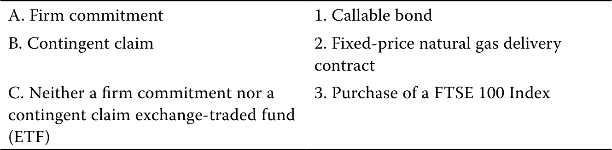

A. 确定承诺 1. 可赎回债券

B. 或有索取权 2. 固定价格天然气交付合约

C. 既不是确定承诺，也不是或有索取权

3\. 买入富时100指数交易所交易基金（ETF）

#### 官方答案与解析 / Official answer and explanation

1\. B正确。可赎回债券是标的工具内嵌入式衍生品的例子，属于或有索取权。

1\. B is correct. A callable bond is an example of an embedded derivative within an underlying, which is a contingent claim.

2\. A正确。固定价格天然气交付合约是以天然气为标的的确定承诺。

2\. A is correct. A fixed-price gas delivery contract is an example of a contract, which is a firm commitment with natural gas as the underlying.

3\. C正确。

3\. C is correct.

富时100指数交易所交易基金（ETF）既不是确定承诺，也不是或有索取权，而是现货或即期市场交易的例子。

A FTSE 100 Index exchange-traded fund (ETF) is neither a firm commitment nor a contingent claim but rather an example of a cash or spot market transaction.

#### 补充解析 / Supplementary explanation

结合本题的官方结论：“B正确。可赎回债券是标的工具内嵌入式衍生品的例子，属于或有索取权。 2. A正确。” 下列补充说明解释其背后的先确定敞口，再确定合约方向。

Link to this question’s official result: “B is correct. A callable bond is an example of an embedded derivative within an underlying, which is a contingent claim. 2. A is correct.” The supplementary discussion below explains identify the exposure before choosing the contract.

解题思路：衍生品价值取决于标的变量，但持有衍生品不等于持有标的资产本身。套期保值首先要识别原有业务在什么市场变动下受损，再选在同一变动下获利的合约方向。

Reasoning: A derivative depends on an underlying variable without necessarily conferring ownership of the underlying. For hedging, identify the market move that hurts the original business exposure, then choose a derivative that gains under that move.

应用方法：例如需要未来买入某种货币或商品的一方，担心其价格上涨，通常需锁定买入价格；未来收到并出售该资产的一方，则担心价格下跌。名义本金用来计算现金流，不必等于合约初始价值或实际投入金额。

Application: A future buyer fears a price increase and generally wants to lock in a purchase price; a future seller fears a decline. Notional principal scales contractual cash flows and need not equal the derivative’s initial value or cash investment.

#### 相关知识点 / Related concepts

#### 先确定敞口，再确定合约方向 / Identify the exposure before choosing the contract

Forward commitment 使双方承担未来履约义务；contingent claim 通常赋予一方选择权，因此两者的盈亏对称性不同。

A forward commitment binds both parties to performance. A contingent claim typically grants one party an option, producing a different payoff symmetry.

### DER-LM01-QS01-03 · 正文题组 1 · 第 3 题 Question set 1 · Question 3

正文习题组 / Question set · 原版 PDF 页码 / Source PDF pages: 15-16

#### 题目与资料 / Question and data

#### 共用资料 / Shared information

衍生品的特征

Derivative Features

3\. 请填写正确答案：股票是衍生品\_\_\_\_\_\_的一个例子，而\_\_\_\_\_\_是签订衍生品合约的法律实体。

3\. Determine the correct answers to fill in the blanks: Equities are an example of a derivative \_\_\_\_\_\_\_\_\_\_\_\_, and a \_\_\_\_\_\_\_\_\_\_\_\_\_\_\_ is a legal entity entering a derivative contract.

#### 官方答案与解析 / Official answer and explanation

股票是衍生品标的资产的一个例子，而交易对手是签订衍生品合约的法律实体。

Equities are an example of a derivative underlying, and a counterparty is a legal entity entering a derivative contract.

#### 补充解析 / Supplementary explanation

结合本题的官方结论：“股票是衍生品标的资产的一个例子，而交易对手是签订衍生品合约的法律实体。” 下列补充说明解释其背后的先确定敞口，再确定合约方向。

Link to this question’s official result: “Equities are an example of a derivative underlying, and a counterparty is a legal entity entering a derivative contract.” The supplementary discussion below explains identify the exposure before choosing the contract.

解题思路：衍生品价值取决于标的变量，但持有衍生品不等于持有标的资产本身。套期保值首先要识别原有业务在什么市场变动下受损，再选在同一变动下获利的合约方向。

Reasoning: A derivative depends on an underlying variable without necessarily conferring ownership of the underlying. For hedging, identify the market move that hurts the original business exposure, then choose a derivative that gains under that move.

应用方法：例如需要未来买入某种货币或商品的一方，担心其价格上涨，通常需锁定买入价格；未来收到并出售该资产的一方，则担心价格下跌。名义本金用来计算现金流，不必等于合约初始价值或实际投入金额。

Application: A future buyer fears a price increase and generally wants to lock in a purchase price; a future seller fears a decline. Notional principal scales contractual cash flows and need not equal the derivative’s initial value or cash investment.

#### 相关知识点 / Related concepts

#### 先确定敞口，再确定合约方向 / Identify the exposure before choosing the contract

Forward commitment 使双方承担未来履约义务；contingent claim 通常赋予一方选择权，因此两者的盈亏对称性不同。

A forward commitment binds both parties to performance. A contingent claim typically grants one party an option, producing a different payoff symmetry.

### DER-LM01-QS01-04 · 正文题组 1 · 第 4 题 Question set 1 · Question 4

正文习题组 / Question set · 原版 PDF 页码 / Source PDF pages: 15-16

#### 题目与资料 / Question and data

#### 共用资料 / Shared information

衍生品的特征

Derivative Features

4\. 说明衍生品如何用于对冲目的。

4\. Describe the use of a derivative for hedging purposes.

#### 官方答案与解析 / Official answer and explanation

以对冲为目的使用衍生品，是指抵销或中和现有或预期标的资产敞口的做法，这称为对冲。

Use of a derivative for hedging purposes involves offsetting or neutralizing an existing or anticipated exposure to an underlying, referred to as hedging.

#### 补充解析 / Supplementary explanation

结合本题的官方结论：“以对冲为目的使用衍生品，是指抵销或中和现有或预期标的资产敞口的做法，这称为对冲。” 下列补充说明解释其背后的先确定敞口，再确定合约方向。

Link to this question’s official result: “Use of a derivative for hedging purposes involves offsetting or neutralizing an existing or anticipated exposure to an underlying, referred to as hedging.” The supplementary discussion below explains identify the exposure before choosing the contract.

解题思路：衍生品价值取决于标的变量，但持有衍生品不等于持有标的资产本身。套期保值首先要识别原有业务在什么市场变动下受损，再选在同一变动下获利的合约方向。

Reasoning: A derivative depends on an underlying variable without necessarily conferring ownership of the underlying. For hedging, identify the market move that hurts the original business exposure, then choose a derivative that gains under that move.

应用方法：例如需要未来买入某种货币或商品的一方，担心其价格上涨，通常需锁定买入价格；未来收到并出售该资产的一方，则担心价格下跌。名义本金用来计算现金流，不必等于合约初始价值或实际投入金额。

Application: A future buyer fears a price increase and generally wants to lock in a purchase price; a future seller fears a decline. Notional principal scales contractual cash flows and need not equal the derivative’s initial value or cash investment.

#### 相关知识点 / Related concepts

#### 先确定敞口，再确定合约方向 / Identify the exposure before choosing the contract

Forward commitment 使双方承担未来履约义务；contingent claim 通常赋予一方选择权，因此两者的盈亏对称性不同。

A forward commitment binds both parties to performance. A contingent claim typically grants one party an option, producing a different payoff symmetry.

### DER-LM01-QS01-05 · 正文题组 1 · 第 5 题 Question set 1 · Question 5

正文习题组 / Question set · 原版 PDF 页码 / Source PDF pages: 15-16

#### 题目与资料 / Question and data

#### 共用资料 / Shared information

衍生品的特征

Derivative Features

5\. 解释远期合约的结算。

5\. Explain the settlement of a forward contract.

#### 官方答案与解析 / Official answer and explanation

远期合约是确定承诺。

A forward contract is a firm commitment.

该合约在到期日产生结算付款，金额等于当时市场价格与预先约定远期价格之间的差额。

This contract results in a settlement payment on the maturity date equal to the difference between the current market price and a pre-agreed forward price.

#### 补充解析 / Supplementary explanation

结合本题的官方结论：“远期合约是确定承诺。 该合约在到期日产生结算付款，金额等于当时市场价格与预先约定远期价格之间的差额。” 下列补充说明解释其背后的远期的价格、价值与到期损益。

Link to this question’s official result: “A forward contract is a firm commitment. This contract results in a settlement payment on the maturity date equal to the difference between the current market price and a pre-agreed forward price.” The supplementary discussion below explains forward price, contract value, and payoff.

解题思路：合约中预先约定的交割价格与合约今天的市场价值不是同一个量。买方已经锁定买入价格，因此到期标的市价越高，买方越有利；卖方的损益方向正好相反。

Reasoning: The agreed delivery price is different from the contract’s current market value. A long forward locks in a purchase price and benefits when the terminal spot price is higher; the short side has the opposite payoff.

应用方法：先标明 long / short，再用“收到什么减去支付什么”。如果报价按每股、每盎司或每单位给出，最后还要乘合约数量。普通公平定价远期初始价值可为零，但不代表其交割价格或名义金额为零。

Application: Identify long or short, then subtract what is paid from what is received. Multiply a per-unit payoff by contract quantity. A fairly priced forward can have zero initial value without having a zero delivery price or notional amount.

#### 相关知识点 / Related concepts

#### 远期的价格、价值与到期损益 / Forward price, contract value, and payoff

F₀(T) 是约定交割价，Vₜ(T) 是时点 t 的合约价值，Sₜ 是现货价格。保留这些时间下标可以避免把不同量混用。

F₀(T) is the delivery price, Vₜ(T) the contract value at time t, and Sₜ the spot price. Time subscripts help keep them distinct.

Long payoff at maturity = S_T − F_0(T); Short payoff = F_0(T) − S_T

### DER-LM01-QS02-01 · 正文题组 2 · 第 1 题 Question set 2 · Question 1

正文习题组 / Question set · 原版 PDF 页码 / Source PDF pages: 20

#### 题目与资料 / Question and data

#### 共用资料 / Shared information

衍生品标的

Derivative Underlyings

1\. 说明如何将某种标的用于员工薪酬，以及这样做的原因。

1\. Describe how and why an underlying may be used in employee compensation.

#### 官方答案与解析 / Official answer and explanation

以股票为标的，尤其以某个发行人自身股票为标的的衍生品，可以纳入该公司员工的薪酬。

Derivatives with an equity underlying, in particular the stock of a particular issuer, may be included in the compensation of that company’s employees.

授予股票期权是为了激励员工改善公司业绩，并期待更高股价使期权增值。

Stock options are granted to provide incentives to work toward stronger corporate performance in the expectation of a higher stock price, which will cause the options to increase in value.

#### 补充解析 / Supplementary explanation

结合本题的官方结论：“以股票为标的，尤其以某个发行人自身股票为标的的衍生品，可以纳入该公司员工的薪酬。 授予股票期权是为了激励员工改善公司业绩，并期待更高股价使期权增值。” 下列补充说明解释其背后的先确定敞口，再确定合约方向。

Link to this question’s official result: “Derivatives with an equity underlying, in particular the stock of a particular issuer, may be included in the compensation of that company’s employees. Stock options are granted to provide incentives to work toward stronger corporate performance in the expectation of a higher stock price, which will cause the options to increase in value.” The supplementary discussion below explains identify the exposure before choosing the contract.

解题思路：衍生品价值取决于标的变量，但持有衍生品不等于持有标的资产本身。套期保值首先要识别原有业务在什么市场变动下受损，再选在同一变动下获利的合约方向。

Reasoning: A derivative depends on an underlying variable without necessarily conferring ownership of the underlying. For hedging, identify the market move that hurts the original business exposure, then choose a derivative that gains under that move.

应用方法：例如需要未来买入某种货币或商品的一方，担心其价格上涨，通常需锁定买入价格；未来收到并出售该资产的一方，则担心价格下跌。名义本金用来计算现金流，不必等于合约初始价值或实际投入金额。

Application: A future buyer fears a price increase and generally wants to lock in a purchase price; a future seller fears a decline. Notional principal scales contractual cash flows and need not equal the derivative’s initial value or cash investment.

#### 相关知识点 / Related concepts

#### 先确定敞口，再确定合约方向 / Identify the exposure before choosing the contract

Forward commitment 使双方承担未来履约义务；contingent claim 通常赋予一方选择权，因此两者的盈亏对称性不同。

A forward commitment binds both parties to performance. A contingent claim typically grants one party an option, producing a different payoff symmetry.

### DER-LM01-QS02-02 · 正文题组 2 · 第 2 题 Question set 2 · Question 2

正文习题组 / Question set · 原版 PDF 页码 / Source PDF pages: 20

#### 题目与资料 / Question and data

#### 共用资料 / Shared information

衍生品标的

Derivative Underlyings

2\. 解释一家从欧元区进口商品的英国进口商，如何使用以货币为标的的衍生品减轻风险。

2\. Explain how a UK-based importer of goods from the euro zone might use a derivative with a currency underlying to mitigate risk.

#### 官方答案与解析 / Official answer and explanation

一家从欧元区进口商品的英国进口商，可能用欧元支付货款，再以英镑销售商品。

A UK-based importer of goods from the euro zone will likely pay EUR for goods that she intends to sell for GBP.

为处理这种货币错配，她可以考虑签订确定承诺，按照与进口合约相匹配的条款，在未来以预先确定的价格用英镑购买欧元，从而抵销标的即期汇率变化的风险，即英镑相对欧元贬值的风险。

To address this currency mismatch, she may consider entering a firm commitment to purchase EUR in exchange for GBP at a pre-determined price in the future based upon terms matching the import contract to offset risk to changes in the underlying spot exchange rate (i.e., GBP depreciation against EUR).

#### 补充解析 / Supplementary explanation

结合本题的官方结论：“一家从欧元区进口商品的英国进口商，可能用欧元支付货款，再以英镑销售商品。 为处理这种货币错配，她可以考虑签订确定承诺，按照与进口合约相匹配的条款，在未来以预先确定的价格用英镑购买欧元，从而抵销标的即期汇率变化的风险，即英镑相对欧元贬值的风险。” 下列补充说明解释其背后的先确定敞口，再确定合约方向。

Link to this question’s official result: “A UK-based importer of goods from the euro zone will likely pay EUR for goods that she intends to sell for GBP. To address this currency mismatch, she may consider entering a firm commitment to purchase EUR in exchange for GBP at a pre-determined price in the future based upon terms matching the import contract to offset risk to changes in the underlying spot exchange rate (i.e., GBP depreciation against EUR).” The supplementary discussion below explains identify the exposure before choosing the contract.

解题思路：衍生品价值取决于标的变量，但持有衍生品不等于持有标的资产本身。套期保值首先要识别原有业务在什么市场变动下受损，再选在同一变动下获利的合约方向。

Reasoning: A derivative depends on an underlying variable without necessarily conferring ownership of the underlying. For hedging, identify the market move that hurts the original business exposure, then choose a derivative that gains under that move.

应用方法：例如需要未来买入某种货币或商品的一方，担心其价格上涨，通常需锁定买入价格；未来收到并出售该资产的一方，则担心价格下跌。名义本金用来计算现金流，不必等于合约初始价值或实际投入金额。

Application: A future buyer fears a price increase and generally wants to lock in a purchase price; a future seller fears a decline. Notional principal scales contractual cash flows and need not equal the derivative’s initial value or cash investment.

#### 相关知识点 / Related concepts

#### 先确定敞口，再确定合约方向 / Identify the exposure before choosing the contract

Forward commitment 使双方承担未来履约义务；contingent claim 通常赋予一方选择权，因此两者的盈亏对称性不同。

A forward commitment binds both parties to performance. A contingent claim typically grants one party an option, producing a different payoff symmetry.

### DER-LM01-QS02-03 · 正文题组 2 · 第 3 题 Question set 2 · Question 3

正文习题组 / Question set · 原版 PDF 页码 / Source PDF pages: 20

#### 题目与资料 / Question and data

#### 共用资料 / Shared information

衍生品标的

Derivative Underlyings

3\. 对于情景2中Esterr公司的利率互换，参照图表1，识别下图中的A、B和C。

3\. Identify A, B, and C in the following diagram, as in Exhibit 1, for the interest rate swap in Scenario 2 for Esterr Inc.

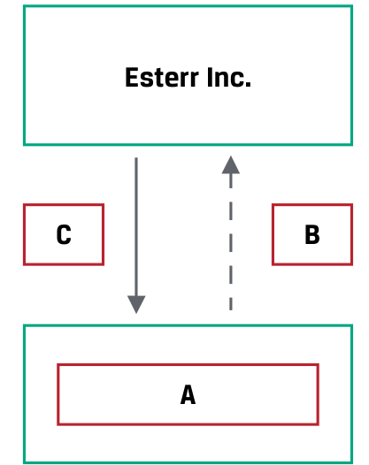原书题目图 / Original question diagram · PDF 20

#### 官方答案与解析 / Official answer and explanation

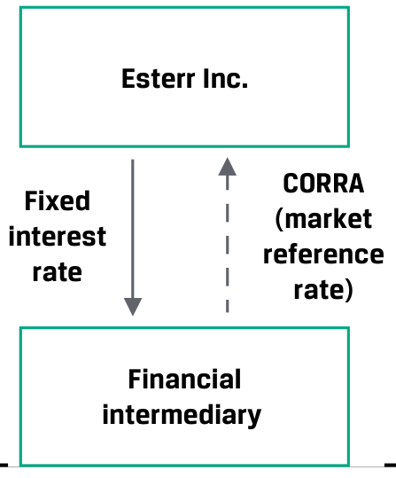官方答案原图 / Original official solution diagram · PDF 20

图内文字译注：CORRA（市场参考利率）；固定利率；Esterr 公司；金融中介。

Diagram labels: CORRA (market reference rate); fixed interest rate; Esterr Inc.; financial intermediary.

#### 补充解析 / Supplementary explanation

结合本题的官方结论：“官方原图给出 CORRA（市场参考利率）、固定利率、Esterr 公司与金融中介的对应关系。” 下列补充说明解释其背后的互换是一组现金流交换。

Link to this question’s official result: “Official source diagram: CORRA (market reference rate), Fixed interest rate, Esterr Inc., Financial intermediary.” The supplementary discussion below explains a swap exchanges a sequence of cash flows.

解题思路：普通利率互换把多期固定利息与多期浮动利息交换。公平固定互换利率让两条腿在起始时现值相等；起始后原固定利率不变，市场利率变化会使两条腿重新出现价值差。

Reasoning: A plain interest-rate swap exchanges a series of fixed and floating interest payments. The fair fixed rate equates the two legs’ present values at inception. Later, the contractual fixed rate stays unchanged while market repricing creates a value difference.

应用方法：先标明谁付固定、谁付浮动，以及是否净额结算。支付固定方通常受益于市场利率上升；估值时逐期折现所收现金流并减去所付现金流。名义本金一般用于计算利息，未必实际交换。

Application: Label the payer of each leg and the netting convention. A fixed-rate payer generally benefits from rising market rates. Value the swap as discounted receipts minus discounted payments. Notional principal usually scales interest rather than being exchanged.

#### 相关知识点 / Related concepts

#### 互换是一组现金流交换 / A swap exchanges a sequence of cash flows

公平互换固定利率是各未来现金流折现关系共同决定的结果，不是未来浮动利率的简单算术平均。

The fair fixed swap rate follows from discounted cash-flow relationships, not a simple arithmetic average of future floating rates.

Swap value = PV(receive leg) − PV(pay leg)

原 EPUB 将题图与答案图合成一张图片；已按原版 PDF 第20页准确分开。

### DER-LM01-QS02-04 · 正文题组 2 · 第 4 题 Question set 2 · Question 4

正文习题组 / Question set · 原版 PDF 页码 / Source PDF pages: 20-21

#### 题目与资料 / Question and data

#### 共用资料 / Shared information

衍生品标的

Derivative Underlyings

4\. 参照图表2，利用以下条款清单，识别并说明Esterr公司利率互换的衍生品特征。

4\. Identify and describe the derivative features for the Esterr Inc. interest rate swap using the following term sheet, as in Exhibit 2.

### 利率互换条款清单Interest Rate Swap Term Sheet

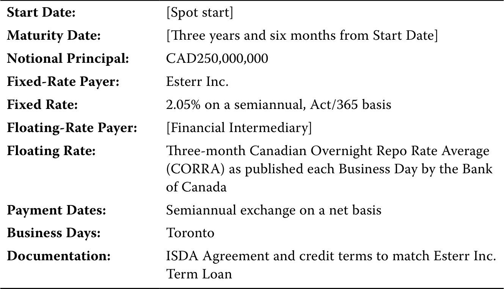

起始日：\[即期起始\]

到期日：\[起始日起三年六个月\]

名义本金：250,000,000加元

固定利率支付方：Esterr公司

固定利率：2.05%，每半年结算，按实际天数／365计息

浮动利率支付方：\[金融中介机构\]

浮动利率：加拿大银行在每个营业日公布的三个月加拿大隔夜回购利率平均值（CORRA）

付款日期：每半年按净额交换

营业日历：多伦多

文件：ISDA协议及与Esterr公司定期贷款相匹配的信用条款

A. 标的：\_\_\_\_\_\_\_\_\_\_\_\_\_\_\_\_\_\_\_\_\_\_\_\_\_\_\_

A. Underlying: \_\_\_\_\_\_\_\_\_\_\_\_\_\_\_\_\_\_\_\_\_\_\_\_\_\_\_

B. 交易对手：\_\_\_\_\_\_\_\_\_\_\_\_\_\_\_\_\_\_\_及\_\_\_\_\_\_\_\_\_\_\_\_\_\_\_\_\_\_\_\_\_

B. Counterparties: \_\_\_\_\_\_\_\_\_\_\_\_\_\_\_\_\_\_\_ and \_\_\_\_\_\_\_\_\_\_\_\_\_\_\_\_\_\_\_\_\_

C. 合约规模：\_\_\_\_\_\_\_\_\_\_\_\_\_\_\_\_\_\_\_\_\_\_\_\_\_\_\_

C. Contract size: \_\_\_\_\_\_\_\_\_\_\_\_\_\_\_\_\_\_\_\_\_\_\_\_\_\_\_

D. 合约类型：\_\_\_\_\_\_\_\_\_\_\_\_\_\_\_\_\_\_\_\_\_\_\_\_\_\_

D. Contract type: \_\_\_\_\_\_\_\_\_\_\_\_\_\_\_\_\_\_\_\_\_\_\_\_\_\_

#### 官方答案与解析 / Official answer and explanation

A. 标的：利率（加拿大市场参考利率CORRA）

A. Underlying: Interest rate (Canadian market reference rate, CORRA)

B. 交易对手：Esterr公司及金融中介机构

B. Counterparties: Esterr Inc. and Financial Intermediary

C. 合约规模：250,000,000加元

C. Contract size: CAD250,000,000

D. 合约类型：确定承诺（利率互换）

D. Contract type: Firm commitment (interest rate swap)

#### 补充解析 / Supplementary explanation

结合本题的官方结论：“A. 标的：利率（加拿大市场参考利率CORRA） B. 交易对手：Esterr公司及金融中介机构 C. 合约规模：250,000,000加元 D. 合约类型：确定承诺（利率互换）” 下列补充说明解释其背后的互换是一组现金流交换。

Link to this question’s official result: “A. Underlying: Interest rate (Canadian market reference rate, CORRA) B. Counterparties: Esterr Inc. and Financial Intermediary C.” The supplementary discussion below explains a swap exchanges a sequence of cash flows.

解题思路：普通利率互换把多期固定利息与多期浮动利息交换。公平固定互换利率让两条腿在起始时现值相等；起始后原固定利率不变，市场利率变化会使两条腿重新出现价值差。

Reasoning: A plain interest-rate swap exchanges a series of fixed and floating interest payments. The fair fixed rate equates the two legs’ present values at inception. Later, the contractual fixed rate stays unchanged while market repricing creates a value difference.

应用方法：先标明谁付固定、谁付浮动，以及是否净额结算。支付固定方通常受益于市场利率上升；估值时逐期折现所收现金流并减去所付现金流。名义本金一般用于计算利息，未必实际交换。

Application: Label the payer of each leg and the netting convention. A fixed-rate payer generally benefits from rising market rates. Value the swap as discounted receipts minus discounted payments. Notional principal usually scales interest rather than being exchanged.

#### 相关知识点 / Related concepts

#### 互换是一组现金流交换 / A swap exchanges a sequence of cash flows

公平互换固定利率是各未来现金流折现关系共同决定的结果，不是未来浮动利率的简单算术平均。

The fair fixed swap rate follows from discounted cash-flow relationships, not a simple arithmetic average of future floating rates.

Swap value = PV(receive leg) − PV(pay leg)

关联考点：Forward commitment 使双方承担未来履约义务；contingent claim 通常赋予一方选择权，因此两者的盈亏对称性不同。

Related concept: A forward commitment binds both parties to performance. A contingent claim typically grants one party an option, producing a different payoff symmetry.

### DER-LM01-QS02-05 · 正文题组 2 · 第 5 题 Question set 2 · Question 5

正文习题组 / Question set · 原版 PDF 页码 / Source PDF pages: 20-21

#### 题目与资料 / Question and data

#### 共用资料 / Shared information

衍生品标的

Derivative Underlyings

5\. 请将各衍生品标的类型与相应例子进行匹配。

5\. Identify which example corresponds to each derivative underlying type.

A. 软商品 1. 铝期货

B. 硬商品 2. SOFR期货

C. 既不是软商品，也不是硬商品 3. 大豆期权

#### 官方答案与解析 / Official answer and explanation

1\. B正确。铝期货是金属合约的例子，属于以硬商品为标的的衍生品。

1\. B is correct. Aluminum futures are an example of a metals contract, which is a derivative with a hard commodity underlying.

2\. C正确。SOFR期货是利率合约的例子，并非以商品为基础的衍生品合约。

2\. C is correct. SOFR futures are an example of an interest rate contract, not a commodity-based derivative contract.

3\. A正确。大豆期权是以农业产品，即软商品为标的的衍生品合约。

3\. A is correct. Soybean options are an example of a derivative contract with an agricultural, or soft, commodity underlying.

#### 补充解析 / Supplementary explanation

结合本题的官方结论：“B正确。铝期货是金属合约的例子，属于以硬商品为标的的衍生品。 2. C正确。” 下列补充说明解释其背后的先确定敞口，再确定合约方向。

Link to this question’s official result: “B is correct. Aluminum futures are an example of a metals contract, which is a derivative with a hard commodity underlying. 2. C is correct.” The supplementary discussion below explains identify the exposure before choosing the contract.

解题思路：衍生品价值取决于标的变量，但持有衍生品不等于持有标的资产本身。套期保值首先要识别原有业务在什么市场变动下受损，再选在同一变动下获利的合约方向。

Reasoning: A derivative depends on an underlying variable without necessarily conferring ownership of the underlying. For hedging, identify the market move that hurts the original business exposure, then choose a derivative that gains under that move.

应用方法：例如需要未来买入某种货币或商品的一方，担心其价格上涨，通常需锁定买入价格；未来收到并出售该资产的一方，则担心价格下跌。名义本金用来计算现金流，不必等于合约初始价值或实际投入金额。

Application: A future buyer fears a price increase and generally wants to lock in a purchase price; a future seller fears a decline. Notional principal scales contractual cash flows and need not equal the derivative’s initial value or cash investment.

#### 相关知识点 / Related concepts

#### 先确定敞口，再确定合约方向 / Identify the exposure before choosing the contract

Forward commitment 使双方承担未来履约义务；contingent claim 通常赋予一方选择权，因此两者的盈亏对称性不同。

A forward commitment binds both parties to performance. A contingent claim typically grants one party an option, producing a different payoff symmetry.

### DER-LM01-QS03-01 · 正文题组 3 · 第 1 题 Question set 3 · Question 1

正文习题组 / Question set · 原版 PDF 页码 / Source PDF pages: 25

#### 题目与资料 / Question and data

#### 共用资料 / Shared information

衍生品市场

Derivative Markets

1\. 说明OTC衍生品市场中的风险转移过程。

1\. Describe the risk transfer process in OTC derivative markets.

#### 官方答案与解析 / Official answer and explanation

OTC交易商又称做市商，通常相互进行抵销交易，以转移与最终使用者签订的衍生品合约风险。

OTC dealers, known as market makers, typically enter into offsetting transactions with one another to transfer the risk of derivative contracts entered with end users.

#### 补充解析 / Supplementary explanation

结合本题的官方结论：“OTC交易商又称做市商，通常相互进行抵销交易，以转移与最终使用者签订的衍生品合约风险。” 下列补充说明解释其背后的先确定敞口，再确定合约方向。

Link to this question’s official result: “OTC dealers, known as market makers, typically enter into offsetting transactions with one another to transfer the risk of derivative contracts entered with end users.” The supplementary discussion below explains identify the exposure before choosing the contract.

解题思路：衍生品价值取决于标的变量，但持有衍生品不等于持有标的资产本身。套期保值首先要识别原有业务在什么市场变动下受损，再选在同一变动下获利的合约方向。

Reasoning: A derivative depends on an underlying variable without necessarily conferring ownership of the underlying. For hedging, identify the market move that hurts the original business exposure, then choose a derivative that gains under that move.

应用方法：例如需要未来买入某种货币或商品的一方，担心其价格上涨，通常需锁定买入价格；未来收到并出售该资产的一方，则担心价格下跌。名义本金用来计算现金流，不必等于合约初始价值或实际投入金额。

Application: A future buyer fears a price increase and generally wants to lock in a purchase price; a future seller fears a decline. Notional principal scales contractual cash flows and need not equal the derivative’s initial value or cash investment.

#### 相关知识点 / Related concepts

#### 先确定敞口，再确定合约方向 / Identify the exposure before choosing the contract

Forward commitment 使双方承担未来履约义务；contingent claim 通常赋予一方选择权，因此两者的盈亏对称性不同。

A forward commitment binds both parties to performance. A contingent claim typically grants one party an option, producing a different payoff symmetry.

### DER-LM01-QS03-02 · 正文题组 3 · 第 2 题 Question set 3 · Question 2

正文习题组 / Question set · 原版 PDF 页码 / Source PDF pages: 25-26

#### 题目与资料 / Question and data

#### 共用资料 / Shared information

衍生品市场

Derivative Markets

2\. 请将以下衍生品市场与相应特征进行匹配。

2\. Identify which of the following derivative markets corresponds to the following characteristics.

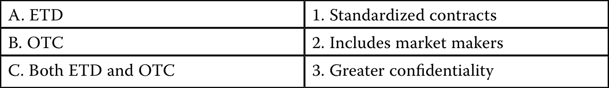

A. ETD 1. 标准化合约

B. OTC 2. 包含做市商

C. ETD和OTC均适用 3. 保密性更高

#### 官方答案与解析 / Official answer and explanation

1\. A——ETD市场使用标准化合约。

1\. A—ETD markets use standardized contracts.

2\. C——ETD与OTC市场都使用做市商。

2\. C—Both ETD and OTC markets use market makers.

3\. B——OTC市场的私密性更高。

3\. B—OTC markets have greater privacy.

#### 补充解析 / Supplementary explanation

结合本题的官方结论：“A——ETD市场使用标准化合约。 2. C——ETD与OTC市场都使用做市商。 3. B——OTC市场的私密性更高。” 下列补充说明解释其背后的先确定敞口，再确定合约方向。

Link to this question’s official result: “A—ETD markets use standardized contracts. 2. C—Both ETD and OTC markets use market makers. 3. B—OTC markets have greater privacy.” The supplementary discussion below explains identify the exposure before choosing the contract.

解题思路：衍生品价值取决于标的变量，但持有衍生品不等于持有标的资产本身。套期保值首先要识别原有业务在什么市场变动下受损，再选在同一变动下获利的合约方向。

Reasoning: A derivative depends on an underlying variable without necessarily conferring ownership of the underlying. For hedging, identify the market move that hurts the original business exposure, then choose a derivative that gains under that move.

应用方法：例如需要未来买入某种货币或商品的一方，担心其价格上涨，通常需锁定买入价格；未来收到并出售该资产的一方，则担心价格下跌。名义本金用来计算现金流，不必等于合约初始价值或实际投入金额。

Application: A future buyer fears a price increase and generally wants to lock in a purchase price; a future seller fears a decline. Notional principal scales contractual cash flows and need not equal the derivative’s initial value or cash investment.

#### 相关知识点 / Related concepts

#### 先确定敞口，再确定合约方向 / Identify the exposure before choosing the contract

Forward commitment 使双方承担未来履约义务；contingent claim 通常赋予一方选择权，因此两者的盈亏对称性不同。

A forward commitment binds both parties to performance. A contingent claim typically grants one party an option, producing a different payoff symmetry.

### DER-LM01-QS03-03 · 正文题组 3 · 第 3 题 Question set 3 · Question 3

正文习题组 / Question set · 原版 PDF 页码 / Source PDF pages: 25-26

#### 题目与资料 / Question and data

#### 共用资料 / Shared information

衍生品市场

Derivative Markets

3\. 请填写正确答案：\_\_\_\_\_\_涉及最终款项的支付和／或证券或实物商品的交付；\_\_\_\_\_\_则是核实交易执行、款项交换并记录参与者的过程。

3\. Determine the correct answers to fill in the blanks: \_\_\_\_\_\_\_\_\_\_\_\_ involves the payment of final amounts and/or delivery of securities or physical commodities, while \_\_\_\_\_\_\_\_\_\_ is the process of verifying the execution of a transaction, exchange of payments, and recording the participants.

#### 官方答案与解析 / Official answer and explanation

结算涉及最终款项的支付和／或证券或实物商品的交付；清算则是核实交易执行、款项交换并记录参与者的过程。

Settlement involves the payment of final amounts and/or delivery of securities or physical commodities, while clearing is the process of verifying the execution of a transaction, exchange of payments, and recording the participants.

#### 补充解析 / Supplementary explanation

结合本题的官方结论：“结算涉及最终款项的支付和／或证券或实物商品的交付；清算则是核实交易执行、款项交换并记录参与者的过程。” 下列补充说明解释其背后的远期的价格、价值与到期损益。

Link to this question’s official result: “Settlement involves the payment of final amounts and/or delivery of securities or physical commodities, while clearing is the process of verifying the execution of a transaction, exchange of payments, and recording the participants.” The supplementary discussion below explains forward price, contract value, and payoff.

解题思路：合约中预先约定的交割价格与合约今天的市场价值不是同一个量。买方已经锁定买入价格，因此到期标的市价越高，买方越有利；卖方的损益方向正好相反。

Reasoning: The agreed delivery price is different from the contract’s current market value. A long forward locks in a purchase price and benefits when the terminal spot price is higher; the short side has the opposite payoff.

应用方法：先标明 long / short，再用“收到什么减去支付什么”。如果报价按每股、每盎司或每单位给出，最后还要乘合约数量。普通公平定价远期初始价值可为零，但不代表其交割价格或名义金额为零。

Application: Identify long or short, then subtract what is paid from what is received. Multiply a per-unit payoff by contract quantity. A fairly priced forward can have zero initial value without having a zero delivery price or notional amount.

#### 相关知识点 / Related concepts

#### 远期的价格、价值与到期损益 / Forward price, contract value, and payoff

F₀(T) 是约定交割价，Vₜ(T) 是时点 t 的合约价值，Sₜ 是现货价格。保留这些时间下标可以避免把不同量混用。

F₀(T) is the delivery price, Vₜ(T) the contract value at time t, and Sₜ the spot price. Time subscripts help keep them distinct.

Long payoff at maturity = S_T − F_0(T); Short payoff = F_0(T) − S_T

### DER-LM01-QS03-04 · 正文题组 3 · 第 4 题 Question set 3 · Question 4

正文习题组 / Question set · 原版 PDF 页码 / Source PDF pages: 25-26

#### 题目与资料 / Question and data

#### 共用资料 / Shared information

衍生品市场

Derivative Markets

4\. 列举衍生品中央清算的一项潜在风险。

4\. Identify one potential risk concern about the central clearing of derivatives.

#### 官方答案与解析 / Official answer and explanation

强制中央清算要求将衍生品交易的系统性风险从交易对手（通常为金融中介机构）转移至CCP。

The central clearing mandate transfers the systemic risk of derivatives transactions from the counterparties, typically financial intermediaries, to the CCPs.

一个问题是风险在CCP中集中。

One concern is the centralization and concentration of risks in CCPs.

必须实施审慎监督，确保这些风险得到适当管理。

Careful oversight must occur to ensure that these risks are properly managed.

#### 补充解析 / Supplementary explanation

结合本题的官方结论：“强制中央清算要求将衍生品交易的系统性风险从交易对手（通常为金融中介机构）转移至CCP。 一个问题是风险在CCP中集中。 必须实施审慎监督，确保这些风险得到适当管理。” 下列补充说明解释其背后的场外、交易所与中央清算。

Link to this question’s official result: “The central clearing mandate transfers the systemic risk of derivatives transactions from the counterparties, typically financial intermediaries, to the CCPs. One concern is the centralization and concentration of risks in CCPs. Careful oversight must occur to ensure that these risks are properly managed.” The supplementary discussion below explains otc trading, exchanges, and central clearing.

解题思路：交易场所与清算方式是两个相关但不同的问题。场外合约通常更易定制名义金额、日期和条款；交易所合约通常标准化。场外成交也可以进入中央清算，不能把 OTC 自动等同于双边不清算。

Reasoning: Trading venue and clearing method are related but distinct. OTC contracts are usually more customizable, while exchange contracts are standardized. OTC trades can also be centrally cleared, so OTC does not automatically mean uncleared bilateral exposure.

应用方法：先比较客户实际敞口与标准合约是否匹配，再分析对手方是谁。CCP 通过替代原交易对手、保证金和风险管理降低部分双边风险，但风险会集中到清算体系，不能理解为所有风险彻底消失。

Application: Compare the customer’s exposure with available standardized contracts, then identify the legal counterparty. A CCP interposes itself and uses margin and risk management to reduce bilateral exposure, while concentrating risk within the clearing system.

#### 相关知识点 / Related concepts

#### 场外、交易所与中央清算 / OTC trading, exchanges, and central clearing

Customization 有助于降低期限和金额错配；standardization 通常有助于流动性和交易便利。二者都不能保证不存在市场风险。

Customization can reduce size and maturity mismatch; standardization can improve liquidity and trading convenience. Neither eliminates market risk.

### DER-LM01-QS03-05 · 正文题组 3 · 第 5 题 Question set 3 · Question 5

正文习题组 / Question set · 原版 PDF 页码 / Source PDF pages: 25-26

#### 题目与资料 / Question and data

#### 共用资料 / Shared information

衍生品市场

Derivative Markets

5\. 说明信用违约互换的清算步骤。

5\. Describe the steps for clearing a credit default swap.

#### 官方答案与解析 / Official answer and explanation

交易双方为金融中介机构，首先在互换执行设施（SEF）上执行交易。

The counterparties are financial intermediaries that first execute the trade on an SEF (swap execution facility).

随后将交易细节提交给CCP；通过合约更替程序，以一份新合约替换原合约，由CCP介入交易，成为原双方各自的新交易对手。

Then, trade details are shared with a CCP; the novation process substitutes the original contract with another where the CCP steps into the trade and acts as the new counterparty for each original party.

CCP负责交易的清算与结算。

The CCP clears and settles the trade.

#### 补充解析 / Supplementary explanation

结合本题的官方结论：“交易双方为金融中介机构，首先在互换执行设施（SEF）上执行交易。 随后将交易细节提交给CCP；通过合约更替程序，以一份新合约替换原合约，由CCP介入交易，成为原双方各自的新交易对手。 CCP负责交易的清算与结算。” 下列补充说明解释其背后的场外、交易所与中央清算。

Link to this question’s official result: “The counterparties are financial intermediaries that first execute the trade on an SEF (swap execution facility). Then, trade details are shared with a CCP; the novation process substitutes the original contract with another where the CCP steps into the trade and acts as the new counterparty for each original party. The CCP clears and settles the trade.” The supplementary discussion below explains otc trading, exchanges, and central clearing.

解题思路：交易场所与清算方式是两个相关但不同的问题。场外合约通常更易定制名义金额、日期和条款；交易所合约通常标准化。场外成交也可以进入中央清算，不能把 OTC 自动等同于双边不清算。

Reasoning: Trading venue and clearing method are related but distinct. OTC contracts are usually more customizable, while exchange contracts are standardized. OTC trades can also be centrally cleared, so OTC does not automatically mean uncleared bilateral exposure.

应用方法：先比较客户实际敞口与标准合约是否匹配，再分析对手方是谁。CCP 通过替代原交易对手、保证金和风险管理降低部分双边风险，但风险会集中到清算体系，不能理解为所有风险彻底消失。

Application: Compare the customer’s exposure with available standardized contracts, then identify the legal counterparty. A CCP interposes itself and uses margin and risk management to reduce bilateral exposure, while concentrating risk within the clearing system.

#### 相关知识点 / Related concepts

#### 场外、交易所与中央清算 / OTC trading, exchanges, and central clearing

Customization 有助于降低期限和金额错配；standardization 通常有助于流动性和交易便利。二者都不能保证不存在市场风险。

Customization can reduce size and maturity mismatch; standardization can improve liquidity and trading convenience. Neither eliminates market risk.

### DER-LM01-P01-01 · 章末练习 1 Practice problem 1

章末练习 / Practice problem · 原版 PDF 页码 / Source PDF pages: 27, 29

#### 题目与资料 / Question and data

#### 共用资料 / Shared information

### 以下信息适用于第1—5题The following information relates to questions 1-5

Montau AG是一家德国资本品生产商，在德国制造产品，并向全球客户交付。

Montau AG is a German capital goods producer that manufactures its products domestically and delivers its products to clients globally.

Montau全球销售经理向财资团队提供以下商业合约草案：

Montau’s global sales manager shares the following draft commercial contract with his Treasury team:

### Montau AG商业出口合约Montau AG Commercial Export Contract

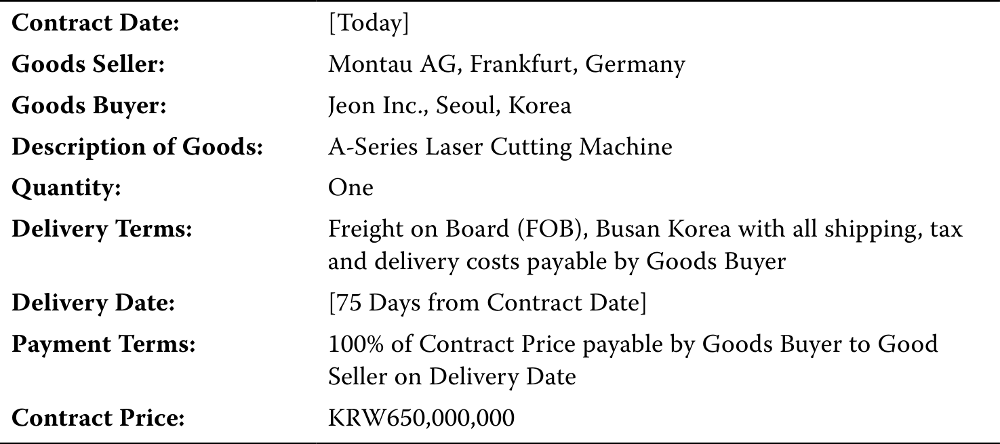

合约日期：\[今天\]

货物卖方：Montau AG，德国法兰克福

货物买方：Jeon公司，韩国首尔

货物描述：A系列激光切割机

数量：一台

交付条款：船上交货（FOB），韩国釜山；所有运输、税费及交付成本由货物买方支付

交货日期：\[合约日期后75天\]

付款条款：货物买方于交货日期向卖方支付合约价格的100%

合约价格：650,000,000韩元

Montau AG财资经理负责处理这项拟议交易的财务风险。

Montau AG’s Treasury manager is tasked with addressing the financial risk of this prospective transaction.

1\. 以下哪项最恰当地说明，为管理该商业合约的财务风险，Montau AG为什么应考虑衍生品而非现货市场交易？

1\. Which of the following statements best describes why Montau AG should consider a derivative rather than a spot market transaction to manage the financial risk of this commercial contract?

A. Montau AG以韩元计价的合约价格出售机器，而成本以欧元计价。

A. Montau AG is selling a machine at a contract price in KRW and incurs costs based in EUR.

B. 商业合约签订日至交货日之间存在75天的时间差，Montau AG将在交货日收到机器的韩元货款。

B. Montau AG faces a 75-day timing difference between the commercial contract date and the delivery date when Montau AG is paid for the machine in KRW.

C. Montau AG无法在今天卖出韩元，以抵销向Jeon公司交付机器的合约价格。

C. Montau AG is unable to sell KRW today in order to offset the contract price of machinery delivered to Jeon Inc.

#### 官方答案与解析 / Official answer and explanation

1\. B正确。

1\. B is correct.

商业合约签订日至Montau AG收到机器韩元货款的交货日之间，存在75天的时间差。

A 75-day timing difference exists between the commercial contract date and the delivery date when Montau AG is paid for the machine in KRW.

A虽然属实，但没有解释为何衍生品优于现货市场交易。

A is true but does not explain why the use of a derivative is preferable to a spot market transaction.

如果像C所涉及的情况那样，Montau在交货日通过现货市场卖出收到的韩元、买入欧元，它将在75天期间承担韩元／欧元汇率不利变化的风险。

If as in C Montau were to sell the KRW it receives and buy EUR in a spot market transaction on the delivery date, it would be exposed to unfavorable changes in the KRW/EUR exchange rate over the 75-day period.

衍生品合约可以在今天约定标的韩元／欧元远期汇率，并于交货日交换，从而使Montau对冲或抵销未来韩元货款的欧元价值风险。

A derivative contract in which the underlying KRW/EUR forward rate is agreed today and exchanged on the delivery date allows Montau to hedge or offset the EUR value of the future KRW payment.

因此，与在现货市场卖出韩元相比，衍生品更适合处理该商业交易的财务风险。

The derivative is therefore a more suitable contract to address the financial risk of the commercial transaction than a spot market sale of KRW.

#### 补充解析 / Supplementary explanation

结合本题的官方结论：“B正确。 商业合约签订日至Montau AG收到机器韩元货款的交货日之间，存在75天的时间差。 A虽然属实，但没有解释为何衍生品优于现货市场交易。” 下列补充说明解释其背后的先确定敞口，再确定合约方向。

Link to this question’s official result: “B is correct. A 75-day timing difference exists between the commercial contract date and the delivery date when Montau AG is paid for the machine in KRW. A is true but does not explain why the use of a derivative is preferable to a spot market transaction.” The supplementary discussion below explains identify the exposure before choosing the contract.

解题思路：衍生品价值取决于标的变量，但持有衍生品不等于持有标的资产本身。套期保值首先要识别原有业务在什么市场变动下受损，再选在同一变动下获利的合约方向。

Reasoning: A derivative depends on an underlying variable without necessarily conferring ownership of the underlying. For hedging, identify the market move that hurts the original business exposure, then choose a derivative that gains under that move.

应用方法：例如需要未来买入某种货币或商品的一方，担心其价格上涨，通常需锁定买入价格；未来收到并出售该资产的一方，则担心价格下跌。名义本金用来计算现金流，不必等于合约初始价值或实际投入金额。

Application: A future buyer fears a price increase and generally wants to lock in a purchase price; a future seller fears a decline. Notional principal scales contractual cash flows and need not equal the derivative’s initial value or cash investment.

#### 相关知识点 / Related concepts

#### 先确定敞口，再确定合约方向 / Identify the exposure before choosing the contract

Forward commitment 使双方承担未来履约义务；contingent claim 通常赋予一方选择权，因此两者的盈亏对称性不同。

A forward commitment binds both parties to performance. A contingent claim typically grants one party an option, producing a different payoff symmetry.

### DER-LM01-P01-02 · 章末练习 2 Practice problem 2

章末练习 / Practice problem · 原版 PDF 页码 / Source PDF pages: 27-29

#### 题目与资料 / Question and data

#### 共用资料 / Shared information

### 以下信息适用于第1—5题The following information relates to questions 1-5

Montau AG是一家德国资本品生产商，在德国制造产品，并向全球客户交付。

Montau AG is a German capital goods producer that manufactures its products domestically and delivers its products to clients globally.

Montau全球销售经理向财资团队提供以下商业合约草案：

Montau’s global sales manager shares the following draft commercial contract with his Treasury team:

### Montau AG商业出口合约Montau AG Commercial Export Contract

合约日期：\[今天\]

货物卖方：Montau AG，德国法兰克福

货物买方：Jeon公司，韩国首尔

货物描述：A系列激光切割机

数量：一台

交付条款：船上交货（FOB），韩国釜山；所有运输、税费及交付成本由货物买方支付

交货日期：\[合约日期后75天\]

付款条款：货物买方于交货日期向卖方支付合约价格的100%

合约价格：650,000,000韩元

Montau AG财资经理负责处理这项拟议交易的财务风险。

Montau AG’s Treasury manager is tasked with addressing the financial risk of this prospective transaction.

2\. 以下哪种衍生品类型及标的，最适合对冲Montau在该商业交易中的财务风险？

2\. Which of the following types of derivative and underlyings are best suited to hedge Montau’s financial risk under the commercial transaction?

A. Montau AG应考虑以货币为标的的确定承诺型衍生品，具体是按固定欧元价格卖出韩元。

A. Montau AG should consider a firm commitment derivative with currency as an underlying, specifically the sale of KRW at a fixed EUR price.

B. Montau AG应考虑以机器价格为标的的或有索取权型衍生品，具体标的为A系列激光切割机。

B. Montau AG should consider a contingent claim derivative with the price of the machine as its underlying, specifically an A-series laser cutting machine.

C. Montau AG应考虑以货币为标的的或有索取权型衍生品，具体是按固定韩元价格卖出欧元。

C. Montau AG should consider a contingent claim derivative with currency as an underlying, specifically the sale of EUR at a fixed KRW price.

#### 官方答案与解析 / Official answer and explanation

2\. A正确。

2\. A is correct.

最适合对冲Montau财务风险的是确定承诺型衍生品，约定在结算时交换预先确定的金额。

The derivative best suited to hedge Montau’s financial risk is a firm commitment derivative in which a pre-determined amount is exchanged at settlement.

衍生品标的应为货币，具体是在未来按固定欧元价格卖出韩元，以抵销或对冲商业合约的财务风险。

The derivative underlying should be currencies, specifically the sale of KRW at a fixed EUR price in the future to offset or hedge the financial risk of the commercial contract.

B所指机器价格不被视为该衍生品标的；C则对冲了与Montau实际标的敞口相反的方向。

The machine price referenced under B is not considered an underlying, and C hedges the opposite of Montau’s underlying exposure.

#### 补充解析 / Supplementary explanation

结合本题的官方结论：“A正确。 最适合对冲Montau财务风险的是确定承诺型衍生品，约定在结算时交换预先确定的金额。 衍生品标的应为货币，具体是在未来按固定欧元价格卖出韩元，以抵销或对冲商业合约的财务风险。” 下列补充说明解释其背后的先确定敞口，再确定合约方向。

Link to this question’s official result: “A is correct. The derivative best suited to hedge Montau’s financial risk is a firm commitment derivative in which a pre-determined amount is exchanged at settlement. The derivative underlying should be currencies, specifically the sale of KRW at a fixed EUR price in the future to offset or hedge the financial risk of the commercial contract.” The supplementary discussion below explains identify the exposure before choosing the contract.

解题思路：衍生品价值取决于标的变量，但持有衍生品不等于持有标的资产本身。套期保值首先要识别原有业务在什么市场变动下受损，再选在同一变动下获利的合约方向。

Reasoning: A derivative depends on an underlying variable without necessarily conferring ownership of the underlying. For hedging, identify the market move that hurts the original business exposure, then choose a derivative that gains under that move.

应用方法：例如需要未来买入某种货币或商品的一方，担心其价格上涨，通常需锁定买入价格；未来收到并出售该资产的一方，则担心价格下跌。名义本金用来计算现金流，不必等于合约初始价值或实际投入金额。

Application: A future buyer fears a price increase and generally wants to lock in a purchase price; a future seller fears a decline. Notional principal scales contractual cash flows and need not equal the derivative’s initial value or cash investment.

#### 相关知识点 / Related concepts

#### 先确定敞口，再确定合约方向 / Identify the exposure before choosing the contract

Forward commitment 使双方承担未来履约义务；contingent claim 通常赋予一方选择权，因此两者的盈亏对称性不同。

A forward commitment binds both parties to performance. A contingent claim typically grants one party an option, producing a different payoff symmetry.

### DER-LM01-P01-03 · 章末练习 3 Practice problem 3

章末练习 / Practice problem · 原版 PDF 页码 / Source PDF pages: 27-29

#### 题目与资料 / Question and data

#### 共用资料 / Shared information

### 以下信息适用于第1—5题The following information relates to questions 1-5

Montau AG是一家德国资本品生产商，在德国制造产品，并向全球客户交付。

Montau AG is a German capital goods producer that manufactures its products domestically and delivers its products to clients globally.

Montau全球销售经理向财资团队提供以下商业合约草案：

Montau’s global sales manager shares the following draft commercial contract with his Treasury team:

### Montau AG商业出口合约Montau AG Commercial Export Contract

合约日期：\[今天\]

货物卖方：Montau AG，德国法兰克福

货物买方：Jeon公司，韩国首尔

货物描述：A系列激光切割机

数量：一台

交付条款：船上交货（FOB），韩国釜山；所有运输、税费及交付成本由货物买方支付

交货日期：\[合约日期后75天\]

付款条款：货物买方于交货日期向卖方支付合约价格的100%

合约价格：650,000,000韩元

Montau AG财资经理负责处理这项拟议交易的财务风险。

Montau AG’s Treasury manager is tasked with addressing the financial risk of this prospective transaction.

3\. 下图展示用于对冲Montau该商业交易财务风险的衍生品，请按正确顺序识别A、B和C。

3\. Identify A, B, and C in the correct order in the following diagram, for the derivative to hedge Montau's financial risk under the commercial transaction.

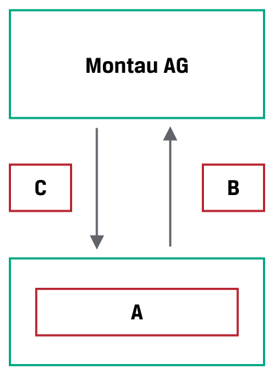

A. A：金融中介机构；B：650,000,000韩元；C：固定欧元金额

A. A: Financial intermediary, B: KRW650,000,000, C: Fixed EUR amount

B. A：Jeon公司；B：650,000,000韩元；C：固定欧元金额

B. A: Jeon Inc., B: KRW650,000,000, C: Fixed EUR amount

C. A：金融中介机构；B：固定欧元金额；C：650,000,000韩元

C. A: Financial intermediary, B: Fixed EUR amount, C: KRW650,000,000.

#### 官方答案与解析 / Official answer and explanation

3\. C正确，如下图所示：

3\. C is correct as per the following diagram:

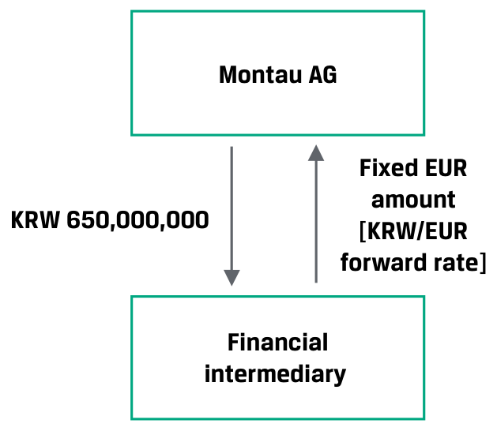

图内文字对照：Fixed EUR amount \[KRW/EUR forward rate\]＝按韩元／欧元远期汇率确定的固定欧元金额；Financial intermediary＝金融中介。

#### 补充解析 / Supplementary explanation

结合本题的官方结论：“C正确，如下图所示： 图内文字对照：Fixed EUR amount \[KRW/EUR forward rate\]＝按韩元／欧元远期汇率确定的固定欧元金额；Financial intermediary＝金融中介。” 下列补充说明解释其背后的先确定敞口，再确定合约方向。

Link to this question’s official result: “C is correct as per the following diagram:” The supplementary discussion below explains identify the exposure before choosing the contract.

解题思路：衍生品价值取决于标的变量，但持有衍生品不等于持有标的资产本身。套期保值首先要识别原有业务在什么市场变动下受损，再选在同一变动下获利的合约方向。

Reasoning: A derivative depends on an underlying variable without necessarily conferring ownership of the underlying. For hedging, identify the market move that hurts the original business exposure, then choose a derivative that gains under that move.

应用方法：例如需要未来买入某种货币或商品的一方，担心其价格上涨，通常需锁定买入价格；未来收到并出售该资产的一方，则担心价格下跌。名义本金用来计算现金流，不必等于合约初始价值或实际投入金额。

Application: A future buyer fears a price increase and generally wants to lock in a purchase price; a future seller fears a decline. Notional principal scales contractual cash flows and need not equal the derivative’s initial value or cash investment.

#### 相关知识点 / Related concepts

#### 先确定敞口，再确定合约方向 / Identify the exposure before choosing the contract

Forward commitment 使双方承担未来履约义务；contingent claim 通常赋予一方选择权，因此两者的盈亏对称性不同。

A forward commitment binds both parties to performance. A contingent claim typically grants one party an option, producing a different payoff symmetry.

### DER-LM01-P01-04 · 章末练习 4 Practice problem 4

章末练习 / Practice problem · 原版 PDF 页码 / Source PDF pages: 27-29

#### 题目与资料 / Question and data

#### 共用资料 / Shared information

### 以下信息适用于第1—5题The following information relates to questions 1-5

Montau AG是一家德国资本品生产商，在德国制造产品，并向全球客户交付。

Montau AG is a German capital goods producer that manufactures its products domestically and delivers its products to clients globally.

Montau全球销售经理向财资团队提供以下商业合约草案：

Montau’s global sales manager shares the following draft commercial contract with his Treasury team:

### Montau AG商业出口合约Montau AG Commercial Export Contract

合约日期：\[今天\]

货物卖方：Montau AG，德国法兰克福

货物买方：Jeon公司，韩国首尔

货物描述：A系列激光切割机

数量：一台

交付条款：船上交货（FOB），韩国釜山；所有运输、税费及交付成本由货物买方支付

交货日期：\[合约日期后75天\]

付款条款：货物买方于交货日期向卖方支付合约价格的100%

合约价格：650,000,000韩元

Montau AG财资经理负责处理这项拟议交易的财务风险。

Montau AG’s Treasury manager is tasked with addressing the financial risk of this prospective transaction.

4\. 关于最适合对冲Montau AG该商业合约财务风险的衍生品市场，以下哪项最准确？

4\. Which of the following statements about the most appropriate derivative market to hedge Montau AG’s financial risk under the commercial contract is most accurate?

A. OTC市场最适合Montau，因为它可以定制合约，以匹配所需风险敞口结构。

A. The OTC market is most appropriate for Montau, as it is able to customize the contract to match its desired risk exposure profile.

B. ETD市场最适合Montau，因为它提供标准化且透明的合约，以匹配所需风险敞口结构。

B. The ETD market is most appropriate for Montau, as it offers a standardized and transparent contract to match its desired risk exposure profile.

C. ETD与OTC市场都适合Montau AG对冲该交易的财务风险，因此应选择价格最优的市场。

C. Both the ETD and OTC markets are appropriate for Montau AG to hedge its financial risk under the transaction, so it should choose the market with the best price.

#### 官方答案与解析 / Official answer and explanation

4\. A正确。

4\. A is correct.

OTC市场最适合Montau，因为OTC合约可以定制，以匹配其所需风险敞口结构。

The OTC market is most appropriate for Montau, as OTC contracts may be customized to match Montau’s desired risk exposure profile.

对于希望按非标准条款对冲特定标的敞口的最终使用者，这一点十分重要。

This is important to end users seeking to hedge a specific underlying exposure based upon non-standard terms.

Montau不太可能找到B所述、在规模和到期日上完全匹配其对冲需求的ETD合约，因此C也错误。

Montau would be unlikely to find an ETD contract under B that matches the exact size and maturity date of its desired hedge, which also makes C incorrect.

#### 补充解析 / Supplementary explanation

结合本题的官方结论：“A正确。 OTC市场最适合Montau，因为OTC合约可以定制，以匹配其所需风险敞口结构。 对于希望按非标准条款对冲特定标的敞口的最终使用者，这一点十分重要。” 下列补充说明解释其背后的先确定敞口，再确定合约方向。

Link to this question’s official result: “A is correct. The OTC market is most appropriate for Montau, as OTC contracts may be customized to match Montau’s desired risk exposure profile. This is important to end users seeking to hedge a specific underlying exposure based upon non-standard terms.” The supplementary discussion below explains identify the exposure before choosing the contract.

解题思路：衍生品价值取决于标的变量，但持有衍生品不等于持有标的资产本身。套期保值首先要识别原有业务在什么市场变动下受损，再选在同一变动下获利的合约方向。

Reasoning: A derivative depends on an underlying variable without necessarily conferring ownership of the underlying. For hedging, identify the market move that hurts the original business exposure, then choose a derivative that gains under that move.

应用方法：例如需要未来买入某种货币或商品的一方，担心其价格上涨，通常需锁定买入价格；未来收到并出售该资产的一方，则担心价格下跌。名义本金用来计算现金流，不必等于合约初始价值或实际投入金额。

Application: A future buyer fears a price increase and generally wants to lock in a purchase price; a future seller fears a decline. Notional principal scales contractual cash flows and need not equal the derivative’s initial value or cash investment.

#### 相关知识点 / Related concepts

#### 先确定敞口，再确定合约方向 / Identify the exposure before choosing the contract

Forward commitment 使双方承担未来履约义务；contingent claim 通常赋予一方选择权，因此两者的盈亏对称性不同。

A forward commitment binds both parties to performance. A contingent claim typically grants one party an option, producing a different payoff symmetry.

### DER-LM01-P01-05 · 章末练习 5 Practice problem 5

章末练习 / Practice problem · 原版 PDF 页码 / Source PDF pages: 27-29

#### 题目与资料 / Question and data

#### 共用资料 / Shared information

### 以下信息适用于第1—5题The following information relates to questions 1-5

Montau AG是一家德国资本品生产商，在德国制造产品，并向全球客户交付。

Montau AG is a German capital goods producer that manufactures its products domestically and delivers its products to clients globally.

Montau全球销售经理向财资团队提供以下商业合约草案：

Montau’s global sales manager shares the following draft commercial contract with his Treasury team:

### Montau AG商业出口合约Montau AG Commercial Export Contract

合约日期：\[今天\]

货物卖方：Montau AG，德国法兰克福

货物买方：Jeon公司，韩国首尔

货物描述：A系列激光切割机

数量：一台

交付条款：船上交货（FOB），韩国釜山；所有运输、税费及交付成本由货物买方支付

交货日期：\[合约日期后75天\]

付款条款：货物买方于交货日期向卖方支付合约价格的100%

合约价格：650,000,000韩元

Montau AG财资经理负责处理这项拟议交易的财务风险。

Montau AG’s Treasury manager is tasked with addressing the financial risk of this prospective transaction.

5\. 如果Montau在OTC市场签订中央清算的衍生品合约，以下关于该衍生品相关信用风险的陈述，哪项最可能正确？

5\. If Montau enters into a centrally cleared derivative contract on the OTC market, which of the following statements about credit risk associated with the derivative is most likely correct?

A. Montau面临合约交易对手可能无法履行合约义务的信用风险。

A. Montau faces credit risk associated with the possibility that its counterparty to the contract may not fulfill its contractual obligation.

B. Montau对交易对手构成信用风险，因为它可能无法履行合约义务。

B. Montau poses a credit risk to its counterparty because it may fail to fulfill its contractual obligation.

C. Montau对持有与其合约特征相反头寸的衍生品最终使用者构成信用风险。

C. Montau poses a credit risk to a derivative contract end user holding a contract with the opposite features of Montau’s.

#### 官方答案与解析 / Official answer and explanation

5\. B正确。

5\. B is correct.

在中央清算的OTC衍生品合约中，中央交易对手成为所有合约的交易对手，并承担各衍生品合约的信用风险。

In a centrally cleared OTC derivative contract, the central counterparty becomes the counterparty in all contracts and assumes the credit risk associated with individual derivative contracts.

A很可能错误，因为CCP会采取措施，确保能够履行对交易对手的义务。

A is likely incorrect because the CCP takes actions to ensure that it can fulfill its obligations to its counterparties.

C错误，因为CCP介于持有相反头寸的双方之间。

C is incorrect because the CCP inserts itself between parties with opposite positions.

#### 补充解析 / Supplementary explanation

结合本题的官方结论：“B正确。 在中央清算的OTC衍生品合约中，中央交易对手成为所有合约的交易对手，并承担各衍生品合约的信用风险。 A很可能错误，因为CCP会采取措施，确保能够履行对交易对手的义务。” 下列补充说明解释其背后的场外、交易所与中央清算。

Link to this question’s official result: “B is correct. In a centrally cleared OTC derivative contract, the central counterparty becomes the counterparty in all contracts and assumes the credit risk associated with individual derivative contracts. A is likely incorrect because the CCP takes actions to ensure that it can fulfill its obligations to its counterparties.” The supplementary discussion below explains otc trading, exchanges, and central clearing.

解题思路：交易场所与清算方式是两个相关但不同的问题。场外合约通常更易定制名义金额、日期和条款；交易所合约通常标准化。场外成交也可以进入中央清算，不能把 OTC 自动等同于双边不清算。

Reasoning: Trading venue and clearing method are related but distinct. OTC contracts are usually more customizable, while exchange contracts are standardized. OTC trades can also be centrally cleared, so OTC does not automatically mean uncleared bilateral exposure.

应用方法：先比较客户实际敞口与标准合约是否匹配，再分析对手方是谁。CCP 通过替代原交易对手、保证金和风险管理降低部分双边风险，但风险会集中到清算体系，不能理解为所有风险彻底消失。

Application: Compare the customer’s exposure with available standardized contracts, then identify the legal counterparty. A CCP interposes itself and uses margin and risk management to reduce bilateral exposure, while concentrating risk within the clearing system.

#### 相关知识点 / Related concepts

#### 场外、交易所与中央清算 / OTC trading, exchanges, and central clearing

Customization 有助于降低期限和金额错配；standardization 通常有助于流动性和交易便利。二者都不能保证不存在市场风险。

Customization can reduce size and maturity mismatch; standardization can improve liquidity and trading convenience. Neither eliminates market risk.

## LM 2 · 远期承诺与或有索取权：特征及工具 Forward Commitment and Contingent Claim Features and Instruments 33 条目 · 原题与解析逐条对应 / Paired source questions and explanations

### DER-LM02-SA01-01 · 模块自测 1 Module self-assessment 1

课前自测 / Pre-test / self-assessment · 原版 PDF 页码 / Source PDF pages: 32

#### 题目与资料 / Question and data

1\. 以下哪项正确描述了远期合约与期货合约之间的差异？

1\. Which of the following statements correctly describes a difference between a forward contract and a futures contract?

A. 远期合约为买卖双方确定约定价格，而期货合约不会。

A. A forward contract sets an agreed-on price for buyer and seller, while a futures contract does not.

B. 远期合约确定卖方向买方交付标的的约定交易日期，而期货合约不会。

B. A forward contract sets an agreed-on transaction date for the seller to deliver the underlying to the buyer, while a futures contract does not.

C. 远期合约不要求每日结算损益，而期货合约要求。

C. A forward contract does not require daily settlement of gains and losses, while a futures contract does.

#### 官方答案与解析 / Official answer and explanation

C正确。

C is correct.

期货合约要求通过交易所清算所的盯市程序进行每日结算。

Futures contracts require daily settlement through the exchange clearinghouse mark-to-market process.

远期合约在到期日结算，不过交易双方也可以定制其他结算安排。

Forward contracts are settled at their maturity date, although the two parties to the contract may customize alternative settlement procedures.

A错误，因为远期与期货合约都会为未来交易确定约定价格。

A is incorrect because both forward and futures contracts set an agreed-on price for a future transaction.

B错误，因为两者都包含交换标的的到期日。

B is incorrect because both forwards and futures contracts include a maturity date when the underlying will be exchanged.

#### 补充解析 / Supplementary explanation

结合本题的官方结论：“C正确。 期货合约要求通过交易所清算所的盯市程序进行每日结算。 远期合约在到期日结算，不过交易双方也可以定制其他结算安排。” 下列补充说明解释其背后的期货保证金与每日结算。

Link to this question’s official result: “C is correct. Futures contracts require daily settlement through the exchange clearinghouse mark-to-market process. Forward contracts are settled at their maturity date, although the two parties to the contract may customize alternative settlement procedures.” The supplementary discussion below explains futures margin and daily settlement.

解题思路：期货保证金是履约保障，不是买入标的资产的全款。每日价格变化产生的盈亏会转入或转出保证金账户，因此最终总盈亏与每日现金流路径要分开理解。

Reasoning: Futures margin is performance collateral, not the full purchase price of the underlying. Daily gains and losses are paid into or out of the margin account, so total payoff and the path of interim cash flows must be distinguished.

应用方法：逐日计算“价格变动 × 合约乘数 × 合约数量”，再更新余额。余额跌破 maintenance margin 后，常见规则是补回 initial margin，不是只补到 maintenance margin；具体仍以题目条款为准。

Application: Calculate each day’s price change times contract multiplier and number of contracts, then update the account. A breach of maintenance margin commonly requires replenishment to initial margin, subject to the stated contract rules.

#### 相关知识点 / Related concepts

#### 期货保证金与每日结算 / Futures margin and daily settlement

Initial margin 是初始要求；maintenance margin 是触发补缴的阈值；variation margin 与逐日盈亏转移或补缴有关。

Initial margin is the initial requirement, maintenance margin is a trigger threshold, and variation margin relates to daily gains, losses, or replenishment.

关联考点：F₀(T) 是约定交割价，Vₜ(T) 是时点 t 的合约价值，Sₜ 是现货价格。保留这些时间下标可以避免把不同量混用。

Related concept: F₀(T) is the delivery price, Vₜ(T) the contract value at time t, and Sₜ the spot price. Time subscripts help keep them distinct.

### DER-LM02-SA01-02 · 模块自测 2 Module self-assessment 2

课前自测 / Pre-test / self-assessment · 原版 PDF 页码 / Source PDF pages: 32-33

#### 题目与资料 / Question and data

2\. 将以下各项确定承诺与对应的例子配对：

2\. Identify which example fits each of the following firm commitments:

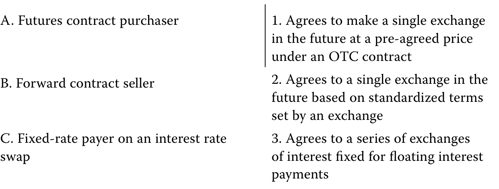

A. 期货合约买方；1. 根据场外合约，约定未来按预先约定的价格进行一次交换。

B. 远期合约卖方；2. 根据交易所制定的标准化条款，约定未来进行一次交换。

C. 利率互换中的固定利率支付方。

3\. 约定进行一系列固定利息与浮动利息的交换。

#### 官方答案与解析 / Official answer and explanation

1\. B正确。远期合约卖方根据场外合约，约定未来按预先约定的价格进行一次交换。

1\. B is correct. A forward contract seller agrees to make a single exchange in the future at a pre-agreed price under an OTC contract.

2\. A正确。期货合约买方根据交易所制定的标准化条款，约定未来进行一次交换。

2\. A is correct. A futures contract purchaser agrees to a single exchange in the future based on standardized terms set by an exchange.

3\. C正确。利率互换中的固定利率支付方约定进行一系列固定利息与浮动利息的交换。

3\. C is correct. A fixed-rate payer on an interest rate swap agrees to a series of exchanges of fixed for floating interest payments.

#### 补充解析 / Supplementary explanation

结合本题的官方结论：“B正确。远期合约卖方根据场外合约，约定未来按预先约定的价格进行一次交换。 2. A正确。” 下列补充说明解释其背后的互换是一组现金流交换。

Link to this question’s official result: “B is correct. A forward contract seller agrees to make a single exchange in the future at a pre-agreed price under an OTC contract. 2. A is correct.” The supplementary discussion below explains a swap exchanges a sequence of cash flows.

解题思路：普通利率互换把多期固定利息与多期浮动利息交换。公平固定互换利率让两条腿在起始时现值相等；起始后原固定利率不变，市场利率变化会使两条腿重新出现价值差。

Reasoning: A plain interest-rate swap exchanges a series of fixed and floating interest payments. The fair fixed rate equates the two legs’ present values at inception. Later, the contractual fixed rate stays unchanged while market repricing creates a value difference.

应用方法：先标明谁付固定、谁付浮动，以及是否净额结算。支付固定方通常受益于市场利率上升；估值时逐期折现所收现金流并减去所付现金流。名义本金一般用于计算利息，未必实际交换。

Application: Label the payer of each leg and the netting convention. A fixed-rate payer generally benefits from rising market rates. Value the swap as discounted receipts minus discounted payments. Notional principal usually scales interest rather than being exchanged.

#### 相关知识点 / Related concepts

#### 互换是一组现金流交换 / A swap exchanges a sequence of cash flows

公平互换固定利率是各未来现金流折现关系共同决定的结果，不是未来浮动利率的简单算术平均。

The fair fixed swap rate follows from discounted cash-flow relationships, not a simple arithmetic average of future floating rates.

Swap value = PV(receive leg) − PV(pay leg)

### DER-LM02-SA01-03 · 模块自测 3 Module self-assessment 3

课前自测 / Pre-test / self-assessment · 原版 PDF 页码 / Source PDF pages: 33

#### 题目与资料 / Question and data

3\. 将以下各项或有索取权与对应的例子配对：

3\. Identify which example fits each of the following contingent claims:

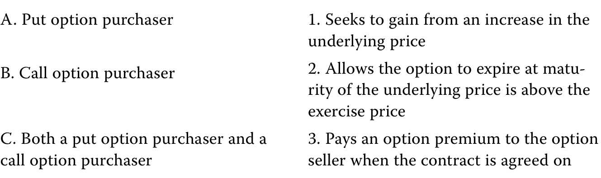

A. 看跌期权买方；1. 寻求从标的价格上涨中获利。

B. 看涨期权买方；2. 若到期时标的价格高于行权价格，则让期权到期失效。

C. 看跌期权买方及看涨期权买方。

3\. 在订立合约时向期权卖方支付权利金。

#### 官方答案与解析 / Official answer and explanation

1\. B正确。看涨期权买方寻求从标的价格上涨中获利。

1\. B is correct. A call option purchaser seeks to gain from an increase in the underlying price.

2\. A正确。

2\. A is correct.

如果到期时标的价格高于行权价格，看跌期权买方会让期权到期而不行权。

A put option purchaser will allow an option to expire at maturity without exercise if the underlying price is above the exercise price.

3\. C正确。看跌期权买方和看涨期权买方均会在订立期权合约时向卖方支付权利金。

3\. C is correct. Both a put option purchaser and a call option purchaser will pay a premium to the option seller when the option contract is executed.

#### 补充解析 / Supplementary explanation

结合本题的官方结论：“B正确。看涨期权买方寻求从标的价格上涨中获利。 2. A正确。” 下列补充说明解释其背后的期权支付与利润分开算。

Link to this question’s official result: “B is correct. A call option purchaser seeks to gain from an increase in the underlying price. 2. A is correct.” The supplementary discussion below explains separate option payoff from profit.

解题思路：期权买方有权选择是否行权，因此到期支付不会因为不利行情而变成负数；但买方事先支付了权利金，所以净利润仍可能为负。把 payoff 和 profit 混为一谈，是此类题最常见的错误。

Reasoning: An option buyer can choose not to exercise, so expiration payoff is non-negative. The buyer nevertheless paid a premium and can lose money overall. Confusing payoff with profit is a frequent error.

应用方法：先比较到期价格与执行价，算出行权支付，再扣除权利金得到买方利润；若题目忽略资金时间价值，就不要额外计息。卖方损益取相反数，并按合约乘数换算实际金额。

Application: Compare terminal spot with the strike, calculate exercise payoff, and subtract premium for the buyer’s profit. Do not add financing adjustments when the question ignores the time value of money. Reverse the sign for the seller and apply the contract multiplier.

#### 相关知识点 / Related concepts

#### 期权支付与利润分开算 / Separate option payoff from profit

In the money 表示立即行权有正支付，不保证扣除权利金后盈利。Call 买方通常受益于上涨，put 买方通常受益于下跌。

In the money means positive exercise value, not necessarily a positive net profit. Call buyers generally benefit from price rises and put buyers from declines.

Call payoff = max(Sₜ − X, 0); Put payoff = max(X − Sₜ, 0); Buyer profit = Payoff − Premium

### DER-LM02-SA01-04 · 模块自测 4 Module self-assessment 4

课前自测 / Pre-test / self-assessment · 原版 PDF 页码 / Source PDF pages: 33

#### 题目与资料 / Question and data

4\. 一份允许在三个月后以45美元的行权价格买入标的证券的期权，其权利金为6美元。

4\. An option to buy an underlying security at an exercise price of USD45 in three months trades at a premium of USD6.

三个月后，标的的交易价格为50美元。

After three months, the underlying trades at USD50.

以下哪项正确描述了期权买方和卖方的盈亏？

Which of the following responses correctly describes the profit/loss position of the option buyer and seller?

A. 期权买方盈利5美元，期权卖方亏损5美元。

A. Option buyer earns USD5 profit, and option seller earns USD5 loss.

B. 期权买方亏损1美元，期权卖方盈利1美元。

B. Option buyer earns USD1 loss, and option seller earns USD1 profit.

C. 期权买方盈利5美元，期权卖方的利润为0。

C. Option buyer earns USD5 profit, and option seller earns USD0.

#### 官方答案与解析 / Official answer and explanation

B正确。期权买方的头寸产生5美元的到期收益，等于标的价格超过行权价格的部分。买方为取得期权支付了6美元，这笔现金流超过其正的到期收益，因此整体亏损1美元。对于期权卖方，期权头寸产生负的到期收益，即支付5美元；但卖方收到了6美元权利金，因此整体盈利1美元。具体计算式见对应英文及共用公式。A错误，因为5美元仅反映期权到期收益，并未计入权利金来计算实际损益。C错误，因为其将买方的到期收益误当成利润；只有标的价格为51美元而非50美元时，所述卖方利润才正确。

B is correct. The option buyer’s position generates a payoff of USD5, equal to max(0, 50 – 45). The option buyer paid USD6 to buy the option position, and this cash flow more than offsets the positive payoff. Thus, the option buyer’s overall profit is a loss of USD1 (i.e., 5 – 6). For the option seller, the option position creates a negative payoff of –USD5, equal to –max(0, 50 – 45). However, the option seller received the option premium of USD6, so the overall profit is USD1 (i.e., 6 – 5). A is incorrect because the USD5 amount reflects the option payoff only, not profits and losses accounting for the option premium. C is incorrect because the buyer’s profit incorrectly states the payoff only to the option position, not the profit. The seller’s profit would be correct only if the underlying traded at 51, not 50.

#### 补充解析 / Supplementary explanation

结合本题的官方结论：“B正确。期权买方的头寸产生5美元的到期收益，等于标的价格超过行权价格的部分。买方为取得期权支付了6美元，这笔现金流超过其正的到期收益，因此整体亏损1美元。” 下列补充说明解释其背后的期权支付与利润分开算。

Link to this question’s official result: “B is correct. The option buyer’s position generates a payoff of USD5, equal to max(0, 50 – 45). The option buyer paid USD6 to buy the option position, and this cash flow more than offsets the positive payoff.” The supplementary discussion below explains separate option payoff from profit.

解题思路：期权买方有权选择是否行权，因此到期支付不会因为不利行情而变成负数；但买方事先支付了权利金，所以净利润仍可能为负。把 payoff 和 profit 混为一谈，是此类题最常见的错误。

Reasoning: An option buyer can choose not to exercise, so expiration payoff is non-negative. The buyer nevertheless paid a premium and can lose money overall. Confusing payoff with profit is a frequent error.

应用方法：先比较到期价格与执行价，算出行权支付，再扣除权利金得到买方利润；若题目忽略资金时间价值，就不要额外计息。卖方损益取相反数，并按合约乘数换算实际金额。

Application: Compare terminal spot with the strike, calculate exercise payoff, and subtract premium for the buyer’s profit. Do not add financing adjustments when the question ignores the time value of money. Reverse the sign for the seller and apply the contract multiplier.

#### 相关知识点 / Related concepts

#### 期权支付与利润分开算 / Separate option payoff from profit

In the money 表示立即行权有正支付，不保证扣除权利金后盈利。Call 买方通常受益于上涨，put 买方通常受益于下跌。

In the money means positive exercise value, not necessarily a positive net profit. Call buyers generally benefit from price rises and put buyers from declines.

Call payoff = max(Sₜ − X, 0); Put payoff = max(X − Sₜ, 0); Buyer profit = Payoff − Premium

### DER-LM02-SA01-05 · 模块自测 5 Module self-assessment 5

课前自测 / Pre-test / self-assessment · 原版 PDF 页码 / Source PDF pages: 33-34

#### 题目与资料 / Question and data

5\. 在以下哪种情况下，看跌期权买方会获得正的利润？

5\. A put option buyer earns a positive profit in which of the following conditions?

A. 期权到期时的标的价格低于期权的行权价格。

A. The price of the underlying at option expiration is less than the option’s exercise price.

B. 期权到期时的标的价格高于期权的行权价格。

B. The price of the underlying at option expiration is greater than the option’s exercise price.

C. 标的价格低于期权行权价格减去权利金。

C. The price of the underlying is less than the option’s exercise price minus the option’s premium.

#### 官方答案与解析 / Official answer and explanation

C正确。

C is correct.

看跌期权买方要获得正的利润，标的价格必须充分低于行权价格，使得（1）看跌期权可以行权并获得正的到期收益，且（2）该到期收益高于已支付的权利金。

For a put option buyer to earn a positive profit, the underlying price must be sufficiently below the put option’s exercise price such that (1) the put option can be exercised with a positive payoff and (2) the positive payoff is greater than the option premium paid.

因此，只有当标的价格低于行权价格减去权利金时，才会出现正利润。

Thus, only if the underlying price falls below the exercise price minus the premium can this occur.

A错误，因为该条件只意味着期权有正的到期收益，也包含到期收益未超过权利金的价格情况。

A is incorrect because this condition only implies a positive payoff on the option but would include prices at which the payoff is not greater than the premium.

B错误，因为此时看跌期权处于虚值状态，到期收益为零。

B is incorrect because the put option would be out of the money and would generate zero payoff.

#### 补充解析 / Supplementary explanation

结合本题的官方结论：“C正确。 看跌期权买方要获得正的利润，标的价格必须充分低于行权价格，使得（1）看跌期权可以行权并获得正的到期收益，且（2）该到期收益高于已支付的权利金。 因此，只有当标的价格低于行权价格减去权利金时，才会出现正利润。” 下列补充说明解释其背后的期权支付与利润分开算。

Link to this question’s official result: “C is correct. For a put option buyer to earn a positive profit, the underlying price must be sufficiently below the put option’s exercise price such that (1) the put option can be exercised with a positive payoff and (2) the positive payoff is greater than the option premium paid. Thus, only if the underlying price falls below the exercise price minus the premium can this occur.” The supplementary discussion below explains separate option payoff from profit.

解题思路：期权买方有权选择是否行权，因此到期支付不会因为不利行情而变成负数；但买方事先支付了权利金，所以净利润仍可能为负。把 payoff 和 profit 混为一谈，是此类题最常见的错误。

Reasoning: An option buyer can choose not to exercise, so expiration payoff is non-negative. The buyer nevertheless paid a premium and can lose money overall. Confusing payoff with profit is a frequent error.

应用方法：先比较到期价格与执行价，算出行权支付，再扣除权利金得到买方利润；若题目忽略资金时间价值，就不要额外计息。卖方损益取相反数，并按合约乘数换算实际金额。

Application: Compare terminal spot with the strike, calculate exercise payoff, and subtract premium for the buyer’s profit. Do not add financing adjustments when the question ignores the time value of money. Reverse the sign for the seller and apply the contract multiplier.

#### 相关知识点 / Related concepts

#### 期权支付与利润分开算 / Separate option payoff from profit

In the money 表示立即行权有正支付，不保证扣除权利金后盈利。Call 买方通常受益于上涨，put 买方通常受益于下跌。

In the money means positive exercise value, not necessarily a positive net profit. Call buyers generally benefit from price rises and put buyers from declines.

Call payoff = max(Sₜ − X, 0); Put payoff = max(X − Sₜ, 0); Buyer profit = Payoff − Premium

### DER-LM02-SA01-06 · 模块自测 6 Module self-assessment 6

课前自测 / Pre-test / self-assessment · 原版 PDF 页码 / Source PDF pages: 34

#### 题目与资料 / Question and data

6\. 对于同一标的，以下哪组头寸会从方向相反的标的价格变动中受益？

6\. Which of the following positions on the same underlying benefit from oppo site price movements in an underlying?

A. 远期合约多头、看跌期权空头。

A. Long forward contract, short put option

B. 远期合约空头、看跌期权多头。

B. Short forward contract, long put option

C. 远期合约空头、看跌期权空头。

C. Short forward contract, short put option

#### 官方答案与解析 / Official answer and explanation

C正确。

C is correct.

远期空头从标的价格下跌中受益，而看跌期权空头只在标的价格上升时受益。

A short forward position benefits as the underlying price declines, while a short put benefits only when the underlying price increases.

A错误，因为远期多头和看跌期权空头都会从标的价格上涨中受益。

A is incorrect because both a long forward and a short put benefit from underlying price increases.

B错误，因为远期空头和看跌期权多头都会从标的价格下跌中受益。

B is incorrect because both a short forward and a long put option benefit from underlying price decreases.

#### 补充解析 / Supplementary explanation

结合本题的官方结论：“C正确。 远期空头从标的价格下跌中受益，而看跌期权空头只在标的价格上升时受益。 A错误，因为远期多头和看跌期权空头都会从标的价格上涨中受益。” 下列补充说明解释其背后的远期的价格、价值与到期损益。

Link to this question’s official result: “C is correct. A short forward position benefits as the underlying price declines, while a short put benefits only when the underlying price increases. A is incorrect because both a long forward and a short put benefit from underlying price increases.” The supplementary discussion below explains forward price, contract value, and payoff.

解题思路：合约中预先约定的交割价格与合约今天的市场价值不是同一个量。买方已经锁定买入价格，因此到期标的市价越高，买方越有利；卖方的损益方向正好相反。

Reasoning: The agreed delivery price is different from the contract’s current market value. A long forward locks in a purchase price and benefits when the terminal spot price is higher; the short side has the opposite payoff.

应用方法：先标明 long / short，再用“收到什么减去支付什么”。如果报价按每股、每盎司或每单位给出，最后还要乘合约数量。普通公平定价远期初始价值可为零，但不代表其交割价格或名义金额为零。

Application: Identify long or short, then subtract what is paid from what is received. Multiply a per-unit payoff by contract quantity. A fairly priced forward can have zero initial value without having a zero delivery price or notional amount.

#### 相关知识点 / Related concepts

#### 远期的价格、价值与到期损益 / Forward price, contract value, and payoff

F₀(T) 是约定交割价，Vₜ(T) 是时点 t 的合约价值，Sₜ 是现货价格。保留这些时间下标可以避免把不同量混用。

F₀(T) is the delivery price, Vₜ(T) the contract value at time t, and Sₜ the spot price. Time subscripts help keep them distinct.

Long payoff at maturity = S_T − F_0(T); Short payoff = F_0(T) − S_T

### DER-LM02-EX01-01 · 已解例题 1 · 远期购买黄金 Worked example 1 · Forward Gold Purchase

正文例题／案例 / Worked example / case · 原版 PDF 页码 / Source PDF pages: 36

#### 题目与资料 / Question and data

### 远期购买黄金Forward Gold Purchase

#### 官方答案与解析 / Official answer and explanation

投资者Procam Investments与一家金融中介订立以现金结算的远期合约，约定三个月后以每盎司1,792.13美元的远期价格F₀(T)，买入100盎司黄金。

An investor, Procam Investments, enters a cash-settled forward contract with a financial intermediary to buy 100 ounces of gold at a forward price, F0(T), of \$1,792.13 per ounce in three months.

1\. 当前黄金现货价格为每盎司1,770美元。

1\. Today’s spot gold price (S0) is \$1,770 per ounce.

2\. 合约到期时，黄金价格为每盎司1,780.50美元。

2\. At contract maturity, the gold price (ST) is \$1,780.50 per ounce.

3\. 买方的到期收益为每盎司亏损11.63美元，计算式如下。

3\. The payoff, ST – F0(T), is –\$11.63 = \$1,780.50 – \$1,792.13 per ounce.

4\. Procam（买方）必须向金融中介（卖方）支付1,163美元，以在到期时结算该远期合约。

4\. Procam (the buyer) must pay the financial intermediary (the seller) \$1,163 (= 100 × \$11.63) to settle the forward contract at maturity.

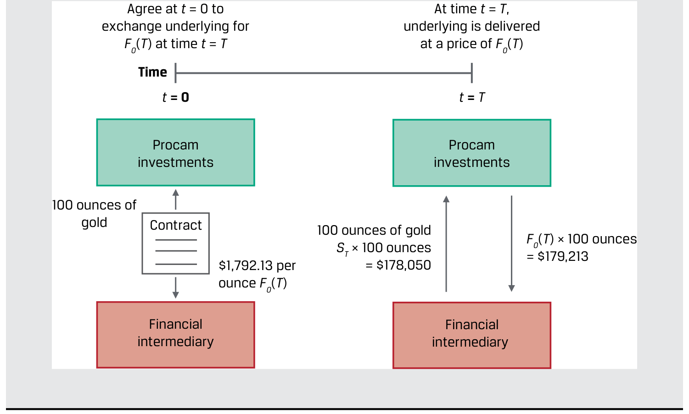

图内文字对照：Procam investments＝Procam投资公司；Financial intermediary＝金融中介；Time＝时间；Agree at t = 0 to exchange underlying for F0(T) at time t = T＝在起始时约定，于到期日以远期价格交换标的资产；At time t = T, underlying is delivered at a price of F0(T)＝在到期日按约定远期价格交付标的资产；Contract＝合约。

#### 补充解析 / Supplementary explanation

结合本题的官方结论：“投资者Procam Investments与一家金融中介订立以现金结算的远期合约，约定三个月后以每盎司1,792.13美元的远期价格F₀(T)，买入100盎司黄金。 1. 当前黄金现货价格为每盎司1,770美元。 2. 合约到期时，黄金价格为每盎司1,780.50美元。” 下列补充说明解释其背后的远期的价格、价值与到期损益。

Link to this question’s official result: “An investor, Procam Investments, enters a cash-settled forward contract with a financial intermediary to buy 100 ounces of gold at a forward price, F0(T), of \$1,792.13 per ounce in three months. 1. Today’s spot gold price (S0) is \$1,770 per ounce. 2. At contract maturity, the gold price (ST) is \$1,780.50 per ounce. 3.” The supplementary discussion below explains forward price, contract value, and payoff.

解题思路：合约中预先约定的交割价格与合约今天的市场价值不是同一个量。买方已经锁定买入价格，因此到期标的市价越高，买方越有利；卖方的损益方向正好相反。

Reasoning: The agreed delivery price is different from the contract’s current market value. A long forward locks in a purchase price and benefits when the terminal spot price is higher; the short side has the opposite payoff.

应用方法：先标明 long / short，再用“收到什么减去支付什么”。如果报价按每股、每盎司或每单位给出，最后还要乘合约数量。普通公平定价远期初始价值可为零，但不代表其交割价格或名义金额为零。

Application: Identify long or short, then subtract what is paid from what is received. Multiply a per-unit payoff by contract quantity. A fairly priced forward can have zero initial value without having a zero delivery price or notional amount.

#### 相关知识点 / Related concepts

#### 远期的价格、价值与到期损益 / Forward price, contract value, and payoff

F₀(T) 是约定交割价，Vₜ(T) 是时点 t 的合约价值，Sₜ 是现货价格。保留这些时间下标可以避免把不同量混用。

F₀(T) is the delivery price, Vₜ(T) the contract value at time t, and Sₜ the spot price. Time subscripts help keep them distinct.

Long payoff at maturity = S_T − F_0(T); Short payoff = F_0(T) − S_T

原书为叙述式已解例题，完整条件、计算及结论保留在官方解析区。

### DER-LM02-QS01-01 · 正文题组 1 · 第 1 题 Question set 1 · Question 1

正文习题组 / Question set · 原版 PDF 页码 / Source PDF pages: 36

#### 题目与资料 / Question and data

#### 共用资料 / Shared information

远期

Forwards

1\. 描述一种远期合约到期现金结算金额为零、且双方均未违约的情形。

1\. Describe a scenario in which a forward contract has cash settlement of zero at maturity and neither counterparty has defaulted.

#### 官方答案与解析 / Official answer and explanation

如果到期现货价格等于远期价格，则远期合约的到期现金结算金额为零，亦即买方的到期收益为零。

A forward contract will have a cash settlement of zero at maturity if ST = F0(T) or the payoff from the buyer’s perspective is \[ST – F0(T)\] = 0.

在不考虑交易成本时，这通常称为买卖双方的远期合约盈亏平衡点，在图表1中表现为利润线与横轴的交点。

This is often referred to as the breakeven point for the forward contract for both buyer and seller in the absence of transaction costs and is visually represented by the x-axis intercept of the profit line in Exhibit 1.

#### 补充解析 / Supplementary explanation

结合本题的官方结论：“如果到期现货价格等于远期价格，则远期合约的到期现金结算金额为零，亦即买方的到期收益为零。 在不考虑交易成本时，这通常称为买卖双方的远期合约盈亏平衡点，在图表1中表现为利润线与横轴的交点。” 下列补充说明解释其背后的远期的价格、价值与到期损益。

Link to this question’s official result: “A forward contract will have a cash settlement of zero at maturity if ST = F0(T) or the payoff from the buyer’s perspective is \[ST – F0(T)\] = 0. This is often referred to as the breakeven point for the forward contract for both buyer and seller in the absence of transaction costs and is visually represented by the x-axis intercept of the profit line in Exhibit 1.” The supplementary discussion below explains forward price, contract value, and payoff.

解题思路：合约中预先约定的交割价格与合约今天的市场价值不是同一个量。买方已经锁定买入价格，因此到期标的市价越高，买方越有利；卖方的损益方向正好相反。

Reasoning: The agreed delivery price is different from the contract’s current market value. A long forward locks in a purchase price and benefits when the terminal spot price is higher; the short side has the opposite payoff.

应用方法：先标明 long / short，再用“收到什么减去支付什么”。如果报价按每股、每盎司或每单位给出，最后还要乘合约数量。普通公平定价远期初始价值可为零，但不代表其交割价格或名义金额为零。

Application: Identify long or short, then subtract what is paid from what is received. Multiply a per-unit payoff by contract quantity. A fairly priced forward can have zero initial value without having a zero delivery price or notional amount.

#### 相关知识点 / Related concepts

#### 远期的价格、价值与到期损益 / Forward price, contract value, and payoff

F₀(T) 是约定交割价，Vₜ(T) 是时点 t 的合约价值，Sₜ 是现货价格。保留这些时间下标可以避免把不同量混用。

F₀(T) is the delivery price, Vₜ(T) the contract value at time t, and Sₜ the spot price. Time subscripts help keep them distinct.

Long payoff at maturity = S_T − F_0(T); Short payoff = F_0(T) − S_T

### DER-LM02-QS01-02 · 正文题组 1 · 第 2 题 Question set 1 · Question 2

正文习题组 / Question set · 原版 PDF 页码 / Source PDF pages: 36-37

#### 题目与资料 / Question and data

#### 共用资料 / Shared information

远期

Forwards

2\. 填空：一家石油生产商与投资者订立衍生品合约，约定两个月后以每桶64美元的远期价格出售1,000桶石油。

2\. Determine the correct answers to fill in the blanks: An oil producer en ters a derivative contract with an investor to sell 1,000 barrels of oil in two months at a forward price of \$64 per barrel.

如果到期时石油现货价格为每桶58.50美元，该投资者到期时将实现\_\_\_\_\_\_\_\_\_\_，金额为\_\_\_\_\_\_\_\_\_\_。

If the spot oil price at maturity is \$58.50 per barrel, the investor realizes a \_\_\_\_\_\_\_\_\_\_ at maturity equal to \_\_\_\_\_\_\_\_\_\_.

#### 官方答案与解析 / Official answer and explanation

石油生产商与投资者订立衍生品合约，约定两个月后以每桶64美元出售1,000桶石油。

An oil producer enters a derivative contract with an investor to sell 1,000 barrels of oil in two months at a forward price of \$64 per barrel.

如果到期时现货价格为每桶58.50美元，投资者到期时将亏损5,500美元。

If the spot oil price at maturity is \$58.50 per barrel, the investor realizes a loss at maturity equal to \$5,500.

合约约定的石油远期价格F₀(T)为每桶64美元。

The oil forward price, F0(T), under the contract equals \$64 per barrel.

合约到期时，石油现货价格为每桶58.50美元。

At contract maturity, the spot oil price (ST) is \$58.50 per barrel.

• 投资者每桶石油的到期收益：

• Investor payoff per barrel:

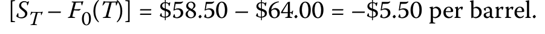投资者每桶石油亏损5.50美元，计算式如下。

• 投资者在到期时向石油生产商支付的总额，用于结算1,000桶石油的远期合约：

• Total amount the investor pays the oil producer to settle the forward contract for 1,000 barrels at maturity:

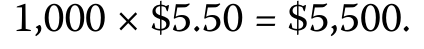

#### 补充解析 / Supplementary explanation

结合本题的官方结论：“石油生产商与投资者订立衍生品合约，约定两个月后以每桶64美元出售1,000桶石油。 如果到期时现货价格为每桶58.50美元，投资者到期时将亏损5,500美元。 合约约定的石油远期价格F₀(T)为每桶64美元。” 下列补充说明解释其背后的远期的价格、价值与到期损益。

Link to this question’s official result: “An oil producer enters a derivative contract with an investor to sell 1,000 barrels of oil in two months at a forward price of \$64 per barrel. If the spot oil price at maturity is \$58.50 per barrel, the investor realizes a loss at maturity equal to \$5,500. The oil forward price, F0(T), under the contract equals \$64 per barrel.” The supplementary discussion below explains forward price, contract value, and payoff.

解题思路：合约中预先约定的交割价格与合约今天的市场价值不是同一个量。买方已经锁定买入价格，因此到期标的市价越高，买方越有利；卖方的损益方向正好相反。

Reasoning: The agreed delivery price is different from the contract’s current market value. A long forward locks in a purchase price and benefits when the terminal spot price is higher; the short side has the opposite payoff.

应用方法：先标明 long / short，再用“收到什么减去支付什么”。如果报价按每股、每盎司或每单位给出，最后还要乘合约数量。普通公平定价远期初始价值可为零，但不代表其交割价格或名义金额为零。

Application: Identify long or short, then subtract what is paid from what is received. Multiply a per-unit payoff by contract quantity. A fairly priced forward can have zero initial value without having a zero delivery price or notional amount.

#### 相关知识点 / Related concepts

#### 远期的价格、价值与到期损益 / Forward price, contract value, and payoff

F₀(T) 是约定交割价，Vₜ(T) 是时点 t 的合约价值，Sₜ 是现货价格。保留这些时间下标可以避免把不同量混用。

F₀(T) is the delivery price, Vₜ(T) the contract value at time t, and Sₜ the spot price. Time subscripts help keep them distinct.

Long payoff at maturity = S_T − F_0(T); Short payoff = F_0(T) − S_T

### DER-LM02-QS01-03 · 正文题组 1 · 第 3 题 Question set 1 · Question 3

正文习题组 / Question set · 原版 PDF 页码 / Source PDF pages: 36-37

#### 题目与资料 / Question and data

#### 共用资料 / Shared information

远期

Forwards

3\. 将以下描述与最可能对应的远期合约参与者配对：

3\. Identify the most likely forward contract participants that correspond to the following statements:

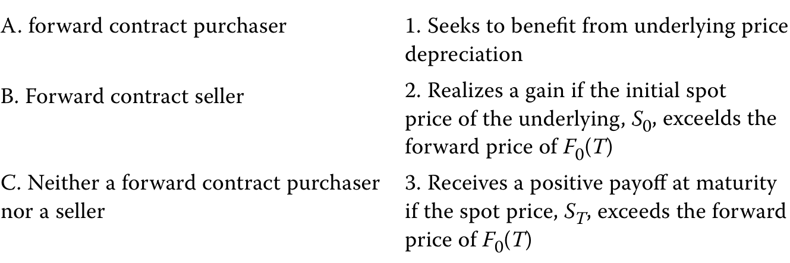

A. 远期合约买方；1. 寻求从标的价格下跌中获利。

B. 远期合约卖方；2. 当标的初始现货价格S₀高于远期价格F₀(T)时获利。

C. 远期合约买方和卖方均不符合。

3\. 如果到期现货价格高于远期价格，则到期时获得正的到期收益。

#### 官方答案与解析 / Official answer and explanation

1\. 正确答案是B。远期卖方的到期净收益等于约定远期价格减去到期现货价格，因此会从标的现货价格下降中受益。【译注：原文将这一卖方净收益写成“向买方支付”的金额，收付方向表述与前文收益公式不一致；此处按净收益含义解释。】

1\. The correct answer is B. A forward seller pays \[F0(T) – ST\] to the forward contract buyer at maturity and therefore benefits as the underlying spot price ST declines over time.

2\. 正确答案是C。无论远期合约买方还是卖方，都不会仅因初始现货价格S₀高于远期价格F₀(T)而实现收益，因为结算依据是未来到期时的现货价格。

2\. The correct answer is C. Neither the buyer nor the seller of a forward contract realizes a gain if the initial spot price, S0, exceeds the forward price of F0(T), as settlement is based on the future spot price, ST.

3\. 正确答案是A。若到期现货价格高于远期价格，远期合约买方在到期时获利。

3\. The correct answer is A. The forward contract buyer realizes a gain at maturity if ST \> F0(T).

#### 补充解析 / Supplementary explanation

结合本题的官方结论：“正确答案是B。远期卖方的到期净收益等于约定远期价格减去到期现货价格，因此会从标的现货价格下降中受益。【译注：原文将这一卖方净收益写成“向买方支付”的金额，收付方向表述与前文收益公式不一致；此处按净收益含义解释。” 下列补充说明解释其背后的远期的价格、价值与到期损益。

Link to this question’s official result: “The correct answer is B. A forward seller pays \[F0(T) – ST\] to the forward contract buyer at maturity and therefore benefits as the underlying spot price ST declines over time. 2. The correct answer is C.” The supplementary discussion below explains forward price, contract value, and payoff.

解题思路：合约中预先约定的交割价格与合约今天的市场价值不是同一个量。买方已经锁定买入价格，因此到期标的市价越高，买方越有利；卖方的损益方向正好相反。

Reasoning: The agreed delivery price is different from the contract’s current market value. A long forward locks in a purchase price and benefits when the terminal spot price is higher; the short side has the opposite payoff.

应用方法：先标明 long / short，再用“收到什么减去支付什么”。如果报价按每股、每盎司或每单位给出，最后还要乘合约数量。普通公平定价远期初始价值可为零，但不代表其交割价格或名义金额为零。

Application: Identify long or short, then subtract what is paid from what is received. Multiply a per-unit payoff by contract quantity. A fairly priced forward can have zero initial value without having a zero delivery price or notional amount.

#### 相关知识点 / Related concepts

#### 远期的价格、价值与到期损益 / Forward price, contract value, and payoff

F₀(T) 是约定交割价，Vₜ(T) 是时点 t 的合约价值，Sₜ 是现货价格。保留这些时间下标可以避免把不同量混用。

F₀(T) is the delivery price, Vₜ(T) the contract value at time t, and Sₜ the spot price. Time subscripts help keep them distinct.

Long payoff at maturity = S_T − F_0(T); Short payoff = F_0(T) − S_T

### DER-LM02-EX02-02 · 已解例题 2 · 买入黄金期货合约 Worked example 2 · Purchase of a Gold Futures Contract

正文例题／案例 / Worked example / case · 原版 PDF 页码 / Source PDF pages: 38

#### 题目与资料 / Question and data

### 买入黄金期货合约Purchase of a Gold Futures Contract

#### 官方答案与解析 / Official answer and explanation

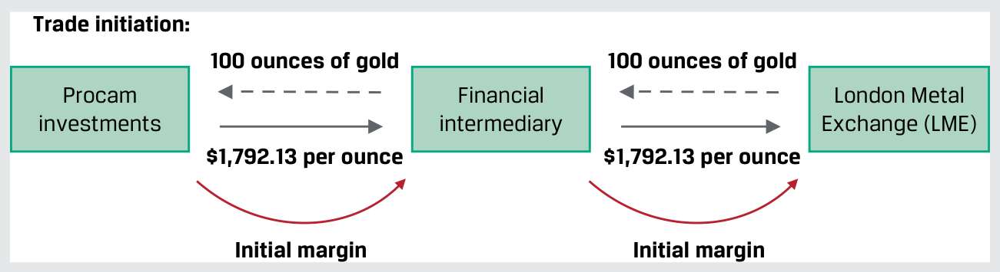

图内文字对照：100 ounces of gold＝100盎司黄金；Procam investments Financial intermediary＝Procam投资公司；金融中介；Trade initiation:＝交易开始；London Metal Exchange (LME)＝伦敦金属交易所（LME）。

与例1相同，Procam Investments订立现金结算合约，约定三个月后以每盎司1,792.13美元买入100盎司黄金。

As in Example 1, Procam Investments enters a cash-settled contract to buy 100 ounces of gold at a price of \$1,792.13 per ounce in three months.

不过，此次并非订立例1中的远期合约，而是通过金融中介在交易所买入期货合约，期货价格为1,792.13美元。

Instead of the forward in Example 1, Procam purchases a futures contract \[f0(T) = \$1,792.13\] on the exchange via a financial intermediary.

伦敦金属交易所规定，每卖出或买入一份黄金合约（100盎司），须缴纳4,950美元的初始现金保证金：

London Metal Exchange rules require an initial cash margin of \$4,950 per gold contract (100 ounces) sold or purchased:

■ Procam向交易所存入规定的4,950美元初始保证金。

■ Procam deposits \$4,950 in required initial margin with the exchange.

■ 当前黄金现货价格为每盎司1,770美元，黄金期货开盘价格为每盎司1,792.13美元。

■ Today’s spot gold price (S0) is \$1,770 per ounce, and the opening gold futures price, f0(T), is \$1,792.13 per ounce.

■ 今日收市时，黄金期货价格f₁(T)为每盎司1,797.13美元。

■ At today’s close, the gold futures price, f1(T), settles at \$1,797.13 per ounce.

■ Procam实现500美元的盯市收益，即每盎司上涨5美元乘以100盎司。清算所向其期货保证金账户划入500美元。

■ Procam realizes a \$500 MTM gain, or \$5 per ounce × 100 ounces. It receives a \$500 futures margin account deposit from the clearinghouse.

■ Procam期货保证金账户的当日最终余额为5,450美元，由4,950美元初始保证金加500美元盯市收益构成。

■ Procam’s futures margin account has an ending balance for the day of \$5,450, or \$4,950 initial margin plus the \$500 MTM gain.

#### 补充解析 / Supplementary explanation

结合本题的官方结论：“图内文字对照：100 ounces of gold＝100盎司黄金；Procam investments Financial intermediary＝Procam投资公司；金融中介；Trade initiation:＝交易开始；London Metal Exchange (LME)＝伦敦金属交易所（LME）。” 下列补充说明解释其背后的期货保证金与每日结算。

Link to this question’s official result: “As in Example 1, Procam Investments enters a cash-settled contract to buy 100 ounces of gold at a price of \$1,792.13 per ounce in three months. Instead of the forward in Example 1, Procam purchases a futures contract \[f0(T) = \$1,792.13\] on the exchange via a financial intermediary.” The supplementary discussion below explains futures margin and daily settlement.

解题思路：期货保证金是履约保障，不是买入标的资产的全款。每日价格变化产生的盈亏会转入或转出保证金账户，因此最终总盈亏与每日现金流路径要分开理解。

Reasoning: Futures margin is performance collateral, not the full purchase price of the underlying. Daily gains and losses are paid into or out of the margin account, so total payoff and the path of interim cash flows must be distinguished.

应用方法：逐日计算“价格变动 × 合约乘数 × 合约数量”，再更新余额。余额跌破 maintenance margin 后，常见规则是补回 initial margin，不是只补到 maintenance margin；具体仍以题目条款为准。

Application: Calculate each day’s price change times contract multiplier and number of contracts, then update the account. A breach of maintenance margin commonly requires replenishment to initial margin, subject to the stated contract rules.

#### 相关知识点 / Related concepts

#### 期货保证金与每日结算 / Futures margin and daily settlement

Initial margin 是初始要求；maintenance margin 是触发补缴的阈值；variation margin 与逐日盈亏转移或补缴有关。

Initial margin is the initial requirement, maintenance margin is a trigger threshold, and variation margin relates to daily gains, losses, or replenishment.

原书为叙述式已解例题，完整条件、计算及结论保留在官方解析区。

### DER-LM02-EX03-03 · 已解例题 3 · 黄金期货合约的最终结算 Worked example 3 · Final Settlement of a Gold Futures Contract

正文例题／案例 / Worked example / case · 原版 PDF 页码 / Source PDF pages: 40-41

#### 题目与资料 / Question and data

### 黄金期货合约的最终结算Final Settlement of a Gold Futures Contract

#### 官方答案与解析 / Official answer and explanation

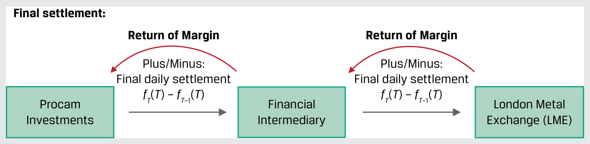

图内文字对照：Procam Investments Financial Intermediary＝Procam投资公司；金融中介；Final settlement:＝最终结算；London Metal Exchange (LME)＝伦敦金属交易所（LME）；Plus/Minus: Final daily settlement fT(T) – fT–1(T)＝加上／减去最后一次每日结算金额；Return of Margin Return of Margin＝退还双方保证金。

为便于说明，下表将例2中三个月的黄金期货价格变化压缩为六个交易日：

For purposes of exposition, we compress the three months of gold futures price changes from Example 2 into six days of trading in the following spreadsheet:

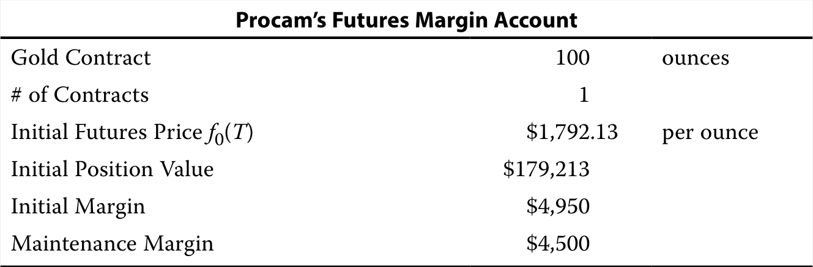

Procam的期货保证金账户

黄金合约：100盎司。

合约数量：1份。

初始期货价格：每盎司1,792.13美元。

初始头寸价值：179,213美元。

初始保证金：4,950美元。

维持保证金：4,500美元。

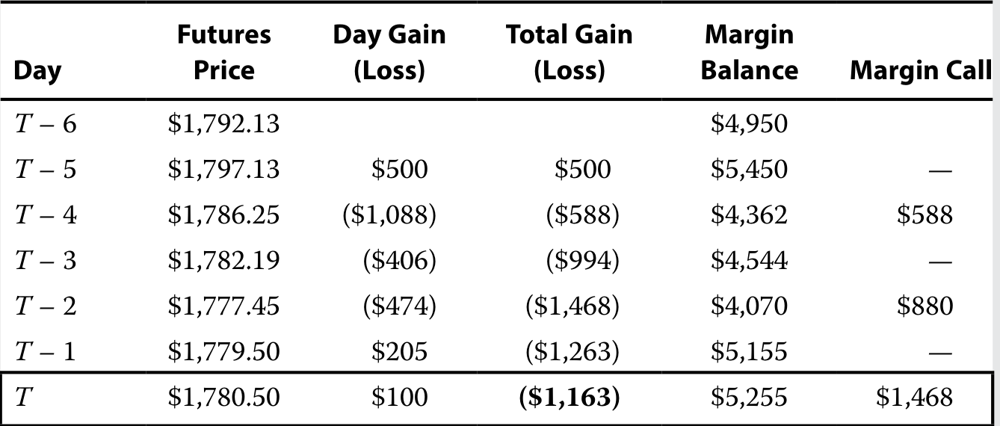

日期

期货

价格

当日收益

（亏损）

累计收益

保证金余额；追加保证金。

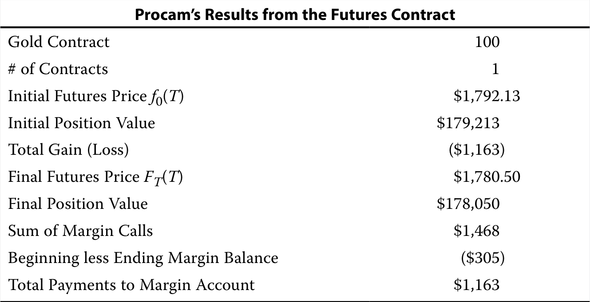

Procam期货合约的最终结果

黄金合约：100盎司。

合约数量：1份。

初始期货价格：1,792.13美元。

初始头寸价值：179,213美元。

累计收益（亏损）：负1,163美元。

最终期货价格：1,780.50美元。

最终头寸价值：178,050美元。

追加保证金合计：1,468美元。

期初减期末保证金余额：负305美元。

向保证金账户净支付的总额：1,163美元。

当黄金期货价格下跌，使保证金余额降至4,500美元的维持保证金最低要求以下时，Procam每次都必须立即补足余额，恢复至4,950美元的初始保证金水平：

As the gold futures price, f0(t), falls and the margin balance drops below the \$4,500 maintenance margin minimum over time, Procam must immediately replenish its balance to the \$4,950 initial margin each time this occurs:

■ 在T−4日，黄金期货每盎司下跌10.88美元，从1,797.13美元降至1,786.25美元。

■ On Day T – 4, gold futures fall \$10.88 per ounce (\$1,797.13 – \$1,786.25).

Procam的账户减少1,088美元，余额从5,450美元降至4,362美元，因此收到588美元的追加保证金要求。

Procam’s balance falls \$1,088 (100 × \$10.88) to \$4,362 (\$5,450 – \$1,088).

完整计算见对应英文及共用公式。

Procam faces a margin call of \$588 (\$4,950 – \$4,362).

■ 在T−2日，黄金期货每盎司下跌4.74美元，从1,782.19美元降至1,777.45美元。

■ On Day T – 2, gold futures fall \$4.74 per ounce (\$1,782.19 – \$1,777.45).

Procam的账户减少474美元，余额从4,544美元降至4,070美元，因此收到880美元的追加保证金要求。

Procam’s balance falls \$474 (100 × \$4.74) to \$4,070 (\$4,544 – \$474).

完整计算见对应英文及共用公式。

Procam faces a margin call of \$880 (\$4,950 – \$4,070).

截至最后交易日开始时，Procam已因两次追加保证金要求累计支付1,468美元，其期货保证金账户余额为5,155美元，比4,950美元的初始保证金高205美元。

On the final trading day, Procam has paid a total of \$1,468 (\$588 + \$880) in margin calls and its futures margin account balance is \$5,155, or \$205 in excess of the \$4,950 initial margin.

因此，此时累计盯市亏损为1,263美元。

Procam has a cumulative MTM loss of \$1,263 (\$1,468 – \$205) at the start of the last trading day.

■ 前一日黄金期货的结算价为每盎司1,779.50美元。

■ The prior day’s gold futures settlement price, fT–1(T), is \$1,779.50.

■ 最后交易日黄金期货每盎司上涨1美元，最终以每盎司1,780.50美元结算，与例1中远期合约到期时的黄金价格相同。

■ Gold futures rise \$1 per ounce on the final trading day to settle at fT(T) = \$1,780.50 per ounce, the same as for the forward in Example 1.

■ 当日Procam保证金账户增加100美元，即每盎司上涨1美元乘以100盎司，使账户余额达到5,255美元。

■ The daily change in Procam’s margin account is an increase of \$100 (\$1 per ounce × 100 ounces), bringing the margin account to \$5,255.

■ 结算时退还Procam的期货保证金余额5,255美元；相对于初始保证金，其净收回的额外保证金为305美元。

■ Procam’s futures margin balance of \$5,255 is returned at settlement for a net return of \$305 (\$5,255 – \$4,950) in margin.

■ Procam结算时净收回305美元额外保证金，但此前追加了1,468美元，因此最终累计亏损1,163美元。

■ Procam receives a net return of \$305 in margin at settlement for a cumulative loss upon settlement of \$1,163 (\$305 – \$1,468).

#### 补充解析 / Supplementary explanation

解题思路：期货保证金是履约保障，不是买入标的资产的全款。每日价格变化产生的盈亏会转入或转出保证金账户，因此最终总盈亏与每日现金流路径要分开理解。

Reasoning: Futures margin is performance collateral, not the full purchase price of the underlying. Daily gains and losses are paid into or out of the margin account, so total payoff and the path of interim cash flows must be distinguished.

应用方法：逐日计算“价格变动 × 合约乘数 × 合约数量”，再更新余额。余额跌破 maintenance margin 后，常见规则是补回 initial margin，不是只补到 maintenance margin；具体仍以题目条款为准。

Application: Calculate each day’s price change times contract multiplier and number of contracts, then update the account. A breach of maintenance margin commonly requires replenishment to initial margin, subject to the stated contract rules.

#### 相关知识点 / Related concepts

#### 期货保证金与每日结算 / Futures margin and daily settlement

Initial margin 是初始要求；maintenance margin 是触发补缴的阈值；variation margin 与逐日盈亏转移或补缴有关。

Initial margin is the initial requirement, maintenance margin is a trigger threshold, and variation margin relates to daily gains, losses, or replenishment.

原书为叙述式已解例题，完整条件、计算及结论保留在官方解析区。

### DER-LM02-QS02-01 · 正文题组 2 · 第 1 题 Question set 2 · Question 1

正文习题组 / Question set · 原版 PDF 页码 / Source PDF pages: 42

#### 题目与资料 / Question and data

#### 共用资料 / Shared information

期货

Futures

1\. 填空：如果期货买方的保证金账户余额低于\_\_\_\_\_\_\_\_\_\_，即每名合约买卖方从交易开始到最终结算都必须维持的最低余额，买方必须立即存入资金，将账户余额恢复至\_\_\_\_\_\_\_\_\_\_。

1\. Determine the correct answers to fill in the blanks: If a futures contract buyer’s margin account falls below the \_\_\_\_\_\_\_\_\_\_ \_\_\_\_\_\_\_\_\_\_, or minimum balance that each contract buyer and seller must hold in the account from trade initiation until final settlement, the buyer must immediately deposit funds to return the account balance to the \_\_\_\_\_\_\_\_\_\_ \_\_\_\_\_\_\_\_\_\_.

#### 官方答案与解析 / Official answer and explanation

如果期货买方的保证金账户余额低于维持保证金，即每名合约买卖方从交易开始到最终结算都必须维持的最低余额，买方必须立即存入资金，将账户余额恢复至初始保证金水平。

If a futures contract buyer’s margin account falls below the maintenance margin, or minimum balance that each contract buyer and seller must hold in the account from trade initiation until final settlement, the buyer must immediately deposit funds to return the account balance to the initial margin.

#### 补充解析 / Supplementary explanation

结合本题的官方结论：“如果期货买方的保证金账户余额低于维持保证金，即每名合约买卖方从交易开始到最终结算都必须维持的最低余额，买方必须立即存入资金，将账户余额恢复至初始保证金水平。” 下列补充说明解释其背后的期货保证金与每日结算。

Link to this question’s official result: “If a futures contract buyer’s margin account falls below the maintenance margin, or minimum balance that each contract buyer and seller must hold in the account from trade initiation until final settlement, the buyer must immediately deposit funds to return the account balance to the initial margin.” The supplementary discussion below explains futures margin and daily settlement.

解题思路：期货保证金是履约保障，不是买入标的资产的全款。每日价格变化产生的盈亏会转入或转出保证金账户，因此最终总盈亏与每日现金流路径要分开理解。

Reasoning: Futures margin is performance collateral, not the full purchase price of the underlying. Daily gains and losses are paid into or out of the margin account, so total payoff and the path of interim cash flows must be distinguished.

应用方法：逐日计算“价格变动 × 合约乘数 × 合约数量”，再更新余额。余额跌破 maintenance margin 后，常见规则是补回 initial margin，不是只补到 maintenance margin；具体仍以题目条款为准。

Application: Calculate each day’s price change times contract multiplier and number of contracts, then update the account. A breach of maintenance margin commonly requires replenishment to initial margin, subject to the stated contract rules.

#### 相关知识点 / Related concepts

#### 期货保证金与每日结算 / Futures margin and daily settlement

Initial margin 是初始要求；maintenance margin 是触发补缴的阈值；variation margin 与逐日盈亏转移或补缴有关。

Initial margin is the initial requirement, maintenance margin is a trigger threshold, and variation margin relates to daily gains, losses, or replenishment.

### DER-LM02-QS02-02 · 正文题组 2 · 第 2 题 Question set 2 · Question 2

正文习题组 / Question set · 原版 PDF 页码 / Source PDF pages: 42

#### 题目与资料 / Question and data

#### 共用资料 / Shared information

期货

Futures

2\. 描述期货合约的盯市过程。

2\. Describe the mark-to-market process for a futures contract.

#### 官方答案与解析 / Official answer and explanation

交易所清算所根据当日最后的期货交易价格计算一个平均价格，并将其指定为收市结算价。

The exchange clearinghouse determines an average of the final futures prices of the day and designates that price as the end-of-day settlement price.

每日损益通过交易双方各自的期货保证金账户结算。

The daily settlement of gains and losses takes place via each counterparty’s futures margin account.

#### 补充解析 / Supplementary explanation

结合本题的官方结论：“交易所清算所根据当日最后的期货交易价格计算一个平均价格，并将其指定为收市结算价。 每日损益通过交易双方各自的期货保证金账户结算。” 下列补充说明解释其背后的期货保证金与每日结算。

Link to this question’s official result: “The exchange clearinghouse determines an average of the final futures prices of the day and designates that price as the end-of-day settlement price. The daily settlement of gains and losses takes place via each counterparty’s futures margin account.” The supplementary discussion below explains futures margin and daily settlement.

解题思路：期货保证金是履约保障，不是买入标的资产的全款。每日价格变化产生的盈亏会转入或转出保证金账户，因此最终总盈亏与每日现金流路径要分开理解。

Reasoning: Futures margin is performance collateral, not the full purchase price of the underlying. Daily gains and losses are paid into or out of the margin account, so total payoff and the path of interim cash flows must be distinguished.

应用方法：逐日计算“价格变动 × 合约乘数 × 合约数量”，再更新余额。余额跌破 maintenance margin 后，常见规则是补回 initial margin，不是只补到 maintenance margin；具体仍以题目条款为准。

Application: Calculate each day’s price change times contract multiplier and number of contracts, then update the account. A breach of maintenance margin commonly requires replenishment to initial margin, subject to the stated contract rules.

#### 相关知识点 / Related concepts

#### 期货保证金与每日结算 / Futures margin and daily settlement

Initial margin 是初始要求；maintenance margin 是触发补缴的阈值；variation margin 与逐日盈亏转移或补缴有关。

Initial margin is the initial requirement, maintenance margin is a trigger threshold, and variation margin relates to daily gains, losses, or replenishment.

### DER-LM02-QS02-03 · 正文题组 2 · 第 3 题 Question set 2 · Question 3

正文习题组 / Question set · 原版 PDF 页码 / Source PDF pages: 42-43

#### 题目与资料 / Question and data

#### 共用资料 / Shared information

期货

Futures

3\. 将以下描述与对应的期货合约参与者配对：

3\. Identify these futures contract participants that correspond to the following statements:

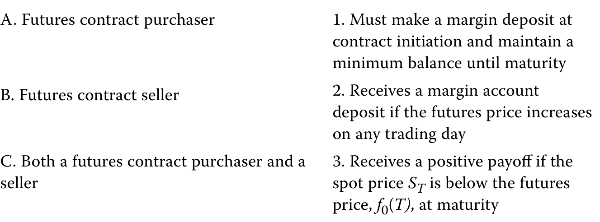

A. 期货合约买方；1. 必须在合约开始时存入保证金，并维持最低余额直至到期。

B. 期货合约卖方；2. 当任何交易日的期货价格上升时，收到保证金账户入账。

C. 期货合约买方与卖方。

3\. 如果到期现货价格低于初始期货价格，则获得正的到期收益。

#### 官方答案与解析 / Official answer and explanation

1\. 正确答案是C。期货买方与卖方都必须缴纳保证金，并在合约存续期内维持最低保证金余额，即维持保证金。

1\. The correct answer is C. Both futures contract buyers and sellers must deposit margin and maintain a minimum margin balance (maintenance margin) over the life of a contract.

2\. 正确答案是A。任何交易日，只要期货价格上涨，期货买方就会实现盯市收益，并收到相应的保证金账户入账。

2\. The correct answer is A. The futures contract buyer realizes a mark- to-market gain on any trading day when the futures price increases and receives a corresponding margin account deposit.

3\. 正确答案是B。如果到期现货价格低于最初约定的期货价格，期货卖方将在到期时获得正的收益。

3\. The correct answer is B. The futures contract seller realizes a positive payoff at maturity if ST \< f0(T).

#### 补充解析 / Supplementary explanation

结合本题的官方结论：“正确答案是C。期货买方与卖方都必须缴纳保证金，并在合约存续期内维持最低保证金余额，即维持保证金。 2. 正确答案是A。” 下列补充说明解释其背后的期货保证金与每日结算。

Link to this question’s official result: “The correct answer is C. Both futures contract buyers and sellers must deposit margin and maintain a minimum margin balance (maintenance margin) over the life of a contract. 2. The correct answer is A.” The supplementary discussion below explains futures margin and daily settlement.

解题思路：期货保证金是履约保障，不是买入标的资产的全款。每日价格变化产生的盈亏会转入或转出保证金账户，因此最终总盈亏与每日现金流路径要分开理解。

Reasoning: Futures margin is performance collateral, not the full purchase price of the underlying. Daily gains and losses are paid into or out of the margin account, so total payoff and the path of interim cash flows must be distinguished.

应用方法：逐日计算“价格变动 × 合约乘数 × 合约数量”，再更新余额。余额跌破 maintenance margin 后，常见规则是补回 initial margin，不是只补到 maintenance margin；具体仍以题目条款为准。

Application: Calculate each day’s price change times contract multiplier and number of contracts, then update the account. A breach of maintenance margin commonly requires replenishment to initial margin, subject to the stated contract rules.

#### 相关知识点 / Related concepts

#### 期货保证金与每日结算 / Futures margin and daily settlement

Initial margin 是初始要求；maintenance margin 是触发补缴的阈值；variation margin 与逐日盈亏转移或补缴有关。

Initial margin is the initial requirement, maintenance margin is a trigger threshold, and variation margin relates to daily gains, losses, or replenishment.

### DER-LM02-EX04-04 · 已解例题 4 · Fyleton Investments的互换 Worked example 4 · Fyleton Investments Swap

正文例题／案例 / Worked example / case · 原版 PDF 页码 / Source PDF pages: 44

#### 题目与资料 / Question and data

### Fyleton Investments的互换Fyleton Investments Swap

#### 官方答案与解析 / Official answer and explanation

Fyleton Investments与金融中介订立了一项五年期、名义本金为2亿英镑的收固定利率互换，以增加其固定收益投资组合的久期。

Fyleton Investments has entered a five-year, receive-fixed GBP200 million interest rate swap with a financial intermediary to increase the duration of its fixed-income portfolio.

根据互换条款，Fyleton每半年收取按2.25%英镑固定年利率计算的款项，并支付六个月市场参考利率。

Under terms of the swap, Fyleton has agreed to receive a semiannual GBP fixed rate of 2.25% and pay six-month MRR.

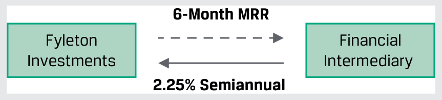

图内文字对照：6-Month MRR＝六个月市场参考利率；2.25% Semiannual＝2.25%，每半年支付；Fyleton Investments＝Fyleton投资公司；Financial Intermediary＝金融中介。

如果六个月市场参考利率设定为1.95%，计算首次互换现金流交换金额。

Calculate the first swap cash flow exchange if six-month MRR is set at 1.95%.

■ 金融中介应向Fyleton支付2,250,000英镑的固定利息，计算式见对应英文及共用公式。

■ The financial intermediary owes Fyleton a fixed cash flow payment of 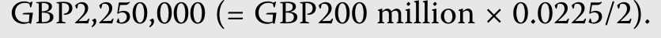

■ Fyleton应向金融中介支付1,950,000英镑的浮动利息，计算式见对应英文及共用公式。

■ Fyleton owes the financial intermediary a floating cash flow payment of GBP1,950,000 (= GBP 200 million × 0.0195/2).

■ 固定和浮动利息相互抵销后，金融中介净支付给Fyleton 300,000英镑。

■ The fixed and floating payments are netted against one another, and the net result is that the financial intermediary pays Fyleton 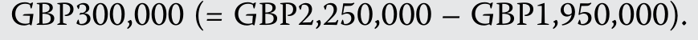

#### 补充解析 / Supplementary explanation

结合本题的官方结论：“Fyleton Investments与金融中介订立了一项五年期、名义本金为2亿英镑的收固定利率互换，以增加其固定收益投资组合的久期。 根据互换条款，Fyleton每半年收取按2.25%英镑固定年利率计算的款项，并支付六个月市场参考利率。” 下列补充说明解释其背后的互换是一组现金流交换。

Link to this question’s official result: “Fyleton Investments has entered a five-year, receive-fixed GBP200 million interest rate swap with a financial intermediary to increase the duration of its fixed-income portfolio. Under terms of the swap, Fyleton has agreed to receive a semiannual GBP fixed rate of 2.25% and pay six-month MRR.” The supplementary discussion below explains a swap exchanges a sequence of cash flows.

解题思路：普通利率互换把多期固定利息与多期浮动利息交换。公平固定互换利率让两条腿在起始时现值相等；起始后原固定利率不变，市场利率变化会使两条腿重新出现价值差。

Reasoning: A plain interest-rate swap exchanges a series of fixed and floating interest payments. The fair fixed rate equates the two legs’ present values at inception. Later, the contractual fixed rate stays unchanged while market repricing creates a value difference.

应用方法：先标明谁付固定、谁付浮动，以及是否净额结算。支付固定方通常受益于市场利率上升；估值时逐期折现所收现金流并减去所付现金流。名义本金一般用于计算利息，未必实际交换。

Application: Label the payer of each leg and the netting convention. A fixed-rate payer generally benefits from rising market rates. Value the swap as discounted receipts minus discounted payments. Notional principal usually scales interest rather than being exchanged.

#### 相关知识点 / Related concepts

#### 互换是一组现金流交换 / A swap exchanges a sequence of cash flows

公平互换固定利率是各未来现金流折现关系共同决定的结果，不是未来浮动利率的简单算术平均。

The fair fixed swap rate follows from discounted cash-flow relationships, not a simple arithmetic average of future floating rates.

Swap value = PV(receive leg) − PV(pay leg)

原书为叙述式已解例题，完整条件、计算及结论保留在官方解析区。

### DER-LM02-QS03-01 · 正文题组 3 · 第 1 题 Question set 3 · Question 1

正文习题组 / Question set · 原版 PDF 页码 / Source PDF pages: 45

#### 题目与资料 / Question and data

#### 共用资料 / Shared information

互换

Swaps

1\. 描述远期合约与互换合约的一项相似之处及一项差异。

1\. Describe a similarity of and a difference between forward and swap contracts.

#### 官方答案与解析 / Official answer and explanation

相似之处：远期和互换都属于初始价值为零的确定承诺，约定未来按预先约定的价格交换现金流。

Similarities: Both forwards and swaps represent firm commitments with an initial value of zero where cash flows are exchanged in the future at a pre- agreed price.

差异：远期通常只涉及未来的一次现金流交换，而互换涉及多次未来现金流交换。

Difference: Forwards usually involve one future exchange of cash flows, while a swap contract involves more than one exchange of future cash flows.

#### 补充解析 / Supplementary explanation

结合本题的官方结论：“相似之处：远期和互换都属于初始价值为零的确定承诺，约定未来按预先约定的价格交换现金流。 差异：远期通常只涉及未来的一次现金流交换，而互换涉及多次未来现金流交换。” 下列补充说明解释其背后的互换是一组现金流交换。

Link to this question’s official result: “Similarities: Both forwards and swaps represent firm commitments with an initial value of zero where cash flows are exchanged in the future at a pre- agreed price. Difference: Forwards usually involve one future exchange of cash flows, while a swap contract involves more than one exchange of future cash flows.” The supplementary discussion below explains a swap exchanges a sequence of cash flows.

解题思路：普通利率互换把多期固定利息与多期浮动利息交换。公平固定互换利率让两条腿在起始时现值相等；起始后原固定利率不变，市场利率变化会使两条腿重新出现价值差。

Reasoning: A plain interest-rate swap exchanges a series of fixed and floating interest payments. The fair fixed rate equates the two legs’ present values at inception. Later, the contractual fixed rate stays unchanged while market repricing creates a value difference.

应用方法：先标明谁付固定、谁付浮动，以及是否净额结算。支付固定方通常受益于市场利率上升；估值时逐期折现所收现金流并减去所付现金流。名义本金一般用于计算利息，未必实际交换。

Application: Label the payer of each leg and the netting convention. A fixed-rate payer generally benefits from rising market rates. Value the swap as discounted receipts minus discounted payments. Notional principal usually scales interest rather than being exchanged.

#### 相关知识点 / Related concepts

#### 互换是一组现金流交换 / A swap exchanges a sequence of cash flows

公平互换固定利率是各未来现金流折现关系共同决定的结果，不是未来浮动利率的简单算术平均。

The fair fixed swap rate follows from discounted cash-flow relationships, not a simple arithmetic average of future floating rates.

Swap value = PV(receive leg) − PV(pay leg)

### DER-LM02-QS03-02 · 正文题组 3 · 第 2 题 Question set 3 · Question 2

正文习题组 / Question set · 原版 PDF 页码 / Source PDF pages: 45

#### 题目与资料 / Question and data

#### 共用资料 / Shared information

互换

Swaps

2\. 填空：在互换合约中，支付可变现金流的一方称为\_\_\_\_\_\_\_\_\_\_，支付固定现金流的一方称为\_\_\_\_\_\_\_\_\_\_。

2\. Determine the correct answers to fill in the blanks: Under a swap contract, we refer to the counterparty paying the variable cash flows as the \_\_\_-\_\_\_ \_\_\_ and the counterparty paying fixed cash flows as the \_\_\_-\_\_\_ \_\_\_.

#### 官方答案与解析 / Official answer and explanation

在互换合约中，支付可变现金流的一方称为浮动利率支付方（或固定利率收取方），支付固定现金流的一方称为固定利率支付方（或浮动利率收取方）。

Under a swap contract, we refer to the counterparty paying the variable cash flows as the floating-rate payer (or fixed-rate receiver) and the counterparty paying fixed cash flows as the fixed-rate payer (or floating-rate receiver).

#### 补充解析 / Supplementary explanation

结合本题的官方结论：“在互换合约中，支付可变现金流的一方称为浮动利率支付方（或固定利率收取方），支付固定现金流的一方称为固定利率支付方（或浮动利率收取方）。” 下列补充说明解释其背后的互换是一组现金流交换。

Link to this question’s official result: “Under a swap contract, we refer to the counterparty paying the variable cash flows as the floating-rate payer (or fixed-rate receiver) and the counterparty paying fixed cash flows as the fixed-rate payer (or floating-rate receiver).” The supplementary discussion below explains a swap exchanges a sequence of cash flows.

解题思路：普通利率互换把多期固定利息与多期浮动利息交换。公平固定互换利率让两条腿在起始时现值相等；起始后原固定利率不变，市场利率变化会使两条腿重新出现价值差。

Reasoning: A plain interest-rate swap exchanges a series of fixed and floating interest payments. The fair fixed rate equates the two legs’ present values at inception. Later, the contractual fixed rate stays unchanged while market repricing creates a value difference.

应用方法：先标明谁付固定、谁付浮动，以及是否净额结算。支付固定方通常受益于市场利率上升；估值时逐期折现所收现金流并减去所付现金流。名义本金一般用于计算利息，未必实际交换。

Application: Label the payer of each leg and the netting convention. A fixed-rate payer generally benefits from rising market rates. Value the swap as discounted receipts minus discounted payments. Notional principal usually scales interest rather than being exchanged.

#### 相关知识点 / Related concepts

#### 互换是一组现金流交换 / A swap exchanges a sequence of cash flows

公平互换固定利率是各未来现金流折现关系共同决定的结果，不是未来浮动利率的简单算术平均。

The fair fixed swap rate follows from discounted cash-flow relationships, not a simple arithmetic average of future floating rates.

Swap value = PV(receive leg) − PV(pay leg)

### DER-LM02-QS03-03 · 正文题组 3 · 第 3 题 Question set 3 · Question 3

正文习题组 / Question set · 原版 PDF 页码 / Source PDF pages: 45-46

#### 题目与资料 / Question and data

#### 共用资料 / Shared information

互换

Swaps

3\. 将以下描述与对应的利率互换参与者配对：

3\. Identify the interest rate swap participants that correspond to the following statements:

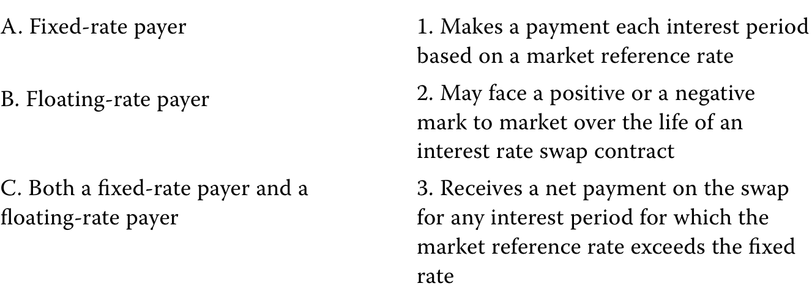

A. 固定利率支付方；1. 每个计息期根据市场参考利率支付款项。

B. 浮动利率支付方；2. 在利率互换合约存续期内，可能产生正的或负的盯市价值。

C. 固定利率支付方与浮动利率支付方。

3\. 在市场参考利率高于固定利率的任何计息期，收到互换净付款。

#### 官方答案与解析 / Official answer and explanation

1\. 正确答案是B。互换的浮动利率支付方每期根据市场参考利率支付款项。

1\. The correct answer is B. A floating-rate payer on a swap makes a payment each period based on a market reference rate.

2\. 正确答案是C。固定利率支付方和浮动利率支付方都可能在互换合约中产生正的或负的盯市价值。

2\. The correct answer is C. Both a fixed-rate payer and a floating-rate payer may face a positive MTM or negative MTM on a swap contract.

3\. 正确答案是A。如果某一期的市场参考利率高于固定利率，固定利率支付方（亦称浮动利率收取方）就会收到净付款。

3\. The correct answer is A. A fixed-rate payer (also known as the floating-rate receiver) receives a net payment if the market reference rate exceeds the fixed rate for a given period.

#### 补充解析 / Supplementary explanation

结合本题的官方结论：“正确答案是B。互换的浮动利率支付方每期根据市场参考利率支付款项。 2. 正确答案是C。” 下列补充说明解释其背后的互换是一组现金流交换。

Link to this question’s official result: “The correct answer is B. A floating-rate payer on a swap makes a payment each period based on a market reference rate. 2. The correct answer is C.” The supplementary discussion below explains a swap exchanges a sequence of cash flows.

解题思路：普通利率互换把多期固定利息与多期浮动利息交换。公平固定互换利率让两条腿在起始时现值相等；起始后原固定利率不变，市场利率变化会使两条腿重新出现价值差。

Reasoning: A plain interest-rate swap exchanges a series of fixed and floating interest payments. The fair fixed rate equates the two legs’ present values at inception. Later, the contractual fixed rate stays unchanged while market repricing creates a value difference.

应用方法：先标明谁付固定、谁付浮动，以及是否净额结算。支付固定方通常受益于市场利率上升；估值时逐期折现所收现金流并减去所付现金流。名义本金一般用于计算利息，未必实际交换。

Application: Label the payer of each leg and the netting convention. A fixed-rate payer generally benefits from rising market rates. Value the swap as discounted receipts minus discounted payments. Notional principal usually scales interest rather than being exchanged.

#### 相关知识点 / Related concepts

#### 互换是一组现金流交换 / A swap exchanges a sequence of cash flows

公平互换固定利率是各未来现金流折现关系共同决定的结果，不是未来浮动利率的简单算术平均。

The fair fixed swap rate follows from discounted cash-flow relationships, not a simple arithmetic average of future floating rates.

Swap value = PV(receive leg) − PV(pay leg)

### DER-LM02-EX05-05 · 已解例题 5 · Hightest Capital：买入看涨期权 Worked example 5 · Hightest Capital—Call Option Purchase

正文例题／案例 / Worked example / case · 原版 PDF 页码 / Source PDF pages: 48

#### 题目与资料 / Question and data

### Hightest Capital：买入看涨期权Hightest Capital—Call Option Purchase

#### 官方答案与解析 / Official answer and explanation

Hightest Capital买入标普500医疗保健精选行业指数（SIXV）的看涨期权。

Hightest Capital purchases a call option on the S&P 500 Health Care Select Sector Index (SIXV).

这份交易所交易期权期限为六个月，合约规模为100个指数单位，行权价格为每单位1,240美元，而SIXV初始现货价格为1,180.95美元。

This six-month exchange-traded option contract has a size of 100 index units and an exercise price of \$1,240 per unit versus the initial SIXV spot price of \$1,180.95.

预先支付的权利金为每单位24.85美元，总计2,485美元。

The option premium paid upfront is \$24.85 per unit, or \$2,485 (= \$24.85 × 100).

随着期权接近到期，Hightest的一位分析师受命：针对行权日不同SIXV现货价格情景，确定期权每单位预期到期收益和利润。

As the option nears maturity, a Hightest analyst is asked to determine the expected option payoff and profit per unit at maturity under different scenarios for the SIXV spot price on the exercise date.

她编制了下表：

She compiles the following table:

c₀表示看涨期权权利金，为每单位24.85美元。

c0 = Call option premium = \$24.85 per unit.

X表示T时点的行权价格，为每单位1,240美元。

X = Exercise price at time T = \$1,240 per unit.

ST表示T时点每单位的现货价格。

ST = Spot price per unit at time T.

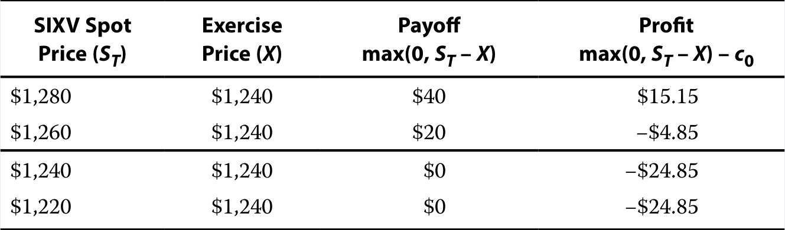

SIXV现货

价格（到期时）

行权价格X

到期收益：取零与“到期现货价格减行权价格”中的较大值。

利润：到期收益减去初始权利金。

#### 补充解析 / Supplementary explanation

结合本题的官方结论：“Hightest Capital买入标普500医疗保健精选行业指数（SIXV）的看涨期权。 这份交易所交易期权期限为六个月，合约规模为100个指数单位，行权价格为每单位1,240美元，而SIXV初始现货价格为1,180.95美元。 预先支付的权利金为每单位24.85美元，总计2,485美元。” 下列补充说明解释其背后的期权支付与利润分开算。

Link to this question’s official result: “Hightest Capital purchases a call option on the S&P 500 Health Care Select Sector Index (SIXV). This six-month exchange-traded option contract has a size of 100 index units and an exercise price of \$1,240 per unit versus the initial SIXV spot price of \$1,180.95. The option premium paid upfront is \$24.85 per unit, or \$2,485 (= \$24.85 × 100).” The supplementary discussion below explains separate option payoff from profit.

解题思路：期权买方有权选择是否行权，因此到期支付不会因为不利行情而变成负数；但买方事先支付了权利金，所以净利润仍可能为负。把 payoff 和 profit 混为一谈，是此类题最常见的错误。

Reasoning: An option buyer can choose not to exercise, so expiration payoff is non-negative. The buyer nevertheless paid a premium and can lose money overall. Confusing payoff with profit is a frequent error.

应用方法：先比较到期价格与执行价，算出行权支付，再扣除权利金得到买方利润；若题目忽略资金时间价值，就不要额外计息。卖方损益取相反数，并按合约乘数换算实际金额。

Application: Compare terminal spot with the strike, calculate exercise payoff, and subtract premium for the buyer’s profit. Do not add financing adjustments when the question ignores the time value of money. Reverse the sign for the seller and apply the contract multiplier.

#### 相关知识点 / Related concepts

#### 期权支付与利润分开算 / Separate option payoff from profit

In the money 表示立即行权有正支付，不保证扣除权利金后盈利。Call 买方通常受益于上涨，put 买方通常受益于下跌。

In the money means positive exercise value, not necessarily a positive net profit. Call buyers generally benefit from price rises and put buyers from declines.

Call payoff = max(Sₜ − X, 0); Put payoff = max(X − Sₜ, 0); Buyer profit = Payoff − Premium

原书为叙述式已解例题，完整条件、计算及结论保留在官方解析区。

### DER-LM02-QS04-01 · 正文题组 4 · 第 1 题 Question set 4 · Question 1

正文习题组 / Question set · 原版 PDF 页码 / Source PDF pages: 50

#### 题目与资料 / Question and data

关联原书案例 / Referenced original case: 原书例题 5 / Example 5

#### 共用资料 / Shared information

期权

Options

1\. 计算例5中使Hightest Capital达到盈亏平衡、利润为零的SIXV到期现货价格。

1\. Calculate the SIXV spot price at maturity from Example 5 at which Hightest Capital will reach a breakeven point and earn zero profit.

#### 官方答案与解析 / Official answer and explanation

看涨期权买方的利润等于正的行权收益减去权利金。在例5中，Hightest持有的SIXV期权行权价格为1,240美元，初始权利金为24.85美元。因此，盈亏平衡价格等于行权价格加权利金，即1,264.85美元。完整计算式见对应英文及共用公式。

The call purchaser has a profit equal to max(0, ST – X) – c0. In the case of Hightest in Example 5, the SIXV exercise price is \$1,240 and the initial call premium is \$24.85. The breakeven or zero profit point is therefore equal to \$1,240 + \$24.85, or \$1,264.85.

#### 补充解析 / Supplementary explanation

结合本题的官方结论：“看涨期权买方的利润等于正的行权收益减去权利金。在例5中，Hightest持有的SIXV期权行权价格为1,240美元，初始权利金为24.85美元。因此，盈亏平衡价格等于行权价格加权利金，即1,264.85美元。” 下列补充说明解释其背后的期权支付与利润分开算。

Link to this question’s official result: “The call purchaser has a profit equal to max(0, ST – X) – c0. In the case of Hightest in Example 5, the SIXV exercise price is \$1,240 and the initial call premium is \$24.85. The breakeven or zero profit point is therefore equal to \$1,240 + \$24.85, or \$1,264.85.” The supplementary discussion below explains separate option payoff from profit.

解题思路：期权买方有权选择是否行权，因此到期支付不会因为不利行情而变成负数；但买方事先支付了权利金，所以净利润仍可能为负。把 payoff 和 profit 混为一谈，是此类题最常见的错误。

Reasoning: An option buyer can choose not to exercise, so expiration payoff is non-negative. The buyer nevertheless paid a premium and can lose money overall. Confusing payoff with profit is a frequent error.

应用方法：先比较到期价格与执行价，算出行权支付，再扣除权利金得到买方利润；若题目忽略资金时间价值，就不要额外计息。卖方损益取相反数，并按合约乘数换算实际金额。

Application: Compare terminal spot with the strike, calculate exercise payoff, and subtract premium for the buyer’s profit. Do not add financing adjustments when the question ignores the time value of money. Reverse the sign for the seller and apply the contract multiplier.

#### 相关知识点 / Related concepts

#### 期权支付与利润分开算 / Separate option payoff from profit

In the money 表示立即行权有正支付，不保证扣除权利金后盈利。Call 买方通常受益于上涨，put 买方通常受益于下跌。

In the money means positive exercise value, not necessarily a positive net profit. Call buyers generally benefit from price rises and put buyers from declines.

Call payoff = max(Sₜ − X, 0); Put payoff = max(X − Sₜ, 0); Buyer profit = Payoff − Premium

### DER-LM02-QS04-02 · 正文题组 4 · 第 2 题 Question set 4 · Question 2

正文习题组 / Question set · 原版 PDF 页码 / Source PDF pages: 50-51

#### 题目与资料 / Question and data

#### 共用资料 / Shared information

期权

Options

2\. 看跌期权卖方卖出一份行权价格为30美元的期权，并收取5美元权利金。

2\. A put option seller receives a \$5 premium for a put option sold on an un derlying with an exercise price of \$30.

该合约下卖方的最大利润是多少？

What is the option seller’s maximum profit under the contract?

最大损失是多少？

What is the maximum loss under the contract?

#### 官方答案与解析 / Official answer and explanation

看跌期权卖方收取5美元权利金，期权行权价格为30美元。卖方利润等于收取的权利金减去期权行权支付额，具体公式见对应英文及共用公式。如果期权未被行使，支付额为零，卖方获得全部5美元权利金；如果期权被行使且标的价格跌至零，卖方支付30美元，扣除已收取的5美元权利金后，净亏损25美元。因此，该合约下卖方的最大利润为5美元，最大损失为25美元。

A put option seller receives a \$5 premium (p0) for a put option sold on an underlying with an exercise price (X) of \$30. The put option seller’s profit is Π = –max(0, X – ST) + p0. If the option is unexercised, –max(0, X – ST) = 0 and the put seller earns p0 = \$5. If the option is exercised and ST = 0, then Π = –max(0, 30 – 0) + 5 = –\$25. Therefore, the option seller’s maximum profit under the contract is \$5 and the maximum loss under the contract is \$25.

#### 补充解析 / Supplementary explanation

结合本题的官方结论：“看跌期权卖方收取5美元权利金，期权行权价格为30美元。卖方利润等于收取的权利金减去期权行权支付额，具体公式见对应英文及共用公式。如果期权未被行使，支付额为零，卖方获得全部5美元权利金；如果期权被行使且标的价格跌至零，卖方支付30美元，扣除已收取的5美元权利金后，净亏损25美元。” 下列补充说明解释其背后的期权支付与利润分开算。

Link to this question’s official result: “A put option seller receives a \$5 premium (p0) for a put option sold on an underlying with an exercise price (X) of \$30. The put option seller’s profit is Π = –max(0, X – ST) + p0. If the option is unexercised, –max(0, X – ST) = 0 and the put seller earns p0 = \$5.” The supplementary discussion below explains separate option payoff from profit.

解题思路：期权买方有权选择是否行权，因此到期支付不会因为不利行情而变成负数；但买方事先支付了权利金，所以净利润仍可能为负。把 payoff 和 profit 混为一谈，是此类题最常见的错误。

Reasoning: An option buyer can choose not to exercise, so expiration payoff is non-negative. The buyer nevertheless paid a premium and can lose money overall. Confusing payoff with profit is a frequent error.

应用方法：先比较到期价格与执行价，算出行权支付，再扣除权利金得到买方利润；若题目忽略资金时间价值，就不要额外计息。卖方损益取相反数，并按合约乘数换算实际金额。

Application: Compare terminal spot with the strike, calculate exercise payoff, and subtract premium for the buyer’s profit. Do not add financing adjustments when the question ignores the time value of money. Reverse the sign for the seller and apply the contract multiplier.

#### 相关知识点 / Related concepts

#### 期权支付与利润分开算 / Separate option payoff from profit

In the money 表示立即行权有正支付，不保证扣除权利金后盈利。Call 买方通常受益于上涨，put 买方通常受益于下跌。

In the money means positive exercise value, not necessarily a positive net profit. Call buyers generally benefit from price rises and put buyers from declines.

Call payoff = max(Sₜ − X, 0); Put payoff = max(X − Sₜ, 0); Buyer profit = Payoff − Premium

### DER-LM02-QS04-03 · 正文题组 4 · 第 3 题 Question set 4 · Question 3

正文习题组 / Question set · 原版 PDF 页码 / Source PDF pages: 50-51

#### 题目与资料 / Question and data

#### 共用资料 / Shared information

期权

Options

3\. 将以下描述与对应的期权合约参与者配对：

3\. Identify the option contract participants that correspond to the following statements:

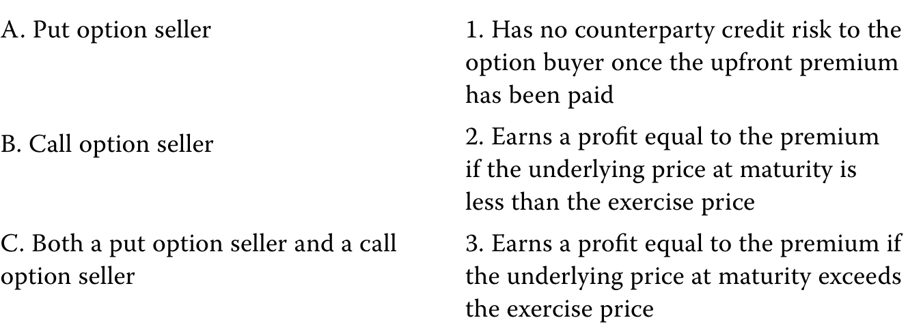

A. 看跌期权卖方；1. 预付权利金支付后，对期权买方不再存在交易对手信用风险。

B. 看涨期权卖方；2. 如果到期标的价格低于行权价格，赚取等于权利金的利润。

C. 看跌期权卖方和看涨期权卖方。

3\. 如果到期标的价格高于行权价格，赚取等于权利金的利润。

#### 官方答案与解析 / Official answer and explanation

1\. 正确答案是C。预付权利金一旦付清，期权卖方对买方就不再存在交易对手信用风险。

1\. The correct answer is C. An option seller has no counterparty credit risk to the option buyer once the upfront premium has been paid.

2\. 正确答案是B。如果到期标的价格低于行权价格，看涨期权卖方会赚取等于权利金的利润。

2\. The correct answer is B. A call option seller earns a profit equal to the premium if the underlying price at maturity is less than the exercise price.

3\. 正确答案是A。如果到期标的价格高于行权价格，看跌期权卖方会赚取等于权利金的利润。

3\. The correct answer is A. A put option seller earns a profit equal to the premium if the underlying price at maturity is greater than the exercise price.

#### 补充解析 / Supplementary explanation

结合本题的官方结论：“正确答案是C。预付权利金一旦付清，期权卖方对买方就不再存在交易对手信用风险。 2. 正确答案是B。” 下列补充说明解释其背后的期权支付与利润分开算。

Link to this question’s official result: “The correct answer is C. An option seller has no counterparty credit risk to the option buyer once the upfront premium has been paid. 2. The correct answer is B.” The supplementary discussion below explains separate option payoff from profit.

解题思路：期权买方有权选择是否行权，因此到期支付不会因为不利行情而变成负数；但买方事先支付了权利金，所以净利润仍可能为负。把 payoff 和 profit 混为一谈，是此类题最常见的错误。

Reasoning: An option buyer can choose not to exercise, so expiration payoff is non-negative. The buyer nevertheless paid a premium and can lose money overall. Confusing payoff with profit is a frequent error.

应用方法：先比较到期价格与执行价，算出行权支付，再扣除权利金得到买方利润；若题目忽略资金时间价值，就不要额外计息。卖方损益取相反数，并按合约乘数换算实际金额。

Application: Compare terminal spot with the strike, calculate exercise payoff, and subtract premium for the buyer’s profit. Do not add financing adjustments when the question ignores the time value of money. Reverse the sign for the seller and apply the contract multiplier.

#### 相关知识点 / Related concepts

#### 期权支付与利润分开算 / Separate option payoff from profit

In the money 表示立即行权有正支付，不保证扣除权利金后盈利。Call 买方通常受益于上涨，put 买方通常受益于下跌。

In the money means positive exercise value, not necessarily a positive net profit. Call buyers generally benefit from price rises and put buyers from declines.

Call payoff = max(Sₜ − X, 0); Put payoff = max(X − Sₜ, 0); Buyer profit = Payoff − Premium

### DER-LM02-QS05-01 · 正文题组 5 · 第 1 题 Question set 5 · Question 1

正文习题组 / Question set · 原版 PDF 页码 / Source PDF pages: 53

#### 题目与资料 / Question and data

#### 共用资料 / Shared information

信用衍生品

Credit Derivatives

1\. 填空：信用违约互换的或有支付，等于合约所规定CDS名义本金对应的\_\_\_\_\_\_\_\_\_\_。

1\. Determine the correct

#### 官方答案与解析 / Official answer and explanation

to fill in the blanks: The contingent payment under a credit default swap equals the \_\_\_\_ \_\_\_\_ \_\_\_\_ for the CDS notional amount specified in the contract.

解答：

Solution:

信用违约互换的或有支付，等于合约规定名义本金对应的违约损失，即名义本金乘以违约损失率。

The contingent payment under a credit default swap equals the loss given default for the CDS notional amount specified in the contract.

#### 补充解析 / Supplementary explanation

结合本题的官方结论：“解答： 信用违约互换的或有支付，等于合约规定名义本金对应的违约损失，即名义本金乘以违约损失率。” 下列补充说明解释其背后的互换是一组现金流交换。

Link to this question’s official result: “to fill in the blanks: The contingent payment under a credit default swap equals the \_\_\_\_ \_\_\_\_ \_\_\_\_ for the CDS notional amount specified in the contract. Solution: The contingent payment under a credit default swap equals the loss given default for the CDS notional amount specified in the contract.” The supplementary discussion below explains a swap exchanges a sequence of cash flows.

解题思路：普通利率互换把多期固定利息与多期浮动利息交换。公平固定互换利率让两条腿在起始时现值相等；起始后原固定利率不变，市场利率变化会使两条腿重新出现价值差。

Reasoning: A plain interest-rate swap exchanges a series of fixed and floating interest payments. The fair fixed rate equates the two legs’ present values at inception. Later, the contractual fixed rate stays unchanged while market repricing creates a value difference.

应用方法：先标明谁付固定、谁付浮动，以及是否净额结算。支付固定方通常受益于市场利率上升；估值时逐期折现所收现金流并减去所付现金流。名义本金一般用于计算利息，未必实际交换。

Application: Label the payer of each leg and the netting convention. A fixed-rate payer generally benefits from rising market rates. Value the swap as discounted receipts minus discounted payments. Notional principal usually scales interest rather than being exchanged.

#### 相关知识点 / Related concepts

#### 互换是一组现金流交换 / A swap exchanges a sequence of cash flows

公平互换固定利率是各未来现金流折现关系共同决定的结果，不是未来浮动利率的简单算术平均。

The fair fixed swap rate follows from discounted cash-flow relationships, not a simple arithmetic average of future floating rates.

Swap value = PV(receive leg) − PV(pay leg)

### DER-LM02-QS05-02 · 正文题组 5 · 第 2 题 Question set 5 · Question 2

正文习题组 / Question set · 原版 PDF 页码 / Source PDF pages: 53

#### 题目与资料 / Question and data

#### 共用资料 / Shared information

信用衍生品

Credit Derivatives

2\. 描述信用保护卖方的头寸与投资标的现券有何相似之处。

2\. Describe how a credit protection seller’s position is similar to that of an underlying cash bond investment.

#### 官方答案与解析 / Official answer and explanation

信用保护卖方收取定期CDS利差支付，以承担发行人发生信用事件时向买方付款的或有风险。

A credit protection seller receives a periodic CDS spread payment in exchange for the contingent risk of payment to the buyer under an issuer credit event.

现券投资者收取包含发行人信用利差的定期票息，作为承担发行人违约时潜在损失的补偿。

A cash bond investor receives a periodic coupon that incorporates an issuer’s credit spread in exchange for a potential loss if the issuer defaults.

在CDS与现券中，这种潜在支付或损失均取决于违约损失率。

Under the CDS contract and the cash bond, this potential payment or loss equals the LGD.

因此，信用保护卖方的风险头寸类似于持有发行人标的债券的多头。

The credit protection seller’s position is therefore similar to that of a long risk position in the issuer’s underlying bond.

#### 补充解析 / Supplementary explanation

结合本题的官方结论：“信用保护卖方收取定期CDS利差支付，以承担发行人发生信用事件时向买方付款的或有风险。 现券投资者收取包含发行人信用利差的定期票息，作为承担发行人违约时潜在损失的补偿。 在CDS与现券中，这种潜在支付或损失均取决于违约损失率。” 下列补充说明解释其背后的场外、交易所与中央清算。

Link to this question’s official result: “A credit protection seller receives a periodic CDS spread payment in exchange for the contingent risk of payment to the buyer under an issuer credit event. A cash bond investor receives a periodic coupon that incorporates an issuer’s credit spread in exchange for a potential loss if the issuer defaults. Under the CDS contract and the cash bond, this potential payment or loss equals the LGD.” The supplementary discussion below explains otc trading, exchanges, and central clearing.

解题思路：交易场所与清算方式是两个相关但不同的问题。场外合约通常更易定制名义金额、日期和条款；交易所合约通常标准化。场外成交也可以进入中央清算，不能把 OTC 自动等同于双边不清算。

Reasoning: Trading venue and clearing method are related but distinct. OTC contracts are usually more customizable, while exchange contracts are standardized. OTC trades can also be centrally cleared, so OTC does not automatically mean uncleared bilateral exposure.

应用方法：先比较客户实际敞口与标准合约是否匹配，再分析对手方是谁。CCP 通过替代原交易对手、保证金和风险管理降低部分双边风险，但风险会集中到清算体系，不能理解为所有风险彻底消失。

Application: Compare the customer’s exposure with available standardized contracts, then identify the legal counterparty. A CCP interposes itself and uses margin and risk management to reduce bilateral exposure, while concentrating risk within the clearing system.

#### 相关知识点 / Related concepts

#### 场外、交易所与中央清算 / OTC trading, exchanges, and central clearing

Customization 有助于降低期限和金额错配；standardization 通常有助于流动性和交易便利。二者都不能保证不存在市场风险。

Customization can reduce size and maturity mismatch; standardization can improve liquidity and trading convenience. Neither eliminates market risk.

### DER-LM02-QS05-03 · 正文题组 5 · 第 3 题 Question set 5 · Question 3

正文习题组 / Question set · 原版 PDF 页码 / Source PDF pages: 53-54

#### 题目与资料 / Question and data

#### 共用资料 / Shared information

信用衍生品

Credit Derivatives

3\. 将以下描述与对应的CDS合约参与者配对：

3\. Identify the CDS contract participants that correspond to the following statements:

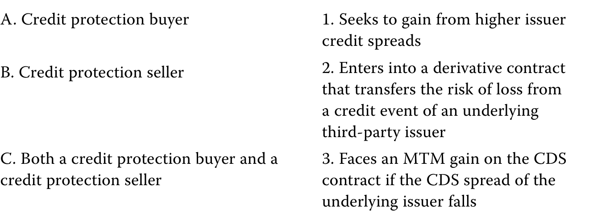

A. 信用保护买方；1. 寻求从发行人信用利差上升中获利。

B. 信用保护卖方；2. 订立衍生品合约，以转移标的第三方发行人信用事件造成的损失风险。

C. 信用保护买方和信用保护卖方。

3\. 如果标的发行人的CDS利差下降，在CDS合约上获得盯市收益。

#### 官方答案与解析 / Official answer and explanation

1\. 正确答案是A。信用保护买方寻求从发行人信用利差上升中获利。

1\. The correct answer is A. A credit protection buyer seeks to gain from higher issuer credit spreads.

2\. 正确答案是C。信用保护买方和卖方均订立了一份衍生品合约，用于转移标的第三方发行人发生信用事件所带来的损失风险。

2\. The correct answer is C. Both the credit protection buyer and credit protection seller enter into a derivative contract that transfers the risk of loss from a credit event of an underlying third-party issuer.

3\. 正确答案是B。如果标的发行人的CDS利差下降，信用保护卖方会在CDS合约上获得盯市收益。相对于合约最初的固定利差，当前发行人CDS利差下降，意味着卖方收取的利差高于市场水平。这一高于市场的利差，超过了补偿较低新信用风险所需的水平，因此形成盯市收益。

3\. The correct answer is B. A credit protection seller faces an MTM gain on the CDS contract if the CDS spread of the underlying issuer falls. The decline in the issuer’s CDS spread versus the original fixed spread on the CDS contract means that the protection seller is receiving an above-market spread. This above-market CDS spread more than compensates the seller for the new, lower level of credit risk and results in an MTM gain.

#### 补充解析 / Supplementary explanation

结合本题的官方结论：“正确答案是A。信用保护买方寻求从发行人信用利差上升中获利。 2. 正确答案是C。” 下列补充说明解释其背后的场外、交易所与中央清算。

Link to this question’s official result: “The correct answer is A. A credit protection buyer seeks to gain from higher issuer credit spreads. 2. The correct answer is C.” The supplementary discussion below explains otc trading, exchanges, and central clearing.

解题思路：交易场所与清算方式是两个相关但不同的问题。场外合约通常更易定制名义金额、日期和条款；交易所合约通常标准化。场外成交也可以进入中央清算，不能把 OTC 自动等同于双边不清算。

Reasoning: Trading venue and clearing method are related but distinct. OTC contracts are usually more customizable, while exchange contracts are standardized. OTC trades can also be centrally cleared, so OTC does not automatically mean uncleared bilateral exposure.

应用方法：先比较客户实际敞口与标准合约是否匹配，再分析对手方是谁。CCP 通过替代原交易对手、保证金和风险管理降低部分双边风险，但风险会集中到清算体系，不能理解为所有风险彻底消失。

Application: Compare the customer’s exposure with available standardized contracts, then identify the legal counterparty. A CCP interposes itself and uses margin and risk management to reduce bilateral exposure, while concentrating risk within the clearing system.

#### 相关知识点 / Related concepts

#### 场外、交易所与中央清算 / OTC trading, exchanges, and central clearing

Customization 有助于降低期限和金额错配；standardization 通常有助于流动性和交易便利。二者都不能保证不存在市场风险。

Customization can reduce size and maturity mismatch; standardization can improve liquidity and trading convenience. Neither eliminates market risk.

### DER-LM02-QS06-01 · 正文题组 6 · 第 1 题 Question set 6 · Question 1

正文习题组 / Question set · 原版 PDF 页码 / Source PDF pages: 56

#### 题目与资料 / Question and data

#### 共用资料 / Shared information

确定承诺与或有索取权

Firm Commitments and Contingent Claims

1\. 填空：远期\_\_\_\_\_\_\_\_\_\_头寸、看涨期权\_\_\_\_\_\_\_\_\_\_头寸和看跌期权\_\_\_\_\_\_\_\_\_\_头寸，会从标的价格下跌中获利。

1\. Determine the correct answers to fill in the blanks: A \_\_\_\_\_ forward posi tion, a \_\_\_\_\_ call option position, and a \_\_\_\_\_ put option position will gain from a decrease in the underlying price.

#### 官方答案与解析 / Official answer and explanation

远期空头、看涨期权空头和看跌期权多头，会从标的价格下跌中获利。

A short forward position, a short call option position, and a long put option position will gain from a decrease in the underlying price.

#### 补充解析 / Supplementary explanation

结合本题的官方结论：“远期空头、看涨期权空头和看跌期权多头，会从标的价格下跌中获利。” 下列补充说明解释其背后的期权支付与利润分开算。

Link to this question’s official result: “A short forward position, a short call option position, and a long put option position will gain from a decrease in the underlying price.” The supplementary discussion below explains separate option payoff from profit.

解题思路：期权买方有权选择是否行权，因此到期支付不会因为不利行情而变成负数；但买方事先支付了权利金，所以净利润仍可能为负。把 payoff 和 profit 混为一谈，是此类题最常见的错误。

Reasoning: An option buyer can choose not to exercise, so expiration payoff is non-negative. The buyer nevertheless paid a premium and can lose money overall. Confusing payoff with profit is a frequent error.

应用方法：先比较到期价格与执行价，算出行权支付，再扣除权利金得到买方利润；若题目忽略资金时间价值，就不要额外计息。卖方损益取相反数，并按合约乘数换算实际金额。

Application: Compare terminal spot with the strike, calculate exercise payoff, and subtract premium for the buyer’s profit. Do not add financing adjustments when the question ignores the time value of money. Reverse the sign for the seller and apply the contract multiplier.

#### 相关知识点 / Related concepts

#### 期权支付与利润分开算 / Separate option payoff from profit

In the money 表示立即行权有正支付，不保证扣除权利金后盈利。Call 买方通常受益于上涨，put 买方通常受益于下跌。

In the money means positive exercise value, not necessarily a positive net profit. Call buyers generally benefit from price rises and put buyers from declines.

Call payoff = max(Sₜ − X, 0); Put payoff = max(X − Sₜ, 0); Buyer profit = Payoff − Premium

### DER-LM02-QS06-02 · 正文题组 6 · 第 2 题 Question set 6 · Question 2

正文习题组 / Question set · 原版 PDF 页码 / Source PDF pages: 56-57

#### 题目与资料 / Question and data

#### 共用资料 / Shared information

确定承诺与或有索取权

Firm Commitments and Contingent Claims

2\. 假设行权价格X等于远期价格F₀(T)，将以下到期利润图与相应的衍生品头寸配对：

2\. Identify the derivative positions that correspond to the following profit pro files at maturity assuming that the exercise price (X) equals F0(T):

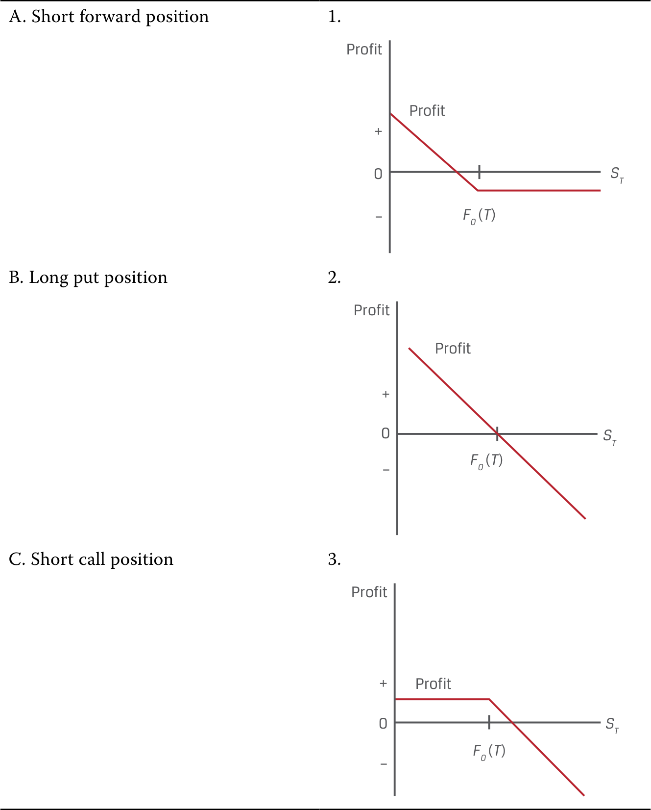

A. 远期空头；图1。

B. 看跌期权多头；图2。

C. 看涨期权空头；图3。

图内文字对照：Profit＝利润。

#### 官方答案与解析 / Official answer and explanation

1\. 正确答案是B。

1\. The correct answer is B.

2\. 正确答案是A。

2\. The correct answer is A.

3\. 正确答案是C。

3\. The correct answer is C.

#### 补充解析 / Supplementary explanation

结合本题的官方结论：“正确答案是B。 2. 正确答案是A。 3. 正确答案是C。” 下列补充说明解释其背后的期权支付与利润分开算。

Link to this question’s official result: “The correct answer is B. 2. The correct answer is A. 3. The correct answer is C.” The supplementary discussion below explains separate option payoff from profit.

解题思路：期权买方有权选择是否行权，因此到期支付不会因为不利行情而变成负数；但买方事先支付了权利金，所以净利润仍可能为负。把 payoff 和 profit 混为一谈，是此类题最常见的错误。

Reasoning: An option buyer can choose not to exercise, so expiration payoff is non-negative. The buyer nevertheless paid a premium and can lose money overall. Confusing payoff with profit is a frequent error.

应用方法：先比较到期价格与执行价，算出行权支付，再扣除权利金得到买方利润；若题目忽略资金时间价值，就不要额外计息。卖方损益取相反数，并按合约乘数换算实际金额。

Application: Compare terminal spot with the strike, calculate exercise payoff, and subtract premium for the buyer’s profit. Do not add financing adjustments when the question ignores the time value of money. Reverse the sign for the seller and apply the contract multiplier.

#### 相关知识点 / Related concepts

#### 期权支付与利润分开算 / Separate option payoff from profit

In the money 表示立即行权有正支付，不保证扣除权利金后盈利。Call 买方通常受益于上涨，put 买方通常受益于下跌。

In the money means positive exercise value, not necessarily a positive net profit. Call buyers generally benefit from price rises and put buyers from declines.

Call payoff = max(Sₜ − X, 0); Put payoff = max(X − Sₜ, 0); Buyer profit = Payoff − Premium

### DER-LM02-QS06-03 · 正文题组 6 · 第 3 题 Question set 6 · Question 3

正文习题组 / Question set · 原版 PDF 页码 / Source PDF pages: 56-57

#### 题目与资料 / Question and data

#### 共用资料 / Shared information

确定承诺与或有索取权

Firm Commitments and Contingent Claims

3\. 假设看跌期权的行权价格等于远期价格，描述远期空头与看跌期权多头具有相同利润时的条件。

3\. Describe the point at which a short forward and a long put with an exercise price (X) equal to the forward price, F0(T) have the same profit.

#### 官方答案与解析 / Official answer and explanation

当远期空头利润等于负的看跌期权权利金时，远期空头与看跌期权多头的利润相同。远期空头从标的价格下降中获利，其到期收益及利润均等于远期价格减去到期现货价格。由公式4可知，当行权价格等于远期价格时，看跌期权多头的利润等于两者差额的正值部分减去权利金。具体关系见对应英文及共用公式。

The short forward and long put positions will have the same profit when F0(T) – ST = –p0. A short forward position gains from a decline in the underlying price with a payoff/profit of \[F0(T) – ST\], and a long put position has a profit of Π = max\[0, F0(T) – ST\] – p0, from Equation 4, with an exercise price equal to the forward price, X = F0(T).

#### 补充解析 / Supplementary explanation

结合本题的官方结论：“当远期空头利润等于负的看跌期权权利金时，远期空头与看跌期权多头的利润相同。远期空头从标的价格下降中获利，其到期收益及利润均等于远期价格减去到期现货价格。由公式4可知，当行权价格等于远期价格时，看跌期权多头的利润等于两者差额的正值部分减去权利金。” 下列补充说明解释其背后的远期的价格、价值与到期损益。

Link to this question’s official result: “The short forward and long put positions will have the same profit when F0(T) – ST = –p0. A short forward position gains from a decline in the underlying price with a payoff/profit of \[F0(T) – ST\], and a long put position has a profit of Π = max\[0, F0(T) – ST\] – p0, from Equation 4, with an exercise price equal to the forward price, X = F0(T).” The supplementary discussion below explains forward price, contract value, and payoff.

解题思路：合约中预先约定的交割价格与合约今天的市场价值不是同一个量。买方已经锁定买入价格，因此到期标的市价越高，买方越有利；卖方的损益方向正好相反。

Reasoning: The agreed delivery price is different from the contract’s current market value. A long forward locks in a purchase price and benefits when the terminal spot price is higher; the short side has the opposite payoff.

应用方法：先标明 long / short，再用“收到什么减去支付什么”。如果报价按每股、每盎司或每单位给出，最后还要乘合约数量。普通公平定价远期初始价值可为零，但不代表其交割价格或名义金额为零。

Application: Identify long or short, then subtract what is paid from what is received. Multiply a per-unit payoff by contract quantity. A fairly priced forward can have zero initial value without having a zero delivery price or notional amount.

#### 相关知识点 / Related concepts

#### 远期的价格、价值与到期损益 / Forward price, contract value, and payoff

F₀(T) 是约定交割价，Vₜ(T) 是时点 t 的合约价值，Sₜ 是现货价格。保留这些时间下标可以避免把不同量混用。

F₀(T) is the delivery price, Vₜ(T) the contract value at time t, and Sₜ the spot price. Time subscripts help keep them distinct.

Long payoff at maturity = S_T − F_0(T); Short payoff = F_0(T) − S_T

### DER-LM02-P01-01 · 章末练习 1 Practice problem 1

章末练习 / Practice problem · 原版 PDF 页码 / Source PDF pages: 58, 60

#### 题目与资料 / Question and data

#### 共用资料 / Shared information

### 以下资料适用于第1至4题。The following information relates to questions 1-4

Biomian Limited是一家位于孟买的生物科技公司，其普通股及上市期货、期权在印度国家证券交易所（NSE）交易。

Biomian Limited is a Mumbai-based biotech company with common stock and listed futures and options on the National Stock Exchange (NSE).

Viswan Family Office（VFO）目前持有10,000股Biomian普通股。

The Viswan Family Office (VFO) currently owns 10,000 Biomian common shares.

VFO希望降低Biomian多头头寸，并分散股票市场风险敞口，但出于税务原因，将推迟六个月才在现货市场出售股票。

VFO would like to reduce its long Biomian position and diversify its equity market exposure but will delay a cash sale of shares for tax reasons for six months.

1\. 以下哪种可供VFO首席投资官选择的衍生品合约，最适合降低未来六个月Biomian股价下跌的风险敞口？

1\. Which of the following derivative contracts available to VFO’s chief investment officer is best suited to reduce exposure to a decline in Biomian’s stock price in the next six months?

A. 六个月后到期的Biomian股票看跌期权空头。

A. A short put position on Biomian stock that expires in six months

B. 六个月后到期的Biomian股票看涨期权多头。

B. A long call position on Biomian stock that expires in six months

C. 六个月后结算的Biomian股票期货空头。

C. A short futures position in Biomian stock that settles in six months

#### 官方答案与解析 / Official answer and explanation

1\. C正确。

1\. C is correct.

VFO可以考虑建立六个月后的Biomian股票期货空头，或远期卖出Biomian股票，以达到目标。

VFO may consider either a short futures position in (or a forward sale of) Biomian shares in six months to achieve its objective.

这种确定承诺让VFO能够在六个月后按预先约定的价格，用空头抵销现有多头。

This firm commitment allows VFO to offset its long position with a short position in six months at a pre-agreed price.

期货属于交易所交易衍生品，条款由交易所标准化，要求缴纳初始保证金并每日结算。

The futures contract is an exchange-traded derivative with standardized terms set by the exchange and requires initial margin and daily settlement.

选项A和B属于或有索取权，两者都可能增加而非减少VFO六个月后的Biomian股票敞口。

Answers A and B are contingent claims that can both potentially increase, not decrease, VFO’s exposure to Biomian stock in six months.

#### 补充解析 / Supplementary explanation

结合本题的官方结论：“C正确。 VFO可以考虑建立六个月后的Biomian股票期货空头，或远期卖出Biomian股票，以达到目标。 这种确定承诺让VFO能够在六个月后按预先约定的价格，用空头抵销现有多头。” 下列补充说明解释其背后的期货保证金与每日结算。

Link to this question’s official result: “C is correct. VFO may consider either a short futures position in (or a forward sale of) Biomian shares in six months to achieve its objective. This firm commitment allows VFO to offset its long position with a short position in six months at a pre-agreed price.” The supplementary discussion below explains futures margin and daily settlement.

解题思路：期货保证金是履约保障，不是买入标的资产的全款。每日价格变化产生的盈亏会转入或转出保证金账户，因此最终总盈亏与每日现金流路径要分开理解。

Reasoning: Futures margin is performance collateral, not the full purchase price of the underlying. Daily gains and losses are paid into or out of the margin account, so total payoff and the path of interim cash flows must be distinguished.

应用方法：逐日计算“价格变动 × 合约乘数 × 合约数量”，再更新余额。余额跌破 maintenance margin 后，常见规则是补回 initial margin，不是只补到 maintenance margin；具体仍以题目条款为准。

Application: Calculate each day’s price change times contract multiplier and number of contracts, then update the account. A breach of maintenance margin commonly requires replenishment to initial margin, subject to the stated contract rules.

#### 相关知识点 / Related concepts

#### 期货保证金与每日结算 / Futures margin and daily settlement

Initial margin 是初始要求；maintenance margin 是触发补缴的阈值；variation margin 与逐日盈亏转移或补缴有关。

Initial margin is the initial requirement, maintenance margin is a trigger threshold, and variation margin relates to daily gains, losses, or replenishment.

### DER-LM02-P01-02 · 章末练习 2 Practice problem 2

章末练习 / Practice problem · 原版 PDF 页码 / Source PDF pages: 58, 60

#### 题目与资料 / Question and data

#### 共用资料 / Shared information

### 以下资料适用于第1至4题。The following information relates to questions 1-4

Biomian Limited是一家位于孟买的生物科技公司，其普通股及上市期货、期权在印度国家证券交易所（NSE）交易。

Biomian Limited is a Mumbai-based biotech company with common stock and listed futures and options on the National Stock Exchange (NSE).

Viswan Family Office（VFO）目前持有10,000股Biomian普通股。

The Viswan Family Office (VFO) currently owns 10,000 Biomian common shares.

VFO希望降低Biomian多头头寸，并分散股票市场风险敞口，但出于税务原因，将推迟六个月才在现货市场出售股票。

VFO would like to reduce its long Biomian position and diversify its equity market exposure but will delay a cash sale of shares for tax reasons for six months.

2\. VFO的市场策略师认为Biomian股价将在未来六个月上涨，但希望对期间股价下跌提供保护。

2\. VFO’s market strategist believes that Biomian’s share price will rise over the next six months but would like to protect against a decline in Biomian’s share price over the period.

基于这一观点，以下哪种头寸最适合VFO管理现有的Biomian风险敞口？

Which of the following positions is best suited for VFO to manage its existing Biomian exposure based on this view?

A. 六个月后到期的Biomian股票看跌期权多头。

A. A long put position on Biomian stock that expires in six months

B. 六个月后到期的Biomian股票看涨期权空头。

B. A short call position on Biomian stock that expires in six months

C. 六个月后结算的Biomian股票期货多头。

C. A long futures position in Biomian stock that settles in six months

#### 官方答案与解析 / Official answer and explanation

2\. A正确。

2\. A is correct.

根据策略师的观点，VFO应买入六个月期Biomian股票看跌期权来管理敞口。

VFO should purchase a six-month put option on Biomian shares to manage its exposure based on the market strategist’s view.

作为或有索取权，该期权让VFO通过支付权利金，取得按预先约定行权价格出售Biomian股票的权利，但不承担必须出售的义务。

This contingent claim grants VFO the right but not the obligation to sell Biomian shares at a pre-agreed exercise price in exchange for a premium.

当到期标的价格低于行权价格时，买方行权。

A put option buyer exercises the option at maturity when the underlying price is below the exercise price.

这让VFO继续享有未来六个月Biomian股价上涨的收益，同时限制下行损失。

This allows VFO to continue to benefit from a rise in Biomian’s share price over the next six months with a limited downside.

如果股价下跌，选项B和C都无法为VFO提供这种下行保护。

Neither B nor C provides VFO with downside protection if Biomian stock declines in six months.

#### 补充解析 / Supplementary explanation

结合本题的官方结论：“A正确。 根据策略师的观点，VFO应买入六个月期Biomian股票看跌期权来管理敞口。 作为或有索取权，该期权让VFO通过支付权利金，取得按预先约定行权价格出售Biomian股票的权利，但不承担必须出售的义务。” 下列补充说明解释其背后的期权支付与利润分开算。

Link to this question’s official result: “A is correct. VFO should purchase a six-month put option on Biomian shares to manage its exposure based on the market strategist’s view. This contingent claim grants VFO the right but not the obligation to sell Biomian shares at a pre-agreed exercise price in exchange for a premium.” The supplementary discussion below explains separate option payoff from profit.

解题思路：期权买方有权选择是否行权，因此到期支付不会因为不利行情而变成负数；但买方事先支付了权利金，所以净利润仍可能为负。把 payoff 和 profit 混为一谈，是此类题最常见的错误。

Reasoning: An option buyer can choose not to exercise, so expiration payoff is non-negative. The buyer nevertheless paid a premium and can lose money overall. Confusing payoff with profit is a frequent error.

应用方法：先比较到期价格与执行价，算出行权支付，再扣除权利金得到买方利润；若题目忽略资金时间价值，就不要额外计息。卖方损益取相反数，并按合约乘数换算实际金额。

Application: Compare terminal spot with the strike, calculate exercise payoff, and subtract premium for the buyer’s profit. Do not add financing adjustments when the question ignores the time value of money. Reverse the sign for the seller and apply the contract multiplier.

#### 相关知识点 / Related concepts

#### 期权支付与利润分开算 / Separate option payoff from profit

In the money 表示立即行权有正支付，不保证扣除权利金后盈利。Call 买方通常受益于上涨，put 买方通常受益于下跌。

In the money means positive exercise value, not necessarily a positive net profit. Call buyers generally benefit from price rises and put buyers from declines.

Call payoff = max(Sₜ − X, 0); Put payoff = max(X − Sₜ, 0); Buyer profit = Payoff − Premium

### DER-LM02-P01-03 · 章末练习 3 Practice problem 3

章末练习 / Practice problem · 原版 PDF 页码 / Source PDF pages: 58, 60

#### 题目与资料 / Question and data

#### 共用资料 / Shared information

### 以下资料适用于第1至4题。The following information relates to questions 1-4

Biomian Limited是一家位于孟买的生物科技公司，其普通股及上市期货、期权在印度国家证券交易所（NSE）交易。

Biomian Limited is a Mumbai-based biotech company with common stock and listed futures and options on the National Stock Exchange (NSE).

Viswan Family Office（VFO）目前持有10,000股Biomian普通股。

The Viswan Family Office (VFO) currently owns 10,000 Biomian common shares.

VFO希望降低Biomian多头头寸，并分散股票市场风险敞口，但出于税务原因，将推迟六个月才在现货市场出售股票。

VFO would like to reduce its long Biomian position and diversify its equity market exposure but will delay a cash sale of shares for tax reasons for six months.

3\. 假设Biomian股价在未来六个月上涨。

3\. Assume that Biomian shares rise over the next six months.

以下关于该情景下VFO衍生品策略的陈述，哪一项最准确？

Which of the fol lowing statements about VFO’s derivative strategies under this scenario is most accurate?

A. 约定六个月后远期卖出Biomian股票，比购买六个月后卖出Biomian股票的权利更有利可图。

A. A forward sale of Biomian shares in six months would be more profitable than purchasing the right to sell Biomian shares in six months.

B. 购买六个月后卖出Biomian股票的权利，比约定六个月后远期卖出Biomian股票更有利可图。

B. Purchasing the right to sell Biomian shares in six months would be more profitable than a forward sale of Biomian shares in six months.

C. 资料不足，无法确定六个月后远期卖出Biomian股票与购买卖出股票的权利，哪一种策略的利润更高。

C. We do not have enough information to determine whether a forward sale or the right to sell Biomian shares will be more profitable in six months.

#### 官方答案与解析 / Official answer and explanation

3\. C正确。远期卖出Biomian股票的利润等于远期价格减去到期现货价格。如果未来六个月股价大幅上涨并超过远期价格，VFO的衍生品亏损就等于到期股价超过远期价格的部分。若持有Biomian看跌期权多头，利润等于正的行权收益减去权利金；如果到期股价大幅上涨并超过行权价格，期权到期失效，损失仅限已支付的看跌期权权利金。【译注：原文最后一句所列“\>”与“远期亏损更大”的结论方向不一致。只有远期利润低于负的看跌期权权利金，即该比较符号为“\<”时，远期亏损才更大。】

3\. C is correct. Under a forward sale of Biomian shares, the profit is \[F0(T) – ST\]. If the shares rise significantly over the next six months—that is, ST \> F0(T)—then VFO’s loss on the derivative is the difference between the Biomian forward price, F0(T), and the spot price, ST. Under the long put option on Biomian shares, VFO’s profit is max(0, X – ST) – p0. If Biomian shares rise significantly over the next six months (i.e., ST \> X), then the option expires worthless and VFO’s loss is limited to the put premium paid, p0. If \[F0(T) – ST\] \> –p0, then VFO’s loss would be greater under the firm commitment than under the contingent claim.

#### 补充解析 / Supplementary explanation

结合本题的官方结论：“C正确。远期卖出Biomian股票的利润等于远期价格减去到期现货价格。如果未来六个月股价大幅上涨并超过远期价格，VFO的衍生品亏损就等于到期股价超过远期价格的部分。” 下列补充说明解释其背后的期权支付与利润分开算。

Link to this question’s official result: “C is correct. Under a forward sale of Biomian shares, the profit is \[F0(T) – ST\]. If the shares rise significantly over the next six months—that is, ST \> F0(T)—then VFO’s loss on the derivative is the difference between the Biomian forward price, F0(T), and the spot price, ST.” The supplementary discussion below explains separate option payoff from profit.

解题思路：期权买方有权选择是否行权，因此到期支付不会因为不利行情而变成负数；但买方事先支付了权利金，所以净利润仍可能为负。把 payoff 和 profit 混为一谈，是此类题最常见的错误。

Reasoning: An option buyer can choose not to exercise, so expiration payoff is non-negative. The buyer nevertheless paid a premium and can lose money overall. Confusing payoff with profit is a frequent error.

应用方法：先比较到期价格与执行价，算出行权支付，再扣除权利金得到买方利润；若题目忽略资金时间价值，就不要额外计息。卖方损益取相反数，并按合约乘数换算实际金额。

Application: Compare terminal spot with the strike, calculate exercise payoff, and subtract premium for the buyer’s profit. Do not add financing adjustments when the question ignores the time value of money. Reverse the sign for the seller and apply the contract multiplier.

#### 相关知识点 / Related concepts

#### 期权支付与利润分开算 / Separate option payoff from profit

In the money 表示立即行权有正支付，不保证扣除权利金后盈利。Call 买方通常受益于上涨，put 买方通常受益于下跌。

In the money means positive exercise value, not necessarily a positive net profit. Call buyers generally benefit from price rises and put buyers from declines.

Call payoff = max(Sₜ − X, 0); Put payoff = max(X − Sₜ, 0); Buyer profit = Payoff − Premium

### DER-LM02-P01-04 · 章末练习 4 Practice problem 4

章末练习 / Practice problem · 原版 PDF 页码 / Source PDF pages: 58-60

#### 题目与资料 / Question and data

#### 共用资料 / Shared information

### 以下资料适用于第1至4题。The following information relates to questions 1-4

Biomian Limited是一家位于孟买的生物科技公司，其普通股及上市期货、期权在印度国家证券交易所（NSE）交易。

Biomian Limited is a Mumbai-based biotech company with common stock and listed futures and options on the National Stock Exchange (NSE).

Viswan Family Office（VFO）目前持有10,000股Biomian普通股。

The Viswan Family Office (VFO) currently owns 10,000 Biomian common shares.

VFO希望降低Biomian多头头寸，并分散股票市场风险敞口，但出于税务原因，将推迟六个月才在现货市场出售股票。

VFO would like to reduce its long Biomian position and diversify its equity market exposure but will delay a cash sale of shares for tax reasons for six months.

4\. VFO的市场策略师考虑买入六个月期、以印度股市基准NIFTY 50指数为标的的看涨期权，以增加广泛股票市场敞口。

4\. VFO’s market strategist is considering a six-month call option strategy on the NIFTY 50 benchmark Indian stock market index to increase broad market equity exposure.

目前NIFTY 50为15,200印度卢比，策略师观察到，行权价格为16,000印度卢比的看涨期权，其权利金为1,500印度卢比。

The NIFTY 50 price today is INR15,200, and the strategist observes that a call option with a INR16,000 exercise price (X) is trading at a premium of INR1,500.

如果临近到期时NIFTY 50为16,500印度卢比，以下哪项是该策略的到期收益和利润？

Which of the following represents the payoff and profit of this strategy just prior to maturity if the NIFTY 50 is trading at INR16,500?

A. 到期收益为500印度卢比；利润为负1,000印度卢比。

A. Payoff is INR500; profit is –INR1,000.

B. 到期收益为1,300印度卢比；利润为800印度卢比。

B. Payoff is INR1,300; profit is INR800.

C. 到期收益为1,300印度卢比；利润为500印度卢比。

C. Payoff is INR1,300; profit is INR500.

#### 官方答案与解析 / Official answer and explanation

4\. A正确。利润等于看涨期权的正行权收益减去权利金，而到期收益仅为正的行权收益。行权价格为16,000印度卢比，临近到期的现货价格为16,500印度卢比，因此到期收益为500印度卢比；再减去1,500印度卢比权利金，利润为负1,000印度卢比。具体计算式见对应英文及共用公式。

4\. A is correct. The profit is equal to Π = max(0, ST – X) – c0, and the payoff is equal to max(0, ST – X). The exercise price is INR16,000, and the spot price just prior to maturity is INR16,500, so Π = –1,000 \[= (16,500 – 16,000) – 1,500\], and the payoff is equal to INR500 \[= (16,500 – 16,000)\].

#### 补充解析 / Supplementary explanation

结合本题的官方结论：“A正确。利润等于看涨期权的正行权收益减去权利金，而到期收益仅为正的行权收益。行权价格为16,000印度卢比，临近到期的现货价格为16,500印度卢比，因此到期收益为500印度卢比；再减去1,500印度卢比权利金，利润为负1,000印度卢比。” 下列补充说明解释其背后的期权支付与利润分开算。

Link to this question’s official result: “A is correct. The profit is equal to Π = max(0, ST – X) – c0, and the payoff is equal to max(0, ST – X). The exercise price is INR16,000, and the spot price just prior to maturity is INR16,500, so Π = –1,000 \[= (16,500 – 16,000) – 1,500\], and the payoff is equal to INR500 \[= (16,500 – 16,000)\].” The supplementary discussion below explains separate option payoff from profit.

解题思路：期权买方有权选择是否行权，因此到期支付不会因为不利行情而变成负数；但买方事先支付了权利金，所以净利润仍可能为负。把 payoff 和 profit 混为一谈，是此类题最常见的错误。

Reasoning: An option buyer can choose not to exercise, so expiration payoff is non-negative. The buyer nevertheless paid a premium and can lose money overall. Confusing payoff with profit is a frequent error.

应用方法：先比较到期价格与执行价，算出行权支付，再扣除权利金得到买方利润；若题目忽略资金时间价值，就不要额外计息。卖方损益取相反数，并按合约乘数换算实际金额。

Application: Compare terminal spot with the strike, calculate exercise payoff, and subtract premium for the buyer’s profit. Do not add financing adjustments when the question ignores the time value of money. Reverse the sign for the seller and apply the contract multiplier.

#### 相关知识点 / Related concepts

#### 期权支付与利润分开算 / Separate option payoff from profit

In the money 表示立即行权有正支付，不保证扣除权利金后盈利。Call 买方通常受益于上涨，put 买方通常受益于下跌。

In the money means positive exercise value, not necessarily a positive net profit. Call buyers generally benefit from price rises and put buyers from declines.

Call payoff = max(Sₜ − X, 0); Put payoff = max(X − Sₜ, 0); Buyer profit = Payoff − Premium

## LM 3 · 衍生品的收益、风险及发行人与投资者的用途 Derivative Benefits, Risks, and Issuer and Investor Uses 26 条目 · 原题与解析逐条对应 / Paired source questions and explanations

### DER-LM03-SA01-01 · 模块自测 1 Module self-assessment 1

课前自测 / Pre-test / self-assessment · 原版 PDF 页码 / Source PDF pages: 62

#### 题目与资料 / Question and data

1\. 以下哪项并未描述期货市场交易相对于现货市场交易可能具有的操作优势？

1\. Which of the following statements does not describe a likely operational advantage of a futures market transaction as compared to a cash market transaction?

A. 在期货市场建立空头头寸比在现货市场更容易。

A. It is easier to take a short position in the futures market than in the cash market.

B. 期货市场的流动性高于现货市场。

B. There is greater liquidity in the futures market than in the cash market.

C. 在现货市场买入所需的现金，少于在期货市场买入所需的保证金。

C. Cash requirements to buy in the cash market are lower than margin requirements to buy in the futures market.

#### 官方答案与解析 / Official answer and explanation

C项正确。

C is correct.

事实恰好相反：期货合约的保证金要求，通常仅为在现货市场买入等量标的资产所需现金的一小部分。

The opposite is true: Margin requirements of a futures contract are typically only a small percentage of the cash requirement to buy the same amount of underlying in the cash market.

A和B项均不应选，因为两项都描述了期货市场相对于现货市场的操作优势。

A and B are both incorrect because both of these statements describe operational advantages of futures markets over cash markets.

#### 补充解析 / Supplementary explanation

结合本题的官方结论：“C项正确。 事实恰好相反：期货合约的保证金要求，通常仅为在现货市场买入等量标的资产所需现金的一小部分。 A和B项均不应选，因为两项都描述了期货市场相对于现货市场的操作优势。” 下列补充说明解释其背后的套保风险：方向正确仍可能不完全抵销。

Link to this question’s official result: “C is correct. The opposite is true: Margin requirements of a futures contract are typically only a small percentage of the cash requirement to buy the same amount of underlying in the cash market. A and B are both incorrect because both of these statements describe operational advantages of futures markets over cash markets.” The supplementary discussion below explains why a correctly directed hedge can still be imperfect.

解题思路：套保不是把风险一键删除。标的价格相关性、合约期限和金额可能与实际业务不完全一致，形成基差风险；保证金需要提前付现，也可能在经济套保有效时产生流动性压力。

Reasoning: A hedge does not delete risk automatically. Differences in underlying prices, size, or maturity create basis risk. Margin payments can create liquidity pressure even when the hedge is economically effective.

应用方法：看到“价值变化不匹配”重点考虑 basis risk；看到“付款时点不匹配或补保证金困难”重点考虑 liquidity risk；看到“对方未履行义务”考虑 counterparty credit risk。不要因为最终风险被抵销，就忽视中间现金流。

Application: A mismatch in value changes suggests basis risk; a mismatch in cash-flow timing or difficulty meeting margin suggests liquidity risk; failure by the other party to perform suggests counterparty credit risk. A final hedge offset does not remove interim funding needs.

#### 相关知识点 / Related concepts

#### 套保风险：方向正确仍可能不完全抵销 / Why a correctly directed hedge can still be imperfect

风险类型要按损失来源区分，而不是看到衍生品就统一归为市场风险。

Classify risk by its source, rather than treating every derivative problem as market risk.

### DER-LM03-SA01-02 · 模块自测 2 Module self-assessment 2

课前自测 / Pre-test / self-assessment · 原版 PDF 页码 / Source PDF pages: 62

#### 题目与资料 / Question and data

2\. 请为以下各项陈述匹配相应的衍生品风险：

2\. Identify which derivative risk fits each of the following statements:

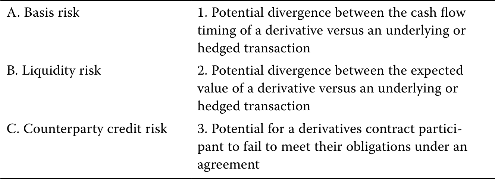

A. 基差风险。1. 衍生品与标的资产或被对冲交易的现金流发生时间可能不一致。

B. 流动性风险。2. 衍生品与标的资产或被对冲交易的预期价值可能偏离。

C. 交易对手信用风险。3. 衍生合约参与者可能无法履行协议义务。

#### 官方答案与解析 / Official answer and explanation

1\. B项正确。流动性风险是衍生品与标的资产或被对冲交易的现金流发生时间可能不一致的风险。

1\. B is correct. Liquidity risk is the potential divergence between the cash flow timing of a derivative versus an underlying or hedged transaction.

2\. A项正确。基差风险是衍生品与标的资产或被对冲交易的预期价值可能发生偏离的风险。

2\. A is correct. Basis risk is the potential divergence between the expected value of a derivative versus an underlying or hedged transaction.

3\. C项正确。

3\. C is correct.

交易对手信用风险是衍生合约参与者可能无法履行协议义务的风险。

Counterparty credit risk is the potential for a derivatives contract participant to fail to meet their obligations under an agreement.

#### 补充解析 / Supplementary explanation

结合本题的官方结论：“B项正确。流动性风险是衍生品与标的资产或被对冲交易的现金流发生时间可能不一致的风险。 2. A项正确。” 下列补充说明解释其背后的先确定敞口，再确定合约方向。

Link to this question’s official result: “B is correct. Liquidity risk is the potential divergence between the cash flow timing of a derivative versus an underlying or hedged transaction. 2. A is correct.” The supplementary discussion below explains identify the exposure before choosing the contract.

解题思路：衍生品价值取决于标的变量，但持有衍生品不等于持有标的资产本身。套期保值首先要识别原有业务在什么市场变动下受损，再选在同一变动下获利的合约方向。

Reasoning: A derivative depends on an underlying variable without necessarily conferring ownership of the underlying. For hedging, identify the market move that hurts the original business exposure, then choose a derivative that gains under that move.

应用方法：例如需要未来买入某种货币或商品的一方，担心其价格上涨，通常需锁定买入价格；未来收到并出售该资产的一方，则担心价格下跌。名义本金用来计算现金流，不必等于合约初始价值或实际投入金额。

Application: A future buyer fears a price increase and generally wants to lock in a purchase price; a future seller fears a decline. Notional principal scales contractual cash flows and need not equal the derivative’s initial value or cash investment.

#### 相关知识点 / Related concepts

#### 先确定敞口，再确定合约方向 / Identify the exposure before choosing the contract

Forward commitment 使双方承担未来履约义务；contingent claim 通常赋予一方选择权，因此两者的盈亏对称性不同。

A forward commitment binds both parties to performance. A contingent claim typically grants one party an option, producing a different payoff symmetry.

### DER-LM03-SA01-03 · 模块自测 3 Module self-assessment 3

课前自测 / Pre-test / self-assessment · 原版 PDF 页码 / Source PDF pages: 63

#### 题目与资料 / Question and data

3\. 请为以下各个例子匹配使用衍生品的相应收益：

3\. Identify which benefit of derivatives use fits each of the following examples:

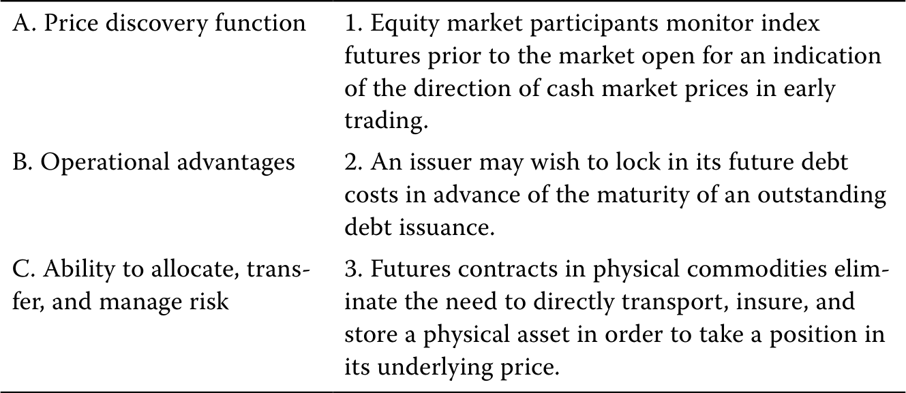

A. 价格发现功能。1. 股票市场参与者在开盘前观察股指期货，判断现货市场早盘价格方向。

B. 操作优势。2. 发行人可能希望在现有债务到期前锁定未来债务成本。

C. 配置、转移和管理风险的能力。

3\. 实物商品期货使投资者无需直接运输、投保及储存实物资产，就能建立其价格敞口。

#### 官方答案与解析 / Official answer and explanation

1\. A项正确。

1\. A is correct.

股票市场参与者在开盘前观察股指期货，以判断现货市场早盘价格方向，体现了衍生品的价格发现功能。

Equity market participants monitoring index futures prior to the market open for an indication of the direction of cash market prices in early trading is an example of the derivatives price discovery function.

2\. C项正确。

2\. C is correct.

发行人在现有债务到期前锁定未来债务成本，体现了配置、转移及管理风险的能力。

An issuer locking in its future debt costs in advance of the maturity of an outstanding debt issuance is an example of the ability to allocate, transfer, and manage risk.

3\. B项正确。

3\. B is correct.

实物商品期货使投资者无需直接运输、投保及储存实物资产，就能建立其价格敞口，体现了衍生品的操作优势。

Futures contracts in physical commodities eliminating the need to directly transport, insure, and store a physical asset in order to take a position in its underlying price is an example of the operational advantages of a derivative.

#### 补充解析 / Supplementary explanation

结合本题的官方结论：“A项正确。 股票市场参与者在开盘前观察股指期货，以判断现货市场早盘价格方向，体现了衍生品的价格发现功能。 2. C项正确。” 下列补充说明解释其背后的先确定敞口，再确定合约方向。

Link to this question’s official result: “A is correct. Equity market participants monitoring index futures prior to the market open for an indication of the direction of cash market prices in early trading is an example of the derivatives price discovery function. 2. C is correct.” The supplementary discussion below explains identify the exposure before choosing the contract.

解题思路：衍生品价值取决于标的变量，但持有衍生品不等于持有标的资产本身。套期保值首先要识别原有业务在什么市场变动下受损，再选在同一变动下获利的合约方向。

Reasoning: A derivative depends on an underlying variable without necessarily conferring ownership of the underlying. For hedging, identify the market move that hurts the original business exposure, then choose a derivative that gains under that move.

应用方法：例如需要未来买入某种货币或商品的一方，担心其价格上涨，通常需锁定买入价格；未来收到并出售该资产的一方，则担心价格下跌。名义本金用来计算现金流，不必等于合约初始价值或实际投入金额。

Application: A future buyer fears a price increase and generally wants to lock in a purchase price; a future seller fears a decline. Notional principal scales contractual cash flows and need not equal the derivative’s initial value or cash investment.

#### 相关知识点 / Related concepts

#### 先确定敞口，再确定合约方向 / Identify the exposure before choosing the contract

Forward commitment 使双方承担未来履约义务；contingent claim 通常赋予一方选择权，因此两者的盈亏对称性不同。

A forward commitment binds both parties to performance. A contingent claim typically grants one party an option, producing a different payoff symmetry.

### DER-LM03-SA01-04 · 模块自测 4 Module self-assessment 4

课前自测 / Pre-test / self-assessment · 原版 PDF 页码 / Source PDF pages: 63

#### 题目与资料 / Question and data

4\. 公司发行人利用利率互换，将浮动利率债务转换为固定利率债务，适合指定为以下哪种套期会计类别？

4\. Which of the following hedge accounting designations is appropriate for categorizing a corporate issuer’s use of an interest swap converting a floating-rate debt into a fixed-rate debt?

A. 公允价值套期

A. Fair value hedge

B. 现金流套期

B. Cash flow hedge

C. 净投资套期。

C. Net investment hedge

#### 官方答案与解析 / Official answer and explanation

B项正确。

B is correct.

通过衍生品将可变现金流转换为固定现金流的情况，适合采用现金流套期会计处理。

Cash flow hedge treatment is appropriate for instances in which a variable cash flow is converted to a fixed cash flow through the use of a derivative.

A项错误，因为公允价值套期适用于用衍生合约抵销标的资产公允价值波动的情形。

A is incorrect because a fair value hedge is appropriate accounting treatment for derivative contracts that offset fluctuations in the fair value of the underlying.

C项错误，因为净投资套期用于抵销境外子公司价值所面临的外汇风险。

C is incorrect because a net investment hedge offsets the foreign currency risk of the value of a foreign subsidiary.

#### 补充解析 / Supplementary explanation

结合本题的官方结论：“B项正确。 通过衍生品将可变现金流转换为固定现金流的情况，适合采用现金流套期会计处理。 A项错误，因为公允价值套期适用于用衍生合约抵销标的资产公允价值波动的情形。” 下列补充说明解释其背后的先确定敞口，再确定合约方向。

Link to this question’s official result: “B is correct. Cash flow hedge treatment is appropriate for instances in which a variable cash flow is converted to a fixed cash flow through the use of a derivative. A is incorrect because a fair value hedge is appropriate accounting treatment for derivative contracts that offset fluctuations in the fair value of the underlying.” The supplementary discussion below explains identify the exposure before choosing the contract.

解题思路：衍生品价值取决于标的变量，但持有衍生品不等于持有标的资产本身。套期保值首先要识别原有业务在什么市场变动下受损，再选在同一变动下获利的合约方向。

Reasoning: A derivative depends on an underlying variable without necessarily conferring ownership of the underlying. For hedging, identify the market move that hurts the original business exposure, then choose a derivative that gains under that move.

应用方法：例如需要未来买入某种货币或商品的一方，担心其价格上涨，通常需锁定买入价格；未来收到并出售该资产的一方，则担心价格下跌。名义本金用来计算现金流，不必等于合约初始价值或实际投入金额。

Application: A future buyer fears a price increase and generally wants to lock in a purchase price; a future seller fears a decline. Notional principal scales contractual cash flows and need not equal the derivative’s initial value or cash investment.

#### 相关知识点 / Related concepts

#### 先确定敞口，再确定合约方向 / Identify the exposure before choosing the contract

Forward commitment 使双方承担未来履约义务；contingent claim 通常赋予一方选择权，因此两者的盈亏对称性不同。

A forward commitment binds both parties to performance. A contingent claim typically grants one party an option, producing a different payoff symmetry.

### DER-LM03-EX01-01 · 已解例题 1 · 转移出口合约的外汇风险 Worked example 1 · Foreign Exchange Risk Transfer of an Export Contract

正文例题／案例 / Worked example / case · 原版 PDF 页码 / Source PDF pages: 64-65

#### 题目与资料 / Question and data

### 转移出口合约的外汇风险Foreign Exchange Risk Transfer of an Export Contract

#### 官方答案与解析 / Official answer and explanation

回顾此前介绍的德国资本货物生产商Montau AG。该公司与韩国制造商Jeon, Inc.签订商业合约，约定75天后交付一台激光切割机，价格为650,000,000韩元。Montau的本币欧元成本已经固定，因此，发生欧元成本与交付设备后收到韩元、再在即期外汇市场兑换为欧元而实现收入之间，存在时间错配。

Recall Montau AG, the German capital goods producer introduced earlier, which signs a commercial contract with Jeon, Inc., a Korean manufacturer, to deliver a laser cutting machine at a price of KRW650,000,000 in 75 days. Montau has fixed domestic currency (EUR) costs and therefore faces a timing mismatch between EUR costs incurred and EUR revenue realized upon the delivery of the machine and sale of KRW received in exchange for EUR in the spot FX market.

请描述Montau的货币敞口，以及如何利用外汇远期合约降低其汇率风险。

Describe Montau’s currency exposure and how an FX forward contract may be used to mitigate its FX price risk.

Montau将在75天后收到韩元，必须卖出这些韩元以支付欧元成本。

Montau will receive KRW in 75 days, which it must sell to cover its EUR costs.

因此，公司在75天内面临KRW/EUR汇率变化风险。

This exposes the firm to KRW/EUR exchange rate changes for 75 days.

具体而言，如果韩元相对于欧元贬值，同一笔韩元收入能兑换的欧元将少于预期，外汇现金流的时间错配因而导致损失。

Specifically, if the KRW depreciates versus the EUR, Montau will be able to purchase fewer EUR than expected with the KRW proceeds, resulting in a loss due to the FX timing mismatch.

Montau因错配形成的敞口如下：

Montau’s exposure profile due to the mismatch is as follows:

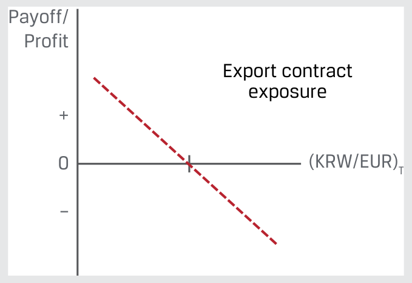

图内文字对照：Payoff/＝到期收益；Profit＝利润；Export contract exposure＝出口合约风险敞口。

为降低出口合约敞口，Montau建立外汇远期合约，约定75天后按固定价格F0(T)卖出韩元、买入欧元，以消除出口合约所产生的KRW/EUR汇率错配。

In order to mitigate its export contract exposure, Montau enters an FX forward to sell KRW and purchase EUR at a fixed price \[F0(T)\] in 75 days to eliminate the KRW/EUR exchange rate mismatch arising from the export contract.

该外汇远期的收益与利润结构如下：

The FX forward payoff and profit profile is as follows:

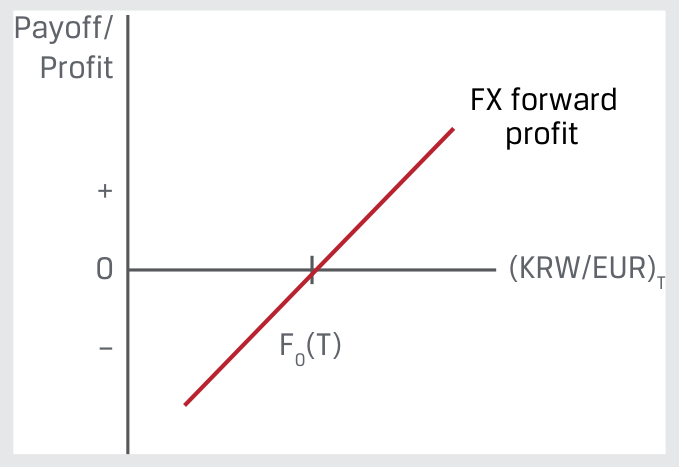

图内文字对照：Payoff/＝到期收益；Profit＝利润；FX forward profit＝外汇远期利润。

外汇远期的收益与利润结构能够抵销Montau的出口合约敞口，发挥对冲作用，如以下组合图所示：

The FX forward payoff and profit profile offsets Montau’s export contract exposure as a hedge, as shown in the following combined diagram:

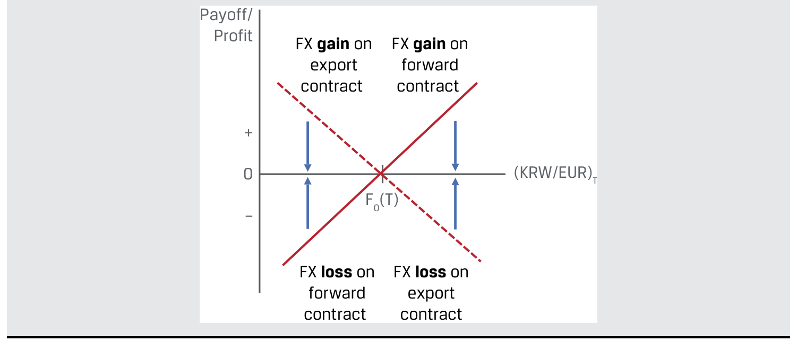

图内文字对照：Payoff/＝到期收益；Profit＝利润；FX gain on export contract＝出口合约的汇兑收益；FX loss on export contract＝出口合约的汇兑损失；FX gain on forward contract＝远期合约的汇兑收益；FX loss on forward contract＝远期合约的汇兑损失。

#### 补充解析 / Supplementary explanation

结合本题的官方结论：“回顾此前介绍的德国资本货物生产商Montau AG。该公司与韩国制造商Jeon, Inc.签订商业合约，约定75天后交付一台激光切割机，价格为650,000,000韩元。Montau的本币欧元成本已经固定，因此，发生欧元成本与交付设备后收到韩元、再在即期外汇市场兑换为欧元而实现收入之间，存在时间错配。” 下列补充说明解释其背后的先确定敞口，再确定合约方向。

Link to this question’s official result: “Recall Montau AG, the German capital goods producer introduced earlier, which signs a commercial contract with Jeon, Inc., a Korean manufacturer, to deliver a laser cutting machine at a price of KRW650,000,000 in 75 days. Montau has fixed domestic currency (EUR) costs and therefore faces a timing mismatch between EUR costs incurred and EUR revenue realized upon the delivery of the machine and sale of KRW received in exchange for EUR in the spot FX market.” The supplementary discussion below explains identify the exposure before choosing the contract.

解题思路：衍生品价值取决于标的变量，但持有衍生品不等于持有标的资产本身。套期保值首先要识别原有业务在什么市场变动下受损，再选在同一变动下获利的合约方向。

Reasoning: A derivative depends on an underlying variable without necessarily conferring ownership of the underlying. For hedging, identify the market move that hurts the original business exposure, then choose a derivative that gains under that move.

应用方法：例如需要未来买入某种货币或商品的一方，担心其价格上涨，通常需锁定买入价格；未来收到并出售该资产的一方，则担心价格下跌。名义本金用来计算现金流，不必等于合约初始价值或实际投入金额。

Application: A future buyer fears a price increase and generally wants to lock in a purchase price; a future seller fears a decline. Notional principal scales contractual cash flows and need not equal the derivative’s initial value or cash investment.

#### 相关知识点 / Related concepts

#### 先确定敞口，再确定合约方向 / Identify the exposure before choosing the contract

Forward commitment 使双方承担未来履约义务；contingent claim 通常赋予一方选择权，因此两者的盈亏对称性不同。

A forward commitment binds both parties to performance. A contingent claim typically grants one party an option, producing a different payoff symmetry.

原书为叙述式已解例题，完整条件、计算及结论保留在官方解析区。

### DER-LM03-EX02-02 · 已解例题 2 · 备兑看涨期权策略 Worked example 2 · Covered Call Option Strategy

正文例题／案例 / Worked example / case · 原版 PDF 页码 / Source PDF pages: 65-66

#### 题目与资料 / Question and data

### 备兑看涨期权策略Covered Call Option Strategy

#### 官方答案与解析 / Official answer and explanation

South China Sprintwyck Investments（SCSI）持有一个中国股票投资组合，由于超配医疗保健行业股票，上半年表现优异。

South China Sprintwyck Investments (SCSI) has a Chinese equity portfolio that has outperformed in the first half of the year due to an overweight position in health care industry shares.

SCSI持有一项在中国金融期货交易所（CFFEX）交易的深圳中证300医疗保健指数多头，教材简称其为CSI 300。

SCSI holds a long position in the Shenzhen China Securities Index (CSI) 300 Health Care Index (CSI 300) traded on the China Financial Futures Exchange (CFFEX).

SCSI的首席投资官预计，该指数波动性将下降，年末价格将处于或略高于当前现货价格。

SCSI’s CIO expects volatility in the CSI 300 to decline and the CSI 300 price at year-end to be at or slightly above the current spot price.

她决定目前不在现货市场卖出指数头寸，而是卖出一份覆盖本年剩余六个月的CSI 300看涨期权，行权价较当前现货价格高5%。

Rather than sell the CSI 300 position today in the cash market, she decides to sell a CSI 300 call option at an exercise price 5% above the current spot market price for the remaining six months of the year.

请描述年末SCSI的CSI 300收益结构在以下两种策略之间有何区别：（1）仅持有现货多头；（2）卖出看涨期权并持有现货多头，即备兑看涨期权策略。

Describe the difference in SCSI’s CSI 300 payoff profile between 1.) the long cash position and 2.) the sold call option plus long cash position (referred to as a covered call strategy) at the end of the year.

1\. 直至年末，SCSI现货多头的价值将随CSI 300现货价格变动而上升或下降。

1\. SCSI’s long cash position will rise or fall in value as the CSI 300 spot price changes until the end of the year.

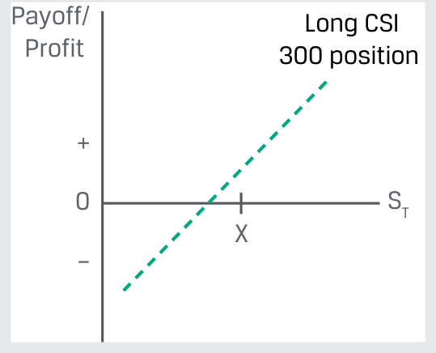

图内文字对照：Long CSI 300 position＝沪深300指数多头头寸；Payoff/＝到期收益；Profit＝利润。

策略（1）与（2）的区别，在于卖出一份CSI 300看涨期权。

The difference between 1.) and 2.) is the sale of a CSI 300 call option.

SCSI卖出期权并预先收取权利金。

SCSI sells the call and receives an upfront premium.

单独来看这份卖出的看涨期权，若CSI 300价格不断高于行权价，SCSI便承担无限损失风险：

SCSI assumes unlimited downside risk as the CSI 300 price rises above the exercise price:

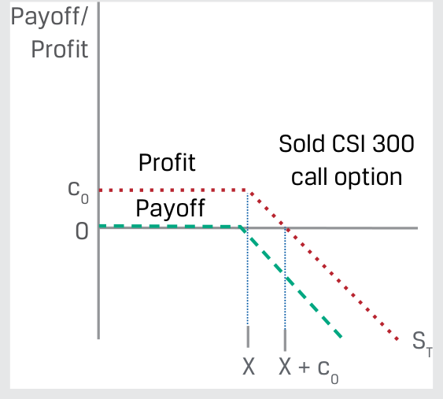

图内文字对照：Profit c0 0＝利润；初始看涨期权权利金；Payoff＝到期收益；Payoff/＝到期收益；Profit＝利润；Sold CSI 300 call option＝卖出沪深300指数看涨期权。

2\. 将CSI 300现货多头与CSI 300看涨期权空头组合后，得到下图实线所示的利润结构：

2\. The combination of the long CSI 300 cash position and the short CSI 300 call option results in the profit profile represented by the solid line below:

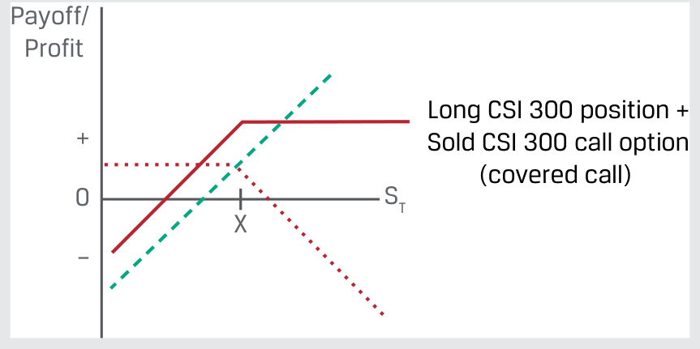

图内文字对照：Payoff/＝到期收益；Profit＝利润；Long CSI 300 position + Sold CSI 300 call option＝沪深300指数多头与卖出看涨期权的组合；(covered call) +＝备兑看涨期权。

备兑看涨期权策略的收益可描述如下：

The covered call strategy payoff may be described as follows:

● CSI 300涨幅低于5%：看涨期权到期不行权。SCSI的利润等于CSI 300多头头寸的利润，加上收取的看涨期权权利金。

● CSI 300 appreciates by less than 5%: The call option expires unexercised. SCSI’s profit equals the long CSI 300 position plus the call premium.

● CSI 300涨幅高于5%：看涨期权被行权。

● CSI 300 appreciates by more than 5%: The call option is exercised.

SCSI必须向期权买方支付相当于指数多头头寸超过行权价部分的收益。

SCSI must pay the option buyer an amount equal to the gain on its long CSI 300 position above the exercise price.

期权付款由现货多头头寸“覆盖”。

The option payoff is said to be “covered” by the long cash position.

SCSI保留已收取的看涨期权权利金。

SCSI retains the call premium.

#### 补充解析 / Supplementary explanation

结合本题的官方结论：“South China Sprintwyck Investments（SCSI）持有一个中国股票投资组合，由于超配医疗保健行业股票，上半年表现优异。 SCSI持有一项在中国金融期货交易所（CFFEX）交易的深圳中证300医疗保健指数多头，教材简称其为CSI 300。 SCSI的首席投资官预计，该指数波动性将下降，年末价格将处于或略高于当前现货价格。” 下列补充说明解释其背后的期权支付与利润分开算。

Link to this question’s official result: “South China Sprintwyck Investments (SCSI) has a Chinese equity portfolio that has outperformed in the first half of the year due to an overweight position in health care industry shares. SCSI holds a long position in the Shenzhen China Securities Index (CSI) 300 Health Care Index (CSI 300) traded on the China Financial Futures Exchange (CFFEX). SCSI’s CIO expects volatility in the CSI 300 to decline and the CSI 300 price at year-end to be at or slightly above the current spot price.” The supplementary discussion below explains separate option payoff from profit.

解题思路：期权买方有权选择是否行权，因此到期支付不会因为不利行情而变成负数；但买方事先支付了权利金，所以净利润仍可能为负。把 payoff 和 profit 混为一谈，是此类题最常见的错误。

Reasoning: An option buyer can choose not to exercise, so expiration payoff is non-negative. The buyer nevertheless paid a premium and can lose money overall. Confusing payoff with profit is a frequent error.

应用方法：先比较到期价格与执行价，算出行权支付，再扣除权利金得到买方利润；若题目忽略资金时间价值，就不要额外计息。卖方损益取相反数，并按合约乘数换算实际金额。

Application: Compare terminal spot with the strike, calculate exercise payoff, and subtract premium for the buyer’s profit. Do not add financing adjustments when the question ignores the time value of money. Reverse the sign for the seller and apply the contract multiplier.

#### 相关知识点 / Related concepts

#### 期权支付与利润分开算 / Separate option payoff from profit

In the money 表示立即行权有正支付，不保证扣除权利金后盈利。Call 买方通常受益于上涨，put 买方通常受益于下跌。

In the money means positive exercise value, not necessarily a positive net profit. Call buyers generally benefit from price rises and put buyers from declines.

Call payoff = max(Sₜ − X, 0); Put payoff = max(X − Sₜ, 0); Buyer profit = Payoff − Premium

原书为叙述式已解例题，完整条件、计算及结论保留在官方解析区。

### DER-LM03-EX03-03 · 已解例题 3 · 2020年的负油价期货 Worked example 3 · Negative Oil Futures Prices in 2020

正文例题／案例 / Worked example / case · 原版 PDF 页码 / Source PDF pages: 67

#### 题目与资料 / Question and data

### 2020年的负油价期货Negative Oil Futures Prices in 2020

#### 官方答案与解析 / Official answer and explanation

2020年4月，西得克萨斯中质原油（WTI）期货价格首次跌至零以下。纽约商品交易所（NYMEX）WTI原油期货合约的标的是1,000桶原油，在俄克拉何马州库欣交割；能源公司在当地储存近8,000万桶原油。新冠疫情后的大范围封锁导致需求骤降，而生产商未能及时大幅减产以应对需求锐减，库欣的原油库存因而急剧增加。

In April 2020, the West Texas Intermediate (WTI) crude oil futures price fell below zero for the first time ever. The New York Mercantile Exchange (NYMEX) WTI crude oil futures contract has an underlying of 1,000 barrels of crude oil delivered to Cushing, Oklahoma, where energy companies store nearly 80 million barrels of oil. Widespread lockdowns in the wake of the COVID-19 pandemic caused demand to plummet, while producers could not cut oil production quickly enough in anticipation of the severe decline. Oil inventory in Cushing skyrocketed as a result.

### 2020年1月至6月NYMEX原油期货价格（原图单位标为美元／合约）NYMEX Oil Futures Price (USD per contract), January–June 2020

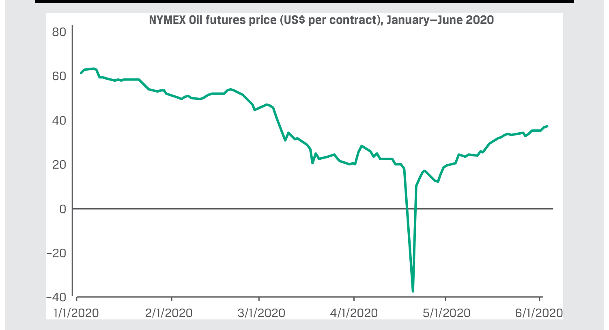

图内文字对照：NYMEX Oil futures price (US\$ per contract), January—June 2020＝2020年1至6月NYMEX原油期货价格（美元／合约）。

来源：Bloomberg。2020年4月下旬，5月期货合约临近到期。由于仓储成本急升，炼油商避免在合约结算时接收实物原油，使承担油价金融风险的投资者措手不及。5月期货价格因此急剧下跌，于2020年4月20日收于−37.63美元。石油生产商和炼油商利用这一期货价格信息，更迅速地调整供应，减轻仓储设施压力。

Source: Bloomberg. As the May futures contract approached expiration in late April 2020, investors assuming the financial risk of oil prices were surprised as oil refiners avoided physical delivery of oil upon contract settlement due to a sharp rise in storage costs. This forced the May futures price sharply lower, to a closing price of −USD37.63 on 20 April 2020. Oil producers and refiners used this futures pricing information to adjust supply more quickly and reduce pressure on storage facilities.

#### 补充解析 / Supplementary explanation

结合本题的官方结论：“2020年4月，西得克萨斯中质原油（WTI）期货价格首次跌至零以下。纽约商品交易所（NYMEX）WTI原油期货合约的标的是1,000桶原油，在俄克拉何马州库欣交割；能源公司在当地储存近8,000万桶原油。新冠疫情后的大范围封锁导致需求骤降，而生产商未能及时大幅减产以应对需求锐减，库欣的原油库存因而急剧增加。” 下列补充说明解释其背后的先确定敞口，再确定合约方向。

Link to this question’s official result: “In April 2020, the West Texas Intermediate (WTI) crude oil futures price fell below zero for the first time ever. The New York Mercantile Exchange (NYMEX) WTI crude oil futures contract has an underlying of 1,000 barrels of crude oil delivered to Cushing, Oklahoma, where energy companies store nearly 80 million barrels of oil. Widespread lockdowns in the wake of the COVID-19 pandemic caused demand to plummet, while producers could not cut oil production quickly enough in anticipation of the severe decline.” The supplementary discussion below explains identify the exposure before choosing the contract.

解题思路：衍生品价值取决于标的变量，但持有衍生品不等于持有标的资产本身。套期保值首先要识别原有业务在什么市场变动下受损，再选在同一变动下获利的合约方向。

Reasoning: A derivative depends on an underlying variable without necessarily conferring ownership of the underlying. For hedging, identify the market move that hurts the original business exposure, then choose a derivative that gains under that move.

应用方法：例如需要未来买入某种货币或商品的一方，担心其价格上涨，通常需锁定买入价格；未来收到并出售该资产的一方，则担心价格下跌。名义本金用来计算现金流，不必等于合约初始价值或实际投入金额。

Application: A future buyer fears a price increase and generally wants to lock in a purchase price; a future seller fears a decline. Notional principal scales contractual cash flows and need not equal the derivative’s initial value or cash investment.

#### 相关知识点 / Related concepts

#### 先确定敞口，再确定合约方向 / Identify the exposure before choosing the contract

Forward commitment 使双方承担未来履约义务；contingent claim 通常赋予一方选择权，因此两者的盈亏对称性不同。

A forward commitment binds both parties to performance. A contingent claim typically grants one party an option, producing a different payoff symmetry.

原书为叙述式已解例题，完整条件、计算及结论保留在官方解析区。

### DER-LM03-EX04-04 · 已解例题 4 · 购买现货黄金与黄金期货合约的比较 Worked example 4 · Purchase of Spot Gold versus a Gold Futures Contract

正文例题／案例 / Worked example / case · 原版 PDF 页码 / Source PDF pages: 68-69

#### 题目与资料 / Question and data

### 购买现货黄金与黄金期货合约的比较Purchase of Spot Gold versus a Gold Futures Contract

#### 官方答案与解析 / Official answer and explanation

此前示例中，Procam Investments买入一份三个月后到期、标的为100盎司黄金的期货合约，期货价格f0(T)为每盎司1,792.13美元，并须按交易所要求缴纳4,950美元初始保证金。Procam订立期货合约时，黄金现货价格S0为每盎司1,770美元。假设Procam能以年利率5%向金融中介借款，请比较三个月期货合约初始保证金的预期机会成本，与同期购买100盎司现货黄金的预期机会成本。

In an earlier example, Procam Investments enters a futures contract to buy 100 ounces of gold at a futures price \[f0(T)\] of USD1,792.13 per ounce that expires in three months and must post USD4,950 in initial margin as required by the exchange. The spot gold price (S0) at the time Procam enters the futures contract is USD1,770 per ounce. Assume that Procam is able to borrow funds from a financial intermediary at a rate of 5% per year. Contrast the expected opportunity cost of the initial margin for the three-month futures contract with a cash purchase of 100 ounces of gold for the same three-month period.

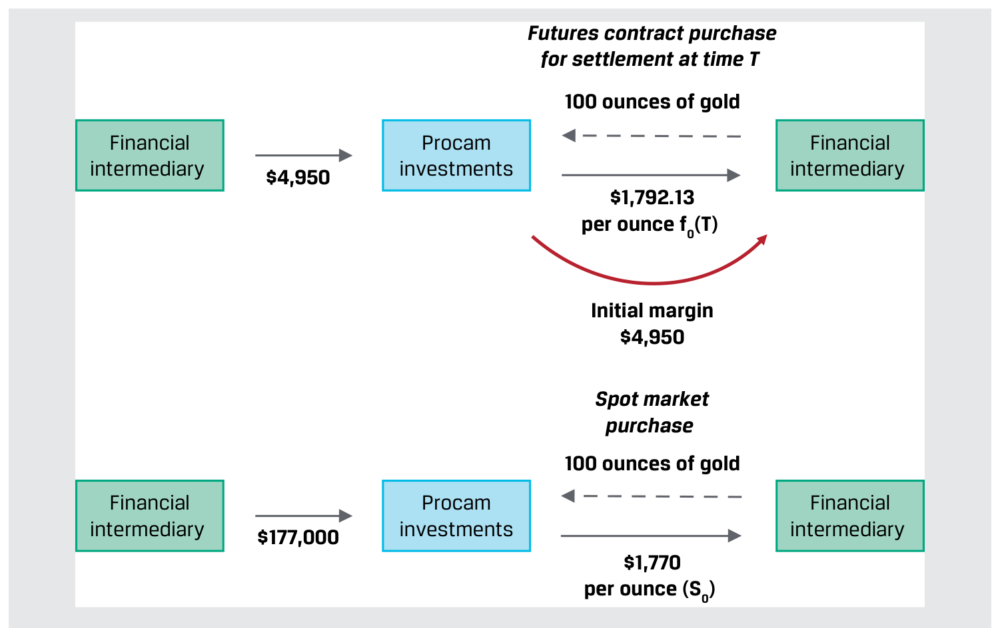

图内文字对照：Procam investments＝Procam投资公司；Financial intermediary＝金融中介；Futures contract purchase＝买入期货合约；for settlement at time T＝于T时点结算；100 ounces of gold＝100盎司黄金；Initial margin \$4,950＝初始保证金4,950美元；Spot market purchase＝现货市场购买。

1\. Procam按5%的利率向金融中介借入4,950美元，用作初始保证金，期限为三个月。

1\. Procam borrows the USD4,950 initial margin from a financial intermediary at 5% for three months.

初始保证金的机会成本（利息成本）：

Opportunity (interest) cost of the initial margin:

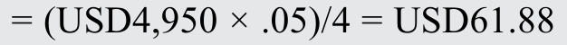

2\. Procam按5%的利率向金融中介借入177,000美元，用于购买现货黄金，期限为三个月。

2\. Procam borrows USD177,000 (USD1,770 × 100 ounces) for the spot gold purchase from a financial intermediary at 5% for three months.

购买现货黄金所需款项的机会成本（利息成本）：

Opportunity (interest) cost of the cash gold purchase price:

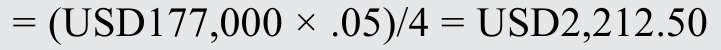

Procam只需承担现货市场成本的一小部分，就能在期货市场取得100盎司黄金的价格敞口。

Procam gains exposure to the underlying price of 100 ounces of gold in the futures market at a fraction of the spot market cost.

这一比较忽略了期货合约与现货黄金交易的三个方面：

This comparison ignores three points about the futures contract and spot gold transactions:

1\. 在t = 0至t = T期间，随着期货价格波动，Procam的保证金要求会变化。具体而言，如果期货价格下跌导致保证金账户余额低于维持保证金，Procam便会面临追加保证金。但由于标的资产价格通常以零为下限，Procam为保证金融资的借款成本不太可能超过购买现货所需的借款成本。

1\. Procam’s margin requirements change as the futures price fluctuates between t = 0 and t = T. Specifically, Procam faces margin calls if a lower futures price causes its margin account balance to fall below the maintenance margin. However, as the underlying price is usually bounded by zero, it is unlikely that Procam’s borrowing cost for margin will exceed that of the spot cash purchase.

2\. Procam购买的是实物黄金，因此必须承担三个月内的交付、仓储及保险费用。

2\. Procam’s spot gold purchase involves physical gold. It must therefore cover the cost of delivery, storage, and insurance for three months.

3\. 现货黄金的购入价格为每盎司1,770美元，事先约定的期货价格则为每盎司1,792.13美元。

3\. The spot gold purchase takes place at a price of S0 = USD1,770 per ounce, while the pre-agreed futures price \[f0(T)\] = USD1,792.13 per ounce.

三个月后的T时点，无论期货合约还是现货购买，均使Procam持有价格为ST的黄金多头。

At time T in three months, both the futures contract and the spot purchase result in a long position for Procam at a price of ST.

因此，这两笔交易的预期成本与回报应当相等，但在t = 0时约定的价格不同。

The expected cost and return for these two transactions should therefore be equal, but the prices agreed at t = 0 are not.

后续课程将探讨黄金现货价格S0与期货价格f0(T)的关系，以及借款成本和仓储成本的影响。

In a later lesson, we will explore the relationship between the spot gold price (S0) and the gold futures price \[f0(T)\] and the effect of both borrowing and storage costs.

#### 补充解析 / Supplementary explanation

结合本题的官方结论：“此前示例中，Procam Investments买入一份三个月后到期、标的为100盎司黄金的期货合约，期货价格f0(T)为每盎司1,792.13美元，并须按交易所要求缴纳4,950美元初始保证金。Procam订立期货合约时，黄金现货价格S0为每盎司1,770美元。假设Procam能以年利率5%向金融中介借款，请比较三个月期货合约初始保证金的预期机会成本，与同期购买100盎司现货黄金的预期机会成本。” 下列补充说明解释其背后的先确定敞口，再确定合约方向。

Link to this question’s official result: “In an earlier example, Procam Investments enters a futures contract to buy 100 ounces of gold at a futures price \[f0(T)\] of USD1,792.13 per ounce that expires in three months and must post USD4,950 in initial margin as required by the exchange. The spot gold price (S0) at the time Procam enters the futures contract is USD1,770 per ounce. Assume that Procam is able to borrow funds from a financial intermediary at a rate of 5% per year.” The supplementary discussion below explains identify the exposure before choosing the contract.

解题思路：衍生品价值取决于标的变量，但持有衍生品不等于持有标的资产本身。套期保值首先要识别原有业务在什么市场变动下受损，再选在同一变动下获利的合约方向。

Reasoning: A derivative depends on an underlying variable without necessarily conferring ownership of the underlying. For hedging, identify the market move that hurts the original business exposure, then choose a derivative that gains under that move.

应用方法：例如需要未来买入某种货币或商品的一方，担心其价格上涨，通常需锁定买入价格；未来收到并出售该资产的一方，则担心价格下跌。名义本金用来计算现金流，不必等于合约初始价值或实际投入金额。

Application: A future buyer fears a price increase and generally wants to lock in a purchase price; a future seller fears a decline. Notional principal scales contractual cash flows and need not equal the derivative’s initial value or cash investment.

#### 相关知识点 / Related concepts

#### 先确定敞口，再确定合约方向 / Identify the exposure before choosing the contract

Forward commitment 使双方承担未来履约义务；contingent claim 通常赋予一方选择权，因此两者的盈亏对称性不同。

A forward commitment binds both parties to performance. A contingent claim typically grants one party an option, producing a different payoff symmetry.

原书为叙述式已解例题，完整条件、计算及结论保留在官方解析区。

### DER-LM03-QS01-01 · 正文题组 1 · 第 1 题 Question set 1 · Question 1

正文习题组 / Question set · 原版 PDF 页码 / Source PDF pages: 70

#### 题目与资料 / Question and data

#### 共用资料 / Shared information

衍生品的收益

Derivative Benefits

1\. 请描述一种情形：发行人作出经济决策，与能够在现货市场交易以管理价格风险之间，存在时间差。

1\. Describe a scenario in which an issuer faces a timing difference between an economic decision and an ability to transact in cash markets to manage price risk.

#### 官方答案与解析 / Official answer and explanation

发行人可能需要：（1）在收到制成品订单前订购生产所需商品原材料；（2）等待一批以外币计价的货物到达后，才卖出本币支付货款；或（3）在现有债务到期前锁定未来的债务成本。

An issuer may need to 1.) order commodity inputs for its production process in advance of receiving finished-goods orders, 2.) await a shipment of goods in a foreign currency before selling domestic currency to make payment, or 3.) lock in its future debt costs in advance of the maturity of an outstanding debt issuance.

#### 补充解析 / Supplementary explanation

结合本题的官方结论：“发行人可能需要：（1）在收到制成品订单前订购生产所需商品原材料；（2）等待一批以外币计价的货物到达后，才卖出本币支付货款；或（3）在现有债务到期前锁定未来的债务成本。” 下列补充说明解释其背后的先确定敞口，再确定合约方向。

Link to this question’s official result: “An issuer may need to 1.) order commodity inputs for its production process in advance of receiving finished-goods orders, 2.) await a shipment of goods in a foreign currency before selling domestic currency to make payment, or 3.) lock in its future debt costs in advance of the maturity of an outstanding debt issuance.” The supplementary discussion below explains identify the exposure before choosing the contract.

解题思路：衍生品价值取决于标的变量，但持有衍生品不等于持有标的资产本身。套期保值首先要识别原有业务在什么市场变动下受损，再选在同一变动下获利的合约方向。

Reasoning: A derivative depends on an underlying variable without necessarily conferring ownership of the underlying. For hedging, identify the market move that hurts the original business exposure, then choose a derivative that gains under that move.

应用方法：例如需要未来买入某种货币或商品的一方，担心其价格上涨，通常需锁定买入价格；未来收到并出售该资产的一方，则担心价格下跌。名义本金用来计算现金流，不必等于合约初始价值或实际投入金额。

Application: A future buyer fears a price increase and generally wants to lock in a purchase price; a future seller fears a decline. Notional principal scales contractual cash flows and need not equal the derivative’s initial value or cash investment.

#### 相关知识点 / Related concepts

#### 先确定敞口，再确定合约方向 / Identify the exposure before choosing the contract

Forward commitment 使双方承担未来履约义务；contingent claim 通常赋予一方选择权，因此两者的盈亏对称性不同。

A forward commitment binds both parties to performance. A contingent claim typically grants one party an option, producing a different payoff symmetry.

### DER-LM03-QS01-02 · 正文题组 1 · 第 2 题 Question set 1 · Question 2

正文习题组 / Question set · 原版 PDF 页码 / Source PDF pages: 70

#### 题目与资料 / Question and data

#### 共用资料 / Shared information

衍生品的收益

Derivative Benefits

2\. 填入正确答案：衍生品市场通常比标的现货市场具有更高的\_\_\_\_\_\_\_\_\_，因为与等价的标的现货头寸相比，交易衍生品所需的\_\_\_\_\_\_\_更少。

2\. Determine the correct answers to fill in the blanks: Derivative markets typically have greater \_\_\_\_\_\_\_\_\_ than the underlying spot markets, a result of the reduced \_\_\_\_\_\_\_ required to trade derivatives versus an equivalent cash position in an underlying.

#### 官方答案与解析 / Official answer and explanation

衍生品市场通常比标的现货市场具有更高的流动性，因为与等价的标的现货头寸相比，交易衍生品所需的资本更少。

Derivative markets typically have greater liquidity than the underlying spot markets, a result of the reduced capital required to trade derivatives versus an equivalent cash position in an underlying.

#### 补充解析 / Supplementary explanation

结合本题的官方结论：“衍生品市场通常比标的现货市场具有更高的流动性，因为与等价的标的现货头寸相比，交易衍生品所需的资本更少。” 下列补充说明解释其背后的先确定敞口，再确定合约方向。

Link to this question’s official result: “Derivative markets typically have greater liquidity than the underlying spot markets, a result of the reduced capital required to trade derivatives versus an equivalent cash position in an underlying.” The supplementary discussion below explains identify the exposure before choosing the contract.

解题思路：衍生品价值取决于标的变量，但持有衍生品不等于持有标的资产本身。套期保值首先要识别原有业务在什么市场变动下受损，再选在同一变动下获利的合约方向。

Reasoning: A derivative depends on an underlying variable without necessarily conferring ownership of the underlying. For hedging, identify the market move that hurts the original business exposure, then choose a derivative that gains under that move.

应用方法：例如需要未来买入某种货币或商品的一方，担心其价格上涨，通常需锁定买入价格；未来收到并出售该资产的一方，则担心价格下跌。名义本金用来计算现金流，不必等于合约初始价值或实际投入金额。

Application: A future buyer fears a price increase and generally wants to lock in a purchase price; a future seller fears a decline. Notional principal scales contractual cash flows and need not equal the derivative’s initial value or cash investment.

#### 相关知识点 / Related concepts

#### 先确定敞口，再确定合约方向 / Identify the exposure before choosing the contract

Forward commitment 使双方承担未来履约义务；contingent claim 通常赋予一方选择权，因此两者的盈亏对称性不同。

A forward commitment binds both parties to performance. A contingent claim typically grants one party an option, producing a different payoff symmetry.

### DER-LM03-QS01-03 · 正文题组 1 · 第 3 题 Question set 1 · Question 3

正文习题组 / Question set · 原版 PDF 页码 / Source PDF pages: 70-71

#### 题目与资料 / Question and data

#### 共用资料 / Shared information

衍生品的收益

Derivative Benefits

3\. 请将以下陈述与适当的衍生品市场收益配对：

3\. Identify the proper derivative market benefits that correspond to the following statements:

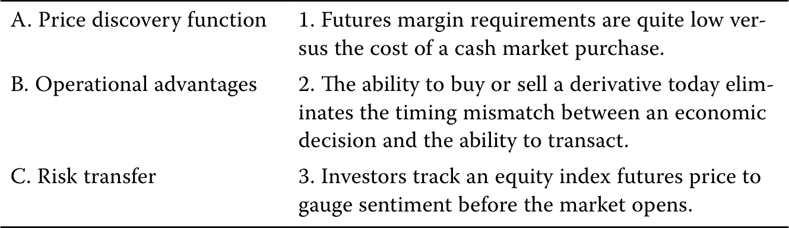

A. 价格发现功能。1. 期货保证金要求远低于现货市场购入成本。

B. 操作优势。2. 今天就能买入或卖出衍生品，消除经济决策与实际交易能力之间的时间错配。

C. 风险转移。3. 投资者跟踪股指期货价格，判断开盘前市场情绪。

#### 官方答案与解析 / Official answer and explanation

1\. 正确答案为B。期货保证金相对于现货市场购入成本较低，体现了使用衍生品的操作优势。

1\. The correct answer is B. The low level of futures margin requirements versus the cost of a cash market purchase is an example of the operational advantage of using derivatives.

2\. 正确答案为C。今天就能买入或卖出衍生合约，消除了经济决策与实际交易能力之间的时间错配，体现了衍生品的风险转移功能。

2\. The correct answer is C. The ability to buy or sell a derivative contract today eliminates the timing mismatch between an economic decision and the ability to transact, which is an example of the risk transfer function of derivatives.

3\. 正确答案为A。投资者通过跟踪股指期货价格，判断开盘前市场情绪，体现了衍生品的价格发现功能。

3\. The correct answer is A. Investors use derivatives in a price discovery function when tracking an equity index futures price to gauge sentiment before the market opens.

#### 补充解析 / Supplementary explanation

结合本题的官方结论：“正确答案为B。期货保证金相对于现货市场购入成本较低，体现了使用衍生品的操作优势。 2. 正确答案为C。” 下列补充说明解释其背后的先确定敞口，再确定合约方向。

Link to this question’s official result: “The correct answer is B. The low level of futures margin requirements versus the cost of a cash market purchase is an example of the operational advantage of using derivatives. 2. The correct answer is C.” The supplementary discussion below explains identify the exposure before choosing the contract.

解题思路：衍生品价值取决于标的变量，但持有衍生品不等于持有标的资产本身。套期保值首先要识别原有业务在什么市场变动下受损，再选在同一变动下获利的合约方向。

Reasoning: A derivative depends on an underlying variable without necessarily conferring ownership of the underlying. For hedging, identify the market move that hurts the original business exposure, then choose a derivative that gains under that move.

应用方法：例如需要未来买入某种货币或商品的一方，担心其价格上涨，通常需锁定买入价格；未来收到并出售该资产的一方，则担心价格下跌。名义本金用来计算现金流，不必等于合约初始价值或实际投入金额。

Application: A future buyer fears a price increase and generally wants to lock in a purchase price; a future seller fears a decline. Notional principal scales contractual cash flows and need not equal the derivative’s initial value or cash investment.

#### 相关知识点 / Related concepts

#### 先确定敞口，再确定合约方向 / Identify the exposure before choosing the contract

Forward commitment 使双方承担未来履约义务；contingent claim 通常赋予一方选择权，因此两者的盈亏对称性不同。

A forward commitment binds both parties to performance. A contingent claim typically grants one party an option, producing a different payoff symmetry.

### DER-LM03-EX05-05 · 已解例题 5 · 现货与期货购买的隐含杠杆 Worked example 5 · Implicit Leverage of Spot versus Futures Purchases

正文例题／案例 / Worked example / case · 原版 PDF 页码 / Source PDF pages: 71-72

#### 题目与资料 / Question and data

### 现货与期货购买的隐含杠杆Implicit Leverage of Spot versus Futures Purchases

#### 官方答案与解析 / Official answer and explanation

例4比较了Procam Investments购买100盎司现货黄金，与购买同等数量三个月黄金期货合约的情况。

In Example 4, we compared a spot purchase and a three-month futures contract purchase of 100 ounces of gold by Procam Investments.

■ Procam按每盎司1,770美元的现货价格S0买入，需要支付177,000美元现金。

■ Procam’s spot market purchase at S0 = USD1,770 per ounce results in a purchase price of USD177,000 (USD1,770 × 100) paid in cash.

■ Procam按每盎司1,792.13美元的价格f0(T)买入三个月黄金期货，合约购买价格为179,213美元。

■ Procam’s three-month futures contract purchase at f0(T) = USD1,792.13 per ounce results in a purchase price of USD179,213 (USD1,792.13 × 100).

这笔交易需要向交易所缴纳4,950美元初始保证金。

This purchase requires a USD4,950 initial margin deposit at the exchange.

三个月后，黄金现货价格ST为每盎司1,780.50美元，现货多头与期货多头对应黄金的价值均为178,050美元。

In three months, the spot gold price (ST) is USD1,780.50 per ounce, and both the long cash position and the long futures contract position are valued at USD178,050 (USD1,780.50 × 100).

将每笔交易的价值变化除以初始现金支出，以比较隐含杠杆：

We divide the value change by the initial cash outlay for each transaction to compare implicit leverages:

■ 现货价值变化：获利0.593%。计算式见下方英文。

■ Spot value change: 0.593% gain \[(USD178,050 − USD177,000)/ USD177,000\].

■ 期货价值变化：亏损23.5%。计算式见下方英文。

■ Futures value change: 23.5% loss \[(USD178,050 − USD179,213)/ USD4,950\].

注意，现货与期货交易的收益率在数量级上存在很大差异。

Note the large order-of-magnitude difference between the cash and futures transactions.

如前所述，后续课程将探讨借款成本、黄金仓储成本（本例忽略）、黄金现货价格S0与黄金期货价格f0(T)之间的关系。

As mentioned earlier, we will explore the relationship between borrowing costs, gold storage costs (ignored in this example), the spot gold price (S0), and the gold futures price \[f0(T)\] in a later lesson.

在完全使用借入资金进行现货与期货交易的极端情况下，如例4所示，隐含杠杆进一步放大：

Implicit leverage is further magnified in an extreme case where only borrowed funds are used to enter the cash and futures transactions, as in Example 4:

■ 现货价值变化相对于借款成本：获利47.5%。计算式见下方英文。

■ Spot value change versus borrowing cost: 47.5% gain \[(USD178,050 − USD177,000)/ USD2,212.50\].

■ 期货价值变化相对于借款成本：亏损1,879%。计算式见下方英文。

■ Futures value change versus borrowing cost: 1,879% loss \[(USD178,050 − USD179,213)/ USD61.88\].

本例强调了衍生品的一项重要特征：其内在杠杆会放大已实现回报与风险，并加重与衍生品相关损失的严重程度。

This example emphasizes a very important point about derivatives: their inherent leverage magnifies the realized returns and risks and contributes to the severity of derivative-related losses.

Procam仅以61.88美元成本，就获得了177,000美元标的黄金价格风险敞口，隐含杠杆比率为2,860。黄金价格上涨时，高杠杆使其获益；黄金价格下跌时，损失则迅速放大。例如，期货价值从179,213美元降至178,050美元，仅−0.649%的黄金价格变化就产生1,163美元损失。这笔交易的实际损失还包括61.88美元利息，总损失为1,224.88美元，接近融资成本的20倍。计算式与英文共用。

Procam gains exposure to USD177,000 in underlying gold price risk with just USD61.88, implying a leverage ratio of 2,860. Procam benefits from this high leverage as gold prices rise, but its losses are rapidly magnified as gold prices decline. For example, as the futures price falls from USD179,213 to USD178,050, the modest −0.649% gold price change translates to a loss of USD1,163. Procam’s actual loss on this transaction is both the interest payment (USD61.88) and the loss on the trade (USD1,163), for a total loss of USD1,224.88, nearly 20 times (USD1,224.88/ USD61.88) the cost of financing.

同一原则适用于卖出期权等非线性衍生品：当标的价格变动使买方行权更有利，并可获得远高于已付权利金的收益时，期权卖方可能面临无限损失风险。

The same principle holds for non-linear derivatives such as sold options, where an option seller may face unlimited downside risk as underlying price changes make it more favorable for an option buyer to exercise for a gain far in excess of the premium paid.

衍生品杠杆为相关交易对手带来重大敞口。

Leverage in derivatives creates significant exposures for the counterparties involved.

可通过交易及敞口风险管理、每日盯市、抵押品安排、交易与敞口限额，以及中央交易对手等多种方式共同降低这些风险。

These risks are mitigated through a combination of trading and exposure risk management, daily marking to market, the use of collateral arrangements, transaction and exposure limits, and centralized counterparties.

#### 补充解析 / Supplementary explanation

结合本题的官方结论：“例4比较了Procam Investments购买100盎司现货黄金，与购买同等数量三个月黄金期货合约的情况。 ■ Procam按每盎司1,770美元的现货价格S0买入，需要支付177,000美元现金。 ■ Procam按每盎司1,792.13美元的价格f0(T)买入三个月黄金期货，合约购买价格为179,213美元。” 下列补充说明解释其背后的先确定敞口，再确定合约方向。

Link to this question’s official result: “In Example 4, we compared a spot purchase and a three-month futures contract purchase of 100 ounces of gold by Procam Investments. ■ Procam’s spot market purchase at S0 = USD1,770 per ounce results in a purchase price of USD177,000 (USD1,770 × 100) paid in cash. ■ Procam’s three-month futures contract purchase at f0(T) = USD1,792.13 per ounce results in a purchase price of USD179,213 (USD1,792.13 × 100). This purchase requires a USD4,950 initial margin deposit at the exchange.” The supplementary discussion below explains identify the exposure before choosing the contract.

解题思路：衍生品价值取决于标的变量，但持有衍生品不等于持有标的资产本身。套期保值首先要识别原有业务在什么市场变动下受损，再选在同一变动下获利的合约方向。

Reasoning: A derivative depends on an underlying variable without necessarily conferring ownership of the underlying. For hedging, identify the market move that hurts the original business exposure, then choose a derivative that gains under that move.

应用方法：例如需要未来买入某种货币或商品的一方，担心其价格上涨，通常需锁定买入价格；未来收到并出售该资产的一方，则担心价格下跌。名义本金用来计算现金流，不必等于合约初始价值或实际投入金额。

Application: A future buyer fears a price increase and generally wants to lock in a purchase price; a future seller fears a decline. Notional principal scales contractual cash flows and need not equal the derivative’s initial value or cash investment.

#### 相关知识点 / Related concepts

#### 先确定敞口，再确定合约方向 / Identify the exposure before choosing the contract

Forward commitment 使双方承担未来履约义务；contingent claim 通常赋予一方选择权，因此两者的盈亏对称性不同。

A forward commitment binds both parties to performance. A contingent claim typically grants one party an option, producing a different payoff symmetry.

原书为叙述式已解例题，完整条件、计算及结论保留在官方解析区。

### DER-LM03-QS02-01 · 正文题组 2 · 第 1 题 Question set 2 · Question 1

正文习题组 / Question set · 原版 PDF 页码 / Source PDF pages: 74

#### 题目与资料 / Question and data

#### 共用资料 / Shared information

衍生品的风险

Derivative Risks

1\. 填入正确答案：衍生品策略通过限制投资者的初始现金支出而具有\_\_\_\_\_\_\_的操作效率，这意味着相对于类似现货头寸具有\_\_\_\_\_\_\_的隐含杠杆。

1\. Determine the correct answers to fill in the blanks: The \_\_\_\_\_\_\_ operational efficiency of derivative strategies that limit an investor’s initial cash outlay translates to a \_\_\_\_ degree of implicit leverage versus a similar cash market position.

#### 官方答案与解析 / Official answer and explanation

衍生品策略通过限制投资者的初始现金支出而具有更高的操作效率，这意味着相对于类似现货头寸具有较高的隐含杠杆。

The greater operational efficiency of derivative strategies that limit an investor’s initial cash outlay translates to a high degree of implicit leverage versus a similar cash market position.

#### 补充解析 / Supplementary explanation

结合本题的官方结论：“衍生品策略通过限制投资者的初始现金支出而具有更高的操作效率，这意味着相对于类似现货头寸具有较高的隐含杠杆。” 下列补充说明解释其背后的套保风险：方向正确仍可能不完全抵销。

Link to this question’s official result: “The greater operational efficiency of derivative strategies that limit an investor’s initial cash outlay translates to a high degree of implicit leverage versus a similar cash market position.” The supplementary discussion below explains why a correctly directed hedge can still be imperfect.

解题思路：套保不是把风险一键删除。标的价格相关性、合约期限和金额可能与实际业务不完全一致，形成基差风险；保证金需要提前付现，也可能在经济套保有效时产生流动性压力。

Reasoning: A hedge does not delete risk automatically. Differences in underlying prices, size, or maturity create basis risk. Margin payments can create liquidity pressure even when the hedge is economically effective.

应用方法：看到“价值变化不匹配”重点考虑 basis risk；看到“付款时点不匹配或补保证金困难”重点考虑 liquidity risk；看到“对方未履行义务”考虑 counterparty credit risk。不要因为最终风险被抵销，就忽视中间现金流。

Application: A mismatch in value changes suggests basis risk; a mismatch in cash-flow timing or difficulty meeting margin suggests liquidity risk; failure by the other party to perform suggests counterparty credit risk. A final hedge offset does not remove interim funding needs.

#### 相关知识点 / Related concepts

#### 套保风险：方向正确仍可能不完全抵销 / Why a correctly directed hedge can still be imperfect

风险类型要按损失来源区分，而不是看到衍生品就统一归为市场风险。

Classify risk by its source, rather than treating every derivative problem as market risk.

### DER-LM03-QS02-02 · 正文题组 2 · 第 2 题 Question set 2 · Question 2

正文习题组 / Question set · 原版 PDF 页码 / Source PDF pages: 74-75

#### 题目与资料 / Question and data

#### 共用资料 / Shared information

衍生品的风险

Derivative Risks

2\. 请描述看涨期权卖方面临的交易对手信用风险。

2\. Describe the counterparty credit risk faced by the seller of a call option.

#### 官方答案与解析 / Official answer and explanation

看涨期权卖方预先收取权利金，作为交换，在期权被行使时承担按行权价卖出标的资产的义务。

The seller of a call option receives an upfront premium in exchange for the obligation to sell the underlying asset at the exercise price if the option is exercised.

一旦卖方收到买方支付的权利金，就不再对期权买方面临进一步的交易对手信用风险。

Once the seller of a call option receives the premium from the option buyer, it has no further counterparty credit risk to the option buyer.

#### 补充解析 / Supplementary explanation

结合本题的官方结论：“看涨期权卖方预先收取权利金，作为交换，在期权被行使时承担按行权价卖出标的资产的义务。 一旦卖方收到买方支付的权利金，就不再对期权买方面临进一步的交易对手信用风险。” 下列补充说明解释其背后的期权支付与利润分开算。

Link to this question’s official result: “The seller of a call option receives an upfront premium in exchange for the obligation to sell the underlying asset at the exercise price if the option is exercised. Once the seller of a call option receives the premium from the option buyer, it has no further counterparty credit risk to the option buyer.” The supplementary discussion below explains separate option payoff from profit.

解题思路：期权买方有权选择是否行权，因此到期支付不会因为不利行情而变成负数；但买方事先支付了权利金，所以净利润仍可能为负。把 payoff 和 profit 混为一谈，是此类题最常见的错误。

Reasoning: An option buyer can choose not to exercise, so expiration payoff is non-negative. The buyer nevertheless paid a premium and can lose money overall. Confusing payoff with profit is a frequent error.

应用方法：先比较到期价格与执行价，算出行权支付，再扣除权利金得到买方利润；若题目忽略资金时间价值，就不要额外计息。卖方损益取相反数，并按合约乘数换算实际金额。

Application: Compare terminal spot with the strike, calculate exercise payoff, and subtract premium for the buyer’s profit. Do not add financing adjustments when the question ignores the time value of money. Reverse the sign for the seller and apply the contract multiplier.

#### 相关知识点 / Related concepts

#### 期权支付与利润分开算 / Separate option payoff from profit

In the money 表示立即行权有正支付，不保证扣除权利金后盈利。Call 买方通常受益于上涨，put 买方通常受益于下跌。

In the money means positive exercise value, not necessarily a positive net profit. Call buyers generally benefit from price rises and put buyers from declines.

Call payoff = max(Sₜ − X, 0); Put payoff = max(X − Sₜ, 0); Buyer profit = Payoff − Premium

### DER-LM03-QS02-03 · 正文题组 2 · 第 3 题 Question set 2 · Question 3

正文习题组 / Question set · 原版 PDF 页码 / Source PDF pages: 74-75

#### 题目与资料 / Question and data

#### 共用资料 / Shared information

衍生品的风险

Derivative Risks

3\. 请将以下衍生品市场风险与相应陈述配对：

3\. Match these derivative market risks to the following statements:

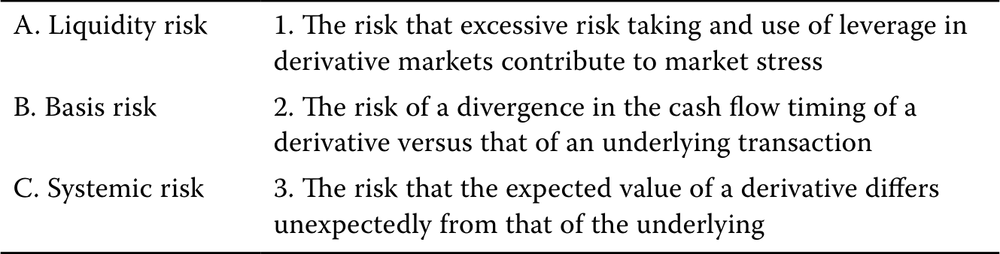

A. 流动性风险。1. 衍生品市场中过度承担风险及使用杠杆，加剧市场压力的风险。

B. 基差风险。2. 衍生品与基础交易的现金流发生时间不一致的风险。

C. 系统性风险。3. 衍生品预期价值意外偏离标的资产价值的风险。

#### 官方答案与解析 / Official answer and explanation

1\. 正确答案为C。系统性风险包括衍生品市场中过度承担风险和使用杠杆，从而加剧市场压力。

1\. The correct answer is C. Systemic risk involves excessive risk taking and use of leverage in derivative markets that contribute to market stress.

2\. 正确答案为A。流动性风险是衍生品与基础交易的现金流发生时间不一致的风险。

2\. The correct answer is A. Liquidity risk is the divergence in the cash flow timing of a derivative versus that of an underlying transaction.

3\. 正确答案为B。基差风险是衍生品的预期价值意外偏离标的资产价值的风险。

3\. The correct answer is B. Basis risk involves the risk that the expected value of a derivative differs unexpectedly from that of an underlying.

#### 补充解析 / Supplementary explanation

结合本题的官方结论：“正确答案为C。系统性风险包括衍生品市场中过度承担风险和使用杠杆，从而加剧市场压力。 2. 正确答案为A。” 下列补充说明解释其背后的先确定敞口，再确定合约方向。

Link to this question’s official result: “The correct answer is C. Systemic risk involves excessive risk taking and use of leverage in derivative markets that contribute to market stress. 2. The correct answer is A.” The supplementary discussion below explains identify the exposure before choosing the contract.

解题思路：衍生品价值取决于标的变量，但持有衍生品不等于持有标的资产本身。套期保值首先要识别原有业务在什么市场变动下受损，再选在同一变动下获利的合约方向。

Reasoning: A derivative depends on an underlying variable without necessarily conferring ownership of the underlying. For hedging, identify the market move that hurts the original business exposure, then choose a derivative that gains under that move.

应用方法：例如需要未来买入某种货币或商品的一方，担心其价格上涨，通常需锁定买入价格；未来收到并出售该资产的一方，则担心价格下跌。名义本金用来计算现金流，不必等于合约初始价值或实际投入金额。

Application: A future buyer fears a price increase and generally wants to lock in a purchase price; a future seller fears a decline. Notional principal scales contractual cash flows and need not equal the derivative’s initial value or cash investment.

#### 相关知识点 / Related concepts

#### 先确定敞口，再确定合约方向 / Identify the exposure before choosing the contract

Forward commitment 使双方承担未来履约义务；contingent claim 通常赋予一方选择权，因此两者的盈亏对称性不同。

A forward commitment binds both parties to performance. A contingent claim typically grants one party an option, producing a different payoff symmetry.

### DER-LM03-EX06-06 · 已解例题 6 · 外汇风险与盈利波动 Worked example 6 · Foreign Exchange Risk and Earnings Volatility

正文例题／案例 / Worked example / case · 原版 PDF 页码 / Source PDF pages: 76

#### 题目与资料 / Question and data

### 外汇风险与盈利波动Foreign Exchange Risk and Earnings Volatility

#### 官方答案与解析 / Official answer and explanation

回顾例1，Montau AG将在75天后交付一台激光切割机，收到650,000,000韩元。公司已与金融中介订立场外外汇远期，约定在交付时卖出所收韩元、买入欧元，以对冲外汇敞口。

Recall from Example 1 that Montau AG will deliver a laser cutting machine for KRW650,000,000 in 75 days and has hedged its FX exposure by agreeing to sell the KRW it will receive and purchase EUR upon delivery in an over-the-counter FX forward with a financial intermediary.

Montau约定的KRW/EUR远期汇率F0(T)为1,350，即1,350韩元等于1欧元。75天后，公司将卖出650,000,000韩元，收到481,481欧元。生产经理估计设备成本为430,000欧元。Montau资金部经理列出以下不同KRW/EUR即期汇率ST对应的利润率情景：

Montau agrees to a KRW/EUR forward exchange rate \[F0(T)\] of 1,350 (i.e., 1,350 KRW = 1 EUR), at which it will sell 650,000,000 KRW and receive 481,481 EUR (650,000,000/1,350) in 75 days. The production manager estimates the machine’s cost to be €430,000. Montau’s Treasury manager compiles the following profit margin scenarios at different KRW/EUR spot rates (ST):

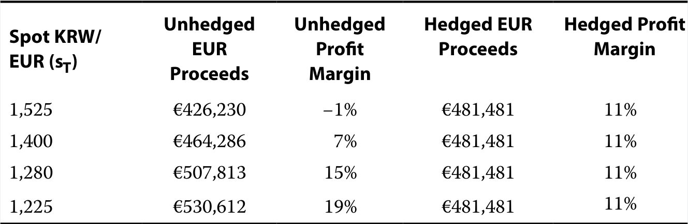

KRW/EUR即期汇率ST

未对冲时收到的欧元金额

未对冲时利润率

对冲后收到的欧元金额

对冲后利润率

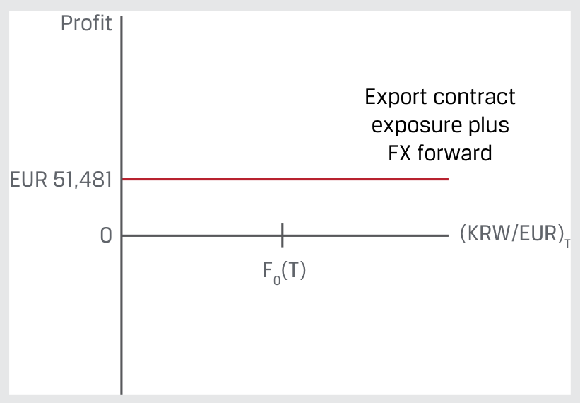

图内文字对照：Profit＝利润；Export contract exposure plus FX forward＝出口合约敞口与外汇远期相结合。

如果Montau不对冲KRW/EUR敞口，其利润率将根据设备交付时的KRW/EUR即期汇率波动。

If Montau does not hedge its KRW/EUR exposure, its profit margin will fluctuate based on the KRW/EUR spot rate when the machine is delivered.

韩元相对于欧元走弱会降低利润率，韩元升值则会提高利润率。

A weaker KRW versus EUR results in a lower profit margin, while KRW appreciation results in a higher profit margin.

#### 补充解析 / Supplementary explanation

结合本题的官方结论：“回顾例1，Montau AG将在75天后交付一台激光切割机，收到650,000,000韩元。公司已与金融中介订立场外外汇远期，约定在交付时卖出所收韩元、买入欧元，以对冲外汇敞口。 Montau约定的KRW/EUR远期汇率F0(T)为1,350，即1,350韩元等于1欧元。” 下列补充说明解释其背后的先确定敞口，再确定合约方向。

Link to this question’s official result: “Recall from Example 1 that Montau AG will deliver a laser cutting machine for KRW650,000,000 in 75 days and has hedged its FX exposure by agreeing to sell the KRW it will receive and purchase EUR upon delivery in an over-the-counter FX forward with a financial intermediary. Montau agrees to a KRW/EUR forward exchange rate \[F0(T)\] of 1,350 (i.e., 1,350 KRW = 1 EUR), at which it will sell 650,000,000 KRW and receive 481,481 EUR (650,000,000/1,350) in 75 days. The production manager estimates the machine’s cost to be €430,000.” The supplementary discussion below explains identify the exposure before choosing the contract.

解题思路：衍生品价值取决于标的变量，但持有衍生品不等于持有标的资产本身。套期保值首先要识别原有业务在什么市场变动下受损，再选在同一变动下获利的合约方向。

Reasoning: A derivative depends on an underlying variable without necessarily conferring ownership of the underlying. For hedging, identify the market move that hurts the original business exposure, then choose a derivative that gains under that move.

应用方法：例如需要未来买入某种货币或商品的一方，担心其价格上涨，通常需锁定买入价格；未来收到并出售该资产的一方，则担心价格下跌。名义本金用来计算现金流，不必等于合约初始价值或实际投入金额。

Application: A future buyer fears a price increase and generally wants to lock in a purchase price; a future seller fears a decline. Notional principal scales contractual cash flows and need not equal the derivative’s initial value or cash investment.

#### 相关知识点 / Related concepts

#### 先确定敞口，再确定合约方向 / Identify the exposure before choosing the contract

Forward commitment 使双方承担未来履约义务；contingent claim 通常赋予一方选择权，因此两者的盈亏对称性不同。

A forward commitment binds both parties to performance. A contingent claim typically grants one party an option, producing a different payoff symmetry.

原书为叙述式已解例题，完整条件、计算及结论保留在官方解析区。

### DER-LM03-QS03-01 · 正文题组 3 · 第 1 题 Question set 3 · Question 1

正文习题组 / Question set · 原版 PDF 页码 / Source PDF pages: 78

#### 题目与资料 / Question and data

#### 共用资料 / Shared information

发行人对衍生品的使用

Issuer Use of Derivatives

1\. 请描述套期会计处理。

1\. Describe hedge accounting treatment.

#### 官方答案与解析 / Official answer and explanation

套期会计允许发行人将套期工具（通常为衍生品）与被套期交易或资产负债表项目相抵销，以降低财务报表波动。

Hedge accounting allows an issuer to offset a hedging instrument (usually a derivative) against a hedged transaction or balance sheet item to reduce financial statement volatility.

#### 补充解析 / Supplementary explanation

结合本题的官方结论：“套期会计允许发行人将套期工具（通常为衍生品）与被套期交易或资产负债表项目相抵销，以降低财务报表波动。” 下列补充说明解释其背后的先确定敞口，再确定合约方向。

Link to this question’s official result: “Hedge accounting allows an issuer to offset a hedging instrument (usually a derivative) against a hedged transaction or balance sheet item to reduce financial statement volatility.” The supplementary discussion below explains identify the exposure before choosing the contract.

解题思路：衍生品价值取决于标的变量，但持有衍生品不等于持有标的资产本身。套期保值首先要识别原有业务在什么市场变动下受损，再选在同一变动下获利的合约方向。

Reasoning: A derivative depends on an underlying variable without necessarily conferring ownership of the underlying. For hedging, identify the market move that hurts the original business exposure, then choose a derivative that gains under that move.

应用方法：例如需要未来买入某种货币或商品的一方，担心其价格上涨，通常需锁定买入价格；未来收到并出售该资产的一方，则担心价格下跌。名义本金用来计算现金流，不必等于合约初始价值或实际投入金额。

Application: A future buyer fears a price increase and generally wants to lock in a purchase price; a future seller fears a decline. Notional principal scales contractual cash flows and need not equal the derivative’s initial value or cash investment.

#### 相关知识点 / Related concepts

#### 先确定敞口，再确定合约方向 / Identify the exposure before choosing the contract

Forward commitment 使双方承担未来履约义务；contingent claim 通常赋予一方选择权，因此两者的盈亏对称性不同。

A forward commitment binds both parties to performance. A contingent claim typically grants one party an option, producing a different payoff symmetry.

### DER-LM03-QS03-02 · 正文题组 3 · 第 2 题 Question set 3 · Question 2

正文习题组 / Question set · 原版 PDF 页码 / Source PDF pages: 78

#### 题目与资料 / Question and data

#### 共用资料 / Shared information

发行人对衍生品的使用

Issuer Use of Derivatives

2\. 请将以下套期指定类型与相应陈述配对：

2\. Match these hedge designation types to the following statements:

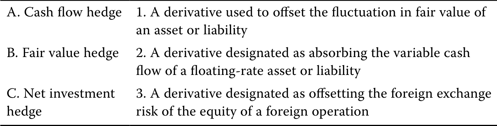

A. 现金流套期。1. 用于抵销资产或负债公允价值波动的衍生品。

B. 公允价值套期。2. 指定用于抵销浮动现金流资产或负债可变现金流的衍生品。

C. 净投资套期。

3\. 指定用于抵销境外经营实体权益价值外汇风险的衍生品。

#### 官方答案与解析 / Official answer and explanation

1\. 正确答案为B。公允价值套期使用衍生品抵销资产或负债公允价值的波动。

1\. The correct answer is B. A fair value hedge is a derivative used to offset the fluctuation in fair value of an asset or liability.

2\. 正确答案为A。现金流套期将衍生品指定用于抵销浮动现金流资产或负债的可变现金流。

2\. The correct answer is A. A cash flow hedge is a derivative designated as absorbing the variable cash flow of a floating-rate asset or liability.

3\. 正确答案为C。净投资套期将衍生品指定用于抵销境外经营实体权益价值的外汇风险。

3\. The correct answer is C. A net investment hedge is a derivative designated as offsetting the foreign exchange risk of the equity of a foreign operation.

#### 补充解析 / Supplementary explanation

结合本题的官方结论：“正确答案为B。公允价值套期使用衍生品抵销资产或负债公允价值的波动。 2. 正确答案为A。” 下列补充说明解释其背后的先确定敞口，再确定合约方向。

Link to this question’s official result: “The correct answer is B. A fair value hedge is a derivative used to offset the fluctuation in fair value of an asset or liability. 2. The correct answer is A.” The supplementary discussion below explains identify the exposure before choosing the contract.

解题思路：衍生品价值取决于标的变量，但持有衍生品不等于持有标的资产本身。套期保值首先要识别原有业务在什么市场变动下受损，再选在同一变动下获利的合约方向。

Reasoning: A derivative depends on an underlying variable without necessarily conferring ownership of the underlying. For hedging, identify the market move that hurts the original business exposure, then choose a derivative that gains under that move.

应用方法：例如需要未来买入某种货币或商品的一方，担心其价格上涨，通常需锁定买入价格；未来收到并出售该资产的一方，则担心价格下跌。名义本金用来计算现金流，不必等于合约初始价值或实际投入金额。

Application: A future buyer fears a price increase and generally wants to lock in a purchase price; a future seller fears a decline. Notional principal scales contractual cash flows and need not equal the derivative’s initial value or cash investment.

#### 相关知识点 / Related concepts

#### 先确定敞口，再确定合约方向 / Identify the exposure before choosing the contract

Forward commitment 使双方承担未来履约义务；contingent claim 通常赋予一方选择权，因此两者的盈亏对称性不同。

A forward commitment binds both parties to performance. A contingent claim typically grants one party an option, producing a different payoff symmetry.

### DER-LM03-QS03-03 · 正文题组 3 · 第 3 题 Question set 3 · Question 3

正文习题组 / Question set · 原版 PDF 页码 / Source PDF pages: 78

#### 题目与资料 / Question and data

#### 共用资料 / Shared information

发行人对衍生品的使用

Issuer Use of Derivatives

3\. 请举出发行人可能采用的公允价值套期例子。

3\. Describe an example of a fair value hedge an issuer might use.

#### 官方答案与解析 / Official answer and explanation

发行人可以通过利率互换，在债券到期前收取固定利率、支付市场参考利率，将固定利率债券转换为浮动利率债务。

An issuer might convert a fixed-rate bond issuance to a floating-rate obligation by entering into an interest rate swap to receive a fixed rate and pay a market reference rate through the bond’s maturity.

或者，商品生产商预期未来现货价格下降，可通过远期合约卖出库存。

Alternatively, a commodities producer might sell its inventory forward in anticipation of lower cash prices in the future.

#### 补充解析 / Supplementary explanation

结合本题的官方结论：“发行人可以通过利率互换，在债券到期前收取固定利率、支付市场参考利率，将固定利率债券转换为浮动利率债务。 或者，商品生产商预期未来现货价格下降，可通过远期合约卖出库存。” 下列补充说明解释其背后的先确定敞口，再确定合约方向。

Link to this question’s official result: “An issuer might convert a fixed-rate bond issuance to a floating-rate obligation by entering into an interest rate swap to receive a fixed rate and pay a market reference rate through the bond’s maturity. Alternatively, a commodities producer might sell its inventory forward in anticipation of lower cash prices in the future.” The supplementary discussion below explains identify the exposure before choosing the contract.

解题思路：衍生品价值取决于标的变量，但持有衍生品不等于持有标的资产本身。套期保值首先要识别原有业务在什么市场变动下受损，再选在同一变动下获利的合约方向。

Reasoning: A derivative depends on an underlying variable without necessarily conferring ownership of the underlying. For hedging, identify the market move that hurts the original business exposure, then choose a derivative that gains under that move.

应用方法：例如需要未来买入某种货币或商品的一方，担心其价格上涨，通常需锁定买入价格；未来收到并出售该资产的一方，则担心价格下跌。名义本金用来计算现金流，不必等于合约初始价值或实际投入金额。

Application: A future buyer fears a price increase and generally wants to lock in a purchase price; a future seller fears a decline. Notional principal scales contractual cash flows and need not equal the derivative’s initial value or cash investment.

#### 相关知识点 / Related concepts

#### 先确定敞口，再确定合约方向 / Identify the exposure before choosing the contract

Forward commitment 使双方承担未来履约义务；contingent claim 通常赋予一方选择权，因此两者的盈亏对称性不同。

A forward commitment binds both parties to performance. A contingent claim typically grants one party an option, producing a different payoff symmetry.

### DER-LM03-QS04-01 · 正文题组 4 · 第 1 题 Question set 4 · Question 1

正文习题组 / Question set · 原版 PDF 页码 / Source PDF pages: 79

#### 题目与资料 / Question and data

#### 共用资料 / Shared information

投资者对衍生品的使用

Investor Use of Derivatives

1\. 填入正确

1\. Determine the correct

#### 官方答案与解析 / Official answer and explanation

投资基金的\_\_\_\_\_\_\_\_\_\_通常会规定基金可使用哪些衍生工具，以及可用于哪些目的。

to complete the following sentence: An investment fund’s \_\_\_\_\_\_\_\_\_\_ typically specifies which derivative instruments may be used within a fund and for which purpose.

解答：

Solution:

投资基金的招募说明书通常会规定基金可使用哪些衍生工具，以及可用于哪些目的。

An investment fund’s prospectus typically specifies which derivative instruments may be used within a fund and for which purpose.

#### 补充解析 / Supplementary explanation

结合本题的官方结论：“投资基金的\_\_\_\_\_\_\_\_\_\_通常会规定基金可使用哪些衍生工具，以及可用于哪些目的。 解答： 投资基金的招募说明书通常会规定基金可使用哪些衍生工具，以及可用于哪些目的。” 下列补充说明解释其背后的先确定敞口，再确定合约方向。

Link to this question’s official result: “to complete the following sentence: An investment fund’s \_\_\_\_\_\_\_\_\_\_ typically specifies which derivative instruments may be used within a fund and for which purpose. Solution: An investment fund’s prospectus typically specifies which derivative instruments may be used within a fund and for which purpose.” The supplementary discussion below explains identify the exposure before choosing the contract.

解题思路：衍生品价值取决于标的变量，但持有衍生品不等于持有标的资产本身。套期保值首先要识别原有业务在什么市场变动下受损，再选在同一变动下获利的合约方向。

Reasoning: A derivative depends on an underlying variable without necessarily conferring ownership of the underlying. For hedging, identify the market move that hurts the original business exposure, then choose a derivative that gains under that move.

应用方法：例如需要未来买入某种货币或商品的一方，担心其价格上涨，通常需锁定买入价格；未来收到并出售该资产的一方，则担心价格下跌。名义本金用来计算现金流，不必等于合约初始价值或实际投入金额。

Application: A future buyer fears a price increase and generally wants to lock in a purchase price; a future seller fears a decline. Notional principal scales contractual cash flows and need not equal the derivative’s initial value or cash investment.

#### 相关知识点 / Related concepts

#### 先确定敞口，再确定合约方向 / Identify the exposure before choosing the contract

Forward commitment 使双方承担未来履约义务；contingent claim 通常赋予一方选择权，因此两者的盈亏对称性不同。

A forward commitment binds both parties to performance. A contingent claim typically grants one party an option, producing a different payoff symmetry.

### DER-LM03-QS04-02 · 正文题组 4 · 第 2 题 Question set 4 · Question 2

正文习题组 / Question set · 原版 PDF 页码 / Source PDF pages: 79-80

#### 题目与资料 / Question and data

#### 共用资料 / Shared information

投资者对衍生品的使用

Investor Use of Derivatives

2\. 请描述投资者在基金内使用衍生品的两种目的。

2\. Describe two purposes of investor derivatives use within a fund.

#### 官方答案与解析 / Official answer and explanation

投资者在基金内使用衍生品，通常是为了调整基金敞口，在特定市场条件下提高基金回报；和／或抵销、对冲汇率、利率、证券市场等标的发生不利变动时对基金价值的影响。

The purpose of investor derivatives use within a fund is usually to modify the fund’s exposure to increase the return of the fund under specific market conditions and/or to offset or hedge the fund’s value against adverse movements in underlyings, such as exchange rates, interest rates, and securities markets.

#### 补充解析 / Supplementary explanation

结合本题的官方结论：“投资者在基金内使用衍生品，通常是为了调整基金敞口，在特定市场条件下提高基金回报；和／或抵销、对冲汇率、利率、证券市场等标的发生不利变动时对基金价值的影响。” 下列补充说明解释其背后的先确定敞口，再确定合约方向。

Link to this question’s official result: “The purpose of investor derivatives use within a fund is usually to modify the fund’s exposure to increase the return of the fund under specific market conditions and/or to offset or hedge the fund’s value against adverse movements in underlyings, such as exchange rates, interest rates, and securities markets.” The supplementary discussion below explains identify the exposure before choosing the contract.

解题思路：衍生品价值取决于标的变量，但持有衍生品不等于持有标的资产本身。套期保值首先要识别原有业务在什么市场变动下受损，再选在同一变动下获利的合约方向。

Reasoning: A derivative depends on an underlying variable without necessarily conferring ownership of the underlying. For hedging, identify the market move that hurts the original business exposure, then choose a derivative that gains under that move.

应用方法：例如需要未来买入某种货币或商品的一方，担心其价格上涨，通常需锁定买入价格；未来收到并出售该资产的一方，则担心价格下跌。名义本金用来计算现金流，不必等于合约初始价值或实际投入金额。

Application: A future buyer fears a price increase and generally wants to lock in a purchase price; a future seller fears a decline. Notional principal scales contractual cash flows and need not equal the derivative’s initial value or cash investment.

#### 相关知识点 / Related concepts

#### 先确定敞口，再确定合约方向 / Identify the exposure before choosing the contract

Forward commitment 使双方承担未来履约义务；contingent claim 通常赋予一方选择权，因此两者的盈亏对称性不同。

A forward commitment binds both parties to performance. A contingent claim typically grants one party an option, producing a different payoff symmetry.

### DER-LM03-QS04-03 · 正文题组 4 · 第 3 题 Question set 4 · Question 3

正文习题组 / Question set · 原版 PDF 页码 / Source PDF pages: 79-80

#### 题目与资料 / Question and data

#### 共用资料 / Shared information

投资者对衍生品的使用

Investor Use of Derivatives

3\. 请将以下衍生品市场参与者与相应陈述配对：

3\. Match these derivative market participants to the following statements:

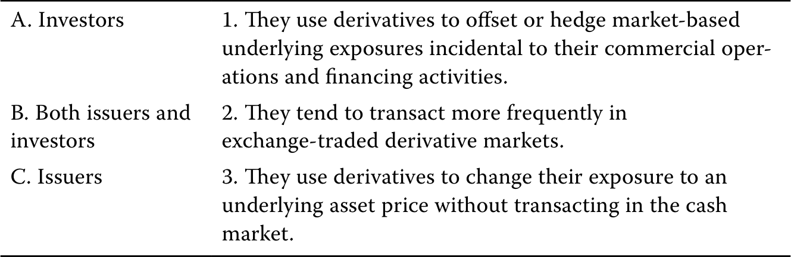

A. 投资者。1. 使用衍生品抵销或对冲商业经营和融资活动附带的市场风险敞口。

B. 发行人与投资者双方。

2\. 更频繁地在交易所衍生品市场交易。

C. 发行人。3. 无需在现货市场交易，即可使用衍生品调整标的资产价格敞口。

#### 官方答案与解析 / Official answer and explanation

1\. 正确答案为C。发行人使用衍生品抵销或对冲商业经营和融资活动附带的市场基础风险敞口。

1\. The correct answer is C. Issuers use derivatives to offset or hedge market-based underlying exposures incidental to their commercial operations and financing activities.

2\. 正确答案为A。投资者更频繁地在交易所衍生品市场交易。

2\. The correct answer is A. Investors tend to transact more frequently in exchange-traded derivative markets.

3\. 正确答案为B。发行人与投资者都可以使用衍生品，无需在现货市场交易就改变标的资产价格敞口。

3\. The correct answer is B. Both issuers and investors use derivatives to change their exposure to an underlying asset price without transacting in the cash market.

#### 补充解析 / Supplementary explanation

结合本题的官方结论：“正确答案为C。发行人使用衍生品抵销或对冲商业经营和融资活动附带的市场基础风险敞口。 2. 正确答案为A。” 下列补充说明解释其背后的先确定敞口，再确定合约方向。

Link to this question’s official result: “The correct answer is C. Issuers use derivatives to offset or hedge market-based underlying exposures incidental to their commercial operations and financing activities. 2. The correct answer is A.” The supplementary discussion below explains identify the exposure before choosing the contract.

解题思路：衍生品价值取决于标的变量，但持有衍生品不等于持有标的资产本身。套期保值首先要识别原有业务在什么市场变动下受损，再选在同一变动下获利的合约方向。

Reasoning: A derivative depends on an underlying variable without necessarily conferring ownership of the underlying. For hedging, identify the market move that hurts the original business exposure, then choose a derivative that gains under that move.

应用方法：例如需要未来买入某种货币或商品的一方，担心其价格上涨，通常需锁定买入价格；未来收到并出售该资产的一方，则担心价格下跌。名义本金用来计算现金流，不必等于合约初始价值或实际投入金额。

Application: A future buyer fears a price increase and generally wants to lock in a purchase price; a future seller fears a decline. Notional principal scales contractual cash flows and need not equal the derivative’s initial value or cash investment.

#### 相关知识点 / Related concepts

#### 先确定敞口，再确定合约方向 / Identify the exposure before choosing the contract

Forward commitment 使双方承担未来履约义务；contingent claim 通常赋予一方选择权，因此两者的盈亏对称性不同。

A forward commitment binds both parties to performance. A contingent claim typically grants one party an option, producing a different payoff symmetry.

### DER-LM03-P01-01 · 章末练习 1 Practice problem 1

章末练习 / Practice problem · 原版 PDF 页码 / Source PDF pages: 81, 83

#### 题目与资料 / Question and data

#### 共用资料 / Shared information

### 以下资料适用于第1—4题The following information relates to questions 1-4

请考虑Baywhite Financial提供的以下结构性票据：

Consider the following structured note offered by Baywhite Financial:

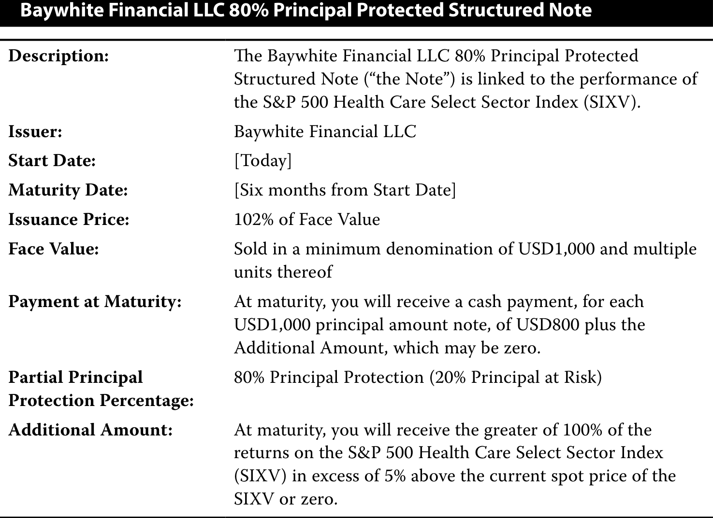

Baywhite Financial LLC 80%本金保护结构性票据

说明：Baywhite Financial LLC 80%本金保护结构性票据（简称“票据”），挂钩标普500医疗保健精选行业指数SIXV的表现。

发行人：Baywhite Financial LLC

开始日：\[今日\]

到期日：\[开始日起六个月后\]

发行价格：面值的102%

面值：最低面额为1,000美元，按其整数倍销售。

到期付款：每张本金1,000美元的票据，在到期时支付800美元现金，加上可能为零的额外金额。

部分本金保护比例：

80%本金保护，20%本金承担风险。

额外金额：到期时，标普500医疗保健精选行业指数SIXV相对当前现货价格上涨超过5%的部分收益，按100%参与率计算，并与零取较大者。

作为财富管理咨询公司的金融分析师，你需要将Baywhite Financial LLC结构性票据的特征，与类似的交易所交易独立衍生工具进行比较，以便向公司客户提出建议。

As a financial analyst for a wealth management advisory firm, you have been tasked with comparing the features of the Baywhite Financial LLC Structured Note with those of a similar exchange-traded, stand-alone derivative instrument alternative in order to make a recommendation to the firm’s clients.

1\. 以下哪项最恰当地描述了Baywhite Financial LLC结构性票据中嵌入的衍生工具？

1\. Which of the following statements best describes the derivative instrument that is embedded in the Baywhite Financial LLC Structured Note?

A. 该结构性票据嵌入一份以标普500医疗保健精选行业指数SIXV为标的的期货多头合约。

A. The Structured Note has an embedded long futures contract with the S&P 500 Health Care Select Sector Index (SIXV) as an underlying.

B. 该结构性票据嵌入一份以标普500医疗保健精选行业指数SIXV为标的的看涨期权多头合约。

B. The Structured Note has an embedded long call option contract with the S&P 500 Health Care Select Sector Index (SIXV) as an underlying.

C. 该结构性票据嵌入一份以标普500医疗保健精选行业指数SIXV为标的的看跌期权空头合约。

C. The Structured Note has an embedded short put option contract with the S&P 500 Health Care Select Sector Index (SIXV) as an underlying.

#### 官方答案与解析 / Official answer and explanation

1\. B项正确。该结构性票据挂钩标普500医疗保健精选行业指数SIXV的表现。注意，这一SIXV衍生品与此前SCSI的CSI 300示例相似。到期支付的“额外金额”，等于指数相对当前现货价格上涨超过5%的部分收益，按100%参与率计算，并与零取较大者。这种收益结构与买入六个月SIXV看涨期权相同，其行权价X高于今日SIXV现货价格5%。共用收益公式见英文原文。

1\. B is correct. The Structured Note is linked to the performance of the S&P 500 Health Care Select Sector Index (SIXV). Note that the SIXV derivative is similar to that in the earlier SCSI CSI 300 example. The “Additional Amount” paid at maturity is equal to the greater of 100% of the returns on the S&P 500 Health Care Select Sector Index (SIXV) in excess of 5% above the current spot price of the SIXV or zero. This payoff profile \[Max (0, ST – X)\] is identical to that of a purchased six-month SIXV call option with an exercise price (X) at 5% above today’s SIXV spot price.

#### 补充解析 / Supplementary explanation

结合本题的官方结论：“B项正确。该结构性票据挂钩标普500医疗保健精选行业指数SIXV的表现。注意，这一SIXV衍生品与此前SCSI的CSI 300示例相似。” 下列补充说明解释其背后的期权支付与利润分开算。

Link to this question’s official result: “B is correct. The Structured Note is linked to the performance of the S&P 500 Health Care Select Sector Index (SIXV). Note that the SIXV derivative is similar to that in the earlier SCSI CSI 300 example.” The supplementary discussion below explains separate option payoff from profit.

解题思路：期权买方有权选择是否行权，因此到期支付不会因为不利行情而变成负数；但买方事先支付了权利金，所以净利润仍可能为负。把 payoff 和 profit 混为一谈，是此类题最常见的错误。

Reasoning: An option buyer can choose not to exercise, so expiration payoff is non-negative. The buyer nevertheless paid a premium and can lose money overall. Confusing payoff with profit is a frequent error.

应用方法：先比较到期价格与执行价，算出行权支付，再扣除权利金得到买方利润；若题目忽略资金时间价值，就不要额外计息。卖方损益取相反数，并按合约乘数换算实际金额。

Application: Compare terminal spot with the strike, calculate exercise payoff, and subtract premium for the buyer’s profit. Do not add financing adjustments when the question ignores the time value of money. Reverse the sign for the seller and apply the contract multiplier.

#### 相关知识点 / Related concepts

#### 期权支付与利润分开算 / Separate option payoff from profit

In the money 表示立即行权有正支付，不保证扣除权利金后盈利。Call 买方通常受益于上涨，put 买方通常受益于下跌。

In the money means positive exercise value, not necessarily a positive net profit. Call buyers generally benefit from price rises and put buyers from declines.

Call payoff = max(Sₜ − X, 0); Put payoff = max(X − Sₜ, 0); Buyer profit = Payoff − Premium

关联考点：Forward commitment 使双方承担未来履约义务；contingent claim 通常赋予一方选择权，因此两者的盈亏对称性不同。

Related concept: A forward commitment binds both parties to performance. A contingent claim typically grants one party an option, producing a different payoff symmetry.

### DER-LM03-P01-02 · 章末练习 2 Practice problem 2

章末练习 / Practice problem · 原版 PDF 页码 / Source PDF pages: 81-83

#### 题目与资料 / Question and data

#### 共用资料 / Shared information

### 以下资料适用于第1—4题The following information relates to questions 1-4

请考虑Baywhite Financial提供的以下结构性票据：

Consider the following structured note offered by Baywhite Financial:

Baywhite Financial LLC 80%本金保护结构性票据

说明：Baywhite Financial LLC 80%本金保护结构性票据（简称“票据”），挂钩标普500医疗保健精选行业指数SIXV的表现。

发行人：Baywhite Financial LLC

开始日：\[今日\]

到期日：\[开始日起六个月后\]

发行价格：面值的102%

面值：最低面额为1,000美元，按其整数倍销售。

到期付款：每张本金1,000美元的票据，在到期时支付800美元现金，加上可能为零的额外金额。

部分本金保护比例：

80%本金保护，20%本金承担风险。

额外金额：到期时，标普500医疗保健精选行业指数SIXV相对当前现货价格上涨超过5%的部分收益，按100%参与率计算，并与零取较大者。

作为财富管理咨询公司的金融分析师，你需要将Baywhite Financial LLC结构性票据的特征，与类似的交易所交易独立衍生工具进行比较，以便向公司客户提出建议。

As a financial analyst for a wealth management advisory firm, you have been tasked with comparing the features of the Baywhite Financial LLC Structured Note with those of a similar exchange-traded, stand-alone derivative instrument alternative in order to make a recommendation to the firm’s clients.

2\. 对比Baywhite Financial LLC结构性票据的信用风险，与投资者单独买入票据中对应的交易所衍生工具时所面临的交易对手信用风险，以下哪项陈述最恰当？

2\. Which of the following statements best contrasts the credit risk of the Baywhite Financial LLC Structured Note with the counterparty credit risk of an investor entering into the embedded exchange-traded derivative on a stand-alone basis?

A. Baywhite结构性票据投资者仅对票据面值的20%承担Baywhite Financial LLC信用风险，因为其余80%受到本金保护。单独持有SIXV衍生工具的投资者，则承担金融中介的交易对手信用风险。

A. An investor in the Baywhite Structured Note assumes the credit risk of Baywhite Financial LLC for 20% of the note’s face value, as the remaining 80% is principal protected. An investor entering into the SIXV derivative on a stand-alone basis assumes the counterparty credit risk of a financial intermediary.

B. Baywhite结构性票据投资者对票据面值的80%承担Baywhite Financial LLC信用风险，因为其余20%与嵌入式衍生品相关。单独持有SIXV衍生工具的投资者，则承担金融中介的交易对手信用风险。

B. An investor in the Baywhite Structured Note assumes the credit risk of Baywhite Financial LLC for 80% of the note’s face value, as the remaining 20% is associated with the embedded derivative. An investor entering into the SIXV derivative on a stand-alone basis assumes the counterparty credit risk of a financial intermediary.

C. Baywhite结构性票据投资者对票据面值的100%承担Baywhite Financial LLC信用风险，而单独持有SIXV衍生工具的投资者，承担交易所及其清算所的交易对手信用风险。

C. An investor in the Baywhite Structured Note assumes the credit risk of Baywhite Financial LLC for 100% of the note’s face value, while an investor entering into the SIXV derivative on a stand-alone basis assumes the counterparty credit risk of an exchange and its clearinghouse.

#### 官方答案与解析 / Official answer and explanation

2\. C项正确。

2\. C is correct.

Baywhite Financial LLC是结构性票据发行人，投资者对整张票据的全部价值承担该公司的信用风险。

The investor assumes the credit risk of Baywhite Financial LLC for the full value of the structured note as the structured note issuer.

若买入交易所交易的SIXV看涨期权，投资者承担的是交易所及其清算所的风险，清算所提供由交易所保险基金支持的合约结算担保。

Under the purchased exchange-traded SIXV call option, the investor faces the risk of the exchange and its clearinghouse, which provides a guarantee of contract settlement backed by the exchange insurance fund.

#### 补充解析 / Supplementary explanation

结合本题的官方结论：“C项正确。 Baywhite Financial LLC是结构性票据发行人，投资者对整张票据的全部价值承担该公司的信用风险。 若买入交易所交易的SIXV看涨期权，投资者承担的是交易所及其清算所的风险，清算所提供由交易所保险基金支持的合约结算担保。” 下列补充说明解释其背后的场外、交易所与中央清算。

Link to this question’s official result: “C is correct. The investor assumes the credit risk of Baywhite Financial LLC for the full value of the structured note as the structured note issuer. Under the purchased exchange-traded SIXV call option, the investor faces the risk of the exchange and its clearinghouse, which provides a guarantee of contract settlement backed by the exchange insurance fund.” The supplementary discussion below explains otc trading, exchanges, and central clearing.

解题思路：交易场所与清算方式是两个相关但不同的问题。场外合约通常更易定制名义金额、日期和条款；交易所合约通常标准化。场外成交也可以进入中央清算，不能把 OTC 自动等同于双边不清算。

Reasoning: Trading venue and clearing method are related but distinct. OTC contracts are usually more customizable, while exchange contracts are standardized. OTC trades can also be centrally cleared, so OTC does not automatically mean uncleared bilateral exposure.

应用方法：先比较客户实际敞口与标准合约是否匹配，再分析对手方是谁。CCP 通过替代原交易对手、保证金和风险管理降低部分双边风险，但风险会集中到清算体系，不能理解为所有风险彻底消失。

Application: Compare the customer’s exposure with available standardized contracts, then identify the legal counterparty. A CCP interposes itself and uses margin and risk management to reduce bilateral exposure, while concentrating risk within the clearing system.

#### 相关知识点 / Related concepts

#### 场外、交易所与中央清算 / OTC trading, exchanges, and central clearing

Customization 有助于降低期限和金额错配；standardization 通常有助于流动性和交易便利。二者都不能保证不存在市场风险。

Customization can reduce size and maturity mismatch; standardization can improve liquidity and trading convenience. Neither eliminates market risk.

### DER-LM03-P01-03 · 章末练习 3 Practice problem 3

章末练习 / Practice problem · 原版 PDF 页码 / Source PDF pages: 81-83

#### 题目与资料 / Question and data

#### 共用资料 / Shared information

### 以下资料适用于第1—4题The following information relates to questions 1-4

请考虑Baywhite Financial提供的以下结构性票据：

Consider the following structured note offered by Baywhite Financial:

Baywhite Financial LLC 80%本金保护结构性票据

说明：Baywhite Financial LLC 80%本金保护结构性票据（简称“票据”），挂钩标普500医疗保健精选行业指数SIXV的表现。

发行人：Baywhite Financial LLC

开始日：\[今日\]

到期日：\[开始日起六个月后\]

发行价格：面值的102%

面值：最低面额为1,000美元，按其整数倍销售。

到期付款：每张本金1,000美元的票据，在到期时支付800美元现金，加上可能为零的额外金额。

部分本金保护比例：

80%本金保护，20%本金承担风险。

额外金额：到期时，标普500医疗保健精选行业指数SIXV相对当前现货价格上涨超过5%的部分收益，按100%参与率计算，并与零取较大者。

作为财富管理咨询公司的金融分析师，你需要将Baywhite Financial LLC结构性票据的特征，与类似的交易所交易独立衍生工具进行比较，以便向公司客户提出建议。

As a financial analyst for a wealth management advisory firm, you have been tasked with comparing the features of the Baywhite Financial LLC Structured Note with those of a similar exchange-traded, stand-alone derivative instrument alternative in order to make a recommendation to the firm’s clients.

3\. 对比Baywhite结构性票据与其嵌入的交易所衍生工具的流动性，以下哪项陈述最准确？

3\. Which of the following statements most accurately describes the liquidity of the Baywhite Structured Note versus that of the embedded exchange-traded derivative?

A. Baywhite结构性票据可能比独立SIXV看涨期权更具流动性，因为票据提供80%本金保护，而独立衍生品投资者若在到期时期权毫无价值，可能损失全部权利金。

A. The Baywhite Structured Note is likely to be more liquid than the stand-alone SIXV call option, as the Note has 80% principal protection while an investor in the stand-alone derivative may lose the entire option premium if it expires worthless at maturity.

B. Baywhite结构性票据可能比独立SIXV看涨期权更具流动性，因为票据按明确的面值以上2%溢价发行，而独立衍生品投资者面临衍生品交易的透明度不足、基差、流动性及交易对手信用风险。

B. The Baywhite Structured Note is likely to be more liquid than the stand-alone SIXV call option, as the Note is priced at a stated 2% premium above par while an investor in the stand-alone derivative faces the lack of transparency as well as basis, liquidity, and counterparty credit risks associated with derivative transactions.

C. Baywhite Financial LLC结构性票据这类结构性产品，相对于等价的独立衍生工具，通常成本更高、流动性更低、透明度更差；而交易所交易的SIXV衍生合约是标准化工具，在流动且透明的市场中交易。

C. Structured notes such as the Baywhite Financial LLC Structured Note often involve greater cost, lower liquidity, and less transparency than an equivalent stand-alone derivative instrument, while the exchange-traded SIXV derivative contract is standardized and trades in a liquid, transparent market.

#### 官方答案与解析 / Official answer and explanation

3\. C项正确。

3\. C is correct.

结构性票据的流动性可能远低于在衍生品交易所交易的独立SIXV看涨期权。

The Structured Note is likely to be far less liquid than the stand-alone SIXV call option, which is traded on a derivatives exchange.

回顾此前课程，交易所合约更正式、标准化，有利于形成流动且透明的市场。

Recall from an earlier lesson that exchange-traded contracts are more formal and standardized, which facilitates a more liquid and transparent market.

另外，Baywhite结构性票据以面值的102%发行，意味着投资者若在到期前卖出票据，很可能无法收回这一溢价。

Note also that the Baywhite Financial LLC Structured Note is issued at 102% of face value, suggesting that an investor will likely forgo this premium if selling the note prior to maturity.

#### 补充解析 / Supplementary explanation

结合本题的官方结论：“C项正确。 结构性票据的流动性可能远低于在衍生品交易所交易的独立SIXV看涨期权。 回顾此前课程，交易所合约更正式、标准化，有利于形成流动且透明的市场。” 下列补充说明解释其背后的场外、交易所与中央清算。

Link to this question’s official result: “C is correct. The Structured Note is likely to be far less liquid than the stand-alone SIXV call option, which is traded on a derivatives exchange. Recall from an earlier lesson that exchange-traded contracts are more formal and standardized, which facilitates a more liquid and transparent market.” The supplementary discussion below explains otc trading, exchanges, and central clearing.

解题思路：交易场所与清算方式是两个相关但不同的问题。场外合约通常更易定制名义金额、日期和条款；交易所合约通常标准化。场外成交也可以进入中央清算，不能把 OTC 自动等同于双边不清算。

Reasoning: Trading venue and clearing method are related but distinct. OTC contracts are usually more customizable, while exchange contracts are standardized. OTC trades can also be centrally cleared, so OTC does not automatically mean uncleared bilateral exposure.

应用方法：先比较客户实际敞口与标准合约是否匹配，再分析对手方是谁。CCP 通过替代原交易对手、保证金和风险管理降低部分双边风险，但风险会集中到清算体系，不能理解为所有风险彻底消失。

Application: Compare the customer’s exposure with available standardized contracts, then identify the legal counterparty. A CCP interposes itself and uses margin and risk management to reduce bilateral exposure, while concentrating risk within the clearing system.

#### 相关知识点 / Related concepts

#### 场外、交易所与中央清算 / OTC trading, exchanges, and central clearing

Customization 有助于降低期限和金额错配；standardization 通常有助于流动性和交易便利。二者都不能保证不存在市场风险。

Customization can reduce size and maturity mismatch; standardization can improve liquidity and trading convenience. Neither eliminates market risk.

关联考点：In the money 表示立即行权有正支付，不保证扣除权利金后盈利。Call 买方通常受益于上涨，put 买方通常受益于下跌。

Related concept: In the money means positive exercise value, not necessarily a positive net profit. Call buyers generally benefit from price rises and put buyers from declines.

### DER-LM03-P01-04 · 章末练习 4 Practice problem 4

章末练习 / Practice problem · 原版 PDF 页码 / Source PDF pages: 81-83

#### 题目与资料 / Question and data

#### 共用资料 / Shared information

### 以下资料适用于第1—4题The following information relates to questions 1-4

请考虑Baywhite Financial提供的以下结构性票据：

Consider the following structured note offered by Baywhite Financial:

Baywhite Financial LLC 80%本金保护结构性票据

说明：Baywhite Financial LLC 80%本金保护结构性票据（简称“票据”），挂钩标普500医疗保健精选行业指数SIXV的表现。

发行人：Baywhite Financial LLC

开始日：\[今日\]

到期日：\[开始日起六个月后\]

发行价格：面值的102%

面值：最低面额为1,000美元，按其整数倍销售。

到期付款：每张本金1,000美元的票据，在到期时支付800美元现金，加上可能为零的额外金额。

部分本金保护比例：

80%本金保护，20%本金承担风险。

额外金额：到期时，标普500医疗保健精选行业指数SIXV相对当前现货价格上涨超过5%的部分收益，按100%参与率计算，并与零取较大者。

作为财富管理咨询公司的金融分析师，你需要将Baywhite Financial LLC结构性票据的特征，与类似的交易所交易独立衍生工具进行比较，以便向公司客户提出建议。

As a financial analyst for a wealth management advisory firm, you have been tasked with comparing the features of the Baywhite Financial LLC Structured Note with those of a similar exchange-traded, stand-alone derivative instrument alternative in order to make a recommendation to the firm’s clients.

4\. 为提出建议，投资者应如何将Baywhite Financial LLC结构性票据的条款与独立衍生品价格进行评估和比较？以下哪项陈述最恰当？

4\. Which of the following statements best describes how an investor should evaluate the terms of the Baywhite Financial LLC Structured Note as compared with the stand-alone derivative price in order to make a recommendation?

A. 应将Baywhite结构性票据高于面值2%的发行溢价，与一份六个月SIXV看涨期权的初始权利金比较，该期权行权价高于当前SIXV现货价格5%。

A. The Baywhite Financial LLC Structured Note issuance price of 2% above par value should be compared with the upfront premium for a six-month SIXV call option with an exercise price at 5% above the current SIXV spot price.

B. 应将Baywhite结构性票据中承担风险的20%本金，与一份六个月SIXV看涨期权的初始权利金比较，该期权行权价高于当前SIXV现货价格5%。

B. The Baywhite Financial LLC Structured Note 20% Principal at Risk should be compared with the upfront premium for a six-month SIXV call option with an exercise price at 5% above the current SIXV spot price.

C. 应将Baywhite结构性票据高于面值2%的发行溢价，加上承担风险的20%本金，与一份六个月SIXV看涨期权的初始权利金比较，该期权行权价高于当前SIXV现货价格5%。

C. The Baywhite Financial LLC Structured Note issuance price of 2% above par value plus the 20% Principal at Risk should be compared with the upfront premium for a six-month SIXV call option with an exercise price at 5% above the current SIXV spot price.

#### 官方答案与解析 / Official answer and explanation

4\. C项正确。

4\. C is correct.

应将20%的风险本金，即每1,000美元最低面额中200美元，加上2%即20美元发行溢价，与一份六个月SIXV看涨期权的初始权利金比较，该期权行权价高于当前SIXV现货价格5%。

The 20% Principal at Risk, or USD200 of Face Value for each USD1,000 (the minimum denomination), combined with the 2% (or USD20) issue premium, should be compared with the upfront premium for a six-month SIXV call option with an exercise price at 5% above the current SIXV spot price.

比较时，还应考虑结构性票据相对于交易所期权增加的信用风险和流动性风险。

The comparison should also consider the additional credit risk and liquidity risk of the Structured Note versus the exchange-traded option.

#### 补充解析 / Supplementary explanation

结合本题的官方结论：“C项正确。 应将20%的风险本金，即每1,000美元最低面额中200美元，加上2%即20美元发行溢价，与一份六个月SIXV看涨期权的初始权利金比较，该期权行权价高于当前SIXV现货价格5%。 比较时，还应考虑结构性票据相对于交易所期权增加的信用风险和流动性风险。” 下列补充说明解释其背后的期权支付与利润分开算。

Link to this question’s official result: “C is correct. The 20% Principal at Risk, or USD200 of Face Value for each USD1,000 (the minimum denomination), combined with the 2% (or USD20) issue premium, should be compared with the upfront premium for a six-month SIXV call option with an exercise price at 5% above the current SIXV spot price. The comparison should also consider the additional credit risk and liquidity risk of the Structured Note versus the exchange-traded option.” The supplementary discussion below explains separate option payoff from profit.

解题思路：期权买方有权选择是否行权，因此到期支付不会因为不利行情而变成负数；但买方事先支付了权利金，所以净利润仍可能为负。把 payoff 和 profit 混为一谈，是此类题最常见的错误。

Reasoning: An option buyer can choose not to exercise, so expiration payoff is non-negative. The buyer nevertheless paid a premium and can lose money overall. Confusing payoff with profit is a frequent error.

应用方法：先比较到期价格与执行价，算出行权支付，再扣除权利金得到买方利润；若题目忽略资金时间价值，就不要额外计息。卖方损益取相反数，并按合约乘数换算实际金额。

Application: Compare terminal spot with the strike, calculate exercise payoff, and subtract premium for the buyer’s profit. Do not add financing adjustments when the question ignores the time value of money. Reverse the sign for the seller and apply the contract multiplier.

#### 相关知识点 / Related concepts

#### 期权支付与利润分开算 / Separate option payoff from profit

In the money 表示立即行权有正支付，不保证扣除权利金后盈利。Call 买方通常受益于上涨，put 买方通常受益于下跌。

In the money means positive exercise value, not necessarily a positive net profit. Call buyers generally benefit from price rises and put buyers from declines.

Call payoff = max(Sₜ − X, 0); Put payoff = max(X − Sₜ, 0); Buyer profit = Payoff − Premium

## LM 4 · 衍生品定价中的套利、复制与持有成本 Arbitrage, Replication, and the Cost of Carry in Pricing Derivatives 27 条目 · 原题与解析逐条对应 / Paired source questions and explanations

### DER-LM04-SA01-01 · 模块自测 1 Module self-assessment 1

课前自测 / Pre-test / self-assessment · 原版 PDF 页码 / Source PDF pages: 86

#### 题目与资料 / Question and data

1\. 下列哪项陈述正确描述了如何复制远期多头头寸？

1\. Which of the following statements correctly describes how to replicate a long forward position?

A. 卖出无风险债券，并在现货市场买入标的资产。

A. Sell a risk-free bond, and buy a cash market position in the underlying.

B. 买入无风险债券，并在现货市场买入标的资产。

B. Buy a risk-free bond, and buy a cash market position in the underlying.

C. 买入无风险债券，并在现货市场卖出标的资产。

C. Buy a risk-free bond, and sell a cash market position in the underlying.

#### 官方答案与解析 / Official answer and explanation

A项正确。

A is correct.

卖出无风险债券可提供在现货市场买入标的资产所需的现金。

Selling a risk-free bond provides the necessary cash to buy the underlying in the cash market.

债券到期时，以届时的现货价格卖出标的资产，并用所得款项偿还债券。

At the bond’s maturity, the underlying is sold at the future spot price, and the proceeds are used to pay off the bond.

这笔交易的利润取决于标的资产未来现货价格，与其当前现货市场价格乘以一加无风险利率所得金额之间的比较；这一利润头寸与该标的资产的远期多头头寸相同。

The profit on this transaction is dependent on the future spot price of the underlying compared to the underlying cash market price multiplied by one plus the risk-free rate, and this profit position is identical to that of a long forward position in the underlying.

B项错误，因为除在现货市场买入标的资产外，买入无风险债券还需要额外现金。

B is incorrect because buying the risk- free bond creates a need for cash in addition to buying the underlying in the cash market.

C项错误，因为这一组合复制的是远期空头头寸。

C is incorrect because this combination would replicate a short forward position.

#### 补充解析 / Supplementary explanation

结合本题的官方结论：“A项正确。 卖出无风险债券可提供在现货市场买入标的资产所需的现金。 债券到期时，以届时的现货价格卖出标的资产，并用所得款项偿还债券。” 下列补充说明解释其背后的无套利定价与持有成本。

Link to this question’s official result: “A is correct. Selling a risk-free bond provides the necessary cash to buy the underlying in the cash market. At the bond’s maturity, the underlying is sold at the future spot price, and the proceeds are used to pay off the bond.” The supplementary discussion below explains no-arbitrage pricing and cost of carry.

解题思路：远期价格必须与“今天买入并持有标的到交割日”的替代方案相容。融资和仓储等成本提高持有成本；期间现金收入或持有实物的便利收益降低净持有成本。

Reasoning: A forward must be consistent with the alternative of buying and carrying the underlying to delivery. Financing and storage raise carrying costs, while interim income and convenience benefits reduce net carry.

应用方法：把价格不合理的一边卖出，同时买入可复制其未来现金流的一边，并检查初始与到期现金流。比较价格前统一交割日和收益处理；不要把现金分红与便利收益当成完全相同的现金支付。

Application: Sell the overpriced side and buy the portfolio that replicates its future cash flows, checking both initial and terminal payments. Align delivery dates and income treatment. A convenience yield is an economic benefit, not necessarily a cash distribution.

#### 相关知识点 / Related concepts

#### 无套利定价与持有成本 / No-arbitrage pricing and cost of carry

无套利不依赖投资者对上涨概率的主观预测，而依赖相同未来现金流应具有相同当前价值。

No-arbitrage pricing does not require a subjective forecast of an up move; it requires equal current values for identical future cash flows.

F₀(T) = \[S₀ + PV(costs) − PV(income)\] × Accumulation factor

### DER-LM04-SA01-02 · 模块自测 2 Module self-assessment 2

课前自测 / Pre-test / self-assessment · 原版 PDF 页码 / Source PDF pages: 86-87

#### 题目与资料 / Question and data

2\. 某投资者可在t = 0时以50英镑的现货价格买入一项资产，同时以52.50英镑的远期价格卖出该资产的六个月远期承诺。

2\. Which of the following is closest to the arbitrage profit available to an investor who is able to buy an asset for a spot price of GBP50 at t = 0 and simultaneously sell a six-month forward commitment on the same asset at a forward price of GBP52.50?

假设无风险利率为4%，该资产不产生其他成本或收益，该投资者可获得的套利利润最接近下列哪一项？

The risk-free rate of interest is 4%, and the asset has no additional costs or benefits.

A. 0.99英镑

A. GBP0.99

B. 0.48英镑

B. GBP0.48

C. 1.51英镑。

C. GBP1.51

#### 官方答案与解析 / Official answer and explanation

C项正确。投资者按4%的利率借款六个月，今天以50英镑买入该资产。六个月后，投资者向贷款人偿还按无风险利率累积的本金及利息，共50.99英镑，并交付资产，履行以52.50英镑卖出的远期承诺。投资者的套利利润为1.51英镑。具体计算式见英文原文。A项错误，因为该答案反映的是无套利远期价格与当前现货价格之差。B项错误，因为该答案反映的是将远期价格折现一年（而非六个月）后与当前现货价格之差。

C is correct. The investor borrows at 4% for six months to buy the asset today for GBP50. After six months, the investor pays the lender S0(1 + r)T, or GBP50.99 \[= GBP50(1.04)0.5\] in principal and interest and delivers the asset to satisfy the forward commitment to sell at GBP52.50. The investor’s arbitrage profit is GBP1.51 (= GBP52.50 – GBP50.99). A is incorrect because this answer reflects the difference between the no-arbitrage forward price and the current spot price. B is incorrect because this answer reflects the difference between the forward price discounted back one year (rather than six months) and the current spot price.

#### 补充解析 / Supplementary explanation

结合本题的官方结论：“C项正确。投资者按4%的利率借款六个月，今天以50英镑买入该资产。六个月后，投资者向贷款人偿还按无风险利率累积的本金及利息，共50.99英镑，并交付资产，履行以52.50英镑卖出的远期承诺。” 下列补充说明解释其背后的无套利定价与持有成本。

Link to this question’s official result: “C is correct. The investor borrows at 4% for six months to buy the asset today for GBP50. After six months, the investor pays the lender S0(1 + r)T, or GBP50.99 \[= GBP50(1.04)0.5\] in principal and interest and delivers the asset to satisfy the forward commitment to sell at GBP52.50.” The supplementary discussion below explains no-arbitrage pricing and cost of carry.

解题思路：远期价格必须与“今天买入并持有标的到交割日”的替代方案相容。融资和仓储等成本提高持有成本；期间现金收入或持有实物的便利收益降低净持有成本。

Reasoning: A forward must be consistent with the alternative of buying and carrying the underlying to delivery. Financing and storage raise carrying costs, while interim income and convenience benefits reduce net carry.

应用方法：把价格不合理的一边卖出，同时买入可复制其未来现金流的一边，并检查初始与到期现金流。比较价格前统一交割日和收益处理；不要把现金分红与便利收益当成完全相同的现金支付。

Application: Sell the overpriced side and buy the portfolio that replicates its future cash flows, checking both initial and terminal payments. Align delivery dates and income treatment. A convenience yield is an economic benefit, not necessarily a cash distribution.

#### 相关知识点 / Related concepts

#### 无套利定价与持有成本 / No-arbitrage pricing and cost of carry

无套利不依赖投资者对上涨概率的主观预测，而依赖相同未来现金流应具有相同当前价值。

No-arbitrage pricing does not require a subjective forecast of an up move; it requires equal current values for identical future cash flows.

F₀(T) = \[S₀ + PV(costs) − PV(income)\] × Accumulation factor

### DER-LM04-SA01-03 · 模块自测 3 Module self-assessment 3

课前自测 / Pre-test / self-assessment · 原版 PDF 页码 / Source PDF pages: 87

#### 题目与资料 / Question and data

3\. 当持有标的资产的收益大于持有成本（包括利息机会成本）时，下列哪项陈述正确描述了远期承诺价格与标的资产现货价格之间的关系？

3\. Which of the following statements correctly describes the relationship between a forward commitment price compared to the underlying spot price when the benefits of owning the underlying are greater than the costs of owning the underlying (including the opportunity interest costs)?

A. 远期承诺价格 \> 现货价格。

A. Forward commitment price \> spot price.

B. 远期承诺价格 \< 现货价格。

B. Forward commitment price \< spot price.

C. 远期承诺价格 = 现货价格。

C. Forward commitment price = spot price.

#### 官方答案与解析 / Official answer and explanation

B项正确。

B is correct.

标的资产带来的收益越高，其现货价格相对于远期承诺价格就越高；如果这些收益超过持有标的资产的成本，现货价格就会高于远期承诺价格。

Greater benefits associated with the underlying will be associated with a higher spot price relative to the forward commitment price, and if these benefits are greater than the costs of owning the underlying, then the spot price will be greater than the forward commitment price.

A项错误，因为这种不等式适用于成本超过收益的情况。

A is incorrect because this inequality would be true in the case of the costs exceeding the benefits.

C项错误，因为两种价格相等描述的是成本与收益恰好相等的罕见情形。

C is incorrect because an equality between the two prices describes the rare circumstance in which costs and benefits are exactly equal.

#### 补充解析 / Supplementary explanation

结合本题的官方结论：“B项正确。 标的资产带来的收益越高，其现货价格相对于远期承诺价格就越高；如果这些收益超过持有标的资产的成本，现货价格就会高于远期承诺价格。 A项错误，因为这种不等式适用于成本超过收益的情况。” 下列补充说明解释其背后的无套利定价与持有成本。

Link to this question’s official result: “B is correct. Greater benefits associated with the underlying will be associated with a higher spot price relative to the forward commitment price, and if these benefits are greater than the costs of owning the underlying, then the spot price will be greater than the forward commitment price. A is incorrect because this inequality would be true in the case of the costs exceeding the benefits.” The supplementary discussion below explains no-arbitrage pricing and cost of carry.

解题思路：远期价格必须与“今天买入并持有标的到交割日”的替代方案相容。融资和仓储等成本提高持有成本；期间现金收入或持有实物的便利收益降低净持有成本。

Reasoning: A forward must be consistent with the alternative of buying and carrying the underlying to delivery. Financing and storage raise carrying costs, while interim income and convenience benefits reduce net carry.

应用方法：把价格不合理的一边卖出，同时买入可复制其未来现金流的一边，并检查初始与到期现金流。比较价格前统一交割日和收益处理；不要把现金分红与便利收益当成完全相同的现金支付。

Application: Sell the overpriced side and buy the portfolio that replicates its future cash flows, checking both initial and terminal payments. Align delivery dates and income treatment. A convenience yield is an economic benefit, not necessarily a cash distribution.

#### 相关知识点 / Related concepts

#### 无套利定价与持有成本 / No-arbitrage pricing and cost of carry

无套利不依赖投资者对上涨概率的主观预测，而依赖相同未来现金流应具有相同当前价值。

No-arbitrage pricing does not require a subjective forecast of an up move; it requires equal current values for identical future cash flows.

F₀(T) = \[S₀ + PV(costs) − PV(income)\] × Accumulation factor

### DER-LM04-SA01-04 · 模块自测 4 Module self-assessment 4

课前自测 / Pre-test / self-assessment · 原版 PDF 页码 / Source PDF pages: 87

#### 题目与资料 / Question and data

4\. 下列哪项陈述最恰当地定义了便利收益？

4\. Which of the following statements best defines a convenience yield?

A. 便利收益反映了市场参与者偏好买入远期合约，以避免预先支付现金。

A. Convenience yield reflects the preference that market participants exhibit for buying forward contracts to avoid having to pay cash up front.

B. 便利收益反映了市场参与者偏好在现货市场买入，以避免支付仓储费用。

B. Convenience yield reflects the preference that market participants exhibit for buying in the spot market to avoid having to pay for storage.

C. 便利收益反映了市场参与者出于非现金因素而偏好在现货市场买入，例如标的资产现货市场库存较低。

C. Convenience yield reflects the preference that market participants exhibit for buying in the spot market for non-cash reasons, including low inventories in the underlying cash market.

#### 官方答案与解析 / Official answer and explanation

C项正确。

C is correct.

便利收益是持有标的实物商品所带来的非现金收益，产生于特定经济条件之下，包括标的商品库存较低。

The convenience yield is a non-cash benefit associated with owning an underlying physical commodity that arises under certain economic conditions, including low inventories of the underlying.

A项错误，因为该陈述暗示便利收益是持有标的资产的一项成本。

A is incorrect because the statement suggests convenience yield is a cost of owning the underlying.

B项错误，因为该陈述自相矛盾：它虽说便利收益使市场参与者偏好现货市场，却错误地将这种偏好归因于持有标的资产的一项成本。

B is incorrect because the statement is contradictory in that it states that convenience yield causes market participants to prefer spot markets but incorrectly attributes this to a cost of owning the underlying.

#### 补充解析 / Supplementary explanation

结合本题的官方结论：“C项正确。 便利收益是持有标的实物商品所带来的非现金收益，产生于特定经济条件之下，包括标的商品库存较低。 A项错误，因为该陈述暗示便利收益是持有标的资产的一项成本。” 下列补充说明解释其背后的无套利定价与持有成本。

Link to this question’s official result: “C is correct. The convenience yield is a non-cash benefit associated with owning an underlying physical commodity that arises under certain economic conditions, including low inventories of the underlying. A is incorrect because the statement suggests convenience yield is a cost of owning the underlying.” The supplementary discussion below explains no-arbitrage pricing and cost of carry.

解题思路：远期价格必须与“今天买入并持有标的到交割日”的替代方案相容。融资和仓储等成本提高持有成本；期间现金收入或持有实物的便利收益降低净持有成本。

Reasoning: A forward must be consistent with the alternative of buying and carrying the underlying to delivery. Financing and storage raise carrying costs, while interim income and convenience benefits reduce net carry.

应用方法：把价格不合理的一边卖出，同时买入可复制其未来现金流的一边，并检查初始与到期现金流。比较价格前统一交割日和收益处理；不要把现金分红与便利收益当成完全相同的现金支付。

Application: Sell the overpriced side and buy the portfolio that replicates its future cash flows, checking both initial and terminal payments. Align delivery dates and income treatment. A convenience yield is an economic benefit, not necessarily a cash distribution.

#### 相关知识点 / Related concepts

#### 无套利定价与持有成本 / No-arbitrage pricing and cost of carry

无套利不依赖投资者对上涨概率的主观预测，而依赖相同未来现金流应具有相同当前价值。

No-arbitrage pricing does not require a subjective forecast of an up move; it requires equal current values for identical future cash flows.

F₀(T) = \[S₀ + PV(costs) − PV(income)\] × Accumulation factor

### DER-LM04-EX01-01 · 已解例题 1 · 黄金现货价格与已知未来价格的折现值 Worked example 1 · Spot vs. Discounted Known Future Price of Gold

正文例题／案例 / Worked example / case · 原版 PDF 页码 / Source PDF pages: 89-90

#### 题目与资料 / Question and data

### 黄金现货价格与已知未来价格的折现值Spot vs. Discounted Known Future Price of Gold

#### 官方答案与解析 / Official answer and explanation

此前的课程中，Procam Investments订立合约，约定三个月后以每盎司1,792.13美元的价格买入100盎司黄金。

In an earlier lesson, Procam Investments entered into a contract to buy 100 ounces of gold at an agreed-upon price of USD1,792.13 per ounce in three months.

本例中，由于黄金现货价格与已知未来价格的折现值存在差异，Procam进行相反的交易。

In this example, Procam does the opposite trade, given a discrepancy between spot and discounted known future gold prices.

假设今日黄金现货价格S0为每盎司1,770美元，年化无风险利率r为2%。

Assume that today’s spot gold price (S0) is USD1,770 per ounce, and the annualized risk-free interest rate (r) is 2%.

本例假设Procam能按无风险利率借款，且储存黄金无需成本。

For purposes of this example, we assume that Procam can borrow at the risk-free rate and gold may be stored at no cost.

在这些条件下，Procam可按以下方式获得无风险利润：

Under these conditions, we demonstrate how Procam can generate a riskless profit:

■ 在t = 0时：

■ At time t = 0:

■ Procam按2.0%的利率借入177,000美元，借款期限为三个月，并以今日现货价格买入100盎司黄金。

■ Procam borrows USD177,000 at 2.0% interest for three months and purchases 100 ounces of gold at today’s spot price.

■ Procam今天签订远期合约，约定三个月后以每盎司1,792.13美元的价格卖出100盎司黄金。

■ Procam enters into a forward contract today to sell 100 ounces of gold at a price of USD1,792.13 per ounce in three months.

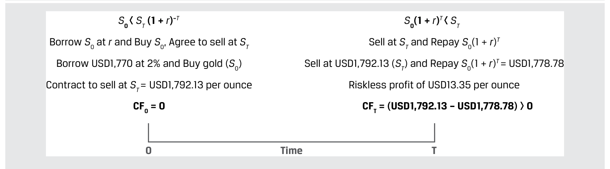

图内文字对照：Borrow S0 at r and Buy S0, Agree to sell at ST＝借入初始现货价值的资金并购买标的，同时约定到期卖出；Borrow USD1,770 at 2% and Buy gold (S0)＝按2%利率借入1,770美元并购买黄金；Contract to sell at ST = USD1,792.13 per ounce＝约定以每盎司1,792.13美元的价格卖出；Sell at ST and Repay S0(1 + r)T＝到期卖出标的并偿还借款本息；Sell at USD1,792.13 (ST) and Repay S0(1 + r)T = USD1,778.78＝到期以1,792.13美元卖出，并偿还1,778.78美元借款本息；Riskless profit of USD13.35 per ounce＝每盎司无风险利润13.35美元；0 Time T＝起始时点至到期时点的时间轴。

■ 在t = T时（三个月后）：

■ At time t = T (in three months):

■ Procam依据远期合约交付100盎司黄金，收到179,213美元。

■ Procam delivers 100 ounces of gold under the forward contract and receives USD179,213 (= 100 × USD1,792.13).

■ Procam偿还贷款本金及利息：

■ Procam repays the loan principal with interest:

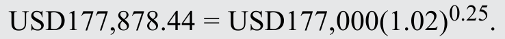

■ Procam在T时点的无风险利润等于远期出售所得与贷款本金及利息之差，为1,334.56美元。计算式如下方英文所示。

■ Procam’s riskless profit at time T is equal to the difference between the forward sale proceeds and the loan principal and interest: 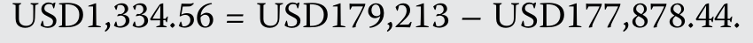

#### 补充解析 / Supplementary explanation

结合本题的官方结论：“此前的课程中，Procam Investments订立合约，约定三个月后以每盎司1,792.13美元的价格买入100盎司黄金。 本例中，由于黄金现货价格与已知未来价格的折现值存在差异，Procam进行相反的交易。 假设今日黄金现货价格S0为每盎司1,770美元，年化无风险利率r为2%。” 下列补充说明解释其背后的无套利定价与持有成本。

Link to this question’s official result: “In an earlier lesson, Procam Investments entered into a contract to buy 100 ounces of gold at an agreed-upon price of USD1,792.13 per ounce in three months. In this example, Procam does the opposite trade, given a discrepancy between spot and discounted known future gold prices. Assume that today’s spot gold price (S0) is USD1,770 per ounce, and the annualized risk-free interest rate (r) is 2%.” The supplementary discussion below explains no-arbitrage pricing and cost of carry.

解题思路：远期价格必须与“今天买入并持有标的到交割日”的替代方案相容。融资和仓储等成本提高持有成本；期间现金收入或持有实物的便利收益降低净持有成本。

Reasoning: A forward must be consistent with the alternative of buying and carrying the underlying to delivery. Financing and storage raise carrying costs, while interim income and convenience benefits reduce net carry.

应用方法：把价格不合理的一边卖出，同时买入可复制其未来现金流的一边，并检查初始与到期现金流。比较价格前统一交割日和收益处理；不要把现金分红与便利收益当成完全相同的现金支付。

Application: Sell the overpriced side and buy the portfolio that replicates its future cash flows, checking both initial and terminal payments. Align delivery dates and income treatment. A convenience yield is an economic benefit, not necessarily a cash distribution.

#### 相关知识点 / Related concepts

#### 无套利定价与持有成本 / No-arbitrage pricing and cost of carry

无套利不依赖投资者对上涨概率的主观预测，而依赖相同未来现金流应具有相同当前价值。

No-arbitrage pricing does not require a subjective forecast of an up move; it requires equal current values for identical future cash flows.

F₀(T) = \[S₀ + PV(costs) − PV(income)\] × Accumulation factor

原书为叙述式已解例题，完整条件、计算及结论保留在官方解析区。

### DER-LM04-EX02-02 · 已解例题 2 · 复制远期承诺 Worked example 2 · Replication of a Forward Commitment

正文例题／案例 / Worked example / case · 原版 PDF 页码 / Source PDF pages: 92-93

#### 题目与资料 / Question and data

### 复制远期承诺Replication of a Forward Commitment

#### 官方答案与解析 / Official answer and explanation

例1再次介绍了Procam Investments：该公司借款在现货市场买入黄金，同时在远期市场卖出黄金，从而赚取无风险利润。这里，我们改变今日黄金现货价格S0的假设。具体而言，黄金现货价格已升至1,783.28美元，从而消除了此前现货价格为1,770美元时的套利机会。相应计算式见下方英文。再次假设无风险利率r为2%，且储存黄金无需成本。

In Example 1, we reintroduced Procam Investments, which borrowed and purchased gold in the spot market and simultaneously sold gold in the forward market to earn a riskless profit. Here we change the assumption about today’s spot gold price (S0). Specifically, the spot gold price has risen to USD1,783.28 (= USD1,792.13(1.02)–0.25) to eliminate the earlier arbitrage opportunity when the spot price was USD1,770. Assume again that the risk-free interest rate (r) is 2% and gold can be stored at no cost.

1\. 远期多头承诺（约定在t = T时按F0(T)买入）

1\. Long forward commitment (agree to buy at F0(T) at t = T)

● Procam建立远期多头承诺，约定三个月后以每盎司1,792.13美元的远期价格F0(T)买入100盎司黄金。

● Procam enters a forward commitment to buy 100 ounces of gold in three months at a forward price, F0(T), of USD1,792.13 per ounce.

● 如果到期现货价格ST为每盎司1,900美元，

● If ST = USD1,900 per ounce,

■ 利润为10,787美元；完整计算式见下方。

● 如果到期现货价格ST为每盎司1,700美元，

● If ST = USD1,700 per ounce,

■ 利润为−9,213美元；完整计算式见下方。

2\. 借款并买入（在t = 0时借入S0，并以S0买入资产）：

2\. Borrow and purchase (borrow S0 and buy asset at S0 at t = 0):

● Procam按2%的利率借入178,328美元，并以今日现货价格S0买入100盎司黄金。

● Procam borrows USD178,328 at 2% and buys 100 ounces of gold at today’s spot price, S0.

● Procam于三个月后按现货价格ST卖出黄金。

● Procam sells the gold in three months at spot price ST.

● Procam偿还贷款本金及利息，共179,213美元；计算式见下方。

● Procam repays the loan principal and interest: USD179,213 = USD178,328(1.02)0.25.

● 如果到期现货价格ST为1,900美元，

● If ST = USD1,900,

■ 利润为10,787美元；完整计算式见下方。

● 如果到期现货价格ST为1,700美元，

● If ST = USD1,700,

■ 利润为−9,213美元；完整计算式见下方。

注意，情形1与情形2的利润相同，均等于到期现货价格减去远期价格。

Note that the same profits are observed under Scenarios 1 and 2, which are equal to ST – F0(T).

如果令远期价格F0(T)等于现货价格按无风险利率累积的终值，无套利条件表明，无论黄金价格向哪个方向变动，Procam在T时点都将产生相同现金流，不论该公司选择：

If we set the forward price, F0(T), equal to the future value of the spot rate using the risk-free rate (F0(T) = S0(1 + r)T), the no-arbitrage condition demonstrates that Procam generates the same cash flow at time T regardless of the direction of gold prices whether the company

1\. 建立在T时点结算的远期多头承诺；还是

1\. enters into a long forward commitment settled at time T or

2\. 按无风险利率借款，买入标的资产并持有至T时点。

2\. borrows at the risk-free rate, buys the underlying asset, and holds it until time T.

#### 补充解析 / Supplementary explanation

结合本题的官方结论：“例1再次介绍了Procam Investments：该公司借款在现货市场买入黄金，同时在远期市场卖出黄金，从而赚取无风险利润。这里，我们改变今日黄金现货价格S0的假设。具体而言，黄金现货价格已升至1,783.28美元，从而消除了此前现货价格为1,770美元时的套利机会。” 下列补充说明解释其背后的无套利定价与持有成本。

Link to this question’s official result: “In Example 1, we reintroduced Procam Investments, which borrowed and purchased gold in the spot market and simultaneously sold gold in the forward market to earn a riskless profit. Here we change the assumption about today’s spot gold price (S0). Specifically, the spot gold price has risen to USD1,783.28 (= USD1,792.13(1.02)–0.25) to eliminate the earlier arbitrage opportunity when the spot price was USD1,770.” The supplementary discussion below explains no-arbitrage pricing and cost of carry.

解题思路：远期价格必须与“今天买入并持有标的到交割日”的替代方案相容。融资和仓储等成本提高持有成本；期间现金收入或持有实物的便利收益降低净持有成本。

Reasoning: A forward must be consistent with the alternative of buying and carrying the underlying to delivery. Financing and storage raise carrying costs, while interim income and convenience benefits reduce net carry.

应用方法：把价格不合理的一边卖出，同时买入可复制其未来现金流的一边，并检查初始与到期现金流。比较价格前统一交割日和收益处理；不要把现金分红与便利收益当成完全相同的现金支付。

Application: Sell the overpriced side and buy the portfolio that replicates its future cash flows, checking both initial and terminal payments. Align delivery dates and income treatment. A convenience yield is an economic benefit, not necessarily a cash distribution.

#### 相关知识点 / Related concepts

#### 无套利定价与持有成本 / No-arbitrage pricing and cost of carry

无套利不依赖投资者对上涨概率的主观预测，而依赖相同未来现金流应具有相同当前价值。

No-arbitrage pricing does not require a subjective forecast of an up move; it requires equal current values for identical future cash flows.

F₀(T) = \[S₀ + PV(costs) − PV(income)\] × Accumulation factor

原书为叙述式已解例题，完整条件、计算及结论保留在官方解析区。

### DER-LM04-EX03-03 · 已解例题 3 · 复制无风险交易：做多资产、做空远期 Worked example 3 · Risk-Free Trade Replication: Long Asset, Short Forward

正文例题／案例 / Worked example / case · 原版 PDF 页码 / Source PDF pages: 94

#### 题目与资料 / Question and data

### 复制无风险交易：做多资产、做空远期Risk-Free Trade Replication: Long Asset, Short Forward

#### 官方答案与解析 / Official answer and explanation

Procam Investments以今日每盎司1,783.28美元的现货价格S0买入100盎司黄金，同时建立远期承诺，以每盎司1,792.13美元的远期价格F0(T)卖出黄金。

Procam Investments buys 100 ounces of gold at today’s spot price (S0) of USD1,783.28 and simultaneously enters a forward commitment to sell gold at the forward price, F0(T), of USD1,792.13.

再次假设储存黄金无需成本，下面计算Procam的收益率。

Again, we assume that gold can be stored at no cost, and here we solve for Procam’s rate of return.

■ 在t = 0时，Procam的现金流为−178,328美元。

■ At t = 0, Procam’s cash flow is –S0 = –USD178,328.

■ 在t = T时，Procam的现金流为179,213美元。

■ At t = T, Procam’s cash flow is F0(T) = USD179,213.

■ 按以下方法求出Procam策略的收益率：

■ Solve for the rate of return on Procam’s strategy, as follows:

● 将期初及期末现金流代入收益率方程：

● 求得r为2.0%，恰好等于无风险利率。

● r = 2.0%, which is equal to the risk-free rate.

本例表明，只要无套利条件成立，Procam便可用衍生品空头（即卖出远期合约）对冲黄金现货多头头寸，赚取无风险收益率。

This example demonstrates that Procam can hedge its long gold cash position with a short derivative (i.e., selling the forward contract) and earn the risk-free rate of return as long as the no-arbitrage condition (F0(T) = S0(1 + r)T) holds.

组合回报如图表6所示。

The combined return is shown in Exhibit 6.

注意，如果Procam按无风险利率借款，以S0买入标的资产，其净收益将为零。

Note that if Procam borrows at the risk-free rate to purchase the underlying asset at S0, it will earn zero.

#### 补充解析 / Supplementary explanation

结合本题的官方结论：“Procam Investments以今日每盎司1,783.28美元的现货价格S0买入100盎司黄金，同时建立远期承诺，以每盎司1,792.13美元的远期价格F0(T)卖出黄金。 再次假设储存黄金无需成本，下面计算Procam的收益率。 ■ 在t = 0时，Procam的现金流为−178,328美元。” 下列补充说明解释其背后的无套利定价与持有成本。

Link to this question’s official result: “Procam Investments buys 100 ounces of gold at today’s spot price (S0) of USD1,783.28 and simultaneously enters a forward commitment to sell gold at the forward price, F0(T), of USD1,792.13. Again, we assume that gold can be stored at no cost, and here we solve for Procam’s rate of return. ■ At t = 0, Procam’s cash flow is –S0 = –USD178,328. ■ At t = T, Procam’s cash flow is F0(T) = USD179,213. ■ Solve for the rate of return on Procam’s strategy, as follows: ● r = 2.0%, which is equal to the risk-free rate.” The supplementary discussion below explains no-arbitrage pricing and cost of carry.

解题思路：远期价格必须与“今天买入并持有标的到交割日”的替代方案相容。融资和仓储等成本提高持有成本；期间现金收入或持有实物的便利收益降低净持有成本。

Reasoning: A forward must be consistent with the alternative of buying and carrying the underlying to delivery. Financing and storage raise carrying costs, while interim income and convenience benefits reduce net carry.

应用方法：把价格不合理的一边卖出，同时买入可复制其未来现金流的一边，并检查初始与到期现金流。比较价格前统一交割日和收益处理；不要把现金分红与便利收益当成完全相同的现金支付。

Application: Sell the overpriced side and buy the portfolio that replicates its future cash flows, checking both initial and terminal payments. Align delivery dates and income treatment. A convenience yield is an economic benefit, not necessarily a cash distribution.

#### 相关知识点 / Related concepts

#### 无套利定价与持有成本 / No-arbitrage pricing and cost of carry

无套利不依赖投资者对上涨概率的主观预测，而依赖相同未来现金流应具有相同当前价值。

No-arbitrage pricing does not require a subjective forecast of an up move; it requires equal current values for identical future cash flows.

F₀(T) = \[S₀ + PV(costs) − PV(income)\] × Accumulation factor

原书为叙述式已解例题，完整条件、计算及结论保留在官方解析区。

### DER-LM04-QS01-01 · 正文题组 1 · 第 1 题 Question set 1 · Question 1

正文习题组 / Question set · 原版 PDF 页码 / Source PDF pages: 95

#### 题目与资料 / Question and data

#### 共用资料 / Shared information

套利与复制

Arbitrage and Replication

1\. 填入正确答案：如果一价定律不成立，\_\_\_\_\_\_\_\_\_资产会在同一时间、不同地点以\_\_\_\_\_\_\_\_\_价格交易。

1\. Determine the correct answers to fill in the blanks: If the law of one price does not hold, a(n) \_\_\_\_\_\_\_\_\_ asset trades at the same time at \_\_\_\_\_\_\_\_\_ prices in different places.

#### 官方答案与解析 / Official answer and explanation

如果一价定律不成立，同一资产会在同一时间、不同地点以不同价格交易。

If the law of one price does not hold, a(n) identical asset trades at the same time at different prices in different places.

#### 补充解析 / Supplementary explanation

结合本题的官方结论：“如果一价定律不成立，同一资产会在同一时间、不同地点以不同价格交易。” 下列补充说明解释其背后的无套利定价与持有成本。

Link to this question’s official result: “If the law of one price does not hold, a(n) identical asset trades at the same time at different prices in different places.” The supplementary discussion below explains no-arbitrage pricing and cost of carry.

解题思路：远期价格必须与“今天买入并持有标的到交割日”的替代方案相容。融资和仓储等成本提高持有成本；期间现金收入或持有实物的便利收益降低净持有成本。

Reasoning: A forward must be consistent with the alternative of buying and carrying the underlying to delivery. Financing and storage raise carrying costs, while interim income and convenience benefits reduce net carry.

应用方法：把价格不合理的一边卖出，同时买入可复制其未来现金流的一边，并检查初始与到期现金流。比较价格前统一交割日和收益处理；不要把现金分红与便利收益当成完全相同的现金支付。

Application: Sell the overpriced side and buy the portfolio that replicates its future cash flows, checking both initial and terminal payments. Align delivery dates and income treatment. A convenience yield is an economic benefit, not necessarily a cash distribution.

#### 相关知识点 / Related concepts

#### 无套利定价与持有成本 / No-arbitrage pricing and cost of carry

无套利不依赖投资者对上涨概率的主观预测，而依赖相同未来现金流应具有相同当前价值。

No-arbitrage pricing does not require a subjective forecast of an up move; it requires equal current values for identical future cash flows.

F₀(T) = \[S₀ + PV(costs) − PV(income)\] × Accumulation factor

### DER-LM04-QS01-02 · 正文题组 1 · 第 2 题 Question set 1 · Question 2

正文习题组 / Question set · 原版 PDF 页码 / Source PDF pages: 95

#### 题目与资料 / Question and data

#### 共用资料 / Shared information

套利与复制

Arbitrage and Replication

2\. 某投资者观察到，一项不产生额外成本或收益的标的资产，其现货价格S0高于已知未来价格按无风险利率折现后的金额。请描述一种能够为该投资者产生无风险利润的套利策略，并说明理由。

2\. An investor observes that the spot price, S0, of an underlying asset with no additional costs or benefits exceeds its known future price discounted at the risk-free rate, ST(1 + r)–T. Describe and justify an arbitrage strategy that generates a riskless profit for the investor.

#### 官方答案与解析 / Official answer and explanation

由于标的资产的现货价格超过已知未来价格按无风险利率折现后的金额，投资者在t = 0时：

Since the spot price of the underlying asset exceeds the known future price discounted at the risk-free rate (S0 \> F0(T)(1 + r)–T), at t = 0, the investor:

• 在现货市场以S0卖空标的资产；• 同时按F0(T)建立远期多头合约；

• Sells the underlying asset short in the spot market at S0 • Simultaneously enters a long forward contract at F0(T)

• 将S0按无风险利率r贷出，并在T时点收回相应本息。

• Lends S0 at the risk-free rate r to receive S0(1 + r)T at time T.

在t = T时，投资者：

At time t = T, the investor:

• 结算远期多头头寸，收取到期现货价格与远期价格之差；

• Settles the long forward position and receives ST – F0(T)

• 以ST回补标的资产的空头头寸；并且

• Offsets the short underlying asset position at ST, and

• 将贷出款项本息与远期价格之差保留为无风险利润，与T时点的标的资产现货价格无关。具体关系式见下方英文。

• Retains S0(1 + r)T – F0(T) as a riskless profit regardless of the underlying spot price at time T.

#### 补充解析 / Supplementary explanation

结合本题的官方结论：“由于标的资产的现货价格超过已知未来价格按无风险利率折现后的金额，投资者在t = 0时： • 在现货市场以S0卖空标的资产；• 同时按F0(T)建立远期多头合约； • 将S0按无风险利率r贷出，并在T时点收回相应本息。” 下列补充说明解释其背后的无套利定价与持有成本。

Link to this question’s official result: “Since the spot price of the underlying asset exceeds the known future price discounted at the risk-free rate (S0 \> F0(T)(1 + r)–T), at t = 0, the investor: • Sells the underlying asset short in the spot market at S0 • Simultaneously enters a long forward contract at F0(T) • Lends S0 at the risk-free rate r to receive S0(1 + r)T at time T.” The supplementary discussion below explains no-arbitrage pricing and cost of carry.

解题思路：远期价格必须与“今天买入并持有标的到交割日”的替代方案相容。融资和仓储等成本提高持有成本；期间现金收入或持有实物的便利收益降低净持有成本。

Reasoning: A forward must be consistent with the alternative of buying and carrying the underlying to delivery. Financing and storage raise carrying costs, while interim income and convenience benefits reduce net carry.

应用方法：把价格不合理的一边卖出，同时买入可复制其未来现金流的一边，并检查初始与到期现金流。比较价格前统一交割日和收益处理；不要把现金分红与便利收益当成完全相同的现金支付。

Application: Sell the overpriced side and buy the portfolio that replicates its future cash flows, checking both initial and terminal payments. Align delivery dates and income treatment. A convenience yield is an economic benefit, not necessarily a cash distribution.

#### 相关知识点 / Related concepts

#### 无套利定价与持有成本 / No-arbitrage pricing and cost of carry

无套利不依赖投资者对上涨概率的主观预测，而依赖相同未来现金流应具有相同当前价值。

No-arbitrage pricing does not require a subjective forecast of an up move; it requires equal current values for identical future cash flows.

F₀(T) = \[S₀ + PV(costs) − PV(income)\] × Accumulation factor

### DER-LM04-QS01-03 · 正文题组 1 · 第 3 题 Question set 1 · Question 3

正文习题组 / Question set · 原版 PDF 页码 / Source PDF pages: 95

#### 题目与资料 / Question and data

#### 共用资料 / Shared information

套利与复制

Arbitrage and Replication

3\. 请为1,000股不派息股票的三个月远期空头承诺制定复制策略。

3\. Formulate a replication strategy for a three-month short forward commitment for 1,000 shares of a non-dividend-paying stock.

#### 官方答案与解析 / Official answer and explanation

复制不派息股票三个月远期空头承诺的策略是：在t = 0时卖空1,000股股票，并将所得款项按无风险利率r投资。在t = T时，以ST回补空头。在无套利条件下，远期空头与复制策略的收益相同，均等于远期价格减去到期现货价格。相应关系式见下方英文。

The replication strategy for a three-month short forward commitment on a non-dividend-paying stock involves the short sale of 1,000 shares of stock at t = 0 and investment of proceeds at the risk-free rate, r. At time t = T, the short sale is covered at ST, and under the no-arbitrage condition of F0(T) = S0(1 + r)T, the return is equal to F0(T) – ST for both the short forward and the replication strategy.

#### 补充解析 / Supplementary explanation

结合本题的官方结论：“复制不派息股票三个月远期空头承诺的策略是：在t = 0时卖空1,000股股票，并将所得款项按无风险利率r投资。在t = T时，以ST回补空头。在无套利条件下，远期空头与复制策略的收益相同，均等于远期价格减去到期现货价格。” 下列补充说明解释其背后的无套利定价与持有成本。

Link to this question’s official result: “The replication strategy for a three-month short forward commitment on a non-dividend-paying stock involves the short sale of 1,000 shares of stock at t = 0 and investment of proceeds at the risk-free rate, r. At time t = T, the short sale is covered at ST, and under the no-arbitrage condition of F0(T) = S0(1 + r)T, the return is equal to F0(T) – ST for both the short forward and the replication strategy.” The supplementary discussion below explains no-arbitrage pricing and cost of carry.

解题思路：远期价格必须与“今天买入并持有标的到交割日”的替代方案相容。融资和仓储等成本提高持有成本；期间现金收入或持有实物的便利收益降低净持有成本。

Reasoning: A forward must be consistent with the alternative of buying and carrying the underlying to delivery. Financing and storage raise carrying costs, while interim income and convenience benefits reduce net carry.

应用方法：把价格不合理的一边卖出，同时买入可复制其未来现金流的一边，并检查初始与到期现金流。比较价格前统一交割日和收益处理；不要把现金分红与便利收益当成完全相同的现金支付。

Application: Sell the overpriced side and buy the portfolio that replicates its future cash flows, checking both initial and terminal payments. Align delivery dates and income treatment. A convenience yield is an economic benefit, not necessarily a cash distribution.

#### 相关知识点 / Related concepts

#### 无套利定价与持有成本 / No-arbitrage pricing and cost of carry

无套利不依赖投资者对上涨概率的主观预测，而依赖相同未来现金流应具有相同当前价值。

No-arbitrage pricing does not require a subjective forecast of an up move; it requires equal current values for identical future cash flows.

F₀(T) = \[S₀ + PV(costs) − PV(income)\] × Accumulation factor

### DER-LM04-QS01-04 · 正文题组 1 · 第 4 题 Question set 1 · Question 4

正文习题组 / Question set · 原版 PDF 页码 / Source PDF pages: 95

#### 题目与资料 / Question and data

#### 共用资料 / Shared information

套利与复制

Arbitrage and Replication

4\. 一项不产生额外成本或收益的资产，其现货交易价格为100，三个月远期价格为102，无风险利率为5%。请计算套利利润。

4\. Calculate the arbitrage profit if a spot asset with no additional costs or benefits trades at a spot price of 100, the three-month forward price for the underlying asset is 102, and the risk-free rate is 5%.

#### 官方答案与解析 / Official answer and explanation

不存在套利机会时，远期价格应为101.23。当前观察到的远期价格为102，因此套利策略是卖出远期合约，并按无风险利率借款，用借款买入标的资产。套利利润为观察到的远期价格与无套利远期价格之差，即0.77。完整计算式见下方英文。

The forward price, F0(T) = S0(1 + r)T, at which no-arbitrage opportunities would exist is 101.23 (= 100(1.05)0.25). With an observed forward price of 102, the arbitrage opportunity would be to sell the forward contract and buy the underlying, borrowing at the risk-free rate to fund the purchase. The arbitrage profit is the difference between the observed forward price and the no-arbitrage forward price of 0.77 (= 102 – 101.23).

#### 补充解析 / Supplementary explanation

结合本题的官方结论：“不存在套利机会时，远期价格应为101.23。当前观察到的远期价格为102，因此套利策略是卖出远期合约，并按无风险利率借款，用借款买入标的资产。套利利润为观察到的远期价格与无套利远期价格之差，即0.77。” 下列补充说明解释其背后的无套利定价与持有成本。

Link to this question’s official result: “The forward price, F0(T) = S0(1 + r)T, at which no-arbitrage opportunities would exist is 101.23 (= 100(1.05)0.25). With an observed forward price of 102, the arbitrage opportunity would be to sell the forward contract and buy the underlying, borrowing at the risk-free rate to fund the purchase. The arbitrage profit is the difference between the observed forward price and the no-arbitrage forward price of 0.77 (= 102 – 101.23).” The supplementary discussion below explains no-arbitrage pricing and cost of carry.

解题思路：远期价格必须与“今天买入并持有标的到交割日”的替代方案相容。融资和仓储等成本提高持有成本；期间现金收入或持有实物的便利收益降低净持有成本。

Reasoning: A forward must be consistent with the alternative of buying and carrying the underlying to delivery. Financing and storage raise carrying costs, while interim income and convenience benefits reduce net carry.

应用方法：把价格不合理的一边卖出，同时买入可复制其未来现金流的一边，并检查初始与到期现金流。比较价格前统一交割日和收益处理；不要把现金分红与便利收益当成完全相同的现金支付。

Application: Sell the overpriced side and buy the portfolio that replicates its future cash flows, checking both initial and terminal payments. Align delivery dates and income treatment. A convenience yield is an economic benefit, not necessarily a cash distribution.

#### 相关知识点 / Related concepts

#### 无套利定价与持有成本 / No-arbitrage pricing and cost of carry

无套利不依赖投资者对上涨概率的主观预测，而依赖相同未来现金流应具有相同当前价值。

No-arbitrage pricing does not require a subjective forecast of an up move; it requires equal current values for identical future cash flows.

F₀(T) = \[S₀ + PV(costs) − PV(income)\] × Accumulation factor

### DER-LM04-QS01-05 · 正文题组 1 · 第 5 题 Question set 1 · Question 5

正文习题组 / Question set · 原版 PDF 页码 / Source PDF pages: 95-96

#### 题目与资料 / Question and data

#### 共用资料 / Shared information

套利与复制

Arbitrage and Replication

5\. 当无风险利率为负时，请描述标的资产现货价格与远期价格之间的关系。

5\. Describe the relationship between the spot and forward price for an underlying asset if the risk-free rate is negative.

#### 官方答案与解析 / Official answer and explanation

对于除机会成本（无风险利率）外不产生其他持有成本或收益的资产，其现货价格与远期价格的关系为：远期价格等于现货价格按无风险利率累积后的金额。当r \< 0时，累积因子小于1，因此无风险利率为负时，远期价格F0(T)低于现货价格S0。相应公式见下方英文。

The relationship between the spot and forward rate for an asset with no additional costs or benefits of ownership other than the opportunity cost (risk-free rate) is equal to F0(T) = S0(1 + r)T. In a case where r \< 0, (1 + r)T \< 1 and therefore the forward price, F0(T), is below the spot price, S0, if the risk-free rate is negative.

#### 补充解析 / Supplementary explanation

结合本题的官方结论：“对于除机会成本（无风险利率）外不产生其他持有成本或收益的资产，其现货价格与远期价格的关系为：远期价格等于现货价格按无风险利率累积后的金额。当r \< 0时，累积因子小于1，因此无风险利率为负时，远期价格F0(T)低于现货价格S0。相应公式见下方英文。” 下列补充说明解释其背后的无套利定价与持有成本。

Link to this question’s official result: “The relationship between the spot and forward rate for an asset with no additional costs or benefits of ownership other than the opportunity cost (risk-free rate) is equal to F0(T) = S0(1 + r)T. In a case where r \< 0, (1 + r)T \< 1 and therefore the forward price, F0(T), is below the spot price, S0, if the risk-free rate is negative.” The supplementary discussion below explains no-arbitrage pricing and cost of carry.

解题思路：远期价格必须与“今天买入并持有标的到交割日”的替代方案相容。融资和仓储等成本提高持有成本；期间现金收入或持有实物的便利收益降低净持有成本。

Reasoning: A forward must be consistent with the alternative of buying and carrying the underlying to delivery. Financing and storage raise carrying costs, while interim income and convenience benefits reduce net carry.

应用方法：把价格不合理的一边卖出，同时买入可复制其未来现金流的一边，并检查初始与到期现金流。比较价格前统一交割日和收益处理；不要把现金分红与便利收益当成完全相同的现金支付。

Application: Sell the overpriced side and buy the portfolio that replicates its future cash flows, checking both initial and terminal payments. Align delivery dates and income treatment. A convenience yield is an economic benefit, not necessarily a cash distribution.

#### 相关知识点 / Related concepts

#### 无套利定价与持有成本 / No-arbitrage pricing and cost of carry

无套利不依赖投资者对上涨概率的主观预测，而依赖相同未来现金流应具有相同当前价值。

No-arbitrage pricing does not require a subjective forecast of an up move; it requires equal current values for identical future cash flows.

F₀(T) = \[S₀ + PV(costs) − PV(income)\] × Accumulation factor

### DER-LM04-EX04-04 · 已解例题 4 · Hightest含股息股票远期合约 Worked example 4 · Hightest Equity Forward with Dividend

正文例题／案例 / Worked example / case · 原版 PDF 页码 / Source PDF pages: 98

#### 题目与资料 / Question and data

### Hightest含股息股票远期合约Hightest Equity Forward with Dividend

#### 官方答案与解析 / Official answer and explanation

假设Hightest Capital根据一份远期合约，同意六个月后按约定价格向一家金融中介交付1,000股联合利华（UL）股票。

Assume Hightest Capital agrees to deliver 1,000 Unilever (UL) shares at an agreed-upon price to a financial intermediary in six months under a forward contract.

假设UL的现货价格S0为50欧元，且不派发股息，即I = 0；无风险利率r为5%。

Assume that UL has a spot price (S0) of EUR50 and pays no dividend (I = 0), and assume a risk-free rate (r) of 5%.

可用公式3求出六个月远期价格F0(T)：

We may use Equation 3 to solve for the forward price, F0(T), in six months:

现在改为假设联合利华每季度派发0.30欧元股息，恰好在三个月后及T时点各派息一次，其他条件不变。

Now assume instead that Unilever pays a quarterly dividend of EUR0.30, which occurs in exactly three months and again at time T, with other details unchanged.

在PV0(C) = 0的情况下，利用公式5求六个月远期价格F0(T)：

Use Equation 5 with PV0(C) = 0 to solve for F0(T) in six months:

首先，按以下方法求出每股股息的现值PV0(I)：

First, solve for the present value of the dividend per share, PV0(I), as follows:

将股息现值PV0(I)为0.5892欧元代入公式5，求远期价格F0(T)：

Substitute PV0(I) = EUR0.5892 into Equation 5 to solve for F0(T):

因此，Hightest涉及1,000股UL股票的远期合约定价应为50,631.00欧元。

Hightest’s forward contract for 1,000 UL shares would therefore be priced at EUR50,631.00 (= 1,000 × EUR50.6310).

六个月内按无风险利率借款的机会成本为每股1.23欧元；联合利华不派息时，该机会成本等于远期价格与现货价格之差。

The opportunity cost of borrowing at the risk-free rate is EUR1.23 per share for six months and equals F0(T) – S0 when Unilever pays no dividend.

每季度0.30欧元的股息使远期价格与现货价格之差降至约0.63欧元。

A EUR0.30 quarterly dividend reduces the difference between the forward and spot price to approximately EUR0.63.

#### 补充解析 / Supplementary explanation

结合本题的官方结论：“假设Hightest Capital根据一份远期合约，同意六个月后按约定价格向一家金融中介交付1,000股联合利华（UL）股票。 假设UL的现货价格S0为50欧元，且不派发股息，即I = 0；无风险利率r为5%。 可用公式3求出六个月远期价格F0(T)： 现在改为假设联合利华每季度派发0.30欧元股息，恰好在三个月后及T时点各派息一次，其他条件不变。” 下列补充说明解释其背后的无套利定价与持有成本。

Link to this question’s official result: “Assume Hightest Capital agrees to deliver 1,000 Unilever (UL) shares at an agreed-upon price to a financial intermediary in six months under a forward contract. Assume that UL has a spot price (S0) of EUR50 and pays no dividend (I = 0), and assume a risk-free rate (r) of 5%. We may use Equation 3 to solve for the forward price, F0(T), in six months: Now assume instead that Unilever pays a quarterly dividend of EUR0.30, which occurs in exactly three months and again at time T, with other details unchanged.” The supplementary discussion below explains no-arbitrage pricing and cost of carry.

解题思路：远期价格必须与“今天买入并持有标的到交割日”的替代方案相容。融资和仓储等成本提高持有成本；期间现金收入或持有实物的便利收益降低净持有成本。

Reasoning: A forward must be consistent with the alternative of buying and carrying the underlying to delivery. Financing and storage raise carrying costs, while interim income and convenience benefits reduce net carry.

应用方法：把价格不合理的一边卖出，同时买入可复制其未来现金流的一边，并检查初始与到期现金流。比较价格前统一交割日和收益处理；不要把现金分红与便利收益当成完全相同的现金支付。

Application: Sell the overpriced side and buy the portfolio that replicates its future cash flows, checking both initial and terminal payments. Align delivery dates and income treatment. A convenience yield is an economic benefit, not necessarily a cash distribution.

#### 相关知识点 / Related concepts

#### 无套利定价与持有成本 / No-arbitrage pricing and cost of carry

无套利不依赖投资者对上涨概率的主观预测，而依赖相同未来现金流应具有相同当前价值。

No-arbitrage pricing does not require a subjective forecast of an up move; it requires equal current values for identical future cash flows.

F₀(T) = \[S₀ + PV(costs) − PV(income)\] × Accumulation factor

原书为叙述式已解例题，完整条件、计算及结论保留在官方解析区。

### DER-LM04-EX05-05 · 已解例题 5 · 具有股息收益率的股票指数期货 Worked example 5 · Stock Index Futures with Dividend Yield

正文例题／案例 / Worked example / case · 原版 PDF 页码 / Source PDF pages: 99

#### 题目与资料 / Question and data

### 具有股息收益率的股票指数期货Stock Index Futures with Dividend Yield

#### 官方答案与解析 / Official answer and explanation

Viswan家族办公室（VFO）希望建立一份三个月远期承诺合约，买入在印度国家证券交易所交易的印度股票市场基准NIFTY 50指数。

The Viswan Family Office (VFO) would like to enter into a three-month forward commitment contract to purchase the NIFTY 50 benchmark Indian stock market index traded on the National Stock Exchange.

NIFTY 50现货指数价格为15,200印度卢比，指数股息收益率为2.2%，印度卢比无风险利率为4%。

The spot NIFTY 50 index price is INR15,200, the index dividend yield is 2.2%, and the Indian rupee risk-free rate is 4%.

在c = 0的情况下，利用公式6求远期价格：

Use Equation 6 (with c = 0) to solve for the forward price:

#### 补充解析 / Supplementary explanation

结合本题的官方结论：“Viswan家族办公室（VFO）希望建立一份三个月远期承诺合约，买入在印度国家证券交易所交易的印度股票市场基准NIFTY 50指数。 NIFTY 50现货指数价格为15,200印度卢比，指数股息收益率为2.2%，印度卢比无风险利率为4%。 在c = 0的情况下，利用公式6求远期价格：” 下列补充说明解释其背后的无套利定价与持有成本。

Link to this question’s official result: “The Viswan Family Office (VFO) would like to enter into a three-month forward commitment contract to purchase the NIFTY 50 benchmark Indian stock market index traded on the National Stock Exchange. The spot NIFTY 50 index price is INR15,200, the index dividend yield is 2.2%, and the Indian rupee risk-free rate is 4%. Use Equation 6 (with c = 0) to solve for the forward price:” The supplementary discussion below explains no-arbitrage pricing and cost of carry.

解题思路：远期价格必须与“今天买入并持有标的到交割日”的替代方案相容。融资和仓储等成本提高持有成本；期间现金收入或持有实物的便利收益降低净持有成本。

Reasoning: A forward must be consistent with the alternative of buying and carrying the underlying to delivery. Financing and storage raise carrying costs, while interim income and convenience benefits reduce net carry.

应用方法：把价格不合理的一边卖出，同时买入可复制其未来现金流的一边，并检查初始与到期现金流。比较价格前统一交割日和收益处理；不要把现金分红与便利收益当成完全相同的现金支付。

Application: Sell the overpriced side and buy the portfolio that replicates its future cash flows, checking both initial and terminal payments. Align delivery dates and income treatment. A convenience yield is an economic benefit, not necessarily a cash distribution.

#### 相关知识点 / Related concepts

#### 无套利定价与持有成本 / No-arbitrage pricing and cost of carry

无套利不依赖投资者对上涨概率的主观预测，而依赖相同未来现金流应具有相同当前价值。

No-arbitrage pricing does not require a subjective forecast of an up move; it requires equal current values for identical future cash flows.

F₀(T) = \[S₀ + PV(costs) − PV(income)\] × Accumulation factor

原书为叙述式已解例题，完整条件、计算及结论保留在官方解析区。

### DER-LM04-EX06-06 · 已解例题 6 · AUD/USD外汇远期复制 Worked example 6 · AUD/USD Foreign Exchange Forward Replication

正文例题／案例 / Worked example / case · 原版 PDF 页码 / Source PDF pages: 99-100

#### 题目与资料 / Question and data

### AUD/USD外汇远期复制AUD/USD Foreign Exchange Forward Replication

#### 官方答案与解析 / Official answer and explanation

为根据今日给定即期汇率S0,f/d复制一种货币相对于另一种货币的回报，可以利用此前的套利概念求出远期汇率F0,f/d(T)：未来价格已知的资产，其现货价格S0,f/d必须等于未来价格按无风险利率折现后的金额。

In order to replicate one currency’s return in terms of the other for a given spot price today of S0,f/d, we may solve for a forward rate F0,f/d(T) using the earlier arbitrage concept that assets with a known future price must have a spot price (S0,f/d) equal to the future price discounted at the risk-free rate.

假设当前AUD/USD即期汇率为1.3335。

Assume the current AUD/USD spot price is 1.3335.

澳元是计价货币或外币，美元是基准货币或本币，即1.3335澳元等于1美元。

The Australian dollar is the price currency or foreign currency, and the US dollar is the base or domestic currency (AUD1.3335 = USD1).

六个月澳元无风险利率为0.05%，六个月美元无风险利率为0.20%。

The six-month Australian dollar risk-free rate is 0.05%, and the six-month US dollar risk-free rate is 0.20%.

■ 在t = 0时：

■ At time t = 0:

1\. 按0.20%的美元无风险利率借入1,000美元，期限为六个月。

1\. Borrow USD1,000 at the 0.20% US dollar risk-free rate for six months.

2\. 按1.3335的AUD/USD即期汇率买入1,333.50澳元。

2\. Purchase AUD1,333.50 at the AUD/USD spot rate (S0,f/d = 1.3335).

3\. 将收到的1,333.50澳元按0.05%的澳元无风险利率贷出，期限为六个月。

3\. Lend the AUD1,333.50 received at the 0.05% Australian dollar risk-free rate for six months.

■ 在六个月后的t = T时：

■ At time t = T in six months:

4\. 收回澳元贷款本息，共1,333.83澳元。计算式见下方英文。

4\. Receive Australian dollar loan proceeds of 1,333.83 (= 1,333.50e(0.0005 × 0.5)).

5\. 按ST,f/d将澳元款项兑换为美元，以偿还美元贷款。

5\. Exchange Australian dollar proceeds for US dollars at ST,f/d to repay the US dollar loan.

6\. 偿还美元贷款及利息，共1,001美元。

6\. Repay the US dollar loan (with interest) of 1,001 (= 1,000e(0.002 × 0.5)).

如果第5步在T时点按某一即期汇率ST,f/d进行兑换，恰好使澳元贷款所得（第4步）抵销美元贷款本息（第6步），则不存在无风险套利机会。

If the exchange in Step 5 at time T is at a spot price, ST,f/d, at which the Australian dollar loan proceeds (Step 4) exactly offset the US dollar loan (Step 6), no riskless arbitrage opportunity exists.

用第4步的澳元金额除以第6步的美元金额，即可求出ST,f/d：

Solve for ST,f/d by dividing the Australian dollars in Step 4 by the US dollars in Step 6:

下图概括了t = 0及T时点的现金流：

The following diagram summarizes the cash flows at time t = 0 and time T:

图内文字对照：Time＝时间；Buy AUD AUD1,333.50＝买入1,333.50澳元；Sell USD USD1,000＝卖出1,000美元；Borrow USD1 at rUSD = rd = 0.20%＝按0.20%的美元利率借入美元（金额按原图保留）；Lend AUD1,333.50 at rAUD = rf = 0.05%＝按0.05%的澳元利率贷出1,333.50澳元。

#### 补充解析 / Supplementary explanation

结合本题的官方结论：“为根据今日给定即期汇率S0,f/d复制一种货币相对于另一种货币的回报，可以利用此前的套利概念求出远期汇率F0,f/d(T)：未来价格已知的资产，其现货价格S0,f/d必须等于未来价格按无风险利率折现后的金额。 假设当前AUD/USD即期汇率为1.3335。 澳元是计价货币或外币，美元是基准货币或本币，即1.3335澳元等于1美元。” 下列补充说明解释其背后的无套利定价与持有成本。

Link to this question’s official result: “In order to replicate one currency’s return in terms of the other for a given spot price today of S0,f/d, we may solve for a forward rate F0,f/d(T) using the earlier arbitrage concept that assets with a known future price must have a spot price (S0,f/d) equal to the future price discounted at the risk-free rate. Assume the current AUD/USD spot price is 1.3335. The Australian dollar is the price currency or foreign currency, and the US dollar is the base or domestic currency (AUD1.3335 = USD1).” The supplementary discussion below explains no-arbitrage pricing and cost of carry.

解题思路：远期价格必须与“今天买入并持有标的到交割日”的替代方案相容。融资和仓储等成本提高持有成本；期间现金收入或持有实物的便利收益降低净持有成本。

Reasoning: A forward must be consistent with the alternative of buying and carrying the underlying to delivery. Financing and storage raise carrying costs, while interim income and convenience benefits reduce net carry.

应用方法：把价格不合理的一边卖出，同时买入可复制其未来现金流的一边，并检查初始与到期现金流。比较价格前统一交割日和收益处理；不要把现金分红与便利收益当成完全相同的现金支付。

Application: Sell the overpriced side and buy the portfolio that replicates its future cash flows, checking both initial and terminal payments. Align delivery dates and income treatment. A convenience yield is an economic benefit, not necessarily a cash distribution.

#### 相关知识点 / Related concepts

#### 无套利定价与持有成本 / No-arbitrage pricing and cost of carry

无套利不依赖投资者对上涨概率的主观预测，而依赖相同未来现金流应具有相同当前价值。

No-arbitrage pricing does not require a subjective forecast of an up move; it requires equal current values for identical future cash flows.

F₀(T) = \[S₀ + PV(costs) − PV(income)\] × Accumulation factor

原书为叙述式已解例题，完整条件、计算及结论保留在官方解析区。

### DER-LM04-EX07-07 · 已解例题 7 · Montau AG的外汇远期汇率 Worked example 7 · Montau AG’s FX Forward Rate

正文例题／案例 / Worked example / case · 原版 PDF 页码 / Source PDF pages: 101-102

#### 题目与资料 / Question and data

### Montau AG的外汇远期汇率Montau AG’s FX Forward Rate

#### 官方答案与解析 / Official answer and explanation

此前课程介绍过德国资本货物生产商Montau AG。Montau与韩国制造商Jeon, Inc.签订商业合约，约定75天后交付一台激光切割机，价格为6.5亿韩元。Montau目前发生的欧元成本，与交付设备后收到韩元、再在即期外汇市场兑换为欧元所实现的收入，在时间上存在错配。Montau建立KRW/EUR外汇远期多头合约，即同意75天后按固定价格F0(T)卖出韩元、买入欧元，以消除出口合约产生的KRW/EUR汇率错配。

An earlier lesson introduced Montau AG, a German capital goods producer. Montau signs a commercial contract with Jeon, Inc., a South Korean manufacturer, to deliver a laser cutting machine at a price of KRW650 million in 75 days. Montau faces a timing mismatch between domestic euro costs incurred and euro revenue realized upon the delivery of the machine and sale of South Korean won received in exchange for euros in the spot FX market. Montau enters a long KRW/EUR FX forward contract. That is, Montau agrees to sell South Korean won and purchase euros at a fixed price, F0(T), in 75 days to eliminate the KRW/EUR exchange rate mismatch arising from the export contract.

在这个版本的Montau AG示例中，我们利用今日即期汇率，以及本币无风险利率rd和外币无风险利率rf，求出KRW/EUR远期汇率。

In this version of the Montau AG example, we use today’s spot exchange rate and the domestic (rd) and foreign (rf) risk-free rates to solve for the KRW/EUR forward rate.

如公式7所示，即期与远期汇率之差涉及无风险利率之差。

As seen in Equation 7, the difference between spot and forward FX rates involves the difference in risk-free rates.

在KRW/EUR报价中，韩元为计价货币或外币，因此rf为韩元利率。

In the KRW/EUR case, the South Korean won is the price currency or foreign currency and rf is therefore the South Korean won interest rate.

欧元为基准货币或本币。

The euro is the base or domestic currency.

因此，公式7可改写如下：

We may therefore rewrite Equation 7 as follows:

假设KRW/EUR即期汇率S0为1,300，即1,300韩元等于1欧元；韩元无风险利率为0.75%，欧元无风险利率rd为−0.25%。

Assume a spot KRW/EUR rate (S0) of 1,300 (that is, KRW1,300 = EUR1), a South Korean won risk-free rate of 0.75%, and a euro risk-free rate of –0.25% (rd).

请计算符合无套利条件的75天KRW/EUR远期汇率。

Calculate the KRW/EUR forward rate in 75 days consistent with no arbitrage.

求得KRW/EUR远期汇率F0(T)为1,302.67。注意，韩元与欧元之间1个百分点的利率差，使远期价格高于即期价格。也就是说，未来买入1欧元需要更多韩元，因此韩元相对于欧元处于远期贴水。（原文此处写“六个月后”，但本例设定期限为75天。）

Solving for the KRW/EUR forward rate gives us F0(T) = 1,302.67. Notice that the 1% difference between South Korean won and euro interest rates leads to a forward price that is above the spot price (F0,f/d(T) \> S0,f/d). That is, in six months’ time, more South Korean won will be required to purchase a euro, and the South Korean won is said to trade at a forward discount versus the euro.

为说明远期与即期汇率之间的无套利条件，假设Montau按1,300的KRW/EUR即期汇率，将6.5亿韩元兑换为500,000欧元，并按−0.25%的连续复利利率投资75天。此处原文将该欧元利率记作rf：

To demonstrate the no-arbitrage condition between the forward and spot rates, assume that Montau converts the KRW650 million into euros at the 1,300 KRW/EUR spot rate to receive EUR500,000 (= KRW650,000,000/1,300) and invests this for 75 days at a continuously compounded rf = –0.25%:

假设Jeon Inc.将6.5亿韩元按0.75%的韩元无风险利率投资75天，获得以下金额。此处原文将该韩元利率记作rd：

Assume that Jeon Inc. invests the KRW650 million at the South Korean won risk-free rate (rd = 0.75%) for 75 days to receive

因此，无套利的远期承诺价格应使Montau能够在75天后将651,002,484.59韩元兑换为499,743.22欧元。

An arbitrage-free forward commitment price should therefore allow Montau to convert KRW651,002,484.59 into EUR499,743.22 after 75 days.

这证实两种价格（即期汇率与远期汇率）与两种货币的无风险利率差相一致。

This confirms that the two prices (spot and forward exchange rates) are consistent with the risk-free interest rate differential in the two different currencies.

#### 补充解析 / Supplementary explanation

结合本题的官方结论：“此前课程介绍过德国资本货物生产商Montau AG。Montau与韩国制造商Jeon, Inc.签订商业合约，约定75天后交付一台激光切割机，价格为6.5亿韩元。Montau目前发生的欧元成本，与交付设备后收到韩元、再在即期外汇市场兑换为欧元所实现的收入，在时间上存在错配。” 下列补充说明解释其背后的无套利定价与持有成本。

Link to this question’s official result: “An earlier lesson introduced Montau AG, a German capital goods producer. Montau signs a commercial contract with Jeon, Inc., a South Korean manufacturer, to deliver a laser cutting machine at a price of KRW650 million in 75 days. Montau faces a timing mismatch between domestic euro costs incurred and euro revenue realized upon the delivery of the machine and sale of South Korean won received in exchange for euros in the spot FX market.” The supplementary discussion below explains no-arbitrage pricing and cost of carry.

解题思路：远期价格必须与“今天买入并持有标的到交割日”的替代方案相容。融资和仓储等成本提高持有成本；期间现金收入或持有实物的便利收益降低净持有成本。

Reasoning: A forward must be consistent with the alternative of buying and carrying the underlying to delivery. Financing and storage raise carrying costs, while interim income and convenience benefits reduce net carry.

应用方法：把价格不合理的一边卖出，同时买入可复制其未来现金流的一边，并检查初始与到期现金流。比较价格前统一交割日和收益处理；不要把现金分红与便利收益当成完全相同的现金支付。

Application: Sell the overpriced side and buy the portfolio that replicates its future cash flows, checking both initial and terminal payments. Align delivery dates and income treatment. A convenience yield is an economic benefit, not necessarily a cash distribution.

#### 相关知识点 / Related concepts

#### 无套利定价与持有成本 / No-arbitrage pricing and cost of carry

无套利不依赖投资者对上涨概率的主观预测，而依赖相同未来现金流应具有相同当前价值。

No-arbitrage pricing does not require a subjective forecast of an up move; it requires equal current values for identical future cash flows.

F₀(T) = \[S₀ + PV(costs) − PV(income)\] × Accumulation factor

原书为叙述式已解例题，完整条件、计算及结论保留在官方解析区。

### DER-LM04-EX08-08 · 已解例题 8 · 考虑仓储成本的Procam黄金远期合约 Worked example 8 · Procam’s Gold Forward Contract with Storage Costs

正文例题／案例 / Worked example / case · 原版 PDF 页码 / Source PDF pages: 102

#### 题目与资料 / Question and data

### 考虑仓储成本的Procam黄金远期合约Procam’s Gold Forward Contract with Storage Costs

#### 官方答案与解析 / Official answer and explanation

回顾此前示例，Procam借款在现货市场买入黄金，同时在远期市场卖出三个月期黄金，以获取无风险利润。在无风险利率为2%的假设下，我们说明：给定远期价格为1,792.13美元、黄金储存无需成本时，黄金现货价格S0必须升至1,783.28美元，才能消除之前的套利机会。完整计算式见下方英文。

Recall from earlier examples that Procam borrowed and purchased gold in the spot market and simultaneously sold gold in the forward market for three months to earn a riskless profit. Under the assumption of a 2% risk-free rate, we demonstrated that the spot gold price (S0) would need to rise to USD1,783.28 (= USD1,792.13(1.02)–0.25) in order to eliminate the earlier arbitrage opportunity for a given USD1,792.13 forward price where gold may be stored at no cost.

给定现货价格为1,783.28美元，如果引入每盎司2美元、在合约结束时支付的黄金仓储及保险成本，黄金远期价格应如何变化，才能满足无套利条件？

Given the spot price of USD1,783.28, how would the forward gold price change to satisfy the no-arbitrage condition if we were to introduce a USD2 per ounce cost of gold storage and insurance payable at the end of the contract?

对于仓储成本金额已知的商品，可利用公式5确定其远期承诺价格，其中PV0(I) = 0：

The forward commitment price for a commodity with known storage cost amounts may be determined using Equation 5, where PV0(I) = 0:

首先，按以下方式求每盎司仓储成本的现值PV0(C)：

First, solve for the present value of the storage cost per ounce PV0(C) as follows:

将PV0(C)为1.99美元代入公式5，求F0(T)：

Substitute PV0(C) = USD1.99 into Equation 5 to solve for F0(T):

注意，加入仓储和保险成本会扩大现货价格与远期价格之间的差额。

Note that the addition of storage and insurance costs increases the difference between the spot and forward price.

最后，若远期价格F0(T)显著低于无套利价格，则可能表明存在便利收益。

Finally, note that a forward price, F0(T), significantly below the no-arbitrage price may indicate the presence of a convenience yield.

#### 补充解析 / Supplementary explanation

结合本题的官方结论：“回顾此前示例，Procam借款在现货市场买入黄金，同时在远期市场卖出三个月期黄金，以获取无风险利润。在无风险利率为2%的假设下，我们说明：给定远期价格为1,792.13美元、黄金储存无需成本时，黄金现货价格S0必须升至1,783.28美元，才能消除之前的套利机会。完整计算式见下方英文。” 下列补充说明解释其背后的无套利定价与持有成本。

Link to this question’s official result: “Recall from earlier examples that Procam borrowed and purchased gold in the spot market and simultaneously sold gold in the forward market for three months to earn a riskless profit. Under the assumption of a 2% risk-free rate, we demonstrated that the spot gold price (S0) would need to rise to USD1,783.28 (= USD1,792.13(1.02)–0.25) in order to eliminate the earlier arbitrage opportunity for a given USD1,792.13 forward price where gold may be stored at no cost.” The supplementary discussion below explains no-arbitrage pricing and cost of carry.

解题思路：远期价格必须与“今天买入并持有标的到交割日”的替代方案相容。融资和仓储等成本提高持有成本；期间现金收入或持有实物的便利收益降低净持有成本。

Reasoning: A forward must be consistent with the alternative of buying and carrying the underlying to delivery. Financing and storage raise carrying costs, while interim income and convenience benefits reduce net carry.

应用方法：把价格不合理的一边卖出，同时买入可复制其未来现金流的一边，并检查初始与到期现金流。比较价格前统一交割日和收益处理；不要把现金分红与便利收益当成完全相同的现金支付。

Application: Sell the overpriced side and buy the portfolio that replicates its future cash flows, checking both initial and terminal payments. Align delivery dates and income treatment. A convenience yield is an economic benefit, not necessarily a cash distribution.

#### 相关知识点 / Related concepts

#### 无套利定价与持有成本 / No-arbitrage pricing and cost of carry

无套利不依赖投资者对上涨概率的主观预测，而依赖相同未来现金流应具有相同当前价值。

No-arbitrage pricing does not require a subjective forecast of an up move; it requires equal current values for identical future cash flows.

F₀(T) = \[S₀ + PV(costs) − PV(income)\] × Accumulation factor

原书为叙述式已解例题，完整条件、计算及结论保留在官方解析区。

### DER-LM04-QS02-01 · 正文题组 2 · 第 1 题 Question set 2 · Question 1

正文习题组 / Question set · 原版 PDF 页码 / Source PDF pages: 103

#### 题目与资料 / Question and data

#### 共用资料 / Shared information

持有成本

Cost of Carry

1\. 如果标的资产的持有收益超过机会成本与其他持有成本，请描述其现货价格与远期价格之间的关系。

1\. Describe the relationship between the spot and forward price for an underlying asset whose benefits exceed the opportunity and other costs of ownership.

#### 官方答案与解析 / Official answer and explanation

如果标的资产持有人获得的收益超过持有该标的资产的机会成本与其他成本，则现货价格将高于远期价格。

If the benefits for an owner of an underlying asset exceed the opportunity and other costs of owning the underlying asset, the spot price will be greater than the forward price.

#### 补充解析 / Supplementary explanation

结合本题的官方结论：“如果标的资产持有人获得的收益超过持有该标的资产的机会成本与其他成本，则现货价格将高于远期价格。” 下列补充说明解释其背后的无套利定价与持有成本。

Link to this question’s official result: “If the benefits for an owner of an underlying asset exceed the opportunity and other costs of owning the underlying asset, the spot price will be greater than the forward price.” The supplementary discussion below explains no-arbitrage pricing and cost of carry.

解题思路：远期价格必须与“今天买入并持有标的到交割日”的替代方案相容。融资和仓储等成本提高持有成本；期间现金收入或持有实物的便利收益降低净持有成本。

Reasoning: A forward must be consistent with the alternative of buying and carrying the underlying to delivery. Financing and storage raise carrying costs, while interim income and convenience benefits reduce net carry.

应用方法：把价格不合理的一边卖出，同时买入可复制其未来现金流的一边，并检查初始与到期现金流。比较价格前统一交割日和收益处理；不要把现金分红与便利收益当成完全相同的现金支付。

Application: Sell the overpriced side and buy the portfolio that replicates its future cash flows, checking both initial and terminal payments. Align delivery dates and income treatment. A convenience yield is an economic benefit, not necessarily a cash distribution.

#### 相关知识点 / Related concepts

#### 无套利定价与持有成本 / No-arbitrage pricing and cost of carry

无套利不依赖投资者对上涨概率的主观预测，而依赖相同未来现金流应具有相同当前价值。

No-arbitrage pricing does not require a subjective forecast of an up move; it requires equal current values for identical future cash flows.

F₀(T) = \[S₀ + PV(costs) − PV(income)\] × Accumulation factor

### DER-LM04-QS02-02 · 正文题组 2 · 第 2 题 Question set 2 · Question 2

正文习题组 / Question set · 原版 PDF 页码 / Source PDF pages: 103-104

#### 题目与资料 / Question and data

#### 共用资料 / Shared information

持有成本

Cost of Carry

2\. 请将下列各项现货价格与远期价格的关系，与对应的例子配对：

2\. Identify which example corresponds to each of the following relationships between the spot and forward rate:

1\. 远期价格高于现货价格。A. 一只按面值定价、票息率高于无风险利率的固定票息债券。

2\. 远期价格低于现货价格。B. 一份外币无风险利率高于本币无风险利率的外汇远期合约。

3\. 现有信息不足以判断远期价格与现货价格的关系。

C. 一种既具有便利收益，也产生仓储及保险成本的商品。

#### 官方答案与解析 / Official answer and explanation

1\. B项正确。如果外币无风险利率高于本币无风险利率，外汇远期汇率就高于即期汇率。

1\. B is correct. The FX forward rate is greater than the spot rate if the foreign risk-free rate is greater than the domestic risk-free rate.

2\. A项正确。

2\. A is correct.

按面值定价的固定票息债券，其收益超过按无风险利率衡量的机会成本，因此远期价格低于现货价格。

A fixed-coupon bond priced at par has an income that exceeds the opportunity cost of the risk-free rate, so F0(T) \< S0.

3\. C项正确。

3\. C is correct.

本例所提供的信息不足以全面比较持有实物商品资产的收益（便利收益）与成本（无风险利率、仓储及保险）。

We do not have enough information to fully evaluate the benefit (convenience yield) versus the cost (risk-free rate, storage, and insurance) of holding the physical commodity asset in this example.

#### 补充解析 / Supplementary explanation

结合本题的官方结论：“B项正确。如果外币无风险利率高于本币无风险利率，外汇远期汇率就高于即期汇率。 2. A项正确。” 下列补充说明解释其背后的无套利定价与持有成本。

Link to this question’s official result: “B is correct. The FX forward rate is greater than the spot rate if the foreign risk-free rate is greater than the domestic risk-free rate. 2. A is correct.” The supplementary discussion below explains no-arbitrage pricing and cost of carry.

解题思路：远期价格必须与“今天买入并持有标的到交割日”的替代方案相容。融资和仓储等成本提高持有成本；期间现金收入或持有实物的便利收益降低净持有成本。

Reasoning: A forward must be consistent with the alternative of buying and carrying the underlying to delivery. Financing and storage raise carrying costs, while interim income and convenience benefits reduce net carry.

应用方法：把价格不合理的一边卖出，同时买入可复制其未来现金流的一边，并检查初始与到期现金流。比较价格前统一交割日和收益处理；不要把现金分红与便利收益当成完全相同的现金支付。

Application: Sell the overpriced side and buy the portfolio that replicates its future cash flows, checking both initial and terminal payments. Align delivery dates and income treatment. A convenience yield is an economic benefit, not necessarily a cash distribution.

#### 相关知识点 / Related concepts

#### 无套利定价与持有成本 / No-arbitrage pricing and cost of carry

无套利不依赖投资者对上涨概率的主观预测，而依赖相同未来现金流应具有相同当前价值。

No-arbitrage pricing does not require a subjective forecast of an up move; it requires equal current values for identical future cash flows.

F₀(T) = \[S₀ + PV(costs) − PV(income)\] × Accumulation factor

### DER-LM04-QS02-03 · 正文题组 2 · 第 3 题 Question set 2 · Question 3

正文习题组 / Question set · 原版 PDF 页码 / Source PDF pages: 103-104

#### 题目与资料 / Question and data

#### 共用资料 / Shared information

持有成本

Cost of Carry

3\. 填入正确答案：其他条件相同时，正的无风险利率使远期价格比标的资产现货价格更\_\_\_\_\_\_\_；无风险利率越高，两者之间的差额就越\_\_\_\_\_\_\_。

3\. Determine the correct answers to fill in the blanks: A positive risk-free rate causes a forward price to be \_\_\_\_\_\_\_ than the underlying spot price, all else equal, and the higher the risk-free rate, the \_\_\_\_\_\_\_ the difference between the two.

#### 官方答案与解析 / Official answer and explanation

其他条件相同时，正的无风险利率使远期价格高于标的资产现货价格；无风险利率越高，两者之间的差额就越大。

A positive risk-free rate causes a forward price to be greater than the underlying spot price, all else equal, and the higher the risk-free rate, the greater the difference between the two.

#### 补充解析 / Supplementary explanation

结合本题的官方结论：“其他条件相同时，正的无风险利率使远期价格高于标的资产现货价格；无风险利率越高，两者之间的差额就越大。” 下列补充说明解释其背后的无套利定价与持有成本。

Link to this question’s official result: “A positive risk-free rate causes a forward price to be greater than the underlying spot price, all else equal, and the higher the risk-free rate, the greater the difference between the two.” The supplementary discussion below explains no-arbitrage pricing and cost of carry.

解题思路：远期价格必须与“今天买入并持有标的到交割日”的替代方案相容。融资和仓储等成本提高持有成本；期间现金收入或持有实物的便利收益降低净持有成本。

Reasoning: A forward must be consistent with the alternative of buying and carrying the underlying to delivery. Financing and storage raise carrying costs, while interim income and convenience benefits reduce net carry.

应用方法：把价格不合理的一边卖出，同时买入可复制其未来现金流的一边，并检查初始与到期现金流。比较价格前统一交割日和收益处理；不要把现金分红与便利收益当成完全相同的现金支付。

Application: Sell the overpriced side and buy the portfolio that replicates its future cash flows, checking both initial and terminal payments. Align delivery dates and income treatment. A convenience yield is an economic benefit, not necessarily a cash distribution.

#### 相关知识点 / Related concepts

#### 无套利定价与持有成本 / No-arbitrage pricing and cost of carry

无套利不依赖投资者对上涨概率的主观预测，而依赖相同未来现金流应具有相同当前价值。

No-arbitrage pricing does not require a subjective forecast of an up move; it requires equal current values for identical future cash flows.

F₀(T) = \[S₀ + PV(costs) − PV(income)\] × Accumulation factor

### DER-LM04-QS02-04 · 正文题组 2 · 第 4 题 Question set 2 · Question 4

正文习题组 / Question set · 原版 PDF 页码 / Source PDF pages: 103-104

#### 题目与资料 / Question and data

#### 共用资料 / Shared information

持有成本

Cost of Carry

4\. 某分析师观察到，当前MXN/USD即期汇率为19.50，墨西哥比索六个月无风险利率为4%，美元六个月无风险利率为0.25%。

4\. An analyst observes that the current spot MXN/USD exchange rate is 19.50, the Mexican peso six-month risk free rate is 4%, and the six-month US dollar risk free rate is 0.25%.

请描述MXN/USD即期汇率与六个月远期汇率之间的关系，并说明理由。

Describe the relationship between the MXN/USD spot and six-month forward rate, and justify your answer.

#### 官方答案与解析 / Official answer and explanation

MXN/USD外汇即期价格与远期价格之间的关系，取决于墨西哥比索与美元的无风险利率差，该利差为正的3.75个百分点。由于墨西哥比索利率比美元利率高3.75个百分点，按较高的比索利率借款、按较低的美元利率贷出，将对应一个无套利远期价格，使未来买入1美元需要更多墨西哥比索。因此，相对于美元，墨西哥比索在远期市场处于贴水，MXN/USD远期汇率高于即期汇率。

The relationship between the MXN/USD FX spot and forward price depends on the risk-free interest rate differential between the Mexican peso and the US dollar (rf – rd \> 0, since 3.75% = 4.0% – 0.25%). Since the Mexican peso rate is 3.75% above the US dollar rate, we would expect that borrowing at a higher Mexican peso rate and lending at a lower US dollar rate would result in a no-arbitrage forward price at which more Mexican pesos are required to purchase USD1 in the future, so the Mexican peso is said to trade at a discount in the forward market versus the US dollar (F0,MXN/USD(T) \> S0,MXN/USD).

可将公式7应用于MXN/USD，表示如下：

We can show this using Equation 7 for the case of MXN/USD as follows:

根据当前即期汇率19.50、外币利率rf为4%、本币利率rd为0.25%、T为0.5，可以求出无套利远期价格F0,f/d：

Based on the current S0,f/d of 19.50, rf = 4%, rd = 0.25%, and T of 0.5, we may solve for the no-arbitrage forward price, F0,f/d, as

#### 补充解析 / Supplementary explanation

结合本题的官方结论：“MXN/USD外汇即期价格与远期价格之间的关系，取决于墨西哥比索与美元的无风险利率差，该利差为正的3.75个百分点。由于墨西哥比索利率比美元利率高3.75个百分点，按较高的比索利率借款、按较低的美元利率贷出，将对应一个无套利远期价格，使未来买入1美元需要更多墨西哥比索。因此，相对于美元，墨西哥比索在远期市场处于贴水，MXN/USD远期汇率高于即期汇率。” 下列补充说明解释其背后的无套利定价与持有成本。

Link to this question’s official result: “The relationship between the MXN/USD FX spot and forward price depends on the risk-free interest rate differential between the Mexican peso and the US dollar (rf – rd \> 0, since 3.75% = 4.0% – 0.25%).” The supplementary discussion below explains no-arbitrage pricing and cost of carry.

解题思路：远期价格必须与“今天买入并持有标的到交割日”的替代方案相容。融资和仓储等成本提高持有成本；期间现金收入或持有实物的便利收益降低净持有成本。

Reasoning: A forward must be consistent with the alternative of buying and carrying the underlying to delivery. Financing and storage raise carrying costs, while interim income and convenience benefits reduce net carry.

应用方法：把价格不合理的一边卖出，同时买入可复制其未来现金流的一边，并检查初始与到期现金流。比较价格前统一交割日和收益处理；不要把现金分红与便利收益当成完全相同的现金支付。

Application: Sell the overpriced side and buy the portfolio that replicates its future cash flows, checking both initial and terminal payments. Align delivery dates and income treatment. A convenience yield is an economic benefit, not necessarily a cash distribution.

#### 相关知识点 / Related concepts

#### 无套利定价与持有成本 / No-arbitrage pricing and cost of carry

无套利不依赖投资者对上涨概率的主观预测，而依赖相同未来现金流应具有相同当前价值。

No-arbitrage pricing does not require a subjective forecast of an up move; it requires equal current values for identical future cash flows.

F₀(T) = \[S₀ + PV(costs) − PV(income)\] × Accumulation factor

### DER-LM04-QS02-05 · 正文题组 2 · 第 5 题 Question set 2 · Question 5

正文习题组 / Question set · 原版 PDF 页码 / Source PDF pages: 103-105

#### 题目与资料 / Question and data

#### 共用资料 / Shared information

持有成本

Cost of Carry

5\. 假设有关原油仓储与保险的新环保规定更加严格，导致这些服务的成本大幅上升。

5\. Assume that new, stricter environmental regulations associated with oil storage and insurance cause the cost of these services to increase sharply.

请描述成本增加预计会如何影响原油现货价格与远期承诺价格之间的关系。

Describe the anticipated effect of these increased costs on the relationship between oil spot and forward commitment prices.

#### 官方答案与解析 / Official answer and explanation

实物商品持有人在持有期间承担仓储及保险成本，因此预期通过未来交付标的资产时更高的远期承诺价格获得补偿。

Owners of physical commodities who must incur storage and insurance costs over time expect to be compensated by higher forward commitment prices for future delivery of the underlying assets.

假设其他因素不变，仓储与保险成本上升会使远期承诺价格提高，并扩大现货价格与远期价格之差。

Assuming other factors are constant, higher storage and insurance costs therefore lead to higher forward commitment prices and a greater difference between spot and forward prices.

如公式5所示，在给定S0时，C增加将使F0(T)上升：

As shown in Equation 5, an increase in C increases F0(T) for a given S0:

#### 补充解析 / Supplementary explanation

结合本题的官方结论：“实物商品持有人在持有期间承担仓储及保险成本，因此预期通过未来交付标的资产时更高的远期承诺价格获得补偿。 假设其他因素不变，仓储与保险成本上升会使远期承诺价格提高，并扩大现货价格与远期价格之差。 如公式5所示，在给定S0时，C增加将使F0(T)上升：” 下列补充说明解释其背后的无套利定价与持有成本。

Link to this question’s official result: “Owners of physical commodities who must incur storage and insurance costs over time expect to be compensated by higher forward commitment prices for future delivery of the underlying assets. Assuming other factors are constant, higher storage and insurance costs therefore lead to higher forward commitment prices and a greater difference between spot and forward prices. As shown in Equation 5, an increase in C increases F0(T) for a given S0:” The supplementary discussion below explains no-arbitrage pricing and cost of carry.

解题思路：远期价格必须与“今天买入并持有标的到交割日”的替代方案相容。融资和仓储等成本提高持有成本；期间现金收入或持有实物的便利收益降低净持有成本。

Reasoning: A forward must be consistent with the alternative of buying and carrying the underlying to delivery. Financing and storage raise carrying costs, while interim income and convenience benefits reduce net carry.

应用方法：把价格不合理的一边卖出，同时买入可复制其未来现金流的一边，并检查初始与到期现金流。比较价格前统一交割日和收益处理；不要把现金分红与便利收益当成完全相同的现金支付。

Application: Sell the overpriced side and buy the portfolio that replicates its future cash flows, checking both initial and terminal payments. Align delivery dates and income treatment. A convenience yield is an economic benefit, not necessarily a cash distribution.

#### 相关知识点 / Related concepts

#### 无套利定价与持有成本 / No-arbitrage pricing and cost of carry

无套利不依赖投资者对上涨概率的主观预测，而依赖相同未来现金流应具有相同当前价值。

No-arbitrage pricing does not require a subjective forecast of an up move; it requires equal current values for identical future cash flows.

F₀(T) = \[S₀ + PV(costs) − PV(income)\] × Accumulation factor

### DER-LM04-P01-01 · 章末练习 1 Practice problem 1

章末练习 / Practice problem · 原版 PDF 页码 / Source PDF pages: 106, 108

#### 题目与资料 / Question and data

#### 共用资料 / Shared information

### 以下资料适用于第1—5题The following information relates to questions 1-5

Rook Point Investors LLC是一家位于新西兰奥克兰的公司，采用交易策略，利用不同市场和地区之间的错误定价机会。

Rook Point Investors LLC is a firm based in Auckland, New Zealand, that employs trading strategies to exploit mispricing opportunities across markets and geographies.

Rook Point要求一名新聘用的金融分析师回答以下问题。

A newly hired financial analyst at Rook Point has been asked to address the following questions.

1\. 请将以下各项操作与相应的复制策略配对。

1\. Identify which of the following activities corresponds to which replication strategy.

1\. 在t = 0时以S0卖空资产，并将卖出所得按无风险利率r贷出。在t = T时，按现货价格ST买回资产。

A. 复制无风险交易

2\. 按今日现货价格S0买入资产，同时订立远期承诺，以远期价格F0(T)卖出该资产。

B. 复制远期多头

3\. 按无风险利率r借款，并按今日现货价格S0买入标的资产。在T时点按现货价格ST卖出资产，并偿还贷款本金及利息。

C. 复制远期空头

#### 官方答案与解析 / Official answer and explanation

1.（1）C项正确。在t = 0时卖空资产，可建立复制远期空头的头寸，因为远期空头与复制策略的收益均为远期价格减去到期现货价格。（2）A项正确。只要无套利条件成立，这一现货多头、衍生品空头组合就可赚取无风险收益率r。如果投资者改为按无风险利率r借款，以S0买入标的资产，净收益则为零。（3）B项正确。这一策略的收益为到期现货价格减去远期价格，与远期多头承诺相同；在无套利条件下，远期价格等于现货价格按无风险利率累积的终值。

1\. 1. C is correct. The short sale of an asset at time t = 0 creates a position that replicates a short forward, as the return is equal to F0(T) – ST for both a short forward and the replication strategy. 2. A is correct. This long cash, short derivative position earns the risk-free rate r as long as the no-arbitrage condition (F0(T) = S0(1 + r)T) holds. If the investor instead borrows at the risk-free rate, r, to purchase the underlying asset at S0, the return is zero. 3. B is correct. This strategy returns ST – F0(T), as in the case of a long forward commitment, with F0(T) = S0(1 + r)T under the no-arbitrage condition.

#### 补充解析 / Supplementary explanation

结合本题的官方结论：“（1）C项正确。在t = 0时卖空资产，可建立复制远期空头的头寸，因为远期空头与复制策略的收益均为远期价格减去到期现货价格。（2）A项正确。” 下列补充说明解释其背后的无套利定价与持有成本。

Link to this question’s official result: “1. C is correct. The short sale of an asset at time t = 0 creates a position that replicates a short forward, as the return is equal to F0(T) – ST for both a short forward and the replication strategy. 2.” The supplementary discussion below explains no-arbitrage pricing and cost of carry.

解题思路：远期价格必须与“今天买入并持有标的到交割日”的替代方案相容。融资和仓储等成本提高持有成本；期间现金收入或持有实物的便利收益降低净持有成本。

Reasoning: A forward must be consistent with the alternative of buying and carrying the underlying to delivery. Financing and storage raise carrying costs, while interim income and convenience benefits reduce net carry.

应用方法：把价格不合理的一边卖出，同时买入可复制其未来现金流的一边，并检查初始与到期现金流。比较价格前统一交割日和收益处理；不要把现金分红与便利收益当成完全相同的现金支付。

Application: Sell the overpriced side and buy the portfolio that replicates its future cash flows, checking both initial and terminal payments. Align delivery dates and income treatment. A convenience yield is an economic benefit, not necessarily a cash distribution.

#### 相关知识点 / Related concepts

#### 无套利定价与持有成本 / No-arbitrage pricing and cost of carry

无套利不依赖投资者对上涨概率的主观预测，而依赖相同未来现金流应具有相同当前价值。

No-arbitrage pricing does not require a subjective forecast of an up move; it requires equal current values for identical future cash flows.

F₀(T) = \[S₀ + PV(costs) − PV(income)\] × Accumulation factor

### DER-LM04-P01-02 · 章末练习 2 Practice problem 2

章末练习 / Practice problem · 原版 PDF 页码 / Source PDF pages: 106, 108

#### 题目与资料 / Question and data

#### 共用资料 / Shared information

### 以下资料适用于第1—5题The following information relates to questions 1-5

Rook Point Investors LLC是一家位于新西兰奥克兰的公司，采用交易策略，利用不同市场和地区之间的错误定价机会。

Rook Point Investors LLC is a firm based in Auckland, New Zealand, that employs trading strategies to exploit mispricing opportunities across markets and geographies.

Rook Point要求一名新聘用的金融分析师回答以下问题。

A newly hired financial analyst at Rook Point has been asked to address the following questions.

2\. 分析师观察到，当前USD/EUR即期汇率为1.192，即1.192美元等于1欧元；美元无风险利率为0.5%，欧元无风险利率为−0.25%。

2\. The analyst observes a current USD/EUR spot exchange rate of 1.192 (that is, USD1.192 = EUR1), a US dollar risk-free rate of 0.5%, and a euro risk-free rate of –0.25%.

如果观察到一年期USD/EUR远期汇率为1.201，下列哪项陈述正确描述了Rook Point今天为获取无风险利润可以采取的行动？

Which of the following statements describes the action Rook Point can take today to earn a riskless profit if the one-year USD/EUR forward rate is observed to be 1.201?

A. 不存在套利机会，因为观察到的一年期USD/EUR外汇远期汇率等于反映一年内本币与外币无风险利率净影响的无套利汇率。

A. No arbitrage opportunity exists, because the observed one-year USD/EUR FX forward rate equals the no-arbitrage rate capturing the net effect of the domestic versus foreign risk-free rate for one year.

B. 由于无套利的一年期USD/EUR远期汇率为1.195，Rook Point应在今天借入欧元并买入美元，同时通过一年期远期交易卖出美元、买入欧元。

B. Since the no-arbitrage one-year USD/EUR forward rate is 1.195, Rook Point should borrow in euros and buy US dollars today, simultaneously selling US dollars against euros one year forward.

C. 由于无套利的一年期USD/EUR远期汇率为1.195，Rook Point应在今天借入美元并买入欧元，同时通过一年期远期交易买入美元、卖出欧元。

C. Since the no-arbitrage one-year USD/EUR forward rate is 1.195, Rook Point should borrow in US dollars and buy euros today, simultaneously buying US dollars and selling euros one year forward.

#### 官方答案与解析 / Official answer and explanation

2\. A项正确。回顾公式7，外汇即期价格与远期价格的关系可表示如下：

2\. A is correct. Recall from Equation 7 that the spot versus forward relationship for a foreign exchange may be shown as follows:

具体到USD/EUR，可以将公式改写为：

In the specific case of USD/EUR, the equation may be rewritten as

若S0为1.192、rf为0.5%、rd为−0.25%，则一年期无套利远期价格为1.201，因此不存在无风险利润机会。计算式见下方英文。

If S0 = 1.192, rf = 0.5%, and rd = –0.25%, the no-arbitrage forward price in one year equals 1.201 (= 1.192e(0.005 + 0.0025)) and no riskless profit opportunity exists.

#### 补充解析 / Supplementary explanation

结合本题的官方结论：“A项正确。回顾公式7，外汇即期价格与远期价格的关系可表示如下： 具体到USD/EUR，可以将公式改写为： 若S0为1.192、rf为0.5%、rd为−0.25%，则一年期无套利远期价格为1.201，因此不存在无风险利润机会。计算式见下方英文。” 下列补充说明解释其背后的无套利定价与持有成本。

Link to this question’s official result: “A is correct. Recall from Equation 7 that the spot versus forward relationship for a foreign exchange may be shown as follows: In the specific case of USD/EUR, the equation may be rewritten as If S0 = 1.192, rf = 0.5%, and rd = –0.25%, the no-arbitrage forward price in one year equals 1.201 (= 1.192e(0.005 + 0.0025)) and no riskless profit opportunity exists.” The supplementary discussion below explains no-arbitrage pricing and cost of carry.

解题思路：远期价格必须与“今天买入并持有标的到交割日”的替代方案相容。融资和仓储等成本提高持有成本；期间现金收入或持有实物的便利收益降低净持有成本。

Reasoning: A forward must be consistent with the alternative of buying and carrying the underlying to delivery. Financing and storage raise carrying costs, while interim income and convenience benefits reduce net carry.

应用方法：把价格不合理的一边卖出，同时买入可复制其未来现金流的一边，并检查初始与到期现金流。比较价格前统一交割日和收益处理；不要把现金分红与便利收益当成完全相同的现金支付。

Application: Sell the overpriced side and buy the portfolio that replicates its future cash flows, checking both initial and terminal payments. Align delivery dates and income treatment. A convenience yield is an economic benefit, not necessarily a cash distribution.

#### 相关知识点 / Related concepts

#### 无套利定价与持有成本 / No-arbitrage pricing and cost of carry

无套利不依赖投资者对上涨概率的主观预测，而依赖相同未来现金流应具有相同当前价值。

No-arbitrage pricing does not require a subjective forecast of an up move; it requires equal current values for identical future cash flows.

F₀(T) = \[S₀ + PV(costs) − PV(income)\] × Accumulation factor

### DER-LM04-P01-03 · 章末练习 3 Practice problem 3

章末练习 / Practice problem · 原版 PDF 页码 / Source PDF pages: 106-108

#### 题目与资料 / Question and data

#### 共用资料 / Shared information

### 以下资料适用于第1—5题The following information relates to questions 1-5

Rook Point Investors LLC是一家位于新西兰奥克兰的公司，采用交易策略，利用不同市场和地区之间的错误定价机会。

Rook Point Investors LLC is a firm based in Auckland, New Zealand, that employs trading strategies to exploit mispricing opportunities across markets and geographies.

Rook Point要求一名新聘用的金融分析师回答以下问题。

A newly hired financial analyst at Rook Point has been asked to address the following questions.

3\. Rook Point要求分析师研究铂金市场的投资机会。

3\. Rook Point has asked the analyst to review the platinum market for investment opportunities.

分析师将每季度末支付、每盎司1美元的铂金仓储及搬运成本纳入分析，并观察到无风险利率为1.5%。

The analyst incorporates platinum storage and handling costs of USD1 per ounce payable at the end of each quarter and observes a risk-free rate of 1.5%.

下表列示今日铂金现货及期货价格，均为每盎司报价：

The following table represents today’s platinum spot and futures prices (per ounce of platinum):

观察到的期货价格

现货；三个月期货；六个月期货；一年期期货

以下哪项操作可以使Rook Point在铂金市场获得的无风险利润最大化？

Which of the following activities maximizes Rook Point’s riskless profit in the platinum market?

A. 在现货市场卖空铂金，同时买入一年期铂金期货合约。

A. Sell platinum short in the spot market, and simultaneously buy the one-year platinum futures contract.

B. 借款买入铂金并储存六个月，同时卖出一年期铂金期货合约。

B. Borrow to purchase and store platinum for six months, and simultaneously sell the one-year platinum futures contract.

C. 在现货市场卖空铂金，同时买入三个月期铂金期货合约。

C. Sell platinum short in the spot market, and simultaneously buy the three-month futures contract.

#### 官方答案与解析 / Official answer and explanation

3\. A项正确。

3\. A is correct.

首先，在PV0(I) = 0的情况下，利用公式5求出三个月、六个月和一年期铂金期货的无套利价格：

First, solve for the no-arbitrage price for three-month, six-month, and one-year platinum futures prices using Equation 5 with PV0(I) = 0:

取S0为1,097美元、r为1.5%、C为1美元，得到以下结果：

with S0 = USD1,097, r = 1.5% and C = USD1 to obtain the following:

 

无套利期货价格

现货；三个月期货；六个月期货；一年期期货

注意，当前三个月期货价格等于无套利价格，而六个月价格比无套利价格高0.30美元。一年期价格比无套利价格低2.48美元。因此，通过买入一年期远期承诺，同时在今天的现货市场卖空资产，一年期合约提供了获取最大无风险利润的机会。具体价差计算见下方英文。

Note that the current three-month futures price is equal to the no-arbitrage price, while the six-month price is USD0.30 greater than the no-arbitrage price (= USD1,107.50 – USD1,107.20). The one-year price is USD2.48 below the no-arbitrage price (= USD1,115.00 – USD1,117.48). The one-year contract represents the opportunity to earn the maximum riskless profit by buying the one-year forward commitment and selling the asset short today in the spot market.

#### 补充解析 / Supplementary explanation

结合本题的官方结论：“A项正确。 首先，在PV0(I) = 0的情况下，利用公式5求出三个月、六个月和一年期铂金期货的无套利价格： 取S0为1,097美元、r为1.5%、C为1美元，得到以下结果： 无套利期货价格现货；三个月期货；六个月期货；一年期期货 注意，当前三个月期货价格等于无套利价格，而六个月价格比无套利价格高0.30美元。一年期价格比无套利价格低2.48美元。” 下列补充说明解释其背后的无套利定价与持有成本。

Link to this question’s official result: “A is correct. First, solve for the no-arbitrage price for three-month, six-month, and one-year platinum futures prices using Equation 5 with PV0(I) = 0: with S0 = USD1,097, r = 1.5% and C = USD1 to obtain the following: Note that the current three-month futures price is equal to the no-arbitrage price, while the six-month price is USD0.30 greater than the no-arbitrage price (= USD1,107.50 – USD1,107.20). The one-year price is USD2.48 below the no-arbitrage price (= USD1,115.00 – USD1,117.48).” The supplementary discussion below explains no-arbitrage pricing and cost of carry.

解题思路：远期价格必须与“今天买入并持有标的到交割日”的替代方案相容。融资和仓储等成本提高持有成本；期间现金收入或持有实物的便利收益降低净持有成本。

Reasoning: A forward must be consistent with the alternative of buying and carrying the underlying to delivery. Financing and storage raise carrying costs, while interim income and convenience benefits reduce net carry.

应用方法：把价格不合理的一边卖出，同时买入可复制其未来现金流的一边，并检查初始与到期现金流。比较价格前统一交割日和收益处理；不要把现金分红与便利收益当成完全相同的现金支付。

Application: Sell the overpriced side and buy the portfolio that replicates its future cash flows, checking both initial and terminal payments. Align delivery dates and income treatment. A convenience yield is an economic benefit, not necessarily a cash distribution.

#### 相关知识点 / Related concepts

#### 无套利定价与持有成本 / No-arbitrage pricing and cost of carry

无套利不依赖投资者对上涨概率的主观预测，而依赖相同未来现金流应具有相同当前价值。

No-arbitrage pricing does not require a subjective forecast of an up move; it requires equal current values for identical future cash flows.

F₀(T) = \[S₀ + PV(costs) − PV(income)\] × Accumulation factor

### DER-LM04-P01-04 · 章末练习 4 Practice problem 4

章末练习 / Practice problem · 原版 PDF 页码 / Source PDF pages: 106-108

#### 题目与资料 / Question and data

#### 共用资料 / Shared information

### 以下资料适用于第1—5题The following information relates to questions 1-5

Rook Point Investors LLC是一家位于新西兰奥克兰的公司，采用交易策略，利用不同市场和地区之间的错误定价机会。

Rook Point Investors LLC is a firm based in Auckland, New Zealand, that employs trading strategies to exploit mispricing opportunities across markets and geographies.

Rook Point要求一名新聘用的金融分析师回答以下问题。

A newly hired financial analyst at Rook Point has been asked to address the following questions.

4\. Rook Point正在评估日本股票，重点关注日经225指数。

4\. Rook Point is evaluating Japanese equities with a focus on the Nikkei 225 index.

分析师观察到，现货指数价格为31,000日元，六个月日元无风险利率为−0.1%，指数股息收益率为1.4%。

An analyst observes a spot index price of JPY31,000, a six-month Japanese yen risk-free rate of –0.1%, and an index dividend yield of 1.4%.

如果当前六个月指数期货价格为31,233日元，下列哪项陈述最准确地描述了套利机会，以及Rook Point今天应采取何种行动来获取无风险利润？

Which of the following statements most accurately describes both the arbitrage opportunity and the action Rook Point should take today to earn a riskless profit if the current six-month index futures price is JPY31,233?

A. 不存在套利机会，因为日经225六个月远期承诺价格已反映持有标的资产六个月所涉及全部成本与收益的净影响。

A. No arbitrage opportunity exists, because the Nikkei 225 six-month forward commitment price incorporates the net effect of all costs and benefits associated with owning the underlying asset for six months.

B. 当前日经225六个月远期承诺价格高于无套利价格，因此Rook Point应卖出期货合约，并在今天卖空指数，将所得款项按无风险利率投资。

B. The current Nikkei 225 six-month forward commitment price is above the no-arbitrage price, so Rook Point should sell the futures contract and sell the index short today, investing the proceeds at the risk-free rate.

C. 当前日经225六个月远期承诺价格高于无套利价格，因此Rook Point应按无风险利率借款，按现货价格买入指数，同时卖出期货合约。

C. The current Nikkei 225 six-month forward commitment price is above the no-arbitrage price, so Rook Point should borrow at the risk-free rate to purchase the spot index at the spot price and simultaneously sell the futures contract.

#### 官方答案与解析 / Official answer and explanation

4\. C项正确。根据当前现货价格S0为31,000日元、r为−0.1%、i为1.4%、T为0.5，可求得六个月无套利远期承诺价格为30,768.37日元。观察到的六个月期货价格比无套利价格高464.63日元。为利用这一价差，Rook Point应在今天按无风险利率r借款，以现货价格买入指数，同时卖出期货合约，并在T时点使用现货多头头寸结算期货。完整计算式见下方英文。

4\. C is correct. Based on the current S0 of JPY31,000, r = –0.1%, i = 1.4%, and T of 0.5, we may solve for the no-arbitrage forward commitment price in six months as JPY30,768.37 (= JPY31,000e\[(–0.001 – 0.014) × 0.5\]). The observed six-month futures price exceeds the no-arbitrage price by JPY464.63 (= JPY31,233 – JPY30,768.37). In order to capitalize on this price discrepancy, Rook Point should borrow at the risk-free rate, r, today to purchase the index at the spot price and simultaneously sell the futures contract, using the long cash position to settle the futures at time T.

#### 补充解析 / Supplementary explanation

结合本题的官方结论：“C项正确。根据当前现货价格S0为31,000日元、r为−0.1%、i为1.4%、T为0.5，可求得六个月无套利远期承诺价格为30,768.37日元。观察到的六个月期货价格比无套利价格高464.63日元。” 下列补充说明解释其背后的无套利定价与持有成本。

Link to this question’s official result: “C is correct. Based on the current S0 of JPY31,000, r = –0.1%, i = 1.4%, and T of 0.5, we may solve for the no-arbitrage forward commitment price in six months as JPY30,768.37 (= JPY31,000e\[(–0.001 – 0.014) × 0.5\]). The observed six-month futures price exceeds the no-arbitrage price by JPY464.63 (= JPY31,233 – JPY30,768.37).” The supplementary discussion below explains no-arbitrage pricing and cost of carry.

解题思路：远期价格必须与“今天买入并持有标的到交割日”的替代方案相容。融资和仓储等成本提高持有成本；期间现金收入或持有实物的便利收益降低净持有成本。

Reasoning: A forward must be consistent with the alternative of buying and carrying the underlying to delivery. Financing and storage raise carrying costs, while interim income and convenience benefits reduce net carry.

应用方法：把价格不合理的一边卖出，同时买入可复制其未来现金流的一边，并检查初始与到期现金流。比较价格前统一交割日和收益处理；不要把现金分红与便利收益当成完全相同的现金支付。

Application: Sell the overpriced side and buy the portfolio that replicates its future cash flows, checking both initial and terminal payments. Align delivery dates and income treatment. A convenience yield is an economic benefit, not necessarily a cash distribution.

#### 相关知识点 / Related concepts

#### 无套利定价与持有成本 / No-arbitrage pricing and cost of carry

无套利不依赖投资者对上涨概率的主观预测，而依赖相同未来现金流应具有相同当前价值。

No-arbitrage pricing does not require a subjective forecast of an up move; it requires equal current values for identical future cash flows.

F₀(T) = \[S₀ + PV(costs) − PV(income)\] × Accumulation factor

### DER-LM04-P01-05 · 章末练习 5 Practice problem 5

章末练习 / Practice problem · 原版 PDF 页码 / Source PDF pages: 106-107, 109

#### 题目与资料 / Question and data

#### 共用资料 / Shared information

### 以下资料适用于第1—5题The following information relates to questions 1-5

Rook Point Investors LLC是一家位于新西兰奥克兰的公司，采用交易策略，利用不同市场和地区之间的错误定价机会。

Rook Point Investors LLC is a firm based in Auckland, New Zealand, that employs trading strategies to exploit mispricing opportunities across markets and geographies.

Rook Point要求一名新聘用的金融分析师回答以下问题。

A newly hired financial analyst at Rook Point has been asked to address the following questions.

5\. 在研究商品市场的现货价格与远期承诺价格关系时，分析师发现，尽管无风险利率为正，铜期货价格仍低于现货价格。

5\. In reviewing spot and forward commitment price relationships in commodity markets, the analyst finds that copper futures prices are below spot prices although the risk-free interest rate is positive.

下列哪项陈述最可能解释这种关系？

Which of the following statements provides the most likely explanation for this relationship?

A. 仓储与其他持有成本高于无风险利率，导致现货价格升至期货价格之上。

A. The cost of storage and other carry costs are greater than the risk-free rate, causing the spot price to rise above the futures price.

B. 仓储与其他持有成本低于无风险利率，导致现货价格升至期货价格之上。

B. The cost of storage and other carry costs are below the risk-free rate, causing the spot price to rise above the futures price.

C. 便利收益高于无风险利率、仓储及其他成本之和。

C. The convenience yield benefit is greater than the risk-free interest rate plus storage and other costs.

#### 官方答案与解析 / Official answer and explanation

5\. C项正确。

5\. C is correct.

铜市场很可能体现了便利收益的影响。

The copper market is likely exhibiting the effects of the convenience yield benefit.

假设仓储成本与利率均为正，则在持有成本的组成部分中，能使现货价格高于期货价格的是便利收益。

If we assume that storage costs are positive (along with interest rates), the cost-of-carry component that would cause the spot price to be above the futures price is the convenience yield.

具体而言，便利收益必须大于利息与仓储成本之和。

Specifically, the convenience yield benefit would need to be greater than the combination of interest and storage costs.

#### 补充解析 / Supplementary explanation

结合本题的官方结论：“C项正确。 铜市场很可能体现了便利收益的影响。 假设仓储成本与利率均为正，则在持有成本的组成部分中，能使现货价格高于期货价格的是便利收益。” 下列补充说明解释其背后的无套利定价与持有成本。

Link to this question’s official result: “C is correct. The copper market is likely exhibiting the effects of the convenience yield benefit. If we assume that storage costs are positive (along with interest rates), the cost-of-carry component that would cause the spot price to be above the futures price is the convenience yield.” The supplementary discussion below explains no-arbitrage pricing and cost of carry.

解题思路：远期价格必须与“今天买入并持有标的到交割日”的替代方案相容。融资和仓储等成本提高持有成本；期间现金收入或持有实物的便利收益降低净持有成本。

Reasoning: A forward must be consistent with the alternative of buying and carrying the underlying to delivery. Financing and storage raise carrying costs, while interim income and convenience benefits reduce net carry.

应用方法：把价格不合理的一边卖出，同时买入可复制其未来现金流的一边，并检查初始与到期现金流。比较价格前统一交割日和收益处理；不要把现金分红与便利收益当成完全相同的现金支付。

Application: Sell the overpriced side and buy the portfolio that replicates its future cash flows, checking both initial and terminal payments. Align delivery dates and income treatment. A convenience yield is an economic benefit, not necessarily a cash distribution.

#### 相关知识点 / Related concepts

#### 无套利定价与持有成本 / No-arbitrage pricing and cost of carry

无套利不依赖投资者对上涨概率的主观预测，而依赖相同未来现金流应具有相同当前价值。

No-arbitrage pricing does not require a subjective forecast of an up move; it requires equal current values for identical future cash flows.

F₀(T) = \[S₀ + PV(costs) − PV(income)\] × Accumulation factor

## LM 5 · 远期合约及不同期限标的资产的定价与估值 Pricing and Valuation of Forward Contracts and for an Underlying with Varying Maturities 30 条目 · 原题与解析逐条对应 / Paired source questions and explanations

### DER-LM05-SA01-01 · 模块自测 1 Module self-assessment 1

课前自测 / Pre-test / self-assessment · 原版 PDF 页码 / Source PDF pages: 112-113

#### 题目与资料 / Question and data

1\. 对于不产生额外成本或收益的资产，请将以下情形与相应的远期合约估值结果配对。

1\. Match the following situations with their corresponding forward contract valuation for an asset with no additional costs or benefits.

1\. 在t = 0时，标的资产现货价格瞬间上涨，其他市场参数保持不变。

A. 远期合约买方获得盯市收益。

2\. 在t时点，远期价格按无风险利率r折现的现值等于当前现货价格St。

B. 远期合约卖方获得盯市收益。

3\. 在T时点，远期合约价格F0(T)高于当前现货价格ST。

C. 远期合约的盯市价值为零。

#### 官方答案与解析 / Official answer and explanation

1\. A项正确。

1\. A is correct.

为满足无套利条件，t = 0时的初始现货价格S0必须等于远期价格按无风险利率r折现的现值。

In order to satisfy the no-arbitrage condition, the original spot price, S0 at t = 0, must equal the present value of the forward price discounted at the risk-free rate, r.

如果现货价格立即升至高于S0的水平，远期买方就会获得盯市收益。

An immediate increase in the spot price to S0+ \> S0 results in an MTM gain for the forward buyer.

2\. C项正确。在任意t时点，盯市价值Vt(T)等于当前现货价格St与按无风险利率r折现的远期价格现值之差。当两者相等时，Vt(T)即为零。具体公式见下方英文。

2\. C is correct. At any time t, the MTM value, Vt(T), is equal to the difference between the current spot price, St, and the present value of the forward price discounted at the risk-free rate, r, or F0(T)(1 + r)-(T-t). When St = F0(T) (1 + r)-(T-t), then Vt(T) = 0.

3\. B项正确。T时点结算时，远期合约卖方的盯市价值等于结算金额，即远期价格减去到期现货价格。

3\. B is correct. The MTM value to the forward contract seller upon settlement at time T is equal to the settlement value of F0(T) − ST.

#### 补充解析 / Supplementary explanation

结合本题的官方结论：“A项正确。 为满足无套利条件，t = 0时的初始现货价格S0必须等于远期价格按无风险利率r折现的现值。 如果现货价格立即升至高于S0的水平，远期买方就会获得盯市收益。” 下列补充说明解释其背后的远期的价格、价值与到期损益。

Link to this question’s official result: “A is correct. In order to satisfy the no-arbitrage condition, the original spot price, S0 at t = 0, must equal the present value of the forward price discounted at the risk-free rate, r. An immediate increase in the spot price to S0+ \> S0 results in an MTM gain for the forward buyer. 2.” The supplementary discussion below explains forward price, contract value, and payoff.

解题思路：合约中预先约定的交割价格与合约今天的市场价值不是同一个量。买方已经锁定买入价格，因此到期标的市价越高，买方越有利；卖方的损益方向正好相反。

Reasoning: The agreed delivery price is different from the contract’s current market value. A long forward locks in a purchase price and benefits when the terminal spot price is higher; the short side has the opposite payoff.

应用方法：先标明 long / short，再用“收到什么减去支付什么”。如果报价按每股、每盎司或每单位给出，最后还要乘合约数量。普通公平定价远期初始价值可为零，但不代表其交割价格或名义金额为零。

Application: Identify long or short, then subtract what is paid from what is received. Multiply a per-unit payoff by contract quantity. A fairly priced forward can have zero initial value without having a zero delivery price or notional amount.

#### 相关知识点 / Related concepts

#### 远期的价格、价值与到期损益 / Forward price, contract value, and payoff

F₀(T) 是约定交割价，Vₜ(T) 是时点 t 的合约价值，Sₜ 是现货价格。保留这些时间下标可以避免把不同量混用。

F₀(T) is the delivery price, Vₜ(T) the contract value at time t, and Sₜ the spot price. Time subscripts help keep them distinct.

Long payoff at maturity = S_T − F_0(T); Short payoff = F_0(T) − S_T

### DER-LM05-SA01-02 · 模块自测 2 Module self-assessment 2

课前自测 / Pre-test / self-assessment · 原版 PDF 页码 / Source PDF pages: 113

#### 题目与资料 / Question and data

2\. 远期合约订立后，如果无风险利率r上升，而其他参数保持不变，将对远期卖方的合约盯市价值产生以下哪种影响？

2\. An increase in the risk-free rate, r, following the inception of a forward contract will cause which of the following to the forward contract’s MTM value to the forward seller if other parameters remain unchanged.

A. 远期卖方的合约盯市价值保持不变。

A. The forward contract’s MTM value to the forward seller will be unchanged.

B. 远期卖方的合约盯市价值上升。

B. The forward contract’s MTM value to the forward seller will increase.

C. 远期卖方的合约盯市价值下降。

C. The forward contract’s MTM value to the forward seller will decrease.

#### 官方答案与解析 / Official answer and explanation

C项正确。从远期卖方角度看，盯市价值等于以下公式中的Vt(T)：

C is correct. The mark-to-market value from the forward seller’s perspective is equal to Vt(T) in the following equation:

远期合约订立后，无风险利率r上升会使远期价格F0(T)的现值下降，从而降低合约卖方的盯市价值。

An increase in the risk-free rate, r, following the inception of a forward contract will cause the present value of the forward price, F0(T), to fall, and this will reduce the MTM value from the contract seller’s perspective.

#### 补充解析 / Supplementary explanation

结合本题的官方结论：“C项正确。从远期卖方角度看，盯市价值等于以下公式中的Vt(T)： 远期合约订立后，无风险利率r上升会使远期价格F0(T)的现值下降，从而降低合约卖方的盯市价值。” 下列补充说明解释其背后的远期的价格、价值与到期损益。

Link to this question’s official result: “C is correct. The mark-to-market value from the forward seller’s perspective is equal to Vt(T) in the following equation: An increase in the risk-free rate, r, following the inception of a forward contract will cause the present value of the forward price, F0(T), to fall, and this will reduce the MTM value from the contract seller’s perspective.” The supplementary discussion below explains forward price, contract value, and payoff.

解题思路：合约中预先约定的交割价格与合约今天的市场价值不是同一个量。买方已经锁定买入价格，因此到期标的市价越高，买方越有利；卖方的损益方向正好相反。

Reasoning: The agreed delivery price is different from the contract’s current market value. A long forward locks in a purchase price and benefits when the terminal spot price is higher; the short side has the opposite payoff.

应用方法：先标明 long / short，再用“收到什么减去支付什么”。如果报价按每股、每盎司或每单位给出，最后还要乘合约数量。普通公平定价远期初始价值可为零，但不代表其交割价格或名义金额为零。

Application: Identify long or short, then subtract what is paid from what is received. Multiply a per-unit payoff by contract quantity. A fairly priced forward can have zero initial value without having a zero delivery price or notional amount.

#### 相关知识点 / Related concepts

#### 远期的价格、价值与到期损益 / Forward price, contract value, and payoff

F₀(T) 是约定交割价，Vₜ(T) 是时点 t 的合约价值，Sₜ 是现货价格。保留这些时间下标可以避免把不同量混用。

F₀(T) is the delivery price, Vₜ(T) the contract value at time t, and Sₜ the spot price. Time subscripts help keep them distinct.

Long payoff at maturity = S_T − F_0(T); Short payoff = F_0(T) − S_T

### DER-LM05-SA01-03 · 模块自测 3 Module self-assessment 3

课前自测 / Pre-test / self-assessment · 原版 PDF 页码 / Source PDF pages: 113

#### 题目与资料 / Question and data

3\. 一只两年期债券每年付息，票息率为3%，每100面值的价格为99；同一发行人的一年期、每年付息债券到期收益率为2.50%。两年期零息利率最接近以下哪一项？

3\. Which of the following is closest to the two-year zero rate given a 3% annual coupon bond priced at 99 per 100 face value if a one-year annual coupon bond from the same issuer has a yield-to-maturity of 2.50%?

A. 3.5266%

A. 3.5266%

B. 3.5000%

B. 3.5000%

C. 3.5422%。

C. 3.5422%

#### 官方答案与解析 / Official answer and explanation

C项正确。

C is correct.

对于仅在一个期间结束、到期时产生一笔现金流的债券，到期收益率与零息利率相同，因此一年期零息利率z1等于2.50%。

The yield-to-maturity and the zero rate for a bond with a single cash flow at maturity in one period are identical, so the one-year zero rate, z1, equals 2.50%.

利用以下方程求两年期零息利率z2：

Solve for the two-year zero rate (z2) in the following equation:

解得z2为3.5422%。

Solve for z2 to get 3.5422%.

A项错误，因为3.5266%是根据t = 0时现金流−99、t = 1时现金流3、t = 2时现金流103计算出的内部收益率（IRR）。

A is incorrect because 3.5266% is the internal rate of return (IRR) solved for cash flows of –99 at t = 0, 3 at t = 1, and 103 at t = 2.

该答案假设期限结构平坦，但题目条件并不支持这一假设。

This response assumes a flat term structure, which is not a correct assumption given the question.

B项错误，因为该答案暗示可以通过假设票息率等于一年期与两年期零息利率的简单平均数来求得正确结果。

B is incorrect because this response implies that we can find the correct answer by assuming the coupon rate is the simple average of the one- and two-year zero rates.

#### 补充解析 / Supplementary explanation

结合本题的官方结论：“C项正确。 对于仅在一个期间结束、到期时产生一笔现金流的债券，到期收益率与零息利率相同，因此一年期零息利率z1等于2.50%。 利用以下方程求两年期零息利率z2： 解得z2为3.5422%。” 下列补充说明解释其背后的零息利率与隐含远期利率。

Link to this question’s official result: “C is correct. The yield-to-maturity and the zero rate for a bond with a single cash flow at maturity in one period are identical, so the one-year zero rate, z1, equals 2.50%. Solve for the two-year zero rate (z2) in the following equation: Solve for z2 to get 3.5422%.” The supplementary discussion below explains zero rates and implied forward rates.

解题思路：零息利率给单笔未来支付定价，票息债券 YTM 则把多期现金流压缩成一个内部收益率。两者不能在非平坦曲线下普遍互换；单笔到期支付的工具是两者一致的重要情形。

Reasoning: A zero rate prices a single future payment, whereas coupon-bond YTM summarizes multiple payments with one internal rate. They are not generally interchangeable on a non-flat curve; a single maturity payment is an important case of equality.

应用方法：Bootstrap 时先用已知短期限利率折现前期现金流，再用价格余额解出最后一期贴现因子。远期标记应先拆成开始时间与持续期限，再令直接投资与分段投资的终值相等。

Application: Bootstrap by discounting earlier cash flows at known short rates and using the remaining price to infer the final discount factor. Decode a forward quotation into start time and tenor, then equate direct and rolled investment terminal values.

#### 相关知识点 / Related concepts

#### 零息利率与隐含远期利率 / Zero rates and implied forward rates

隐含远期率来自无套利一致性，不是未来实现利率的保证。

An implied forward rate follows no-arbitrage consistency; it is not a guaranteed future realized rate.

### DER-LM05-SA01-04 · 模块自测 4 Module self-assessment 4

课前自测 / Pre-test / self-assessment · 原版 PDF 页码 / Source PDF pages: 113

#### 题目与资料 / Question and data

4\. 以下哪项正确描述了2y3y远期利率？

4\. Which of the following is a correct description of a 2y3y forward rate?

A. 三年后开始的隐含两年期利率。

A. The implied two-year rate beginning three years in the future.

B. 两年后开始的隐含三年期利率。

B. The implied three-year rate beginning two years in the future.

C. 两年后开始的隐含一年期利率。

C. The implied one-year rate beginning two years in the future.

#### 官方答案与解析 / Official answer and explanation

B项正确。

B is correct.

在远期利率的记法中，第一个数字表示远期利率开始适用的时点，因此上述远期利率从两年后开始。

In the terminology of forward rates, the first number reflects the point in time when a forward rate begins; thus, the forward rate stated above reflects a rate starting two years in the future.

第二个数字表示利率所对应的期限。

The second number reflects the maturity of the rate.

因此，2y3y远期利率表示两年后开始的三年期利率。

Thus, the 2y3y forward rate reflects a three-year rate starting in two years.

A项错误，因为它描述的是3y2y远期利率。

A is incorrect because this is the description of the 3y2y forward rate.

C项错误，因为它描述的是2y1y远期利率。

C is incorrect because this is the description of the 2y1y rate.

#### 补充解析 / Supplementary explanation

结合本题的官方结论：“B项正确。 在远期利率的记法中，第一个数字表示远期利率开始适用的时点，因此上述远期利率从两年后开始。 第二个数字表示利率所对应的期限。” 下列补充说明解释其背后的零息利率与隐含远期利率。

Link to this question’s official result: “B is correct. In the terminology of forward rates, the first number reflects the point in time when a forward rate begins; thus, the forward rate stated above reflects a rate starting two years in the future. The second number reflects the maturity of the rate.” The supplementary discussion below explains zero rates and implied forward rates.

解题思路：零息利率给单笔未来支付定价，票息债券 YTM 则把多期现金流压缩成一个内部收益率。两者不能在非平坦曲线下普遍互换；单笔到期支付的工具是两者一致的重要情形。

Reasoning: A zero rate prices a single future payment, whereas coupon-bond YTM summarizes multiple payments with one internal rate. They are not generally interchangeable on a non-flat curve; a single maturity payment is an important case of equality.

应用方法：Bootstrap 时先用已知短期限利率折现前期现金流，再用价格余额解出最后一期贴现因子。远期标记应先拆成开始时间与持续期限，再令直接投资与分段投资的终值相等。

Application: Bootstrap by discounting earlier cash flows at known short rates and using the remaining price to infer the final discount factor. Decode a forward quotation into start time and tenor, then equate direct and rolled investment terminal values.

#### 相关知识点 / Related concepts

#### 零息利率与隐含远期利率 / Zero rates and implied forward rates

隐含远期率来自无套利一致性，不是未来实现利率的保证。

An implied forward rate follows no-arbitrage consistency; it is not a guaranteed future realized rate.

### DER-LM05-EX01-01 · 已解例题 1 · Biomian远期头寸的到期价值 Worked example 1 · Value of Biomian Forward Positions at Maturity

正文例题／案例 / Worked example / case · 原版 PDF 页码 / Source PDF pages: 116-117

#### 题目与资料 / Question and data

### Biomian远期头寸的到期价值Value of Biomian Forward Positions at Maturity

#### 官方答案与解析 / Official answer and explanation

Viswan家族办公室（VFO）目前持有10,000股Biomian Limited不派息普通股。Biomian是一家总部位于孟买的生物技术公司，其股票现货价格为每股295印度卢比。VFO同意通过远期合约，在六个月后以每股300.84印度卢比向一家金融中介卖出1,000股Biomian股票。如果到期现货价格ST如下，请分别从买方与卖方角度计算合约到期价值VT(T)：

The Viswan Family Office (VFO) currently owns 10,000 common non-dividend-paying shares of Biomian Limited, a Mumbai-based biotech company, at a spot price of INR 295 per share. VFO agrees to sell forward 1,000 shares of Biomian stock to a financial intermediary for INR300.84 per share in six months. Calculate the contract value at maturity, VT(T), from both the buyer’s and the seller’s perspective if the spot price at maturity (ST) is:

### 解答：Solution:

合约开始时，VFO与一家金融中介签订远期合约，以300.84印度卢比的远期价格F0(T)卖出Biomian股票。

At contract inception, VFO enters into a forward contract with a financial intermediary to sell Biomian for F0(T) = INR 300.84.

对VFO和金融中介双方而言，远期合约初始价值V0(T)均为零。

The forward contract value at initiation for both VFO and the financial intermediary, V0(T), is zero.

（1）到期现货价格为287印度卢比，远期价格为300.84印度卢比。

\(1\) ST = INR287 and F0(T) = INR300.84.

无论从金融中介（买方）还是VFO（卖方）的角度看，合约到期时的每股价值均等于其结算价值，具体如下：

The contract value per share at maturity equals its settlement value from the perspective of both the financial intermediary (buyer) and VFO (seller), as follows:

• 买方（远期多头头寸）：每股到期价值为−13.84印度卢比。• Viswan家族办公室（远期空头头寸）：每股到期价值为13.84印度卢比。（2）到期现货价格为312印度卢比，远期价格为300.84印度卢比。无论从金融中介（买方）还是VFO（卖方）的角度看，合约到期时的每股价值均等于其结算价值，具体如下。计算式与英文共用：

• Buyer (long forward position): VT(T) = ST − F0(T)  • Viswan Family Office (short forward position): VT(T) = F0(T) − ST  (2) ST = INR312 and F0(T) = INR300.84. The contract value per share at maturity equals its settlement value from the perspective of both the financial intermediary (buyer) and VFO (seller), as follows:

• 买方（远期多头头寸）：每股到期价值为11.16印度卢比。• Viswan家族办公室（远期空头头寸）：每股到期价值为−11.16印度卢比。计算式与英文共用。

• Buyer (long forward position): VT(T) = ST − F0(T)  • Viswan Family Office (short forward position): VT(T) = F0(T) − ST 

#### 补充解析 / Supplementary explanation

结合本题的官方结论：“Viswan家族办公室（VFO）目前持有10,000股Biomian Limited不派息普通股。Biomian是一家总部位于孟买的生物技术公司，其股票现货价格为每股295印度卢比。VFO同意通过远期合约，在六个月后以每股300.84印度卢比向一家金融中介卖出1,000股Biomian股票。” 下列补充说明解释其背后的远期的价格、价值与到期损益。

Link to this question’s official result: “The Viswan Family Office (VFO) currently owns 10,000 common non-dividend-paying shares of Biomian Limited, a Mumbai-based biotech company, at a spot price of INR 295 per share. VFO agrees to sell forward 1,000 shares of Biomian stock to a financial intermediary for INR300.84 per share in six months.” The supplementary discussion below explains forward price, contract value, and payoff.

解题思路：合约中预先约定的交割价格与合约今天的市场价值不是同一个量。买方已经锁定买入价格，因此到期标的市价越高，买方越有利；卖方的损益方向正好相反。

Reasoning: The agreed delivery price is different from the contract’s current market value. A long forward locks in a purchase price and benefits when the terminal spot price is higher; the short side has the opposite payoff.

应用方法：先标明 long / short，再用“收到什么减去支付什么”。如果报价按每股、每盎司或每单位给出，最后还要乘合约数量。普通公平定价远期初始价值可为零，但不代表其交割价格或名义金额为零。

Application: Identify long or short, then subtract what is paid from what is received. Multiply a per-unit payoff by contract quantity. A fairly priced forward can have zero initial value without having a zero delivery price or notional amount.

#### 相关知识点 / Related concepts

#### 远期的价格、价值与到期损益 / Forward price, contract value, and payoff

F₀(T) 是约定交割价，Vₜ(T) 是时点 t 的合约价值，Sₜ 是现货价格。保留这些时间下标可以避免把不同量混用。

F₀(T) is the delivery price, Vₜ(T) the contract value at time t, and Sₜ the spot price. Time subscripts help keep them distinct.

Long payoff at maturity = S_T − F_0(T); Short payoff = F_0(T) − S_T

原书为叙述式已解例题，完整条件、计算及结论保留在官方解析区。

### DER-LM05-EX02-01 · 已解例题 1 Worked example 1

正文例题／案例 / Worked example / case · 原版 PDF 页码 / Source PDF pages: 118

#### 题目与资料 / Question and data

#### 共用资料 / Shared information

### 隐含无风险利率与Biomian远期合约的盯市价值Implied Risk-Free Rate and Biomian Forward Contract MTM

与例1相同，VFO与一家金融中介订立六个月远期合约，以每股300.84印度卢比的远期价格F0(T)卖出Biomian股票。

As in Example 1, VFO enters into a six-month forward contract with a financial intermediary to sell Biomian shares for F0(T) = INR300.84 per share.

当前现货价格为每股295印度卢比。

The current spot price is INR295 per share.

1\. 计算现货价格与远期价格所隐含的无风险利率。

1\. Calculate the risk-free rate implied by the spot and forward prices.

#### 官方答案与解析 / Official answer and explanation

1\. 令S0为295、F0(T)为300.84、T为0.5，利用公式3求无风险利率r：

1\. We can use Equation 3—with S0 = 295, F0(T) = 300.84, and T = 0.5— to solve for the risk-free rate, r:

#### 补充解析 / Supplementary explanation

结合本题的官方结论：“令S0为295、F0(T)为300.84、T为0.5，利用公式3求无风险利率r：” 下列补充说明解释其背后的远期的价格、价值与到期损益。

Link to this question’s official result: “We can use Equation 3—with S0 = 295, F0(T) = 300.84, and T = 0.5— to solve for the risk-free rate, r:” The supplementary discussion below explains forward price, contract value, and payoff.

解题思路：合约中预先约定的交割价格与合约今天的市场价值不是同一个量。买方已经锁定买入价格，因此到期标的市价越高，买方越有利；卖方的损益方向正好相反。

Reasoning: The agreed delivery price is different from the contract’s current market value. A long forward locks in a purchase price and benefits when the terminal spot price is higher; the short side has the opposite payoff.

应用方法：先标明 long / short，再用“收到什么减去支付什么”。如果报价按每股、每盎司或每单位给出，最后还要乘合约数量。普通公平定价远期初始价值可为零，但不代表其交割价格或名义金额为零。

Application: Identify long or short, then subtract what is paid from what is received. Multiply a per-unit payoff by contract quantity. A fairly priced forward can have zero initial value without having a zero delivery price or notional amount.

#### 相关知识点 / Related concepts

#### 远期的价格、价值与到期损益 / Forward price, contract value, and payoff

F₀(T) 是约定交割价，Vₜ(T) 是时点 t 的合约价值，Sₜ 是现货价格。保留这些时间下标可以避免把不同量混用。

F₀(T) is the delivery price, Vₜ(T) the contract value at time t, and Sₜ the spot price. Time subscripts help keep them distinct.

Long payoff at maturity = S_T − F_0(T); Short payoff = F_0(T) − S_T

### DER-LM05-EX02-02 · 已解例题 2 Worked example 2

正文例题／案例 / Worked example / case · 原版 PDF 页码 / Source PDF pages: 118-119

#### 题目与资料 / Question and data

#### 共用资料 / Shared information

### 隐含无风险利率与Biomian远期合约的盯市价值Implied Risk-Free Rate and Biomian Forward Contract MTM

与例1相同，VFO与一家金融中介订立六个月远期合约，以每股300.84印度卢比的远期价格F0(T)卖出Biomian股票。

As in Example 1, VFO enters into a six-month forward contract with a financial intermediary to sell Biomian shares for F0(T) = INR300.84 per share.

当前现货价格为每股295印度卢比。

The current spot price is INR295 per share.

2\. 如果Biomian股价在合约订立时t = 0瞬间升至325印度卢比，请从VFO角度计算远期合约的盯市价值。

2\. Calculate the forward contract MTM from VFO’s perspective if Biomian’s share price rises instantaneously to INR325 at contract inception (t = 0).

#### 官方答案与解析 / Official answer and explanation

2\. VFO为远期合约卖方，因此需要将公式5重新排列，按以下方式求出其合约盯市价值：

2\. As the forward contract seller, we must rearrange Equation 5 to solve for the contract MTM value from VFO’s perspective as follows:

注意，当t = 0时，远期价格的折现值可简化为初始现货价格S0，因此从VFO角度看，合约价值可简写为：

Note that if t = 0, F0(T)(1 + r)-(T-t) simplifies to F0(T)(1 + r)-T = S0, so the contract value from VFO’s perspective can be shown simply as:

如果将上涨后的Biomian新价格记为S0+，其数值为325印度卢比，则盯市价值变化可用下图表示：

If we consider the new higher Biomian price as S0+ = INR325, we can show this MTM change in the following diagram:

图内文字对照：0 T Time＝起始时点至到期时点的时间轴。

#### 补充解析 / Supplementary explanation

结合本题的官方结论：“VFO为远期合约卖方，因此需要将公式5重新排列，按以下方式求出其合约盯市价值： 注意，当t = 0时，远期价格的折现值可简化为初始现货价格S0，因此从VFO角度看，合约价值可简写为： 如果将上涨后的Biomian新价格记为S0+，其数值为325印度卢比，则盯市价值变化可用下图表示： 图内文字对照：0 T Time＝起始时点至到期时点的时间轴。” 下列补充说明解释其背后的远期的价格、价值与到期损益。

Link to this question’s official result: “As the forward contract seller, we must rearrange Equation 5 to solve for the contract MTM value from VFO’s perspective as follows: Note that if t = 0, F0(T)(1 + r)-(T-t) simplifies to F0(T)(1 + r)-T = S0, so the contract value from VFO’s perspective can be shown simply as: If we consider the new higher Biomian price as S0+ = INR325, we can show this MTM change in the following diagram:” The supplementary discussion below explains forward price, contract value, and payoff.

解题思路：合约中预先约定的交割价格与合约今天的市场价值不是同一个量。买方已经锁定买入价格，因此到期标的市价越高，买方越有利；卖方的损益方向正好相反。

Reasoning: The agreed delivery price is different from the contract’s current market value. A long forward locks in a purchase price and benefits when the terminal spot price is higher; the short side has the opposite payoff.

应用方法：先标明 long / short，再用“收到什么减去支付什么”。如果报价按每股、每盎司或每单位给出，最后还要乘合约数量。普通公平定价远期初始价值可为零，但不代表其交割价格或名义金额为零。

Application: Identify long or short, then subtract what is paid from what is received. Multiply a per-unit payoff by contract quantity. A fairly priced forward can have zero initial value without having a zero delivery price or notional amount.

#### 相关知识点 / Related concepts

#### 远期的价格、价值与到期损益 / Forward price, contract value, and payoff

F₀(T) 是约定交割价，Vₜ(T) 是时点 t 的合约价值，Sₜ 是现货价格。保留这些时间下标可以避免把不同量混用。

F₀(T) is the delivery price, Vₜ(T) the contract value at time t, and Sₜ the spot price. Time subscripts help keep them distinct.

Long payoff at maturity = S_T − F_0(T); Short payoff = F_0(T) − S_T

### DER-LM05-EX03-01 · 已解例题 1 Worked example 1

正文例题／案例 / Worked example / case · 原版 PDF 页码 / Source PDF pages: 120

#### 题目与资料 / Question and data

#### 共用资料 / Shared information

### Biomian远期合约盯市价值随时间及无风险利率的变化Biomian Forward Contract MTM over Time and Changes in Risk-Free Rate

与前面的示例相同，VFO与一家金融中介订立六个月远期合约，以每股300.84印度卢比的远期价格F0(T)卖出Biomian股票。

As in earlier examples, VFO enters into a six-month forward contract with a financial intermediary to sell Biomian shares at F0(T) = INR300.84 per share.

t = 0时的现货价格为每股295印度卢比，无风险利率为4%。

The spot price at t = 0 is INR295 per share and the risk-free rate is 4%.

1\. 如果三个月后，即t = 0.25时，Biomian现货价格St跌至每股285印度卢比，请从VFO角度计算远期合约的盯市价值。

1\. Calculate the forward contract MTM from VFO’s perspective in three months (t = 0.25) if Biomian’s spot price (St) falls to INR285 per share.

#### 官方答案与解析 / Official answer and explanation

（1）从远期合约卖方VFO的角度出发，将公式5重新排列，按以下方式计算合约盯市价值：

\(1\) From VFO’s perspective as the forward contract seller, rearrange Equation 5 to solve for the contract MTM value as follows:

代入F0(T)为300.84、r为0.04、T为0.5、t为0.25、St为285，可得盯市收益为12.90印度卢比。

 Solve for Vt(T) where F0(T) = 300.84, r = 0.04, T = 0.5, t = 0.25, and St = 285: 

#### 补充解析 / Supplementary explanation

结合本题的官方结论：“（1）从远期合约卖方VFO的角度出发，将公式5重新排列，按以下方式计算合约盯市价值： 代入F0(T)为300.84、r为0.04、T为0.5、t为0.25、St为285，可得盯市收益为12.90印度卢比。（2）使用与第（1）问相同的公式及参数，但改为r = 0.08，计算Vt(T)。完整计算式与英文共用：” 下列补充说明解释其背后的远期的价格、价值与到期损益。

Link to this question’s official result: “（1）从远期合约卖方VFO的角度出发，将公式5重新排列，按以下方式计算合约盯市价值： (1) From VFO’s perspective as the forward contract seller, rearrange Equation 5 to solve for the contract MTM value as follows: 代入F 0 (T)为300.84、r为0.04、T为0.5、t为0.25、St为285，可得盯市收益为12.90印度卢比。 Solve for V t (T) where F 0 (T) = 300.84, r = 0.04, T = 0.5, t = 0.25, and S t = 285:” The supplementary discussion below explains forward price, contract value, and payoff.

解题思路：合约中预先约定的交割价格与合约今天的市场价值不是同一个量。买方已经锁定买入价格，因此到期标的市价越高，买方越有利；卖方的损益方向正好相反。

Reasoning: The agreed delivery price is different from the contract’s current market value. A long forward locks in a purchase price and benefits when the terminal spot price is higher; the short side has the opposite payoff.

应用方法：先标明 long / short，再用“收到什么减去支付什么”。如果报价按每股、每盎司或每单位给出，最后还要乘合约数量。普通公平定价远期初始价值可为零，但不代表其交割价格或名义金额为零。

Application: Identify long or short, then subtract what is paid from what is received. Multiply a per-unit payoff by contract quantity. A fairly priced forward can have zero initial value without having a zero delivery price or notional amount.

#### 相关知识点 / Related concepts

#### 远期的价格、价值与到期损益 / Forward price, contract value, and payoff

F₀(T) 是约定交割价，Vₜ(T) 是时点 t 的合约价值，Sₜ 是现货价格。保留这些时间下标可以避免把不同量混用。

F₀(T) is the delivery price, Vₜ(T) the contract value at time t, and Sₜ the spot price. Time subscripts help keep them distinct.

Long payoff at maturity = S_T − F_0(T); Short payoff = F_0(T) − S_T

### DER-LM05-EX03-02 · 已解例题 2 Worked example 2

正文例题／案例 / Worked example / case · 原版 PDF 页码 / Source PDF pages: 120

#### 题目与资料 / Question and data

#### 共用资料 / Shared information

### Biomian远期合约盯市价值随时间及无风险利率的变化Biomian Forward Contract MTM over Time and Changes in Risk-Free Rate

与前面的示例相同，VFO与一家金融中介订立六个月远期合约，以每股300.84印度卢比的远期价格F0(T)卖出Biomian股票。

As in earlier examples, VFO enters into a six-month forward contract with a financial intermediary to sell Biomian shares at F0(T) = INR300.84 per share.

t = 0时的现货价格为每股295印度卢比，无风险利率为4%。

The spot price at t = 0 is INR295 per share and the risk-free rate is 4%.

2\. 如果无风险利率从4%翻倍至8%，请从VFO角度重新计算第（1）问中的远期合约盯市价值，并解释结果。

2\. Show the forward contract MTM from VFO’s perspective in Question (1) if the risk-free rate doubles from 4% to 8%, and interpret the results.

#### 官方答案与解析 / Official answer and explanation

（2）使用与第（1）问相同的公式及参数，但改为r = 0.08，计算Vt(T)。完整计算式与英文共用：

\(2\) Solve for Vt(T) using the same equation and inputs as in Question (1) except that r = 0.08:

代入F0(T)为300.84、r为0.08、T为0.5、t为0.25、St为285，求得盯市收益为10.11印度卢比。VFO的合约盯市收益减少了2.79印度卢比。更高的无风险利率提高了现货头寸的机会成本，并降低远期价格的现值，从而使VFO的盯市收益Vt(T)减少；该价值由远期价格的现值减去St体现。完整计算式与英文共用。

 Solve for Vt(T) where F0(T) = 300.84, r = 0.08, T = 0.5, t = 0.25, and St = 285:  VFO’s MTM gain on the contract has declined by INR2.79 (12.90 − 10.11). The higher risk-free rate increases the opportunity cost of a cash position and lowers the present value of the forward price, reducing VFO’s MTM gain, Vt(T), as represented by the present value of F0(T) − St.

#### 补充解析 / Supplementary explanation

结合本题的官方结论：“代入F0(T)为300.84、r为0.04、T为0.5、t为0.25、St为285，可得盯市收益为12.90印度卢比。（2）使用与第（1）问相同的公式及参数，但改为r = 0.08，计算Vt(T)。完整计算式与英文共用： 代入F0(T)为300.84、r为0.08、T为0.5、t为0.25、St为285，求得盯市收益为10.11印度卢比。” 下列补充说明解释其背后的远期的价格、价值与到期损益。

Link to this question’s official result: “（2）使用与第（1）问相同的公式及参数，但改为r = 0.08，计算V t (T)。完整计算式与英文共用： (2) Solve for V t (T) using the same equation and inputs as in Question (1) except that r = 0.08: 代入F 0 (T)为300.84、r为0.08、T为0.5、t为0.25、St为285，求得盯市收益为10.11印度卢比。VFO的合约盯市收益减少了2.79印度卢比。更高的无风险利率提高了现货头寸的机会成本，并降低远期价格的现值，从而使VFO的盯市收益V t (T)减少；该价值由远期价格的现值减去St体现。完整计算式与英文共用。 Solve for V t (T) where F 0 (T) = 300.84, r = 0.08, T = 0.5, t = 0.25, and S t = 285: VFO’s MTM gain on the contract has declined by INR2.79 (12.90 − 10.11).” The supplementary discussion below explains forward price, contract value, and payoff.

解题思路：合约中预先约定的交割价格与合约今天的市场价值不是同一个量。买方已经锁定买入价格，因此到期标的市价越高，买方越有利；卖方的损益方向正好相反。

Reasoning: The agreed delivery price is different from the contract’s current market value. A long forward locks in a purchase price and benefits when the terminal spot price is higher; the short side has the opposite payoff.

应用方法：先标明 long / short，再用“收到什么减去支付什么”。如果报价按每股、每盎司或每单位给出，最后还要乘合约数量。普通公平定价远期初始价值可为零，但不代表其交割价格或名义金额为零。

Application: Identify long or short, then subtract what is paid from what is received. Multiply a per-unit payoff by contract quantity. A fairly priced forward can have zero initial value without having a zero delivery price or notional amount.

#### 相关知识点 / Related concepts

#### 远期的价格、价值与到期损益 / Forward price, contract value, and payoff

F₀(T) 是约定交割价，Vₜ(T) 是时点 t 的合约价值，Sₜ 是现货价格。保留这些时间下标可以避免把不同量混用。

F₀(T) is the delivery price, Vₜ(T) the contract value at time t, and Sₜ the spot price. Time subscripts help keep them distinct.

Long payoff at maturity = S_T − F_0(T); Short payoff = F_0(T) − S_T

### DER-LM05-EX04-04 · 已解例题 4 · Hightest股票远期估值 Worked example 4 · Hightest Equity Forward Valuation

正文例题／案例 / Worked example / case · 原版 PDF 页码 / Source PDF pages: 121

#### 题目与资料 / Question and data

### Hightest股票远期估值Hightest Equity Forward Valuation

#### 官方答案与解析 / Official answer and explanation

在此前示例中，Hightest Capital根据远期合约，同意六个月后向一家金融中介交付1,000股联合利华（UL）股票，合约价格为50,631.10欧元，即每股50.6311欧元。

In an earlier example, Hightest Capital agreed to deliver 1,000 Unilever (UL) shares to a financial intermediary in six months under a forward contract at a price of EUR 50,631.10, or EUR 50.6311 per share.

联合利华在合约开始三个月后及T时点各派发每股0.30欧元的季度股息，无风险利率r为5%。

Unilever pays a quarterly dividend of EUR 0.30 three months after contract inception and at time T, and the risk-free rate (r) is 5%.

若无风险利率保持5%不变，请计算合约开始四个月后，使远期合约价值及盯市价值均为零的盈亏平衡现货价格St。

Calculate the forward contract breakeven price, St, where Vt(T) = MTM = 0 four months after contract inception if the risk-free rate, r, remains unchanged at 5%.

在PVt(C) = 0的情况下，利用公式7求出合约开始四个月后使Vt(T)为零的价格：

Use Equation 7 with PVt(C) = 0 to solve for Vt(T) = 0 four months after contract inception:

首先，考虑第二次股息将在两个月后支付，求出每股股息的现值PVt(I)：

First, solve for the present value of the dividend per share, PVt(I), given that the second dividend will be paid in two months:

 

图内文字对照：Time＝时间；“Breakeven” St= €50.5178＝盈亏平衡现货价为50.5178欧元；PV for 2 months: Discount by (1.05)–2/12＝按图中折现因子计算两个月的现值。

将PVt(I)为0.2976欧元代入公式5，令Vt(T)为零求解。计算式如下：

Substitute PVt(I) = EUR0.2976 into Equation 5 to solve for Vt(T) = 0: 

因此，Hightest Capital在远期合约开始四个月后的盈亏平衡现货价格St，即使Vt(T)为零的价格，为每股50.5178欧元。计算式与英文共用。

 Hightest Capital’s breakeven spot rate, St (i.e., where Vt(T) = 0), four months after inception of the forward contract is therefore EUR50.5178 per share.

#### 补充解析 / Supplementary explanation

结合本题的官方结论：“在此前示例中，Hightest Capital根据远期合约，同意六个月后向一家金融中介交付1,000股联合利华（UL）股票，合约价格为50,631.10欧元，即每股50.6311欧元。 联合利华在合约开始三个月后及T时点各派发每股0.30欧元的季度股息，无风险利率r为5%。 若无风险利率保持5%不变，请计算合约开始四个月后，使远期合约价值及盯市价值均为零的盈亏平衡现货价格St。” 下列补充说明解释其背后的既有远期合约的重新估值。

Link to this question’s official result: “In an earlier example, Hightest Capital agreed to deliver 1,000 Unilever (UL) shares to a financial intermediary in six months under a forward contract at a price of EUR 50,631.10, or EUR 50.6311 per share. Unilever pays a quarterly dividend of EUR 0.30 three months after contract inception and at time T, and the risk-free rate (r) is 5%. Calculate the forward contract breakeven price, St, where Vt(T) = MTM = 0 four months after contract inception if the risk-free rate, r, remains unchanged at 5%.” The supplementary discussion below explains revaluing an existing forward.

解题思路：新签公平合约的初始价值可以是零，但既有合约的交割价已经固定。市场变化后，要比较今天的复制成本与原合同约定付款的现值，因此合约会变成资产或负债。

Reasoning: A new fair forward can start at zero value, but an existing contract retains its fixed delivery price. Changes in the cost of replication relative to the present value of that fixed payment create a positive or negative contract value.

应用方法：对无收益资产的多头，取当前现价减剩余交割款现值；空头取相反数。贴现使用剩余期限 T−t，不是原始总期限 T；计算后再核对价格上涨应让多头受益这一方向。

Application: For a long forward on an asset without income, subtract the discounted remaining delivery payment from current spot; reverse the sign for a short. Discount over T−t, not the original maturity T, and check that a spot-price increase benefits the long.

#### 相关知识点 / Related concepts

#### 既有远期合约的重新估值 / Revaluing an existing forward

Forward price 是新合约的公平交割价；forward value 是既有合约今天的净价值。两者不能直接混称“远期价格”。

Forward price is the fair delivery price for a new contract; forward value is the present net value of an existing contract.

Vlong,t = Sₜ − F₀(T)/(1 + r)^(T−t), for an asset with no income or other carry costs

原书为叙述式已解例题，完整条件、计算及结论保留在官方解析区。

### DER-LM05-EX05-05 · 已解例题 5 · Rook Point Investors LLC外汇远期的盯市价值 Worked example 5 · Rook Point Investors LLC FX Forward MTM

正文例题／案例 / Worked example / case · 原版 PDF 页码 / Source PDF pages: 122-123

#### 题目与资料 / Question and data

### Rook Point Investors LLC外汇远期的盯市价值Rook Point Investors LLC FX Forward MTM

#### 官方答案与解析 / Official answer and explanation

Rook Point Investors LLC建立了一年期USD/EUR远期多头合约，即约定一年后支付1,201,000美元，买入1,000,000欧元。t = 0、合约开始时，USD/EUR即期汇率为1.192，即1.192美元等于1欧元；一年期美元无风险利率为0.50%，一年期欧元无风险利率为−0.25%。

Rook Point Investors LLC has entered into a long one-year USD/EUR forward contract. That is, it has agreed to purchase EUR1,000,000 in exchange for USD1,201,000 in one year. At time t = 0 when the contract is initiated, the USD/ EUR spot exchange rate is 1.192 (i.e., USD1.192 = EUR1), the one-year USD risk-free rate is 0.50%, and the one-year EUR risk-free rate is −0.25%.

如果合约一经订立，一年期美元无风险利率立即上升0.25个百分点，而其他条件不变，请从Rook Point角度描述对外汇远期合约盯市价值的影响。

Describe the MTM impact on the FX forward contract from Rook Point’s perspective if the one-year USD risk-free rate instantaneously rises by 0.25% once the contract is initiated, with other details unchanged.

美元无风险利率立即上升0.25个百分点，从0.5%升至0.75%，扩大了外币与本币无风险利率差rf − rd，也提高了计算远期汇率F0,f/d(T)现值所用的折现率。由于即期汇率高于远期汇率的折现值，从Rook Point角度看，V0(T)大于零，因此出现盯市收益。相应关系式见下方英文。

The instantaneous rise in the USD risk-free rate by 0.25% (from 0.5% to 0.75%) increases the difference between the foreign and domestic risk-free rates (rf − rd), increasing the discount rate used to calculate the present value of the forward rate, F0,f/d(T). Since S0,f/d \> F0,f/d(T)e-(rf–rd)(T–t), V0(T) \> 0 from Rook Point’s perspective and it realizes an MTM gain.

首先将公式9改写如下，即可求出t = 0时的盯市价值：

We can solve for the MTM value at time t = 0 by first rewriting Equation 9: Vt(T) = S0,USD/EUR − F0,USD/EUR (T)e-(rUSD–rEUR)T

从Rook Point角度计算Vt(T)，其中即期汇率为1.192美元／欧元，远期汇率为1.201美元／欧元，rf为0.75%，rd为−0.25%，T为1。

Solve for Vt(T) from Rook Point’s perspective, with S0,f/d = 1.192 USD/EUR, 

求得正的汇率差为0.00295美元／欧元。注意，在公式9中代入买入1,000,000欧元所需的美元金额，也可将这一正汇率差表示为以美元计价的合约价值：

 Note that this positive exchange rate difference of 0.00295 USD/EUR can be shown in Equation 9 if we instead substitute the USD needed to purchase EUR1,000,000 to arrive at a USD contract value:

盯市收益为2,950.15美元。

#### 补充解析 / Supplementary explanation

结合本题的官方结论：“Rook Point Investors LLC建立了一年期USD/EUR远期多头合约，即约定一年后支付1,201,000美元，买入1,000,000欧元。t = 0、合约开始时，USD/EUR即期汇率为1.192，即1.192美元等于1欧元；一年期美元无风险利率为0.50%，一年期欧元无风险利率为−0.25%。” 下列补充说明解释其背后的既有远期合约的重新估值。

Link to this question’s official result: “Rook Point Investors LLC has entered into a long one-year USD/EUR forward contract. That is, it has agreed to purchase EUR1,000,000 in exchange for USD1,201,000 in one year. At time t = 0 when the contract is initiated, the USD/ EUR spot exchange rate is 1.192 (i.e., USD1.192 = EUR1), the one-year USD risk-free rate is 0.50%, and the one-year EUR risk-free rate is −0.25%.” The supplementary discussion below explains revaluing an existing forward.

解题思路：新签公平合约的初始价值可以是零，但既有合约的交割价已经固定。市场变化后，要比较今天的复制成本与原合同约定付款的现值，因此合约会变成资产或负债。

Reasoning: A new fair forward can start at zero value, but an existing contract retains its fixed delivery price. Changes in the cost of replication relative to the present value of that fixed payment create a positive or negative contract value.

应用方法：对无收益资产的多头，取当前现价减剩余交割款现值；空头取相反数。贴现使用剩余期限 T−t，不是原始总期限 T；计算后再核对价格上涨应让多头受益这一方向。

Application: For a long forward on an asset without income, subtract the discounted remaining delivery payment from current spot; reverse the sign for a short. Discount over T−t, not the original maturity T, and check that a spot-price increase benefits the long.

#### 相关知识点 / Related concepts

#### 既有远期合约的重新估值 / Revaluing an existing forward

Forward price 是新合约的公平交割价；forward value 是既有合约今天的净价值。两者不能直接混称“远期价格”。

Forward price is the fair delivery price for a new contract; forward value is the present net value of an existing contract.

Vlong,t = Sₜ − F₀(T)/(1 + r)^(T−t), for an asset with no income or other carry costs

原书为叙述式已解例题，完整条件、计算及结论保留在官方解析区。

### DER-LM05-QS01-01 · 正文题组 1 · 第 1 题 Question set 1 · Question 1

正文习题组 / Question set · 原版 PDF 页码 / Source PDF pages: 123

#### 题目与资料 / Question and data

#### 共用资料 / Shared information

远期合约的定价与估值

Pricing and Valuation of Forward Contracts

1\. 对于不产生额外成本或收益的标的资产，请将以下盯市情形与相应的远期价格和现货价格关系配对。

1\. Identify which MTM situation corresponds to which forward price versus spot price relationship for an underlying asset with no additional costs or benefits.

1\. 在t = 0时，远期价格一经商定，标的资产现货价格立即下跌，其他市场参数保持不变。

A. 远期合约卖方出现盯市损失。

2\. 在T时点，远期合约价格F0(T)等于当前现货价格ST。

B. 远期合约卖方获得盯市收益。

3\. 在T时点，远期合约价格F0(T)低于当前现货价格ST。

C. 远期合约的盯市价值为零。

#### 官方答案与解析 / Official answer and explanation

1\. B项正确。

1\. B is correct.

为满足无套利条件，t = 0时的初始现货价格S0必须等于远期价格按无风险利率r折现的现值。

To satisfy the no-arbitrage condition, the original spot price, S0 at t = 0, must equal the present value of the forward price discounted at the risk-free rate, r.

因此，现货价格立即跌至低于S0的水平，会使远期合约卖方获得盯市收益。

Therefore, an immediate fall in the spot price to S0- \< S0 results in an MTM gain for the forward contract seller.

2\. C项正确。在T时点，盯市价值Vt(T)等于合约结算金额，也就是F0(T)与ST之差；本例中该差额为零。

2\. C is correct. At time T, the MTM value, Vt(T), is equal to contract settlement, or the difference between F0(T) and ST, which in this case is zero.

3\. A项正确。在T时点结算时，远期卖方的盯市价值等于远期价格减去到期现货价格，因此若远期价格低于到期现货价格，卖方就会亏损。

3\. A is correct. The MTM value to the forward seller upon settlement at time T equals F0(T) − ST, so the seller has a loss if F0(T) \< ST.

#### 补充解析 / Supplementary explanation

结合本题的官方结论：“B项正确。 为满足无套利条件，t = 0时的初始现货价格S0必须等于远期价格按无风险利率r折现的现值。 因此，现货价格立即跌至低于S0的水平，会使远期合约卖方获得盯市收益。” 下列补充说明解释其背后的无套利定价与持有成本。

Link to this question’s official result: “B is correct. To satisfy the no-arbitrage condition, the original spot price, S0 at t = 0, must equal the present value of the forward price discounted at the risk-free rate, r. Therefore, an immediate fall in the spot price to S0- \< S0 results in an MTM gain for the forward contract seller. 2.” The supplementary discussion below explains no-arbitrage pricing and cost of carry.

解题思路：远期价格必须与“今天买入并持有标的到交割日”的替代方案相容。融资和仓储等成本提高持有成本；期间现金收入或持有实物的便利收益降低净持有成本。

Reasoning: A forward must be consistent with the alternative of buying and carrying the underlying to delivery. Financing and storage raise carrying costs, while interim income and convenience benefits reduce net carry.

应用方法：把价格不合理的一边卖出，同时买入可复制其未来现金流的一边，并检查初始与到期现金流。比较价格前统一交割日和收益处理；不要把现金分红与便利收益当成完全相同的现金支付。

Application: Sell the overpriced side and buy the portfolio that replicates its future cash flows, checking both initial and terminal payments. Align delivery dates and income treatment. A convenience yield is an economic benefit, not necessarily a cash distribution.

#### 相关知识点 / Related concepts

#### 无套利定价与持有成本 / No-arbitrage pricing and cost of carry

无套利不依赖投资者对上涨概率的主观预测，而依赖相同未来现金流应具有相同当前价值。

No-arbitrage pricing does not require a subjective forecast of an up move; it requires equal current values for identical future cash flows.

F₀(T) = \[S₀ + PV(costs) − PV(income)\] × Accumulation factor

关联考点：F₀(T) 是约定交割价，Vₜ(T) 是时点 t 的合约价值，Sₜ 是现货价格。保留这些时间下标可以避免把不同量混用。

Related concept: F₀(T) is the delivery price, Vₜ(T) the contract value at time t, and Sₜ the spot price. Time subscripts help keep them distinct.

### DER-LM05-QS01-02 · 正文题组 1 · 第 2 题 Question set 1 · Question 2

正文习题组 / Question set · 原版 PDF 页码 / Source PDF pages: 123

#### 题目与资料 / Question and data

#### 共用资料 / Shared information

远期合约的定价与估值

Pricing and Valuation of Forward Contracts

2\. 判断以下陈述正确还是错误，并说明理由：

2\. Identify the following statement as true or false and justify your

#### 官方答案与解析 / Official answer and explanation

在t时点，一份不产生额外现金流的远期合约，其价值等于当前现货价格与远期价格现值之差。

At time t, a forward contract with no additional cash flows has a value equal to the difference between the current spot price and the present value of the forward price.

因此，从卖方角度看，远期合约盯市价值为当前现货价格减去远期价格现值。

Therefore, the MTM value of the forward contract from the seller’s perspective is St − PV of F0(T).

解答：

Solution:

该陈述错误。

This statement is false.

虽然远期合约盯市价值等于当前现货价格与远期价格现值之差，但从卖方角度看，应为远期价格现值减去当前现货价格St。

Although the forward contract MTM equals the difference between the current spot price and the present value of the forward price, the MTM value of the forward contract from the seller’s perspective is PV of F0(T) − St.

#### 补充解析 / Supplementary explanation

结合本题的官方结论：“在t时点，一份不产生额外现金流的远期合约，其价值等于当前现货价格与远期价格现值之差。 因此，从卖方角度看，远期合约盯市价值为当前现货价格减去远期价格现值。 解答： 该陈述错误。” 下列补充说明解释其背后的远期的价格、价值与到期损益。

Link to this question’s official result: “At time t, a forward contract with no additional cash flows has a value equal to the difference between the current spot price and the present value of the forward price. Therefore, the MTM value of the forward contract from the seller’s perspective is St − PV of F0(T). Solution: This statement is false.” The supplementary discussion below explains forward price, contract value, and payoff.

解题思路：合约中预先约定的交割价格与合约今天的市场价值不是同一个量。买方已经锁定买入价格，因此到期标的市价越高，买方越有利；卖方的损益方向正好相反。

Reasoning: The agreed delivery price is different from the contract’s current market value. A long forward locks in a purchase price and benefits when the terminal spot price is higher; the short side has the opposite payoff.

应用方法：先标明 long / short，再用“收到什么减去支付什么”。如果报价按每股、每盎司或每单位给出，最后还要乘合约数量。普通公平定价远期初始价值可为零，但不代表其交割价格或名义金额为零。

Application: Identify long or short, then subtract what is paid from what is received. Multiply a per-unit payoff by contract quantity. A fairly priced forward can have zero initial value without having a zero delivery price or notional amount.

#### 相关知识点 / Related concepts

#### 远期的价格、价值与到期损益 / Forward price, contract value, and payoff

F₀(T) 是约定交割价，Vₜ(T) 是时点 t 的合约价值，Sₜ 是现货价格。保留这些时间下标可以避免把不同量混用。

F₀(T) is the delivery price, Vₜ(T) the contract value at time t, and Sₜ the spot price. Time subscripts help keep them distinct.

Long payoff at maturity = S_T − F_0(T); Short payoff = F_0(T) − S_T

### DER-LM05-QS01-03 · 正文题组 1 · 第 3 题 Question set 1 · Question 3

正文习题组 / Question set · 原版 PDF 页码 / Source PDF pages: 123-124

#### 题目与资料 / Question and data

#### 共用资料 / Shared information

远期合约的定价与估值

Pricing and Valuation of Forward Contracts

3\. 假设Hightest Capital建立六个月远期合约，以51.23欧元买入联合利华（UL）股票。

3\. Assume that Hightest Capital enters into a six-month forward contract to purchase Unilever (UL) shares at EUR51.23.

UL不派发股息，各期限无风险利率均为5%。

UL shares pay no dividend, and the risk-free rate across all maturities is 5%.

如果三个月后UL现货价格St为50.50欧元，且无风险利率没有变化，请从Hightest角度计算当时远期合约的盯市价值。

Calculate the forward contract MTM value from Hightest’s perspective in three months’ time if the current UL spot rate, St, is EUR50.50 and the risk-free rate does not change.

#### 官方答案与解析 / Official answer and explanation

利用公式5，从Hightest角度求三个月后的远期合约价值：

Use Equation 5 to solve for the forward contract value in three months from Hightest’s perspective:

取St为50.50欧元，F0(T)为51.23欧元，r为5%，剩余期限T − t为0.25：

If St = EUR50.50, F0(T) = EUR51.23, r = 5%, and T − t = 0.25:

因此，三个月后Hightest的远期合约出现0.11欧元的盯市损失。

Hightest therefore has an MTM loss of EUR0.11 on the forward contract in three months’ time.

#### 补充解析 / Supplementary explanation

结合本题的官方结论：“利用公式5，从Hightest角度求三个月后的远期合约价值： 取St为50.50欧元，F0(T)为51.23欧元，r为5%，剩余期限T − t为0.25： 因此，三个月后Hightest的远期合约出现0.11欧元的盯市损失。” 下列补充说明解释其背后的远期的价格、价值与到期损益。

Link to this question’s official result: “Use Equation 5 to solve for the forward contract value in three months from Hightest’s perspective: If St = EUR50.50, F0(T) = EUR51.23, r = 5%, and T − t = 0.25: Hightest therefore has an MTM loss of EUR0.11 on the forward contract in three months’ time.” The supplementary discussion below explains forward price, contract value, and payoff.

解题思路：合约中预先约定的交割价格与合约今天的市场价值不是同一个量。买方已经锁定买入价格，因此到期标的市价越高，买方越有利；卖方的损益方向正好相反。

Reasoning: The agreed delivery price is different from the contract’s current market value. A long forward locks in a purchase price and benefits when the terminal spot price is higher; the short side has the opposite payoff.

应用方法：先标明 long / short，再用“收到什么减去支付什么”。如果报价按每股、每盎司或每单位给出，最后还要乘合约数量。普通公平定价远期初始价值可为零，但不代表其交割价格或名义金额为零。

Application: Identify long or short, then subtract what is paid from what is received. Multiply a per-unit payoff by contract quantity. A fairly priced forward can have zero initial value without having a zero delivery price or notional amount.

#### 相关知识点 / Related concepts

#### 远期的价格、价值与到期损益 / Forward price, contract value, and payoff

F₀(T) 是约定交割价，Vₜ(T) 是时点 t 的合约价值，Sₜ 是现货价格。保留这些时间下标可以避免把不同量混用。

F₀(T) is the delivery price, Vₜ(T) the contract value at time t, and Sₜ the spot price. Time subscripts help keep them distinct.

Long payoff at maturity = S_T − F_0(T); Short payoff = F_0(T) − S_T

### DER-LM05-QS01-04 · 正文题组 1 · 第 4 题 Question set 1 · Question 4

正文习题组 / Question set · 原版 PDF 页码 / Source PDF pages: 123-124

#### 题目与资料 / Question and data

#### 共用资料 / Shared information

远期合约的定价与估值

Pricing and Valuation of Forward Contracts

4\. 对于具有额外成本与收益的标的资产，请将以下陈述与相应的盯市情形配对。

4\. Match the following statements with their corresponding MTM situation for an underlying asset with additional costs and benefits.

1\. 在t时点，持有标的资产的收益现值高于成本现值。

A. 远期合约的盯市价值等于当前现货价格与远期价格现值之差。

2\. 在t时点，持有标的资产的收益现值等于成本现值。

B. 远期合约的盯市价值大于当前现货价格与远期价格现值之差。

3\. 在t时点，持有标的资产的收益现值低于成本现值。

C. 远期合约的盯市价值小于当前现货价格与远期价格现值之差。

#### 官方答案与解析 / Official answer and explanation

回顾公式7，从远期多头交易对手角度，具有额外成本与收益的标的资产，其远期合约盯市价值Vt(T)为：

Recall the forward contract MTM value, Vt(T), for underlying assets with additional costs and benefits from the long forward counterparty’s perspective in Equation 7:

1\. C项正确。

1\. C is correct.

如果持有标的资产的收益现值高于成本现值，盯市价值将低于当前现货价格与远期价格现值之差。

A higher present value of the benefits of owning the underlying asset versus the present value of the costs will reduce the MTM below the difference between the current spot price and the present value of the forward price.

对于公式7，当成本现值减去收益现值小于零时，有：

For Equation 7, if PVt(C) − PVt(I) \< 0, then:

2\. A项正确。

2\. A is correct.

如果持有标的资产剩余收益与成本的现值相互抵销，远期合约盯市价值就等于当前现货价格与远期价格现值之差。

If the present values of the remaining benefits and costs of owning the underlying asset offset each other, then the forward contract MTM equals the difference between the current spot price and the present value of the forward price.

对于公式7，当成本现值减去收益现值等于零时，有：

For Equation 7, if PVt(C) − PVt(I) = 0, then:

3\. B项正确。

3\. B is correct.

如果持有标的资产的收益现值低于成本现值，盯市价值将高于当前现货价格与远期价格现值之差。

A lower present value of the benefits of owning the underlying asset versus the present value of the costs will increase the MTM beyond the difference between the current spot price and the present value of the forward price.

对于公式7，当成本现值减去收益现值大于零时，有：

For Equation 7, if PVt(C) − PVt(I) \> 0, then:

#### 补充解析 / Supplementary explanation

结合本题的官方结论：“回顾公式7，从远期多头交易对手角度，具有额外成本与收益的标的资产，其远期合约盯市价值Vt(T)为： 1. C项正确。 如果持有标的资产的收益现值高于成本现值，盯市价值将低于当前现货价格与远期价格现值之差。 对于公式7，当成本现值减去收益现值小于零时，有： 2. A项正确。” 下列补充说明解释其背后的远期的价格、价值与到期损益。

Link to this question’s official result: “Recall the forward contract MTM value, Vt(T), for underlying assets with additional costs and benefits from the long forward counterparty’s perspective in Equation 7: 1. C is correct. A higher present value of the benefits of owning the underlying asset versus the present value of the costs will reduce the MTM below the difference between the current spot price and the present value of the forward price.” The supplementary discussion below explains forward price, contract value, and payoff.

解题思路：合约中预先约定的交割价格与合约今天的市场价值不是同一个量。买方已经锁定买入价格，因此到期标的市价越高，买方越有利；卖方的损益方向正好相反。

Reasoning: The agreed delivery price is different from the contract’s current market value. A long forward locks in a purchase price and benefits when the terminal spot price is higher; the short side has the opposite payoff.

应用方法：先标明 long / short，再用“收到什么减去支付什么”。如果报价按每股、每盎司或每单位给出，最后还要乘合约数量。普通公平定价远期初始价值可为零，但不代表其交割价格或名义金额为零。

Application: Identify long or short, then subtract what is paid from what is received. Multiply a per-unit payoff by contract quantity. A fairly priced forward can have zero initial value without having a zero delivery price or notional amount.

#### 相关知识点 / Related concepts

#### 远期的价格、价值与到期损益 / Forward price, contract value, and payoff

F₀(T) 是约定交割价，Vₜ(T) 是时点 t 的合约价值，Sₜ 是现货价格。保留这些时间下标可以避免把不同量混用。

F₀(T) is the delivery price, Vₜ(T) the contract value at time t, and Sₜ the spot price. Time subscripts help keep them distinct.

Long payoff at maturity = S_T − F_0(T); Short payoff = F_0(T) − S_T

### DER-LM05-QS01-05 · 正文题组 1 · 第 5 题 Question set 1 · Question 5

正文习题组 / Question set · 原版 PDF 页码 / Source PDF pages: 123-125

#### 题目与资料 / Question and data

#### 共用资料 / Shared information

远期合约的定价与估值

Pricing and Valuation of Forward Contracts

5\. Rook Point Investors LLC建立了一份六个月外汇远期合约，约定六个月后按17.2506的ZAR/EUR远期价格卖出南非兰特（ZAR）、买入欧元。

5\. Rook Point Investors LLC has entered into a six-month FX forward contract in which it agrees to sell South African rand (ZAR) and buy EUR at a forward ZAR/EUR price of 17.2506 in six months.

ZAR/EUR即期汇率为16.909，六个月南非无风险利率为3.5%，六个月欧元无风险利率为−0.5%。

The ZAR/EUR spot price is 16.909, the six-month South African risk-free rate is 3.5%, and the six-month EUR risk-free rate is −0.5%.

如果其他参数不变，ZAR/EUR即期汇率因兰特立即升值而降至16.5，请从Rook Point角度描述对外汇远期盯市价值的影响。

Describe the FX forward MTM impact from Rook Point’s perspective of an immediate appreciation in ZAR/EUR to 16.5 if other parameters are unchanged.

#### 官方答案与解析 / Official answer and explanation

合约订立后，ZAR/EUR报价所反映的兰特立即升值，会使Rook Point出现盯市损失；原文此处称其为ZAR/EUR远期卖方。

An immediate appreciation in the ZAR/EUR spot price after contract inception will result in an MTM loss from Rook Point’s perspective as the forward seller of ZAR/EUR.

原文将Rook Point的外汇远期盯市价值表述为：远期价格按外币与本币利率差折现的现值，减去即期价格：

The FX forward MTM from Rook Point’s perspective equals the present value of the forward price discounted at the interest rate differential between the foreign currency and the domestic currency minus the spot price:

注意，ZAR是计价货币，即外币；EUR是基准货币，即本币。因此可将公式改写为：

 Note that ZAR is the price, or foreign, currency and EUR is the base, or domestic, currency, so we can rewrite the equation as:

如果兰特升值，使ZAR/EUR即期汇率从16.909降至16.5，原文称Rook Point将出现0.4090的损失，计算如下。（原文此处的头寸方向、损失描述与所列公式正号存在不一致；公式保留原貌。）

V0(T) = F0,ZAR/EUR (T) e-(rZAR–rEUR)T − S0,ZAR/EUR If the ZAR price (S0,ZAR/EUR) appreciates from 16.909 to 16.5, we can show that Rook Point would have a 0.4090 loss, as follows:

#### 补充解析 / Supplementary explanation

结合本题的官方结论：“合约订立后，ZAR/EUR报价所反映的兰特立即升值，会使Rook Point出现盯市损失；原文此处称其为ZAR/EUR远期卖方。 原文将Rook Point的外汇远期盯市价值表述为：远期价格按外币与本币利率差折现的现值，减去即期价格： 注意，ZAR是计价货币，即外币；EUR是基准货币，即本币。” 下列补充说明解释其背后的远期的价格、价值与到期损益。

Link to this question’s official result: “An immediate appreciation in the ZAR/EUR spot price after contract inception will result in an MTM loss from Rook Point’s perspective as the forward seller of ZAR/EUR.” The supplementary discussion below explains forward price, contract value, and payoff.

解题思路：合约中预先约定的交割价格与合约今天的市场价值不是同一个量。买方已经锁定买入价格，因此到期标的市价越高，买方越有利；卖方的损益方向正好相反。

Reasoning: The agreed delivery price is different from the contract’s current market value. A long forward locks in a purchase price and benefits when the terminal spot price is higher; the short side has the opposite payoff.

应用方法：先标明 long / short，再用“收到什么减去支付什么”。如果报价按每股、每盎司或每单位给出，最后还要乘合约数量。普通公平定价远期初始价值可为零，但不代表其交割价格或名义金额为零。

Application: Identify long or short, then subtract what is paid from what is received. Multiply a per-unit payoff by contract quantity. A fairly priced forward can have zero initial value without having a zero delivery price or notional amount.

#### 相关知识点 / Related concepts

#### 远期的价格、价值与到期损益 / Forward price, contract value, and payoff

F₀(T) 是约定交割价，Vₜ(T) 是时点 t 的合约价值，Sₜ 是现货价格。保留这些时间下标可以避免把不同量混用。

F₀(T) is the delivery price, Vₜ(T) the contract value at time t, and Sₜ the spot price. Time subscripts help keep them distinct.

Long payoff at maturity = S_T − F_0(T); Short payoff = F_0(T) − S_T

### DER-LM05-EX06-06 · 已解例题 6 · 零息利率 Worked example 6 · Zero Rate

正文例题／案例 / Worked example / case · 原版 PDF 页码 / Source PDF pages: 126-127

#### 题目与资料 / Question and data

### 零息利率Zero Rate

#### 官方答案与解析 / Official answer and explanation

假设观察到三只最新发行、每年支付固定票息的政府债券，其票息与价格如下：

Assume we observe three most recently issued annual fixed-coupon government bonds, with coupons and prices as follows:

剩余到期年数；年度票息率；每100面值的现值价格

注意，每只债券均以折价交易，即现值低于面值。

Note that each bond trades at a discount (PV \< FV).

首先，使用Excel的RATE函数求每只债券的到期收益率（YTM），函数语法见下方英文。

As a first step, we solve for each bond’s yield-to-maturity (YTM) using the Excel RATE function (=RATE(nper, pmt, pv, \[fv\],\[type\])).

例如，对三年期债券，令nper = 3、pmt = 3.25、pv = −98、fv = 100、type = 0（表示期末支付），求得三年期债券的到期收益率为3.9703%。

For example, for the three-year bond, we use nper = 3, pmt = 3.25, pv = −98, fv = 100, and type = 0 (indicating payment at the end of the period) to solve for the three-year bond YTM of 3.9703%.

剩余到期年数；年度票息率；每100面值的现值价格；到期收益率

可以利用这些政府债券的到期收益率，求出一系列零息债券到期收益率，即零息利率z1至zN；其中zi为第i期的零息利率。

We can use these government yields-to-maturity to solve for a sequence of yields-to-maturity on zero-coupon bonds, or zero rates (z1, ... zN), where zi is the zero rate for period i.

从一年期债券开始，其到期时仅有一笔现金流，因此可按以下方式求一年期零息利率z1：

Starting with the one-year bond, which consists of a single cash flow at maturity, we can solve for the one-year zero rate (z1) as follows:

一年期：

One-year:

对于仅在一个期间结束、到期时产生一笔现金流的债券，其到期收益率与零息利率相同。

The yield-to-maturity rate and the zero rate for a bond with a single cash flow at maturity in one period are identical.

由于t = 1时的所有现金流都按z1折现，可以将z1代入两年期固定票息债券的计算式，求出第二期期末的零息利率z2：

Since all cash flows at time t = 1 are discounted at z1, we can substitute z1 into the two-year fixed-coupon bond calculation to solve for the zero-coupon rate at the end of the second period (z2):

两年期：

Two-year:

随后，将z1和z2一并代入三年期债券的方程，求出第三年年末零息现金流对应的利率z3：

We then substitute both z1 and z2 into the three-year bond equation to solve for the zero-coupon cash flow at the end of year three (z3):

三年期：

Three-year:

下图概括这些零息利率：

The zero rates are summarized in the following diagram:

图内文字对照：Yield (%)＝收益率（%）；Term 1＝期限；Spot or zero rates＝即期利率或零息利率。

#### 补充解析 / Supplementary explanation

结合本题的官方结论：“假设观察到三只最新发行、每年支付固定票息的政府债券，其票息与价格如下： 剩余到期年数；年度票息率；每100面值的现值价格 注意，每只债券均以折价交易，即现值低于面值。 首先，使用Excel的RATE函数求每只债券的到期收益率（YTM），函数语法见下方英文。” 下列补充说明解释其背后的零息利率与隐含远期利率。

Link to this question’s official result: “Assume we observe three most recently issued annual fixed-coupon government bonds, with coupons and prices as follows: Note that each bond trades at a discount (PV \< FV). As a first step, we solve for each bond’s yield-to-maturity (YTM) using the Excel RATE function (=RATE(nper, pmt, pv, \[fv\],\[type\])). For example, for the three-year bond, we use nper = 3, pmt = 3.25, pv = −98, fv = 100, and type = 0 (indicating payment at the end of the period) to solve for the three-year bond YTM of 3.9703%.” The supplementary discussion below explains zero rates and implied forward rates.

解题思路：零息利率给单笔未来支付定价，票息债券 YTM 则把多期现金流压缩成一个内部收益率。两者不能在非平坦曲线下普遍互换；单笔到期支付的工具是两者一致的重要情形。

Reasoning: A zero rate prices a single future payment, whereas coupon-bond YTM summarizes multiple payments with one internal rate. They are not generally interchangeable on a non-flat curve; a single maturity payment is an important case of equality.

应用方法：Bootstrap 时先用已知短期限利率折现前期现金流，再用价格余额解出最后一期贴现因子。远期标记应先拆成开始时间与持续期限，再令直接投资与分段投资的终值相等。

Application: Bootstrap by discounting earlier cash flows at known short rates and using the remaining price to infer the final discount factor. Decode a forward quotation into start time and tenor, then equate direct and rolled investment terminal values.

#### 相关知识点 / Related concepts

#### 零息利率与隐含远期利率 / Zero rates and implied forward rates

隐含远期率来自无套利一致性，不是未来实现利率的保证。

An implied forward rate follows no-arbitrage consistency; it is not a guaranteed future realized rate.

原书为叙述式已解例题，完整条件、计算及结论保留在官方解析区。

### DER-LM05-EX07-07 · 已解例题 7 · 隐含远期利率（IFR1,1） Worked example 7 · Implied Forward Rate (IFR1,1)

正文例题／案例 / Worked example / case · 原版 PDF 页码 / Source PDF pages: 128-129

#### 题目与资料 / Question and data

### 隐含远期利率（IFR1,1）Implied Forward Rate (IFR1,1)

#### 官方答案与解析 / Official answer and explanation

回到此前三只最新发行、每年支付固定票息的政府债券示例，其票息、价格、到期收益率以及零息或即期利率如下：

We return to the earlier example of three most recently issued annual fixed-coupon government bonds, with coupons and prices as well as yields-to-maturity and zero or spot rates as follows:

剩余到期年数；年度票息率；每100面值的现值价格；到期收益率

剩余到期年数；零息利率

利用前例的一年期和两年期零息利率，投资者在两年期间内有以下投资选择：

Using the one-year and two-year zero rates from the prior example, an investor faces the following investment choices over a two-year period:

1\. 今天将100美元按2.396%的一年期零息利率z1投资一年，再将所得102.40美元按一年后开始的一年期利率，即“1y1y”隐含远期利率IFR1,1，再投资一年；或者

1\. Invest USD100 for one year today at the zero rate (z1) of 2.396% and reinvest the proceeds of USD102.40 at the one-year rate in one year’s time, or the “1y1y” implied forward rate (IFR1,1).

2\. 将100美元按3.4197%的两年期零息利率z2投资两年，最终收到106.96美元。计算式见下方英文。

2\. Invest USD100 for two years at the two-year zero rate (z2) of 3.4197% to receive USD100(1 + z2)2, or USD106.96.

图内文字对照：1-year rate＝一年期利率；2-year rate＝两年期利率；Implied forward rate IFR1,1＝一年后起息的一年期隐含远期利率；Time＝时间。

为使投资选择1和2获得相同回报，将两者设为相等，并按以下方式求IFR1,1：

In order to arrive at the same return for investment choices 1.) and 2.), we set them equal to each other and solve for IFR1,1 as follows:

求得IFR1,1为4.4536%。可通过以下计算求出第一种策略的回报，证明4.4536%的隐含远期利率使第一种与第二种策略产生相同回报：

 We can demonstrate that the IFR1,1 of 4.4536% creates identical returns for the first and second strategies by calculating the return on the first strategy as follows:

#### 补充解析 / Supplementary explanation

解题思路：零息利率给单笔未来支付定价，票息债券 YTM 则把多期现金流压缩成一个内部收益率。两者不能在非平坦曲线下普遍互换；单笔到期支付的工具是两者一致的重要情形。

Reasoning: A zero rate prices a single future payment, whereas coupon-bond YTM summarizes multiple payments with one internal rate. They are not generally interchangeable on a non-flat curve; a single maturity payment is an important case of equality.

应用方法：Bootstrap 时先用已知短期限利率折现前期现金流，再用价格余额解出最后一期贴现因子。远期标记应先拆成开始时间与持续期限，再令直接投资与分段投资的终值相等。

Application: Bootstrap by discounting earlier cash flows at known short rates and using the remaining price to infer the final discount factor. Decode a forward quotation into start time and tenor, then equate direct and rolled investment terminal values.

#### 相关知识点 / Related concepts

#### 零息利率与隐含远期利率 / Zero rates and implied forward rates

隐含远期率来自无套利一致性，不是未来实现利率的保证。

An implied forward rate follows no-arbitrage consistency; it is not a guaranteed future realized rate.

原书为叙述式已解例题，完整条件、计算及结论保留在官方解析区。

### DER-LM05-EX08-08 · 已解例题 8 · 人民币远期利率协议 Worked example 8 · CNY Forward Rate Agreement

正文例题／案例 / Worked example / case · 原版 PDF 页码 / Source PDF pages: 133-134

#### 题目与资料 / Question and data

### 人民币远期利率协议CNY Forward Rate Agreement

#### 官方答案与解析 / Official answer and explanation

在前例中，我们求得三个月后开始的三个月隐含远期市场参考利率IFR3m,3m为2.24299%。

In a prior example, we solved for a three-month implied forward MRR in three months’ time (IFR3m,3m) of 2.24299%.

如图表9所示，Yangzi Bank订立协议，约定在三个月后支付这一三个月固定利率、收取市场参考利率。

Yangzi Bank enters into an agreement to pay the three-month rate in three months’ time and receive MRR as in Exhibit 9.

Yangzi Bank利用该FRA抵销或对冲三个月后需要按市场参考利率支付利息的基础负债。

Yangzi Bank uses the FRA to offset or hedge an underlying liability in three months on which it will owe MRR.

请看以下FRA条款表：

Consider the following FRA term sheet:

### Yangzi Bank人民币远期利率协议条款表Yangzi Bank CNY Forward Rate Agreement Term Sheet

开始日：\[今日\]

到期日：\[开始日起三个月后\]

名义本金：人民币100,000,000元

固定利率支付方：Yangzi Bank

固定利率：2.24299%，按季度计息，采用实际天数／360日计数基准

浮动利率支付方：\[金融中介\]

浮动利率：三个月人民币市场参考利率，按季度计息，采用实际天数／360日计数基准

付款日：到期日

营业日：上海营业日

文件：双方均可接受的ISDA协议及信用条款

与其他标的资产的远期协议相同，FRA结算金额取决于F0(T)与ST之差：这里，F0(T)是远期利率IFRA,B−A，ST是市场参考利率MRRB−A，即适用于B − A期、于B时点结束的市场参考利率。

Similar to forward agreements for other underlying assets, the FRA settlement amount is a function of the difference between F0(T) (here, a forward interest rate, IFRA,B-A) and ST (the market reference rate MRRB-A, or the MRR for B − A periods, which ends at time B).

本例的MRR3m为三个月市场参考利率，在三个月后确定。

In our example, MRR3m is the three-month market reference rate, which sets in three months’ time.

FRA通常在参考利率适用期间的起点以现金结算。

FRAs are usually cash settled at the beginning of the period during which the reference rate applies.

从Yangzi Bank（FRA买方或固定利率支付方）的角度看，计息期末的净支付金额计算如下：

We calculate the net payment amount from the perspective of Yangzi Bank (the FRA buyer or fixed-rate payer) at the end of the interest period as follows:

净支付金额等于市场参考利率与约定远期利率之差，乘以名义本金及计息期间比例。如果三个月后的MRRB−A确定为2.15%，并假设计息期为90天，则期末净支付金额计算如下：

Net Payment = (MRRB-A − IFRA,B-A) × Notional Principal × Period If MRRB-A in three months’ time sets at 2.15% and we assume a 90-day interest period, we calculate the net payment at the end of the period as follows:

计算得到六个月末的净支付金额为−23,247.50元人民币。然而，FRA在计息期开始时而不是结束时结算，本例即三个月后结算。因此，必须以MRRB−A为折现率，将结算金额折现至参考利率适用期间的起点：

Net Payment = (MRRB-A − IFRA,B-A) × Notional Principal × Period (2.15% − 2.24299%) × CNY100,000,000 × 90/360  This is the net payment amount at the end of six months. However, the FRA settles at the beginning rather than the end of the interest period, which is three months in our example. We must therefore calculate the present value of the settlement amount to the beginning of the period during which the reference rate applies, using MRRB-A as the discount rate:

现金结算金额（现值）为−23,123.21元人民币。完整计算式见下方。 

图内文字对照：Financial intermediary＝金融中介；Yangzi bank＝Yangzi银行；Time＝时间；t = 0 t = B (6 months)＝起始时点；B时点（六个月）；Contract＝合约；t = A (3 months)＝A时点（三个月）；set at t = A＝在A时点确定；Cash settlement (PV)＝按现值进行现金结算；set at t = 0＝在起始时点确定；Net payment = –¥23,247.50＝净支付额为负23,247.50元。

本例中，MRRB−A低于固定利率，因此作为固定利率支付方、浮动利率MRRB−A收取方，Yangzi Bank必须向金融中介支付净结算款项。

In this case, since MRRB-A sets below the fixed rate, as the fixed-rate payer and floating-rate (MRRB-A) receiver, Yangzi Bank must make a net settlement payment to the financial intermediary.

由于Yangzi Bank利用FRA抵销或对冲一项按市场参考利率支付利息的基础负债，FRA的净支付款项会被该负债上较低的市场参考利率付款所抵销。

Because Yangzi Bank has used the FRA to offset or hedge an underlying liability on which it owes MRR, the net settlement payment it makes on the FRA is offset by a lower MRR payment on its liability.

#### 补充解析 / Supplementary explanation

结合本题的官方结论：“在前例中，我们求得三个月后开始的三个月隐含远期市场参考利率IFR3m,3m为2.24299%。 如图表9所示，Yangzi Bank订立协议，约定在三个月后支付这一三个月固定利率、收取市场参考利率。 Yangzi Bank利用该FRA抵销或对冲三个月后需要按市场参考利率支付利息的基础负债。” 下列补充说明解释其背后的利率远期与借贷方向。

Link to this question’s official result: “In a prior example, we solved for a three-month implied forward MRR in three months’ time (IFR3m,3m) of 2.24299%. Yangzi Bank enters into an agreement to pay the three-month rate in three months’ time and receive MRR as in Exhibit 9. Yangzi Bank uses the FRA to offset or hedge an underlying liability in three months on which it will owe MRR.” The supplementary discussion below explains interest-rate forwards and borrowing exposure.

解题思路：利率合约通常交换利息差额，不是完整交换名义本金。未来需要借款的一方担心参考利率上涨，可通过支付固定、收取浮动的经济安排抵销浮动融资成本增加。

Reasoning: Interest-rate contracts usually exchange an interest difference rather than the full notional principal. A future borrower fears higher reference rates and can offset that exposure with an economically pay-fixed, receive-floating position.

应用方法：先确认计息起止日、年化利率和日数比例，再算名义本金上的利息差。若 FRA 在计息期开始结算，需把期末利息差折回开始日；不要把远期起点与实际现金结算日混淆。

Application: Identify the interest period, annualized rate, and day-count fraction before calculating the notional interest difference. A FRA settled at the start of the period discounts the end-period difference back to that date.

#### 相关知识点 / Related concepts

#### 利率远期与借贷方向 / Interest-rate forwards and borrowing exposure

隐含远期利率来自不同期限的贴现因子；它使两条借贷路径在无套利条件下等价，不是对未来参考利率的保证。

An implied forward rate follows from discount factors of different maturities and equalizes financing paths under no arbitrage; it is not a guaranteed future reference rate.

Start-settled FRA amount = Notional × (MRR − Fixed rate) × δ / (1 + MRR × δ), for the rate-rise beneficiary

原书为叙述式已解例题，完整条件、计算及结论保留在官方解析区。

### DER-LM05-QS02-01 · 正文题组 2 · 第 1 题 Question set 2 · Question 1

正文习题组 / Question set · 原版 PDF 页码 / Source PDF pages: 134

#### 题目与资料 / Question and data

#### 共用资料 / Shared information

利率远期合约

Interest Rate Forward Contracts

1\. 填入正确答案：对于仅在一个期间结束、到期时产生一笔现金流的债券，其到期收益率与零息利率是\_\_\_\_\_\_\_\_\_。

1\. Determine the correct answers to complete the following sentences: The yield-to-maturity rate and the zero rate for a bond with a single cash flow at maturity in one period are \_\_\_\_\_\_\_\_\_.

与零息利率等价的价格，是未来某日一单位货币的现值，称为\_\_\_\_\_\_\_\_\_\_\_\_\_\_\_。

The price equivalent of a zero rate is the present value of a currency unit on a future date, known as a \_\_\_\_\_\_\_\_\_\_\_\_\_\_\_.

#### 官方答案与解析 / Official answer and explanation

对于仅在一个期间结束、到期时产生一笔现金流的债券，其到期收益率与零息利率相同。

The yield-to-maturity rate and the zero rate for a bond with a single cash flow at maturity in one period are identical.

与零息利率等价的价格，是未来某日一单位货币的现值，称为折现因子。

The price equivalent of a zero rate is the present value of a currency unit on a future date, known as a discount factor.

#### 补充解析 / Supplementary explanation

结合本题的官方结论：“对于仅在一个期间结束、到期时产生一笔现金流的债券，其到期收益率与零息利率相同。 与零息利率等价的价格，是未来某日一单位货币的现值，称为折现因子。” 下列补充说明解释其背后的零息利率与隐含远期利率。

Link to this question’s official result: “The yield-to-maturity rate and the zero rate for a bond with a single cash flow at maturity in one period are identical. The price equivalent of a zero rate is the present value of a currency unit on a future date, known as a discount factor.” The supplementary discussion below explains zero rates and implied forward rates.

解题思路：零息利率给单笔未来支付定价，票息债券 YTM 则把多期现金流压缩成一个内部收益率。两者不能在非平坦曲线下普遍互换；单笔到期支付的工具是两者一致的重要情形。

Reasoning: A zero rate prices a single future payment, whereas coupon-bond YTM summarizes multiple payments with one internal rate. They are not generally interchangeable on a non-flat curve; a single maturity payment is an important case of equality.

应用方法：Bootstrap 时先用已知短期限利率折现前期现金流，再用价格余额解出最后一期贴现因子。远期标记应先拆成开始时间与持续期限，再令直接投资与分段投资的终值相等。

Application: Bootstrap by discounting earlier cash flows at known short rates and using the remaining price to infer the final discount factor. Decode a forward quotation into start time and tenor, then equate direct and rolled investment terminal values.

#### 相关知识点 / Related concepts

#### 零息利率与隐含远期利率 / Zero rates and implied forward rates

隐含远期率来自无套利一致性，不是未来实现利率的保证。

An implied forward rate follows no-arbitrage consistency; it is not a guaranteed future realized rate.

### DER-LM05-QS02-02 · 正文题组 2 · 第 2 题 Question set 2 · Question 2

正文习题组 / Question set · 原版 PDF 页码 / Source PDF pages: 134-135

#### 题目与资料 / Question and data

#### 共用资料 / Shared information

利率远期合约

Interest Rate Forward Contracts

2\. 分析师观察到，三年期与四年期政府基准零息债券每100面值的价格分别为93和90。

2\. An analyst observes three- and four-year government benchmark zero-coupon bonds priced at 93 and 90 per 100 face value, respectively.

请计算IFR3,1，即三年后开始的一年期隐含远期利率。

Calculate IFR3,1 (the implied one-year forward rate in three years’ time).

#### 官方答案与解析 / Official answer and explanation

首先，利用题目给出的每单位货币对应的三年期折现因子DF3和四年期折现因子DF4，推导三年期零息利率z3与四年期零息利率z4，计算如下：

First, use the three-year (DF3) and four-year (DF4) discount factors provided per unit of currency to derive three-year (z3) and four-year (z4) zero rates, which can be calculated as follows:

因此：

Therefore:

按以下方式求IFR3,1：

Solve for IFR3,1 as follows:

#### 补充解析 / Supplementary explanation

结合本题的官方结论：“首先，利用题目给出的每单位货币对应的三年期折现因子DF3和四年期折现因子DF4，推导三年期零息利率z3与四年期零息利率z4，计算如下： 因此： 按以下方式求IFR3,1：” 下列补充说明解释其背后的零息利率与隐含远期利率。

Link to this question’s official result: “First, use the three-year (DF3) and four-year (DF4) discount factors provided per unit of currency to derive three-year (z3) and four-year (z4) zero rates, which can be calculated as follows: Therefore: Solve for IFR3,1 as follows:” The supplementary discussion below explains zero rates and implied forward rates.

解题思路：零息利率给单笔未来支付定价，票息债券 YTM 则把多期现金流压缩成一个内部收益率。两者不能在非平坦曲线下普遍互换；单笔到期支付的工具是两者一致的重要情形。

Reasoning: A zero rate prices a single future payment, whereas coupon-bond YTM summarizes multiple payments with one internal rate. They are not generally interchangeable on a non-flat curve; a single maturity payment is an important case of equality.

应用方法：Bootstrap 时先用已知短期限利率折现前期现金流，再用价格余额解出最后一期贴现因子。远期标记应先拆成开始时间与持续期限，再令直接投资与分段投资的终值相等。

Application: Bootstrap by discounting earlier cash flows at known short rates and using the remaining price to infer the final discount factor. Decode a forward quotation into start time and tenor, then equate direct and rolled investment terminal values.

#### 相关知识点 / Related concepts

#### 零息利率与隐含远期利率 / Zero rates and implied forward rates

隐含远期率来自无套利一致性，不是未来实现利率的保证。

An implied forward rate follows no-arbitrage consistency; it is not a guaranteed future realized rate.

### DER-LM05-QS02-03 · 正文题组 2 · 第 3 题 Question set 2 · Question 3

正文习题组 / Question set · 原版 PDF 页码 / Source PDF pages: 134-135

#### 题目与资料 / Question and data

#### 共用资料 / Shared information

利率远期合约

Interest Rate Forward Contracts

3\. 请将以下描述与相应的利率衍生品定价基础配对。

3\. Match the following descriptions with their corresponding interest rate derivative building block.

A. 远期利率协议。1. 将短期与长期零息债券联系起来的盈亏平衡再投资利率。

B. 隐含远期利率。2. 未来某日一单位货币的现值。

C. 折现因子。3. 交易对手约定在未来某一期间适用特定利率的衍生品。

#### 官方答案与解析 / Official answer and explanation

1\. B项正确。将短期与长期零息债券联系起来的盈亏平衡再投资利率，是隐含远期利率。

1\. B is correct. The breakeven reinvestment rate linking a short-dated and a long-dated zero-coupon bond is the implied forward rate.

2\. C项正确。与零息利率等价的价格，是未来某日一单位货币的现值，称为折现因子。

2\. C is correct. The price equivalent of a zero rate is the present value of a currency unit on a future date, known as a discount factor.

3\. A项正确。远期利率协议是一种衍生品，交易对手约定在未来某一期间适用某个特定利率。

3\. A is correct. A forward rate agreement is a derivative in which counterparties agree to apply a specific interest rate to a future period.

#### 补充解析 / Supplementary explanation

结合本题的官方结论：“B项正确。将短期与长期零息债券联系起来的盈亏平衡再投资利率，是隐含远期利率。 2. C项正确。” 下列补充说明解释其背后的利率远期与借贷方向。

Link to this question’s official result: “B is correct. The breakeven reinvestment rate linking a short-dated and a long-dated zero-coupon bond is the implied forward rate. 2. C is correct.” The supplementary discussion below explains interest-rate forwards and borrowing exposure.

解题思路：利率合约通常交换利息差额，不是完整交换名义本金。未来需要借款的一方担心参考利率上涨，可通过支付固定、收取浮动的经济安排抵销浮动融资成本增加。

Reasoning: Interest-rate contracts usually exchange an interest difference rather than the full notional principal. A future borrower fears higher reference rates and can offset that exposure with an economically pay-fixed, receive-floating position.

应用方法：先确认计息起止日、年化利率和日数比例，再算名义本金上的利息差。若 FRA 在计息期开始结算，需把期末利息差折回开始日；不要把远期起点与实际现金结算日混淆。

Application: Identify the interest period, annualized rate, and day-count fraction before calculating the notional interest difference. A FRA settled at the start of the period discounts the end-period difference back to that date.

#### 相关知识点 / Related concepts

#### 利率远期与借贷方向 / Interest-rate forwards and borrowing exposure

隐含远期利率来自不同期限的贴现因子；它使两条借贷路径在无套利条件下等价，不是对未来参考利率的保证。

An implied forward rate follows from discount factors of different maturities and equalizes financing paths under no arbitrage; it is not a guaranteed future reference rate.

Start-settled FRA amount = Notional × (MRR − Fixed rate) × δ / (1 + MRR × δ), for the rate-rise beneficiary

### DER-LM05-QS02-04 · 正文题组 2 · 第 4 题 Question set 2 · Question 4

正文习题组 / Question set · 原版 PDF 页码 / Source PDF pages: 134-135

#### 题目与资料 / Question and data

#### 共用资料 / Shared information

利率远期合约

Interest Rate Forward Contracts

4\. 某交易员观察到，一年期和两年期零息债券的收益率分别为4%和5%，并希望对冲一年后一年期利率上升的风险。

4\. A trader observes one-year and two-year zero-coupon bonds that yield 4% and 5%, respectively, and would like to protect herself against a rise in one-year rates a year from now.

请说明她应在FRA合约中采取何种头寸来实现这一目标，以及该合约预期适用的远期利率。

Explain the position she should take in the FRA contract to achieve this objective and the forward interest rate she should expect on the contract.

#### 官方答案与解析 / Official answer and explanation

远期利率协议以未来一笔假设存款为标的，并在t = 0、合约开始时确定适用的合约利率。

A forward rate agreement involves an underlying hypothetical future deposit at a market reference rate fixed at contract inception (t = 0).

为防范利率上升，交易员应在FRA中担任固定利率支付方；若一年后的一年期即期利率高于当前远期利率，该头寸便会产生收益。

To protect against higher rates, the trader should enter into a fixed-rate payer FRA in order to realize a gain if one-year spot rates one year from now exceed the current forward rate.

FRA多头，即固定利率支付方，约定按固定利率支付利息，并按结算时确定的浮动市场参考利率收取利息。

A long FRA position, or fixed-rate payer, agrees to pay interest based on the fixed rate and receives interest based on a variable market reference rate determined at settlement.

FRA根据隐含远期利率定价，该利率是较短期与较长期零息利率之间的盈亏平衡再投资利率。

The FRA is priced based on the implied forward rate, or breakeven reinvestment rate between a shorter and a longer zero rate.

可按以下方式求IFR1,1：

We can solve for IFR1,1 as follows:

#### 补充解析 / Supplementary explanation

结合本题的官方结论：“远期利率协议以未来一笔假设存款为标的，并在t = 0、合约开始时确定适用的合约利率。 为防范利率上升，交易员应在FRA中担任固定利率支付方；若一年后的一年期即期利率高于当前远期利率，该头寸便会产生收益。 FRA多头，即固定利率支付方，约定按固定利率支付利息，并按结算时确定的浮动市场参考利率收取利息。” 下列补充说明解释其背后的利率远期与借贷方向。

Link to this question’s official result: “A forward rate agreement involves an underlying hypothetical future deposit at a market reference rate fixed at contract inception (t = 0). To protect against higher rates, the trader should enter into a fixed-rate payer FRA in order to realize a gain if one-year spot rates one year from now exceed the current forward rate. A long FRA position, or fixed-rate payer, agrees to pay interest based on the fixed rate and receives interest based on a variable market reference rate determined at settlement.” The supplementary discussion below explains interest-rate forwards and borrowing exposure.

解题思路：利率合约通常交换利息差额，不是完整交换名义本金。未来需要借款的一方担心参考利率上涨，可通过支付固定、收取浮动的经济安排抵销浮动融资成本增加。

Reasoning: Interest-rate contracts usually exchange an interest difference rather than the full notional principal. A future borrower fears higher reference rates and can offset that exposure with an economically pay-fixed, receive-floating position.

应用方法：先确认计息起止日、年化利率和日数比例，再算名义本金上的利息差。若 FRA 在计息期开始结算，需把期末利息差折回开始日；不要把远期起点与实际现金结算日混淆。

Application: Identify the interest period, annualized rate, and day-count fraction before calculating the notional interest difference. A FRA settled at the start of the period discounts the end-period difference back to that date.

#### 相关知识点 / Related concepts

#### 利率远期与借贷方向 / Interest-rate forwards and borrowing exposure

隐含远期利率来自不同期限的贴现因子；它使两条借贷路径在无套利条件下等价，不是对未来参考利率的保证。

An implied forward rate follows from discount factors of different maturities and equalizes financing paths under no arbitrage; it is not a guaranteed future reference rate.

Start-settled FRA amount = Notional × (MRR − Fixed rate) × δ / (1 + MRR × δ), for the rate-rise beneficiary

### DER-LM05-QS02-05 · 正文题组 2 · 第 5 题 Question set 2 · Question 5

正文习题组 / Question set · 原版 PDF 页码 / Source PDF pages: 134, 136

#### 题目与资料 / Question and data

#### 共用资料 / Shared information

利率远期合约

Interest Rate Forward Contracts

5\. 某交易对手同意在一份FRA中担任固定利率收取方，协议标的是三个月后开始的一月期澳元市场参考利率，名义本金为150,000,000澳元。

5\. A counterparty agrees to be the FRA fixed-rate receiver on a one-month AUD MRR in three months’ time based on a AUD150,000,000 notional amount.

如果合约开始时IFR3m,1m为0.50%，结算时一个月澳元市场参考利率确定为0.35%，请计算结算金额并解释结果。

If IFR3m,1m at contract inception is 0.50% and one-month AUD MRR sets at 0.35% for settlement of the contract, calculate the settlement amount and interpret the results.

#### 官方答案与解析 / Official answer and explanation

FRA空头，即固定利率收取方，约定按结算时确定的市场参考利率支付利息，并按预先约定的固定利率，即隐含远期利率IFR3m,1m，收取利息。

A short FRA position, or fixed-rate receiver, agrees to pay interest based on a market reference rate determined at settlement and receives interest based on a pre-agreed fixed rate, the implied forward rate (IFR3m,1m).

由于结算时澳元市场参考利率低于事先约定的固定利率，FRA固定利率收取方实现收益，并根据以下计算收到净付款：

Since AUD MRRB-A at settlement is below the pre-agreed fixed rate, the FRA fixed-rate receiver realizes a gain and receives a net payment based on the following calculation:

期末金额为18,750澳元。

由于合约在计息期开始时结算，应使用MRRB−A作为折现率，求结算款项的现值：

Solve for the present value of settlement given the contract is settled at the beginning of the period, using MRRB-A as the discount rate:

#### 补充解析 / Supplementary explanation

结合本题的官方结论：“FRA空头，即固定利率收取方，约定按结算时确定的市场参考利率支付利息，并按预先约定的固定利率，即隐含远期利率IFR3m,1m，收取利息。 由于结算时澳元市场参考利率低于事先约定的固定利率，FRA固定利率收取方实现收益，并根据以下计算收到净付款： 期末金额为18,750澳元。 由于合约在计息期开始时结算，应使用MRRB−A作为折现率，求结算款项的现值：” 下列补充说明解释其背后的利率远期与借贷方向。

Link to this question’s official result: “A short FRA position, or fixed-rate receiver, agrees to pay interest based on a market reference rate determined at settlement and receives interest based on a pre-agreed fixed rate, the implied forward rate (IFR3m,1m). Since AUD MRRB-A at settlement is below the pre-agreed fixed rate, the FRA fixed-rate receiver realizes a gain and receives a net payment based on the following calculation: Solve for the present value of settlement given the contract is settled at the beginning of the period, using MRRB-A as the discount rate:” The supplementary discussion below explains interest-rate forwards and borrowing exposure.

解题思路：利率合约通常交换利息差额，不是完整交换名义本金。未来需要借款的一方担心参考利率上涨，可通过支付固定、收取浮动的经济安排抵销浮动融资成本增加。

Reasoning: Interest-rate contracts usually exchange an interest difference rather than the full notional principal. A future borrower fears higher reference rates and can offset that exposure with an economically pay-fixed, receive-floating position.

应用方法：先确认计息起止日、年化利率和日数比例，再算名义本金上的利息差。若 FRA 在计息期开始结算，需把期末利息差折回开始日；不要把远期起点与实际现金结算日混淆。

Application: Identify the interest period, annualized rate, and day-count fraction before calculating the notional interest difference. A FRA settled at the start of the period discounts the end-period difference back to that date.

#### 相关知识点 / Related concepts

#### 利率远期与借贷方向 / Interest-rate forwards and borrowing exposure

隐含远期利率来自不同期限的贴现因子；它使两条借贷路径在无套利条件下等价，不是对未来参考利率的保证。

An implied forward rate follows from discount factors of different maturities and equalizes financing paths under no arbitrage; it is not a guaranteed future reference rate.

Start-settled FRA amount = Notional × (MRR − Fixed rate) × δ / (1 + MRR × δ), for the rate-rise beneficiary

### DER-LM05-P01-01 · 章末练习 1 Practice problem 1

章末练习 / Practice problem · 原版 PDF 页码 / Source PDF pages: 137, 140

#### 题目与资料 / Question and data

#### 共用资料 / Shared information

### 以下资料适用于第1—6题The following information relates to questions 1-6

Baywhite Financial是一家证券经纪交易商及财富管理公司，协助客户利用独立衍生品策略管理投资组合。

Baywhite Financial is a broker-dealer and wealth management firm that helps its clients manage their portfolios using stand-alone derivative strategies.

公司要求一名新分析师评估以下客户情形。

A new Baywhite analyst is asked to evaluate the following client situations.

1\. 请将以下定义与相应的远期定价或估值组成项目配对。

1\. Match the following definitions with their corresponding forward pricing or valuation component.

1\. 等于当前现货价格在考虑到期前剩余成本与收益后的调整值，与远期价格现值之差。

A. 远期合约初始盯市价值V0(T)。

2\. 标的资产现货价格S0在纳入持有资产的成本与收益现值后，按无风险利率累积的终值。

B. 从合约开始到到期之间的远期合约盯市价值Vt(T)。

3\. 给定标的资产现货价格S0，并考虑成本与收益、无风险利率r及远期价格F0(T)后，在无套利条件下该项目应为零，此处忽略交易成本。

C. 远期价格F0(T)。

#### 官方答案与解析 / Official answer and explanation

1.（1）B项正确。合约开始至到期之间的远期合约盯市价值Vt(T)，等于当前现货价格在考虑到期前成本与收益后的调整值，与远期价格现值之差。（2）C项正确。远期价格F0(T)为标的资产现货价格S0在纳入持有资产的成本与收益现值后，按无风险利率累积的终值。（3）A项正确。给定标的资产现货价格S0，并考虑成本与收益、无风险利率r和远期价格F0(T)后，在无套利条件下，远期合约初始盯市价值V0(T)应为零，此处忽略交易成本。

1\. 1. B is correct. The forward contract MTM value between inception and maturity, Vt(T), is equal to the difference between the current spot price (adjusted by costs and benefits through maturity) and the present value of the forward price. 2. C is correct. The forward price, F0(T), is the future value of the underlying asset spot price (S0) compounded at the risk-free rate incorporating the present value of the costs and benefits of asset ownership. 3. A is correct. Under no-arbitrage conditions for a given underlying spot price, S0, adjusted by the costs and benefits, risk-free rate (r), and forward price, F0(T), the forward contract MTM value at inception, V0(T), should be equal to zero (ignoring transaction costs).

#### 补充解析 / Supplementary explanation

结合本题的官方结论：“（1）B项正确。合约开始至到期之间的远期合约盯市价值Vt(T)，等于当前现货价格在考虑到期前成本与收益后的调整值，与远期价格现值之差。（2）C项正确。” 下列补充说明解释其背后的无套利定价与持有成本。

Link to this question’s official result: “1. B is correct. The forward contract MTM value between inception and maturity, Vt(T), is equal to the difference between the current spot price (adjusted by costs and benefits through maturity) and the present value of the forward price. 2.” The supplementary discussion below explains no-arbitrage pricing and cost of carry.

解题思路：远期价格必须与“今天买入并持有标的到交割日”的替代方案相容。融资和仓储等成本提高持有成本；期间现金收入或持有实物的便利收益降低净持有成本。

Reasoning: A forward must be consistent with the alternative of buying and carrying the underlying to delivery. Financing and storage raise carrying costs, while interim income and convenience benefits reduce net carry.

应用方法：把价格不合理的一边卖出，同时买入可复制其未来现金流的一边，并检查初始与到期现金流。比较价格前统一交割日和收益处理；不要把现金分红与便利收益当成完全相同的现金支付。

Application: Sell the overpriced side and buy the portfolio that replicates its future cash flows, checking both initial and terminal payments. Align delivery dates and income treatment. A convenience yield is an economic benefit, not necessarily a cash distribution.

#### 相关知识点 / Related concepts

#### 无套利定价与持有成本 / No-arbitrage pricing and cost of carry

无套利不依赖投资者对上涨概率的主观预测，而依赖相同未来现金流应具有相同当前价值。

No-arbitrage pricing does not require a subjective forecast of an up move; it requires equal current values for identical future cash flows.

F₀(T) = \[S₀ + PV(costs) − PV(income)\] × Accumulation factor

### DER-LM05-P01-02 · 章末练习 2 Practice problem 2

章末练习 / Practice problem · 原版 PDF 页码 / Source PDF pages: 137, 140

#### 题目与资料 / Question and data

#### 共用资料 / Shared information

### 以下资料适用于第1—6题The following information relates to questions 1-6

Baywhite Financial是一家证券经纪交易商及财富管理公司，协助客户利用独立衍生品策略管理投资组合。

Baywhite Financial is a broker-dealer and wealth management firm that helps its clients manage their portfolios using stand-alone derivative strategies.

公司要求一名新分析师评估以下客户情形。

A new Baywhite analyst is asked to evaluate the following client situations.

2\. Baywhite某客户目前持有数字媒体公司Vivivyu Inc.（VIVU）的5,000股不派息普通股，每股现货价格为173美元。

2\. A Baywhite client currently owns 5,000 common non-dividend-paying shares of Vivivyu Inc. (VIVU), a digital media company, at a spot price of USD173 per share.

客户建立远期承诺，约定六个月后以175.58美元卖出其一半VIVU持股。

The client enters into a forward commitment to sell half of its VIVU position in six months at a price of USD175.58.

从客户角度看，以下哪一市场事件最可能使VIVU远期合约的盯市价值产生最大的收益？

Which of the following market events is most likely to result in the greatest gain in the VIVU forward contract MTM value from the client’s perspective?

A. 无风险利率上升。

A. An increase in the risk-free rate

B. 合约订立后，VIVU现货价格立即下跌。

B. An immediate decline in the VIVU spot price following contract inception

C. VIVU股票现货价格随时间稳步上涨。

C. A steady rise in the spot price of VIVU stock over time

#### 官方答案与解析 / Official answer and explanation

2\. B项正确。

2\. B is correct.

t = 0时VIVU的初始现货价格S0必须等于远期价格按无风险利率折现的现值，因此现货价格立即跌至低于S0的水平，会使远期合约卖方获得盯市收益。

The original VIVU spot price (S0) at t = 0 must equal the present value of the forward price discounted at the risk-free rate, so an immediate fall in the spot price to S0- \< S0 results in an MTM gain for the forward contract seller.

A项错误，因为更高的无风险利率会降低F0(T)的现值，从而降低客户的合约盯市价值；C项也会降低远期卖方的合约盯市价值。

A is not correct, since a higher risk-free rate will reduce the contract MTM from the client’s perspective by reducing the PV of F0(T), while C will also reduce the forward contract MTM from the seller’s perspective.

#### 补充解析 / Supplementary explanation

结合本题的官方结论：“B项正确。 t = 0时VIVU的初始现货价格S0必须等于远期价格按无风险利率折现的现值，因此现货价格立即跌至低于S0的水平，会使远期合约卖方获得盯市收益。 A项错误，因为更高的无风险利率会降低F0(T)的现值，从而降低客户的合约盯市价值；C项也会降低远期卖方的合约盯市价值。” 下列补充说明解释其背后的无套利定价与持有成本。

Link to this question’s official result: “B is correct. The original VIVU spot price (S0) at t = 0 must equal the present value of the forward price discounted at the risk-free rate, so an immediate fall in the spot price to S0- \< S0 results in an MTM gain for the forward contract seller. A is not correct, since a higher risk-free rate will reduce the contract MTM from the client’s perspective by reducing the PV of F0(T), while C will also reduce the forward contract MTM from the seller’s perspective.” The supplementary discussion below explains no-arbitrage pricing and cost of carry.

解题思路：远期价格必须与“今天买入并持有标的到交割日”的替代方案相容。融资和仓储等成本提高持有成本；期间现金收入或持有实物的便利收益降低净持有成本。

Reasoning: A forward must be consistent with the alternative of buying and carrying the underlying to delivery. Financing and storage raise carrying costs, while interim income and convenience benefits reduce net carry.

应用方法：把价格不合理的一边卖出，同时买入可复制其未来现金流的一边，并检查初始与到期现金流。比较价格前统一交割日和收益处理；不要把现金分红与便利收益当成完全相同的现金支付。

Application: Sell the overpriced side and buy the portfolio that replicates its future cash flows, checking both initial and terminal payments. Align delivery dates and income treatment. A convenience yield is an economic benefit, not necessarily a cash distribution.

#### 相关知识点 / Related concepts

#### 无套利定价与持有成本 / No-arbitrage pricing and cost of carry

无套利不依赖投资者对上涨概率的主观预测，而依赖相同未来现金流应具有相同当前价值。

No-arbitrage pricing does not require a subjective forecast of an up move; it requires equal current values for identical future cash flows.

F₀(T) = \[S₀ + PV(costs) − PV(income)\] × Accumulation factor

### DER-LM05-P01-03 · 章末练习 3 Practice problem 3

章末练习 / Practice problem · 原版 PDF 页码 / Source PDF pages: 137-138, 140

#### 题目与资料 / Question and data

#### 共用资料 / Shared information

### 以下资料适用于第1—6题The following information relates to questions 1-6

Baywhite Financial是一家证券经纪交易商及财富管理公司，协助客户利用独立衍生品策略管理投资组合。

Baywhite Financial is a broker-dealer and wealth management firm that helps its clients manage their portfolios using stand-alone derivative strategies.

公司要求一名新分析师评估以下客户情形。

A new Baywhite analyst is asked to evaluate the following client situations.

3\. Baywhite某客户建立了六个月MXN/USD外汇远期多头合约，即约定卖出墨西哥比索、买入美元。

3\. A Baywhite client has entered into a long six-month MXN/USD FX forward contract—that is, an agreement to sell MXN and buy USD.

初始时MXN/USD即期汇率为19.8248，即19.8248墨西哥比索等于1美元；六个月墨西哥比索无风险利率为4.25%，六个月美元无风险利率为0.5%。

The MXN/USD spot exchange rate at inception is 19.8248 (MXN19.8248 = USD1), the six-month MXN risk-free rate is 4.25%, and the six-month USD risk-free rate is 0.5%.

Baywhite的市场策略师预计，墨西哥央行将在即将举行的会议上意外下调短期利率50个基点。

Baywhite’s market strategist predicts that the Mexican central bank (Banco de Mexico) will surprise the market with a 50 bp short-term rate cut at its upcoming meeting.

如果该预测实现且其他参数不变，以下哪项最恰当地描述客户现有外汇远期合约将受到的影响？

Which of the following statements best describes how the client’s existing FX forward contract will be impacted if this prediction is realized and other parameters remain unchanged?

A. 墨西哥比索与美元的利率差缩小，会使MXN/USD合约的远期汇率向下调整。

A. The lower interest rate differential between MXN and USD will cause the MXN/USD contract forward rate to be adjusted downward.

B. 墨西哥比索与美元的利率差下降，会使客户的外汇远期合约产生盯市收益。

B. The client will realize an MTM gain on the FX forward contract due to the decline in the MXN versus USD interest rate differential.

C. 墨西哥比索与美元的利率差缩小，会使客户的MXN/USD远期合约产生盯市损失。

C. The lower interest rate differential between MXN and USD will cause the client to realize an MTM loss on the MXN/USD forward contract.

#### 官方答案与解析 / Official answer and explanation

3\. C项正确。墨西哥比索与美元的利率差下降，会使客户的MXN/USD远期合约产生盯市损失；B项却称这种下降会带来盯市收益。A项错误，因为远期价格F0(T)在合约存续期间不会调整。具体而言，初始时的MXN/USD远期汇率为20.20。如果合约商定后墨西哥比索利率立即下降50个基点，新订MXN/USD远期合约的汇率将为20.15。原文在此称墨西哥比索相对于美元走弱或贬值。由于卖出比索的一方已锁定原先20.20的远期汇率，相对于新的20.15汇率，其盯市损失为0.05；原文据此列示每1,000,000墨西哥比索名义本金对应50,000墨西哥比索损失。计算式与英文共用。

3\. C is correct. A decline in the interest rate differential between MXN and USD will cause the client to realize an MTM loss on the MXN/USD forward contract, while B states that this decline will result in an MTM gain. A is incorrect as the forward price, F0(T), is not adjusted during the contract life. Specifically, the original MXN/USD forward exchange rate at inception is equal to 20.20 (= 19.8248e(.0425 – 0.005) × 0.5). If the MXN rate were to decline by 50 bps immediately after the contract is agreed, a new MXN/USD forward contract would be at a forward exchange rate of 20.15 (= 19.8248e(.0375 – 0.005) × 0.5). The MXN would weaken or depreciate against the USD. Since the MXN seller has locked in a forward sale at the original 20.20 versus the new 20.15 rate, the seller’s MTM loss is equal to 0.05, or MXN50,000 per MXN1,000,000 (= 0.05 × 1,000,000) notional amount.

#### 补充解析 / Supplementary explanation

结合本题的官方结论：“C项正确。墨西哥比索与美元的利率差下降，会使客户的MXN/USD远期合约产生盯市损失；B项却称这种下降会带来盯市收益。A项错误，因为远期价格F0(T)在合约存续期间不会调整。” 下列补充说明解释其背后的远期的价格、价值与到期损益。

Link to this question’s official result: “C is correct. A decline in the interest rate differential between MXN and USD will cause the client to realize an MTM loss on the MXN/USD forward contract, while B states that this decline will result in an MTM gain. A is incorrect as the forward price, F0(T), is not adjusted during the contract life.” The supplementary discussion below explains forward price, contract value, and payoff.

解题思路：合约中预先约定的交割价格与合约今天的市场价值不是同一个量。买方已经锁定买入价格，因此到期标的市价越高，买方越有利；卖方的损益方向正好相反。

Reasoning: The agreed delivery price is different from the contract’s current market value. A long forward locks in a purchase price and benefits when the terminal spot price is higher; the short side has the opposite payoff.

应用方法：先标明 long / short，再用“收到什么减去支付什么”。如果报价按每股、每盎司或每单位给出，最后还要乘合约数量。普通公平定价远期初始价值可为零，但不代表其交割价格或名义金额为零。

Application: Identify long or short, then subtract what is paid from what is received. Multiply a per-unit payoff by contract quantity. A fairly priced forward can have zero initial value without having a zero delivery price or notional amount.

#### 相关知识点 / Related concepts

#### 远期的价格、价值与到期损益 / Forward price, contract value, and payoff

F₀(T) 是约定交割价，Vₜ(T) 是时点 t 的合约价值，Sₜ 是现货价格。保留这些时间下标可以避免把不同量混用。

F₀(T) is the delivery price, Vₜ(T) the contract value at time t, and Sₜ the spot price. Time subscripts help keep them distinct.

Long payoff at maturity = S_T − F_0(T); Short payoff = F_0(T) − S_T

### DER-LM05-P01-04 · 章末练习 4 Practice problem 4

章末练习 / Practice problem · 原版 PDF 页码 / Source PDF pages: 137-138, 140

#### 题目与资料 / Question and data

#### 共用资料 / Shared information

### 以下资料适用于第1—6题The following information relates to questions 1-6

Baywhite Financial是一家证券经纪交易商及财富管理公司，协助客户利用独立衍生品策略管理投资组合。

Baywhite Financial is a broker-dealer and wealth management firm that helps its clients manage their portfolios using stand-alone derivative strategies.

公司要求一名新分析师评估以下客户情形。

A new Baywhite analyst is asked to evaluate the following client situations.

4\. 一名就固定收益投资组合寻求建议的客户，观察到市场上现有一年期和两年期、每年付息的政府基准债券价格与到期收益率，收益率分别记为r1和r2。

4\. A client seeking advice on her fixed-income portfolio observes the price and yield-to-maturity of one-year (r1) and two-year (r2) annual coupon government benchmark bonds currently available in the market.

以下哪项最恰当地描述分析师应如何求出一年后的盈亏平衡再投资利率，以帮助判断现在应投资一年还是两年？

Which of the following statements best describes how the analyst can determine a breakeven reinvestment rate in one year’s time to help decide whether to invest now for one or two years?

A. 由于两年期利率涉及中间现金流，将一加r2的平方根除以一加r1，再减去1，即可得到一年后开始、期限一年的盈亏平衡再投资利率。

A. As the two-year rate involves intermediate cash flows, divide the square root of (1 + r2) by (1 + r1) and subtract 1 to arrive at a breakeven reinvestment rate for one year in one year’s time.

B. 由于第一年的回报在第二年继续复利累积，将一加r1乘以一加盈亏平衡再投资利率，令其等于一加r2的平方，然后求盈亏平衡再投资利率。

B. Since the first year’s returns are compounded in the second year, set (1 + r1) multiplied by 1 plus the breakeven reinvestment rate equal to (1 + r2)2 and solve for the breakeven reinvestment rate.

C. 由于盈亏平衡再投资涉及零息现金流，应先将一年期利率r1代入两年期债券价格方程，求出两年期即期或零息利率z2，再利用下方等式求盈亏平衡再投资利率。

C. Since the breakeven reinvestment involves a zero-coupon cash flow, first substitute the one-year rate (r1) into the two-year bond price equation to solve for the two-year spot or zero rate (z2), then set (1 + r1) × (1 + breakeven reinvestment rate) = (1 + z2)2 and solve for the breakeven reinvestment rate.

#### 官方答案与解析 / Official answer and explanation

4\. C项正确。一年期年利率等于一年期零息利率，因为该债券仅在到期时产生一笔现金流，即z1 = r1。盈亏平衡再投资利率也对应到期时的单笔现金流，因此先将一年期利率r1代入两年期债券价格方程求出z2，再令一年投资及随后再投资的累积因子等于两年期零息投资的累积因子，求出盈亏平衡再投资利率IFR1,1。具体等式见下方英文。

4\. C is correct. The one-year annual rate equals the one-year zero rate, as it involves a single cash flow at maturity (z1 = r1). Since the breakeven reinvestment rate involves a single cash flow at maturity, substitute the one-year rate (r1) into the two-year bond price equation to solve for z2, then set (1 + r1) × (1 + breakeven reinvestment rate) = (1 + z2)2 and solve for the breakeven reinvestment rate (IFR1,1).

#### 补充解析 / Supplementary explanation

结合本题的官方结论：“C项正确。一年期年利率等于一年期零息利率，因为该债券仅在到期时产生一笔现金流，即z1 = r1。盈亏平衡再投资利率也对应到期时的单笔现金流，因此先将一年期利率r1代入两年期债券价格方程求出z2，再令一年投资及随后再投资的累积因子等于两年期零息投资的累积因子，求出盈亏平衡再投资利率IFR1,1。” 下列补充说明解释其背后的零息利率与隐含远期利率。

Link to this question’s official result: “C is correct. The one-year annual rate equals the one-year zero rate, as it involves a single cash flow at maturity (z1 = r1). Since the breakeven reinvestment rate involves a single cash flow at maturity, substitute the one-year rate (r1) into the two-year bond price equation to solve for z2, then set (1 + r1) × (1 + breakeven reinvestment rate) = (1 + z2)2 and solve for the breakeven reinvestment rate (IFR1,1).” The supplementary discussion below explains zero rates and implied forward rates.

解题思路：零息利率给单笔未来支付定价，票息债券 YTM 则把多期现金流压缩成一个内部收益率。两者不能在非平坦曲线下普遍互换；单笔到期支付的工具是两者一致的重要情形。

Reasoning: A zero rate prices a single future payment, whereas coupon-bond YTM summarizes multiple payments with one internal rate. They are not generally interchangeable on a non-flat curve; a single maturity payment is an important case of equality.

应用方法：Bootstrap 时先用已知短期限利率折现前期现金流，再用价格余额解出最后一期贴现因子。远期标记应先拆成开始时间与持续期限，再令直接投资与分段投资的终值相等。

Application: Bootstrap by discounting earlier cash flows at known short rates and using the remaining price to infer the final discount factor. Decode a forward quotation into start time and tenor, then equate direct and rolled investment terminal values.

#### 相关知识点 / Related concepts

#### 零息利率与隐含远期利率 / Zero rates and implied forward rates

隐含远期率来自无套利一致性，不是未来实现利率的保证。

An implied forward rate follows no-arbitrage consistency; it is not a guaranteed future realized rate.

### DER-LM05-P01-05 · 章末练习 5 Practice problem 5

章末练习 / Practice problem · 原版 PDF 页码 / Source PDF pages: 137-138, 140

#### 题目与资料 / Question and data

#### 共用资料 / Shared information

### 以下资料适用于第1—6题The following information relates to questions 1-6

Baywhite Financial是一家证券经纪交易商及财富管理公司，协助客户利用独立衍生品策略管理投资组合。

Baywhite Financial is a broker-dealer and wealth management firm that helps its clients manage their portfolios using stand-alone derivative strategies.

公司要求一名新分析师评估以下客户情形。

A new Baywhite analyst is asked to evaluate the following client situations.

5\. Baywhite Financial希望通过向投资客户提供期限最长60天的固定利率保证金贷款，取得竞争优势。

5\. Baywhite Financial seeks to gain a competitive advantage by making margin loans at fixed rates for up to 60 days to its investor clients.

由于Baywhite按浮动的一月期市场参考利率借款，为这些客户贷款融资，公司建立一个月后开始、以一个月市场参考利率为标的的FRA，以对冲保证金贷款业务的利率敞口。

Since Baywhite borrows at a variable one-month market reference rate to finance these client loans, the firm enters into one-month FRA contracts on one-month MRR to hedge the interest rate exposure of its margin loan book.

以下哪项最恰当地描述Baywhite的利率敞口，以及应采取何种FRA头寸进行对冲？

Which of the following statements best describes Baywhite’s interest rate exposure and the FRA position it should take to hedge that exposure?

A. Baywhite面临未来30天一个月市场参考利率上升的风险，因此应作为固定利率支付方订立FRA，以便在该市场参考利率升至FRA利率之上时获益，抵销较高的借款成本。

A. Baywhite faces exposure to a rise in one-month MRR over the next 30 days, so it should enter into the FRA as a fixed-rate payer in order to benefit from a rise in one-month MRR above the FRA rate and offset its higher borrowing cost.

B. Baywhite面临未来30天一个月市场参考利率上升的风险，因此应作为固定利率收取方订立FRA，以便在该市场参考利率升至FRA利率之上时获益，抵销较高的借款成本。

B. Baywhite faces exposure to a rise in one-month MRR over the next 30 days, so it should enter into the FRA as a fixed-rate receiver in order to benefit from a rise in one-month MRR above the FRA rate and offset its higher borrowing cost.

C. Baywhite面临未来30天一个月市场参考利率下降的风险，因此应作为固定利率收取方订立FRA，以便在该市场参考利率升至FRA利率之上时获益，抵销较高的借款成本。

C. Baywhite faces exposure to a decline in one-month MRR over the next 30 days, so it should enter into the FRA as a fixed-rate receiver in order to benefit from a rise in one-month MRR above the FRA rate and offset its higher borrowing cost.

#### 官方答案与解析 / Official answer and explanation

5\. A项正确。

5\. A is correct.

Baywhite面临未来30天一个月市场参考利率上升的风险，因此应作为固定利率支付方订立FRA，以便在一个月市场参考利率升至FRA利率之上时获益，抵销更高的借款成本。

As Baywhite faces exposure to a rise in one-month MRR over the next 30 days, it should enter into the FRA as a fixed-rate payer in order to benefit from a rise in one-month MRR above the FRA rate and offset its higher borrowing cost.

B和C项均错误，因为FRA固定利率收取方在市场参考利率上升时不会获益，反而必须在结算时支付更多款项。

Both B and C are incorrect, as the fixed-rate receiver in an FRA does not benefit but rather must make a higher payment upon settlement if MRR rises.

#### 补充解析 / Supplementary explanation

结合本题的官方结论：“A项正确。 Baywhite面临未来30天一个月市场参考利率上升的风险，因此应作为固定利率支付方订立FRA，以便在一个月市场参考利率升至FRA利率之上时获益，抵销更高的借款成本。 B和C项均错误，因为FRA固定利率收取方在市场参考利率上升时不会获益，反而必须在结算时支付更多款项。” 下列补充说明解释其背后的利率远期与借贷方向。

Link to this question’s official result: “A is correct. As Baywhite faces exposure to a rise in one-month MRR over the next 30 days, it should enter into the FRA as a fixed-rate payer in order to benefit from a rise in one-month MRR above the FRA rate and offset its higher borrowing cost. Both B and C are incorrect, as the fixed-rate receiver in an FRA does not benefit but rather must make a higher payment upon settlement if MRR rises.” The supplementary discussion below explains interest-rate forwards and borrowing exposure.

解题思路：利率合约通常交换利息差额，不是完整交换名义本金。未来需要借款的一方担心参考利率上涨，可通过支付固定、收取浮动的经济安排抵销浮动融资成本增加。

Reasoning: Interest-rate contracts usually exchange an interest difference rather than the full notional principal. A future borrower fears higher reference rates and can offset that exposure with an economically pay-fixed, receive-floating position.

应用方法：先确认计息起止日、年化利率和日数比例，再算名义本金上的利息差。若 FRA 在计息期开始结算，需把期末利息差折回开始日；不要把远期起点与实际现金结算日混淆。

Application: Identify the interest period, annualized rate, and day-count fraction before calculating the notional interest difference. A FRA settled at the start of the period discounts the end-period difference back to that date.

#### 相关知识点 / Related concepts

#### 利率远期与借贷方向 / Interest-rate forwards and borrowing exposure

隐含远期利率来自不同期限的贴现因子；它使两条借贷路径在无套利条件下等价，不是对未来参考利率的保证。

An implied forward rate follows from discount factors of different maturities and equalizes financing paths under no arbitrage; it is not a guaranteed future reference rate.

Start-settled FRA amount = Notional × (MRR − Fixed rate) × δ / (1 + MRR × δ), for the rate-rise beneficiary

### DER-LM05-P01-06 · 章末练习 6 Practice problem 6

章末练习 / Practice problem · 原版 PDF 页码 / Source PDF pages: 137-140

#### 题目与资料 / Question and data

#### 共用资料 / Shared information

### 以下资料适用于第1—6题The following information relates to questions 1-6

Baywhite Financial是一家证券经纪交易商及财富管理公司，协助客户利用独立衍生品策略管理投资组合。

Baywhite Financial is a broker-dealer and wealth management firm that helps its clients manage their portfolios using stand-alone derivative strategies.

公司要求一名新分析师评估以下客户情形。

A new Baywhite analyst is asked to evaluate the following client situations.

6\. Baywhite观察到，一个月市场参考利率为1.2%，两个月市场参考利率为1.5%。

6\. Baywhite observes that one-month MRR is 1.2% and two-month MRR is 1.5%.

以下哪项最接近Baywhite预期的1m1m远期利率协议适用利率？

Which of the following rates is closest to the forward rate that Baywhite would expect on 1m1m forward rate agreement?

A. 1.80%

A. 1.80%

B. 1.35%

B. 1.35%

C. 3.55%

C. 3.55%

#### 官方答案与解析 / Official answer and explanation

6\. A项正确。

6\. A is correct.

将两个月利率转换为按月复利的年百分比利率，得到1.499%。

The APR of the monthly compounded two-month rate is 1.499%.

按原文所列累积因子的比值计算，可得1.001499；减去1后乘以12，得到1.7982%。

Dividing (1.01499/12)2 by (1.012/12) equals 1.001499.

因此，远期利率约为1.80%。

Subtracting 1 and then multiplying by 12 gives 1.7982%.

B项错误，因为它只是两个即期利率的简单平均值。

Thus, the approximate forward rate is 1.80%.

C项错误，因为该结果仅使用原文所示的一期因子相除，再减1并乘12而得到，未正确处理期限。

B is incorrect because this is a simple average of the two spot rates.

具体计算表达式见下方英文。

C is incorrect because this result is derived from simply dividing (1.01499/12) by (1.012/12), then subtracting 1, and then multiplying by 12.

#### 补充解析 / Supplementary explanation

结合本题的官方结论：“A项正确。 将两个月利率转换为按月复利的年百分比利率，得到1.499%。 按原文所列累积因子的比值计算，可得1.001499；减去1后乘以12，得到1.7982%。” 下列补充说明解释其背后的利率远期与借贷方向。

Link to this question’s official result: “A is correct. The APR of the monthly compounded two-month rate is 1.499%. Dividing (1.01499/12)2 by (1.012/12) equals 1.001499.” The supplementary discussion below explains interest-rate forwards and borrowing exposure.

解题思路：利率合约通常交换利息差额，不是完整交换名义本金。未来需要借款的一方担心参考利率上涨，可通过支付固定、收取浮动的经济安排抵销浮动融资成本增加。

Reasoning: Interest-rate contracts usually exchange an interest difference rather than the full notional principal. A future borrower fears higher reference rates and can offset that exposure with an economically pay-fixed, receive-floating position.

应用方法：先确认计息起止日、年化利率和日数比例，再算名义本金上的利息差。若 FRA 在计息期开始结算，需把期末利息差折回开始日；不要把远期起点与实际现金结算日混淆。

Application: Identify the interest period, annualized rate, and day-count fraction before calculating the notional interest difference. A FRA settled at the start of the period discounts the end-period difference back to that date.

#### 相关知识点 / Related concepts

#### 利率远期与借贷方向 / Interest-rate forwards and borrowing exposure

隐含远期利率来自不同期限的贴现因子；它使两条借贷路径在无套利条件下等价，不是对未来参考利率的保证。

An implied forward rate follows from discount factors of different maturities and equalizes financing paths under no arbitrage; it is not a guaranteed future reference rate.

Start-settled FRA amount = Notional × (MRR − Fixed rate) × δ / (1 + MRR × δ), for the rate-rise beneficiary

## LM 6 · 期货合约的定价与估值 Pricing and Valuation of Futures Contracts 23 条目 · 原题与解析逐条对应 / Paired source questions and explanations

### DER-LM06-SA01-01 · 模块自测 1 Module self-assessment 1

课前自测 / Pre-test / self-assessment · 原版 PDF 页码 / Source PDF pages: 142

#### 题目与资料 / Question and data

1\. 某股票现货价格S0为125欧元，到期时支付2.50欧元年度股息，无风险利率为1%。以下哪项最接近该股票的一年期期货价格？

1\. Which of the following responses is closest to the one-year futures price of a stock with a spot price (S0) of €125 and an annual dividend of €2.50 paid at maturity if the risk-free rate is 1%?

A. 123.75欧元

A. €123.75

B. 122.50欧元

B. €122.50

C. 126.25欧元。

C. €126.25

#### 官方答案与解析 / Official answer and explanation

A项正确。

A is correct.

对于股息等收益已知的标的资产，可利用以下公式确定无套利期货价格：

The no arbitrage futures price for an underlying asset with known benefits, such as a dividend, may be determined using the following equation:

首先，按以下方式求股息现值PV0(I)：

First, solve for the present value of the dividend PV0(I) as follows:

将PV0(I)代回原公式，求f0(T)：

Substitute PV0(I) into the original equation to solve for f0(T):

#### 补充解析 / Supplementary explanation

结合本题的官方结论：“A项正确。 对于股息等收益已知的标的资产，可利用以下公式确定无套利期货价格： 首先，按以下方式求股息现值PV0(I)： 将PV0(I)代回原公式，求f0(T)：” 下列补充说明解释其背后的无套利定价与持有成本。

Link to this question’s official result: “A is correct. The no arbitrage futures price for an underlying asset with known benefits, such as a dividend, may be determined using the following equation: First, solve for the present value of the dividend PV0(I) as follows: Substitute PV0(I) into the original equation to solve for f0(T):” The supplementary discussion below explains no-arbitrage pricing and cost of carry.

解题思路：远期价格必须与“今天买入并持有标的到交割日”的替代方案相容。融资和仓储等成本提高持有成本；期间现金收入或持有实物的便利收益降低净持有成本。

Reasoning: A forward must be consistent with the alternative of buying and carrying the underlying to delivery. Financing and storage raise carrying costs, while interim income and convenience benefits reduce net carry.

应用方法：把价格不合理的一边卖出，同时买入可复制其未来现金流的一边，并检查初始与到期现金流。比较价格前统一交割日和收益处理；不要把现金分红与便利收益当成完全相同的现金支付。

Application: Sell the overpriced side and buy the portfolio that replicates its future cash flows, checking both initial and terminal payments. Align delivery dates and income treatment. A convenience yield is an economic benefit, not necessarily a cash distribution.

#### 相关知识点 / Related concepts

#### 无套利定价与持有成本 / No-arbitrage pricing and cost of carry

无套利不依赖投资者对上涨概率的主观预测，而依赖相同未来现金流应具有相同当前价值。

No-arbitrage pricing does not require a subjective forecast of an up move; it requires equal current values for identical future cash flows.

F₀(T) = \[S₀ + PV(costs) − PV(income)\] × Accumulation factor

### DER-LM06-SA01-02 · 模块自测 2 Module self-assessment 2

课前自测 / Pre-test / self-assessment · 原版 PDF 页码 / Source PDF pages: 142-143

#### 题目与资料 / Question and data

2\. 关于远期多头合约与期货多头合约的收益或损失，以下哪项陈述最正确？

2\. Which of the following statements regarding the gains or losses of a long forward contract position compared to a long futures contract position is most correct?

假设两份合约的标的相同，剩余到期期限也相同。

Assume that the underlying is identical on both contracts and that both contracts have the same time until maturity.

A. 远期合约头寸与期货合约头寸的每日已实现收益或损失相等。

A. The daily realized gain or loss of the forward contract position and the futures contract position are equivalent.

B. 在合约到期前，远期合约头寸与期货合约头寸的累计已实现收益或损失相等。

B. Before the contracts mature, the cumulative realized gains or losses of the forward contract position and the futures contract position are equivalent.

C. 合约到期时，远期合约头寸与期货合约头寸的累计已实现收益或损失大致相等。

C. At contract maturity, the cumulative realized gains or losses of the forward contract position and the futures contract position are approximately equivalent.

#### 官方答案与解析 / Official answer and explanation

C项正确。除了盯市结算频率不同外，两份合约在其他方面都相似。因此，合约到期时累计收益或损失大致相同。A项错误，因为期货合约每日盯市会形成每日已实现盈亏，而远期合约的盈亏仅在到期时实现。B项错误，因为它指的是已实现盈亏，但合约尚未到期，此时远期合约尚未产生已实现收益或损失。

C is correct. The two contracts are similar in all respects except for the frequency with which contracts are marked to market. As a result, the cumulative gain or loss is approximately the same when the contracts mature. A is incorrect because the futures contract’s daily mark-to-market (MTM) feature creates daily realized gains or losses while the forward contract’s gains or losses are realized only at contract maturity. B is incorrect because the response refers to realized gains or losses, and the contracts have not yet matured. Thus, the forward contract has generated no realized gains or losses yet.

#### 补充解析 / Supplementary explanation

结合本题的官方结论：“C项正确。除了盯市结算频率不同外，两份合约在其他方面都相似。因此，合约到期时累计收益或损失大致相同。” 下列补充说明解释其背后的远期的价格、价值与到期损益。

Link to this question’s official result: “C is correct. The two contracts are similar in all respects except for the frequency with which contracts are marked to market. As a result, the cumulative gain or loss is approximately the same when the contracts mature.” The supplementary discussion below explains forward price, contract value, and payoff.

解题思路：合约中预先约定的交割价格与合约今天的市场价值不是同一个量。买方已经锁定买入价格，因此到期标的市价越高，买方越有利；卖方的损益方向正好相反。

Reasoning: The agreed delivery price is different from the contract’s current market value. A long forward locks in a purchase price and benefits when the terminal spot price is higher; the short side has the opposite payoff.

应用方法：先标明 long / short，再用“收到什么减去支付什么”。如果报价按每股、每盎司或每单位给出，最后还要乘合约数量。普通公平定价远期初始价值可为零，但不代表其交割价格或名义金额为零。

Application: Identify long or short, then subtract what is paid from what is received. Multiply a per-unit payoff by contract quantity. A fairly priced forward can have zero initial value without having a zero delivery price or notional amount.

#### 相关知识点 / Related concepts

#### 远期的价格、价值与到期损益 / Forward price, contract value, and payoff

F₀(T) 是约定交割价，Vₜ(T) 是时点 t 的合约价值，Sₜ 是现货价格。保留这些时间下标可以避免把不同量混用。

F₀(T) is the delivery price, Vₜ(T) the contract value at time t, and Sₜ the spot price. Time subscripts help keep them distinct.

Long payoff at maturity = S_T − F_0(T); Short payoff = F_0(T) − S_T

### DER-LM06-SA01-03 · 模块自测 3 Module self-assessment 3

课前自测 / Pre-test / self-assessment · 原版 PDF 页码 / Source PDF pages: 143

#### 题目与资料 / Question and data

3\. 对于其他条款相同的远期承诺合约，请将以下情形与相应的远期价格和期货价格关系配对。

3\. Identify which of the following situations leads to which relationship between forward and futures prices for forward commitment contracts with otherwise identical terms.

1\. 期货价格与利率正相关，且利率在合约存续期间变化。

A. 远期价格高于期货价格。

2\. 期货价格与利率负相关，且利率在合约存续期间变化。

B. 远期价格与期货价格相同。

3\. 利率在远期承诺合约存续期间保持不变。

C. 期货价格高于远期价格。

#### 官方答案与解析 / Official answer and explanation

1\. C项正确。

1\. C is correct.

如果期货价格与利率正相关，价格上涨形成的期货利润可以按不断上升的利率再投资；价格下跌形成的损失，则可以按较低利率融资弥补。

If futures prices are positively correlated with interest rates, then higher prices lead to futures profits reinvested at rising rates, and lower prices lead to losses that may be financed at lower rates.

2\. A项正确。

2\. A is correct.

如果期货价格与利率负相关，价格上涨形成的期货利润只能按较低利率再投资；价格下跌形成的损失，则必须按较高利率融资弥补。

If futures prices are negatively correlated with interest rates, then higher prices lead to futures profits reinvested at lower rates, and lower prices lead to losses that must be financed at higher rates.

3\. B项正确。如果利率在远期承诺合约存续期间保持不变，远期价格与期货价格就相同。

3\. B is correct. If interest rates are constant over the forward commitment contract period, then forward and futures prices are the same.

#### 补充解析 / Supplementary explanation

结合本题的官方结论：“C项正确。 如果期货价格与利率正相关，价格上涨形成的期货利润可以按不断上升的利率再投资；价格下跌形成的损失，则可以按较低利率融资弥补。 2. A项正确。” 下列补充说明解释其背后的远期与期货价格何时分离。

Link to this question’s official result: “C is correct. If futures prices are positively correlated with interest rates, then higher prices lead to futures profits reinvested at rising rates, and lower prices lead to losses that may be financed at lower rates. 2. A is correct.” The supplementary discussion below explains when futures and forward prices differ.

解题思路：远期通常把价值变化留到结算时体现，期货则每日结算。若每日盈亏与利率相关，再投资获利现金或为亏损融资的条件就会影响两者的经济价值。

Reasoning: Forwards generally defer the effect of value changes to settlement, while futures settle daily. Correlation between daily gains and interest rates affects reinvestment of gains and financing of losses, creating a potential pricing difference.

应用方法：问自己：期货多头赚钱时，是否恰好能以更高利率再投资？若是，期货对多头相对更有利；若赚钱时利率低、亏损时融资成本高，则相反。利率确定或相关性不显著时，两者价格通常更接近。

Application: Ask whether a long futures investor receives gains when rates are high and can reinvest favorably. If so, futures are relatively advantageous. Gains at low rates and losses at high financing rates reverse that effect. Deterministic rates or weak correlation reduce the difference.

#### 相关知识点 / Related concepts

#### 远期与期货价格何时分离 / When futures and forward prices differ

关键在每日现金流与利率的相关性，不能只因“期货更标准化”就断言其公平价格一定更高。

The mechanism is the correlation of daily cash flows and rates, not standardization by itself.

### DER-LM06-SA01-04 · 模块自测 4 Module self-assessment 4

课前自测 / Pre-test / self-assessment · 原版 PDF 页码 / Source PDF pages: 143

#### 题目与资料 / Question and data

4\. 以下哪项陈述最准确地描述了一项有助于缩小远期与期货合约现金流影响差异的发展？

4\. Which of the following statements most correctly describes a development that has helped reduce the difference in the cash flow impact between forward and futures contracts?

A. 期货交易所已不再每日盯市确认期货合约盈亏。

A. Futures exchanges have moved away from daily mark-to-market recognition of gains and losses on futures contracts.

B. 场外衍生品越来越多地受到中央清算要求约束。

B. OTC derivatives have become increasingly subject to central clearing requirements.

C. 市场波动性降低，使两类合约的盈亏规模都缩小。

C. Lower volatility in markets has reduced the magnitude of gains and losses in both types of contracts.

#### 官方答案与解析 / Official answer and explanation

B项正确。

B is correct.

在场外衍生品中央清算框架下，作为交易对手的金融中介必须每日向中央交易对手（CCP）提交保证金或合格抵押品，其流程与期货保证金机制十分相似。

Under a central clearing framework for OTC derivatives, financial intermediaries that serve as counterparties are required to post daily margin or eligible collateral to the central counterparty (CCP) in a process very similar to futures margining.

因此，交易商也经常对衍生品最终用户提出类似要求。

Dealers, therefore, often impose similar requirements on derivatives end users.

A项错误，因为交易所交易期货市场没有发生这种变化。

A is incorrect because no such change has occurred in exchange-traded futures markets.

C项错误，因为难以将随时间变化的波动性笼统归类为更高或更低。

C is incorrect because volatility changes over time are hard to categorize as higher or lower.

#### 补充解析 / Supplementary explanation

结合本题的官方结论：“B项正确。 在场外衍生品中央清算框架下，作为交易对手的金融中介必须每日向中央交易对手（CCP）提交保证金或合格抵押品，其流程与期货保证金机制十分相似。 因此，交易商也经常对衍生品最终用户提出类似要求。” 下列补充说明解释其背后的场外、交易所与中央清算。

Link to this question’s official result: “B is correct. Under a central clearing framework for OTC derivatives, financial intermediaries that serve as counterparties are required to post daily margin or eligible collateral to the central counterparty (CCP) in a process very similar to futures margining. Dealers, therefore, often impose similar requirements on derivatives end users.” The supplementary discussion below explains otc trading, exchanges, and central clearing.

解题思路：交易场所与清算方式是两个相关但不同的问题。场外合约通常更易定制名义金额、日期和条款；交易所合约通常标准化。场外成交也可以进入中央清算，不能把 OTC 自动等同于双边不清算。

Reasoning: Trading venue and clearing method are related but distinct. OTC contracts are usually more customizable, while exchange contracts are standardized. OTC trades can also be centrally cleared, so OTC does not automatically mean uncleared bilateral exposure.

应用方法：先比较客户实际敞口与标准合约是否匹配，再分析对手方是谁。CCP 通过替代原交易对手、保证金和风险管理降低部分双边风险，但风险会集中到清算体系，不能理解为所有风险彻底消失。

Application: Compare the customer’s exposure with available standardized contracts, then identify the legal counterparty. A CCP interposes itself and uses margin and risk management to reduce bilateral exposure, while concentrating risk within the clearing system.

#### 相关知识点 / Related concepts

#### 场外、交易所与中央清算 / OTC trading, exchanges, and central clearing

Customization 有助于降低期限和金额错配；standardization 通常有助于流动性和交易便利。二者都不能保证不存在市场风险。

Customization can reduce size and maturity mismatch; standardization can improve liquidity and trading convenience. Neither eliminates market risk.

### DER-LM06-EX01-01 · 已解例题 1 · Procam Investments——黄金期货合约 Worked example 1 · Procam Investments - Gold Futures Contract

正文例题／案例 / Worked example / case · 原版 PDF 页码 / Source PDF pages: 144-145

#### 题目与资料 / Question and data

### Procam Investments——黄金期货合约Procam Investments - Gold Futures Contract

#### 官方答案与解析 / Official answer and explanation

如此前课程所示，Procam Investments买入一份100盎司黄金期货合约。

As shown in a previous lesson, Procam Investments purchases a 100-ounce gold futures contract.

当前现货价格为每盎司1,770.00美元，无风险利率为2.0%，并假设储存黄金无需成本。

The current spot price is \$1,770.00 per ounce, the risk-free rate is 2.0%, and we assume gold may be stored at no cost.

请计算91天后结算的无套利期货价格f0(T)，其中按365天年基准计量的期限T为0.24932年。

Calculate the no arbitrage futures price, f0(T), for settlement in 91 days (T = 91/365 or 0.24932).

### 解答Solution

使用公式2：

Using Equation 2: f0(T) = S0(1 + r)T

期货价格f0(T)与此前课程中的远期价格相同。

The futures price, f0(T), is identical to the forward price from a previous lesson.

#### 补充解析 / Supplementary explanation

结合本题的官方结论：“如此前课程所示，Procam Investments买入一份100盎司黄金期货合约。 当前现货价格为每盎司1,770.00美元，无风险利率为2.0%，并假设储存黄金无需成本。 请计算91天后结算的无套利期货价格f0(T)，其中按365天年基准计量的期限T为0.24932年。” 下列补充说明解释其背后的期货保证金与每日结算。

Link to this question’s official result: “As shown in a previous lesson, Procam Investments purchases a 100-ounce gold futures contract. The current spot price is \$1,770.00 per ounce, the risk-free rate is 2.0%, and we assume gold may be stored at no cost. Calculate the no arbitrage futures price, f0(T), for settlement in 91 days (T = 91/365 or 0.24932).” The supplementary discussion below explains futures margin and daily settlement.

解题思路：期货保证金是履约保障，不是买入标的资产的全款。每日价格变化产生的盈亏会转入或转出保证金账户，因此最终总盈亏与每日现金流路径要分开理解。

Reasoning: Futures margin is performance collateral, not the full purchase price of the underlying. Daily gains and losses are paid into or out of the margin account, so total payoff and the path of interim cash flows must be distinguished.

应用方法：逐日计算“价格变动 × 合约乘数 × 合约数量”，再更新余额。余额跌破 maintenance margin 后，常见规则是补回 initial margin，不是只补到 maintenance margin；具体仍以题目条款为准。

Application: Calculate each day’s price change times contract multiplier and number of contracts, then update the account. A breach of maintenance margin commonly requires replenishment to initial margin, subject to the stated contract rules.

#### 相关知识点 / Related concepts

#### 期货保证金与每日结算 / Futures margin and daily settlement

Initial margin 是初始要求；maintenance margin 是触发补缴的阈值；variation margin 与逐日盈亏转移或补缴有关。

Initial margin is the initial requirement, maintenance margin is a trigger threshold, and variation margin relates to daily gains, losses, or replenishment.

原书为叙述式已解例题，完整条件、计算及结论保留在官方解析区。

### DER-LM06-EX02-02 · 已解例题 2 · 考虑仓储成本的Procam黄金期货合约 Worked example 2 · Procam’s Gold Futures Contract with Storage Costs

正文例题／案例 / Worked example / case · 原版 PDF 页码 / Source PDF pages: 145

#### 题目与资料 / Question and data

### 考虑仓储成本的Procam黄金期货合约Procam’s Gold Futures Contract with Storage Costs

#### 官方答案与解析 / Official answer and explanation

例1中，Procam以177,876.04美元的期货价格f0(T)买入黄金期货合约，相当于每盎司1,778.76美元，现货价格S0为每盎司1,770美元。

Procam purchased a gold futures contract in Example 1 at f0(T) of \$177,876.04 (or \$1,778.76 per ounce) with S0 equal to \$1,770 per ounce.

如果合约结束时需要支付每盎司2美元的黄金仓储及保险费用，期货价格f0(T)应如何变化才能满足无套利条件？

How would f0(T) change to satisfy the no arbitrage condition if a \$2 per ounce cost of gold storage and insurance were payable at the end of the contract?

对于仓储成本金额已知的商品，可利用公式4确定期货价格，其中PV0(I) = 0：

The futures price for a commodity with known storage cost amounts may be determined using Equation 4, where PV0(I) = 0:

首先，按以下方式求每盎司仓储成本的现值PV0(C)：

First, solve for the present value of the storage cost per ounce, PV0(C), as follows:

将PV0(C)为1.99美元代入公式4，求f0(T)：

Substitute PV0(C) = \$1.99 into Equation 4 to solve for f0(T):

加入仓储及保险成本，会扩大现货价格与期货价格之间的差额。

The addition of storage and insurance costs increases the difference between the spot price and futures price.

最后，与远期相同，如果期货价格f0(T)显著低于已纳入现金成本与收益的无套利价格，则可能表明存在便利收益。

Finally, as in the case of forwards, a futures price, f0(T), significantly below the no arbitrage price including cash costs and benefits may indicate the presence of a convenience yield.

#### 补充解析 / Supplementary explanation

结合本题的官方结论：“例1中，Procam以177,876.04美元的期货价格f0(T)买入黄金期货合约，相当于每盎司1,778.76美元，现货价格S0为每盎司1,770美元。 如果合约结束时需要支付每盎司2美元的黄金仓储及保险费用，期货价格f0(T)应如何变化才能满足无套利条件？” 下列补充说明解释其背后的无套利定价与持有成本。

Link to this question’s official result: “Procam purchased a gold futures contract in Example 1 at f0(T) of \$177,876.04 (or \$1,778.76 per ounce) with S0 equal to \$1,770 per ounce. How would f0(T) change to satisfy the no arbitrage condition if a \$2 per ounce cost of gold storage and insurance were payable at the end of the contract?” The supplementary discussion below explains no-arbitrage pricing and cost of carry.

解题思路：远期价格必须与“今天买入并持有标的到交割日”的替代方案相容。融资和仓储等成本提高持有成本；期间现金收入或持有实物的便利收益降低净持有成本。

Reasoning: A forward must be consistent with the alternative of buying and carrying the underlying to delivery. Financing and storage raise carrying costs, while interim income and convenience benefits reduce net carry.

应用方法：把价格不合理的一边卖出，同时买入可复制其未来现金流的一边，并检查初始与到期现金流。比较价格前统一交割日和收益处理；不要把现金分红与便利收益当成完全相同的现金支付。

Application: Sell the overpriced side and buy the portfolio that replicates its future cash flows, checking both initial and terminal payments. Align delivery dates and income treatment. A convenience yield is an economic benefit, not necessarily a cash distribution.

#### 相关知识点 / Related concepts

#### 无套利定价与持有成本 / No-arbitrage pricing and cost of carry

无套利不依赖投资者对上涨概率的主观预测，而依赖相同未来现金流应具有相同当前价值。

No-arbitrage pricing does not require a subjective forecast of an up move; it requires equal current values for identical future cash flows.

F₀(T) = \[S₀ + PV(costs) − PV(income)\] × Accumulation factor

原书为叙述式已解例题，完整条件、计算及结论保留在官方解析区。

### DER-LM06-EX03-03 · 已解例题 3 · Procam远期与期货的定价和估值比较 Worked example 3 · Procam Forward versus Futures Pricing and Valuation

正文例题／案例 / Worked example / case · 原版 PDF 页码 / Source PDF pages: 146-148

#### 题目与资料 / Question and data

### Procam远期与期货的定价和估值比较Procam Forward versus Futures Pricing and Valuation

#### 官方答案与解析 / Official answer and explanation

延伸此前示例，比较远期与期货的定价和估值。

We extend the earlier example to compare forward and futures pricing and valuation.

在两种情况下，Procam Investments均建立以现金结算的远期承诺，约定91天后以每盎司1,778.76美元买入100盎司黄金，两种合约的初始价格相等；无风险利率为2%，黄金仓储成本为零。

In both cases, Procam Investments enters a cash-settled forward commitment to buy 100 ounces of gold at a price (f0\[T\] = F0\[T\]) of \$1,778.76 per ounce in 91 days, with a risk-free rate of 2% and no gold storage cost.

### 远期合约Forward Contract

远期价格F0(T)为每盎司1,778.76美元。初始时不交换现金，也无需存入现金，合约初始价值V0(T)为零。

The forward price is F0(T) = \$1,778.76 per ounce. No cash is exchanged or deposited at inception, and the contract value at inception, V0(T), is zero.

图内文字对照：Procam investments＝Procam投资公司；Financial intermediary＝金融中介；Time＝时间；Contract＝合约。

随着时间推移，远期价格F0(T)不会变化，任意时点的盯市价值Vt(T)等于当前现货价格St与远期价格现值之间的差额。从Procam，即远期买方的角度，表示如下：

Over time, the forward price, F0(T), does not change, and the MTM at any time, \[Vt(T)\], equals the difference between the current spot price, St, and the present value of the forward price, PVt of F0(T), shown from Procam’s (the forward buyer’s) perspective:

例如，假设已过去71天，距离到期还有20天，按365天年基准计量，剩余期限为0.0548年。

For example, say 71 days have elapsed and 20 days remain to maturity, T − t = 20/365 or 0.0548.

如果黄金现货价格St自初始时下跌50美元，至每盎司1,720美元，则按以下方式计算Vt(T)：

If the gold spot price, (St), has fallen by \$50 since inception to \$1,720 per ounce, solve for Vt(T) as follows:

根据远期合约条款，盯市金额直到到期时才结算。

Under terms of the forward contract, no settlement of the MTM amount occurs until maturity.

相比之下，期货每日将合约价值重置为零，因此期货合约不太可能累积到类似的盯市价值。

This process of resetting the contract value to zero each day makes it very unlikely that the futures contract would reach a similar MTM value.

### 期货合约Futures Contract

期货价格f0(T)为每盎司1,778.76美元。

The futures price, f0(T), is \$1,778.76 per ounce.

根据期货交易所每日结算规则，合约买卖双方必须为每份100盎司黄金合约缴纳4,950美元初始现金保证金，并维持每份合约4,500美元的维持保证金。

As per futures exchange daily settlement rules, the contract buyer and seller must post an initial cash margin of \$4,950 per gold contract (100 ounces) and maintain a maintenance margin of \$4,500 per contract.

若保证金余额低于4,500美元，交易对手会收到追缴保证金通知，并必须立即将账户余额补足至初始保证金4,950美元。

If a margin balance falls below \$4,500, a counterparty receives a margin call and must immediately replenish its account to the initial \$4,950.

图内文字对照：Procam investments＝Procam投资公司；Financial intermediary＝金融中介；Trade initiation (t = 0):＝交易开始（起始时点）；London Metal Exchange (LME)＝伦敦金属交易所（LME）；Initial margin＝初始保证金；Initial margin \$4,950＝初始保证金4,950美元；Contract＝合约。

考虑第一个交易日：黄金现货价格S0为每盎司1,770美元，黄金期货开盘价格f0(T)为每盎司1,778.76美元。

Consider the first day of trading, where the spot gold price, (S0), is \$1,770 per ounce and the opening gold futures price, f0(T), is \$1,778.76 per ounce.

■ 假设黄金期货价格f1(T)在第一个交易日下跌5美元，至1,773.76美元；当日收盘现货价格S1为与之满足无套利关系的1,765.12美元。计算式见下方英文。

■ Assume that the gold futures price, f1(T), falls by \$5 on the first trading day to \$1,773.76 and the spot price, S1, ends the day at a no arbitrage equivalent of \$1,765.12 (= \$1,773.76(1.02)–90/365).

■ Procam实现500美元盯市损失，从保证金账户扣除后，余额为4,450美元。

■ Procam realizes a \$500 MTM loss (= \$5 per ounce × 100 ounces) deducted from its margin account, leaving Procam with \$4,450.

■ Procam的期货合约盯市价值，按每盎司1,773.76美元的期货收盘价重置为零。

■ The MTM value of Procam’s futures contract resets to zero at the futures closing price of \$1,773.76 per ounce.

■ 由于Procam保证金账户余额已低于4,500美元的维持水平，公司必须存入500美元，将余额恢复至4,950美元初始保证金水平。

■ Since Procam’s margin account balance has fallen below the \$4,500 maintenance level, it must deposit \$500 to return the balance to the \$4,950 initial margin.

### 期货与远期价格和价值随时间的变化Futures versus Forward Price and Value over Time

采用相同条件，比较两个交易日期间期货与远期的价格和价值。

Using the same details, we compare the futures and forward price and value over two trading days.

假设第二个交易日以第一个交易日的现货及期货收盘价格开盘。

Assume that day two trading opens at day one’s closing spot and futures prices.

下表列示比较结果：

The following table shows the comparison:

### 第二个交易日开盘时Beginning of Day 2 Trading

合约类型

合约价格

合约盯市价值

已实现盯市盈亏

保证金存款

远期：合约价格177,876美元；盯市价值−498美元；已实现盯市盈亏0；保证金存款0。

期货：合约价格177,376美元；盯市价值0；已实现盯市损失500美元；保证金存款4,950美元。

远期合约盯市价值Vt(T)等于当前现货价格S1（1,765.12美元），与原远期价格现值之间的差额。此时距离到期还有90天，按365天年基准计量，剩余期限为0.24657年：

The forward MTM contract value, Vt(T), equals the difference between the current spot price, S1 = \$1,765.12, and the present value of the original forward price, PVt\[F0(T)\], here with 90 days remaining to maturity, T − t = 90/365 or 0.24657:

将例子延伸至第三个交易日开盘，即前一日收盘状态。假设第二日期货价格f2(T)每盎司下跌4美元，至1,769.76美元；满足无套利关系的现货价格S2降至1,761.24美元。下表概括第三日的情况，现货价格计算式见下方英文：

Extending our example to the beginning of day three at the prior day’s close, assume a \$4 per ounce fall in the gold futures price on day two, f2(T), to \$1,769.76 and a no arbitrage equivalent spot price decline, S2, to \$1,761.24 (= \$1,769.76\[1.02\]–89/365). The following table shows the summary on day three:

### 第三个交易日开盘时Beginning of Day 3 Trading

合约类型

合约价格

合约盯市价值

已实现盯市盈亏

保证金存款

远期：合约价格177,876美元；盯市价值−895美元；已实现盯市盈亏0；保证金存款0。

期货：合约价格176,976美元；盯市价值0；当日已实现盯市损失400美元；保证金存款4,550美元。

远期合约盯市价值Vt(T)等于当前现货价格S2（1,761.24美元），与原远期价格现值之间的差额。此时距离到期还有89天，按365天年基准计量，剩余期限为0.24384年：

The forward MTM contract value, Vt(T), equals the difference between the current spot price, S2 = \$1,761.24, and the present value of the original forward price, PVt\[F0(T)\], here with 89 days remaining to maturity, T − t = 89/365 or 0.24384:

#### 补充解析 / Supplementary explanation

结合本题的官方结论：“延伸此前示例，比较远期与期货的定价和估值。 在两种情况下，Procam Investments均建立以现金结算的远期承诺，约定91天后以每盎司1,778.76美元买入100盎司黄金，两种合约的初始价格相等；无风险利率为2%，黄金仓储成本为零。 远期合约 远期价格F0(T)为每盎司1,778.76美元。” 下列补充说明解释其背后的远期的价格、价值与到期损益。

Link to this question’s official result: “We extend the earlier example to compare forward and futures pricing and valuation. In both cases, Procam Investments enters a cash-settled forward commitment to buy 100 ounces of gold at a price (f0\[T\] = F0\[T\]) of \$1,778.76 per ounce in 91 days, with a risk-free rate of 2% and no gold storage cost. Forward Contract The forward price is F0(T) = \$1,778.76 per ounce.” The supplementary discussion below explains forward price, contract value, and payoff.

解题思路：合约中预先约定的交割价格与合约今天的市场价值不是同一个量。买方已经锁定买入价格，因此到期标的市价越高，买方越有利；卖方的损益方向正好相反。

Reasoning: The agreed delivery price is different from the contract’s current market value. A long forward locks in a purchase price and benefits when the terminal spot price is higher; the short side has the opposite payoff.

应用方法：先标明 long / short，再用“收到什么减去支付什么”。如果报价按每股、每盎司或每单位给出，最后还要乘合约数量。普通公平定价远期初始价值可为零，但不代表其交割价格或名义金额为零。

Application: Identify long or short, then subtract what is paid from what is received. Multiply a per-unit payoff by contract quantity. A fairly priced forward can have zero initial value without having a zero delivery price or notional amount.

#### 相关知识点 / Related concepts

#### 远期的价格、价值与到期损益 / Forward price, contract value, and payoff

F₀(T) 是约定交割价，Vₜ(T) 是时点 t 的合约价值，Sₜ 是现货价格。保留这些时间下标可以避免把不同量混用。

F₀(T) is the delivery price, Vₜ(T) the contract value at time t, and Sₜ the spot price. Time subscripts help keep them distinct.

Long payoff at maturity = S_T − F_0(T); Short payoff = F_0(T) − S_T

原书为叙述式已解例题，完整条件、计算及结论保留在官方解析区。

### DER-LM06-EX04-04 · 已解例题 4 · 利率期货——Baywhite保证金贷款业务 Worked example 4 · Interest Rate Futures - Baywhite Margin Loan Book

正文例题／案例 / Worked example / case · 原版 PDF 页码 / Source PDF pages: 150-151

#### 题目与资料 / Question and data

### 利率期货——Baywhite保证金贷款业务Interest Rate Futures - Baywhite Margin Loan Book

#### 官方答案与解析 / Official answer and explanation

此前示例中，Baywhite Financial向客户提供60天固定利率保证金贷款，并按浮动的一月期市场参考利率借款，为这些贷款融资。

In an earlier example, Baywhite Financial offered 60-day margin loans at fixed rates to its clients and borrowed at a variable one-month MRR to finance the loans.

请描述Baywhite剩余的利率敞口，以及如何利用利率期货对冲。

Describe Baywhite’s residual interest rate exposure and how it may use interest rate futures as a hedge.

图内文字对照：Time＝时间；t = 0 t = B (2 months) t = A (1 month)＝起始时点、A时点（一个月）与B时点（两个月）；1-month MRR＝一个月市场参考利率；set at t = 0＝在起始时点确定；set at t = A＝在A时点确定；Baywhite receives fixed on 60-day margin loans＝Baywhite在60天保证金贷款上收取固定利率；Baywhite pays fixed (MRR) for 1 month＝Baywhite支付一个月的固定借款利率（MRR）；Baywhite is exposed to paying a higher 1-month MRR in 1 month＝Baywhite面临一个月后支付更高一个月MRR的风险。

图中显示，Baywhite面临一个月后市场参考利率MRR1,1上升的风险，这会降低其固定利率保证金贷款的回报。

The diagram shows that Baywhite faces the risk of higher MRR in one month’s time (MRR1,1), which would reduce the return on its fixed margin loans.

前例中，Baywhite建立FRA，同意支付固定的一月期利率、收取浮动利率。

In the prior example, Baywhite entered an FRA where it agreed to pay fixed one-month MRR and receive floating.

如果改用利率期货，Baywhite应卖出以一个月市场参考利率为标的的期货合约。

If Baywhite were to use an interest rate futures contract instead, it would sell a futures contract on one-month MRR.

名义本金为50,000,000美元的期货合约基点价值为：

The futures contract BPV for a \$50,000,000 notional amount is:

如果Baywhite以98.75的价格卖出f1,1，即对应MRR1,1为1.25%，并在到期时按97.75的价格结算，即对应MRR1,1为2.25%，则预期从合约开始到到期的累计收益为41,667美元，等于合约基点价值乘以100个基点。

If Baywhite sells f1,1 for \$98.75 (or MRR1,1 = 1.25%) and settles at maturity at a price of \$97.75 (MRR1,1 = 2.25%), it would expect to have a cumulative gain on the contract through maturity equal to \$41,667 (= Contract BPV × 100 bps).

#### 补充解析 / Supplementary explanation

结合本题的官方结论：“此前示例中，Baywhite Financial向客户提供60天固定利率保证金贷款，并按浮动的一月期市场参考利率借款，为这些贷款融资。 请描述Baywhite剩余的利率敞口，以及如何利用利率期货对冲。” 下列补充说明解释其背后的利率远期与借贷方向。

Link to this question’s official result: “In an earlier example, Baywhite Financial offered 60-day margin loans at fixed rates to its clients and borrowed at a variable one-month MRR to finance the loans. Describe Baywhite’s residual interest rate exposure and how it may use interest rate futures as a hedge. The diagram shows that Baywhite faces the risk of higher MRR in one month’s time (MRR1,1), which would reduce the return on its fixed margin loans.” The supplementary discussion below explains interest-rate forwards and borrowing exposure.

解题思路：利率合约通常交换利息差额，不是完整交换名义本金。未来需要借款的一方担心参考利率上涨，可通过支付固定、收取浮动的经济安排抵销浮动融资成本增加。

Reasoning: Interest-rate contracts usually exchange an interest difference rather than the full notional principal. A future borrower fears higher reference rates and can offset that exposure with an economically pay-fixed, receive-floating position.

应用方法：先确认计息起止日、年化利率和日数比例，再算名义本金上的利息差。若 FRA 在计息期开始结算，需把期末利息差折回开始日；不要把远期起点与实际现金结算日混淆。

Application: Identify the interest period, annualized rate, and day-count fraction before calculating the notional interest difference. A FRA settled at the start of the period discounts the end-period difference back to that date.

#### 相关知识点 / Related concepts

#### 利率远期与借贷方向 / Interest-rate forwards and borrowing exposure

隐含远期利率来自不同期限的贴现因子；它使两条借贷路径在无套利条件下等价，不是对未来参考利率的保证。

An implied forward rate follows from discount factors of different maturities and equalizes financing paths under no arbitrage; it is not a guaranteed future reference rate.

Start-settled FRA amount = Notional × (MRR − Fixed rate) × δ / (1 + MRR × δ), for the rate-rise beneficiary

原书为叙述式已解例题，完整条件、计算及结论保留在官方解析区。

### DER-LM06-QS01-01 · 正文题组 1 · 第 1 题 Question set 1 · Question 1

正文习题组 / Question set · 原版 PDF 页码 / Source PDF pages: 151

#### 题目与资料 / Question and data

#### 共用资料 / Shared information

期货合约的估值与定价

Valuation and Pricing of Futures Contracts

1\. 请将以下特征与相应类型的远期承诺合约配对。

1\. Identify which of the following features corresponds to which type of forward commitment contract.

1\. 根据合约价格的每日变化确定并结算盯市金额。

A. 远期合约

2\. 纳入仓储与保险成本会扩大现货价格与远期承诺合约价格之差。

B. 期货合约

3\. 初始时确定的合约价格随时间推移保持不变。

C. 远期合约和期货合约都适用

#### 官方答案与解析 / Official answer and explanation

1\. B项正确。

1\. B is correct.

每个交易日收盘时期货合约价格的变化，用于确定通过保证金账户进行的每日盯市结算。

The futures contract price change at the close of each trading day is used to determine the daily MTM settlement via the margin account.

2\. C项正确。仓储与保险成本都会提高远期合约和期货合约的远期承诺价格。

2\. C is correct. Storage and insurance costs increase the forward commitment price for both forward and futures contracts.

3\. A项正确。t = 0时确定的远期合约价格F0(T)保持不变，并用于计算到期时的盯市结算金额。

3\. A is correct. The forward contract price, F0(T), established at t = 0 remains unchanged and is used to calculate the MTM settlement at maturity.

#### 补充解析 / Supplementary explanation

结合本题的官方结论：“B项正确。 每个交易日收盘时期货合约价格的变化，用于确定通过保证金账户进行的每日盯市结算。 2. C项正确。” 下列补充说明解释其背后的远期的价格、价值与到期损益。

Link to this question’s official result: “B is correct. The futures contract price change at the close of each trading day is used to determine the daily MTM settlement via the margin account. 2. C is correct.” The supplementary discussion below explains forward price, contract value, and payoff.

解题思路：合约中预先约定的交割价格与合约今天的市场价值不是同一个量。买方已经锁定买入价格，因此到期标的市价越高，买方越有利；卖方的损益方向正好相反。

Reasoning: The agreed delivery price is different from the contract’s current market value. A long forward locks in a purchase price and benefits when the terminal spot price is higher; the short side has the opposite payoff.

应用方法：先标明 long / short，再用“收到什么减去支付什么”。如果报价按每股、每盎司或每单位给出，最后还要乘合约数量。普通公平定价远期初始价值可为零，但不代表其交割价格或名义金额为零。

Application: Identify long or short, then subtract what is paid from what is received. Multiply a per-unit payoff by contract quantity. A fairly priced forward can have zero initial value without having a zero delivery price or notional amount.

#### 相关知识点 / Related concepts

#### 远期的价格、价值与到期损益 / Forward price, contract value, and payoff

F₀(T) 是约定交割价，Vₜ(T) 是时点 t 的合约价值，Sₜ 是现货价格。保留这些时间下标可以避免把不同量混用。

F₀(T) is the delivery price, Vₜ(T) the contract value at time t, and Sₜ the spot price. Time subscripts help keep them distinct.

Long payoff at maturity = S_T − F_0(T); Short payoff = F_0(T) − S_T

### DER-LM06-QS01-02 · 正文题组 1 · 第 2 题 Question set 1 · Question 2

正文习题组 / Question set · 原版 PDF 页码 / Source PDF pages: 151-152

#### 题目与资料 / Question and data

#### 共用资料 / Shared information

期货合约的估值与定价

Valuation and Pricing of Futures Contracts

2\. 计算填入空白处的正确答案，并说明理由：

2\. Calculate the correct

#### 官方答案与解析 / Official answer and explanation

to fill in the blank and justify your response:

某投资者三个月前建立一份1,000桶原油期货空头头寸，初始价格为每桶69.00美元。

An investor entered a short oil futures contract position three months ago on 1,000 barrels at an initial price of \$69.00 per barrel.

无风险利率恒定为0.50%。

The constant risk- free rate is 0.50%.

下表列示最后10个交易日的每日原油现货及期货价格。

Daily oil spot and futures prices for the final 10 days of trading are shown in the following table.

在T − 5日，投资者期货合约价值的变动最接近\_\_\_\_\_\_\_\_\_\_\_\_\_\_\_。

The change in the investor’s futures contract value on day T – 5 is closest to \_\_\_\_\_\_\_\_\_\_\_\_\_\_\_.

日期；原油现货价格（美元）；原油期货价格（美元）

解答：

Solution:

答案为−1,990美元。

The answer is \$(1,990).

投资者期货头寸的盯市金额，等于T − 5日每桶期货价格的当日变动乘以1,000桶：

The MTM of the investor’s futures position is the daily futures price change on Day T – 5 per barrel multiplied by 1,000 barrels:

注意，负号反映投资者持有的是期货空头。

Note the negative sign refers to the investor’s short futures position.

由于为空头头寸，期货价格上涨时投资者会产生损失。

The investor realizes a loss as the futures price rises due to the short position.

#### 补充解析 / Supplementary explanation

结合本题的官方结论：“某投资者三个月前建立一份1,000桶原油期货空头头寸，初始价格为每桶69.00美元。 无风险利率恒定为0.50%。 下表列示最后10个交易日的每日原油现货及期货价格。” 下列补充说明解释其背后的期货保证金与每日结算。

Link to this question’s official result: “to fill in the blank and justify your response: An investor entered a short oil futures contract position three months ago on 1,000 barrels at an initial price of \$69.00 per barrel. The constant risk- free rate is 0.50%. Daily oil spot and futures prices for the final 10 days of trading are shown in the following table.” The supplementary discussion below explains futures margin and daily settlement.

解题思路：期货保证金是履约保障，不是买入标的资产的全款。每日价格变化产生的盈亏会转入或转出保证金账户，因此最终总盈亏与每日现金流路径要分开理解。

Reasoning: Futures margin is performance collateral, not the full purchase price of the underlying. Daily gains and losses are paid into or out of the margin account, so total payoff and the path of interim cash flows must be distinguished.

应用方法：逐日计算“价格变动 × 合约乘数 × 合约数量”，再更新余额。余额跌破 maintenance margin 后，常见规则是补回 initial margin，不是只补到 maintenance margin；具体仍以题目条款为准。

Application: Calculate each day’s price change times contract multiplier and number of contracts, then update the account. A breach of maintenance margin commonly requires replenishment to initial margin, subject to the stated contract rules.

#### 相关知识点 / Related concepts

#### 期货保证金与每日结算 / Futures margin and daily settlement

Initial margin 是初始要求；maintenance margin 是触发补缴的阈值；variation margin 与逐日盈亏转移或补缴有关。

Initial margin is the initial requirement, maintenance margin is a trigger threshold, and variation margin relates to daily gains, losses, or replenishment.

### DER-LM06-QS01-03 · 正文题组 1 · 第 3 题 Question set 1 · Question 3

正文习题组 / Question set · 原版 PDF 页码 / Source PDF pages: 151-152

#### 题目与资料 / Question and data

#### 共用资料 / Shared information

期货合约的估值与定价

Valuation and Pricing of Futures Contracts

3\. 填入正确答案：每日结算机制将期货盯市价值重置为\_\_\_\_\_\_\_\_\_\_，并通过交换保证金结算差额。

3\. Determine the correct answers to complete the following sentences: The daily settlement mechanism resets the futures MTM to \_\_\_\_\_\_\_\_\_\_, and margin is exchanged to settle the difference.

期货合约\_\_\_\_\_\_\_\_\_\_\_已实现的盯市收益或损失，与可比远期合约大致相同。

The \_\_\_\_\_\_\_\_\_\_\_ realized MTM gain or loss on a futures contract is approximately the same as for a comparable forward contract.

#### 官方答案与解析 / Official answer and explanation

每日结算机制将期货盯市价值重置为零，并通过交换保证金结算差额。

The daily settlement mechanism resets the futures MTM to zero, and margin is exchanged to settle the difference.

期货合约累计已实现的盯市收益或损失，与可比远期合约大致相同。

The cumulative realized MTM gain or loss on a futures contract is approximately the same as for a comparable forward contract.

#### 补充解析 / Supplementary explanation

结合本题的官方结论：“每日结算机制将期货盯市价值重置为零，并通过交换保证金结算差额。 期货合约累计已实现的盯市收益或损失，与可比远期合约大致相同。” 下列补充说明解释其背后的期货保证金与每日结算。

Link to this question’s official result: “The daily settlement mechanism resets the futures MTM to zero, and margin is exchanged to settle the difference. The cumulative realized MTM gain or loss on a futures contract is approximately the same as for a comparable forward contract.” The supplementary discussion below explains futures margin and daily settlement.

解题思路：期货保证金是履约保障，不是买入标的资产的全款。每日价格变化产生的盈亏会转入或转出保证金账户，因此最终总盈亏与每日现金流路径要分开理解。

Reasoning: Futures margin is performance collateral, not the full purchase price of the underlying. Daily gains and losses are paid into or out of the margin account, so total payoff and the path of interim cash flows must be distinguished.

应用方法：逐日计算“价格变动 × 合约乘数 × 合约数量”，再更新余额。余额跌破 maintenance margin 后，常见规则是补回 initial margin，不是只补到 maintenance margin；具体仍以题目条款为准。

Application: Calculate each day’s price change times contract multiplier and number of contracts, then update the account. A breach of maintenance margin commonly requires replenishment to initial margin, subject to the stated contract rules.

#### 相关知识点 / Related concepts

#### 期货保证金与每日结算 / Futures margin and daily settlement

Initial margin 是初始要求；maintenance margin 是触发补缴的阈值；variation margin 与逐日盈亏转移或补缴有关。

Initial margin is the initial requirement, maintenance margin is a trigger threshold, and variation margin relates to daily gains, losses, or replenishment.

### DER-LM06-QS01-04 · 正文题组 1 · 第 4 题 Question set 1 · Question 4

正文习题组 / Question set · 原版 PDF 页码 / Source PDF pages: 151-152

#### 题目与资料 / Question and data

#### 共用资料 / Shared information

期货合约的估值与定价

Valuation and Pricing of Futures Contracts

4\. 判断以下陈述正确还是错误，并说明理由：FRA固定利率收取方、浮动利率支付方的头寸，等价于以市场参考利率为标的的利率期货多头，因为当市场参考利率降至最初固定利率之下时，两种头寸都会获益。

4\. Identify the following statement as true or false and justify your

#### 官方答案与解析 / Official answer and explanation

An FRA fixed-rate receiver (floating-rate payer) position is equivalent to a long interest rate futures contract on MRR, as both positions realize a gain as MRR falls below the initial fixed rate.

解答：

Solution:

该陈述正确。

The statement is true.

FRA固定利率收取方、浮动利率支付方在市场参考利率下降时获益，因为该交易对手未来收取固定利率、支付浮动市场参考利率。

An FRA fixed-rate receiver (floating-rate payer) position realizes a gain as MRR falls as the counterparty receives the fixed MRR and owes the floating MRR in the future.

利率期货价格采用“100减收益率”的报价方式，因此到期收益率即市场参考利率下降时，期货价格上涨，多头获益。

A long futures contract price is based on (100 − yield), which rises as yield-to-maturity (MRR) falls.

#### 补充解析 / Supplementary explanation

结合本题的官方结论：“解答： 该陈述正确。 FRA固定利率收取方、浮动利率支付方在市场参考利率下降时获益，因为该交易对手未来收取固定利率、支付浮动市场参考利率。 利率期货价格采用“100减收益率”的报价方式，因此到期收益率即市场参考利率下降时，期货价格上涨，多头获益。” 下列补充说明解释其背后的利率远期与借贷方向。

Link to this question’s official result: “An FRA fixed-rate receiver (floating-rate payer) position is equivalent to a long interest rate futures contract on MRR, as both positions realize a gain as MRR falls below the initial fixed rate. Solution: The statement is true. An FRA fixed-rate receiver (floating-rate payer) position realizes a gain as MRR falls as the counterparty receives the fixed MRR and owes the floating MRR in the future.” The supplementary discussion below explains interest-rate forwards and borrowing exposure.

解题思路：利率合约通常交换利息差额，不是完整交换名义本金。未来需要借款的一方担心参考利率上涨，可通过支付固定、收取浮动的经济安排抵销浮动融资成本增加。

Reasoning: Interest-rate contracts usually exchange an interest difference rather than the full notional principal. A future borrower fears higher reference rates and can offset that exposure with an economically pay-fixed, receive-floating position.

应用方法：先确认计息起止日、年化利率和日数比例，再算名义本金上的利息差。若 FRA 在计息期开始结算，需把期末利息差折回开始日；不要把远期起点与实际现金结算日混淆。

Application: Identify the interest period, annualized rate, and day-count fraction before calculating the notional interest difference. A FRA settled at the start of the period discounts the end-period difference back to that date.

#### 相关知识点 / Related concepts

#### 利率远期与借贷方向 / Interest-rate forwards and borrowing exposure

隐含远期利率来自不同期限的贴现因子；它使两条借贷路径在无套利条件下等价，不是对未来参考利率的保证。

An implied forward rate follows from discount factors of different maturities and equalizes financing paths under no arbitrage; it is not a guaranteed future reference rate.

Start-settled FRA amount = Notional × (MRR − Fixed rate) × δ / (1 + MRR × δ), for the rate-rise beneficiary

### DER-LM06-QS01-05 · 正文题组 1 · 第 5 题 Question set 1 · Question 5

正文习题组 / Question set · 原版 PDF 页码 / Source PDF pages: 151-152

#### 题目与资料 / Question and data

#### 共用资料 / Shared information

期货合约的估值与定价

Valuation and Pricing of Futures Contracts

5\. 从2020年5月至2021年1月，2021年6月到期的三个月SONIA（英镑隔夜指数平均利率）期货合约交易价格高于100。

5\. From May 2020 to January 2021, the three-month SONIA (Sterling Overnight Index Average) futures contract expiring in June 2021 traded at a price above 100.

请描述该期货价格隐含的利率情形，并说明理由。

Describe the interest rate scenario implied by this futures price and justify your response.

#### 官方答案与解析 / Official answer and explanation

期货价格高于100，隐含2021年6月的SONIA利率为负。

The future interest rate scenario implied by the futures price above 100 is a negative SONIA interest rate in June 2021.

例如，从2020年6月观察一年后开始的三个月SONIA期货价格，根据公式5可得：

For example, if we consider the futures price for three-month SONIA one year forward as of June 2020 from Equation 5:

若f1y,3m大于100，就意味着MRR1y,3m小于零。

If f1y,3m \> 100, this implies that MRR1y,3m \< 0.

#### 补充解析 / Supplementary explanation

结合本题的官方结论：“期货价格高于100，隐含2021年6月的SONIA利率为负。 例如，从2020年6月观察一年后开始的三个月SONIA期货价格，根据公式5可得： 若f1y,3m大于100，就意味着MRR1y,3m小于零。” 下列补充说明解释其背后的利率远期与借贷方向。

Link to this question’s official result: “The future interest rate scenario implied by the futures price above 100 is a negative SONIA interest rate in June 2021. For example, if we consider the futures price for three-month SONIA one year forward as of June 2020 from Equation 5: If f1y,3m \> 100, this implies that MRR1y,3m \< 0.” The supplementary discussion below explains interest-rate forwards and borrowing exposure.

解题思路：利率合约通常交换利息差额，不是完整交换名义本金。未来需要借款的一方担心参考利率上涨，可通过支付固定、收取浮动的经济安排抵销浮动融资成本增加。

Reasoning: Interest-rate contracts usually exchange an interest difference rather than the full notional principal. A future borrower fears higher reference rates and can offset that exposure with an economically pay-fixed, receive-floating position.

应用方法：先确认计息起止日、年化利率和日数比例，再算名义本金上的利息差。若 FRA 在计息期开始结算，需把期末利息差折回开始日；不要把远期起点与实际现金结算日混淆。

Application: Identify the interest period, annualized rate, and day-count fraction before calculating the notional interest difference. A FRA settled at the start of the period discounts the end-period difference back to that date.

#### 相关知识点 / Related concepts

#### 利率远期与借贷方向 / Interest-rate forwards and borrowing exposure

隐含远期利率来自不同期限的贴现因子；它使两条借贷路径在无套利条件下等价，不是对未来参考利率的保证。

An implied forward rate follows from discount factors of different maturities and equalizes financing paths under no arbitrage; it is not a guaranteed future reference rate.

Start-settled FRA amount = Notional × (MRR − Fixed rate) × δ / (1 + MRR × δ), for the rate-rise beneficiary

### DER-LM06-EX05-05 · 已解例题 5 · 利率远期与期货的比较 Worked example 5 · Interest Rate Forwards versus Futures

正文例题／案例 / Worked example / case · 原版 PDF 页码 / Source PDF pages: 154

#### 题目与资料 / Question and data

### 利率远期与期货的比较Interest Rate Forwards versus Futures

#### 官方答案与解析 / Official answer and explanation

回到上一课的示例：一份利率期货合约名义本金为1,000,000美元，以2.21%的三个月市场参考利率为标的，期限为一个季度，采用90天计息、每年360天的基准。

Let us return to an example from the prior lesson with an interest rate futures contract of \$1,000,000 notional for three-month MRR of 2.21% for one quarter (or 90/360 days).

回顾标的存款合约价值为：

Recall that the underlying deposit contract value was:

此前已算得合约基点价值为25美元。完整计算式见下方。

The contract BPV was shown to be \$25 (= \$1,000,000 × 0.01% × \[1/4\]).

相比之下，考虑一份名义本金1,000,000美元、三个月后开始、标的为三个月市场参考利率的FRA，其约定利率同为2.21%。

Consider in contrast a \$1,000,000 notional FRA on three-month MRR in three months’ time with an identical 2.21% rate.

FRA净支付金额取决于市场参考利率MRR与隐含远期利率IFR之差：

The net payment on the FRA is based upon the difference between MRR and the implied forward rate (IFR):

例如，如果三个月后观察到的市场参考利率为2.22%，即上升0.01个百分点，到期净支付金额将为25美元。

For example, if the observed MRR in three months is 2.22% (+0.01%), the net payment at maturity would be \$25 (= \$1,000,000 × 0.01% × \[1/4\]).

然而，FRA结算依据的是最终现金流按市场参考利率折现的现值，因此：

However, the settlement of an FRA is based upon the present value of the final cash flow discounted at MRR, so:

如果加大结算时市场参考利率的变化幅度，并比较利率期货多头与收取固定利率、支付浮动利率的FRA空头，可得到以下结果：

If we increase the magnitude of the MRR change at settlement and compare these changes between a long interest rate futures position and a short receive-fixed (pay floating) FRA contract, we arrive at the following result:

三个月后开始的三个月市场参考利率

FRA空头现金结算金额（现值）；期货多头结算金额

由于这些工具的结算惯例不同，结算价值有所差异。注意，给定利率变动的基点数，期货合约具有固定的线性收益结构，而FRA结算金额并不如此。

Although the settlement values differ due to different conventions across these instruments, note that while the futures contract has a fixed linear payoff profile for a given basis point change, the FRA settlement does not.

#### 补充解析 / Supplementary explanation

结合本题的官方结论：“回到上一课的示例：一份利率期货合约名义本金为1,000,000美元，以2.21%的三个月市场参考利率为标的，期限为一个季度，采用90天计息、每年360天的基准。 回顾标的存款合约价值为： 此前已算得合约基点价值为25美元。完整计算式见下方。” 下列补充说明解释其背后的利率远期与借贷方向。

Link to this question’s official result: “Let us return to an example from the prior lesson with an interest rate futures contract of \$1,000,000 notional for three-month MRR of 2.21% for one quarter (or 90/360 days). Recall that the underlying deposit contract value was: The contract BPV was shown to be \$25 (= \$1,000,000 × 0.01% × \[1/4\]). Consider in contrast a \$1,000,000 notional FRA on three-month MRR in three months’ time with an identical 2.21% rate.” The supplementary discussion below explains interest-rate forwards and borrowing exposure.

解题思路：利率合约通常交换利息差额，不是完整交换名义本金。未来需要借款的一方担心参考利率上涨，可通过支付固定、收取浮动的经济安排抵销浮动融资成本增加。

Reasoning: Interest-rate contracts usually exchange an interest difference rather than the full notional principal. A future borrower fears higher reference rates and can offset that exposure with an economically pay-fixed, receive-floating position.

应用方法：先确认计息起止日、年化利率和日数比例，再算名义本金上的利息差。若 FRA 在计息期开始结算，需把期末利息差折回开始日；不要把远期起点与实际现金结算日混淆。

Application: Identify the interest period, annualized rate, and day-count fraction before calculating the notional interest difference. A FRA settled at the start of the period discounts the end-period difference back to that date.

#### 相关知识点 / Related concepts

#### 利率远期与借贷方向 / Interest-rate forwards and borrowing exposure

隐含远期利率来自不同期限的贴现因子；它使两条借贷路径在无套利条件下等价，不是对未来参考利率的保证。

An implied forward rate follows from discount factors of different maturities and equalizes financing paths under no arbitrage; it is not a guaranteed future reference rate.

Start-settled FRA amount = Notional × (MRR − Fixed rate) × δ / (1 + MRR × δ), for the rate-rise beneficiary

原书为叙述式已解例题，完整条件、计算及结论保留在官方解析区。

### DER-LM06-QS02-01 · 正文题组 2 · 第 1 题 Question set 2 · Question 1

正文习题组 / Question set · 原版 PDF 页码 / Source PDF pages: 156

#### 题目与资料 / Question and data

#### 共用资料 / Shared information

远期与期货价格

Forward and Futures Prices

1\. 判断以下陈述正确还是错误，并说明理由：如果期货价格与利率正相关，对相同标的和期限而言，期货多头合约比远期多头头寸更有吸引力。

1\. Identify the following statement as true or false and justify your

#### 官方答案与解析 / Official answer and explanation

If futures prices are positively correlated with interest rates, long futures contracts are more attractive than long forward positions for the same underlying and maturity.

解答：

Solution:

该陈述正确。

The statement is true.

如果期货价格随利率上升而上涨，期货多头持有人便能按更高利率将期货利润再投资。

If futures contract prices rise as interest rates rise, a long futures contract holder can reinvest futures contract profits at higher interest rates.

#### 补充解析 / Supplementary explanation

结合本题的官方结论：“解答： 该陈述正确。 如果期货价格随利率上升而上涨，期货多头持有人便能按更高利率将期货利润再投资。” 下列补充说明解释其背后的期货保证金与每日结算。

Link to this question’s official result: “If futures prices are positively correlated with interest rates, long futures contracts are more attractive than long forward positions for the same underlying and maturity. Solution: The statement is true. If futures contract prices rise as interest rates rise, a long futures contract holder can reinvest futures contract profits at higher interest rates.” The supplementary discussion below explains futures margin and daily settlement.

解题思路：期货保证金是履约保障，不是买入标的资产的全款。每日价格变化产生的盈亏会转入或转出保证金账户，因此最终总盈亏与每日现金流路径要分开理解。

Reasoning: Futures margin is performance collateral, not the full purchase price of the underlying. Daily gains and losses are paid into or out of the margin account, so total payoff and the path of interim cash flows must be distinguished.

应用方法：逐日计算“价格变动 × 合约乘数 × 合约数量”，再更新余额。余额跌破 maintenance margin 后，常见规则是补回 initial margin，不是只补到 maintenance margin；具体仍以题目条款为准。

Application: Calculate each day’s price change times contract multiplier and number of contracts, then update the account. A breach of maintenance margin commonly requires replenishment to initial margin, subject to the stated contract rules.

#### 相关知识点 / Related concepts

#### 期货保证金与每日结算 / Futures margin and daily settlement

Initial margin 是初始要求；maintenance margin 是触发补缴的阈值；variation margin 与逐日盈亏转移或补缴有关。

Initial margin is the initial requirement, maintenance margin is a trigger threshold, and variation margin relates to daily gains, losses, or replenishment.

### DER-LM06-QS02-02 · 正文题组 2 · 第 2 题 Question set 2 · Question 2

正文习题组 / Question set · 原版 PDF 页码 / Source PDF pages: 156

#### 题目与资料 / Question and data

#### 共用资料 / Shared information

远期与期货价格

Forward and Futures Prices

2\. 某投资者希望对冲两个月后一项25,000,000英镑负债上的三个月市场参考利率敞口，并观察到当前隐含远期利率IFR2m,3m为2.95%。

2\. An investor seeks to hedge its three-month MRR exposure on a ₤25,000,000 liability in two months and observes an implied forward rate today (IFR2m,3m) of 2.95%.

假设投资者分别建立支付固定、收取浮动的FRA多头，以及期货空头；若MRR2m,3m结算时为3.25%，请计算两份合约的结算金额，比较并解释结果。

Calculate the settlement amounts if the investor enters a long pay-fixed (receive floating) FRA and a short futures contract, and compare and interpret the results if MRR2m,3m settles at 3.25%.

#### 官方答案与解析 / Official answer and explanation

按以下方式计算支付固定利率FRA的现金结算金额现值：

Solve for the pay-fixed FRA Cash Settlement (PV) value as follows:

以3.25%的市场参考利率计算现值如下；原文此处将利率标为MRR2m,5m：

The present value based upon MRR2m,5m of 3.25% is:

期货合约的基点价值等于：

For the futures contract, contract BPV is equal to:

市场参考利率从2.95%上升至3.25%，共上升30个基点，期货空头将获利18,750英镑。从投资者角度看，两份合约都在市场参考利率上升时产生收益。但期货结算金额更大，因为FRA的最终付款需要折现至结算日。完整计算式见下方英文。

For a 30-basis point increase in MRR (= 3.25% − 2.95%), the short futures contract will realize a price appreciation of ₤18,750 (= ₤625 × 30). Both contracts result in a gain from the investor’s perspective as MRR rises. However, the futures settlement is larger due to the discounting of the FRA final payment to the settlement date.

#### 补充解析 / Supplementary explanation

结合本题的官方结论：“按以下方式计算支付固定利率FRA的现金结算金额现值： 以3.25%的市场参考利率计算现值如下；原文此处将利率标为MRR2m,5m： 期货合约的基点价值等于： 市场参考利率从2.95%上升至3.25%，共上升30个基点，期货空头将获利18,750英镑。从投资者角度看，两份合约都在市场参考利率上升时产生收益。但期货结算金额更大，因为FRA的最终付款需要折现至结算日。” 下列补充说明解释其背后的利率远期与借贷方向。

Link to this question’s official result: “Solve for the pay-fixed FRA Cash Settlement (PV) value as follows: The present value based upon MRR2m,5m of 3.25% is: For the futures contract, contract BPV is equal to: For a 30-basis point increase in MRR (= 3.25% − 2.95%), the short futures contract will realize a price appreciation of ₤18,750 (= ₤625 × 30). Both contracts result in a gain from the investor’s perspective as MRR rises. However, the futures settlement is larger due to the discounting of the FRA final payment to the settlement date.” The supplementary discussion below explains interest-rate forwards and borrowing exposure.

解题思路：利率合约通常交换利息差额，不是完整交换名义本金。未来需要借款的一方担心参考利率上涨，可通过支付固定、收取浮动的经济安排抵销浮动融资成本增加。

Reasoning: Interest-rate contracts usually exchange an interest difference rather than the full notional principal. A future borrower fears higher reference rates and can offset that exposure with an economically pay-fixed, receive-floating position.

应用方法：先确认计息起止日、年化利率和日数比例，再算名义本金上的利息差。若 FRA 在计息期开始结算，需把期末利息差折回开始日；不要把远期起点与实际现金结算日混淆。

Application: Identify the interest period, annualized rate, and day-count fraction before calculating the notional interest difference. A FRA settled at the start of the period discounts the end-period difference back to that date.

#### 相关知识点 / Related concepts

#### 利率远期与借贷方向 / Interest-rate forwards and borrowing exposure

隐含远期利率来自不同期限的贴现因子；它使两条借贷路径在无套利条件下等价，不是对未来参考利率的保证。

An implied forward rate follows from discount factors of different maturities and equalizes financing paths under no arbitrage; it is not a guaranteed future reference rate.

Start-settled FRA amount = Notional × (MRR − Fixed rate) × δ / (1 + MRR × δ), for the rate-rise beneficiary

### DER-LM06-QS02-03 · 正文题组 2 · 第 3 题 Question set 2 · Question 3

正文习题组 / Question set · 原版 PDF 页码 / Source PDF pages: 156

#### 题目与资料 / Question and data

#### 共用资料 / Shared information

远期与期货价格

Forward and Futures Prices

3\. 如果期货价格与利率负相关，请解释为什么对于相同标的与期限而言，期货空头比远期空头更有吸引力。

3\. Explain why short futures contracts are more attractive than short forward positions if futures prices are negatively correlated with interest rates for positions with the same underlying and maturity.

#### 官方答案与解析 / Official answer and explanation

当期货价格与利率负相关时，价格下跌形成的期货空头利润，发生在利率上升期间，可以按更高利率再投资；而价格上涨形成的空头损失，发生在利率下降期间。因此，期货空头比远期空头更有吸引力。

The reason that short futures contracts are more attractive than short forward positions if futures prices are negatively correlated with interest rates is because falling prices lead to futures profits that are reinvested in periods of rising interest rates, and rising prices lead to losses that occur in periods of falling interest rates.

#### 补充解析 / Supplementary explanation

结合本题的官方结论：“当期货价格与利率负相关时，价格下跌形成的期货空头利润，发生在利率上升期间，可以按更高利率再投资；而价格上涨形成的空头损失，发生在利率下降期间。因此，期货空头比远期空头更有吸引力。” 下列补充说明解释其背后的期货保证金与每日结算。

Link to this question’s official result: “The reason that short futures contracts are more attractive than short forward positions if futures prices are negatively correlated with interest rates is because falling prices lead to futures profits that are reinvested in periods of rising interest rates, and rising prices lead to losses that occur in periods of falling interest rates.” The supplementary discussion below explains futures margin and daily settlement.

解题思路：期货保证金是履约保障，不是买入标的资产的全款。每日价格变化产生的盈亏会转入或转出保证金账户，因此最终总盈亏与每日现金流路径要分开理解。

Reasoning: Futures margin is performance collateral, not the full purchase price of the underlying. Daily gains and losses are paid into or out of the margin account, so total payoff and the path of interim cash flows must be distinguished.

应用方法：逐日计算“价格变动 × 合约乘数 × 合约数量”，再更新余额。余额跌破 maintenance margin 后，常见规则是补回 initial margin，不是只补到 maintenance margin；具体仍以题目条款为准。

Application: Calculate each day’s price change times contract multiplier and number of contracts, then update the account. A breach of maintenance margin commonly requires replenishment to initial margin, subject to the stated contract rules.

#### 相关知识点 / Related concepts

#### 期货保证金与每日结算 / Futures margin and daily settlement

Initial margin 是初始要求；maintenance margin 是触发补缴的阈值；variation margin 与逐日盈亏转移或补缴有关。

Initial margin is the initial requirement, maintenance margin is a trigger threshold, and variation margin relates to daily gains, losses, or replenishment.

### DER-LM06-QS02-04 · 正文题组 2 · 第 4 题 Question set 2 · Question 4

正文习题组 / Question set · 原版 PDF 页码 / Source PDF pages: 156-157

#### 题目与资料 / Question and data

#### 共用资料 / Shared information

远期与期货价格

Forward and Futures Prices

4\. 判断以下陈述正确还是错误，并说明理由：

4\. Identify the following statement as true or false and justify your

#### 官方答案与解析 / Official answer and explanation

利率期货与利率远期之间的凸性偏差，使远期合约相对于期货合约，在市场参考利率上升时的价格百分比变化绝对值，大于利率下降时的变化绝对值。

The convexity bias between interest rate futures and interest rate forwards causes the percentage price change to be greater (in absolute value) when MRR rises than when it falls for a forward than for a futures contract.

解答：

Solution:

该陈述错误。

The statement is false.

利率期货与利率远期之间的凸性偏差，意味着与期货不同，远期合约在市场参考利率下降时的价格百分比变化绝对值，大于利率上升时的变化绝对值。

The convexity bias between interest rate futures and interest rate forwards causes the percentage price change to be greater (in absolute value) when MRR falls than when it rises for a forward contract, as opposed to a futures contract.

#### 补充解析 / Supplementary explanation

结合本题的官方结论：“利率期货与利率远期之间的凸性偏差，使远期合约相对于期货合约，在市场参考利率上升时的价格百分比变化绝对值，大于利率下降时的变化绝对值。 解答： 该陈述错误。 利率期货与利率远期之间的凸性偏差，意味着与期货不同，远期合约在市场参考利率下降时的价格百分比变化绝对值，大于利率上升时的变化绝对值。” 下列补充说明解释其背后的利率远期与借贷方向。

Link to this question’s official result: “The convexity bias between interest rate futures and interest rate forwards causes the percentage price change to be greater (in absolute value) when MRR rises than when it falls for a forward than for a futures contract. Solution: The statement is false. The convexity bias between interest rate futures and interest rate forwards causes the percentage price change to be greater (in absolute value) when MRR falls than when it rises for a forward contract, as opposed to a futures contract.” The supplementary discussion below explains interest-rate forwards and borrowing exposure.

解题思路：利率合约通常交换利息差额，不是完整交换名义本金。未来需要借款的一方担心参考利率上涨，可通过支付固定、收取浮动的经济安排抵销浮动融资成本增加。

Reasoning: Interest-rate contracts usually exchange an interest difference rather than the full notional principal. A future borrower fears higher reference rates and can offset that exposure with an economically pay-fixed, receive-floating position.

应用方法：先确认计息起止日、年化利率和日数比例，再算名义本金上的利息差。若 FRA 在计息期开始结算，需把期末利息差折回开始日；不要把远期起点与实际现金结算日混淆。

Application: Identify the interest period, annualized rate, and day-count fraction before calculating the notional interest difference. A FRA settled at the start of the period discounts the end-period difference back to that date.

#### 相关知识点 / Related concepts

#### 利率远期与借贷方向 / Interest-rate forwards and borrowing exposure

隐含远期利率来自不同期限的贴现因子；它使两条借贷路径在无套利条件下等价，不是对未来参考利率的保证。

An implied forward rate follows from discount factors of different maturities and equalizes financing paths under no arbitrage; it is not a guaranteed future reference rate.

Start-settled FRA amount = Notional × (MRR − Fixed rate) × δ / (1 + MRR × δ), for the rate-rise beneficiary

### DER-LM06-QS02-05 · 正文题组 2 · 第 5 题 Question set 2 · Question 5

正文习题组 / Question set · 原版 PDF 页码 / Source PDF pages: 156-157

#### 题目与资料 / Question and data

#### 共用资料 / Shared information

远期与期货价格

Forward and Futures Prices

5\. 请解释衍生品中央清算如何缩小相同标的、相同期限的期货与远期价格之间的差异。

5\. Explain how central clearing of derivatives reduces the difference in futures and forward prices for the same underlying and maturity periods.

#### 官方答案与解析 / Official answer and explanation

衍生品中央清算为向最终用户买卖远期的场外衍生品交易商，引入了类似期货的保证金要求。

The central clearing of derivatives has created futures-like margining requirements for OTC derivative dealers who buy and sell forwards to derivatives end users.

交易商须向中央交易对手提交现金或高流动性证券，因此经常对最终用户提出类似要求。

Dealers who are required to post cash or highly liquid securities to a central counterparty often impose similar requirements on derivatives end users.

这种交易商与其交易对手之间的安排，缩小了交易所交易衍生品与场外衍生品在现金流影响上的差异。

This arrangement between derivative dealers and their counterparties will reduce the difference in the cash flow impact of ETD and OTC derivatives.

因此，交易所期货与场外远期之间的价格差异也会缩小。

Hence, any price difference between ETD futures and OTC forwards will be reduced.

#### 补充解析 / Supplementary explanation

结合本题的官方结论：“衍生品中央清算为向最终用户买卖远期的场外衍生品交易商，引入了类似期货的保证金要求。 交易商须向中央交易对手提交现金或高流动性证券，因此经常对最终用户提出类似要求。 这种交易商与其交易对手之间的安排，缩小了交易所交易衍生品与场外衍生品在现金流影响上的差异。” 下列补充说明解释其背后的场外、交易所与中央清算。

Link to this question’s official result: “The central clearing of derivatives has created futures-like margining requirements for OTC derivative dealers who buy and sell forwards to derivatives end users. Dealers who are required to post cash or highly liquid securities to a central counterparty often impose similar requirements on derivatives end users. This arrangement between derivative dealers and their counterparties will reduce the difference in the cash flow impact of ETD and OTC derivatives.” The supplementary discussion below explains otc trading, exchanges, and central clearing.

解题思路：交易场所与清算方式是两个相关但不同的问题。场外合约通常更易定制名义金额、日期和条款；交易所合约通常标准化。场外成交也可以进入中央清算，不能把 OTC 自动等同于双边不清算。

Reasoning: Trading venue and clearing method are related but distinct. OTC contracts are usually more customizable, while exchange contracts are standardized. OTC trades can also be centrally cleared, so OTC does not automatically mean uncleared bilateral exposure.

应用方法：先比较客户实际敞口与标准合约是否匹配，再分析对手方是谁。CCP 通过替代原交易对手、保证金和风险管理降低部分双边风险，但风险会集中到清算体系，不能理解为所有风险彻底消失。

Application: Compare the customer’s exposure with available standardized contracts, then identify the legal counterparty. A CCP interposes itself and uses margin and risk management to reduce bilateral exposure, while concentrating risk within the clearing system.

#### 相关知识点 / Related concepts

#### 场外、交易所与中央清算 / OTC trading, exchanges, and central clearing

Customization 有助于降低期限和金额错配；standardization 通常有助于流动性和交易便利。二者都不能保证不存在市场风险。

Customization can reduce size and maturity mismatch; standardization can improve liquidity and trading convenience. Neither eliminates market risk.

### DER-LM06-P01-01 · 章末练习 1 Practice problem 1

章末练习 / Practice problem · 原版 PDF 页码 / Source PDF pages: 158, 160

#### 题目与资料 / Question and data

#### 共用资料 / Shared information

### 以下资料适用于第1—4题The following information relates to questions 1-4

Ace Limited是一家活跃于期货及远期市场的金融中介。

Ace Limited is a financial intermediary active in both futures and forward markets.

你受聘担任投资顾问，需要审查Ace的业务并回答以下问题。

You have been hired as an investment consultant and asked to review Ace’s activities and answer the following questions.

1\. Ace作为期货佣金商，协助多名商品交易顾问（CTA）客户通过期货交易所清算及结算其期货保证金头寸。

1\. Ace serves as a futures commission merchant to assist several of its commodity trading adviser (CTA) clients to clear and settle their futures margin positions with the futures exchange.

某CTA客户首次考虑建立铜期货多头，Ace正为其研究铜期货市场。

Ace is reviewing the copper futures market for a CTA client considering a long copper futures position for the first time.

铜期货市场资料如下：

Details of the copper futures market are as follows:

### CME铜期货合约规格CME Copper Futures Contract Specifications

合约期限：按月，1个月至15个月。

合约规模：25,000磅。

交割方式：现金结算。

报价方式：美元／磅。

初始保证金：每份合约10,000美元。

维持保证金：每份合约6,000美元。

最终到期日：合约月份内最后一个CME营业日。

每日结算：CME交易运营部门根据其公布的程序计算每日结算价值。

今日铜现货价格为每磅4.25美元，无风险利率恒定为1.875%。

Today’s copper spot price is \$4.25 per pound, and the constant risk-free rate is 1.875%.

每份合约有10美元仓储成本，在月末支付。

Each contract has a \$10 storage cost payable at the end of the month.

如果Ace的CTA客户建立一份一个月铜期货合约，以下哪项最恰当地描述其保证金风险状况？

Which of the following statements best characterizes the margin exposure profile of Ace’s CTA client if it enters a one-month copper futures contract?

A. CTA需缴纳10,000美元初始保证金；若铜期货价格立即跌破每磅4.10美元，或每份合约价格跌破102,425美元，就会收到追缴保证金通知。

A. The CTA will be expected to post \$10,000 initial margin and would receive a margin call if the copper futures price were to immediately fall below \$4.10 per pound or below a price of \$102,425 per contract.

B. CTA需缴纳10,000美元初始保证金；在合约存续期间任意时点，若铜期货价格立即跌破每磅3.86美元，或每份合约价格跌破96,425美元，就会收到追缴保证金通知。

B. The CTA would be expected to post \$10,000 in initial margin and would receive a margin call at any time over the life of the contract if the copper futures price were to immediately fall below \$3.86 per pound or below a price of \$96,425 per contract.

C. CTA需缴纳10,000美元初始保证金，但由于期货每日结算盯市金额并将合约价值重置为零，我们无法确定触发追加保证金的确切期货价格。

C. The CTA will be expected to post \$10,000 initial margin, but we cannot determine the exact futures price at which a margin call will occur as the futures MTM is settled each day and the contract value resets to zero.

#### 官方答案与解析 / Official answer and explanation

1\. A项正确。

1\. A is correct.

如果铜合约价格下跌超过4,000美元，即每磅下跌0.16美元，CTA就会面临追加保证金要求。

The CTA will face a margin call if the copper contract price falls by more than \$4,000, or \$0.16 (= \$4,000/25,000) per pound.

为求得触发追加保证金的价格，先按以下方式求合约开始时的初始期货价格f0(T)：

We may solve for the price at which the CTA receives a margin call by first solving for the initial futures contract price, f0(T), at contract inception as follows:

按以下方式求仓储成本现值PV0(C)；原文此处写为“每磅”：

Solve for PV0(C) per pound as follows:

将PV0(C)为9.98美元代入公式4，求f0(T)：

Substitute PV0(C) = \$9.98 into Equation 4 to solve for f0(T):

因此，触发价格为每份合约102,425美元，即每磅约4.10美元，计算式见下方英文。B项错误，因为它假设不存在维持保证金。C项在某些情况下可能成立，但A项描述的价格变化是立即发生的，即发生在交易初始时。

So, \$106,425 − \$4,000 = \$102,425 per contract, and \$4.257 − \$0.16 = \$4.10 per pound. B is incorrect as it assumes there is no maintenance margin, and while C may be true under some circumstances, the change in A is immediate (occurs at trade inception).

#### 补充解析 / Supplementary explanation

结合本题的官方结论：“A项正确。 如果铜合约价格下跌超过4,000美元，即每磅下跌0.16美元，CTA就会面临追加保证金要求。 为求得触发追加保证金的价格，先按以下方式求合约开始时的初始期货价格f0(T)： 按以下方式求仓储成本现值PV0(C)；原文此处写为“每磅”： 将PV0(C)为9.98美元代入公式4，求f0(T)： 因此，触发价格为每份合约102,425美元，即每磅约4.10美元，计算式见下方英文。” 下列补充说明解释其背后的期货保证金与每日结算。

Link to this question’s official result: “A is correct. The CTA will face a margin call if the copper contract price falls by more than \$4,000, or \$0.16 (= \$4,000/25,000) per pound. We may solve for the price at which the CTA receives a margin call by first solving for the initial futures contract price, f0(T), at contract inception as follows: Solve for PV0(C) per pound as follows: Substitute PV0(C) = \$9.98 into Equation 4 to solve for f0(T): So, \$106,425 − \$4,000 = \$102,425 per contract, and \$4.257 − \$0.16 = \$4.10 per pound.” The supplementary discussion below explains futures margin and daily settlement.

解题思路：期货保证金是履约保障，不是买入标的资产的全款。每日价格变化产生的盈亏会转入或转出保证金账户，因此最终总盈亏与每日现金流路径要分开理解。

Reasoning: Futures margin is performance collateral, not the full purchase price of the underlying. Daily gains and losses are paid into or out of the margin account, so total payoff and the path of interim cash flows must be distinguished.

应用方法：逐日计算“价格变动 × 合约乘数 × 合约数量”，再更新余额。余额跌破 maintenance margin 后，常见规则是补回 initial margin，不是只补到 maintenance margin；具体仍以题目条款为准。

Application: Calculate each day’s price change times contract multiplier and number of contracts, then update the account. A breach of maintenance margin commonly requires replenishment to initial margin, subject to the stated contract rules.

#### 相关知识点 / Related concepts

#### 期货保证金与每日结算 / Futures margin and daily settlement

Initial margin 是初始要求；maintenance margin 是触发补缴的阈值；variation margin 与逐日盈亏转移或补缴有关。

Initial margin is the initial requirement, maintenance margin is a trigger threshold, and variation margin relates to daily gains, losses, or replenishment.

### DER-LM06-P01-02 · 章末练习 2 Practice problem 2

章末练习 / Practice problem · 原版 PDF 页码 / Source PDF pages: 158-160

#### 题目与资料 / Question and data

#### 共用资料 / Shared information

### 以下资料适用于第1—4题The following information relates to questions 1-4

Ace Limited是一家活跃于期货及远期市场的金融中介。

Ace Limited is a financial intermediary active in both futures and forward markets.

你受聘担任投资顾问，需要审查Ace的业务并回答以下问题。

You have been hired as an investment consultant and asked to review Ace’s activities and answer the following questions.

2\. Ace某投资者客户与Ace建立六个月远期多头交易，标的为100股不派息科技公司Xenaliya（XLYA）股票。

2\. One of Ace’s investor clients has entered a long six-month forward transaction with Ace on 100 shares of Xenaliya (XLYA), a non-dividend-paying technology stock.

股票每股现货价格S0为85欧元，各期限无风险利率恒定为1%。

The stock’s spot price per share, S0, is €85, and the risk-free rate is a constant 1% for all maturities.

Ace通过买入六个月XLYA期货对冲客户交易，期货价格f0(T)为85.42欧元，并缴纳1,000欧元初始保证金。

Ace has hedged the client transaction with a long six-month XLYA futures contract at a price f0(T) of €85.42 and posted initial margin of €1,000.

远期与期货合约订立三个月后，XLYA宣布与一家全球大型科技公司建立战略合作关系，其股价当日上涨15欧元，收于123欧元。

Three months after the forward and futures contracts are initiated, XYLA announces a strategic partnership with a major global technology firm, and its spot share price jumps €15 on the day’s trading to close at €123.

以下哪项最恰当地描述当日交易对远期与期货合约盯市价值的影响？

Which of the following statements best characterizes the impact of the day’s trading on the MTM value of the forward versus the futures contract?

A. Ace客户的保证金账户获得约1,500欧元盯市收益，Ace须在日终存入该金额，以满足追加保证金要求。

A. Ace’s client realizes an MTM gain of approximately €1,500 (= €15 × 100) on its margin account, which Ace must deposit at the end of the day to cover its margin call.

B. Ace客户与Ace的远期合约获得未实现盯市收益；同时，交易所向Ace的保证金账户存入约1,500欧元的对应盯市收益。

B. Ace’s client benefits from an MTM unrealized gain on its forward contract with Ace, and Ace has a corresponding MTM gain of approximately €1,500 (= €15 × 100) deposited in its margin account by the exchange.

C. 由于Ace通过条款相同的期货合约，对冲客户的XLYA远期多头头寸，两份合约的盯市价值恰好相互抵销，两笔交易均不会交换现金。

C. Because Ace has entered a hedge of its client’s long forward position on XLYA by executing a futures contract with otherwise identical terms, the two contract MTM values exactly offset one another and no cash is exchanged on either transaction.

#### 官方答案与解析 / Official answer and explanation

2\. B项正确。投资者客户与Ace建立的远期多头合约获得盯市收益，但直到到期才交换现金。Ace的期货保证金账户则会收到相当于当日期货盯市收益的存款。若现货与期货价格变动幅度大致相同，这笔存款将为1,500欧元。计算式见下方英文。

2\. B is correct. The long investor client forward position with Ace benefits from an MTM gain on its forward contract with Ace, but no cash is exchanged until maturity. Ace receives a deposit in its futures margin account equal to the daily MTM futures contract gain, which if spot and futures prices change by approximately the same amount will be equal to €1,500 (€15 × 100).

#### 补充解析 / Supplementary explanation

结合本题的官方结论：“B项正确。投资者客户与Ace建立的远期多头合约获得盯市收益，但直到到期才交换现金。Ace的期货保证金账户则会收到相当于当日期货盯市收益的存款。” 下列补充说明解释其背后的期货保证金与每日结算。

Link to this question’s official result: “B is correct. The long investor client forward position with Ace benefits from an MTM gain on its forward contract with Ace, but no cash is exchanged until maturity. Ace receives a deposit in its futures margin account equal to the daily MTM futures contract gain, which if spot and futures prices change by approximately the same amount will be equal to €1,500 (€15 × 100).” The supplementary discussion below explains futures margin and daily settlement.

解题思路：期货保证金是履约保障，不是买入标的资产的全款。每日价格变化产生的盈亏会转入或转出保证金账户，因此最终总盈亏与每日现金流路径要分开理解。

Reasoning: Futures margin is performance collateral, not the full purchase price of the underlying. Daily gains and losses are paid into or out of the margin account, so total payoff and the path of interim cash flows must be distinguished.

应用方法：逐日计算“价格变动 × 合约乘数 × 合约数量”，再更新余额。余额跌破 maintenance margin 后，常见规则是补回 initial margin，不是只补到 maintenance margin；具体仍以题目条款为准。

Application: Calculate each day’s price change times contract multiplier and number of contracts, then update the account. A breach of maintenance margin commonly requires replenishment to initial margin, subject to the stated contract rules.

#### 相关知识点 / Related concepts

#### 期货保证金与每日结算 / Futures margin and daily settlement

Initial margin 是初始要求；maintenance margin 是触发补缴的阈值；variation margin 与逐日盈亏转移或补缴有关。

Initial margin is the initial requirement, maintenance margin is a trigger threshold, and variation margin relates to daily gains, losses, or replenishment.

关联考点：F₀(T) 是约定交割价，Vₜ(T) 是时点 t 的合约价值，Sₜ 是现货价格。保留这些时间下标可以避免把不同量混用。

Related concept: F₀(T) is the delivery price, Vₜ(T) the contract value at time t, and Sₜ the spot price. Time subscripts help keep them distinct.

### DER-LM06-P01-03 · 章末练习 3 Practice problem 3

章末练习 / Practice problem · 原版 PDF 页码 / Source PDF pages: 158-160

#### 题目与资料 / Question and data

#### 共用资料 / Shared information

### 以下资料适用于第1—4题The following information relates to questions 1-4

Ace Limited是一家活跃于期货及远期市场的金融中介。

Ace Limited is a financial intermediary active in both futures and forward markets.

你受聘担任投资顾问，需要审查Ace的业务并回答以下问题。

You have been hired as an investment consultant and asked to review Ace’s activities and answer the following questions.

3\. 请将以下头寸与相应的描述配对。

3\. Identify which of the following corresponds to which description.

1\. 利率期货多头头寸。A. 到期时，若市场参考利率高于初始远期承诺利率，则产生收益。

2\. 支付固定、收取浮动的FRA合约。B. 到期时，若市场参考利率高于初始远期承诺利率，则产生损失。

3\. 收取固定、支付浮动的FRA合约。C. 短期利率下降时，远期承诺价格上升。

#### 官方答案与解析 / Official answer and explanation

3.（1）C项正确。期货合约价格每天根据报价惯例变化，收益率下降时价格上涨，反之亦然。原文此处将报价写为“收益率减100”，与本模块前文“100减收益率”不一致。FRA的固定利率在合约存续期间不变。（2）A项正确。如果结算时市场参考利率高于合约最初固定利率，FRA固定利率支付方、浮动利率收取方将实现收益；金额为利差乘以合约名义本金及指定计息期间比例后，再折现所得的现值。（3）B项正确。如果到期时市场参考利率高于初始远期承诺利率，FRA固定利率收取方会产生盯市损失。原文此处误写为“固定利率支付方”，与题目中的第3项头寸及前文原理不一致。

3\. 1. C is correct. The futures contract price changes daily based upon a (yield − 100) quoting convention, so its price will increase as yields fall and vice versa. The fixed rate on an FRA does not change for the life of the contract. 2. A is correct. An FRA fixed-rate payer (floating-rate receiver) will realize a gain on the contract upon settlement (equal to the present value of the difference between the fixed rate and MRR multiplied by the contract notional over the specified interest period) if MRR settles above the initial fixed rate on the contract. 3. B is correct. If the MRR settles above the initial forward commitment rate at maturity, the FRA fixed-rate payer has an MTM loss on the contract.

#### 补充解析 / Supplementary explanation

结合本题的官方结论：“（1）C项正确。期货合约价格每天根据报价惯例变化，收益率下降时价格上涨，反之亦然。原文此处将报价写为“收益率减100”，与本模块前文“100减收益率”不一致。” 下列补充说明解释其背后的利率远期与借贷方向。

Link to this question’s official result: “1. C is correct. The futures contract price changes daily based upon a (yield − 100) quoting convention, so its price will increase as yields fall and vice versa.” The supplementary discussion below explains interest-rate forwards and borrowing exposure.

解题思路：利率合约通常交换利息差额，不是完整交换名义本金。未来需要借款的一方担心参考利率上涨，可通过支付固定、收取浮动的经济安排抵销浮动融资成本增加。

Reasoning: Interest-rate contracts usually exchange an interest difference rather than the full notional principal. A future borrower fears higher reference rates and can offset that exposure with an economically pay-fixed, receive-floating position.

应用方法：先确认计息起止日、年化利率和日数比例，再算名义本金上的利息差。若 FRA 在计息期开始结算，需把期末利息差折回开始日；不要把远期起点与实际现金结算日混淆。

Application: Identify the interest period, annualized rate, and day-count fraction before calculating the notional interest difference. A FRA settled at the start of the period discounts the end-period difference back to that date.

#### 相关知识点 / Related concepts

#### 利率远期与借贷方向 / Interest-rate forwards and borrowing exposure

隐含远期利率来自不同期限的贴现因子；它使两条借贷路径在无套利条件下等价，不是对未来参考利率的保证。

An implied forward rate follows from discount factors of different maturities and equalizes financing paths under no arbitrage; it is not a guaranteed future reference rate.

Start-settled FRA amount = Notional × (MRR − Fixed rate) × δ / (1 + MRR × δ), for the rate-rise beneficiary

### DER-LM06-P01-04 · 章末练习 4 Practice problem 4

章末练习 / Practice problem · 原版 PDF 页码 / Source PDF pages: 158-160

#### 题目与资料 / Question and data

#### 共用资料 / Shared information

### 以下资料适用于第1—4题The following information relates to questions 1-4

Ace Limited是一家活跃于期货及远期市场的金融中介。

Ace Limited is a financial intermediary active in both futures and forward markets.

你受聘担任投资顾问，需要审查Ace的业务并回答以下问题。

You have been hired as an investment consultant and asked to review Ace’s activities and answer the following questions.

4\. Ace的投资者客户通常使用场外远期交易，而Ace必须通过中央交易对手清算这些交易。

4\. Ace’s investor clients usually use OTC forward transactions that Ace must clear with a central counterparty.

以下关于清算这些头寸对Ace影响的陈述，哪一项最准确？

Which of the following statements related to the impact on Ace from clearing these positions is most accurate?

A. 如果Ace交易对手建立的远期多头合约价格与利率正相关，Ace向中央交易对手提交的抵押品将多于其他条款相似的期货合约，因为价格上涨会使交易对手获得可按更高利率再投资的盯市收益。

A. If Ace’s counterparties enter long forward contracts whose prices are positively correlated with interest rates, Ace will have to post more collateral to central counterparties than for otherwise similar futures contracts, since rising prices will lead to counterparty MTM gains reinvested at higher rates.

B. 如果Ace交易对手建立的远期空头合约价格与利率负相关，Ace向中央交易对手提交的抵押品将少于其他条款相似的期货合约，因为价格下跌会使交易对手获得可按更高利率再投资的盯市收益。

B. If Ace’s counterparties enter short forward contracts whose prices are negatively correlated with interest rates, Ace will have to post less collateral to central counterparties than for otherwise similar futures contracts, since falling prices will lead to counterparty MTM gains reinvested at higher rates.

C. 由于Ace必须向中央交易对手提交现金或高流动性证券作为抵押，以清算客户的远期交易，因此Ace将面临与标准化交易所期货市场类似的保证金要求。

C. Since Ace is required to post collateral (cash or highly liquid securities) to the central counterparty to clear its client forward transactions, Ace will face similar margining requirements to those of standardized exchange-traded futures markets.

#### 官方答案与解析 / Official answer and explanation

4\. C项正确。

4\. C is correct.

强制中央清算对金融中介施加了与标准化交易所期货市场类似的保证金要求，而金融中介经常将这些成本和／或要求传递给客户。

Mandatory central clearing requirements impose margin requirements on financial intermediaries similar to those of standardized exchange-traded futures markets, who often pass these costs and/or requirements on to their clients.

A和B项错误，因为远期合约的盯市收益直到到期才实现。

Answers A and B are incorrect, as the MTM gains on the forward contracts are not realized until maturity.

#### 补充解析 / Supplementary explanation

结合本题的官方结论：“C项正确。 强制中央清算对金融中介施加了与标准化交易所期货市场类似的保证金要求，而金融中介经常将这些成本和／或要求传递给客户。 A和B项错误，因为远期合约的盯市收益直到到期才实现。” 下列补充说明解释其背后的场外、交易所与中央清算。

Link to this question’s official result: “C is correct. Mandatory central clearing requirements impose margin requirements on financial intermediaries similar to those of standardized exchange-traded futures markets, who often pass these costs and/or requirements on to their clients. Answers A and B are incorrect, as the MTM gains on the forward contracts are not realized until maturity.” The supplementary discussion below explains otc trading, exchanges, and central clearing.

解题思路：交易场所与清算方式是两个相关但不同的问题。场外合约通常更易定制名义金额、日期和条款；交易所合约通常标准化。场外成交也可以进入中央清算，不能把 OTC 自动等同于双边不清算。

Reasoning: Trading venue and clearing method are related but distinct. OTC contracts are usually more customizable, while exchange contracts are standardized. OTC trades can also be centrally cleared, so OTC does not automatically mean uncleared bilateral exposure.

应用方法：先比较客户实际敞口与标准合约是否匹配，再分析对手方是谁。CCP 通过替代原交易对手、保证金和风险管理降低部分双边风险，但风险会集中到清算体系，不能理解为所有风险彻底消失。

Application: Compare the customer’s exposure with available standardized contracts, then identify the legal counterparty. A CCP interposes itself and uses margin and risk management to reduce bilateral exposure, while concentrating risk within the clearing system.

#### 相关知识点 / Related concepts

#### 场外、交易所与中央清算 / OTC trading, exchanges, and central clearing

Customization 有助于降低期限和金额错配；standardization 通常有助于流动性和交易便利。二者都不能保证不存在市场风险。

Customization can reduce size and maturity mismatch; standardization can improve liquidity and trading convenience. Neither eliminates market risk.

## LM 7 · 利率互换及其他互换的定价与估值 Pricing and Valuation of Interest Rate and Other Swaps 24 条目 · 原题与解析逐条对应 / Paired source questions and explanations

### DER-LM07-SA01-01 · 模块自测 1 Module self-assessment 1

课前自测 / Pre-test / self-assessment · 原版 PDF 页码 / Source PDF pages: 162

#### 题目与资料 / Question and data

1\. 请将以下特征与相应的远期承诺合约进行匹配。

1\. Identify which of the following characteristics matches which forward commitment contract.

1\. 根据每个期间各自确定的固定利率与市场参考利率（MRR）之差，定期进行结算

A. 利率互换与一系列远期利率协议均适用

2\. 具有对称的收益结构，并且初始时对双方交易对手的价值均为零

B. 一系列远期利率协议（FRA）

3\. 根据保持不变的固定利率与MRR之差，定期进行结算

C. 利率互换

#### 官方答案与解析 / Official answer and explanation

1\. B正确。一系列FRA根据每个期间各自确定的固定利率与MRR之差，定期进行结算。

1\. B is correct. A series of FRAs involves periodic settlements based on the difference between a fixed rate established for each period and the MRR.

2\. A正确。

2\. A is correct.

利率互换和一系列远期利率协议均具有对称的收益结构，初始时对双方交易对手的价值均为零。

Both an interest rate swap and a series of forward rate agreements have a symmetric payoff profile and a value of zero to both counterparties at inception.

3\. C正确。利率互换根据保持不变的固定利率与MRR之差，定期进行结算。

3\. C is correct. An interest rate swap involves periodic settlements based on the difference between a constant fixed rate and the MRR.

#### 补充解析 / Supplementary explanation

结合本题的官方结论：“B正确。一系列FRA根据每个期间各自确定的固定利率与MRR之差，定期进行结算。 2. A正确。” 下列补充说明解释其背后的利率远期与借贷方向。

Link to this question’s official result: “B is correct. A series of FRAs involves periodic settlements based on the difference between a fixed rate established for each period and the MRR. 2. A is correct.” The supplementary discussion below explains interest-rate forwards and borrowing exposure.

解题思路：利率合约通常交换利息差额，不是完整交换名义本金。未来需要借款的一方担心参考利率上涨，可通过支付固定、收取浮动的经济安排抵销浮动融资成本增加。

Reasoning: Interest-rate contracts usually exchange an interest difference rather than the full notional principal. A future borrower fears higher reference rates and can offset that exposure with an economically pay-fixed, receive-floating position.

应用方法：先确认计息起止日、年化利率和日数比例，再算名义本金上的利息差。若 FRA 在计息期开始结算，需把期末利息差折回开始日；不要把远期起点与实际现金结算日混淆。

Application: Identify the interest period, annualized rate, and day-count fraction before calculating the notional interest difference. A FRA settled at the start of the period discounts the end-period difference back to that date.

#### 相关知识点 / Related concepts

#### 利率远期与借贷方向 / Interest-rate forwards and borrowing exposure

隐含远期利率来自不同期限的贴现因子；它使两条借贷路径在无套利条件下等价，不是对未来参考利率的保证。

An implied forward rate follows from discount factors of different maturities and equalizes financing paths under no arbitrage; it is not a guaranteed future reference rate.

Start-settled FRA amount = Notional × (MRR − Fixed rate) × δ / (1 + MRR × δ), for the rate-rise beneficiary

### DER-LM07-SA01-02 · 模块自测 2 Module self-assessment 2

课前自测 / Pre-test / self-assessment · 原版 PDF 页码 / Source PDF pages: 162-163

#### 题目与资料 / Question and data

2\. 以下哪项交易能使固定收益投资组合经理从利率下降中获利？

2\. Which of the following transactions would allow a fixed-income portfolio manager to gain from falling interest rates?

A. 买入浮动利率债券

A. Buy a floating-rate bond

B. 签订收取固定利率、支付浮动利率的利率互换

B. Enter into a receive-fixed, pay-floating interest rate swap

C. 签订支付固定利率、收取浮动利率的利率互换

C. Enter into a pay-fixed, receive-floating interest rate swap

#### 官方答案与解析 / Official answer and explanation

B正确。寻求从利率下降中获利的固定收益投资组合经理，可以考虑签订收取固定利率、支付浮动利率的利率互换，而非购买债券。随着利率下降，固定利率付款变得更有价值。A错误，因为浮动利率债券的利息付款会随利率下降而减少，因此债券不会增值。C错误，因为随着利率下降，支付固定利息的成本相对变高。

B is correct. A fixed-income portfolio manager seeking to gain from falling interest rates may consider entering a receive-fixed, pay-floating interest rate swap rather than purchasing bonds. The fixed-rate payments become more valuable as interest rates decline A is incorrect as the floating-rate bond interest rate payments decline as interest rates decline, thus the bond does not increase in value. C is incorrect as the fixed interest rate payments become more costly as interest rates decline.

#### 补充解析 / Supplementary explanation

结合本题的官方结论：“B正确。寻求从利率下降中获利的固定收益投资组合经理，可以考虑签订收取固定利率、支付浮动利率的利率互换，而非购买债券。随着利率下降，固定利率付款变得更有价值。” 下列补充说明解释其背后的互换是一组现金流交换。

Link to this question’s official result: “B is correct. A fixed-income portfolio manager seeking to gain from falling interest rates may consider entering a receive-fixed, pay-floating interest rate swap rather than purchasing bonds. The fixed-rate payments become more valuable as interest rates decline A is incorrect as the floating-rate bond interest rate payments decline as interest rates decline, thus the bond does not increase in value.” The supplementary discussion below explains a swap exchanges a sequence of cash flows.

解题思路：普通利率互换把多期固定利息与多期浮动利息交换。公平固定互换利率让两条腿在起始时现值相等；起始后原固定利率不变，市场利率变化会使两条腿重新出现价值差。

Reasoning: A plain interest-rate swap exchanges a series of fixed and floating interest payments. The fair fixed rate equates the two legs’ present values at inception. Later, the contractual fixed rate stays unchanged while market repricing creates a value difference.

应用方法：先标明谁付固定、谁付浮动，以及是否净额结算。支付固定方通常受益于市场利率上升；估值时逐期折现所收现金流并减去所付现金流。名义本金一般用于计算利息，未必实际交换。

Application: Label the payer of each leg and the netting convention. A fixed-rate payer generally benefits from rising market rates. Value the swap as discounted receipts minus discounted payments. Notional principal usually scales interest rather than being exchanged.

#### 相关知识点 / Related concepts

#### 互换是一组现金流交换 / A swap exchanges a sequence of cash flows

公平互换固定利率是各未来现金流折现关系共同决定的结果，不是未来浮动利率的简单算术平均。

The fair fixed swap rate follows from discounted cash-flow relationships, not a simple arithmetic average of future floating rates.

Swap value = PV(receive leg) − PV(pay leg)

### DER-LM07-SA01-03 · 模块自测 3 Module self-assessment 3

课前自测 / Pre-test / self-assessment · 原版 PDF 页码 / Source PDF pages: 163

#### 题目与资料 / Question and data

3\. 以下哪项正确描述了支付固定利率、收取浮动利率的利率互换头寸？

3\. Which of the following statements provides a correct description of a pay-fixed, receive-floating interest rate swap position?

A. 持有按MRR定价的浮息票据多头，并持有票息等于互换固定利率的固定利率债券空头

A. Long a floating-rate note priced at the MRR and short a fixed-rate bond with a coupon equal to the fixed swap rate

B. 持有票息等于互换固定利率的固定利率债券多头，并持有按MRR定价的浮息票据空头

B. Long a fixed-rate bond with a coupon equal to the fixed swap rate and short a floating-rate note priced at the MRR

C. 持有按MRR定价的浮息票据多头

C. Long a floating-rate note priced at the MRR

#### 官方答案与解析 / Official answer and explanation

A正确。

A is correct.

利率互换在经济意义上等同于同时持有标的债务证券的多头和空头。

An interest rate swap is economically equivalent to a long and short position in underlying debt securities.

对于支付固定利率、收取浮动利率的互换，收到的现金流反映多头头寸。

In the case of a pay-fixed, receive-floating swap, the cash flow received reflects the long position.

在此情形下，该方收取浮动付款，因此相当于买入一只浮息票据。

In this case, the party receives floating payments, so this is like buying a floating-rate note.

互换中支付固定利率的部分，则相当于卖出固定利率债券并向债券买方支付固定票息。

The pay-fixed portion of the swap is like selling a fixed- rate bond and paying fixed coupons to the bond buyer.

B错误，因为该选项在经济意义上等同于签订收取固定利率、支付浮动利率的互换。

B is incorrect as this response is economically equivalent to entering into a receive-fixed, pay-floating swap.

C错误，因为该选项没有反映空头头寸。

C is incorrect because the response does not reflect the short position.

#### 补充解析 / Supplementary explanation

结合本题的官方结论：“A正确。 利率互换在经济意义上等同于同时持有标的债务证券的多头和空头。 对于支付固定利率、收取浮动利率的互换，收到的现金流反映多头头寸。” 下列补充说明解释其背后的互换是一组现金流交换。

Link to this question’s official result: “A is correct. An interest rate swap is economically equivalent to a long and short position in underlying debt securities. In the case of a pay-fixed, receive-floating swap, the cash flow received reflects the long position.” The supplementary discussion below explains a swap exchanges a sequence of cash flows.

解题思路：普通利率互换把多期固定利息与多期浮动利息交换。公平固定互换利率让两条腿在起始时现值相等；起始后原固定利率不变，市场利率变化会使两条腿重新出现价值差。

Reasoning: A plain interest-rate swap exchanges a series of fixed and floating interest payments. The fair fixed rate equates the two legs’ present values at inception. Later, the contractual fixed rate stays unchanged while market repricing creates a value difference.

应用方法：先标明谁付固定、谁付浮动，以及是否净额结算。支付固定方通常受益于市场利率上升；估值时逐期折现所收现金流并减去所付现金流。名义本金一般用于计算利息，未必实际交换。

Application: Label the payer of each leg and the netting convention. A fixed-rate payer generally benefits from rising market rates. Value the swap as discounted receipts minus discounted payments. Notional principal usually scales interest rather than being exchanged.

#### 相关知识点 / Related concepts

#### 互换是一组现金流交换 / A swap exchanges a sequence of cash flows

公平互换固定利率是各未来现金流折现关系共同决定的结果，不是未来浮动利率的简单算术平均。

The fair fixed swap rate follows from discounted cash-flow relationships, not a simple arithmetic average of future floating rates.

Swap value = PV(receive leg) − PV(pay leg)

### DER-LM07-SA01-04 · 模块自测 4 Module self-assessment 4

课前自测 / Pre-test / self-assessment · 原版 PDF 页码 / Source PDF pages: 163

#### 题目与资料 / Question and data

4\. 一名投资者签订一份期限10年、名义金额1亿欧元的互换，支付1.12%的固定利率，并收取六个月欧元MRR。

4\. An investor enters into a 10-year, pay-fixed EUR100 million swap at a rate of 1.12% versus six-month EUR MRR.

假设今天确定的六个月欧元MRR为0.25%。

Assume six-month EUR MRR sets today at 0.25%.

从该投资者的角度看，六个月后互换的定期结算金额最接近以下哪项？

Which of the following is closest to the correct calculation of the periodic settlement value of the swap from the investor’s perspective in six months’ time?

A. 870,000欧元

A. EUR870,000

B. −870,000欧元

B. –EUR870,000

C. −435,000欧元

C. –EUR435,000

#### 官方答案与解析 / Official answer and explanation

C正确。从投资者（固定利率支付方）的角度看，互换的定期结算金额如下：

C is correct. From the investor’s (fixed-rate payer’s) perspective, the periodic settlement value of the swap is equal to

定期结算金额：市场参考利率与互换固定利率之差，乘以名义金额及期间长度。

Periodic settlement value = (MRR – sN) × Notional amount × Period

结算结果为−435,000欧元。

由于确定的欧元MRR低于互换固定利率，固定利率支付方必须在计息期末向固定利率收取方支付净额。

Since EUR MRR has set below the fixed swap rate, the fixed-rate payer must make a net payment to the fixed-rate receiver at the end of the interest period.

A和B都漏计互换的期间长度（0.5年），因此错误。

Both A and B responses omit the period of the swap (0.5 years) so are incorrect.

A也错误，因为该答案采用相反符号，反映的是交易对手而非投资者的定期结算金额。

A is also incorrect because the reversed sign on the answer would properly reflect the counterparty’s periodic settlement value, not the investor’s.

#### 补充解析 / Supplementary explanation

结合本题的官方结论：“C正确。从投资者（固定利率支付方）的角度看，互换的定期结算金额如下： 定期结算金额：市场参考利率与互换固定利率之差，乘以名义金额及期间长度。 结算结果为−435,000欧元。” 下列补充说明解释其背后的互换是一组现金流交换。

Link to this question’s official result: “C is correct. From the investor’s (fixed-rate payer’s) perspective, the periodic settlement value of the swap is equal to Periodic settlement value = (MRR – sN) × Notional amount × Period Since EUR MRR has set below the fixed swap rate, the fixed-rate payer must make a net payment to the fixed-rate receiver at the end of the interest period. Both A and B responses omit the period of the swap (0.5 years) so are incorrect.” The supplementary discussion below explains a swap exchanges a sequence of cash flows.

解题思路：普通利率互换把多期固定利息与多期浮动利息交换。公平固定互换利率让两条腿在起始时现值相等；起始后原固定利率不变，市场利率变化会使两条腿重新出现价值差。

Reasoning: A plain interest-rate swap exchanges a series of fixed and floating interest payments. The fair fixed rate equates the two legs’ present values at inception. Later, the contractual fixed rate stays unchanged while market repricing creates a value difference.

应用方法：先标明谁付固定、谁付浮动，以及是否净额结算。支付固定方通常受益于市场利率上升；估值时逐期折现所收现金流并减去所付现金流。名义本金一般用于计算利息，未必实际交换。

Application: Label the payer of each leg and the netting convention. A fixed-rate payer generally benefits from rising market rates. Value the swap as discounted receipts minus discounted payments. Notional principal usually scales interest rather than being exchanged.

#### 相关知识点 / Related concepts

#### 互换是一组现金流交换 / A swap exchanges a sequence of cash flows

公平互换固定利率是各未来现金流折现关系共同决定的结果，不是未来浮动利率的简单算术平均。

The fair fixed swap rate follows from discounted cash-flow relationships, not a simple arithmetic average of future floating rates.

Swap value = PV(receive leg) − PV(pay leg)

### DER-LM07-EX01-01 · 已解例题 1 · 互换作为远期合约的组合 Worked example 1 · Swaps as a Combination of Forwards

正文例题／案例 / Worked example / case · 原版 PDF 页码 / Source PDF pages: 165-167

#### 题目与资料 / Question and data

### 互换作为远期合约的组合Swaps as a Combination of Forwards

#### 官方答案与解析 / Official answer and explanation

回顾前文，三只新发行的按年支付固定票息的政府债券，其票息、价格、到期收益率以及零息利率（或即期利率）如下：

Recall from an earlier lesson that three recently issued annual fixed-coupon government bonds had the following coupons, prices, yields-to-maturity, and zero (or spot) rates:

剩余到期期限；年票息；每100面值对应的现值；到期收益率；零息利率

利用下式可求得隐含远期利率（IFR_A,B−A）。这是短期零息利率z_A和较长期零息利率z_B之间，在未来某时点（t＝A）开始的一段期间内的盈亏平衡再投资利率：

We solve for the implied forward rate (IFRA,B–A), the break-even reinvestment rate for a period starting in the future (at t = A) between short-dated (zA) and longer-dated (zB) zero rate using the following formula:

t＝0时的即期利率（IFR0,1），以及一年后（IFR_1,1）和两年后（IFR_2,1）的隐含远期利率分别如下：

The respective spot rate at time t = 0 (IFR0,1) and the implied forward rates in one year (IFR1,1) and in two years (IFR2,1) are as follows:

要构建初始价值为零、涵盖多个期间的远期承诺，一种方法是采用一系列远期利率协议，按照各期间相应的隐含远期利率（即FRA固定利率）交换现金流。

One way to create a forward commitment for multiple periods with an initial value of zero would be to use a series of forward rate agreements, exchanging cash flows based on the respective implied forward rate (i.e., the FRA fixed rate) for each period.

但各期间的固定利率会随利率期限结构而不同。

However, the fixed rate would vary for each period based on the term structure of interest rates.

标准利率互换则在多个期间维持同一个固定利率。

Instead, a standard interest rate swap is characterized by a constant fixed rate over multiple periods.

以下列示这两种安排对应的利率。

These rates are shown for both alternatives below.

图内文字对照：Contract＝合约；FRA floating rate payer＝FRA浮动利率支付方；FRA fixed rate payer＝FRA固定利率支付方；FRA fixed rate:＝FRA固定利率；Time＝时间；Contract Contract＝合约；Swap floating rate payer＝互换浮动利率支付方；Swap fixed rate payer＝互换固定利率支付方；Fixed swap rate:＝固定互换利率。

求解互换利率的方法已在前面的固定收益课程中介绍。

The method used to solve for a swap rate was introduced in an earlier fixed-income lesson.

平价利率（PMT）是指使用一系列零息利率（第i期为z_i）作为市场折现因子时，使固定票息债券价格等于面值（或100）的固定利率，如下所示：

The par rate (PMT) was shown to be the fixed rate at which a fixed-coupon bond has a price equal to par (or 100) using a sequence of zero rates (zi for period i) as market discount factors, as follows:

标准利率互换是以某一恒定利率支付的固定款项（不含期末本金付款），交换一系列浮动利率现金流；在t＝0时，预期这些浮动现金流对应于各期隐含远期利率。

A standard interest rate swap represents an exchange of fixed payments (with no final principal payment) at a constant rate for a series of floating-rate cash flows expected to equal the respective implied forward rates at time t = 0.

因此，必须调整公式2中的平价债券利率计算，才能求出作为平价互换利率的PMT。

We must therefore modify the par bond rate calculation in Equation 2 to solve for PMT as a par swap rate.

#### 图表3：平价互换利率、即期利率曲线和远期利率曲线Exhibit 3: Par Swap Rate, Spot, and Forward Curve

图内文字对照：Yield (%)＝收益率（%）；Term 1＝期限；Spot or zero curve＝即期利率或零息利率曲线；Forward curve＝远期利率曲线；Par swap rate (s3)＝平价互换利率。

平价互换利率是使全部预期未来浮动现金流的现值等于固定现金流现值的固定利率。

The par swap rate is the fixed rate that equates the present value of all future expected floating cash flows to the present value of fixed cash flows.

在这个三期示例中，我们利用隐含远期利率IFR求解s₃，即三年期互换利率：

In our three-period example, we use the implied forward rates, IFR, to solve for s3, or the three-year swap rate:

将上述各项代入公式3，求解s₃：

Substitute each of these building blocks into Equation 3 to solve for s3:

#### 补充解析 / Supplementary explanation

解题思路：普通利率互换把多期固定利息与多期浮动利息交换。公平固定互换利率让两条腿在起始时现值相等；起始后原固定利率不变，市场利率变化会使两条腿重新出现价值差。

Reasoning: A plain interest-rate swap exchanges a series of fixed and floating interest payments. The fair fixed rate equates the two legs’ present values at inception. Later, the contractual fixed rate stays unchanged while market repricing creates a value difference.

应用方法：先标明谁付固定、谁付浮动，以及是否净额结算。支付固定方通常受益于市场利率上升；估值时逐期折现所收现金流并减去所付现金流。名义本金一般用于计算利息，未必实际交换。

Application: Label the payer of each leg and the netting convention. A fixed-rate payer generally benefits from rising market rates. Value the swap as discounted receipts minus discounted payments. Notional principal usually scales interest rather than being exchanged.

#### 相关知识点 / Related concepts

#### 互换是一组现金流交换 / A swap exchanges a sequence of cash flows

公平互换固定利率是各未来现金流折现关系共同决定的结果，不是未来浮动利率的简单算术平均。

The fair fixed swap rate follows from discounted cash-flow relationships, not a simple arithmetic average of future floating rates.

Swap value = PV(receive leg) − PV(pay leg)

关联考点：隐含远期利率来自不同期限的贴现因子；它使两条借贷路径在无套利条件下等价，不是对未来参考利率的保证。

Related concept: An implied forward rate follows from discount factors of different maturities and equalizes financing paths under no arbitrage; it is not a guaranteed future reference rate.

原书为叙述式已解例题，完整条件、计算及结论保留在官方解析区。

### DER-LM07-EX02-02 · 已解例题 2 · Esterr公司通过互换转为固定利率 Worked example 2 · Esterr Inc. Swap to Fixed

正文例题／案例 / Worked example / case · 原版 PDF 页码 / Source PDF pages: 168-169

#### 题目与资料 / Question and data

### Esterr公司通过互换转为固定利率Esterr Inc. Swap to Fixed

#### 官方答案与解析 / Official answer and explanation

回顾前文，Esterr公司有一笔2.5亿加元的浮息定期贷款，利率为三个月加拿大MRR加150个基点，剩余期限为三年半，每季度付息。

Recall from an earlier lesson that Esterr Inc. has a CAD250 million floating-rate term loan at three-month Canadian MRR plus 150 basis points with three and a half years to maturity paid quarterly.

Esterr签订一份名义本金为2.5亿加元的利率互换，按季度支付2.05%的固定互换利率，并收取三个月浮动MRR；付款日期与该定期贷款一致。

Esterr enters into a CAD250 million interest rate swap contract to pay a fixed quarterly swap rate of 2.05% and receive a three-month floating MRR on a notional principal of CAD250 million based on payment dates that match the term loan.

贷款与互换的合并敞口可表示如下：

The combined loan and swap exposure may be shown as follows:

图内文字对照：Financial intermediary＝金融中介；3-month MRR + 150 bps p.a.＝三个月MRR加每年150个基点；Loan market＝贷款市场；Fixed swap＝固定互换；rate 2.05%＝利率2.05%；3-month＝三个月；MRR＝市场参考利率。

在该互换安排下，Esterr能够固定定期贷款的利息支出，并避免管理多份具有不同远期利率的远期合约所带来的负担。

Under the swap arrangement, Esterr can fix its interest expense for the term loan and avoids the administrative burden of multiple forward contracts at different forward rates.

考虑利率互换和定期贷款的以下现金流情景（假设每个计息期为0.25年）：

Consider the following cash flow scenarios on the interest rate swap and term loan (assuming each interest period is 0.25 year):

### 情景1：Scenario 1:

加元MRR确定为3.75%。作为固定利率支付方，Esterr：

CAD MRR sets at 3.75%. As the fixed-rate payer, Esterr

■ 支付2.05%的互换固定利率，并收取3.75%的加元MRR；

■ pays the fixed swap rate of 2.05% and receives CAD MRR of 3.75%,

■ 当季收取1.70%的互换净付款；以及

■ receives a net swap payment of 1.70% for the quarter, and

■ 支付5.25%的定期贷款利息，计算如下。

■ makes a term loan payment of 5.25% (= 3.75% + 1.50%).

Esterr的利息支出为3.55%，计算如下。

Esterr’s interest expense is 3.55% (= 5.25% paid – 1.70% received).

### 情景2：Scenario 2:

加元MRR确定为1.25%。作为固定利率支付方，Esterr：

CAD MRR sets at 1.25%. As the fixed-rate payer, Esterr

■ 支付2.05%的互换固定利率，并收取1.25%的加元MRR；

■ pays the fixed swap rate of 2.05% and receives CAD MRR of 1.25%,

■ 当季支付0.80%的互换净付款；以及

■ pays a net swap payment of 0.80% for the quarter, and

■ 支付2.75%的定期贷款利息，计算如下。

■ makes a term loan payment of 2.75% (= 1.25% + 1.50%).

Esterr的利息支出为3.55%，计算如下。无论每个期间的加元MRR确定在何种水平，Esterr每季度计息期的利息支出均约为2,218,750加元。这里的3.55%由2.05%的互换利率加上1.50%的贷款利差构成，再根据2.5亿加元名义本金和0.25年的期间计算。

Esterr’s interest expense is 3.55% (= 2.75% paid + 0.80% paid). Regardless of where CAD MRR sets each period, Esterr’s interest expense for each quarterly interest period is approximately CAD2,218,750 (= 3.55%, \[equal to the 2.05% swap rate + 1.50% loan spread\] × CAD250 million × 0.25 year).

#### 补充解析 / Supplementary explanation

结合本题的官方结论：“回顾前文，Esterr公司有一笔2.5亿加元的浮息定期贷款，利率为三个月加拿大MRR加150个基点，剩余期限为三年半，每季度付息。 Esterr签订一份名义本金为2.5亿加元的利率互换，按季度支付2.05%的固定互换利率，并收取三个月浮动MRR；付款日期与该定期贷款一致。” 下列补充说明解释其背后的互换是一组现金流交换。

Link to this question’s official result: “Recall from an earlier lesson that Esterr Inc. has a CAD250 million floating-rate term loan at three-month Canadian MRR plus 150 basis points with three and a half years to maturity paid quarterly. Esterr enters into a CAD250 million interest rate swap contract to pay a fixed quarterly swap rate of 2.05% and receive a three-month floating MRR on a notional principal of CAD250 million based on payment dates that match the term loan.” The supplementary discussion below explains a swap exchanges a sequence of cash flows.

解题思路：普通利率互换把多期固定利息与多期浮动利息交换。公平固定互换利率让两条腿在起始时现值相等；起始后原固定利率不变，市场利率变化会使两条腿重新出现价值差。

Reasoning: A plain interest-rate swap exchanges a series of fixed and floating interest payments. The fair fixed rate equates the two legs’ present values at inception. Later, the contractual fixed rate stays unchanged while market repricing creates a value difference.

应用方法：先标明谁付固定、谁付浮动，以及是否净额结算。支付固定方通常受益于市场利率上升；估值时逐期折现所收现金流并减去所付现金流。名义本金一般用于计算利息，未必实际交换。

Application: Label the payer of each leg and the netting convention. A fixed-rate payer generally benefits from rising market rates. Value the swap as discounted receipts minus discounted payments. Notional principal usually scales interest rather than being exchanged.

#### 相关知识点 / Related concepts

#### 互换是一组现金流交换 / A swap exchanges a sequence of cash flows

公平互换固定利率是各未来现金流折现关系共同决定的结果，不是未来浮动利率的简单算术平均。

The fair fixed swap rate follows from discounted cash-flow relationships, not a simple arithmetic average of future floating rates.

Swap value = PV(receive leg) − PV(pay leg)

原书为叙述式已解例题，完整条件、计算及结论保留在官方解析区。

### DER-LM07-QS01-01 · 正文题组 1 · 第 1 题 Question set 1 · Question 1

正文习题组 / Question set · 原版 PDF 页码 / Source PDF pages: 170

#### 题目与资料 / Question and data

#### 共用资料 / Shared information

利率互换与远期合约

Interest Rate Swaps vs. Forward Contracts

1\. 请填写正确答案：若确定的MRR高于约定固定利率，互换或FRA的固定利率支付方将产生\_\_\_\_\_\_，并将\_\_\_\_\_\_浮动利率支付方\_\_\_\_\_\_一笔净付款。

1\. Determine the correct answers to fill in the blanks: A fixed-rate payer on a swap or FRA will realize a(n) \_\_\_\_\_\_ if the MRR sets at a rate higher than the agreed-on fixed rate and will \_\_\_\_\_\_ a net payment \_\_\_\_\_\_ the floating-rate payer.

#### 官方答案与解析 / Official answer and explanation

若确定的MRR高于约定固定利率，互换或FRA的固定利率支付方将获利，并从浮动利率支付方收到一笔净付款。

A fixed-rate payer on a swap or FRA will realize a gain if the MRR sets at a rate higher than the agreed-on fixed rate and will receive a net payment from the floating-rate payer.

#### 补充解析 / Supplementary explanation

结合本题的官方结论：“若确定的MRR高于约定固定利率，互换或FRA的固定利率支付方将获利，并从浮动利率支付方收到一笔净付款。” 下列补充说明解释其背后的互换是一组现金流交换。

Link to this question’s official result: “A fixed-rate payer on a swap or FRA will realize a gain if the MRR sets at a rate higher than the agreed-on fixed rate and will receive a net payment from the floating-rate payer.” The supplementary discussion below explains a swap exchanges a sequence of cash flows.

解题思路：普通利率互换把多期固定利息与多期浮动利息交换。公平固定互换利率让两条腿在起始时现值相等；起始后原固定利率不变，市场利率变化会使两条腿重新出现价值差。

Reasoning: A plain interest-rate swap exchanges a series of fixed and floating interest payments. The fair fixed rate equates the two legs’ present values at inception. Later, the contractual fixed rate stays unchanged while market repricing creates a value difference.

应用方法：先标明谁付固定、谁付浮动，以及是否净额结算。支付固定方通常受益于市场利率上升；估值时逐期折现所收现金流并减去所付现金流。名义本金一般用于计算利息，未必实际交换。

Application: Label the payer of each leg and the netting convention. A fixed-rate payer generally benefits from rising market rates. Value the swap as discounted receipts minus discounted payments. Notional principal usually scales interest rather than being exchanged.

#### 相关知识点 / Related concepts

#### 互换是一组现金流交换 / A swap exchanges a sequence of cash flows

公平互换固定利率是各未来现金流折现关系共同决定的结果，不是未来浮动利率的简单算术平均。

The fair fixed swap rate follows from discounted cash-flow relationships, not a simple arithmetic average of future floating rates.

Swap value = PV(receive leg) − PV(pay leg)

### DER-LM07-QS01-02 · 正文题组 1 · 第 2 题 Question set 1 · Question 2

正文习题组 / Question set · 原版 PDF 页码 / Source PDF pages: 170

#### 题目与资料 / Question and data

#### 共用资料 / Shared information

利率互换与远期合约

Interest Rate Swaps vs. Forward Contracts

2\. 请将以下特征与相应的远期承诺合约进行匹配。

2\. Identify which of the following characteristics matches which forward commitment contract.

1\. 该合约的价格是未来某一期间的隐含远期利率，即盈亏平衡再投资利率。

A. 利率互换

2\. 涉及交易对手信用风险 B. 远期利率协议

3\. 固定利率保持不变，且在该利率下，未来固定与浮动现金流交换的净现值为零

C. 利率互换和利率远期合约均适用

#### 官方答案与解析 / Official answer and explanation

1\. B正确。盈亏平衡再投资利率，即隐含远期利率，是无套利条件下的FRA固定利率。

1\. B is correct. The breakeven reinvestment rate, or implied forward rate, is the no-arbitrage FRA fixed rate.

2\. C正确。利率互换和远期利率协议均涉及交易对手信用风险。

2\. C is correct. Both an interest rate swap and a forward rate agreement involve counterparty credit risk.

3\. A正确。利率互换的固定利率保持不变，且在该利率下，固定与浮动现金流交换的净现值等于零。

3\. A is correct. An interest rate swap has a constant fixed rate for which the present value of fixed versus floating cash flow exchanges equals zero.

#### 补充解析 / Supplementary explanation

结合本题的官方结论：“B正确。盈亏平衡再投资利率，即隐含远期利率，是无套利条件下的FRA固定利率。 2. C正确。” 下列补充说明解释其背后的利率远期与借贷方向。

Link to this question’s official result: “B is correct. The breakeven reinvestment rate, or implied forward rate, is the no-arbitrage FRA fixed rate. 2. C is correct.” The supplementary discussion below explains interest-rate forwards and borrowing exposure.

解题思路：利率合约通常交换利息差额，不是完整交换名义本金。未来需要借款的一方担心参考利率上涨，可通过支付固定、收取浮动的经济安排抵销浮动融资成本增加。

Reasoning: Interest-rate contracts usually exchange an interest difference rather than the full notional principal. A future borrower fears higher reference rates and can offset that exposure with an economically pay-fixed, receive-floating position.

应用方法：先确认计息起止日、年化利率和日数比例，再算名义本金上的利息差。若 FRA 在计息期开始结算，需把期末利息差折回开始日；不要把远期起点与实际现金结算日混淆。

Application: Identify the interest period, annualized rate, and day-count fraction before calculating the notional interest difference. A FRA settled at the start of the period discounts the end-period difference back to that date.

#### 相关知识点 / Related concepts

#### 利率远期与借贷方向 / Interest-rate forwards and borrowing exposure

隐含远期利率来自不同期限的贴现因子；它使两条借贷路径在无套利条件下等价，不是对未来参考利率的保证。

An implied forward rate follows from discount factors of different maturities and equalizes financing paths under no arbitrage; it is not a guaranteed future reference rate.

Start-settled FRA amount = Notional × (MRR − Fixed rate) × δ / (1 + MRR × δ), for the rate-rise beneficiary

### DER-LM07-QS01-03 · 正文题组 1 · 第 3 题 Question set 1 · Question 3

正文习题组 / Question set · 原版 PDF 页码 / Source PDF pages: 170-171

#### 题目与资料 / Question and data

#### 共用资料 / Shared information

利率互换与远期合约

Interest Rate Swaps vs. Forward Contracts

3\. 请将以下使用互换而非远期合约的优势，与最适用的衍生品最终使用者进行匹配。

3\. Identify which of the following benefits of using swaps over forwards are most applicable to which derivative end users.

1\. 互换使这些最终使用者能够匹配资产负债表上某项特定负债的定期现金流，从而改变其利率敞口结构。

A. 发行人和投资者均适用

2\. 互换使这些最终使用者能够主动调整利率敞口结构，而无需买卖标的证券

B. 发行人

3\. 涉及一系列现金流的互换，使这些最终使用者能够避免签订和管理多份远期合约所带来的行政管理负担。

C. 投资者

#### 官方答案与解析 / Official answer and explanation

1\. B正确。

1\. B is correct.

互换使发行人能够匹配资产负债表上某项特定负债的定期现金流，从而改变其利率敞口结构，如例2所示。

Swaps allow issuers to match the periodic cash flows of a specific balance sheet liability to transform their interest rate exposure profile, as shown in Example 2.

2\. C正确。互换使投资者能够主动调整利率敞口结构，而无需买卖标的证券。

2\. C is correct. Swaps enable investors to actively adjust their interest rate exposure profile without buying or selling underlying securities.

3\. A正确。

3\. A is correct.

针对一系列现金流签订一份利率互换，而非多份独立的远期合约，可以减轻行政管理负担，发行人和投资者均能从中受益。

Both issuers and investors benefit from a reduced administrative burden of entering one interest rate swap for a series of cash flows rather than multiple individual forward contracts.

#### 补充解析 / Supplementary explanation

结合本题的官方结论：“B正确。 互换使发行人能够匹配资产负债表上某项特定负债的定期现金流，从而改变其利率敞口结构，如例2所示。 2. C正确。” 下列补充说明解释其背后的互换是一组现金流交换。

Link to this question’s official result: “B is correct. Swaps allow issuers to match the periodic cash flows of a specific balance sheet liability to transform their interest rate exposure profile, as shown in Example 2. 2. C is correct.” The supplementary discussion below explains a swap exchanges a sequence of cash flows.

解题思路：普通利率互换把多期固定利息与多期浮动利息交换。公平固定互换利率让两条腿在起始时现值相等；起始后原固定利率不变，市场利率变化会使两条腿重新出现价值差。

Reasoning: A plain interest-rate swap exchanges a series of fixed and floating interest payments. The fair fixed rate equates the two legs’ present values at inception. Later, the contractual fixed rate stays unchanged while market repricing creates a value difference.

应用方法：先标明谁付固定、谁付浮动，以及是否净额结算。支付固定方通常受益于市场利率上升；估值时逐期折现所收现金流并减去所付现金流。名义本金一般用于计算利息，未必实际交换。

Application: Label the payer of each leg and the netting convention. A fixed-rate payer generally benefits from rising market rates. Value the swap as discounted receipts minus discounted payments. Notional principal usually scales interest rather than being exchanged.

#### 相关知识点 / Related concepts

#### 互换是一组现金流交换 / A swap exchanges a sequence of cash flows

公平互换固定利率是各未来现金流折现关系共同决定的结果，不是未来浮动利率的简单算术平均。

The fair fixed swap rate follows from discounted cash-flow relationships, not a simple arithmetic average of future floating rates.

Swap value = PV(receive leg) − PV(pay leg)

### DER-LM07-QS01-04 · 正文题组 1 · 第 4 题 Question set 1 · Question 4

正文习题组 / Question set · 原版 PDF 页码 / Source PDF pages: 170-171

#### 题目与资料 / Question and data

#### 共用资料 / Shared information

利率互换与远期合约

Interest Rate Swaps vs. Forward Contracts

4\. 判断以下陈述的正误，并说明理由：市场参考利率（MRR）是利率互换存续期内各期隐含远期利率所对应的内部收益率。

4\. Identify the following statement as true or false, and justify your response: The market reference rate (MRR) is the internal rate of return on the implied forward rates over the life of an interest rate swap.

#### 官方答案与解析 / Official answer and explanation

错误。利率互换存续期内各期隐含远期利率所对应的内部收益率，是互换固定利率。

False. The fixed swap rate is the internal rate of return on the implied forward rates over the life of an interest rate swap.

#### 补充解析 / Supplementary explanation

结合本题的官方结论：“错误。利率互换存续期内各期隐含远期利率所对应的内部收益率，是互换固定利率。” 下列补充说明解释其背后的互换是一组现金流交换。

Link to this question’s official result: “False. The fixed swap rate is the internal rate of return on the implied forward rates over the life of an interest rate swap.” The supplementary discussion below explains a swap exchanges a sequence of cash flows.

解题思路：普通利率互换把多期固定利息与多期浮动利息交换。公平固定互换利率让两条腿在起始时现值相等；起始后原固定利率不变，市场利率变化会使两条腿重新出现价值差。

Reasoning: A plain interest-rate swap exchanges a series of fixed and floating interest payments. The fair fixed rate equates the two legs’ present values at inception. Later, the contractual fixed rate stays unchanged while market repricing creates a value difference.

应用方法：先标明谁付固定、谁付浮动，以及是否净额结算。支付固定方通常受益于市场利率上升；估值时逐期折现所收现金流并减去所付现金流。名义本金一般用于计算利息，未必实际交换。

Application: Label the payer of each leg and the netting convention. A fixed-rate payer generally benefits from rising market rates. Value the swap as discounted receipts minus discounted payments. Notional principal usually scales interest rather than being exchanged.

#### 相关知识点 / Related concepts

#### 互换是一组现金流交换 / A swap exchanges a sequence of cash flows

公平互换固定利率是各未来现金流折现关系共同决定的结果，不是未来浮动利率的简单算术平均。

The fair fixed swap rate follows from discounted cash-flow relationships, not a simple arithmetic average of future floating rates.

Swap value = PV(receive leg) − PV(pay leg)

关联考点：隐含远期利率来自不同期限的贴现因子；它使两条借贷路径在无套利条件下等价，不是对未来参考利率的保证。

Related concept: An implied forward rate follows from discount factors of different maturities and equalizes financing paths under no arbitrage; it is not a guaranteed future reference rate.

### DER-LM07-QS01-05 · 正文题组 1 · 第 5 题 Question set 1 · Question 5

正文习题组 / Question set · 原版 PDF 页码 / Source PDF pages: 170-171

#### 题目与资料 / Question and data

#### 共用资料 / Shared information

利率互换与远期合约

Interest Rate Swaps vs. Forward Contracts

5\. 说明主动型固定收益投资组合经理如何利用利率互换而非标的债券，在较低利率环境中获利，并解释理由。

5\. Explain how an active fixed-income portfolio manager might use an interest rate swap rather than underlying bonds to realize a gain in a lower–interest rate environment, and justify your response.

#### 官方答案与解析 / Official answer and explanation

经理可以选择在利率互换中收取固定利率、支付浮动利率；其中的固定现金流序列类似于持有固定票息债券。

A manager may choose to receive fixed, pay floating on an interest rate swap, with the fixed cash flow stream being similar to owning a fixed-coupon bond.

如果预期利率下降，经理将在较低利率环境中获得盯市收益。

If interest rates are expected to fall, the manager will realize an MTM gain in a lower-rate environment.

#### 补充解析 / Supplementary explanation

结合本题的官方结论：“经理可以选择在利率互换中收取固定利率、支付浮动利率；其中的固定现金流序列类似于持有固定票息债券。 如果预期利率下降，经理将在较低利率环境中获得盯市收益。” 下列补充说明解释其背后的互换是一组现金流交换。

Link to this question’s official result: “A manager may choose to receive fixed, pay floating on an interest rate swap, with the fixed cash flow stream being similar to owning a fixed-coupon bond. If interest rates are expected to fall, the manager will realize an MTM gain in a lower-rate environment.” The supplementary discussion below explains a swap exchanges a sequence of cash flows.

解题思路：普通利率互换把多期固定利息与多期浮动利息交换。公平固定互换利率让两条腿在起始时现值相等；起始后原固定利率不变，市场利率变化会使两条腿重新出现价值差。

Reasoning: A plain interest-rate swap exchanges a series of fixed and floating interest payments. The fair fixed rate equates the two legs’ present values at inception. Later, the contractual fixed rate stays unchanged while market repricing creates a value difference.

应用方法：先标明谁付固定、谁付浮动，以及是否净额结算。支付固定方通常受益于市场利率上升；估值时逐期折现所收现金流并减去所付现金流。名义本金一般用于计算利息，未必实际交换。

Application: Label the payer of each leg and the netting convention. A fixed-rate payer generally benefits from rising market rates. Value the swap as discounted receipts minus discounted payments. Notional principal usually scales interest rather than being exchanged.

#### 相关知识点 / Related concepts

#### 互换是一组现金流交换 / A swap exchanges a sequence of cash flows

公平互换固定利率是各未来现金流折现关系共同决定的结果，不是未来浮动利率的简单算术平均。

The fair fixed swap rate follows from discounted cash-flow relationships, not a simple arithmetic average of future floating rates.

Swap value = PV(receive leg) − PV(pay leg)

### DER-LM07-EX03-03 · 已解例题 3 · Esterr公司互换的价值与价格 Worked example 3 · Esterr Inc. Swap Value and Price

正文例题／案例 / Worked example / case · 原版 PDF 页码 / Source PDF pages: 172-174

#### 题目与资料 / Question and data

### Esterr公司互换的价值与价格Esterr Inc. Swap Value and Price

#### 官方答案与解析 / Official answer and explanation

Esterr签订了一份期限3.5年、名义金额2.5亿加元的利率互换合约，按季度支付2.05%的固定互换利率，并收取三个月加元MRR。

Esterr entered a 3.5-year CAD250 million interest rate swap contract under which it pays a fixed quarterly swap rate of 2.05% and receives three-month CAD MRR.

Esterr支付的2.05%互换固定价格在整个合约存续期内保持不变。

The fixed swap price of 2.05% paid by Esterr remains constant over the life of the contract.

虽然第一期三个月加元MRR在t＝0时已知，其余13期MRR尚不确定，但预期各期MRR会等于相应期间直至到期的隐含远期利率（IFR）。

While the first three-month CAD MRR is known at t = 0, the remaining 13 MRR settings are unknown but are expected to equal the respective implied forward rates (IFRs) for each period through maturity.

前文已说明如何由零息利率推导IFR，再令固定付款的现值等于浮动付款的现值，以求解互换固定利率。

A prior lesson showed how IFRs are derived from zero rates, which were then used to solve for the fixed swap rate by setting the present value of fixed payments equal to the present value of floating payments.

Esterr的互换合约价值会随时间推移和利率变化而改变。

The value of Esterr’s swap contract will change as time passes and interest rates change.

我们首先考虑预期利率不变、仅时间推移的情形。

We first consider the passage of time with no change to expected interest rates.

也就是说，每期MRR都按照交易初始时的隐含远期利率确定。

That is, the MRR sets each period based on the implied forward rates at trade inception.

假设在t＝0时，Esterr的互换适用以下隐含远期利率：

Assume the following implied forward rates apply to Esterr’s swap at t = 0:

期间；隐含远期利率（IFR）；利率

根据这些远期利率，Esterr预计前七个季度每期都需要支付互换净额，因为第七期MRR为1.94%，仍低于2.05%的互换固定利率；从第八期起，则会每季度收到互换净额，因为该期MRR为2.18%，高于互换固定利率。

Based on these forward rates, Esterr expects to make a net swap payment each quarter through the seventh period—since (MRR – sN) = (1.94% – 2.05%) \< 0—and receive a net quarterly swap payment starting in the eighth period, where (MRR – sN) = (2.18% – 2.05%) \> 0.

利用公式1，从Esterr作为固定利率支付方的角度，考虑前两期的定期结算金额：

Using Equation 1, consider the periodic settlement values for the first two periods from Esterr’s perspective as the fixed-rate payer:

■ 第1期：支付968,750加元，计算式如下。

■ 第2期：支付818,750加元，计算式如下。

如果远期利率保持不变，从Esterr的角度看，在第二次定期结算刚完成后，互换的盯市价值是多少？

What is the swap MTM value from Esterr’s perspective immediately after the second periodic settlement if forward rates remain unchanged?

注意，互换价格（2.05%的互换固定利率）在初始时确定，使固定付款与浮动付款的现值相等。

Note that the swap price (the fixed swap rate of 2.05%) was set at inception to equate the present value of fixed versus floating payments.

图内文字对照：Swap rate＝互换利率；Rate＝利率；Quarterly period＝季度期间；Forward curve＝远期利率曲线。

若时间向前推移，而利率预期保持不变，由于Esterr已在前两期支付净结算款，剩余浮动付款的现值将超过按2.05%计算的固定付款现值。

As we move forward in time with no change to interest rate expectations, the present value of remaining floating payments rises above the present value of fixed payments at 2.05%, as Esterr has made a net settlement payment in the first two periods.

图内文字对照：Original swap rate＝原互换利率；Rate＝利率；Quarterly period＝季度期间；Forward curve＝远期利率曲线；New swap rate (3y)＝新三年期互换利率。

如图所示，随着时间推移，Esterr在互换上获得盯市收益，原因如下：

As the diagram shows, as time progresses, Esterr realizes an MTM gain on the swap, since

请注意，这一结果取决于各期IFR的相对水平以及远期利率曲线的形状；本例中的曲线向上倾斜。

Note that this result depends on the relative level of IFRs and shape of the forward curve, which in this case is upward sloping.

如果转而只考虑利率变化，从Esterr作为固定利率支付方（及浮动利率收取方）的角度，可以列出其互换产生盯市收益或损失的条件：

If we instead consider interest rate changes only, from Esterr’s perspective as the fixed-rate payer (and floating-rate receiver), we can show the conditions under which Esterr has a swap MTM gain or loss:

■ 在以下条件下，Esterr作为固定利率支付方，在互换上获得盯市收益：

■ Esterr realizes an MTM gain on the swap as the fixed-rate payer if

■ 在以下条件下，Esterr作为固定利率支付方，在互换上产生盯市损失：

■ Esterr realizes an MTM loss on the swap as the fixed-rate payer if

合约初始后，预期远期利率上升会提高浮动付款的现值，而互换固定利率保持不变。

A rise in the expected forward rates after inception will increase the present value of floating payments, while the fixed swap rate will remain the same.

下图显示交易初始后利率立即变化的影响：

We show the effect of an immediate change in interest rates following trade inception in the following diagram:

图内文字对照：Original swap rate＝原互换利率；Rate＝利率；Quarterly period＝季度期间；New forward curve＝新的远期曲线；Original forward curve＝原远期曲线；New swap rate＝新互换利率。

图中的新远期利率曲线由更高的IFR构成。

The new forward curve in this diagram is composed of higher IFRs.

如果现在利用这些更高的IFR，令浮动现金流与固定现金流的现值相等，重新求解互换固定利率，得到的新互换利率将高于原互换利率。

If we were to now solve for a fixed swap rate using these higher IFRs by setting floating and fixed cash flows equal to one another, the new swap rate would be above the original swap rate.

不过，Esterr已按较低的原互换利率锁定未来固定付款，同时收取预期更高的未来MRR，因此该互换对Esterr具有正的盯市价值。

However, since Esterr has locked in future fixed payments at the lower original swap rate while receiving higher expected future MRRs, the swap has a positive MTM value to Esterr.

#### 补充解析 / Supplementary explanation

结合本题的官方结论：“Esterr签订了一份期限3.5年、名义金额2.5亿加元的利率互换合约，按季度支付2.05%的固定互换利率，并收取三个月加元MRR。 Esterr支付的2.05%互换固定价格在整个合约存续期内保持不变。 虽然第一期三个月加元MRR在t＝0时已知，其余13期MRR尚不确定，但预期各期MRR会等于相应期间直至到期的隐含远期利率（IFR）。” 下列补充说明解释其背后的互换是一组现金流交换。

Link to this question’s official result: “Esterr entered a 3.5-year CAD250 million interest rate swap contract under which it pays a fixed quarterly swap rate of 2.05% and receives three-month CAD MRR. The fixed swap price of 2.05% paid by Esterr remains constant over the life of the contract. While the first three-month CAD MRR is known at t = 0, the remaining 13 MRR settings are unknown but are expected to equal the respective implied forward rates (IFRs) for each period through maturity.” The supplementary discussion below explains a swap exchanges a sequence of cash flows.

解题思路：普通利率互换把多期固定利息与多期浮动利息交换。公平固定互换利率让两条腿在起始时现值相等；起始后原固定利率不变，市场利率变化会使两条腿重新出现价值差。

Reasoning: A plain interest-rate swap exchanges a series of fixed and floating interest payments. The fair fixed rate equates the two legs’ present values at inception. Later, the contractual fixed rate stays unchanged while market repricing creates a value difference.

应用方法：先标明谁付固定、谁付浮动，以及是否净额结算。支付固定方通常受益于市场利率上升；估值时逐期折现所收现金流并减去所付现金流。名义本金一般用于计算利息，未必实际交换。

Application: Label the payer of each leg and the netting convention. A fixed-rate payer generally benefits from rising market rates. Value the swap as discounted receipts minus discounted payments. Notional principal usually scales interest rather than being exchanged.

#### 相关知识点 / Related concepts

#### 互换是一组现金流交换 / A swap exchanges a sequence of cash flows

公平互换固定利率是各未来现金流折现关系共同决定的结果，不是未来浮动利率的简单算术平均。

The fair fixed swap rate follows from discounted cash-flow relationships, not a simple arithmetic average of future floating rates.

Swap value = PV(receive leg) − PV(pay leg)

原书为叙述式已解例题，完整条件、计算及结论保留在官方解析区。

### DER-LM07-EX04-04 · 已解例题 4 · Fyleton投资公司 Worked example 4 · Fyleton Investments

正文例题／案例 / Worked example / case · 原版 PDF 页码 / Source PDF pages: 174-175

#### 题目与资料 / Question and data

### Fyleton投资公司Fyleton Investments

#### 官方答案与解析 / Official answer and explanation

前文的一个例子中，Fyleton投资公司为了延长固定收益投资组合的久期，签订了一份期限五年、名义金额2亿英镑、收取固定利率的利率互换。

Fyleton Investments entered a five-year, receive-fixed GBP200 million interest rate swap in an example from an earlier lesson to increase the duration of its fixed-income portfolio.

假设本例中Fyleton每半年收取2.38%的互换固定利率，并支付六个月英镑MRR。

Assume in this case that Fyleton receives a fixed swap rate of 2.38% on a semiannual basis versus six-month GBP MRR.

进一步假设初始六个月英镑MRR确定为0.71%，而且与Esterr的情况一样，MRR远期曲线向上倾斜。

Further assume that initial six-month GBP MRR sets at 0.71% and, as in the case of Esterr, the MRR forward curve is upward sloping.

随着时间推移和利率变化，Fyleton的互换价值将如何变化？

How will the value of Fyleton’s swap change as time passes and interest rates change?

首先，考虑利率不变、仅时间推移的情形。

First, consider the passage of time with no rate changes.

从Fyleton作为固定利率收取方的角度看，第一期（六个月后）的互换结算金额为：

The first-period swap settlement value (in six months) from Fyleton’s perspective as the fixed- rate receiver is

如果隐含远期利率与交易初始时相同，从Fyleton的角度看，首次结算刚完成后的盯市价值是多少？

What is the MTM value from Fyleton’s perspective immediately following the first settlement if implied forward rates remain the same as at trade inception?

作为固定利率收取方，Fyleton在互换上会产生盯市损失，原因如下：

As the fixed-rate receiver, Fyleton will realize an MTM loss on the swap, since

其次，考虑远期利率变化的情形。

Second, consider a change in forward rates.

交易初始后，预期远期利率立即下降，将降低浮动付款的现值，而互换固定利率保持不变。

A decline in expected forward rates immediately following trade inception will reduce the present value of floating payments, while the fixed swap rate will remain the same.

Fyleton作为固定利率收取方将获得盯市收益，原因如下：

Fyleton will realize an MTM gain as the fixed-rate receiver, since

下图中，采用新远期曲线后，原互换利率下方阴影区域的面积差异显示了这笔盯市收益。

This MTM gain is shown by the different size of the shaded areas under the original swap rate using the new forward curve in the following diagram.

图内文字对照：New swap rate＝新互换利率；Rate＝利率；Time＝时间；New forward curve＝新的远期曲线；Original forward curve＝原远期曲线；Original swap rate＝原互换利率。

#### 补充解析 / Supplementary explanation

结合本题的官方结论：“前文的一个例子中，Fyleton投资公司为了延长固定收益投资组合的久期，签订了一份期限五年、名义金额2亿英镑、收取固定利率的利率互换。 假设本例中Fyleton每半年收取2.38%的互换固定利率，并支付六个月英镑MRR。 进一步假设初始六个月英镑MRR确定为0.71%，而且与Esterr的情况一样，MRR远期曲线向上倾斜。” 下列补充说明解释其背后的互换是一组现金流交换。

Link to this question’s official result: “Fyleton Investments entered a five-year, receive-fixed GBP200 million interest rate swap in an example from an earlier lesson to increase the duration of its fixed-income portfolio. Assume in this case that Fyleton receives a fixed swap rate of 2.38% on a semiannual basis versus six-month GBP MRR. Further assume that initial six-month GBP MRR sets at 0.71% and, as in the case of Esterr, the MRR forward curve is upward sloping.” The supplementary discussion below explains a swap exchanges a sequence of cash flows.

解题思路：普通利率互换把多期固定利息与多期浮动利息交换。公平固定互换利率让两条腿在起始时现值相等；起始后原固定利率不变，市场利率变化会使两条腿重新出现价值差。

Reasoning: A plain interest-rate swap exchanges a series of fixed and floating interest payments. The fair fixed rate equates the two legs’ present values at inception. Later, the contractual fixed rate stays unchanged while market repricing creates a value difference.

应用方法：先标明谁付固定、谁付浮动，以及是否净额结算。支付固定方通常受益于市场利率上升；估值时逐期折现所收现金流并减去所付现金流。名义本金一般用于计算利息，未必实际交换。

Application: Label the payer of each leg and the netting convention. A fixed-rate payer generally benefits from rising market rates. Value the swap as discounted receipts minus discounted payments. Notional principal usually scales interest rather than being exchanged.

#### 相关知识点 / Related concepts

#### 互换是一组现金流交换 / A swap exchanges a sequence of cash flows

公平互换固定利率是各未来现金流折现关系共同决定的结果，不是未来浮动利率的简单算术平均。

The fair fixed swap rate follows from discounted cash-flow relationships, not a simple arithmetic average of future floating rates.

Swap value = PV(receive leg) − PV(pay leg)

原书为叙述式已解例题，完整条件、计算及结论保留在官方解析区。

### DER-LM07-QS02-01 · 正文题组 2 · 第 1 题 Question set 2 · Question 1

正文习题组 / Question set · 原版 PDF 页码 / Source PDF pages: 176

#### 题目与资料 / Question and data

#### 共用资料 / Shared information

互换的价格与价值

Swap Prices and Values

1\. 请填写正确答案：合约初始后，预期远期利率上升将\_\_\_\_\_\_浮动付款的现值，使固定利率收取方的互换合约盯市价值\_\_\_\_\_\_。

1\. Determine the correct answers to fill in the blanks: A rise in the expected forward rates after inception will \_\_\_\_\_\_ the present value of floating payments, causing a fixed-rate receiver to realize a(n) \_\_\_\_\_\_ in MTM value on the swap contract.

#### 官方答案与解析 / Official answer and explanation

合约初始后，预期远期利率上升将提高浮动付款的现值，使固定利率收取方的互换合约盯市价值下降。

A rise in the expected forward rates after inception will increase the present value of floating payments, causing a fixed-rate receiver to realize a decline in MTM value on the swap contract.

#### 补充解析 / Supplementary explanation

结合本题的官方结论：“合约初始后，预期远期利率上升将提高浮动付款的现值，使固定利率收取方的互换合约盯市价值下降。” 下列补充说明解释其背后的互换是一组现金流交换。

Link to this question’s official result: “A rise in the expected forward rates after inception will increase the present value of floating payments, causing a fixed-rate receiver to realize a decline in MTM value on the swap contract.” The supplementary discussion below explains a swap exchanges a sequence of cash flows.

解题思路：普通利率互换把多期固定利息与多期浮动利息交换。公平固定互换利率让两条腿在起始时现值相等；起始后原固定利率不变，市场利率变化会使两条腿重新出现价值差。

Reasoning: A plain interest-rate swap exchanges a series of fixed and floating interest payments. The fair fixed rate equates the two legs’ present values at inception. Later, the contractual fixed rate stays unchanged while market repricing creates a value difference.

应用方法：先标明谁付固定、谁付浮动，以及是否净额结算。支付固定方通常受益于市场利率上升；估值时逐期折现所收现金流并减去所付现金流。名义本金一般用于计算利息，未必实际交换。

Application: Label the payer of each leg and the netting convention. A fixed-rate payer generally benefits from rising market rates. Value the swap as discounted receipts minus discounted payments. Notional principal usually scales interest rather than being exchanged.

#### 相关知识点 / Related concepts

#### 互换是一组现金流交换 / A swap exchanges a sequence of cash flows

公平互换固定利率是各未来现金流折现关系共同决定的结果，不是未来浮动利率的简单算术平均。

The fair fixed swap rate follows from discounted cash-flow relationships, not a simple arithmetic average of future floating rates.

Swap value = PV(receive leg) − PV(pay leg)

### DER-LM07-QS02-02 · 正文题组 2 · 第 2 题 Question set 2 · Question 2

正文习题组 / Question set · 原版 PDF 页码 / Source PDF pages: 176

#### 题目与资料 / Question and data

#### 共用资料 / Shared information

互换的价格与价值

Swap Prices and Values

2\. 判断以下陈述的正误，并说明理由：利率互换的固定利率按以下条件定价：在t＝0时，浮动付款（基于各期间相应的隐含远期利率）的现值等于固定付款的现值。

2\. Identify the following statement as true or false, and justify your response: The fixed rate on an interest rate swap is priced such that the present value of the floating payments (based on respective implied forward rates for each period) is equal to the present value of the fixed payments at t = 0.

#### 官方答案与解析 / Official answer and explanation

该陈述正确。

This statement is true.

令浮动付款的现值等于固定付款的现值，即可求得利率互换的固定利率。

The fixed rate on an interest rate swap may be solved by setting the present value of floating payments equal to the present value of fixed payments.

我们利用零息利率，推导较短期与较长期零息利率之间的隐含远期利率，即盈亏平衡再投资利率。

We use zero rates to derive implied forward rates, or breakeven reinvestment rates, between a shorter and a longer zero rate.

这些IFR代表在t＝0时，预期适用于未来各期间的相应浮动利率。

These IFRs represent the respective floating rates that are expected to apply for each future period at time t = 0.

#### 补充解析 / Supplementary explanation

结合本题的官方结论：“该陈述正确。 令浮动付款的现值等于固定付款的现值，即可求得利率互换的固定利率。 我们利用零息利率，推导较短期与较长期零息利率之间的隐含远期利率，即盈亏平衡再投资利率。” 下列补充说明解释其背后的互换是一组现金流交换。

Link to this question’s official result: “This statement is true. The fixed rate on an interest rate swap may be solved by setting the present value of floating payments equal to the present value of fixed payments. We use zero rates to derive implied forward rates, or breakeven reinvestment rates, between a shorter and a longer zero rate.” The supplementary discussion below explains a swap exchanges a sequence of cash flows.

解题思路：普通利率互换把多期固定利息与多期浮动利息交换。公平固定互换利率让两条腿在起始时现值相等；起始后原固定利率不变，市场利率变化会使两条腿重新出现价值差。

Reasoning: A plain interest-rate swap exchanges a series of fixed and floating interest payments. The fair fixed rate equates the two legs’ present values at inception. Later, the contractual fixed rate stays unchanged while market repricing creates a value difference.

应用方法：先标明谁付固定、谁付浮动，以及是否净额结算。支付固定方通常受益于市场利率上升；估值时逐期折现所收现金流并减去所付现金流。名义本金一般用于计算利息，未必实际交换。

Application: Label the payer of each leg and the netting convention. A fixed-rate payer generally benefits from rising market rates. Value the swap as discounted receipts minus discounted payments. Notional principal usually scales interest rather than being exchanged.

#### 相关知识点 / Related concepts

#### 互换是一组现金流交换 / A swap exchanges a sequence of cash flows

公平互换固定利率是各未来现金流折现关系共同决定的结果，不是未来浮动利率的简单算术平均。

The fair fixed swap rate follows from discounted cash-flow relationships, not a simple arithmetic average of future floating rates.

Swap value = PV(receive leg) − PV(pay leg)

关联考点：隐含远期利率来自不同期限的贴现因子；它使两条借贷路径在无套利条件下等价，不是对未来参考利率的保证。

Related concept: An implied forward rate follows from discount factors of different maturities and equalizes financing paths under no arbitrage; it is not a guaranteed future reference rate.

### DER-LM07-QS02-03 · 正文题组 2 · 第 3 题 Question set 2 · Question 3

正文习题组 / Question set · 原版 PDF 页码 / Source PDF pages: 176

#### 题目与资料 / Question and data

#### 共用资料 / Shared information

互换的价格与价值

Swap Prices and Values

3\. 请将以下陈述与利率互换合约中相应的头寸进行匹配。

3\. Identify which of the following statements is associated with which position in an interest rate swap contract.

1\. 在初始时确定互换合约的一组明确的未来净现金流

A. 固定利率支付方（浮动利率收取方）

2\. 若预期未来浮动利率付款增加，则在互换合约上获得盯市收益

B. 固定利率收取方（浮动利率支付方）

3\. 投资者可以通过在互换合约中持有这一头寸，延长投资组合久期

C. 既不是固定利率支付方，也不是固定利率收取方

#### 官方答案与解析 / Official answer and explanation

1\. C正确。

1\. C is correct.

互换合约确定一组明确的未来固定现金流，以交换一组预期的（不确定的）未来浮动现金流。

A swap contract establishes a set of certain fixed future cash flows that are exchanged for a set of expected (uncertain) floating future cash flows.

因此，无论固定利率支付方还是固定利率收取方，在初始时都不知道互换未来的净现金流。

Therefore, neither a fixed-rate payer nor a fixed-rate receiver knows the net future cash flows of a swap at inception.

2\. A正确。如果预期未来浮动利率付款增加，固定利率支付方将在互换合约上获得盯市收益。

2\. A is correct. A fixed-rate payer realizes an MTM gain on a swap contract if the expected future floating-rate payments increase.

3\. B正确。

3\. B is correct.

固定利率收取方可以通过在互换中持有这一头寸延长投资组合久期，因为收取固定利率类似于债券多头头寸。

A fixed-rate receiver may increase portfolio duration by entering this position on a swap, because receiving fixed is similar to a long bond position.

#### 补充解析 / Supplementary explanation

结合本题的官方结论：“C正确。 互换合约确定一组明确的未来固定现金流，以交换一组预期的（不确定的）未来浮动现金流。 因此，无论固定利率支付方还是固定利率收取方，在初始时都不知道互换未来的净现金流。” 下列补充说明解释其背后的互换是一组现金流交换。

Link to this question’s official result: “C is correct. A swap contract establishes a set of certain fixed future cash flows that are exchanged for a set of expected (uncertain) floating future cash flows. Therefore, neither a fixed-rate payer nor a fixed-rate receiver knows the net future cash flows of a swap at inception. 2.” The supplementary discussion below explains a swap exchanges a sequence of cash flows.

解题思路：普通利率互换把多期固定利息与多期浮动利息交换。公平固定互换利率让两条腿在起始时现值相等；起始后原固定利率不变，市场利率变化会使两条腿重新出现价值差。

Reasoning: A plain interest-rate swap exchanges a series of fixed and floating interest payments. The fair fixed rate equates the two legs’ present values at inception. Later, the contractual fixed rate stays unchanged while market repricing creates a value difference.

应用方法：先标明谁付固定、谁付浮动，以及是否净额结算。支付固定方通常受益于市场利率上升；估值时逐期折现所收现金流并减去所付现金流。名义本金一般用于计算利息，未必实际交换。

Application: Label the payer of each leg and the netting convention. A fixed-rate payer generally benefits from rising market rates. Value the swap as discounted receipts minus discounted payments. Notional principal usually scales interest rather than being exchanged.

#### 相关知识点 / Related concepts

#### 互换是一组现金流交换 / A swap exchanges a sequence of cash flows

公平互换固定利率是各未来现金流折现关系共同决定的结果，不是未来浮动利率的简单算术平均。

The fair fixed swap rate follows from discounted cash-flow relationships, not a simple arithmetic average of future floating rates.

Swap value = PV(receive leg) − PV(pay leg)

### DER-LM07-QS02-04 · 正文题组 2 · 第 4 题 Question set 2 · Question 4

正文习题组 / Question set · 原版 PDF 页码 / Source PDF pages: 176-177

#### 题目与资料 / Question and data

#### 共用资料 / Shared information

互换的价格与价值

Swap Prices and Values

4\. 请填写正确答案：互换在任何结算日的价值，等于\_\_\_\_\_\_结算金额加上其余全部\_\_\_\_\_\_互换结算金额的现值。

4\. Determine the correct answers to fill in the blanks: The value of a swap on any settlement date equals the \_\_\_\_\_\_ settlement value plus the present value of all remaining \_\_\_\_\_\_ swap settlements.

#### 官方答案与解析 / Official answer and explanation

互换在任何结算日的价值，等于当期结算金额加上其余全部未来互换结算金额的现值。

The value of a swap on any settlement date equals the current settlement value plus the present value of all remaining future swap settlements.

#### 补充解析 / Supplementary explanation

结合本题的官方结论：“互换在任何结算日的价值，等于当期结算金额加上其余全部未来互换结算金额的现值。” 下列补充说明解释其背后的互换是一组现金流交换。

Link to this question’s official result: “The value of a swap on any settlement date equals the current settlement value plus the present value of all remaining future swap settlements.” The supplementary discussion below explains a swap exchanges a sequence of cash flows.

解题思路：普通利率互换把多期固定利息与多期浮动利息交换。公平固定互换利率让两条腿在起始时现值相等；起始后原固定利率不变，市场利率变化会使两条腿重新出现价值差。

Reasoning: A plain interest-rate swap exchanges a series of fixed and floating interest payments. The fair fixed rate equates the two legs’ present values at inception. Later, the contractual fixed rate stays unchanged while market repricing creates a value difference.

应用方法：先标明谁付固定、谁付浮动，以及是否净额结算。支付固定方通常受益于市场利率上升；估值时逐期折现所收现金流并减去所付现金流。名义本金一般用于计算利息，未必实际交换。

Application: Label the payer of each leg and the netting convention. A fixed-rate payer generally benefits from rising market rates. Value the swap as discounted receipts minus discounted payments. Notional principal usually scales interest rather than being exchanged.

#### 相关知识点 / Related concepts

#### 互换是一组现金流交换 / A swap exchanges a sequence of cash flows

公平互换固定利率是各未来现金流折现关系共同决定的结果，不是未来浮动利率的简单算术平均。

The fair fixed swap rate follows from discounted cash-flow relationships, not a simple arithmetic average of future floating rates.

Swap value = PV(receive leg) − PV(pay leg)

### DER-LM07-QS02-05 · 正文题组 2 · 第 5 题 Question set 2 · Question 5

正文习题组 / Question set · 原版 PDF 页码 / Source PDF pages: 176-177

#### 题目与资料 / Question and data

#### 共用资料 / Shared information

互换的价格与价值

Swap Prices and Values

5\. 说明投资者如何利用利率互换缩短固定收益投资组合的久期，并解释理由。

5\. Describe how an investor may use an interest rate swap to reduce the duration of a fixed-income portfolio, and justify your response.

#### 官方答案与解析 / Official answer and explanation

支付固定利率的互换类似于能够缩短久期的债券空头头寸，因为固定利率支付方（浮动利率收取方）实际上持有按MRR定价的浮息票据多头，以及票息等于互换固定利率的固定利率债券空头。

A pay-fixed swap is similar to a short bond position that reduces duration, because the fixed-rate payer (floating-rate receiver) is effectively long a floating-rate note priced at the MRR and short a fixed-rate bond with a coupon equal to the fixed swap rate.

#### 补充解析 / Supplementary explanation

结合本题的官方结论：“支付固定利率的互换类似于能够缩短久期的债券空头头寸，因为固定利率支付方（浮动利率收取方）实际上持有按MRR定价的浮息票据多头，以及票息等于互换固定利率的固定利率债券空头。” 下列补充说明解释其背后的互换是一组现金流交换。

Link to this question’s official result: “A pay-fixed swap is similar to a short bond position that reduces duration, because the fixed-rate payer (floating-rate receiver) is effectively long a floating-rate note priced at the MRR and short a fixed-rate bond with a coupon equal to the fixed swap rate.” The supplementary discussion below explains a swap exchanges a sequence of cash flows.

解题思路：普通利率互换把多期固定利息与多期浮动利息交换。公平固定互换利率让两条腿在起始时现值相等；起始后原固定利率不变，市场利率变化会使两条腿重新出现价值差。

Reasoning: A plain interest-rate swap exchanges a series of fixed and floating interest payments. The fair fixed rate equates the two legs’ present values at inception. Later, the contractual fixed rate stays unchanged while market repricing creates a value difference.

应用方法：先标明谁付固定、谁付浮动，以及是否净额结算。支付固定方通常受益于市场利率上升；估值时逐期折现所收现金流并减去所付现金流。名义本金一般用于计算利息，未必实际交换。

Application: Label the payer of each leg and the netting convention. A fixed-rate payer generally benefits from rising market rates. Value the swap as discounted receipts minus discounted payments. Notional principal usually scales interest rather than being exchanged.

#### 相关知识点 / Related concepts

#### 互换是一组现金流交换 / A swap exchanges a sequence of cash flows

公平互换固定利率是各未来现金流折现关系共同决定的结果，不是未来浮动利率的简单算术平均。

The fair fixed swap rate follows from discounted cash-flow relationships, not a simple arithmetic average of future floating rates.

Swap value = PV(receive leg) − PV(pay leg)

### DER-LM07-P01-01 · 章末练习 1 Practice problem 1

章末练习 / Practice problem · 原版 PDF 页码 / Source PDF pages: 178, 181

#### 题目与资料 / Question and data

#### 共用资料 / Shared information

### 以下信息适用于第1—6题The following information relates to questions 1-6

Ace有限公司是一家金融中介机构，活跃于远期和互换市场，为发行人及投资者客户提供服务。

Ace Limited is a financial intermediary that is active in forward and swap markets with its issuer and investor clients.

现请你针对若干客户情境提供咨询，以确定最佳行动方案。

You have been asked to consult on a number of client situations to determine the best course of action.

1\. 请将以下陈述与Ace交易对手的相应互换头寸进行匹配。

1\. Identify which of the following statements is associated with which Ace counterparty swap position.

1\. 如果隐含远期利率上升，持有该互换头寸的Ace交易对手将获得盯市收益。

A. 收取固定利率的利率互换

2\. 如果初始市场参考利率确定在互换固定利率之上，持有该互换头寸的Ace交易对手将支付净额。

B. 支付固定利率的利率互换

3\. 持有该头寸的Ace交易对手，其互换合约初始价值为零（不考虑交易成本和交易对手信用成本）。

C. 收取固定利率和支付固定利率的利率互换均适用

#### 官方答案与解析 / Official answer and explanation

1\. 1. B正确。如果隐含远期利率上升，支付固定利率的互换交易对手将获得盯市收益。 2. A正确。如果初始市场参考利率确定在互换固定利率之上，收取固定利率的互换交易对手将支付净额。 3. C正确。不论收取还是支付固定利率，互换交易对手的合约初始价值均为零（不考虑交易成本和交易对手信用成本）。

1\. 1. B is correct. A pay-fixed swap counterparty will realize an MTM gain if implied forward rates rise. 2. A is correct. A receive-fixed swap counterparty will make a net payment if the initial market reference rate sets above the fixed swap rate. 3. C is correct. Both a receive-fixed and a pay-fixed swap counterparty will face an initial swap contract value (ignoring transaction and counterparty credit costs) of zero.

#### 补充解析 / Supplementary explanation

结合本题的官方结论：“1. B正确。如果隐含远期利率上升，支付固定利率的互换交易对手将获得盯市收益。 2. A正确。” 下列补充说明解释其背后的互换是一组现金流交换。

Link to this question’s official result: “1. B is correct. A pay-fixed swap counterparty will realize an MTM gain if implied forward rates rise. 2.” The supplementary discussion below explains a swap exchanges a sequence of cash flows.

解题思路：普通利率互换把多期固定利息与多期浮动利息交换。公平固定互换利率让两条腿在起始时现值相等；起始后原固定利率不变，市场利率变化会使两条腿重新出现价值差。

Reasoning: A plain interest-rate swap exchanges a series of fixed and floating interest payments. The fair fixed rate equates the two legs’ present values at inception. Later, the contractual fixed rate stays unchanged while market repricing creates a value difference.

应用方法：先标明谁付固定、谁付浮动，以及是否净额结算。支付固定方通常受益于市场利率上升；估值时逐期折现所收现金流并减去所付现金流。名义本金一般用于计算利息，未必实际交换。

Application: Label the payer of each leg and the netting convention. A fixed-rate payer generally benefits from rising market rates. Value the swap as discounted receipts minus discounted payments. Notional principal usually scales interest rather than being exchanged.

#### 相关知识点 / Related concepts

#### 互换是一组现金流交换 / A swap exchanges a sequence of cash flows

公平互换固定利率是各未来现金流折现关系共同决定的结果，不是未来浮动利率的简单算术平均。

The fair fixed swap rate follows from discounted cash-flow relationships, not a simple arithmetic average of future floating rates.

Swap value = PV(receive leg) − PV(pay leg)

### DER-LM07-P01-02 · 章末练习 2 Practice problem 2

章末练习 / Practice problem · 原版 PDF 页码 / Source PDF pages: 178, 181

#### 题目与资料 / Question and data

#### 共用资料 / Shared information

### 以下信息适用于第1—6题The following information relates to questions 1-6

Ace有限公司是一家金融中介机构，活跃于远期和互换市场，为发行人及投资者客户提供服务。

Ace Limited is a financial intermediary that is active in forward and swap markets with its issuer and investor clients.

现请你针对若干客户情境提供咨询，以确定最佳行动方案。

You have been asked to consult on a number of client situations to determine the best course of action.

2\. Ace的一位客户是资产管理人，其固定利率债券投资组合中有相当一部分即将到期。

2\. Ace’s client is an asset manager with a significant portion of its fixed-rate bond investment portfolio maturing soon.

Ace打算把所得资金再投资于五年期债券。

Ace intends to reinvest the proceeds in five-year bond maturities.

为应对债券再投资风险，以下哪项最恰当地描述了Ace客户应在衍生品市场采取的行动？

Which of the following describes the best course of action in the derivatives market for Ace’s client to address its bond reinvestment risk?

A. Ace的客户应考虑在一份三个月后开始并进行现金结算的五年期远期起息互换中收取固定利率，以最佳方式应对债券再投资风险。

A. Ace’s client should consider receiving fixed on a cash-settled five-year forward-starting swap that starts and settles in three months in order to best address its bond reinvestment risk.

B. Ace的客户应考虑在一份三个月后开始、以现金结算的五年期远期起息互换中支付固定利率，以最佳方式应对债券再投资风险。

B. Ace’s client should consider paying fixed on a cash-settled five-year forward-starting swap starting in three months in order to best address its bond reinvestment risk.

C. Ace的客户应考虑从今天起至五年后签订一系列远期利率协议（FRA），在截至五年后的各期间支付固定利率、收取浮动利率，以应对债券再投资风险。

C. Ace’s client should consider entering a series of forward rate agreements (FRAs) from today until five years from now under which it pays a fixed rate and receives a floating rate each period ending in five years to address its bond reinvestment risk.

#### 官方答案与解析 / Official answer and explanation

2\. A正确。

2\. A is correct.

Ace的客户应考虑在五年期互换中收取固定利率。

Ace’s client should consider receiving fixed on a five-year swap.

收取固定利率的互换具有与固定利率债券多头头寸相似的风险和收益特征。

A receive-fixed swap has a risk and return profile similar to that of a long fixed-rate bond position.

因此，Ace客户预期互换头寸的盯市收益或损失，会类似于初始时购买五年期债券的结果。

Ace’s client would therefore expect to have a similar MTM gain or loss on the swap position as if it had purchased a five-year bond at inception.

#### 补充解析 / Supplementary explanation

结合本题的官方结论：“A正确。 Ace的客户应考虑在五年期互换中收取固定利率。 收取固定利率的互换具有与固定利率债券多头头寸相似的风险和收益特征。” 下列补充说明解释其背后的互换是一组现金流交换。

Link to this question’s official result: “A is correct. Ace’s client should consider receiving fixed on a five-year swap. A receive-fixed swap has a risk and return profile similar to that of a long fixed-rate bond position.” The supplementary discussion below explains a swap exchanges a sequence of cash flows.

解题思路：普通利率互换把多期固定利息与多期浮动利息交换。公平固定互换利率让两条腿在起始时现值相等；起始后原固定利率不变，市场利率变化会使两条腿重新出现价值差。

Reasoning: A plain interest-rate swap exchanges a series of fixed and floating interest payments. The fair fixed rate equates the two legs’ present values at inception. Later, the contractual fixed rate stays unchanged while market repricing creates a value difference.

应用方法：先标明谁付固定、谁付浮动，以及是否净额结算。支付固定方通常受益于市场利率上升；估值时逐期折现所收现金流并减去所付现金流。名义本金一般用于计算利息，未必实际交换。

Application: Label the payer of each leg and the netting convention. A fixed-rate payer generally benefits from rising market rates. Value the swap as discounted receipts minus discounted payments. Notional principal usually scales interest rather than being exchanged.

#### 相关知识点 / Related concepts

#### 互换是一组现金流交换 / A swap exchanges a sequence of cash flows

公平互换固定利率是各未来现金流折现关系共同决定的结果，不是未来浮动利率的简单算术平均。

The fair fixed swap rate follows from discounted cash-flow relationships, not a simple arithmetic average of future floating rates.

Swap value = PV(receive leg) − PV(pay leg)

### DER-LM07-P01-03 · 章末练习 3 Practice problem 3

章末练习 / Practice problem · 原版 PDF 页码 / Source PDF pages: 178-179, 181

#### 题目与资料 / Question and data

#### 共用资料 / Shared information

### 以下信息适用于第1—6题The following information relates to questions 1-6

Ace有限公司是一家金融中介机构，活跃于远期和互换市场，为发行人及投资者客户提供服务。

Ace Limited is a financial intermediary that is active in forward and swap markets with its issuer and investor clients.

现请你针对若干客户情境提供咨询，以确定最佳行动方案。

You have been asked to consult on a number of client situations to determine the best course of action.

3\. Ace与客户签订一份10年期英镑利率互换。在首个半年期间，Ace收取初始六个月英镑MRR 1.75%，并支付3.10%的英镑互换固定利率。交易初始三个月后，从Ace的角度看，以下哪项最恰当地描述该互换的价值？

3\. Ace enters a 10-year GBP interest rate swap with a client in which Ace receives an initial six-month GBP MRR of 1.75% and pays a fixed GBP swap rate of 3.10% for the first semiannual period. Which of the following statements best describes the value of the swap from Ace’s perspective three months after the inception of the trade?

A. Ace在互换上产生盯市损失，因为它应向交易对手支付一笔净结算款，金额等于1.35%乘以名义本金和期间长度。

A. Ace has an MTM loss on the swap, because it owes a net settlement payment to its counterparty equal to 1.35% multiplied by the notional and period.

B. Ace在互换上获得盯市收益，因为一旦向交易对手支付首笔已知净付款，其余未来固定与浮动净现金流对Ace而言必然具有正现值。

B. Ace has an MTM gain on the swap, because once it makes the first known net payment to its counterparty, the remainder of the future net fixed versus floating cash flows must have a positive present value from Ace’s perspective.

C. 虽然初始时通过求解互换利率，使固定与未来现金流的净现值为零，但现有信息不足以判断初始之后该互换目前对Ace具有正价值还是负价值。

C. While the present value of fixed and future cash flows was set to zero by solving for the swap rate at inception, we do not have enough information to determine whether the swap currently has a positive or negative value from Ace’s perspective following inception.

#### 官方答案与解析 / Official answer and explanation

3\. C正确。

3\. C is correct.

在t＝0时，通过求解初始互换利率，使固定与未来现金流的净现值为零。

At time t = 0, the present value of fixed and future cash flows was set to zero by solving for the swap rate at inception.

尽管当期结算金额已知，但若没有进一步信息，尤其是目前的未来远期利率水平，就无法判断三个月后该互换对Ace而言具有正价值还是负价值。

Although the current settlement value is known, we cannot determine whether the swap has a positive or negative value from Ace’s perspective three months later without further information— specifically, the current level of future forward rates.

#### 补充解析 / Supplementary explanation

结合本题的官方结论：“C正确。 在t＝0时，通过求解初始互换利率，使固定与未来现金流的净现值为零。 尽管当期结算金额已知，但若没有进一步信息，尤其是目前的未来远期利率水平，就无法判断三个月后该互换对Ace而言具有正价值还是负价值。” 下列补充说明解释其背后的互换是一组现金流交换。

Link to this question’s official result: “C is correct. At time t = 0, the present value of fixed and future cash flows was set to zero by solving for the swap rate at inception. Although the current settlement value is known, we cannot determine whether the swap has a positive or negative value from Ace’s perspective three months later without further information— specifically, the current level of future forward rates.” The supplementary discussion below explains a swap exchanges a sequence of cash flows.

解题思路：普通利率互换把多期固定利息与多期浮动利息交换。公平固定互换利率让两条腿在起始时现值相等；起始后原固定利率不变，市场利率变化会使两条腿重新出现价值差。

Reasoning: A plain interest-rate swap exchanges a series of fixed and floating interest payments. The fair fixed rate equates the two legs’ present values at inception. Later, the contractual fixed rate stays unchanged while market repricing creates a value difference.

应用方法：先标明谁付固定、谁付浮动，以及是否净额结算。支付固定方通常受益于市场利率上升；估值时逐期折现所收现金流并减去所付现金流。名义本金一般用于计算利息，未必实际交换。

Application: Label the payer of each leg and the netting convention. A fixed-rate payer generally benefits from rising market rates. Value the swap as discounted receipts minus discounted payments. Notional principal usually scales interest rather than being exchanged.

#### 相关知识点 / Related concepts

#### 互换是一组现金流交换 / A swap exchanges a sequence of cash flows

公平互换固定利率是各未来现金流折现关系共同决定的结果，不是未来浮动利率的简单算术平均。

The fair fixed swap rate follows from discounted cash-flow relationships, not a simple arithmetic average of future floating rates.

Swap value = PV(receive leg) − PV(pay leg)

### DER-LM07-P01-04 · 章末练习 4 Practice problem 4

章末练习 / Practice problem · 原版 PDF 页码 / Source PDF pages: 178-179, 181

#### 题目与资料 / Question and data

#### 共用资料 / Shared information

### 以下信息适用于第1—6题The following information relates to questions 1-6

Ace有限公司是一家金融中介机构，活跃于远期和互换市场，为发行人及投资者客户提供服务。

Ace Limited is a financial intermediary that is active in forward and swap markets with its issuer and investor clients.

现请你针对若干客户情境提供咨询，以确定最佳行动方案。

You have been asked to consult on a number of client situations to determine the best course of action.

4\. Ace与客户签订一份10年期英镑利率互换。在首个半年期间，Ace收取初始六个月英镑MRR 1.75%，并支付3.10%的英镑互换固定利率。六个月后，Ace与交易对手结算第一笔互换付款，而未来利率预期没有变化。从Ace的角度看，以下哪项最恰当地描述该互换的价值？

4\. Ace enters a 10-year GBP interest rate swap with a client in which Ace receives an initial six-month GBP MRR of 1.75% and pays a fixed GBP swap rate of 3.10% for the first semiannual period. Six months later, Ace and its counterparty settle the first swap payment, and no change has occurred in terms of future interest rate expectations. Which of the following statements best describes the value of the swap from Ace’s perspective?

A. Ace在互换上获得盯市收益，因为一旦向交易对手支付首笔已知净付款，其余未来固定与浮动净现金流对Ace而言必然具有正现值。

A. Ace has an MTM gain on the swap, because once it makes the first known net payment to its counterparty, the remainder of the future net fixed versus floating cash flows must have a positive present value from Ace’s perspective.

B. Ace在互换上产生盯市损失，因为一旦从交易对手收到首笔已知付款，其余未来固定与浮动净现金流对Ace而言必然具有负现值。

B. Ace has an MTM loss on the swap, because once it receives the first known payment from its counterparty, the remainder of the future net fixed versus floating cash flows must have a negative present value from Ace’s perspective.

C. 虽然初始时通过求解互换利率，使固定与未来现金流的净现值为零，但现有信息不足以判断初始之后该互换目前对Ace具有正价值还是负价值。

C. While the present value of fixed and future cash flows was set to zero by solving for the swap rate at inception, we do not have enough information to determine whether the swap currently has a positive or negative value from Ace’s perspective following inception.

#### 官方答案与解析 / Official answer and explanation

4\. A正确。

4\. A is correct.

Ace需要支付首笔净付款，因为固定利率付款大于收到的浮动利息。

Ace makes the first net payment because the fixed-rate payment is greater than the floating rate received.

在远期利率没有变化的情况下，这意味着剩余净现金流对Ace而言必须具有正现值。

Given no change in forward interest rates, this implies that the remaining net cash flows must have positive present value to Ace.

B错误，因为其陈述与前一选项正好相反。

B is incorrect as this response states the opposite compared to the prior response.

C错误，因为我们已经掌握远期利率预期的信息。

C is incorrect because we have information about forward rate expectations.

#### 补充解析 / Supplementary explanation

结合本题的官方结论：“A正确。 Ace需要支付首笔净付款，因为固定利率付款大于收到的浮动利息。 在远期利率没有变化的情况下，这意味着剩余净现金流对Ace而言必须具有正现值。” 下列补充说明解释其背后的互换是一组现金流交换。

Link to this question’s official result: “A is correct. Ace makes the first net payment because the fixed-rate payment is greater than the floating rate received. Given no change in forward interest rates, this implies that the remaining net cash flows must have positive present value to Ace.” The supplementary discussion below explains a swap exchanges a sequence of cash flows.

解题思路：普通利率互换把多期固定利息与多期浮动利息交换。公平固定互换利率让两条腿在起始时现值相等；起始后原固定利率不变，市场利率变化会使两条腿重新出现价值差。

Reasoning: A plain interest-rate swap exchanges a series of fixed and floating interest payments. The fair fixed rate equates the two legs’ present values at inception. Later, the contractual fixed rate stays unchanged while market repricing creates a value difference.

应用方法：先标明谁付固定、谁付浮动，以及是否净额结算。支付固定方通常受益于市场利率上升；估值时逐期折现所收现金流并减去所付现金流。名义本金一般用于计算利息，未必实际交换。

Application: Label the payer of each leg and the netting convention. A fixed-rate payer generally benefits from rising market rates. Value the swap as discounted receipts minus discounted payments. Notional principal usually scales interest rather than being exchanged.

#### 相关知识点 / Related concepts

#### 互换是一组现金流交换 / A swap exchanges a sequence of cash flows

公平互换固定利率是各未来现金流折现关系共同决定的结果，不是未来浮动利率的简单算术平均。

The fair fixed swap rate follows from discounted cash-flow relationships, not a simple arithmetic average of future floating rates.

Swap value = PV(receive leg) − PV(pay leg)

### DER-LM07-P01-05 · 章末练习 5 Practice problem 5

章末练习 / Practice problem · 原版 PDF 页码 / Source PDF pages: 178-181

#### 题目与资料 / Question and data

#### 共用资料 / Shared information

### 以下信息适用于第1—6题The following information relates to questions 1-6

Ace有限公司是一家金融中介机构，活跃于远期和互换市场，为发行人及投资者客户提供服务。

Ace Limited is a financial intermediary that is active in forward and swap markets with its issuer and investor clients.

现请你针对若干客户情境提供咨询，以确定最佳行动方案。

You have been asked to consult on a number of client situations to determine the best course of action.

5\. 在t＝0时，Ace观察到以下三个期间的零息利率：

5\. At time t = 0, Ace observes the following zero rates over three periods:

期间；零息利率

以下哪项最恰当地描述了Ace求得三期平价互换利率s₃的方法？

Which of the following best describes how Ace arrives at a three-period par swap rate (s3)?

A. 由于平价互换利率是使固定与未来现金流现值相等的固定利率，因此用零息利率将每期零息利率折现至当前，再求解s₃，得到2.961%。

A. Since the par swap rate represents the fixed rate at which the present value of fixed and future cash flows equal one another, we discount each zero rate back to the present using zero rates and solve for s3 to get 2.961%.

B. 由于平价互换利率是使固定与未来现金流现值相等的固定利率，因此先用零息利率求出各期间的隐含远期利率，再用零息利率将各期隐含远期利率折现至当前，最后求解s₃，得到3.605%。

B. Since the par swap rate represents the fixed rate at which the present value of fixed and future cash flows equal one another, we first solve for the implied forward rate per period using zero rates, then discount each implied forward rate back to the present using zero rates, and solve for s3 to get 3.605%.

C. 由于平价互换利率是使固定与未来现金流现值相等的固定利率，因此先用零息利率求出各期间的隐含远期利率，再用隐含远期利率将各期零息利率折现至当前，最后求解s₃，得到3.009%。

C. Since the par swap rate represents the fixed rate at which the present value of fixed and future cash flows equal one another, we first solve for the implied forward rate per period using zero rates, then discount each zero rate back to the present using implied forward rates, and solve for s3 to get 3.009%.

#### 官方答案与解析 / Official answer and explanation

5\. B正确。

5\. B is correct.

由于互换的预期浮动现金流对应隐含远期利率，我们首先使用零息利率，通过公式1求解IFR：

Since the expected floating cash flows on the swap are the implied forward rates, we first use zero rates to solve for IFRs using Equation 1:

求得的各期利率分别为：IFR0,1为2.2727%，IFR_1,1为3.7975%，IFR_2,1为4.8525%。

We may solve for these rates as IFR0,1 = 2.2727%, IFR1,1 = 3.7975%, and IFR2,1 = 4.8525%.

然后把以零息利率折现的相应IFR代入下式，求解s₃：

We then substitute the respective IFRs discounted by zero rates into the following equation to solve for s3:

计算等式左边，可得：

Solving for the left-hand side of the equation, we get

计算等式右边，可得：

Solving for the right-hand side, we get

A错误，因为它使用零息利率折现的是零息利率本身，而非IFR；C则错误地使用各期IFR折现零息利率。

A is incorrect, because it discounts zero rates, not IFRs, back to the present using zero rates, while C incorrectly discounts zero rates by the respective IFRs.

#### 补充解析 / Supplementary explanation

结合本题的官方结论：“B正确。 由于互换的预期浮动现金流对应隐含远期利率，我们首先使用零息利率，通过公式1求解IFR： 求得的各期利率分别为：IFR0,1为2.2727%，IFR_1,1为3.7975%，IFR_2,1为4.8525%。 然后把以零息利率折现的相应IFR代入下式，求解s₃： 计算等式左边，可得： 计算等式右边，可得： A错误，因为它使用零息利率折现的是零息利率本身，而非IFR；C则错误地使用各期IFR折现零息利率。” 下列补充说明解释其背后的互换是一组现金流交换。

Link to this question’s official result: “B is correct. Since the expected floating cash flows on the swap are the implied forward rates, we first use zero rates to solve for IFRs using Equation 1: We may solve for these rates as IFR0,1 = 2.2727%, IFR1,1 = 3.7975%, and IFR2,1 = 4.8525%.” The supplementary discussion below explains a swap exchanges a sequence of cash flows.

解题思路：普通利率互换把多期固定利息与多期浮动利息交换。公平固定互换利率让两条腿在起始时现值相等；起始后原固定利率不变，市场利率变化会使两条腿重新出现价值差。

Reasoning: A plain interest-rate swap exchanges a series of fixed and floating interest payments. The fair fixed rate equates the two legs’ present values at inception. Later, the contractual fixed rate stays unchanged while market repricing creates a value difference.

应用方法：先标明谁付固定、谁付浮动，以及是否净额结算。支付固定方通常受益于市场利率上升；估值时逐期折现所收现金流并减去所付现金流。名义本金一般用于计算利息，未必实际交换。

Application: Label the payer of each leg and the netting convention. A fixed-rate payer generally benefits from rising market rates. Value the swap as discounted receipts minus discounted payments. Notional principal usually scales interest rather than being exchanged.

#### 相关知识点 / Related concepts

#### 互换是一组现金流交换 / A swap exchanges a sequence of cash flows

公平互换固定利率是各未来现金流折现关系共同决定的结果，不是未来浮动利率的简单算术平均。

The fair fixed swap rate follows from discounted cash-flow relationships, not a simple arithmetic average of future floating rates.

Swap value = PV(receive leg) − PV(pay leg)

### DER-LM07-P01-06 · 章末练习 6 Practice problem 6

章末练习 / Practice problem · 原版 PDF 页码 / Source PDF pages: 178, 180-181

#### 题目与资料 / Question and data

#### 共用资料 / Shared information

### 以下信息适用于第1—6题The following information relates to questions 1-6

Ace有限公司是一家金融中介机构，活跃于远期和互换市场，为发行人及投资者客户提供服务。

Ace Limited is a financial intermediary that is active in forward and swap markets with its issuer and investor clients.

现请你针对若干客户情境提供咨询，以确定最佳行动方案。

You have been asked to consult on a number of client situations to determine the best course of action.

6\. Ace的一位发行人客户通过互换，把尚未偿还的固定利率债务转换为浮动利率，以匹配其按MRR产生收益的资产组合现金流。

6\. Ace’s issuer client has swapped its outstanding fixed-rate debt to floating to match asset portfolio cash flows that generate an MRR-based return.

如果交易初始后利率立即上升，以下哪项最恰当地描述Ace对该发行人的盯市信用敞口将如何变化？

Which of the following statements best describes how Ace’s MTM credit exposure to the issuer changes if interest rates rise immediately following trade inception?

A. 由于客户在互换中收取固定利率、支付浮动利率，利率上升时客户在交易上产生盯市损失，使Ace对该客户的盯市敞口增加。

A. Since the client receives fixed and pays floating swap, it faces an MTM loss on the transaction as rates rise, increasing Ace’s MTM exposure to the client.

B. 由于客户在互换中收取固定利率、支付浮动利率，利率上升时客户在交易上获得盯市收益，使Ace对该客户的盯市敞口减少。

B. Since the client receives fixed and pays floating swap, it faces an MTM gain on the transaction as rates rise, decreasing Ace’s MTM exposure to the client.

C. 由于互换价值等于当期结算金额加上未来预期结算金额，现有信息不足以判断Ace对该客户的盯市敞口增加还是减少。

C. Since the swap’s value is equal to the current settlement plus future expected settlement amounts, we do not have enough information to determine whether Ace’s MTM exposure to the client increases or decreases.

#### 官方答案与解析 / Official answer and explanation

6\. A正确。由于客户在互换中收取固定利率、支付浮动利率，利率上升时，未来浮动付款的现值总和大于固定付款的现值总和。因此，其未来应付的浮动利率结算金额将超过应收的固定利率结算金额，使客户产生盯市损失，同时增加Ace的盯市敞口。

6\. A is correct. Since the client receives fixed and pays floating swap, in a rising-rate environment, Σ PV(Floating payments) \> Σ PV(Fixed payments), and it will therefore owe more in future floating-rate settlements than it will receive in fixed-rate settlements, resulting in an MTM loss for the client and an increase in Ace’s MTM exposure.

#### 补充解析 / Supplementary explanation

结合本题的官方结论：“A正确。由于客户在互换中收取固定利率、支付浮动利率，利率上升时，未来浮动付款的现值总和大于固定付款的现值总和。因此，其未来应付的浮动利率结算金额将超过应收的固定利率结算金额，使客户产生盯市损失，同时增加Ace的盯市敞口。” 下列补充说明解释其背后的互换是一组现金流交换。

Link to this question’s official result: “A is correct. Since the client receives fixed and pays floating swap, in a rising-rate environment, Σ PV(Floating payments) \> Σ PV(Fixed payments), and it will therefore owe more in future floating-rate settlements than it will receive in fixed-rate settlements, resulting in an MTM loss for the client and an increase in Ace’s MTM exposure.” The supplementary discussion below explains a swap exchanges a sequence of cash flows.

解题思路：普通利率互换把多期固定利息与多期浮动利息交换。公平固定互换利率让两条腿在起始时现值相等；起始后原固定利率不变，市场利率变化会使两条腿重新出现价值差。

Reasoning: A plain interest-rate swap exchanges a series of fixed and floating interest payments. The fair fixed rate equates the two legs’ present values at inception. Later, the contractual fixed rate stays unchanged while market repricing creates a value difference.

应用方法：先标明谁付固定、谁付浮动，以及是否净额结算。支付固定方通常受益于市场利率上升；估值时逐期折现所收现金流并减去所付现金流。名义本金一般用于计算利息，未必实际交换。

Application: Label the payer of each leg and the netting convention. A fixed-rate payer generally benefits from rising market rates. Value the swap as discounted receipts minus discounted payments. Notional principal usually scales interest rather than being exchanged.

#### 相关知识点 / Related concepts

#### 互换是一组现金流交换 / A swap exchanges a sequence of cash flows

公平互换固定利率是各未来现金流折现关系共同决定的结果，不是未来浮动利率的简单算术平均。

The fair fixed swap rate follows from discounted cash-flow relationships, not a simple arithmetic average of future floating rates.

Swap value = PV(receive leg) − PV(pay leg)

## LM 8 · 期权的定价与估值 Pricing and Valuation of Options 31 条目 · 原题与解析逐条对应 / Paired source questions and explanations

### DER-LM08-SA01-01 · 模块自测 1 Module self-assessment 1

课前自测 / Pre-test / self-assessment · 原版 PDF 页码 / Source PDF pages: 184

#### 题目与资料 / Question and data

1\. 以下哪项正确描述了看涨期权价值的下限？

1\. Which of the following statements correctly describes the lower bound of a call option’s value?

A. 标的资产价格减去期权行权价的现值

A. The underlying’s price minus the present value of the option’s exercise price

B. 标的资产价格减去期权行权价，与零两者中的较大值

B. The underlying’s price minus the option’s exercise price or zero, whichever is greater

C. 标的资产价格减去期权行权价的现值，与零两者中的较大值

C. The underlying’s price minus the present value of the option’s exercise price or zero, whichever is greater

#### 官方答案与解析 / Official answer and explanation

C正确。

C is correct.

看涨期权价格的下限为：标的资产价格减去行权价的现值，与零两者中的较大值。

The lower bound of a call price is the underlying’s price minus the present value of its exercise price or zero, whichever is greater.

A错误，因为没有考虑标的价格低于行权价现值时，下限为零。

A is incorrect as the response omits the fact that the lower bound is zero if the underlying’s price is less than the present value of the exercise price.

B错误，因为没有使用现值。

B is incorrect as it omits the present value term.

#### 补充解析 / Supplementary explanation

结合本题的官方结论：“C正确。 看涨期权价格的下限为：标的资产价格减去行权价的现值，与零两者中的较大值。 A错误，因为没有考虑标的价格低于行权价现值时，下限为零。” 下列补充说明解释其背后的期权价值的边界与驱动因素。

Link to this question’s official result: “C is correct. The lower bound of a call price is the underlying’s price minus the present value of its exercise price or zero, whichever is greater. A is incorrect as the response omits the fact that the lower bound is zero if the underlying’s price is less than the present value of the exercise price.” The supplementary discussion below explains option-value bounds and drivers.

解题思路：期权价值由立即行权价值和未来有利变化的机会共同决定。波动率增大通常提高买方的选择权价值，因为有利变化可以利用，而不利变化可以放弃行权；这不等于期权卖方风险也下降。

Reasoning: Option value reflects exercise value and the possibility of favorable future moves. Higher volatility usually benefits the holder’s optionality because favorable outcomes can be used while unfavorable exercise can be avoided. It does not reduce the writer’s risk.

应用方法：先分清 call/put、European/American、是否派息以及题目固定了哪些其他变量。上下界或提前行权结论依赖这些条件；不能把“不派息美式看涨通常不提前行权”的结论套到所有期权。

Application: Identify call or put, European or American, dividend assumptions, and which other inputs are held fixed. Bounds and early-exercise conclusions depend on those conditions; a no-early-exercise result for a non-dividend-paying American call is not universal.

#### 相关知识点 / Related concepts

#### 期权价值的边界与驱动因素 / Option-value bounds and drivers

American 允许在到期前按条款行权；European 只能在到期行权。Greater flexibility 不能使同条件期权更不值钱。

An American option permits exercise before expiry under its terms; a European option permits exercise only at expiry. Additional exercise flexibility cannot reduce otherwise identical option value.

关联考点：In the money 表示立即行权有正支付，不保证扣除权利金后盈利。Call 买方通常受益于上涨，put 买方通常受益于下跌。

Related concept: In the money means positive exercise value, not necessarily a positive net profit. Call buyers generally benefit from price rises and put buyers from declines.

### DER-LM08-SA01-02 · 模块自测 2 Module self-assessment 2

课前自测 / Pre-test / self-assessment · 原版 PDF 页码 / Source PDF pages: 185

#### 题目与资料 / Question and data

2\. 请将以下关于复制策略的陈述，与相应的衍生工具进行匹配：

2\. Match the following statements about replication strategies with their associated derivative instrument(s):

1\. 在t＝0时，按无风险利率贷出资金，并以S₀卖出标的资产。

A. 既不是看涨期权复制策略，也不是看跌期权复制策略

2\. 复制策略在初始时执行，在到期时结算，期间无需调整。

B. 看跌期权复制策略

3\. 在t＝T时，以ST卖出标的资产，并偿还金额为X的借款。

C. 看涨期权行权时的复制策略

#### 官方答案与解析 / Official answer and explanation

1\. B正确。在t＝0时，看跌期权复制策略包括按无风险利率贷出资金，并以S₀卖出标的资产。

1\. B is correct. At time t = 0, a put option replication strategy involves lending at the risk-free rate and selling the underlying at S0.

2\. A正确。

2\. A is correct.

由于看涨和看跌期权均具有非线性收益结构，随着行权可能性的变化，其复制策略需要随时间调整。

As both call and put options involve a non-linear payoff profile, their replication strategy requires adjustment over time as the likelihood of exercise changes.

3\. C正确。若看涨期权行权，其复制策略包括在t＝T时偿还金额为X的借款，并以ST卖出标的资产。

3\. C is correct. A call option replication strategy if exercised involves repaying the loan of X and selling the underlying at ST at time t = T.

#### 补充解析 / Supplementary explanation

结合本题的官方结论：“B正确。在t＝0时，看跌期权复制策略包括按无风险利率贷出资金，并以S₀卖出标的资产。 2. A正确。” 下列补充说明解释其背后的非线性支付与动态复制。

Link to this question’s official result: “B is correct. At time t = 0, a put option replication strategy involves lending at the risk-free rate and selling the underlying at S0. 2. A is correct.” The supplementary discussion below explains nonlinear payoffs and dynamic replication.

解题思路：远期支付随标的价格线性变化，期权支付则在执行价附近改变形状。复制期权所需的标的持仓比例会随价格和时间变化，因此不能把初始复制组合永久固定。

Reasoning: Forward payoffs vary linearly with the underlying, while option payoff shape changes around the strike. The underlying holding needed to replicate an option changes with price and time, so the initial hedge generally cannot remain fixed.

应用方法：先判断是必须履约的承诺还是可选择履约的权利，再看标的价格变化怎样改变终值。复制分析需要在各个状态下匹配支付，而不是只匹配今天的价格。

Application: Distinguish an obligation from an exercise right and examine how terminal payoffs change across underlying prices. Replication requires matching state-contingent payments rather than merely matching today’s price.

#### 相关知识点 / Related concepts

#### 非线性支付与动态复制 / Nonlinear payoffs and dynamic replication

Delta 描述局部价格敏感度；非线性意味着敏感度本身也可能变化。

Delta measures local price sensitivity, and nonlinearity means that sensitivity itself can change.

### DER-LM08-SA01-03 · 模块自测 3 Module self-assessment 3

课前自测 / Pre-test / self-assessment · 原版 PDF 页码 / Source PDF pages: 185

#### 题目与资料 / Question and data

3\. 某只不产生额外现金流的股票对应一份欧式看涨期权，距到期还有三个月，行权价X为50英镑，无风险利率为2%，标的股票当前价格St为57.50英镑。

3\. A European call option with three months remaining to maturity on an underlying stock with no additional cash flows has an exercise price (X) of GBP 50, a risk-free rate of 2%, and a current underlying price (St) of GBP 57.50.

若看涨期权当前价格为10英镑，以下哪项最接近该期权正确的行权价值和时间价值？

If the current call option price is GBP 10, which response below most closely shows the correct exercise value and the time value of the option?

A. 行权价值为7.50英镑；时间价值为2.50英镑

A. Exercise value = GBP 7.50; Time value = GBP 2.50

B. 行权价值为7.75英镑；时间价值为2.25英镑

B. Exercise value = GBP 7.75; Time value = GBP 2.25

C. 行权价值为0英镑；时间价值为10英镑

C. Exercise value = GBP 0; Time value = GBP 10

#### 官方答案与解析 / Official answer and explanation

B正确。

B is correct.

期权价值由行权价值加上时间价值构成。

An option’s value comprises its exercise value plus its time value.

看涨期权的行权价值，是标的价格减去行权价现值与零两者中的较大值，计算如下：

The exercise value of a call option is Max (0, St − PV(X)) and is calculated as follows:

由于当前标的价格高于行权价的现值，行权价值为正。

The exercise value is positive, as the current underlying price exceeds the present value of the exercise price.

时间价值是期权价格与行权价值之差，反映由于价格发生有利变化，到期期权收益可能超过当前行权价值：

The time value is the difference between the option price and the exercise value, representing the possibility that the option payoff at maturity will exceed the current exercise value due to a favorable price change:

时间价值始终为正，并在到期时（t＝T）下降至零。

The time value is always positive and declines to zero at maturity (t = T).

A错误，因为行权价值计算中漏掉了折现。

A is incorrect as the present value term is omitted from the exercise value calculation.

C错误，因为该选项意味着期权的行权价值为零。

C is incorrect as it implies the option has zero exercise value.

#### 补充解析 / Supplementary explanation

结合本题的官方结论：“B正确。 期权价值由行权价值加上时间价值构成。 看涨期权的行权价值，是标的价格减去行权价现值与零两者中的较大值，计算如下： 由于当前标的价格高于行权价的现值，行权价值为正。” 下列补充说明解释其背后的期权价值的边界与驱动因素。

Link to this question’s official result: “B is correct. An option’s value comprises its exercise value plus its time value. The exercise value of a call option is Max (0, St − PV(X)) and is calculated as follows: The exercise value is positive, as the current underlying price exceeds the present value of the exercise price.” The supplementary discussion below explains option-value bounds and drivers.

解题思路：期权价值由立即行权价值和未来有利变化的机会共同决定。波动率增大通常提高买方的选择权价值，因为有利变化可以利用，而不利变化可以放弃行权；这不等于期权卖方风险也下降。

Reasoning: Option value reflects exercise value and the possibility of favorable future moves. Higher volatility usually benefits the holder’s optionality because favorable outcomes can be used while unfavorable exercise can be avoided. It does not reduce the writer’s risk.

应用方法：先分清 call/put、European/American、是否派息以及题目固定了哪些其他变量。上下界或提前行权结论依赖这些条件；不能把“不派息美式看涨通常不提前行权”的结论套到所有期权。

Application: Identify call or put, European or American, dividend assumptions, and which other inputs are held fixed. Bounds and early-exercise conclusions depend on those conditions; a no-early-exercise result for a non-dividend-paying American call is not universal.

#### 相关知识点 / Related concepts

#### 期权价值的边界与驱动因素 / Option-value bounds and drivers

American 允许在到期前按条款行权；European 只能在到期行权。Greater flexibility 不能使同条件期权更不值钱。

An American option permits exercise before expiry under its terms; a European option permits exercise only at expiry. Additional exercise flexibility cannot reduce otherwise identical option value.

关联考点：In the money 表示立即行权有正支付，不保证扣除权利金后盈利。Call 买方通常受益于上涨，put 买方通常受益于下跌。

Related concept: In the money means positive exercise value, not necessarily a positive net profit. Call buyers generally benefit from price rises and put buyers from declines.

### DER-LM08-SA01-04 · 模块自测 4 Module self-assessment 4

课前自测 / Pre-test / self-assessment · 原版 PDF 页码 / Source PDF pages: 186

#### 题目与资料 / Question and data

4\. 请将以下标的价格与行权价之间的关系，与相应的看跌期权状态进行匹配：

4\. Match the following underlying price and exercise price relationships with their associated put option:

1\. ST＝100，X＝100 A. 平值看跌期权

2\. ST＝110，X＝100 B. 实值看跌期权

3\. ST＝90，X＝100 C. 虚值看跌期权

#### 官方答案与解析 / Official answer and explanation

当ST＜X时，看跌期权为实值；当ST＝X时为平值；当ST＞X时为虚值。因此：

Put options are in the money when ST \< X, at the money when ST = X, and out of the money when ST \> X. Therefore:

1\. A正确。由于ST与X均为100，该期权是平值看跌期权。

1\. A is correct. Since ST = X = 100, this is an at-the-money put option.

2\. C正确。由于ST＞X，该期权是虚值看跌期权。

2\. C is correct. Since ST \> X, this is an out-of-the-money put option.

3\. B正确。由于ST＜X，该期权是实值看跌期权。

3\. B is correct. Since ST \< X, this is an in-the-money put option.

#### 补充解析 / Supplementary explanation

结合本题的官方结论：“当ST＜X时，看跌期权为实值；当ST＝X时为平值；当ST＞X时为虚值。因此： 1. A正确。由于ST与X均为100，该期权是平值看跌期权。” 下列补充说明解释其背后的期权支付与利润分开算。

Link to this question’s official result: “Put options are in the money when ST \< X, at the money when ST = X, and out of the money when ST \> X. Therefore: 1. A is correct.” The supplementary discussion below explains separate option payoff from profit.

解题思路：期权买方有权选择是否行权，因此到期支付不会因为不利行情而变成负数；但买方事先支付了权利金，所以净利润仍可能为负。把 payoff 和 profit 混为一谈，是此类题最常见的错误。

Reasoning: An option buyer can choose not to exercise, so expiration payoff is non-negative. The buyer nevertheless paid a premium and can lose money overall. Confusing payoff with profit is a frequent error.

应用方法：先比较到期价格与执行价，算出行权支付，再扣除权利金得到买方利润；若题目忽略资金时间价值，就不要额外计息。卖方损益取相反数，并按合约乘数换算实际金额。

Application: Compare terminal spot with the strike, calculate exercise payoff, and subtract premium for the buyer’s profit. Do not add financing adjustments when the question ignores the time value of money. Reverse the sign for the seller and apply the contract multiplier.

#### 相关知识点 / Related concepts

#### 期权支付与利润分开算 / Separate option payoff from profit

In the money 表示立即行权有正支付，不保证扣除权利金后盈利。Call 买方通常受益于上涨，put 买方通常受益于下跌。

In the money means positive exercise value, not necessarily a positive net profit. Call buyers generally benefit from price rises and put buyers from declines.

Call payoff = max(Sₜ − X, 0); Put payoff = max(X − Sₜ, 0); Buyer profit = Payoff − Premium

### DER-LM08-SA01-05 · 模块自测 5 Module self-assessment 5

课前自测 / Pre-test / self-assessment · 原版 PDF 页码 / Source PDF pages: 186

#### 题目与资料 / Question and data

5\. 在其他因素不变的条件下，请将以下影响期权价值的因素变化，与相应的期权价值变化进行匹配：

5\. Match the following changes in a factor affecting option value (holding other factors constant) with their corresponding option value change:

1\. 行权价X提高 A. 看涨期权和看跌期权的价值均下降

2\. 标的资产价格ST提高 B. 看涨期权价值下降

3\. 标的资产价格波动率下降

C. 看跌期权价值下降

#### 官方答案与解析 / Official answer and explanation

1\. B正确。

1\. B is correct.

行权价提高会降低看涨期权的价值；给定到期标的价格ST，较高的X会降低看涨期权的结算金额。

A higher exercise price decreases the value of a call option; for a given underlying price at maturity (ST), the call option settlement value of Max (0, ST − X) will decrease for a higher X.

2\. C正确。

2\. C is correct.

较高的标的价格ST会降低看跌期权价值。

A higher underlying price (ST) will decrease the value of a put option.

由于看跌期权赋予卖出标的资产的权利，其结算金额会随ST上升而下降。

Since a put option is the right to sell an underlying, the put option settlement value of Max (0, X − ST) will fall as ST rises.

3\. A正确。

3\. A is correct.

标的价格波动率下降，会降低看涨和看跌期权的价值。

A decline in the volatility of the underlying price will decrease the value of both a call option and a put option.

标的价格变动幅度降低，会减少看涨或看跌期权出现较高正行权价值的概率，同时不会影响期权到期未行权的下行情形。

Lower price variability of the underlying will reduce the probability of a higher positive exercise value for a call or a put option without affecting the downside case where the option expires unexercised.

#### 补充解析 / Supplementary explanation

结合本题的官方结论：“B正确。 行权价提高会降低看涨期权的价值；给定到期标的价格ST，较高的X会降低看涨期权的结算金额。 2. C正确。” 下列补充说明解释其背后的期权价值的边界与驱动因素。

Link to this question’s official result: “B is correct. A higher exercise price decreases the value of a call option; for a given underlying price at maturity (ST), the call option settlement value of Max (0, ST − X) will decrease for a higher X. 2. C is correct.” The supplementary discussion below explains option-value bounds and drivers.

解题思路：期权价值由立即行权价值和未来有利变化的机会共同决定。波动率增大通常提高买方的选择权价值，因为有利变化可以利用，而不利变化可以放弃行权；这不等于期权卖方风险也下降。

Reasoning: Option value reflects exercise value and the possibility of favorable future moves. Higher volatility usually benefits the holder’s optionality because favorable outcomes can be used while unfavorable exercise can be avoided. It does not reduce the writer’s risk.

应用方法：先分清 call/put、European/American、是否派息以及题目固定了哪些其他变量。上下界或提前行权结论依赖这些条件；不能把“不派息美式看涨通常不提前行权”的结论套到所有期权。

Application: Identify call or put, European or American, dividend assumptions, and which other inputs are held fixed. Bounds and early-exercise conclusions depend on those conditions; a no-early-exercise result for a non-dividend-paying American call is not universal.

#### 相关知识点 / Related concepts

#### 期权价值的边界与驱动因素 / Option-value bounds and drivers

American 允许在到期前按条款行权；European 只能在到期行权。Greater flexibility 不能使同条件期权更不值钱。

An American option permits exercise before expiry under its terms; a European option permits exercise only at expiry. Additional exercise flexibility cannot reduce otherwise identical option value.

### DER-LM08-SA01-06 · 模块自测 6 Module self-assessment 6

课前自测 / Pre-test / self-assessment · 原版 PDF 页码 / Source PDF pages: 186

#### 题目与资料 / Question and data

6\. 在其他条件不变的情况下，如果标的资产的收入意外下降，以下哪项正确描述了看涨期权价值的变化？

6\. Which of the following statements provides the correct description as to how a call option’s value changes if the income on the underlying declines unexpectedly, holding all else equal.

A. 看涨期权价值上升。

A. The call option value increases.

B. 看涨期权价值下降。

B. The call option value decreases.

C. 看涨期权价值不变。

C. The call option value does not change.

#### 官方答案与解析 / Official answer and explanation

A正确。

A is correct.

收入或其他非现金收益（如便利收益）归标的资产所有者享有，而不会归价值依赖该标的资产的衍生品持有人享有。

Income or other, non-cash benefits (such as convenience yield) accrue to the owner of an underlying asset but not to the owner of a derivative, whose value is based on the underlying.

以产生收入的标的资产为基础的看涨期权，其价值低于以同一标的资产为基础但不产生收入的其他条件相同的看涨期权。

A call option on an underlying with income has lower value than an identical call option on the same underlying without income.

因此，标的资产收入下降会提高看涨期权的价值。

Thus, a decline in income on an underlying asset increases the value of a call option.

#### 补充解析 / Supplementary explanation

结合本题的官方结论：“A正确。 收入或其他非现金收益（如便利收益）归标的资产所有者享有，而不会归价值依赖该标的资产的衍生品持有人享有。 以产生收入的标的资产为基础的看涨期权，其价值低于以同一标的资产为基础但不产生收入的其他条件相同的看涨期权。” 下列补充说明解释其背后的期权支付与利润分开算。

Link to this question’s official result: “A is correct. Income or other, non-cash benefits (such as convenience yield) accrue to the owner of an underlying asset but not to the owner of a derivative, whose value is based on the underlying. A call option on an underlying with income has lower value than an identical call option on the same underlying without income.” The supplementary discussion below explains separate option payoff from profit.

解题思路：期权买方有权选择是否行权，因此到期支付不会因为不利行情而变成负数；但买方事先支付了权利金，所以净利润仍可能为负。把 payoff 和 profit 混为一谈，是此类题最常见的错误。

Reasoning: An option buyer can choose not to exercise, so expiration payoff is non-negative. The buyer nevertheless paid a premium and can lose money overall. Confusing payoff with profit is a frequent error.

应用方法：先比较到期价格与执行价，算出行权支付，再扣除权利金得到买方利润；若题目忽略资金时间价值，就不要额外计息。卖方损益取相反数，并按合约乘数换算实际金额。

Application: Compare terminal spot with the strike, calculate exercise payoff, and subtract premium for the buyer’s profit. Do not add financing adjustments when the question ignores the time value of money. Reverse the sign for the seller and apply the contract multiplier.

#### 相关知识点 / Related concepts

#### 期权支付与利润分开算 / Separate option payoff from profit

In the money 表示立即行权有正支付，不保证扣除权利金后盈利。Call 买方通常受益于上涨，put 买方通常受益于下跌。

In the money means positive exercise value, not necessarily a positive net profit. Call buyers generally benefit from price rises and put buyers from declines.

Call payoff = max(Sₜ − X, 0); Put payoff = max(X − Sₜ, 0); Buyer profit = Payoff − Premium

### DER-LM08-EX01-01 · 已解例题 1 · 看跌期权的行权价值 Worked example 1 · Put Option Exercise Value

正文例题／案例 / Worked example / case · 原版 PDF 页码 / Source PDF pages: 188

#### 题目与资料 / Question and data

### 看跌期权的行权价值Put Option Exercise Value

#### 官方答案与解析 / Official answer and explanation

考虑一份一年期看跌期权，行权价X为1,000欧元，无风险利率为1%。

Consider the case of a one-year put option with an exercise price (X) of EUR 1,000 and a risk-free rate of 1%.

如果六个月后的即期价格St为950欧元，该期权届时的行权价值是多少？

What is the exercise value of the option in six months if the spot price (St) equals EUR 950?

使用公式2求解看跌期权的行权价值，即行权价现值减去标的价格与零两者中的较大值：

Use Equation 2 to solve for Max (0, PV(X) − St):

#### 补充解析 / Supplementary explanation

结合本题的官方结论：“考虑一份一年期看跌期权，行权价X为1,000欧元，无风险利率为1%。 如果六个月后的即期价格St为950欧元，该期权届时的行权价值是多少？ 使用公式2求解看跌期权的行权价值，即行权价现值减去标的价格与零两者中的较大值：” 下列补充说明解释其背后的期权支付与利润分开算。

Link to this question’s official result: “Consider the case of a one-year put option with an exercise price (X) of EUR 1,000 and a risk-free rate of 1%. What is the exercise value of the option in six months if the spot price (St) equals EUR 950? Use Equation 2 to solve for Max (0, PV(X) − St):” The supplementary discussion below explains separate option payoff from profit.

解题思路：期权买方有权选择是否行权，因此到期支付不会因为不利行情而变成负数；但买方事先支付了权利金，所以净利润仍可能为负。把 payoff 和 profit 混为一谈，是此类题最常见的错误。

Reasoning: An option buyer can choose not to exercise, so expiration payoff is non-negative. The buyer nevertheless paid a premium and can lose money overall. Confusing payoff with profit is a frequent error.

应用方法：先比较到期价格与执行价，算出行权支付，再扣除权利金得到买方利润；若题目忽略资金时间价值，就不要额外计息。卖方损益取相反数，并按合约乘数换算实际金额。

Application: Compare terminal spot with the strike, calculate exercise payoff, and subtract premium for the buyer’s profit. Do not add financing adjustments when the question ignores the time value of money. Reverse the sign for the seller and apply the contract multiplier.

#### 相关知识点 / Related concepts

#### 期权支付与利润分开算 / Separate option payoff from profit

In the money 表示立即行权有正支付，不保证扣除权利金后盈利。Call 买方通常受益于上涨，put 买方通常受益于下跌。

In the money means positive exercise value, not necessarily a positive net profit. Call buyers generally benefit from price rises and put buyers from declines.

Call payoff = max(Sₜ − X, 0); Put payoff = max(X − Sₜ, 0); Buyer profit = Payoff − Premium

原书为叙述式已解例题，完整条件、计算及结论保留在官方解析区。

### DER-LM08-EX02-02 · 已解例题 2 · 看跌期权的价内外状态 Worked example 2 · Put Option Moneyness

正文例题／案例 / Worked example / case · 原版 PDF 页码 / Source PDF pages: 189

#### 题目与资料 / Question and data

### 看跌期权的价内外状态Put Option Moneyness

#### 官方答案与解析 / Official answer and explanation

回顾例1，在t时点，一份距到期还有六个月的看跌期权，其行权价X为1,000欧元，标的即期价格St为950欧元。

Recall in Example 1 that at time t, a put option with six months remaining to maturity had an exercise price (X) of EUR 1,000 and an underlying spot price (St) of EUR 950.

请说明该看跌期权在t时点的价内外状态。

Describe the moneyness of the put option at time t.

由于标的即期价格低于行权价，该看跌期权为实值期权，实值幅度为50欧元。

Given that the underlying spot price is below the exercise price, the put option is in the money by EUR 50.

#### 补充解析 / Supplementary explanation

结合本题的官方结论：“回顾例1，在t时点，一份距到期还有六个月的看跌期权，其行权价X为1,000欧元，标的即期价格St为950欧元。 请说明该看跌期权在t时点的价内外状态。 由于标的即期价格低于行权价，该看跌期权为实值期权，实值幅度为50欧元。” 下列补充说明解释其背后的期权支付与利润分开算。

Link to this question’s official result: “Recall in Example 1 that at time t, a put option with six months remaining to maturity had an exercise price (X) of EUR 1,000 and an underlying spot price (St) of EUR 950. Describe the moneyness of the put option at time t. Given that the underlying spot price is below the exercise price, the put option is in the money by EUR 50.” The supplementary discussion below explains separate option payoff from profit.

解题思路：期权买方有权选择是否行权，因此到期支付不会因为不利行情而变成负数；但买方事先支付了权利金，所以净利润仍可能为负。把 payoff 和 profit 混为一谈，是此类题最常见的错误。

Reasoning: An option buyer can choose not to exercise, so expiration payoff is non-negative. The buyer nevertheless paid a premium and can lose money overall. Confusing payoff with profit is a frequent error.

应用方法：先比较到期价格与执行价，算出行权支付，再扣除权利金得到买方利润；若题目忽略资金时间价值，就不要额外计息。卖方损益取相反数，并按合约乘数换算实际金额。

Application: Compare terminal spot with the strike, calculate exercise payoff, and subtract premium for the buyer’s profit. Do not add financing adjustments when the question ignores the time value of money. Reverse the sign for the seller and apply the contract multiplier.

#### 相关知识点 / Related concepts

#### 期权支付与利润分开算 / Separate option payoff from profit

In the money 表示立即行权有正支付，不保证扣除权利金后盈利。Call 买方通常受益于上涨，put 买方通常受益于下跌。

In the money means positive exercise value, not necessarily a positive net profit. Call buyers generally benefit from price rises and put buyers from declines.

Call payoff = max(Sₜ − X, 0); Put payoff = max(X − Sₜ, 0); Buyer profit = Payoff − Premium

原书为叙述式已解例题，完整条件、计算及结论保留在官方解析区。

### DER-LM08-EX03-03 · 已解例题 3 · 看跌期权的时间价值 Worked example 3 · Put Option Time Value

正文例题／案例 / Worked example / case · 原版 PDF 页码 / Source PDF pages: 190-191

#### 题目与资料 / Question and data

### 看跌期权的时间价值Put Option Time Value

#### 官方答案与解析 / Official answer and explanation

例1中，一份行权价X为1,000欧元的一年期看跌期权，在距到期六个月、即期价格St为950欧元时，行权价值为45.04欧元。

Example 1 showed that a one-year put option with an exercise price (X) of EUR 1,000 had an exercise value of EUR 45.04 with six months remaining to maturity when the spot price (St) was EUR 950.

如果观察到当前看跌期权价格pt为50欧元，该期权的时间价值是多少？

If we observe a current put option price (pt) of EUR 50, what is the time value of the put option?

使用公式4，以看跌期权价格减去其行权价值，求解时间价值：

Use Equation 4 to solve for pt − Max (0, PV(X) − St):

#### 补充解析 / Supplementary explanation

结合本题的官方结论：“例1中，一份行权价X为1,000欧元的一年期看跌期权，在距到期六个月、即期价格St为950欧元时，行权价值为45.04欧元。 如果观察到当前看跌期权价格pt为50欧元，该期权的时间价值是多少？ 使用公式4，以看跌期权价格减去其行权价值，求解时间价值：” 下列补充说明解释其背后的期权价值的边界与驱动因素。

Link to this question’s official result: “Example 1 showed that a one-year put option with an exercise price (X) of EUR 1,000 had an exercise value of EUR 45.04 with six months remaining to maturity when the spot price (St) was EUR 950. If we observe a current put option price (pt) of EUR 50, what is the time value of the put option? Use Equation 4 to solve for pt − Max (0, PV(X) − St):” The supplementary discussion below explains option-value bounds and drivers.

解题思路：期权价值由立即行权价值和未来有利变化的机会共同决定。波动率增大通常提高买方的选择权价值，因为有利变化可以利用，而不利变化可以放弃行权；这不等于期权卖方风险也下降。

Reasoning: Option value reflects exercise value and the possibility of favorable future moves. Higher volatility usually benefits the holder’s optionality because favorable outcomes can be used while unfavorable exercise can be avoided. It does not reduce the writer’s risk.

应用方法：先分清 call/put、European/American、是否派息以及题目固定了哪些其他变量。上下界或提前行权结论依赖这些条件；不能把“不派息美式看涨通常不提前行权”的结论套到所有期权。

Application: Identify call or put, European or American, dividend assumptions, and which other inputs are held fixed. Bounds and early-exercise conclusions depend on those conditions; a no-early-exercise result for a non-dividend-paying American call is not universal.

#### 相关知识点 / Related concepts

#### 期权价值的边界与驱动因素 / Option-value bounds and drivers

American 允许在到期前按条款行权；European 只能在到期行权。Greater flexibility 不能使同条件期权更不值钱。

An American option permits exercise before expiry under its terms; a European option permits exercise only at expiry. Additional exercise flexibility cannot reduce otherwise identical option value.

原书为叙述式已解例题，完整条件、计算及结论保留在官方解析区。

### DER-LM08-QS01-01 · 正文题组 1 · 第 1 题 Question set 1 · Question 1

正文习题组 / Question set · 原版 PDF 页码 / Source PDF pages: 191

#### 题目与资料 / Question and data

#### 共用资料 / Shared information

期权价值与标的资产即期价格的关系

Option Value relative to Underlying Spot Price

1\. 某看跌期权多头的行权价X等于远期价格F₀(T)。请比较该期权到期时的行权价值，与标的条件相同的远期空头到期收益，说明二者的异同。

1\. Describe the similarities and differences between the exercise value of a long put option position with an exercise price (X) equal to the forward price, F0(T), and a short forward position payoff at maturity with the same underlying details.

#### 官方答案与解析 / Official answer and explanation

只要行权价大于标的价格，行权价等于F₀(T)的看跌期权在到期时的行权价值，就与远期承诺空头的到期收益相同。

The exercise value of a put option with an exercise price of X = F0(T) at maturity (Max (0, X − ST)) is the same as the payoff of a short forward commitment at maturity (F0(T) − ST) as long as the exercise price is greater than the underlying price.

也就是说，当F₀(T)＝X时，有：

That is, for F0(T) = X:

如果ST＞X，两种收益结构就会不同：远期空头在到期时必须由卖方向买方付款，而看跌期权持有人则会让期权不行权而到期。

These payoff profiles will differ if ST \> X, since the short forward payoff at maturity will require a payment from the seller to the buyer, while the put option owner will allow the option to expire unexercised.

注意，这一收益比较没有计入看跌期权买方在t＝0时支付的初始期权费p₀。

Note that this payoff comparison ignores the upfront option premium paid by the put option buyer (p0) at time t = 0.

#### 补充解析 / Supplementary explanation

结合本题的官方结论：“只要行权价大于标的价格，行权价等于F₀(T)的看跌期权在到期时的行权价值，就与远期承诺空头的到期收益相同。 也就是说，当F₀(T)＝X时，有： 如果ST＞X，两种收益结构就会不同：远期空头在到期时必须由卖方向买方付款，而看跌期权持有人则会让期权不行权而到期。 注意，这一收益比较没有计入看跌期权买方在t＝0时支付的初始期权费p₀。” 下列补充说明解释其背后的期权支付与利润分开算。

Link to this question’s official result: “The exercise value of a put option with an exercise price of X = F0(T) at maturity (Max (0, X − ST)) is the same as the payoff of a short forward commitment at maturity (F0(T) − ST) as long as the exercise price is greater than the underlying price. That is, for F0(T) = X: These payoff profiles will differ if ST \> X, since the short forward payoff at maturity will require a payment from the seller to the buyer, while the put option owner will allow the option to expire unexercised.” The supplementary discussion below explains separate option payoff from profit.

解题思路：期权买方有权选择是否行权，因此到期支付不会因为不利行情而变成负数；但买方事先支付了权利金，所以净利润仍可能为负。把 payoff 和 profit 混为一谈，是此类题最常见的错误。

Reasoning: An option buyer can choose not to exercise, so expiration payoff is non-negative. The buyer nevertheless paid a premium and can lose money overall. Confusing payoff with profit is a frequent error.

应用方法：先比较到期价格与执行价，算出行权支付，再扣除权利金得到买方利润；若题目忽略资金时间价值，就不要额外计息。卖方损益取相反数，并按合约乘数换算实际金额。

Application: Compare terminal spot with the strike, calculate exercise payoff, and subtract premium for the buyer’s profit. Do not add financing adjustments when the question ignores the time value of money. Reverse the sign for the seller and apply the contract multiplier.

#### 相关知识点 / Related concepts

#### 期权支付与利润分开算 / Separate option payoff from profit

In the money 表示立即行权有正支付，不保证扣除权利金后盈利。Call 买方通常受益于上涨，put 买方通常受益于下跌。

In the money means positive exercise value, not necessarily a positive net profit. Call buyers generally benefit from price rises and put buyers from declines.

Call payoff = max(Sₜ − X, 0); Put payoff = max(X − Sₜ, 0); Buyer profit = Payoff − Premium

### DER-LM08-QS01-02 · 正文题组 1 · 第 2 题 Question set 1 · Question 2

正文习题组 / Question set · 原版 PDF 页码 / Source PDF pages: 191-192

#### 题目与资料 / Question and data

#### 共用资料 / Shared information

期权价值与标的资产即期价格的关系

Option Value relative to Underlying Spot Price

2\. 某只不产生额外现金流的股票对应一份欧式看跌期权，距到期还有三个月，行权价X为50英镑，无风险利率为2%，标的股票当前价格St为55英镑。

2\. A European put option with three months remaining to maturity on an underlying stock with no additional cash flows has an exercise price (X) of GBP 50, a risk-free rate of 2%, and a current underlying price (St) of GBP 55.

如果看跌期权当前价格为5英镑，请计算行权价值和时间价值，并解释结果。

If the current put option price is GBP 5, calculate the exercise value and the time value and interpret the results.

#### 官方答案与解析 / Official answer and explanation

期权价值由行权价值加上时间价值构成。

An option’s value comprises its exercise value plus its time value.

看跌期权的行权价值为行权价现值减去标的价格与零两者中的较大值，可按下式计算：

The exercise value of a put option is Max (0, PV(X) − St) and can be calculated as follows:

由于当前标的价格高于行权价的现值，行权价值为零。

The exercise value is zero, as the current underlying price exceeds the present value of the exercise price.

时间价值是期权价格与行权价值之差，反映由于价格发生有利变化，到期行权的可能性及获利程度可能提高：

The time value is the difference between the option price and the exercise value and represents the possibility that the likelihood and profitability of exercise at maturity may increase due to a favorable price change:

时间价值始终为正，并在到期时（t＝T）下降至零。

The time value is always positive and declines to zero at maturity (t = T).

由于该看跌期权处于虚值状态，其价值全部由时间价值构成。

Since the put option is out of the money, its value consists solely of time value.

#### 补充解析 / Supplementary explanation

结合本题的官方结论：“期权价值由行权价值加上时间价值构成。 看跌期权的行权价值为行权价现值减去标的价格与零两者中的较大值，可按下式计算： 由于当前标的价格高于行权价的现值，行权价值为零。 时间价值是期权价格与行权价值之差，反映由于价格发生有利变化，到期行权的可能性及获利程度可能提高： 时间价值始终为正，并在到期时（t＝T）下降至零。” 下列补充说明解释其背后的期权价值的边界与驱动因素。

Link to this question’s official result: “An option’s value comprises its exercise value plus its time value. The exercise value of a put option is Max (0, PV(X) − St) and can be calculated as follows: The exercise value is zero, as the current underlying price exceeds the present value of the exercise price.” The supplementary discussion below explains option-value bounds and drivers.

解题思路：期权价值由立即行权价值和未来有利变化的机会共同决定。波动率增大通常提高买方的选择权价值，因为有利变化可以利用，而不利变化可以放弃行权；这不等于期权卖方风险也下降。

Reasoning: Option value reflects exercise value and the possibility of favorable future moves. Higher volatility usually benefits the holder’s optionality because favorable outcomes can be used while unfavorable exercise can be avoided. It does not reduce the writer’s risk.

应用方法：先分清 call/put、European/American、是否派息以及题目固定了哪些其他变量。上下界或提前行权结论依赖这些条件；不能把“不派息美式看涨通常不提前行权”的结论套到所有期权。

Application: Identify call or put, European or American, dividend assumptions, and which other inputs are held fixed. Bounds and early-exercise conclusions depend on those conditions; a no-early-exercise result for a non-dividend-paying American call is not universal.

#### 相关知识点 / Related concepts

#### 期权价值的边界与驱动因素 / Option-value bounds and drivers

American 允许在到期前按条款行权；European 只能在到期行权。Greater flexibility 不能使同条件期权更不值钱。

An American option permits exercise before expiry under its terms; a European option permits exercise only at expiry. Additional exercise flexibility cannot reduce otherwise identical option value.

关联考点：In the money 表示立即行权有正支付，不保证扣除权利金后盈利。Call 买方通常受益于上涨，put 买方通常受益于下跌。

Related concept: In the money means positive exercise value, not necessarily a positive net profit. Call buyers generally benefit from price rises and put buyers from declines.

### DER-LM08-QS01-03 · 正文题组 1 · 第 3 题 Question set 1 · Question 3

正文习题组 / Question set · 原版 PDF 页码 / Source PDF pages: 191-192

#### 题目与资料 / Question and data

#### 共用资料 / Shared information

期权价值与标的资产即期价格的关系

Option Value relative to Underlying Spot Price

3\. 请将以下标的价格与行权价之间的关系，与相应的看涨期权状态进行匹配：

3\. Match the following underlying price and exercise price relationships with their associated call option:

1\. ST＝60，X＝50 A. 平值看涨期权

2\. ST＝50，X＝50 B. 实值看涨期权

3\. ST＝40，X＝50 C. 虚值看涨期权

#### 官方答案与解析 / Official answer and explanation

当ST＞X时，看涨期权为实值；当ST＝X时为平值；当ST＜X时为虚值。因此：

Call options are in the money when ST \> X, at the money when ST = X, and out of the money when ST \< X. Therefore:

1\. B正确。由于ST＞X，该期权是实值看涨期权。

1\. B is correct. Since ST \> X, this is an in-the-money call option.

2\. A正确。由于ST与X均为50，该期权是平值看涨期权。

2\. A is correct. Since ST = X = 50, this is an at-the-money call option.

3\. C正确。由于ST＜X，该期权是虚值看涨期权。

3\. C is correct. Since ST \< X, this is an out-of-the-money call option.

#### 补充解析 / Supplementary explanation

结合本题的官方结论：“当ST＞X时，看涨期权为实值；当ST＝X时为平值；当ST＜X时为虚值。因此： 1. B正确。由于ST＞X，该期权是实值看涨期权。” 下列补充说明解释其背后的期权支付与利润分开算。

Link to this question’s official result: “Call options are in the money when ST \> X, at the money when ST = X, and out of the money when ST \< X. Therefore: 1. B is correct.” The supplementary discussion below explains separate option payoff from profit.

解题思路：期权买方有权选择是否行权，因此到期支付不会因为不利行情而变成负数；但买方事先支付了权利金，所以净利润仍可能为负。把 payoff 和 profit 混为一谈，是此类题最常见的错误。

Reasoning: An option buyer can choose not to exercise, so expiration payoff is non-negative. The buyer nevertheless paid a premium and can lose money overall. Confusing payoff with profit is a frequent error.

应用方法：先比较到期价格与执行价，算出行权支付，再扣除权利金得到买方利润；若题目忽略资金时间价值，就不要额外计息。卖方损益取相反数，并按合约乘数换算实际金额。

Application: Compare terminal spot with the strike, calculate exercise payoff, and subtract premium for the buyer’s profit. Do not add financing adjustments when the question ignores the time value of money. Reverse the sign for the seller and apply the contract multiplier.

#### 相关知识点 / Related concepts

#### 期权支付与利润分开算 / Separate option payoff from profit

In the money 表示立即行权有正支付，不保证扣除权利金后盈利。Call 买方通常受益于上涨，put 买方通常受益于下跌。

In the money means positive exercise value, not necessarily a positive net profit. Call buyers generally benefit from price rises and put buyers from declines.

Call payoff = max(Sₜ − X, 0); Put payoff = max(X − Sₜ, 0); Buyer profit = Payoff − Premium

### DER-LM08-QS01-04 · 正文题组 1 · 第 4 题 Question set 1 · Question 4

正文习题组 / Question set · 原版 PDF 页码 / Source PDF pages: 191-192

#### 题目与资料 / Question and data

#### 共用资料 / Shared information

期权价值与标的资产即期价格的关系

Option Value relative to Underlying Spot Price

4\. 对于给定的标的资产价格变化，请说明期权的价内外状态如何影响其价值变动。

4\. Describe how the moneyness of an option affects how the option’s value will change for a given change in the price of the underlying.

#### 官方答案与解析 / Official answer and explanation

期权的实值程度提高，会增强其价值对标的价格变化的敏感性。

An increase in the moneyness of an option will increase the sensitivity of its value to changes in the underlying price.

例如，对一份极有可能行权的期权，标的价格给定变化会带来近乎一比一的期权价值变化；而对一份不太可能行权的期权，同样的标的价格变化只会带来相对较小的期权价值变化。

For example, an option that is very likely to be exercised will have a nearly one-to-one change in option value for a given change in the underlying price, while an option that is unlikely to be exercised will have a relatively small change in value for a given change in the underlying price.

#### 补充解析 / Supplementary explanation

结合本题的官方结论：“期权的实值程度提高，会增强其价值对标的价格变化的敏感性。 例如，对一份极有可能行权的期权，标的价格给定变化会带来近乎一比一的期权价值变化；而对一份不太可能行权的期权，同样的标的价格变化只会带来相对较小的期权价值变化。” 下列补充说明解释其背后的期权支付与利润分开算。

Link to this question’s official result: “An increase in the moneyness of an option will increase the sensitivity of its value to changes in the underlying price. For example, an option that is very likely to be exercised will have a nearly one-to-one change in option value for a given change in the underlying price, while an option that is unlikely to be exercised will have a relatively small change in value for a given change in the underlying price.” The supplementary discussion below explains separate option payoff from profit.

解题思路：期权买方有权选择是否行权，因此到期支付不会因为不利行情而变成负数；但买方事先支付了权利金，所以净利润仍可能为负。把 payoff 和 profit 混为一谈，是此类题最常见的错误。

Reasoning: An option buyer can choose not to exercise, so expiration payoff is non-negative. The buyer nevertheless paid a premium and can lose money overall. Confusing payoff with profit is a frequent error.

应用方法：先比较到期价格与执行价，算出行权支付，再扣除权利金得到买方利润；若题目忽略资金时间价值，就不要额外计息。卖方损益取相反数，并按合约乘数换算实际金额。

Application: Compare terminal spot with the strike, calculate exercise payoff, and subtract premium for the buyer’s profit. Do not add financing adjustments when the question ignores the time value of money. Reverse the sign for the seller and apply the contract multiplier.

#### 相关知识点 / Related concepts

#### 期权支付与利润分开算 / Separate option payoff from profit

In the money 表示立即行权有正支付，不保证扣除权利金后盈利。Call 买方通常受益于上涨，put 买方通常受益于下跌。

In the money means positive exercise value, not necessarily a positive net profit. Call buyers generally benefit from price rises and put buyers from declines.

Call payoff = max(Sₜ − X, 0); Put payoff = max(X − Sₜ, 0); Buyer profit = Payoff − Premium

### DER-LM08-EX04-04 · 已解例题 4 · 看涨期权的上下限 Worked example 4 · Call Option Upper and Lower Bounds

正文例题／案例 / Worked example / case · 原版 PDF 页码 / Source PDF pages: 194

#### 题目与资料 / Question and data

### 看涨期权的上下限Call Option Upper and Lower Bounds

#### 官方答案与解析 / Official answer and explanation

考虑一份行权价X为1,000欧元的一年期看涨期权。

Consider a one-year call option with an exercise price, X, of EUR 1,000.

t＝0时，标的资产价格S₀为990欧元，无风险利率r为1%。

The underlying asset, S0, trades at EUR 990 at time t = 0 and the risk-free rate, r, is 1%.

如果六个月后标的价格St为1,050欧元，该期权届时的无套利价格上限和下限是多少？

What are the no-arbitrage upper and lower bounds in six months’ time if the underlying asset price, St, equals EUR 1,050?

由于期权买方只会在t＝T时ST＞X的情况下行权，下限等于标的即期价格减去行权价现值与零两者中的较大值：

As the option buyer will exercise only if ST \> X at t = T, the lower bound is equal to St − PV (X) or zero, whichever is greater:

看涨期权买方不会为购买标的资产的权利支付超过St的金额：

The call buyer will not pay more than St for the right to purchase the underlying:

#### 补充解析 / Supplementary explanation

结合本题的官方结论：“考虑一份行权价X为1,000欧元的一年期看涨期权。 t＝0时，标的资产价格S₀为990欧元，无风险利率r为1%。 如果六个月后标的价格St为1,050欧元，该期权届时的无套利价格上限和下限是多少？” 下列补充说明解释其背后的期权价值的边界与驱动因素。

Link to this question’s official result: “Consider a one-year call option with an exercise price, X, of EUR 1,000. The underlying asset, S0, trades at EUR 990 at time t = 0 and the risk-free rate, r, is 1%. What are the no-arbitrage upper and lower bounds in six months’ time if the underlying asset price, St, equals EUR 1,050?” The supplementary discussion below explains option-value bounds and drivers.

解题思路：期权价值由立即行权价值和未来有利变化的机会共同决定。波动率增大通常提高买方的选择权价值，因为有利变化可以利用，而不利变化可以放弃行权；这不等于期权卖方风险也下降。

Reasoning: Option value reflects exercise value and the possibility of favorable future moves. Higher volatility usually benefits the holder’s optionality because favorable outcomes can be used while unfavorable exercise can be avoided. It does not reduce the writer’s risk.

应用方法：先分清 call/put、European/American、是否派息以及题目固定了哪些其他变量。上下界或提前行权结论依赖这些条件；不能把“不派息美式看涨通常不提前行权”的结论套到所有期权。

Application: Identify call or put, European or American, dividend assumptions, and which other inputs are held fixed. Bounds and early-exercise conclusions depend on those conditions; a no-early-exercise result for a non-dividend-paying American call is not universal.

#### 相关知识点 / Related concepts

#### 期权价值的边界与驱动因素 / Option-value bounds and drivers

American 允许在到期前按条款行权；European 只能在到期行权。Greater flexibility 不能使同条件期权更不值钱。

An American option permits exercise before expiry under its terms; a European option permits exercise only at expiry. Additional exercise flexibility cannot reduce otherwise identical option value.

原书为叙述式已解例题，完整条件、计算及结论保留在官方解析区。

### DER-LM08-QS02-01 · 正文题组 2 · 第 1 题 Question set 2 · Question 1

正文习题组 / Question set · 原版 PDF 页码 / Source PDF pages: 196

#### 题目与资料 / Question and data

#### 共用资料 / Shared information

套利与复制

Arbitrage and Replication

1\. 请填写正确答案，补全以下句子：看涨期权价格的下限为标的资产价格\_\_\_\_\_\_其\_\_\_\_\_\_价格的现值，与零两者中的较大值。

1\. Determine the correct answers to complete the following sentence: The lower bound of a call price is the underlying’s price \_\_\_\_\_\_ the present value of its \_\_\_\_\_\_\_\_ price or zero, whichever is greater.

#### 官方答案与解析 / Official answer and explanation

看涨期权价格的下限为标的资产价格减去其行权价的现值，与零两者中的较大值。

The lower bound of a call price is the underlying’s price minus the present value of its exercise price or zero, whichever is greater.

#### 补充解析 / Supplementary explanation

结合本题的官方结论：“看涨期权价格的下限为标的资产价格减去其行权价的现值，与零两者中的较大值。” 下列补充说明解释其背后的期权价值的边界与驱动因素。

Link to this question’s official result: “The lower bound of a call price is the underlying’s price minus the present value of its exercise price or zero, whichever is greater.” The supplementary discussion below explains option-value bounds and drivers.

解题思路：期权价值由立即行权价值和未来有利变化的机会共同决定。波动率增大通常提高买方的选择权价值，因为有利变化可以利用，而不利变化可以放弃行权；这不等于期权卖方风险也下降。

Reasoning: Option value reflects exercise value and the possibility of favorable future moves. Higher volatility usually benefits the holder’s optionality because favorable outcomes can be used while unfavorable exercise can be avoided. It does not reduce the writer’s risk.

应用方法：先分清 call/put、European/American、是否派息以及题目固定了哪些其他变量。上下界或提前行权结论依赖这些条件；不能把“不派息美式看涨通常不提前行权”的结论套到所有期权。

Application: Identify call or put, European or American, dividend assumptions, and which other inputs are held fixed. Bounds and early-exercise conclusions depend on those conditions; a no-early-exercise result for a non-dividend-paying American call is not universal.

#### 相关知识点 / Related concepts

#### 期权价值的边界与驱动因素 / Option-value bounds and drivers

American 允许在到期前按条款行权；European 只能在到期行权。Greater flexibility 不能使同条件期权更不值钱。

An American option permits exercise before expiry under its terms; a European option permits exercise only at expiry. Additional exercise flexibility cannot reduce otherwise identical option value.

### DER-LM08-QS02-02 · 正文题组 2 · 第 2 题 Question set 2 · Question 2

正文习题组 / Question set · 原版 PDF 页码 / Source PDF pages: 196-197

#### 题目与资料 / Question and data

#### 共用资料 / Shared information

套利与复制

Arbitrage and Replication

2\. 某只不产生额外现金流的股票对应一份六个月欧式看涨期权，行权价X为50英镑，标的初始价格S₀为49.75英镑，无风险利率为2%。

2\. A six-month European call option on an underlying stock with no additional cash flows has an exercise price (X) of GBP 50, an initial underlying price (S0) of GBP 49.75, and a risk-free rate of 2%.

如果三个月后的St为65英镑，请计算该期权届时的价格下限。

Calculate the lower bound of the call price in three months’ time if St = GBP 65.

#### 官方答案与解析 / Official answer and explanation

由于看涨期权买方只会在到期时ST＞X的情况下行权，三个月后的价格下限等于标的即期价格减去行权价现值与零两者中的较大值：

As the call option buyer will exercise only if ST \> X at maturity, the lower bound is equal to St − PV (X) or zero in three months’ time, whichever is greater:

给定St为65英镑、X为50英镑、r为2%、剩余期限为0.25年，可以按下式求出看涨期权价格下限：

Given St = GBP 65, X = GBP 50, r = 2%, and (T − t) = 0.25, we can solve for the call option’s lower bound as follows:

#### 补充解析 / Supplementary explanation

结合本题的官方结论：“由于看涨期权买方只会在到期时ST＞X的情况下行权，三个月后的价格下限等于标的即期价格减去行权价现值与零两者中的较大值： 给定St为65英镑、X为50英镑、r为2%、剩余期限为0.25年，可以按下式求出看涨期权价格下限：” 下列补充说明解释其背后的期权价值的边界与驱动因素。

Link to this question’s official result: “As the call option buyer will exercise only if ST \> X at maturity, the lower bound is equal to St − PV (X) or zero in three months’ time, whichever is greater: Given St = GBP 65, X = GBP 50, r = 2%, and (T − t) = 0.25, we can solve for the call option’s lower bound as follows:” The supplementary discussion below explains option-value bounds and drivers.

解题思路：期权价值由立即行权价值和未来有利变化的机会共同决定。波动率增大通常提高买方的选择权价值，因为有利变化可以利用，而不利变化可以放弃行权；这不等于期权卖方风险也下降。

Reasoning: Option value reflects exercise value and the possibility of favorable future moves. Higher volatility usually benefits the holder’s optionality because favorable outcomes can be used while unfavorable exercise can be avoided. It does not reduce the writer’s risk.

应用方法：先分清 call/put、European/American、是否派息以及题目固定了哪些其他变量。上下界或提前行权结论依赖这些条件；不能把“不派息美式看涨通常不提前行权”的结论套到所有期权。

Application: Identify call or put, European or American, dividend assumptions, and which other inputs are held fixed. Bounds and early-exercise conclusions depend on those conditions; a no-early-exercise result for a non-dividend-paying American call is not universal.

#### 相关知识点 / Related concepts

#### 期权价值的边界与驱动因素 / Option-value bounds and drivers

American 允许在到期前按条款行权；European 只能在到期行权。Greater flexibility 不能使同条件期权更不值钱。

An American option permits exercise before expiry under its terms; a European option permits exercise only at expiry. Additional exercise flexibility cannot reduce otherwise identical option value.

### DER-LM08-QS02-03 · 正文题组 2 · 第 3 题 Question set 2 · Question 3

正文习题组 / Question set · 原版 PDF 页码 / Source PDF pages: 196-197

#### 题目与资料 / Question and data

#### 共用资料 / Shared information

套利与复制

Arbitrage and Replication

3\. 请将以下关于复制策略的陈述，与相应的衍生工具进行匹配：

3\. Match the following statements about replication strategies with their associated derivative instrument(s):

1\. 在t＝0时，按无风险利率借款，并以S₀购买标的资产。

A. 看涨与看跌期权复制策略均适用

2\. 随着行权可能性的改变，该策略需要随时间调整。

B. 看涨期权复制策略

3\. 在t＝T时，收回贷出的资金，并以ST购买标的资产。

C. 看跌期权行权时的复制策略

#### 官方答案与解析 / Official answer and explanation

1\. B正确。在t＝0时，看涨期权复制策略包括按无风险利率借款，并购买标的资产。

1\. B is correct. At time t = 0, a call option replication strategy involves borrowing at the risk-free rate and purchasing the underlying.

2\. A正确。

2\. A is correct.

由于看涨和看跌期权都具有非线性收益结构，随着行权可能性的改变，复制策略需要随时间调整。

As both call and put options have a non-linear payoff profile, the replication strategy requires adjustment over time as the likelihood of exercise changes.

3\. C正确。

3\. C is correct.

若看跌期权行权，其复制策略包括在t＝T时收回贷出的资金，并以ST购买标的资产。

A put option replication strategy if exercised involves receiving the loan repayment and purchasing the underlying at ST at time t = T.

#### 补充解析 / Supplementary explanation

结合本题的官方结论：“B正确。在t＝0时，看涨期权复制策略包括按无风险利率借款，并购买标的资产。 2. A正确。” 下列补充说明解释其背后的非线性支付与动态复制。

Link to this question’s official result: “B is correct. At time t = 0, a call option replication strategy involves borrowing at the risk-free rate and purchasing the underlying. 2. A is correct.” The supplementary discussion below explains nonlinear payoffs and dynamic replication.

解题思路：远期支付随标的价格线性变化，期权支付则在执行价附近改变形状。复制期权所需的标的持仓比例会随价格和时间变化，因此不能把初始复制组合永久固定。

Reasoning: Forward payoffs vary linearly with the underlying, while option payoff shape changes around the strike. The underlying holding needed to replicate an option changes with price and time, so the initial hedge generally cannot remain fixed.

应用方法：先判断是必须履约的承诺还是可选择履约的权利，再看标的价格变化怎样改变终值。复制分析需要在各个状态下匹配支付，而不是只匹配今天的价格。

Application: Distinguish an obligation from an exercise right and examine how terminal payoffs change across underlying prices. Replication requires matching state-contingent payments rather than merely matching today’s price.

#### 相关知识点 / Related concepts

#### 非线性支付与动态复制 / Nonlinear payoffs and dynamic replication

Delta 描述局部价格敏感度；非线性意味着敏感度本身也可能变化。

Delta measures local price sensitivity, and nonlinearity means that sensitivity itself can change.

### DER-LM08-QS02-04 · 正文题组 2 · 第 4 题 Question set 2 · Question 4

正文习题组 / Question set · 原版 PDF 页码 / Source PDF pages: 196-197

#### 题目与资料 / Question and data

#### 共用资料 / Shared information

套利与复制

Arbitrage and Replication

4\. 说明在合约存续期内，复制或有索取权与复制远期承诺所需调整的主要差异。

4\. Explain the key difference between the changes in the replication of a contingent claim versus a forward commitment over the life of the contract.

#### 官方答案与解析 / Official answer and explanation

期权具有不对称的收益结构，因为买方只有在期权行权价值为正时才会行权。

An option has an asymmetric payoff profile, since the option buyer will exercise only if the exercise value of the option is positive.

由于行权可能性随时间变化，复制期权合约的交易也必须随时间调整。

Since the likelihood of option exercise changes over time, transactions replicating an option contract must be adjusted over time.

远期承诺具有对称收益结构，并且确定会在未来日期结算，因此其复制交易无需在合约存续期内调整。

A forward commitment has a symmetric payoff profile that will settle with certainty at a future date, and therefore the replicating transactions do not require adjustment over the contract life.

#### 补充解析 / Supplementary explanation

结合本题的官方结论：“期权具有不对称的收益结构，因为买方只有在期权行权价值为正时才会行权。 由于行权可能性随时间变化，复制期权合约的交易也必须随时间调整。 远期承诺具有对称收益结构，并且确定会在未来日期结算，因此其复制交易无需在合约存续期内调整。” 下列补充说明解释其背后的非线性支付与动态复制。

Link to this question’s official result: “An option has an asymmetric payoff profile, since the option buyer will exercise only if the exercise value of the option is positive. Since the likelihood of option exercise changes over time, transactions replicating an option contract must be adjusted over time. A forward commitment has a symmetric payoff profile that will settle with certainty at a future date, and therefore the replicating transactions do not require adjustment over the contract life.” The supplementary discussion below explains nonlinear payoffs and dynamic replication.

解题思路：远期支付随标的价格线性变化，期权支付则在执行价附近改变形状。复制期权所需的标的持仓比例会随价格和时间变化，因此不能把初始复制组合永久固定。

Reasoning: Forward payoffs vary linearly with the underlying, while option payoff shape changes around the strike. The underlying holding needed to replicate an option changes with price and time, so the initial hedge generally cannot remain fixed.

应用方法：先判断是必须履约的承诺还是可选择履约的权利，再看标的价格变化怎样改变终值。复制分析需要在各个状态下匹配支付，而不是只匹配今天的价格。

Application: Distinguish an obligation from an exercise right and examine how terminal payoffs change across underlying prices. Replication requires matching state-contingent payments rather than merely matching today’s price.

#### 相关知识点 / Related concepts

#### 非线性支付与动态复制 / Nonlinear payoffs and dynamic replication

Delta 描述局部价格敏感度；非线性意味着敏感度本身也可能变化。

Delta measures local price sensitivity, and nonlinearity means that sensitivity itself can change.

### DER-LM08-QS03-01 · 正文题组 3 · 第 1 题 Question set 3 · Question 1

正文习题组 / Question set · 原版 PDF 页码 / Source PDF pages: 202

#### 题目与资料 / Question and data

#### 共用资料 / Shared information

影响期权价值的因素

Factors That Affect Option Value

1\. 请填写正确答案，补全以下句子：对于赋予买入标的资产权利的看涨期权，行权价构成到期行权价值的\_\_\_\_\_\_界门槛，因此较低的行权价会带来\_\_\_\_\_\_的期权价值。

1\. Determine the correct answers to complete the following sentence: For a call option representing the right to buy the underlying, the exercise price represents a \_\_\_\_\_\_ bound on an option’s exercise value at maturity, leading to a \_\_\_\_\_\_ option value for a lower exercise price.

#### 官方答案与解析 / Official answer and explanation

对于赋予买入标的资产权利的看涨期权，行权价构成到期行权价值的下界门槛，因此较低的行权价会带来较高的期权价值。

For a call option representing the right to buy the underlying, the exercise price represents a lower bound on an option’s exercise value at maturity, leading to a higher option value for a lower exercise price.

#### 补充解析 / Supplementary explanation

结合本题的官方结论：“对于赋予买入标的资产权利的看涨期权，行权价构成到期行权价值的下界门槛，因此较低的行权价会带来较高的期权价值。” 下列补充说明解释其背后的期权支付与利润分开算。

Link to this question’s official result: “For a call option representing the right to buy the underlying, the exercise price represents a lower bound on an option’s exercise value at maturity, leading to a higher option value for a lower exercise price.” The supplementary discussion below explains separate option payoff from profit.

解题思路：期权买方有权选择是否行权，因此到期支付不会因为不利行情而变成负数；但买方事先支付了权利金，所以净利润仍可能为负。把 payoff 和 profit 混为一谈，是此类题最常见的错误。

Reasoning: An option buyer can choose not to exercise, so expiration payoff is non-negative. The buyer nevertheless paid a premium and can lose money overall. Confusing payoff with profit is a frequent error.

应用方法：先比较到期价格与执行价，算出行权支付，再扣除权利金得到买方利润；若题目忽略资金时间价值，就不要额外计息。卖方损益取相反数，并按合约乘数换算实际金额。

Application: Compare terminal spot with the strike, calculate exercise payoff, and subtract premium for the buyer’s profit. Do not add financing adjustments when the question ignores the time value of money. Reverse the sign for the seller and apply the contract multiplier.

#### 相关知识点 / Related concepts

#### 期权支付与利润分开算 / Separate option payoff from profit

In the money 表示立即行权有正支付，不保证扣除权利金后盈利。Call 买方通常受益于上涨，put 买方通常受益于下跌。

In the money means positive exercise value, not necessarily a positive net profit. Call buyers generally benefit from price rises and put buyers from declines.

Call payoff = max(Sₜ − X, 0); Put payoff = max(X − Sₜ, 0); Buyer profit = Payoff − Premium

### DER-LM08-QS03-02 · 正文题组 3 · 第 2 题 Question set 3 · Question 2

正文习题组 / Question set · 原版 PDF 页码 / Source PDF pages: 202

#### 题目与资料 / Question and data

#### 共用资料 / Shared information

影响期权价值的因素

Factors That Affect Option Value

2\. 在其他因素保持不变的条件下，请将以下影响期权价值的因素变化，与相应的期权价值变化进行匹配：

2\. Match the following changes in factors affecting option value (holding other factors constant) with their corresponding option value change:

1\. 行权价X降低 A. 看涨期权和看跌期权的价值均上升

2\. 标的价格ST降低 B. 看涨期权价值上升

3\. 标的价格波动率上升

C. 看跌期权价值上升

#### 官方答案与解析 / Official answer and explanation

1\. B正确。

1\. B is correct.

行权价降低会提高看涨期权价值，因为在给定到期标的价格ST时，较低的X会提高看涨期权的结算金额。

A lower exercise price increases the value of a call option, since for a given underlying price at maturity of ST, the call option settlement value of Max (0, ST − X) will increase for a lower X.

2\. C正确。

2\. C is correct.

标的价格ST降低会提高看跌期权价值。

A lower underlying price (ST) will increase the value of a put option.

由于看跌期权赋予按行权价X卖出标的资产的权利，其结算金额会随着ST下降而增加。

Since a put option is the right to sell an underlying at the exercise price (X), the put option settlement value of Max (0, X − ST) will increase as ST declines.

3\. A正确。

3\. A is correct.

标的价格波动率上升会提高看涨和看跌期权价值。

A rise in the volatility of the underlying price will increase the value of both a call option and a put option.

标的价格变化幅度扩大，会增加看涨或看跌期权出现较高正行权价值的概率，同时不会影响期权到期未行权的下行情形。

Greater price variability of the underlying will increase the probability of a higher positive exercise value for a call or a put option without affecting the downside case where the option expires unexercised.

#### 补充解析 / Supplementary explanation

结合本题的官方结论：“B正确。 行权价降低会提高看涨期权价值，因为在给定到期标的价格ST时，较低的X会提高看涨期权的结算金额。 2. C正确。” 下列补充说明解释其背后的期权价值的边界与驱动因素。

Link to this question’s official result: “B is correct. A lower exercise price increases the value of a call option, since for a given underlying price at maturity of ST, the call option settlement value of Max (0, ST − X) will increase for a lower X. 2. C is correct.” The supplementary discussion below explains option-value bounds and drivers.

解题思路：期权价值由立即行权价值和未来有利变化的机会共同决定。波动率增大通常提高买方的选择权价值，因为有利变化可以利用，而不利变化可以放弃行权；这不等于期权卖方风险也下降。

Reasoning: Option value reflects exercise value and the possibility of favorable future moves. Higher volatility usually benefits the holder’s optionality because favorable outcomes can be used while unfavorable exercise can be avoided. It does not reduce the writer’s risk.

应用方法：先分清 call/put、European/American、是否派息以及题目固定了哪些其他变量。上下界或提前行权结论依赖这些条件；不能把“不派息美式看涨通常不提前行权”的结论套到所有期权。

Application: Identify call or put, European or American, dividend assumptions, and which other inputs are held fixed. Bounds and early-exercise conclusions depend on those conditions; a no-early-exercise result for a non-dividend-paying American call is not universal.

#### 相关知识点 / Related concepts

#### 期权价值的边界与驱动因素 / Option-value bounds and drivers

American 允许在到期前按条款行权；European 只能在到期行权。Greater flexibility 不能使同条件期权更不值钱。

An American option permits exercise before expiry under its terms; a European option permits exercise only at expiry. Additional exercise flexibility cannot reduce otherwise identical option value.

### DER-LM08-QS03-03 · 正文题组 3 · 第 3 题 Question set 3 · Question 3

正文习题组 / Question set · 原版 PDF 页码 / Source PDF pages: 202

#### 题目与资料 / Question and data

#### 共用资料 / Shared information

影响期权价值的因素

Factors That Affect Option Value

3\. 请填写正确答案，补全以下句子：远期承诺与或有索取权的一个主要差别，是给定标的资产价值变化时，衍生品价格变化的\_\_\_\_\_\_。

3\. Determine the correct answers to complete the following sentences: A key distinction between forward commitments and contingent claims is the \_\_\_\_\_\_\_\_\_\_ of a derivative’s price change for a given change in the underlying value.

对于远期承诺，衍生品价值是标的价格的\_\_\_\_\_\_函数；对于期权，两者则是\_\_\_\_\_\_关系。

For a forward commitment, the derivative value is a \_\_\_\_\_\_ function of the underlying price, while for an option it is a \_\_\_\_\_\_\_ relationship.

#### 官方答案与解析 / Official answer and explanation

远期承诺与或有索取权的一个主要差别，是给定标的资产价值变化时，衍生品价格变化的幅度。

A key distinction between forward commitments and contingent claims is the magnitude of a derivative’s price change for a given change in the underlying value.

对于远期承诺，衍生品价值是标的价格的线性函数；对于期权，两者则是非线性关系。

For a forward commitment, the derivative value is a linear function of the underlying price, while for an option it is a non-linear relationship.

#### 补充解析 / Supplementary explanation

结合本题的官方结论：“远期承诺与或有索取权的一个主要差别，是给定标的资产价值变化时，衍生品价格变化的幅度。 对于远期承诺，衍生品价值是标的价格的线性函数；对于期权，两者则是非线性关系。” 下列补充说明解释其背后的非线性支付与动态复制。

Link to this question’s official result: “A key distinction between forward commitments and contingent claims is the magnitude of a derivative’s price change for a given change in the underlying value. For a forward commitment, the derivative value is a linear function of the underlying price, while for an option it is a non-linear relationship.” The supplementary discussion below explains nonlinear payoffs and dynamic replication.

解题思路：远期支付随标的价格线性变化，期权支付则在执行价附近改变形状。复制期权所需的标的持仓比例会随价格和时间变化，因此不能把初始复制组合永久固定。

Reasoning: Forward payoffs vary linearly with the underlying, while option payoff shape changes around the strike. The underlying holding needed to replicate an option changes with price and time, so the initial hedge generally cannot remain fixed.

应用方法：先判断是必须履约的承诺还是可选择履约的权利，再看标的价格变化怎样改变终值。复制分析需要在各个状态下匹配支付，而不是只匹配今天的价格。

Application: Distinguish an obligation from an exercise right and examine how terminal payoffs change across underlying prices. Replication requires matching state-contingent payments rather than merely matching today’s price.

#### 相关知识点 / Related concepts

#### 非线性支付与动态复制 / Nonlinear payoffs and dynamic replication

Delta 描述局部价格敏感度；非线性意味着敏感度本身也可能变化。

Delta measures local price sensitivity, and nonlinearity means that sensitivity itself can change.

### DER-LM08-QS03-04 · 正文题组 3 · 第 4 题 Question set 3 · Question 4

正文习题组 / Question set · 原版 PDF 页码 / Source PDF pages: 202-203

#### 题目与资料 / Question and data

#### 共用资料 / Shared information

影响期权价值的因素

Factors That Affect Option Value

4\. 说明无风险利率下降对看跌和看涨期权价值的影响，并解释理由。

4\. Explain the effect of a decrease in the risk-free rate of interest on the value of put and call options and justify your answer.

#### 官方答案与解析 / Official answer and explanation

无风险利率下降会提高期权行权价的现值PV(X)。

A decrease in the risk-free rate increases the present value of an option’s exercise price (PV(X)).

实值看涨期权的行权价值会下降，因为PV(X)提高，使即期价格减去行权价现值的差额变小；实值看跌期权的行权价值则会上升，因为PV(X)提高，使行权价现值减去即期价格的差额变大。

The exercise value for an in-the-money call option will fall, since (St − PV(X)) is lower for a higher PV(X), while the exercise value for an in-the-money put option will rise, since (PV(X) − St) rises for a higher PV(X).

注意，期权时间价值不直接受到无风险利率的影响。

Note that the time value of an option is not directly affected by the risk-free rate.

#### 补充解析 / Supplementary explanation

结合本题的官方结论：“无风险利率下降会提高期权行权价的现值PV(X)。 实值看涨期权的行权价值会下降，因为PV(X)提高，使即期价格减去行权价现值的差额变小；实值看跌期权的行权价值则会上升，因为PV(X)提高，使行权价现值减去即期价格的差额变大。 注意，期权时间价值不直接受到无风险利率的影响。” 下列补充说明解释其背后的期权支付与利润分开算。

Link to this question’s official result: “A decrease in the risk-free rate increases the present value of an option’s exercise price (PV(X)). The exercise value for an in-the-money call option will fall, since (St − PV(X)) is lower for a higher PV(X), while the exercise value for an in-the-money put option will rise, since (PV(X) − St) rises for a higher PV(X). Note that the time value of an option is not directly affected by the risk-free rate.” The supplementary discussion below explains separate option payoff from profit.

解题思路：期权买方有权选择是否行权，因此到期支付不会因为不利行情而变成负数；但买方事先支付了权利金，所以净利润仍可能为负。把 payoff 和 profit 混为一谈，是此类题最常见的错误。

Reasoning: An option buyer can choose not to exercise, so expiration payoff is non-negative. The buyer nevertheless paid a premium and can lose money overall. Confusing payoff with profit is a frequent error.

应用方法：先比较到期价格与执行价，算出行权支付，再扣除权利金得到买方利润；若题目忽略资金时间价值，就不要额外计息。卖方损益取相反数，并按合约乘数换算实际金额。

Application: Compare terminal spot with the strike, calculate exercise payoff, and subtract premium for the buyer’s profit. Do not add financing adjustments when the question ignores the time value of money. Reverse the sign for the seller and apply the contract multiplier.

#### 相关知识点 / Related concepts

#### 期权支付与利润分开算 / Separate option payoff from profit

In the money 表示立即行权有正支付，不保证扣除权利金后盈利。Call 买方通常受益于上涨，put 买方通常受益于下跌。

In the money means positive exercise value, not necessarily a positive net profit. Call buyers generally benefit from price rises and put buyers from declines.

Call payoff = max(Sₜ − X, 0); Put payoff = max(X − Sₜ, 0); Buyer profit = Payoff − Premium

### DER-LM08-P01-01 · 章末练习 1 Practice problem 1

章末练习 / Practice problem · 原版 PDF 页码 / Source PDF pages: 204, 207

#### 题目与资料 / Question and data

#### 共用资料 / Shared information

### 以下信息适用于第1—9题The following information relates to questions 1-9

Viswan家族办公室（VFO）持有Biomian有限公司不支付股息的股票，当前股价S₀为每股295印度卢比。

The Viswan Family Office (VFO) owns non-dividend-paying shares of Biomian Limited that are currently priced (S0) at INR 295 per share.

根据4%的无风险利率，VFO首席投资官正考虑接受一项报价，在六个月后按每股300.84印度卢比的远期价格F₀(T)卖出股票。

VFO’s CIO is considering an offer to sell shares at a forward price (F0(T)) of INR 300.84 per share in six months based on a risk-free rate of 4%.

现请你就购买看跌期权或卖出看涨期权提供建议，作为远期卖股的替代方案；两种期权的行权价X均等于远期价格F₀(T)。

You have been asked to advise on the purchase of a put option or the sale of a call option with an exercise price (X) equal to the forward price (F0(T)) as alternatives to a forward share sale.

1\. 已知Biomian当前股价为295印度卢比，行权价等于远期价格300.84印度卢比，以下哪项正确描述了看跌和看涨期权费？

1\. Which of the following statements correctly describes the put option and call option premiums given the relationship between Biomian’s current price of INR 295 and the exercise price equal to the forward price of INR 300.84?

A. 看涨期权费全部由时间价值构成，看跌期权费全部由行权价值构成。

A. The call option’s premium consists solely of time value, and the put option’s premium consists solely of exercise value.

B. 看涨期权费全部由行权价值构成，看跌期权费全部由时间价值构成。

B. The call option’s premium consists solely of exercise value, and the put option’s premium consists solely of time value.

C. 看涨期权费与看跌期权费都全部由时间价值构成。

C. The call option’s premium consists solely of time value, and the put option’s premium consists solely of time value.

#### 官方答案与解析 / Official answer and explanation

1\. C正确。

1\. C is correct.

看涨与看跌期权的行权价值都为零，因为行权价现值为295印度卢比，与295印度卢比的股价相同。

The exercise value of both the call and put options are zero because the present value of the exercise price is INR 295, which is equivalent to the stock price of INR 295.

因此，两种期权费都只反映时间价值。

Thus, both option premiums reflect time value only.

A错误，因为没有适当考虑行权价折现。

A is incorrect as this statement does not properly account for the discounting of the exercise price.

B错误，因为看涨期权费并不反映行权价值。

B is incorrect as the call option’s premium does not reflect exercise value.

#### 补充解析 / Supplementary explanation

结合本题的官方结论：“C正确。 看涨与看跌期权的行权价值都为零，因为行权价现值为295印度卢比，与295印度卢比的股价相同。 因此，两种期权费都只反映时间价值。” 下列补充说明解释其背后的期权价值的边界与驱动因素。

Link to this question’s official result: “C is correct. The exercise value of both the call and put options are zero because the present value of the exercise price is INR 295, which is equivalent to the stock price of INR 295. Thus, both option premiums reflect time value only.” The supplementary discussion below explains option-value bounds and drivers.

解题思路：期权价值由立即行权价值和未来有利变化的机会共同决定。波动率增大通常提高买方的选择权价值，因为有利变化可以利用，而不利变化可以放弃行权；这不等于期权卖方风险也下降。

Reasoning: Option value reflects exercise value and the possibility of favorable future moves. Higher volatility usually benefits the holder’s optionality because favorable outcomes can be used while unfavorable exercise can be avoided. It does not reduce the writer’s risk.

应用方法：先分清 call/put、European/American、是否派息以及题目固定了哪些其他变量。上下界或提前行权结论依赖这些条件；不能把“不派息美式看涨通常不提前行权”的结论套到所有期权。

Application: Identify call or put, European or American, dividend assumptions, and which other inputs are held fixed. Bounds and early-exercise conclusions depend on those conditions; a no-early-exercise result for a non-dividend-paying American call is not universal.

#### 相关知识点 / Related concepts

#### 期权价值的边界与驱动因素 / Option-value bounds and drivers

American 允许在到期前按条款行权；European 只能在到期行权。Greater flexibility 不能使同条件期权更不值钱。

An American option permits exercise before expiry under its terms; a European option permits exercise only at expiry. Additional exercise flexibility cannot reduce otherwise identical option value.

关联考点：In the money 表示立即行权有正支付，不保证扣除权利金后盈利。Call 买方通常受益于上涨，put 买方通常受益于下跌。

Related concept: In the money means positive exercise value, not necessarily a positive net profit. Call buyers generally benefit from price rises and put buyers from declines.

### DER-LM08-P01-02 · 章末练习 2 Practice problem 2

章末练习 / Practice problem · 原版 PDF 页码 / Source PDF pages: 204, 207

#### 题目与资料 / Question and data

#### 共用资料 / Shared information

### 以下信息适用于第1—9题The following information relates to questions 1-9

Viswan家族办公室（VFO）持有Biomian有限公司不支付股息的股票，当前股价S₀为每股295印度卢比。

The Viswan Family Office (VFO) owns non-dividend-paying shares of Biomian Limited that are currently priced (S0) at INR 295 per share.

根据4%的无风险利率，VFO首席投资官正考虑接受一项报价，在六个月后按每股300.84印度卢比的远期价格F₀(T)卖出股票。

VFO’s CIO is considering an offer to sell shares at a forward price (F0(T)) of INR 300.84 per share in six months based on a risk-free rate of 4%.

现请你就购买看跌期权或卖出看涨期权提供建议，作为远期卖股的替代方案；两种期权的行权价X均等于远期价格F₀(T)。

You have been asked to advise on the purchase of a put option or the sale of a call option with an exercise price (X) equal to the forward price (F0(T)) as alternatives to a forward share sale.

2\. 就期权时间价值衰减而言，以下哪项正确描述了买入看跌期权和卖出看涨期权两种策略的重要差别？

2\. Which of the following statements correctly describes an important distinction between the two strategies of buying a put option and selling a call option with respect to option time value decay?

A. 时间价值衰减对两种期权策略都有利。

A. Time value decay is a benefit to both option strategies.

B. 时间价值衰减对两种期权策略都是成本。

B. Time value decay is a cost to both option strategies.

C. 时间价值衰减对卖出看涨期权有利，对买入看跌期权则是成本。

C. Time value decay is a benefit to selling a call option and a cost to buying a put option.

#### 官方答案与解析 / Official answer and explanation

2\. C正确。随着时间接近到期日，期权费中的时间价值逐渐趋近于零。在其他条件不变时，买入期权的价值会因时间价值下降而降低；卖出期权头寸的价值则会因时间价值下降而提高。A错误，因为时间价值衰减是买入看跌期权策略的成本；B错误，因为时间价值衰减有利于卖出期权策略。

2\. C is correct. The time value component of an option premium declines toward zero as time passes toward the expiration date. A purchased option declines in value, all else equal, because of the time value decline. A sold option increases in value, all else equal, because of the time value decline. A is incorrect as time value decay is a cost to the purchased put option strategy, and B is incorrect as time value decay is a benefit to the sold option strategy.

#### 补充解析 / Supplementary explanation

结合本题的官方结论：“C正确。随着时间接近到期日，期权费中的时间价值逐渐趋近于零。在其他条件不变时，买入期权的价值会因时间价值下降而降低；卖出期权头寸的价值则会因时间价值下降而提高。” 下列补充说明解释其背后的期权价值的边界与驱动因素。

Link to this question’s official result: “C is correct. The time value component of an option premium declines toward zero as time passes toward the expiration date. A purchased option declines in value, all else equal, because of the time value decline.” The supplementary discussion below explains option-value bounds and drivers.

解题思路：期权价值由立即行权价值和未来有利变化的机会共同决定。波动率增大通常提高买方的选择权价值，因为有利变化可以利用，而不利变化可以放弃行权；这不等于期权卖方风险也下降。

Reasoning: Option value reflects exercise value and the possibility of favorable future moves. Higher volatility usually benefits the holder’s optionality because favorable outcomes can be used while unfavorable exercise can be avoided. It does not reduce the writer’s risk.

应用方法：先分清 call/put、European/American、是否派息以及题目固定了哪些其他变量。上下界或提前行权结论依赖这些条件；不能把“不派息美式看涨通常不提前行权”的结论套到所有期权。

Application: Identify call or put, European or American, dividend assumptions, and which other inputs are held fixed. Bounds and early-exercise conclusions depend on those conditions; a no-early-exercise result for a non-dividend-paying American call is not universal.

#### 相关知识点 / Related concepts

#### 期权价值的边界与驱动因素 / Option-value bounds and drivers

American 允许在到期前按条款行权；European 只能在到期行权。Greater flexibility 不能使同条件期权更不值钱。

An American option permits exercise before expiry under its terms; a European option permits exercise only at expiry. Additional exercise flexibility cannot reduce otherwise identical option value.

关联考点：In the money 表示立即行权有正支付，不保证扣除权利金后盈利。Call 买方通常受益于上涨，put 买方通常受益于下跌。

Related concept: In the money means positive exercise value, not necessarily a positive net profit. Call buyers generally benefit from price rises and put buyers from declines.

### DER-LM08-P01-03 · 章末练习 3 Practice problem 3

章末练习 / Practice problem · 原版 PDF 页码 / Source PDF pages: 204, 207

#### 题目与资料 / Question and data

#### 共用资料 / Shared information

### 以下信息适用于第1—9题The following information relates to questions 1-9

Viswan家族办公室（VFO）持有Biomian有限公司不支付股息的股票，当前股价S₀为每股295印度卢比。

The Viswan Family Office (VFO) owns non-dividend-paying shares of Biomian Limited that are currently priced (S0) at INR 295 per share.

根据4%的无风险利率，VFO首席投资官正考虑接受一项报价，在六个月后按每股300.84印度卢比的远期价格F₀(T)卖出股票。

VFO’s CIO is considering an offer to sell shares at a forward price (F0(T)) of INR 300.84 per share in six months based on a risk-free rate of 4%.

现请你就购买看跌期权或卖出看涨期权提供建议，作为远期卖股的替代方案；两种期权的行权价X均等于远期价格F₀(T)。

You have been asked to advise on the purchase of a put option or the sale of a call option with an exercise price (X) equal to the forward price (F0(T)) as alternatives to a forward share sale.

3\. VFO正考虑买入看跌期权，以对冲Biomian股价下跌风险。

3\. VFO is considering the purchase of the put option to hedge against a decline in Biomian’s share price.

根据无套利定价，以下哪项最恰当地描述了看跌期权与远期合约之间的取舍？

Which of the following statements best characterizes the trade-off between the put and the forward based on no-arbitrage pricing?

A. 只要看跌期权到期时处于实值，远期卖出的收益就会等于所购看跌期权的到期利润。

A. The gain on the forward sale will equal the purchased put option’s profit at maturity provided the put option ends up in the money at maturity.

B. 如果Biomian股价高于远期价格的差额超过初始支付的看跌期权费，远期卖出的到期损失将大于买入看跌期权的损失。

B. The loss on the forward sale will exceed the loss on the purchased put at maturity if Biomian’s share price exceeds the forward price by more than the initial put premium paid.

C. 信息不足以回答，因为我们不知道期权到期时的时间价值。

C. We do not have enough information to answer this question, since we do not know the time value of the option at maturity.

#### 官方答案与解析 / Official answer and explanation

3\. 正确答案为B。如果Biomian股价高于远期价格的差额超过初始看跌期权费，远期卖出的到期损失将大于买入看跌期权的损失。VFO的下行损失以已支付的看跌期权费为限，而远期卖出头寸在Biomian股票升值时可能承受无限下行损失。A错误，因为没有考虑已支付的看跌期权费；C错误，因为期权到期时的时间价值为零。

3\. The correct answer is B. The loss on the forward sale will be greater than the loss on the purchased put at maturity if Biomian’s share price exceeds the forward price by more than the initial put premium. VFO’s downside return is limited to the put premium paid, while the forward sale has unlimited downside as Biomian shares appreciate. A is incorrect as it does not take the put premium paid into account, while C is incorrect as the time value of an option is equal to zero at maturity.

#### 补充解析 / Supplementary explanation

结合本题的官方结论：“正确答案为B。如果Biomian股价高于远期价格的差额超过初始看跌期权费，远期卖出的到期损失将大于买入看跌期权的损失。VFO的下行损失以已支付的看跌期权费为限，而远期卖出头寸在Biomian股票升值时可能承受无限下行损失。” 下列补充说明解释其背后的期权价值的边界与驱动因素。

Link to this question’s official result: “The correct answer is B. The loss on the forward sale will be greater than the loss on the purchased put at maturity if Biomian’s share price exceeds the forward price by more than the initial put premium. VFO’s downside return is limited to the put premium paid, while the forward sale has unlimited downside as Biomian shares appreciate.” The supplementary discussion below explains option-value bounds and drivers.

解题思路：期权价值由立即行权价值和未来有利变化的机会共同决定。波动率增大通常提高买方的选择权价值，因为有利变化可以利用，而不利变化可以放弃行权；这不等于期权卖方风险也下降。

Reasoning: Option value reflects exercise value and the possibility of favorable future moves. Higher volatility usually benefits the holder’s optionality because favorable outcomes can be used while unfavorable exercise can be avoided. It does not reduce the writer’s risk.

应用方法：先分清 call/put、European/American、是否派息以及题目固定了哪些其他变量。上下界或提前行权结论依赖这些条件；不能把“不派息美式看涨通常不提前行权”的结论套到所有期权。

Application: Identify call or put, European or American, dividend assumptions, and which other inputs are held fixed. Bounds and early-exercise conclusions depend on those conditions; a no-early-exercise result for a non-dividend-paying American call is not universal.

#### 相关知识点 / Related concepts

#### 期权价值的边界与驱动因素 / Option-value bounds and drivers

American 允许在到期前按条款行权；European 只能在到期行权。Greater flexibility 不能使同条件期权更不值钱。

An American option permits exercise before expiry under its terms; a European option permits exercise only at expiry. Additional exercise flexibility cannot reduce otherwise identical option value.

关联考点：In the money 表示立即行权有正支付，不保证扣除权利金后盈利。Call 买方通常受益于上涨，put 买方通常受益于下跌。

Related concept: In the money means positive exercise value, not necessarily a positive net profit. Call buyers generally benefit from price rises and put buyers from declines.

### DER-LM08-P01-04 · 章末练习 4 Practice problem 4

章末练习 / Practice problem · 原版 PDF 页码 / Source PDF pages: 204-205, 207

#### 题目与资料 / Question and data

#### 共用资料 / Shared information

### 以下信息适用于第1—9题The following information relates to questions 1-9

Viswan家族办公室（VFO）持有Biomian有限公司不支付股息的股票，当前股价S₀为每股295印度卢比。

The Viswan Family Office (VFO) owns non-dividend-paying shares of Biomian Limited that are currently priced (S0) at INR 295 per share.

根据4%的无风险利率，VFO首席投资官正考虑接受一项报价，在六个月后按每股300.84印度卢比的远期价格F₀(T)卖出股票。

VFO’s CIO is considering an offer to sell shares at a forward price (F0(T)) of INR 300.84 per share in six months based on a risk-free rate of 4%.

现请你就购买看跌期权或卖出看涨期权提供建议，作为远期卖股的替代方案；两种期权的行权价X均等于远期价格F₀(T)。

You have been asked to advise on the purchase of a put option or the sale of a call option with an exercise price (X) equal to the forward price (F0(T)) as alternatives to a forward share sale.

4\. 在评估买入看跌期权策略（X＝F₀(T)）时，首席投资官请你考虑：若期权价格在未来三个月上涨，届时卖出看跌期权。

4\. In evaluating the purchased put strategy (with X = F0(T)), the CIO has asked you to consider selling the put in three months’ time if its price appreciates over that period.

以下哪项最恰当地描述了届时的无套利看跌期权价格？

Which of the following best characterizes the no-arbitrage put price at that time?

A. 由于VFO只会在即期价格低于行权价时行权，看跌期权价格的下限为零与即期价格现值减去行权价两者中的较大值。

A. As VFO will exercise only if the spot price is below the exercise price, the lower bound of the put price is the greater of zero and the present value of the spot price minus the exercise price.

B. 由于VFO只会在即期价格低于行权价时行权，看跌期权价格的上限等于行权价现值减去即期价格。

B. As VFO will exercise only if the spot price is below the exercise price, the upper bound of the put price equals the present value of the exercise price minus the spot price.

C. 看跌期权价格不能高于远期价格，也不能低于零与行权价现值减去即期价格两者中的较大值。

C. The put price can be no greater than the forward price and no less than the greater of zero and the present value of the exercise price minus the spot price.

#### 官方答案与解析 / Official answer and explanation

4\. 正确答案为C。看跌期权的行权价X（本例等于F₀(T)）构成其价值上限，而下限为行权价现值减去即期价格与零两者中的较大值：

4\. The correct answer is C. The put exercise price, X (equal to F0(T) in this case), represents the upper bound on the put value, while the lower bound is the greater of the present value of the exercise price minus the spot price and zero:

A错误，因为看跌期权价格下限是零与行权价现值减去即期价格两者中的较大值，而不是即期价格现值减去行权价。

A is incorrect, as the lower bound of the put price is the greater of zero and the present value of the exercise price minus the spot price, not the present value of the spot price minus the exercise price.

B错误，因为行权价现值减去即期价格对应的是价格下限，而非上限。

B is incorrect, as the lower, not the upper, bound of the put price equals the present value of the exercise price minus the spot price.

#### 补充解析 / Supplementary explanation

结合本题的官方结论：“正确答案为C。看跌期权的行权价X（本例等于F₀(T)）构成其价值上限，而下限为行权价现值减去即期价格与零两者中的较大值： A错误，因为看跌期权价格下限是零与行权价现值减去即期价格两者中的较大值，而不是即期价格现值减去行权价。 B错误，因为行权价现值减去即期价格对应的是价格下限，而非上限。” 下列补充说明解释其背后的期权价值的边界与驱动因素。

Link to this question’s official result: “The correct answer is C. The put exercise price, X (equal to F0(T) in this case), represents the upper bound on the put value, while the lower bound is the greater of the present value of the exercise price minus the spot price and zero: A is incorrect, as the lower bound of the put price is the greater of zero and the present value of the exercise price minus the spot price, not the present value of the spot price minus the exercise price.” The supplementary discussion below explains option-value bounds and drivers.

解题思路：期权价值由立即行权价值和未来有利变化的机会共同决定。波动率增大通常提高买方的选择权价值，因为有利变化可以利用，而不利变化可以放弃行权；这不等于期权卖方风险也下降。

Reasoning: Option value reflects exercise value and the possibility of favorable future moves. Higher volatility usually benefits the holder’s optionality because favorable outcomes can be used while unfavorable exercise can be avoided. It does not reduce the writer’s risk.

应用方法：先分清 call/put、European/American、是否派息以及题目固定了哪些其他变量。上下界或提前行权结论依赖这些条件；不能把“不派息美式看涨通常不提前行权”的结论套到所有期权。

Application: Identify call or put, European or American, dividend assumptions, and which other inputs are held fixed. Bounds and early-exercise conclusions depend on those conditions; a no-early-exercise result for a non-dividend-paying American call is not universal.

#### 相关知识点 / Related concepts

#### 期权价值的边界与驱动因素 / Option-value bounds and drivers

American 允许在到期前按条款行权；European 只能在到期行权。Greater flexibility 不能使同条件期权更不值钱。

An American option permits exercise before expiry under its terms; a European option permits exercise only at expiry. Additional exercise flexibility cannot reduce otherwise identical option value.

### DER-LM08-P01-05 · 章末练习 5 Practice problem 5

章末练习 / Practice problem · 原版 PDF 页码 / Source PDF pages: 204-205, 207

#### 题目与资料 / Question and data

#### 共用资料 / Shared information

### 以下信息适用于第1—9题The following information relates to questions 1-9

Viswan家族办公室（VFO）持有Biomian有限公司不支付股息的股票，当前股价S₀为每股295印度卢比。

The Viswan Family Office (VFO) owns non-dividend-paying shares of Biomian Limited that are currently priced (S0) at INR 295 per share.

根据4%的无风险利率，VFO首席投资官正考虑接受一项报价，在六个月后按每股300.84印度卢比的远期价格F₀(T)卖出股票。

VFO’s CIO is considering an offer to sell shares at a forward price (F0(T)) of INR 300.84 per share in six months based on a risk-free rate of 4%.

现请你就购买看跌期权或卖出看涨期权提供建议，作为远期卖股的替代方案；两种期权的行权价X均等于远期价格F₀(T)。

You have been asked to advise on the purchase of a put option or the sale of a call option with an exercise price (X) equal to the forward price (F0(T)) as alternatives to a forward share sale.

5\. VFO正考虑通过卖出看涨期权的策略获得期权费收入。

5\. VFO is considering a sold call strategy to generate income from the sale of a call.

在对该替代方案进行情景分析时，VFO请你估算三个月后Biomian即期股价为每股325印度卢比时的看涨期权价值。

In your scenario analysis of the sold call option alternative, VFO has asked you to value the call option in three months’ time if Biomian’s spot price is INR 325 per share.

已知届时估计期权价格为46.41印度卢比，以下哪项正确反映了其行权价值与时间价值之间的关系？

Given an estimated call price of INR 46.41 at that time, which of the following correctly reflects the relationship between the call’s exercise value and its time value?

A. 看涨期权行权价值为24.16印度卢比，时间价值为22.25印度卢比。

A. The call’s exercise value is INR 24.16, and its time value is INR 22.25.

B. 看涨期权行权价值为27.10印度卢比，时间价值为19.31印度卢比。

B. The call’s exercise value is INR 27.10, and its time value is INR 19.31.

C. 看涨期权行权价值为20.99印度卢比，时间价值为25.42印度卢比。

C. The call’s exercise value is INR 20.99, and its time value is INR 25.42.

#### 官方答案与解析 / Official answer and explanation

5\. 正确答案为B。期权价格等于行权价值与时间价值之和。看涨期权行权价值等于零与即期价格减去行权价现值两者中的较大值：

5\. The correct answer is B. The option price is equal to the sum of the exercise value and the time value. A call option’s exercise value is equal to the greater of zero and the spot price minus the present value of the exercise price:

时间价值等于看涨期权价格减去行权价值，结果为19.31印度卢比，计算如下。

The time value is equal to the call price minus the exercise value, or INR 19.31 (= INR46.41 − INR27.10).

A错误，因为把即期价格减去行权价当作行权价值；C则把即期价格的现值减去行权价当作行权价值。

A is incorrect as it takes the spot price minus the exercise price as the exercise value, while C calculates the exercise value as the present value of the spot price minus the exercise price.

#### 补充解析 / Supplementary explanation

结合本题的官方结论：“正确答案为B。期权价格等于行权价值与时间价值之和。看涨期权行权价值等于零与即期价格减去行权价现值两者中的较大值： 时间价值等于看涨期权价格减去行权价值，结果为19.31印度卢比，计算如下。” 下列补充说明解释其背后的期权价值的边界与驱动因素。

Link to this question’s official result: “The correct answer is B. The option price is equal to the sum of the exercise value and the time value. A call option’s exercise value is equal to the greater of zero and the spot price minus the present value of the exercise price: The time value is equal to the call price minus the exercise value, or INR 19.31 (= INR46.41 − INR27.10).” The supplementary discussion below explains option-value bounds and drivers.

解题思路：期权价值由立即行权价值和未来有利变化的机会共同决定。波动率增大通常提高买方的选择权价值，因为有利变化可以利用，而不利变化可以放弃行权；这不等于期权卖方风险也下降。

Reasoning: Option value reflects exercise value and the possibility of favorable future moves. Higher volatility usually benefits the holder’s optionality because favorable outcomes can be used while unfavorable exercise can be avoided. It does not reduce the writer’s risk.

应用方法：先分清 call/put、European/American、是否派息以及题目固定了哪些其他变量。上下界或提前行权结论依赖这些条件；不能把“不派息美式看涨通常不提前行权”的结论套到所有期权。

Application: Identify call or put, European or American, dividend assumptions, and which other inputs are held fixed. Bounds and early-exercise conclusions depend on those conditions; a no-early-exercise result for a non-dividend-paying American call is not universal.

#### 相关知识点 / Related concepts

#### 期权价值的边界与驱动因素 / Option-value bounds and drivers

American 允许在到期前按条款行权；European 只能在到期行权。Greater flexibility 不能使同条件期权更不值钱。

An American option permits exercise before expiry under its terms; a European option permits exercise only at expiry. Additional exercise flexibility cannot reduce otherwise identical option value.

### DER-LM08-P01-06 · 章末练习 6 Practice problem 6

章末练习 / Practice problem · 原版 PDF 页码 / Source PDF pages: 204-205, 207

#### 题目与资料 / Question and data

#### 共用资料 / Shared information

### 以下信息适用于第1—9题The following information relates to questions 1-9

Viswan家族办公室（VFO）持有Biomian有限公司不支付股息的股票，当前股价S₀为每股295印度卢比。

The Viswan Family Office (VFO) owns non-dividend-paying shares of Biomian Limited that are currently priced (S0) at INR 295 per share.

根据4%的无风险利率，VFO首席投资官正考虑接受一项报价，在六个月后按每股300.84印度卢比的远期价格F₀(T)卖出股票。

VFO’s CIO is considering an offer to sell shares at a forward price (F0(T)) of INR 300.84 per share in six months based on a risk-free rate of 4%.

现请你就购买看跌期权或卖出看涨期权提供建议，作为远期卖股的替代方案；两种期权的行权价X均等于远期价格F₀(T)。

You have been asked to advise on the purchase of a put option or the sale of a call option with an exercise price (X) equal to the forward price (F0(T)) as alternatives to a forward share sale.

6\. 如果行权确定会发生，以下哪项正确描述了VFO如何复制卖出Biomian看涨期权的头寸？

6\. Which of the following statements correctly describes how VFO could replicate selling a call option on Biomian if exercise is certain?

A. 按无风险利率借入行权价X的现值，并用所得资金按当前即期价格S₀买入Biomian股票。到期时卖出股票，并用所得款项偿还借款。

A. Borrow X(1 + r)–T at the risk-free rate and use the proceeds to buy Biomian stock at the current spot price, S0. At expiration, sell the Biomian stock and use the proceeds to pay off the loan.

B. 按当前即期价格S₀卖空Biomian股票，并用所得资金按无风险利率贷出行权价X的现值。到期时收回无风险贷款偿付款X，并买回Biomian股票。

B. Sell short Biomian stock at the current spot price, S0, and use the proceeds to lend X(1 + r)–T at the risk-free rate. At expiration, receive X as repayment of the risk-free loan and buy back the Biomian stock.

C. 按当前即期价格S₀卖空Biomian股票，同时按无风险利率借入行权价X的现值。到期时偿还金额为X的无风险贷款，并买回Biomian股票。

C. Sell short Biomian stock at the current spot price, S0, and borrow X(1 + r)–T at the risk-free rate. At expiration, pay off the risk-free loan of X and buy back the Biomian stock.

#### 官方答案与解析 / Official answer and explanation

6\. B正确。

6\. B is correct.

要复制卖出看涨期权的头寸，应将卖空标的资产与无风险贷出相结合。

To replicate selling a call option, combine shorting the underlying with risk-free lending.

这与复制买入看涨期权的策略恰好相反，后者用无风险借款所得资金购买标的资产。

This is exactly the opposite strategy to replicate buying a call option in which the underlying is purchased with proceeds from risk-free borrowing.

A错误，因为该陈述描述的是复制买入看涨期权。

A is incorrect as this statement describes replicating buying a call option.

C错误，因为初始卖空与借款会在t＝0产生两笔现金流入，随后在t＝T产生两笔现金流出。

C is incorrect as selling short and borrowing initially creates two cash inflows at t = 0 followed by two cash outflows at t = T.

#### 补充解析 / Supplementary explanation

结合本题的官方结论：“B正确。 要复制卖出看涨期权的头寸，应将卖空标的资产与无风险贷出相结合。 这与复制买入看涨期权的策略恰好相反，后者用无风险借款所得资金购买标的资产。” 下列补充说明解释其背后的期权支付与利润分开算。

Link to this question’s official result: “B is correct. To replicate selling a call option, combine shorting the underlying with risk-free lending. This is exactly the opposite strategy to replicate buying a call option in which the underlying is purchased with proceeds from risk-free borrowing.” The supplementary discussion below explains separate option payoff from profit.

解题思路：期权买方有权选择是否行权，因此到期支付不会因为不利行情而变成负数；但买方事先支付了权利金，所以净利润仍可能为负。把 payoff 和 profit 混为一谈，是此类题最常见的错误。

Reasoning: An option buyer can choose not to exercise, so expiration payoff is non-negative. The buyer nevertheless paid a premium and can lose money overall. Confusing payoff with profit is a frequent error.

应用方法：先比较到期价格与执行价，算出行权支付，再扣除权利金得到买方利润；若题目忽略资金时间价值，就不要额外计息。卖方损益取相反数，并按合约乘数换算实际金额。

Application: Compare terminal spot with the strike, calculate exercise payoff, and subtract premium for the buyer’s profit. Do not add financing adjustments when the question ignores the time value of money. Reverse the sign for the seller and apply the contract multiplier.

#### 相关知识点 / Related concepts

#### 期权支付与利润分开算 / Separate option payoff from profit

In the money 表示立即行权有正支付，不保证扣除权利金后盈利。Call 买方通常受益于上涨，put 买方通常受益于下跌。

In the money means positive exercise value, not necessarily a positive net profit. Call buyers generally benefit from price rises and put buyers from declines.

Call payoff = max(Sₜ − X, 0); Put payoff = max(X − Sₜ, 0); Buyer profit = Payoff − Premium

### DER-LM08-P01-07 · 章末练习 7 Practice problem 7

章末练习 / Practice problem · 原版 PDF 页码 / Source PDF pages: 204-206, 208

#### 题目与资料 / Question and data

#### 共用资料 / Shared information

### 以下信息适用于第1—9题The following information relates to questions 1-9

Viswan家族办公室（VFO）持有Biomian有限公司不支付股息的股票，当前股价S₀为每股295印度卢比。

The Viswan Family Office (VFO) owns non-dividend-paying shares of Biomian Limited that are currently priced (S0) at INR 295 per share.

根据4%的无风险利率，VFO首席投资官正考虑接受一项报价，在六个月后按每股300.84印度卢比的远期价格F₀(T)卖出股票。

VFO’s CIO is considering an offer to sell shares at a forward price (F0(T)) of INR 300.84 per share in six months based on a risk-free rate of 4%.

现请你就购买看跌期权或卖出看涨期权提供建议，作为远期卖股的替代方案；两种期权的行权价X均等于远期价格F₀(T)。

You have been asked to advise on the purchase of a put option or the sale of a call option with an exercise price (X) equal to the forward price (F0(T)) as alternatives to a forward share sale.

7\. 在比较以远期价格为行权价的卖出看涨期权与买入看跌期权策略时，VFO首席投资官关注Biomian标的股票波动率上升会如何影响期权费。

7\. In comparing the sold call and purchased put strategies at the forward price, VFO’s CIO is concerned about how an increase in the volatility of the underlying Biomian shares affects option premiums.

以下关于波动率变化及其对策略影响的陈述，哪项最准确？

Which of the following statements about volatility change and its effect on strategy is most accurate?

A. 标的股票波动率上升对看涨和看跌期权价值具有相同影响，因此不会影响VFO的策略选择。

A. An increase in the volatility of the underlying shares has the same effect on call and put option values, so this change should not affect VFO’s strategy decision.

B. 由于标的股票波动率变化对看跌和看涨期权具有相反影响，该变化将提高看跌期权策略相对于看涨期权策略的吸引力。

B. Since changes in the volatility of the underlying shares have the opposite effect on put versus call options, this change will increase the attractiveness of the put strategy versus the call strategy.

C. 标的股票波动率上升会同时提高买入看跌期权的成本，以及卖出看涨期权收到的期权费，因此会提高看涨期权策略相对于看跌期权策略的吸引力。

C. An increase in the volatility of the underlying shares will increase both the cost of the purchased put strategy and the premium received on the sold call strategy, so this change will increase the attractiveness of the call strategy versus the put strategy.

#### 官方答案与解析 / Official answer and explanation

7\. 正确答案为C。标的股价波动率上升，会同时增加卖出看涨期权初始收到的期权费，以及买入看跌期权支付的期权费。因此，买入看跌策略要求VFO增加初始支出，而卖出看涨策略使其收到更多期权费，波动率上升会提高看涨期权策略相对于看跌期权策略的吸引力。

7\. The correct answer is C. An increase in the volatility of the underlying share price will increase both the upfront premium received on the sold call option and the premium paid on the purchased put option. Therefore, since the purchased put strategy involves an increased upfront payment made by VFO and the sold call strategy involves an increased premium received, the volatility increase will increase the attractiveness of the call strategy versus the put strategy.

#### 补充解析 / Supplementary explanation

结合本题的官方结论：“正确答案为C。标的股价波动率上升，会同时增加卖出看涨期权初始收到的期权费，以及买入看跌期权支付的期权费。因此，买入看跌策略要求VFO增加初始支出，而卖出看涨策略使其收到更多期权费，波动率上升会提高看涨期权策略相对于看跌期权策略的吸引力。” 下列补充说明解释其背后的期权价值的边界与驱动因素。

Link to this question’s official result: “The correct answer is C. An increase in the volatility of the underlying share price will increase both the upfront premium received on the sold call option and the premium paid on the purchased put option. Therefore, since the purchased put strategy involves an increased upfront payment made by VFO and the sold call strategy involves an increased premium received, the volatility increase will increase the attractiveness of the call strategy versus the put strategy.” The supplementary discussion below explains option-value bounds and drivers.

解题思路：期权价值由立即行权价值和未来有利变化的机会共同决定。波动率增大通常提高买方的选择权价值，因为有利变化可以利用，而不利变化可以放弃行权；这不等于期权卖方风险也下降。

Reasoning: Option value reflects exercise value and the possibility of favorable future moves. Higher volatility usually benefits the holder’s optionality because favorable outcomes can be used while unfavorable exercise can be avoided. It does not reduce the writer’s risk.

应用方法：先分清 call/put、European/American、是否派息以及题目固定了哪些其他变量。上下界或提前行权结论依赖这些条件；不能把“不派息美式看涨通常不提前行权”的结论套到所有期权。

Application: Identify call or put, European or American, dividend assumptions, and which other inputs are held fixed. Bounds and early-exercise conclusions depend on those conditions; a no-early-exercise result for a non-dividend-paying American call is not universal.

#### 相关知识点 / Related concepts

#### 期权价值的边界与驱动因素 / Option-value bounds and drivers

American 允许在到期前按条款行权；European 只能在到期行权。Greater flexibility 不能使同条件期权更不值钱。

An American option permits exercise before expiry under its terms; a European option permits exercise only at expiry. Additional exercise flexibility cannot reduce otherwise identical option value.

关联考点：In the money 表示立即行权有正支付，不保证扣除权利金后盈利。Call 买方通常受益于上涨，put 买方通常受益于下跌。

Related concept: In the money means positive exercise value, not necessarily a positive net profit. Call buyers generally benefit from price rises and put buyers from declines.

### DER-LM08-P01-08 · 章末练习 8 Practice problem 8

章末练习 / Practice problem · 原版 PDF 页码 / Source PDF pages: 204, 206, 208

#### 题目与资料 / Question and data

#### 共用资料 / Shared information

### 以下信息适用于第1—9题The following information relates to questions 1-9

Viswan家族办公室（VFO）持有Biomian有限公司不支付股息的股票，当前股价S₀为每股295印度卢比。

The Viswan Family Office (VFO) owns non-dividend-paying shares of Biomian Limited that are currently priced (S0) at INR 295 per share.

根据4%的无风险利率，VFO首席投资官正考虑接受一项报价，在六个月后按每股300.84印度卢比的远期价格F₀(T)卖出股票。

VFO’s CIO is considering an offer to sell shares at a forward price (F0(T)) of INR 300.84 per share in six months based on a risk-free rate of 4%.

现请你就购买看跌期权或卖出看涨期权提供建议，作为远期卖股的替代方案；两种期权的行权价X均等于远期价格F₀(T)。

You have been asked to advise on the purchase of a put option or the sale of a call option with an exercise price (X) equal to the forward price (F0(T)) as alternatives to a forward share sale.

8\. 在比较Biomian买入看跌期权与卖出看涨期权策略时，关于波动率以外其他因素变化对看涨和看跌期权价值的影响，以下哪项最正确？

8\. In comparing the Biomian purchased put and sold call strategies, which of the following statements is most correct about how the call and put values are affected by changes in factors other than volatility?

A. 剩余到期期限和无风险利率的变化，对看跌与看涨期权策略具有类似方向的影响，而行权价变化往往具有相反影响。

A. Changes in the time to expiration and the risk-free rate have a similar directional effect on the put and call strategies, while changes in the exercise price tend to have the opposite effect.

B. 剩余到期期限变化往往对看跌与看涨期权策略具有类似方向的影响，而行权价和无风险利率变化往往具有相反影响。

B. Changes in the time to expiration tend to have a similar directional effect on the put and call strategies, while changes in the exercise price and the risk-free rate tend to have the opposite effect.

C. 无风险利率变化对看跌与看涨期权策略具有类似方向的影响，而行权价和剩余到期期限变化往往具有相反影响。

C. Changes in the risk-free rate have a similar directional effect on the put and call strategies, while changes in the exercise price and the time to expiration tend to have the opposite effect.

#### 官方答案与解析 / Official answer and explanation

8\. 正确答案为B。剩余到期期限变化往往对看跌和看涨期权策略具有类似方向的影响（唯一例外是某些情况下的深度实值看跌期权），而行权价和无风险利率变化往往具有相反影响。

8\. The correct answer is B. Changes in the time to expiration tend to have a similar directional effect on the put and call strategies (the only exception being deep-in-the-money put options in some cases), while changes in the exercise price and the risk-free rate tend to have the opposite effect.

#### 补充解析 / Supplementary explanation

结合本题的官方结论：“正确答案为B。剩余到期期限变化往往对看跌和看涨期权策略具有类似方向的影响（唯一例外是某些情况下的深度实值看跌期权），而行权价和无风险利率变化往往具有相反影响。” 下列补充说明解释其背后的期权价值的边界与驱动因素。

Link to this question’s official result: “The correct answer is B. Changes in the time to expiration tend to have a similar directional effect on the put and call strategies (the only exception being deep-in-the-money put options in some cases), while changes in the exercise price and the risk-free rate tend to have the opposite effect.” The supplementary discussion below explains option-value bounds and drivers.

解题思路：期权价值由立即行权价值和未来有利变化的机会共同决定。波动率增大通常提高买方的选择权价值，因为有利变化可以利用，而不利变化可以放弃行权；这不等于期权卖方风险也下降。

Reasoning: Option value reflects exercise value and the possibility of favorable future moves. Higher volatility usually benefits the holder’s optionality because favorable outcomes can be used while unfavorable exercise can be avoided. It does not reduce the writer’s risk.

应用方法：先分清 call/put、European/American、是否派息以及题目固定了哪些其他变量。上下界或提前行权结论依赖这些条件；不能把“不派息美式看涨通常不提前行权”的结论套到所有期权。

Application: Identify call or put, European or American, dividend assumptions, and which other inputs are held fixed. Bounds and early-exercise conclusions depend on those conditions; a no-early-exercise result for a non-dividend-paying American call is not universal.

#### 相关知识点 / Related concepts

#### 期权价值的边界与驱动因素 / Option-value bounds and drivers

American 允许在到期前按条款行权；European 只能在到期行权。Greater flexibility 不能使同条件期权更不值钱。

An American option permits exercise before expiry under its terms; a European option permits exercise only at expiry. Additional exercise flexibility cannot reduce otherwise identical option value.

### DER-LM08-P01-09 · 章末练习 9 Practice problem 9

章末练习 / Practice problem · 原版 PDF 页码 / Source PDF pages: 204, 206, 208

#### 题目与资料 / Question and data

#### 共用资料 / Shared information

### 以下信息适用于第1—9题The following information relates to questions 1-9

Viswan家族办公室（VFO）持有Biomian有限公司不支付股息的股票，当前股价S₀为每股295印度卢比。

The Viswan Family Office (VFO) owns non-dividend-paying shares of Biomian Limited that are currently priced (S0) at INR 295 per share.

根据4%的无风险利率，VFO首席投资官正考虑接受一项报价，在六个月后按每股300.84印度卢比的远期价格F₀(T)卖出股票。

VFO’s CIO is considering an offer to sell shares at a forward price (F0(T)) of INR 300.84 per share in six months based on a risk-free rate of 4%.

现请你就购买看跌期权或卖出看涨期权提供建议，作为远期卖股的替代方案；两种期权的行权价X均等于远期价格F₀(T)。

You have been asked to advise on the purchase of a put option or the sale of a call option with an exercise price (X) equal to the forward price (F0(T)) as alternatives to a forward share sale.

9\. VFO担心未来利率可能上升。

9\. VFO is concerned about the potential for increasing interest rates in the future.

以下哪项最正确地说明了，在建立上述两种期权策略之后，利率上升会如何影响期权估值？

Which of the following statements provides the most correct description as to how rising rates after entering into the two option strategies would affect the option valuations?

A. 无风险利率上升会使卖出看涨期权策略对VFO更加有利，因为较高的无风险利率会提高看涨期权价值。

A. Rising risk-free rates would make the selling a call option strategy more advantageous to VFO because call options increase in value with higher risk-free rates.

B. 无风险利率上升会使买入看跌期权策略对VFO更加有利，因为该公司在利率较低时已锁定看跌期权费。

B. Rising risk-free rates would make the buying a put option strategy more advantageous to VFO because the company locks in the put option premium at lower interest rates.

C. 无风险利率上升对两种期权策略均不利。

C. Rising risk-free rates are a negative for both option strategies.

#### 官方答案与解析 / Official answer and explanation

9\. C正确。

9\. C is correct.

由于两种期权策略（买入看跌或卖出看涨）都是空头方向策略，VFO推迟了现金流入，因此较高的无风险利率对其不利。

Because both option strategies (buy a put or sell a call) are short strategies, VFO is delaying cash inflows so higher risk-free rates are negative.

A错误，因为所描述的是买入看涨期权的价值影响，而非卖出看涨期权。

A is incorrect as this statement describes the value effect from buying a call option, not from selling.

B错误，因为利率上升后，已锁定的期权费将下降。

B is incorrect as the locked-in premium will decline after rising risk-free rates.

#### 补充解析 / Supplementary explanation

结合本题的官方结论：“C正确。 由于两种期权策略（买入看跌或卖出看涨）都是空头方向策略，VFO推迟了现金流入，因此较高的无风险利率对其不利。 A错误，因为所描述的是买入看涨期权的价值影响，而非卖出看涨期权。” 下列补充说明解释其背后的期权价值的边界与驱动因素。

Link to this question’s official result: “C is correct. Because both option strategies (buy a put or sell a call) are short strategies, VFO is delaying cash inflows so higher risk-free rates are negative. A is incorrect as this statement describes the value effect from buying a call option, not from selling.” The supplementary discussion below explains option-value bounds and drivers.

解题思路：期权价值由立即行权价值和未来有利变化的机会共同决定。波动率增大通常提高买方的选择权价值，因为有利变化可以利用，而不利变化可以放弃行权；这不等于期权卖方风险也下降。

Reasoning: Option value reflects exercise value and the possibility of favorable future moves. Higher volatility usually benefits the holder’s optionality because favorable outcomes can be used while unfavorable exercise can be avoided. It does not reduce the writer’s risk.

应用方法：先分清 call/put、European/American、是否派息以及题目固定了哪些其他变量。上下界或提前行权结论依赖这些条件；不能把“不派息美式看涨通常不提前行权”的结论套到所有期权。

Application: Identify call or put, European or American, dividend assumptions, and which other inputs are held fixed. Bounds and early-exercise conclusions depend on those conditions; a no-early-exercise result for a non-dividend-paying American call is not universal.

#### 相关知识点 / Related concepts

#### 期权价值的边界与驱动因素 / Option-value bounds and drivers

American 允许在到期前按条款行权；European 只能在到期行权。Greater flexibility 不能使同条件期权更不值钱。

An American option permits exercise before expiry under its terms; a European option permits exercise only at expiry. Additional exercise flexibility cannot reduce otherwise identical option value.

关联考点：In the money 表示立即行权有正支付，不保证扣除权利金后盈利。Call 买方通常受益于上涨，put 买方通常受益于下跌。

Related concept: In the money means positive exercise value, not necessarily a positive net profit. Call buyers generally benefit from price rises and put buyers from declines.

## LM 9 · 利用看跌–看涨期权平价关系复制期权 Option Replication Using Put–Call Parity 22 条目 · 原题与解析逐条对应 / Paired source questions and explanations

### DER-LM09-SA01-01 · 模块自测 1 Module self-assessment 1

课前自测 / Pre-test / self-assessment · 原版 PDF 页码 / Source PDF pages: 210

#### 题目与资料 / Question and data

1\. 根据看跌–看涨平价关系，以下哪项正确描述了与标的资产多头等价的头寸？

1\. Which of the following statements correctly describes the equivalent to a long position in an underlying according to put–call parity?

A. 标的资产看跌期权多头、看涨期权空头，以及无风险债券多头

A. Long a put option on the underlying, short a call option on the underlying, and long a risk-free bond

B. 标的资产看跌期权空头、看涨期权多头，以及无风险债券多头

B. Short a put option on the underlying, long a call option on the underlying, and long a risk-free bond

C. 标的资产看跌期权空头、看涨期权多头，以及无风险债券空头

C. Short a put option on the underlying, long a call option on the underlying, and short a risk-free bond

#### 官方答案与解析 / Official answer and explanation

B正确。

B is correct.

看跌–看涨平价关系表明，标的资产多头等价于卖出看跌期权、买入看涨期权，并持有无风险债券多头。

Put–call parity demonstrates that a long underlying position is equivalent to a sold put option, a purchased call option, and a long risk-free bond.

下式展示这一关系：

This is shown in the following equation:

看跌–看涨平价关系及由此推导的标的资产价格表达式如下。

Put–call parity: S0 + p0 = c0 + X(1 + r)–T implies S0 = –p0 + c0 + X(1 + r)–T.

#### 补充解析 / Supplementary explanation

结合本题的官方结论：“B正确。 看跌–看涨平价关系表明，标的资产多头等价于卖出看跌期权、买入看涨期权，并持有无风险债券多头。 下式展示这一关系： 看跌–看涨平价关系及由此推导的标的资产价格表达式如下。” 下列补充说明解释其背后的用到期现金流理解看跌—看涨平价。

Link to this question’s official result: “B is correct. Put–call parity demonstrates that a long underlying position is equivalent to a sold put option, a purchased call option, and a long risk-free bond. This is shown in the following equation: Put–call parity: S0 + p0 = c0 + X(1 + r)–T implies S0 = –p0 + c0 + X(1 + r)–T.” The supplementary discussion below explains understand put–call parity through terminal cash flows.

解题思路：平价关系的核心是两组投资在到期时获得相同的现金流。股票加看跌期权给出下跌保护；看涨期权加到期支付执行价的无风险资产，也形成相同的最低到期价值。

Reasoning: Parity compares portfolios with identical terminal cash flows. Stock plus a put provides downside protection; a call plus a risk-free asset paying the strike at maturity creates the same terminal value.

应用方法：先分别写出 Sₜ 高于与低于执行价时两组投资的结果，再回到今天比较成本。移项时保留执行价的现值、分红条件及多空方向；若市场价格不符合平价，应卖贵的一组、买便宜的一组。

Application: Check both terminal states, above and below the strike, before comparing current costs. Preserve the present value of the strike, dividend assumptions, and position signs. If parity is violated, sell the expensive portfolio and buy the cheaper replica.

#### 相关知识点 / Related concepts

#### 用到期现金流理解看跌—看涨平价 / Understand put–call parity through terminal cash flows

标准非派息欧式平价要求相同标的、执行价和到期日。Synthetic position 是通过其他资产组合复制现金流，不是凭主观观点认定两者价格接近。

Standard non-dividend-paying European parity requires the same underlying, strike, and expiry. A synthetic position replicates cash flows rather than merely expressing a similar market view.

c₀ + PV(X) = p₀ + S₀, for a non-dividend-paying underlying

### DER-LM09-SA01-02 · 模块自测 2 Module self-assessment 2

课前自测 / Pre-test / self-assessment · 原版 PDF 页码 / Source PDF pages: 210-211

#### 题目与资料 / Question and data

2\. 根据看跌–看涨平价关系，请将以下头寸与具有相同无套利价值的投资组合进行匹配：

2\. Identify which of the following positions has the same no-arbitrage value as which portfolio under put–call parity:

1\. 看涨期权多头（c₀） A. 标的资产多头、无风险债券空头及看涨期权空头

2\. 无风险债券空头 B. 标的资产多头、看跌期权多头及无风险债券空头

3\. 看跌期权空头（−p₀） C. 标的资产空头、看涨期权多头及看跌期权空头

#### 官方答案与解析 / Official answer and explanation

回顾前文，看跌–看涨平价关系可表示为：

Recall that the put–call parity relationship may be expressed as

1\. B正确。

1\. B is correct.

看涨期权多头在无套利条件下等价于标的资产多头、看跌期权多头及无风险债券空头。

A long call option position is the no-arbitrage equivalent of a long underlying position, a long put option, and a short risk-free bond position.

2\. C正确。无风险债券空头等价于标的资产空头、看涨期权多头及看跌期权空头。

2\. C is correct. A short risk-free bond position is equivalent to a short underlying position, a long call option, and a short put option.

3\. A正确。看跌期权空头等价于标的资产多头、无风险债券空头及看涨期权空头。

3\. A is correct. A short put option is equivalent to a long underlying position, a short risk-free bond, and a short call option.

#### 补充解析 / Supplementary explanation

结合本题的官方结论：“回顾前文，看跌–看涨平价关系可表示为： 1. B正确。 看涨期权多头在无套利条件下等价于标的资产多头、看跌期权多头及无风险债券空头。 2. C正确。” 下列补充说明解释其背后的用到期现金流理解看跌—看涨平价。

Link to this question’s official result: “Recall that the put–call parity relationship may be expressed as 1. B is correct. A long call option position is the no-arbitrage equivalent of a long underlying position, a long put option, and a short risk-free bond position. 2.” The supplementary discussion below explains understand put–call parity through terminal cash flows.

解题思路：平价关系的核心是两组投资在到期时获得相同的现金流。股票加看跌期权给出下跌保护；看涨期权加到期支付执行价的无风险资产，也形成相同的最低到期价值。

Reasoning: Parity compares portfolios with identical terminal cash flows. Stock plus a put provides downside protection; a call plus a risk-free asset paying the strike at maturity creates the same terminal value.

应用方法：先分别写出 Sₜ 高于与低于执行价时两组投资的结果，再回到今天比较成本。移项时保留执行价的现值、分红条件及多空方向；若市场价格不符合平价，应卖贵的一组、买便宜的一组。

Application: Check both terminal states, above and below the strike, before comparing current costs. Preserve the present value of the strike, dividend assumptions, and position signs. If parity is violated, sell the expensive portfolio and buy the cheaper replica.

#### 相关知识点 / Related concepts

#### 用到期现金流理解看跌—看涨平价 / Understand put–call parity through terminal cash flows

标准非派息欧式平价要求相同标的、执行价和到期日。Synthetic position 是通过其他资产组合复制现金流，不是凭主观观点认定两者价格接近。

Standard non-dividend-paying European parity requires the same underlying, strike, and expiry. A synthetic position replicates cash flows rather than merely expressing a similar market view.

c₀ + PV(X) = p₀ + S₀, for a non-dividend-paying underlying

### DER-LM09-SA01-03 · 模块自测 3 Module self-assessment 3

课前自测 / Pre-test / self-assessment · 原版 PDF 页码 / Source PDF pages: 211

#### 题目与资料 / Question and data

3\. 根据看跌–看涨远期平价关系，以下哪项正确描述了合成保护性看跌组合？

3\. Which of the following statements correctly describes a synthetic protective put position according to put–call forward parity?

A. 标的资产远期合约多头、看跌期权多头，以及无风险债券多头

A. A long forward contract on the underlying, a long put option on the underlying, and long a risk-free bond

B. 标的资产远期合约空头、看跌期权多头，以及无风险债券空头

B. A short forward contract on the underlying, a long put option on the underlying, and short a risk-free bond

C. 标的资产远期合约空头、看跌期权空头，以及无风险债券空头

C. A short forward contract on the underlying, a short put option on the underlying, and short a risk-free bond

#### 官方答案与解析 / Official answer and explanation

A正确。看跌–看涨远期平价关系的公式如下：

A is correct. The formula for put–call forward parity is as follows:

#### 补充解析 / Supplementary explanation

结合本题的官方结论：“A正确。看跌–看涨远期平价关系的公式如下：” 下列补充说明解释其背后的用到期现金流理解看跌—看涨平价。

Link to this question’s official result: “A is correct. The formula for put–call forward parity is as follows:” The supplementary discussion below explains understand put–call parity through terminal cash flows.

解题思路：平价关系的核心是两组投资在到期时获得相同的现金流。股票加看跌期权给出下跌保护；看涨期权加到期支付执行价的无风险资产，也形成相同的最低到期价值。

Reasoning: Parity compares portfolios with identical terminal cash flows. Stock plus a put provides downside protection; a call plus a risk-free asset paying the strike at maturity creates the same terminal value.

应用方法：先分别写出 Sₜ 高于与低于执行价时两组投资的结果，再回到今天比较成本。移项时保留执行价的现值、分红条件及多空方向；若市场价格不符合平价，应卖贵的一组、买便宜的一组。

Application: Check both terminal states, above and below the strike, before comparing current costs. Preserve the present value of the strike, dividend assumptions, and position signs. If parity is violated, sell the expensive portfolio and buy the cheaper replica.

#### 相关知识点 / Related concepts

#### 用到期现金流理解看跌—看涨平价 / Understand put–call parity through terminal cash flows

标准非派息欧式平价要求相同标的、执行价和到期日。Synthetic position 是通过其他资产组合复制现金流，不是凭主观观点认定两者价格接近。

Standard non-dividend-paying European parity requires the same underlying, strike, and expiry. A synthetic position replicates cash flows rather than merely expressing a similar market view.

c₀ + PV(X) = p₀ + S₀, for a non-dividend-paying underlying

### DER-LM09-SA01-04 · 模块自测 4 Module self-assessment 4

课前自测 / Pre-test / self-assessment · 原版 PDF 页码 / Source PDF pages: 211

#### 题目与资料 / Question and data

4\. 以下哪项最恰当地以期权收益描述了股东的索取权？

4\. Which of the following statements best describes a shareholder’s claim in terms of an option payoff?

A. 股东收益类似于以公司价值为标的的看跌期权收益。

A. Shareholder payoff resembles the payoff of a put option on firm value.

B. 股东收益类似于以公司价值为标的的备兑看涨期权收益。

B. Shareholder payoff resembles the payoff of a covered call option on firm value.

C. 股东收益类似于以公司价值为标的的看涨期权收益。

C. Shareholder payoff resembles the payoff of a call option on firm value.

#### 官方答案与解析 / Official answer and explanation

C正确。从期权角度考虑股东索取权时，股东收益类似于以公司价值为标的的看涨期权收益。

C is correct. When considering shareholder claims in option terms, the shareholder payoff resembles a call option on firm value.

#### 补充解析 / Supplementary explanation

结合本题的官方结论：“C正确。从期权角度考虑股东索取权时，股东收益类似于以公司价值为标的的看涨期权收益。” 下列补充说明解释其背后的用期权理解股东与债权人。

Link to this question’s official result: “C is correct. When considering shareholder claims in option terms, the shareholder payoff resembles a call option on firm value.” The supplementary discussion below explains equity and debt as option positions.

解题思路：有限责任下，股东到期获得企业资产价值超过应偿债务的剩余部分；资产不足时，股东最差损失其投入。因此股权类似以债务额为执行价、以企业资产为标的的看涨期权。

Reasoning: With limited liability, shareholders receive firm value above the debt due and receive zero when assets are insufficient. Equity therefore resembles a call on firm assets with the debt amount as the strike.

应用方法：将企业资产价值分为高于与低于债务面值两种情景，再分别写出股东和债权人的所得。债权人的支付等于承诺的债务额减资产不足时的缺口，可表示为无风险债务减一份看跌期权。

Application: Split terminal firm value into above-debt and below-debt cases and calculate each claimant’s payoff. Debt pays its promised amount less any shortfall and can be represented as risk-free debt minus a put on firm value.

#### 相关知识点 / Related concepts

#### 用期权理解股东与债权人 / Equity and debt as option positions

股权的期权性解释杠杆对股东风险和债权人下行敞口的影响；模型仍需遵守原题的到期与资本结构假设。

The option representation explains equity leverage and creditor downside under the problem’s maturity and capital-structure assumptions.

Equity payoff = max(Firm value − Debt due, 0)

### DER-LM09-EX01-01 · 已解例题 1 · Biomian的看跌–看涨期权平价关系 Worked example 1 · Biomian Put–Call Parity

正文例题／案例 / Worked example / case · 原版 PDF 页码 / Source PDF pages: 214

#### 题目与资料 / Question and data

### Biomian的看跌–看涨期权平价关系Biomian Put–Call Parity

#### 官方答案与解析 / Official answer and explanation

前文的一个例子中，Viswan家族办公室（VFO）持有不支付股息的Biomian股票，当前股价S₀为每股295印度卢比。

In an earlier example, the Viswan Family Office (VFO) held non-dividend-paying Biomian shares currently priced (S0) at INR295 per share.

VFO正考虑买入六个月Biomian看跌期权，行权价X为265印度卢比。

VFO is considering the purchase of a six-month put on Biomian shares at an exercise price, X, of INR265.

若VFO首席投资官观察到相同行权价265印度卢比的六个月看涨期权交易价格为每股59印度卢比，而相关无风险利率为4%，他应预期每股看跌期权费是多少？

If VFO’s chief investment officer observes a traded six-month call option price of INR59 per share for the same INR265 exercise price, what should he expect to pay for the put per share if the relevant risk-free rate is 4%?

根据公式1，看跌–看涨平价关系为：

From Equation 1, the put–call parity relationship was shown as

可以求得无风险债券价格为259.85印度卢比，计算如下；再代入公式1：

We can solve for the risk-free bond price as INR259.85 (= INR265(1.04)–0.5) and substitute into Equation 1:

VFO应预期支付的六个月看跌期权费p₀为23.85印度卢比。

VFO should expect to pay a six-month put option premium of p0 = INR23.85.

#### 补充解析 / Supplementary explanation

结合本题的官方结论：“前文的一个例子中，Viswan家族办公室（VFO）持有不支付股息的Biomian股票，当前股价S₀为每股295印度卢比。 VFO正考虑买入六个月Biomian看跌期权，行权价X为265印度卢比。 若VFO首席投资官观察到相同行权价265印度卢比的六个月看涨期权交易价格为每股59印度卢比，而相关无风险利率为4%，他应预期每股看跌期权费是多少？” 下列补充说明解释其背后的用到期现金流理解看跌—看涨平价。

Link to this question’s official result: “In an earlier example, the Viswan Family Office (VFO) held non-dividend-paying Biomian shares currently priced (S0) at INR295 per share. VFO is considering the purchase of a six-month put on Biomian shares at an exercise price, X, of INR265. If VFO’s chief investment officer observes a traded six-month call option price of INR59 per share for the same INR265 exercise price, what should he expect to pay for the put per share if the relevant risk-free rate is 4%?” The supplementary discussion below explains understand put–call parity through terminal cash flows.

解题思路：平价关系的核心是两组投资在到期时获得相同的现金流。股票加看跌期权给出下跌保护；看涨期权加到期支付执行价的无风险资产，也形成相同的最低到期价值。

Reasoning: Parity compares portfolios with identical terminal cash flows. Stock plus a put provides downside protection; a call plus a risk-free asset paying the strike at maturity creates the same terminal value.

应用方法：先分别写出 Sₜ 高于与低于执行价时两组投资的结果，再回到今天比较成本。移项时保留执行价的现值、分红条件及多空方向；若市场价格不符合平价，应卖贵的一组、买便宜的一组。

Application: Check both terminal states, above and below the strike, before comparing current costs. Preserve the present value of the strike, dividend assumptions, and position signs. If parity is violated, sell the expensive portfolio and buy the cheaper replica.

#### 相关知识点 / Related concepts

#### 用到期现金流理解看跌—看涨平价 / Understand put–call parity through terminal cash flows

标准非派息欧式平价要求相同标的、执行价和到期日。Synthetic position 是通过其他资产组合复制现金流，不是凭主观观点认定两者价格接近。

Standard non-dividend-paying European parity requires the same underlying, strike, and expiry. A synthetic position replicates cash flows rather than merely expressing a similar market view.

c₀ + PV(X) = p₀ + S₀, for a non-dividend-paying underlying

原书为叙述式已解例题，完整条件、计算及结论保留在官方解析区。

### DER-LM09-EX02-02 · 已解例题 2 · VFO的看跌–看涨平价套利机会 Worked example 2 · VFO Put–Call Parity Arbitrage Opportunity

正文例题／案例 / Worked example / case · 原版 PDF 页码 / Source PDF pages: 215

#### 题目与资料 / Question and data

### VFO的看跌–看涨平价套利机会VFO Put–Call Parity Arbitrage Opportunity

#### 官方答案与解析 / Official answer and explanation

与例1一样，Viswan家族办公室持有不支付股息的Biomian股票，价格S₀为每股295印度卢比。

As in Example 1, the Viswan Family Office holds non-dividend-paying Biomian shares at a price (S0) of INR295 per share.

VFO正考虑买入看跌期权，原本预期支付23.85印度卢比，但当前期权实际价格为30印度卢比。

VFO is considering the purchase of a put for which it expects to pay INR23.85 but which is instead currently priced at INR30.

假设无风险利率为4%，请识别套利机会，并说明VFO可以采取哪些步骤赚取无风险利润。

Assuming a risk-free rate of 4%, identify the arbitrage opportunity and the steps VFO might take to earn a riskless profit.

根据公式1，看跌–看涨平价关系为：

From Equation 1, the put–call parity relationship is

将例1中的数值与当前看跌期权价格代入公式1，可得以下结果：

Substituting the values from Example 1 and the current put price into Equation 1 gives us the following result:

在t＝0时卖出看跌期权及股票，同时买入看涨期权与无风险资产，VFO可获得6.15印度卢比的正现金流，计算式及一般表达式如下，并在下表中展示。

By selling the put and the shares and purchasing the call and the risk-free asset at t = 0, VFO has a positive cash flow of INR6.15 (= INR295 + INR30 – INR59 – INR259.85), or S0 + p0 – c0 – X(1 + r)–T, as shown in the following diagram.

套利头寸

现金流

t＝0时

看跌期权行权（ST＜X）

不行权

看涨期权行权

保护性看跌组合：

卖出标的资产

卖出看跌期权

合计；担保看涨组合：

买入看涨期权

买入无风险资产

合计

整体投资组合

注意，在t＝T时，每一种情景下两个投资组合的合计现金流均为零，因此VFO保留6.15印度卢比的套利利润。

Note that the combined cash flows of the two portfolios are equal to zero under each scenario at time t = T, leaving VFO with an arbitrage profit of INR6.15.

#### 补充解析 / Supplementary explanation

结合本题的官方结论：“与例1一样，Viswan家族办公室持有不支付股息的Biomian股票，价格S₀为每股295印度卢比。 VFO正考虑买入看跌期权，原本预期支付23.85印度卢比，但当前期权实际价格为30印度卢比。 假设无风险利率为4%，请识别套利机会，并说明VFO可以采取哪些步骤赚取无风险利润。” 下列补充说明解释其背后的用到期现金流理解看跌—看涨平价。

Link to this question’s official result: “As in Example 1, the Viswan Family Office holds non-dividend-paying Biomian shares at a price (S0) of INR295 per share. VFO is considering the purchase of a put for which it expects to pay INR23.85 but which is instead currently priced at INR30. Assuming a risk-free rate of 4%, identify the arbitrage opportunity and the steps VFO might take to earn a riskless profit.” The supplementary discussion below explains understand put–call parity through terminal cash flows.

解题思路：平价关系的核心是两组投资在到期时获得相同的现金流。股票加看跌期权给出下跌保护；看涨期权加到期支付执行价的无风险资产，也形成相同的最低到期价值。

Reasoning: Parity compares portfolios with identical terminal cash flows. Stock plus a put provides downside protection; a call plus a risk-free asset paying the strike at maturity creates the same terminal value.

应用方法：先分别写出 Sₜ 高于与低于执行价时两组投资的结果，再回到今天比较成本。移项时保留执行价的现值、分红条件及多空方向；若市场价格不符合平价，应卖贵的一组、买便宜的一组。

Application: Check both terminal states, above and below the strike, before comparing current costs. Preserve the present value of the strike, dividend assumptions, and position signs. If parity is violated, sell the expensive portfolio and buy the cheaper replica.

#### 相关知识点 / Related concepts

#### 用到期现金流理解看跌—看涨平价 / Understand put–call parity through terminal cash flows

标准非派息欧式平价要求相同标的、执行价和到期日。Synthetic position 是通过其他资产组合复制现金流，不是凭主观观点认定两者价格接近。

Standard non-dividend-paying European parity requires the same underlying, strike, and expiry. A synthetic position replicates cash flows rather than merely expressing a similar market view.

c₀ + PV(X) = p₀ + S₀, for a non-dividend-paying underlying

原书为叙述式已解例题，完整条件、计算及结论保留在官方解析区。

### DER-LM09-EX03-03 · 已解例题 3 · VFO的备兑看涨期权策略 Worked example 3 · VFO Covered Call Strategy

正文例题／案例 / Worked example / case · 原版 PDF 页码 / Source PDF pages: 217-218

#### 题目与资料 / Question and data

### VFO的备兑看涨期权策略VFO Covered Call Strategy

#### 官方答案与解析 / Official answer and explanation

回顾前文，Viswan家族办公室持有不支付股息的Biomian股票，当前价格S₀为每股295印度卢比。VFO首席投资官认为Biomian股价长期会升值，但未来六个月将相对稳定，因此希望卖出一份行权价X为325印度卢比的六个月看涨期权，以获取短期收入。这称为备兑看涨期权策略。

Recall from an earlier example that the Viswan Family Office holds non-dividend-paying Biomian shares currently priced (S0) at INR295 per share. Since VFO’s chief investment officer believes Biomian’s share price will appreciate over the long term but remain relatively unchanged for the next six months, he would like to sell a six-month call option at a INR325 exercise price (X) to generate short-term income in what is known as a covered call strategy.

利用看跌–看涨平价关系，他如何通过无风险债券（无风险利率为4%）和看跌期权复制该头寸？如果看跌期权价格为56印度卢比，预期看涨期权费是多少？

Using put–call parity, how can he replicate this position using a risk-free bond (the risk-free rate is 4%) and a put option, and what is the expected call option premium if the put option has a price of INR56?

备兑看涨期权策略由标的资产多头和看涨期权空头构成，初始净头寸为S₀减去c₀。

The covered call strategy consists of a long position in the underlying and a short call option, or (S0 – c0) at inception.

回顾公式1，看跌–看涨平价关系为：

Recall from Equation 1 that put–call parity is shown as

将各项重新排列，求解S₀减去c₀：

We may rearrange these terms to solve for (S0 – c0):

因此，备兑看涨头寸等价于无风险债券多头与看跌期权空头，如下图所示。

The covered call position is therefore equivalent to a long risk-free bond and a short put option, as shown in the following diagram.

图内文字对照：Covered call＝备兑看涨期权；Long underlying＝持有标的多头；Sold call option＝卖出看涨期权；Sold put option＝卖出看跌期权；Long risk-free bond＝买入无风险债券；Sold put + long risk-free bond＝卖出看跌期权并买入无风险债券。

利用看跌–看涨平价关系，将数值代入下式，即可求得无套利看涨期权价格c₀：

We may solve for the no-arbitrage call price, c0, using put–call parity by substituting terms into the following equation:

#### 补充解析 / Supplementary explanation

结合本题的官方结论：“回顾前文，Viswan家族办公室持有不支付股息的Biomian股票，当前价格S₀为每股295印度卢比。VFO首席投资官认为Biomian股价长期会升值，但未来六个月将相对稳定，因此希望卖出一份行权价X为325印度卢比的六个月看涨期权，以获取短期收入。这称为备兑看涨期权策略。” 下列补充说明解释其背后的用到期现金流理解看跌—看涨平价。

Link to this question’s official result: “Recall from an earlier example that the Viswan Family Office holds non-dividend-paying Biomian shares currently priced (S0) at INR295 per share. Since VFO’s chief investment officer believes Biomian’s share price will appreciate over the long term but remain relatively unchanged for the next six months, he would like to sell a six-month call option at a INR325 exercise price (X) to generate short-term income in what is known as a covered call strategy.” The supplementary discussion below explains understand put–call parity through terminal cash flows.

解题思路：平价关系的核心是两组投资在到期时获得相同的现金流。股票加看跌期权给出下跌保护；看涨期权加到期支付执行价的无风险资产，也形成相同的最低到期价值。

Reasoning: Parity compares portfolios with identical terminal cash flows. Stock plus a put provides downside protection; a call plus a risk-free asset paying the strike at maturity creates the same terminal value.

应用方法：先分别写出 Sₜ 高于与低于执行价时两组投资的结果，再回到今天比较成本。移项时保留执行价的现值、分红条件及多空方向；若市场价格不符合平价，应卖贵的一组、买便宜的一组。

Application: Check both terminal states, above and below the strike, before comparing current costs. Preserve the present value of the strike, dividend assumptions, and position signs. If parity is violated, sell the expensive portfolio and buy the cheaper replica.

#### 相关知识点 / Related concepts

#### 用到期现金流理解看跌—看涨平价 / Understand put–call parity through terminal cash flows

标准非派息欧式平价要求相同标的、执行价和到期日。Synthetic position 是通过其他资产组合复制现金流，不是凭主观观点认定两者价格接近。

Standard non-dividend-paying European parity requires the same underlying, strike, and expiry. A synthetic position replicates cash flows rather than merely expressing a similar market view.

c₀ + PV(X) = p₀ + S₀, for a non-dividend-paying underlying

原书为叙述式已解例题，完整条件、计算及结论保留在官方解析区。

### DER-LM09-QS01-01 · 正文题组 1 · 第 1 题 Question set 1 · Question 1

正文习题组 / Question set · 原版 PDF 页码 / Source PDF pages: 218

#### 题目与资料 / Question and data

#### 共用资料 / Shared information

看跌–看涨期权平价关系

Put–Call Parity

1\. 请填写正确答案，补全以下句子：如果两个投资组合在每种情景下、T时点的现金流都\_\_\_\_\_\_，那么在t＝0时，它们的无套利价格必须\_\_\_\_\_\_。这一关系通常称为看跌–看涨期权平价关系。

1\. Determine the correct answers to complete the following sentence: If two portfolios have cash flows that are \_\_\_\_\_\_\_\_ at time T under each scenario, then the no-arbitrage prices of those portfolios must \_\_\_\_\_\_\_\_ one another at t = 0 in a relationship commonly referred to as put–call parity.

#### 官方答案与解析 / Official answer and explanation

如果两个投资组合在每种情景下、T时点的现金流都相同，那么在t＝0时，它们的无套利价格必须相等。这一关系通常称为看跌–看涨期权平价关系。

If two portfolios have cash flows that are identical at time T under each scenario, then the no-arbitrage prices of those portfolios must equal one another at t = 0 in a relationship commonly referred to as put–call parity.

#### 补充解析 / Supplementary explanation

结合本题的官方结论：“如果两个投资组合在每种情景下、T时点的现金流都相同，那么在t＝0时，它们的无套利价格必须相等。这一关系通常称为看跌–看涨期权平价关系。” 下列补充说明解释其背后的用到期现金流理解看跌—看涨平价。

Link to this question’s official result: “If two portfolios have cash flows that are identical at time T under each scenario, then the no-arbitrage prices of those portfolios must equal one another at t = 0 in a relationship commonly referred to as put–call parity.” The supplementary discussion below explains understand put–call parity through terminal cash flows.

解题思路：平价关系的核心是两组投资在到期时获得相同的现金流。股票加看跌期权给出下跌保护；看涨期权加到期支付执行价的无风险资产，也形成相同的最低到期价值。

Reasoning: Parity compares portfolios with identical terminal cash flows. Stock plus a put provides downside protection; a call plus a risk-free asset paying the strike at maturity creates the same terminal value.

应用方法：先分别写出 Sₜ 高于与低于执行价时两组投资的结果，再回到今天比较成本。移项时保留执行价的现值、分红条件及多空方向；若市场价格不符合平价，应卖贵的一组、买便宜的一组。

Application: Check both terminal states, above and below the strike, before comparing current costs. Preserve the present value of the strike, dividend assumptions, and position signs. If parity is violated, sell the expensive portfolio and buy the cheaper replica.

#### 相关知识点 / Related concepts

#### 用到期现金流理解看跌—看涨平价 / Understand put–call parity through terminal cash flows

标准非派息欧式平价要求相同标的、执行价和到期日。Synthetic position 是通过其他资产组合复制现金流，不是凭主观观点认定两者价格接近。

Standard non-dividend-paying European parity requires the same underlying, strike, and expiry. A synthetic position replicates cash flows rather than merely expressing a similar market view.

c₀ + PV(X) = p₀ + S₀, for a non-dividend-paying underlying

### DER-LM09-QS01-02 · 正文题组 1 · 第 2 题 Question set 1 · Question 2

正文习题组 / Question set · 原版 PDF 页码 / Source PDF pages: 218

#### 题目与资料 / Question and data

#### 共用资料 / Shared information

看跌–看涨期权平价关系

Put–Call Parity

2\. 根据看跌–看涨平价关系，请将以下头寸与具有相同无套利价值的投资组合进行匹配：

2\. Identify which of the following positions has the same no-arbitrage value as which portfolio under put–call parity:

1\. 看涨期权空头（−c₀） A. 标的资产空头、无风险债券多头及看涨期权多头

2\. 无风险债券多头 B. 标的资产空头、看跌期权空头及无风险债券多头

3\. 看跌期权多头（p₀） C. 标的资产多头、看涨期权空头及看跌期权多头

#### 官方答案与解析 / Official answer and explanation

回顾前文，看跌–看涨平价关系可表示为：

Recall that the put-call parity relationship may be expressed as

1\. B正确。

1\. B is correct.

看涨期权空头在无套利条件下等价于标的资产空头、看跌期权空头及无风险债券多头。

A short call option position is the no-arbitrage equivalent of a short underlying position, a short put option, and a long risk-free bond position.

2\. C正确。无风险债券多头等价于标的资产多头、看涨期权空头及看跌期权多头。

2\. C is correct. A long risk-free bond position is equivalent to a long underlying position, a short call option, and a long put option.

3\. A正确。看跌期权多头等价于标的资产空头、无风险债券多头及看涨期权多头。

3\. A is correct. A long put option is equivalent to a short underlying position, a long risk-free bond, and a long call option.

#### 补充解析 / Supplementary explanation

结合本题的官方结论：“回顾前文，看跌–看涨平价关系可表示为： 1. B正确。 看涨期权空头在无套利条件下等价于标的资产空头、看跌期权空头及无风险债券多头。 2. C正确。” 下列补充说明解释其背后的用到期现金流理解看跌—看涨平价。

Link to this question’s official result: “Recall that the put-call parity relationship may be expressed as 1. B is correct. A short call option position is the no-arbitrage equivalent of a short underlying position, a short put option, and a long risk-free bond position. 2.” The supplementary discussion below explains understand put–call parity through terminal cash flows.

解题思路：平价关系的核心是两组投资在到期时获得相同的现金流。股票加看跌期权给出下跌保护；看涨期权加到期支付执行价的无风险资产，也形成相同的最低到期价值。

Reasoning: Parity compares portfolios with identical terminal cash flows. Stock plus a put provides downside protection; a call plus a risk-free asset paying the strike at maturity creates the same terminal value.

应用方法：先分别写出 Sₜ 高于与低于执行价时两组投资的结果，再回到今天比较成本。移项时保留执行价的现值、分红条件及多空方向；若市场价格不符合平价，应卖贵的一组、买便宜的一组。

Application: Check both terminal states, above and below the strike, before comparing current costs. Preserve the present value of the strike, dividend assumptions, and position signs. If parity is violated, sell the expensive portfolio and buy the cheaper replica.

#### 相关知识点 / Related concepts

#### 用到期现金流理解看跌—看涨平价 / Understand put–call parity through terminal cash flows

标准非派息欧式平价要求相同标的、执行价和到期日。Synthetic position 是通过其他资产组合复制现金流，不是凭主观观点认定两者价格接近。

Standard non-dividend-paying European parity requires the same underlying, strike, and expiry. A synthetic position replicates cash flows rather than merely expressing a similar market view.

c₀ + PV(X) = p₀ + S₀, for a non-dividend-paying underlying

### DER-LM09-QS01-03 · 正文题组 1 · 第 3 题 Question set 1 · Question 3

正文习题组 / Question set · 原版 PDF 页码 / Source PDF pages: 218

#### 题目与资料 / Question and data

#### 共用资料 / Shared information

看跌–看涨期权平价关系

Put–Call Parity

3\. 请填写正确答案，补全以下句子：\_\_\_\_\_\_看涨期权与无风险债券头寸的组合，称为担保看涨组合。

3\. Determine the correct

#### 官方答案与解析 / Official answer and explanation

to complete the following sentence: The combination of a \_\_\_\_\_\_\_\_ call and a risk-free bond position is known as a fiduciary call.

解答：

Solution:

买入看涨期权与无风险债券头寸的组合，称为担保看涨组合。

The combination of a purchased call and a risk-free bond position is known as a fiduciary call.

#### 补充解析 / Supplementary explanation

结合本题的官方结论：“解答： 买入看涨期权与无风险债券头寸的组合，称为担保看涨组合。” 下列补充说明解释其背后的用到期现金流理解看跌—看涨平价。

Link to this question’s official result: “to complete the following sentence: The combination of a \_\_\_\_\_\_\_\_ call and a risk-free bond position is known as a fiduciary call. Solution: The combination of a purchased call and a risk-free bond position is known as a fiduciary call.” The supplementary discussion below explains understand put–call parity through terminal cash flows.

解题思路：平价关系的核心是两组投资在到期时获得相同的现金流。股票加看跌期权给出下跌保护；看涨期权加到期支付执行价的无风险资产，也形成相同的最低到期价值。

Reasoning: Parity compares portfolios with identical terminal cash flows. Stock plus a put provides downside protection; a call plus a risk-free asset paying the strike at maturity creates the same terminal value.

应用方法：先分别写出 Sₜ 高于与低于执行价时两组投资的结果，再回到今天比较成本。移项时保留执行价的现值、分红条件及多空方向；若市场价格不符合平价，应卖贵的一组、买便宜的一组。

Application: Check both terminal states, above and below the strike, before comparing current costs. Preserve the present value of the strike, dividend assumptions, and position signs. If parity is violated, sell the expensive portfolio and buy the cheaper replica.

#### 相关知识点 / Related concepts

#### 用到期现金流理解看跌—看涨平价 / Understand put–call parity through terminal cash flows

标准非派息欧式平价要求相同标的、执行价和到期日。Synthetic position 是通过其他资产组合复制现金流，不是凭主观观点认定两者价格接近。

Standard non-dividend-paying European parity requires the same underlying, strike, and expiry. A synthetic position replicates cash flows rather than merely expressing a similar market view.

c₀ + PV(X) = p₀ + S₀, for a non-dividend-paying underlying

### DER-LM09-QS01-04 · 正文题组 1 · 第 4 题 Question set 1 · Question 4

正文习题组 / Question set · 原版 PDF 页码 / Source PDF pages: 218-219

#### 题目与资料 / Question and data

#### 共用资料 / Shared information

看跌–看涨期权平价关系

Put–Call Parity

4\. 判断以下陈述的正误，并说明理由：备兑看涨期权策略由标的资产多头和看涨期权多头构成，即初始时的S₀加c₀。

4\. Identify the following statement as true or false, and justify your

#### 官方答案与解析 / Official answer and explanation

The covered call strategy consists of a long position in the underlying and a long call option, or (S0 + c0) at inception.

解答：

Solution:

该陈述错误。备兑看涨期权策略由标的资产多头与看涨期权空头构成，即初始时的S₀减去c₀。

The statement is false. The covered call strategy consists of a long position in the underlying and a short call option, or (S0 – c0) at inception.

#### 补充解析 / Supplementary explanation

结合本题的官方结论：“解答： 该陈述错误。备兑看涨期权策略由标的资产多头与看涨期权空头构成，即初始时的S₀减去c₀。” 下列补充说明解释其背后的用到期现金流理解看跌—看涨平价。

Link to this question’s official result: “The covered call strategy consists of a long position in the underlying and a long call option, or (S0 + c0) at inception. Solution: The statement is false. The covered call strategy consists of a long position in the underlying and a short call option, or (S0 – c0) at inception.” The supplementary discussion below explains understand put–call parity through terminal cash flows.

解题思路：平价关系的核心是两组投资在到期时获得相同的现金流。股票加看跌期权给出下跌保护；看涨期权加到期支付执行价的无风险资产，也形成相同的最低到期价值。

Reasoning: Parity compares portfolios with identical terminal cash flows. Stock plus a put provides downside protection; a call plus a risk-free asset paying the strike at maturity creates the same terminal value.

应用方法：先分别写出 Sₜ 高于与低于执行价时两组投资的结果，再回到今天比较成本。移项时保留执行价的现值、分红条件及多空方向；若市场价格不符合平价，应卖贵的一组、买便宜的一组。

Application: Check both terminal states, above and below the strike, before comparing current costs. Preserve the present value of the strike, dividend assumptions, and position signs. If parity is violated, sell the expensive portfolio and buy the cheaper replica.

#### 相关知识点 / Related concepts

#### 用到期现金流理解看跌—看涨平价 / Understand put–call parity through terminal cash flows

标准非派息欧式平价要求相同标的、执行价和到期日。Synthetic position 是通过其他资产组合复制现金流，不是凭主观观点认定两者价格接近。

Standard non-dividend-paying European parity requires the same underlying, strike, and expiry. A synthetic position replicates cash flows rather than merely expressing a similar market view.

c₀ + PV(X) = p₀ + S₀, for a non-dividend-paying underlying

### DER-LM09-EX04-04 · 已解例题 4 · VFO的看跌–看涨远期平价关系 Worked example 4 · VFO Put–Call Forward Parity

正文例题／案例 / Worked example / case · 原版 PDF 页码 / Source PDF pages: 221

#### 题目与资料 / Question and data

### VFO的看跌–看涨远期平价关系VFO Put–Call Forward Parity

#### 官方答案与解析 / Official answer and explanation

考虑Viswan家族办公室的例子，改用远期多头与无风险债券，而不采用上一例中的现货标的资产头寸。

Consider the Viswan Family Office example using a long forward and a risk-free bond, rather than a cash underlying position as in the prior example.

Biomian股价S₀为每股295印度卢比。

Biomian shares trade at a price (S0) of INR295 per share.

VFO正考虑购买一份六个月Biomian看跌期权，行权价X为265印度卢比。

VFO is considering the purchase of a six-month put on Biomian shares at an exercise price (X) of INR265.

若VFO首席投资官观察到相同行权价265印度卢比的六个月看涨期权交易价格为每股59印度卢比，且相关无风险利率为4%，他应预期每股看跌期权费是多少？

If VFO’s chief investment officer observes a traded six-month call option price of INR59 per share for the same INR265 exercise price, what should he expect to pay for the put option per share if the relevant risk-free rate is 4%?

根据公式5，看跌–看涨远期平价关系为：

From Equation 5, the put–call forward parity relationship is

代入数值，求得远期价格F₀(T)为300.84印度卢比，计算如下：

Substituting terms and solving for F0(T) = INR300.84 (= INR295(1.04)0.5),

VFO应预期支付的六个月看跌期权费p₀为23.86印度卢比。

VFO should expect to pay a six-month put option premium of p0 = INR23.86.

#### 补充解析 / Supplementary explanation

结合本题的官方结论：“考虑Viswan家族办公室的例子，改用远期多头与无风险债券，而不采用上一例中的现货标的资产头寸。 Biomian股价S₀为每股295印度卢比。 VFO正考虑购买一份六个月Biomian看跌期权，行权价X为265印度卢比。” 下列补充说明解释其背后的用到期现金流理解看跌—看涨平价。

Link to this question’s official result: “Consider the Viswan Family Office example using a long forward and a risk-free bond, rather than a cash underlying position as in the prior example. Biomian shares trade at a price (S0) of INR295 per share. VFO is considering the purchase of a six-month put on Biomian shares at an exercise price (X) of INR265.” The supplementary discussion below explains understand put–call parity through terminal cash flows.

解题思路：平价关系的核心是两组投资在到期时获得相同的现金流。股票加看跌期权给出下跌保护；看涨期权加到期支付执行价的无风险资产，也形成相同的最低到期价值。

Reasoning: Parity compares portfolios with identical terminal cash flows. Stock plus a put provides downside protection; a call plus a risk-free asset paying the strike at maturity creates the same terminal value.

应用方法：先分别写出 Sₜ 高于与低于执行价时两组投资的结果，再回到今天比较成本。移项时保留执行价的现值、分红条件及多空方向；若市场价格不符合平价，应卖贵的一组、买便宜的一组。

Application: Check both terminal states, above and below the strike, before comparing current costs. Preserve the present value of the strike, dividend assumptions, and position signs. If parity is violated, sell the expensive portfolio and buy the cheaper replica.

#### 相关知识点 / Related concepts

#### 用到期现金流理解看跌—看涨平价 / Understand put–call parity through terminal cash flows

标准非派息欧式平价要求相同标的、执行价和到期日。Synthetic position 是通过其他资产组合复制现金流，不是凭主观观点认定两者价格接近。

Standard non-dividend-paying European parity requires the same underlying, strike, and expiry. A synthetic position replicates cash flows rather than merely expressing a similar market view.

c₀ + PV(X) = p₀ + S₀, for a non-dividend-paying underlying

原书为叙述式已解例题，完整条件、计算及结论保留在官方解析区。

### DER-LM09-QS02-01 · 正文题组 2 · 第 1 题 Question set 2 · Question 1

正文习题组 / Question set · 原版 PDF 页码 / Source PDF pages: 224

#### 题目与资料 / Question and data

#### 共用资料 / Shared information

看跌–看涨远期平价关系及期权应用

Put–Call Forward Parity and Option Applications

1\. 判断以下陈述的正误，并说明理由：看跌–看涨平价关系与看跌–看涨远期平价关系之间的关键联系，是以远期买入和无风险债券组成的合成标的资产头寸，替代现货标的资产头寸。

1\. Identify the following statement as true or false, and justify your

#### 官方答案与解析 / Official answer and explanation

A key link between put–call parity and put–call forward parity is that the cash underlying position is replaced by a synthetic underlying position using a forward purchase and a risk-free bond.

解答：

Solution:

该陈述正确。

The statement is true.

以远期买入和无风险债券组成的合成标的资产头寸，替代现货标的资产头寸，便可通过看跌–看涨远期平价关系，把看涨期权、看跌期权与远期价格联系起来。

The replacement of the cash underlying position by a synthetic underlying position using a forward purchase and a risk-free bond links call option, put option, and forward prices under put–call forward parity.

#### 补充解析 / Supplementary explanation

结合本题的官方结论：“解答： 该陈述正确。 以远期买入和无风险债券组成的合成标的资产头寸，替代现货标的资产头寸，便可通过看跌–看涨远期平价关系，把看涨期权、看跌期权与远期价格联系起来。” 下列补充说明解释其背后的用到期现金流理解看跌—看涨平价。

Link to this question’s official result: “A key link between put–call parity and put–call forward parity is that the cash underlying position is replaced by a synthetic underlying position using a forward purchase and a risk-free bond. Solution: The statement is true. The replacement of the cash underlying position by a synthetic underlying position using a forward purchase and a risk-free bond links call option, put option, and forward prices under put–call forward parity.” The supplementary discussion below explains understand put–call parity through terminal cash flows.

解题思路：平价关系的核心是两组投资在到期时获得相同的现金流。股票加看跌期权给出下跌保护；看涨期权加到期支付执行价的无风险资产，也形成相同的最低到期价值。

Reasoning: Parity compares portfolios with identical terminal cash flows. Stock plus a put provides downside protection; a call plus a risk-free asset paying the strike at maturity creates the same terminal value.

应用方法：先分别写出 Sₜ 高于与低于执行价时两组投资的结果，再回到今天比较成本。移项时保留执行价的现值、分红条件及多空方向；若市场价格不符合平价，应卖贵的一组、买便宜的一组。

Application: Check both terminal states, above and below the strike, before comparing current costs. Preserve the present value of the strike, dividend assumptions, and position signs. If parity is violated, sell the expensive portfolio and buy the cheaper replica.

#### 相关知识点 / Related concepts

#### 用到期现金流理解看跌—看涨平价 / Understand put–call parity through terminal cash flows

标准非派息欧式平价要求相同标的、执行价和到期日。Synthetic position 是通过其他资产组合复制现金流，不是凭主观观点认定两者价格接近。

Standard non-dividend-paying European parity requires the same underlying, strike, and expiry. A synthetic position replicates cash flows rather than merely expressing a similar market view.

c₀ + PV(X) = p₀ + S₀, for a non-dividend-paying underlying

### DER-LM09-QS02-02 · 正文题组 2 · 第 2 题 Question set 2 · Question 2

正文习题组 / Question set · 原版 PDF 页码 / Source PDF pages: 224

#### 题目与资料 / Question and data

#### 共用资料 / Shared information

看跌–看涨远期平价关系及期权应用

Put–Call Forward Parity and Option Applications

2\. 根据看跌–看涨远期平价关系，请将以下头寸与具有相同无套利价值的投资组合进行匹配：

2\. Identify which of the following positions has the same no-arbitrage value as which portfolio under put–call forward parity:

1\. 看涨期权多头（c₀） A. 远期卖出、无风险债券多头及看涨期权多头

2\. 无风险债券多头 B. 远期买入、看跌期权多头及无风险债券空头

3\. 看跌期权多头（p₀） C. 远期买入多头、看涨期权空头及看跌期权多头

#### 官方答案与解析 / Official answer and explanation

回顾前文，看跌–看涨远期平价关系可表示为：

Recall that the put–call forward parity relationship may be expressed as

1\. B正确。

1\. B is correct.

看涨期权多头在无套利条件下等价于远期买入、看跌期权多头及无风险债券空头。

A long call option position is the no-arbitrage equivalent of a forward purchase, a long put option, and a short risk-free bond position.

2\. C正确。无风险债券多头等价于远期买入多头、看涨期权空头及看跌期权多头。

2\. C is correct. A long risk-free bond position is equivalent to a long forward purchase, a short call option, and a long put option.

3\. A正确。看跌期权多头等价于远期卖出、无风险债券多头及看涨期权多头。

3\. A is correct. A long put option is equivalent to a forward sale, a long risk- free bond, and a long call option.

#### 补充解析 / Supplementary explanation

结合本题的官方结论：“回顾前文，看跌–看涨远期平价关系可表示为： 1. B正确。 看涨期权多头在无套利条件下等价于远期买入、看跌期权多头及无风险债券空头。 2. C正确。” 下列补充说明解释其背后的用到期现金流理解看跌—看涨平价。

Link to this question’s official result: “Recall that the put–call forward parity relationship may be expressed as 1. B is correct. A long call option position is the no-arbitrage equivalent of a forward purchase, a long put option, and a short risk-free bond position. 2.” The supplementary discussion below explains understand put–call parity through terminal cash flows.

解题思路：平价关系的核心是两组投资在到期时获得相同的现金流。股票加看跌期权给出下跌保护；看涨期权加到期支付执行价的无风险资产，也形成相同的最低到期价值。

Reasoning: Parity compares portfolios with identical terminal cash flows. Stock plus a put provides downside protection; a call plus a risk-free asset paying the strike at maturity creates the same terminal value.

应用方法：先分别写出 Sₜ 高于与低于执行价时两组投资的结果，再回到今天比较成本。移项时保留执行价的现值、分红条件及多空方向；若市场价格不符合平价，应卖贵的一组、买便宜的一组。

Application: Check both terminal states, above and below the strike, before comparing current costs. Preserve the present value of the strike, dividend assumptions, and position signs. If parity is violated, sell the expensive portfolio and buy the cheaper replica.

#### 相关知识点 / Related concepts

#### 用到期现金流理解看跌—看涨平价 / Understand put–call parity through terminal cash flows

标准非派息欧式平价要求相同标的、执行价和到期日。Synthetic position 是通过其他资产组合复制现金流，不是凭主观观点认定两者价格接近。

Standard non-dividend-paying European parity requires the same underlying, strike, and expiry. A synthetic position replicates cash flows rather than merely expressing a similar market view.

c₀ + PV(X) = p₀ + S₀, for a non-dividend-paying underlying

### DER-LM09-QS02-03 · 正文题组 2 · 第 3 题 Question set 2 · Question 3

正文习题组 / Question set · 原版 PDF 页码 / Source PDF pages: 224-225

#### 题目与资料 / Question and data

#### 共用资料 / Shared information

看跌–看涨远期平价关系及期权应用

Put–Call Forward Parity and Option Applications

3\. 说明合成保护性看跌组合在期权到期时的现金流。

3\. Describe the cash flows at the time of option expiration for a synthetic protective put.

#### 官方答案与解析 / Official answer and explanation

合成保护性看跌组合由合成标的资产头寸和买入看跌期权构成；其中合成标的头寸使用远期买入，以及金额等于行权价的无风险债券多头。

A synthetic protective put is the combination of a synthetic underlying position (using a forward purchase and a long risk-free bond position equal to the exercise price) and a purchased put.

在期权到期的T时点，有两种可能情景：

At the time of option expiration, time T, there are two possible scenarios:

看跌期权行权（X＞ST）：若看跌期权行权，投资者收到行权价X减去到期标的价格ST的金额。

Put option exercised (X \> ST): If the put option is exercised, an investor receives (X – ST).

无风险资产返还F₀(T)，远期买入的收益为ST减去F₀(T)。

The risk-free asset returns F0(T), and the forward purchase returns ST – F0(T).

总收益等于X，完整计算式如下。

The total return equals (X – ST) + \[ST – F0(T)\] + F0(T) = X.

看跌期权未行权（X≤ST）：若看跌期权不行权，它将在到期时一文不值。

Put option unexercised (X ≤ ST): If the put option is unexercised, it will expire worthless.

无风险资产返还F₀(T)，远期买入的收益为ST减去F₀(T)。

The risk-free asset returns F0(T), and the forward purchase returns ST – F0(T).

总收益等于ST，完整计算式如下。

The total return equals \[ST – F0(T)\] + F0(T) = ST.

#### 补充解析 / Supplementary explanation

结合本题的官方结论：“合成保护性看跌组合由合成标的资产头寸和买入看跌期权构成；其中合成标的头寸使用远期买入，以及金额等于行权价的无风险债券多头。 在期权到期的T时点，有两种可能情景： 看跌期权行权（X＞ST）：若看跌期权行权，投资者收到行权价X减去到期标的价格ST的金额。 无风险资产返还F₀(T)，远期买入的收益为ST减去F₀(T)。” 下列补充说明解释其背后的用到期现金流理解看跌—看涨平价。

Link to this question’s official result: “A synthetic protective put is the combination of a synthetic underlying position (using a forward purchase and a long risk-free bond position equal to the exercise price) and a purchased put. At the time of option expiration, time T, there are two possible scenarios: Put option exercised (X \> ST): If the put option is exercised, an investor receives (X – ST). The risk-free asset returns F0(T), and the forward purchase returns ST – F0(T).” The supplementary discussion below explains understand put–call parity through terminal cash flows.

解题思路：平价关系的核心是两组投资在到期时获得相同的现金流。股票加看跌期权给出下跌保护；看涨期权加到期支付执行价的无风险资产，也形成相同的最低到期价值。

Reasoning: Parity compares portfolios with identical terminal cash flows. Stock plus a put provides downside protection; a call plus a risk-free asset paying the strike at maturity creates the same terminal value.

应用方法：先分别写出 Sₜ 高于与低于执行价时两组投资的结果，再回到今天比较成本。移项时保留执行价的现值、分红条件及多空方向；若市场价格不符合平价，应卖贵的一组、买便宜的一组。

Application: Check both terminal states, above and below the strike, before comparing current costs. Preserve the present value of the strike, dividend assumptions, and position signs. If parity is violated, sell the expensive portfolio and buy the cheaper replica.

#### 相关知识点 / Related concepts

#### 用到期现金流理解看跌—看涨平价 / Understand put–call parity through terminal cash flows

标准非派息欧式平价要求相同标的、执行价和到期日。Synthetic position 是通过其他资产组合复制现金流，不是凭主观观点认定两者价格接近。

Standard non-dividend-paying European parity requires the same underlying, strike, and expiry. A synthetic position replicates cash flows rather than merely expressing a similar market view.

c₀ + PV(X) = p₀ + S₀, for a non-dividend-paying underlying

### DER-LM09-QS02-04 · 正文题组 2 · 第 4 题 Question set 2 · Question 4

正文习题组 / Question set · 原版 PDF 页码 / Source PDF pages: 224-225

#### 题目与资料 / Question and data

#### 共用资料 / Shared information

看跌–看涨远期平价关系及期权应用

Put–Call Forward Parity and Option Applications

4\. 说明为何债权人的头寸可视为类似于卖出一份以公司价值为标的的看跌期权。

4\. Describe how a debtholder’s position may be considered similar to the sale of a put option on firm value.

#### 官方答案与解析 / Official answer and explanation

如果T时点公司价值VT低于未偿债务的面值，即VT＜D，则称公司资不抵债；债权人为清偿债务索取权而收到的金额将少于面值D。换一种说法，债权人收益为D与VT两者中的较小值，等于债务面值D减去一份以公司价值VT为标的、行权价为D的看跌期权收益，其表达式如下。这代表卖出以公司价值为标的的看跌期权。

If the value of the firm (VT) is below the face value of its debt outstanding, or VT \< D at time T, we say the firm is insolvent and debtholders receive less than the face value (D) to settle their debt claim. Stated differently, a debtholder’s payoff is min(D, VT) = D – max(0, D – VT) and equals the debt face value (D) minus a put option on firm value (VT) with an exercise price of D, which represents a sold put on firm value.

#### 补充解析 / Supplementary explanation

结合本题的官方结论：“如果T时点公司价值VT低于未偿债务的面值，即VT＜D，则称公司资不抵债；债权人为清偿债务索取权而收到的金额将少于面值D。换一种说法，债权人收益为D与VT两者中的较小值，等于债务面值D减去一份以公司价值VT为标的、行权价为D的看跌期权收益，其表达式如下。这代表卖出以公司价值为标的的看跌期权。” 下列补充说明解释其背后的用期权理解股东与债权人。

Link to this question’s official result: “If the value of the firm (VT) is below the face value of its debt outstanding, or VT \< D at time T, we say the firm is insolvent and debtholders receive less than the face value (D) to settle their debt claim. Stated differently, a debtholder’s payoff is min(D, VT) = D – max(0, D – VT) and equals the debt face value (D) minus a put option on firm value (VT) with an exercise price of D, which represents a sold put on firm value.” The supplementary discussion below explains equity and debt as option positions.

解题思路：有限责任下，股东到期获得企业资产价值超过应偿债务的剩余部分；资产不足时，股东最差损失其投入。因此股权类似以债务额为执行价、以企业资产为标的的看涨期权。

Reasoning: With limited liability, shareholders receive firm value above the debt due and receive zero when assets are insufficient. Equity therefore resembles a call on firm assets with the debt amount as the strike.

应用方法：将企业资产价值分为高于与低于债务面值两种情景，再分别写出股东和债权人的所得。债权人的支付等于承诺的债务额减资产不足时的缺口，可表示为无风险债务减一份看跌期权。

Application: Split terminal firm value into above-debt and below-debt cases and calculate each claimant’s payoff. Debt pays its promised amount less any shortfall and can be represented as risk-free debt minus a put on firm value.

#### 相关知识点 / Related concepts

#### 用期权理解股东与债权人 / Equity and debt as option positions

股权的期权性解释杠杆对股东风险和债权人下行敞口的影响；模型仍需遵守原题的到期与资本结构假设。

The option representation explains equity leverage and creditor downside under the problem’s maturity and capital-structure assumptions.

Equity payoff = max(Firm value − Debt due, 0)

### DER-LM09-P01-01 · 章末练习 1 Practice problem 1

章末练习 / Practice problem · 原版 PDF 页码 / Source PDF pages: 226, 228

#### 题目与资料 / Question and data

#### 共用资料 / Shared information

### 以下信息适用于第1—6题The following information relates to questions 1-6

South China Sprintwyck投资公司（SCSI） SCSI持有一个中国股票投资组合，由于超配医疗保健行业股票，该组合在上半年表现优异。

South China Sprintwyck Investments (SCSI) South China Sprintwyck Investments (SCSI) has a Chinese equity portfolio that has outperformed in the first half of the year due to an overweight position in health care industry shares.

SCSI正考虑为目前超配的股票之一——ChinaWell公司（CWI）——采用期权替代策略。

SCSI is considering option-based alternatives for one of its current overweight positions, ChinaWell Inc. (CWI).

CWI当前价格S₀为127.50元人民币，不支付股息。

CWI has a current price (S0) of CNY127.50 and pays no dividends.

当前无风险利率为4%。

The current risk-free rate is 4%.

你是SCSI新聘任的分析师，负责评估CWI股票的几种替代方案。

You are a new SCSI analyst hired to evaluate several alternatives for CWI stock.

1\. SCSI正考虑卖出CWI股票的三个月看涨期权。

1\. SCSI is considering the sale of a three-month call on CWI shares.

如果观察到标的条件相同的看跌期权交易价格，以下哪项最恰当地说明如何推导无套利看涨期权价格？

If you observe a traded put price with the same underlying details, which of the following statements best describes how to derive the no-arbitrage call price?

A. 根据看跌–看涨平价关系，可在标的价格减去行权价现值的基础上，再减去看跌期权交易价格，得到看涨期权价格。

A. Using put–call parity, the call price may be derived by subtracting the traded put price from the underlying price less the present value of the exercise price.

B. 根据看跌–看涨平价关系，可在标的价格减去行权价现值的基础上，加上看跌期权交易价格，得到看涨期权价格。

B. Using put–call parity, the call price may be derived by adding the traded put price to the underlying price less the present value of the exercise price.

C. 根据看跌–看涨平价关系，可在行权价现值减去标的价格的基础上，加上看跌期权交易价格，得到看涨期权价格。

C. Using put–call parity, the call price may be derived by adding the traded put price to the present value of the exercise price minus the underlying price.

#### 官方答案与解析 / Official answer and explanation

1\. 正确答案为B。根据公式1，看跌–看涨平价关系为：

1\. The correct answer is B. From Equation 1, the put–call parity relationship is

将各项重新排列即可求解c₀，公式如下。这表明，可以在标的价格减去行权价现值的基础上，加上看跌期权交易价格，得到看涨期权价格。

We can rearrange these terms to solve for c0: c0 = S0 + p0 – X(1 + r)–T, which shows that the call price may be derived by adding the traded put price to the underlying price less the present value of the exercise price.

#### 补充解析 / Supplementary explanation

结合本题的官方结论：“正确答案为B。根据公式1，看跌–看涨平价关系为： 将各项重新排列即可求解c₀，公式如下。这表明，可以在标的价格减去行权价现值的基础上，加上看跌期权交易价格，得到看涨期权价格。” 下列补充说明解释其背后的用到期现金流理解看跌—看涨平价。

Link to this question’s official result: “The correct answer is B. From Equation 1, the put–call parity relationship is We can rearrange these terms to solve for c0: c0 = S0 + p0 – X(1 + r)–T, which shows that the call price may be derived by adding the traded put price to the underlying price less the present value of the exercise price.” The supplementary discussion below explains understand put–call parity through terminal cash flows.

解题思路：平价关系的核心是两组投资在到期时获得相同的现金流。股票加看跌期权给出下跌保护；看涨期权加到期支付执行价的无风险资产，也形成相同的最低到期价值。

Reasoning: Parity compares portfolios with identical terminal cash flows. Stock plus a put provides downside protection; a call plus a risk-free asset paying the strike at maturity creates the same terminal value.

应用方法：先分别写出 Sₜ 高于与低于执行价时两组投资的结果，再回到今天比较成本。移项时保留执行价的现值、分红条件及多空方向；若市场价格不符合平价，应卖贵的一组、买便宜的一组。

Application: Check both terminal states, above and below the strike, before comparing current costs. Preserve the present value of the strike, dividend assumptions, and position signs. If parity is violated, sell the expensive portfolio and buy the cheaper replica.

#### 相关知识点 / Related concepts

#### 用到期现金流理解看跌—看涨平价 / Understand put–call parity through terminal cash flows

标准非派息欧式平价要求相同标的、执行价和到期日。Synthetic position 是通过其他资产组合复制现金流，不是凭主观观点认定两者价格接近。

Standard non-dividend-paying European parity requires the same underlying, strike, and expiry. A synthetic position replicates cash flows rather than merely expressing a similar market view.

c₀ + PV(X) = p₀ + S₀, for a non-dividend-paying underlying

### DER-LM09-P01-02 · 章末练习 2 Practice problem 2

章末练习 / Practice problem · 原版 PDF 页码 / Source PDF pages: 226, 228

#### 题目与资料 / Question and data

#### 共用资料 / Shared information

### 以下信息适用于第1—6题The following information relates to questions 1-6

South China Sprintwyck投资公司（SCSI） SCSI持有一个中国股票投资组合，由于超配医疗保健行业股票，该组合在上半年表现优异。

South China Sprintwyck Investments (SCSI) South China Sprintwyck Investments (SCSI) has a Chinese equity portfolio that has outperformed in the first half of the year due to an overweight position in health care industry shares.

SCSI正考虑为目前超配的股票之一——ChinaWell公司（CWI）——采用期权替代策略。

SCSI is considering option-based alternatives for one of its current overweight positions, ChinaWell Inc. (CWI).

CWI当前价格S₀为127.50元人民币，不支付股息。

CWI has a current price (S0) of CNY127.50 and pays no dividends.

当前无风险利率为4%。

The current risk-free rate is 4%.

你是SCSI新聘任的分析师，负责评估CWI股票的几种替代方案。

You are a new SCSI analyst hired to evaluate several alternatives for CWI stock.

2\. 由于CWI股价近期大幅上涨，SCSI建议客户考虑期限三至六个月的保护性看跌策略。

2\. Due to the recent sharp rise in CWI’s share price, SCSI is recommending that clients consider protective put strategies for three- to six-month tenors.

如果观察到一份行权价为120元人民币的六个月CWI看涨期权，交易价格为22.60元人民币，那么标的条款相同的六个月看跌期权预期价格最接近以下哪项？

If you observe that a six-month CWI call option at an exercise price of CNY120 is trading at a price of CNY22.60, which answer is closest to what you would expect to pay for a six-month put option with the same underlying terms?

A. 15.10元人民币

A. CNY15.10

B. 9.83元人民币

B. CNY9.83

C. 12.77元人民币

C. CNY12.77

#### 官方答案与解析 / Official answer and explanation

2\. 正确答案为C。若c₀为22.60元人民币、S₀为127.50元人民币，且行权价现值PV(X)为117.67元人民币（折现计算如下），则可利用看跌–看涨平价关系求解p₀：

2\. The correct answer is C. If c0 = CNY22.60, S0 = CNY127.50, and PV(X) = CNY117.67 (= 120(1.04)–0.5), we can solve for p0 using put–call parity:

#### 补充解析 / Supplementary explanation

结合本题的官方结论：“正确答案为C。若c₀为22.60元人民币、S₀为127.50元人民币，且行权价现值PV(X)为117.67元人民币（折现计算如下），则可利用看跌–看涨平价关系求解p₀：” 下列补充说明解释其背后的用到期现金流理解看跌—看涨平价。

Link to this question’s official result: “The correct answer is C. If c0 = CNY22.60, S0 = CNY127.50, and PV(X) = CNY117.67 (= 120(1.04)–0.5), we can solve for p0 using put–call parity:” The supplementary discussion below explains understand put–call parity through terminal cash flows.

解题思路：平价关系的核心是两组投资在到期时获得相同的现金流。股票加看跌期权给出下跌保护；看涨期权加到期支付执行价的无风险资产，也形成相同的最低到期价值。

Reasoning: Parity compares portfolios with identical terminal cash flows. Stock plus a put provides downside protection; a call plus a risk-free asset paying the strike at maturity creates the same terminal value.

应用方法：先分别写出 Sₜ 高于与低于执行价时两组投资的结果，再回到今天比较成本。移项时保留执行价的现值、分红条件及多空方向；若市场价格不符合平价，应卖贵的一组、买便宜的一组。

Application: Check both terminal states, above and below the strike, before comparing current costs. Preserve the present value of the strike, dividend assumptions, and position signs. If parity is violated, sell the expensive portfolio and buy the cheaper replica.

#### 相关知识点 / Related concepts

#### 用到期现金流理解看跌—看涨平价 / Understand put–call parity through terminal cash flows

标准非派息欧式平价要求相同标的、执行价和到期日。Synthetic position 是通过其他资产组合复制现金流，不是凭主观观点认定两者价格接近。

Standard non-dividend-paying European parity requires the same underlying, strike, and expiry. A synthetic position replicates cash flows rather than merely expressing a similar market view.

c₀ + PV(X) = p₀ + S₀, for a non-dividend-paying underlying

### DER-LM09-P01-03 · 章末练习 3 Practice problem 3

章末练习 / Practice problem · 原版 PDF 页码 / Source PDF pages: 226, 228

#### 题目与资料 / Question and data

#### 共用资料 / Shared information

### 以下信息适用于第1—6题The following information relates to questions 1-6

South China Sprintwyck投资公司（SCSI） SCSI持有一个中国股票投资组合，由于超配医疗保健行业股票，该组合在上半年表现优异。

South China Sprintwyck Investments (SCSI) South China Sprintwyck Investments (SCSI) has a Chinese equity portfolio that has outperformed in the first half of the year due to an overweight position in health care industry shares.

SCSI正考虑为目前超配的股票之一——ChinaWell公司（CWI）——采用期权替代策略。

SCSI is considering option-based alternatives for one of its current overweight positions, ChinaWell Inc. (CWI).

CWI当前价格S₀为127.50元人民币，不支付股息。

CWI has a current price (S0) of CNY127.50 and pays no dividends.

当前无风险利率为4%。

The current risk-free rate is 4%.

你是SCSI新聘任的分析师，负责评估CWI股票的几种替代方案。

You are a new SCSI analyst hired to evaluate several alternatives for CWI stock.

3\. 你发现CWI股票的六个月看跌期权相对于第2题的无套利价格被高估。

3\. You realize that the six-month put option on CWI shares is overpriced relative to the no-arbitrage price from Question 2.

以下哪项最恰当地说明在此情景下，为赚取无风险套利利润应采取的步骤？

Which of the following statements best describes the steps you would take to earn a riskless arbitrage profit under this scenario?

A. 卖出六个月看跌期权并卖空CWI股票，将所得款项投资于看涨期权和无风险债券。

A. Sell the six-month put option and sell CWI short, investing the proceeds in a call option and a risk-free bond.

B. 卖出六个月看跌期权、买入看涨期权，并按无风险利率借款购买CWI股票。

B. Sell the six-month put option, buy a call option, and borrow at the risk-free rate to buy CWI shares.

C. 卖出六个月看跌期权、买入看涨期权、远期买入CWI股票，并投资于无风险债券。

C. Sell the six-month put option, buy a call option, enter a forward purchase of CWI, and invest in a risk-free bond.

#### 官方答案与解析 / Official answer and explanation

3\. 正确答案为A。由于看跌期权被高估，我们会卖出它，赚取卖出价格与无套利价格之间的差额。公式1中的看跌–看涨平价关系为：

3\. The correct answer is A. Since the put option is overpriced, we would sell it to earn the difference between the price at which it is sold and the no-arbitrage price. The put–call parity relationship, from Equation 1, is

将关系式重新排列，可以说明看跌期权价值等价于看涨期权多头、无风险债券多头及CWI股票空头：

We can rearrange this to demonstrate that the put option value is equivalent to a long call option, a long risk-free bond, and a short position in CWI shares:

选项A反映无风险债券多头与CWI空头的组合，该组合在到期时的收益为X减去ST，与看跌期权收益相匹配；选项B涉及CWI股票现货多头，选项C则涉及CWI股票合成多头（远期买入）。

Answer A reflects this long risk-free bond and short CWI combination, which has a payoff of X – ST at expiration matching that of the put payoff, whereas Answer B involves a long cash position in CWI and Answer C involves a long synthetic (forward purchase) position in CWI stock.

#### 补充解析 / Supplementary explanation

结合本题的官方结论：“正确答案为A。由于看跌期权被高估，我们会卖出它，赚取卖出价格与无套利价格之间的差额。公式1中的看跌–看涨平价关系为： 将关系式重新排列，可以说明看跌期权价值等价于看涨期权多头、无风险债券多头及CWI股票空头： 选项A反映无风险债券多头与CWI空头的组合，该组合在到期时的收益为X减去ST，与看跌期权收益相匹配；选项B涉及CWI股票现货多头，选项C则涉及CWI股票合成多头（远期买入）。” 下列补充说明解释其背后的用到期现金流理解看跌—看涨平价。

Link to this question’s official result: “The correct answer is A. Since the put option is overpriced, we would sell it to earn the difference between the price at which it is sold and the no-arbitrage price.” The supplementary discussion below explains understand put–call parity through terminal cash flows.

解题思路：平价关系的核心是两组投资在到期时获得相同的现金流。股票加看跌期权给出下跌保护；看涨期权加到期支付执行价的无风险资产，也形成相同的最低到期价值。

Reasoning: Parity compares portfolios with identical terminal cash flows. Stock plus a put provides downside protection; a call plus a risk-free asset paying the strike at maturity creates the same terminal value.

应用方法：先分别写出 Sₜ 高于与低于执行价时两组投资的结果，再回到今天比较成本。移项时保留执行价的现值、分红条件及多空方向；若市场价格不符合平价，应卖贵的一组、买便宜的一组。

Application: Check both terminal states, above and below the strike, before comparing current costs. Preserve the present value of the strike, dividend assumptions, and position signs. If parity is violated, sell the expensive portfolio and buy the cheaper replica.

#### 相关知识点 / Related concepts

#### 用到期现金流理解看跌—看涨平价 / Understand put–call parity through terminal cash flows

标准非派息欧式平价要求相同标的、执行价和到期日。Synthetic position 是通过其他资产组合复制现金流，不是凭主观观点认定两者价格接近。

Standard non-dividend-paying European parity requires the same underlying, strike, and expiry. A synthetic position replicates cash flows rather than merely expressing a similar market view.

c₀ + PV(X) = p₀ + S₀, for a non-dividend-paying underlying

### DER-LM09-P01-04 · 章末练习 4 Practice problem 4

章末练习 / Practice problem · 原版 PDF 页码 / Source PDF pages: 226-228

#### 题目与资料 / Question and data

#### 共用资料 / Shared information

### 以下信息适用于第1—6题The following information relates to questions 1-6

South China Sprintwyck投资公司（SCSI） SCSI持有一个中国股票投资组合，由于超配医疗保健行业股票，该组合在上半年表现优异。

South China Sprintwyck Investments (SCSI) South China Sprintwyck Investments (SCSI) has a Chinese equity portfolio that has outperformed in the first half of the year due to an overweight position in health care industry shares.

SCSI正考虑为目前超配的股票之一——ChinaWell公司（CWI）——采用期权替代策略。

SCSI is considering option-based alternatives for one of its current overweight positions, ChinaWell Inc. (CWI).

CWI当前价格S₀为127.50元人民币，不支付股息。

CWI has a current price (S0) of CNY127.50 and pays no dividends.

当前无风险利率为4%。

The current risk-free rate is 4%.

你是SCSI新聘任的分析师，负责评估CWI股票的几种替代方案。

You are a new SCSI analyst hired to evaluate several alternatives for CWI stock.

4\. SCSI股票分析师在最新的CWI研究报告中特别提到，CWI杠杆率上升是她看空该股票的原因之一。

4\. In her most recent research note on CWI, SCSI’s equity analyst specifically mentions an increase in CWI’s leverage ratio as a reason for her bearish outlook on the stock.

把看跌–看涨平价关系应用于公司价值，以下哪项最准确地以期权定价描述了CWI的前景？

Applying the put–call parity relationship to the value of the firm, which of the following statements most accurately describes the CWI outlook in terms of option pricing?

A. 相对于债权人，股东的收益状况改善，因为他们卖出的一份以公司价值为标的的看跌期权已经升值。

A. The shareholder payoff has improved versus debtholders, because they have sold a put option on the firm value that has appreciated.

B. 相对于股东，债权人的收益状况恶化，因为他们实际上持有以公司价值为标的、行权价等于债务价值的看跌期权空头，而该期权已经升值。

B. The debtholder payoff has deteriorated versus the shareholders, because they are effectively short a put option on the value of the firm equal to the value of debt, which has appreciated in value.

C. 相对于债权人，股东的收益状况改善，因为债权人向股东卖出了一份以公司资产为标的的看涨期权。

C. The shareholder payoff has improved versus the debtholders, because the debtholders have sold a call option on the firm’s assets to the shareholders.

#### 官方答案与解析 / Official answer and explanation

4\. 正确答案为B。相对于股东，债权人的收益状况恶化，因为他们实际上持有以公司价值为标的、行权价等于债务价值的看跌期权空头，而该期权已经升值。债权人收益为D与VT两者中的较小值，等于债务面值D减去一份以公司价值VT为标的、行权价为D的看跌期权收益，表达式如下。A错误，因为卖出看跌期权的是债权人，而非股东。C错误，因为股东持有看涨期权，但并非由债权人卖出。

4\. The correct answer is B. The debtholder payoff has deteriorated versus the shareholders, because they are effectively short a put option on the value of the firm equal to the value of debt, which has appreciated in value. The debtholder payoff is min(D, VT) = D – max(0, D – VT) and equals the debt face value (D) minus a put option on firm value (VT) with an exercise price of D. Answer A is incorrect because the debtholders, not the shareholders, have sold a put option. C is incorrect, because the shareholders own a call option, but it is not sold by the debtholders.

#### 补充解析 / Supplementary explanation

结合本题的官方结论：“正确答案为B。相对于股东，债权人的收益状况恶化，因为他们实际上持有以公司价值为标的、行权价等于债务价值的看跌期权空头，而该期权已经升值。债权人收益为D与VT两者中的较小值，等于债务面值D减去一份以公司价值VT为标的、行权价为D的看跌期权收益，表达式如下。” 下列补充说明解释其背后的用期权理解股东与债权人。

Link to this question’s official result: “The correct answer is B. The debtholder payoff has deteriorated versus the shareholders, because they are effectively short a put option on the value of the firm equal to the value of debt, which has appreciated in value. The debtholder payoff is min(D, VT) = D – max(0, D – VT) and equals the debt face value (D) minus a put option on firm value (VT) with an exercise price of D.” The supplementary discussion below explains equity and debt as option positions.

解题思路：有限责任下，股东到期获得企业资产价值超过应偿债务的剩余部分；资产不足时，股东最差损失其投入。因此股权类似以债务额为执行价、以企业资产为标的的看涨期权。

Reasoning: With limited liability, shareholders receive firm value above the debt due and receive zero when assets are insufficient. Equity therefore resembles a call on firm assets with the debt amount as the strike.

应用方法：将企业资产价值分为高于与低于债务面值两种情景，再分别写出股东和债权人的所得。债权人的支付等于承诺的债务额减资产不足时的缺口，可表示为无风险债务减一份看跌期权。

Application: Split terminal firm value into above-debt and below-debt cases and calculate each claimant’s payoff. Debt pays its promised amount less any shortfall and can be represented as risk-free debt minus a put on firm value.

#### 相关知识点 / Related concepts

#### 用期权理解股东与债权人 / Equity and debt as option positions

股权的期权性解释杠杆对股东风险和债权人下行敞口的影响；模型仍需遵守原题的到期与资本结构假设。

The option representation explains equity leverage and creditor downside under the problem’s maturity and capital-structure assumptions.

Equity payoff = max(Firm value − Debt due, 0)

### DER-LM09-P01-05 · 章末练习 5 Practice problem 5

章末练习 / Practice problem · 原版 PDF 页码 / Source PDF pages: 226-228

#### 题目与资料 / Question and data

#### 共用资料 / Shared information

### 以下信息适用于第1—6题The following information relates to questions 1-6

South China Sprintwyck投资公司（SCSI） SCSI持有一个中国股票投资组合，由于超配医疗保健行业股票，该组合在上半年表现优异。

South China Sprintwyck Investments (SCSI) South China Sprintwyck Investments (SCSI) has a Chinese equity portfolio that has outperformed in the first half of the year due to an overweight position in health care industry shares.

SCSI正考虑为目前超配的股票之一——ChinaWell公司（CWI）——采用期权替代策略。

SCSI is considering option-based alternatives for one of its current overweight positions, ChinaWell Inc. (CWI).

CWI当前价格S₀为127.50元人民币，不支付股息。

CWI has a current price (S0) of CNY127.50 and pays no dividends.

当前无风险利率为4%。

The current risk-free rate is 4%.

你是SCSI新聘任的分析师，负责评估CWI股票的几种替代方案。

You are a new SCSI analyst hired to evaluate several alternatives for CWI stock.

5\. 以下哪项最恰当地说明SCSI如何利用CWI远期合约以及CWI看涨和看跌期权，复制无风险债券多头的收益？

5\. Which of the following choices best describes how SCSI could replicate a long risk-free bond return using a forward contract on CWI and call and put options on CWI?

A. CWI远期合约空头、CWI看跌期权空头及CWI看涨期权多头

A. Short a forward contract on CWI, short a put option on CWI, and long a call option on CWI

B. CWI远期合约多头、CWI看跌期权多头及CWI看涨期权空头

B. Long a forward contract on CWI, long a put option on CWI, and short a call option on CWI

C. CWI远期合约多头、CWI看跌期权多头及CWI看涨期权多头

C. Long a forward contract on CWI, long a put option on CWI, and long a call option on CWI

#### 官方答案与解析 / Official answer and explanation

5\. B正确。使用以下看跌–看涨远期平价公式：

5\. B is correct. Using the put–call forward parity equation as follows:

重新排列以求解无风险债券，可得下式。远期合约和看跌期权头寸前的符号均为正，表示多头；看涨期权前的负号表示空头。

And rearranging to solve for the risk-free bond gives the following:  The signs on the forward contract and put option positions are both positive, indicating long positions. The negative sign on the call option indicates a short position.

#### 补充解析 / Supplementary explanation

结合本题的官方结论：“B正确。使用以下看跌–看涨远期平价公式： 重新排列以求解无风险债券，可得下式。远期合约和看跌期权头寸前的符号均为正，表示多头；看涨期权前的负号表示空头。” 下列补充说明解释其背后的用到期现金流理解看跌—看涨平价。

Link to this question’s official result: “B is correct. Using the put–call forward parity equation as follows: And rearranging to solve for the risk-free bond gives the following: The signs on the forward contract and put option positions are both positive, indicating long positions. The negative sign on the call option indicates a short position.” The supplementary discussion below explains understand put–call parity through terminal cash flows.

解题思路：平价关系的核心是两组投资在到期时获得相同的现金流。股票加看跌期权给出下跌保护；看涨期权加到期支付执行价的无风险资产，也形成相同的最低到期价值。

Reasoning: Parity compares portfolios with identical terminal cash flows. Stock plus a put provides downside protection; a call plus a risk-free asset paying the strike at maturity creates the same terminal value.

应用方法：先分别写出 Sₜ 高于与低于执行价时两组投资的结果，再回到今天比较成本。移项时保留执行价的现值、分红条件及多空方向；若市场价格不符合平价，应卖贵的一组、买便宜的一组。

Application: Check both terminal states, above and below the strike, before comparing current costs. Preserve the present value of the strike, dividend assumptions, and position signs. If parity is violated, sell the expensive portfolio and buy the cheaper replica.

#### 相关知识点 / Related concepts

#### 用到期现金流理解看跌—看涨平价 / Understand put–call parity through terminal cash flows

标准非派息欧式平价要求相同标的、执行价和到期日。Synthetic position 是通过其他资产组合复制现金流，不是凭主观观点认定两者价格接近。

Standard non-dividend-paying European parity requires the same underlying, strike, and expiry. A synthetic position replicates cash flows rather than merely expressing a similar market view.

c₀ + PV(X) = p₀ + S₀, for a non-dividend-paying underlying

### DER-LM09-P01-06 · 章末练习 6 Practice problem 6

章末练习 / Practice problem · 原版 PDF 页码 / Source PDF pages: 226-228

#### 题目与资料 / Question and data

#### 共用资料 / Shared information

### 以下信息适用于第1—6题The following information relates to questions 1-6

South China Sprintwyck投资公司（SCSI） SCSI持有一个中国股票投资组合，由于超配医疗保健行业股票，该组合在上半年表现优异。

South China Sprintwyck Investments (SCSI) South China Sprintwyck Investments (SCSI) has a Chinese equity portfolio that has outperformed in the first half of the year due to an overweight position in health care industry shares.

SCSI正考虑为目前超配的股票之一——ChinaWell公司（CWI）——采用期权替代策略。

SCSI is considering option-based alternatives for one of its current overweight positions, ChinaWell Inc. (CWI).

CWI当前价格S₀为127.50元人民币，不支付股息。

CWI has a current price (S0) of CNY127.50 and pays no dividends.

当前无风险利率为4%。

The current risk-free rate is 4%.

你是SCSI新聘任的分析师，负责评估CWI股票的几种替代方案。

You are a new SCSI analyst hired to evaluate several alternatives for CWI stock.

6\. SCSI观察到，一份行权价为130元人民币的三个月CWI看涨期权，其期权费为3元人民币。

6\. SCSI observes that a 3-month call option on CWI with an exercise price of CNY 130 trades at a premium of CNY 3.

一份三个月CWI远期合约的远期价格为128.76元人民币。

A 3-month forward contract on CWI trades at a forward price of CNY 128.76.

行权价为130元人民币的三个月CWI看跌期权，其正确期权费最接近以下哪项？

Which of the following choices is closest to the correct premium for a 3-month put option with an exercise price of CNY 130 on CWI?

A. 4.20元人民币

A. CNY 4.20

B. 1.20元人民币

B. CNY 1.20

C. 0.50元人民币

C. CNY 0.50

#### 官方答案与解析 / Official answer and explanation

6\. A正确。可利用看跌–看涨平价关系或看跌–看涨远期平价关系求解。使用看跌–看涨远期平价关系，可以如下展示解法：

6\. A is correct. The solution can be derived through either put–call parity or put–call forward parity. You can demonstrate the solution using put–call forward parity: 

#### 补充解析 / Supplementary explanation

结合本题的官方结论：“A正确。可利用看跌–看涨平价关系或看跌–看涨远期平价关系求解。使用看跌–看涨远期平价关系，可以如下展示解法：” 下列补充说明解释其背后的用到期现金流理解看跌—看涨平价。

Link to this question’s official result: “A is correct. The solution can be derived through either put–call parity or put–call forward parity. You can demonstrate the solution using put–call forward parity:” The supplementary discussion below explains understand put–call parity through terminal cash flows.

解题思路：平价关系的核心是两组投资在到期时获得相同的现金流。股票加看跌期权给出下跌保护；看涨期权加到期支付执行价的无风险资产，也形成相同的最低到期价值。

Reasoning: Parity compares portfolios with identical terminal cash flows. Stock plus a put provides downside protection; a call plus a risk-free asset paying the strike at maturity creates the same terminal value.

应用方法：先分别写出 Sₜ 高于与低于执行价时两组投资的结果，再回到今天比较成本。移项时保留执行价的现值、分红条件及多空方向；若市场价格不符合平价，应卖贵的一组、买便宜的一组。

Application: Check both terminal states, above and below the strike, before comparing current costs. Preserve the present value of the strike, dividend assumptions, and position signs. If parity is violated, sell the expensive portfolio and buy the cheaper replica.

#### 相关知识点 / Related concepts

#### 用到期现金流理解看跌—看涨平价 / Understand put–call parity through terminal cash flows

标准非派息欧式平价要求相同标的、执行价和到期日。Synthetic position 是通过其他资产组合复制现金流，不是凭主观观点认定两者价格接近。

Standard non-dividend-paying European parity requires the same underlying, strike, and expiry. A synthetic position replicates cash flows rather than merely expressing a similar market view.

c₀ + PV(X) = p₀ + S₀, for a non-dividend-paying underlying

## LM 10 · 使用单期二叉树模型对衍生品估值 Valuing a Derivative Using a One-Period Binomial Model 27 条目 · 原题与解析逐条对应 / Paired source questions and explanations

### DER-LM10-SA01-01 · 模块自测 1 Module self-assessment 1

课前自测 / Pre-test / self-assessment · 原版 PDF 页码 / Source PDF pages: 232

#### 题目与资料 / Question and data

1\. 以下哪项最正确地描述了用于期权估值的二叉树模型？

1\. Which of the following statements most correctly describes the binomial model for valuing options?

A. 该模型使用股票价格上涨或下跌的实际概率。

A. The model uses the actual probabilities associated with stock price moves up or down.

B. 该模型假设，可以按照对冲比率将期权与标的资产组合，构建无风险投资组合。

B. The model assumes that a risk-free portfolio can be created by combining the option and the underlying according to a hedge ratio.

C. 该模型类似于远期和期货合约估值所使用的模型。

C. The model is similar to those used for valuing forward and futures contracts.

#### 官方答案与解析 / Official answer and explanation

B正确。

B is correct.

与远期承诺不同，期权等或有索取权需要对标的资产未来价格行为建模，因为期权的收益不像远期和期货那样对称。

Unlike forward commitments, contingent claims, such as options, require that we model the future price behavior of the underlying asset because unlike forwards and futures, options have asymmetric payoffs.

通过对未来价格行为建模，可以将期权及其标的资产组合为无风险投资组合。

By modeling the future price behavior, the option and its underlying asset can be combined into a risk-free portfolio.

该组合中期权与标的资产的比例由对冲比率确定，组合成本决定期权的无套利价格。

The cost of this portfolio, where the proportion of the option and the underlying asset is set by a hedge ratio, determines the no-arbitrage price of the option.

A错误，因为实际上涨和下跌概率不进入模型。

A is incorrect because the actual probabilities of up and down price moves do not factor into the model.

C错误，因为期权具有不对称收益，必须使用不同于远期和期货等对称收益工具的建模方式。

C is incorrect because options have asymmetric payoffs, so they must be modeled differently than symmetric-payoff instruments like forward and futures contracts.

#### 补充解析 / Supplementary explanation

结合本题的官方结论：“B正确。 与远期承诺不同，期权等或有索取权需要对标的资产未来价格行为建模，因为期权的收益不像远期和期货那样对称。 通过对未来价格行为建模，可以将期权及其标的资产组合为无风险投资组合。” 下列补充说明解释其背后的二叉树：复制与风险中性估值。

Link to this question’s official result: “B is correct. Unlike forward commitments, contingent claims, such as options, require that we model the future price behavior of the underlying asset because unlike forwards and futures, options have asymmetric payoffs. By modeling the future price behavior, the option and its underlying asset can be combined into a risk-free portfolio.” The supplementary discussion below explains binomial valuation by replication and risk-neutral pricing.

解题思路：二叉树先把未来拆成上涨与下跌两个状态，再找一组股票和无风险借贷，使这组资产在两个状态下都复制期权支付。既然未来现金流相同，今天价值也必须相同。

Reasoning: The binomial model separates the future into up and down states, then combines stock and risk-free borrowing or lending to replicate the option in both. Equal future cash flows imply equal current values.

应用方法：顺序是：算两个未来股价 → 算两个期权支付 → 求对冲比率或风险中性概率 → 折现得到今天价值。风险中性概率是无套利定价工具，不是分析师预测的真实上涨概率；改变主观乐观程度不直接改变这一复制价格。

Application: Calculate future stock prices, terminal option payoffs, the hedge ratio or risk-neutral probability, and finally the discounted value. Risk-neutral probability is a pricing device, not an analyst’s real-world forecast. A subjective change in optimism does not directly change the replication value.

#### 相关知识点 / Related concepts

#### 二叉树：复制与风险中性估值 / Binomial valuation by replication and risk-neutral pricing

风险中性概率必须与无风险增长因子和上下行倍数相容。单期模型下应检查下行倍数 \< 无风险增长因子 \< 上行倍数。

Risk-neutral probabilities must be consistent with the risk-free growth factor and the up/down multipliers. Check that the risk-free growth factor lies between the down and up multipliers.

q = (R − d)/(u − d); Option value = \[q × Payoffᵤ + (1−q) × Payoffd\]/R

### DER-LM10-SA01-02 · 模块自测 2 Module self-assessment 2

课前自测 / Pre-test / self-assessment · 原版 PDF 页码 / Source PDF pages: 232

#### 题目与资料 / Question and data

2\. 使用单期二叉树模型为看涨期权定价时，如果标的资产上涨的实际概率提高，看涨期权价格将：

2\. When using a one-period binomial model to price a call option, an increase in the actual probability of an upward move in the underlying asset will result in the call option price:

A. 下降。

A. decreasing.

B. 保持不变。

B. staying the same.

C. 上升。

C. increasing.

#### 官方答案与解析 / Official answer and explanation

正确答案为B。看涨期权价格将保持不变。在二叉树模型中，价格上涨或下跌的实际（真实世界）概率，不影响期权的无套利价格。

The correct answer is B. The call option price will stay the same. The actual (real-world) probabilities of an up or a down price movement in a binomial model do not influence the (no-arbitrage) price of an option.

#### 补充解析 / Supplementary explanation

结合本题的官方结论：“正确答案为B。看涨期权价格将保持不变。在二叉树模型中，价格上涨或下跌的实际（真实世界）概率，不影响期权的无套利价格。” 下列补充说明解释其背后的二叉树：复制与风险中性估值。

Link to this question’s official result: “The correct answer is B. The call option price will stay the same. The actual (real-world) probabilities of an up or a down price movement in a binomial model do not influence the (no-arbitrage) price of an option.” The supplementary discussion below explains binomial valuation by replication and risk-neutral pricing.

解题思路：二叉树先把未来拆成上涨与下跌两个状态，再找一组股票和无风险借贷，使这组资产在两个状态下都复制期权支付。既然未来现金流相同，今天价值也必须相同。

Reasoning: The binomial model separates the future into up and down states, then combines stock and risk-free borrowing or lending to replicate the option in both. Equal future cash flows imply equal current values.

应用方法：顺序是：算两个未来股价 → 算两个期权支付 → 求对冲比率或风险中性概率 → 折现得到今天价值。风险中性概率是无套利定价工具，不是分析师预测的真实上涨概率；改变主观乐观程度不直接改变这一复制价格。

Application: Calculate future stock prices, terminal option payoffs, the hedge ratio or risk-neutral probability, and finally the discounted value. Risk-neutral probability is a pricing device, not an analyst’s real-world forecast. A subjective change in optimism does not directly change the replication value.

#### 相关知识点 / Related concepts

#### 二叉树：复制与风险中性估值 / Binomial valuation by replication and risk-neutral pricing

风险中性概率必须与无风险增长因子和上下行倍数相容。单期模型下应检查下行倍数 \< 无风险增长因子 \< 上行倍数。

Risk-neutral probabilities must be consistent with the risk-free growth factor and the up/down multipliers. Check that the risk-free growth factor lies between the down and up multipliers.

q = (R − d)/(u − d); Option value = \[q × Payoffᵤ + (1−q) × Payoffd\]/R

### DER-LM10-SA01-03 · 模块自测 3 Module self-assessment 3

课前自测 / Pre-test / self-assessment · 原版 PDF 页码 / Source PDF pages: 233

#### 题目与资料 / Question and data

3\. 根据单期二叉树模型，请将以下因素变化与其对看跌期权无套利价格的影响进行匹配：

3\. Identify which of the various factor changes has which effect on the no-arbitrage price of a put option based on the one-period binomial model:

1\. 价格上涨的概率q提高。

A. 看跌期权价格保持不变

2\. 上涨因子与下跌因子之间的差额R_u−R_d扩大。

B. 看跌期权价格上升

3\. 价格上涨的风险中性概率π提高。

C. 看跌期权价格下降

#### 官方答案与解析 / Official answer and explanation

1\. 正确答案为A。在单期二叉树期权定价模型中，价格上涨概率q不影响价值。因此，该变化不会影响看跌期权价格，其价格保持不变。

1\. The correct answer is A. The probability of an upward price movement, q, has no impact on value in the one-period binomial option pricing model. Thus, this change would not have any impact on the price of a put option, and the price of the put option would remain the same.

2\. 正确答案为B。上涨与下跌因子之间的差额R_u−R_d扩大，会扩大潜在价格范围，提高期权最终处于实值的可能性。因此，该变化会提高看跌期权价格。

2\. The correct answer is B. The spread between the up and down factor, Ru – Rd, increases the range of potential prices, which increases the likelihood that the option ends up in the money. Thus, this change would increase the price of a put option.

3\. 正确答案为C。风险中性概率π体现标的资产价格上涨的概率。随着π提高，看跌期权最终处于实值的可能性下降。

3\. The correct answer is C. The risk-neutral probability of price, π, captures the probability of the price of the underlying increasing. As π increases, the likelihood of the put option ending up in the money decreases.

#### 补充解析 / Supplementary explanation

结合本题的官方结论：“正确答案为A。在单期二叉树期权定价模型中，价格上涨概率q不影响价值。因此，该变化不会影响看跌期权价格，其价格保持不变。” 下列补充说明解释其背后的二叉树：复制与风险中性估值。

Link to this question’s official result: “The correct answer is A. The probability of an upward price movement, q, has no impact on value in the one-period binomial option pricing model. Thus, this change would not have any impact on the price of a put option, and the price of the put option would remain the same. 2.” The supplementary discussion below explains binomial valuation by replication and risk-neutral pricing.

解题思路：二叉树先把未来拆成上涨与下跌两个状态，再找一组股票和无风险借贷，使这组资产在两个状态下都复制期权支付。既然未来现金流相同，今天价值也必须相同。

Reasoning: The binomial model separates the future into up and down states, then combines stock and risk-free borrowing or lending to replicate the option in both. Equal future cash flows imply equal current values.

应用方法：顺序是：算两个未来股价 → 算两个期权支付 → 求对冲比率或风险中性概率 → 折现得到今天价值。风险中性概率是无套利定价工具，不是分析师预测的真实上涨概率；改变主观乐观程度不直接改变这一复制价格。

Application: Calculate future stock prices, terminal option payoffs, the hedge ratio or risk-neutral probability, and finally the discounted value. Risk-neutral probability is a pricing device, not an analyst’s real-world forecast. A subjective change in optimism does not directly change the replication value.

#### 相关知识点 / Related concepts

#### 二叉树：复制与风险中性估值 / Binomial valuation by replication and risk-neutral pricing

风险中性概率必须与无风险增长因子和上下行倍数相容。单期模型下应检查下行倍数 \< 无风险增长因子 \< 上行倍数。

Risk-neutral probabilities must be consistent with the risk-free growth factor and the up/down multipliers. Check that the risk-free growth factor lies between the down and up multipliers.

q = (R − d)/(u − d); Option value = \[q × Payoffᵤ + (1−q) × Payoffd\]/R

### DER-LM10-SA01-04 · 模块自测 4 Module self-assessment 4

课前自测 / Pre-test / self-assessment · 原版 PDF 页码 / Source PDF pages: 233

#### 题目与资料 / Question and data

4\. 单期二叉树模型假设，标的资产价格可从当前16.00美元变为期末的20.00美元或12.00美元。

4\. A one-period binomial model assumes that the price of the underlying asset can change from \$16.00 today to either \$20.00 or \$12.00 at the end of the period.

如果该期间无风险收益率为5%，价格上涨的风险中性概率最接近以下哪项？

If the risk-free rate of return over the period is 5%, which of the following choices is closest to the risk-neutral probability of a price increase?

A. 0.50

A. 0.50

B. 0.60

B. 0.60

C. 0.625

C. 0.625

#### 官方答案与解析 / Official answer and explanation

B正确。从16.00美元上涨至20.00美元，或从16.00美元下跌至12.00美元，对应的上涨与下跌因子如下：

B is correct. An increase from \$16.00 to \$20.00 or a decrease from \$16.00 to \$12.00 corresponds to:

上涨总回报倍数为1.25，下跌总回报倍数为0.75，计算式如下。

使用价格上涨的风险中性概率π：

Using the risk-neutral probability (π) of a price increase:

#### 补充解析 / Supplementary explanation

结合本题的官方结论：“B正确。从16.00美元上涨至20.00美元，或从16.00美元下跌至12.00美元，对应的上涨与下跌因子如下： 上涨总回报倍数为1.25，下跌总回报倍数为0.75，计算式如下。 使用价格上涨的风险中性概率π：” 下列补充说明解释其背后的二叉树：复制与风险中性估值。

Link to this question’s official result: “B is correct. An increase from \$16.00 to \$20.00 or a decrease from \$16.00 to \$12.00 corresponds to: Using the risk-neutral probability (π) of a price increase:” The supplementary discussion below explains binomial valuation by replication and risk-neutral pricing.

解题思路：二叉树先把未来拆成上涨与下跌两个状态，再找一组股票和无风险借贷，使这组资产在两个状态下都复制期权支付。既然未来现金流相同，今天价值也必须相同。

Reasoning: The binomial model separates the future into up and down states, then combines stock and risk-free borrowing or lending to replicate the option in both. Equal future cash flows imply equal current values.

应用方法：顺序是：算两个未来股价 → 算两个期权支付 → 求对冲比率或风险中性概率 → 折现得到今天价值。风险中性概率是无套利定价工具，不是分析师预测的真实上涨概率；改变主观乐观程度不直接改变这一复制价格。

Application: Calculate future stock prices, terminal option payoffs, the hedge ratio or risk-neutral probability, and finally the discounted value. Risk-neutral probability is a pricing device, not an analyst’s real-world forecast. A subjective change in optimism does not directly change the replication value.

#### 相关知识点 / Related concepts

#### 二叉树：复制与风险中性估值 / Binomial valuation by replication and risk-neutral pricing

风险中性概率必须与无风险增长因子和上下行倍数相容。单期模型下应检查下行倍数 \< 无风险增长因子 \< 上行倍数。

Risk-neutral probabilities must be consistent with the risk-free growth factor and the up/down multipliers. Check that the risk-free growth factor lies between the down and up multipliers.

q = (R − d)/(u − d); Option value = \[q × Payoffᵤ + (1−q) × Payoffd\]/R

### DER-LM10-EX01-01 · 已解例题 1 Worked example 1

正文例题／案例 / Worked example / case · 原版 PDF 页码 / Source PDF pages: 238-239

#### 题目与资料 / Question and data

#### 共用资料 / Shared information

### Hightest CapitalHightest Capital

Hightest Capital认为某只不支付股息的股票当前交易价格为50美元，并正考虑卖出一份行权价为55美元的一年期欧式看涨期权。

Hightest Capital believes that a particular non-dividend-paying stock is currently trading at \$50 and is considering the sale of a one-year European call option at an exercise price of \$55.

回答以下问题：

Answer the following questions:

1\. 如果预计股票价格在下一年要么上涨20%，要么下跌20%，Hightest卖出该看涨期权应预期收到多少价格？

1\. If the stock price is expected to either go up or down by 20% over the next year, what price should Hightest expect to receive for the sold call option?

假设无风险利率为5%。

Assume a risk-free rate of 5%.

#### 官方答案与解析 / Official answer and explanation

将标的股票初始价格记为S₀＝50美元，看涨期权行权价记为X＝55美元。

Denote the initial price of the underlying stock as S0= \$50 and the exercise price of the call option as X = \$55.

如果股价上涨或下跌20%，则：

If the stock price moves up or down by 20%, then:

股价要么升至60美元，要么降至40美元。由于看涨期权到期收益为零与到期股价减去行权价两者中的较大值，有：

The price will either move up to \$60 or down to \$40. Given that the payoff of a call option at expiry is Max(0, ST − X):

如果标的股价上涨20%，看涨期权价值为5美元；如果下跌20%，则为零。期权对冲比率为：

The call option value is \$5 if the underlying stock increases in price by 20% and zero if it decreases by 20%. The hedge ratio of the option is:

为构建无风险投资组合，我们可以在今天卖出一份看涨期权，并买入0.25单位标的资产。

To create a risk-free portfolio, we can sell a call option and purchase 0.25 units of the underlying asset today.

到期时，对冲后组合的价值为：

At maturity, the hedged portfolio value is:

可以使用V₁ᵘ或V₁ᵈ计算确定的组合价值V₁，该对冲头寸今天的现值为：

We can use either V1u or V1d to compute the certain value, V1, and the present value of the hedged position today is:

看涨期权价值为：

The call option value is:

看涨期权的无套利价格应为2.98美元。

The no-arbitrage price of the call option should be \$2.98.

否则，投资者能够利用该期权及标的资产构建合成无风险资产，取得高于无风险利率的收益。

If not, then investors would be able to construct a synthetic risk-free asset using the option and its underlying asset with a higher return than the risk-free rate.

注意，本例对冲比率（0.25单位）为正，因为卖出衍生品的同时买入标的资产。

Note that the hedge ratio (0.25 units in this example) is positive in this case since the derivative is sold and the underlying is purchased.

负的对冲比率则意味着，为建立对冲，需要同时买入或同时卖出衍生品和标的资产。

A negative hedge ratio implies that both the derivative and the underlying are purchased or sold to create the hedge.

此外，尽管对冲比率通常表示为一单位标的资产的分数，期权合约的实际交易规模往往较大，因此可以用整数单位标的资产进行对冲。

Also, while the hedge ratio is usually expressed as a fraction of an underlying unit, option contracts are usually traded in larger size, allowing a round number of underlying assets to be purchased or sold as a hedge.

关键是保持投资组合内期权与标的资产单位数的比例，本例为4∶1。

It is important that the ratio (4:1 in this case) of options to underlying units is maintained in the portfolio.

#### 补充解析 / Supplementary explanation

结合本题的官方结论：“将标的股票初始价格记为S₀＝50美元，看涨期权行权价记为X＝55美元。 如果股价上涨或下跌20%，则： 股价要么升至60美元，要么降至40美元。由于看涨期权到期收益为零与到期股价减去行权价两者中的较大值，有： 如果标的股价上涨20%，看涨期权价值为5美元；如果下跌20%，则为零。” 下列补充说明解释其背后的二叉树：复制与风险中性估值。

Link to this question’s official result: “Denote the initial price of the underlying stock as S0= \$50 and the exercise price of the call option as X = \$55. If the stock price moves up or down by 20%, then: The price will either move up to \$60 or down to \$40. Given that the payoff of a call option at expiry is Max(0, ST − X): The call option value is \$5 if the underlying stock increases in price by 20% and zero if it decreases by 20%.” The supplementary discussion below explains binomial valuation by replication and risk-neutral pricing.

解题思路：二叉树先把未来拆成上涨与下跌两个状态，再找一组股票和无风险借贷，使这组资产在两个状态下都复制期权支付。既然未来现金流相同，今天价值也必须相同。

Reasoning: The binomial model separates the future into up and down states, then combines stock and risk-free borrowing or lending to replicate the option in both. Equal future cash flows imply equal current values.

应用方法：顺序是：算两个未来股价 → 算两个期权支付 → 求对冲比率或风险中性概率 → 折现得到今天价值。风险中性概率是无套利定价工具，不是分析师预测的真实上涨概率；改变主观乐观程度不直接改变这一复制价格。

Application: Calculate future stock prices, terminal option payoffs, the hedge ratio or risk-neutral probability, and finally the discounted value. Risk-neutral probability is a pricing device, not an analyst’s real-world forecast. A subjective change in optimism does not directly change the replication value.

#### 相关知识点 / Related concepts

#### 二叉树：复制与风险中性估值 / Binomial valuation by replication and risk-neutral pricing

风险中性概率必须与无风险增长因子和上下行倍数相容。单期模型下应检查下行倍数 \< 无风险增长因子 \< 上行倍数。

Risk-neutral probabilities must be consistent with the risk-free growth factor and the up/down multipliers. Check that the risk-free growth factor lies between the down and up multipliers.

q = (R − d)/(u − d); Option value = \[q × Payoffᵤ + (1−q) × Payoffd\]/R

### DER-LM10-EX01-02 · 已解例题 2 Worked example 2

正文例题／案例 / Worked example / case · 原版 PDF 页码 / Source PDF pages: 238-239

#### 题目与资料 / Question and data

#### 共用资料 / Shared information

### Hightest CapitalHightest Capital

Hightest Capital认为某只不支付股息的股票当前交易价格为50美元，并正考虑卖出一份行权价为55美元的一年期欧式看涨期权。

Hightest Capital believes that a particular non-dividend-paying stock is currently trading at \$50 and is considering the sale of a one-year European call option at an exercise price of \$55.

回答以下问题：

Answer the following questions:

2\. 如果预计股票价格在下一年要么上涨40%，要么下跌40%，看涨期权价格将如何变化？

2\. How would the call option price change if the stock price were expected to either go up or down by 40% over the next year?

#### 官方答案与解析 / Official answer and explanation

如果股价变动幅度为40%，看涨期权的到期收益为：

If the stock price changes by 40%, then the call option payoff at expiry is:

期权对冲比率为：

The hedge ratio of the option is:

到期时，完全对冲的投资组合价值为：

At maturity, the perfectly hedged portfolio is worth:

t＝0时对冲头寸的现值为：

The present value of the hedged position at t = 0 is:

因此，t＝0时看涨期权价格为：

Then, the call option price at t = 0 is:

预期价格变动幅度越大，意味着波动率越高。未来价格变动范围扩大，会提高看涨期权价值。

A higher expected price change indicates higher volatility. An increase in the range of future price changes increases the value of the call option.

#### 补充解析 / Supplementary explanation

结合本题的官方结论：“如果股价变动幅度为40%，看涨期权的到期收益为： 期权对冲比率为： 到期时，完全对冲的投资组合价值为： t＝0时对冲头寸的现值为： 因此，t＝0时看涨期权价格为： 预期价格变动幅度越大，意味着波动率越高。未来价格变动范围扩大，会提高看涨期权价值。” 下列补充说明解释其背后的二叉树：复制与风险中性估值。

Link to this question’s official result: “If the stock price changes by 40%, then the call option payoff at expiry is: The hedge ratio of the option is: At maturity, the perfectly hedged portfolio is worth: The present value of the hedged position at t = 0 is: Then, the call option price at t = 0 is: A higher expected price change indicates higher volatility. An increase in the range of future price changes increases the value of the call option.” The supplementary discussion below explains binomial valuation by replication and risk-neutral pricing.

解题思路：二叉树先把未来拆成上涨与下跌两个状态，再找一组股票和无风险借贷，使这组资产在两个状态下都复制期权支付。既然未来现金流相同，今天价值也必须相同。

Reasoning: The binomial model separates the future into up and down states, then combines stock and risk-free borrowing or lending to replicate the option in both. Equal future cash flows imply equal current values.

应用方法：顺序是：算两个未来股价 → 算两个期权支付 → 求对冲比率或风险中性概率 → 折现得到今天价值。风险中性概率是无套利定价工具，不是分析师预测的真实上涨概率；改变主观乐观程度不直接改变这一复制价格。

Application: Calculate future stock prices, terminal option payoffs, the hedge ratio or risk-neutral probability, and finally the discounted value. Risk-neutral probability is a pricing device, not an analyst’s real-world forecast. A subjective change in optimism does not directly change the replication value.

#### 相关知识点 / Related concepts

#### 二叉树：复制与风险中性估值 / Binomial valuation by replication and risk-neutral pricing

风险中性概率必须与无风险增长因子和上下行倍数相容。单期模型下应检查下行倍数 \< 无风险增长因子 \< 上行倍数。

Risk-neutral probabilities must be consistent with the risk-free growth factor and the up/down multipliers. Check that the risk-free growth factor lies between the down and up multipliers.

q = (R − d)/(u − d); Option value = \[q × Payoffᵤ + (1−q) × Payoffd\]/R

### DER-LM10-EX01-03 · 已解例题 3 Worked example 3

正文例题／案例 / Worked example / case · 原版 PDF 页码 / Source PDF pages: 238, 240

#### 题目与资料 / Question and data

#### 共用资料 / Shared information

### Hightest CapitalHightest Capital

Hightest Capital认为某只不支付股息的股票当前交易价格为50美元，并正考虑卖出一份行权价为55美元的一年期欧式看涨期权。

Hightest Capital believes that a particular non-dividend-paying stock is currently trading at \$50 and is considering the sale of a one-year European call option at an exercise price of \$55.

回答以下问题：

Answer the following questions:

3\. 如果Hightest对未来股价更乐观，即估计期权最终处于实值的概率更高，预期看涨期权价格将如何变化？

3\. If Hightest had a more optimistic outlook on the future stock price (i.e., they estimated a higher probability of the option ending up in-the-money), how would the expected call option price change?

#### 官方答案与解析 / Official answer and explanation

由于标的资产上涨或下跌的实际概率不影响期权无套利价值，Hightest能够收取的期权价格应保持不变。

Since the actual probabilities of an up or a down move in the underlying asset do not affect the no-arbitrage value of the option, the option price that Hightest may charge should not change.

Hightest可以通过购买h\*单位标的资产抵销卖出看涨期权的风险，因此任何关于股价方向的观点都不会影响对冲头寸。

Hightest can offset the risk of selling the call by purchasing h\* units of the underlying asset, so any directional views on the stock price do not affect the hedge position.

#### 补充解析 / Supplementary explanation

结合本题的官方结论：“由于标的资产上涨或下跌的实际概率不影响期权无套利价值，Hightest能够收取的期权价格应保持不变。 Hightest可以通过购买h\*单位标的资产抵销卖出看涨期权的风险，因此任何关于股价方向的观点都不会影响对冲头寸。” 下列补充说明解释其背后的二叉树：复制与风险中性估值。

Link to this question’s official result: “Since the actual probabilities of an up or a down move in the underlying asset do not affect the no-arbitrage value of the option, the option price that Hightest may charge should not change. Hightest can offset the risk of selling the call by purchasing h\* units of the underlying asset, so any directional views on the stock price do not affect the hedge position.” The supplementary discussion below explains binomial valuation by replication and risk-neutral pricing.

解题思路：二叉树先把未来拆成上涨与下跌两个状态，再找一组股票和无风险借贷，使这组资产在两个状态下都复制期权支付。既然未来现金流相同，今天价值也必须相同。

Reasoning: The binomial model separates the future into up and down states, then combines stock and risk-free borrowing or lending to replicate the option in both. Equal future cash flows imply equal current values.

应用方法：顺序是：算两个未来股价 → 算两个期权支付 → 求对冲比率或风险中性概率 → 折现得到今天价值。风险中性概率是无套利定价工具，不是分析师预测的真实上涨概率；改变主观乐观程度不直接改变这一复制价格。

Application: Calculate future stock prices, terminal option payoffs, the hedge ratio or risk-neutral probability, and finally the discounted value. Risk-neutral probability is a pricing device, not an analyst’s real-world forecast. A subjective change in optimism does not directly change the replication value.

#### 相关知识点 / Related concepts

#### 二叉树：复制与风险中性估值 / Binomial valuation by replication and risk-neutral pricing

风险中性概率必须与无风险增长因子和上下行倍数相容。单期模型下应检查下行倍数 \< 无风险增长因子 \< 上行倍数。

Risk-neutral probabilities must be consistent with the risk-free growth factor and the up/down multipliers. Check that the risk-free growth factor lies between the down and up multipliers.

q = (R − d)/(u − d); Option value = \[q × Payoffᵤ + (1−q) × Payoffd\]/R

### DER-LM10-EX01-04 · 已解例题 4 Worked example 4

正文例题／案例 / Worked example / case · 原版 PDF 页码 / Source PDF pages: 238, 240

#### 题目与资料 / Question and data

#### 共用资料 / Shared information

### Hightest CapitalHightest Capital

Hightest Capital认为某只不支付股息的股票当前交易价格为50美元，并正考虑卖出一份行权价为55美元的一年期欧式看涨期权。

Hightest Capital believes that a particular non-dividend-paying stock is currently trading at \$50 and is considering the sale of a one-year European call option at an exercise price of \$55.

回答以下问题：

Answer the following questions:

4\. 如果预计股价变化幅度为20%，行权价55美元的一年期看跌期权价格是多少？如果变化幅度为40%呢？

4\. What would be the price of a one-year put option at an exercise price of \$55 if the stock price were expected to change by 20%? 40%?

#### 官方答案与解析 / Official answer and explanation

使用看跌–看涨平价关系，并重新排列各项求解看跌期权价格。当股价变动幅度为20%、看涨期权价格为2.98美元时，结果可计算如下：

Using put–call parity, c0 − p0 = S0 − X(1 + r)−T, and rearranging terms to solve for the put price, when the stock price changes by 20% and the call option price is \$2.98, the result can be calculated as:

当标的股价变动幅度为40%、看涨期权价格为8.04美元时，看跌期权价格为：

When the underlying stock price changes by 40% and the call option price is \$8.04, the put option price is:

#### 补充解析 / Supplementary explanation

结合本题的官方结论：“使用看跌–看涨平价关系，并重新排列各项求解看跌期权价格。当股价变动幅度为20%、看涨期权价格为2.98美元时，结果可计算如下： 当标的股价变动幅度为40%、看涨期权价格为8.04美元时，看跌期权价格为：” 下列补充说明解释其背后的二叉树：复制与风险中性估值。

Link to this question’s official result: “Using put–call parity, c0 − p0 = S0 − X(1 + r)−T, and rearranging terms to solve for the put price, when the stock price changes by 20% and the call option price is \$2.98, the result can be calculated as: When the underlying stock price changes by 40% and the call option price is \$8.04, the put option price is:” The supplementary discussion below explains binomial valuation by replication and risk-neutral pricing.

解题思路：二叉树先把未来拆成上涨与下跌两个状态，再找一组股票和无风险借贷，使这组资产在两个状态下都复制期权支付。既然未来现金流相同，今天价值也必须相同。

Reasoning: The binomial model separates the future into up and down states, then combines stock and risk-free borrowing or lending to replicate the option in both. Equal future cash flows imply equal current values.

应用方法：顺序是：算两个未来股价 → 算两个期权支付 → 求对冲比率或风险中性概率 → 折现得到今天价值。风险中性概率是无套利定价工具，不是分析师预测的真实上涨概率；改变主观乐观程度不直接改变这一复制价格。

Application: Calculate future stock prices, terminal option payoffs, the hedge ratio or risk-neutral probability, and finally the discounted value. Risk-neutral probability is a pricing device, not an analyst’s real-world forecast. A subjective change in optimism does not directly change the replication value.

#### 相关知识点 / Related concepts

#### 二叉树：复制与风险中性估值 / Binomial valuation by replication and risk-neutral pricing

风险中性概率必须与无风险增长因子和上下行倍数相容。单期模型下应检查下行倍数 \< 无风险增长因子 \< 上行倍数。

Risk-neutral probabilities must be consistent with the risk-free growth factor and the up/down multipliers. Check that the risk-free growth factor lies between the down and up multipliers.

q = (R − d)/(u − d); Option value = \[q × Payoffᵤ + (1−q) × Payoffd\]/R

### DER-LM10-QS01-01 · 正文题组 1 · 第 1 题 Question set 1 · Question 1

正文习题组 / Question set · 原版 PDF 页码 / Source PDF pages: 240

#### 题目与资料 / Question and data

#### 共用资料 / Shared information

期权的二叉树估值

Binomial Valuation of Options

1\. 请填写正确答案：为期权等或有索取权定价时，由于合约收益具有\_\_\_\_\_\_性质，需要对标的资产的\_\_\_\_\_\_建立模型。

1\. Determine the correct answers to fill in the blanks: To price a contingent claim, such as an option, a model for the \_\_\_\_\_\_\_\_\_\_ of the underlying asset is needed due to the \_\_\_\_\_\_\_\_\_\_\_ nature of the contract’s payoff.

#### 官方答案与解析 / Official answer and explanation

为期权等或有索取权定价时，由于合约收益具有不对称性质，需要对标的资产的未来价格行为建立模型。

To price a contingent claim, such as an option, a model for the future price behavior of the underlying asset is needed due to the asymmetric nature of the contract’s payoff.

#### 补充解析 / Supplementary explanation

结合本题的官方结论：“为期权等或有索取权定价时，由于合约收益具有不对称性质，需要对标的资产的未来价格行为建立模型。” 下列补充说明解释其背后的二叉树：复制与风险中性估值。

Link to this question’s official result: “To price a contingent claim, such as an option, a model for the future price behavior of the underlying asset is needed due to the asymmetric nature of the contract’s payoff.” The supplementary discussion below explains binomial valuation by replication and risk-neutral pricing.

解题思路：二叉树先把未来拆成上涨与下跌两个状态，再找一组股票和无风险借贷，使这组资产在两个状态下都复制期权支付。既然未来现金流相同，今天价值也必须相同。

Reasoning: The binomial model separates the future into up and down states, then combines stock and risk-free borrowing or lending to replicate the option in both. Equal future cash flows imply equal current values.

应用方法：顺序是：算两个未来股价 → 算两个期权支付 → 求对冲比率或风险中性概率 → 折现得到今天价值。风险中性概率是无套利定价工具，不是分析师预测的真实上涨概率；改变主观乐观程度不直接改变这一复制价格。

Application: Calculate future stock prices, terminal option payoffs, the hedge ratio or risk-neutral probability, and finally the discounted value. Risk-neutral probability is a pricing device, not an analyst’s real-world forecast. A subjective change in optimism does not directly change the replication value.

#### 相关知识点 / Related concepts

#### 二叉树：复制与风险中性估值 / Binomial valuation by replication and risk-neutral pricing

风险中性概率必须与无风险增长因子和上下行倍数相容。单期模型下应检查下行倍数 \< 无风险增长因子 \< 上行倍数。

Risk-neutral probabilities must be consistent with the risk-free growth factor and the up/down multipliers. Check that the risk-free growth factor lies between the down and up multipliers.

q = (R − d)/(u − d); Option value = \[q × Payoffᵤ + (1−q) × Payoffd\]/R

### DER-LM10-QS01-02 · 正文题组 1 · 第 2 题 Question set 1 · Question 2

正文习题组 / Question set · 原版 PDF 页码 / Source PDF pages: 240

#### 题目与资料 / Question and data

#### 共用资料 / Shared information

期权的二叉树估值

Binomial Valuation of Options

2\. 说明或有索取权定价与远期承诺定价的主要差异。

2\. Describe the main difference between pricing a contingent claim and pricing a forward commitment.

#### 官方答案与解析 / Official answer and explanation

远期承诺收益具有对称性，即到期时负有交易义务，因此无需对标的资产未来价格行为建模，也能够完全复制该承诺。

The symmetric nature of a forward commitment’s payoff (i.e., the obligation to transact at maturity) allows the commitment to be perfectly replicated without the need to model the future price behavior of the underlying asset.

但或有索取权收益具有不对称性，即到期时拥有交易权利而非义务，因此必须对未来价格行为建模。

However, the asymmetric nature of a contingent claim’s payoff (i.e., the right but not the obligation to transact at maturity) does require the future price behavior to be modeled.

#### 补充解析 / Supplementary explanation

结合本题的官方结论：“远期承诺收益具有对称性，即到期时负有交易义务，因此无需对标的资产未来价格行为建模，也能够完全复制该承诺。 但或有索取权收益具有不对称性，即到期时拥有交易权利而非义务，因此必须对未来价格行为建模。” 下列补充说明解释其背后的二叉树：复制与风险中性估值。

Link to this question’s official result: “The symmetric nature of a forward commitment’s payoff (i.e., the obligation to transact at maturity) allows the commitment to be perfectly replicated without the need to model the future price behavior of the underlying asset. However, the asymmetric nature of a contingent claim’s payoff (i.e., the right but not the obligation to transact at maturity) does require the future price behavior to be modeled.” The supplementary discussion below explains binomial valuation by replication and risk-neutral pricing.

解题思路：二叉树先把未来拆成上涨与下跌两个状态，再找一组股票和无风险借贷，使这组资产在两个状态下都复制期权支付。既然未来现金流相同，今天价值也必须相同。

Reasoning: The binomial model separates the future into up and down states, then combines stock and risk-free borrowing or lending to replicate the option in both. Equal future cash flows imply equal current values.

应用方法：顺序是：算两个未来股价 → 算两个期权支付 → 求对冲比率或风险中性概率 → 折现得到今天价值。风险中性概率是无套利定价工具，不是分析师预测的真实上涨概率；改变主观乐观程度不直接改变这一复制价格。

Application: Calculate future stock prices, terminal option payoffs, the hedge ratio or risk-neutral probability, and finally the discounted value. Risk-neutral probability is a pricing device, not an analyst’s real-world forecast. A subjective change in optimism does not directly change the replication value.

#### 相关知识点 / Related concepts

#### 二叉树：复制与风险中性估值 / Binomial valuation by replication and risk-neutral pricing

风险中性概率必须与无风险增长因子和上下行倍数相容。单期模型下应检查下行倍数 \< 无风险增长因子 \< 上行倍数。

Risk-neutral probabilities must be consistent with the risk-free growth factor and the up/down multipliers. Check that the risk-free growth factor lies between the down and up multipliers.

q = (R − d)/(u − d); Option value = \[q × Payoffᵤ + (1−q) × Payoffd\]/R

### DER-LM10-QS01-03 · 正文题组 1 · 第 3 题 Question set 1 · Question 3

正文习题组 / Question set · 原版 PDF 页码 / Source PDF pages: 240

#### 题目与资料 / Question and data

#### 共用资料 / Shared information

期权的二叉树估值

Binomial Valuation of Options

3\. 如果使用单期二叉树模型为一份平值看跌期权定价，以下哪项最准确？该期权将：

3\. If a one-period binomial model is used to price an at-the-money put option, which of the following statements is most accurate? The option will be:

A. 在价格上涨时变为实值。

A. in-the-money if the price moves up.

B. 在价格上涨时变为虚值。

B. out-of-the-money if the price moves up.

C. 无论价格上涨还是下跌，均保持平值。

C. at-the-money if the price moves up or down.

#### 官方答案与解析 / Official answer and explanation

正确答案为B；价格上涨时，期权将变为虚值。

The correct answer is B; the option will be out-of-the-money if the price moves up.

平值看跌期权的行权价等于标的资产价格。

An at-the-money put option has an exercise price equal to the underlying asset price.

因此，价格下跌会使看跌期权变为实值，价格上涨则会使其变为虚值。

Therefore, a price decrease will result in the put option moving in the money, and a price increase will result in the put option moving out of the money.

#### 补充解析 / Supplementary explanation

结合本题的官方结论：“正确答案为B；价格上涨时，期权将变为虚值。 平值看跌期权的行权价等于标的资产价格。 因此，价格下跌会使看跌期权变为实值，价格上涨则会使其变为虚值。” 下列补充说明解释其背后的二叉树：复制与风险中性估值。

Link to this question’s official result: “The correct answer is B; the option will be out-of-the-money if the price moves up. An at-the-money put option has an exercise price equal to the underlying asset price. Therefore, a price decrease will result in the put option moving in the money, and a price increase will result in the put option moving out of the money.” The supplementary discussion below explains binomial valuation by replication and risk-neutral pricing.

解题思路：二叉树先把未来拆成上涨与下跌两个状态，再找一组股票和无风险借贷，使这组资产在两个状态下都复制期权支付。既然未来现金流相同，今天价值也必须相同。

Reasoning: The binomial model separates the future into up and down states, then combines stock and risk-free borrowing or lending to replicate the option in both. Equal future cash flows imply equal current values.

应用方法：顺序是：算两个未来股价 → 算两个期权支付 → 求对冲比率或风险中性概率 → 折现得到今天价值。风险中性概率是无套利定价工具，不是分析师预测的真实上涨概率；改变主观乐观程度不直接改变这一复制价格。

Application: Calculate future stock prices, terminal option payoffs, the hedge ratio or risk-neutral probability, and finally the discounted value. Risk-neutral probability is a pricing device, not an analyst’s real-world forecast. A subjective change in optimism does not directly change the replication value.

#### 相关知识点 / Related concepts

#### 二叉树：复制与风险中性估值 / Binomial valuation by replication and risk-neutral pricing

风险中性概率必须与无风险增长因子和上下行倍数相容。单期模型下应检查下行倍数 \< 无风险增长因子 \< 上行倍数。

Risk-neutral probabilities must be consistent with the risk-free growth factor and the up/down multipliers. Check that the risk-free growth factor lies between the down and up multipliers.

q = (R − d)/(u − d); Option value = \[q × Payoffᵤ + (1−q) × Payoffd\]/R

### DER-LM10-QS01-04 · 正文题组 1 · 第 4 题 Question set 1 · Question 4

正文习题组 / Question set · 原版 PDF 页码 / Source PDF pages: 240-241

#### 题目与资料 / Question and data

#### 共用资料 / Shared information

期权的二叉树估值

Binomial Valuation of Options

4\. 说明在单期二叉树模型中，提高上涨总回报倍数R_u和／或降低下跌总回报倍数R_d，会如何影响看涨与看跌期权价格。

4\. Explain how increasing the up gross return, Ru, and/or decreasing the down gross return, Rd, in a one-period binomial model would influence the price of a call and a put option.

#### 官方答案与解析 / Official answer and explanation

在单期二叉树模型中，标的资产波动率由上涨总回报倍数R_u与下跌总回报倍数R_d之间的差额表示。

In a one-period binomial model, the volatility of the underlying asset is represented by the spread between the up gross return, Ru, and the down gross return, Rd.

因此，提高上涨因子、降低下跌因子，或两者同时发生，都会使到期标的资产价格更具波动性。

Therefore, if either the up gross return increases or the down gross return decreases (or both), the price of the underlying asset at maturity will be more volatile.

若其他条件不变，当预期期权存续期内标的资产波动率更高时，看涨与看跌期权价格都会上升。

If all else remains equal, then the price of both call and put options will increase when the underlying asset is expected to have a higher volatility over the life of the option.

#### 补充解析 / Supplementary explanation

结合本题的官方结论：“在单期二叉树模型中，标的资产波动率由上涨总回报倍数R_u与下跌总回报倍数R_d之间的差额表示。 因此，提高上涨因子、降低下跌因子，或两者同时发生，都会使到期标的资产价格更具波动性。 若其他条件不变，当预期期权存续期内标的资产波动率更高时，看涨与看跌期权价格都会上升。” 下列补充说明解释其背后的二叉树：复制与风险中性估值。

Link to this question’s official result: “In a one-period binomial model, the volatility of the underlying asset is represented by the spread between the up gross return, Ru, and the down gross return, Rd. Therefore, if either the up gross return increases or the down gross return decreases (or both), the price of the underlying asset at maturity will be more volatile. If all else remains equal, then the price of both call and put options will increase when the underlying asset is expected to have a higher volatility over the life of the option.” The supplementary discussion below explains binomial valuation by replication and risk-neutral pricing.

解题思路：二叉树先把未来拆成上涨与下跌两个状态，再找一组股票和无风险借贷，使这组资产在两个状态下都复制期权支付。既然未来现金流相同，今天价值也必须相同。

Reasoning: The binomial model separates the future into up and down states, then combines stock and risk-free borrowing or lending to replicate the option in both. Equal future cash flows imply equal current values.

应用方法：顺序是：算两个未来股价 → 算两个期权支付 → 求对冲比率或风险中性概率 → 折现得到今天价值。风险中性概率是无套利定价工具，不是分析师预测的真实上涨概率；改变主观乐观程度不直接改变这一复制价格。

Application: Calculate future stock prices, terminal option payoffs, the hedge ratio or risk-neutral probability, and finally the discounted value. Risk-neutral probability is a pricing device, not an analyst’s real-world forecast. A subjective change in optimism does not directly change the replication value.

#### 相关知识点 / Related concepts

#### 二叉树：复制与风险中性估值 / Binomial valuation by replication and risk-neutral pricing

风险中性概率必须与无风险增长因子和上下行倍数相容。单期模型下应检查下行倍数 \< 无风险增长因子 \< 上行倍数。

Risk-neutral probabilities must be consistent with the risk-free growth factor and the up/down multipliers. Check that the risk-free growth factor lies between the down and up multipliers.

q = (R − d)/(u − d); Option value = \[q × Payoffᵤ + (1−q) × Payoffd\]/R

### DER-LM10-QS01-05 · 正文题组 1 · 第 5 题 Question set 1 · Question 5

正文习题组 / Question set · 原版 PDF 页码 / Source PDF pages: 240-242

#### 题目与资料 / Question and data

#### 共用资料 / Shared information

期权的二叉树估值

Binomial Valuation of Options

5\. 某只不支付股息的股票对应一份看跌期权，行权价X为21英镑，距到期还有六个月。

5\. A put option on a non-dividend-paying stock has an exercise price, X, of £21 and six months left to maturity.

当前股价S₀为20英镑，投资者认为六个月后股价要么上涨10%，要么下跌10%。

The current stock price, S0, is £20, and an investor believes that the stock’s price in six months’ time will be either 10% higher or 10% lower.

a\. 说明投资者如何利用该看跌期权及其标的股票，构建完全对冲的投资组合。

a\. Describe how the investor can construct a perfectly hedged portfolio using the put option and its underlying stock.

b\. 在股价上涨与股价下跌两种情景下，对冲后投资组合的价值分别是多少？假设无风险利率为4%。

b\. What will the value of the hedged portfolio be in the scenario that the stock price rises and the scenario that the stock price falls (assume a risk-free rate is 4%)?

c\. 看跌期权的无套利价格是多少？

c\. What is the no-arbitrage price of the put option?

#### 官方答案与解析 / Official answer and explanation

a\. 将标的股票初始价格记为S₀＝20.00英镑，看跌期权行权价记为X＝21.00英镑。如果股价上涨10%，则：

a\. Denote the initial price of the underlying stock as S0= £20.00 and the exercise price of the put option as X = £21.00. If the stock price moves up by 10%, then:

如果股价下跌10%，则：

If the stock price moves down by 10%, then

由于看跌期权到期收益为零与行权价减去到期股价两者中的较大值，有：

Given that the payoff of a put option at expiry is Max(0, X − ST):

如果标的股价下跌10%，看跌期权价值为3.00英镑；如果上涨10%，则一文不值。

The put option will be worth £3.00 if the underlying stock decreases in price by 10% and worthless if it increases by 10%.

期权对冲比率为：

The hedge ratio of the option is:

因此，为构建无风险投资组合，可以买入看跌期权，并买入0.75单位标的资产。

So, to create a risk-free portfolio, we can buy the put option and buy 0.75 units of the underlying asset.

b\. 到期时，完全对冲的投资组合价值为：

b\. At maturity, the value of the perfectly hedged portfolio is:

可以使用V₁ᵘ或V₁ᵈ计算确定的组合价值V₁，该对冲头寸今天的现值为：

We can use either V1u or V1d to compute the certain value, V1, and the present value of the hedged position today is:

c\. 看跌期权价格为：

c\. The price of the put option is:

看跌期权的无套利价格应为1.18英镑。

The no-arbitrage price of the put option should be £1.18.

#### 补充解析 / Supplementary explanation

结合本题的官方结论：“a. 将标的股票初始价格记为S₀＝20.00英镑，看跌期权行权价记为X＝21.00英镑。如果股价上涨10%，则： 如果股价下跌10%，则： 由于看跌期权到期收益为零与行权价减去到期股价两者中的较大值，有： 如果标的股价下跌10%，看跌期权价值为3.00英镑；如果上涨10%，则一文不值。 期权对冲比率为： 因此，为构建无风险投资组合，可以买入看跌期权，并买入0.75单位标的资产。” 下列补充说明解释其背后的二叉树：复制与风险中性估值。

Link to this question’s official result: “a. Denote the initial price of the underlying stock as S0= £20.00 and the exercise price of the put option as X = £21.00. If the stock price moves up by 10%, then: If the stock price moves down by 10%, then Given that the payoff of a put option at expiry is Max(0, X − ST): The put option will be worth £3.00 if the underlying stock decreases in price by 10% and worthless if it increases by 10%.” The supplementary discussion below explains binomial valuation by replication and risk-neutral pricing.

解题思路：二叉树先把未来拆成上涨与下跌两个状态，再找一组股票和无风险借贷，使这组资产在两个状态下都复制期权支付。既然未来现金流相同，今天价值也必须相同。

Reasoning: The binomial model separates the future into up and down states, then combines stock and risk-free borrowing or lending to replicate the option in both. Equal future cash flows imply equal current values.

应用方法：顺序是：算两个未来股价 → 算两个期权支付 → 求对冲比率或风险中性概率 → 折现得到今天价值。风险中性概率是无套利定价工具，不是分析师预测的真实上涨概率；改变主观乐观程度不直接改变这一复制价格。

Application: Calculate future stock prices, terminal option payoffs, the hedge ratio or risk-neutral probability, and finally the discounted value. Risk-neutral probability is a pricing device, not an analyst’s real-world forecast. A subjective change in optimism does not directly change the replication value.

#### 相关知识点 / Related concepts

#### 二叉树：复制与风险中性估值 / Binomial valuation by replication and risk-neutral pricing

风险中性概率必须与无风险增长因子和上下行倍数相容。单期模型下应检查下行倍数 \< 无风险增长因子 \< 上行倍数。

Risk-neutral probabilities must be consistent with the risk-free growth factor and the up/down multipliers. Check that the risk-free growth factor lies between the down and up multipliers.

q = (R − d)/(u − d); Option value = \[q × Payoffᵤ + (1−q) × Payoffd\]/R

### DER-LM10-QS01-06 · 正文题组 1 · 第 6 题 Question set 1 · Question 6

正文习题组 / Question set · 原版 PDF 页码 / Source PDF pages: 240, 242

#### 题目与资料 / Question and data

#### 共用资料 / Shared information

期权的二叉树估值

Binomial Valuation of Options

6\. 请填写正确答案：当\_\_\_\_\_\_成立时，所有真实或合成无风险资产的收益率都应等于\_\_\_\_\_\_。

6\. Determine the correct answers to fill in the blanks: When the \_\_\_\_\_\_\_\_\_\_\_\_\_\_\_ applies, the rate of return on all (real or synthetic) risk- free assets should equal the \_\_\_\_\_\_\_\_\_\_.

#### 官方答案与解析 / Official answer and explanation

当一价定律成立时，所有真实或合成无风险资产的收益率都应等于无风险利率。

When the law of one price applies, the rate of return on all (real or synthetic) risk-free assets should equal the risk-free rate.

#### 补充解析 / Supplementary explanation

结合本题的官方结论：“当一价定律成立时，所有真实或合成无风险资产的收益率都应等于无风险利率。” 下列补充说明解释其背后的二叉树：复制与风险中性估值。

Link to this question’s official result: “When the law of one price applies, the rate of return on all (real or synthetic) risk-free assets should equal the risk-free rate.” The supplementary discussion below explains binomial valuation by replication and risk-neutral pricing.

解题思路：二叉树先把未来拆成上涨与下跌两个状态，再找一组股票和无风险借贷，使这组资产在两个状态下都复制期权支付。既然未来现金流相同，今天价值也必须相同。

Reasoning: The binomial model separates the future into up and down states, then combines stock and risk-free borrowing or lending to replicate the option in both. Equal future cash flows imply equal current values.

应用方法：顺序是：算两个未来股价 → 算两个期权支付 → 求对冲比率或风险中性概率 → 折现得到今天价值。风险中性概率是无套利定价工具，不是分析师预测的真实上涨概率；改变主观乐观程度不直接改变这一复制价格。

Application: Calculate future stock prices, terminal option payoffs, the hedge ratio or risk-neutral probability, and finally the discounted value. Risk-neutral probability is a pricing device, not an analyst’s real-world forecast. A subjective change in optimism does not directly change the replication value.

#### 相关知识点 / Related concepts

#### 二叉树：复制与风险中性估值 / Binomial valuation by replication and risk-neutral pricing

风险中性概率必须与无风险增长因子和上下行倍数相容。单期模型下应检查下行倍数 \< 无风险增长因子 \< 上行倍数。

Risk-neutral probabilities must be consistent with the risk-free growth factor and the up/down multipliers. Check that the risk-free growth factor lies between the down and up multipliers.

q = (R − d)/(u − d); Option value = \[q × Payoffᵤ + (1−q) × Payoffd\]/R

### DER-LM10-EX02-01 · 已解例题 1 Worked example 1

正文例题／案例 / Worked example / case · 原版 PDF 页码 / Source PDF pages: 243

#### 题目与资料 / Question and data

关联原书案例 / Referenced original case: 原书例题 1 / Example 1

#### 共用资料 / Shared information

### 再次讨论Hightest CapitalHightest Capital (revisited)

回到例1及Hightest Capital卖出的欧式看涨期权，现在可以用风险中性定价探讨其价格。

Revisiting Example 1 and the European call option sold by Hightest Capital, we can now explore the option price using risk-neutral pricing.

回答以下问题：

Answer the following questions:

1\. 在例1描述的单期二叉树模型中，上涨与下跌的风险中性概率分别是多少？

1\. What is the risk-neutral probability of an up move and a down move in the one-period binomial model described in Example 1?

#### 官方答案与解析 / Official answer and explanation

上涨的风险中性概率记为π，其值为：

The risk-neutral probability of an up move, denoted π, is:

因此，下跌的风险中性概率为：

The risk-neutral probability of a down move is therefore:

#### 补充解析 / Supplementary explanation

结合本题的官方结论：“上涨的风险中性概率记为π，其值为： 因此，下跌的风险中性概率为：” 下列补充说明解释其背后的二叉树：复制与风险中性估值。

Link to this question’s official result: “The risk-neutral probability of an up move, denoted π, is: The risk-neutral probability of a down move is therefore:” The supplementary discussion below explains binomial valuation by replication and risk-neutral pricing.

解题思路：二叉树先把未来拆成上涨与下跌两个状态，再找一组股票和无风险借贷，使这组资产在两个状态下都复制期权支付。既然未来现金流相同，今天价值也必须相同。

Reasoning: The binomial model separates the future into up and down states, then combines stock and risk-free borrowing or lending to replicate the option in both. Equal future cash flows imply equal current values.

应用方法：顺序是：算两个未来股价 → 算两个期权支付 → 求对冲比率或风险中性概率 → 折现得到今天价值。风险中性概率是无套利定价工具，不是分析师预测的真实上涨概率；改变主观乐观程度不直接改变这一复制价格。

Application: Calculate future stock prices, terminal option payoffs, the hedge ratio or risk-neutral probability, and finally the discounted value. Risk-neutral probability is a pricing device, not an analyst’s real-world forecast. A subjective change in optimism does not directly change the replication value.

#### 相关知识点 / Related concepts

#### 二叉树：复制与风险中性估值 / Binomial valuation by replication and risk-neutral pricing

风险中性概率必须与无风险增长因子和上下行倍数相容。单期模型下应检查下行倍数 \< 无风险增长因子 \< 上行倍数。

Risk-neutral probabilities must be consistent with the risk-free growth factor and the up/down multipliers. Check that the risk-free growth factor lies between the down and up multipliers.

q = (R − d)/(u − d); Option value = \[q × Payoffᵤ + (1−q) × Payoffd\]/R

### DER-LM10-EX02-02 · 已解例题 2 Worked example 2

正文例题／案例 / Worked example / case · 原版 PDF 页码 / Source PDF pages: 243-244

#### 题目与资料 / Question and data

#### 共用资料 / Shared information

### 再次讨论Hightest CapitalHightest Capital (revisited)

回到例1及Hightest Capital卖出的欧式看涨期权，现在可以用风险中性定价探讨其价格。

Revisiting Example 1 and the European call option sold by Hightest Capital, we can now explore the option price using risk-neutral pricing.

回答以下问题：

Answer the following questions:

2\. 展示如何利用这一风险中性概率，得到看涨期权的无套利价格。

2\. Demonstrate how this risk-neutral probability can be used to arrive at the no-arbitrage price of the call option.

#### 官方答案与解析 / Official answer and explanation

今日看涨期权价格，等于期权到期收益在风险中性概率下的预期值，按无风险利率r折现后的结果。

The call option price today is given by the (risk-neutral) expected value of the option payoff at maturity, discounted at the risk-free rate, r.

代入公式6：

In Equation 6:

这一结果与例1中的价值一致。

which matches the value in Example 1.

#### 补充解析 / Supplementary explanation

结合本题的官方结论：“今日看涨期权价格，等于期权到期收益在风险中性概率下的预期值，按无风险利率r折现后的结果。 代入公式6： 这一结果与例1中的价值一致。” 下列补充说明解释其背后的二叉树：复制与风险中性估值。

Link to this question’s official result: “The call option price today is given by the (risk-neutral) expected value of the option payoff at maturity, discounted at the risk-free rate, r. In Equation 6: which matches the value in Example 1.” The supplementary discussion below explains binomial valuation by replication and risk-neutral pricing.

解题思路：二叉树先把未来拆成上涨与下跌两个状态，再找一组股票和无风险借贷，使这组资产在两个状态下都复制期权支付。既然未来现金流相同，今天价值也必须相同。

Reasoning: The binomial model separates the future into up and down states, then combines stock and risk-free borrowing or lending to replicate the option in both. Equal future cash flows imply equal current values.

应用方法：顺序是：算两个未来股价 → 算两个期权支付 → 求对冲比率或风险中性概率 → 折现得到今天价值。风险中性概率是无套利定价工具，不是分析师预测的真实上涨概率；改变主观乐观程度不直接改变这一复制价格。

Application: Calculate future stock prices, terminal option payoffs, the hedge ratio or risk-neutral probability, and finally the discounted value. Risk-neutral probability is a pricing device, not an analyst’s real-world forecast. A subjective change in optimism does not directly change the replication value.

#### 相关知识点 / Related concepts

#### 二叉树：复制与风险中性估值 / Binomial valuation by replication and risk-neutral pricing

风险中性概率必须与无风险增长因子和上下行倍数相容。单期模型下应检查下行倍数 \< 无风险增长因子 \< 上行倍数。

Risk-neutral probabilities must be consistent with the risk-free growth factor and the up/down multipliers. Check that the risk-free growth factor lies between the down and up multipliers.

q = (R − d)/(u − d); Option value = \[q × Payoffᵤ + (1−q) × Payoffd\]/R

### DER-LM10-EX02-03 · 已解例题 3 Worked example 3

正文例题／案例 / Worked example / case · 原版 PDF 页码 / Source PDF pages: 243-244

#### 题目与资料 / Question and data

#### 共用资料 / Shared information

### 再次讨论Hightest CapitalHightest Capital (revisited)

回到例1及Hightest Capital卖出的欧式看涨期权，现在可以用风险中性定价探讨其价格。

Revisiting Example 1 and the European call option sold by Hightest Capital, we can now explore the option price using risk-neutral pricing.

回答以下问题：

Answer the following questions:

3\. 对相同股票、相同行权价和到期日的欧式看跌期权，其价值是多少？

3\. What would be the value of a European put option on the same stock with the same exercise price and expiration date?

#### 官方答案与解析 / Official answer and explanation

由于公式6适用于任何欧式期权，行权价55美元的看跌期权价值为：

Since Equation 6 is valid for any European option, the put option value with an exercise price of \$55 is:

注意，我们使用了与第1问和第2问相同的风险中性概率π，因为这些概率由给定标的资产波动率和无风险利率下的二叉树模型决定，并不取决于具体正在定价的期权。

Note that we have used the same risk-neutral probability π as in Questions 1 and 2, since these values are a function of the binomial model for the underlying asset for a given asset volatility and risk-free rate, not the specific option being priced.

#### 补充解析 / Supplementary explanation

结合本题的官方结论：“由于公式6适用于任何欧式期权，行权价55美元的看跌期权价值为： 注意，我们使用了与第1问和第2问相同的风险中性概率π，因为这些概率由给定标的资产波动率和无风险利率下的二叉树模型决定，并不取决于具体正在定价的期权。” 下列补充说明解释其背后的二叉树：复制与风险中性估值。

Link to this question’s official result: “Since Equation 6 is valid for any European option, the put option value with an exercise price of \$55 is: Note that we have used the same risk-neutral probability π as in Questions 1 and 2, since these values are a function of the binomial model for the underlying asset for a given asset volatility and risk-free rate, not the specific option being priced.” The supplementary discussion below explains binomial valuation by replication and risk-neutral pricing.

解题思路：二叉树先把未来拆成上涨与下跌两个状态，再找一组股票和无风险借贷，使这组资产在两个状态下都复制期权支付。既然未来现金流相同，今天价值也必须相同。

Reasoning: The binomial model separates the future into up and down states, then combines stock and risk-free borrowing or lending to replicate the option in both. Equal future cash flows imply equal current values.

应用方法：顺序是：算两个未来股价 → 算两个期权支付 → 求对冲比率或风险中性概率 → 折现得到今天价值。风险中性概率是无套利定价工具，不是分析师预测的真实上涨概率；改变主观乐观程度不直接改变这一复制价格。

Application: Calculate future stock prices, terminal option payoffs, the hedge ratio or risk-neutral probability, and finally the discounted value. Risk-neutral probability is a pricing device, not an analyst’s real-world forecast. A subjective change in optimism does not directly change the replication value.

#### 相关知识点 / Related concepts

#### 二叉树：复制与风险中性估值 / Binomial valuation by replication and risk-neutral pricing

风险中性概率必须与无风险增长因子和上下行倍数相容。单期模型下应检查下行倍数 \< 无风险增长因子 \< 上行倍数。

Risk-neutral probabilities must be consistent with the risk-free growth factor and the up/down multipliers. Check that the risk-free growth factor lies between the down and up multipliers.

q = (R − d)/(u − d); Option value = \[q × Payoffᵤ + (1−q) × Payoffd\]/R

### DER-LM10-EX02-04 · 已解例题 4 Worked example 4

正文例题／案例 / Worked example / case · 原版 PDF 页码 / Source PDF pages: 243-244

#### 题目与资料 / Question and data

#### 共用资料 / Shared information

### 再次讨论Hightest CapitalHightest Capital (revisited)

回到例1及Hightest Capital卖出的欧式看涨期权，现在可以用风险中性定价探讨其价格。

Revisiting Example 1 and the European call option sold by Hightest Capital, we can now explore the option price using risk-neutral pricing.

回答以下问题：

Answer the following questions:

4\. 验证第2问计算的看涨期权价格与第3问计算的看跌期权价格，均满足看跌–看涨平价关系。

4\. Confirm that the call option price computed in question 2 and the put option price computed in question 3 both satisfy the put–call parity relationship.

#### 官方答案与解析 / Official answer and explanation

行权价和到期日相同的欧式看涨与看跌期权，必须满足以下看跌–看涨平价关系：

European call and put options with the same exercise price and maturity date must satisfy put–call parity as defined by:

这验证了该关系。

which confirms the relationship.

#### 补充解析 / Supplementary explanation

结合本题的官方结论：“行权价和到期日相同的欧式看涨与看跌期权，必须满足以下看跌–看涨平价关系： 这验证了该关系。” 下列补充说明解释其背后的二叉树：复制与风险中性估值。

Link to this question’s official result: “European call and put options with the same exercise price and maturity date must satisfy put–call parity as defined by: which confirms the relationship.” The supplementary discussion below explains binomial valuation by replication and risk-neutral pricing.

解题思路：二叉树先把未来拆成上涨与下跌两个状态，再找一组股票和无风险借贷，使这组资产在两个状态下都复制期权支付。既然未来现金流相同，今天价值也必须相同。

Reasoning: The binomial model separates the future into up and down states, then combines stock and risk-free borrowing or lending to replicate the option in both. Equal future cash flows imply equal current values.

应用方法：顺序是：算两个未来股价 → 算两个期权支付 → 求对冲比率或风险中性概率 → 折现得到今天价值。风险中性概率是无套利定价工具，不是分析师预测的真实上涨概率；改变主观乐观程度不直接改变这一复制价格。

Application: Calculate future stock prices, terminal option payoffs, the hedge ratio or risk-neutral probability, and finally the discounted value. Risk-neutral probability is a pricing device, not an analyst’s real-world forecast. A subjective change in optimism does not directly change the replication value.

#### 相关知识点 / Related concepts

#### 二叉树：复制与风险中性估值 / Binomial valuation by replication and risk-neutral pricing

风险中性概率必须与无风险增长因子和上下行倍数相容。单期模型下应检查下行倍数 \< 无风险增长因子 \< 上行倍数。

Risk-neutral probabilities must be consistent with the risk-free growth factor and the up/down multipliers. Check that the risk-free growth factor lies between the down and up multipliers.

q = (R − d)/(u − d); Option value = \[q × Payoffᵤ + (1−q) × Payoffd\]/R

### DER-LM10-QS02-01 · 正文题组 2 · 第 1 题 Question set 2 · Question 1

正文习题组 / Question set · 原版 PDF 页码 / Source PDF pages: 244

#### 题目与资料 / Question and data

#### 共用资料 / Shared information

对冲与风险中性

Hedging and Risk Neutrality

1\. 使用二叉树模型时，以下哪个因素会影响期权价格？

1\. Which of the following factors influences the value of an option price when using a binomial model?

A. 无风险收益率

A. The risk-free rate of return

B. 投资者的风险厌恶程度

B. The level of investors’ risk aversion

C. 价格上涨的概率

C. The probability of an upward price move

#### 官方答案与解析 / Official answer and explanation

正确答案为A，即无风险收益率。

The correct answer is A, the risk-free rate of return.

期权价值取决于其风险中性预期值按无风险利率折现后的结果。

The value of an option is determined by its risk-neutral expectation discounted at the risk-free rate.

在单期二叉树模型中，风险中性概率仅由期权存续期内的无风险利率和标的资产波动率决定，后者用上涨与下跌总回报倍数R_u、R_d衡量。

In a one-period binomial model, the risk-neutral probabilities are determined only by the risk-free rate over the life of the option and the underlying asset’s volatility (as measured by the up and down gross returns, Ru and Rd).

由于可以利用标的资产为期权构建完全对冲，期权价格独立于投资者的风险厌恶程度，也独立于标的价格上涨或下跌的实际概率。

Because of the ability to construct a perfect hedge of the option using the underlying asset, an option’s price is independent of investors’ risk aversion and the probability of the underlying price moving up (or down).

#### 补充解析 / Supplementary explanation

结合本题的官方结论：“正确答案为A，即无风险收益率。 期权价值取决于其风险中性预期值按无风险利率折现后的结果。 在单期二叉树模型中，风险中性概率仅由期权存续期内的无风险利率和标的资产波动率决定，后者用上涨与下跌总回报倍数R_u、R_d衡量。” 下列补充说明解释其背后的二叉树：复制与风险中性估值。

Link to this question’s official result: “The correct answer is A, the risk-free rate of return. The value of an option is determined by its risk-neutral expectation discounted at the risk-free rate. In a one-period binomial model, the risk-neutral probabilities are determined only by the risk-free rate over the life of the option and the underlying asset’s volatility (as measured by the up and down gross returns, Ru and Rd).” The supplementary discussion below explains binomial valuation by replication and risk-neutral pricing.

解题思路：二叉树先把未来拆成上涨与下跌两个状态，再找一组股票和无风险借贷，使这组资产在两个状态下都复制期权支付。既然未来现金流相同，今天价值也必须相同。

Reasoning: The binomial model separates the future into up and down states, then combines stock and risk-free borrowing or lending to replicate the option in both. Equal future cash flows imply equal current values.

应用方法：顺序是：算两个未来股价 → 算两个期权支付 → 求对冲比率或风险中性概率 → 折现得到今天价值。风险中性概率是无套利定价工具，不是分析师预测的真实上涨概率；改变主观乐观程度不直接改变这一复制价格。

Application: Calculate future stock prices, terminal option payoffs, the hedge ratio or risk-neutral probability, and finally the discounted value. Risk-neutral probability is a pricing device, not an analyst’s real-world forecast. A subjective change in optimism does not directly change the replication value.

#### 相关知识点 / Related concepts

#### 二叉树：复制与风险中性估值 / Binomial valuation by replication and risk-neutral pricing

风险中性概率必须与无风险增长因子和上下行倍数相容。单期模型下应检查下行倍数 \< 无风险增长因子 \< 上行倍数。

Risk-neutral probabilities must be consistent with the risk-free growth factor and the up/down multipliers. Check that the risk-free growth factor lies between the down and up multipliers.

q = (R − d)/(u − d); Option value = \[q × Payoffᵤ + (1−q) × Payoffd\]/R

### DER-LM10-QS02-02 · 正文题组 2 · 第 2 题 Question set 2 · Question 2

正文习题组 / Question set · 原版 PDF 页码 / Source PDF pages: 244-245

#### 题目与资料 / Question and data

#### 共用资料 / Shared information

对冲与风险中性

Hedging and Risk Neutrality

2\. 如果单期二叉树模型中的标的资产价格，在该期间可能上涨15%或下跌10%，且该期间当前无风险利率为4%，资产价格下跌的风险中性概率是多少？

2\. If the underlying asset price in a one-period binomial model can increase by 15% or decrease by 10% over the period and the prevailing risk-free rate over the period is 4%, what is the risk-neutral probability of an asset pricing decrease?

#### 官方答案与解析 / Official answer and explanation

如果单期二叉树模型中的标的价格可能上涨15%，则上涨总回报倍数R_u为1.15。

If the underlying asset price in a one-period binomial model can increase by 15%, then the up gross return is Ru = 1.15.

同理，如果价格可能下跌10%，则下跌总回报倍数R_d为0.9。

Similarly, if the price can decrease by 10%, then the down gross return is Rd = 0.9.

价格上涨的风险中性概率为：

The risk-neutral probability of an upward price move is:

价格下跌的风险中性概率为0.44，计算如下。

The risk-neutral probability of a downward price move is 1 – 0.56 = 0.44.

#### 补充解析 / Supplementary explanation

结合本题的官方结论：“如果单期二叉树模型中的标的价格可能上涨15%，则上涨总回报倍数R_u为1.15。 同理，如果价格可能下跌10%，则下跌总回报倍数R_d为0.9。 价格上涨的风险中性概率为： 价格下跌的风险中性概率为0.44，计算如下。” 下列补充说明解释其背后的二叉树：复制与风险中性估值。

Link to this question’s official result: “If the underlying asset price in a one-period binomial model can increase by 15%, then the up gross return is Ru = 1.15. Similarly, if the price can decrease by 10%, then the down gross return is Rd = 0.9. The risk-neutral probability of an upward price move is: The risk-neutral probability of a downward price move is 1 – 0.56 = 0.44.” The supplementary discussion below explains binomial valuation by replication and risk-neutral pricing.

解题思路：二叉树先把未来拆成上涨与下跌两个状态，再找一组股票和无风险借贷，使这组资产在两个状态下都复制期权支付。既然未来现金流相同，今天价值也必须相同。

Reasoning: The binomial model separates the future into up and down states, then combines stock and risk-free borrowing or lending to replicate the option in both. Equal future cash flows imply equal current values.

应用方法：顺序是：算两个未来股价 → 算两个期权支付 → 求对冲比率或风险中性概率 → 折现得到今天价值。风险中性概率是无套利定价工具，不是分析师预测的真实上涨概率；改变主观乐观程度不直接改变这一复制价格。

Application: Calculate future stock prices, terminal option payoffs, the hedge ratio or risk-neutral probability, and finally the discounted value. Risk-neutral probability is a pricing device, not an analyst’s real-world forecast. A subjective change in optimism does not directly change the replication value.

#### 相关知识点 / Related concepts

#### 二叉树：复制与风险中性估值 / Binomial valuation by replication and risk-neutral pricing

风险中性概率必须与无风险增长因子和上下行倍数相容。单期模型下应检查下行倍数 \< 无风险增长因子 \< 上行倍数。

Risk-neutral probabilities must be consistent with the risk-free growth factor and the up/down multipliers. Check that the risk-free growth factor lies between the down and up multipliers.

q = (R − d)/(u − d); Option value = \[q × Payoffᵤ + (1−q) × Payoffd\]/R

### DER-LM10-QS02-03 · 正文题组 2 · 第 3 题 Question set 2 · Question 3

正文习题组 / Question set · 原版 PDF 页码 / Source PDF pages: 244-245

#### 题目与资料 / Question and data

#### 共用资料 / Shared information

对冲与风险中性

Hedging and Risk Neutrality

3\. 以下哪项最恰当地描述了单期二叉树期权定价公式的风险中性定价含义？

3\. Which of the following best describes the risk-neutral pricing interpretation of the one-period binomial option pricing formula?

A. 真实世界中的预期收益按无风险利率折现

A. The real-world expected payoff discounted at the risk-free rate

B. 风险中性预期收益按无风险利率折现

B. The risk-neutral expected payoff discounted at the risk-free rate

C. 风险中性预期收益按风险调整利率折现

C. The risk-neutral expected payoff discounted at a risk-adjusted rate

#### 官方答案与解析 / Official answer and explanation

正确答案为B，即风险中性预期收益按无风险利率折现。

The correct answer is B, the risk-neutral expected payoff discounted at the risk-free rate.

期权定价公式的风险中性解释是：期权今天的价值，等于其到期风险中性预期价值按无风险利率折现后的结果。

The risk-neutral pricing interpretation of the option pricing formula states that the value of an option today is its risk-neutral expected value at maturity, discounted at the risk-free rate.

#### 补充解析 / Supplementary explanation

结合本题的官方结论：“正确答案为B，即风险中性预期收益按无风险利率折现。 期权定价公式的风险中性解释是：期权今天的价值，等于其到期风险中性预期价值按无风险利率折现后的结果。” 下列补充说明解释其背后的二叉树：复制与风险中性估值。

Link to this question’s official result: “The correct answer is B, the risk-neutral expected payoff discounted at the risk-free rate. The risk-neutral pricing interpretation of the option pricing formula states that the value of an option today is its risk-neutral expected value at maturity, discounted at the risk-free rate.” The supplementary discussion below explains binomial valuation by replication and risk-neutral pricing.

解题思路：二叉树先把未来拆成上涨与下跌两个状态，再找一组股票和无风险借贷，使这组资产在两个状态下都复制期权支付。既然未来现金流相同，今天价值也必须相同。

Reasoning: The binomial model separates the future into up and down states, then combines stock and risk-free borrowing or lending to replicate the option in both. Equal future cash flows imply equal current values.

应用方法：顺序是：算两个未来股价 → 算两个期权支付 → 求对冲比率或风险中性概率 → 折现得到今天价值。风险中性概率是无套利定价工具，不是分析师预测的真实上涨概率；改变主观乐观程度不直接改变这一复制价格。

Application: Calculate future stock prices, terminal option payoffs, the hedge ratio or risk-neutral probability, and finally the discounted value. Risk-neutral probability is a pricing device, not an analyst’s real-world forecast. A subjective change in optimism does not directly change the replication value.

#### 相关知识点 / Related concepts

#### 二叉树：复制与风险中性估值 / Binomial valuation by replication and risk-neutral pricing

风险中性概率必须与无风险增长因子和上下行倍数相容。单期模型下应检查下行倍数 \< 无风险增长因子 \< 上行倍数。

Risk-neutral probabilities must be consistent with the risk-free growth factor and the up/down multipliers. Check that the risk-free growth factor lies between the down and up multipliers.

q = (R − d)/(u − d); Option value = \[q × Payoffᵤ + (1−q) × Payoffd\]/R

### DER-LM10-QS02-04 · 正文题组 2 · 第 4 题 Question set 2 · Question 4

正文习题组 / Question set · 原版 PDF 页码 / Source PDF pages: 244-245

#### 题目与资料 / Question and data

#### 共用资料 / Shared information

对冲与风险中性

Hedging and Risk Neutrality

4\. 请填写正确答案：如果看涨期权交易价格高于二叉树模型隐含的价格，投资者可以按无风险利率\_\_\_\_\_\_、\_\_\_\_\_\_看涨期权并\_\_\_\_\_\_标的资产，从而赚取高于无风险利率的收益。

4\. Determine the correct answers to fill in the blanks: If a call option is trading at a higher price than that implied from the binomial model, investors can earn a return in excess of the risk-free rate by \_\_\_\_\_\_\_\_ at the risk-free rate, \_\_\_\_\_\_\_\_\_\_ the call, and \_\_\_\_\_\_\_\_\_ the underlying.

#### 官方答案与解析 / Official answer and explanation

如果看涨期权交易价格高于二叉树模型隐含的价格，投资者可以按无风险利率借款、卖出看涨期权并买入标的资产，从而赚取高于无风险利率的收益。

If a call option is trading at a higher price than that implied from the binomial model, investors can earn a return in excess of the risk-free rate by borrowing at the risk-free rate, selling the call, and buying the underlying.

该策略可以构建收益率高于无风险利率的合成无风险资产。

A synthetic risk-free asset can be created by this strategy that earns a return higher than the risk-free rate.

卖出被高估的看涨期权，所带来的现金流入超过获得无风险收益率所需的金额。

Selling the over-priced call will provide a higher cash inflow than is required to generate the risk-free rate of return.

#### 补充解析 / Supplementary explanation

结合本题的官方结论：“如果看涨期权交易价格高于二叉树模型隐含的价格，投资者可以按无风险利率借款、卖出看涨期权并买入标的资产，从而赚取高于无风险利率的收益。 该策略可以构建收益率高于无风险利率的合成无风险资产。 卖出被高估的看涨期权，所带来的现金流入超过获得无风险收益率所需的金额。” 下列补充说明解释其背后的二叉树：复制与风险中性估值。

Link to this question’s official result: “If a call option is trading at a higher price than that implied from the binomial model, investors can earn a return in excess of the risk-free rate by borrowing at the risk-free rate, selling the call, and buying the underlying. A synthetic risk-free asset can be created by this strategy that earns a return higher than the risk-free rate. Selling the over-priced call will provide a higher cash inflow than is required to generate the risk-free rate of return.” The supplementary discussion below explains binomial valuation by replication and risk-neutral pricing.

解题思路：二叉树先把未来拆成上涨与下跌两个状态，再找一组股票和无风险借贷，使这组资产在两个状态下都复制期权支付。既然未来现金流相同，今天价值也必须相同。

Reasoning: The binomial model separates the future into up and down states, then combines stock and risk-free borrowing or lending to replicate the option in both. Equal future cash flows imply equal current values.

应用方法：顺序是：算两个未来股价 → 算两个期权支付 → 求对冲比率或风险中性概率 → 折现得到今天价值。风险中性概率是无套利定价工具，不是分析师预测的真实上涨概率；改变主观乐观程度不直接改变这一复制价格。

Application: Calculate future stock prices, terminal option payoffs, the hedge ratio or risk-neutral probability, and finally the discounted value. Risk-neutral probability is a pricing device, not an analyst’s real-world forecast. A subjective change in optimism does not directly change the replication value.

#### 相关知识点 / Related concepts

#### 二叉树：复制与风险中性估值 / Binomial valuation by replication and risk-neutral pricing

风险中性概率必须与无风险增长因子和上下行倍数相容。单期模型下应检查下行倍数 \< 无风险增长因子 \< 上行倍数。

Risk-neutral probabilities must be consistent with the risk-free growth factor and the up/down multipliers. Check that the risk-free growth factor lies between the down and up multipliers.

q = (R − d)/(u − d); Option value = \[q × Payoffᵤ + (1−q) × Payoffd\]/R

### DER-LM10-QS02-05 · 正文题组 2 · 第 5 题 Question set 2 · Question 5

正文习题组 / Question set · 原版 PDF 页码 / Source PDF pages: 244-246

#### 题目与资料 / Question and data

#### 共用资料 / Shared information

对冲与风险中性

Hedging and Risk Neutrality

5\. 某股票当前价格为8,000日元。

5\. A stock’s price is currently ¥8,000.

一个月后其期权到期时，股价要么上涨5%，要么下跌15%。

At the end of one month when its options expire, the stock price is either up by 5% or down by 15%.

如果该期间无风险利率为−0.20%，行权价为7,950日元的看跌期权价值是多少？

If the risk-free rate is –0.20% for the period, what is the value of a put option with a strike price of ¥7,950?

A. 333.67日元

A. ¥333.67

B. 299.60日元

B. ¥299.60

C. 236.93日元

C. ¥236.93

#### 官方答案与解析 / Official answer and explanation

正确答案为B，即299.60日元。利用风险中性定价，可以按下式确定风险中性概率：

The correct answer is B, ¥299.60. Using risk-neutral pricing, we can determine the risk-neutral probability as:

因此，下跌的风险中性概率为0.26，计算如下。行权价为7,950日元的看跌期权价值为：

The risk-neutral probability of a down move is therefore 1 – π = 1 – 0.74 = 0.26. The value of a put option with an exercise price of ¥7,950 is:

#### 补充解析 / Supplementary explanation

结合本题的官方结论：“正确答案为B，即299.60日元。利用风险中性定价，可以按下式确定风险中性概率： 因此，下跌的风险中性概率为0.26，计算如下。行权价为7,950日元的看跌期权价值为：” 下列补充说明解释其背后的二叉树：复制与风险中性估值。

Link to this question’s official result: “The correct answer is B, ¥299.60. Using risk-neutral pricing, we can determine the risk-neutral probability as: The risk-neutral probability of a down move is therefore 1 – π = 1 – 0.74 = 0.26. The value of a put option with an exercise price of ¥7,950 is:” The supplementary discussion below explains binomial valuation by replication and risk-neutral pricing.

解题思路：二叉树先把未来拆成上涨与下跌两个状态，再找一组股票和无风险借贷，使这组资产在两个状态下都复制期权支付。既然未来现金流相同，今天价值也必须相同。

Reasoning: The binomial model separates the future into up and down states, then combines stock and risk-free borrowing or lending to replicate the option in both. Equal future cash flows imply equal current values.

应用方法：顺序是：算两个未来股价 → 算两个期权支付 → 求对冲比率或风险中性概率 → 折现得到今天价值。风险中性概率是无套利定价工具，不是分析师预测的真实上涨概率；改变主观乐观程度不直接改变这一复制价格。

Application: Calculate future stock prices, terminal option payoffs, the hedge ratio or risk-neutral probability, and finally the discounted value. Risk-neutral probability is a pricing device, not an analyst’s real-world forecast. A subjective change in optimism does not directly change the replication value.

#### 相关知识点 / Related concepts

#### 二叉树：复制与风险中性估值 / Binomial valuation by replication and risk-neutral pricing

风险中性概率必须与无风险增长因子和上下行倍数相容。单期模型下应检查下行倍数 \< 无风险增长因子 \< 上行倍数。

Risk-neutral probabilities must be consistent with the risk-free growth factor and the up/down multipliers. Check that the risk-free growth factor lies between the down and up multipliers.

q = (R − d)/(u − d); Option value = \[q × Payoffᵤ + (1−q) × Payoffd\]/R

### DER-LM10-P01-01 · 章末练习 1 Practice problem 1

章末练习 / Practice problem · 原版 PDF 页码 / Source PDF pages: 247, 249

#### 题目与资料 / Question and data

#### 共用资料 / Shared information

### 以下信息适用于第1—4题The following information relates to questions 1-4

Privatbank Kleinert KGaA是一家位于慕尼黑的私人财富管理机构，其多名客户大量持有德国金融科技公司SparCoin AG的股票。

Privatbank Kleinert KGaA, a private wealth manager in Munich, has a number of clients with large holdings in the German fintech firm SparCoin AG.

Kleinert分析师担心SparCoin股价在下一年下跌，因此建议客户考虑买入行权价100欧元的一年期看跌期权。

Kleinert’s analyst is concerned about a drop in SparCoin’s share price in the next year and is recommending to clients that they consider purchasing a one-year put with an exercise price of €100.

SparCoin即期股价S₀为105.25欧元，不支付股息。

SparCoin’s spot price (S0) is €105.25, and it pays no dividends.

无风险利率为0.37%。

The risk-free rate is 0.37%.

1\. Kleinert分析师估计，到看跌期权到期时，SparCoin股价上涨12%或下跌10%的概率各为50%。

1\. Kleinert’s analyst estimates a 50-50 chance that the price of SparCoin will either increase by 12% or decline by 10% at the put option’s expiration date.

以下哪项最恰当地描述了这一假设所隐含的无套利期权价格？

Which of the following statements best describes the no-arbitrage option price implied by this assumption?

A. 由于股价有50%的概率跌至94.73欧元，行权获得5.27欧元收益的概率为50%，因此无套利看跌期权价值为2.64欧元，计算如下。

A. Since there is a 50% chance that the stock will fall to €94.73, there is a 50-50 chance of a €5.27 payout upon exercise and the no-arbitrage put is therefore worth €2.64 (= €5.27 / 2).

B. 由于股价有50%的概率跌至94.73欧元，行权获得5.27欧元收益的概率为50%；给定风险中性概率为0.47，无套利看跌期权价格为2.48欧元，计算如下。

B. Since there is a 50% chance that the stock will fall to €94.73, there is a 50-50 chance of a €5.27 payout upon exercise and given the risk-neutral probability of 0.47, the no-arbitrage put price is €2.48 (= €5.27 × 0.47).

C. 由于股价有50%的概率跌至94.73欧元，且风险中性概率为0.47，无套利看跌期权价格为2.78欧元，计算如下。

C. Since there is a 50% chance that the stock will fall to €94.73 and the risk-neutral probability is 0.47, the no-arbitrage put price is €2.78 (= €5.27 × {\[1 – 0.47\]/1.0037}).

#### 官方答案与解析 / Official answer and explanation

1\. 正确答案为C。股价上涨12%时：

1\. The correct answer is C. A 12% increase in the stock price gives:

看跌期权将在到期时不被行权：

The put option will expire unexercised:

另一种情形下，股价下跌10%时：

Alternatively, a 10% price decrease gives:

看跌期权的收益为：

The put option will pay off:

为该期权定价，使用风险中性定价公式求得风险中性概率π：

To price this option, the risk-neutral pricing formula gives the risk-neutral probability π as:

无套利价格为：

The no-arbitrage price is:

#### 补充解析 / Supplementary explanation

结合本题的官方结论：“正确答案为C。股价上涨12%时： 看跌期权将在到期时不被行权： 另一种情形下，股价下跌10%时： 看跌期权的收益为： 为该期权定价，使用风险中性定价公式求得风险中性概率π： 无套利价格为：” 下列补充说明解释其背后的二叉树：复制与风险中性估值。

Link to this question’s official result: “The correct answer is C. A 12% increase in the stock price gives: The put option will expire unexercised: Alternatively, a 10% price decrease gives: The put option will pay off: To price this option, the risk-neutral pricing formula gives the risk-neutral probability π as: The no-arbitrage price is:” The supplementary discussion below explains binomial valuation by replication and risk-neutral pricing.

解题思路：二叉树先把未来拆成上涨与下跌两个状态，再找一组股票和无风险借贷，使这组资产在两个状态下都复制期权支付。既然未来现金流相同，今天价值也必须相同。

Reasoning: The binomial model separates the future into up and down states, then combines stock and risk-free borrowing or lending to replicate the option in both. Equal future cash flows imply equal current values.

应用方法：顺序是：算两个未来股价 → 算两个期权支付 → 求对冲比率或风险中性概率 → 折现得到今天价值。风险中性概率是无套利定价工具，不是分析师预测的真实上涨概率；改变主观乐观程度不直接改变这一复制价格。

Application: Calculate future stock prices, terminal option payoffs, the hedge ratio or risk-neutral probability, and finally the discounted value. Risk-neutral probability is a pricing device, not an analyst’s real-world forecast. A subjective change in optimism does not directly change the replication value.

#### 相关知识点 / Related concepts

#### 二叉树：复制与风险中性估值 / Binomial valuation by replication and risk-neutral pricing

风险中性概率必须与无风险增长因子和上下行倍数相容。单期模型下应检查下行倍数 \< 无风险增长因子 \< 上行倍数。

Risk-neutral probabilities must be consistent with the risk-free growth factor and the up/down multipliers. Check that the risk-free growth factor lies between the down and up multipliers.

q = (R − d)/(u − d); Option value = \[q × Payoffᵤ + (1−q) × Payoffd\]/R

### DER-LM10-P01-02 · 章末练习 2 Practice problem 2

章末练习 / Practice problem · 原版 PDF 页码 / Source PDF pages: 247, 249

#### 题目与资料 / Question and data

#### 共用资料 / Shared information

### 以下信息适用于第1—4题The following information relates to questions 1-4

Privatbank Kleinert KGaA是一家位于慕尼黑的私人财富管理机构，其多名客户大量持有德国金融科技公司SparCoin AG的股票。

Privatbank Kleinert KGaA, a private wealth manager in Munich, has a number of clients with large holdings in the German fintech firm SparCoin AG.

Kleinert分析师担心SparCoin股价在下一年下跌，因此建议客户考虑买入行权价100欧元的一年期看跌期权。

Kleinert’s analyst is concerned about a drop in SparCoin’s share price in the next year and is recommending to clients that they consider purchasing a one-year put with an exercise price of €100.

SparCoin即期股价S₀为105.25欧元，不支付股息。

SparCoin’s spot price (S0) is €105.25, and it pays no dividends.

无风险利率为0.37%。

The risk-free rate is 0.37%.

2\. 如果Kleinert客户观察到，一年期、行权价100欧元的看跌期权以2.50欧元交易，以下哪项最恰当地说明客户如何利用这一情况，在一年内获得高于0.37%的无风险收益率？

2\. If Kleinert’s clients observe that the one-year put option with a €100 exercise price is trading at €2.50, which of the following statements best describes how Kleinert’s clients could take advantage of this to earn a risk-free return greater than 0.37% over the year.

A. Kleinert应买入看跌期权，同时每份期权买入约0.23股股票，以匹配对冲比率。

A. Kleinert should purchase the put option and also purchase approximately 0.23 shares per option to match the hedge ratio.

B. 由于股票下跌并使看跌期权行权的概率为50%，Kleinert应买入看跌期权，并购买其标的股票数量的50%。

B. Kleinert should purchase the put option and purchase 50% of the underlying shares given the 50-50 chance the stock will fall and the put option exercised.

C. Kleinert应买入看跌期权，并购买其标的股票数量的47%，以匹配看跌期权行权的风险中性概率。

C. Kleinert should purchase the put option and purchase 47% of the underlying shares to match the risk-neutral probability of put exercise.

#### 官方答案与解析 / Official answer and explanation

2\. 正确答案为A。如果能以低于无套利价格的价格买入看跌期权，就存在潜在套利机会。本例中，Kleinert客户应买入被低估的看跌期权，同时买入h\*单位SparCoin股票。对冲比率h\*计算如下：

2\. The correct answer is A. If the put option can be purchased for less than the no-arbitrage price, then a potential arbitrage opportunity is available. In this case, Kleinert’s clients should purchase the underpriced put option and buy h\* units of SparCoin’s stock. The hedge ratio, h\*, is calculated as:

注意，负的对冲比率意味着，为建立对冲，需要同时买入或同时卖出看跌期权和标的资产。

Note that the negative hedge ratio implies that both the put option and underlying are purchased or sold to create a hedge.

初始买入该看跌期权及股票的成本为：

This initial purchase of the put option and stock will cost:

如果股价下跌，该投资组合的价值为：

Should the stock price decrease, the value of this portfolio will be:

该策略产生1.44%的无风险收益率，计算如下，高于其他可获得的无风险投资0.37%的收益率。

The strategy generates a risk-free return of (€26.83 – €26.45)/€26.45 = 1.44%, which is greater than the 0.37% return on other available risk-free investments.

#### 补充解析 / Supplementary explanation

结合本题的官方结论：“正确答案为A。如果能以低于无套利价格的价格买入看跌期权，就存在潜在套利机会。本例中，Kleinert客户应买入被低估的看跌期权，同时买入h\*单位SparCoin股票。” 下列补充说明解释其背后的二叉树：复制与风险中性估值。

Link to this question’s official result: “The correct answer is A. If the put option can be purchased for less than the no-arbitrage price, then a potential arbitrage opportunity is available. In this case, Kleinert’s clients should purchase the underpriced put option and buy h\* units of SparCoin’s stock.” The supplementary discussion below explains binomial valuation by replication and risk-neutral pricing.

解题思路：二叉树先把未来拆成上涨与下跌两个状态，再找一组股票和无风险借贷，使这组资产在两个状态下都复制期权支付。既然未来现金流相同，今天价值也必须相同。

Reasoning: The binomial model separates the future into up and down states, then combines stock and risk-free borrowing or lending to replicate the option in both. Equal future cash flows imply equal current values.

应用方法：顺序是：算两个未来股价 → 算两个期权支付 → 求对冲比率或风险中性概率 → 折现得到今天价值。风险中性概率是无套利定价工具，不是分析师预测的真实上涨概率；改变主观乐观程度不直接改变这一复制价格。

Application: Calculate future stock prices, terminal option payoffs, the hedge ratio or risk-neutral probability, and finally the discounted value. Risk-neutral probability is a pricing device, not an analyst’s real-world forecast. A subjective change in optimism does not directly change the replication value.

#### 相关知识点 / Related concepts

#### 二叉树：复制与风险中性估值 / Binomial valuation by replication and risk-neutral pricing

风险中性概率必须与无风险增长因子和上下行倍数相容。单期模型下应检查下行倍数 \< 无风险增长因子 \< 上行倍数。

Risk-neutral probabilities must be consistent with the risk-free growth factor and the up/down multipliers. Check that the risk-free growth factor lies between the down and up multipliers.

q = (R − d)/(u − d); Option value = \[q × Payoffᵤ + (1−q) × Payoffd\]/R

### DER-LM10-P01-03 · 章末练习 3 Practice problem 3

章末练习 / Practice problem · 原版 PDF 页码 / Source PDF pages: 247-249

#### 题目与资料 / Question and data

#### 共用资料 / Shared information

### 以下信息适用于第1—4题The following information relates to questions 1-4

Privatbank Kleinert KGaA是一家位于慕尼黑的私人财富管理机构，其多名客户大量持有德国金融科技公司SparCoin AG的股票。

Privatbank Kleinert KGaA, a private wealth manager in Munich, has a number of clients with large holdings in the German fintech firm SparCoin AG.

Kleinert分析师担心SparCoin股价在下一年下跌，因此建议客户考虑买入行权价100欧元的一年期看跌期权。

Kleinert’s analyst is concerned about a drop in SparCoin’s share price in the next year and is recommending to clients that they consider purchasing a one-year put with an exercise price of €100.

SparCoin即期股价S₀为105.25欧元，不支付股息。

SparCoin’s spot price (S0) is €105.25, and it pays no dividends.

无风险利率为0.37%。

The risk-free rate is 0.37%.

3\. 如果无风险投资在下一年的收益率更高，以下哪项最恰当地描述其对SparCoin股票看跌期权无套利价值的影响？

3\. If risk-free investments yielded a higher return over the next year, which of the following statements best describes how this would affect the no-arbitrage value of the put option on SparCoin shares?

A. 无风险利率上升不会影响SparCoin看跌期权价格，因为该价格仅取决于期权到期时股价上涨或下跌的概率及幅度。

A. An increase in the risk-free rate will have no effect on SparCoin’s put option price, as it is solely a function of the probability and degree of share price increase or decrease upon option expiration.

B. 无风险利率上升会提高看跌期权价值，因为它会提高价格下跌的风险中性概率。

B. An increase in the risk-free rate will increase the value of the put option, as it will increase the risk-neutral probability of a price decline.

C. 无风险利率上升会降低看跌期权价值，因为它既提高价格上涨的风险中性概率π，又降低预期期权收益的现值。

C. An increase in the risk-free rate will decrease the value of the put option, as it will both increase the risk-neutral probability of a price increase π and decrease the present value of the expected option payoff.

#### 官方答案与解析 / Official answer and explanation

3\. 正确答案为C。利率上升会降低看跌期权价值。

3\. The correct answer is C. Rising interest rates reduce the value of a put option.

无风险利率提高，会增加价格上涨的风险中性概率π，同时降低预期期权收益的现值。

Increasing the risk-free rate will increase the risk-neutral probability of a price increase π and decrease the present value of the expected option payoff.

由于看跌期权价值与标的资产价格负相关，上涨概率提高会降低看跌期权的预期收益。

Since the value of a put option is inversely related to the price of the underlying asset, an increased probability of an upward price move will reduce the expected payoff from the put.

因此，随着无风险投资收益率提高，这两种影响都会降低看跌期权价值。

Consequently, both of these effects will reduce the put option value as the return on risk-free investments increases.

#### 补充解析 / Supplementary explanation

结合本题的官方结论：“正确答案为C。利率上升会降低看跌期权价值。 无风险利率提高，会增加价格上涨的风险中性概率π，同时降低预期期权收益的现值。” 下列补充说明解释其背后的二叉树：复制与风险中性估值。

Link to this question’s official result: “The correct answer is C. Rising interest rates reduce the value of a put option. Increasing the risk-free rate will increase the risk-neutral probability of a price increase π and decrease the present value of the expected option payoff.” The supplementary discussion below explains binomial valuation by replication and risk-neutral pricing.

解题思路：二叉树先把未来拆成上涨与下跌两个状态，再找一组股票和无风险借贷，使这组资产在两个状态下都复制期权支付。既然未来现金流相同，今天价值也必须相同。

Reasoning: The binomial model separates the future into up and down states, then combines stock and risk-free borrowing or lending to replicate the option in both. Equal future cash flows imply equal current values.

应用方法：顺序是：算两个未来股价 → 算两个期权支付 → 求对冲比率或风险中性概率 → 折现得到今天价值。风险中性概率是无套利定价工具，不是分析师预测的真实上涨概率；改变主观乐观程度不直接改变这一复制价格。

Application: Calculate future stock prices, terminal option payoffs, the hedge ratio or risk-neutral probability, and finally the discounted value. Risk-neutral probability is a pricing device, not an analyst’s real-world forecast. A subjective change in optimism does not directly change the replication value.

#### 相关知识点 / Related concepts

#### 二叉树：复制与风险中性估值 / Binomial valuation by replication and risk-neutral pricing

风险中性概率必须与无风险增长因子和上下行倍数相容。单期模型下应检查下行倍数 \< 无风险增长因子 \< 上行倍数。

Risk-neutral probabilities must be consistent with the risk-free growth factor and the up/down multipliers. Check that the risk-free growth factor lies between the down and up multipliers.

q = (R − d)/(u − d); Option value = \[q × Payoffᵤ + (1−q) × Payoffd\]/R

### DER-LM10-P01-04 · 章末练习 4 Practice problem 4

章末练习 / Practice problem · 原版 PDF 页码 / Source PDF pages: 247-250

#### 题目与资料 / Question and data

#### 共用资料 / Shared information

### 以下信息适用于第1—4题The following information relates to questions 1-4

Privatbank Kleinert KGaA是一家位于慕尼黑的私人财富管理机构，其多名客户大量持有德国金融科技公司SparCoin AG的股票。

Privatbank Kleinert KGaA, a private wealth manager in Munich, has a number of clients with large holdings in the German fintech firm SparCoin AG.

Kleinert分析师担心SparCoin股价在下一年下跌，因此建议客户考虑买入行权价100欧元的一年期看跌期权。

Kleinert’s analyst is concerned about a drop in SparCoin’s share price in the next year and is recommending to clients that they consider purchasing a one-year put with an exercise price of €100.

SparCoin即期股价S₀为105.25欧元，不支付股息。

SparCoin’s spot price (S0) is €105.25, and it pays no dividends.

无风险利率为0.37%。

The risk-free rate is 0.37%.

4\. 如果SparCoin股价的预期上涨和下跌百分比都加倍，行权价100欧元的一年期看跌期权价格最接近以下哪项？

4\. If the expected percentage increase and decrease in SparCoin’s share price were to double, which of the following is the closest estimate of the one-year put option price with an exercise price of €100?

A. 一年期看跌期权价格上升至7.90欧元。

A. The one-year put option price will rise to €7.90.

B. 一年期看跌期权价格上升至8.50欧元。

B. The one-year put option price will rise to €8.50.

C. 一年期看跌期权价格上升至7.40欧元。

C. The one-year put option price will rise to €7.40.

#### 官方答案与解析 / Official answer and explanation

4\. 正确答案为B。股价上涨24%（此前为12%）时：

4\. The correct answer is B. A 24% (previously 12%) increase in the stock price gives:

看跌期权将在到期时不被行权：

The put option will expire unexercised:

另一种情形下，股价下跌20%（此前为10%）时：

Alternatively, a 20% (previously 10%) decrease gives:

看跌期权的收益为：

The put option will pay off:

为该期权定价，使用风险中性定价公式求得风险中性概率：

To price this option, the risk-neutral pricing formula gives the risk-neutral probability as:

无套利价格为：

The no-arbitrage price is:

#### 补充解析 / Supplementary explanation

结合本题的官方结论：“正确答案为B。股价上涨24%（此前为12%）时： 看跌期权将在到期时不被行权： 另一种情形下，股价下跌20%（此前为10%）时： 看跌期权的收益为： 为该期权定价，使用风险中性定价公式求得风险中性概率： 无套利价格为：” 下列补充说明解释其背后的二叉树：复制与风险中性估值。

Link to this question’s official result: “The correct answer is B. A 24% (previously 12%) increase in the stock price gives: The put option will expire unexercised: Alternatively, a 20% (previously 10%) decrease gives: The put option will pay off: To price this option, the risk-neutral pricing formula gives the risk-neutral probability as: The no-arbitrage price is:” The supplementary discussion below explains binomial valuation by replication and risk-neutral pricing.

解题思路：二叉树先把未来拆成上涨与下跌两个状态，再找一组股票和无风险借贷，使这组资产在两个状态下都复制期权支付。既然未来现金流相同，今天价值也必须相同。

Reasoning: The binomial model separates the future into up and down states, then combines stock and risk-free borrowing or lending to replicate the option in both. Equal future cash flows imply equal current values.

应用方法：顺序是：算两个未来股价 → 算两个期权支付 → 求对冲比率或风险中性概率 → 折现得到今天价值。风险中性概率是无套利定价工具，不是分析师预测的真实上涨概率；改变主观乐观程度不直接改变这一复制价格。

Application: Calculate future stock prices, terminal option payoffs, the hedge ratio or risk-neutral probability, and finally the discounted value. Risk-neutral probability is a pricing device, not an analyst’s real-world forecast. A subjective change in optimism does not directly change the replication value.

#### 相关知识点 / Related concepts

#### 二叉树：复制与风险中性估值 / Binomial valuation by replication and risk-neutral pricing

风险中性概率必须与无风险增长因子和上下行倍数相容。单期模型下应检查下行倍数 \< 无风险增长因子 \< 上行倍数。

Risk-neutral probabilities must be consistent with the risk-free growth factor and the up/down multipliers. Check that the risk-free growth factor lies between the down and up multipliers.

q = (R − d)/(u − d); Option value = \[q × Payoffᵤ + (1−q) × Payoffd\]/R

**来源文件 / Source files**  
2027_CFA_L1V7_Derivs.pdf  
2027_CFA_L1V7_Derivatives_教学重编_中英对照.epub  
题号以原书为准。集合内的条目编号用于唯一定位，不替代原题号。 / Collection IDs provide unique navigation and do not replace original numbering.
