2027 CFA LEVEL I · VOLUME 09

# 投资组合管理 Portfolio Management

官方教材习题与解析整理  
Bilingual Exercises and Explanations

260 条学习条目 · 6 个含习题学习单元  
260 exercise and worked-example records · 6 modules with exercises

资料来源：你提供的 2027 CFA Program Curriculum Level I 英文原版 PDF 及其双语 EPUB。英文题目、选项、图表与官方解析按原书保留；中文为学习译文，不是 CFA Institute 发布的官方中文译本。

Source: the user-provided 2027 CFA Program Curriculum Level I PDFs and bilingual EPUBs. Original questions, options, visuals, and official explanations are retained. Chinese text is a study translation, not an official CFA Institute translation.

阅读顺序为：题目与资料 → 官方答案与解析 → 补充解析 → 相关知识点。补充解析和知识点为本次整理的学习辅助内容；已发现的原书笔误单独说明。正文叙述式示例沿用原文，未另编新题。

Each record presents the question, official explanation, supplementary explanation, and related concepts together. Added teaching notes are separate from the official text. Identified source errors are annotated; narrated examples are retained without invented questions.

教材年份 / Curriculum year: 2027  
整理日期 / Prepared: 2026-11-07  
每条保留原版 PDF 页码，便于回查 / Source PDF page references included

## LM 1 · 投资组合风险与收益：第一部分 Portfolio Risk and Return: Part I 56 条目 · 原题与解析逐条对应 / Paired source questions and explanations

### V09-M01-EX-031 · 比较赌博与保证结果 Comparing a Gamble with a Guaranteed Outcome

正文例题／案例 / Worked example / case · 原版 PDF 页码 / Source PDF pages: 26

#### 题目与资料 / Question and data

例题 1

EXAMPLE 1

比较赌博与保证结果

Comparing a Gamble with a Guaranteed Outcome

假设一项投资的预期收益率为 10%，风险（标准差）为 20%，你的风险厌恶系数为 3。

Assume that you are given an investment with an expected return of 10 percent and a risk (standard deviation) of 20 percent, and your risk aversion coefficient is 3.

1\. 这项投资对你的效用是多少？

1\. What is your utility of this investment?

#### 官方答案与解析 / Official answer and explanation

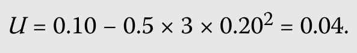

#### 补充解析 / Supplementary explanation

本例“比较赌博与保证结果”的关键是均值—方差效用与风险态度。

本题的数值代入为 U=0.10−0.5×3×0.20²=0.04。20%的标准差先平方得到0.04，再产生0.06的风险惩罚；这里0.04的效用相当于4%的确定性收益。

**判断与推导：**效用先给预期收益加分，再按风险厌恶系数对方差扣分。A\>0 是风险厌恶，A=0 是风险中性，A\<0 是风险偏好；A 越高，在同一收益下对波动的惩罚越大。

**解题步骤：**先把百分数换成小数，再平方标准差，最后乘 A/2。逐一算每个可选投资的效用并比较，不能只挑最高收益或最低波动。无风险资产的方差为零，因此效用恰等于其收益率。

**排错与边界：**A 是偏好参数，不是资产风险。风险中性者只最大化预期收益；风险偏好者可能愿意为更高波动接受更低平均收益，仍需比较给定效用。

#### 相关知识点 / Related concepts

**均值—方差效用与风险态度**

`U = E(R) − ½Aσ²；无差异曲线 E(R)=U+½Aσ²；斜率 dE(R)/dσ=Aσ。`

Utility combines expected return and variance; use decimal returns and standard deviations.

### V09-M01-EX-032 · 比较赌博与保证结果 Comparing a Gamble with a Guaranteed Outcome

正文例题／案例 / Worked example / case · 原版 PDF 页码 / Source PDF pages: 26

#### 题目与资料 / Question and data

例题 1

EXAMPLE 1

比较赌博与保证结果

Comparing a Gamble with a Guaranteed Outcome

假设一项投资的预期收益率为 10%，风险（标准差）为 20%，你的风险厌恶系数为 3。

Assume that you are given an investment with an expected return of 10 percent and a risk (standard deviation) of 20 percent, and your risk aversion coefficient is 3.

2\. 要获得相同效用，你至少需要取得多少无风险收益率？

2\. What must be the minimum risk-free return you should earn to get the same utility?

#### 官方答案与解析 / Official answer and explanation

无风险收益率的 σ 为零，因此第二项消失。

A risk-free return’s σ is zero, so the second term disappears.

要获得相同效用（0.04），无风险收益率必须至少为 4%。

To get the same utility (0.04), the risk-free return must be at least 4 percent.

因此，在你看来，10% 的风险资产收益率等同于 4% 的无风险收益率，或确定获得 4% 的收益。

Thus, in your mind, a risky return of 10 percent is equivalent to a risk-free return or a guaranteed outcome of 4 percent.

#### 补充解析 / Supplementary explanation

本例“比较赌博与保证结果”的关键是均值—方差效用与风险态度。

上一问得到效用0.04。无风险投资的σ=0，故U=Rf；让无风险投资达到相同效用，需要Rf=4%。这就是该风险投资在给定效用函数下的确定性等价收益。

**判断与推导：**效用先给预期收益加分，再按风险厌恶系数对方差扣分。A\>0 是风险厌恶，A=0 是风险中性，A\<0 是风险偏好；A 越高，在同一收益下对波动的惩罚越大。

**解题步骤：**先把百分数换成小数，再平方标准差，最后乘 A/2。逐一算每个可选投资的效用并比较，不能只挑最高收益或最低波动。无风险资产的方差为零，因此效用恰等于其收益率。

**排错与边界：**A 是偏好参数，不是资产风险。风险中性者只最大化预期收益；风险偏好者可能愿意为更高波动接受更低平均收益，仍需比较给定效用。

#### 相关知识点 / Related concepts

**均值—方差效用与风险态度**

`U = E(R) − ½Aσ²；无差异曲线 E(R)=U+½Aσ²；斜率 dE(R)/dσ=Aσ。`

Utility combines expected return and variance; use decimal returns and standard deviations.

### V09-M01-EX-033 · 效用的计算 Computation of Utility

正文例题／案例 / Worked example / case · 原版 PDF 页码 / Source PDF pages: 27

#### 题目与资料 / Question and data

例题 2

EXAMPLE 2

效用的计算

Computation of Utility

根据下列投资资料和效用公式 计算式 2，回答以下问题。

Based on investment information given below and the utility formula Calculation 2, answer the following questions.

收益率与标准差均以年度百分比表示。

Returns and standard deviations are both expressed as percent per year.

不过，代入效用公式时，必须将收益率与标准差换算为小数。

When using the utility formula, however, returns and standard deviations must be expressed in decimals.

计算式 2 · Calculation 2

U = E(r) − 0.5Aσ²

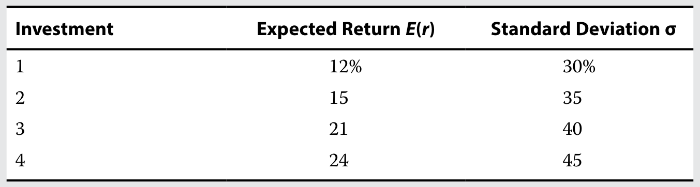

1\. 风险厌恶系数为 4 的风险厌恶型投资者会选择哪项投资？

1\.

风险厌恶系数为 2 的投资者又会选择哪项投资？

Which investment will a risk-averse investor with a risk aversion coefficient of 4 choose, and which investment will a risk-averse investor with a risk aversion coefficient of 2 choose?

#### 官方答案与解析 / Official answer and explanation

下表列示了 A＝4 和 A＝2 的风险厌恶型投资者从四项投资中分别获得的效用。

The utility for risk-averse investors with A = 4 and A = 2 for each of the four investments are shown in the following table.

当 A＝4 时，投资 1 的完整计算过程为：计算式 3。

Complete calculations for Investment 1 with A = 4 are as follows: Calculation 3.

计算式 3 · Calculation 3

U = 0.12 − 0.5 × 4 × 0.30² = −0.06

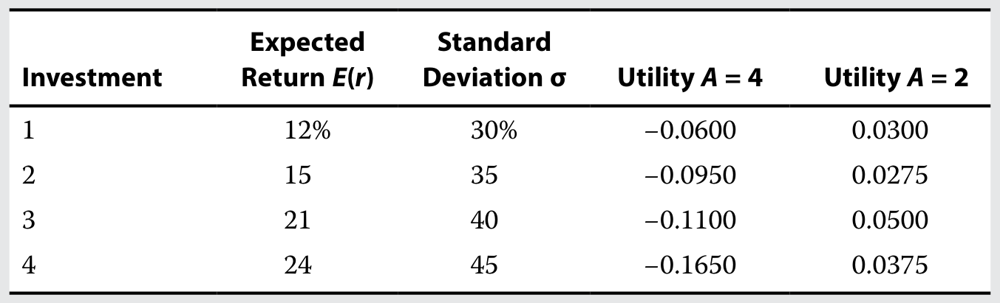

风险厌恶系数为 4 的投资者应选择投资 1。

The risk-averse investor with a risk aversion coefficient of 4 should choose Investment 1.

风险厌恶系数为 2 的投资者应选择投资 3。

The risk-averse investor with a risk aversion coefficient of 2 should choose Investment 3.

#### 补充解析 / Supplementary explanation

本例“效用的计算”的关键是均值—方差效用与风险态度。

**判断与推导：**效用先给预期收益加分，再按风险厌恶系数对方差扣分。A\>0 是风险厌恶，A=0 是风险中性，A\<0 是风险偏好；A 越高，在同一收益下对波动的惩罚越大。

**解题步骤：**先把百分数换成小数，再平方标准差，最后乘 A/2。逐一算每个可选投资的效用并比较，不能只挑最高收益或最低波动。无风险资产的方差为零，因此效用恰等于其收益率。

**排错与边界：**A 是偏好参数，不是资产风险。风险中性者只最大化预期收益；风险偏好者可能愿意为更高波动接受更低平均收益，仍需比较给定效用。

#### 相关知识点 / Related concepts

**均值—方差效用与风险态度**

`U = E(R) − ½Aσ²；无差异曲线 E(R)=U+½Aσ²；斜率 dE(R)/dσ=Aσ。`

Utility combines expected return and variance; use decimal returns and standard deviations.

### V09-M01-EX-034 · 效用的计算 Computation of Utility

正文例题／案例 / Worked example / case · 原版 PDF 页码 / Source PDF pages: 27

#### 题目与资料 / Question and data

例题 2

EXAMPLE 2

效用的计算

Computation of Utility

根据下列投资资料和效用公式 计算式 2，回答以下问题。

Based on investment information given below and the utility formula Calculation 2, answer the following questions.

收益率与标准差均以年度百分比表示。

Returns and standard deviations are both expressed as percent per year.

不过，代入效用公式时，必须将收益率与标准差换算为小数。

When using the utility formula, however, returns and standard deviations must be expressed in decimals.

计算式 2 · Calculation 2

U = E(r) − 0.5Aσ²

2\. 风险中性投资者会选择哪项投资？

2\. Which investment will a risk-neutral investor choose?

#### 官方答案与解析 / Official answer and explanation

风险中性投资者只关心收益率。

A risk-neutral investor cares only about return.

换言之，其风险厌恶系数为 0。

In other words, his risk aversion coefficient is 0.

因此，风险中性投资者会选择投资 4，因为它的收益率最高。

Therefore, a risk-neutral investor will choose Investment 4 because it has the highest return.

#### 补充解析 / Supplementary explanation

本例“效用的计算”的关键是均值—方差效用与风险态度。

**判断与推导：**效用先给预期收益加分，再按风险厌恶系数对方差扣分。A\>0 是风险厌恶，A=0 是风险中性，A\<0 是风险偏好；A 越高，在同一收益下对波动的惩罚越大。

**解题步骤：**先把百分数换成小数，再平方标准差，最后乘 A/2。逐一算每个可选投资的效用并比较，不能只挑最高收益或最低波动。无风险资产的方差为零，因此效用恰等于其收益率。

**排错与边界：**A 是偏好参数，不是资产风险。风险中性者只最大化预期收益；风险偏好者可能愿意为更高波动接受更低平均收益，仍需比较给定效用。

#### 相关知识点 / Related concepts

**均值—方差效用与风险态度**

`U = E(R) − ½Aσ²；无差异曲线 E(R)=U+½Aσ²；斜率 dE(R)/dσ=Aσ。`

Utility combines expected return and variance; use decimal returns and standard deviations.

### V09-M01-EX-035 · 效用的计算 Computation of Utility

正文例题／案例 / Worked example / case · 原版 PDF 页码 / Source PDF pages: 27

#### 题目与资料 / Question and data

例题 2

EXAMPLE 2

效用的计算

Computation of Utility

根据下列投资资料和效用公式 计算式 2，回答以下问题。

Based on investment information given below and the utility formula Calculation 2, answer the following questions.

收益率与标准差均以年度百分比表示。

Returns and standard deviations are both expressed as percent per year.

不过，代入效用公式时，必须将收益率与标准差换算为小数。

When using the utility formula, however, returns and standard deviations must be expressed in decimals.

计算式 2 · Calculation 2

U = E(r) − 0.5Aσ²

3\. 风险喜好型投资者会选择哪项投资？

3\. Which investment will a risk-loving investor choose?

#### 官方答案与解析 / Official answer and explanation

风险喜好型投资者既喜欢较高风险，也喜欢较高收益率。

A risk-loving investor likes both higher risk and higher return.

换言之，其风险厌恶系数为负。

In other words, his risk aversion coefficient is negative.

因此，风险喜好型投资者会选择投资 4，因为它在四项投资中同时具有最高收益率和最高风险。

Therefore, a risk-loving investor will choose Investment 4 because it has the highest return and highest risk among the four investments.

#### 补充解析 / Supplementary explanation

本例“效用的计算”的关键是均值—方差效用与风险态度。

**判断与推导：**效用先给预期收益加分，再按风险厌恶系数对方差扣分。A\>0 是风险厌恶，A=0 是风险中性，A\<0 是风险偏好；A 越高，在同一收益下对波动的惩罚越大。

**解题步骤：**先把百分数换成小数，再平方标准差，最后乘 A/2。逐一算每个可选投资的效用并比较，不能只挑最高收益或最低波动。无风险资产的方差为零，因此效用恰等于其收益率。

**排错与边界：**A 是偏好参数，不是资产风险。风险中性者只最大化预期收益；风险偏好者可能愿意为更高波动接受更低平均收益，仍需比较给定效用。

#### 相关知识点 / Related concepts

**均值—方差效用与风险态度**

`U = E(R) − ½Aσ²；无差异曲线 E(R)=U+½Aσ²；斜率 dE(R)/dσ=Aσ。`

Utility combines expected return and variance; use decimal returns and standard deviations.

### V09-M01-EX-036 · 两资产组合的收益率与风险 Return and Risk of a Two-Asset Portfolio

正文例题／案例 / Worked example / case · 原版 PDF 页码 / Source PDF pages: 33-34

#### 题目与资料 / Question and data

例题 3

EXAMPLE 3

两资产组合的收益率与风险

Return and Risk of a Two-Asset Portfolio

1\. 假设你是一位美国投资者，决定将组合的 80% 投资于标普 500 美国股票指数，其余 20% 投资于 MSCI 新兴市场指数。标普 500 的预期收益率为 9.93%，新兴市场指数为 18.20%；两者的风险（标准差）分别为 16.21% 和 33.11%。若标普 500 与新兴市场指数之间的协方差为 0.5%，即 0.0050，组合的预期收益率和风险是多少？注意，协方差与方差不以小数表示时，单位写作 %²。这是类似平方英尺的计量单位，并不表示要将列出的数字本身再平方。

1\. Assume that as a US investor, you decide to hold a portfolio with 80 percent invested in the S&P 500 US stock index and the remaining 20 percent in the MSCI Emerging Markets index. The expected return is 9.93 percent for the S&P 500 and 18.20 percent for the Emerging Markets index. The risk (standard deviation) is 16.21 percent for the S&P 500 and 33.11 percent for the Emerging Markets index. What will be the portfolio’s expected return and risk given that the covariance between the S&P 500 and the Emerging Markets index is 0.5 percent or 0.0050? Note that units for covariance and variance are written as %² when not expressed as a fraction. These are units of measure like squared feet and the numbers themselves are not actually squared.

#### 官方答案与解析 / Official answer and explanation

投资组合收益率与风险的计算：

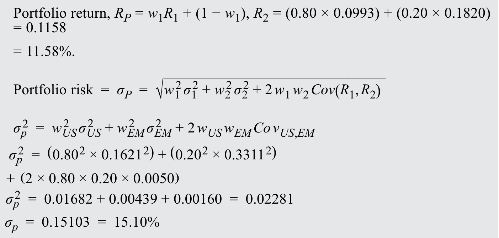

组合的预期收益率为 11.58%，风险为 15.10%。请仔细观察这个例子：原本只投资标普 500 的美国投资者，将其组合与风险更高的新兴市场证券组合结合后，收益率从 9.93% 上升至 11.58%，而组合风险实际上从 16.21% 下降至 15.10%。图表 12 展示了两项资产的组合如何产生更优的风险与收益权衡。投资者不仅获得更高收益率，而且在更低风险下取得这一收益。这就是分散化的力量，本章后文还将展开讨论。

The portfolio’s expected return is 11.58 percent and the portfolio’s risk is 15.10 percent. Look at this example closely. It shows that we can take the portfolio of a US investor invested only in the S&P 500, combine it with a riskier portfolio consisting of emerging markets securities, and the return of the US investor increases from 9.93 percent to 11.58 percent while the risk of the portfolio actually falls from 16.21 percent to 15.10 percent. Exhibit 12 depicts how the combination of the two assets results in a superior risk–return trade-off. Not only does the investor get a higher return, but he also gets it at a lower risk. That is the power of diversification as you will see later in this reading.

图表 12：两项资产的组合

Exhibit 12: Combination of Two Assets

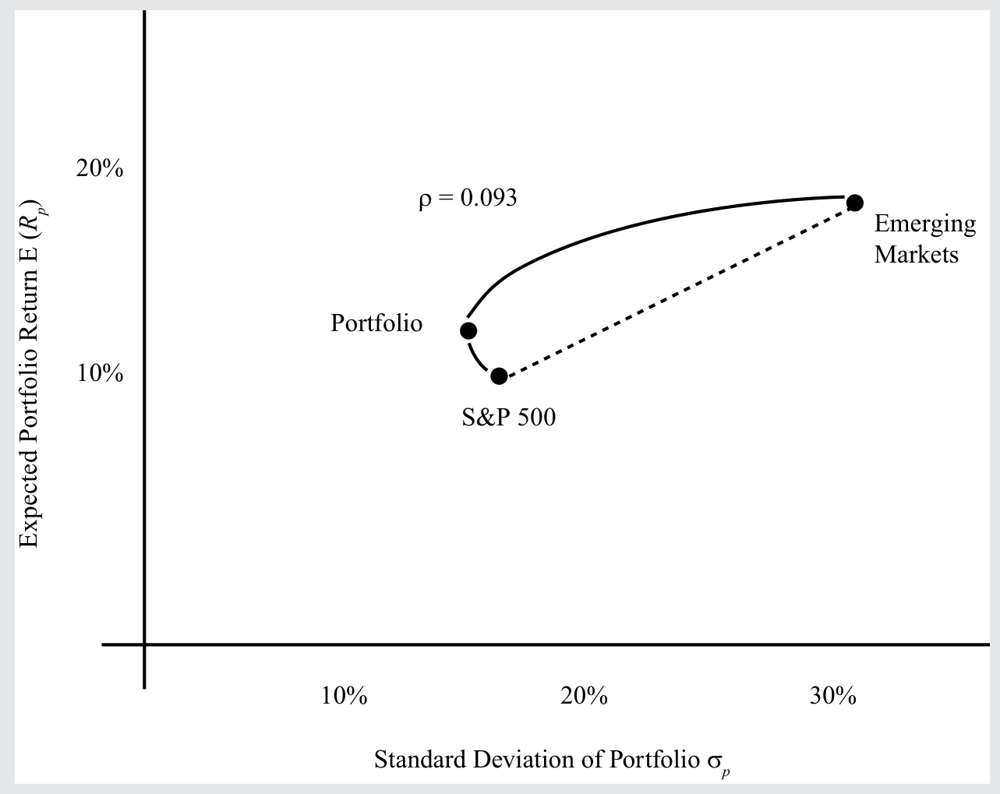

#### 补充解析 / Supplementary explanation

本例“两资产组合的收益率与风险”的关键是两资产组合方差与相关性。

先统一用小数：E(Rp)=0.8×0.0993+0.2×0.182=0.11584，即11.584%。方差=0.8²×0.1621²+0.2²×0.3311²+2×0.8×0.2×0.0050≈0.022802，开平方约15.10%。注意给的是协方差0.0050，不应再乘一次两项标准差。

**判断与推导：**组合的预期收益按权重相加，但组合的波动还取决于两项资产是否一起涨跌。协方差项有两个对称交叉项，因此公式中有系数2。

**解题步骤：**先算各资产自身的加权方差，再加协方差交叉项，得到方差后开平方。若给的是相关系数，先用ρσ1σ2替代协方差；若已经给协方差，直接代入，不能再乘一遍标准差。

**排错与边界：**只有完全正相关且权重同号时，组合标准差才等于标准差加权平均。相关系数为0只会消除交叉项，不能令两个资产自身的风险消失。

#### 相关知识点 / Related concepts

**两资产组合方差与相关性**

`E(Rp)=w1E(R1)+w2E(R2)；σp²=w1²σ1²+w2²σ2²+2w1w2ρ12σ1σ2；Cov12=ρ12σ1σ2。`

Average expected returns; combine variances and covariances before taking the square root.

### V09-M01-EX-037 · 相关性对投资组合风险的影响 Effect of Correlation on Portfolio Risk

正文例题／案例 / Worked example / case · 原版 PDF 页码 / Source PDF pages: 35

#### 题目与资料 / Question and data

例题 4

EXAMPLE 4

相关性对投资组合风险的影响

Effect of Correlation on Portfolio Risk

两只股票具有相同的收益率与风险（标准差）：收益率为 10%，风险为 20%。

Two stocks have the same return and risk (standard deviation): 10 percent return with 20 percent risk.

你将股票 1 和股票 2 各配置 50%，构建一个组合，考察相关性对风险的影响。

You form a portfolio with 50 percent each of Stock 1 and Stock 2 to examine the effect of correlation on risk.

1\. 如果相关系数为 1.0，计算组合收益率与风险。

1\. Calculate the portfolio return and risk if the correlation is 1.0.

#### 官方答案与解析 / Official answer and explanation

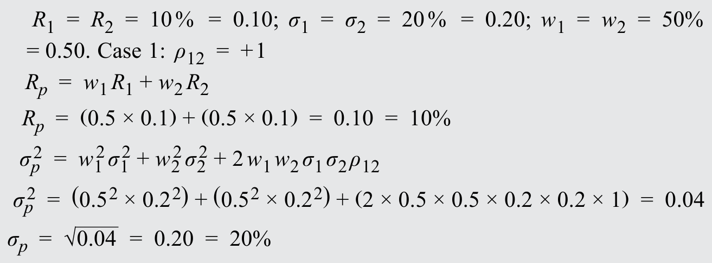

该方程验证了前面的观点：当相关系数为 1.0 时，组合风险与各单项资产的风险相同。

This equation demonstrates the earlier point that with a correlation of 1.0 the risk of the portfolio is the same as the risk of the individual assets.

#### 补充解析 / Supplementary explanation

本例“相关性对投资组合风险的影响”的关键是两资产组合方差与相关性。

两项权重均为0.5、标准差均为20%。ρ=1时，σp=0.5×20%+0.5×20%=20%；预期收益仍为10%，没有得到波动分散收益。

**判断与推导：**组合的预期收益按权重相加，但组合的波动还取决于两项资产是否一起涨跌。协方差项有两个对称交叉项，因此公式中有系数2。

**解题步骤：**先算各资产自身的加权方差，再加协方差交叉项，得到方差后开平方。若给的是相关系数，先用ρσ1σ2替代协方差；若已经给协方差，直接代入，不能再乘一遍标准差。

**排错与边界：**只有完全正相关且权重同号时，组合标准差才等于标准差加权平均。相关系数为0只会消除交叉项，不能令两个资产自身的风险消失。

#### 相关知识点 / Related concepts

**两资产组合方差与相关性**

`E(Rp)=w1E(R1)+w2E(R2)；σp²=w1²σ1²+w2²σ2²+2w1w2ρ12σ1σ2；Cov12=ρ12σ1σ2。`

Average expected returns; combine variances and covariances before taking the square root.

### V09-M01-EX-038 · 相关性对投资组合风险的影响 Effect of Correlation on Portfolio Risk

正文例题／案例 / Worked example / case · 原版 PDF 页码 / Source PDF pages: 35-36

#### 题目与资料 / Question and data

例题 4

EXAMPLE 4

相关性对投资组合风险的影响

Effect of Correlation on Portfolio Risk

两只股票具有相同的收益率与风险（标准差）：收益率为 10%，风险为 20%。

Two stocks have the same return and risk (standard deviation): 10 percent return with 20 percent risk.

你将股票 1 和股票 2 各配置 50%，构建一个组合，考察相关性对风险的影响。

You form a portfolio with 50 percent each of Stock 1 and Stock 2 to examine the effect of correlation on risk.

2\. 如果相关系数为 0.0，计算组合收益率与风险。

2\. Calculate the portfolio return and risk if the correlation is 0.0.

#### 官方答案与解析 / Official answer and explanation

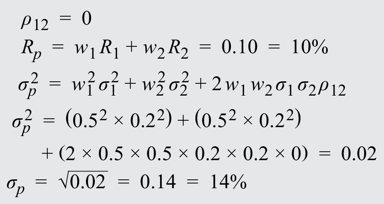

该方程验证了前面的观点：当资产相关系数小于 1.0 时，可以将它们组成风险低于任一单项资产的投资组合。

This equation demonstrates the earlier point that, when assets have correlations of less than 1.0, they can be combined in a portfolio that has less risk than either of the assets individually.

#### 补充解析 / Supplementary explanation

本例“相关性对投资组合风险的影响”的关键是两资产组合方差与相关性。

ρ=0使交叉项消失：σp²=0.5²×0.20²+0.5²×0.20²=0.02，σp≈14.14%。不能把“不相关”理解成组合没有风险。

**判断与推导：**组合的预期收益按权重相加，但组合的波动还取决于两项资产是否一起涨跌。协方差项有两个对称交叉项，因此公式中有系数2。

**解题步骤：**先算各资产自身的加权方差，再加协方差交叉项，得到方差后开平方。若给的是相关系数，先用ρσ1σ2替代协方差；若已经给协方差，直接代入，不能再乘一遍标准差。

**排错与边界：**只有完全正相关且权重同号时，组合标准差才等于标准差加权平均。相关系数为0只会消除交叉项，不能令两个资产自身的风险消失。

#### 相关知识点 / Related concepts

**两资产组合方差与相关性**

`E(Rp)=w1E(R1)+w2E(R2)；σp²=w1²σ1²+w2²σ2²+2w1w2ρ12σ1σ2；Cov12=ρ12σ1σ2。`

Average expected returns; combine variances and covariances before taking the square root.

### V09-M01-EX-039 · 相关性对投资组合风险的影响 Effect of Correlation on Portfolio Risk

正文例题／案例 / Worked example / case · 原版 PDF 页码 / Source PDF pages: 35-36

#### 题目与资料 / Question and data

例题 4

EXAMPLE 4

相关性对投资组合风险的影响

Effect of Correlation on Portfolio Risk

两只股票具有相同的收益率与风险（标准差）：收益率为 10%，风险为 20%。

Two stocks have the same return and risk (standard deviation): 10 percent return with 20 percent risk.

你将股票 1 和股票 2 各配置 50%，构建一个组合，考察相关性对风险的影响。

You form a portfolio with 50 percent each of Stock 1 and Stock 2 to examine the effect of correlation on risk.

3\. 如果相关系数为 −1.0，计算组合收益率与风险。

3\. Calculate the portfolio return and risk if the correlation is –1.0.

#### 官方答案与解析 / Official answer and explanation

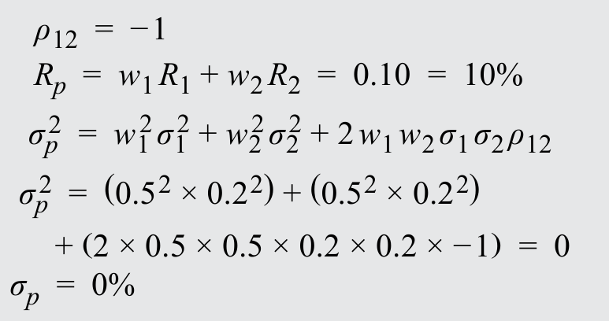

该方程验证了前面的观点：如果资产相关系数足够低，在本例中为 100% 负相关，即 −1.00、完全反向变动，就可以设计出消除风险的组合。

This equation demonstrates the earlier point that, if the correlation of assets is low enough, in this case 100 percent negative correlation or –1.00 (exactly inversely related), a portfolio can be designed that eliminates risk.

各单项资产仍保留自身的风险特征，但组合本身无风险。

The individual assets retain their risk characteristics, but the portfolio is risk free.

#### 补充解析 / Supplementary explanation

本例“相关性对投资组合风险的影响”的关键是两资产组合方差与相关性。

ρ=−1时，等权且等标准差使两项波动恰好抵消：σp=\|0.5×0.20−0.5×0.20\|=0。零风险还依赖权重与波动匹配，不能只凭负相关就断言。

**判断与推导：**组合的预期收益按权重相加，但组合的波动还取决于两项资产是否一起涨跌。协方差项有两个对称交叉项，因此公式中有系数2。

**解题步骤：**先算各资产自身的加权方差，再加协方差交叉项，得到方差后开平方。若给的是相关系数，先用ρσ1σ2替代协方差；若已经给协方差，直接代入，不能再乘一遍标准差。

**排错与边界：**只有完全正相关且权重同号时，组合标准差才等于标准差加权平均。相关系数为0只会消除交叉项，不能令两个资产自身的风险消失。

#### 相关知识点 / Related concepts

**两资产组合方差与相关性**

`E(Rp)=w1E(R1)+w2E(R2)；σp²=w1²σ1²+w2²σ2²+2w1w2ρ12σ1σ2；Cov12=ρ12σ1σ2。`

Average expected returns; combine variances and covariances before taking the square root.

### V09-M01-EX-040 · 相关性对投资组合风险的影响 Effect of Correlation on Portfolio Risk

正文例题／案例 / Worked example / case · 原版 PDF 页码 / Source PDF pages: 35-36

#### 题目与资料 / Question and data

例题 4

EXAMPLE 4

相关性对投资组合风险的影响

Effect of Correlation on Portfolio Risk

两只股票具有相同的收益率与风险（标准差）：收益率为 10%，风险为 20%。

Two stocks have the same return and risk (standard deviation): 10 percent return with 20 percent risk.

你将股票 1 和股票 2 各配置 50%，构建一个组合，考察相关性对风险的影响。

You form a portfolio with 50 percent each of Stock 1 and Stock 2 to examine the effect of correlation on risk.

4\. 比较不同相关系数下投资组合的收益率与风险。

4\. Compare the return and risk of portfolios with different correlations.

#### 官方答案与解析 / Official answer and explanation

三种情况下的预期收益率均为 10%，但情况 1 的收益波动最大，情况 3 最小。

The expected return is 10 percent in all three cases; however, the returns will be more volatile in Case 1 and least volatile in Case 3.

第一种情况下没有分散风险，风险仍与原来相同，为 20%，收益率也不变。

In the first case, there is no diversification of risk (same risk as before of 20 percent) and the return remains the same.

第二种情况下，相关系数为 0，实现了风险分散，风险由 20% 降至 14%，收益率仍不变。

In the second case, with a correlation coefficient of 0, we have achieved diversification of risk (risk is now 14 percent instead of 20 percent), again with the same return.

第三种情况下，相关系数为 −1，组合变为无风险，但仍可获得相同的 10% 收益率。

In the third case with a correlation coefficient of –1, the portfolio is risk free, although we continue to get the same return of 10 percent.

本例展示了分散化的力量，第 9 节将进一步展开。

This example shows the power of diversification that we expand on further in Section 9.

#### 补充解析 / Supplementary explanation

本例“相关性对投资组合风险的影响”的关键是两资产组合方差与相关性。

三个情景的权重与单项预期收益不变，因此组合收益一直为10%；变化的是协方差项，组合标准差依次为20%、约14.14%和0。这个比较把收益加权与风险分散两个机制分开。

**判断与推导：**组合的预期收益按权重相加，但组合的波动还取决于两项资产是否一起涨跌。协方差项有两个对称交叉项，因此公式中有系数2。

**解题步骤：**先算各资产自身的加权方差，再加协方差交叉项，得到方差后开平方。若给的是相关系数，先用ρσ1σ2替代协方差；若已经给协方差，直接代入，不能再乘一遍标准差。

**排错与边界：**只有完全正相关且权重同号时，组合标准差才等于标准差加权平均。相关系数为0只会消除交叉项，不能令两个资产自身的风险消失。

#### 相关知识点 / Related concepts

**两资产组合方差与相关性**

`E(Rp)=w1E(R1)+w2E(R2)；σp²=w1²σ1²+w2²σ2²+2w1w2ρ12σ1σ2；Cov12=ρ12σ1σ2。`

Average expected returns; combine variances and covariances before taking the square root.

### V09-M01-EX-041 · 两资产投资组合 Portfolio of Two Assets

正文例题／案例 / Worked example / case · 原版 PDF 页码 / Source PDF pages: 38-39

#### 题目与资料 / Question and data

例题 5

EXAMPLE 5

两资产投资组合

Portfolio of Two Assets

假设你是一位英国投资者，持有的组合中，60% 投资于英国大盘股，以富时 100 指数为代表；40% 投资于本国中等久期国债，即英国金边债券。富时 100 的预期收益率为 5.5%，中等久期英国国债为 0.7%；风险，即收益率标准差，分别为 13.2% 和 4.2%。两类资产的相关系数为 −0.01。

Assume you are a UK investor holding a portfolio invested 60% in UK large-capitalization equities (as proxied by the FTSE 100 Index) and 40% in local medium-duration Treasury bonds (“gilts”). The expected return on the FTSE 100 is 5.5% and on the medium-duration gilts it is 0.7%. The risk (standard deviation of returns) is 13.2% and 4.2%, respectively. The correlation between the two assets is –0.01.

该组合的预期收益率为：

The expected return of this portfolio is

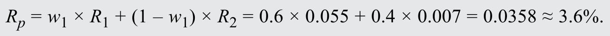

该组合的风险为：

The risk of this portfolio is

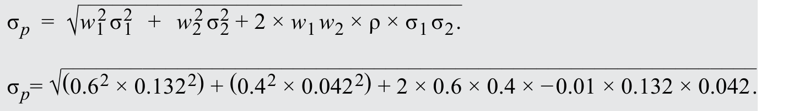 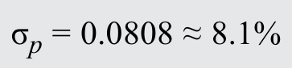

你注意到，与美国国债相比，英国国债的预期收益率较低、风险较高。

You notice that compared with US Treasury bonds, the expected return on gilts is lower and the risk of gilts is higher.

对美国投资者而言，美国国债的预期收益率为 1.5%，风险为 4.0%。

US Treasury bonds have an expected return for a US-based investor of 1.5% and a risk of 4.0%.

你想知道，将组合中的英国国债换成美国国债，是否能改善组合的风险与收益状况。

You wonder whether replacing the gilts in your portfolio with US Treasury bonds (“Treasuries”) would improve the risk and return profile of your portfolio.

1\. 上述美国国债的风险与收益率假设，是否足以让身处英国的你计算以美国国债替换英国国债后的组合预期收益率和风险？

1\. Do the given risk and return assumptions for US Treasury bonds allow you as a UK-based investor to calculate the expected return and risk of your portfolio with US Treasury bonds replacing UK gilts?

#### 官方答案与解析 / Official answer and explanation

不足以。

No.

上述美国国债的预期收益率和风险，适用于以美元投资的美国投资者。

The expected return and risk for Treasuries apply to a US investor, who invests in US dollars.

若要以英镑计算由富时 100 股票和美国国债组成的英国投资组合的预期收益率与风险，必须考虑美元与英镑之间的汇率。

To calculate expected return and risk in sterling for a UK-based portfolio of FTSE 100 equities and US Treasuries, one needs to take into account the exchange rate between the US dollar and UK pound sterling.

该汇率本身具有波动性，即风险，还必须对 GBP/USD 汇率的收益率作出预期。

This exchange rate has a volatility (risk) of its own, and a return expectation for the GBP/USD exchange rate has to be specified.

为了计算国内投资者组合中外国资产的收益率与风险，可以将外国资产视为一个由两项资产组成的“组合”。

For the purpose of calculating the return and risk of a foreign asset in a domestic investor’s portfolio, the foreign asset can be seen as a “portfolio” of two assets.

以本币，即投资者本国货币表示的外国资产收益率，可分解为资产当地货币收益率部分和汇率变动部分：

The return of a foreign asset in domestic (i.e., non-foreign) currency can be decomposed into a local currency return component and an exchange rate component:

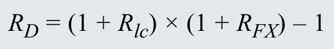

因为组合同时完全暴露于资产当地货币价值的变动和汇率变动，外币与资产各自的组合权重均为 100%。

Because the portfolio is fully exposed to the movement in both the asset’s value in local currency and the currency exchange rate, the foreign currency and the asset each have a 100% portfolio weight.

注意，为将外币收益率换算成投资者本币收益率，汇率必须以“本币／外币”报价。

Note that the exchange rate must be specified as domestic currency/foreign currency to convert the foreign currency return into the investor’s domestic currency.

风险可以按下式计算：

The risk can be calculated as follows:

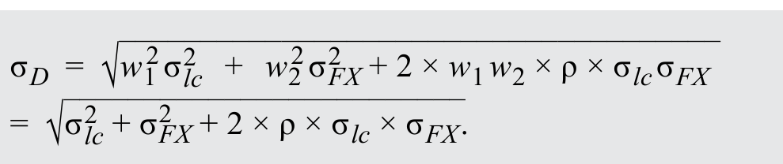

以下假设 GBP/USD 汇率的风险，以预期标准差衡量，为 9.0%；美国国债收益率与 GBP/USD 汇率变动的相关系数为 0.33。

Assume in what follows that the risk (measured as expected standard deviation) of the GBP/USD currency exchange rate is 9.0% and the returns on Treasuries have a correlation with the GBP/USD exchange rate of 0.33.

另假设你对 USD/GBP 汇率的未来值没有预测，因此假定汇率收益率为 0%。

Assume also that you have no forecast for the future value of the USD/GBP exchange rate, and hence assume a 0% return.

#### 补充解析 / Supplementary explanation

本例“两资产投资组合”的关键是境外投资的本币收益与汇率风险。

**判断与推导：**本币投资者同时暴露于境外资产价格和汇率。当地市场的风险/收益数据不能直接当成本币数据，必须与外汇变化一并计算。

**解题步骤：**先固定汇率的报价方向，再将境外资产收益和外币对本币的升贬值合成。若问题是组合风险，除股票与债券的相关性外，还需要各资产与汇率之间的相关性。

**排错与边界：**对冲初始本金并不一定完全覆盖日后价格上涨、票息或其他现金流形成的新敞口；远期价格还包含两种货币的利差。

#### 相关知识点 / Related concepts

**境外投资的本币收益与汇率风险**

`1+R本币=(1+R当地资产)(1+R外币兑本币)；完全匹配对冲可移除相应汇率敞口。`

Translate foreign assets into the investor’s base currency before assessing return and risk.

### V09-M01-EX-042 · 两资产投资组合 Portfolio of Two Assets

正文例题／案例 / Worked example / case · 原版 PDF 页码 / Source PDF pages: 38-39

#### 题目与资料 / Question and data

例题 5

EXAMPLE 5

两资产投资组合

Portfolio of Two Assets

假设你是一位英国投资者，持有的组合中，60% 投资于英国大盘股，以富时 100 指数为代表；40% 投资于本国中等久期国债，即英国金边债券。富时 100 的预期收益率为 5.5%，中等久期英国国债为 0.7%；风险，即收益率标准差，分别为 13.2% 和 4.2%。两类资产的相关系数为 −0.01。

Assume you are a UK investor holding a portfolio invested 60% in UK large-capitalization equities (as proxied by the FTSE 100 Index) and 40% in local medium-duration Treasury bonds (“gilts”). The expected return on the FTSE 100 is 5.5% and on the medium-duration gilts it is 0.7%. The risk (standard deviation of returns) is 13.2% and 4.2%, respectively. The correlation between the two assets is –0.01.

该组合的预期收益率为：

The expected return of this portfolio is

该组合的风险为：

The risk of this portfolio is

 

你注意到，与美国国债相比，英国国债的预期收益率较低、风险较高。

You notice that compared with US Treasury bonds, the expected return on gilts is lower and the risk of gilts is higher.

对美国投资者而言，美国国债的预期收益率为 1.5%，风险为 4.0%。

US Treasury bonds have an expected return for a US-based investor of 1.5% and a risk of 4.0%.

你想知道，将组合中的英国国债换成美国国债，是否能改善组合的风险与收益状况。

You wonder whether replacing the gilts in your portfolio with US Treasury bonds (“Treasuries”) would improve the risk and return profile of your portfolio.

2\. 对身为英国投资者的你而言，美国国债的预期风险是多少？

2\. What would be the expected risk of US Treasuries to you as a UK investor?

#### 官方答案与解析 / Official answer and explanation

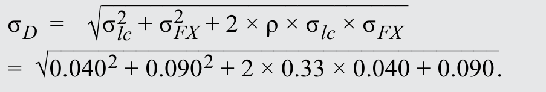 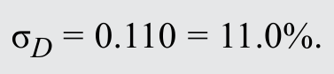

富时 100、美国国债及 USD/GBP 汇率之间的相关系数如下列相关矩阵所示。

The correlations between the FTSE 100, US Treasuries, and the USD/GBP exchange rate are as depicted in the following correlation matrix.

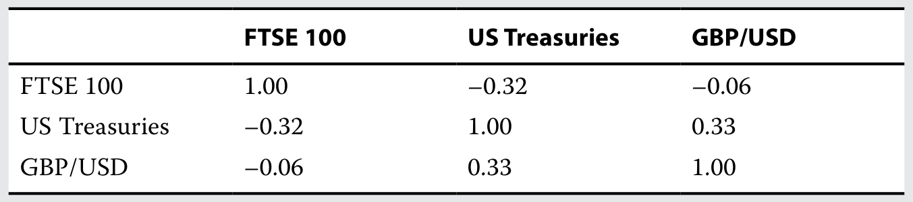

#### 补充解析 / Supplementary explanation

本例“两资产投资组合”的关键是境外投资的本币收益与汇率风险。

**判断与推导：**本币投资者同时暴露于境外资产价格和汇率。当地市场的风险/收益数据不能直接当成本币数据，必须与外汇变化一并计算。

**解题步骤：**先固定汇率的报价方向，再将境外资产收益和外币对本币的升贬值合成。若问题是组合风险，除股票与债券的相关性外，还需要各资产与汇率之间的相关性。

**排错与边界：**对冲初始本金并不一定完全覆盖日后价格上涨、票息或其他现金流形成的新敞口；远期价格还包含两种货币的利差。

#### 相关知识点 / Related concepts

**境外投资的本币收益与汇率风险**

`1+R本币=(1+R当地资产)(1+R外币兑本币)；完全匹配对冲可移除相应汇率敞口。`

Translate foreign assets into the investor’s base currency before assessing return and risk.

### V09-M01-EX-043 · 两资产投资组合 Portfolio of Two Assets

正文例题／案例 / Worked example / case · 原版 PDF 页码 / Source PDF pages: 38-40

#### 题目与资料 / Question and data

例题 5

EXAMPLE 5

两资产投资组合

Portfolio of Two Assets

假设你是一位英国投资者，持有的组合中，60% 投资于英国大盘股，以富时 100 指数为代表；40% 投资于本国中等久期国债，即英国金边债券。富时 100 的预期收益率为 5.5%，中等久期英国国债为 0.7%；风险，即收益率标准差，分别为 13.2% 和 4.2%。两类资产的相关系数为 −0.01。

Assume you are a UK investor holding a portfolio invested 60% in UK large-capitalization equities (as proxied by the FTSE 100 Index) and 40% in local medium-duration Treasury bonds (“gilts”). The expected return on the FTSE 100 is 5.5% and on the medium-duration gilts it is 0.7%. The risk (standard deviation of returns) is 13.2% and 4.2%, respectively. The correlation between the two assets is –0.01.

该组合的预期收益率为：

The expected return of this portfolio is

该组合的风险为：

The risk of this portfolio is

 

你注意到，与美国国债相比，英国国债的预期收益率较低、风险较高。

You notice that compared with US Treasury bonds, the expected return on gilts is lower and the risk of gilts is higher.

对美国投资者而言，美国国债的预期收益率为 1.5%，风险为 4.0%。

US Treasury bonds have an expected return for a US-based investor of 1.5% and a risk of 4.0%.

你想知道，将组合中的英国国债换成美国国债，是否能改善组合的风险与收益状况。

You wonder whether replacing the gilts in your portfolio with US Treasury bonds (“Treasuries”) would improve the risk and return profile of your portfolio.

3\. 如果以美国国债替换英国国债，你的组合预期收益率与风险是多少？

3\. What would be the expected return and risk for your portfolio if you replace the UK gilts with US Treasuries?

#### 官方答案与解析 / Official answer and explanation

预期收益率是以英镑（GBP）计量的英国大盘股和美国国债预期收益率的加权平均数。

The expected return is the weighted average of the expected returns in British pound sterling (GBP) of UK large-capitalization equities and of US Treasuries.

回顾前文，以本币计量的外国资产收益率包括外汇部分和资产部分。

Recall that the return of a foreign asset in domestic currency consists of a foreign currency component and an asset component.

所需的全部预期收益率均已在前文给出。

All expected returns can be found above.

组合风险的计算需要使用稍复杂的公式。

Calculation of the risk of the portfolio involves a slightly more complicated formula.

回顾前文，两资产组合的风险取决于单项资产的风险、权重以及两者的共同变动。

Recall that the risk of a two-asset portfolio depends on the risk and the weights of the individual assets and the co-movements between the two.

对于三资产组合，即股票部分、外国固定收益部分及相关外币敞口，计算原理基本相同，只是资产之间有三对共同变动关系，而非一对。

For a three-asset portfolio (an equity portion, a foreign fixed-income portion, and the associated foreign currency exposure), the calculation is essentially the same, however there are three pairs of co-movements between assets, rather than one.

因此，三资产组合标准差的公式为：

The formula for the standard deviation of a three-asset portfolio is therefore

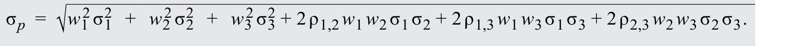

外币敞口的组合权重等于美国国债的组合权重。

The portfolio weight of the foreign currency exposure is equal to the portfolio weight of the US Treasuries.

利用前述资料，可以按下式计算英国大盘股与美国国债组合的风险：

Using the information provided above, we can calculate the risk of the portfolio with UK large-capitalization equities and US Treasuries as follows:

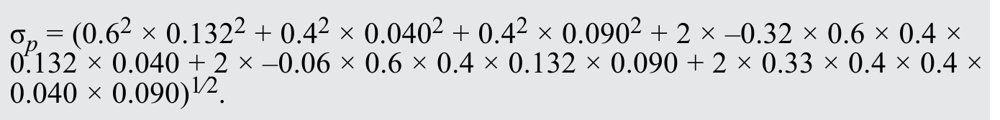 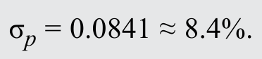

与英国股票／英国国债组合相比，英国股票／美国国债组合的预期收益率更高，因为英国国债被预期收益更高的资产替代。

Compared to the UK equity/gilt portfolio, the UK equity/US Treasury portfolio has a higher expected return, because the UK gilts were replaced with an asset with superior return expectations.

不过，新组合的风险略高，尽管以各自当地货币计量时，美国国债的风险低于英国国债。

The risk of the new portfolio, however, is slightly higher despite the lower risk in local currency terms of US Treasuries compared to gilts.

非美国投资者持有美国国债意味着承担汇率风险，评估风险状况时应将其计入。

Owning US Treasuries as a non-US investor means being exposed to exchange rate risk, which should be considered when evaluating the risk profile.

#### 补充解析 / Supplementary explanation

本例“两资产投资组合”的关键是境外投资的本币收益与汇率风险。

**判断与推导：**本币投资者同时暴露于境外资产价格和汇率。当地市场的风险/收益数据不能直接当成本币数据，必须与外汇变化一并计算。

**解题步骤：**先固定汇率的报价方向，再将境外资产收益和外币对本币的升贬值合成。若问题是组合风险，除股票与债券的相关性外，还需要各资产与汇率之间的相关性。

**排错与边界：**对冲初始本金并不一定完全覆盖日后价格上涨、票息或其他现金流形成的新敞口；远期价格还包含两种货币的利差。

#### 相关知识点 / Related concepts

**境外投资的本币收益与汇率风险**

`1+R本币=(1+R当地资产)(1+R外币兑本币)；完全匹配对冲可移除相应汇率敞口。`

Translate foreign assets into the investor’s base currency before assessing return and risk.

### V09-M01-CA-044 · 利用晴雨天气进行分散化 Diversification with Rain and Shine

正文案例 / Case · 原版 PDF 页码 / Source PDF pages: 41-43

#### 题目与资料 / Question and data

例题 6

EXAMPLE 6

利用晴雨天气进行分散化

Diversification with Rain and Shine

假设 Beachwear 公司出租海滩设备。

Assume a company Beachwear rents beach equipment.

晴天较多的年份，公司经营的年收益率为 20%；雨天较多、晴天较少的年份，收益率降至 0%。

The annual return from the company’s operations is 20 percent in years with many sunny days but falls to 0 percent in rainy years with few sunny days.

晴年和雨年的概率相同，均为 50%。

The probabilities of a sunny year and a rainy year are equal at 50 percent.

因此，平均收益率为 10%，其中有 50% 的概率获得 20% 收益率，也有 50% 的概率获得 0% 收益率。

Thus, the average return is 10 percent, with a 50 percent chance of 20 percent return and a 50 percent chance of 0 percent return.

由于 Beachwear 可能获得 20% 或 0% 的收益率，其 10% 的平均收益率存在风险。

Because Beachwear can earn a return of 20 percent or 0 percent, its average return of 10 percent is risky.

你对投资 Beachwear 很感兴趣，但不喜欢其风险。

You are excited about investing in Beachwear but do not like the risk.

听说过分散化之后，你决定在组合中加入另一项业务，以降低投资风险。

Having heard about diversification, you decide to add another business to the portfolio to reduce your investment risk.

■ 海滩上有一家 Snackshop 小吃店，出售你喜欢的各种健康食品。

■ There is a snack shop on the beach that sells all the healthy food you like.

你估计，晴天较多的年份，Snackshop 的年收益率也为 20%；其他年份为 0%。

You estimate that the annual return from the Snackshop is also 20 percent in years with many sunny days and 0 percent in other years.

与 Beachwear 一样，其平均收益率为 10%。

As with the Beachwear shop, the average return is 10 percent.

你决定将资金各 50% 投资于 Snackshop 和 Beachwear。

You decide to invest 50 percent each in Snackshop and Beachwear.

平均收益率仍为 10%，其中一半来自 Snackshop 的 10% 收益率，另一半来自 Beachwear 的 10% 收益率。

The average return is still 10 percent, with 50 percent of 10 percent from Snackshop and 50 percent of 10 percent from Beachwear.

晴年你获得 计算式 9。

In a sunny year, you would earn Calculation 9.

雨年你获得 计算式 10。

In a rainy year, you would earn Calculation 10.

结果见图表 15。

The results are tabulated in Exhibit 15.

计算式 9 · Calculation 9

20 percent (= 50% of 20% from Beachwear + 50% of 20% from Snackshop)

计算式 10 · Calculation 10

0 percent (=50% of 0% from Beachwear + 50% of 0% from Snackshop)

图表 15

Exhibit 15

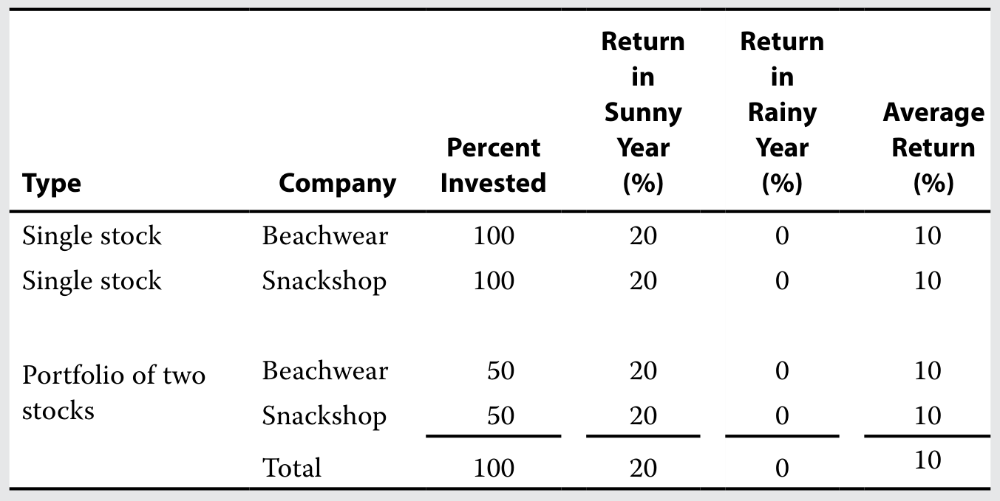

这些结果似乎违反直觉。

These results seem counterintuitive.

你原本以为加入另一项业务就能够分散投资、降低风险，但风险与原来完全相同。

You thought that by adding another business you would be able to diversify and reduce your risk, but the risk is exactly the same as before.

问题出在哪里？

What went wrong?

注意，两项业务都在晴天表现良好，雨天表现较差。

Note that both businesses do well when it is sunny and both businesses do poorly when it rains.

两项业务的相关系数为 +1.0。

The correlation between the two businesses is +1.0.

相关系数为 +1.0 时，不会发生风险降低。

No reduction in risk occurs when the correlation is +1.0.

■ 要降低风险，必须考虑在雨年表现良好的业务。你找到一家 DVD 租赁公司 DVDrental，它与 Beachwear 类似，只是雨年的年收益率为 20%，晴年为 0%，平均收益率同为 10%。DVDrental 的 10% 收益率与 Beachwear 一样存在风险。如果将资金各 50% 投资于 DVDrental 和 Beachwear，平均收益率仍为 10%，分别来自两家企业平均 10% 收益率的一半。晴年收益率为 计算式 11；雨年收益率也为 计算式 12。无论晴年或雨年都能赚取 10%，因此没有风险。由此，在 Beachwear 之外加入 DVDrental，就能在不影响收益率的情况下减少、乃至消除风险。结果见图表 16。

■ To reduce risk, you must consider a business that does well in a rainy year. You find a company that rents DVDs. DVDrental company is similar to the Beachwear company, except that its annual return is 20 percent in a rainy year and 0 percent in a sunny year, with an average return of 10 percent. DVDrental’s 10 percent return is also risky just like Beachwear’s return. If you invest 50 percent each in DVDrental and Beachwear, then the average return is still 10 percent, with 50 percent of 10 percent from DVDrental and 50 percent of 10 percent from Beachwear. In a sunny year, you would earn Calculation 11. In a rainy year also, you would earn Calculation 12. You have no risk because you earn 10 percent in both sunny and rainy years. Thus, by adding DVDrental to Beachwear, you have reduced (eliminated) your risk without affecting your return. The results are tabulated in Exhibit 16.

计算式 11 · Calculation 11

10 percent (= 50% of 20% from Beachwear + 50% of 0% from DVDrental)

计算式 12 · Calculation 12

10 percent (=50% of 0% from Beachwear + 50% of 20% from DVDrental)

图表 16

Exhibit 16

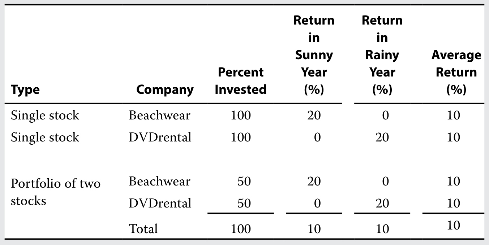

#### 官方答案与解析 / Official answer and explanation

在这一情况下，两项业务的相关系数为 −1.0。

In this case, the two businesses have a correlation of –1.0.

将两项相关系数为 −1.0 的业务组合起来，总能把风险降低至零。

When two businesses with a correlation of –1.0 are combined, risk can always be reduced to zero.

#### 补充解析 / Supplementary explanation

本例“利用晴雨天气进行分散化”的关键是分散化、相关性与风险下限。

**判断与推导：**分散化依赖收益之间不完全同步。加入资产数越多，个别资产自身方差的贡献可以减小，但共同变化的协方差项不会因为数量增加而自动消失。

**解题步骤：**判断题先保持权重和单项风险不变，再只考察相关系数方向。相关性降低会降低组合风险；压力时期相关性上升则削弱分散化效果。评价某资产是否有价值，要看它对整个组合的边际影响。

**排错与边界：**“降低风险”不意味着保证正收益、消除市场风险或提供下跌保险。多买同类且高度相关的资产也未必增加有效分散。

#### 相关知识点 / Related concepts

**分散化、相关性与风险下限**

`等权近似：σp²=(1/n)·平均方差+[(n−1)/n]·平均协方差。`

Diversification reduces idiosyncratic risk; common risk survives even in large portfolios.

原文为解释型示例，没有独立提问和 Solution 标签；按原文情境与分析段排列。

### V09-M01-EX-045 · 选择适当的投资组合 Choosing the Right Portfolio

正文例题／案例 / Worked example / case · 原版 PDF 页码 / Source PDF pages: 51-52

#### 题目与资料 / Question and data

例题 7

EXAMPLE 7

选择适当的投资组合

Choosing the Right Portfolio

图表 21 中各标记点的风险与收益率如下：

In Exhibit 21, the risk and return of the points marked are as follows:

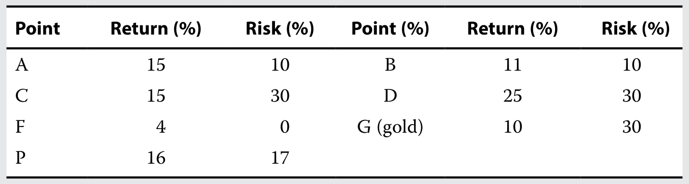

6 下一章将说明，最优风险资产组合就是市场组合。

6 In the next reading, you will learn that the optimal portfolio of risky assets is the market portfolio.

图表 21

Exhibit 21

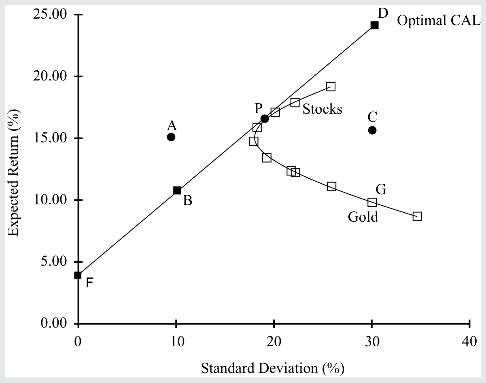

参照图表 21 中标示的各点，回答以下问题并说明理由。

Answer the following questions with reference to the points plotted on Exhibit 21 and explain your answers.

投资者将根据该图选择一个组合。

The investor is choosing one portfolio based on the graph.

1\. 上述哪一个点无法实现？

1\. Which of the above points is not achievable?

#### 官方答案与解析 / Official answer and explanation

组合 A 无法实现，因为它位于可行集合之外，也不在资本配置线上。

Portfolio A is not attainable because it lies outside the feasible set and not on the capital allocation line.

#### 补充解析 / Supplementary explanation

本例“选择适当的投资组合”的关键是有效前沿、全球最小方差与支配关系。

**判断与推导：**最小方差前沿给出每个预期收益水平下方差最小的风险组合；全球最小方差点上方那一段才是均值—方差有效前沿。相同风险下收益更高、或相同收益下风险更低的组合形成支配。

**解题步骤：**画图时先定位全球最小方差点，再把其下方的低收益分支剔除。引入无风险资产后，最高斜率CAL与风险资产有效前沿相切；切点保留，其余有效风险组合通常被切线上的组合支配。

**排错与边界：**有效前沿本身由风险资产的收益、方差和协方差决定，无风险利率不是构造该曲线的输入。单个资产处于低效位置，仍可能因相关性低而有组合价值。

#### 相关知识点 / Related concepts

**有效前沿、全球最小方差与支配关系**

The efficient frontier is the upper branch above the global minimum-variance portfolio.

### V09-M01-EX-046 · 选择适当的投资组合 Choosing the Right Portfolio

正文例题／案例 / Worked example / case · 原版 PDF 页码 / Source PDF pages: 51-52

#### 题目与资料 / Question and data

例题 7

EXAMPLE 7

选择适当的投资组合

Choosing the Right Portfolio

图表 21 中各标记点的风险与收益率如下：

In Exhibit 21, the risk and return of the points marked are as follows:

6 下一章将说明，最优风险资产组合就是市场组合。

6 In the next reading, you will learn that the optimal portfolio of risky assets is the market portfolio.

图表 21

Exhibit 21

参照图表 21 中标示的各点，回答以下问题并说明理由。

Answer the following questions with reference to the points plotted on Exhibit 21 and explain your answers.

投资者将根据该图选择一个组合。

The investor is choosing one portfolio based on the graph.

2\. 理性且厌恶风险的投资者不会选择哪些组合？

2\. Which of these portfolios will not be chosen by a rational, risk-averse investor?

#### 官方答案与解析 / Official answer and explanation

不会选择组合 G 和 C，因为 D 在相同风险下提供更高收益率。

Portfolios G and C will not be chosen because D provides higher return for the same risk.

G 和 C 是可投资点中仅有的两个不在资本配置线上的点。

G and C are the only investable points that do not lie on the capital allocation line.

#### 补充解析 / Supplementary explanation

本例“选择适当的投资组合”的关键是资本配置线与最优投资组合。

**判断与推导：**给定一个风险组合，把它与无风险资产组合，风险和预期收益随风险组合的权重线性变化。最优风险组合决定可供选择的直线；投资者的风险偏好决定在这条线上选择哪个点。

**解题步骤：**先识别题目是否已经给定风险组合，再判断风险资产权重。0到1之间是部分持有无风险资产；大于1表示借入无风险资产并加杠杆。风险厌恶更高的投资者通常选择靠近无风险截距的位置。

**排错与边界：**风险组合的选择与无风险/风险组合的资金配置是两个决定。均值—方差模型中的不同风险态度并不必然要求持有不同的最优风险资产篮子。

#### 相关知识点 / Related concepts

**资本配置线与最优投资组合**

`E(Rc)=Rf+w[E(Rp)−Rf]；σc=|w|σp；CAL斜率=[E(Rp)−Rf]/σp。`

The risky portfolio determines the opportunity line; preferences determine the allocation on that line.

### V09-M01-EX-047 · 选择适当的投资组合 Choosing the Right Portfolio

正文例题／案例 / Worked example / case · 原版 PDF 页码 / Source PDF pages: 51-52

#### 题目与资料 / Question and data

例题 7

EXAMPLE 7

选择适当的投资组合

Choosing the Right Portfolio

图表 21 中各标记点的风险与收益率如下：

In Exhibit 21, the risk and return of the points marked are as follows:

6 下一章将说明，最优风险资产组合就是市场组合。

6 In the next reading, you will learn that the optimal portfolio of risky assets is the market portfolio.

图表 21

Exhibit 21

参照图表 21 中标示的各点，回答以下问题并说明理由。

Answer the following questions with reference to the points plotted on Exhibit 21 and explain your answers.

投资者将根据该图选择一个组合。

The investor is choosing one portfolio based on the graph.

3\. 哪个组合最适合风险中性投资者？

3\. Which of these portfolios is most suitable for a risk-neutral investor?

#### 官方答案与解析 / Official answer and explanation

组合 D 最适合，因为风险中性投资者只关心收益率，而 D 提供最高收益率。

Portfolio D is most suitable because a risk-neutral investor cares only about return and portfolio D provides the highest return.

在效用公式中，A＝0。

A = 0 in the utility formula.

#### 补充解析 / Supplementary explanation

本例“选择适当的投资组合”的关键是均值—方差效用与风险态度。

**判断与推导：**效用先给预期收益加分，再按风险厌恶系数对方差扣分。A\>0 是风险厌恶，A=0 是风险中性，A\<0 是风险偏好；A 越高，在同一收益下对波动的惩罚越大。

**解题步骤：**先把百分数换成小数，再平方标准差，最后乘 A/2。逐一算每个可选投资的效用并比较，不能只挑最高收益或最低波动。无风险资产的方差为零，因此效用恰等于其收益率。

**排错与边界：**A 是偏好参数，不是资产风险。风险中性者只最大化预期收益；风险偏好者可能愿意为更高波动接受更低平均收益，仍需比较给定效用。

#### 相关知识点 / Related concepts

**均值—方差效用与风险态度**

`U = E(R) − ½Aσ²；无差异曲线 E(R)=U+½Aσ²；斜率 dE(R)/dσ=Aσ。`

Utility combines expected return and variance; use decimal returns and standard deviations.

### V09-M01-EX-048 · 选择适当的投资组合 Choosing the Right Portfolio

正文例题／案例 / Worked example / case · 原版 PDF 页码 / Source PDF pages: 51-52

#### 题目与资料 / Question and data

例题 7

EXAMPLE 7

选择适当的投资组合

Choosing the Right Portfolio

图表 21 中各标记点的风险与收益率如下：

In Exhibit 21, the risk and return of the points marked are as follows:

6 下一章将说明，最优风险资产组合就是市场组合。

6 In the next reading, you will learn that the optimal portfolio of risky assets is the market portfolio.

图表 21

Exhibit 21

参照图表 21 中标示的各点，回答以下问题并说明理由。

Answer the following questions with reference to the points plotted on Exhibit 21 and explain your answers.

投资者将根据该图选择一个组合。

The investor is choosing one portfolio based on the graph.

4\. 黄金位于可行集合的无效部分，但许多理性投资者仍在更大的组合中持有黄金，为什么？

4\. Gold is on the inefficient part of the feasible set. Nonetheless, gold is owned by many rational investors as part of a larger portfolio. Why?

#### 官方答案与解析 / Official answer and explanation

黄金可以作为组合的一部分，而非整个组合，因为它与许多风险资产，如股票，具有较低或负的相关性。

Gold may be owned as part of a portfolio (not as the portfolio) because gold has low or negative correlation with many risky assets, such as stocks.

虽然黄金单独来看风险高、收益率低，但加入组合后可以降低整体风险。

Being part of a portfolio can thus reduce overall risk even though its standalone risk is high and return is low.

注意，黄金价格并不稳定，其收益率风险很高，达 30%。

Note that gold’s price is not stable—its return is very risky (30 percent).

即使风险寻求型投资者也会选择 D 而非 G，因为 D 的风险相同而收益率更高。

Even risk seekers will choose D over G, which has the same risk but higher return.

#### 补充解析 / Supplementary explanation

本例“选择适当的投资组合”的关键是分散化、相关性与风险下限。

**判断与推导：**分散化依赖收益之间不完全同步。加入资产数越多，个别资产自身方差的贡献可以减小，但共同变化的协方差项不会因为数量增加而自动消失。

**解题步骤：**判断题先保持权重和单项风险不变，再只考察相关系数方向。相关性降低会降低组合风险；压力时期相关性上升则削弱分散化效果。评价某资产是否有价值，要看它对整个组合的边际影响。

**排错与边界：**“降低风险”不意味着保证正收益、消除市场风险或提供下跌保险。多买同类且高度相关的资产也未必增加有效分散。

#### 相关知识点 / Related concepts

**分散化、相关性与风险下限**

`等权近似：σp²=(1/n)·平均方差+[(n−1)/n]·平均协方差。`

Diversification reduces idiosyncratic risk; common risk survives even in large portfolios.

### V09-M01-EX-049 · 选择适当的投资组合 Choosing the Right Portfolio

正文例题／案例 / Worked example / case · 原版 PDF 页码 / Source PDF pages: 51-53

#### 题目与资料 / Question and data

例题 7

EXAMPLE 7

选择适当的投资组合

Choosing the Right Portfolio

图表 21 中各标记点的风险与收益率如下：

In Exhibit 21, the risk and return of the points marked are as follows:

6 下一章将说明，最优风险资产组合就是市场组合。

6 In the next reading, you will learn that the optimal portfolio of risky assets is the market portfolio.

图表 21

Exhibit 21

参照图表 21 中标示的各点，回答以下问题并说明理由。

Answer the following questions with reference to the points plotted on Exhibit 21 and explain your answers.

投资者将根据该图选择一个组合。

The investor is choosing one portfolio based on the graph.

5\. 风险厌恶系数为 3 的投资者在 P 点获得多少效用？

5\. What is the utility of an investor at point P with a risk aversion coefficient of 3?

#### 官方答案与解析 / Official answer and explanation

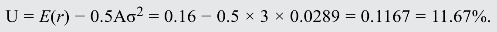

#### 补充解析 / Supplementary explanation

本例“选择适当的投资组合”的关键是均值—方差效用与风险态度。

**判断与推导：**效用先给预期收益加分，再按风险厌恶系数对方差扣分。A\>0 是风险厌恶，A=0 是风险中性，A\<0 是风险偏好；A 越高，在同一收益下对波动的惩罚越大。

**解题步骤：**先把百分数换成小数，再平方标准差，最后乘 A/2。逐一算每个可选投资的效用并比较，不能只挑最高收益或最低波动。无风险资产的方差为零，因此效用恰等于其收益率。

**排错与边界：**A 是偏好参数，不是资产风险。风险中性者只最大化预期收益；风险偏好者可能愿意为更高波动接受更低平均收益，仍需比较给定效用。

#### 相关知识点 / Related concepts

**均值—方差效用与风险态度**

`U = E(R) − ½Aσ²；无差异曲线 E(R)=U+½Aσ²；斜率 dE(R)/dσ=Aσ。`

Utility combines expected return and variance; use decimal returns and standard deviations.

### V09-M01-EX-050 · 投资组合选择综合例题 Comprehensive Example on Portfolio Selection

正文例题／案例 / Worked example / case · 原版 PDF 页码 / Source PDF pages: 54

#### 题目与资料 / Question and data

例题 8

EXAMPLE 8

投资组合选择综合例题

Comprehensive Example on Portfolio Selection

这个综合例题回顾本章学习的许多概念。

This comprehensive example reviews many concepts learned in this reading.

例题从可投资资产的简单资料出发，为 Lohrmann 夫妇构建最优投资组合。

The example begins with simple information about available assets and builds an optimal investor portfolio for the Lohrmanns.

假设 Lohrmann 夫妇只能投资两项风险资产 A 和 B。资产 A 的预期收益率与标准差分别为 20% 和 50%；资产 B 分别为 15% 和 33%。两项资产的相关系数为零。

Suppose the Lohrmanns can invest in only two risky assets, A and B. The expected return and standard deviation for asset A are 20 percent and 50 percent, and the expected return and standard deviation for asset B are 15 percent and 33 percent. The two assets have zero correlation with one another.

1\. 如果投资者将 10% 投资于 A，其余 90% 投资于 B，计算组合预期收益率与风险（标准差）。

1\. Calculate portfolio expected return and portfolio risk (standard deviation) if an investor invests 10 percent in A and the remaining 90 percent in B.

#### 官方答案与解析 / Official answer and explanation

下标“rp”表示风险组合。

The subscript “rp” means risky portfolio.

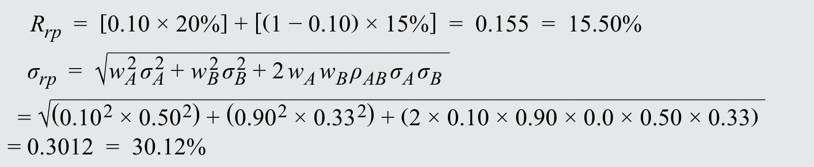

注意，相关系数为 0，因此标准差表达式中的最后一项为零。

Note that the correlation coefficient is 0, so the last term for standard deviation is zero.

#### 补充解析 / Supplementary explanation

本例“投资组合选择综合例题”的关键是两资产组合方差与相关性。

**判断与推导：**组合的预期收益按权重相加，但组合的波动还取决于两项资产是否一起涨跌。协方差项有两个对称交叉项，因此公式中有系数2。

**解题步骤：**先算各资产自身的加权方差，再加协方差交叉项，得到方差后开平方。若给的是相关系数，先用ρσ1σ2替代协方差；若已经给协方差，直接代入，不能再乘一遍标准差。

**排错与边界：**只有完全正相关且权重同号时，组合标准差才等于标准差加权平均。相关系数为0只会消除交叉项，不能令两个资产自身的风险消失。

#### 相关知识点 / Related concepts

**两资产组合方差与相关性**

`E(Rp)=w1E(R1)+w2E(R2)；σp²=w1²σ1²+w2²σ2²+2w1w2ρ12σ1σ2；Cov12=ρ12σ1σ2。`

Average expected returns; combine variances and covariances before taking the square root.

### V09-M01-EX-051 · 投资组合选择综合例题 Comprehensive Example on Portfolio Selection

正文例题／案例 / Worked example / case · 原版 PDF 页码 / Source PDF pages: 54

#### 题目与资料 / Question and data

例题 8

EXAMPLE 8

投资组合选择综合例题

Comprehensive Example on Portfolio Selection

这个综合例题回顾本章学习的许多概念。

This comprehensive example reviews many concepts learned in this reading.

例题从可投资资产的简单资料出发，为 Lohrmann 夫妇构建最优投资组合。

The example begins with simple information about available assets and builds an optimal investor portfolio for the Lohrmanns.

假设 Lohrmann 夫妇只能投资两项风险资产 A 和 B。资产 A 的预期收益率与标准差分别为 20% 和 50%；资产 B 分别为 15% 和 33%。两项资产的相关系数为零。

Suppose the Lohrmanns can invest in only two risky assets, A and B. The expected return and standard deviation for asset A are 20 percent and 50 percent, and the expected return and standard deviation for asset B are 15 percent and 33 percent. The two assets have zero correlation with one another.

2\. 假设资产 A 的投资权重为 wA、资产 B 的权重为 (1−wA)，将上述收益率与风险计算推广为一般公式。

2\. Generalize the above calculations for portfolio return and risk by assuming an investment of wA in Asset A and an investment of (1 − wA) in Asset B.

#### 官方答案与解析 / Official answer and explanation

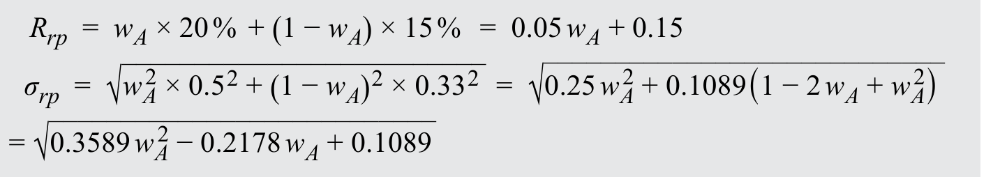

在本例第 1 问 E(Rᵣₚ) 和 σᵣₚ 的表达式中使用不同权重，即可构建投资机会集。

The investment opportunity set can be constructed by using different weights in the expressions for E(Rᵣₚ) and σᵣₚ in Part 1 of this example.

图表 23 展示资产 A 与 B 的组合。

Exhibit 23 shows the combination of Assets A and B.

图表 23

Exhibit 23

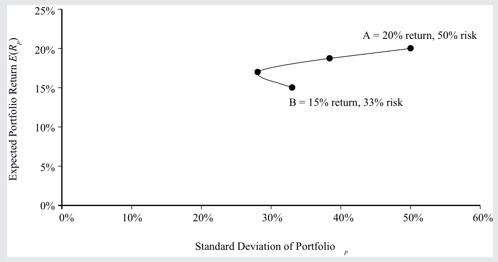

#### 补充解析 / Supplementary explanation

本例“投资组合选择综合例题”的关键是有效前沿、全球最小方差与支配关系。

**判断与推导：**最小方差前沿给出每个预期收益水平下方差最小的风险组合；全球最小方差点上方那一段才是均值—方差有效前沿。相同风险下收益更高、或相同收益下风险更低的组合形成支配。

**解题步骤：**画图时先定位全球最小方差点，再把其下方的低收益分支剔除。引入无风险资产后，最高斜率CAL与风险资产有效前沿相切；切点保留，其余有效风险组合通常被切线上的组合支配。

**排错与边界：**有效前沿本身由风险资产的收益、方差和协方差决定，无风险利率不是构造该曲线的输入。单个资产处于低效位置，仍可能因相关性低而有组合价值。

#### 相关知识点 / Related concepts

**有效前沿、全球最小方差与支配关系**

The efficient frontier is the upper branch above the global minimum-variance portfolio.

### V09-M01-EX-052 · 投资组合选择综合例题 Comprehensive Example on Portfolio Selection

正文例题／案例 / Worked example / case · 原版 PDF 页码 / Source PDF pages: 54-55

#### 题目与资料 / Question and data

例题 8

EXAMPLE 8

投资组合选择综合例题

Comprehensive Example on Portfolio Selection

这个综合例题回顾本章学习的许多概念。

This comprehensive example reviews many concepts learned in this reading.

例题从可投资资产的简单资料出发，为 Lohrmann 夫妇构建最优投资组合。

The example begins with simple information about available assets and builds an optimal investor portfolio for the Lohrmanns.

假设 Lohrmann 夫妇只能投资两项风险资产 A 和 B。资产 A 的预期收益率与标准差分别为 20% 和 50%；资产 B 分别为 15% 和 33%。两项资产的相关系数为零。

Suppose the Lohrmanns can invest in only two risky assets, A and B. The expected return and standard deviation for asset A are 20 percent and 50 percent, and the expected return and standard deviation for asset B are 15 percent and 33 percent. The two assets have zero correlation with one another.

3\. 现在引入收益率为 3% 的无风险资产。用 wA 表示连接无风险资产与风险资产组合的资本配置线方程。（提示：使用第 6 节的方程，并代入上述第 2 问中风险组合收益率与风险的表达式。）

3\. Now introduce a risk-free asset with a return of 3 percent. Write an equation for the capital allocation line in terms of wA that will connect the risk-free asset to the portfolio of risky assets. (Hint: use the equation in Section 6 and substitute the expressions for a risky portfolio’s risk and return from Part 2 above).

#### 官方答案与解析 / Official answer and explanation

连接无风险资产与风险组合的直线方程如下，参见第 6 节。其中，下标“rp”替代“i”表示风险组合，下标“p”表示由两项风险资产和一项无风险资产构成的新组合。

The equation of the line connecting the risk-free asset to the portfolio of risky assets is given below (see Section 6), where the subscript “rp” refers to the risky portfolio instead of “i,” and the subscript “p” refers to the new portfolio of two risky assets and one risk-free asset.

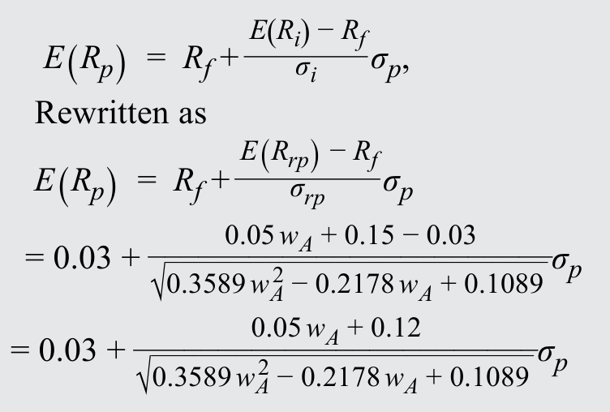

资本配置线是斜率最大的那条直线，因为它与由两项风险资产组合形成的曲线相切。

The capital allocation line is the line that has the maximum slope because it is tangent to the curve formed by portfolios of the two risky assets.

图表 24 展示在这组资产中加入无风险资产后得到的资本配置线。

Exhibit 24 shows the capital allocation line based on a risk-free asset added to the group of assets.

图表 24

Exhibit 24

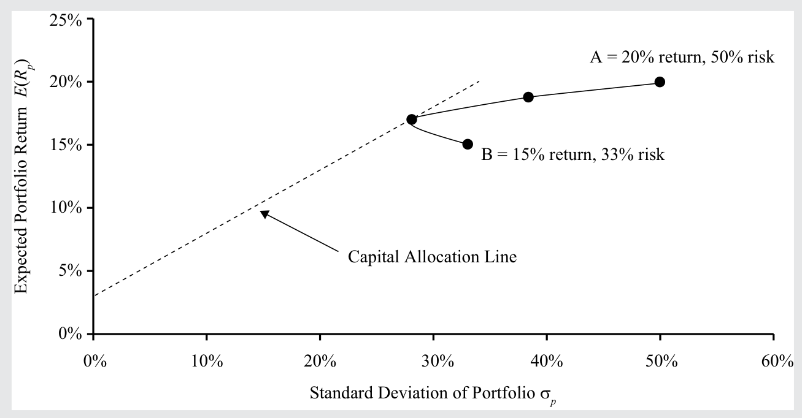

#### 补充解析 / Supplementary explanation

本例“投资组合选择综合例题”的关键是资本配置线与最优投资组合。

**判断与推导：**给定一个风险组合，把它与无风险资产组合，风险和预期收益随风险组合的权重线性变化。最优风险组合决定可供选择的直线；投资者的风险偏好决定在这条线上选择哪个点。

**解题步骤：**先识别题目是否已经给定风险组合，再判断风险资产权重。0到1之间是部分持有无风险资产；大于1表示借入无风险资产并加杠杆。风险厌恶更高的投资者通常选择靠近无风险截距的位置。

**排错与边界：**风险组合的选择与无风险/风险组合的资金配置是两个决定。均值—方差模型中的不同风险态度并不必然要求持有不同的最优风险资产篮子。

#### 相关知识点 / Related concepts

**资本配置线与最优投资组合**

`E(Rc)=Rf+w[E(Rp)−Rf]；σc=|w|σp；CAL斜率=[E(Rp)−Rf]/σp。`

The risky portfolio determines the opportunity line; preferences determine the allocation on that line.

### V09-M01-EX-053 · 投资组合选择综合例题 Comprehensive Example on Portfolio Selection

正文例题／案例 / Worked example / case · 原版 PDF 页码 / Source PDF pages: 54-55

#### 题目与资料 / Question and data

例题 8

EXAMPLE 8

投资组合选择综合例题

Comprehensive Example on Portfolio Selection

这个综合例题回顾本章学习的许多概念。

This comprehensive example reviews many concepts learned in this reading.

例题从可投资资产的简单资料出发，为 Lohrmann 夫妇构建最优投资组合。

The example begins with simple information about available assets and builds an optimal investor portfolio for the Lohrmanns.

假设 Lohrmann 夫妇只能投资两项风险资产 A 和 B。资产 A 的预期收益率与标准差分别为 20% 和 50%；资产 B 分别为 15% 和 33%。两项资产的相关系数为零。

Suppose the Lohrmanns can invest in only two risky assets, A and B. The expected return and standard deviation for asset A are 20 percent and 50 percent, and the expected return and standard deviation for asset B are 15 percent and 33 percent. The two assets have zero correlation with one another.

4\. 当资产 A 的权重为 38.20% 时，资本配置线斜率最大。

4\.

⁷ 令 wA＝38.20%，资本配置线方程是什么？

The slope of the capital allocation line is maximized when the weight in Asset A is 38.20 percent.⁷ What is the equation for the capital allocation line using wA of 38.20 percent?

#### 官方答案与解析 / Official answer and explanation

将 wA＝38.20% 代入第 3 问方程，可得资本配置线为 计算式 13。

By substituting 38.20 percent for wA in the equation in Part 3, we get Calculation 13 as the capital allocation line.

计算式 13 · Calculation 13

E(Rₚ) = 0.03 + 0.4978σₚ

7 可以使下列斜率表达式最大化：

7 You can maximize

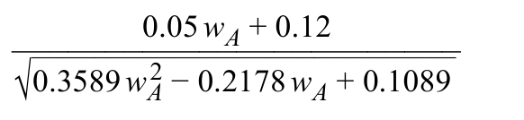

方法是对斜率关于 wA 求一阶导数，并令其等于 0。

by taking the first derivative of the slope with respect to wA and setting it to 0.

#### 补充解析 / Supplementary explanation

本例“投资组合选择综合例题”的关键是资本配置线与最优投资组合。

**判断与推导：**给定一个风险组合，把它与无风险资产组合，风险和预期收益随风险组合的权重线性变化。最优风险组合决定可供选择的直线；投资者的风险偏好决定在这条线上选择哪个点。

**解题步骤：**先识别题目是否已经给定风险组合，再判断风险资产权重。0到1之间是部分持有无风险资产；大于1表示借入无风险资产并加杠杆。风险厌恶更高的投资者通常选择靠近无风险截距的位置。

**排错与边界：**风险组合的选择与无风险/风险组合的资金配置是两个决定。均值—方差模型中的不同风险态度并不必然要求持有不同的最优风险资产篮子。

#### 相关知识点 / Related concepts

**资本配置线与最优投资组合**

`E(Rc)=Rf+w[E(Rp)−Rf]；σc=|w|σp；CAL斜率=[E(Rp)−Rf]/σp。`

The risky portfolio determines the opportunity line; preferences determine the allocation on that line.

### V09-M01-EX-054 · 投资组合选择综合例题 Comprehensive Example on Portfolio Selection

正文例题／案例 / Worked example / case · 原版 PDF 页码 / Source PDF pages: 54, 56

#### 题目与资料 / Question and data

例题 8

EXAMPLE 8

投资组合选择综合例题

Comprehensive Example on Portfolio Selection

这个综合例题回顾本章学习的许多概念。

This comprehensive example reviews many concepts learned in this reading.

例题从可投资资产的简单资料出发，为 Lohrmann 夫妇构建最优投资组合。

The example begins with simple information about available assets and builds an optimal investor portfolio for the Lohrmanns.

假设 Lohrmann 夫妇只能投资两项风险资产 A 和 B。资产 A 的预期收益率与标准差分别为 20% 和 50%；资产 B 分别为 15% 和 33%。两项资产的相关系数为零。

Suppose the Lohrmanns can invest in only two risky assets, A and B. The expected return and standard deviation for asset A are 20 percent and 50 percent, and the expected return and standard deviation for asset B are 15 percent and 33 percent. The two assets have zero correlation with one another.

5\. 构建资本配置线后，再考虑 Lohrmann 夫妇。资本配置线上收益率为 20% 的组合，其标准差是多少？该组合与资产 A 相比如何？

5\. Having created the capital allocation line, we turn to the Lohrmanns. What is the standard deviation of a portfolio that gives a 20 percent return and is on the capital allocation line? How does this portfolio compare with asset A?

#### 官方答案与解析 / Official answer and explanation

求解资本配置线方程得到标准差：计算式 14。该组合的收益率为 20%，与资产 A 相同，但标准差更低，为 34.2%，而非 50.0%。

Solve the equation for the capital allocation line to get the standard deviation: Calculation 14 The portfolio with a 20 percent return has the same return as Asset A but a lower standard deviation, 34.2 percent instead of 50.0 percent.

计算式 14 · Calculation 14

0.20 = 0.03 + 0.4978σₚ. σₚ = 34.2%.

#### 补充解析 / Supplementary explanation

本例“投资组合选择综合例题”的关键是资本配置线与最优投资组合。

**判断与推导：**给定一个风险组合，把它与无风险资产组合，风险和预期收益随风险组合的权重线性变化。最优风险组合决定可供选择的直线；投资者的风险偏好决定在这条线上选择哪个点。

**解题步骤：**先识别题目是否已经给定风险组合，再判断风险资产权重。0到1之间是部分持有无风险资产；大于1表示借入无风险资产并加杠杆。风险厌恶更高的投资者通常选择靠近无风险截距的位置。

**排错与边界：**风险组合的选择与无风险/风险组合的资金配置是两个决定。均值—方差模型中的不同风险态度并不必然要求持有不同的最优风险资产篮子。

#### 相关知识点 / Related concepts

**资本配置线与最优投资组合**

`E(Rc)=Rf+w[E(Rp)−Rf]；σc=|w|σp；CAL斜率=[E(Rp)−Rf]/σp。`

The risky portfolio determines the opportunity line; preferences determine the allocation on that line.

### V09-M01-EX-055 · 投资组合选择综合例题 Comprehensive Example on Portfolio Selection

正文例题／案例 / Worked example / case · 原版 PDF 页码 / Source PDF pages: 54, 56

#### 题目与资料 / Question and data

例题 8

EXAMPLE 8

投资组合选择综合例题

Comprehensive Example on Portfolio Selection

这个综合例题回顾本章学习的许多概念。

This comprehensive example reviews many concepts learned in this reading.

例题从可投资资产的简单资料出发，为 Lohrmann 夫妇构建最优投资组合。

The example begins with simple information about available assets and builds an optimal investor portfolio for the Lohrmanns.

假设 Lohrmann 夫妇只能投资两项风险资产 A 和 B。资产 A 的预期收益率与标准差分别为 20% 和 50%；资产 B 分别为 15% 和 33%。两项资产的相关系数为零。

Suppose the Lohrmanns can invest in only two risky assets, A and B. The expected return and standard deviation for asset A are 20 percent and 50 percent, and the expected return and standard deviation for asset B are 15 percent and 33 percent. The two assets have zero correlation with one another.

6\. 收益率分别为 3%、9%、15% 和 20% 的投资组合，其风险各是多少？

6\. What is the risk of portfolios with returns of 3 percent, 9 percent, 15 percent, and 20 percent?

#### 官方答案与解析 / Official answer and explanation

使用资本配置线方程 计算式 15，即可求出组合风险。对于收益率为 15% 的组合，写成 计算式 16，求得 σₚ 为 24.1%。同样，可以计算其他给定收益率组合的风险：收益率 3% 对应风险 0.0%，9% 对应 12.1%，15% 对应 24.1%，20% 对应 34.2%。这些点绘制在图表 25 中。

You can find the risk of the portfolio using the equation for the capital allocation line: Calculation 15. For a portfolio with a return of 15 percent, write Calculation 16. Solving for σₚ gives 24.1 percent. You can similarly calculate risks of other portfolios with the given returns. The risk of the portfolio for a return of 3 percent is 0.0 percent, for a return of 9 percent is 12.1 percent, for a return of 15 percent is 24.1 percent, and for a return of 20 percent is 34.2 percent. The points are plotted in Exhibit 25.

计算式 15 · Calculation 15

E(Rₚ) = 0.03 + 0.4978σₚ

计算式 16 · Calculation 16

0.15 = 0.03 + 0.4978σₚ

图表 25

Exhibit 25

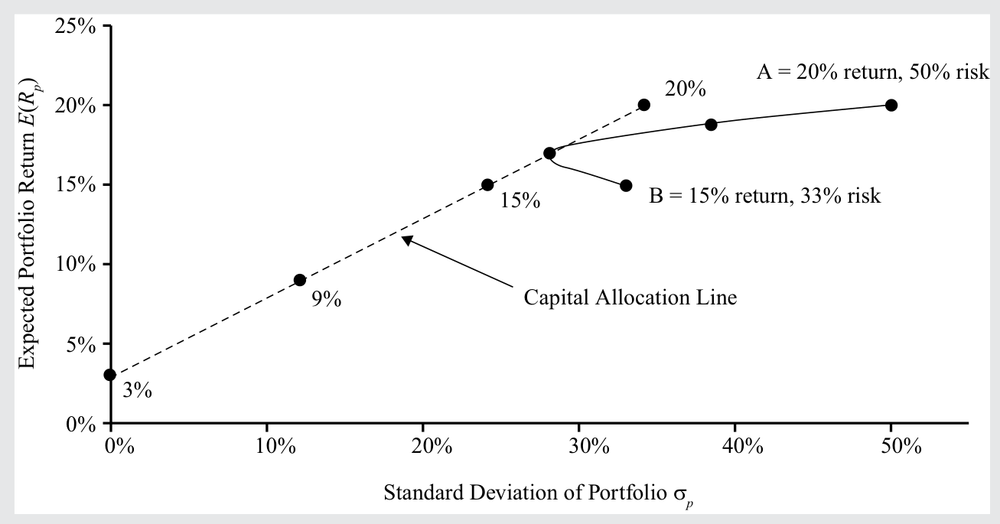

#### 补充解析 / Supplementary explanation

本例“投资组合选择综合例题”的关键是资本配置线与最优投资组合。

**判断与推导：**给定一个风险组合，把它与无风险资产组合，风险和预期收益随风险组合的权重线性变化。最优风险组合决定可供选择的直线；投资者的风险偏好决定在这条线上选择哪个点。

**解题步骤：**先识别题目是否已经给定风险组合，再判断风险资产权重。0到1之间是部分持有无风险资产；大于1表示借入无风险资产并加杠杆。风险厌恶更高的投资者通常选择靠近无风险截距的位置。

**排错与边界：**风险组合的选择与无风险/风险组合的资金配置是两个决定。均值—方差模型中的不同风险态度并不必然要求持有不同的最优风险资产篮子。

#### 相关知识点 / Related concepts

**资本配置线与最优投资组合**

`E(Rc)=Rf+w[E(Rp)−Rf]；σc=|w|σp；CAL斜率=[E(Rp)−Rf]/σp。`

The risky portfolio determines the opportunity line; preferences determine the allocation on that line.

### V09-M01-EX-056 · 投资组合选择综合例题 Comprehensive Example on Portfolio Selection

正文例题／案例 / Worked example / case · 原版 PDF 页码 / Source PDF pages: 54, 56-57

#### 题目与资料 / Question and data

例题 8

EXAMPLE 8

投资组合选择综合例题

Comprehensive Example on Portfolio Selection

这个综合例题回顾本章学习的许多概念。

This comprehensive example reviews many concepts learned in this reading.

例题从可投资资产的简单资料出发，为 Lohrmann 夫妇构建最优投资组合。

The example begins with simple information about available assets and builds an optimal investor portfolio for the Lohrmanns.

假设 Lohrmann 夫妇只能投资两项风险资产 A 和 B。资产 A 的预期收益率与标准差分别为 20% 和 50%；资产 B 分别为 15% 和 33%。两项资产的相关系数为零。

Suppose the Lohrmanns can invest in only two risky assets, A and B. The expected return and standard deviation for asset A are 20 percent and 50 percent, and the expected return and standard deviation for asset B are 15 percent and 33 percent. The two assets have zero correlation with one another.

7\. Lohrmann 夫妇从收益率分别为 3%、9%、15% 和 20% 的组合中获得多少效用？他们的风险厌恶系数为 2.5。

7\. What is the utility that the Lohrmanns derive from a portfolio with a return of 3 percent, 9 percent, 15 percent, and 20 percent? The risk aversion coefficient for the Lohrmanns is 2.5.

#### 官方答案与解析 / Official answer and explanation

将风险厌恶系数 2.5 代入效用公式，即可求出效用：

To find the utility, use the utility formula with a risk aversion coefficient of 2.5:

依次计算不同收益率组合的效用：

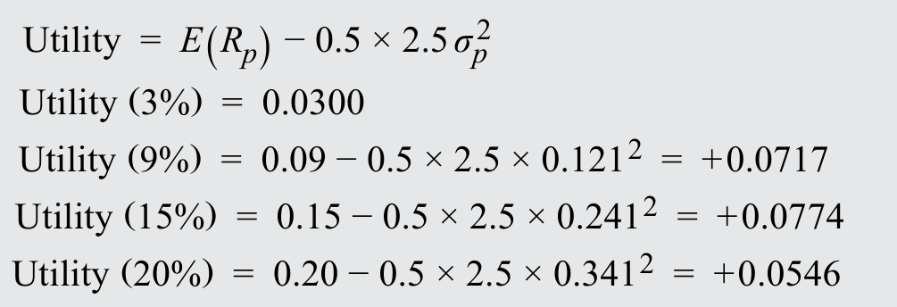

根据上述资料，Lohrmann 夫妇选择收益率 15%、标准差 24.1% 的组合，因为其效用最高，为 0.0774。

Based on the above information, the Lohrmanns choose a portfolio with a return of 15 percent and a standard deviation of 24.1 percent because it has the highest utility: 0.0774.

最后，图表 26 展示与资本配置线相切的无差异曲线，从而确定他们的最优投资组合。

Finally, Exhibit 26 shows the indifference curve that is tangent to the capital allocation line to generate Lohrmanns’ optimal investor portfolio.

图表 26

Exhibit 26

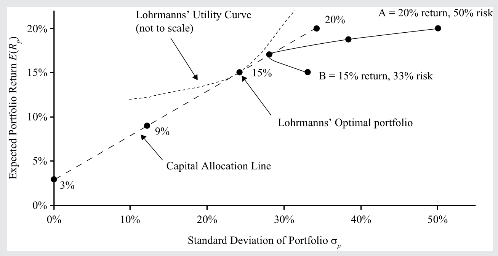

#### 补充解析 / Supplementary explanation

本例“投资组合选择综合例题”的关键是均值—方差效用与风险态度。

**判断与推导：**效用先给预期收益加分，再按风险厌恶系数对方差扣分。A\>0 是风险厌恶，A=0 是风险中性，A\<0 是风险偏好；A 越高，在同一收益下对波动的惩罚越大。

**解题步骤：**先把百分数换成小数，再平方标准差，最后乘 A/2。逐一算每个可选投资的效用并比较，不能只挑最高收益或最低波动。无风险资产的方差为零，因此效用恰等于其收益率。

**排错与边界：**A 是偏好参数，不是资产风险。风险中性者只最大化预期收益；风险偏好者可能愿意为更高波动接受更低平均收益，仍需比较给定效用。

#### 相关知识点 / Related concepts

**均值—方差效用与风险态度**

`U = E(R) − ½Aσ²；无差异曲线 E(R)=U+½Aσ²；斜率 dE(R)/dσ=Aσ。`

Utility combines expected return and variance; use decimal returns and standard deviations.

### V09-M01-PR-001 · 课后习题 1 Practice Problem 1

章末练习 / Practice problem · 原版 PDF 页码 / Source PDF pages: 60, 67

#### 题目与资料 / Question and data

1\. 关于交易成本，流动性最不可能影响以下哪项？

1\. With respect to trading costs, liquidity is least likely to impact the:

A. 股票价格。

A. stock price.

B. 买卖价差。

B. bid–ask spreads.

C. 经纪佣金。

C. brokerage commissions.

#### 官方答案与解析 / Official answer and explanation

1\. C 正确。经纪佣金与经纪公司协商确定。证券流动性会影响交易成本方面的运作效率，具体影响买卖价差，也可能影响股价，例如投资者无法确定能否顺利卖出股票，从而削弱其出售能力时。

1\. C is correct. Brokerage commissions are negotiated with the brokerage firm. A security’s liquidity impacts the operational efficiency of trading costs. Specifically, liquidity impacts the bid–ask spread and can impact the stock price (if the ability to sell the stock is impaired by the uncertainty associated with being able to sell the stock).

#### 补充解析 / Supplementary explanation

本题聚焦：关于交易成本，流动性最不可能影响以下哪项？

题目中的正确选项为 **C**。下面从“流动性与交易成本”解释其成立条件和容易混淆的边界。

**判断与推导：**流动性描述在短时间内以接近公允价值的价格成交的能力。成交量不足时，立即成交往往需要让价，因此买卖价差和市场冲击属于流动性直接作用的渠道。

**解题步骤：**把交易成本拆成显性费用与隐性成本：佣金通常由经纪服务协议决定；价差和大单冲击随订单簿深度变化。若题目问“最不可能受影响”，应先寻找由合约约定的项目。

**排错与边界：**流动性差并不等于价格绝对低，而是为了迅速成交可能承受较差价格。不能把所有费用都当成价差。

#### 相关知识点 / Related concepts

**流动性与交易成本**

Separate negotiated commissions from bid–ask spread and market impact.

### V09-M01-PR-002 · 课后习题 2 Practice Problem 2

章末练习 / Practice problem · 原版 PDF 页码 / Source PDF pages: 60, 67

#### 题目与资料 / Question and data

2\. 哪种风险与收益关系最能体现风险厌恶？

2\. Evidence of risk aversion is best illustrated by a risk–return relationship that is:

A. 负向关系。

A. negative.

B. 中性关系。

B. neutral.

C. 正向关系。

C. positive.

#### 官方答案与解析 / Official answer and explanation

2\. C 正确。长期历史数据表明，风险与收益之间存在正向关系，这反映了投资者的风险厌恶。

2\. C is correct. Historical data over long periods of time indicate that there exists a positive risk–return relationship, which is a reflection of an investor’s risk aversion.

#### 补充解析 / Supplementary explanation

本题聚焦：哪种风险与收益关系最能体现风险厌恶？

题目中的正确选项为 **C**。下面从“均值—方差效用与风险态度”解释其成立条件和容易混淆的边界。

**判断与推导：**效用先给预期收益加分，再按风险厌恶系数对方差扣分。A\>0 是风险厌恶，A=0 是风险中性，A\<0 是风险偏好；A 越高，在同一收益下对波动的惩罚越大。

**解题步骤：**先把百分数换成小数，再平方标准差，最后乘 A/2。逐一算每个可选投资的效用并比较，不能只挑最高收益或最低波动。无风险资产的方差为零，因此效用恰等于其收益率。

**排错与边界：**A 是偏好参数，不是资产风险。风险中性者只最大化预期收益；风险偏好者可能愿意为更高波动接受更低平均收益，仍需比较给定效用。

#### 相关知识点 / Related concepts

**均值—方差效用与风险态度**

`U = E(R) − ½Aσ²；无差异曲线 E(R)=U+½Aσ²；斜率 dE(R)/dσ=Aσ。`

Utility combines expected return and variance; use decimal returns and standard deviations.

### V09-M01-PR-003 · 课后习题 3 Practice Problem 3

章末练习 / Practice problem · 原版 PDF 页码 / Source PDF pages: 60, 67

#### 题目与资料 / Question and data

3\. 对于风险厌恶型投资者，无风险资产产生的效用数值具有哪项特征？

3\. With respect to risk-averse investors, a risk-free asset will generate a numerical utility that is:

A. 对所有个人都相同。

A. the same for all individuals.

B. 对风险厌恶型投资者为正。

B. positive for risk-averse investors.

C. 对风险寻求型投资者等于零。

C. equal to zero for risk seeking investors.

#### 官方答案与解析 / Official answer and explanation

3\. A 正确。无风险资产的方差为零，与投资者是风险中性、风险寻求还是风险厌恶无关。换言之，在以下投资效用函数中，A 为风险厌恶指标；当方差为零，例如无风险资产时，A 的正负号不影响效用。

3\. A is correct. A risk-free asset has a variance of zero and is not dependent on whether the investor is risk neutral, risk seeking or risk averse. That is, given the following utility function of an investment, where A is the measure of risk aversion, the sign of A is irrelevant if the variance is zero (like that of a risk-free asset).

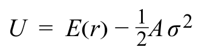

#### 补充解析 / Supplementary explanation

本题聚焦：对于风险厌恶型投资者，无风险资产产生的效用数值具有哪项特征？

题目中的正确选项为 **A**。下面从“均值—方差效用与风险态度”解释其成立条件和容易混淆的边界。

将σ²=0代入效用式后，含A的项完全消失。因此不同风险态度的人对同一无风险收益得到同样的数值效用；不能因为投资者风险厌恶就额外扣减无风险收益。

**判断与推导：**效用先给预期收益加分，再按风险厌恶系数对方差扣分。A\>0 是风险厌恶，A=0 是风险中性，A\<0 是风险偏好；A 越高，在同一收益下对波动的惩罚越大。

**解题步骤：**先把百分数换成小数，再平方标准差，最后乘 A/2。逐一算每个可选投资的效用并比较，不能只挑最高收益或最低波动。无风险资产的方差为零，因此效用恰等于其收益率。

**排错与边界：**A 是偏好参数，不是资产风险。风险中性者只最大化预期收益；风险偏好者可能愿意为更高波动接受更低平均收益，仍需比较给定效用。

#### 相关知识点 / Related concepts

**均值—方差效用与风险态度**

`U = E(R) − ½Aσ²；无差异曲线 E(R)=U+½Aσ²；斜率 dE(R)/dσ=Aσ。`

Utility combines expected return and variance; use decimal returns and standard deviations.

### V09-M01-PR-004 · 课后习题 4 Practice Problem 4

章末练习 / Practice problem · 原版 PDF 页码 / Source PDF pages: 60, 67

#### 题目与资料 / Question and data

4\. 根据效用理论，最厌恶风险的投资者，其无差异曲线具有哪项特征？

4\. With respect to utility theory, the most risk-averse investor will have an indiffer ence curve with the:

A. 凸性最大。

A. most convexity.

B. 截距最小。

B. smallest intercept value.

C. 斜率系数最大。

C. greatest slope coefficient.

#### 官方答案与解析 / Official answer and explanation

4\. C 正确。最厌恶风险的投资者，其无差异曲线的斜率最大。

4\. C is correct. The most risk-averse investor has the indifference curve with the greatest slope.

#### 补充解析 / Supplementary explanation

本题聚焦：根据效用理论，最厌恶风险的投资者，其无差异曲线具有哪项特征？

题目中的正确选项为 **C**。下面从“均值—方差效用与风险态度”解释其成立条件和容易混淆的边界。

**判断与推导：**效用先给预期收益加分，再按风险厌恶系数对方差扣分。A\>0 是风险厌恶，A=0 是风险中性，A\<0 是风险偏好；A 越高，在同一收益下对波动的惩罚越大。

**解题步骤：**先把百分数换成小数，再平方标准差，最后乘 A/2。逐一算每个可选投资的效用并比较，不能只挑最高收益或最低波动。无风险资产的方差为零，因此效用恰等于其收益率。

**排错与边界：**A 是偏好参数，不是资产风险。风险中性者只最大化预期收益；风险偏好者可能愿意为更高波动接受更低平均收益，仍需比较给定效用。

#### 相关知识点 / Related concepts

**均值—方差效用与风险态度**

`U = E(R) − ½Aσ²；无差异曲线 E(R)=U+½Aσ²；斜率 dE(R)/dσ=Aσ。`

Utility combines expected return and variance; use decimal returns and standard deviations.

### V09-M01-PR-005 · 课后习题 5 Practice Problem 5

章末练习 / Practice problem · 原版 PDF 页码 / Source PDF pages: 60, 67

#### 题目与资料 / Question and data

5\. 假设投资者的效用函数如下，风险厌恶指标的以下哪个数值表示最低的风险厌恶程度？

5\. With respect to an investor’s utility function expressed as follows, which of the following values for the measure for risk aversion has the least amount of risk aversion?

A. −4。

A. −4.

B. 0。

B. 0.

C. 4。

C. 4.

#### 官方答案与解析 / Official answer and explanation

5\. A 正确。在给定效用函数中，风险厌恶指标为负值，表示投资者属于风险寻求型。

5\. A is correct. A negative value in the given utility function indicates that the inves tor is a risk seeker.

#### 补充解析 / Supplementary explanation

本题聚焦：假设投资者的效用函数如下，风险厌恶指标的以下哪个数值表示最低的风险厌恶程度？

题目中的正确选项为 **A**。下面从“均值—方差效用与风险态度”解释其成立条件和容易混淆的边界。

三个A值为−4、0和4。它们分别对应风险偏好、风险中性和风险厌恶；问题问最小的风险厌恶程度，所以负值应排在零和正值之前。

**判断与推导：**效用先给预期收益加分，再按风险厌恶系数对方差扣分。A\>0 是风险厌恶，A=0 是风险中性，A\<0 是风险偏好；A 越高，在同一收益下对波动的惩罚越大。

**解题步骤：**先把百分数换成小数，再平方标准差，最后乘 A/2。逐一算每个可选投资的效用并比较，不能只挑最高收益或最低波动。无风险资产的方差为零，因此效用恰等于其收益率。

**排错与边界：**A 是偏好参数，不是资产风险。风险中性者只最大化预期收益；风险偏好者可能愿意为更高波动接受更低平均收益，仍需比较给定效用。

#### 相关知识点 / Related concepts

**均值—方差效用与风险态度**

`U = E(R) − ½Aσ²；无差异曲线 E(R)=U+½Aσ²；斜率 dE(R)/dσ=Aσ。`

Utility combines expected return and variance; use decimal returns and standard deviations.

### V09-M01-PR-006 · 课后习题 6 Practice Problem 6

章末练习 / Practice problem · 原版 PDF 页码 / Source PDF pages: 60-61, 67

#### 题目与资料 / Question and data

以下资料适用于第 6—7 题。

The following information relates to questions 6-7

一名理财规划师整理了下列数据，用以说明效用理论在投资组合选择中的应用：

A financial planner has created the following data to illustrate the application of utility theory to portfolio selection:

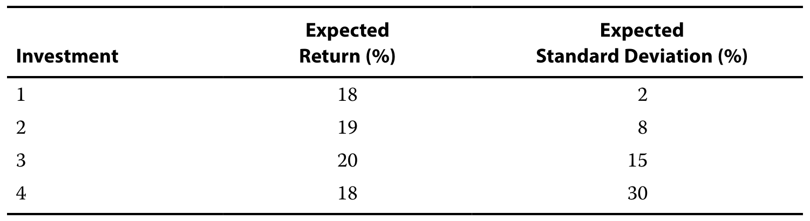

6\. 风险中性投资者最可能选择：

6\. A risk-neutral investor is most likely to choose:

A. 投资 1。

A. Investment 1.

B. 投资 2。

B. Investment 2.

C. 投资 3。

C. Investment 3.

#### 官方答案与解析 / Official answer and explanation

6\. C 正确。投资 3 的收益率最高。风险中性投资者的风险厌恶指标为 0，风险对其而言无关紧要。根据给定效用函数，风险中性投资者从投资 3 中获得的效用最高。

6\. C is correct. Investment 3 has the highest rate of return. Risk is irrelevant to a risk-neutral investor, who would have a measure of risk aversion equal to 0. Given the utility function, the risk-neutral investor would obtain the greatest amount of utility from Investment 3.

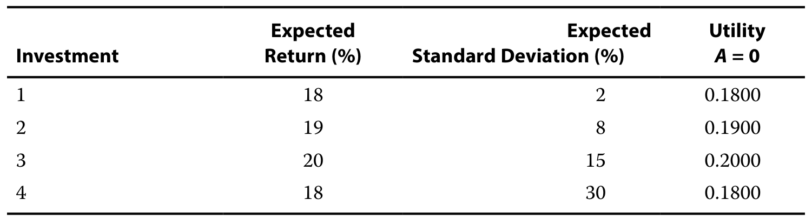

#### 补充解析 / Supplementary explanation

本题聚焦：风险中性投资者最可能选择：

题目中的正确选项为 **C**。下面从“均值—方差效用与风险态度”解释其成立条件和容易混淆的边界。

A=0时风险惩罚为零，比较过程只剩预期收益。即使某个选项波动更小，也不能因此胜过本题收益最高的Investment 3。

**判断与推导：**效用先给预期收益加分，再按风险厌恶系数对方差扣分。A\>0 是风险厌恶，A=0 是风险中性，A\<0 是风险偏好；A 越高，在同一收益下对波动的惩罚越大。

**解题步骤：**先把百分数换成小数，再平方标准差，最后乘 A/2。逐一算每个可选投资的效用并比较，不能只挑最高收益或最低波动。无风险资产的方差为零，因此效用恰等于其收益率。

**排错与边界：**A 是偏好参数，不是资产风险。风险中性者只最大化预期收益；风险偏好者可能愿意为更高波动接受更低平均收益，仍需比较给定效用。

#### 相关知识点 / Related concepts

**均值—方差效用与风险态度**

`U = E(R) − ½Aσ²；无差异曲线 E(R)=U+½Aσ²；斜率 dE(R)/dσ=Aσ。`

Utility combines expected return and variance; use decimal returns and standard deviations.

### V09-M01-PR-007 · 课后习题 7 Practice Problem 7

章末练习 / Practice problem · 原版 PDF 页码 / Source PDF pages: 60-61, 67

#### 题目与资料 / Question and data

以下资料适用于第 6—7 题。

The following information relates to questions 6-7

一名理财规划师整理了下列数据，用以说明效用理论在投资组合选择中的应用：

A financial planner has created the following data to illustrate the application of utility theory to portfolio selection:

7\. 若投资者的效用函数如下，且风险厌恶指标为 −2，该风险寻求型投资者最可能选择：

7\. If an investor’s utility function is expressed as follows and the measure for risk aversion has a value of −2, the risk-seeking investor is most likely to choose:

A. 投资 2。

A. Investment 2.

B. 投资 3。

B. Investment 3.

C. 投资 4。

C. Investment 4.

#### 官方答案与解析 / Official answer and explanation

7\. C 正确。对于风险厌恶指标为 −2 的风险寻求型投资者，投资 4 提供的效用最高，为 0.2700。

7\. C is correct. Investment 4 provides the highest utility value (0.2700) for a risk-seeking investor, who has a measure of risk aversion equal to −2.

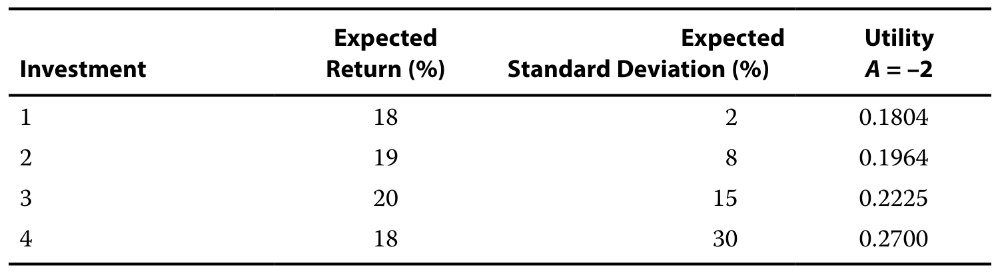

#### 补充解析 / Supplementary explanation

本题聚焦：若投资者的效用函数如下，且风险厌恶指标为 −2，该风险寻求型投资者最可能选择：

题目中的正确选项为 **C**。下面从“均值—方差效用与风险态度”解释其成立条件和容易混淆的边界。

A=−2时，−½Aσ²变为+σ²，即风险在此特定效用函数中增加效用。教材算得Investment 4效用0.2700，选择依据是效用最大，而不是单独认定高风险一定最优。

**判断与推导：**效用先给预期收益加分，再按风险厌恶系数对方差扣分。A\>0 是风险厌恶，A=0 是风险中性，A\<0 是风险偏好；A 越高，在同一收益下对波动的惩罚越大。

**解题步骤：**先把百分数换成小数，再平方标准差，最后乘 A/2。逐一算每个可选投资的效用并比较，不能只挑最高收益或最低波动。无风险资产的方差为零，因此效用恰等于其收益率。

**排错与边界：**A 是偏好参数，不是资产风险。风险中性者只最大化预期收益；风险偏好者可能愿意为更高波动接受更低平均收益，仍需比较给定效用。

#### 相关知识点 / Related concepts

**均值—方差效用与风险态度**

`U = E(R) − ½Aσ²；无差异曲线 E(R)=U+½Aσ²；斜率 dE(R)/dσ=Aσ。`

Utility combines expected return and variance; use decimal returns and standard deviations.

### V09-M01-PR-008 · 课后习题 8 Practice Problem 8

章末练习 / Practice problem · 原版 PDF 页码 / Source PDF pages: 61, 67-68

#### 题目与资料 / Question and data

8\. 若投资者的效用函数如下，且风险厌恶指标为 2，该风险厌恶型投资者最可能选择：

8\. If an investor’s utility function is expressed as follows and the measure for risk aversion has a value of 2, the risk-averse investor is most likely to choose:

A. 投资 1。

A. Investment 1.

B. 投资 2。

B. Investment 2.

C. 投资 3。

C. Investment 3.

#### 官方答案与解析 / Official answer and explanation

8\. B 正确。对于风险厌恶指标为 2 的风险厌恶型投资者，投资 2 提供的效用最高，为 0.1836。

8\. B is correct. Investment 2 provides the highest utility value (0.1836) for a risk-averse investor who has a measure of risk aversion equal to 2.

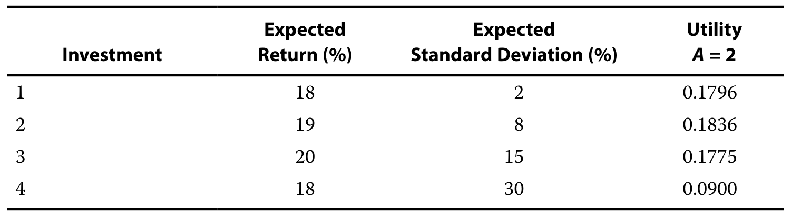

#### 补充解析 / Supplementary explanation

本题聚焦：若投资者的效用函数如下，且风险厌恶指标为 2，该风险厌恶型投资者最可能选择：

题目中的正确选项为 **B**。下面从“均值—方差效用与风险态度”解释其成立条件和容易混淆的边界。

A=2时，效用成为E(R)−σ²。必须用各项收益减各自方差再比较；Investment 2的0.1836是本题最大值。

**判断与推导：**效用先给预期收益加分，再按风险厌恶系数对方差扣分。A\>0 是风险厌恶，A=0 是风险中性，A\<0 是风险偏好；A 越高，在同一收益下对波动的惩罚越大。

**解题步骤：**先把百分数换成小数，再平方标准差，最后乘 A/2。逐一算每个可选投资的效用并比较，不能只挑最高收益或最低波动。无风险资产的方差为零，因此效用恰等于其收益率。

**排错与边界：**A 是偏好参数，不是资产风险。风险中性者只最大化预期收益；风险偏好者可能愿意为更高波动接受更低平均收益，仍需比较给定效用。

#### 相关知识点 / Related concepts

**均值—方差效用与风险态度**

`U = E(R) − ½Aσ²；无差异曲线 E(R)=U+½Aσ²；斜率 dE(R)/dσ=Aσ。`

Utility combines expected return and variance; use decimal returns and standard deviations.

### V09-M01-PR-009 · 课后习题 9 Practice Problem 9

章末练习 / Practice problem · 原版 PDF 页码 / Source PDF pages: 61, 68

#### 题目与资料 / Question and data

9\. 若投资者的效用函数如下，且风险厌恶指标为 4，该风险厌恶型投资者最可能选择：

9\. If an investor’s utility function is expressed as follows and the measure for risk aversion has a value of 4, the risk-averse investor is most likely to choose:

A. 投资 1。

A. Investment 1.

B. 投资 2。

B. Investment 2.

C. 投资 3。

C. Investment 3.

#### 官方答案与解析 / Official answer and explanation

9\. A 正确。对于风险厌恶指标为 4 的风险厌恶型投资者，投资 1 提供的效用最高，为 0.1792。

9\. A is correct. Investment 1 provides the highest utility value (0.1792) for a risk-averse investor who has a measure of risk aversion equal to 4.

#### 补充解析 / Supplementary explanation

本题聚焦：若投资者的效用函数如下，且风险厌恶指标为 4，该风险厌恶型投资者最可能选择：

题目中的正确选项为 **A**。下面从“均值—方差效用与风险态度”解释其成立条件和容易混淆的边界。

A提高到4后，风险惩罚变为2σ²，较高风险组合受到更大扣减。本题最优切换为Investment 1，效用为0.1792，体现偏好变化会改变最优配置。

**判断与推导：**效用先给预期收益加分，再按风险厌恶系数对方差扣分。A\>0 是风险厌恶，A=0 是风险中性，A\<0 是风险偏好；A 越高，在同一收益下对波动的惩罚越大。

**解题步骤：**先把百分数换成小数，再平方标准差，最后乘 A/2。逐一算每个可选投资的效用并比较，不能只挑最高收益或最低波动。无风险资产的方差为零，因此效用恰等于其收益率。

**排错与边界：**A 是偏好参数，不是资产风险。风险中性者只最大化预期收益；风险偏好者可能愿意为更高波动接受更低平均收益，仍需比较给定效用。

#### 相关知识点 / Related concepts

**均值—方差效用与风险态度**

`U = E(R) − ½Aσ²；无差异曲线 E(R)=U+½Aσ²；斜率 dE(R)/dσ=Aσ。`

Utility combines expected return and variance; use decimal returns and standard deviations.

### V09-M01-PR-010 · 课后习题 10 Practice Problem 10

章末练习 / Practice problem · 原版 PDF 页码 / Source PDF pages: 61, 68

#### 题目与资料 / Question and data

10\. 根据均值—方差投资组合理论，资本配置线 CAL 由无风险资产与包含下列哪类资产的组合相结合而成？

10\. With respect to the mean–variance portfolio theory, the capital allocation line, CAL, is the combination of the risk-free asset and a portfolio of all:

A. 所有风险资产。

A. risky assets.

B. 所有权益证券。

B. equity securities.

C. 所有可行投资。

C. feasible investments.

#### 官方答案与解析 / Official answer and explanation

10\. A 正确。CAL 是零风险的无风险资产与所有风险资产组合的组合，构成可行投资集合。如果允许按无风险利率借款，并投资于风险资产组合，就能取得优于 CAL 下方风险资产的可实现组合。

10\. A is correct. The CAL is the combination of the risk-free asset with zero risk and the portfolio of all risky assets that provides for the set of feasible investments. Allowing for borrowing at the risk-free rate and investing in the portfolio of all risky assets provides for attainable portfolios that dominate risky assets below the CAL.

#### 补充解析 / Supplementary explanation

本题聚焦：根据均值—方差投资组合理论，资本配置线 CAL 由无风险资产与包含下列哪类资产的组合相结合而成？

题目中的正确选项为 **A**。下面从“资本配置线与最优投资组合”解释其成立条件和容易混淆的边界。

**判断与推导：**给定一个风险组合，把它与无风险资产组合，风险和预期收益随风险组合的权重线性变化。最优风险组合决定可供选择的直线；投资者的风险偏好决定在这条线上选择哪个点。

**解题步骤：**先识别题目是否已经给定风险组合，再判断风险资产权重。0到1之间是部分持有无风险资产；大于1表示借入无风险资产并加杠杆。风险厌恶更高的投资者通常选择靠近无风险截距的位置。

**排错与边界：**风险组合的选择与无风险/风险组合的资金配置是两个决定。均值—方差模型中的不同风险态度并不必然要求持有不同的最优风险资产篮子。

#### 相关知识点 / Related concepts

**资本配置线与最优投资组合**

`E(Rc)=Rf+w[E(Rp)−Rf]；σc=|w|σp；CAL斜率=[E(Rp)−Rf]/σp。`

The risky portfolio determines the opportunity line; preferences determine the allocation on that line.

### V09-M01-PR-011 · 课后习题 11 Practice Problem 11

章末练习 / Practice problem · 原版 PDF 页码 / Source PDF pages: 61-62, 68

#### 题目与资料 / Question and data

11\. 两名风险厌恶程度不同的个人投资者，其最优组合会位于：

11\. Two individual investors with different levels of risk aversion will have optimal portfolios that are:

A. 资本配置线下方。

A. below the capital allocation line.

B. 资本配置线上。

B. on the capital allocation line.

C. 资本配置线上方。

C. above the capital allocation line.

#### 官方答案与解析 / Official answer and explanation

11\. B 正确。CAL 代表全部可行投资的集合。每位投资者的无差异曲线决定无风险资产与风险资产组合的最优配置，该配置必定位于 CAL 上。

11\. B is correct. The CAL represents the set of all feasible investments. Each investor’s indifference curve determines the optimal combination of the risk-free asset and the portfolio of all risky assets, which must lie on the CAL.

#### 补充解析 / Supplementary explanation

本题聚焦：两名风险厌恶程度不同的个人投资者，其最优组合会位于：

题目中的正确选项为 **B**。下面从“资本配置线与最优投资组合”解释其成立条件和容易混淆的边界。

**判断与推导：**给定一个风险组合，把它与无风险资产组合，风险和预期收益随风险组合的权重线性变化。最优风险组合决定可供选择的直线；投资者的风险偏好决定在这条线上选择哪个点。

**解题步骤：**先识别题目是否已经给定风险组合，再判断风险资产权重。0到1之间是部分持有无风险资产；大于1表示借入无风险资产并加杠杆。风险厌恶更高的投资者通常选择靠近无风险截距的位置。

**排错与边界：**风险组合的选择与无风险/风险组合的资金配置是两个决定。均值—方差模型中的不同风险态度并不必然要求持有不同的最优风险资产篮子。

#### 相关知识点 / Related concepts

**资本配置线与最优投资组合**

`E(Rc)=Rf+w[E(Rp)−Rf]；σc=|w|σp；CAL斜率=[E(Rp)−Rf]/σp。`

The risky portfolio determines the opportunity line; preferences determine the allocation on that line.

### V09-M01-PR-012 · 课后习题 12 Practice Problem 12

章末练习 / Practice problem · 原版 PDF 页码 / Source PDF pages: 62, 68

#### 题目与资料 / Question and data

12\. 根据资本市场理论，以下哪项资产特征最不可能影响投资者等权重组合的方差？

12\. With respect to capital market theory, which of the following asset characteristics is least likely to impact the variance of an investor’s equally weighted portfolio?

A. 资产收益率。

A. Return on the asset.

B. 资产标准差。

B. Standard deviation of the asset.

C. 该资产与组合内其他资产之间的协方差。

C. Covariances of the asset with the other assets in the portfolio.

#### 官方答案与解析 / Official answer and explanation

12\. A 正确。计算组合方差不使用资产收益率，只使用资产权重、标准差或方差，以及协方差或相关系数。

12\. A is correct. The asset’s returns are not used to calculate the portfolio’s variance \[only the assets’ weights, standard deviations (or variances), and covariances (or correlations) are used\].

#### 补充解析 / Supplementary explanation

本题聚焦：根据资本市场理论，以下哪项资产特征最不可能影响投资者等权重组合的方差？

题目中的正确选项为 **A**。下面从“两资产组合方差与相关性”解释其成立条件和容易混淆的边界。

**判断与推导：**组合的预期收益按权重相加，但组合的波动还取决于两项资产是否一起涨跌。协方差项有两个对称交叉项，因此公式中有系数2。

**解题步骤：**先算各资产自身的加权方差，再加协方差交叉项，得到方差后开平方。若给的是相关系数，先用ρσ1σ2替代协方差；若已经给协方差，直接代入，不能再乘一遍标准差。

**排错与边界：**只有完全正相关且权重同号时，组合标准差才等于标准差加权平均。相关系数为0只会消除交叉项，不能令两个资产自身的风险消失。

#### 相关知识点 / Related concepts

**两资产组合方差与相关性**

`E(Rp)=w1E(R1)+w2E(R2)；σp²=w1²σ1²+w2²σ2²+2w1w2ρ12σ1σ2；Cov12=ρ12σ1σ2。`

Average expected returns; combine variances and covariances before taking the square root.

### V09-M01-PR-013 · 课后习题 13 Practice Problem 13

章末练习 / Practice problem · 原版 PDF 页码 / Source PDF pages: 62, 68

#### 题目与资料 / Question and data

13\. 某投资组合经理构建了以下组合：

13\. A portfolio manager creates the following portfolio:

如果两只证券收益率的相关系数为 0.40，组合的预期标准差最接近：

If the correlation of returns between the two securities is 0.40, the expected standard deviation of the portfolio is closest to:

A. 10.7%。

A. 10.7%.

B. 11.3%。

B. 11.3%.

C. 12.1%。

C. 12.1%.

#### 官方答案与解析 / Official answer and explanation

13\. C 正确。

13\. C is correct.

#### 补充解析 / Supplementary explanation

本题聚焦：某投资组合经理构建了以下组合： 如果两只证券收益率的相关系数为 0.40，组合的预期标准差最接近：

题目中的正确选项为 **C**。下面从“两资产组合方差与相关性”解释其成立条件和容易混淆的边界。

**判断与推导：**组合的预期收益按权重相加，但组合的波动还取决于两项资产是否一起涨跌。协方差项有两个对称交叉项，因此公式中有系数2。

**解题步骤：**先算各资产自身的加权方差，再加协方差交叉项，得到方差后开平方。若给的是相关系数，先用ρσ1σ2替代协方差；若已经给协方差，直接代入，不能再乘一遍标准差。

**排错与边界：**只有完全正相关且权重同号时，组合标准差才等于标准差加权平均。相关系数为0只会消除交叉项，不能令两个资产自身的风险消失。

#### 相关知识点 / Related concepts

**两资产组合方差与相关性**

`E(Rp)=w1E(R1)+w2E(R2)；σp²=w1²σ1²+w2²σ2²+2w1w2ρ12σ1σ2；Cov12=ρ12σ1σ2。`

Average expected returns; combine variances and covariances before taking the square root.

### V09-M01-PR-014 · 课后习题 14 Practice Problem 14

章末练习 / Practice problem · 原版 PDF 页码 / Source PDF pages: 62, 68

#### 题目与资料 / Question and data

14\. 某投资组合经理构建了以下组合：

14\. A portfolio manager creates the following portfolio:

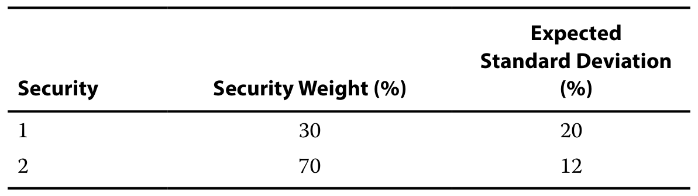

如果两只证券收益率的协方差为 −0.0240，组合的预期标准差最接近：

If the covariance of returns between the two securities is −0.0240, the expected standard deviation of the portfolio is closest to:

A. 2.4%。

A. 2.4%.

B. 7.5%。

B. 7.5%.

C. 9.2%。

C. 9.2%.

#### 官方答案与解析 / Official answer and explanation

14\. A 正确。

14\. A is correct.

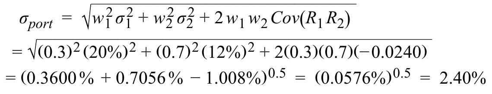

#### 补充解析 / Supplementary explanation

本题聚焦：某投资组合经理构建了以下组合： 如果两只证券收益率的协方差为 −0.0240，组合的预期标准差最接近：

题目中的正确选项为 **A**。下面从“两资产组合方差与相关性”解释其成立条件和容易混淆的边界。

**判断与推导：**组合的预期收益按权重相加，但组合的波动还取决于两项资产是否一起涨跌。协方差项有两个对称交叉项，因此公式中有系数2。

**解题步骤：**先算各资产自身的加权方差，再加协方差交叉项，得到方差后开平方。若给的是相关系数，先用ρσ1σ2替代协方差；若已经给协方差，直接代入，不能再乘一遍标准差。

**排错与边界：**只有完全正相关且权重同号时，组合标准差才等于标准差加权平均。相关系数为0只会消除交叉项，不能令两个资产自身的风险消失。

#### 相关知识点 / Related concepts

**两资产组合方差与相关性**

`E(Rp)=w1E(R1)+w2E(R2)；σp²=w1²σ1²+w2²σ2²+2w1w2ρ12σ1σ2；Cov12=ρ12σ1σ2。`

Average expected returns; combine variances and covariances before taking the square root.

### V09-M01-PR-015 · 课后习题 15 Practice Problem 15

章末练习 / Practice problem · 原版 PDF 页码 / Source PDF pages: 62-63, 68

#### 题目与资料 / Question and data

以下资料适用于第 15—16 题。

The following information relates to questions 15-16

某投资组合经理构建了以下组合：

A portfolio manager creates the following portfolio:

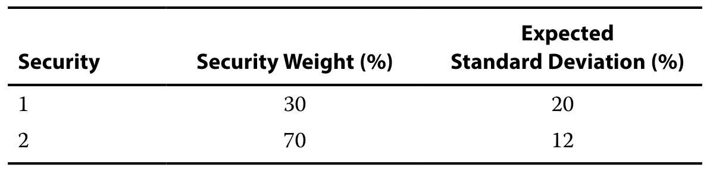

15\. 如果组合标准差为 14.40%，两只证券的相关系数等于：

15\. If the standard deviation of the portfolio is 14.40%, the correlation between the two securities is equal to:

A. −1.0。

A. −1.0.

B. 0.0。

B. 0.0.

C. 1.0。

C. 1.0.

#### 官方答案与解析 / Official answer and explanation

15\. C 正确。组合标准差 14.40% 等于资产标准差的加权平均数，只有两只证券相关系数等于 1.0 时才可能出现。

15\. C is correct. A portfolio standard deviation of 14.40% is the weighted average, which is possible only if the correlation between the securities is equal to 1.0.

#### 补充解析 / Supplementary explanation

本题聚焦：如果组合标准差为 14.40%，两只证券的相关系数等于：

题目中的正确选项为 **C**。下面从“两资产组合方差与相关性”解释其成立条件和容易混淆的边界。

题干给出的14.40%恰等于资产标准差的加权平均。在本题正权重组合中，这种等号成立要求ρ=+1；如果相关性低于1，组合波动会更低。

**判断与推导：**组合的预期收益按权重相加，但组合的波动还取决于两项资产是否一起涨跌。协方差项有两个对称交叉项，因此公式中有系数2。

**解题步骤：**先算各资产自身的加权方差，再加协方差交叉项，得到方差后开平方。若给的是相关系数，先用ρσ1σ2替代协方差；若已经给协方差，直接代入，不能再乘一遍标准差。

**排错与边界：**只有完全正相关且权重同号时，组合标准差才等于标准差加权平均。相关系数为0只会消除交叉项，不能令两个资产自身的风险消失。

#### 相关知识点 / Related concepts

**两资产组合方差与相关性**

`E(Rp)=w1E(R1)+w2E(R2)；σp²=w1²σ1²+w2²σ2²+2w1w2ρ12σ1σ2；Cov12=ρ12σ1σ2。`

Average expected returns; combine variances and covariances before taking the square root.

### V09-M01-PR-016 · 课后习题 16 Practice Problem 16

章末练习 / Practice problem · 原版 PDF 页码 / Source PDF pages: 62-63, 68

#### 题目与资料 / Question and data

以下资料适用于第 15—16 题。

The following information relates to questions 15-16

某投资组合经理构建了以下组合：

A portfolio manager creates the following portfolio:

16\. 如果组合标准差为 14.40%，两只证券的协方差等于：

16\. If the standard deviation of the portfolio is 14.40%, the covariance between the two securities is equal to:

A. 0.0006。

A. 0.0006.

B. 0.0240。

B. 0.0240.

C. 1.0000。

C. 1.0000.

#### 官方答案与解析 / Official answer and explanation

16\. B 正确。组合标准差 14.40% 等于资产标准差的加权平均数，只有两只证券相关系数等于 1.0 时才可能出现。如果相关系数为 1.0，协方差必为 0.0240，计算如下：计算式 17。

16\. B is correct. A portfolio standard deviation of 14.40% is the weighted average, which is possible only if the correlation between the securities is equal to 1.0. If the correlation coefficient is equal to 1.0, then the covariance must equal 0.0240, calculated as: Calculation 17.

计算式 17 · Calculation 17

Cov(R₁,R₂) = ρ₁₂σ₁σ₂ = (1.0)(20%)(12%) = 2.40% = 0.0240

#### 补充解析 / Supplementary explanation

本题聚焦：如果组合标准差为 14.40%，两只证券的协方差等于：

题目中的正确选项为 **B**。下面从“两资产组合方差与相关性”解释其成立条件和容易混淆的边界。

标准差的加权平均14.40%是本题ρ=+1时的上界。题目给出的其他组合波动，应代回方差式检验ρ；不能把加权平均当作所有相关性下的结果。

**判断与推导：**组合的预期收益按权重相加，但组合的波动还取决于两项资产是否一起涨跌。协方差项有两个对称交叉项，因此公式中有系数2。

**解题步骤：**先算各资产自身的加权方差，再加协方差交叉项，得到方差后开平方。若给的是相关系数，先用ρσ1σ2替代协方差；若已经给协方差，直接代入，不能再乘一遍标准差。

**排错与边界：**只有完全正相关且权重同号时，组合标准差才等于标准差加权平均。相关系数为0只会消除交叉项，不能令两个资产自身的风险消失。

#### 相关知识点 / Related concepts

**两资产组合方差与相关性**

`E(Rp)=w1E(R1)+w2E(R2)；σp²=w1²σ1²+w2²σ2²+2w1w2ρ12σ1σ2；Cov12=ρ12σ1σ2。`

Average expected returns; combine variances and covariances before taking the square root.

### V09-M01-PR-017 · 课后习题 17 Practice Problem 17

章末练习 / Practice problem · 原版 PDF 页码 / Source PDF pages: 63, 69

#### 题目与资料 / Question and data

以下资料适用于第 17—19 题。

The following information relates to questions 17-19

某投资组合经理构建了以下组合：

A portfolio manager creates the following portfolio:

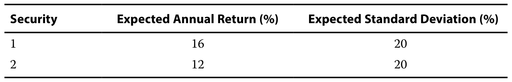

17\. 如果两只证券组成的组合预期收益率为 15%，投资于证券 1 的比例为：

17\. If the portfolio of the two securities has an expected return of 15%, the propor tion invested in Security 1 is:

A. 25%。

A. 25%.

B. 50%。

B. 50%.

C. 75%。

C. 75%.

#### 官方答案与解析 / Official answer and explanation

17\. C 正确。

17\. C is correct.

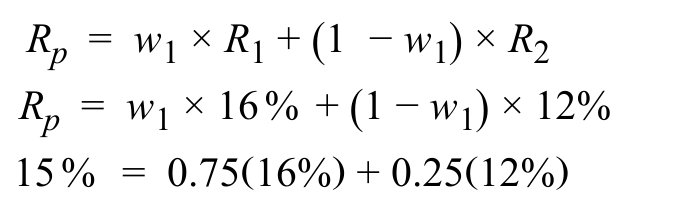

#### 补充解析 / Supplementary explanation

本题聚焦：如果两只证券组成的组合预期收益率为 15%，投资于证券 1 的比例为：

题目中的正确选项为 **C**。下面从“由目标收益反推投资权重”解释其成立条件和容易混淆的边界。

**判断与推导：**两资产组合收益是两项预期收益的线性加权平均，且没有额外现金流时权重之和为1。目标收益与两个端点的相对距离决定所需权重。

**解题步骤：**设资产1权重为w，资产2为1−w，建立一元一次方程。先解权重，再用权重和是否等于1以及加权收益是否回到目标值做双重核验。

**排错与边界：**权重超出0到1的区间意味着题设需要借入或卖空，不能把它自动当作计算错误，也不能在禁止杠杆的条件下直接接受。

#### 相关知识点 / Related concepts

**由目标收益反推投资权重**

`w1=[E(Rp)−E(R2)]/[E(R1)−E(R2)]；w2=1−w1。`

Solve the weighted-average return equation and check any leverage or short-sale restriction.

### V09-M01-PR-018 · 课后习题 18 Practice Problem 18

章末练习 / Practice problem · 原版 PDF 页码 / Source PDF pages: 63, 69

#### 题目与资料 / Question and data

以下资料适用于第 17—19 题。

The following information relates to questions 17-19

某投资组合经理构建了以下组合：

A portfolio manager creates the following portfolio:

18\. 如果两只证券收益率的相关系数为 −0.15，等权重组合的预期标准差最接近：

18\. If the correlation of returns between the two securities is −0.15, the expected standard deviation of an equal-weighted portfolio is closest to:

A. 13.04%。

A. 13.04%.

B. 13.60%。

B. 13.60%.

C. 13.87%。

C. 13.87%.

#### 官方答案与解析 / Official answer and explanation

18\. A 正确。

18\. A is correct.

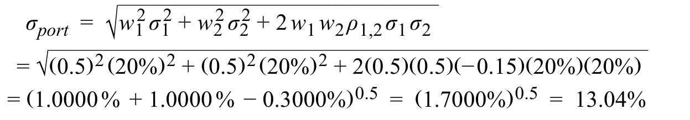

#### 补充解析 / Supplementary explanation

本题聚焦：如果两只证券收益率的相关系数为 −0.15，等权重组合的预期标准差最接近：

题目中的正确选项为 **A**。下面从“两资产组合方差与相关性”解释其成立条件和容易混淆的边界。

**判断与推导：**组合的预期收益按权重相加，但组合的波动还取决于两项资产是否一起涨跌。协方差项有两个对称交叉项，因此公式中有系数2。

**解题步骤：**先算各资产自身的加权方差，再加协方差交叉项，得到方差后开平方。若给的是相关系数，先用ρσ1σ2替代协方差；若已经给协方差，直接代入，不能再乘一遍标准差。

**排错与边界：**只有完全正相关且权重同号时，组合标准差才等于标准差加权平均。相关系数为0只会消除交叉项，不能令两个资产自身的风险消失。

#### 相关知识点 / Related concepts

**两资产组合方差与相关性**

`E(Rp)=w1E(R1)+w2E(R2)；σp²=w1²σ1²+w2²σ2²+2w1w2ρ12σ1σ2；Cov12=ρ12σ1σ2。`

Average expected returns; combine variances and covariances before taking the square root.

### V09-M01-PR-019 · 课后习题 19 Practice Problem 19

章末练习 / Practice problem · 原版 PDF 页码 / Source PDF pages: 63-64, 69

#### 题目与资料 / Question and data

以下资料适用于第 17—19 题。

The following information relates to questions 17-19

某投资组合经理构建了以下组合：

A portfolio manager creates the following portfolio:

19\. 如果两只证券不相关，等权重组合的预期标准差最接近：

19\. If the two securities are uncorrelated, the expected standard deviation of an equal-weighted portfolio is closest to:

A. 14.00%。

A. 14.00%.

B. 14.14%。

B. 14.14%.

C. 20.00%。

C. 20.00%.

#### 官方答案与解析 / Official answer and explanation

19\. B 正确。

19\. B is correct.

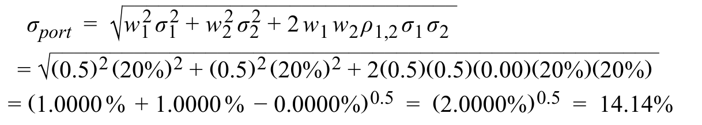

#### 补充解析 / Supplementary explanation

本题聚焦：如果两只证券不相关，等权重组合的预期标准差最接近：

题目中的正确选项为 **B**。下面从“两资产组合方差与相关性”解释其成立条件和容易混淆的边界。

**判断与推导：**组合的预期收益按权重相加，但组合的波动还取决于两项资产是否一起涨跌。协方差项有两个对称交叉项，因此公式中有系数2。

**解题步骤：**先算各资产自身的加权方差，再加协方差交叉项，得到方差后开平方。若给的是相关系数，先用ρσ1σ2替代协方差；若已经给协方差，直接代入，不能再乘一遍标准差。

**排错与边界：**只有完全正相关且权重同号时，组合标准差才等于标准差加权平均。相关系数为0只会消除交叉项，不能令两个资产自身的风险消失。

#### 相关知识点 / Related concepts

**两资产组合方差与相关性**

`E(Rp)=w1E(R1)+w2E(R2)；σp²=w1²σ1²+w2²σ2²+2w1w2ρ12σ1σ2；Cov12=ρ12σ1σ2。`

Average expected returns; combine variances and covariances before taking the square root.

### V09-M01-PR-020 · 课后习题 20 Practice Problem 20

章末练习 / Practice problem · 原版 PDF 页码 / Source PDF pages: 64, 69

#### 题目与资料 / Question and data

以下资料适用于第 20—21 题。

The following information relates to questions 20-21

分析师针对三种发生概率相同的可能结果，分别作出以下收益率预测：

An analyst has made the following return projections for each of three possible outcomes with an equal likelihood of occurrence:

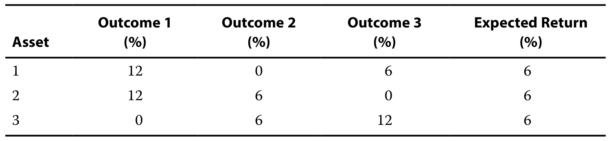

20\. 如果分析师构建等权重的两资产组合，哪一对资产的预期标准差最低？

20\. If the analyst constructs two-asset portfolios that are equally-weighted, which pair of assets has the lowest expected standard deviation?

A. 资产 1 与资产 2。

A. Asset 1 and Asset 2.

B. 资产 1 与资产 3。

B. Asset 1 and Asset 3.

C. 资产 2 与资产 3。

C. Asset 2 and Asset 3.

#### 官方答案与解析 / Official answer and explanation

20\. C 正确。资产 2 与资产 3 的等权重组合具有最低标准差，因为在每一种结果下，组合的预期收益率都相同，两项资产完全负相关。

20\. C is correct. An equally weighted portfolio of Asset 2 and Asset 3 will have the lowest portfolio standard deviation, because for each outcome, the portfolio has the same expected return (they are perfectly negatively correlated).

#### 补充解析 / Supplementary explanation

本题聚焦：如果分析师构建等权重的两资产组合，哪一对资产的预期标准差最低？

题目中的正确选项为 **C**。下面从“分散化、相关性与风险下限”解释其成立条件和容易混淆的边界。

**判断与推导：**分散化依赖收益之间不完全同步。加入资产数越多，个别资产自身方差的贡献可以减小，但共同变化的协方差项不会因为数量增加而自动消失。

**解题步骤：**判断题先保持权重和单项风险不变，再只考察相关系数方向。相关性降低会降低组合风险；压力时期相关性上升则削弱分散化效果。评价某资产是否有价值，要看它对整个组合的边际影响。

**排错与边界：**“降低风险”不意味着保证正收益、消除市场风险或提供下跌保险。多买同类且高度相关的资产也未必增加有效分散。

#### 相关知识点 / Related concepts

**分散化、相关性与风险下限**

`等权近似：σp²=(1/n)·平均方差+[(n−1)/n]·平均协方差。`

Diversification reduces idiosyncratic risk; common risk survives even in large portfolios.

### V09-M01-PR-021 · 课后习题 21 Practice Problem 21

章末练习 / Practice problem · 原版 PDF 页码 / Source PDF pages: 64, 69

#### 题目与资料 / Question and data

以下资料适用于第 20—21 题。

The following information relates to questions 20-21

分析师针对三种发生概率相同的可能结果，分别作出以下收益率预测：

An analyst has made the following return projections for each of three possible outcomes with an equal likelihood of occurrence:

21\. 如果分析师构建等权重的两资产组合，哪一对资产提供的风险降低效果最小？

21\. If the analyst constructs two-asset portfolios that are equally weighted, which pair of assets provides the least amount of risk reduction?

A. 资产 1 与资产 2。

A. Asset 1 and Asset 2.

B. 资产 1 与资产 3。

B. Asset 1 and Asset 3.

C. 资产 2 与资产 3。

C. Asset 2 and Asset 3.

#### 官方答案与解析 / Official answer and explanation

21\. A 正确。资产 1 与资产 2 的等权重组合，在三种配对中波动性最高。三种组合的预期收益率相同，但资产 1 与资产 2 的组合提供的风险降低效果最小。

21\. A is correct. An equally weighted portfolio of Asset 1 and Asset 2 has the highest level of volatility of the three pairs. All three pairs have the same expected return; however, the portfolio of Asset 1 and Asset 2 provides the least amount of risk reduction.

#### 补充解析 / Supplementary explanation

本题聚焦：如果分析师构建等权重的两资产组合，哪一对资产提供的风险降低效果最小？

题目中的正确选项为 **A**。下面从“分散化、相关性与风险下限”解释其成立条件和容易混淆的边界。

**判断与推导：**分散化依赖收益之间不完全同步。加入资产数越多，个别资产自身方差的贡献可以减小，但共同变化的协方差项不会因为数量增加而自动消失。

**解题步骤：**判断题先保持权重和单项风险不变，再只考察相关系数方向。相关性降低会降低组合风险；压力时期相关性上升则削弱分散化效果。评价某资产是否有价值，要看它对整个组合的边际影响。

**排错与边界：**“降低风险”不意味着保证正收益、消除市场风险或提供下跌保险。多买同类且高度相关的资产也未必增加有效分散。

#### 相关知识点 / Related concepts

**分散化、相关性与风险下限**

`等权近似：σp²=(1/n)·平均方差+[(n−1)/n]·平均协方差。`

Diversification reduces idiosyncratic risk; common risk survives even in large portfolios.

### V09-M01-PR-022 · 课后习题 22 Practice Problem 22

章末练习 / Practice problem · 原版 PDF 页码 / Source PDF pages: 64, 69

#### 题目与资料 / Question and data

22\. 随着等权重组合中的资产数量增加，每项资产方差对组合波动性的贡献将：

22\. As the number of assets in an equally-weighted portfolio increases, the contribu tion of each individual asset’s variance to the volatility of the portfolio:

A. 增加。

A. increases.

B. 减少。

B. decreases.

C. 保持不变。

C. remains the same.

#### 官方答案与解析 / Official answer and explanation

22\. B 正确。随着等权重组合中的资产数量增加，每项资产的方差或标准差对组合波动性的贡献下降；资产之间共同变动指标，即协方差和相关性，的贡献上升。下列等权重组合方差公式说明了这些关系：

22\. B is correct. The contribution of each individual asset’s variance (or standard deviation) to the portfolio’s volatility decreases as the number of assets in the equally weighted portfolio increases. The contribution of the co-movement measures between the assets increases (i.e., covariance and correlation) as the number of assets in the equally weighted portfolio increases. The following equation for the variance of an equally weighted portfolio illustrates these points: (shared equation for Questions 22–23 below).

#### 补充解析 / Supplementary explanation

本题聚焦：随着等权重组合中的资产数量增加，每项资产方差对组合波动性的贡献将：

题目中的正确选项为 **B**。下面从“分散化、相关性与风险下限”解释其成立条件和容易混淆的边界。

**判断与推导：**分散化依赖收益之间不完全同步。加入资产数越多，个别资产自身方差的贡献可以减小，但共同变化的协方差项不会因为数量增加而自动消失。

**解题步骤：**判断题先保持权重和单项风险不变，再只考察相关系数方向。相关性降低会降低组合风险；压力时期相关性上升则削弱分散化效果。评价某资产是否有价值，要看它对整个组合的边际影响。

**排错与边界：**“降低风险”不意味着保证正收益、消除市场风险或提供下跌保险。多买同类且高度相关的资产也未必增加有效分散。

#### 相关知识点 / Related concepts

**分散化、相关性与风险下限**

`等权近似：σp²=(1/n)·平均方差+[(n−1)/n]·平均协方差。`

Diversification reduces idiosyncratic risk; common risk survives even in large portfolios.

### V09-M01-PR-023 · 课后习题 23 Practice Problem 23

章末练习 / Practice problem · 原版 PDF 页码 / Source PDF pages: 64, 69

#### 题目与资料 / Question and data

23\. 对于由大量资产构成的等权重组合，以下哪项对组合波动性的贡献最大？

23\. With respect to an equally weighted portfolio made up of a large number of as sets, which of the following contributes the most to the volatility of the portfolio?

A. 各单项资产的平均方差。

A. Average variance of the individual assets.

B. 各单项资产的标准差。

B. Standard deviation of the individual assets.

C. 所有资产配对之间的平均协方差。

C. Average covariance between all pairs of assets.

#### 官方答案与解析 / Official answer and explanation

23\. C 正确。随着等权重组合中的资产数量增加，资产之间共同变动指标，即协方差和相关性，的贡献上升；各单项资产方差或标准差对组合波动性的贡献下降。下列等权重组合方差公式说明了这些关系：

23\. C is correct. The co-movement measures between the assets increases (i.e., co variance and correlation) as the number of assets in the equally weighted portfolio increases. The contribution of each individual asset’s variance (or standard deviation) to the portfolio’s volatility decreases as the number of assets in the equally weighted portfolio increases. The following equation for the variance of an equally weighted portfolio illustrates these points:

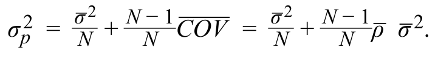

#### 补充解析 / Supplementary explanation

本题聚焦：对于由大量资产构成的等权重组合，以下哪项对组合波动性的贡献最大？

题目中的正确选项为 **C**。下面从“分散化、相关性与风险下限”解释其成立条件和容易混淆的边界。

**判断与推导：**分散化依赖收益之间不完全同步。加入资产数越多，个别资产自身方差的贡献可以减小，但共同变化的协方差项不会因为数量增加而自动消失。

**解题步骤：**判断题先保持权重和单项风险不变，再只考察相关系数方向。相关性降低会降低组合风险；压力时期相关性上升则削弱分散化效果。评价某资产是否有价值，要看它对整个组合的边际影响。

**排错与边界：**“降低风险”不意味着保证正收益、消除市场风险或提供下跌保险。多买同类且高度相关的资产也未必增加有效分散。

#### 相关知识点 / Related concepts

**分散化、相关性与风险下限**

`等权近似：σp²=(1/n)·平均方差+[(n−1)/n]·平均协方差。`

Diversification reduces idiosyncratic risk; common risk survives even in large portfolios.

### V09-M01-PR-024 · 课后习题 24 Practice Problem 24

章末练习 / Practice problem · 原版 PDF 页码 / Source PDF pages: 65, 69

#### 题目与资料 / Question and data

24\. 市场下跌期间，两资产组合中资产之间的相关性上升。如果各资产持仓比例和单项资产的预期标准差均不变，组合波动性最可能：

24\. The correlation between assets in a two-asset portfolio increases during a market decline. If there is no change in the proportion of each asset held in the portfolio or the expected standard deviation of the individual assets, the volatility of the portfolio is most likely to:

A. 上升。

A. increase.

B. 下降。

B. decrease.

C. 保持不变。

C. remain the same.

#### 官方答案与解析 / Official answer and explanation

24\. A 正确。如果组合标准差的其他组成因素，即各资产权重与标准差不变，更高相关性会减少分散化的收益。

24\. A is correct. Higher correlations will produce less diversification benefits provid ed that the other components of the portfolio standard deviation do not change (i.e., the weights and standard deviations of the individual assets).

#### 补充解析 / Supplementary explanation

本题聚焦：市场下跌期间，两资产组合中资产之间的相关性上升。如果各资产持仓比例和单项资产的预期标准差均不变，组合波动性最可能：

题目中的正确选项为 **A**。下面从“分散化、相关性与风险下限”解释其成立条件和容易混淆的边界。

**判断与推导：**分散化依赖收益之间不完全同步。加入资产数越多，个别资产自身方差的贡献可以减小，但共同变化的协方差项不会因为数量增加而自动消失。

**解题步骤：**判断题先保持权重和单项风险不变，再只考察相关系数方向。相关性降低会降低组合风险；压力时期相关性上升则削弱分散化效果。评价某资产是否有价值，要看它对整个组合的边际影响。

**排错与边界：**“降低风险”不意味着保证正收益、消除市场风险或提供下跌保险。多买同类且高度相关的资产也未必增加有效分散。

#### 相关知识点 / Related concepts

**分散化、相关性与风险下限**

`等权近似：σp²=(1/n)·平均方差+[(n−1)/n]·平均协方差。`

Diversification reduces idiosyncratic risk; common risk survives even in large portfolios.

### V09-M01-PR-025 · 课后习题 25 Practice Problem 25

章末练习 / Practice problem · 原版 PDF 页码 / Source PDF pages: 65, 69

#### 题目与资料 / Question and data

25\. 以下哪项表述最不准确？有效前沿是由具有下列哪项特征的所有可实现风险资产组合构成的集合？

25\. Which of the following statements is least accurate? The efficient frontier is the set of all attainable risky assets with the:

A. 在给定风险水平下预期收益率最高。

A. highest expected return for a given level of risk.

B. 在给定收益率水平下风险最低。

B. lowest amount of risk for a given level of return.

C. 相对于无风险利率的预期收益率最高。

C. highest expected return relative to the risk-free rate.

#### 官方答案与解析 / Official answer and explanation

25\. C 正确。有效前沿不考虑无风险利率。有效前沿是全部可实现风险资产组合中，在给定风险下预期收益率最高，或在给定收益率下风险最低的组合集合。

25\. C is correct. The efficient frontier does not account for the risk-free rate. The efficient frontier is the set of all attainable risky assets with the highest expected return for a given level of risk or the lowest amount of risk for a given level of return.

#### 补充解析 / Supplementary explanation

本题聚焦：以下哪项表述最不准确？有效前沿是由具有下列哪项特征的所有可实现风险资产组合构成的集合？

题目中的正确选项为 **C**。下面从“有效前沿、全球最小方差与支配关系”解释其成立条件和容易混淆的边界。

**判断与推导：**最小方差前沿给出每个预期收益水平下方差最小的风险组合；全球最小方差点上方那一段才是均值—方差有效前沿。相同风险下收益更高、或相同收益下风险更低的组合形成支配。

**解题步骤：**画图时先定位全球最小方差点，再把其下方的低收益分支剔除。引入无风险资产后，最高斜率CAL与风险资产有效前沿相切；切点保留，其余有效风险组合通常被切线上的组合支配。

**排错与边界：**有效前沿本身由风险资产的收益、方差和协方差决定，无风险利率不是构造该曲线的输入。单个资产处于低效位置，仍可能因相关性低而有组合价值。

#### 相关知识点 / Related concepts

**有效前沿、全球最小方差与支配关系**

The efficient frontier is the upper branch above the global minimum-variance portfolio.

### V09-M01-PR-026 · 课后习题 26 Practice Problem 26

章末练习 / Practice problem · 原版 PDF 页码 / Source PDF pages: 65, 69

#### 题目与资料 / Question and data

26\. 最小方差前沿上标准差最低的组合是：

26\. The portfolio on the minimum-variance frontier with the lowest standard devia tion is:

A. 无法实现的组合。

A. unattainable.

B. 最优风险投资组合。

B. the optimal risky portfolio.

C. 全局最小方差投资组合。

C. the global minimum-variance portfolio.

#### 官方答案与解析 / Official answer and explanation

26\. C 正确。全局最小方差组合是最小方差前沿上标准差最低的组合。该组合虽然可以实现，但在考虑无风险资产时，它并非最优风险组合。

26\. C is correct. The global minimum-variance portfolio is the portfolio on the minimum-variance frontier with the lowest standard deviation. Although the portfolio is attainable, when the risk-free asset is considered, the global minimum-variance portfolio is not the optimal risky portfolio.

#### 补充解析 / Supplementary explanation

本题聚焦：最小方差前沿上标准差最低的组合是：

题目中的正确选项为 **C**。下面从“有效前沿、全球最小方差与支配关系”解释其成立条件和容易混淆的边界。

**判断与推导：**最小方差前沿给出每个预期收益水平下方差最小的风险组合；全球最小方差点上方那一段才是均值—方差有效前沿。相同风险下收益更高、或相同收益下风险更低的组合形成支配。

**解题步骤：**画图时先定位全球最小方差点，再把其下方的低收益分支剔除。引入无风险资产后，最高斜率CAL与风险资产有效前沿相切；切点保留，其余有效风险组合通常被切线上的组合支配。

**排错与边界：**有效前沿本身由风险资产的收益、方差和协方差决定，无风险利率不是构造该曲线的输入。单个资产处于低效位置，仍可能因相关性低而有组合价值。

#### 相关知识点 / Related concepts

**有效前沿、全球最小方差与支配关系**

The efficient frontier is the upper branch above the global minimum-variance portfolio.

### V09-M01-PR-027 · 课后习题 27 Practice Problem 27

章末练习 / Practice problem · 原版 PDF 页码 / Source PDF pages: 65, 70

#### 题目与资料 / Question and data

27\. 最小方差前沿上，优于全局最小方差组合下方所有组合的那一组投资组合，称为：

27\. The set of portfolios on the minimum-variance frontier that dominates all sets of portfolios below the global minimum-variance portfolio is the:

A. 资本配置线。

A. capital allocation line.

B. 马科维茨有效前沿。

B. Markowitz efficient frontier.

C. 最优风险组合的集合。

C. set of optimal risky portfolios.

#### 官方答案与解析 / Official answer and explanation

27\. B 正确。马科维茨有效前沿在给定风险下提供更高收益率。就最小方差前沿而言，马科维茨有效前沿是位于全局最小方差组合上方、优于其下方组合的那组投资组合。

27\. B is correct. The Markowitz efficient frontier has higher rates of return for a given level of risk. With respect to the minimum-variance portfolio, the Markowitz efficient frontier is the set of portfolios above the global minimum-variance portfolio that dominates the portfolios below the global minimum-variance portfolio.

#### 补充解析 / Supplementary explanation

本题聚焦：最小方差前沿上，优于全局最小方差组合下方所有组合的那一组投资组合，称为：

题目中的正确选项为 **B**。下面从“有效前沿、全球最小方差与支配关系”解释其成立条件和容易混淆的边界。

**判断与推导：**最小方差前沿给出每个预期收益水平下方差最小的风险组合；全球最小方差点上方那一段才是均值—方差有效前沿。相同风险下收益更高、或相同收益下风险更低的组合形成支配。

**解题步骤：**画图时先定位全球最小方差点，再把其下方的低收益分支剔除。引入无风险资产后，最高斜率CAL与风险资产有效前沿相切；切点保留，其余有效风险组合通常被切线上的组合支配。

**排错与边界：**有效前沿本身由风险资产的收益、方差和协方差决定，无风险利率不是构造该曲线的输入。单个资产处于低效位置，仍可能因相关性低而有组合价值。

#### 相关知识点 / Related concepts

**有效前沿、全球最小方差与支配关系**

The efficient frontier is the upper branch above the global minimum-variance portfolio.

### V09-M01-PR-028 · 课后习题 28 Practice Problem 28

章末练习 / Practice problem · 原版 PDF 页码 / Source PDF pages: 65, 70

#### 题目与资料 / Question and data

28\. 占优资本配置线由无风险资产与以下哪项组合而成？

28\. The dominant capital allocation line is the combination of the risk-free asset and the:

A. 最优风险投资组合。

A. optimal risky portfolio.

B. 加杠杆的风险资产组合。

B. levered portfolio of risky assets.

C. 全局最小方差投资组合。

C. global minimum-variance portfolio.

#### 官方答案与解析 / Official answer and explanation

28\. A 正确。运用杠杆，并将无风险资产与最优风险资产组合相结合，可以优于风险资产有效前沿，即马科维茨有效前沿。

28\. A is correct. The use of leverage and the combination of a risk-free asset and the optimal risky asset will dominate the efficient frontier of risky assets (the Markowitz efficient frontier).

#### 补充解析 / Supplementary explanation

本题聚焦：占优资本配置线由无风险资产与以下哪项组合而成？

题目中的正确选项为 **A**。下面从“资本配置线与最优投资组合”解释其成立条件和容易混淆的边界。

**判断与推导：**给定一个风险组合，把它与无风险资产组合，风险和预期收益随风险组合的权重线性变化。最优风险组合决定可供选择的直线；投资者的风险偏好决定在这条线上选择哪个点。

**解题步骤：**先识别题目是否已经给定风险组合，再判断风险资产权重。0到1之间是部分持有无风险资产；大于1表示借入无风险资产并加杠杆。风险厌恶更高的投资者通常选择靠近无风险截距的位置。

**排错与边界：**风险组合的选择与无风险/风险组合的资金配置是两个决定。均值—方差模型中的不同风险态度并不必然要求持有不同的最优风险资产篮子。

#### 相关知识点 / Related concepts

**资本配置线与最优投资组合**

`E(Rc)=Rf+w[E(Rp)−Rf]；σc=|w|σp；CAL斜率=[E(Rp)−Rf]/σp。`

The risky portfolio determines the opportunity line; preferences determine the allocation on that line.

### V09-M01-PR-029 · 课后习题 29 Practice Problem 29

章末练习 / Practice problem · 原版 PDF 页码 / Source PDF pages: 65, 70

#### 题目与资料 / Question and data

29\. 与风险资产有效前沿相比，当风险高于最优风险组合时，占优资本配置线能够提供更高收益率，这是因为投资者能够：

29\. Compared to the efficient frontier of risky assets, the dominant capital allocation line has higher rates of return for levels of risk greater than the optimal risky portfolio because of the investor’s ability to:

A. 按无风险利率借出资金。

A. lend at the risk-free rate.

B. 按无风险利率借入资金。

B. borrow at the risk-free rate.

C. 购买无风险资产。

C. purchase the risk-free asset.

#### 官方答案与解析 / Official answer and explanation

29\. B 正确。除最优风险组合这一点外，CAL 在所有点上均优于有效前沿。投资者能够按无风险利率借款，即保证金买入，从而增持最优风险组合，因此在高于最优风险组合的风险水平上可以取得更高收益率。

29\. B is correct. The CAL dominates the efficient frontier at all points except for the optimal risky portfolio. The ability of the investor to purchase additional amounts of the optimal risky portfolio by borrowing (i.e., buying on margin) at the risk-free rate makes higher rates of return for levels of risk greater than the optimal risky asset possible.

#### 补充解析 / Supplementary explanation

本题聚焦：与风险资产有效前沿相比，当风险高于最优风险组合时，占优资本配置线能够提供更高收益率，这是因为投资者能够：

题目中的正确选项为 **B**。下面从“资本配置线与最优投资组合”解释其成立条件和容易混淆的边界。

**判断与推导：**给定一个风险组合，把它与无风险资产组合，风险和预期收益随风险组合的权重线性变化。最优风险组合决定可供选择的直线；投资者的风险偏好决定在这条线上选择哪个点。

**解题步骤：**先识别题目是否已经给定风险组合，再判断风险资产权重。0到1之间是部分持有无风险资产；大于1表示借入无风险资产并加杠杆。风险厌恶更高的投资者通常选择靠近无风险截距的位置。

**排错与边界：**风险组合的选择与无风险/风险组合的资金配置是两个决定。均值—方差模型中的不同风险态度并不必然要求持有不同的最优风险资产篮子。

#### 相关知识点 / Related concepts

**资本配置线与最优投资组合**

`E(Rc)=Rf+w[E(Rp)−Rf]；σc=|w|σp；CAL斜率=[E(Rp)−Rf]/σp。`

The risky portfolio determines the opportunity line; preferences determine the allocation on that line.

### V09-M01-PR-030 · 课后习题 30 Practice Problem 30

章末练习 / Practice problem · 原版 PDF 页码 / Source PDF pages: 65-66, 70

#### 题目与资料 / Question and data

30\. 根据均值—方差理论，每位投资者的最优组合由其哪项因素决定？

30\. With respect to the mean–variance theory, the optimal portfolio is determined by each individual investor’s:

A. 无风险利率。

A. risk-free rate.

B. 借款利率。

B. borrowing rate.

C. 风险偏好。

C. risk preference.

#### 官方答案与解析 / Official answer and explanation

30\. C 正确。每位投资者对无风险资产与最优风险资产的最优配置比例，由其风险偏好决定。

30\. C is correct. Each individual investor’s optimal mix of the risk-free asset and the optimal risky asset is determined by the investor’s risk preference.

#### 补充解析 / Supplementary explanation

本题聚焦：根据均值—方差理论，每位投资者的最优组合由其哪项因素决定？

题目中的正确选项为 **C**。下面从“资本配置线与最优投资组合”解释其成立条件和容易混淆的边界。

**判断与推导：**给定一个风险组合，把它与无风险资产组合，风险和预期收益随风险组合的权重线性变化。最优风险组合决定可供选择的直线；投资者的风险偏好决定在这条线上选择哪个点。

**解题步骤：**先识别题目是否已经给定风险组合，再判断风险资产权重。0到1之间是部分持有无风险资产；大于1表示借入无风险资产并加杠杆。风险厌恶更高的投资者通常选择靠近无风险截距的位置。

**排错与边界：**风险组合的选择与无风险/风险组合的资金配置是两个决定。均值—方差模型中的不同风险态度并不必然要求持有不同的最优风险资产篮子。

#### 相关知识点 / Related concepts

**资本配置线与最优投资组合**

`E(Rc)=Rf+w[E(Rp)−Rf]；σc=|w|σp；CAL斜率=[E(Rp)−Rf]/σp。`

The risky portfolio determines the opportunity line; preferences determine the allocation on that line.

## LM 2 · 投资组合的风险与收益：第二部分 Portfolio Risk and Return: Part II 65 条目 · 原题与解析逐条对应 / Paired source questions and explanations

### V09-M02-EX-042 · CML 上的风险与收益 Risk and Return on the CML

正文例题／案例 / Worked example / case · 原版 PDF 页码 / Source PDF pages: 79-80

#### 题目与资料 / Question and data

例题 1

EXAMPLE 1

CML 上的风险与收益

Risk and Return on the CML

迈尔斯先生是一位首次投资的投资者，希望仅使用美国国库券和一只紧密跟踪标普 500 指数的指数基金构建投资组合。

Mr. Miles is a first time investor and wants to build a portfolio using only US T-bills and an index fund that closely tracks the S&P 500 Index.

国库券收益率为 5%。

The T-bills have a return of 5 percent.

标普 500 的标准差为 20%，预期收益率为 15%。

The S&P 500 has a standard deviation of 20 percent and an expected return of 15 percent.

1\. 绘制 CML，并标出市场投资比例分别为 0%、25%、75% 和 100% 时对应的点。

1\. Draw the CML and mark the points where the investment in the market is 0 percent, 25 percent, 75 percent, and 100 percent.

#### 官方答案与解析 / Official answer and explanation

将给定信息代入一般的 CML 公式，可得到 CML 方程 计算式 18。

We calculate the equation for the CML as Calculation 18 by substituting the given information into the general CML equation.

直线截距为 5%，斜率为 0.50。

The intercept of the line is 5 percent, and its slope is 0.50.

任取满足上述方程的两个点，即可画出 CML。

We can draw the CML by arbitrarily taking any two points on the line that satisfy the above equation.

计算式 18 · Calculation 18

E(Rₚ) = 5% + 0.50 × σₚ

另一种方法是，将纵轴上 5% 的无风险收益率点，与坐标为（20%，15%）的市场组合点连接，即可得到 CML。

Alternatively, the CML can be drawn by connecting the risk-free return of 5 percent on the y-axis with the market portfolio at (20 percent, 15 percent).

图表 4 展示了这条 CML。

The CML is shown in Exhibit 4.

图表 4：CML 上的风险与收益

Exhibit 4: Risk and Return on the CML

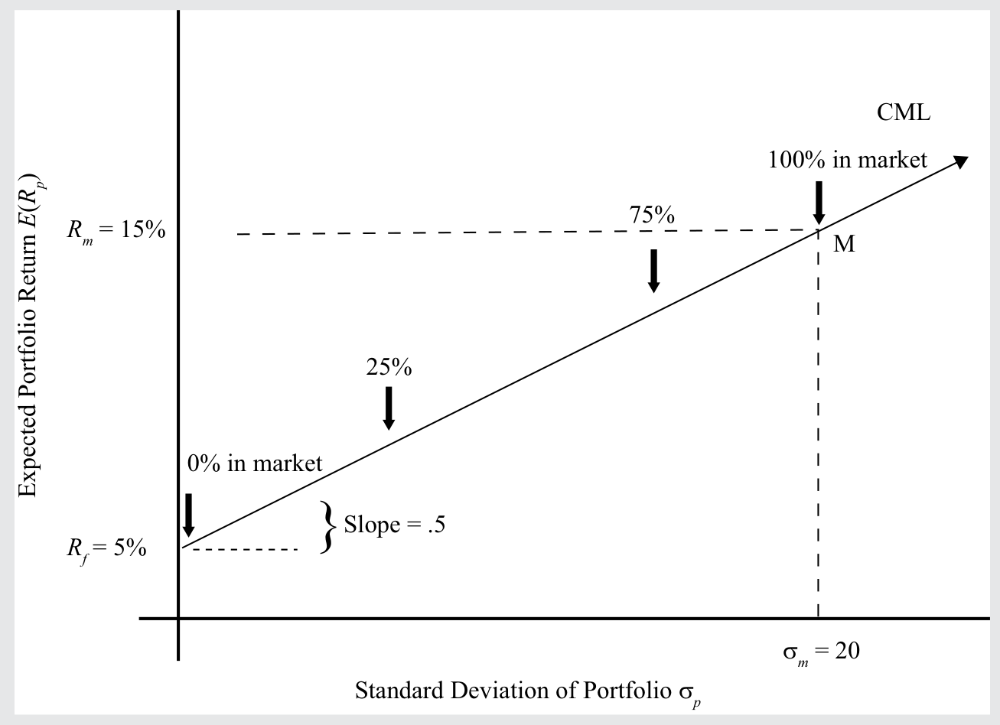

#### 补充解析 / Supplementary explanation

本例“CML 上的风险与收益”的关键是资本市场线与杠杆。

**判断与推导：**资本市场线是以市场组合为风险组合的CAL。它用总风险标准差衡量有效组合；当投资者借款投资市场组合时，市场权重超过100%，风险与风险溢价都会扩大。

**解题步骤：**已知组合风险时，用σc/σm求市场权重；已知权重时，用无风险收益和市场收益加权。如果借款利率高于贷款利率，越过市场组合后的直线斜率会下降。

**排错与边界：**CML只适用于由无风险资产和市场组合组成的有效组合。不能把单只股票的总波动代进CML来求其必要收益；单只资产应看SML和β。

#### 相关知识点 / Related concepts

**资本市场线与杠杆**

`E(Rc)=Rf+[E(Rm)−Rf]σc/σm；借款情形 E(Rc)=wE(Rm)−(w−1)Rb。`

CML uses total risk for efficient portfolios; borrowing costs can create a kink at the market portfolio.

### V09-M02-EX-043 · CML 上的风险与收益 Risk and Return on the CML

正文例题／案例 / Worked example / case · 原版 PDF 页码 / Source PDF pages: 79-80

#### 题目与资料 / Question and data

例题 1

EXAMPLE 1

CML 上的风险与收益

Risk and Return on the CML

迈尔斯先生是一位首次投资的投资者，希望仅使用美国国库券和一只紧密跟踪标普 500 指数的指数基金构建投资组合。

Mr. Miles is a first time investor and wants to build a portfolio using only US T-bills and an index fund that closely tracks the S&P 500 Index.

国库券收益率为 5%。

The T-bills have a return of 5 percent.

标普 500 的标准差为 20%，预期收益率为 15%。

The S&P 500 has a standard deviation of 20 percent and an expected return of 15 percent.

2\. 迈尔斯先生还想确定各点的确切风险与收益。

2\. Mr. Miles is also interested in determining the exact risk and return at each point.

#### 官方答案与解析 / Official answer and explanation

不投资市场组合时，收益率等于无风险收益率。

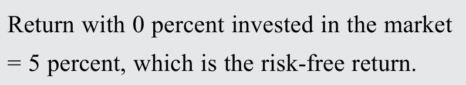

不投资市场组合时，国库券无风险，因此组合标准差为零。

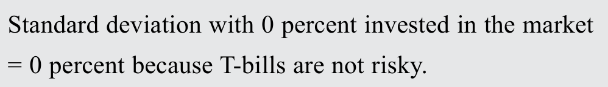

将 25% 投资于市场组合时的收益率：

将 25% 投资于市场组合时的标准差：

将 75% 投资于市场组合时的收益率：

将 75% 投资于市场组合时的标准差：

将 100% 投资于市场组合时，收益率等于标普 500 的收益率。

将 100% 投资于市场组合时，标准差等于标普 500 的风险。

#### 补充解析 / Supplementary explanation

本例“CML 上的风险与收益”的关键是资本市场线与杠杆。

**判断与推导：**资本市场线是以市场组合为风险组合的CAL。它用总风险标准差衡量有效组合；当投资者借款投资市场组合时，市场权重超过100%，风险与风险溢价都会扩大。

**解题步骤：**已知组合风险时，用σc/σm求市场权重；已知权重时，用无风险收益和市场收益加权。如果借款利率高于贷款利率，越过市场组合后的直线斜率会下降。

**排错与边界：**CML只适用于由无风险资产和市场组合组成的有效组合。不能把单只股票的总波动代进CML来求其必要收益；单只资产应看SML和β。

#### 相关知识点 / Related concepts

**资本市场线与杠杆**

`E(Rc)=Rf+[E(Rm)−Rf]σc/σm；借款情形 E(Rc)=wE(Rm)−(w−1)Rb。`

CML uses total risk for efficient portfolios; borrowing costs can create a kink at the market portfolio.

### V09-M02-EX-044 · 借出与借入利率相同时，杠杆投资组合的风险与收益 Risk and Return of a Leveraged Portfolio with Equal Lending and Borrowing Rates

正文例题／案例 / Worked example / case · 原版 PDF 页码 / Source PDF pages: 81-82

#### 题目与资料 / Question and data

例题 2

EXAMPLE 2

借出与借入利率相同时，杠杆投资组合的风险与收益

Risk and Return of a Leveraged Portfolio with Equal Lending and Borrowing Rates

1\. 迈尔斯先生预计未来整体市场将带来有吸引力的收益，因此决定拨出一小部分财富，投资于风险高于其既有投资的组合。他假设能够以 5% 的利率借款，并获得与之前相同的标普 500 收益表现：预期收益率 15%，标准差 20%。

1\. Mr. Miles decides to set aside a small part of his wealth for investment in a portfolio that has greater risk than his previous investments because he anticipates that the overall market will generate attractive returns in the future. He assumes that he can borrow money at 5 percent and achieve the same return on the S&P 500 as before: an expected return of 15 percent with a standard deviation of 20 percent.

如果他分别借入初始投资金额的 25%、50% 和 100%，请计算其预期风险与收益。

Calculate his expected risk and return if he borrows 25 percent, 50 percent, and 100 percent of his initial investment amount.

#### 官方答案与解析 / Official answer and explanation

杠杆组合的标准差和收益率，可以按照与之前相同的方法，使用下列公式计算：

The leveraged portfolio’s standard deviation and return can be calculated in the same manner as before with the following equations:

以及

and

由于迈尔斯先生借入资金，投资于国库券的比例由正数变为负数。

The proportion invested in T-bills becomes negative instead of positive because Mr. Miles is borrowing money.

例如，若借入初始投资额的 25%，则 w₁ = –0.25，(1 – w₁) = 1.25，其他情况依此类推。

If 25 percent of the initial investment is borrowed, w₁ = –0.25, and (1 – w₁) = 1.25, etc.

分别计算无风险资产权重为 −0.25、−0.50 和 −1.00 时的收益率与标准差：

注意，对无风险资产进行负投资，即借款，能提高组合的预期收益率，但更高收益也伴随着更高风险。

Note that negative investment (borrowing) in the risk-free asset provides a higher expected return for the portfolio but that higher return is also associated with higher risk.

#### 补充解析 / Supplementary explanation

本例“借出与借入利率相同时，杠杆投资组合的风险与收益”的关键是资本市场线与杠杆。

**判断与推导：**资本市场线是以市场组合为风险组合的CAL。它用总风险标准差衡量有效组合；当投资者借款投资市场组合时，市场权重超过100%，风险与风险溢价都会扩大。

**解题步骤：**已知组合风险时，用σc/σm求市场权重；已知权重时，用无风险收益和市场收益加权。如果借款利率高于贷款利率，越过市场组合后的直线斜率会下降。

**排错与边界：**CML只适用于由无风险资产和市场组合组成的有效组合。不能把单只股票的总波动代进CML来求其必要收益；单只资产应看SML和β。

#### 相关知识点 / Related concepts

**资本市场线与杠杆**

`E(Rc)=Rf+[E(Rm)−Rf]σc/σm；借款情形 E(Rc)=wE(Rm)−(w−1)Rb。`

CML uses total risk for efficient portfolios; borrowing costs can create a kink at the market portfolio.

### V09-M02-EX-045 · 借出与借入利率不同时的杠杆组合 Leveraged Portfolio with Different Lending and Borrowing Rates

正文例题／案例 / Worked example / case · 原版 PDF 页码 / Source PDF pages: 83-84

#### 题目与资料 / Question and data

例题 3

EXAMPLE 3

借出与借入利率不同时的杠杆组合

Leveraged Portfolio with Different Lending and Borrowing Rates

1\. 迈尔斯先生向经纪商申请以其组合持有的证券为抵押借款。

1\.

虽然贷款有组合中的证券作抵押，但经纪商向客户贷款的利率仍为 7%。

Mr. Miles approaches his broker to borrow money against securities held in his portfolio.

假设无风险利率为 5%，市场收益率为 15%，标准差为 20%。

Even though Mr. Miles’ loan will be secured by the securities in his portfolio, the broker’s rate for lending to customers is 7 percent.

请估计以下情况下迈尔斯先生的预期收益与风险：分别将 25% 和 75% 的资金投入市场；以及分别借入初始投资额的 25% 和 75%，并将借款投入市场。

Assuming a risk-free rate of 5 percent and a market return of 15 percent with a standard deviation of 20 percent, estimate Mr. Miles’ expected return and risk if he invests 25 percent and 75 percent in the market and if he decides to borrow 25 percent and 75 percent of his initial investment and invest the money in the market.

#### 官方答案与解析 / Official answer and explanation

无杠杆组合的标准差和收益率，使用与之前相同的公式计算：

The unleveraged portfolio’s standard deviation and return are calculated using the same equations as before:

以及

and

结果不变。

The results are unchanged.

无杠杆组合所对应直线的斜率与之前一样，为 0.50：

The slope of the line for the unleveraged portfolio is 0.50, just as before:

将 25% 投资于市场组合时的收益率：

将 25% 投资于市场组合时的标准差：

将 75% 投资于市场组合时的收益率：

将 75% 投资于市场组合时的标准差：

对于杠杆组合，除将 Rf 替换为 Rb 外，其余均保持不变。

For the leveraged portfolio, everything remains the same except that Rf is replaced with Rb.

以及

and

组合标准差，以及无风险资产权重为 −0.25 和 −0.75 时的收益率与标准差计算：

杠杆组合的风险与收益均高于无杠杆组合。迈尔斯先生借入越多资金投资市场，预期收益率就越高，但组合标准差也随之增加。杠杆组合对应直线的斜率为 0.40，而无杠杆组合为 0.50。这意味着，风险每增加 1 个百分点，杠杆部分的预期收益率增加 0.40 个百分点；相比之下，无杠杆部分的预期收益率增加 0.50 个百分点。只有风险厌恶程度较低的投资者才会选择杠杆组合。

The risk and return of the leveraged portfolio is higher than that of the unleveraged portfolio. As Mr. Miles borrows more money to invest in the market, the expected return increases but so does the standard deviation of the portfolio. The slope of the line for the leveraged portfolio is 0.40, compared with 0.50 for the unleveraged portfolio, which means that for every 1 percent increase in risk, the investor gets a 0.40 percent increase in expected return in the leveraged part of the portfolio, compared with a 0.50 percent increase in expected return in the unleveraged part of the portfolio. Only investors who are less risk averse will choose leveraged portfolios.

#### 补充解析 / Supplementary explanation

本例“借出与借入利率不同时的杠杆组合”的关键是资本市场线与杠杆。

**判断与推导：**资本市场线是以市场组合为风险组合的CAL。它用总风险标准差衡量有效组合；当投资者借款投资市场组合时，市场权重超过100%，风险与风险溢价都会扩大。

**解题步骤：**已知组合风险时，用σc/σm求市场权重；已知权重时，用无风险收益和市场收益加权。如果借款利率高于贷款利率，越过市场组合后的直线斜率会下降。

**排错与边界：**CML只适用于由无风险资产和市场组合组成的有效组合。不能把单只股票的总波动代进CML来求其必要收益；单只资产应看SML和β。

#### 相关知识点 / Related concepts

**资本市场线与杠杆**

`E(Rc)=Rf+[E(Rm)−Rf]σc/σm；借款情形 E(Rc)=wE(Rm)−(w−1)Rb。`

CML uses total risk for efficient portfolios; borrowing costs can create a kink at the market portfolio.

### V09-M02-EX-046 · 系统性风险与非系统性风险 Systematic and Nonsystematic Risk

正文例题／案例 / Worked example / case · 原版 PDF 页码 / Source PDF pages: 86-87

#### 题目与资料 / Question and data

例题 4

EXAMPLE 4

系统性风险与非系统性风险

Systematic and Nonsystematic Risk

1\. 描述下列资产中的系统性风险与非系统性风险部分：

1\. Describe the systematic and nonsystematic risk components of the following assets:

A. 无风险资产，例如三个月期国库券。

A. A risk-free asset, such as a three-month Treasury bill

B. 市场组合，例如标普 500。

B. The market portfolio, such as the S&P 500.

#### 官方答案与解析 / Official answer and explanation

第 1A 题解答：

Solution to 1A:

根据定义，无风险资产没有风险。

By definition, a risk-free asset has no risk.

因此，它的系统性风险和非系统性风险均为零。

Therefore, a risk-free asset has zero systematic risk and zero nonsystematic risk.

第 1B 题解答：

Solution to 1B:

如前所述，市场组合是一个分散化组合，其风险已经无法再通过分散化进一步降低。

As we mentioned earlier, a market portfolio is a diversified portfolio, one in which no more risk can be diversified away.

我们也将其称为有效组合。

We have also described it as an efficient portfolio.

因此，市场组合不包含任何非系统性风险。

Therefore, a market portfolio does not contain any nonsystematic risk.

#### 补充解析 / Supplementary explanation

本例“系统性风险与非系统性风险”的关键是系统性风险与非系统性风险。

**判断与推导：**市场共同因子造成的风险无法仅靠分散个别证券完全消除；公司或事件特有风险可通过分散大幅降低。在CAPM均衡下，投资者只为承担系统性风险获得预期补偿。

**解题步骤：**比较两项资产必要收益时，先分离市场风险与特有风险。无风险资产两部分都为零；充分分散的市场组合主要保留系统性风险。

**排错与边界：**不能根据总标准差排序直接推出CAPM必要收益排序。若高风险仅来自可分散的公司特有部分，不会得到相应的市场风险溢价。

#### 相关知识点 / Related concepts

**系统性风险与非系统性风险**

`单因子模型：Ri−Rf=αi+βi(Rm−Rf)+εi；Var(Ri)=βi²Var(Rm)+Var(εi)。`

Only systematic risk commands a CAPM risk premium; total risk also includes diversifiable residual risk.

### V09-M02-EX-047 · 系统性风险与非系统性风险 Systematic and Nonsystematic Risk

正文例题／案例 / Worked example / case · 原版 PDF 页码 / Source PDF pages: 86-87

#### 题目与资料 / Question and data

例题 4

EXAMPLE 4

系统性风险与非系统性风险

Systematic and Nonsystematic Risk

2\. 考虑资产 A 和资产 B。资产 A 的总风险是资产 B 的两倍。资产 A 的系统性风险占其总风险的三分之二。资产 B 的全部风险都是系统性风险。哪项资产的预期收益率应该更高？

2\. Consider two assets, A and B. Asset A has twice the amount of total risk as Asset B. For Asset A, systematic risk comprises two-thirds of total risk. For Asset B, all of total risk is systematic risk. Which asset should have a higher expected rate of return?

#### 官方答案与解析 / Official answer and explanation

第 2 题解答：

Solution to 2:

根据给定事实，资产 A 的系统性风险比资产 B 高三分之一。

Based on the facts given, Asset A’s systematic risk is one-third greater than Asset B’s systematic risk.

由于只有系统性风险会被定价或获得收益，资产 A 的预期收益率必然更高。

Because only systematic risk is priced or receives a return, the expected rate of return must be higher for Asset A.

#### 补充解析 / Supplementary explanation

本例“系统性风险与非系统性风险”的关键是系统性风险与非系统性风险。

**判断与推导：**市场共同因子造成的风险无法仅靠分散个别证券完全消除；公司或事件特有风险可通过分散大幅降低。在CAPM均衡下，投资者只为承担系统性风险获得预期补偿。

**解题步骤：**比较两项资产必要收益时，先分离市场风险与特有风险。无风险资产两部分都为零；充分分散的市场组合主要保留系统性风险。

**排错与边界：**不能根据总标准差排序直接推出CAPM必要收益排序。若高风险仅来自可分散的公司特有部分，不会得到相应的市场风险溢价。

#### 相关知识点 / Related concepts

**系统性风险与非系统性风险**

`单因子模型：Ri−Rf=αi+βi(Rm−Rf)+εi；Var(Ri)=βi²Var(Rm)+Var(εi)。`

Only systematic risk commands a CAPM risk premium; total risk also includes diversifiable residual risk.

### V09-M02-EX-048 · 贝塔系数的计算 Calculation of Beta

正文例题／案例 / Worked example / case · 原版 PDF 页码 / Source PDF pages: 91

#### 题目与资料 / Question and data

例题 5

EXAMPLE 5

贝塔系数的计算

Calculation of Beta

假设市场风险（标准差）为 25%，计算下列资产的贝塔系数：

Assuming that the risk (standard deviation) of the market is 25 percent, calculate the beta for the following assets:

我们使用以下贝塔公式回答上述问题：计算式 24。

We use the formula for beta in answering the above questions: Calculation 24.

计算式 24 · Calculation 24

βᵢ = ρᵢ,ₘσᵢ/σₘ

1\. 短期美国国库券。

1\. A short-term US Treasury bill.

#### 官方答案与解析 / Official answer and explanation

根据定义，短期美国国库券的风险为零，因此其贝塔系数为零。

By definition, a short-term US Treasury bill has zero risk. Therefore, its beta is zero.

#### 补充解析 / Supplementary explanation

本例“贝塔系数的计算”的关键是β与系统性风险。

**判断与推导：**β衡量资产对市场收益变化的敏感度，来自资产与市场的协方差相对于市场方差。β既取决于自身波动，也取决于与市场的相关性。

**解题步骤：**把相关系数乘以资产标准差，再除以市场标准差。组合β可以直接按资产权重加总，因为它是对同一个市场因子的线性敏感度。

**排错与边界：**标准差大不代表β必然大；低相关资产可能有高总风险却低系统性风险。负β也不是“负方差”，而是与市场走势相反的平均关系。

#### 相关知识点 / Related concepts

**β与系统性风险**

`βi=Cov(Ri,Rm)/σm²=ρimσi/σm；βp=Σwiβi。`

Beta measures exposure to the market factor, not total standalone volatility.

### V09-M02-EX-049 · 贝塔系数的计算 Calculation of Beta

正文例题／案例 / Worked example / case · 原版 PDF 页码 / Source PDF pages: 91

#### 题目与资料 / Question and data

例题 5

EXAMPLE 5

贝塔系数的计算

Calculation of Beta

假设市场风险（标准差）为 25%，计算下列资产的贝塔系数：

Assuming that the risk (standard deviation) of the market is 25 percent, calculate the beta for the following assets:

我们使用以下贝塔公式回答上述问题：计算式 24。

We use the formula for beta in answering the above questions: Calculation 24.

计算式 24 · Calculation 24

βᵢ = ρᵢ,ₘσᵢ/σₘ

2\. 黄金，其标准差与市场标准差相等，但与市场的相关系数为零。

2\. Gold, which has a standard deviation equal to the standard deviation of the market but a zero correlation with the market.

#### 官方答案与解析 / Official answer and explanation

由于黄金与市场的相关系数为零，其贝塔系数为零。

Because the correlation of gold with the market is zero, its beta is zero.

#### 补充解析 / Supplementary explanation

本例“贝塔系数的计算”的关键是β与系统性风险。

**判断与推导：**β衡量资产对市场收益变化的敏感度，来自资产与市场的协方差相对于市场方差。β既取决于自身波动，也取决于与市场的相关性。

**解题步骤：**把相关系数乘以资产标准差，再除以市场标准差。组合β可以直接按资产权重加总，因为它是对同一个市场因子的线性敏感度。

**排错与边界：**标准差大不代表β必然大；低相关资产可能有高总风险却低系统性风险。负β也不是“负方差”，而是与市场走势相反的平均关系。

#### 相关知识点 / Related concepts

**β与系统性风险**

`βi=Cov(Ri,Rm)/σm²=ρimσi/σm；βp=Σwiβi。`

Beta measures exposure to the market factor, not total standalone volatility.

### V09-M02-EX-050 · 贝塔系数的计算 Calculation of Beta

正文例题／案例 / Worked example / case · 原版 PDF 页码 / Source PDF pages: 91

#### 题目与资料 / Question and data

例题 5

EXAMPLE 5

贝塔系数的计算

Calculation of Beta

假设市场风险（标准差）为 25%，计算下列资产的贝塔系数：

Assuming that the risk (standard deviation) of the market is 25 percent, calculate the beta for the following assets:

我们使用以下贝塔公式回答上述问题：计算式 24。

We use the formula for beta in answering the above questions: Calculation 24.

计算式 24 · Calculation 24

βᵢ = ρᵢ,ₘσᵢ/σₘ

3\. 一个目前未纳入“市场”定义的新兴市场，其标准差为 60%，与市场的相关系数为 –0.1。

3\. A new emerging market that is not currently included in the definition of “market”—the emerging market’s standard deviation is 60 percent, and the correlation with the market is –0.1.

#### 官方答案与解析 / Official answer and explanation

新兴市场的贝塔计算：

#### 补充解析 / Supplementary explanation

本例“贝塔系数的计算”的关键是β与系统性风险。

**判断与推导：**β衡量资产对市场收益变化的敏感度，来自资产与市场的协方差相对于市场方差。β既取决于自身波动，也取决于与市场的相关性。

**解题步骤：**把相关系数乘以资产标准差，再除以市场标准差。组合β可以直接按资产权重加总，因为它是对同一个市场因子的线性敏感度。

**排错与边界：**标准差大不代表β必然大；低相关资产可能有高总风险却低系统性风险。负β也不是“负方差”，而是与市场走势相反的平均关系。

#### 相关知识点 / Related concepts

**β与系统性风险**

`βi=Cov(Ri,Rm)/σm²=ρimσi/σm；βp=Σwiβi。`

Beta measures exposure to the market factor, not total standalone volatility.

### V09-M02-EX-051 · 贝塔系数的计算 Calculation of Beta

正文例题／案例 / Worked example / case · 原版 PDF 页码 / Source PDF pages: 91-92

#### 题目与资料 / Question and data

例题 5

EXAMPLE 5

贝塔系数的计算

Calculation of Beta

假设市场风险（标准差）为 25%，计算下列资产的贝塔系数：

Assuming that the risk (standard deviation) of the market is 25 percent, calculate the beta for the following assets:

我们使用以下贝塔公式回答上述问题：计算式 24。

We use the formula for beta in answering the above questions: Calculation 24.

计算式 24 · Calculation 24

βᵢ = ρᵢ,ₘσᵢ/σₘ

4\. 一只首次公开发行或新发行股票，标准差为 40%，与市场的相关系数为 0.7。

4\.

IPO 通常风险很高，但与市场的相关性相对较低。

An initial public offering or new issue of stock with a standard deviation of 40 percent and a correlation with the market of 0.7 (IPOs are usually very risky but have a relatively low correlation with the market).

#### 官方答案与解析 / Official answer and explanation

首次公开发行股票的贝塔计算：

#### 补充解析 / Supplementary explanation

本例“贝塔系数的计算”的关键是β与系统性风险。

**判断与推导：**β衡量资产对市场收益变化的敏感度，来自资产与市场的协方差相对于市场方差。β既取决于自身波动，也取决于与市场的相关性。

**解题步骤：**把相关系数乘以资产标准差，再除以市场标准差。组合β可以直接按资产权重加总，因为它是对同一个市场因子的线性敏感度。

**排错与边界：**标准差大不代表β必然大；低相关资产可能有高总风险却低系统性风险。负β也不是“负方差”，而是与市场走势相反的平均关系。

#### 相关知识点 / Related concepts

**β与系统性风险**

`βi=Cov(Ri,Rm)/σm²=ρimσi/σm；βp=Σwiβi。`

Beta measures exposure to the market factor, not total standalone volatility.

### V09-M02-EX-052 · 预期收益率的计算 Calculation of Expected Return

正文例题／案例 / Worked example / case · 原版 PDF 页码 / Source PDF pages: 93

#### 题目与资料 / Question and data

例题 6

EXAMPLE 6

预期收益率的计算

Calculation of Expected Return

煤炭生产商阿尔法自然资源公司（ANR）收购了中国一家规模较大但未上市的煤炭生产商。

Alpha Natural Resources (ANR), a coal producer, buys a large but privately held coal producer in China.

由于这项跨境私人公司收购，ANR 收益率的标准差由 50% 降至 30%，与市场的相关系数由 0.95 降至 0.75。

As a result of the cross-border acquisition of a private company, ANR’s standard deviation of returns is reduced from 50 percent to 30 percent and its correlation with the market falls from 0.95 to 0.75.

假设市场标准差与收益率保持不变，分别为 25% 和 10%，无风险利率为 3%。

Assume that the standard deviation and return of the market remain unchanged at 25 percent and 10 percent, respectively, and that the risk-free rate is 3 percent.

1\. 计算收购前 ANR 股票的贝塔系数和预期收益率。

1\. Calculate the beta of ANR stock and its expected return before the acquisition.

#### 官方答案与解析 / Official answer and explanation

利用 βᵢ 的公式，先计算 βᵢ，再计算收益率。

Using the formula for βᵢ, we can calculate βᵢ and then the return.

 

#### 补充解析 / Supplementary explanation

本例“预期收益率的计算”的关键是CAPM必要收益与证券市场线。

**判断与推导：**CAPM把必要收益拆成时间价值与系统性风险补偿。SML的截距是无风险利率，斜率是市场风险溢价，横轴是β。

**解题步骤：**先判断题目给的是市场预期收益还是市场风险溢价。若给市场收益，必须先减无风险利率，再乘β，最后加回无风险利率。若要求β或溢价，则移项反解。

**排错与边界：**不要把市场收益直接乘β后再加无风险利率。分析师预测收益高于同β下CAPM必要收益，意味着正α和相对低估，而不是价格已经偏高。

#### 相关知识点 / Related concepts

**CAPM必要收益与证券市场线**

`E(Ri)=Rf+βi[E(Rm)−Rf]；αi=预测收益−CAPM必要收益。`

Use beta times the market risk premium, then add the risk-free rate.

### V09-M02-EX-053 · 预期收益率的计算 Calculation of Expected Return

正文例题／案例 / Worked example / case · 原版 PDF 页码 / Source PDF pages: 93-94

#### 题目与资料 / Question and data

例题 6

EXAMPLE 6

预期收益率的计算

Calculation of Expected Return

煤炭生产商阿尔法自然资源公司（ANR）收购了中国一家规模较大但未上市的煤炭生产商。

Alpha Natural Resources (ANR), a coal producer, buys a large but privately held coal producer in China.

由于这项跨境私人公司收购，ANR 收益率的标准差由 50% 降至 30%，与市场的相关系数由 0.95 降至 0.75。

As a result of the cross-border acquisition of a private company, ANR’s standard deviation of returns is reduced from 50 percent to 30 percent and its correlation with the market falls from 0.95 to 0.75.

假设市场标准差与收益率保持不变，分别为 25% 和 10%，无风险利率为 3%。

Assume that the standard deviation and return of the market remain unchanged at 25 percent and 10 percent, respectively, and that the risk-free rate is 3 percent.

2\. 计算收购后的预期收益率。

2\. Calculate the expected return after the acquisition.

#### 官方答案与解析 / Official answer and explanation

采用相同的步骤，但使用收购后的相关系数和风险。

We follow the same procedure but with the after-acquisition correlation and risk.

 

市场风险溢价为 7%，即 计算式 25。

The market risk premium is 7 percent (Calculation 25).

贝塔变化时，证券预期收益率的变化等于市场风险溢价乘以贝塔的变化量。

As the beta changes, the change in the security’s expected return is the market risk premium multiplied by the change in beta.

在本情形中，ANR 的贝塔下降了 1.0，因此新的预期收益率降低了 7 个百分点。

In this scenario, ANR’s beta decreased by 1.0, so the new expected return for ANR is 7 percentage points lower.

计算式 25 · Calculation 25

10% – 3%

迈尔斯先生注意到市场对 iPod 和 iPhone 的需求强劲，因此希望投资苹果股票。

Mr. Miles observes the strong demand for iPods and iPhones and wants to invest in Apple stock.

遗憾的是，他不知道这项投资应该获得怎样的预期收益率。

Unfortunately, Mr. Miles doesn’t know the return he should expect from his investment.

他得到的信息为：无风险利率 3%，市场收益率 10%，苹果贝塔 1.5。

He has been given a risk-free rate of 3 percent, a market return of 10 percent, and Apple’s beta of 1.5.

#### 补充解析 / Supplementary explanation

本例“预期收益率的计算”的关键是CAPM必要收益与证券市场线。

**判断与推导：**CAPM把必要收益拆成时间价值与系统性风险补偿。SML的截距是无风险利率，斜率是市场风险溢价，横轴是β。

**解题步骤：**先判断题目给的是市场预期收益还是市场风险溢价。若给市场收益，必须先减无风险利率，再乘β，最后加回无风险利率。若要求β或溢价，则移项反解。

**排错与边界：**不要把市场收益直接乘β后再加无风险利率。分析师预测收益高于同β下CAPM必要收益，意味着正α和相对低估，而不是价格已经偏高。

#### 相关知识点 / Related concepts

**CAPM必要收益与证券市场线**

`E(Ri)=Rf+βi[E(Rm)−Rf]；αi=预测收益−CAPM必要收益。`

Use beta times the market risk premium, then add the risk-free rate.

### V09-M02-EX-054 · 预期收益率的计算 Calculation of Expected Return

正文例题／案例 / Worked example / case · 原版 PDF 页码 / Source PDF pages: 93-94

#### 题目与资料 / Question and data

例题 6

EXAMPLE 6

预期收益率的计算

Calculation of Expected Return

煤炭生产商阿尔法自然资源公司（ANR）收购了中国一家规模较大但未上市的煤炭生产商。

Alpha Natural Resources (ANR), a coal producer, buys a large but privately held coal producer in China.

由于这项跨境私人公司收购，ANR 收益率的标准差由 50% 降至 30%，与市场的相关系数由 0.95 降至 0.75。

As a result of the cross-border acquisition of a private company, ANR’s standard deviation of returns is reduced from 50 percent to 30 percent and its correlation with the market falls from 0.95 to 0.75.

假设市场标准差与收益率保持不变，分别为 25% 和 10%，无风险利率为 3%。

Assume that the standard deviation and return of the market remain unchanged at 25 percent and 10 percent, respectively, and that the risk-free rate is 3 percent.

3\. 计算苹果的预期收益率。

3\. Calculate Apple’s expected return.

#### 官方答案与解析 / Official answer and explanation

#### 补充解析 / Supplementary explanation

本例“预期收益率的计算”的关键是CAPM必要收益与证券市场线。

**判断与推导：**CAPM把必要收益拆成时间价值与系统性风险补偿。SML的截距是无风险利率，斜率是市场风险溢价，横轴是β。

**解题步骤：**先判断题目给的是市场预期收益还是市场风险溢价。若给市场收益，必须先减无风险利率，再乘β，最后加回无风险利率。若要求β或溢价，则移项反解。

**排错与边界：**不要把市场收益直接乘β后再加无风险利率。分析师预测收益高于同β下CAPM必要收益，意味着正α和相对低估，而不是价格已经偏高。

#### 相关知识点 / Related concepts

**CAPM必要收益与证券市场线**

`E(Ri)=Rf+βi[E(Rm)−Rf]；αi=预测收益−CAPM必要收益。`

Use beta times the market risk premium, then add the risk-free rate.

### V09-M02-EX-055 · 预期收益率的计算 Calculation of Expected Return

正文例题／案例 / Worked example / case · 原版 PDF 页码 / Source PDF pages: 93-94

#### 题目与资料 / Question and data

例题 6

EXAMPLE 6

预期收益率的计算

Calculation of Expected Return

煤炭生产商阿尔法自然资源公司（ANR）收购了中国一家规模较大但未上市的煤炭生产商。

Alpha Natural Resources (ANR), a coal producer, buys a large but privately held coal producer in China.

由于这项跨境私人公司收购，ANR 收益率的标准差由 50% 降至 30%，与市场的相关系数由 0.95 降至 0.75。

As a result of the cross-border acquisition of a private company, ANR’s standard deviation of returns is reduced from 50 percent to 30 percent and its correlation with the market falls from 0.95 to 0.75.

假设市场标准差与收益率保持不变，分别为 25% 和 10%，无风险利率为 3%。

Assume that the standard deviation and return of the market remain unchanged at 25 percent and 10 percent, respectively, and that the risk-free rate is 3 percent.

4\. 一位分析师在查看相同信息后，认为苹果过去的表现不能代表未来表现。他认为，随着苹果市值扩大，其走势比以往更接近整体市场，因此苹果的贝塔应该更接近 1.1。该分析师对苹果股票的预期收益率是多少？

4\. An analyst looking at the same information decides that the past performance of Apple is not representative of its future performance. He decides that, given the increase in Apple’s market capitalization, Apple acts much more like the market than before and thinks Apple’s beta should be closer to 1.1. What is the analyst’s expected return for Apple stock?

#### 官方答案与解析 / Official answer and explanation

这个例子说明，依据过去收益进行估计，与预测未来之间并不存在必然联系。

This example illustrates the lack of connection between estimation of past returns and projection into the future.

投资者应认识到，利用过去收益估计未来收益存在局限。

Investors should be aware of the limitations of using past returns for estimating future returns.

#### 补充解析 / Supplementary explanation

本例“预期收益率的计算”的关键是CAPM必要收益与证券市场线。

**判断与推导：**CAPM把必要收益拆成时间价值与系统性风险补偿。SML的截距是无风险利率，斜率是市场风险溢价，横轴是β。

**解题步骤：**先判断题目给的是市场预期收益还是市场风险溢价。若给市场收益，必须先减无风险利率，再乘β，最后加回无风险利率。若要求β或溢价，则移项反解。

**排错与边界：**不要把市场收益直接乘β后再加无风险利率。分析师预测收益高于同β下CAPM必要收益，意味着正α和相对低估，而不是价格已经偏高。

#### 相关知识点 / Related concepts

**CAPM必要收益与证券市场线**

`E(Ri)=Rf+βi[E(Rm)−Rf]；αi=预测收益−CAPM必要收益。`

Use beta times the market risk premium, then add the risk-free rate.

### V09-M02-EX-056 · 证券市场线与预期收益率 Security Market Line and Expected Return

正文例题／案例 / Worked example / case · 原版 PDF 页码 / Source PDF pages: 97-98

#### 题目与资料 / Question and data

例题 7

EXAMPLE 7

证券市场线与预期收益率

Security Market Line and Expected Return

1\. 假设无风险利率为 3%，市场组合的预期收益率为 13%，标准差为 23%。印度公司 Bajaj Auto 的标准差为 50%，但与市场不相关。计算 Bajaj Auto 的贝塔系数和预期收益率。

1\. Suppose the risk-free rate is 3 percent, the expected return on the market portfolio is 13 percent, and its standard deviation is 23 percent. An Indian company, Bajaj Auto, has a standard deviation of 50 percent but is uncorrelated with the market. Calculate Bajaj Auto’s beta and expected return.

#### 官方答案与解析 / Official answer and explanation

利用 βᵢ 的公式，可以先计算 βᵢ，再计算收益率。

Using the formula for βᵢ, we can calculate βᵢ and then the return.

 

由于与市场组合的相关系数为零，Bajaj Auto 的贝塔系数为零。

Because of its zero correlation with the market portfolio, Bajaj Auto’s beta is zero.

由于贝塔为零，其预期收益率等于无风险利率，即 3%。

Because the beta is zero, the expected return for Bajaj Auto is the risk-free rate, which is 3 percent.

#### 补充解析 / Supplementary explanation

本例“证券市场线与预期收益率”的关键是CAPM必要收益与证券市场线。

**判断与推导：**CAPM把必要收益拆成时间价值与系统性风险补偿。SML的截距是无风险利率，斜率是市场风险溢价，横轴是β。

**解题步骤：**先判断题目给的是市场预期收益还是市场风险溢价。若给市场收益，必须先减无风险利率，再乘β，最后加回无风险利率。若要求β或溢价，则移项反解。

**排错与边界：**不要把市场收益直接乘β后再加无风险利率。分析师预测收益高于同β下CAPM必要收益，意味着正α和相对低估，而不是价格已经偏高。

#### 相关知识点 / Related concepts

**CAPM必要收益与证券市场线**

`E(Ri)=Rf+βi[E(Rm)−Rf]；αi=预测收益−CAPM必要收益。`

Use beta times the market risk premium, then add the risk-free rate.

### V09-M02-EX-057 · 证券市场线与预期收益率 Security Market Line and Expected Return

正文例题／案例 / Worked example / case · 原版 PDF 页码 / Source PDF pages: 97-98

#### 题目与资料 / Question and data

例题 7

EXAMPLE 7

证券市场线与预期收益率

Security Market Line and Expected Return

2\. 假设无风险利率为 3%，市场组合的预期收益率为 13%，标准差为 23%。德国公司 Mueller Metals 的标准差为 50%，与市场的相关系数为 0.65。计算 Mueller Metals 的贝塔系数和预期收益率。

2\. Suppose the risk-free rate is 3 percent, the expected return on the market portfolio is 13 percent, and its standard deviation is 23 percent. A German company, Mueller Metals, has a standard deviation of 50 percent and a correlation of 0.65 with the market. Calculate Mueller Metal’s beta and expected return.

#### 官方答案与解析 / Official answer and explanation

利用 βᵢ 的公式，可以先计算 βᵢ，再计算收益率。

Using the formula for βᵢ, we can calculate βᵢ and then the return.

 

由于与市场高度相关，Mueller Metals 的贝塔为 1.41，预期收益率为 17.1%。

Because of the high degree of correlation with the market, the beta for Mueller Metals is 1.41 and the expected return is 17.1 percent.

它的系统性风险高于市场，因此预期收益率也高于市场的预期收益率。

Because Mueller Metals has systematic risk that is greater than that of the market, it has an expected return that exceeds the expected return of the market.

#### 补充解析 / Supplementary explanation

本例“证券市场线与预期收益率”的关键是CAPM必要收益与证券市场线。

**判断与推导：**CAPM把必要收益拆成时间价值与系统性风险补偿。SML的截距是无风险利率，斜率是市场风险溢价，横轴是β。

**解题步骤：**先判断题目给的是市场预期收益还是市场风险溢价。若给市场收益，必须先减无风险利率，再乘β，最后加回无风险利率。若要求β或溢价，则移项反解。

**排错与边界：**不要把市场收益直接乘β后再加无风险利率。分析师预测收益高于同β下CAPM必要收益，意味着正α和相对低估，而不是价格已经偏高。

#### 相关知识点 / Related concepts

**CAPM必要收益与证券市场线**

`E(Ri)=Rf+βi[E(Rm)−Rf]；αi=预测收益−CAPM必要收益。`

Use beta times the market risk premium, then add the risk-free rate.

### V09-M02-EX-058 · 投资组合的贝塔与收益率 Portfolio Beta and Return

正文例题／案例 / Worked example / case · 原版 PDF 页码 / Source PDF pages: 99

#### 题目与资料 / Question and data

例题 8

EXAMPLE 8

投资组合的贝塔与收益率

Portfolio Beta and Return

1\. 你将资金的 20% 投入无风险资产，30% 投入市场组合，50% 投入美国股票 RedHat，其贝塔为 2.0。已知无风险利率为 4%，市场收益率为 16%，该组合的贝塔和预期收益率是多少？

1\. You invest 20 percent of your money in the risk-free asset, 30 percent in the market portfolio, and 50 percent in RedHat, a US stock that has a beta of 2.0. Given that the risk-free rate is 4 percent and the market return is 16 percent, what are the portfolio’s beta and expected return?

#### 官方答案与解析 / Official answer and explanation

无风险资产的贝塔为 0，市场贝塔为 1，RedHat 的贝塔为 2.0。

The beta of the risk-free asset = 0, the beta of the market = 1, and the beta of RedHat is 2.0.

组合贝塔为：

The portfolio beta is

组合贝塔为 1.30，预期收益率为 19.6%。

The portfolio beta is 1.30, and its expected return is 19.6 percent.

另一种方法：

Alternate Method:

计算组合收益率的另一种方法，是先计算各证券的收益率，再利用组合收益率公式，即证券收益率的加权平均值，计算整个组合的收益率。

Another method for calculating the portfolio’s return is to calculate individual security returns and then use the portfolio return formula (i.e., weighted average of security returns) to calculate the overall portfolio return.

无风险资产收益率和市场收益率如下：

根据贝塔计算 RedHat 的收益率：

投资组合收益率的计算：

结果不出所料，组合收益率为 19.6%，与第一种方法相同。

Not surprisingly, the portfolio return is 19.6 percent, as calculated in the first method.

#### 补充解析 / Supplementary explanation

本例“投资组合的贝塔与收益率”的关键是β与系统性风险。

**判断与推导：**β衡量资产对市场收益变化的敏感度，来自资产与市场的协方差相对于市场方差。β既取决于自身波动，也取决于与市场的相关性。

**解题步骤：**把相关系数乘以资产标准差，再除以市场标准差。组合β可以直接按资产权重加总，因为它是对同一个市场因子的线性敏感度。

**排错与边界：**标准差大不代表β必然大；低相关资产可能有高总风险却低系统性风险。负β也不是“负方差”，而是与市场走势相反的平均关系。

#### 相关知识点 / Related concepts

**β与系统性风险**

`βi=Cov(Ri,Rm)/σm²=ρimσi/σm；βp=Σwiβi。`

Beta measures exposure to the market factor, not total standalone volatility.

### V09-M02-EX-059 · CAPM 在资本预算中的应用 Application of the CAPM to Capital Budgeting

正文例题／案例 / Worked example / case · 原版 PDF 页码 / Source PDF pages: 100-101

#### 题目与资料 / Question and data

例题 9

EXAMPLE 9

CAPM 在资本预算中的应用

Application of the CAPM to Capital Budgeting

葛兰素史克公司（GlaxoSmithKline Plc）正在评估开发一种新药的经济可行性。第 1 年初始投资为 5 亿美元，第 2 年投资为 2 亿美元。该药研发成功并取得商业成功的概率为 50%。若成功，葛兰素史克第 3 年还需投入 1 亿美元，但该年第 3 年的项目收入为 5 亿美元，该收入尚未扣除当年的投资。若药物成功，第 4、5、6 年每年将获得 4 亿美元收入。第 6 年年末，公司计划以 6 亿美元出售该药的全部权利。如果药物失败，葛兰素史克的全部投资均无法收回。假设市场收益率为 12%，无风险利率为 2%，项目的贝塔风险为 2.3。全部现金流均发生在每年年末。

GlaxoSmithKline Plc is examining the economic feasibility of developing a new medicine. The initial investment in Year 1 is \$500 million. The investment in Year 2 is \$200 million. There is a 50 percent chance that the medicine will be developed and will be successful. If that happens, GlaxoSmithKline must spend another \$100 million in Year 3, but its income from the project in Year 3 will be \$500 million, not including the third-year investment. In Years 4, 5, and 6, it will earn \$400 million a year if the medicine is successful. At the end of Year 6, it intends to sell all rights to the medicine for \$600 million. If the medicine is unsuccessful, none of GlaxoSmithKline’s investments can be salvaged. Assume that the market return is 12 percent, the risk-free rate is 2 percent, and the beta risk of the project is 2.3. All cash flows occur at the end of each year.

1\. 利用成功概率，计算各年的预期现金流。

1\. Calculate the expected annual cash flows using the probability of success.

#### 官方答案与解析 / Official answer and explanation

第 3 至第 6 年的现金流有 50% 的概率发生。

There is a 50 percent chance that the cash flows in Years 3–6 will occur.

考虑这一点后，各年预期现金流为：

Taking that into account, the expected annual cash flows are:

第 1 年：现金流出。

第 2 年：现金流出。

第 3 年：根据两种结果的概率计算预期现金流。

第 4 年：预期现金流。

第 5 年：预期现金流。

第 6 年：根据两种结果的概率计算预期现金流。

#### 补充解析 / Supplementary explanation

本例“CAPM 在资本预算中的应用”的关键是CAPM必要收益与证券市场线。

**判断与推导：**CAPM把必要收益拆成时间价值与系统性风险补偿。SML的截距是无风险利率，斜率是市场风险溢价，横轴是β。

**解题步骤：**先判断题目给的是市场预期收益还是市场风险溢价。若给市场收益，必须先减无风险利率，再乘β，最后加回无风险利率。若要求β或溢价，则移项反解。

**排错与边界：**不要把市场收益直接乘β后再加无风险利率。分析师预测收益高于同β下CAPM必要收益，意味着正α和相对低估，而不是价格已经偏高。

#### 相关知识点 / Related concepts

**CAPM必要收益与证券市场线**

`E(Ri)=Rf+βi[E(Rm)−Rf]；αi=预测收益−CAPM必要收益。`

Use beta times the market risk premium, then add the risk-free rate.

### V09-M02-EX-060 · CAPM 在资本预算中的应用 Application of the CAPM to Capital Budgeting

正文例题／案例 / Worked example / case · 原版 PDF 页码 / Source PDF pages: 100-101

#### 题目与资料 / Question and data

例题 9

EXAMPLE 9

CAPM 在资本预算中的应用

Application of the CAPM to Capital Budgeting

葛兰素史克公司（GlaxoSmithKline Plc）正在评估开发一种新药的经济可行性。第 1 年初始投资为 5 亿美元，第 2 年投资为 2 亿美元。该药研发成功并取得商业成功的概率为 50%。若成功，葛兰素史克第 3 年还需投入 1 亿美元，但该年第 3 年的项目收入为 5 亿美元，该收入尚未扣除当年的投资。若药物成功，第 4、5、6 年每年将获得 4 亿美元收入。第 6 年年末，公司计划以 6 亿美元出售该药的全部权利。如果药物失败，葛兰素史克的全部投资均无法收回。假设市场收益率为 12%，无风险利率为 2%，项目的贝塔风险为 2.3。全部现金流均发生在每年年末。

GlaxoSmithKline Plc is examining the economic feasibility of developing a new medicine. The initial investment in Year 1 is \$500 million. The investment in Year 2 is \$200 million. There is a 50 percent chance that the medicine will be developed and will be successful. If that happens, GlaxoSmithKline must spend another \$100 million in Year 3, but its income from the project in Year 3 will be \$500 million, not including the third-year investment. In Years 4, 5, and 6, it will earn \$400 million a year if the medicine is successful. At the end of Year 6, it intends to sell all rights to the medicine for \$600 million. If the medicine is unsuccessful, none of GlaxoSmithKline’s investments can be salvaged. Assume that the market return is 12 percent, the risk-free rate is 2 percent, and the beta risk of the project is 2.3. All cash flows occur at the end of each year.

2\. 计算预期收益率。

2\. Calculate the expected return.

#### 官方答案与解析 / Official answer and explanation

项目的预期或必要收益率可以利用 CAPM 计算，即 计算式 26。

The expected or required return for the project can be calculated using the CAPM, which is = Calculation 26.

计算式 26 · Calculation 26

0.02 + 2.3 × (0.12 – 0.02) = 0.25

#### 补充解析 / Supplementary explanation

本例“CAPM 在资本预算中的应用”的关键是CAPM必要收益与证券市场线。

**判断与推导：**CAPM把必要收益拆成时间价值与系统性风险补偿。SML的截距是无风险利率，斜率是市场风险溢价，横轴是β。

**解题步骤：**先判断题目给的是市场预期收益还是市场风险溢价。若给市场收益，必须先减无风险利率，再乘β，最后加回无风险利率。若要求β或溢价，则移项反解。

**排错与边界：**不要把市场收益直接乘β后再加无风险利率。分析师预测收益高于同β下CAPM必要收益，意味着正α和相对低估，而不是价格已经偏高。

#### 相关知识点 / Related concepts

**CAPM必要收益与证券市场线**

`E(Ri)=Rf+βi[E(Rm)−Rf]；αi=预测收益−CAPM必要收益。`

Use beta times the market risk premium, then add the risk-free rate.

### V09-M02-EX-061 · CAPM 在资本预算中的应用 Application of the CAPM to Capital Budgeting

正文例题／案例 / Worked example / case · 原版 PDF 页码 / Source PDF pages: 100-101

#### 题目与资料 / Question and data

例题 9

EXAMPLE 9

CAPM 在资本预算中的应用

Application of the CAPM to Capital Budgeting

葛兰素史克公司（GlaxoSmithKline Plc）正在评估开发一种新药的经济可行性。第 1 年初始投资为 5 亿美元，第 2 年投资为 2 亿美元。该药研发成功并取得商业成功的概率为 50%。若成功，葛兰素史克第 3 年还需投入 1 亿美元，但该年第 3 年的项目收入为 5 亿美元，该收入尚未扣除当年的投资。若药物成功，第 4、5、6 年每年将获得 4 亿美元收入。第 6 年年末，公司计划以 6 亿美元出售该药的全部权利。如果药物失败，葛兰素史克的全部投资均无法收回。假设市场收益率为 12%，无风险利率为 2%，项目的贝塔风险为 2.3。全部现金流均发生在每年年末。

GlaxoSmithKline Plc is examining the economic feasibility of developing a new medicine. The initial investment in Year 1 is \$500 million. The investment in Year 2 is \$200 million. There is a 50 percent chance that the medicine will be developed and will be successful. If that happens, GlaxoSmithKline must spend another \$100 million in Year 3, but its income from the project in Year 3 will be \$500 million, not including the third-year investment. In Years 4, 5, and 6, it will earn \$400 million a year if the medicine is successful. At the end of Year 6, it intends to sell all rights to the medicine for \$600 million. If the medicine is unsuccessful, none of GlaxoSmithKline’s investments can be salvaged. Assume that the market return is 12 percent, the risk-free rate is 2 percent, and the beta risk of the project is 2.3. All cash flows occur at the end of each year.

3\. 计算净现值。

3\. Calculate the net present value.

#### 官方答案与解析 / Official answer and explanation

净现值为所有现金流的折现值之和：

The net present value is the discounted value of all cash flows:

由于净现值为负，即 –1.4707 亿美元，葛兰素史克不应接受该项目。

Because the net present value is negative (–\$147.07 million), the project should not be accepted by GlaxoSmithKline.

#### 补充解析 / Supplementary explanation

本例“CAPM 在资本预算中的应用”的关键是CAPM必要收益与证券市场线。

**判断与推导：**CAPM把必要收益拆成时间价值与系统性风险补偿。SML的截距是无风险利率，斜率是市场风险溢价，横轴是β。

**解题步骤：**先判断题目给的是市场预期收益还是市场风险溢价。若给市场收益，必须先减无风险利率，再乘β，最后加回无风险利率。若要求β或溢价，则移项反解。

**排错与边界：**不要把市场收益直接乘β后再加无风险利率。分析师预测收益高于同β下CAPM必要收益，意味着正α和相对低估，而不是价格已经偏高。

#### 相关知识点 / Related concepts

**CAPM必要收益与证券市场线**

`E(Ri)=Rf+βi[E(Rm)−Rf]；αi=预测收益−CAPM必要收益。`

Use beta times the market risk premium, then add the risk-free rate.

### V09-M02-EX-062 · 投资组合绩效评价 Portfolio Performance Evaluation

正文例题／案例 / Worked example / case · 原版 PDF 页码 / Source PDF pages: 108-110

#### 题目与资料 / Question and data

例题 10

EXAMPLE 10

投资组合绩效评价

Portfolio Performance Evaluation

1\. 一家英国养老金基金聘用了三位投资经理，每位经理均负责将三分之一的资金投入所有资产类别，从而使养老金基金拥有充分分散化的组合。经理的相关信息如下。

1\. A British pension fund has employed three investment managers, each of whom is responsible for investing in one-third of all asset classes so that the pension fund has a well-diversified portfolio. Information about the managers is given below.

使用平均市场收益率和 CAPM，计算每位经理的预期收益率。

Calculate the expected return for each manager, based on using the average market return and the CAPM.

然后计算各经理的事后夏普比率、特雷诺比率、M² 阿尔法和詹森阿尔法。

Then also calculate for the managers (ex post) Sharpe ratio, Treynor ratio, M² alpha, and Jensen’s alpha.

分析结果，并绘出这些组合的收益率与贝塔。

Analyze your results and plot the returns and betas of these portfolios.

#### 官方答案与解析 / Official answer and explanation

每种指标均只展示经理 X 的计算过程。全部结果列于下表。注意，市场的 β 为 1，而无风险资产的 σ 和 β 均为零。

In each case, the calculations are shown only for Manager X. All answers are tabulated below. Note that the β of the market is 1 and the σ and β of the risk-free rate are both zero.

依次计算预期收益率、夏普比率、特雷诺比率和 M²：

由于市场收益率为 9%，M² 阿尔法为 0.65%，即 计算式 29。

Since the market return is 9%, M² alpha is 0.65% (Calculation 29).

计算式 29 · Calculation 29

9.65% – 9%

图表 8：投资组合绩效评价指标

Exhibit 8: Measures of Portfolio Performance Evaluation

首先分析无风险资产。

Let us begin with an analysis of the risk-free asset.

无风险资产的风险和贝塔均为零，因此不能计算夏普比率、特雷诺比率或 M²，因为这些指标的分母都需要使用组合风险。

Because the risk-free asset has zero risk and a beta of zero, calculating the Sharpe ratio, Treynor ratio, or M² is not possible because they all require the portfolio risk in the denominator.

不过，无风险资产的阿尔法为零。

The risk-free asset’s alpha, however, is zero.

再看市场组合，可以发现夏普比率和特雷诺比率这两个绝对绩效指标均为正。

Turning to the market portfolio, we see that the absolute measures of performance, the Sharpe ratio and the Treynor ratio, are positive for the market portfolio.

只要组合收益率高于无风险资产收益率，这些比率就是正值。

These ratios are positive as long as the portfolio earns a return that is in excess of that of the risk-free asset.

事后 M² 阿尔法和 α̂ᵢ 是相对于市场的绩效指标，因此对于市场组合，两者均为零。

M̂² alpha and α̂ᵢ are performance measures relative to the market, so they are both equal to zero for the market portfolio.

三位经理的夏普比率和特雷诺比率均高于市场，且三人的 M² 阿尔法和 αᵢ 均为正，因此养老金基金应对他们的表现感到满意。

All three managers have Sharpe and Treynor ratios greater than those of the market, and all three managers’ M² alpha and αᵢ are positive; therefore, the pension fund should be satisfied with their performance.

在三位经理中，无论采用总风险还是系统性风险衡量绩效，经理 X 的表现都是最差的。

Among the three managers, Manager X has the worst performance, irrespective of whether total risk or systematic risk is considered for measuring performance.

相对排序见图表 9。

The relative rankings are depicted in Exhibit 9.

图表 9：按绩效指标对投资组合排序

Exhibit 9: Ranking of Portfolios by Performance Measure

比较 Y 和 Z，可以看出，在考虑总风险时，Y 的表现明显优于 Z。Y 的夏普比率为 0.80，Z 为 0.36。同样，Y 的 M² 阿尔法为 9.20%，也高于 Z 的 0.84%。相比之下，若采用系统性风险，Z 优于 Y。Z 的特雷诺比率为 0.150，高于 Y 的 0.114；Z 的詹森阿尔法为 5.40%，也高于 Y 的 3.80%。这说明，就相对于系统性风险创造超额收益而言，Z 做得更好。图表 10 证实了这些观察：三个点均位于 SML 上方，说明三位经理都跑赢基准。在三个组合中，若考虑风险调整收益，Z 表现最佳，因为图表 10 中它位于组合 X 和 Y 的左上方。

Comparing Y and Z, we can observe that Y performs much better than Z when total risk is considered. Y has a Sharpe ratio of 0.80, compared with a Sharpe ratio of 0.36 for Z. Similarly, M² alpha is higher for Y (9.20 percent) than for Z (0.84 percent). In contrast, when systematic risk is used, Z outperforms Y. The Treynor ratio is higher for Z (0.150) than for Y (0.114), and Jensen’s alpha is also higher for Z (5.40 percent) than for Y (3.80 percent), which indicates that Z has done a better job of generating excess return relative to systematic risk than Y. Exhibit 10 confirms these observations in that all three managers outperform the benchmark because all three points lie above the SML. Among the three portfolios, Z performs the best when we consider risk-adjusted returns because it is the point in Exhibit 10 that is located northwest relative to the portfolios X and Y.

图表 10：SML 周围的投资组合

Exhibit 10: Portfolios Along the SML

什么时候应采用夏普比率和 M² 这类基于总风险的绩效指标，什么时候应采用特雷诺比率和詹森阿尔法这类基于贝塔风险的指标？当投资者持有尚未充分分散化的组合时，总风险与其相关，虽然这样的组合并不理想。在这种情况下，夏普比率和 M² 是适当的绩效指标。因此，如果养老金基金只选择一位基金经理管理全部资产，应选择经理 Y。当投资者持有充分分散化的组合、可分散风险可以忽略时，特雷诺比率和詹森阿尔法这类基于贝塔风险的指标才适用。换言之，如果养老金基金已充分分散化，只有组合的系统性风险重要，就应选择经理 Z。

When do we use total risk performance measures like the Sharpe ratio and M², and when do we use beta risk performance measures like the Treynor ratio and Jensen’s alpha? Total risk is relevant for an investor when he or she holds a portfolio that is not fully diversified, which is not a desirable portfolio. In such cases, the Sharpe ratio and M² are appropriate performance measures. Thus, if the pension fund were to choose only one fund manager to manage all its assets, it should choose Manager Y. Performance measures relative to beta risk—Treynor ratio and Jensen’s alpha—are relevant when the investor holds a well-diversified portfolio with negligible diversifiable risk. In other words, if the pension fund is well diversified and only the systematic risk of the portfolio matters, the fund should choose Manager Z.

#### 补充解析 / Supplementary explanation

本例“投资组合绩效评价”的关键是风险调整后的绩效衡量。

**判断与推导：**绩效比较必须先说明投资者承担哪种风险。Sharpe和M²使用总标准差；Treynor和Jensen α使用β。未充分分散的投资者仍承担特有风险，因此只看β会遗漏风险。

**解题步骤：**相同样本期先算超额收益。比例型指标通常要与其他组合或基准比较；Jensen α本身的正负直接表示超出CAPM要求收益的方向。M²把风险调整后的结果转换成收益率单位便于比较。

**排错与边界：**Jensen α为正是相对于同系统性风险所要求收益而言，不能简化成原始收益必然超过市场收益。不同β下直接比原始收益可能误判。

#### 相关知识点 / Related concepts

**风险调整后的绩效衡量**

`Sharpe=(Rp−Rf)/σp；Treynor=(Rp−Rf)/βp；αp=Rp−[Rf+βp(Rm−Rf)]；M²=Rf+Sharpep·σm−Rm。`

Match the performance measure to total risk or systematic risk and preserve the benchmark definition.

### V09-M02-EX-063 · 异质信念下投资者的最优组合 Optimal Investor Portfolio with Heterogeneous Beliefs

正文例题／案例 / Worked example / case · 原版 PDF 页码 / Source PDF pages: 115

#### 题目与资料 / Question and data

例题 11

EXAMPLE 11

异质信念下投资者的最优组合

Optimal Investor Portfolio with Heterogeneous Beliefs

一位日本投资者持有日经 225 指数，这是她所定义的市场。

A Japanese investor is holding the Nikkei 225 index, which is her version of the market.

她认为，未被纳入日经 225 的三只股票 P、Q、R 被低估，应成为其组合的一部分。

She thinks that three stocks, P, Q, and R, which are not in the Nikkei 225, are undervalued and should form a part of her portfolio.

她掌握下列有关股票、日经 225 及无风险利率的信息，依次为预期收益率、标准差和贝塔：

She has the following information about the stocks, the Nikkei 225, and the risk-free rate (the information is given as expected return, standard deviation, and beta):

P：15%、30%、1.5

P: 15%, 30%, 1.5

Q：18%、25%、1.2

Q: 18%, 25%, 1.2

R：16%、23%、1.1

R: 16%, 23%, 1.1

日经 225：12%、18%、1.0

Nikkei 225: 12%, 18%, 1.0

无风险利率：2%、0%、0.0

Risk-free rate: 2%, 0%, 0.0

1\. 计算 P、Q 和 R 的詹森阿尔法。

1\. Calculate Jensen’s alpha for P, Q, and R.

#### 官方答案与解析 / Official answer and explanation

股票 P、Q、R 的詹森阿尔法计算：

#### 补充解析 / Supplementary explanation

本例“异质信念下投资者的最优组合”的关键是风险调整后的绩效衡量。

市场风险溢价为12%−2%=10%。P的必要收益为2%+1.5×10%=17%，α=15%−17%=−2%；Q的α=18%−(2%+1.2×10%)=4%；R的α=16%−(2%+1.1×10%)=3%。这里α比较的是预测收益与按β要求的收益。

**判断与推导：**绩效比较必须先说明投资者承担哪种风险。Sharpe和M²使用总标准差；Treynor和Jensen α使用β。未充分分散的投资者仍承担特有风险，因此只看β会遗漏风险。

**解题步骤：**相同样本期先算超额收益。比例型指标通常要与其他组合或基准比较；Jensen α本身的正负直接表示超出CAPM要求收益的方向。M²把风险调整后的结果转换成收益率单位便于比较。

**排错与边界：**Jensen α为正是相对于同系统性风险所要求收益而言，不能简化成原始收益必然超过市场收益。不同β下直接比原始收益可能误判。

#### 相关知识点 / Related concepts

**风险调整后的绩效衡量**

`Sharpe=(Rp−Rf)/σp；Treynor=(Rp−Rf)/βp；αp=Rp−[Rf+βp(Rm−Rf)]；M²=Rf+Sharpep·σm−Rm。`

Match the performance measure to total risk or systematic risk and preserve the benchmark definition.

### V09-M02-EX-064 · 异质信念下投资者的最优组合 Optimal Investor Portfolio with Heterogeneous Beliefs

正文例题／案例 / Worked example / case · 原版 PDF 页码 / Source PDF pages: 115-116

#### 题目与资料 / Question and data

例题 11

EXAMPLE 11

异质信念下投资者的最优组合

Optimal Investor Portfolio with Heterogeneous Beliefs

一位日本投资者持有日经 225 指数，这是她所定义的市场。

A Japanese investor is holding the Nikkei 225 index, which is her version of the market.

她认为，未被纳入日经 225 的三只股票 P、Q、R 被低估，应成为其组合的一部分。

She thinks that three stocks, P, Q, and R, which are not in the Nikkei 225, are undervalued and should form a part of her portfolio.

她掌握下列有关股票、日经 225 及无风险利率的信息，依次为预期收益率、标准差和贝塔：

She has the following information about the stocks, the Nikkei 225, and the risk-free rate (the information is given as expected return, standard deviation, and beta):

P：15%、30%、1.5

P: 15%, 30%, 1.5

Q：18%、25%、1.2

Q: 18%, 25%, 1.2

R：16%、23%、1.1

R: 16%, 23%, 1.1

日经 225：12%、18%、1.0

Nikkei 225: 12%, 18%, 1.0

无风险利率：2%、0%、0.0

Risk-free rate: 2%, 0%, 0.0

2\. 计算 P、Q 和 R 的非系统性方差。

2\. Calculate nonsystematic variance for P, Q, and R.

#### 官方答案与解析 / Official answer and explanation

总方差等于系统性方差与非系统性方差之和。

Total variance equals systematic variance plus nonsystematic variance.

根据第 3.2.2 节，可将方程写为 计算式 30。

From Section 3.2.2, we write the equation as Calculation 30.

计算式 30 · Calculation 30

σ²ₑᵢ = σᵢ² − βᵢ²σₘ²

股票 P 的非系统性方差计算：

股票 Q 的非系统性方差计算：

股票 R 的非系统性方差计算：

#### 补充解析 / Supplementary explanation

本例“异质信念下投资者的最优组合”的关键是系统性风险与非系统性风险。

在单指数模型下，残差方差=个股总方差−β²×市场方差。以小数计算：P为0.30²−1.5²×0.18²=0.01710；Q为0.25²−1.2²×0.18²=0.015844；R为0.23²−1.1²×0.18²=0.013696。方差与标准差不可直接相减。

**判断与推导：**市场共同因子造成的风险无法仅靠分散个别证券完全消除；公司或事件特有风险可通过分散大幅降低。在CAPM均衡下，投资者只为承担系统性风险获得预期补偿。

**解题步骤：**比较两项资产必要收益时，先分离市场风险与特有风险。无风险资产两部分都为零；充分分散的市场组合主要保留系统性风险。

**排错与边界：**不能根据总标准差排序直接推出CAPM必要收益排序。若高风险仅来自可分散的公司特有部分，不会得到相应的市场风险溢价。

#### 相关知识点 / Related concepts

**系统性风险与非系统性风险**

`单因子模型：Ri−Rf=αi+βi(Rm−Rf)+εi；Var(Ri)=βi²Var(Rm)+Var(εi)。`

Only systematic risk commands a CAPM risk premium; total risk also includes diversifiable residual risk.

### V09-M02-EX-065 · 异质信念下投资者的最优组合 Optimal Investor Portfolio with Heterogeneous Beliefs

正文例题／案例 / Worked example / case · 原版 PDF 页码 / Source PDF pages: 115-116

#### 题目与资料 / Question and data

例题 11

EXAMPLE 11

异质信念下投资者的最优组合

Optimal Investor Portfolio with Heterogeneous Beliefs

一位日本投资者持有日经 225 指数，这是她所定义的市场。

A Japanese investor is holding the Nikkei 225 index, which is her version of the market.

她认为，未被纳入日经 225 的三只股票 P、Q、R 被低估，应成为其组合的一部分。

She thinks that three stocks, P, Q, and R, which are not in the Nikkei 225, are undervalued and should form a part of her portfolio.

她掌握下列有关股票、日经 225 及无风险利率的信息，依次为预期收益率、标准差和贝塔：

She has the following information about the stocks, the Nikkei 225, and the risk-free rate (the information is given as expected return, standard deviation, and beta):

P：15%、30%、1.5

P: 15%, 30%, 1.5

Q：18%、25%、1.2

Q: 18%, 25%, 1.2

R：16%、23%、1.1

R: 16%, 23%, 1.1

日经 225：12%、18%、1.0

Nikkei 225: 12%, 18%, 1.0

无风险利率：2%、0%、0.0

Risk-free rate: 2%, 0%, 0.0

3\. 是否应将这三只股票中的任何一只纳入组合？如果应该，哪只股票应在组合中获得最高权重？

3\. Should any of the three stocks be included in the portfolio? If so, which stock should have the highest weight in the portfolio?

#### 官方答案与解析 / Official answer and explanation

股票 P 的 α 为负，除非可以通过卖空建立负头寸，否则不应纳入组合。

Stock P has a negative α and should not be included in the portfolio, unless a negative position can be assumed through short selling.

股票 Q 和 R 的 α 为正，因此应以正权重纳入组合。

Stocks Q and R have a positive α; therefore, they should be included in the portfolio with positive weights.

股票 Q 与股票 R 的相对权重计算：

在将要加入组合的非市场证券中，股票 Q 的权重最高。

Stock Q will have the largest weight among the nonmarket securities to be added to the portfolio.

相对而言，Q 的权重将比 R 高 15.5%（计算式 31）。

In relative terms, the weight of Q will be 15.5 percent greater than the weight of R Calculation 31).

随着证券数量增加，分析会更加复杂。

As the number of securities increases, the analysis becomes more complex.

不过，每加入一只证券，对改善风险—收益权衡的贡献会逐渐下降，最终消失，此时便形成充分分散化的组合。

However, the contribution of each additional security toward improvement in the risk–return trade-off will decrease and eventually disappear, resulting in a well-diversified portfolio.

计算式 31 · Calculation 31

(2.53/2.19 = 1.155

#### 补充解析 / Supplementary explanation

本例“异质信念下投资者的最优组合”的关键是CAPM必要收益与证券市场线。

P的α为负，若只允许做多则不加入；允许做空时才讨论负权重。Q与R均有正α。用α/残差方差比较主动配置贡献：Q≈0.04/0.015844=2.5246，R≈0.03/0.013696=2.1904，因此Q的相对权重约为R的1.1526倍（约高15.3%；原书报告约15.5%，中间值的近似会影响末位）。这一比较依赖原题的单指数分解假设，不能把α高直接等同于总组合最终权重高。

**判断与推导：**CAPM把必要收益拆成时间价值与系统性风险补偿。SML的截距是无风险利率，斜率是市场风险溢价，横轴是β。

**解题步骤：**先判断题目给的是市场预期收益还是市场风险溢价。若给市场收益，必须先减无风险利率，再乘β，最后加回无风险利率。若要求β或溢价，则移项反解。

**排错与边界：**不要把市场收益直接乘β后再加无风险利率。分析师预测收益高于同β下CAPM必要收益，意味着正α和相对低估，而不是价格已经偏高。

#### 相关知识点 / Related concepts

**CAPM必要收益与证券市场线**

`E(Ri)=Rf+βi[E(Rm)−Rf]；αi=预测收益−CAPM必要收益。`

Use beta times the market risk premium, then add the risk-free rate.

### V09-M02-PR-001 · 课后习题 1 Practice Problem 1

章末练习 / Practice problem · 原版 PDF 页码 / Source PDF pages: 119, 126

#### 题目与资料 / Question and data

1\. 描绘无风险资产与任一风险资产各种组合的总风险和预期收益率的直线，称为：

1\. The line depicting the total risk and expected return of portfolio combinations of a risk-free asset and any risky asset is the:

A. 证券市场线。

A. security market line.

B. 资本配置线。

B. capital allocation line.

C. 证券特征线。

C. security characteristic line.

#### 官方答案与解析 / Official answer and explanation

1\. B 正确。资本配置线（CAL）描绘无风险资产与一项风险资产，或一个风险资产组合，各种搭配的预期收益率与总风险。

1\. B is correct. A capital allocation line (CAL) plots the expected return and total risk of combinations of the risk-free asset and a risky asset (or a portfolio of risky assets).

#### 补充解析 / Supplementary explanation

本题聚焦：描绘无风险资产与任一风险资产各种组合的总风险和预期收益率的直线，称为：

题目中的正确选项为 **B**。下面从“CAPM必要收益与证券市场线”解释其成立条件和容易混淆的边界。

**判断与推导：**CAPM把必要收益拆成时间价值与系统性风险补偿。SML的截距是无风险利率，斜率是市场风险溢价，横轴是β。

**解题步骤：**先判断题目给的是市场预期收益还是市场风险溢价。若给市场收益，必须先减无风险利率，再乘β，最后加回无风险利率。若要求β或溢价，则移项反解。

**排错与边界：**不要把市场收益直接乘β后再加无风险利率。分析师预测收益高于同β下CAPM必要收益，意味着正α和相对低估，而不是价格已经偏高。

#### 相关知识点 / Related concepts

**CAPM必要收益与证券市场线**

`E(Ri)=Rf+βi[E(Rm)−Rf]；αi=预测收益−CAPM必要收益。`

Use beta times the market risk premium, then add the risk-free rate.

### V09-M02-PR-002 · 课后习题 2 Practice Problem 2

章末练习 / Practice problem · 原版 PDF 页码 / Source PDF pages: 119, 126

#### 题目与资料 / Question and data

2\. 无风险资产与风险资产组成的组合，比只投资一种资产具有更好的风险—收益权衡，这是因为无风险资产与风险资产的相关系数等于：

2\. The portfolio of a risk-free asset and a risky asset has a better risk-return tradeoff than investing in only one asset type because the correlation between the risk-free asset and the risky asset is equal to:

A. −1.0。

A. −1.0.

B. 0.0。

B. 0.0.

C. 1.0。

C. 1.0.

#### 官方答案与解析 / Official answer and explanation

2\. B 正确。无风险资产与一项风险资产或一个风险资产组合相结合，可以实现比仅投资单一资产类型更好的风险—收益权衡，因为无风险资产与风险资产的相关系数为零。

2\. B is correct. A portfolio of the risk-free asset and a risky asset or a portfolio of risky assets can result in a better risk-return tradeoff than an investment in only one type of an asset, because the risk-free asset has zero correlation with the risky asset.

#### 补充解析 / Supplementary explanation

本题聚焦：无风险资产与风险资产组成的组合，比只投资一种资产具有更好的风险—收益权衡，这是因为无风险资产与风险资产的相关系数等于：

题目中的正确选项为 **B**。下面从“资本配置线与最优投资组合”解释其成立条件和容易混淆的边界。

**判断与推导：**给定一个风险组合，把它与无风险资产组合，风险和预期收益随风险组合的权重线性变化。最优风险组合决定可供选择的直线；投资者的风险偏好决定在这条线上选择哪个点。

**解题步骤：**先识别题目是否已经给定风险组合，再判断风险资产权重。0到1之间是部分持有无风险资产；大于1表示借入无风险资产并加杠杆。风险厌恶更高的投资者通常选择靠近无风险截距的位置。

**排错与边界：**风险组合的选择与无风险/风险组合的资金配置是两个决定。均值—方差模型中的不同风险态度并不必然要求持有不同的最优风险资产篮子。

#### 相关知识点 / Related concepts

**资本配置线与最优投资组合**

`E(Rc)=Rf+w[E(Rp)−Rf]；σc=|w|σp；CAL斜率=[E(Rp)−Rf]/σp。`

The risky portfolio determines the opportunity line; preferences determine the allocation on that line.

### V09-M02-PR-003 · 课后习题 3 Practice Problem 3

章末练习 / Practice problem · 原版 PDF 页码 / Source PDF pages: 119, 126

#### 题目与资料 / Question and data

3\. 根据资本市场理论，投资者的最优组合是由无风险资产和风险资产构成，且具有最高的：

3\. With respect to capital market theory, an investor’s optimal portfolio is the com bination of a risk-free asset and a risky asset with the highest:

A. 预期收益率。

A. expected return.

B. 无差异曲线。

B. indifference curve.

C. 资本配置线斜率。

C. capital allocation line slope.

#### 官方答案与解析 / Official answer and explanation

3\. B 正确。投资者会根据各自的无差异曲线，拥有不同的最优组合。每位投资者的最优组合都是效用最高的组合，即 CAL 与该投资者能够达到的最高无差异曲线的切点。

3\. B is correct. Investors will have different optimal portfolios depending on their indifference curves. The optimal portfolio for each investor is the one with highest utility; that is, where the CAL is tangent to the individual investor’s highest possible indifference curve.

#### 补充解析 / Supplementary explanation

本题聚焦：根据资本市场理论，投资者的最优组合是由无风险资产和风险资产构成，且具有最高的：

题目中的正确选项为 **B**。下面从“资本配置线与最优投资组合”解释其成立条件和容易混淆的边界。

**判断与推导：**给定一个风险组合，把它与无风险资产组合，风险和预期收益随风险组合的权重线性变化。最优风险组合决定可供选择的直线；投资者的风险偏好决定在这条线上选择哪个点。

**解题步骤：**先识别题目是否已经给定风险组合，再判断风险资产权重。0到1之间是部分持有无风险资产；大于1表示借入无风险资产并加杠杆。风险厌恶更高的投资者通常选择靠近无风险截距的位置。

**排错与边界：**风险组合的选择与无风险/风险组合的资金配置是两个决定。均值—方差模型中的不同风险态度并不必然要求持有不同的最优风险资产篮子。

#### 相关知识点 / Related concepts

**资本配置线与最优投资组合**

`E(Rc)=Rf+w[E(Rp)−Rf]；σc=|w|σp；CAL斜率=[E(Rp)−Rf]/σp。`

The risky portfolio determines the opportunity line; preferences determine the allocation on that line.

### V09-M02-PR-004 · 课后习题 4 Practice Problem 4

章末练习 / Practice problem · 原版 PDF 页码 / Source PDF pages: 119, 126

#### 题目与资料 / Question and data

4\. 高度厌恶风险的投资者，最可能将大部分财富投入：

4\. Highly risk-averse investors will most likely invest the majority of their wealth in:

A. 风险资产。

A. risky assets.

B. 无风险资产。

B. risk-free assets.

C. 最优风险资产组合。

C. the optimal risky portfolio.

#### 官方答案与解析 / Official answer and explanation

4\. B 正确。虽然最优风险资产组合就是市场组合，但高度厌恶风险的投资者会选择将大部分财富投入无风险资产。

4\. B is correct. Although the optimal risky portfolio is the market portfolio, highly risk-averse investors choose to invest most of their wealth in the risk-free asset.

#### 补充解析 / Supplementary explanation

本题聚焦：高度厌恶风险的投资者，最可能将大部分财富投入：

题目中的正确选项为 **B**。下面从“资本市场线与杠杆”解释其成立条件和容易混淆的边界。

**判断与推导：**资本市场线是以市场组合为风险组合的CAL。它用总风险标准差衡量有效组合；当投资者借款投资市场组合时，市场权重超过100%，风险与风险溢价都会扩大。

**解题步骤：**已知组合风险时，用σc/σm求市场权重；已知权重时，用无风险收益和市场收益加权。如果借款利率高于贷款利率，越过市场组合后的直线斜率会下降。

**排错与边界：**CML只适用于由无风险资产和市场组合组成的有效组合。不能把单只股票的总波动代进CML来求其必要收益；单只资产应看SML和β。

#### 相关知识点 / Related concepts

**资本市场线与杠杆**

`E(Rc)=Rf+[E(Rm)−Rf]σc/σm；借款情形 E(Rc)=wE(Rm)−(w−1)Rb。`

CML uses total risk for efficient portfolios; borrowing costs can create a kink at the market portfolio.

### V09-M02-PR-005 · 课后习题 5 Practice Problem 5

章末练习 / Practice problem · 原版 PDF 页码 / Source PDF pages: 119, 126

#### 题目与资料 / Question and data

5\. 资本市场线（CML）描绘的组合风险与收益，由无风险资产与下列哪一项组合而成？

5\. The capital market line (CML) is the graph of the risk and return of portfolio combinations consisting of the risk-free asset and:

A. 任一风险资产组合。

A. any risky portfolio.

B. 市场组合。

B. the market portfolio.

C. 杠杆组合。

C. the leveraged portfolio.

#### 官方答案与解析 / Official answer and explanation

5\. B 正确。资本配置线包括无风险资产与任一风险资产组合的所有可能搭配；资本市场线是其特殊情况，使用市场组合作为最优风险资产组合。

5\. B is correct. Although the capital allocation line includes all possible combinations of the risk-free asset and any risky portfolio, the capital market line is a special case of the capital allocation line, which uses the market portfolio as the optimal risky portfolio.

#### 补充解析 / Supplementary explanation

本题聚焦：资本市场线（CML）描绘的组合风险与收益，由无风险资产与下列哪一项组合而成？

题目中的正确选项为 **B**。下面从“资本市场线与杠杆”解释其成立条件和容易混淆的边界。

**判断与推导：**资本市场线是以市场组合为风险组合的CAL。它用总风险标准差衡量有效组合；当投资者借款投资市场组合时，市场权重超过100%，风险与风险溢价都会扩大。

**解题步骤：**已知组合风险时，用σc/σm求市场权重；已知权重时，用无风险收益和市场收益加权。如果借款利率高于贷款利率，越过市场组合后的直线斜率会下降。

**排错与边界：**CML只适用于由无风险资产和市场组合组成的有效组合。不能把单只股票的总波动代进CML来求其必要收益；单只资产应看SML和β。

#### 相关知识点 / Related concepts

**资本市场线与杠杆**

`E(Rc)=Rf+[E(Rm)−Rf]σc/σm；借款情形 E(Rc)=wE(Rm)−(w−1)Rb。`

CML uses total risk for efficient portfolios; borrowing costs can create a kink at the market portfolio.

### V09-M02-PR-006 · 课后习题 6 Practice Problem 6

章末练习 / Practice problem · 原版 PDF 页码 / Source PDF pages: 119, 126

#### 题目与资料 / Question and data

6\. 以下哪项最准确地定义了资本市场理论中的市场组合？市场组合由全部下列资产构成：

6\. Which of the following statements most accurately defines the market portfolio in capital market theory? The market portfolio consists of all:

A. 风险资产。

A. risky assets.

B. 可交易资产。

B. tradable assets.

C. 可投资资产。

C. investable assets.

#### 官方答案与解析 / Official answer and explanation

6\. A 正确。市场包括全部风险资产，或任何有价值的事物；不过，并非所有资产都可以交易，也并非所有可交易资产都可以投资。

6\. A is correct. The market includes all risky assets, or anything that has value; however, not all assets are tradable, and not all tradable assets are investable.

#### 补充解析 / Supplementary explanation

本题聚焦：以下哪项最准确地定义了资本市场理论中的市场组合？市场组合由全部下列资产构成：

题目中的正确选项为 **A**。下面从“资本配置线与最优投资组合”解释其成立条件和容易混淆的边界。

**判断与推导：**给定一个风险组合，把它与无风险资产组合，风险和预期收益随风险组合的权重线性变化。最优风险组合决定可供选择的直线；投资者的风险偏好决定在这条线上选择哪个点。

**解题步骤：**先识别题目是否已经给定风险组合，再判断风险资产权重。0到1之间是部分持有无风险资产；大于1表示借入无风险资产并加杠杆。风险厌恶更高的投资者通常选择靠近无风险截距的位置。

**排错与边界：**风险组合的选择与无风险/风险组合的资金配置是两个决定。均值—方差模型中的不同风险态度并不必然要求持有不同的最优风险资产篮子。

#### 相关知识点 / Related concepts

**资本配置线与最优投资组合**

`E(Rc)=Rf+w[E(Rp)−Rf]；σc=|w|σp；CAL斜率=[E(Rp)−Rf]/σp。`

The risky portfolio determines the opportunity line; preferences determine the allocation on that line.

### V09-M02-PR-007 · 课后习题 7 Practice Problem 7

章末练习 / Practice problem · 原版 PDF 页码 / Source PDF pages: 119-120, 126

#### 题目与资料 / Question and data

7\. 根据资本市场理论，最优风险资产组合：

7\. With respect to capital market theory, the optimal risky portfolio:

A. 就是市场组合。

A. is the market portfolio.

B. 具有最高的预期收益率。

B. has the highest expected return.

C. 具有最低的预期方差。

C. has the lowest expected variance.

#### 官方答案与解析 / Official answer and explanation

7\. A 正确。最优风险资产组合就是市场组合。资本市场理论假设投资者具有同质预期，即所有投资者都以相同方式分析证券，而且是理性的。也就是说，他们使用相同的概率分布，对未来现金流采用相同输入，并得出相同估值。由于对全部资产的估值一致，所有投资者都会投资于相同的最优风险资产组合，即市场组合。

7\. A is correct. The optimal risky portfolio is the market portfolio. Capital market theory assumes that investors have homogeneous expectations, which means that all investors analyze securities in the same way and are rational. That is, investors use the same probability distributions, use the same inputs for future cash flows, and arrive at the same valuations. Because their valuations of all assets are identical, all investors will invest in the same optimal risky portfolio (i.e., the market portfolio).

#### 补充解析 / Supplementary explanation

本题聚焦：根据资本市场理论，最优风险资产组合：

题目中的正确选项为 **A**。下面从“资本市场线与杠杆”解释其成立条件和容易混淆的边界。

**判断与推导：**资本市场线是以市场组合为风险组合的CAL。它用总风险标准差衡量有效组合；当投资者借款投资市场组合时，市场权重超过100%，风险与风险溢价都会扩大。

**解题步骤：**已知组合风险时，用σc/σm求市场权重；已知权重时，用无风险收益和市场收益加权。如果借款利率高于贷款利率，越过市场组合后的直线斜率会下降。

**排错与边界：**CML只适用于由无风险资产和市场组合组成的有效组合。不能把单只股票的总波动代进CML来求其必要收益；单只资产应看SML和β。

#### 相关知识点 / Related concepts

**资本市场线与杠杆**

`E(Rc)=Rf+[E(Rm)−Rf]σc/σm；借款情形 E(Rc)=wE(Rm)−(w−1)Rb。`

CML uses total risk for efficient portfolios; borrowing costs can create a kink at the market portfolio.

### V09-M02-PR-008 · 课后习题 8 Practice Problem 8

章末练习 / Practice problem · 原版 PDF 页码 / Source PDF pages: 120, 126

#### 题目与资料 / Question and data

8\. 与 CML 上的组合相比，任何位于 CML 上方的组合都被认为：

8\. Relative to portfolios on the CML, any portfolio that plots above the CML is considered:

A. 较差。

A. inferior.

B. 无效。

B. inefficient.

C. 无法实现。

C. unachievable.

#### 官方答案与解析 / Official answer and explanation

8\. C 正确。从理论上说，CML 上方的任何点都无法实现；CML 下方的任何点都被 CML 上的点所支配，因而较差。

8\. C is correct. Theoretically, any point above the CML is not achievable and any point below the CML is dominated by and inferior to any point on the CML.

#### 补充解析 / Supplementary explanation

本题聚焦：与 CML 上的组合相比，任何位于 CML 上方的组合都被认为：

题目中的正确选项为 **C**。下面从“资本市场线与杠杆”解释其成立条件和容易混淆的边界。

**判断与推导：**资本市场线是以市场组合为风险组合的CAL。它用总风险标准差衡量有效组合；当投资者借款投资市场组合时，市场权重超过100%，风险与风险溢价都会扩大。

**解题步骤：**已知组合风险时，用σc/σm求市场权重；已知权重时，用无风险收益和市场收益加权。如果借款利率高于贷款利率，越过市场组合后的直线斜率会下降。

**排错与边界：**CML只适用于由无风险资产和市场组合组成的有效组合。不能把单只股票的总波动代进CML来求其必要收益；单只资产应看SML和β。

#### 相关知识点 / Related concepts

**资本市场线与杠杆**

`E(Rc)=Rf+[E(Rm)−Rf]σc/σm；借款情形 E(Rc)=wE(Rm)−(w−1)Rb。`

CML uses total risk for efficient portfolios; borrowing costs can create a kink at the market portfolio.

### V09-M02-PR-009 · 课后习题 9 Practice Problem 9

章末练习 / Practice problem · 原版 PDF 页码 / Source PDF pages: 120, 126

#### 题目与资料 / Question and data

9\. 资本市场线上收益率高于市场组合收益率的组合，代表：

9\. A portfolio on the capital market line with returns greater than the returns on the market portfolio represents a(n):

A. 贷出型组合。

A. lending portfolio.

B. 借入型组合。

B. borrowing portfolio.

C. 无法实现的组合。

C. unachievable portfolio.

#### 官方答案与解析 / Official answer and explanation

9\. B 正确。沿资本市场线进一步向 M 点右侧移动，代表越来越多借入资金被投入市场组合。这意味着无风险资产投资为负，也称在风险资产组合中建立杠杆头寸。

9\. B is correct. As one moves further to the right of point M on the capital market line, an increasing amount of borrowed money is being invested in the market portfolio. This means that there is negative investment in the risk-free asset, which is referred to as a leveraged position in the risky portfolio.

#### 补充解析 / Supplementary explanation

本题聚焦：资本市场线上收益率高于市场组合收益率的组合，代表：

题目中的正确选项为 **B**。下面从“资本市场线与杠杆”解释其成立条件和容易混淆的边界。

**判断与推导：**资本市场线是以市场组合为风险组合的CAL。它用总风险标准差衡量有效组合；当投资者借款投资市场组合时，市场权重超过100%，风险与风险溢价都会扩大。

**解题步骤：**已知组合风险时，用σc/σm求市场权重；已知权重时，用无风险收益和市场收益加权。如果借款利率高于贷款利率，越过市场组合后的直线斜率会下降。

**排错与边界：**CML只适用于由无风险资产和市场组合组成的有效组合。不能把单只股票的总波动代进CML来求其必要收益；单只资产应看SML和β。

#### 相关知识点 / Related concepts

**资本市场线与杠杆**

`E(Rc)=Rf+[E(Rm)−Rf]σc/σm；借款情形 E(Rc)=wE(Rm)−(w−1)Rb。`

CML uses total risk for efficient portfolios; borrowing costs can create a kink at the market portfolio.

### V09-M02-PR-010 · 课后习题 10 Practice Problem 10

章末练习 / Practice problem · 原版 PDF 页码 / Source PDF pages: 120, 126

#### 题目与资料 / Question and data

10\. 就资本市场线而言，CML 上收益率低于市场组合收益率的组合，代表：

10\. With respect to the capital market line, a portfolio on the CML with returns less than the returns on the market portfolio represents a(n):

A. 贷出型组合。

A. lending portfolio.

B. 借入型组合。

B. borrowing portfolio.

C. 无法实现的组合。

C. unachievable portfolio.

#### 官方答案与解析 / Official answer and explanation

10\. A 正确。在 CML 上，由无风险资产与市场组合构成、且收益率低于市场组合收益率的组合，称为“贷出型”组合。

10\. A is correct. The combinations of the risk-free asset and the market portfolio on the CML where returns are less than the returns on the market portfolio are termed ‘lending’ portfolios.

#### 补充解析 / Supplementary explanation

本题聚焦：就资本市场线而言，CML 上收益率低于市场组合收益率的组合，代表：

题目中的正确选项为 **A**。下面从“资本市场线与杠杆”解释其成立条件和容易混淆的边界。

**判断与推导：**资本市场线是以市场组合为风险组合的CAL。它用总风险标准差衡量有效组合；当投资者借款投资市场组合时，市场权重超过100%，风险与风险溢价都会扩大。

**解题步骤：**已知组合风险时，用σc/σm求市场权重；已知权重时，用无风险收益和市场收益加权。如果借款利率高于贷款利率，越过市场组合后的直线斜率会下降。

**排错与边界：**CML只适用于由无风险资产和市场组合组成的有效组合。不能把单只股票的总波动代进CML来求其必要收益；单只资产应看SML和β。

#### 相关知识点 / Related concepts

**资本市场线与杠杆**

`E(Rc)=Rf+[E(Rm)−Rf]σc/σm；借款情形 E(Rc)=wE(Rm)−(w−1)Rb。`

CML uses total risk for efficient portfolios; borrowing costs can create a kink at the market portfolio.

### V09-M02-PR-011 · 课后习题 11 Practice Problem 11

章末练习 / Practice problem · 原版 PDF 页码 / Source PDF pages: 120, 126

#### 题目与资料 / Question and data

11\. 构建分散化组合，最可能避免下列哪类风险？

11\. Which of the following types of risk is most likely avoided by forming a diversi fied portfolio?

A. 总风险。

A. Total risk.

B. 系统性风险。

B. Systematic risk.

C. 非系统性风险。

C. Nonsystematic risk.

#### 官方答案与解析 / Official answer and explanation

11\. C 正确。投资者可以通过将彼此相关性不高的资产构成组合来避免非系统性风险，从而降低总风险，仅承担系统性风险。

11\. C is correct. Investors are capable of avoiding nonsystematic risk by forming a portfolio of assets that are not highly correlated with one another, thereby reducing total risk and being exposed only to systematic risk.

#### 补充解析 / Supplementary explanation

本题聚焦：构建分散化组合，最可能避免下列哪类风险？

题目中的正确选项为 **C**。下面从“系统性风险与非系统性风险”解释其成立条件和容易混淆的边界。

**判断与推导：**市场共同因子造成的风险无法仅靠分散个别证券完全消除；公司或事件特有风险可通过分散大幅降低。在CAPM均衡下，投资者只为承担系统性风险获得预期补偿。

**解题步骤：**比较两项资产必要收益时，先分离市场风险与特有风险。无风险资产两部分都为零；充分分散的市场组合主要保留系统性风险。

**排错与边界：**不能根据总标准差排序直接推出CAPM必要收益排序。若高风险仅来自可分散的公司特有部分，不会得到相应的市场风险溢价。

#### 相关知识点 / Related concepts

**系统性风险与非系统性风险**

`单因子模型：Ri−Rf=αi+βi(Rm−Rf)+εi；Var(Ri)=βi²Var(Rm)+Var(εi)。`

Only systematic risk commands a CAPM risk premium; total risk also includes diversifiable residual risk.

### V09-M02-PR-012 · 课后习题 12 Practice Problem 12

章末练习 / Practice problem · 原版 PDF 页码 / Source PDF pages: 120, 126

#### 题目与资料 / Question and data

12\. 下列哪一事件最可能属于非系统性风险？

12\. Which of the following events is most likely an example of nonsystematic risk?

A. 利率下降。

A. A decline in interest rates.

B. 首席执行官辞职。

B. The resignation of chief executive officer.

C. 美元升值。

C. An increase in the value of the US dollar.

#### 官方答案与解析 / Official answer and explanation

12\. B 正确。非系统性风险是企业特有的风险，系统性风险则影响整个经济。

12\. B is correct. Nonsystematic risk is specific to a firm, whereas systematic risk affects the entire economy.

#### 补充解析 / Supplementary explanation

本题聚焦：下列哪一事件最可能属于非系统性风险？

题目中的正确选项为 **B**。下面从“系统性风险与非系统性风险”解释其成立条件和容易混淆的边界。

**判断与推导：**市场共同因子造成的风险无法仅靠分散个别证券完全消除；公司或事件特有风险可通过分散大幅降低。在CAPM均衡下，投资者只为承担系统性风险获得预期补偿。

**解题步骤：**比较两项资产必要收益时，先分离市场风险与特有风险。无风险资产两部分都为零；充分分散的市场组合主要保留系统性风险。

**排错与边界：**不能根据总标准差排序直接推出CAPM必要收益排序。若高风险仅来自可分散的公司特有部分，不会得到相应的市场风险溢价。

#### 相关知识点 / Related concepts

**系统性风险与非系统性风险**

`单因子模型：Ri−Rf=αi+βi(Rm−Rf)+εi；Var(Ri)=βi²Var(Rm)+Var(εi)。`

Only systematic risk commands a CAPM risk premium; total risk also includes diversifiable residual risk.

### V09-M02-PR-013 · 课后习题 13 Practice Problem 13

章末练习 / Practice problem · 原版 PDF 页码 / Source PDF pages: 120, 126

#### 题目与资料 / Question and data

13\. 关于资本市场理论中的风险定价，以下哪项最准确？

13\. With respect to the pricing of risk in capital market theory, which of the follow ing statements is most accurate?

A. 所有风险都会被定价。

A. All risk is priced.

B. 系统性风险会被定价。

B. Systematic risk is priced.

C. 非系统性风险会被定价。

C. Nonsystematic risk is priced.

#### 官方答案与解析 / Official answer and explanation

13\. B 正确。只有系统性风险会被定价。投资者承担非系统性风险或可分散风险，不会获得任何收益补偿。

13\. B is correct. Only systematic risk is priced. Investors do not receive any return for accepting nonsystematic or diversifiable risk.

#### 补充解析 / Supplementary explanation

本题聚焦：关于资本市场理论中的风险定价，以下哪项最准确？

题目中的正确选项为 **B**。下面从“系统性风险与非系统性风险”解释其成立条件和容易混淆的边界。

**判断与推导：**市场共同因子造成的风险无法仅靠分散个别证券完全消除；公司或事件特有风险可通过分散大幅降低。在CAPM均衡下，投资者只为承担系统性风险获得预期补偿。

**解题步骤：**比较两项资产必要收益时，先分离市场风险与特有风险。无风险资产两部分都为零；充分分散的市场组合主要保留系统性风险。

**排错与边界：**不能根据总标准差排序直接推出CAPM必要收益排序。若高风险仅来自可分散的公司特有部分，不会得到相应的市场风险溢价。

#### 相关知识点 / Related concepts

**系统性风险与非系统性风险**

`单因子模型：Ri−Rf=αi+βi(Rm−Rf)+εi；Var(Ri)=βi²Var(Rm)+Var(εi)。`

Only systematic risk commands a CAPM risk premium; total risk also includes diversifiable residual risk.

### V09-M02-PR-014 · 课后习题 14 Practice Problem 14

章末练习 / Practice problem · 原版 PDF 页码 / Source PDF pages: 120-121, 127

#### 题目与资料 / Question and data

14\. 一项资产的系统性方差与收益率的非系统性方差之和，等于该资产的：

14\. The sum of an asset’s systematic variance and its nonsystematic variance of re turns is equal to the asset’s:

A. 贝塔系数。

A. beta.

B. 总风险。

B. total risk.

C. 总方差。

C. total variance.

#### 官方答案与解析 / Official answer and explanation

14\. C 正确。系统性方差与非系统性方差之和等于资产总方差。“总风险是系统性风险与非系统性风险之和”的表述，指的是方差，而不是风险的标准差形式。

14\. C is correct. The sum of systematic variance and nonsystematic variance equals the total variance of the asset. References to total risk as the sum of systematic risk and nonsystematic risk refer to variance, not to risk.

#### 补充解析 / Supplementary explanation

本题聚焦：一项资产的系统性方差与收益率的非系统性方差之和，等于该资产的：

题目中的正确选项为 **C**。下面从“系统性风险与非系统性风险”解释其成立条件和容易混淆的边界。

**判断与推导：**市场共同因子造成的风险无法仅靠分散个别证券完全消除；公司或事件特有风险可通过分散大幅降低。在CAPM均衡下，投资者只为承担系统性风险获得预期补偿。

**解题步骤：**比较两项资产必要收益时，先分离市场风险与特有风险。无风险资产两部分都为零；充分分散的市场组合主要保留系统性风险。

**排错与边界：**不能根据总标准差排序直接推出CAPM必要收益排序。若高风险仅来自可分散的公司特有部分，不会得到相应的市场风险溢价。

#### 相关知识点 / Related concepts

**系统性风险与非系统性风险**

`单因子模型：Ri−Rf=αi+βi(Rm−Rf)+εi；Var(Ri)=βi²Var(Rm)+Var(εi)。`

Only systematic risk commands a CAPM risk premium; total risk also includes diversifiable residual risk.

### V09-M02-PR-015 · 课后习题 15 Practice Problem 15

章末练习 / Practice problem · 原版 PDF 页码 / Source PDF pages: 121, 127

#### 题目与资料 / Question and data

下列信息适用于第 15–17 题。

The following information relates to questions 15-17

一位分析师收集到以下信息：

An analyst gathers the following information:

15\. 哪只证券的总风险最高？

15\. Which security has the highest total risk?

A. 证券 1。

A. Security 1.

B. 证券 2。

B. Security 2.

C. 证券 3。

C. Security 3.

#### 官方答案与解析 / Official answer and explanation

15\. A 正确。证券 1 的总风险最高，为 0.25；证券 2 和证券 3 的总风险均为 0.20。

15\. A is correct. Security 1 has the highest total risk = 0.25 compared to Security 2 and Security 3 with a total risk of 0.20.

#### 补充解析 / Supplementary explanation

本题聚焦：哪只证券的总风险最高？

题目中的正确选项为 **A**。下面从“资本配置线与最优投资组合”解释其成立条件和容易混淆的边界。

**判断与推导：**给定一个风险组合，把它与无风险资产组合，风险和预期收益随风险组合的权重线性变化。最优风险组合决定可供选择的直线；投资者的风险偏好决定在这条线上选择哪个点。

**解题步骤：**先识别题目是否已经给定风险组合，再判断风险资产权重。0到1之间是部分持有无风险资产；大于1表示借入无风险资产并加杠杆。风险厌恶更高的投资者通常选择靠近无风险截距的位置。

**排错与边界：**风险组合的选择与无风险/风险组合的资金配置是两个决定。均值—方差模型中的不同风险态度并不必然要求持有不同的最优风险资产篮子。

#### 相关知识点 / Related concepts

**资本配置线与最优投资组合**

`E(Rc)=Rf+w[E(Rp)−Rf]；σc=|w|σp；CAL斜率=[E(Rp)−Rf]/σp。`

The risky portfolio determines the opportunity line; preferences determine the allocation on that line.

### V09-M02-PR-016 · 课后习题 16 Practice Problem 16

章末练习 / Practice problem · 原版 PDF 页码 / Source PDF pages: 121, 127

#### 题目与资料 / Question and data

下列信息适用于第 15–17 题。

The following information relates to questions 15-17

一位分析师收集到以下信息：

An analyst gathers the following information:

16\. 哪只证券的贝塔系数最高？

16\. Which security has the highest beta measure?

A. 证券 1。

A. Security 1.

B. 证券 2。

B. Security 2.

C. 证券 3。

C. Security 3.

#### 官方答案与解析 / Official answer and explanation

16\. C 正确。证券 3 的贝塔最高：

16\. C is correct. Security 3 has the highest beta value;

相比之下，证券 1 和证券 2 的贝塔分别为 1.00 和 0.93。

compared to Security 1 and Security 2 with beta values of 1.00 and 0.93, respectively.

#### 补充解析 / Supplementary explanation

本题聚焦：哪只证券的贝塔系数最高？

题目中的正确选项为 **C**。下面从“β与系统性风险”解释其成立条件和容易混淆的边界。

**判断与推导：**β衡量资产对市场收益变化的敏感度，来自资产与市场的协方差相对于市场方差。β既取决于自身波动，也取决于与市场的相关性。

**解题步骤：**把相关系数乘以资产标准差，再除以市场标准差。组合β可以直接按资产权重加总，因为它是对同一个市场因子的线性敏感度。

**排错与边界：**标准差大不代表β必然大；低相关资产可能有高总风险却低系统性风险。负β也不是“负方差”，而是与市场走势相反的平均关系。

#### 相关知识点 / Related concepts

**β与系统性风险**

`βi=Cov(Ri,Rm)/σm²=ρimσi/σm；βp=Σwiβi。`

Beta measures exposure to the market factor, not total standalone volatility.

### V09-M02-PR-017 · 课后习题 17 Practice Problem 17

章末练习 / Practice problem · 原版 PDF 页码 / Source PDF pages: 121, 127

#### 题目与资料 / Question and data

下列信息适用于第 15–17 题。

The following information relates to questions 15-17

一位分析师收集到以下信息：

An analyst gathers the following information:

17\. 哪只证券的市场风险最小？

17\. Which security has the least amount of market risk?

A. 证券 1。

A. Security 1.

B. 证券 2。

B. Security 2.

C. 证券 3。

C. Security 3.

#### 官方答案与解析 / Official answer and explanation

17\. B 正确。证券 2 的贝塔最低：

17\. B is correct. Security 2 has the lowest beta value;

相比之下，证券 1 和证券 3 的贝塔分别为 1.00 和 1.07。

compared to Security 1 and 3 with beta values of 1.00 and 1.07, respectively.

#### 补充解析 / Supplementary explanation

本题聚焦：哪只证券的市场风险最小？

题目中的正确选项为 **B**。下面从“β与系统性风险”解释其成立条件和容易混淆的边界。

**判断与推导：**β衡量资产对市场收益变化的敏感度，来自资产与市场的协方差相对于市场方差。β既取决于自身波动，也取决于与市场的相关性。

**解题步骤：**把相关系数乘以资产标准差，再除以市场标准差。组合β可以直接按资产权重加总，因为它是对同一个市场因子的线性敏感度。

**排错与边界：**标准差大不代表β必然大；低相关资产可能有高总风险却低系统性风险。负β也不是“负方差”，而是与市场走势相反的平均关系。

#### 相关知识点 / Related concepts

**β与系统性风险**

`βi=Cov(Ri,Rm)/σm²=ρimσi/σm；βp=Σwiβi。`

Beta measures exposure to the market factor, not total standalone volatility.

### V09-M02-PR-018 · 课后习题 18 Practice Problem 18

章末练习 / Practice problem · 原版 PDF 页码 / Source PDF pages: 121, 127

#### 题目与资料 / Question and data

18\. 关于收益生成模型，市场模型中的截距项是该资产下列哪项的估计值？

18\. With respect to return-generating models, the intercept term of the market mod el is the asset’s estimated:

A. 贝塔。

A. beta.

B. 阿尔法。

B. alpha.

C. 方差。

C. variance.

#### 官方答案与解析 / Official answer and explanation

18\. B 正确。在市场模型 Rᵢ = αᵢ + βᵢRₘ + eᵢ 中，截距 αᵢ 与斜率系数 βᵢ，利用证券和市场的历史收益率进行估计。

18\. B is correct. In the market model, Rᵢ = αᵢ + βᵢRₘ + eᵢ, the intercept, αᵢ, and slope coefficient, βᵢ, are estimated using historical security and market returns.

#### 补充解析 / Supplementary explanation

本题聚焦：关于收益生成模型，市场模型中的截距项是该资产下列哪项的估计值？

题目中的正确选项为 **B**。下面从“资本配置线与最优投资组合”解释其成立条件和容易混淆的边界。

**判断与推导：**给定一个风险组合，把它与无风险资产组合，风险和预期收益随风险组合的权重线性变化。最优风险组合决定可供选择的直线；投资者的风险偏好决定在这条线上选择哪个点。

**解题步骤：**先识别题目是否已经给定风险组合，再判断风险资产权重。0到1之间是部分持有无风险资产；大于1表示借入无风险资产并加杠杆。风险厌恶更高的投资者通常选择靠近无风险截距的位置。

**排错与边界：**风险组合的选择与无风险/风险组合的资金配置是两个决定。均值—方差模型中的不同风险态度并不必然要求持有不同的最优风险资产篮子。

#### 相关知识点 / Related concepts

**资本配置线与最优投资组合**

`E(Rc)=Rf+w[E(Rp)−Rf]；σc=|w|σp；CAL斜率=[E(Rp)−Rf]/σp。`

The risky portfolio determines the opportunity line; preferences determine the allocation on that line.

### V09-M02-PR-019 · 课后习题 19 Practice Problem 19

章末练习 / Practice problem · 原版 PDF 页码 / Source PDF pages: 121-122, 127

#### 题目与资料 / Question and data

19\. 关于收益生成模型，市场模型中的斜率项是该资产下列哪项的估计值？

19\. With respect to return-generating models, the slope term of the market model is an estimate of the asset’s:

A. 总风险。

A. total risk.

B. 系统性风险。

B. systematic risk.

C. 非系统性风险。

C. nonsystematic risk.

#### 官方答案与解析 / Official answer and explanation

19\. B 正确。在市场模型 Rᵢ = αᵢ + βᵢRₘ + eᵢ 中，斜率系数 βᵢ 是资产系统性风险或市场风险的估计值。

19\. B is correct. In the market model, Rᵢ = αᵢ + βᵢRₘ + eᵢ, the slope coefficient, βᵢ, is an estimate of the asset’s systematic or market risk.

#### 补充解析 / Supplementary explanation

本题聚焦：关于收益生成模型，市场模型中的斜率项是该资产下列哪项的估计值？

题目中的正确选项为 **B**。下面从“系统性风险与非系统性风险”解释其成立条件和容易混淆的边界。

**判断与推导：**市场共同因子造成的风险无法仅靠分散个别证券完全消除；公司或事件特有风险可通过分散大幅降低。在CAPM均衡下，投资者只为承担系统性风险获得预期补偿。

**解题步骤：**比较两项资产必要收益时，先分离市场风险与特有风险。无风险资产两部分都为零；充分分散的市场组合主要保留系统性风险。

**排错与边界：**不能根据总标准差排序直接推出CAPM必要收益排序。若高风险仅来自可分散的公司特有部分，不会得到相应的市场风险溢价。

#### 相关知识点 / Related concepts

**系统性风险与非系统性风险**

`单因子模型：Ri−Rf=αi+βi(Rm−Rf)+εi；Var(Ri)=βi²Var(Rm)+Var(εi)。`

Only systematic risk commands a CAPM risk premium; total risk also includes diversifiable residual risk.

### V09-M02-PR-020 · 课后习题 20 Practice Problem 20

章末练习 / Practice problem · 原版 PDF 页码 / Source PDF pages: 122, 127

#### 题目与资料 / Question and data

20\. 关于收益生成模型，以下哪项最准确？收益生成模型用于直接估计：

20\. With respect to return-generating models, which of the following statements is most accurate? Return-generating models are used to directly estimate the:

A. 证券的预期收益率。

A. expected return of a security.

B. 组合中证券的权重。

B. weights of securities in a portfolio.

C. 资本市场线的参数。

C. parameters of the capital market line.

#### 官方答案与解析 / Official answer and explanation

20\. A 正确。在市场模型 Rᵢ = αᵢ + βᵢRₘ + eᵢ 中，截距 αᵢ 与斜率系数 βᵢ 利用证券和市场的历史收益率估计。随后，使用这些参数估计值，预测证券未来某一期间可能获得的公司特定收益。

20\. A is correct. In the market model, Rᵢ = αᵢ + βᵢRₘ + eᵢ, the intercept, αᵢ, and slope coefficient, βᵢ, are estimated using historical security and market returns. These parameter estimates then are used to predict firm-specific returns that a security may earn in a future period.

#### 补充解析 / Supplementary explanation

本题聚焦：关于收益生成模型，以下哪项最准确？收益生成模型用于直接估计：

题目中的正确选项为 **A**。下面从“资本配置线与最优投资组合”解释其成立条件和容易混淆的边界。

**判断与推导：**给定一个风险组合，把它与无风险资产组合，风险和预期收益随风险组合的权重线性变化。最优风险组合决定可供选择的直线；投资者的风险偏好决定在这条线上选择哪个点。

**解题步骤：**先识别题目是否已经给定风险组合，再判断风险资产权重。0到1之间是部分持有无风险资产；大于1表示借入无风险资产并加杠杆。风险厌恶更高的投资者通常选择靠近无风险截距的位置。

**排错与边界：**风险组合的选择与无风险/风险组合的资金配置是两个决定。均值—方差模型中的不同风险态度并不必然要求持有不同的最优风险资产篮子。

#### 相关知识点 / Related concepts

**资本配置线与最优投资组合**

`E(Rc)=Rf+w[E(Rp)−Rf]；σc=|w|σp；CAL斜率=[E(Rp)−Rf]/σp。`

The risky portfolio determines the opportunity line; preferences determine the allocation on that line.

### V09-M02-PR-021 · 课后习题 21 Practice Problem 21

章末练习 / Practice problem · 原版 PDF 页码 / Source PDF pages: 122, 127

#### 题目与资料 / Question and data

21\. 根据资本市场理论，市场中全部资产的平均贝塔：

21\. With respect to capital market theory, the average beta of all assets in the market is:

A. 小于 1.0。

A. less than 1.0.

B. 等于 1.0。

B. equal to 1.0.

C. 大于 1.0。

C. greater than 1.0.

#### 官方答案与解析 / Official answer and explanation

21\. B 正确。根据定义，市场中全部资产的平均贝塔等于 1.0。

21\. B is correct. The average beta of all assets in the market, by definition, is equal to 1.0.

#### 补充解析 / Supplementary explanation

本题聚焦：根据资本市场理论，市场中全部资产的平均贝塔：

题目中的正确选项为 **B**。下面从“β与系统性风险”解释其成立条件和容易混淆的边界。

**判断与推导：**β衡量资产对市场收益变化的敏感度，来自资产与市场的协方差相对于市场方差。β既取决于自身波动，也取决于与市场的相关性。

**解题步骤：**把相关系数乘以资产标准差，再除以市场标准差。组合β可以直接按资产权重加总，因为它是对同一个市场因子的线性敏感度。

**排错与边界：**标准差大不代表β必然大；低相关资产可能有高总风险却低系统性风险。负β也不是“负方差”，而是与市场走势相反的平均关系。

#### 相关知识点 / Related concepts

**β与系统性风险**

`βi=Cov(Ri,Rm)/σm²=ρimσi/σm；βp=Σwiβi。`

Beta measures exposure to the market factor, not total standalone volatility.

### V09-M02-PR-022 · 课后习题 22 Practice Problem 22

章末练习 / Practice problem · 原版 PDF 页码 / Source PDF pages: 122, 127

#### 题目与资料 / Question and data

22\. 根据资本资产定价模型，单项资产预期收益率的主要决定因素是：

22\. With respect to the capital asset pricing model, the primary determinant of ex pected return of an individual asset is the:

A. 资产的贝塔。

A. asset’s beta.

B. 市场风险溢价。

B. market risk premium.

C. 资产的标准差。

C. asset’s standard deviation.

#### 官方答案与解析 / Official answer and explanation

22\. A 正确。CAPM 表明，单项资产预期收益率的主要决定因素是其贝塔，也就是该资产与市场的相关程度。

22\. A is correct. The CAPM shows that the primary determinant of expected return for an individual asset is its beta, or how well the asset correlates with the market.

#### 补充解析 / Supplementary explanation

本题聚焦：根据资本资产定价模型，单项资产预期收益率的主要决定因素是：

题目中的正确选项为 **A**。下面从“CAPM必要收益与证券市场线”解释其成立条件和容易混淆的边界。

**判断与推导：**CAPM把必要收益拆成时间价值与系统性风险补偿。SML的截距是无风险利率，斜率是市场风险溢价，横轴是β。

**解题步骤：**先判断题目给的是市场预期收益还是市场风险溢价。若给市场收益，必须先减无风险利率，再乘β，最后加回无风险利率。若要求β或溢价，则移项反解。

**排错与边界：**不要把市场收益直接乘β后再加无风险利率。分析师预测收益高于同β下CAPM必要收益，意味着正α和相对低估，而不是价格已经偏高。

#### 相关知识点 / Related concepts

**CAPM必要收益与证券市场线**

`E(Ri)=Rf+βi[E(Rm)−Rf]；αi=预测收益−CAPM必要收益。`

Use beta times the market risk premium, then add the risk-free rate.

### V09-M02-PR-023 · 课后习题 23 Practice Problem 23

章末练习 / Practice problem · 原版 PDF 页码 / Source PDF pages: 122, 127

#### 题目与资料 / Question and data

23\. 根据资本资产定价模型，下列哪一个资产贝塔值，最可能使该资产的预期收益率低于无风险利率？

23\. With respect to the capital asset pricing model, which of the following values of beta for an asset is most likely to have an expected return for the asset that is less than the risk-free rate?

A. −0.5

A. −0.5

B. 0.0

B. 0.0

C. 0.5

C. 0.5

#### 官方答案与解析 / Official answer and explanation

23\. A 正确。在 CAPM 中，如果资产贝塔为负，其必要收益率就低于无风险利率。将其与正收益的市场组合搭配，可以降低整体组合风险，因此这种资产非常有价值。保险是负贝塔资产的一个例子。

23\. A is correct. If an asset’s beta is negative, the required return will be less than the risk-free rate in the CAPM. When combined with a positive market return, the asset reduces the risk of the overall portfolio, which makes the asset very valuable. Insurance is an example of a negative beta asset.

#### 补充解析 / Supplementary explanation

本题聚焦：根据资本资产定价模型，下列哪一个资产贝塔值，最可能使该资产的预期收益率低于无风险利率？

题目中的正确选项为 **A**。下面从“β与系统性风险”解释其成立条件和容易混淆的边界。

**判断与推导：**β衡量资产对市场收益变化的敏感度，来自资产与市场的协方差相对于市场方差。β既取决于自身波动，也取决于与市场的相关性。

**解题步骤：**把相关系数乘以资产标准差，再除以市场标准差。组合β可以直接按资产权重加总，因为它是对同一个市场因子的线性敏感度。

**排错与边界：**标准差大不代表β必然大；低相关资产可能有高总风险却低系统性风险。负β也不是“负方差”，而是与市场走势相反的平均关系。

#### 相关知识点 / Related concepts

**β与系统性风险**

`βi=Cov(Ri,Rm)/σm²=ρimσi/σm；βp=Σwiβi。`

Beta measures exposure to the market factor, not total standalone volatility.

### V09-M02-PR-024 · 课后习题 24 Practice Problem 24

章末练习 / Practice problem · 原版 PDF 页码 / Source PDF pages: 122, 127

#### 题目与资料 / Question and data

24\. 根据资本资产定价模型，市场风险溢价：

24\. With respect to the capital asset pricing model, the market risk premium is:

A. 小于市场超额收益率。

A. less than the excess market return.

B. 等于市场超额收益率。

B. equal to the excess market return.

C. 大于市场超额收益率。

C. greater than the excess market return.

#### 官方答案与解析 / Official answer and explanation

24\. B 正确。在 CAPM 中，市场风险溢价等于市场收益率减去无风险利率，也就是市场超额收益率。

24\. B is correct. In the CAPM, the market risk premium is the difference between the return on the market and the risk-free rate, which is the same as the return in excess of the market return.

#### 补充解析 / Supplementary explanation

本题聚焦：根据资本资产定价模型，市场风险溢价：

题目中的正确选项为 **B**。下面从“资本配置线与最优投资组合”解释其成立条件和容易混淆的边界。

**判断与推导：**给定一个风险组合，把它与无风险资产组合，风险和预期收益随风险组合的权重线性变化。最优风险组合决定可供选择的直线；投资者的风险偏好决定在这条线上选择哪个点。

**解题步骤：**先识别题目是否已经给定风险组合，再判断风险资产权重。0到1之间是部分持有无风险资产；大于1表示借入无风险资产并加杠杆。风险厌恶更高的投资者通常选择靠近无风险截距的位置。

**排错与边界：**风险组合的选择与无风险/风险组合的资金配置是两个决定。均值—方差模型中的不同风险态度并不必然要求持有不同的最优风险资产篮子。

#### 相关知识点 / Related concepts

**资本配置线与最优投资组合**

`E(Rc)=Rf+w[E(Rp)−Rf]；σc=|w|σp；CAL斜率=[E(Rp)−Rf]/σp。`

The risky portfolio determines the opportunity line; preferences determine the allocation on that line.

### V09-M02-PR-025 · 课后习题 25 Practice Problem 25

章末练习 / Practice problem · 原版 PDF 页码 / Source PDF pages: 122, 127

#### 题目与资料 / Question and data

25\. 资本资产定价模型的图形是：

25\. The graph of the capital asset pricing model is the:

A. 资本市场线。

A. capital market line.

B. 证券市场线。

B. security market line.

C. 证券特征线。

C. security characteristic line.

#### 官方答案与解析 / Official answer and explanation

25\. B 正确。证券市场线（SML）是资本资产定价模型的图形表达，横轴为贝塔风险，纵轴为预期收益率。

25\. B is correct. The security market line (SML) is a graphical representation of the capital asset pricing model, with beta risk on the x-axis and expected return on the y-axis.

#### 补充解析 / Supplementary explanation

本题聚焦：资本资产定价模型的图形是：

题目中的正确选项为 **B**。下面从“CAPM必要收益与证券市场线”解释其成立条件和容易混淆的边界。

**判断与推导：**CAPM把必要收益拆成时间价值与系统性风险补偿。SML的截距是无风险利率，斜率是市场风险溢价，横轴是β。

**解题步骤：**先判断题目给的是市场预期收益还是市场风险溢价。若给市场收益，必须先减无风险利率，再乘β，最后加回无风险利率。若要求β或溢价，则移项反解。

**排错与边界：**不要把市场收益直接乘β后再加无风险利率。分析师预测收益高于同β下CAPM必要收益，意味着正α和相对低估，而不是价格已经偏高。

#### 相关知识点 / Related concepts

**CAPM必要收益与证券市场线**

`E(Ri)=Rf+βi[E(Rm)−Rf]；αi=预测收益−CAPM必要收益。`

Use beta times the market risk premium, then add the risk-free rate.

### V09-M02-PR-026 · 课后习题 26 Practice Problem 26

章末练习 / Practice problem · 原版 PDF 页码 / Source PDF pages: 122-123, 127

#### 题目与资料 / Question and data

26\. 根据资本市场理论，定价正确的单项资产可以绘于：

26\. With respect to capital market theory, correctly priced individual assets can be plotted on the:

A. 资本市场线。

A. capital market line.

B. 证券市场线。

B. security market line.

C. 资本配置线。

C. capital allocation line.

#### 官方答案与解析 / Official answer and explanation

26\. B 正确。证券市场线适用于任何证券，无论其是否有效。CAL 和 CML 使用资产或资产组合的总风险，而非唯一被定价的系统性风险。

26\. B is correct. The security market line applies to any security, efficient or not. The CAL and the CML use the total risk of the asset (or portfolio of assets) rather than its systematic risk, which is the only risk that is priced.

#### 补充解析 / Supplementary explanation

本题聚焦：根据资本市场理论，定价正确的单项资产可以绘于：

题目中的正确选项为 **B**。下面从“CAPM必要收益与证券市场线”解释其成立条件和容易混淆的边界。

**判断与推导：**CAPM把必要收益拆成时间价值与系统性风险补偿。SML的截距是无风险利率，斜率是市场风险溢价，横轴是β。

**解题步骤：**先判断题目给的是市场预期收益还是市场风险溢价。若给市场收益，必须先减无风险利率，再乘β，最后加回无风险利率。若要求β或溢价，则移项反解。

**排错与边界：**不要把市场收益直接乘β后再加无风险利率。分析师预测收益高于同β下CAPM必要收益，意味着正α和相对低估，而不是价格已经偏高。

#### 相关知识点 / Related concepts

**CAPM必要收益与证券市场线**

`E(Ri)=Rf+βi[E(Rm)−Rf]；αi=预测收益−CAPM必要收益。`

Use beta times the market risk premium, then add the risk-free rate.

### V09-M02-PR-027 · 课后习题 27 Practice Problem 27

章末练习 / Practice problem · 原版 PDF 页码 / Source PDF pages: 123, 127

#### 题目与资料 / Question and data

下列信息适用于第 27–30 题。

The following information relates to questions 27-30

一位分析师收集到以下信息：

An analyst gathers the following information:

27\. 根据资本资产定价模型，若预期市场风险溢价为 6%，无风险利率为 3%，证券 1 的预期收益率最接近：

27\. With respect to the capital asset pricing model, if the expected market risk premium is 6% and the risk-free rate is 3%, the expected return for Security 1 is closest to:

A. 9.0%。

A. 9.0%.

B. 12.0%。

B. 12.0%.

C. 13.5%。

C. 13.5%.

#### 官方答案与解析 / Official answer and explanation

27\. B 正确。根据 CAPM，证券 1 的预期收益率为 计算式 32；CAPM 方程为 计算式 33。

27\. B is correct. The expected return of Security 1, using the CAPM, is Calculation 32; the CAPM equation is Calculation 33.

计算式 32 · Calculation 32

12.0% = 3% + 1.5(6%)

计算式 33 · Calculation 33

E(Rᵢ) = Rf + βᵢ\[E(Rₘ) − Rf\]

#### 补充解析 / Supplementary explanation

本题聚焦：根据资本资产定价模型，若预期市场风险溢价为 6%，无风险利率为 3%，证券 1 的预期收益率最接近：

题目中的正确选项为 **B**。下面从“CAPM必要收益与证券市场线”解释其成立条件和容易混淆的边界。

**判断与推导：**CAPM把必要收益拆成时间价值与系统性风险补偿。SML的截距是无风险利率，斜率是市场风险溢价，横轴是β。

**解题步骤：**先判断题目给的是市场预期收益还是市场风险溢价。若给市场收益，必须先减无风险利率，再乘β，最后加回无风险利率。若要求β或溢价，则移项反解。

**排错与边界：**不要把市场收益直接乘β后再加无风险利率。分析师预测收益高于同β下CAPM必要收益，意味着正α和相对低估，而不是价格已经偏高。

#### 相关知识点 / Related concepts

**CAPM必要收益与证券市场线**

`E(Ri)=Rf+βi[E(Rm)−Rf]；αi=预测收益−CAPM必要收益。`

Use beta times the market risk premium, then add the risk-free rate.

### V09-M02-PR-028 · 课后习题 28 Practice Problem 28

章末练习 / Practice problem · 原版 PDF 页码 / Source PDF pages: 123, 127

#### 题目与资料 / Question and data

下列信息适用于第 27–30 题。

The following information relates to questions 27-30

一位分析师收集到以下信息：

An analyst gathers the following information:

28\. 根据资本资产定价模型，若证券 2 的预期收益率为 11.4%，无风险利率为 3%，市场预期收益率最接近：

28\. With respect to the capital asset pricing model, if expected return for Security 2 is equal to 11.4% and the risk-free rate is 3%, the expected return for the market is closest to:

A. 8.4%。

A. 8.4%.

B. 9.0%。

B. 9.0%.

C. 10.3%。

C. 10.3%.

#### 官方答案与解析 / Official answer and explanation

28\. B 正确。证券 2 的预期风险溢价为 8.4%，即 计算式 34，这表明预期市场风险溢价为 6%；由于无风险利率为 3%，市场预期收益率就是 9%。也就是说，使用 CAPM，E(Rᵢ) = Rf + βᵢ\[E(Rₘ) – Rf\]，得到 计算式 35，其中 X% = 计算式 36 = 市场风险溢价。

28\. B is correct. The expected risk premium for Security 2 is 8.4%, (Calculation 34), indi cates that the expected market risk premium is 6%; therefore, since the risk-free rate is 3% the expected rate of return for the market is 9%. That is, using the CAPM, E(Rᵢ) = Rf + βᵢ\[E(Rₘ) – Rf\], Calculation 35, where X% = Calculation 36 = market risk premium.

计算式 34 · Calculation 34

11.4% − 3%

计算式 35 · Calculation 35

11.4% = 3% + 1.4(X%)

计算式 36 · Calculation 36

(11.4% − 3%)/1.4 = 6.0%

#### 补充解析 / Supplementary explanation

本题聚焦：根据资本资产定价模型，若证券 2 的预期收益率为 11.4%，无风险利率为 3%，市场预期收益率最接近：

题目中的正确选项为 **B**。下面从“资本配置线与最优投资组合”解释其成立条件和容易混淆的边界。

**判断与推导：**给定一个风险组合，把它与无风险资产组合，风险和预期收益随风险组合的权重线性变化。最优风险组合决定可供选择的直线；投资者的风险偏好决定在这条线上选择哪个点。

**解题步骤：**先识别题目是否已经给定风险组合，再判断风险资产权重。0到1之间是部分持有无风险资产；大于1表示借入无风险资产并加杠杆。风险厌恶更高的投资者通常选择靠近无风险截距的位置。

**排错与边界：**风险组合的选择与无风险/风险组合的资金配置是两个决定。均值—方差模型中的不同风险态度并不必然要求持有不同的最优风险资产篮子。

#### 相关知识点 / Related concepts

**资本配置线与最优投资组合**

`E(Rc)=Rf+w[E(Rp)−Rf]；σc=|w|σp；CAL斜率=[E(Rp)−Rf]/σp。`

The risky portfolio determines the opportunity line; preferences determine the allocation on that line.

### V09-M02-PR-029 · 课后习题 29 Practice Problem 29

章末练习 / Practice problem · 原版 PDF 页码 / Source PDF pages: 123, 128

#### 题目与资料 / Question and data

下列信息适用于第 27–30 题。

The following information relates to questions 27-30

一位分析师收集到以下信息：

An analyst gathers the following information:

29\. 根据资本资产定价模型，若预期市场风险溢价为 6%，哪只证券的预期收益率最高？

29\. With respect to the capital asset pricing model, if the expected market risk pre mium is 6% the security with the highest expected return is:

A. 证券 1。

A. Security 1.

B. 证券 2。

B. Security 2.

C. 证券 3。

C. Security 3.

#### 官方答案与解析 / Official answer and explanation

29\. C 正确。证券 3 的贝塔最高，因此无论无风险利率是多少，证券 3 都具有最高的预期收益率：

29\. C is correct. Security 3 has the highest beta; thus, regardless of the value for the risk-free rate, Security 3 will have the highest expected return:

#### 补充解析 / Supplementary explanation

本题聚焦：根据资本资产定价模型，若预期市场风险溢价为 6%，哪只证券的预期收益率最高？

题目中的正确选项为 **C**。下面从“CAPM必要收益与证券市场线”解释其成立条件和容易混淆的边界。

**判断与推导：**CAPM把必要收益拆成时间价值与系统性风险补偿。SML的截距是无风险利率，斜率是市场风险溢价，横轴是β。

**解题步骤：**先判断题目给的是市场预期收益还是市场风险溢价。若给市场收益，必须先减无风险利率，再乘β，最后加回无风险利率。若要求β或溢价，则移项反解。

**排错与边界：**不要把市场收益直接乘β后再加无风险利率。分析师预测收益高于同β下CAPM必要收益，意味着正α和相对低估，而不是价格已经偏高。

#### 相关知识点 / Related concepts

**CAPM必要收益与证券市场线**

`E(Ri)=Rf+βi[E(Rm)−Rf]；αi=预测收益−CAPM必要收益。`

Use beta times the market risk premium, then add the risk-free rate.

### V09-M02-PR-030 · 课后习题 30 Practice Problem 30

章末练习 / Practice problem · 原版 PDF 页码 / Source PDF pages: 123, 128

#### 题目与资料 / Question and data

下列信息适用于第 27–30 题。

The following information relates to questions 27-30

一位分析师收集到以下信息：

An analyst gathers the following information:

30\. 根据资本资产定价模型，预期市场收益率下降，对下列哪只证券的预期收益率影响最大？

30\. With respect to the capital asset pricing model, a decline in the expected market return will have the greatest impact on the expected return of:

A. 证券 1。

A. Security 1.

B. 证券 2。

B. Security 2.

C. 证券 3。

C. Security 3.

#### 官方答案与解析 / Official answer and explanation

30\. C 正确。证券 3 的贝塔最高，因此无论无风险利率是多少，其预期收益率对预期市场收益率变化最为敏感。

30\. C is correct. Security 3 has the highest beta; thus, regardless of the risk-free rate the expected return of Security 3 will be most sensitive to a change in the expected market return.

#### 补充解析 / Supplementary explanation

本题聚焦：根据资本资产定价模型，预期市场收益率下降，对下列哪只证券的预期收益率影响最大？

题目中的正确选项为 **C**。下面从“CAPM必要收益与证券市场线”解释其成立条件和容易混淆的边界。

**判断与推导：**CAPM把必要收益拆成时间价值与系统性风险补偿。SML的截距是无风险利率，斜率是市场风险溢价，横轴是β。

**解题步骤：**先判断题目给的是市场预期收益还是市场风险溢价。若给市场收益，必须先减无风险利率，再乘β，最后加回无风险利率。若要求β或溢价，则移项反解。

**排错与边界：**不要把市场收益直接乘β后再加无风险利率。分析师预测收益高于同β下CAPM必要收益，意味着正α和相对低估，而不是价格已经偏高。

#### 相关知识点 / Related concepts

**CAPM必要收益与证券市场线**

`E(Ri)=Rf+βi[E(Rm)−Rf]；αi=预测收益−CAPM必要收益。`

Use beta times the market risk premium, then add the risk-free rate.

### V09-M02-PR-031 · 课后习题 31 Practice Problem 31

章末练习 / Practice problem · 原版 PDF 页码 / Source PDF pages: 124, 128

#### 题目与资料 / Question and data

31\. 关于资本市场理论，以下哪项最准确地描述同质性假设的影响？由于所有投资者对所有资产未来现金流具有相同的经济预期，投资者将投资于：

31\. With respect to capital market theory, which of the following statements best describes the effect of the homogeneity assumption? Because all investors have the same economic expectations of future cash flows for all assets, investors will invest in:

A. 相同的最优风险资产组合。

A. the same optimal risky portfolio.

B. 标准普尔 500 指数。

B. the Standard and Poor’s 500 Index.

C. 风险水平相同的资产。

C. assets with the same amount of risk.

#### 官方答案与解析 / Official answer and explanation

31\. A 正确。同质性假设是指所有投资者对未来现金流具有相同的经济预期。如果所有投资者的预期相同，他们就应该投资于同一最优风险资产组合，因此意味着只存在一个最优组合，即市场组合。

31\. A is correct. The homogeneity assumption refers to all investors having the same economic expectation of future cash flows. If all investors have the same expectations, then all investors should invest in the same optimal risky portfolio, therefore implying the existence of only one optimal portfolio (i.e., the market portfolio).

#### 补充解析 / Supplementary explanation

本题聚焦：关于资本市场理论，以下哪项最准确地描述同质性假设的影响？由于所有投资者对所有资产未来现金流具有相同的经济预期，投资者将投资于：

题目中的正确选项为 **A**。下面从“资本市场线与杠杆”解释其成立条件和容易混淆的边界。

**判断与推导：**资本市场线是以市场组合为风险组合的CAL。它用总风险标准差衡量有效组合；当投资者借款投资市场组合时，市场权重超过100%，风险与风险溢价都会扩大。

**解题步骤：**已知组合风险时，用σc/σm求市场权重；已知权重时，用无风险收益和市场收益加权。如果借款利率高于贷款利率，越过市场组合后的直线斜率会下降。

**排错与边界：**CML只适用于由无风险资产和市场组合组成的有效组合。不能把单只股票的总波动代进CML来求其必要收益；单只资产应看SML和β。

#### 相关知识点 / Related concepts

**资本市场线与杠杆**

`E(Rc)=Rf+[E(Rm)−Rf]σc/σm；借款情形 E(Rc)=wE(Rm)−(w−1)Rb。`

CML uses total risk for efficient portfolios; borrowing costs can create a kink at the market portfolio.

### V09-M02-PR-032 · 课后习题 32 Practice Problem 32

章末练习 / Practice problem · 原版 PDF 页码 / Source PDF pages: 124, 128

#### 题目与资料 / Question and data

32\. 关于资本市场理论，下列哪项假设使市场组合得以存在？所有投资者：

32\. With respect to capital market theory, which of the following assumptions allows for the existence of the market portfolio? All investors:

A. 都是价格接受者。

A. are price takers.

B. 都具有同质预期。

B. have homogeneous expectations.

C. 都针对相同的单一持有期进行规划。

C. plan for the same, single holding period.

#### 官方答案与解析 / Official answer and explanation

32\. B 正确。同质预期假设意味着，所有投资者以相同方式分析证券，且都是理性的。也就是说，他们采用相同的概率分布，对未来现金流使用相同输入，并得出相同估值。由于对所有资产的估值一致，他们就会得到同一个最优风险资产组合，即市场组合。

32\. B is correct. The homogeneous expectations assumption means that all investors analyze securities in the same way and are rational. That is, they use the same probability distributions, use the same inputs for future cash flows, and arrive at the same valuations. Because their valuation of all assets is identical, they will generate the same optimal risky portfolio, which is the market portfolio.

#### 补充解析 / Supplementary explanation

本题聚焦：关于资本市场理论，下列哪项假设使市场组合得以存在？所有投资者：

题目中的正确选项为 **B**。下面从“资本市场线与杠杆”解释其成立条件和容易混淆的边界。

**判断与推导：**资本市场线是以市场组合为风险组合的CAL。它用总风险标准差衡量有效组合；当投资者借款投资市场组合时，市场权重超过100%，风险与风险溢价都会扩大。

**解题步骤：**已知组合风险时，用σc/σm求市场权重；已知权重时，用无风险收益和市场收益加权。如果借款利率高于贷款利率，越过市场组合后的直线斜率会下降。

**排错与边界：**CML只适用于由无风险资产和市场组合组成的有效组合。不能把单只股票的总波动代进CML来求其必要收益；单只资产应看SML和β。

#### 相关知识点 / Related concepts

**资本市场线与杠杆**

`E(Rc)=Rf+[E(Rm)−Rf]σc/σm；借款情形 E(Rc)=wE(Rm)−(w−1)Rb。`

CML uses total risk for efficient portfolios; borrowing costs can create a kink at the market portfolio.

### V09-M02-PR-033 · 课后习题 33 Practice Problem 33

章末练习 / Practice problem · 原版 PDF 页码 / Source PDF pages: 124, 128

#### 题目与资料 / Question and data

33\. 三位股票基金经理的绩效记录汇总如下表：

33\. Three equity fund managers have performance records summarized in the fol lowing table:

已知无风险收益率为 2.60%，根据夏普比率，哪位经理表现最佳？

Given a risk-free rate of return of 2.60%, which manager performed best based on the Sharpe ratio?

A. 经理 1

A. Manager 1

B. 经理 2

B. Manager 2

C. 经理 3

C. Manager 3

#### 官方答案与解析 / Official answer and explanation

33\. C 正确。事后夏普比率（SR̂）是每单位风险所对应的平均组合超额收益率；夏普比率越高，表现越好：

33\. C is correct. The Sharpe ratio (ˆ SR) is the mean excess portfolio return per unit of risk, where a higher Sharpe ratio indicates better performance:

#### 补充解析 / Supplementary explanation

本题聚焦：三位股票基金经理的绩效记录汇总如下表： 已知无风险收益率为 2.60%，根据夏普比率，哪位经理表现最佳？

题目中的正确选项为 **C**。下面从“风险调整后的绩效衡量”解释其成立条件和容易混淆的边界。

**判断与推导：**绩效比较必须先说明投资者承担哪种风险。Sharpe和M²使用总标准差；Treynor和Jensen α使用β。未充分分散的投资者仍承担特有风险，因此只看β会遗漏风险。

**解题步骤：**相同样本期先算超额收益。比例型指标通常要与其他组合或基准比较；Jensen α本身的正负直接表示超出CAPM要求收益的方向。M²把风险调整后的结果转换成收益率单位便于比较。

**排错与边界：**Jensen α为正是相对于同系统性风险所要求收益而言，不能简化成原始收益必然超过市场收益。不同β下直接比原始收益可能误判。

#### 相关知识点 / Related concepts

**风险调整后的绩效衡量**

`Sharpe=(Rp−Rf)/σp；Treynor=(Rp−Rf)/βp；αp=Rp−[Rf+βp(Rm−Rf)]；M²=Rf+Sharpep·σm−Rm。`

Match the performance measure to total risk or systematic risk and preserve the benchmark definition.

### V09-M02-PR-034 · 课后习题 34 Practice Problem 34

章末练习 / Practice problem · 原版 PDF 页码 / Source PDF pages: 124, 128

#### 题目与资料 / Question and data

34\. 以下哪项绩效指标与 CAPM 一致？

34\. Which of the following performance measures is consistent with the CAPM?

A. M²。

A. M².

B. 夏普比率。

B. Sharpe ratio.

C. 詹森阿尔法。

C. Jensen’s alpha.

#### 官方答案与解析 / Official answer and explanation

34\. C 正确。詹森阿尔法针对系统性风险进行调整，而 M² 和夏普比率针对总风险进行调整。

34\. C is correct. Jensen’s alpha adjusts for systematic risk, and M² and the Sharpe Ratio adjust for total risk.

#### 补充解析 / Supplementary explanation

本题聚焦：以下哪项绩效指标与 CAPM 一致？

题目中的正确选项为 **C**。下面从“风险调整后的绩效衡量”解释其成立条件和容易混淆的边界。

**判断与推导：**绩效比较必须先说明投资者承担哪种风险。Sharpe和M²使用总标准差；Treynor和Jensen α使用β。未充分分散的投资者仍承担特有风险，因此只看β会遗漏风险。

**解题步骤：**相同样本期先算超额收益。比例型指标通常要与其他组合或基准比较；Jensen α本身的正负直接表示超出CAPM要求收益的方向。M²把风险调整后的结果转换成收益率单位便于比较。

**排错与边界：**Jensen α为正是相对于同系统性风险所要求收益而言，不能简化成原始收益必然超过市场收益。不同β下直接比原始收益可能误判。

#### 相关知识点 / Related concepts

**风险调整后的绩效衡量**

`Sharpe=(Rp−Rf)/σp；Treynor=(Rp−Rf)/βp；αp=Rp−[Rf+βp(Rm−Rf)]；M²=Rf+Sharpep·σm−Rm。`

Match the performance measure to total risk or systematic risk and preserve the benchmark definition.

### V09-M02-PR-035 · 课后习题 35 Practice Problem 35

章末练习 / Practice problem · 原版 PDF 页码 / Source PDF pages: 124, 128

#### 题目与资料 / Question and data

35\. 以下哪项绩效指标无需与另一个数值比较，即可作出判断？

35\. Which of the following performance measures does not require the measure to be compared to another value?

A. 夏普比率。

A. Sharpe ratio.

B. 特雷诺比率。

B. Treynor ratio.

C. 詹森阿尔法。

C. Jensen’s alpha.

#### 官方答案与解析 / Official answer and explanation

35\. C 正确。詹森阿尔法的正负表明组合是否跑赢市场。阿尔法为正，表示组合跑赢市场；阿尔法为负，表示组合落后于市场。

35\. C is correct. The sign of Jensen’s alpha indicates whether or not the portfolio has outperformed the market. If alpha is positive, the portfolio has outperformed the market; if alpha is negative, the portfolio has underperformed the market.

#### 补充解析 / Supplementary explanation

本题聚焦：以下哪项绩效指标无需与另一个数值比较，即可作出判断？

题目中的正确选项为 **C**。下面从“风险调整后的绩效衡量”解释其成立条件和容易混淆的边界。

Sharpe和Treynor只是单位风险获得的超额收益比例，通常还需一个比较对象。α已经减去对应β要求的收益，零本身就是判别基准。

**判断与推导：**绩效比较必须先说明投资者承担哪种风险。Sharpe和M²使用总标准差；Treynor和Jensen α使用β。未充分分散的投资者仍承担特有风险，因此只看β会遗漏风险。

**解题步骤：**相同样本期先算超额收益。比例型指标通常要与其他组合或基准比较；Jensen α本身的正负直接表示超出CAPM要求收益的方向。M²把风险调整后的结果转换成收益率单位便于比较。

**排错与边界：**Jensen α为正是相对于同系统性风险所要求收益而言，不能简化成原始收益必然超过市场收益。不同β下直接比原始收益可能误判。

#### 相关知识点 / Related concepts

**风险调整后的绩效衡量**

`Sharpe=(Rp−Rf)/σp；Treynor=(Rp−Rf)/βp；αp=Rp−[Rf+βp(Rm−Rf)]；M²=Rf+Sharpep·σm−Rm。`

Match the performance measure to total risk or systematic risk and preserve the benchmark definition.

### V09-M02-PR-036 · 课后习题 36 Practice Problem 36

章末练习 / Practice problem · 原版 PDF 页码 / Source PDF pages: 124-125, 128

#### 题目与资料 / Question and data

36\. 对于尚未充分分散化的投资者，以下哪项绩效指标最适合？

36\. Which of the following performance measures is most appropriate for an investor who is not fully diversified?

A. M²。

A. M².

B. 特雷诺比率。

B. Treynor ratio.

C. 詹森阿尔法。

C. Jensen’s alpha.

#### 官方答案与解析 / Official answer and explanation

36\. A 正确。M² 使用标准差，即总风险，进行风险调整。

36\. A is the correct. M² adjusts for risk using standard deviation (i.e., total risk).

#### 补充解析 / Supplementary explanation

本题聚焦：对于尚未充分分散化的投资者，以下哪项绩效指标最适合？

题目中的正确选项为 **A**。下面从“风险调整后的绩效衡量”解释其成立条件和容易混淆的边界。

**判断与推导：**绩效比较必须先说明投资者承担哪种风险。Sharpe和M²使用总标准差；Treynor和Jensen α使用β。未充分分散的投资者仍承担特有风险，因此只看β会遗漏风险。

**解题步骤：**相同样本期先算超额收益。比例型指标通常要与其他组合或基准比较；Jensen α本身的正负直接表示超出CAPM要求收益的方向。M²把风险调整后的结果转换成收益率单位便于比较。

**排错与边界：**Jensen α为正是相对于同系统性风险所要求收益而言，不能简化成原始收益必然超过市场收益。不同β下直接比原始收益可能误判。

#### 相关知识点 / Related concepts

**风险调整后的绩效衡量**

`Sharpe=(Rp−Rf)/σp；Treynor=(Rp−Rf)/βp；αp=Rp−[Rf+βp(Rm−Rf)]；M²=Rf+Sharpep·σm−Rm。`

Match the performance measure to total risk or systematic risk and preserve the benchmark definition.

### V09-M02-PR-037 · 课后习题 37 Practice Problem 37

章末练习 / Practice problem · 原版 PDF 页码 / Source PDF pages: 125, 128

#### 题目与资料 / Question and data

37\. 证券特征线的斜率是资产的：

37\. The slope of the security characteristic line is an asset’s:

A. 贝塔。

A. beta.

B. 超额收益率。

B. excess return.

C. 风险溢价。

C. risk premium.

#### 官方答案与解析 / Official answer and explanation

37\. A 正确。证券特征线将证券超额收益率对市场超额收益率作图。在这种图中，詹森阿尔法是截距，贝塔是斜率。

37\. A is correct. The security characteristic line is a plot of the excess return of the security on the excess return of the market. In such a graph, Jensen’s alpha is the intercept and the beta is the slope.

#### 补充解析 / Supplementary explanation

本题聚焦：证券特征线的斜率是资产的：

题目中的正确选项为 **A**。下面从“证券特征线、α与β”解释其成立条件和容易混淆的边界。

**判断与推导：**证券特征线把证券超额收益对市场超额收益作回归。斜率β描述市场敏感度；截距α描述扣除市场因子后剩余的平均表现。

**解题步骤：**先读横纵轴是否都是“超额收益”。若是，回归截距是Jensen α；不要把它与SML图上的无风险利率截距混淆。残差则代表模型未解释的特有收益波动。

**排错与边界：**SCL是用历史收益估计的回归关系，SML是均衡必要收益关系，CML是有效组合的风险—收益机会线；三条线的横轴不同。

#### 相关知识点 / Related concepts

**证券特征线、α与β**

`Rp−Rf=αp+βp(Rm−Rf)+εp。`

SCL slope is beta; its intercept is alpha when both axes use excess returns.

### V09-M02-PR-038 · 课后习题 38 Practice Problem 38

章末练习 / Practice problem · 原版 PDF 页码 / Source PDF pages: 125, 128

#### 题目与资料 / Question and data

38\. 如果分析师估计某资产的收益率高于资本资产定价模型给出的预期收益率，则应认为该资产：

38\. Analysts who have estimated returns of an asset to be greater than the expected returns generated by the capital asset pricing model should consider the asset to be:

A. 被高估。

A. overvalued.

B. 被低估。

B. undervalued.

C. 定价合理。

C. properly valued.

#### 官方答案与解析 / Official answer and explanation

38\. B 正确。如果资产的估计收益率位于 SML 所代表的预期收益率之上，则相对于预期收益，该资产的风险较低，是较好的投资选择，即资产被低估。

38\. B is correct. If the estimated return of an asset is above the SML (the expected return), the asset has a lower level of risk relative to the amount of expected return and would be a good choice for investment (i.e., undervalued).

#### 补充解析 / Supplementary explanation

本题聚焦：如果分析师估计某资产的收益率高于资本资产定价模型给出的预期收益率，则应认为该资产：

题目中的正确选项为 **B**。下面从“CAPM必要收益与证券市场线”解释其成立条件和容易混淆的边界。

预测收益高于SML时，同样的系统性风险可以买到更高收益，通常说明当前价格相对偏低。价格上涨会降低未来预期收益，直到回到必要收益附近。

**判断与推导：**CAPM把必要收益拆成时间价值与系统性风险补偿。SML的截距是无风险利率，斜率是市场风险溢价，横轴是β。

**解题步骤：**先判断题目给的是市场预期收益还是市场风险溢价。若给市场收益，必须先减无风险利率，再乘β，最后加回无风险利率。若要求β或溢价，则移项反解。

**排错与边界：**不要把市场收益直接乘β后再加无风险利率。分析师预测收益高于同β下CAPM必要收益，意味着正α和相对低估，而不是价格已经偏高。

#### 相关知识点 / Related concepts

**CAPM必要收益与证券市场线**

`E(Ri)=Rf+βi[E(Rm)−Rf]；αi=预测收益−CAPM必要收益。`

Use beta times the market risk premium, then add the risk-free rate.

### V09-M02-PR-039 · 课后习题 39 Practice Problem 39

章末练习 / Practice problem · 原版 PDF 页码 / Source PDF pages: 125, 128

#### 题目与资料 / Question and data

39\. 将经理组合的超额收益率对市场超额收益率作图，所得最佳拟合直线的截距，最准确地称为詹森：

39\. The intercept of the best fit line formed by plotting the excess returns of a manag er’s portfolio on the excess returns of the market is best described as Jensen’s:

A. 贝塔。

A. beta.

B. 比率。

B. ratio.

C. 阿尔法。

C. alpha.

#### 官方答案与解析 / Official answer and explanation

39\. C 正确。这是因为图中将证券超额收益率对市场超额收益率作图。在这种图中，詹森阿尔法是截距，贝塔是斜率。

39\. C is correct. This is because of the plot of the excess return of the security on the excess return of the market. In such a graph, Jensen’s alpha is the intercept and the beta is the slope.

#### 补充解析 / Supplementary explanation

本题聚焦：将经理组合的超额收益率对市场超额收益率作图，所得最佳拟合直线的截距，最准确地称为詹森：

题目中的正确选项为 **C**。下面从“证券特征线、α与β”解释其成立条件和容易混淆的边界。

**判断与推导：**证券特征线把证券超额收益对市场超额收益作回归。斜率β描述市场敏感度；截距α描述扣除市场因子后剩余的平均表现。

**解题步骤：**先读横纵轴是否都是“超额收益”。若是，回归截距是Jensen α；不要把它与SML图上的无风险利率截距混淆。残差则代表模型未解释的特有收益波动。

**排错与边界：**SCL是用历史收益估计的回归关系，SML是均衡必要收益关系，CML是有效组合的风险—收益机会线；三条线的横轴不同。

#### 相关知识点 / Related concepts

**证券特征线、α与β**

`Rp−Rf=αp+βp(Rm−Rf)+εp。`

SCL slope is beta; its intercept is alpha when both axes use excess returns.

### V09-M02-PR-040 · 课后习题 40 Practice Problem 40

章末练习 / Practice problem · 原版 PDF 页码 / Source PDF pages: 125, 129

#### 题目与资料 / Question and data

40\. 为最大化风险调整收益，投资组合经理将寻求增加对下列证券的投资：

40\. Portfolio managers who are maximizing risk-adjusted returns will seek to invest more in securities with:

A. 詹森阿尔法较低的证券。

A. lower values of Jensen’s alpha.

B. 詹森阿尔法等于 0 的证券。

B. values of Jensen’s alpha equal to 0.

C. 詹森阿尔法较高的证券。

C. higher values of Jensen’s alpha.

#### 官方答案与解析 / Official answer and explanation

40\. C 正确。由于经理追求风险调整收益最大化，詹森阿尔法 αᵢ 较高的证券应获得更高权重。

40\. C is correct. Since managers are concerned with maximizing risk-adjusted returns, securities with a higher value of Jensen’s alpha, αᵢ, should have a higher weight.

#### 补充解析 / Supplementary explanation

本题聚焦：为最大化风险调整收益，投资组合经理将寻求增加对下列证券的投资：

题目中的正确选项为 **C**。下面从“风险调整后的绩效衡量”解释其成立条件和容易混淆的边界。

**判断与推导：**绩效比较必须先说明投资者承担哪种风险。Sharpe和M²使用总标准差；Treynor和Jensen α使用β。未充分分散的投资者仍承担特有风险，因此只看β会遗漏风险。

**解题步骤：**相同样本期先算超额收益。比例型指标通常要与其他组合或基准比较；Jensen α本身的正负直接表示超出CAPM要求收益的方向。M²把风险调整后的结果转换成收益率单位便于比较。

**排错与边界：**Jensen α为正是相对于同系统性风险所要求收益而言，不能简化成原始收益必然超过市场收益。不同β下直接比原始收益可能误判。

#### 相关知识点 / Related concepts

**风险调整后的绩效衡量**

`Sharpe=(Rp−Rf)/σp；Treynor=(Rp−Rf)/βp；αp=Rp−[Rf+βp(Rm−Rf)]；M²=Rf+Sharpep·σm−Rm。`

Match the performance measure to total risk or systematic risk and preserve the benchmark definition.

### V09-M02-PR-041 · 课后习题 41 Practice Problem 41

章末练习 / Practice problem · 原版 PDF 页码 / Source PDF pages: 125, 129

#### 题目与资料 / Question and data

41\. 为最大化风险调整收益，投资组合经理将寻求减少对下列证券的投资：

41\. Portfolio managers, who are maximizing risk-adjusted returns, will seek to invest less in securities with:

A. 非系统性方差较低的证券。

A. lower values for nonsystematic variance.

B. 非系统性方差等于 0 的证券。

B. values of nonsystematic variance equal to 0.

C. 非系统性方差较高的证券。

C. higher values for nonsystematic variance.

#### 官方答案与解析 / Official answer and explanation

41\. C 正确。由于经理追求风险调整收益最大化，非系统性风险较大的证券应在组合中获得较低权重。

41\. C is correct. Since managers are concerned with maximizing risk-adjusted returns, securities with greater nonsystematic risk should be given less weight in the portfolio.

#### 补充解析 / Supplementary explanation

本题聚焦：为最大化风险调整收益，投资组合经理将寻求减少对下列证券的投资：

题目中的正确选项为 **C**。下面从“系统性风险与非系统性风险”解释其成立条件和容易混淆的边界。

**判断与推导：**市场共同因子造成的风险无法仅靠分散个别证券完全消除；公司或事件特有风险可通过分散大幅降低。在CAPM均衡下，投资者只为承担系统性风险获得预期补偿。

**解题步骤：**比较两项资产必要收益时，先分离市场风险与特有风险。无风险资产两部分都为零；充分分散的市场组合主要保留系统性风险。

**排错与边界：**不能根据总标准差排序直接推出CAPM必要收益排序。若高风险仅来自可分散的公司特有部分，不会得到相应的市场风险溢价。

#### 相关知识点 / Related concepts

**系统性风险与非系统性风险**

`单因子模型：Ri−Rf=αi+βi(Rm−Rf)+εi；Var(Ri)=βi²Var(Rm)+Var(εi)。`

Only systematic risk commands a CAPM risk premium; total risk also includes diversifiable residual risk.

## LM 3 · 投资组合管理：概述 Portfolio Management: An Overview 16 条目 · 原题与解析逐条对应 / Paired source questions and explanations

### V09-M03-KN-016 · 知识检查 KNOWLEDGE CHECK

知识检查 / Knowledge check · 原版 PDF 页码 / Source PDF pages: 140

#### 题目与资料 / Question and data

知识检查

KNOWLEDGE CHECK

投资组合最有可能带来：

Portfolios are most likely to provide:

A. 风险降低。

A. risk reduction.

B. 风险消除。

B. risk elimination.

C. 下行保护。

C. downside protection.

#### 官方答案与解析 / Official answer and explanation

A 正确。

A is correct.

将资产组合成投资组合应当降低组合的波动性。

Combining assets into a portfolio should reduce the portfolio’s volatility.

然而，投资组合方式未必能够提供下行保护，也不能消除所有风险。

However, the portfolio approach does not necessarily provide downside protection or eliminate all risk.

#### 补充解析 / Supplementary explanation

本题聚焦：知识检查 投资组合最有可能带来：

题目中的正确选项为 **A**。下面从“投资组合管理流程与政策书”解释其成立条件和容易混淆的边界。

**判断与推导：**投资组合管理先理解目标与约束，再执行资产配置、证券分析和组合构建，最后监控、再平衡与绩效评价。IPS把客户要求写成可实施的决策规则。

**解题步骤：**把题干的动作放进“计划—执行—反馈”顺序：了解客户与起草IPS属于计划；实际投资属于执行；检验偏离并修正属于反馈。

**排错与边界：**投资选择不能先于客户目标。绩效测量回答“结果怎样”，绩效归因解释“为什么”，绩效评估判断风险调整后是否展现技能。

#### 相关知识点 / Related concepts

**投资组合管理流程与政策书**

Plan objectives and constraints, execute the portfolio, then monitor and evaluate.

### V09-M03-PR-001 · 课后习题 1 Practice Problem 1

章末练习 / Practice problem · 原版 PDF 页码 / Source PDF pages: 164, 167

#### 题目与资料 / Question and data

1\. 投资者应采用投资组合方式，以便：

1\. Investors should use a portfolio approach to:

A. 降低风险。

A. reduce risk.

B. 监控风险。

B. monitor risk.

C. 消除风险。

C. eliminate risk.

#### 官方答案与解析 / Official answer and explanation

1\. A 正确。将资产组成投资组合，应当降低组合的波动性。具体而言，“个人和机构应持有投资组合以降低风险”。不过，正如本篇所示，在经济发生剧烈变化的时期，风险降低的幅度可能没有那么大。

1\. A is correct. Combining assets into a portfolio should reduce the portfolio’s volatility. Specifically, “individuals and institutions should hold portfolios to reduce risk.” As illustrated in the reading, however, risk reduction may not be as great during a period of dramatic economic change.

#### 补充解析 / Supplementary explanation

本题聚焦：投资者应采用投资组合方式，以便：

题目中的正确选项为 **A**。下面从“投资者类型、期限与负债”解释其成立条件和容易混淆的边界。

**判断与推导：**个人与机构的投资需求由现金流、投资期限和负债结构决定。即使同为机构，养老基金、保险公司、银行和捐赠基金的流动性、监管与风险承担能力也不同。

**解题步骤：**识别资金的最终用途、现金何时流出以及谁承担投资短缺。确定给付养老金由计划承担给付责任；确定缴费计划的投资风险通常由参与者承担。

**排错与边界：**规模大不自动意味着风险承受能力强。必须将资产与负债一起看，不能只按“个人/机构”二分后直接选答案。

#### 相关知识点 / Related concepts

**投资者类型、期限与负债**

Investment policy depends on liabilities, cash-flow needs, horizon, and who bears the risk.

### V09-M03-PR-002 · 课后习题 2 Practice Problem 2

章末练习 / Practice problem · 原版 PDF 页码 / Source PDF pages: 164, 167

#### 题目与资料 / Question and data

2\. 以下哪一项最能说明投资者为什么应关注投资组合的构成？

2\. Which of the following is the best reason for an investor to be concerned with the composition of a portfolio?

A. 降低风险。

A. Risk reduction.

B. 防范下行风险。

B. Downside risk protection.

C. 避免投资灾难。

C. Avoidance of investment disasters.

#### 官方答案与解析 / Official answer and explanation

2\. A 正确。将资产组成投资组合，应当降低组合的波动性。投资组合方式未必能提供下行保护，也不能保证组合始终不会亏损。

2\. A is correct. Combining assets into a portfolio should reduce the portfolio’s volatility. The portfolio approach does not necessarily provide downside protection or guarantee that the portfolio always will avoid losses.

#### 补充解析 / Supplementary explanation

本题聚焦：以下哪一项最能说明投资者为什么应关注投资组合的构成？

题目中的正确选项为 **A**。下面从“投资组合管理流程与政策书”解释其成立条件和容易混淆的边界。

**判断与推导：**投资组合管理先理解目标与约束，再执行资产配置、证券分析和组合构建，最后监控、再平衡与绩效评价。IPS把客户要求写成可实施的决策规则。

**解题步骤：**把题干的动作放进“计划—执行—反馈”顺序：了解客户与起草IPS属于计划；实际投资属于执行；检验偏离并修正属于反馈。

**排错与边界：**投资选择不能先于客户目标。绩效测量回答“结果怎样”，绩效归因解释“为什么”，绩效评估判断风险调整后是否展现技能。

#### 相关知识点 / Related concepts

**投资组合管理流程与政策书**

Plan objectives and constraints, execute the portfolio, then monitor and evaluate.

### V09-M03-PR-003 · 课后习题 3 Practice Problem 3

章末练习 / Practice problem · 原版 PDF 页码 / Source PDF pages: 164, 167

#### 题目与资料 / Question and data

3\. 关于投资组合的形成，以下哪项表述最准确？

3\. With respect to the formation of portfolios, which of the following statements is most accurate?

A. 投资组合对风险的影响小于对收益率的影响。

A. Portfolios affect risk less than returns.

B. 投资组合对风险的影响大于对收益率的影响。

B. Portfolios affect risk more than returns.

C. 投资组合对风险和收益率的影响程度相同。

C. Portfolios affect risk and returns equally.

#### 官方答案与解析 / Official answer and explanation

3\. B 正确。正如本篇所示，投资组合降低风险的作用大于其提高收益率的作用。

3\. B is correct. As illustrated in the reading, portfolios reduce risk more than they increase returns.

#### 补充解析 / Supplementary explanation

本题聚焦：关于投资组合的形成，以下哪项表述最准确？

题目中的正确选项为 **B**。下面从“投资组合管理流程与政策书”解释其成立条件和容易混淆的边界。

**判断与推导：**投资组合管理先理解目标与约束，再执行资产配置、证券分析和组合构建，最后监控、再平衡与绩效评价。IPS把客户要求写成可实施的决策规则。

**解题步骤：**把题干的动作放进“计划—执行—反馈”顺序：了解客户与起草IPS属于计划；实际投资属于执行；检验偏离并修正属于反馈。

**排错与边界：**投资选择不能先于客户目标。绩效测量回答“结果怎样”，绩效归因解释“为什么”，绩效评估判断风险调整后是否展现技能。

#### 相关知识点 / Related concepts

**投资组合管理流程与政策书**

Plan objectives and constraints, execute the portfolio, then monitor and evaluate.

### V09-M03-PR-004 · 课后习题 4 Practice Problem 4

章末练习 / Practice problem · 原版 PDF 页码 / Source PDF pages: 164, 167

#### 题目与资料 / Question and data

4\. 在投资组合管理流程中，资产配置在以下哪个阶段确定？

4\. With respect to the portfolio management process, the asset allocation is deter mined in the:

A. 规划阶段。

A. planning step.

B. 反馈阶段。

B. feedback step.

C. 执行阶段。

C. execution step.

#### 官方答案与解析 / Official answer and explanation

4\. C 正确。客户的目标和约束条件在投资政策声明中确立，并据此确定客户的目标资产配置；这一过程发生在投资组合管理流程的执行阶段。

4\. C is correct. The client’s objectives and constraints are established in the investment policy statement and are used to determine the client’s target asset allocation, which occurs in the execution step of the portfolio management process.

#### 补充解析 / Supplementary explanation

本题聚焦：在投资组合管理流程中，资产配置在以下哪个阶段确定？

题目中的正确选项为 **C**。下面从“投资组合管理流程与政策书”解释其成立条件和容易混淆的边界。

**判断与推导：**投资组合管理先理解目标与约束，再执行资产配置、证券分析和组合构建，最后监控、再平衡与绩效评价。IPS把客户要求写成可实施的决策规则。

**解题步骤：**把题干的动作放进“计划—执行—反馈”顺序：了解客户与起草IPS属于计划；实际投资属于执行；检验偏离并修正属于反馈。

**排错与边界：**投资选择不能先于客户目标。绩效测量回答“结果怎样”，绩效归因解释“为什么”，绩效评估判断风险调整后是否展现技能。

#### 相关知识点 / Related concepts

**投资组合管理流程与政策书**

Plan objectives and constraints, execute the portfolio, then monitor and evaluate.

### V09-M03-PR-005 · 课后习题 5 Practice Problem 5

章末练习 / Practice problem · 原版 PDF 页码 / Source PDF pages: 164, 167

#### 题目与资料 / Question and data

5\. 投资组合管理流程中的规划阶段，最不可能包括对客户以下哪一项的评估？

5\. The planning step of the portfolio management process is least likely to include an assessment of the client’s

A. 证券。

A. securities.

B. 约束条件。

B. constraints.

C. 风险承受能力。

C. risk tolerance.

#### 官方答案与解析 / Official answer and explanation

5\. A 正确。证券分析发生在执行阶段。规划阶段则根据客户的目标和约束条件制定投资政策声明。

5\. A is correct. Securities are analyzed in the execution step. In the planning step, a client’s objectives and constraints are used to develop the investment policy statement.

#### 补充解析 / Supplementary explanation

本题聚焦：投资组合管理流程中的规划阶段，最不可能包括对客户以下哪一项的评估？

题目中的正确选项为 **A**。下面从“投资组合管理流程与政策书”解释其成立条件和容易混淆的边界。

**判断与推导：**投资组合管理先理解目标与约束，再执行资产配置、证券分析和组合构建，最后监控、再平衡与绩效评价。IPS把客户要求写成可实施的决策规则。

**解题步骤：**把题干的动作放进“计划—执行—反馈”顺序：了解客户与起草IPS属于计划；实际投资属于执行；检验偏离并修正属于反馈。

**排错与边界：**投资选择不能先于客户目标。绩效测量回答“结果怎样”，绩效归因解释“为什么”，绩效评估判断风险调整后是否展现技能。

#### 相关知识点 / Related concepts

**投资组合管理流程与政策书**

Plan objectives and constraints, execute the portfolio, then monitor and evaluate.

### V09-M03-PR-006 · 课后习题 6 Practice Problem 6

章末练习 / Practice problem · 原版 PDF 页码 / Source PDF pages: 164, 167

#### 题目与资料 / Question and data

6\. 在投资组合管理流程中，最有可能在哪个阶段对投资组合构成进行再平衡？

6\. With respect to the portfolio management process, the rebalancing of a portfo lio’s composition is most likely to occur in the:

A. 规划阶段。

A. planning step.

B. 反馈阶段。

B. feedback step.

C. 执行阶段。

C. execution step.

#### 官方答案与解析 / Official answer and explanation

6\. B 正确。投资组合监控与再平衡发生在投资组合管理流程的反馈阶段。

6\. B is correct. Portfolio monitoring and rebalancing occurs in the feedback step of the portfolio management process.

#### 补充解析 / Supplementary explanation

本题聚焦：在投资组合管理流程中，最有可能在哪个阶段对投资组合构成进行再平衡？

题目中的正确选项为 **B**。下面从“投资组合管理流程与政策书”解释其成立条件和容易混淆的边界。

**判断与推导：**投资组合管理先理解目标与约束，再执行资产配置、证券分析和组合构建，最后监控、再平衡与绩效评价。IPS把客户要求写成可实施的决策规则。

**解题步骤：**把题干的动作放进“计划—执行—反馈”顺序：了解客户与起草IPS属于计划；实际投资属于执行；检验偏离并修正属于反馈。

**排错与边界：**投资选择不能先于客户目标。绩效测量回答“结果怎样”，绩效归因解释“为什么”，绩效评估判断风险调整后是否展现技能。

#### 相关知识点 / Related concepts

**投资组合管理流程与政策书**

Plan objectives and constraints, execute the portfolio, then monitor and evaluate.

### V09-M03-PR-007 · 课后习题 7 Practice Problem 7

章末练习 / Practice problem · 原版 PDF 页码 / Source PDF pages: 164-165, 167

#### 题目与资料 / Question and data

7\. 一名分析师收集了有关三个投资组合资产配置的以下资料：

7\. An analyst gathers the following information for the asset allocations of three portfolios:

对于风险承受能力较高的客户，哪一个投资组合最可能适合？

Which of the portfolios is most likely appropriate for a client who has a high degree of risk tolerance?

A. 投资组合 1。

A. Portfolio 1.

B. 投资组合 2。

B. Portfolio 2.

C. 投资组合 3。

C. Portfolio 3.

#### 官方答案与解析 / Official answer and explanation

7\. C 正确。投资组合 3 与投资组合 1 的股票敞口相同，但对波动性较高的另类资产具有更高敞口，本篇比较耶鲁大学与弗吉尼亚大学捐赠基金的部分已对此进行讨论。

7\. C is correct. Portfolio 3 has the same equity exposure as Portfolio 1 and has a higher exposure to alternative assets, which have greater volatility (as discussed in the section of the reading comparing the endowments from Yale University and the University of Virginia).

#### 补充解析 / Supplementary explanation

本题聚焦：一名分析师收集了有关三个投资组合资产配置的以下资料： 对于风险承受能力较高的客户，哪一个投资组合最可能适合？

题目中的正确选项为 **C**。下面从“投资组合管理流程与政策书”解释其成立条件和容易混淆的边界。

**判断与推导：**投资组合管理先理解目标与约束，再执行资产配置、证券分析和组合构建，最后监控、再平衡与绩效评价。IPS把客户要求写成可实施的决策规则。

**解题步骤：**把题干的动作放进“计划—执行—反馈”顺序：了解客户与起草IPS属于计划；实际投资属于执行；检验偏离并修正属于反馈。

**排错与边界：**投资选择不能先于客户目标。绩效测量回答“结果怎样”，绩效归因解释“为什么”，绩效评估判断风险调整后是否展现技能。

#### 相关知识点 / Related concepts

**投资组合管理流程与政策书**

Plan objectives and constraints, execute the portfolio, then monitor and evaluate.

### V09-M03-PR-008 · 课后习题 8 Practice Problem 8

章末练习 / Practice problem · 原版 PDF 页码 / Source PDF pages: 165, 167

#### 题目与资料 / Question and data

8\. 以下哪类机构平均而言对流动性的需求最大？

8\. Which of the following institutions will on average have the greatest need for liquidity?

A. 银行。

A. Banks.

B. 投资公司。

B. Investment companies.

C. 非寿险公司。

C. Non-life insurance companies.

#### 官方答案与解析 / Official answer and explanation

8\. A 正确。银行投资的超额准备金需要具有相对较高的流动性。

8\. A is correct. The excess reserves invested by banks need to be relatively liquid.

虽然投资公司和非寿险公司的流动性需求也较高，但平均而言，银行的流动性需求最大。

Although investment companies and non-life insurance companies have high liquidity needs, the liquidity need for banks is on average the greatest.

#### 补充解析 / Supplementary explanation

本题聚焦：以下哪类机构平均而言对流动性的需求最大？

题目中的正确选项为 **A**。下面从“集合投资工具、基金结构与费用”解释其成立条件和容易混淆的边界。

**判断与推导：**集合投资通过共同资产池提供分散化和专业管理，但不同工具的申购赎回机制、投资范围与费用并不相同。开放式基金通常按净资产值申购赎回，封闭式基金在市场交易的价格可能偏离净资产值。

**解题步骤：**先分清基金法律/交易结构，再比较主动与被动管理。ETF通常通过二级市场交易并依赖申赎机制缓解价格偏离；货币市场基金强调短期高质量资产和流动性。

**排错与边界：**“基金”不是单一风险等级；对冲基金可能运用杠杆和复杂策略，费用或门槛也不能与共同基金一概而论。

#### 相关知识点 / Related concepts

**集合投资工具、基金结构与费用**

Compare investment vehicles by redemption structure, mandate, liquidity, and fee model.

### V09-M03-PR-009 · 课后习题 9 Practice Problem 9

章末练习 / Practice problem · 原版 PDF 页码 / Source PDF pages: 165, 167

#### 题目与资料 / Question and data

9\. 以下哪类机构投资者最可能拥有最长的投资期限？

9\. Which of the following institutional investors will most likely have the longest time horizon?

A. 确定给付型养老金计划。

A. Defined benefit plan.

B. 大学捐赠基金。

B. University endowment.

C. 寿险公司。

C. Life insurance company.

#### 官方答案与解析 / Official answer and explanation

9\. B 正确。大多数基金会和捐赠基金在设立时都以永久存续为意图。虽然确定给付型养老金计划和寿险公司的投资组合也具有较长投资期限，但并非永久存续。

9\. B is correct. Most foundations and endowments are established with the intent of having perpetual lives. Although defined benefit plans and life insurance companies have portfolios with a long time horizon, they are not perpetual.

#### 补充解析 / Supplementary explanation

本题聚焦：以下哪类机构投资者最可能拥有最长的投资期限？

题目中的正确选项为 **B**。下面从“投资者类型、期限与负债”解释其成立条件和容易混淆的边界。

**判断与推导：**个人与机构的投资需求由现金流、投资期限和负债结构决定。即使同为机构，养老基金、保险公司、银行和捐赠基金的流动性、监管与风险承担能力也不同。

**解题步骤：**识别资金的最终用途、现金何时流出以及谁承担投资短缺。确定给付养老金由计划承担给付责任；确定缴费计划的投资风险通常由参与者承担。

**排错与边界：**规模大不自动意味着风险承受能力强。必须将资产与负债一起看，不能只按“个人/机构”二分后直接选答案。

#### 相关知识点 / Related concepts

**投资者类型、期限与负债**

Investment policy depends on liabilities, cash-flow needs, horizon, and who bears the risk.

### V09-M03-PR-010 · 课后习题 10 Practice Problem 10

章末练习 / Practice problem · 原版 PDF 页码 / Source PDF pages: 165, 167

#### 题目与资料 / Question and data

10\. 拥有大量退休成员的确定给付型养老金计划，可能对以下哪一项有较高需求？

10\. A defined benefit plan with a large number of retirees is likely to have a high need for:

A. 收入。

A. income.

B. 流动性。

B. liquidity.

C. 保险。

C. insurance.

#### 官方答案与解析 / Official answer and explanation

10\. A 正确。计划需要收入来履行对退休人员的现金流支付义务。

10\. A is correct. Income is necessary to meet the cash flow obligation to retirees.

虽然确定给付型养老金计划需要收入，但其流动性需求通常很低。

Although defined benefit plans have a need for income, the need for liquidity typically is quite low.

退休人士可能需要人寿保险，但确定给付型养老金计划本身不需要保险。

A retiree may need life insurance; however, a defined benefit plan does not need insurance.

#### 补充解析 / Supplementary explanation

本题聚焦：拥有大量退休成员的确定给付型养老金计划，可能对以下哪一项有较高需求？

题目中的正确选项为 **A**。下面从“投资者类型、期限与负债”解释其成立条件和容易混淆的边界。

**判断与推导：**个人与机构的投资需求由现金流、投资期限和负债结构决定。即使同为机构，养老基金、保险公司、银行和捐赠基金的流动性、监管与风险承担能力也不同。

**解题步骤：**识别资金的最终用途、现金何时流出以及谁承担投资短缺。确定给付养老金由计划承担给付责任；确定缴费计划的投资风险通常由参与者承担。

**排错与边界：**规模大不自动意味着风险承受能力强。必须将资产与负债一起看，不能只按“个人/机构”二分后直接选答案。

#### 相关知识点 / Related concepts

**投资者类型、期限与负债**

Investment policy depends on liabilities, cash-flow needs, horizon, and who bears the risk.

### V09-M03-PR-011 · 课后习题 11 Practice Problem 11

章末练习 / Practice problem · 原版 PDF 页码 / Source PDF pages: 165, 167

#### 题目与资料 / Question and data

11\. 以下哪类机构投资者最有可能管理共同基金中的投资？

11\. Which of the following institutional investors is most likely to manage invest ments in mutual funds?

A. 保险公司。

A. Insurance companies.

B. 投资公司。

B. Investment companies.

C. 大学捐赠基金。

C. University endowments.

#### 官方答案与解析 / Official answer and explanation

11\. B 正确。投资公司管理共同基金中的投资。虽然捐赠基金和保险公司可能持有共同基金，但它们不发行或赎回共同基金份额。

11\. B is correct. Investment companies manage investments in mutual funds. Although endowments and insurance companies may own mutual funds, they do not issue or redeem shares of mutual funds.

#### 补充解析 / Supplementary explanation

本题聚焦：以下哪类机构投资者最有可能管理共同基金中的投资？

题目中的正确选项为 **B**。下面从“集合投资工具、基金结构与费用”解释其成立条件和容易混淆的边界。

**判断与推导：**集合投资通过共同资产池提供分散化和专业管理，但不同工具的申购赎回机制、投资范围与费用并不相同。开放式基金通常按净资产值申购赎回，封闭式基金在市场交易的价格可能偏离净资产值。

**解题步骤：**先分清基金法律/交易结构，再比较主动与被动管理。ETF通常通过二级市场交易并依赖申赎机制缓解价格偏离；货币市场基金强调短期高质量资产和流动性。

**排错与边界：**“基金”不是单一风险等级；对冲基金可能运用杠杆和复杂策略，费用或门槛也不能与共同基金一概而论。

#### 相关知识点 / Related concepts

**集合投资工具、基金结构与费用**

Compare investment vehicles by redemption structure, mandate, liquidity, and fee model.

### V09-M03-PR-012 · 课后习题 12 Practice Problem 12

章末练习 / Practice problem · 原版 PDF 页码 / Source PDF pages: 165, 167

#### 题目与资料 / Question and data

12\. 以下哪种投资产品最有可能按每份资产净值交易？

12\. Which of the following investment products is most likely to trade at their net asset value per share?

A. 交易所交易基金。

A. Exchange traded funds.

B. 开放式共同基金。

B. Open-end mutual funds.

C. 封闭式共同基金。

C. Closed-end mutual funds.

#### 官方答案与解析 / Official answer and explanation

12\. B 正确。开放式基金按每份资产净值交易，而封闭式基金和交易所交易基金则可能以溢价或折价交易。

12\. B is correct. Open-end funds trade at their net asset value per share, whereas closed-end funds and exchange traded funds can trade at a premium or a discount.

#### 补充解析 / Supplementary explanation

本题聚焦：以下哪种投资产品最有可能按每份资产净值交易？

题目中的正确选项为 **B**。下面从“集合投资工具、基金结构与费用”解释其成立条件和容易混淆的边界。

**判断与推导：**集合投资通过共同资产池提供分散化和专业管理，但不同工具的申购赎回机制、投资范围与费用并不相同。开放式基金通常按净资产值申购赎回，封闭式基金在市场交易的价格可能偏离净资产值。

**解题步骤：**先分清基金法律/交易结构，再比较主动与被动管理。ETF通常通过二级市场交易并依赖申赎机制缓解价格偏离；货币市场基金强调短期高质量资产和流动性。

**排错与边界：**“基金”不是单一风险等级；对冲基金可能运用杠杆和复杂策略，费用或门槛也不能与共同基金一概而论。

#### 相关知识点 / Related concepts

**集合投资工具、基金结构与费用**

Compare investment vehicles by redemption structure, mandate, liquidity, and fee model.

### V09-M03-PR-013 · 课后习题 13 Practice Problem 13

章末练习 / Practice problem · 原版 PDF 页码 / Source PDF pages: 166-167

#### 题目与资料 / Question and data

13\. 以下哪种金融产品最不可能进行资本利得分配？

13\. Which of the following financial products is least likely to have a capital gain distribution?

A. 交易所交易基金。

A. Exchange traded funds.

B. 开放式共同基金。

B. Open-end mutual funds.

C. 封闭式共同基金。

C. Closed-end mutual funds.

#### 官方答案与解析 / Official answer and explanation

13\. A 正确。交易所交易基金不进行资本利得分配。如果投资者出售 ETF、开放式共同基金或封闭式共同基金的份额，可能会就所出售份额产生资本利得或损失；但出售产生的利得或损失并不属于基金分配。

13\. A is correct. Exchange traded funds do not have capital gain distributions. If an investor sells shares of an ETF (or open-end mutual fund or closed-end mutual fund), the investor may have a capital gain or loss on the shares sold; however, the gain (or loss) from the sale is not a distribution.

#### 补充解析 / Supplementary explanation

本题聚焦：以下哪种金融产品最不可能进行资本利得分配？

题目中的正确选项为 **A**。下面从“集合投资工具、基金结构与费用”解释其成立条件和容易混淆的边界。

**判断与推导：**集合投资通过共同资产池提供分散化和专业管理，但不同工具的申购赎回机制、投资范围与费用并不相同。开放式基金通常按净资产值申购赎回，封闭式基金在市场交易的价格可能偏离净资产值。

**解题步骤：**先分清基金法律/交易结构，再比较主动与被动管理。ETF通常通过二级市场交易并依赖申赎机制缓解价格偏离；货币市场基金强调短期高质量资产和流动性。

**排错与边界：**“基金”不是单一风险等级；对冲基金可能运用杠杆和复杂策略，费用或门槛也不能与共同基金一概而论。

#### 相关知识点 / Related concepts

**集合投资工具、基金结构与费用**

Compare investment vehicles by redemption structure, mandate, liquidity, and fee model.

### V09-M03-PR-014 · 课后习题 14 Practice Problem 14

章末练习 / Practice problem · 原版 PDF 页码 / Source PDF pages: 166, 168

#### 题目与资料 / Question and data

14\. 以下哪种集合投资形式受到的监管最少？

14\. Which of the following forms of pooled investments is subject to the least amount of regulation?

A. 对冲基金。

A. Hedge funds.

B. 交易所交易基金。

B. Exchange traded funds.

C. 封闭式共同基金。

C. Closed-end mutual funds.

#### 官方答案与解析 / Official answer and explanation

14\. A 正确。对冲基金目前豁免遵守一般公开投资公司的报告要求。

14\. A is correct. Hedge funds are currently exempt from the reporting requirements of a typical public investment company.

#### 补充解析 / Supplementary explanation

本题聚焦：以下哪种集合投资形式受到的监管最少？

题目中的正确选项为 **A**。下面从“集合投资工具、基金结构与费用”解释其成立条件和容易混淆的边界。

**判断与推导：**集合投资通过共同资产池提供分散化和专业管理，但不同工具的申购赎回机制、投资范围与费用并不相同。开放式基金通常按净资产值申购赎回，封闭式基金在市场交易的价格可能偏离净资产值。

**解题步骤：**先分清基金法律/交易结构，再比较主动与被动管理。ETF通常通过二级市场交易并依赖申赎机制缓解价格偏离；货币市场基金强调短期高质量资产和流动性。

**排错与边界：**“基金”不是单一风险等级；对冲基金可能运用杠杆和复杂策略，费用或门槛也不能与共同基金一概而论。

#### 相关知识点 / Related concepts

**集合投资工具、基金结构与费用**

Compare investment vehicles by redemption structure, mandate, liquidity, and fee model.

### V09-M03-PR-015 · 课后习题 15 Practice Problem 15

章末练习 / Practice problem · 原版 PDF 页码 / Source PDF pages: 166, 168

#### 题目与资料 / Question and data

15\. 以下哪种集合投资最可能以少量大额投资为特征？

15\. Which of the following pooled investments is most likely characterized by a few large investments?

A. 对冲基金。

A. Hedge funds.

B. 收购基金。

B. Buyout funds.

C. 风险投资基金。

C. Venture capital funds.

#### 官方答案与解析 / Official answer and explanation

15\. B 正确。收购基金或私募股权机构通常只对少数私人公司进行大额投资，目标是在三至五年内出售重组后的公司。风险投资基金的投资期限也较短，但它们对许多公司进行小额投资，预期只有少数投资会带来丰厚回报，而大多数将失败。

15\. B is correct. Buyout funds or private equity firms make only a few large investments in private companies with the intent of selling the restructured companies in three to five years. Venture capital funds also have a short time horizon; however, these funds consist of many small investments in companies with the expectation that only a few will have a large payoff (and that most will fail).

#### 补充解析 / Supplementary explanation

本题聚焦：以下哪种集合投资最可能以少量大额投资为特征？

题目中的正确选项为 **B**。下面从“集合投资工具、基金结构与费用”解释其成立条件和容易混淆的边界。

**判断与推导：**集合投资通过共同资产池提供分散化和专业管理，但不同工具的申购赎回机制、投资范围与费用并不相同。开放式基金通常按净资产值申购赎回，封闭式基金在市场交易的价格可能偏离净资产值。

**解题步骤：**先分清基金法律/交易结构，再比较主动与被动管理。ETF通常通过二级市场交易并依赖申赎机制缓解价格偏离；货币市场基金强调短期高质量资产和流动性。

**排错与边界：**“基金”不是单一风险等级；对冲基金可能运用杠杆和复杂策略，费用或门槛也不能与共同基金一概而论。

#### 相关知识点 / Related concepts

**集合投资工具、基金结构与费用**

Compare investment vehicles by redemption structure, mandate, liquidity, and fee model.

## LM 4 · 投资组合规划与构建基础 Basics of Portfolio Planning and Construction 40 条目 · 原题与解析逐条对应 / Paired source questions and explanations

### V09-M04-EX-020 · 风险目标的类型 Types of Risk Objectives

正文例题／案例 / Worked example / case · 原版 PDF 页码 / Source PDF pages: 174

#### 题目与资料 / Question and data

例 1

EXAMPLE 1

风险目标的类型

Types of Risk Objectives

一位日本机构投资者持有价值 100 亿日元的投资组合。

A Japanese institutional investor has a portfolio valued at ¥10 billion.

她提出的第一个风险目标，是希望在未来 12 个月内损失不超过 10 亿日元。

The investor expresses her first risk objective as a desire not to lose more than ¥1 billion in the coming 12-month period.

第二个风险目标，是使组合收益率与其基准 TOPIX 股票市场指数收益率的差距不超过 4%。

She specifies a second risk objective of achieving returns within 4% of the return to the TOPIX stock market index, which is her benchmark.

根据这些信息，回答以下问题：

Based on this information, address the following:

1\. a. 判断第一个风险目标是绝对目标还是相对目标。

1\. a. Characterize the first risk objective as absolute or relative.

b\. 举例说明如何将该风险目标改写为更具实际可操作性的表述。

b\. Give an example of how the risk objective could be restated in a practical manner.

#### 官方答案与解析 / Official answer and explanation

a\. 这是一个绝对风险目标。

a\. This is an absolute risk objective.

b\. 可以将这一风险目标改写为：投资组合的 12 个月、95% 置信水平的风险价值不得超过 10 亿日元，从而使其更具实际可操作性。

b\. This risk objective could be restated in a practical manner by specifying that the 12-month 95% value at risk of the portfolio must be no more than ¥1 billion.

#### 补充解析 / Supplementary explanation

本例“风险目标的类型”的关键是绝对与相对风险目标。

**判断与推导：**绝对风险目标针对自身损失或波动；相对风险目标针对基准偏离。先确定比较对象，才能选择正确度量。

**解题步骤：**“最多损失若干金额”还缺时间和概率，要补成完整VaR等可执行目标；“相对基准落后不超过若干”则关注主动收益及跟踪误差。

**排错与边界：**绝对目标不等于保证不亏，相对目标也不等于总风险低。一个紧贴高风险基准的组合可以跟踪误差很低、绝对风险却很高。

#### 相关知识点 / Related concepts

**绝对与相对风险目标**

`主动收益=Rp−Rb；跟踪误差=SD(Rp−Rb)。`

Absolute risk concerns losses or volatility; relative risk concerns deviations from a benchmark.

### V09-M04-EX-021 · 风险目标的类型 Types of Risk Objectives

正文例题／案例 / Worked example / case · 原版 PDF 页码 / Source PDF pages: 174

#### 题目与资料 / Question and data

例 1

EXAMPLE 1

风险目标的类型

Types of Risk Objectives

一位日本机构投资者持有价值 100 亿日元的投资组合。

A Japanese institutional investor has a portfolio valued at ¥10 billion.

她提出的第一个风险目标，是希望在未来 12 个月内损失不超过 10 亿日元。

The investor expresses her first risk objective as a desire not to lose more than ¥1 billion in the coming 12-month period.

第二个风险目标，是使组合收益率与其基准 TOPIX 股票市场指数收益率的差距不超过 4%。

She specifies a second risk objective of achieving returns within 4% of the return to the TOPIX stock market index, which is her benchmark.

根据这些信息，回答以下问题：

Based on this information, address the following:

2\. a. 判断第二个风险目标是绝对目标还是相对目标。

2\. a. Characterize the second risk objective as absolute or relative.

b\. 指出一个可用于量化该风险目标的指标。

b\. Identify a measure for quantifying the risk objective.

#### 官方答案与解析 / Official answer and explanation

a\. 这是一个相对风险目标。

a\. This is a relative risk objective.

b\. 可以使用跟踪风险来量化这一风险目标。例如，假设收益率服从正态分布，预期跟踪风险为 2%，意味着约有 95% 的情况下，组合收益率与指数收益率的差距不会超过 4%。请记住，跟踪风险是以一个标准差表示的指标。

b\. This risk objective could be quantified using the tracking risk as a measure. For example, assuming returns follow a normal distribution, an expected tracking risk of 2% would imply a return within 4% of the index return approximately 95% of the time. Remember that tracking risk is stated as a one standard deviation measure.

#### 补充解析 / Supplementary explanation

本例“风险目标的类型”的关键是绝对与相对风险目标。

**判断与推导：**绝对风险目标针对自身损失或波动；相对风险目标针对基准偏离。先确定比较对象，才能选择正确度量。

**解题步骤：**“最多损失若干金额”还缺时间和概率，要补成完整VaR等可执行目标；“相对基准落后不超过若干”则关注主动收益及跟踪误差。

**排错与边界：**绝对目标不等于保证不亏，相对目标也不等于总风险低。一个紧贴高风险基准的组合可以跟踪误差很低、绝对风险却很高。

#### 相关知识点 / Related concepts

**绝对与相对风险目标**

`主动收益=Rp−Rb；跟踪误差=SD(Rp−Rb)。`

Absolute risk concerns losses or volatility; relative risk concerns deviations from a benchmark.

### V09-M04-EX-022 · Henri Gascon 的案例：风险承受能力 The Case of Henri Gascon: Risk Tolerance

正文例题／案例 / Worked example / case · 原版 PDF 页码 / Source PDF pages: 176-177

#### 题目与资料 / Question and data

例 2

EXAMPLE 2

Henri Gascon 的案例：风险承受能力

The Case of Henri Gascon: Risk Tolerance

1\. Henri Gascon 是一名能源交易员，任职于一家总部设在巴黎的法国大型石油公司。

1\.

他 30 岁，已婚，有一个 5 岁的儿子。

Henri Gascon is an energy trader who works for a major French oil company based in Paris.

Gascon 认为现在应当审视自己的财务状况，于是咨询了一名财务顾问。

He is 30 years old and married with one son, aged 5.

顾问记录了以下情况：

Gascon has decided that it is time to review his financial situation and consults a financial adviser, who notes the following aspects of Gascon’s situation:

■ Gascon 的年薪为 250,000 欧元，远足以覆盖家庭支出。

■ Gascon’s annual salary of €250,000 is more than sufficient to cover the family’s outgoings.

■ Gascon 完全拥有其公寓，无按揭负担，并有 1,000,000 欧元储蓄。

■ Gascon owns his apartment outright and has €1,000,000 of savings.

■ Gascon 认为自己的工作相当稳定。

■ Gascon perceives that his job is reasonably secure.

■ Gascon 对财务事务有较好了解，并相信股票市场长期能够带来正收益。

■ Gascon has a good knowledge of financial matters and is confident that equity markets will deliver positive returns over the long term.

■ 在风险承受能力问卷中，Gascon 对“通过股票和债券赚钱靠的是运气”及“就投资而言，安全比收益更重要”这两项陈述均表示非常不同意。

■ In the risk tolerance questionnaire, Gascon strongly disagrees with the statements that “making money in stocks and bonds is based on luck” and “in terms of investing, safety is more important than returns.”

■ Gascon 预计其大部分储蓄将用于退休生活，并希望在 50 岁开始退休。

■ Gascon expects that most of his savings will be used to fund his retirement, which he hopes to start at age 50.

仅根据所提供的信息，以下哪项表述最准确？

Based only on the information given, which of the following statements is most accurate?

A. Gascon 承担风险的能力较低，但意愿较高。

A. Gascon has a low ability to take risk but a high willingness to take risk.

B. Gascon 承担风险的能力较高，但意愿较低。

B. Gascon has a high ability to take risk but a low willingness to take risk.

C. Gascon 承担风险的能力和意愿均较高。

C. Gascon has a high ability to take risk and a high willingness to take risk.

#### 官方答案与解析 / Official answer and explanation

C 正确。

C is correct.

Gascon 相对于支出的收入很高，资产水平较高，工作稳定，投资期限为 20 年。

Gascon has a high income relative to outgoings, a high level of assets, a secure job, and a time horizon of 20 years.

这些信息表明他具有较高的风险承担能力。

This information suggests a high ability to take risk.

同时，Gascon 熟悉金融市场并对其有信心，问卷回答也体现出较强的风险承受倾向。

At the same time, Gascon is knowledgeable and confident about financial markets and responds to the questionnaire with answers that suggest risk tolerance.

这说明他承担风险的意愿也较高。

This result suggests he also has a high willingness to take risk.

#### 补充解析 / Supplementary explanation

本例“Henri Gascon 的案例：风险承受能力”的关键是风险承担能力与承担意愿。

题目中的正确选项为 **C**。下面从“风险承担能力与承担意愿”解释其成立条件和容易混淆的边界。

**判断与推导：**能力由客观财务状况、期限、财富相对负债和现金需求决定；意愿由心理偏好与经历决定。两者分别评估后，整体风险政策必须兼顾二者。

**解题步骤：**长投资期限、收入稳定、资产充足通常提高能力；焦虑、对损失的强烈厌恶等主要说明意愿。两者冲突时不能为了高收益迎合更激进的一项，通常按更低的风险水平安排并与客户讨论。

**排错与边界：**年轻不自动等于高意愿，富裕也不必然等于高能力：若近期存在很大确定负债，能力仍可能受限。

#### 相关知识点 / Related concepts

**风险承担能力与承担意愿**

Ability is financial and objective; willingness is psychological and must be assessed separately.

### V09-M04-EX-023 · Jacques Gascon 的案例：风险承受能力 The Case of Jacques Gascon: Risk Tolerance

正文例题／案例 / Worked example / case · 原版 PDF 页码 / Source PDF pages: 177-178

#### 题目与资料 / Question and data

例 3

EXAMPLE 3

Jacques Gascon 的案例：风险承受能力

The Case of Jacques Gascon: Risk Tolerance

1\. Marie Gascon 对财务顾问提供的服务十分满意，因此建议其兄弟 Jacques 也咨询这名顾问。Jacques 认为这是个好主意。他是一名同样居住在巴黎的自雇计算机顾问，40 岁，已离婚，有四名年龄介于 12 至 16 岁的子女。财务顾问记录了以下情况：

1\. Marie Gascon is so pleased with the services provided by her financial adviser that she suggests to her brother Jacques that he should also consult the adviser. Jacques thinks it is a good idea. Jacques, a self-employed computer consultant also based in Paris, is 40 years old and divorced with four children, aged between 12 and 16. The financial adviser notes the following aspects of Jacques’ situation:

■ Jacques 的顾问业务收入平均每年为 40,000 欧元，但波动相当大。

■ Jacques’ consultancy earnings average €40,000 per annum but are quite volatile.

■ Jacques 每年必须向前妻和子女支付 10,000 欧元。

■ Jacques is required to pay €10,000 per year to his ex-wife and children.

■ Jacques 的公寓仍有 100,000 欧元按揭贷款，储蓄为 10,000 欧元。

■ Jacques has a mortgage on his apartment of €100,000 and €10,000 of savings.

■ Jacques 对财务事务有较好了解，并预期股票市场长期能带来非常高的收益。

■ Jacques has a good knowledge of financial matters and expects that equity markets will deliver very high returns over the long term.

■ 在风险承受能力问卷中，Jacques 对“相比将钱投入股票市场，我更愿意把钱放在银行账户中”及“当我想到‘风险’这个词时，脑海中立即浮现的是‘损失’”这两项陈述均表示非常不同意。

■ In the risk tolerance questionnaire, Jacques strongly disagrees with the statements “I am more comfortable putting my money in a bank account than in the stock market” and “When I think of the word ‘risk’, the term ‘loss’ comes to mind immediately.”

■ Jacques 预计其大部分储蓄将用于支持子女的大学教育。

■ Jacques expects that most of his savings will be required to support his children at university.

仅根据所提供的信息，以下哪项表述正确？

Based only on the information given, which statement is correct?

A. Jacques 承担风险的能力较低，但意愿较高。

A. Jacques has a low ability to take risk but a high willingness to take risk.

B. Jacques 承担风险的能力较高，但意愿较低。

B. Jacques has a high ability to take risk but a low willingness to take risk.

C. Jacques 承担风险的能力和意愿均较高。

C. Jacques has a high ability to take risk and a high willingness to take risk.

#### 官方答案与解析 / Official answer and explanation

A 正确。

A is correct.

Jacques 的收入并不特别高，而且不稳定，按揭还款和赡养费支出也相当高。

Jacques does not have a particularly high income, his income is unstable, and he has reasonably high outgoings for his mortgage and maintenance payments.

考虑到子女年龄以及他希望支持子女上大学，其投资期限约为二至六年。

His investment time horizon is approximately two to six years given the ages of his children and his desire to support them at university.

这种收支余地很小的财务状况和较短投资期限，表明他承担风险的能力较低。

This finely balanced financial situation and short time horizon suggests a low ability to take risk.

相反，他对金融市场收益的预期，以及风险承受能力问卷的回答，显示其承担风险的意愿较高。

In contrast, his expectations for financial market returns and risk tolerance questionnaire answers suggest a high willingness to take risk.

财务顾问可以向 Jacques 解释其财务状况的平衡有多脆弱，并建议尽管他希望承担更多风险，相对谨慎的投资组合可能才是最适宜的做法。

The financial adviser may wish to explain to Jacques how finely balanced his financial situation is and suggest that, despite his desire to take more risk, a relatively cautious portfolio might be the most appropriate approach to take.

#### 补充解析 / Supplementary explanation

本例“Jacques Gascon 的案例：风险承受能力”的关键是风险承担能力与承担意愿。

题目中的正确选项为 **A**。下面从“风险承担能力与承担意愿”解释其成立条件和容易混淆的边界。

**判断与推导：**能力由客观财务状况、期限、财富相对负债和现金需求决定；意愿由心理偏好与经历决定。两者分别评估后，整体风险政策必须兼顾二者。

**解题步骤：**长投资期限、收入稳定、资产充足通常提高能力；焦虑、对损失的强烈厌恶等主要说明意愿。两者冲突时不能为了高收益迎合更激进的一项，通常按更低的风险水平安排并与客户讨论。

**排错与边界：**年轻不自动等于高意愿，富裕也不必然等于高能力：若近期存在很大确定负债，能力仍可能受限。

#### 相关知识点 / Related concepts

**风险承担能力与承担意愿**

Ability is financial and objective; willingness is psychological and must be assessed separately.

### V09-M04-EX-024 · Marie Gascon 的案例：收益目标 The Case of Marie Gascon: Return Objectives

正文例题／案例 / Worked example / case · 原版 PDF 页码 / Source PDF pages: 179

#### 题目与资料 / Question and data

例 4

EXAMPLE 4

Marie Gascon 的案例：收益目标

The Case of Marie Gascon: Return Objectives

在评估风险承受能力后，Marie Gascon 开始与财务顾问讨论其退休收入需求。她希望在 50 岁退休，也就是 20 年后。她的工资足以满足当前及预期未来的支出要求，但预计无法向养老金基金作额外供款。Gascon 从储蓄中拨出 100,000 欧元，以现金形式作为应急基金，其余 900,000 欧元用于退休投资。

Having assessed her risk tolerance, Marie Gascon now begins to discuss her retirement income needs with the financial adviser. She wishes to retire at age 50, which is 20 years from now. Her salary meets current and expected future expenditure requirements, but she does not expect to be able to make any additional pension contributions to her fund. Gascon sets aside €100,000 of her savings as an emergency fund to be held in cash. The remaining €900,000 is invested for her retirement.

Gascon 估计，以今天的货币价值计算，税前 2,000,000 欧元足以满足其退休收入需求。

Gascon estimates that a before-tax amount of €2,000,000 in today’s money will be sufficient to fund her retirement income needs.

财务顾问预计未来 20 年的平均年通胀率为 2%。

The financial adviser expects inflation to average 2% per year over the next 20 years.

在法国，养老金基金供款和投资收益免税，但退休后的养老金分配需要纳税。

Pension fund contributions and pension fund returns in France are exempt from tax, but pension fund distributions are taxable upon retirement.

1\. 为满足退休收入目标，Gascon 到退休日需要累积的名义金额，即按 20 年后当时的货币价值表示的金额，最接近以下哪一项？

1\. Which of the following is closest to the amount of money Gascon will have to accumulate in nominal terms by her retirement date to meet her retirement income objective (i.e., expressed in money of the day in 20 years)?

A. 900,000 欧元

A. €900,000

B. 2,000,000 欧元

B. €2,000,000

C. 3,000,000 欧元

C. €3,000,000

#### 官方答案与解析 / Official answer and explanation

C 正确。

C is correct.

在年通胀率为 2% 的情况下，今天的 2,000,000 欧元，相当于 20 年后以当时货币价值计量的 2,971,895 欧元［计算式 40］。

At 2% annual inflation, €2,000,000 in today’s money equates to €2,971,895 in 20 years measured in money of the day \[Calculation 40\].

计算式 40 · Calculation 40

€2,000,000 × (1 + 2%)²⁰

#### 补充解析 / Supplementary explanation

本例“Marie Gascon 的案例：收益目标”的关键是收益目标、通胀、税收与现金支出。

题目中的正确选项为 **C**。下面从“收益目标、通胀、税收与现金支出”解释其成立条件和容易混淆的边界。

**判断与推导：**收益目标应覆盖资金支出与资本购买力要求，同时与可承受风险一致。名义/实际、税前/税后和几何/算术口径必须保持一致。

**解题步骤：**先把支出除以可投资资产求现金收益需求，再根据题设加入增长或通胀目标，并处理税率。若要求精确实际收益，用复合关系；直接相加只是小数值近似。

**排错与边界：**不能把税率直接加到所需收益上；税后收益为税前收益乘以1−税率。一次性支出若已从资产基数扣除，不能重复计入年度收益需要。

#### 相关知识点 / Related concepts

**收益目标、通胀、税收与现金支出**

`1+名义收益=(1+实际收益)(1+通胀率)；税前目标=税后目标/(1−税率)。`

Keep nominal/real and before-/after-tax return requirements on a consistent basis.

### V09-M04-EX-025 · Marie Gascon 的案例：收益目标 The Case of Marie Gascon: Return Objectives

正文例题／案例 / Worked example / case · 原版 PDF 页码 / Source PDF pages: 179

#### 题目与资料 / Question and data

例 4

EXAMPLE 4

Marie Gascon 的案例：收益目标

The Case of Marie Gascon: Return Objectives

在评估风险承受能力后，Marie Gascon 开始与财务顾问讨论其退休收入需求。她希望在 50 岁退休，也就是 20 年后。她的工资足以满足当前及预期未来的支出要求，但预计无法向养老金基金作额外供款。Gascon 从储蓄中拨出 100,000 欧元，以现金形式作为应急基金，其余 900,000 欧元用于退休投资。

Having assessed her risk tolerance, Marie Gascon now begins to discuss her retirement income needs with the financial adviser. She wishes to retire at age 50, which is 20 years from now. Her salary meets current and expected future expenditure requirements, but she does not expect to be able to make any additional pension contributions to her fund. Gascon sets aside €100,000 of her savings as an emergency fund to be held in cash. The remaining €900,000 is invested for her retirement.

Gascon 估计，以今天的货币价值计算，税前 2,000,000 欧元足以满足其退休收入需求。

Gascon estimates that a before-tax amount of €2,000,000 in today’s money will be sufficient to fund her retirement income needs.

财务顾问预计未来 20 年的平均年通胀率为 2%。

The financial adviser expects inflation to average 2% per year over the next 20 years.

在法国，养老金基金供款和投资收益免税，但退休后的养老金分配需要纳税。

Pension fund contributions and pension fund returns in France are exempt from tax, but pension fund distributions are taxable upon retirement.

2\. 为满足退休收入目标，Gascon 的养老金投资组合必须取得的年收益率，最接近以下哪一项？

2\. Which of the following is closest to the annual rate of return that Gascon must earn on her pension portfolio to meet her retirement income objective?

A. 2.0%

A. 2.0%

B. 6.2%

B. 6.2%

C. 8.1%

C. 8.1%

#### 官方答案与解析 / Official answer and explanation

B 正确。900,000 欧元以每年 6.2% 的速度增长 20 年，将累积至 2,997,318 欧元，略高于所需金额。（6.2% 的解来自 计算式 41，其中 X 为必要收益率。）

B is correct. €900,000 growing at 6.2% per year for 20 years will accumulate to €2,997,318, which is just above the required amount. (The solution of 6.2% comes from Calculation 41, where X is the required rate of return.)

计算式 41 · Calculation 41

€2,997,318/€900,000 = (1 + X)²⁰

#### 补充解析 / Supplementary explanation

本例“Marie Gascon 的案例：收益目标”的关键是收益目标、通胀、税收与现金支出。

题目中的正确选项为 **B**。下面从“收益目标、通胀、税收与现金支出”解释其成立条件和容易混淆的边界。

**判断与推导：**收益目标应覆盖资金支出与资本购买力要求，同时与可承受风险一致。名义/实际、税前/税后和几何/算术口径必须保持一致。

**解题步骤：**先把支出除以可投资资产求现金收益需求，再根据题设加入增长或通胀目标，并处理税率。若要求精确实际收益，用复合关系；直接相加只是小数值近似。

**排错与边界：**不能把税率直接加到所需收益上；税后收益为税前收益乘以1−税率。一次性支出若已从资产基数扣除，不能重复计入年度收益需要。

#### 相关知识点 / Related concepts

**收益目标、通胀、税收与现金支出**

`1+名义收益=(1+实际收益)(1+通胀率)；税前目标=税后目标/(1−税率)。`

Keep nominal/real and before-/after-tax return requirements on a consistent basis.

### V09-M04-EX-026 · 投资期限 Investment Time Horizon

正文例题／案例 / Worked example / case · 原版 PDF 页码 / Source PDF pages: 181

#### 题目与资料 / Question and data

例 5

EXAMPLE 5

投资期限

Investment Time Horizon

1\. Frank Johnson 正在为退休进行投资，投资期限为 20 年，风险承受能力处于平均水平。以下哪项投资最不适合作为其投资组合中的主要配置？

1\. Frank Johnson is investing for retirement and has a 20-year horizon. He has an average risk tolerance. Which investment is likely to be the least suitable for a major allocation in Johnson’s portfolio?

A. 上市股票

A. Listed equities

B. 私募股权

B. Private equity

C. 美国国库券

C. US Treasury bills

#### 官方答案与解析 / Official answer and explanation

C 正确。

C is correct.

Johnson 的投资期限为 20 年，风险承受能力处于平均水平，因此可以接受上市股票和私募股权相对于美国国库券所带来的额外风险。

With a 20-year horizon and average risk tolerance, Johnson can accept the additional risk of listed equities and private equity compared with US Treasury bills.

#### 补充解析 / Supplementary explanation

本例“投资期限”的关键是风险承担能力与承担意愿。

题目中的正确选项为 **C**。下面从“风险承担能力与承担意愿”解释其成立条件和容易混淆的边界。

**判断与推导：**能力由客观财务状况、期限、财富相对负债和现金需求决定；意愿由心理偏好与经历决定。两者分别评估后，整体风险政策必须兼顾二者。

**解题步骤：**长投资期限、收入稳定、资产充足通常提高能力；焦虑、对损失的强烈厌恶等主要说明意愿。两者冲突时不能为了高收益迎合更激进的一项，通常按更低的风险水平安排并与客户讨论。

**排错与边界：**年轻不自动等于高意愿，富裕也不必然等于高能力：若近期存在很大确定负债，能力仍可能受限。

#### 相关知识点 / Related concepts

**风险承担能力与承担意愿**

Ability is financial and objective; willingness is psychological and must be assessed separately.

### V09-M04-EX-027 · 投资期限 Investment Time Horizon

正文例题／案例 / Worked example / case · 原版 PDF 页码 / Source PDF pages: 181-182

#### 题目与资料 / Question and data

例 5

EXAMPLE 5

投资期限

Investment Time Horizon

2\. Al Smith 需要在六个月后支付一笔大额税款，希望在此期间先将这笔资金用于投资。以下哪项投资最不适合作为其投资组合中的主要配置？

2\. Al Smith has to pay a large tax bill in six months and wants to invest the money in the meantime. Which investment is likely to be the least suitable for a major allocation in Smith’s portfolio?

A. 上市股票

A. Listed equities

B. 私募股权

B. Private equity

C. 美国国库券

C. US Treasury bills

#### 官方答案与解析 / Official answer and explanation

B 正确。

B is correct.

私募股权风险较高、没有公开交易市场，而且在所列资产中流动性最低。

Private equity is risky, has no public market, and is the least liquid among the assets mentioned.

#### 补充解析 / Supplementary explanation

本例“投资期限”的关键是投资政策书：目标与约束。

题目中的正确选项为 **B**。下面从“投资政策书：目标与约束”解释其成立条件和容易混淆的边界。

**判断与推导：**IPS应先明确客户的收益要求和风险承受程度，再写明流动性、期限、税收、法律监管和独特情况等约束。它是长期执行与监控的依据，需要在客户情况或约束变化时更新。

**解题步骤：**看到单个事件先问它改变了哪项约束：临近支出影响流动性；退休/遗产等影响期限；投资禁止清单或伦理偏好属于独特情况或约束。目标可用绝对或相对口径表述。

**排错与边界：**把客户愿望直接转成高收益目标，却不检验风险或资金需求，会产生内部矛盾。IPS不是产品清单，也不能写完后永久不更新。

#### 相关知识点 / Related concepts

**投资政策书：目标与约束**

An IPS converts client objectives and constraints into a disciplined investment mandate.

### V09-M04-CA-028 · 道德偏好 Ethical Preferences

正文案例 / Case · 原版 PDF 页码 / Source PDF pages: 184

#### 题目与资料 / Question and data

例 6

EXAMPLE 6

道德偏好

Ethical Preferences

BMO 责任英国股票基金面向希望在投资选择中应用道德和 ESG 原则的投资者。

The BMO Responsible UK Equity Fund is designed for investors who wish to have ethical and ESG principles applied to the selection of their investments.

基金管理人同时采用正面筛选标准，即希望在组合中强化的特征，以及负面筛选标准，即希望在组合中避免的特征：

The fund’s managers apply both positive (features to be emphasized in the portfolio) and negative (features to be avoided in the portfolio) screening criteria:

基于产品的筛选标准

Product-Based Screening Criteria

■ 酒精

■ Alcohol

■ 北极地区及油砂开发

■ Arctic and oil sands

■ 煤炭开采

■ Coal mining

■ 赌博

■ Gambling

■ 核能发电

■ Nuclear power generation

■ 色情内容

■ Pornography

■ 烟草

■ Tobacco

■ 武器

■ Weapons

基于行为的筛选标准

Conduct-Based Screening Criteria

环境

Environmental

■ 环境管理。社会

■ Environmental management Social

■ 动物福利

■ Animal welfare

■ 健康与安全

■ Health and safety

■ 人权及压迫性政权

■ Human rights and oppressive regimes

■ 劳动标准

■ Labor standards

治理

Governance

■ 商业道德［摘自 BMO 责任英国股票基金文件；https://www.bmogam.com/gb-en/intermediary/bmo-responsible-uk-equity-2-inc/。］

■ Business ethics \[Excerpted from BMO Responsible UK Equity Fund documents; https:// www.bmogam.com/gb-en/intermediary/bmo-responsible-uk-equity-2-inc/.\]

#### 官方答案与解析 / Official answer and explanation

本例在教材中是说明性示例，未另列独立答案或Solution段。上方已完整保留教材中的情境与示例说明；下方为补充学习分析。

#### 补充解析 / Supplementary explanation

本例“道德偏好”的关键是伦理偏好与责任投资约束。

**判断与推导：**伦理、宗教或ESG偏好应在IPS中明确，才能转化为实际证券筛选或组合限制。正面筛选寻找希望持有的特征，负面筛选排除不接受的活动或行为。

**解题步骤：**把“希望增加哪些暴露”和“禁止哪些投资”分别列出，再检验对投资范围、集中度和风险的影响。此类偏好需要与客户具体价值观相符，而非顾问自行替客户决定。

**排错与边界：**ESG并不自动代表低风险、高收益或完全相同的筛选标准。教材案例中的筛选清单是该基金当时的做法，不能推广为所有责任投资的统一标准。

#### 相关知识点 / Related concepts

**伦理偏好与责任投资约束**

Ethical preferences become explicit portfolio constraints or positive and negative screens.

原文为解释型示例，没有独立提问和 Solution 标签。  
原文为完整示例或案例，未另设独立答案段；原文说明一并保留。

### V09-M04-EX-029 · Marie Gascon：约束条件的描述 Marie Gascon: Description of Constraints

正文例题／案例 / Worked example / case · 原版 PDF 页码 / Source PDF pages: 185-186

#### 题目与资料 / Question and data

例 7

EXAMPLE 7

Marie Gascon：约束条件的描述

Marie Gascon: Description of Constraints

Marie Gascon 继续与财务顾问讨论其投资要求。

Marie Gascon continues to discuss her investment requirements with her financial adviser.

顾问开始起草 IPS 的约束条件部分。

The adviser begins to draft the constraints section of the IPS.

Gascon 预计将继续为该石油公司工作，在可预见的未来，其较高收入也会持续。

Gascon expects that she will continue to work for the oil company and that her relatively high income will continue for the foreseeable future.

Gascon 与丈夫不计划再生育，但预计儿子将在 18 岁上大学。

Gascon and her husband plan to have no additional children but expect that their son will go to a university at age 18.

他们预计，儿子的教育费用可以从工资收入中支付。

They expect that their son’s education costs can be met out of their salary income.

Gascon 的 100,000 欧元应急储备，被认为足以应付意外支出和紧急情况。

Gascon’s emergency reserve of €100,000 is considered to be sufficient as a reserve for unforeseen expenditures and emergencies.

她已将 900,000 欧元退休储蓄缴入自己的确定缴费型养老金计划账户，用于退休生活。

Her retirement savings of €900,000 has been contributed to her defined-contribution pension plan account to fund her retirement.

根据法国规定，养老金基金供款来自税前总收入，即尚未扣税的收入；养老金基金投资收益免税，但基金支付给退休人士的养老金，需作为退休人士的收入纳税。

Under French regulation, pension fund contributions are paid from gross income (i.e., income prior to deduction of tax), and pension fund returns are exempt from tax, but pension payments from a fund to retirees are taxed as income to the retiree.

关于 Gascon 的退休储蓄投资组合，必要时可参照例 2，并回答以下问题：

With respect to Gascon’s retirement savings portfolio, refer back to Example 2 as needed and address the following:

1\. 关于流动性，

1\. As concerns liquidity,

A. 投资组合中最多应有 50% 投资于流动资产。

A. a maximum of 50% of the portfolio should be invested in liquid assets.

B. 由于支出需求较高，投资组合应全部投资于流动资产。

B. the portfolio should be invested entirely in liquid assets because of high spending needs.

C. 由于没有短期支出要求，投资组合没有流动性需求。

C. the portfolio has no need for liquidity because there are no short-term spending requirements.

#### 官方答案与解析 / Official answer and explanation

C 正确。

C is correct.

这些资产用于 20 年后的退休生活。

The assets are for retirement use, which is 20 years away.

任何短期支出需求，都将由其他资产或收入支付。

Any short-term spending needs will be met from other assets or income.

#### 补充解析 / Supplementary explanation

本例“Marie Gascon：约束条件的描述”的关键是投资政策书：目标与约束。

题目中的正确选项为 **C**。下面从“投资政策书：目标与约束”解释其成立条件和容易混淆的边界。

**判断与推导：**IPS应先明确客户的收益要求和风险承受程度，再写明流动性、期限、税收、法律监管和独特情况等约束。它是长期执行与监控的依据，需要在客户情况或约束变化时更新。

**解题步骤：**看到单个事件先问它改变了哪项约束：临近支出影响流动性；退休/遗产等影响期限；投资禁止清单或伦理偏好属于独特情况或约束。目标可用绝对或相对口径表述。

**排错与边界：**把客户愿望直接转成高收益目标，却不检验风险或资金需求，会产生内部矛盾。IPS不是产品清单，也不能写完后永久不更新。

#### 相关知识点 / Related concepts

**投资政策书：目标与约束**

An IPS converts client objectives and constraints into a disciplined investment mandate.

### V09-M04-EX-030 · Marie Gascon：约束条件的描述 Marie Gascon: Description of Constraints

正文例题／案例 / Worked example / case · 原版 PDF 页码 / Source PDF pages: 185-186

#### 题目与资料 / Question and data

例 7

EXAMPLE 7

Marie Gascon：约束条件的描述

Marie Gascon: Description of Constraints

Marie Gascon 继续与财务顾问讨论其投资要求。

Marie Gascon continues to discuss her investment requirements with her financial adviser.

顾问开始起草 IPS 的约束条件部分。

The adviser begins to draft the constraints section of the IPS.

Gascon 预计将继续为该石油公司工作，在可预见的未来，其较高收入也会持续。

Gascon expects that she will continue to work for the oil company and that her relatively high income will continue for the foreseeable future.

Gascon 与丈夫不计划再生育，但预计儿子将在 18 岁上大学。

Gascon and her husband plan to have no additional children but expect that their son will go to a university at age 18.

他们预计，儿子的教育费用可以从工资收入中支付。

They expect that their son’s education costs can be met out of their salary income.

Gascon 的 100,000 欧元应急储备，被认为足以应付意外支出和紧急情况。

Gascon’s emergency reserve of €100,000 is considered to be sufficient as a reserve for unforeseen expenditures and emergencies.

她已将 900,000 欧元退休储蓄缴入自己的确定缴费型养老金计划账户，用于退休生活。

Her retirement savings of €900,000 has been contributed to her defined-contribution pension plan account to fund her retirement.

根据法国规定，养老金基金供款来自税前总收入，即尚未扣税的收入；养老金基金投资收益免税，但基金支付给退休人士的养老金，需作为退休人士的收入纳税。

Under French regulation, pension fund contributions are paid from gross income (i.e., income prior to deduction of tax), and pension fund returns are exempt from tax, but pension payments from a fund to retirees are taxed as income to the retiree.

关于 Gascon 的退休储蓄投资组合，必要时可参照例 2，并回答以下问题：

With respect to Gascon’s retirement savings portfolio, refer back to Example 2 as needed and address the following:

2\. 投资期限最接近：

2\. The investment time horizon is closest to

A. 5 年。

A. 5 years.

B. 20 年。

B. 20 years.

C. 40 年。

C. 40 years.

#### 官方答案与解析 / Official answer and explanation

B 正确。

B is correct.

相关投资期限截至退休日，即 20 年后。

The relevant time horizon is to the retirement date, which is 20 years away.

届时资产未必会全部变现，但随着 Gascon 开始从组合中提取收入，预计需要调整组合结构。

The assets may not be liquidated at that point, but a restructuring of the portfolio is to be expected as Gascon starts to draw an income from it.

#### 补充解析 / Supplementary explanation

本例“Marie Gascon：约束条件的描述”的关键是投资政策书：目标与约束。

题目中的正确选项为 **B**。下面从“投资政策书：目标与约束”解释其成立条件和容易混淆的边界。

**判断与推导：**IPS应先明确客户的收益要求和风险承受程度，再写明流动性、期限、税收、法律监管和独特情况等约束。它是长期执行与监控的依据，需要在客户情况或约束变化时更新。

**解题步骤：**看到单个事件先问它改变了哪项约束：临近支出影响流动性；退休/遗产等影响期限；投资禁止清单或伦理偏好属于独特情况或约束。目标可用绝对或相对口径表述。

**排错与边界：**把客户愿望直接转成高收益目标，却不检验风险或资金需求，会产生内部矛盾。IPS不是产品清单，也不能写完后永久不更新。

#### 相关知识点 / Related concepts

**投资政策书：目标与约束**

An IPS converts client objectives and constraints into a disciplined investment mandate.

### V09-M04-EX-031 · Marie Gascon：约束条件的描述 Marie Gascon: Description of Constraints

正文例题／案例 / Worked example / case · 原版 PDF 页码 / Source PDF pages: 185-186

#### 题目与资料 / Question and data

例 7

EXAMPLE 7

Marie Gascon：约束条件的描述

Marie Gascon: Description of Constraints

Marie Gascon 继续与财务顾问讨论其投资要求。

Marie Gascon continues to discuss her investment requirements with her financial adviser.

顾问开始起草 IPS 的约束条件部分。

The adviser begins to draft the constraints section of the IPS.

Gascon 预计将继续为该石油公司工作，在可预见的未来，其较高收入也会持续。

Gascon expects that she will continue to work for the oil company and that her relatively high income will continue for the foreseeable future.

Gascon 与丈夫不计划再生育，但预计儿子将在 18 岁上大学。

Gascon and her husband plan to have no additional children but expect that their son will go to a university at age 18.

他们预计，儿子的教育费用可以从工资收入中支付。

They expect that their son’s education costs can be met out of their salary income.

Gascon 的 100,000 欧元应急储备，被认为足以应付意外支出和紧急情况。

Gascon’s emergency reserve of €100,000 is considered to be sufficient as a reserve for unforeseen expenditures and emergencies.

她已将 900,000 欧元退休储蓄缴入自己的确定缴费型养老金计划账户，用于退休生活。

Her retirement savings of €900,000 has been contributed to her defined-contribution pension plan account to fund her retirement.

根据法国规定，养老金基金供款来自税前总收入，即尚未扣税的收入；养老金基金投资收益免税，但基金支付给退休人士的养老金，需作为退休人士的收入纳税。

Under French regulation, pension fund contributions are paid from gross income (i.e., income prior to deduction of tax), and pension fund returns are exempt from tax, but pension payments from a fund to retirees are taxed as income to the retiree.

关于 Gascon 的退休储蓄投资组合，必要时可参照例 2，并回答以下问题：

With respect to Gascon’s retirement savings portfolio, refer back to Example 2 as needed and address the following:

3\. 关于税务，该投资组合：

3\. As concerns taxation, the portfolio

A. 应侧重资本利得，因为收入需要纳税。

A. should emphasize capital gains because income is taxable.

B. 应侧重收入，因为资本利得需要纳税。

B. should emphasize income because capital gains are taxable.

C. 享有免税待遇，因此对收入和资本利得没有偏好。

C. is tax exempt and thus indifferent between income and capital gains.

#### 官方答案与解析 / Official answer and explanation

C 正确。

C is correct.

由于养老金基金内无需纳税，收益以收入还是资本利得形式产生并不重要。

Because no tax is paid in the pension fund, it does not matter whether returns come in the form of income or capital gains.

#### 补充解析 / Supplementary explanation

本例“Marie Gascon：约束条件的描述”的关键是收益目标、通胀、税收与现金支出。

题目中的正确选项为 **C**。下面从“收益目标、通胀、税收与现金支出”解释其成立条件和容易混淆的边界。

**判断与推导：**收益目标应覆盖资金支出与资本购买力要求，同时与可承受风险一致。名义/实际、税前/税后和几何/算术口径必须保持一致。

**解题步骤：**先把支出除以可投资资产求现金收益需求，再根据题设加入增长或通胀目标，并处理税率。若要求精确实际收益，用复合关系；直接相加只是小数值近似。

**排错与边界：**不能把税率直接加到所需收益上；税后收益为税前收益乘以1−税率。一次性支出若已从资产基数扣除，不能重复计入年度收益需要。

#### 相关知识点 / Related concepts

**收益目标、通胀、税收与现金支出**

`1+名义收益=(1+实际收益)(1+通胀率)；税前目标=税后目标/(1−税率)。`

Keep nominal/real and before-/after-tax return requirements on a consistent basis.

### V09-M04-EX-032 · Marie Gascon：约束条件的描述 Marie Gascon: Description of Constraints

正文例题／案例 / Worked example / case · 原版 PDF 页码 / Source PDF pages: 185-186

#### 题目与资料 / Question and data

例 7

EXAMPLE 7

Marie Gascon：约束条件的描述

Marie Gascon: Description of Constraints

Marie Gascon 继续与财务顾问讨论其投资要求。

Marie Gascon continues to discuss her investment requirements with her financial adviser.

顾问开始起草 IPS 的约束条件部分。

The adviser begins to draft the constraints section of the IPS.

Gascon 预计将继续为该石油公司工作，在可预见的未来，其较高收入也会持续。

Gascon expects that she will continue to work for the oil company and that her relatively high income will continue for the foreseeable future.

Gascon 与丈夫不计划再生育，但预计儿子将在 18 岁上大学。

Gascon and her husband plan to have no additional children but expect that their son will go to a university at age 18.

他们预计，儿子的教育费用可以从工资收入中支付。

They expect that their son’s education costs can be met out of their salary income.

Gascon 的 100,000 欧元应急储备，被认为足以应付意外支出和紧急情况。

Gascon’s emergency reserve of €100,000 is considered to be sufficient as a reserve for unforeseen expenditures and emergencies.

她已将 900,000 欧元退休储蓄缴入自己的确定缴费型养老金计划账户，用于退休生活。

Her retirement savings of €900,000 has been contributed to her defined-contribution pension plan account to fund her retirement.

根据法国规定，养老金基金供款来自税前总收入，即尚未扣税的收入；养老金基金投资收益免税，但基金支付给退休人士的养老金，需作为退休人士的收入纳税。

Under French regulation, pension fund contributions are paid from gross income (i.e., income prior to deduction of tax), and pension fund returns are exempt from tax, but pension payments from a fund to retirees are taxed as income to the retiree.

关于 Gascon 的退休储蓄投资组合，必要时可参照例 2，并回答以下问题：

With respect to Gascon’s retirement savings portfolio, refer back to Example 2 as needed and address the following:

4\. 适用于该投资组合的主要法律与监管因素是：

4\. The principle legal and regulatory factors applying to the portfolio are

A. 美国证券法律。

A. US securities laws.

B. 欧洲银行业法律。

B. European banking laws.

C. 法国养老金基金法规。

C. French pension fund regulations.

#### 官方答案与解析 / Official answer and explanation

C 正确。

C is correct.

投资组合的管理必须遵守适用于法国养老金基金的相关规则。

Management of the portfolio will have to comply with any rules relating to French pension funds.

#### 补充解析 / Supplementary explanation

本例“Marie Gascon：约束条件的描述”的关键是投资政策书：目标与约束。

题目中的正确选项为 **C**。下面从“投资政策书：目标与约束”解释其成立条件和容易混淆的边界。

**判断与推导：**IPS应先明确客户的收益要求和风险承受程度，再写明流动性、期限、税收、法律监管和独特情况等约束。它是长期执行与监控的依据，需要在客户情况或约束变化时更新。

**解题步骤：**看到单个事件先问它改变了哪项约束：临近支出影响流动性；退休/遗产等影响期限；投资禁止清单或伦理偏好属于独特情况或约束。目标可用绝对或相对口径表述。

**排错与边界：**把客户愿望直接转成高收益目标，却不检验风险或资金需求，会产生内部矛盾。IPS不是产品清单，也不能写完后永久不更新。

#### 相关知识点 / Related concepts

**投资政策书：目标与约束**

An IPS converts client objectives and constraints into a disciplined investment mandate.

### V09-M04-EX-033 · Marie Gascon：约束条件的描述 Marie Gascon: Description of Constraints

正文例题／案例 / Worked example / case · 原版 PDF 页码 / Source PDF pages: 185-187

#### 题目与资料 / Question and data

例 7

EXAMPLE 7

Marie Gascon：约束条件的描述

Marie Gascon: Description of Constraints

Marie Gascon 继续与财务顾问讨论其投资要求。

Marie Gascon continues to discuss her investment requirements with her financial adviser.

顾问开始起草 IPS 的约束条件部分。

The adviser begins to draft the constraints section of the IPS.

Gascon 预计将继续为该石油公司工作，在可预见的未来，其较高收入也会持续。

Gascon expects that she will continue to work for the oil company and that her relatively high income will continue for the foreseeable future.

Gascon 与丈夫不计划再生育，但预计儿子将在 18 岁上大学。

Gascon and her husband plan to have no additional children but expect that their son will go to a university at age 18.

他们预计，儿子的教育费用可以从工资收入中支付。

They expect that their son’s education costs can be met out of their salary income.

Gascon 的 100,000 欧元应急储备，被认为足以应付意外支出和紧急情况。

Gascon’s emergency reserve of €100,000 is considered to be sufficient as a reserve for unforeseen expenditures and emergencies.

她已将 900,000 欧元退休储蓄缴入自己的确定缴费型养老金计划账户，用于退休生活。

Her retirement savings of €900,000 has been contributed to her defined-contribution pension plan account to fund her retirement.

根据法国规定，养老金基金供款来自税前总收入，即尚未扣税的收入；养老金基金投资收益免税，但基金支付给退休人士的养老金，需作为退休人士的收入纳税。

Under French regulation, pension fund contributions are paid from gross income (i.e., income prior to deduction of tax), and pension fund returns are exempt from tax, but pension payments from a fund to retirees are taxed as income to the retiree.

关于 Gascon 的退休储蓄投资组合，必要时可参照例 2，并回答以下问题：

With respect to Gascon’s retirement savings portfolio, refer back to Example 2 as needed and address the following:

5\. 关于特殊需求，投资组合应当：

5\. As concerns unique needs, the portfolio should

A. 对石油和其他商品相关股票给予较高权重。

A. have a high weighting in oil and other commodity stocks.

B. 仅投资于责任投资和可持续投资。

B. be invested only in responsible and sustainable investments.

C. 避免对石油和其他商品相关股票形成较大敞口。

C. not have significant exposure to oil and other commodity stocks.

#### 官方答案与解析 / Official answer and explanation

C 正确。

C is correct.

Gascon 的人力资本，即未来劳动收入，受到石油行业前景影响。

Gascon’s human capital (i.e., future labor income) is affected by the prospects of the oil industry.

如果其投资组合对石油股票有较大敞口，就会进一步增加她已经承担的风险敞口。

If her portfolio has significant exposure to oil stocks, she would be increasing a risk exposure she already has.

#### 补充解析 / Supplementary explanation

本例“Marie Gascon：约束条件的描述”的关键是投资政策书：目标与约束。

题目中的正确选项为 **C**。下面从“投资政策书：目标与约束”解释其成立条件和容易混淆的边界。

**判断与推导：**IPS应先明确客户的收益要求和风险承受程度，再写明流动性、期限、税收、法律监管和独特情况等约束。它是长期执行与监控的依据，需要在客户情况或约束变化时更新。

**解题步骤：**看到单个事件先问它改变了哪项约束：临近支出影响流动性；退休/遗产等影响期限；投资禁止清单或伦理偏好属于独特情况或约束。目标可用绝对或相对口径表述。

**排错与边界：**把客户愿望直接转成高收益目标，却不检验风险或资金需求，会产生内部矛盾。IPS不是产品清单，也不能写完后永久不更新。

#### 相关知识点 / Related concepts

**投资政策书：目标与约束**

An IPS converts client objectives and constraints into a disciplined investment mandate.

### V09-M04-CA-034 · Marie Gascon：IPS 提纲 Marie Gascon: Outline of an IPS

正文案例 / Case · 原版 PDF 页码 / Source PDF pages: 187

#### 题目与资料 / Question and data

例 8

EXAMPLE 8

Marie Gascon：IPS 提纲

Marie Gascon: Outline of an IPS

以下是顾问为 Marie Gascon 编制的 IPS 的简化摘录，涵盖目标和约束条件。

Following is a simplified excerpt from the IPS the adviser prepares for Marie Gascon, covering objectives and constraints.

风险目标：

Risk Objectives:

■ 为满足收益要求，投资组合可以承担相对较高的风险。

■ The portfolio may take on relatively high amounts of risk in seeking to meet the return requirements.

客户拥有 20 年投资期限、可观的资产和收入，因此承担风险的能力高于平均水平。

With a 20-year time horizon and significant assets and income, the client has an above-average ability to take risk.

客户熟悉投资，承担风险的意愿也高于平均水平。

The client is a knowledgeable investor, with an above-average willingness to take risk.

因此，其整体风险承受能力高于平均水平，这也解释了上述投资组合风险目标。

Hence, the client’s risk tolerance is above average, explaining the aforementioned portfolio risk objective.

■ 投资组合应在资产类别之间，以及单一资产类别内部的持仓集中程度方面，保持良好分散化。

■ The portfolio should be well diversified with respect to asset classes and concentration of positions within an asset class.

虽然客户的风险承受能力高于平均水平，仍应分散其投资资产，以控制灾难性损失风险。

Although the client has above-average risk tolerance, his investment assets should be diversified to control the risk of catastrophic loss.

收益目标：

Return Objectives:

■ 为实现客户的退休收入目标，投资组合的长期收益要求为每年 6.2%，按名义、扣费后口径计算。

■ The portfolio’s long-term return requirement is 6.2% per year, in nominal terms and net of fees, to meet the client’s retirement income goal.

约束条件：

Constraints:

■ 流动性：组合由养老金基金资产构成，短期至中期没有流动性需求。

■ Liquidity: The portfolio consists of pension fund assets, and there is no need for liquidity in the short to medium term.

■ 投资期限：组合的投资期限为 20 年。

■ Time Horizon: The portfolio will be invested with a 20-year time horizon.

客户计划 20 年后退休，届时开始从组合中提取收入。

The client intends to retire in 20 years, at which time an income will be drawn from the portfolio.

■ 税务状况：根据法国法律，基金供款以税前收入缴付，基金内部收益免税。

■ Tax Status: Under French law, contributions to the fund are made gross of tax and returns in the fund are tax-free.

因此，客户对基金内收入和资本利得没有偏好。

Hence, the client is indifferent between income and capital gains in the fund.

■ 法律与监管因素：投资组合管理必须遵守法国养老金基金法规。

■ Legal and Regulatory Factors: Management of the portfolio must comply with French pension fund regulations.

#### 官方答案与解析 / Official answer and explanation

■ 特殊需求：客户是石油行业高管。

■ Unique Needs: The client is an executive in the oil industry.

投资组合应尽量减少对石油及相关股票的额外敞口。

The portfolio should strive to minimize additional exposures to oil and related stocks.

#### 补充解析 / Supplementary explanation

本例“Marie Gascon：IPS 提纲”的关键是投资政策书：目标与约束。

**判断与推导：**IPS应先明确客户的收益要求和风险承受程度，再写明流动性、期限、税收、法律监管和独特情况等约束。它是长期执行与监控的依据，需要在客户情况或约束变化时更新。

**解题步骤：**看到单个事件先问它改变了哪项约束：临近支出影响流动性；退休/遗产等影响期限；投资禁止清单或伦理偏好属于独特情况或约束。目标可用绝对或相对口径表述。

**排错与边界：**把客户愿望直接转成高收益目标，却不检验风险或资金需求，会产生内部矛盾。IPS不是产品清单，也不能写完后永久不更新。

#### 相关知识点 / Related concepts

**投资政策书：目标与约束**

An IPS converts client objectives and constraints into a disciplined investment mandate.

原文为解释型示例，没有独立提问和 Solution 标签；按原文情境与分析段排列。

### V09-M04-EX-035 · 界定资产类别 Specifying Asset Classes

正文例题／案例 / Worked example / case · 原版 PDF 页码 / Source PDF pages: 189-190

#### 题目与资料 / Question and data

例 9

EXAMPLE 9

界定资产类别

Specifying Asset Classes

许多机构投资者在战略资产配置中，会区分本国股票与国际股票，或发达市场股票与新兴市场股票。

The strategic asset allocations of many institutional investors make a distinction between domestic equities and international equities or between developed market equities and emerging market equities.

股票也常按不同市值区间划分，由此形成例如本国小盘股这样的资产类别。

Often, equities are separated into different market capitalization brackets, resulting, for example, in an asset class such as domestic small-cap equity.

图表 5 的相关系数矩阵，显示不同股票资产类别与其他资产类别月度收益率之间的两两相关性。

The correlation matrix in Exhibit 5 shows the paired correlations of monthly returns between different equity asset classes and other asset classes.

具体而言，这些相关性以 2000 年 12 月至 2018 年 8 月的数据衡量。

Specifically, these correlations are measured over the period from December 2000 through August 2018.

此外，图表还列出了月度收益率的年化波动率。

In addition, the exhibit shows the annualized volatility of monthly returns.

图表 5：资产类别相关系数矩阵

Exhibit 5: Asset Class Correlation Matrix

相关系数和波动率根据 2000 年 12 月至 2018 年 8 月的月度收益率计算，以美元计价，未对冲汇率风险。

Correlations and volatilities have been calculated using monthly returns from December 2000 through August 2018, unhedged, in USD.

来源：MSCI、彭博、标普。

Source: MSCI Bloomberg, S&P

仅根据所提供的信息，回答以下问题：

Based only on the information given, address the following:

1\. 比较各股票资产类别之间的相关性，与股票资产类别和美国国债之间的相关性。

1\. Contrast the correlations between equity asset classes with the correlations between equity asset classes and US Treasuries.

#### 官方答案与解析 / Official answer and explanation

矩阵显示，各股票资产类别之间存在很强的相关性。

The matrix reveals very strong correlation between the equity asset classes.

例如，欧洲股票与美国股票的相关系数为 0.88。

For example, the correlation between European equities and US equities is 0.88.

相比之下，股票与债券的相关性低得多。

The correlation of equities with bonds, however, is much lower.

例如，美国股票、新兴市场股票、欧洲股票和日本股票，与美国政府债券的相关性均为负，分别为 −0.37、−0.24、−0.28 和 −0.18。

For example, US equities, emerging markets equities, European equities, and Japanese equities all have negative correlation with US government bonds (–0.37, –0.24 and –0.28, and –0.18, respectively).

不过，相关性会随时间变化，表中数值可能仅适用于所使用的样本期间。

It is worth noting, however, that correlations can vary through time and the values shown may be specific to the sample period used.

#### 补充解析 / Supplementary explanation

本例“界定资产类别”的关键是战略资产配置、战术偏离与资产类别。

**判断与推导：**战略配置根据长期目标、约束和资本市场假设设定政策组合；战术配置是在政策允许范围内利用短中期判断调整权重。资产类别应在内部相对同质、彼此具有分散化意义。

**解题步骤：**先确定是制定长期基准权重还是临时偏离权重。比较分散效果时，在其他条件一致的前提下关注资产类别之间的相关性；定义类别则要求类别内部相关性相对高。

**排错与边界：**战术配置不是无风险套利，也不是每次价格变化都重建IPS。再平衡恢复政策权重，主动战术偏离则有意改变暴露。

#### 相关知识点 / Related concepts

**战略资产配置、战术偏离与资产类别**

Strategic allocation sets the policy portfolio; tactical allocation temporarily deviates from it.

### V09-M04-EX-036 · 界定资产类别 Specifying Asset Classes

正文例题／案例 / Worked example / case · 原版 PDF 页码 / Source PDF pages: 189-191

#### 题目与资料 / Question and data

例 9

EXAMPLE 9

界定资产类别

Specifying Asset Classes

许多机构投资者在战略资产配置中，会区分本国股票与国际股票，或发达市场股票与新兴市场股票。

The strategic asset allocations of many institutional investors make a distinction between domestic equities and international equities or between developed market equities and emerging market equities.

股票也常按不同市值区间划分，由此形成例如本国小盘股这样的资产类别。

Often, equities are separated into different market capitalization brackets, resulting, for example, in an asset class such as domestic small-cap equity.

图表 5 的相关系数矩阵，显示不同股票资产类别与其他资产类别月度收益率之间的两两相关性。

The correlation matrix in Exhibit 5 shows the paired correlations of monthly returns between different equity asset classes and other asset classes.

具体而言，这些相关性以 2000 年 12 月至 2018 年 8 月的数据衡量。

Specifically, these correlations are measured over the period from December 2000 through August 2018.

此外，图表还列出了月度收益率的年化波动率。

In addition, the exhibit shows the annualized volatility of monthly returns.

图表 5：资产类别相关系数矩阵

Exhibit 5: Asset Class Correlation Matrix

相关系数和波动率根据 2000 年 12 月至 2018 年 8 月的月度收益率计算，以美元计价，未对冲汇率风险。

Correlations and volatilities have been calculated using monthly returns from December 2000 through August 2018, unhedged, in USD.

来源：MSCI、彭博、标普。

Source: MSCI Bloomberg, S&P

仅根据所提供的信息，回答以下问题：

Based only on the information given, address the following:

2\. 哪一类股票资产的月度收益率与美国股票差异最大？

2\. The monthly returns of which equity asset class differ the most from US equities?

#### 官方答案与解析 / Official answer and explanation

在表中所列股票资产类别中，美国与日本股票的相关系数最低，为 0.59。

Among equity asset classes as listed in the table, the correlation between US and Japanese equities is the lowest, at 0.59.

相比之下，美国股票与新兴市场股票、欧洲股票，以及美国小盘股的相关系数均为 0.78 或更高。

By contrast, correlations between US equities and emerging markets, European, and US small cap equities are 0.78 or higher.

#### 补充解析 / Supplementary explanation

本例“界定资产类别”的关键是战略资产配置、战术偏离与资产类别。

**判断与推导：**战略配置根据长期目标、约束和资本市场假设设定政策组合；战术配置是在政策允许范围内利用短中期判断调整权重。资产类别应在内部相对同质、彼此具有分散化意义。

**解题步骤：**先确定是制定长期基准权重还是临时偏离权重。比较分散效果时，在其他条件一致的前提下关注资产类别之间的相关性；定义类别则要求类别内部相关性相对高。

**排错与边界：**战术配置不是无风险套利，也不是每次价格变化都重建IPS。再平衡恢复政策权重，主动战术偏离则有意改变暴露。

#### 相关知识点 / Related concepts

**战略资产配置、战术偏离与资产类别**

Strategic allocation sets the policy portfolio; tactical allocation temporarily deviates from it.

### V09-M04-CA-037 · 为私人投资者制定战略资产配置 Approaching a SAA for a Private Investor

正文案例 / Case · 原版 PDF 页码 / Source PDF pages: 195-196

#### 题目与资料 / Question and data

例 10

EXAMPLE 10

为私人投资者制定战略资产配置

Approaching a SAA for a Private Investor

1\. Rainer Gottschalk 最近将位于德国南部的本地住宅建筑公司，出售给一家业务覆盖全国的大型住宅建筑商。出售公司后，他接受了这家全国性建筑商的区域经理职位。Gottschalk 现在开始考虑自己和家人的财务未来。他期待新工作，因为他喜欢这个新角色，而且该职位提供的收入足以满足家庭短期和中期的流动性需求。Gottschalk 坚信，不应将出售公司所得资金再投资于房地产，因为其收入已经依赖房地产市场状况。此外，基于家庭价值观，他坚决认为自己的储蓄不应支持烟草行业，因此希望股票配置排除所有烟草产品制造商和零售商的股票。Gottschalk 向开户银行的一名财务顾问咨询如何投资这笔资金，以便 20 年后能够拥有充裕财富退休。

1\. Rainer Gottschalk recently sold his local home construction company in the south of Germany to a large homebuilder with a nationwide reach. Upon selling his company, he accepted a job as regional manager for that nationwide homebuilder. Gottschalk is now considering his and his family’s financial future. He looks forward to his new job—he likes his new role, and the position provides him with income to fulfill his family’s short-term and medium-term liquidity needs. Gottschalk feels strongly that he should not invest the proceeds of the sale of his company in real estate because his income already depends on the state of the real estate market. Also, reflecting family values, he feels strongly that his savings should not support the tobacco industry. He therefore wants his equity allocation to exclude any stocks of tobacco product manufacturers or retailers. Gottschalk consults a financial adviser from his bank about how to invest his money to retire in good wealth in 20 years.

顾问制定的 IPS 建议收益目标为 5%，标准差为 10%。银行资产管理部门向 Gottschalk 及其顾问提供了图表 9 第 1 部分所列的市场预期数据。顾问估计，将烟草行业排除在可投资范围之外，会使欧洲股票的预期收益率下降 0.2 个百分点，年化标准差上升 0.1 个百分点；对新兴市场股票及相关性结构的影响则可忽略。Gottschalk 接受图表 9 第 2 部分所示的计算结果。

The IPS developed by his adviser suggests a return objective of 5%, with a standard deviation of 10%. The bank’s asset management division provides Gottschalk and his adviser with the following data (Exhibit 9, Panel 1) on market expectations. The adviser estimates that excluding the tobacco industry from the investment universe affects expected equity returns of European equities by –0.2% and annual standard deviation by +0.1%. The impact on emerging market equities, and on the correlation structure, was considered negligible. Gottschalk accepts the results of these calculations as shown in Exhibit 9, Panel 2.

图表 9：风险、收益率及相关性估计

Exhibit 9: Risk, Return, and Correlation Estimates

 

标准差和相关系数根据 1999 年 3 月至 2018 年 8 月期间的数据计算。

Standard deviation and correlation calculated over the period March 1999–August 2018.

所有数据均以未对冲汇率风险的欧元口径表示。

All data in unhedged euros.

来源：MSCI、彭博。

Sources: MSCI, Bloomberg

为说明可能的配置方案，顾问向 Gottschalk 展示了图表 10。形成阴影曲线的各点，勾勒出可由这三个资产类别构建的投资组合的风险收益特征。将每一可实现收益水平下标准差最低的点连接起来，就得到有效前沿。两条直线分别表示风险目标和收益目标。Gottschalk 应以预期收益率至少为 6%，即位于水平直线或其上方，且收益率标准差不高于 12%，即位于垂直直线或其左侧的投资组合为目标。

To illustrate the possibilities, the adviser presents Gottschalk with the following plot (Exhibit 10), in which the points forming the shaded curve outline the risk–return characteristics of the portfolios that can be constructed out of the three asset classes. An imaginary line linking the points with the lowest standard deviation for each attainable level of return would be the efficient frontier. The two straight lines show the risk and return objectives. Gottschalk should aim for portfolios that offer an expected return of at least 6% (the straight horizontal line or above) and a standard deviation of return of 12% or lower (the straight vertical line to the left).

图表 10：有效前沿

Exhibit 10: Efficient Frontier

#### 官方答案与解析 / Official answer and explanation

图表 10 显示，没有任何投资组合恰好满足收益率 5%、标准差 10% 这两个目标，因为在波动率最高为 10% 的条件下，能够达到的最高预期收益率是 4.9%。

Exhibit 10 shows that no portfolio satisfies the two objectives (return of 5% and standard deviation of 10%) exactly, because the highest expected return that can be attained at a maximum volatility of 10% is 4.9%.

Gottschalk 和顾问一致认为，这一差异可以接受。

This difference, Gottschalk and the adviser agree, is acceptable.

与该预期收益率对应的组合包括 16% 欧洲股票、38% 新兴市场股票及 46% 政府债券。

The portfolio that would correspond with this expected return consists of 16% European stocks, 38% emerging market equities, and 46% government bonds.

#### 补充解析 / Supplementary explanation

本例“为私人投资者制定战略资产配置”的关键是投资政策书：目标与约束。

**判断与推导：**IPS应先明确客户的收益要求和风险承受程度，再写明流动性、期限、税收、法律监管和独特情况等约束。它是长期执行与监控的依据，需要在客户情况或约束变化时更新。

**解题步骤：**看到单个事件先问它改变了哪项约束：临近支出影响流动性；退休/遗产等影响期限；投资禁止清单或伦理偏好属于独特情况或约束。目标可用绝对或相对口径表述。

**排错与边界：**把客户愿望直接转成高收益目标，却不检验风险或资金需求，会产生内部矛盾。IPS不是产品清单，也不能写完后永久不更新。

#### 相关知识点 / Related concepts

**投资政策书：目标与约束**

An IPS converts client objectives and constraints into a disciplined investment mandate.

原文为解释型示例，没有独立提问和 Solution 标签；按原文情境与分析段排列。

### V09-M04-EX-038 · 一家欧洲慈善机构的战略与战术资产配置 Strategic and Tactical Asset Allocation for a European Charity

正文例题／案例 / Worked example / case · 原版 PDF 页码 / Source PDF pages: 198-199

#### 题目与资料 / Question and data

例 11

EXAMPLE 11

一家欧洲慈善机构的战略与战术资产配置

Strategic and Tactical Asset Allocation for a European Charity

一家欧洲慈善机构在年初的资产配置，由图表 11 所列资产类别及其权重构成。

A European charity has an asset allocation at the beginning of the year consisting of the asset classes and weights shown in Exhibit 11.

图表 11：一家欧洲慈善机构的资产配置（年初）

Exhibit 11: Asset Allocation of a European Charity (beginning of year)

图表 11 显示，该慈善机构规定各资产类别权重相对于政策权重的偏离不得超过 2 个百分点，这一范围称为走廊。

As Exhibit 11 reveals, the charity has a policy that the asset class weights cannot deviate from the policy weights by more than 2% (the corridor).

对应的资产类别权重上下限列于表格最右侧。

The resulting upper and lower limits for the asset class weights are shown in the rightmost columns of the table.

实际资产类别权重偏离政策权重有两个原因：一是主动选择，即战术资产配置或市场择时；二是不同资产类别收益率差异造成的漂移。

There are two reasons for asset class actual weights to deviate from policy weights: by deliberate choice (tactical asset allocation or market timing) and as a result of divergence of the returns of the different asset classes (drift).

本例中，年初各资产类别的权重与政策权重完全一致。

In this example, the asset class weights start the year exactly in line with policy weights.

半年后，投资组合情况如图表 12 所示。

After half a year, the investment portfolio is as shown in Exhibit 12.

图表 12：一家欧洲慈善机构的资产配置（六个月后）

Exhibit 12: Asset Allocation for a European Charity (six months later)

1\. 讨论投资组合的收益率，并评述主要资产权重的变化。

1\. Discuss the returns of the portfolio and comment on the main asset weight changes.

#### 官方答案与解析 / Official answer and explanation

根据期初政策权重计算，该投资组合的收益率为 6.55%，四舍五入为 6.6%（＝计算式 42），主要由强劲的股票市场推动。

The investment portfolio generated a return calculated on beginning (policy) weights of 6.55%, rounded to 6.6% (= Calculation 42), mainly driven by a strong equity market.

债券收益较为平淡，导致资产类别权重出现明显漂移。

Bond returns were more subdued, leading to considerable drift in asset class weights.

特别是欧洲股票权重已突破其允许实际权重的上限。

In particular, the European equity weight breached the upper limit of its allowed actual weight.

计算式 42 · Calculation 42

0.30 × 15% + 0.15 × 10% + 0.20 × 0.5% + 0.20 × 1.5% + 0.15 × 1.0%

#### 补充解析 / Supplementary explanation

本例“一家欧洲慈善机构的战略与战术资产配置”的关键是战略资产配置、战术偏离与资产类别。

**判断与推导：**战略配置根据长期目标、约束和资本市场假设设定政策组合；战术配置是在政策允许范围内利用短中期判断调整权重。资产类别应在内部相对同质、彼此具有分散化意义。

**解题步骤：**先确定是制定长期基准权重还是临时偏离权重。比较分散效果时，在其他条件一致的前提下关注资产类别之间的相关性；定义类别则要求类别内部相关性相对高。

**排错与边界：**战术配置不是无风险套利，也不是每次价格变化都重建IPS。再平衡恢复政策权重，主动战术偏离则有意改变暴露。

#### 相关知识点 / Related concepts

**战略资产配置、战术偏离与资产类别**

Strategic allocation sets the policy portfolio; tactical allocation temporarily deviates from it.

### V09-M04-EX-039 · 一家欧洲慈善机构的战略与战术资产配置 Strategic and Tactical Asset Allocation for a European Charity

正文例题／案例 / Worked example / case · 原版 PDF 页码 / Source PDF pages: 198-200

#### 题目与资料 / Question and data

例 11

EXAMPLE 11

一家欧洲慈善机构的战略与战术资产配置

Strategic and Tactical Asset Allocation for a European Charity

一家欧洲慈善机构在年初的资产配置，由图表 11 所列资产类别及其权重构成。

A European charity has an asset allocation at the beginning of the year consisting of the asset classes and weights shown in Exhibit 11.

图表 11：一家欧洲慈善机构的资产配置（年初）

Exhibit 11: Asset Allocation of a European Charity (beginning of year)

图表 11 显示，该慈善机构规定各资产类别权重相对于政策权重的偏离不得超过 2 个百分点，这一范围称为走廊。

As Exhibit 11 reveals, the charity has a policy that the asset class weights cannot deviate from the policy weights by more than 2% (the corridor).

对应的资产类别权重上下限列于表格最右侧。

The resulting upper and lower limits for the asset class weights are shown in the rightmost columns of the table.

实际资产类别权重偏离政策权重有两个原因：一是主动选择，即战术资产配置或市场择时；二是不同资产类别收益率差异造成的漂移。

There are two reasons for asset class actual weights to deviate from policy weights: by deliberate choice (tactical asset allocation or market timing) and as a result of divergence of the returns of the different asset classes (drift).

本例中，年初各资产类别的权重与政策权重完全一致。

In this example, the asset class weights start the year exactly in line with policy weights.

半年后，投资组合情况如图表 12 所示。

After half a year, the investment portfolio is as shown in Exhibit 12.

图表 12：一家欧洲慈善机构的资产配置（六个月后）

Exhibit 12: Asset Allocation for a European Charity (six months later)

2\. 投资委员会决定，不将欧洲股票减持至政策权重，也不增加固定收益和现金投资以恢复政策权重。虽然这种再平衡做法较为审慎，但委员会认为该市场在当年剩余时间仍将保持强劲，因此决定实施战术资产配置。它仅将欧洲股票降回允许区间内，即组合权重为 32%，并把出售所得转为现金。再过半年后的结果如图表 13 所示。

2\. The investment committee decides against reducing European equities back to policy weight and adding to the fixed income and cash investments toward policy weights. Although this rebalancing would be prudent, the committee decides to engage in tactical asset allocation based on the view that this market will continue to be strong over the course of the year. It decides to just bring European equities back to within its bandwidth (a 32% portfolio weight) and add the proceeds to cash. Exhibit 13 shows the outcome after another half year.

图表 13：一家欧洲慈善机构的资产配置（再过六个月后）

Exhibit 13: Asset Allocation for a European Charity (an additional six months later)

 

此前不将组合再平衡至政策权重的决定，并未带来积极结果。

The prior decision not to rebalance to policy weights did not have a positive result.

与投资委员会的预期相反，欧洲和国际股票均表现不佳，而债券则有所回升。

Contrary to the investment committee’s expectations, both European and international equities performed poorly while bonds recovered.

组合收益率为 −2.0%。

The return of the portfolio was −2.0%.

这一收益率中，有多少可归因于战术资产配置？

How much of this return can be attributed to tactical asset allocation?

#### 官方答案与解析 / Official answer and explanation

由于战术资产配置是有意偏离政策权重的决策，其收益贡献等于实际收益率与假设各资产类别权重均等于政策权重时所得收益率之间的差额。

Because tactical asset allocation is the deliberate decision to deviate from policy weights, the return contribution from tactical asset allocation equals the difference between the actual return and the return that would have been made if the asset class weights were equal to the policy weights.

图表 14 显示，这一差额为 −0.30%。

Exhibit 14 shows this difference to be −0.30%.

图表 14：战术资产配置的收益贡献

Exhibit 14: Returns to Tactical Asset Allocation

#### 补充解析 / Supplementary explanation

本例“一家欧洲慈善机构的战略与战术资产配置”的关键是战略资产配置、战术偏离与资产类别。

**判断与推导：**战略配置根据长期目标、约束和资本市场假设设定政策组合；战术配置是在政策允许范围内利用短中期判断调整权重。资产类别应在内部相对同质、彼此具有分散化意义。

**解题步骤：**先确定是制定长期基准权重还是临时偏离权重。比较分散效果时，在其他条件一致的前提下关注资产类别之间的相关性；定义类别则要求类别内部相关性相对高。

**排错与边界：**战术配置不是无风险套利，也不是每次价格变化都重建IPS。再平衡恢复政策权重，主动战术偏离则有意改变暴露。

#### 相关知识点 / Related concepts

**战略资产配置、战术偏离与资产类别**

Strategic allocation sets the policy portfolio; tactical allocation temporarily deviates from it.

### V09-M04-CA-040 · 直接影响投资组合构建的 ESG 因素 ESG Factors Directly Impacting Portfolio Construction

正文案例 / Case · 原版 PDF 页码 / Source PDF pages: 202-203

#### 题目与资料 / Question and data

例 12

EXAMPLE 12

直接影响投资组合构建的 ESG 因素

ESG Factors Directly Impacting Portfolio Construction

1\. Mountain Materials（简称 Mountain）是一家总部位于南非的虚构水泥制造公司，位列全球最大的水泥和混凝土制造商之列。其业务主要位于南非，当地环境监管自 2015 年起逐步加强。由于运营规模庞大，Mountain 是重要的温室气体（GHG）排放者。2019 年，南非通过对国内最大的温室气体排放者设定碳价，在应对空气污染和气候变化方面启动了一项新的关键举措。虽然该公司采取过一些临时性碳排放管理措施，但缺乏全公司范围内限制能源使用或碳排放的方案，因此仍面临为抵消超额排放而增加成本的风险。南非七个试点市场的平均碳价介于每吨二氧化碳 5 至 15 美元之间。此外，公司在有毒空气排放管理、员工健康与安全方面的表现低于行业最佳实践，使其面临相关风险。

1\. Based in South Africa, Mountain Materials (Mountain) is a fictitious cement manufacturing company that ranks as one of the largest cement and concrete manufacturers in the world. Mountain operates mostly in South Africa, where environmental regulations have been gradually strengthening since 2015. Because of the large scale of its operations, Mountain is a significant emitter of greenhouse gases (GHGs). During 2019, by setting a carbon price on the country's largest GHG emitters, South Africa launched a new, crucial endeavor in its efforts to tackle air pollution and climate change. Despite having some ad hoc initiatives to manage its carbon emissions, the company lacks firmwide programs to limit energy use or carbon emissions, thereby remaining exposed to increased costs to offset excess emissions. The average price on carbon across seven pilot markets in South Africa was between \$5 and \$15 per ton of carbon dioxide. In addition, the company’s performance in managing toxic air emissions as well as employee health and safety falls short of industry best practices, leaving Mountain exposed to related risks.

Ved Disha，CFA，正在分析环境和社会因素对 Mountain 财务报表的影响。

Ved Disha, CFA, is analyzing the effects of the environmental and social factors on Mountain’s financial statements.

图表 15 展示了 Disha 基于基本面分析，对 Mountain 在基准、悲观和乐观情景下的预期内部收益率（IRR）；图表 16 则展示纳入这些重要环境和社会风险之后，相同情景下的结果。

Exhibit 15 illustrates Disha’s expected internal rate of return (IRR) in the base, bear, and bull case scenarios for Mountain based on his fundamental analysis, and Exhibit 16 illustrates the same scenarios following the integration of these material environmental and social risks.

图表 15：纳入 ESG 因素前——悲观／基准／乐观情景

Exhibit 15: Pre-ESG Integration: Bear/Base/Bull Case Scenario

 

图表 16：纳入 ESG 因素后——悲观／基准／乐观情景

Exhibit 16: Post-ESG Integration: Bear/Base/Bull Case Scenario

Disha 假设，为遵守国家和省级碳排放法规，公司需要增加设备支出，从而使营业利润率下降 1 个百分点。

Disha assumed that compliance with national and provincial carbon regulations would require the company to increase spending on equipment, resulting in a 1% erosion in operating margin.

此外，为限制有毒排放，公司必须改用相对清洁的能源，例如燃气发电。

Moreover, to limit toxic emissions, the company would have to switch to relatively cleaner sources of energy such as gas-based powered plants.

由于燃料成本增加，预计这一变化会使营业利润率再下降 2 个百分点。

This change is expected to further dampen operating margin by 2% because of increased fuel costs.

由于支出提高，Disha 假设此前稳定的现金股息政策将在短期内趋于保守，因此将基准情景下的预期股息收益率从 2% 下调至 0%。

As a result of higher spending, it was assumed that the previously stable cash dividend policy would turn conservative in the short term, and hence Disha reduced the expected dividend from 2% to 0% for the base case.

最后，健康和安全风险管理方面的担忧，也会对估值倍数形成下行压力：公司表现低于同业，而资本市场在发生安全事故时往往会压低其股价。

Lastly, there is a downside to multiples as a result of the concerns related to management of health and safety risks, because the company’s performance is below that of its peers and capital markets tend to discount the share price in the event of safety incidents.

综合这些变化，这家水泥公司在基准情景下的 IRR 变得不那么有吸引力。

Based on all of these changes, the base case IRR for the cement company case became less attractive.

鉴于 Mountain 多项尚未得到妥善管理的 ESG 风险，这一前景使 Disha 在组合中仅配置相对较小的 0.5% 仓位，而若不存在这些 ESG 风险，原本会配置 1.5%。

This outlook led Disha to undertake a relatively smaller position of 0.5% (versus 1.5% in the absence of ESG risks) in his portfolio because of the various unmanaged ESG risks at Mountain.

Disha 还决定与公司管理层沟通，推动其改善这些环境和社会风险的披露和管理。

Disha also decided to engage with company management to influence better disclosures and management of these environmental and social risks.

通过这种方式，将关键 ESG 风险和增长机会与传统财务分析结合，帮助形成更稳健的投资决策。

In this manner, key ESG risks and growth opportunities were integrated with traditional financial analysis to help arrive at a more robust investment decision.

#### 官方答案与解析 / Official answer and explanation

在本例中，较高程度的未受妥善管理的 ESG 风险，使 ESG 整合后的预期 IRR 显著变化，进而明显影响仓位规模。

In this example, a high level of unmanaged ESG risks led to a significant change in expected IRR following the ESG integration and hence impacted the position size significantly.

不过，需要谨慎认识到，ESG 只是影响投资决策的众多因素之一。

It is prudent to note, however, that ESG is one of the many factors that influence investment decision making.

因此，在许多情况下，ESG 风险和机会对公司财务吸引力的影响可能有限，也就未必引起投资组合的大幅变化。

Therefore, in many cases, ESG risk and opportunities may have limited effect on a company’s financial attractiveness and thereby may not cause a large change in the portfolio.

必须逐案分析和解释这些风险及机会。

These risks and opportunities have to be analyzed and interpreted on a case-by-case basis.

#### 补充解析 / Supplementary explanation

本例“直接影响投资组合构建的 ESG 因素”的关键是伦理偏好与责任投资约束。

**判断与推导：**伦理、宗教或ESG偏好应在IPS中明确，才能转化为实际证券筛选或组合限制。正面筛选寻找希望持有的特征，负面筛选排除不接受的活动或行为。

**解题步骤：**把“希望增加哪些暴露”和“禁止哪些投资”分别列出，再检验对投资范围、集中度和风险的影响。此类偏好需要与客户具体价值观相符，而非顾问自行替客户决定。

**排错与边界：**ESG并不自动代表低风险、高收益或完全相同的筛选标准。教材案例中的筛选清单是该基金当时的做法，不能推广为所有责任投资的统一标准。

#### 相关知识点 / Related concepts

**伦理偏好与责任投资约束**

Ethical preferences become explicit portfolio constraints or positive and negative screens.

原文为解释型示例，没有独立提问和 Solution 标签；按原文情境与分析段排列。

### V09-M04-PR-001 · 课后习题 1 Practice Problem 1

章末练习 / Practice problem · 原版 PDF 页码 / Source PDF pages: 207, 211

#### 题目与资料 / Question and data

1\. 作为制定书面投资政策声明（IPS）的理由，以下哪一项最不重要？

1\. Which of the following is least important as a reason for a written investment policy statement (IPS)?

A. 监管可能要求制定 IPS。

A. The IPS may be required by regulation.

B. 书面 IPS 是投资组合经理最佳实践的一部分。

B. Having a written IPS is part of best practice for a portfolio manager.

C. 书面 IPS 能确保实现客户的风险和收益目标。

C. Having a written IPS ensures the client’s risk and return objectives can be achieved.

#### 官方答案与解析 / Official answer and explanation

1\. C 正确。视具体情况，法律或监管可能要求书面 IPS 或等效文件，而且书面 IPS 确实符合最佳实践。不过，仅仅为客户编制书面 IPS，并不能确保实际上实现风险和收益目标。

1\. C is correct. Depending on circumstances, a written IPS or its equivalent may be required by law or regulation and a written IPS is certainly consistent with best practices. The mere fact that a written IPS is prepared for a client, however, does not ensure that risk and return objectives will in fact be achieved.

#### 补充解析 / Supplementary explanation

本题聚焦：作为制定书面投资政策声明（IPS）的理由，以下哪一项最不重要？

题目中的正确选项为 **C**。下面从“收益目标、通胀、税收与现金支出”解释其成立条件和容易混淆的边界。

**判断与推导：**收益目标应覆盖资金支出与资本购买力要求，同时与可承受风险一致。名义/实际、税前/税后和几何/算术口径必须保持一致。

**解题步骤：**先把支出除以可投资资产求现金收益需求，再根据题设加入增长或通胀目标，并处理税率。若要求精确实际收益，用复合关系；直接相加只是小数值近似。

**排错与边界：**不能把税率直接加到所需收益上；税后收益为税前收益乘以1−税率。一次性支出若已从资产基数扣除，不能重复计入年度收益需要。

#### 相关知识点 / Related concepts

**收益目标、通胀、税收与现金支出**

`1+名义收益=(1+实际收益)(1+通胀率)；税前目标=税后目标/(1−税率)。`

Keep nominal/real and before-/after-tax return requirements on a consistent basis.

### V09-M04-PR-002 · 课后习题 2 Practice Problem 2

章末练习 / Practice problem · 原版 PDF 页码 / Source PDF pages: 207, 211

#### 题目与资料 / Question and data

2\. 以下哪项最准确地描述了制定书面投资政策声明（IPS）的根本理由？

2\. Which of the following best describes the underlying rationale for a written in vestment policy statement (IPS)?

A. 书面 IPS 传达了一项力求实现投资成功的计划。

A. A written IPS communicates a plan for trying to achieve investment success.

B. 书面 IPS 为投资管理人应对客户诉讼提供现成抗辩。

B. A written IPS provides investment managers with a ready defense against client lawsuits.

C. 书面 IPS 使投资管理人能够向客户说明投资的正确用途和目的。

C. A written IPS allows investment managers to instruct clients about the proper use and purpose of investments.

#### 官方答案与解析 / Official answer and explanation

2\. A 正确。书面 IPS 最适合被视为一种沟通工具，使客户和投资组合经理能够共同确定投资目标和约束条件。

2\. A is correct. A written IPS is best seen as a communication instrument allowing clients and portfolio managers to mutually establish investment objectives and constraints.

#### 补充解析 / Supplementary explanation

本题聚焦：以下哪项最准确地描述了制定书面投资政策声明（IPS）的根本理由？

题目中的正确选项为 **A**。下面从“投资政策书：目标与约束”解释其成立条件和容易混淆的边界。

**判断与推导：**IPS应先明确客户的收益要求和风险承受程度，再写明流动性、期限、税收、法律监管和独特情况等约束。它是长期执行与监控的依据，需要在客户情况或约束变化时更新。

**解题步骤：**看到单个事件先问它改变了哪项约束：临近支出影响流动性；退休/遗产等影响期限；投资禁止清单或伦理偏好属于独特情况或约束。目标可用绝对或相对口径表述。

**排错与边界：**把客户愿望直接转成高收益目标，却不检验风险或资金需求，会产生内部矛盾。IPS不是产品清单，也不能写完后永久不更新。

#### 相关知识点 / Related concepts

**投资政策书：目标与约束**

An IPS converts client objectives and constraints into a disciplined investment mandate.

### V09-M04-PR-003 · 课后习题 3 Practice Problem 3

章末练习 / Practice problem · 原版 PDF 页码 / Source PDF pages: 207, 211

#### 题目与资料 / Question and data

3\. 在以下哪种情况下，书面投资政策声明（IPS）最有可能取得成功？

3\. A written investment policy statement (IPS) is most likely to succeed if:

A. 由软件程序编制，以确保质量一致。

A. it is created by a software program to assure consistent quality.

B. 由客户与投资组合经理共同制定。

B. it is a collaborative effort of the client and the portfolio manager.

C. 反映投资组合经理的投资理念。

C. it reflects the investment philosophy of the portfolio manager.

#### 官方答案与解析 / Official answer and explanation

3\. B 正确。书面 IPS 要取得成功，必须建立在充分理解客户情况和要求的基础上。如本篇所述，“IPS 将在与客户进行事实调查式讨论后制定。”

3\. B is correct. A written IPS, to be successful, must incorporate a full understanding of the client’s situation and requirements. As stated in the reading, “The IPS will be developed following a fact finding discussion with the client.”

#### 补充解析 / Supplementary explanation

本题聚焦：在以下哪种情况下，书面投资政策声明（IPS）最有可能取得成功？

题目中的正确选项为 **B**。下面从“投资政策书：目标与约束”解释其成立条件和容易混淆的边界。

**判断与推导：**IPS应先明确客户的收益要求和风险承受程度，再写明流动性、期限、税收、法律监管和独特情况等约束。它是长期执行与监控的依据，需要在客户情况或约束变化时更新。

**解题步骤：**看到单个事件先问它改变了哪项约束：临近支出影响流动性；退休/遗产等影响期限；投资禁止清单或伦理偏好属于独特情况或约束。目标可用绝对或相对口径表述。

**排错与边界：**把客户愿望直接转成高收益目标，却不检验风险或资金需求，会产生内部矛盾。IPS不是产品清单，也不能写完后永久不更新。

#### 相关知识点 / Related concepts

**投资政策书：目标与约束**

An IPS converts client objectives and constraints into a disciplined investment mandate.

### V09-M04-PR-004 · 课后习题 4 Practice Problem 4

章末练习 / Practice problem · 原版 PDF 页码 / Source PDF pages: 207, 211

#### 题目与资料 / Question and data

4\. 投资政策声明（IPS）中，提供政策执行方式信息，包括限制和排除事项的部分，最适合称为：

4\. The section of the investment policy statement (IPS) that provides information about how policy may be executed, including restrictions and exclusions, is best described as the:

A. 投资目标。

A. Investment Objectives.

B. 投资指引。

B. Investment Guidelines.

C. 职责和责任声明。

C. Statement of Duties and Responsibilities.

#### 官方答案与解析 / Official answer and explanation

4\. B 正确。本篇第 2 节列出了 IPS 的主要组成部分。投资指引部分说明政策如何执行，包括对允许使用的杠杆和衍生工具的限制，以及是否排除某些特定资产类型。职责和责任声明“详细说明客户、客户资产托管人、投资管理人等各方的职责和责任”。投资目标则是“解释客户投资目标的部分”。

4\. B is correct. The major components of an IPS are listed in Section 2 of the reading. Investment Guidelines are described as the section that provides information about how policy may be executed, including restrictions on the permissible use of leverage and derivatives and on specific types of assets excluded from investment, if any. Statement of Duties and Responsibilities “detail\[s\] the duties and responsibilities of the client, the custodian of the client’s assets, the investment managers, and so forth.” Investment Objectives is “a section explaining the client’s objectives in investing.”

#### 补充解析 / Supplementary explanation

本题聚焦：投资政策声明（IPS）中，提供政策执行方式信息，包括限制和排除事项的部分，最适合称为：

题目中的正确选项为 **B**。下面从“投资政策书：目标与约束”解释其成立条件和容易混淆的边界。

**判断与推导：**IPS应先明确客户的收益要求和风险承受程度，再写明流动性、期限、税收、法律监管和独特情况等约束。它是长期执行与监控的依据，需要在客户情况或约束变化时更新。

**解题步骤：**看到单个事件先问它改变了哪项约束：临近支出影响流动性；退休/遗产等影响期限；投资禁止清单或伦理偏好属于独特情况或约束。目标可用绝对或相对口径表述。

**排错与边界：**把客户愿望直接转成高收益目标，却不检验风险或资金需求，会产生内部矛盾。IPS不是产品清单，也不能写完后永久不更新。

#### 相关知识点 / Related concepts

**投资政策书：目标与约束**

An IPS converts client objectives and constraints into a disciplined investment mandate.

### V09-M04-PR-005 · 课后习题 5 Practice Problem 5

章末练习 / Practice problem · 原版 PDF 页码 / Source PDF pages: 207, 211

#### 题目与资料 / Question and data

5\. 以下哪一项最不可能放在投资政策声明（IPS）的附录中？

5\. Which of the following is least likely to be placed in the appendices to an invest ment policy statement (IPS)?

A. 再平衡政策。

A. Rebalancing Policy.

B. 战略资产配置。

B. Strategic Asset Allocation.

C. 职责和责任声明。

C. Statement of Duties and Responsibilities.

#### 官方答案与解析 / Official answer and explanation

5\. C 正确。本篇第 2 节列出了 IPS 的主要组成部分。战略资产配置，又称政策投资组合，以及再平衡政策，经常以附录形式纳入 IPS。不过，职责和责任声明是 IPS 的核心组成部分，不太可能放入附录。

5\. C is correct. The major components of an IPS are listed in Section 2 of the reading. Strategic Asset Allocation (also known as the policy portfolio) and Rebalancing Policy are often included as appendices to the IPS. The Statement of Duties and Responsibilities, however, is an integral part of the IPS and is unlikely to be placed in an appendix.

#### 补充解析 / Supplementary explanation

本题聚焦：以下哪一项最不可能放在投资政策声明（IPS）的附录中？

题目中的正确选项为 **C**。下面从“战略资产配置、战术偏离与资产类别”解释其成立条件和容易混淆的边界。

**判断与推导：**战略配置根据长期目标、约束和资本市场假设设定政策组合；战术配置是在政策允许范围内利用短中期判断调整权重。资产类别应在内部相对同质、彼此具有分散化意义。

**解题步骤：**先确定是制定长期基准权重还是临时偏离权重。比较分散效果时，在其他条件一致的前提下关注资产类别之间的相关性；定义类别则要求类别内部相关性相对高。

**排错与边界：**战术配置不是无风险套利，也不是每次价格变化都重建IPS。再平衡恢复政策权重，主动战术偏离则有意改变暴露。

#### 相关知识点 / Related concepts

**战略资产配置、战术偏离与资产类别**

Strategic allocation sets the policy portfolio; tactical allocation temporarily deviates from it.

### V09-M04-PR-006 · 课后习题 6 Practice Problem 6

章末练习 / Practice problem · 原版 PDF 页码 / Source PDF pages: 207, 211

#### 题目与资料 / Question and data

6\. 投资政策声明（IPS）中的以下哪项典型内容，与客户的“独特需求”联系最密切？

6\. Which of the following typical topics in an investment policy statement (IPS) is most closely linked to the client’s “distinctive needs”?

A. 程序。

A. Procedures.

B. 投资指引。

B. Investment Guidelines.

C. 职责和责任声明。

C. Statement of Duties and Responsibilities.

#### 官方答案与解析 / Official answer and explanation

6\. B 正确。根据本篇，“IPS 中与客户独特需求联系最密切的部分，是投资目标和约束条件”。投资指引“提供政策执行方式的信息，包括投资约束”。程序“详细说明保持 IPS 时效性所需的步骤，以及应对各种意外情况应遵循的程序”。职责和责任声明“详细说明客户、客户资产托管人、投资管理人等各方的职责和责任”。

6\. B is correct. According to the reading, “The sections of an IPS that are most closely linked to the client’s distinctive needs are those dealing with investment objectives and constraints.” Investment Guidelines “\[provide\] information about how policy may be executed, including investment constraints.” Procedures “\[detail\] the steps to be taken to keep the IPS current and the procedures to follow to respond to various contingencies.” Statement of Duties and Responsibilities “detail\[s\] the duties and responsibilities of the client, the custodian of the client’s assets, the investment managers, and so forth.”

#### 补充解析 / Supplementary explanation

本题聚焦：投资政策声明（IPS）中的以下哪项典型内容，与客户的“独特需求”联系最密切？

题目中的正确选项为 **B**。下面从“投资政策书：目标与约束”解释其成立条件和容易混淆的边界。

**判断与推导：**IPS应先明确客户的收益要求和风险承受程度，再写明流动性、期限、税收、法律监管和独特情况等约束。它是长期执行与监控的依据，需要在客户情况或约束变化时更新。

**解题步骤：**看到单个事件先问它改变了哪项约束：临近支出影响流动性；退休/遗产等影响期限；投资禁止清单或伦理偏好属于独特情况或约束。目标可用绝对或相对口径表述。

**排错与边界：**把客户愿望直接转成高收益目标，却不检验风险或资金需求，会产生内部矛盾。IPS不是产品清单，也不能写完后永久不更新。

#### 相关知识点 / Related concepts

**投资政策书：目标与约束**

An IPS converts client objectives and constraints into a disciplined investment mandate.

### V09-M04-PR-007 · 课后习题 7 Practice Problem 7

章末练习 / Practice problem · 原版 PDF 页码 / Source PDF pages: 208, 211

#### 题目与资料 / Question and data

7\. 某投资政策声明规定，收益目标为跑赢富时 100 指数 120 个基点。

7\.

该目标最适合归类为：

An investment policy statement that includes a return objective of outperforming the FTSE 100 by 120 basis points is best characterized as having a(n):

A. 相对收益目标。

A. relative return objective.

B. 绝对收益目标。

B. absolute return objective.

C. 基于套利的收益目标。

C. arbitrage-based return objective.

#### 官方答案与解析 / Official answer and explanation

7\. A 正确。因为收益目标规定了相对于富时 100 指数的目标收益，所以最适合称为相对收益目标。

7\. A is correct. Because the return objective specifies a target return relative to the FTSE 100 Index, the objective is best described as a relative return objective.

#### 补充解析 / Supplementary explanation

本题聚焦：某投资政策声明规定，收益目标为跑赢富时 100 指数 120 个基点。 该目标最适合归类为：

题目中的正确选项为 **A**。下面从“收益目标、通胀、税收与现金支出”解释其成立条件和容易混淆的边界。

**判断与推导：**收益目标应覆盖资金支出与资本购买力要求，同时与可承受风险一致。名义/实际、税前/税后和几何/算术口径必须保持一致。

**解题步骤：**先把支出除以可投资资产求现金收益需求，再根据题设加入增长或通胀目标，并处理税率。若要求精确实际收益，用复合关系；直接相加只是小数值近似。

**排错与边界：**不能把税率直接加到所需收益上；税后收益为税前收益乘以1−税率。一次性支出若已从资产基数扣除，不能重复计入年度收益需要。

#### 相关知识点 / Related concepts

**收益目标、通胀、税收与现金支出**

`1+名义收益=(1+实际收益)(1+通胀率)；税前目标=税后目标/(1−税率)。`

Keep nominal/real and before-/after-tax return requirements on a consistent basis.

### V09-M04-PR-008 · 课后习题 8 Practice Problem 8

章末练习 / Practice problem · 原版 PDF 页码 / Source PDF pages: 208, 211

#### 题目与资料 / Question and data

8\. 面向投资管理客户的风险评估问卷，在衡量以下哪一项时最有用？

8\. Risk assessment questionnaires for investment management clients are most useful in measuring:

A. 风险价值。

A. value at risk.

B. 承担风险的能力。

B. ability to take risk.

C. 承担风险的意愿。

C. willingness to take risk.

#### 官方答案与解析 / Official answer and explanation

8\. C 正确。风险态度是主观因素，较难衡量。投资管理人常使用心理测量问卷，例如 Grable 和 Joo（2004）开发的问卷，评估客户承担风险的意愿。

8\. C is correct. Risk attitude is a subjective factor and measuring risk attitude is difficult. Oftentimes, investment managers use psychometric questionnaires, such as those developed by Grable and Joo (2004), to assess a client’s willingness to take risk.

#### 补充解析 / Supplementary explanation

本题聚焦：面向投资管理客户的风险评估问卷，在衡量以下哪一项时最有用？

题目中的正确选项为 **C**。下面从“风险承担能力与承担意愿”解释其成立条件和容易混淆的边界。

**判断与推导：**能力由客观财务状况、期限、财富相对负债和现金需求决定；意愿由心理偏好与经历决定。两者分别评估后，整体风险政策必须兼顾二者。

**解题步骤：**长投资期限、收入稳定、资产充足通常提高能力；焦虑、对损失的强烈厌恶等主要说明意愿。两者冲突时不能为了高收益迎合更激进的一项，通常按更低的风险水平安排并与客户讨论。

**排错与边界：**年轻不自动等于高意愿，富裕也不必然等于高能力：若近期存在很大确定负债，能力仍可能受限。

#### 相关知识点 / Related concepts

**风险承担能力与承担意愿**

Ability is financial and objective; willingness is psychological and must be assessed separately.

### V09-M04-PR-009 · 课后习题 9 Practice Problem 9

章末练习 / Practice problem · 原版 PDF 页码 / Source PDF pages: 208, 211

#### 题目与资料 / Question and data

9\. 以下哪一项最适合归类为相对风险目标？

9\. Which of the following is best characterized as a relative risk objective?

A. 基金的风险价值不超过 300 万美元。

A. Value at risk for the fund will not exceed US\$3 million.

B. 基金落后德国 DAX 指数的幅度不超过 250 个基点。

B. The fund will not underperform the DAX by more than 250 basis points.

C. 基金在未来 12 个月内的损失不超过 250 万欧元。

C. The fund will not lose more than €2.5 million in the coming 12-month period.

#### 官方答案与解析 / Official answer and explanation

9\. B 正确。该选项以 DAX 指数为参照，因此属于相对风险目标。风险价值确定的是，在给定概率水平和规定期间内，预期损失的最低金额。规定最大允许绝对损失为 250 万欧元，则属于绝对风险目标。

9\. B is correct. The reference to the DAX marks this response as a relative risk objective. Value at risk establishes a minimum value of loss expected during a specified time period at a given level of probability. A statement of maximum allowed absolute loss (€2.5 million) is an absolute risk objective.

#### 补充解析 / Supplementary explanation

本题聚焦：以下哪一项最适合归类为相对风险目标？

题目中的正确选项为 **B**。下面从“绝对与相对风险目标”解释其成立条件和容易混淆的边界。

**判断与推导：**绝对风险目标针对自身损失或波动；相对风险目标针对基准偏离。先确定比较对象，才能选择正确度量。

**解题步骤：**“最多损失若干金额”还缺时间和概率，要补成完整VaR等可执行目标；“相对基准落后不超过若干”则关注主动收益及跟踪误差。

**排错与边界：**绝对目标不等于保证不亏，相对目标也不等于总风险低。一个紧贴高风险基准的组合可以跟踪误差很低、绝对风险却很高。

#### 相关知识点 / Related concepts

**绝对与相对风险目标**

`主动收益=Rp−Rb；跟踪误差=SD(Rp−Rb)。`

Absolute risk concerns losses or volatility; relative risk concerns deviations from a benchmark.

### V09-M04-PR-010 · 课后习题 10 Practice Problem 10

章末练习 / Practice problem · 原版 PDF 页码 / Source PDF pages: 208, 211-212

#### 题目与资料 / Question and data

10\. 编制投资政策声明时，以下哪一项最难量化？

10\. In preparing an investment policy statement, which of the following is most diffi cult to quantify?

A. 投资期限。

A. Time horizon.

B. 接受风险的能力。

B. Ability to accept risk.

C. 接受风险的意愿。

C. Willingness to accept risk.

#### 官方答案与解析 / Official answer and explanation

10\. C 正确。衡量承担风险的意愿，也就是风险承受倾向或风险厌恶程度，是应用心理学方面的工作。虽然存在尝试衡量风险态度的工具，但显然不如衡量承担风险能力的指标客观。

10\. C is correct. Measuring willingness to take risk (risk tolerance, risk aversion) is an exercise in applied psychology. Instruments attempting to measure risk attitudes exist, but they are clearly less objective than measurements of ability to take risk.

承担风险的能力，以预期收入、投资期限，以及相对于负债的现有财富等相对客观特征为基础。

Ability to take risk is based on relatively objective traits such as expected income, time horizon, and existing wealth relative to liabilities.

#### 补充解析 / Supplementary explanation

本题聚焦：编制投资政策声明时，以下哪一项最难量化？

题目中的正确选项为 **C**。下面从“风险承担能力与承担意愿”解释其成立条件和容易混淆的边界。

**判断与推导：**能力由客观财务状况、期限、财富相对负债和现金需求决定；意愿由心理偏好与经历决定。两者分别评估后，整体风险政策必须兼顾二者。

**解题步骤：**长投资期限、收入稳定、资产充足通常提高能力；焦虑、对损失的强烈厌恶等主要说明意愿。两者冲突时不能为了高收益迎合更激进的一项，通常按更低的风险水平安排并与客户讨论。

**排错与边界：**年轻不自动等于高意愿，富裕也不必然等于高能力：若近期存在很大确定负债，能力仍可能受限。

#### 相关知识点 / Related concepts

**风险承担能力与承担意愿**

Ability is financial and objective; willingness is psychological and must be assessed separately.

### V09-M04-PR-011 · 课后习题 11 Practice Problem 11

章末练习 / Practice problem · 原版 PDF 页码 / Source PDF pages: 208, 212

#### 题目与资料 / Question and data

11\. 一位 34 岁的寡妇客户有两名健康年幼的子女，年龄分别为 5 岁和 7 岁。

11\.

她请你帮助制定投资政策声明。

A client who is a 34-year old widow with two healthy young children (aged 5 and 7) has asked you to help her form an investment policy statement.

过去 12 年，她一直在本国政府部门担任行政助理。

She has been employed as an administrative assistant in a bureau of her national government for the previous 12 years.

她有两项主要财务目标：为自己的退休做准备，以及为子女的大学教育提供资金。

She has two primary financial goals—her retirement and providing for the college education of her children.

该客户的投资期限最适合描述为：

This client’s time horizon is best described as being:

A. 长期。

A. long term.

B. 短期。

B. short term.

C. 中期。

C. medium term.

#### 官方答案与解析 / Official answer and explanation

11\. A 正确。客户的财务目标属于长期目标。她的就业稳定，表明即时流动性需求不大。子女至少要十年后才会上大学。因此，她的投资期限最适合描述为长期。

11\. A is correct. The client’s financial objectives are long term. Her stable employment indicates that her immediate liquidity needs are modest. The children will not go to college until 10 or more years later. Her time horizon is best described as being long term.

#### 补充解析 / Supplementary explanation

本题聚焦：一位 34 岁的寡妇客户有两名健康年幼的子女，年龄分别为 5 岁和 7 岁。 她请你帮助制定投资政策声明。 过去 12 年，她一直在本国政府部门担任行政助理。 她有两项主要财务目标：为自己的退休做准备，以及为子女的大学教育提供资金。 该客户的投资期限最适合描述为：

题目中的正确选项为 **A**。下面从“投资政策书：目标与约束”解释其成立条件和容易混淆的边界。

**判断与推导：**IPS应先明确客户的收益要求和风险承受程度，再写明流动性、期限、税收、法律监管和独特情况等约束。它是长期执行与监控的依据，需要在客户情况或约束变化时更新。

**解题步骤：**看到单个事件先问它改变了哪项约束：临近支出影响流动性；退休/遗产等影响期限；投资禁止清单或伦理偏好属于独特情况或约束。目标可用绝对或相对口径表述。

**排错与边界：**把客户愿望直接转成高收益目标，却不检验风险或资金需求，会产生内部矛盾。IPS不是产品清单，也不能写完后永久不更新。

#### 相关知识点 / Related concepts

**投资政策书：目标与约束**

An IPS converts client objectives and constraints into a disciplined investment mandate.

### V09-M04-PR-012 · 课后习题 12 Practice Problem 12

章末练习 / Practice problem · 原版 PDF 页码 / Source PDF pages: 208, 212

#### 题目与资料 / Question and data

12\. 与寿险公司赔付时间相比，财产及意外险公司的赔付时间难以预测，且集中发生。因此，一般而言，财产及意外险公司：

12\. The timing of payouts for property and casualty insurers is unpredictable (“lumpy”) in comparison with the timing of payouts for life insurance companies. Therefore, in general, property and casualty insurers have:

A. 流动性需求低于寿险公司。

A. lower liquidity needs than life insurance companies.

B. 流动性需求高于寿险公司。

B. greater liquidity needs than life insurance companies.

C. 收益目标高于寿险公司。

C. a higher return objective than life insurance companies.

#### 官方答案与解析 / Official answer and explanation

12\. B 正确。财产及意外险（P&C）理赔具有不可预测性，迫使相关保险公司将相当大比例的投资配置于流动性较高、期限较短的资产。这种流动性需求也迫使它们接受预期收益相对较低的投资。寿险赔付更容易预测，因此流动性对寿险公司的重要性相对较低。

12\. B is correct. The unpredictable nature of property and casualty (P&C) claims forces P&C insurers to allocate a substantial proportion of their investments into liquid, short maturity assets. This need for liquidity also forces P&C companies to accept investments with relatively low expected returns. Liquidity is of less concern to life insurance companies given the greater predictability of life insurance payouts.

#### 补充解析 / Supplementary explanation

本题聚焦：与寿险公司赔付时间相比，财产及意外险公司的赔付时间难以预测，且集中发生。因此，一般而言，财产及意外险公司：

题目中的正确选项为 **B**。下面从“投资政策书：目标与约束”解释其成立条件和容易混淆的边界。

**判断与推导：**IPS应先明确客户的收益要求和风险承受程度，再写明流动性、期限、税收、法律监管和独特情况等约束。它是长期执行与监控的依据，需要在客户情况或约束变化时更新。

**解题步骤：**看到单个事件先问它改变了哪项约束：临近支出影响流动性；退休/遗产等影响期限；投资禁止清单或伦理偏好属于独特情况或约束。目标可用绝对或相对口径表述。

**排错与边界：**把客户愿望直接转成高收益目标，却不检验风险或资金需求，会产生内部矛盾。IPS不是产品清单，也不能写完后永久不更新。

#### 相关知识点 / Related concepts

**投资政策书：目标与约束**

An IPS converts client objectives and constraints into a disciplined investment mandate.

### V09-M04-PR-013 · 课后习题 13 Practice Problem 13

章末练习 / Practice problem · 原版 PDF 页码 / Source PDF pages: 208-209, 212

#### 题目与资料 / Question and data

13\. 一位客户担任上市公司董事，法律要求其在一年中某些等待财务业绩披露的时段，避免交易该公司的股票。为该客户编制书面投资政策声明（IPS）时，这项交易限制：

13\. A client who is a director of a publicly listed corporation is required by law to refrain from trading that company’s stock at certain points of the year when dis closure of financial results are pending. In preparing a written investment policy statement (IPS) for this client, this restriction on trading:

A. 与 IPS 无关。

A. is irrelevant to the IPS.

B. 应纳入 IPS。

B. should be included in the IPS.

C. 会使投资组合经理为该客户工作构成违法。

C. makes it illegal for the portfolio manager to work with this client.

#### 官方答案与解析 / Official answer and explanation

13\. B 正确。当客户受到交易限制，例如必须避免交易时，IPS“应注明这一约束，以免投资组合经理在不知情的情况下代表客户交易该股票”。

13\. B is correct. When a client has a restriction in trading, such as this obligation to refrain from trading, the IPS “should note this constraint so that the portfolio manager does not inadvertently trade the stock on the client’s behalf.”

#### 补充解析 / Supplementary explanation

本题聚焦：一位客户担任上市公司董事，法律要求其在一年中某些等待财务业绩披露的时段，避免交易该公司的股票。为该客户编制书面投资政策声明（IPS）时，这项交易限制：

题目中的正确选项为 **B**。下面从“投资政策书：目标与约束”解释其成立条件和容易混淆的边界。

**判断与推导：**IPS应先明确客户的收益要求和风险承受程度，再写明流动性、期限、税收、法律监管和独特情况等约束。它是长期执行与监控的依据，需要在客户情况或约束变化时更新。

**解题步骤：**看到单个事件先问它改变了哪项约束：临近支出影响流动性；退休/遗产等影响期限；投资禁止清单或伦理偏好属于独特情况或约束。目标可用绝对或相对口径表述。

**排错与边界：**把客户愿望直接转成高收益目标，却不检验风险或资金需求，会产生内部矛盾。IPS不是产品清单，也不能写完后永久不更新。

#### 相关知识点 / Related concepts

**投资政策书：目标与约束**

An IPS converts client objectives and constraints into a disciplined investment mandate.

### V09-M04-PR-014 · 课后习题 14 Practice Problem 14

章末练习 / Practice problem · 原版 PDF 页码 / Source PDF pages: 209, 212

#### 题目与资料 / Question and data

14\. 为编制书面投资政策声明（IPS），你与一位客户进行面谈，并确认以下情况：

14\. After interviewing a client in order to prepare a written investment policy state ment (IPS), you have established the following:

■ 客户的税前收入受英国天气状况影响，在 30,000 至 70,000 英镑之间剧烈波动。

■ The client has earnings that vary dramatically between £30,000 and £70,000 (pre-tax) depending on weather patterns in Britain.

■ 过去五年中有三年，客户的税后收入不足 20,000 英镑。

■ In three of the previous five years, the after-tax income of the client has been less than £20,000.

■ 客户的母亲依赖其儿子，即该客户，每年提供约 9,000 英镑赡养费。

■ The client’s mother is dependent on her son (the client) for approximately £9,000 per year support.

■ 客户本人每年的基本生活需求约为 12,000 英镑。

■ The client’s own subsistence needs are approximately £12,000 per year.

■ 客户拥有超过 10 年的投资交易经验，包括商品期货、股票期权及股票卖空。

■ The client has more than 10 years’ experience trading investments including commodity futures, stock options, and selling stock short.

■ 客户对标准风险评估问卷的回答，表明其风险承受能力高于平均水平。

■ The client’s responses to a standard risk assessment questionnaire suggest he has above average risk tolerance.

对该客户最恰当的描述是：

The client is best described as having a:

A. 承担风险的能力较低，但意愿较高。

A. low ability to take risk, but a high willingness to take risk.

B. 承担风险的能力较高，但意愿较低。

B. high ability to take risk, but a low willingness to take risk.

C. 承担风险的能力和意愿均较高。

C. high ability to take risk and a high willingness to take risk.

#### 官方答案与解析 / Official answer and explanation

14\. A 正确。客户收入波动较大，且需要支付母亲及本人的较高生活费用，表明其承担风险的能力较低。客户的交易经验及风险评估问卷回答，则表明其承担风险的意愿高于平均水平。

14\. A is correct. The volatility of the client’s income and the significant support needs for his mother and himself suggest that the client has a low ability to take risk. The client’s trading experience and his responses to the risk assessment questionnaire indicate that the client has an above average willingness to take risk.

#### 补充解析 / Supplementary explanation

本题聚焦：为编制书面投资政策声明（IPS），你与一位客户进行面谈，并确认以下情况： ■ 客户的税前收入受英国天气状况影响，在 30,000 至 70,000 英镑之间剧烈波动。 ■ 过去五年中有三年，客户的税后收入不足 20,000 英镑。 ■ 客户的母亲依赖其儿子，即该客户，每年提供约 9,000 英镑赡养费。 ■ 客户本人每年的基本生活需求约为

题目中的正确选项为 **A**。下面从“风险承担能力与承担意愿”解释其成立条件和容易混淆的边界。

**判断与推导：**能力由客观财务状况、期限、财富相对负债和现金需求决定；意愿由心理偏好与经历决定。两者分别评估后，整体风险政策必须兼顾二者。

**解题步骤：**长投资期限、收入稳定、资产充足通常提高能力；焦虑、对损失的强烈厌恶等主要说明意愿。两者冲突时不能为了高收益迎合更激进的一项，通常按更低的风险水平安排并与客户讨论。

**排错与边界：**年轻不自动等于高意愿，富裕也不必然等于高能力：若近期存在很大确定负债，能力仍可能受限。

#### 相关知识点 / Related concepts

**风险承担能力与承担意愿**

Ability is financial and objective; willingness is psychological and must be assessed separately.

### V09-M04-PR-015 · 课后习题 15 Practice Problem 15

章末练习 / Practice problem · 原版 PDF 页码 / Source PDF pages: 209, 212

#### 题目与资料 / Question and data

15\. 为编制书面投资政策声明（IPS），你与一位客户进行面谈，并确认以下情况：

15\. After interviewing a client in order to prepare a written investment policy state ment (IPS), you have established the following:

■ 过去五年中，客户每年的税前收入均超过 120,000 欧元。

■ The client has earnings that have exceeded €120,000 (pre-tax) each year for the past five years.

■ 她没有受抚养人。

■ She has no dependents.

■ 客户每年的基本生活需求约为 45,000 欧元。

■ The client’s subsistence needs are approximately €45,000 per year.

■ 客户表示，自己对证券市场缺乏了解，因此感到不安。

■ The client states that she feels uncomfortable with her lack of understanding of securities markets.

■ 客户目前全部储蓄都投资于由本国政府机构担保的短期证券。

■ All of the client’s current savings are invested in short-term securities guaranteed by an agency of her national government.

■ 客户对标准风险评估问卷的回答，表明其风险承受能力较低。

■ The client’s responses to a standard risk assessment questionnaire suggest she has low risk tolerance.

对该客户最恰当的描述是：

The client is best described as having a:

A. 承担风险的能力较低，但意愿较高。

A. low ability to take risk, but a high willingness to take risk.

B. 承担风险的能力较高，但意愿较低。

B. high ability to take risk, but a low willingness to take risk.

C. 承担风险的能力和意愿均较高。

C. high ability to take risk and a high willingness to take risk.

#### 官方答案与解析 / Official answer and explanation

15\. B 正确。一方面，客户收入稳定且较高，没有受抚养人；另一方面，她表现出高于平均水平的风险厌恶。因此，她承担风险的能力较高，但意愿较低。

15\. B is correct. On the one hand, the client has a stable, high income and no dependents. On the other hand, she exhibits above average risk aversion. Her ability to take risk is high, but her willingness to take risk is low.

#### 补充解析 / Supplementary explanation

本题聚焦：为编制书面投资政策声明（IPS），你与一位客户进行面谈，并确认以下情况： ■ 过去五年中，客户每年的税前收入均超过 120,000 欧元。 ■ 她没有受抚养人。 ■ 客户每年的基本生活需求约为 45,000 欧元。 ■ 客户表示，自己对证券市场缺乏了解，因此感到不安。 ■ 客户目前全部储蓄都投资于由本国政府机构担保的短期证券。 ■ 客户对

题目中的正确选项为 **B**。下面从“风险承担能力与承担意愿”解释其成立条件和容易混淆的边界。

**判断与推导：**能力由客观财务状况、期限、财富相对负债和现金需求决定；意愿由心理偏好与经历决定。两者分别评估后，整体风险政策必须兼顾二者。

**解题步骤：**长投资期限、收入稳定、资产充足通常提高能力；焦虑、对损失的强烈厌恶等主要说明意愿。两者冲突时不能为了高收益迎合更激进的一项，通常按更低的风险水平安排并与客户讨论。

**排错与边界：**年轻不自动等于高意愿，富裕也不必然等于高能力：若近期存在很大确定负债，能力仍可能受限。

#### 相关知识点 / Related concepts

**风险承担能力与承担意愿**

Ability is financial and objective; willingness is psychological and must be assessed separately.

### V09-M04-PR-016 · 课后习题 16 Practice Problem 16

章末练习 / Practice problem · 原版 PDF 页码 / Source PDF pages: 209-210, 212

#### 题目与资料 / Question and data

16\. 资产类别的收益率最适合描述为以下哪一项的函数？

16\. Returns on asset classes are best described as being a function of:

A. 套利失效。

A. the failure of arbitrage.

B. 对这些资产类别特有风险的敞口。

B. exposure to the idiosyncratic risks of those asset classes.

C. 对与这些资产类别相关的一组系统性因素的敞口。

C. exposure to sets of systematic factors relevant to those asset classes.

#### 官方答案与解析 / Official answer and explanation

16\. C 正确。战略资产配置依赖若干原则。如本篇所述，“一项原则是，从长期看，投资组合价值变动的大部分由其系统性风险解释”。第二项原则是，“相似资产群体的收益，会以可预测的方式反映其对某组系统性因素的敞口”。后一项原则表明，资产类别收益率主要反映其系统性风险。

16\. C is correct. Strategic asset allocation depends on several principles. As stated in the reading, “One principle is that a portfolio’s systematic risk accounts for most of its change in value over the long run.” A second principle is that, “the returns to groups of like assets… predictably reflect exposures to certain sets of systematic factors.” This latter principle establishes that returns on asset classes primarily reflect the systematic risks of the classes.

#### 补充解析 / Supplementary explanation

本题聚焦：资产类别的收益率最适合描述为以下哪一项的函数？

题目中的正确选项为 **C**。下面从“战略资产配置、战术偏离与资产类别”解释其成立条件和容易混淆的边界。

**判断与推导：**战略配置根据长期目标、约束和资本市场假设设定政策组合；战术配置是在政策允许范围内利用短中期判断调整权重。资产类别应在内部相对同质、彼此具有分散化意义。

**解题步骤：**先确定是制定长期基准权重还是临时偏离权重。比较分散效果时，在其他条件一致的前提下关注资产类别之间的相关性；定义类别则要求类别内部相关性相对高。

**排错与边界：**战术配置不是无风险套利，也不是每次价格变化都重建IPS。再平衡恢复政策权重，主动战术偏离则有意改变暴露。

#### 相关知识点 / Related concepts

**战略资产配置、战术偏离与资产类别**

Strategic allocation sets the policy portfolio; tactical allocation temporarily deviates from it.

### V09-M04-PR-017 · 课后习题 17 Practice Problem 17

章末练习 / Practice problem · 原版 PDF 页码 / Source PDF pages: 210, 212

#### 题目与资料 / Question and data

17\. 考虑以下资产类别月度收益率的两两相关系数：

17\. Consider the pairwise correlations of monthly returns of the following asset classes:

仅根据上表信息，哪一类股票资产与美国股票的差异最明显？

Based solely on the information in the above table, which equity asset class is most sharply distinguished from US equities?

A. 巴西股票。

A. Brazilian equities.

B. 欧洲股票。

B. European equities.

C. 东亚股票。

C. East Asian equities.

#### 官方答案与解析 / Official answer and explanation

17\. A 正确。美国股票与巴西股票的相关系数为 0.76。

17\. A is correct. The correlation between US equities and Brazilian equities is 0.76.

美国股票与东亚股票的相关系数，以及美国股票与欧洲股票的相关系数，均超过 0.76。

The correlations between US equities and East Asian equities and the correlation between US equities and European equities both exceed 0.76.

相关性较低，表明资产类别之间的差异较大。

Lower correlations indicate a greater degree of separation between asset classes.

因此，仅根据表中数据，巴西股票收益率与美国股票收益率的差异最明显。

Therefore, using solely the data given in the table, returns on Brazilian equities are most sharply distinguished from returns on US equities.

#### 补充解析 / Supplementary explanation

本题聚焦：考虑以下资产类别月度收益率的两两相关系数： 仅根据上表信息，哪一类股票资产与美国股票的差异最明显？

题目中的正确选项为 **A**。下面从“战略资产配置、战术偏离与资产类别”解释其成立条件和容易混淆的边界。

**判断与推导：**战略配置根据长期目标、约束和资本市场假设设定政策组合；战术配置是在政策允许范围内利用短中期判断调整权重。资产类别应在内部相对同质、彼此具有分散化意义。

**解题步骤：**先确定是制定长期基准权重还是临时偏离权重。比较分散效果时，在其他条件一致的前提下关注资产类别之间的相关性；定义类别则要求类别内部相关性相对高。

**排错与边界：**战术配置不是无风险套利，也不是每次价格变化都重建IPS。再平衡恢复政策权重，主动战术偏离则有意改变暴露。

#### 相关知识点 / Related concepts

**战略资产配置、战术偏离与资产类别**

Strategic allocation sets the policy portfolio; tactical allocation temporarily deviates from it.

### V09-M04-PR-018 · 课后习题 18 Practice Problem 18

章末练习 / Practice problem · 原版 PDF 页码 / Source PDF pages: 210, 212

#### 题目与资料 / Question and data

18\. 在战略资产配置决策中界定资产类别时，同一资产类别内部的两两相关性通常应：

18\. In defining asset classes as part of the strategic asset allocation decision, pairwise correlations within asset classes should generally be:

A. 等于不同资产类别之间的相关性。

A. equal to correlations among asset classes.

B. 低于不同资产类别之间的相关性。

B. lower than correlations among asset classes.

C. 高于不同资产类别之间的相关性。

C. higher than correlations among asset classes.

#### 官方答案与解析 / Official answer and explanation

18\. C 正确。正如本篇所述，“资产类别应包含同质资产……同一资产类别内证券的两两相关性应较高，而与其他资产类别证券的相关性应较低”。

18\. C is correct. As the reading states, “an asset class should contain homogeneous assets… paired correlations of securities would be high within an asset class, but should be lower versus securities in other asset classes.”

#### 补充解析 / Supplementary explanation

本题聚焦：在战略资产配置决策中界定资产类别时，同一资产类别内部的两两相关性通常应：

题目中的正确选项为 **C**。下面从“战略资产配置、战术偏离与资产类别”解释其成立条件和容易混淆的边界。

**判断与推导：**战略配置根据长期目标、约束和资本市场假设设定政策组合；战术配置是在政策允许范围内利用短中期判断调整权重。资产类别应在内部相对同质、彼此具有分散化意义。

**解题步骤：**先确定是制定长期基准权重还是临时偏离权重。比较分散效果时，在其他条件一致的前提下关注资产类别之间的相关性；定义类别则要求类别内部相关性相对高。

**排错与边界：**战术配置不是无风险套利，也不是每次价格变化都重建IPS。再平衡恢复政策权重，主动战术偏离则有意改变暴露。

#### 相关知识点 / Related concepts

**战略资产配置、战术偏离与资产类别**

Strategic allocation sets the policy portfolio; tactical allocation temporarily deviates from it.

### V09-M04-PR-019 · 课后习题 19 Practice Problem 19

章末练习 / Practice problem · 原版 PDF 页码 / Source PDF pages: 210, 212

#### 题目与资料 / Question and data

19\. 战术资产配置最适合描述为：

19\. Tactical asset allocation is best described as:

A. 试图利用资产类别之间的套利机会。

A. attempts to exploit arbitrage possibilities among asset classes.

B. 有意偏离政策投资组合的决策。

B. the decision to deliberately deviate from the policy portfolio.

C. 在投资组合中，选择具有所需系统性风险来源敞口的资产类别。

C. selecting asset classes with the desired exposures to sources of systematic risk in an investment portfolio.

#### 官方答案与解析 / Official answer and explanation

19\. B 正确。战术资产配置允许实际资产配置偏离 IPS 的战略资产配置，即政策投资组合。战术资产配置试图利用市场状况暂时偏离制定政策组合时所依据状况和假设的机会。

19\. B is correct. Tactical asset allocation allows actual asset allocation to deviate from that of the strategic asset allocation (policy portfolio) of the IPS. Tactical asset allocation attempts to take advantage of temporary dislocations from the market conditions and assumptions that drove the policy portfolio decision.

#### 补充解析 / Supplementary explanation

本题聚焦：战术资产配置最适合描述为：

题目中的正确选项为 **B**。下面从“战略资产配置、战术偏离与资产类别”解释其成立条件和容易混淆的边界。

**判断与推导：**战略配置根据长期目标、约束和资本市场假设设定政策组合；战术配置是在政策允许范围内利用短中期判断调整权重。资产类别应在内部相对同质、彼此具有分散化意义。

**解题步骤：**先确定是制定长期基准权重还是临时偏离权重。比较分散效果时，在其他条件一致的前提下关注资产类别之间的相关性；定义类别则要求类别内部相关性相对高。

**排错与边界：**战术配置不是无风险套利，也不是每次价格变化都重建IPS。再平衡恢复政策权重，主动战术偏离则有意改变暴露。

#### 相关知识点 / Related concepts

**战略资产配置、战术偏离与资产类别**

Strategic allocation sets the policy portfolio; tactical allocation temporarily deviates from it.

## LM 5 · 个人的行为偏差 The Behavioral Biases of Individuals 42 条目 · 原题与解析逐条对应 / Paired source questions and explanations

### V09-M05-CA-016 · 确认偏差 Confirmation Bias

正文案例 / Case · 原版 PDF 页码 / Source PDF pages: 216

#### 题目与资料 / Question and data

例 1

EXAMPLE 1

确认偏差

Confirmation Bias

Sarter Investment Advisors 的一名投资组合经理主要依据一位顶尖股票研究分析师所做的有说服力的分析与估值，推荐买入一家虚构的电视节目制作及发行公司 Real Media Inc. 的股票。

A portfolio manager at Sarter Investment Advisors recommended shares of Real Media Inc., a hypothetical television production and distribution company, largely on the basis of compelling analytical and valuation work from a top equity research analyst.

Sarter 的客户已经持有该股票数年。

Sarter’s clients have owned the shares for several years.

近期，由于公司盈利未达到分析师预期，以及高层管理人员变动，该股票表现显著落后。

Recently, the shares have underperformed significantly as a result of the company missing analysts’ earnings estimates and also in response to executive management turnover.

该投资组合经理的同事认为，Real Media 的市场份额正被一家技术和发行能力更强的竞争对手夺走，因而导致股价表现不佳。

The portfolio manager’s colleagues believe this underperformance is a result of Real Media losing market share to a competitor with superior technology and distribution.

这家竞争对手也是上市公司，但 Sarter 的投资组合经理和分析师尚未对其开展研究。

The competitor is publicly traded, but Sarter’s portfolio managers and analysts have not done research on it.

Real Media 再次公布疲弱的盈利业绩后，投资组合经理联系了当初为这项投资提供主要依据的股票研究分析师。

After another poor earnings release from Real Media, the portfolio manager speaks with the equity research analyst whose work was the primary source of the investment.

该分析师仍维持该股票的买入评级，并认为 Real Media 现在比以往任何时候都更具投资吸引力，因为股价已经下跌，而盈利预测并未改变。

The equity research analyst, who maintains a buy rating on the stock, believes that Real Media is now a more compelling investment than ever because its share price has fallen while its earnings estimates remain unchanged.

经过这番交谈，投资组合经理重拾信心，继续持有该仓位。

As a result of the conversation, the portfolio manager feels reassured and holds the position.

#### 官方答案与解析 / Official answer and explanation

这位投资组合经理受到了确认偏差的影响。

The portfolio manager is subject to confirmation bias.

她没有与给予该股票卖出评级的研究分析师交谈，也没有研究竞争对手以考虑不同的观点，而是与一个持有她已经认同的观点的人进行了交谈。

Rather than speaking with a research analyst who has a sell rating on the stock or conducting research on the competitor to consider a different perspective, the portfolio manager speaks with someone who has an opinion she already shares.

#### 补充解析 / Supplementary explanation

本例“确认偏差”的关键是确认偏差。

**判断与推导：**确认偏差表现为偏爱支持原有观点的信息，同时忽视或贬低相反证据。关键不是“信息少”，而是选择证据时带有单向过滤。

**解题步骤：**在案例中同时找出投资者原先的看法、支持该看法的新证据，以及被忽略的反证。纠偏需要主动寻找反面论据、设定可推翻原假设的条件，并记录投资理由。

**排错与边界：**与保守主义区分：保守主义主要是对新信息更新不足；确认偏差强调选择性搜集或解读。两者都可能导致持有过度集中的头寸。

#### 相关知识点 / Related concepts

**确认偏差**

Confirmation bias filters evidence in favor of an existing belief.

原文为解释型示例，没有独立提问和 Solution 标签；按原文情境与分析段排列。

### V09-M05-EX-017 · 代表性偏差 Representativeness Bias

正文例题／案例 / Worked example / case · 原版 PDF 页码 / Source PDF pages: 217

#### 题目与资料 / Question and data

例题 2

EXAMPLE 2

代表性偏差

Representativeness Bias

雅克·韦尔特正在评估 APM 公司的未来前景。APM 是一家陷入一些困难的大型汽车零部件制造商。过去 50 年中，即使在困难时期，倒闭的汽车零部件制造商也很少。不过，最近多条新闻头条强调 APM 的经营和财务困难，部分评论人士认为 APM 可能倒闭。

Jacques Verte is evaluating the future prospects of APM Company, a large auto parts manufacturer having some difficulties. During the last 50 years, very few auto part manufacturers have failed, even during periods of difficulty. A number of recent headlines have highlighted APM’s business and financial difficulties, however, with some commentators suggesting that APM may go out of business.

1\. 以下哪种情况更可能发生？解释原因。

1\. Which of the following scenarios is more likely? Explain why.

A. APM 将克服困难。

A. APM will solve its difficulties.

B. APM 将倒闭。

B. APM will go out of business.

#### 官方答案与解析 / Official answer and explanation

情况 A 更可能发生。

Scenario A is more likely.

根据 50 年数据得到的基础比率，能够度过困难时期的汽车零部件公司，多于倒闭的公司。

The base rate, based on 50 years of data, is that more auto parts companies survive difficult times than fail.

因此，APM 克服困难的可能性高于倒闭的可能性。

Thus, it is more likely that APM will solve its difficulties than go out of business.

#### 补充解析 / Supplementary explanation

本例“代表性偏差”的关键是代表性偏差。

**判断与推导：**代表性偏差用鲜明样本、刻板模式或近期特征代替总体概率。常见错误包括忽略基础概率、小样本代表总体，以及把优秀公司等同于任何价格都值得买的股票。

**解题步骤：**先问样本是否足够大、是否有选择偏差、估值是否已反映好消息。光环效应会把某个优点不当推广到其他维度。

**排错与边界：**熟悉或容易想起某事是可得性；看到少量相似特征就归入某种典型类别是代表性。必须按题干行为来区分。

#### 相关知识点 / Related concepts

**代表性偏差**

Representativeness overweights resemblance or a small sample and neglects base rates.

### V09-M05-EX-018 · 代表性偏差 Representativeness Bias

正文例题／案例 / Worked example / case · 原版 PDF 页码 / Source PDF pages: 217

#### 题目与资料 / Question and data

例题 2

EXAMPLE 2

代表性偏差

Representativeness Bias

雅克·韦尔特正在评估 APM 公司的未来前景。APM 是一家陷入一些困难的大型汽车零部件制造商。过去 50 年中，即使在困难时期，倒闭的汽车零部件制造商也很少。不过，最近多条新闻头条强调 APM 的经营和财务困难，部分评论人士认为 APM 可能倒闭。

Jacques Verte is evaluating the future prospects of APM Company, a large auto parts manufacturer having some difficulties. During the last 50 years, very few auto part manufacturers have failed, even during periods of difficulty. A number of recent headlines have highlighted APM’s business and financial difficulties, however, with some commentators suggesting that APM may go out of business.

2\. 如果韦尔特存在代表性偏差，他更可能将 APM 归入 A 还是 B？解释原因。

2\. If Verte is subject to representativeness bias, is he more likely to classify APM into A or B? Explain why.

#### 官方答案与解析 / Official answer and explanation

如果韦尔特存在代表性偏差，他可能选择情况 B，因为所读新闻头条而预测公司将倒闭。

If Verte is subject to representativeness bias, he is likely to choose Scenario B, predicting that the company will go out of business because of the headlines he has read.

他忽略了汽车零部件制造商即使在困难时期也很少倒闭这一较低的基础比率，将 APM 归为可能倒闭的公司，便表现出基础比率忽视。

In classifying APM as likely to go out of business, Verte would be guilty of base-rate neglect by ignoring the low base rate of auto parts manufacturers failing even during times of difficulty.

#### 补充解析 / Supplementary explanation

本例“代表性偏差”的关键是代表性偏差。

**判断与推导：**代表性偏差用鲜明样本、刻板模式或近期特征代替总体概率。常见错误包括忽略基础概率、小样本代表总体，以及把优秀公司等同于任何价格都值得买的股票。

**解题步骤：**先问样本是否足够大、是否有选择偏差、估值是否已反映好消息。光环效应会把某个优点不当推广到其他维度。

**排错与边界：**熟悉或容易想起某事是可得性；看到少量相似特征就归入某种典型类别是代表性。必须按题干行为来区分。

#### 相关知识点 / Related concepts

**代表性偏差**

Representativeness overweights resemblance or a small sample and neglects base rates.

### V09-M05-CA-019 · 控制错觉偏差 Illusion of Control Bias

正文案例 / Case · 原版 PDF 页码 / Source PDF pages: 218

#### 题目与资料 / Question and data

例题 3

EXAMPLE 3

控制错觉偏差

Illusion of Control Bias

阿德莉娅·斯科特是 Sarter Investment Advisors（Sarter）的财富顾问，这家公司向高净值人士提供投资顾问服务。斯科特与一位客户会面，该客户账户中 30% 的资产是雇主公司的股票，且不受任何员工最低持股要求约束。

Adelia Scott is a wealth adviser at Sarter Investment Advisors (Sarter), an investment advisory firm for high-net-worth individuals. Scott meets with a client who has 30% of his account in shares of his employer’s stock. The client is not subject to any employee holding requirement.

此前的会议记录显示，客户起初同意在五年内逐步分散这一集中持仓。

Prior meeting notes indicate that the client initially agreed to diversify the concentrated position over a five-year period.

然而，近期研究显示，由于行业趋势和宏观经济状况变化，该公司的未来增长前景已显著恶化，因此斯科特建议加快分散进度。

Scott recommends a faster schedule, however, based on recent research indicating that the company’s future growth prospects have considerably worsened as a result of industry trends and macroeconomic conditions.

面对这些信息，客户不愿改变其分散化计划，并以公司过去的两位数增长为依据，坚信在可预见的未来仍能保持这一增长率。

When presented with this information, the client is reluctant to change his diversification plan, citing the company’s history of double-digit growth and his belief that this rate of growth will continue for the foreseeable future.

客户说：“相信我，我和我的团队不会让你引用的那些预测成为现实。”

The client remarks, “Trust me, my team and I are not going to let those forecasts you’re citing come true.”

#### 官方答案与解析 / Official answer and explanation

该客户存在控制错觉偏差。

The client is subject to illusion of control bias.

他不愿相信斯科特的看法，因为他相信自己和团队能够控制公司的经营表现和股价。

He is unwilling to believe Scott’s opinion because he believes that he and his team can control the company’s performance and stock price.

#### 补充解析 / Supplementary explanation

本例“控制错觉偏差”的关键是控制错觉。

**判断与推导：**控制错觉高估自己对随机或外部结果的影响能力。熟悉公司、参与管理或拥有大量信息，并不等于能够控制证券价格和投资回报。

**解题步骤：**找出投资者把何种熟悉感、参与感或方法误当成控制力。降低集中度、建立独立审核并用概率表达结果，有助于纠正这种判断。

**排错与边界：**知识增加可能改善判断，但不会把不可控市场风险变成可控。控制错觉与过度交易、集中持仓可能同时出现。

#### 相关知识点 / Related concepts

**控制错觉**

Illusion of control confuses involvement or familiarity with control over uncertain outcomes.

原文为解释型示例，没有独立提问和 Solution 标签；按原文情境与分析段排列。

### V09-M05-CA-020 · 后见之明偏差 Hindsight Bias

正文案例 / Case · 原版 PDF 页码 / Source PDF pages: 219

#### 题目与资料 / Question and data

例题 4

EXAMPLE 4

后见之明偏差

Hindsight Bias

贝弗莉·博洛是一家投资顾问公司的分析师，正在向客户作演示，内容之一是解释公司在过去宏观经济下行期间的投资表现。

Beverly Bolo, an analyst at an investment advisory firm, is giving a presentation to clients that, among other topics, explains the firm’s investment results during past macroeconomic downturns.

演示中，博洛指出：“在上一次衰退开始前八个月，只要检查收益率曲线和其他领先指标，就能明显看出衰退将会发生。”

In the presentation, Bolo points out that the “occurrence of the last recession was obvious upon inspection of the yield curve and other leading indicators eight months before the downturn started.”

博洛的说法表现出后见之明偏差。

Bolo’s comment exhibits hindsight bias.

衰退与其他事件一样，事后看来似乎显而易见，但事前几乎从未被准确预测。

Recessions, like any other event, appear obvious in hindsight but are hardly ever accurately predicted.

博洛可以进一步说明：这些领先指标曾多少次发出衰退即将来临的信号，而随后又有多少次真正发生衰退。

Bolo could augment her remarks by exploring how often these leading indicators suggested that a recession is imminent against how often a recession subsequently occurred.

#### 官方答案与解析 / Official answer and explanation

本例在教材中是说明性示例，未另列独立答案或Solution段。上方已完整保留教材中的情境与示例说明；下方为补充学习分析。

#### 补充解析 / Supplementary explanation

本例“后见之明偏差”的关键是后见之明偏差。

**判断与推导：**后见之明是在结果揭晓后觉得“早就知道会发生”，并重写当初的不确定性。它会使人低估风险、过度自信，并不公正地评价过去决策。

**解题步骤：**应把当时可获得的信息和当时写下的预测与实际结果分开。事前投资日志比事后回忆更能检验预测质量。

**排错与边界：**结果坏不自动证明决策坏，结果好也不证明分析优良。必须用决策时的信息评价过程。

#### 相关知识点 / Related concepts

**后见之明偏差**

Hindsight bias rewrites an uncertain past after the outcome becomes known.

原文为解释型示例，没有独立提问和 Solution 标签。  
原文为完整示例或案例，未另设独立答案段；原文说明一并保留。

### V09-M05-CA-021 · 锚定与调整偏差 Anchoring and Adjustment Bias

正文案例 / Case · 原版 PDF 页码 / Source PDF pages: 220

#### 题目与资料 / Question and data

例题 5

EXAMPLE 5

锚定与调整偏差

Anchoring and Adjustment Bias

艾登·斯迈思是一家券商的股票研究分析师，负责研究建筑机械制造商 Industrial Lift Plc。该公司的业务对宏观经济状况敏感，尤其受非住宅建筑活动影响。去年，非住宅建筑活动总体强劲，公司报告每股收益为 1.00 英镑。斯迈思正在更新今年的每股收益预测。过去两个月，非住宅建筑活动严重下滑，一些经济学家担心可能发生衰退。因此，斯迈思预测每股收益将较上年下降 10%，公布的全年预测为 0.90 英镑。

Aiden Smythe is an equity research analyst at a brokerage firm. Smythe covers Industrial Lift Plc, a company that manufactures construction machinery. The company’s business is sensitive to macroeconomic conditions, particularly non-residential construction activity. Last year, Industrial Lift reported £1.00 in EPS amid mostly strong non-residential construction activity levels. Smythe is updating his EPS estimate for this year. Non-residential construction activity has severely declined in the last two months, and some economists fear that a recession is likely. As a result, Smythe forecasts that EPS will fall 10% from the prior-year level, publishing a £0.90 estimate for the year.

斯迈思的估计表现出锚定与调整偏差。

Smythe’s estimate exhibits anchoring and adjustment.

尽管基础环境可能发生重大变化，他仍以上一年的每股收益 1.00 英镑作为锚。

Smythe’s anchor is the prior year’s EPS of £1.00, despite the possibility of a material change in underlying conditions.

#### 官方答案与解析 / Official answer and explanation

本例在教材中是说明性示例，未另列独立答案或Solution段。上方已完整保留教材中的情境与示例说明；下方为补充学习分析。

#### 补充解析 / Supplementary explanation

本例“锚定与调整偏差”的关键是锚定与调整不足。

**判断与推导：**锚定把最初的价格、预测或购买成本当作参考点，随后对新证据调整不足。资产的合理价值由未来现金流与风险决定，不由投资者买入价决定。

**解题步骤：**先定位“锚”是什么，再检查新信息是否真正重新进入估值。可以从零重做估值、使用多个独立情景并明确调整依据。

**排错与边界：**坚持等待价格回到成本价，可能同时含有损失厌恶；若重点是依据旧数字小幅修正预测，则更直接指向锚定。

#### 相关知识点 / Related concepts

**锚定与调整不足**

Anchoring gives excessive weight to an initial value and adjusts too little for new information.

原文为解释型示例，没有独立提问和 Solution 标签。  
原文为完整示例或案例，未另设独立答案段；原文说明一并保留。

### V09-M05-CA-022 · 心理账户偏差 Mental Accounting Bias

正文案例 / Case · 原版 PDF 页码 / Source PDF pages: 221

#### 题目与资料 / Question and data

例题 6

EXAMPLE 6

心理账户偏差

Mental Accounting Bias

个人投资者肯德拉·刘持有制药公司 New Horizons Ltd. 的股票。

Kendra Liu, an individual investor, owns shares in New Horizons Ltd., a pharmaceutical company.

该公司研发管线中的一种药物意外通过临床试验，令股价一夜翻倍。

A drug in that company’s research and development pipeline unexpectedly succeeds in a clinical trial, resulting in the shares doubling overnight.

刘卖出一半 New Horizons 持仓，用所得资金买入小型生物科技公司 Cutting Edge Ltd. 的股票。

Liu sells half of her position in New Horizons and uses the proceeds to purchase shares of Cutting Edge Ltd., a small-cap biotechnology company.

她认为，投资 Cutting Edge 是一种可能导致全部损失的“高风险、高回报押注”，但她愿意接受，因为使用的是出售 New Horizons 所得的资金，而这笔钱原本就不在她的预期之内。

Liu believes that an investment in Cutting Edge is a “high-risk, high-reward bet” that could result in a total loss, but she is comfortable making the investment because she is using the proceeds from the sale of New Horizons Ltd., money that she did not expect to have anyway.

刘对 Cutting Edge 的投资表现出心理账户偏差。

Liu’s investment in Cutting Edge exhibits mental accounting bias.

虽然资金具有可替代性，她仍根据资金来源，将 New Horizons 的收益归入一个心理账户。

She has sorted the gains from New Horizons into a mental account based on its source, even though the money is fungible.

她应按照整体投资组合策略来投资这笔所得资金。

Liu should invest the proceeds in a manner consistent with a holistic portfolio strategy.

#### 官方答案与解析 / Official answer and explanation

本例在教材中是说明性示例，未另列独立答案或Solution段。上方已完整保留教材中的情境与示例说明；下方为补充学习分析。

#### 补充解析 / Supplementary explanation

本例“心理账户偏差”的关键是心理账户与整体组合视角。

**判断与推导：**心理账户把可替代的资金按来源或用途隔离评价，使人忽略账户之间的相关性和总资产配置。每个小账户看似合理，总体组合却可能过度承担同一风险。

**解题步骤：**把各账户的证券、现金、负债和目标汇总，再统一计算敞口、风险与收益。生活预算可分账户，但投资风险不应因此割裂。

**排错与边界：**心理账户不必然表现为所有账户都集中；其本质是忽视跨账户分散与资金可替代性，导致总体最优被局部最优取代。

#### 相关知识点 / Related concepts

**心理账户与整体组合视角**

Mental accounting evaluates separate buckets while overlooking the aggregate portfolio.

原文为解释型示例，没有独立提问和 Solution 标签。  
原文为完整示例或案例，未另设独立答案段；原文说明一并保留。

### V09-M05-CA-023 · 框架偏差的影响 Effects of Framing Bias

正文案例 / Case · 原版 PDF 页码 / Source PDF pages: 222-223

#### 题目与资料 / Question and data

例题 7

EXAMPLE 7

框架偏差的影响

Effects of Framing Bias

决策框架在投资者行为中十分常见。

Decision-making frames are quite prevalent in the context of investor behavior.

风险承受能力问卷能够说明框架偏差如何在实践中发生，以及金融市场参与者应如何认识其影响。

Risk tolerance questionnaires can demonstrate how framing bias may occur in practice and how FMPs should be aware of its effects.

假设一位投资者填写风险承受能力问卷，以确定自己所属的“风险类别”。

Suppose an investor is to take a risk tolerance questionnaire for the purpose of determining which “risk category” she is in.

风险类别将决定资产配置及适合的投资类型。

The risk category will determine asset allocations and the appropriate types of investments.

每位填写者获得以下信息：在十年期间，组合 ABC 的平均年度收益率为 10%，年度标准差为 16%。

The following information is provided to each questionnaire taker: Over a 10-year period, Portfolio ABC has averaged an annual return of 10% with an annual standard deviation of 16%.

假设收益率服从正态分布，某一年收益率落在均值上下一个标准差范围内的概率为 67%，落在上下两个标准差范围内的概率为 95%，落在上下三个标准差范围内的概率为 99.7%。

Assuming a normal return distribution, in a given year there is a 67% probability that the return will fall within one standard deviation of the mean, a 95% probability that the return will fall within two standard deviations of the mean, and a 99.7% probability that the return will fall within three standard deviations of the mean.

因此，组合 ABC 的收益率有 67% 的概率位于 −6% 至 26%，有 95% 的概率位于 −22% 至 42%，有 99.7% 的概率位于 −38% 至 58%。

Thus, there is a 67% chance that the return earned by Portfolio ABC will be between −6% and 26%, a 95% chance that the return will be between −22% and 42%, and a 99.7% chance that the return will be between −38% and 58%.

下列两个问题涉及假设的组合 ABC、DEF 和 XYZ。

The following two questions focus on hypothetical Portfolio ABC, DEF, and XYZ.

两个问题中，各组合的风险和收益完全相同，但信息呈现方式不同。

The risk and return for each portfolio are the same in each of the two questions, but the presentation of information differs.

1\. 根据下图，哪个投资组合符合你的风险承受能力和长期收益需求？

1\. Based on the following chart, which investment portfolio fits your risk tolerance and desire for long-term return?

2\. 根据下图，哪个投资组合符合你的风险承受能力和长期收益需求？

2\. Based on the following chart, which investment portfolio fits your risk tolerance and desire for long-term return?

#### 官方答案与解析 / Official answer and explanation

回答问题 1 和问题 2 时，投资者可能选择不同的组合。

An investor may choose different portfolios when asked Question 1 compared with Question 2.

第一个问题用两个标准差定义收益率范围并展示风险，组合 XYZ 在此可能显得比第二个问题中更有吸引力，因为第二个问题只显示标准差。

Portfolio XYZ may appear more attractive in the first question, which uses two standard deviations to define the range of returns and show the risk, than in the second, which shows only the standard deviations.

此外，第二个问题先列收益率，再列风险指标。

Also, in the second question, the returns are presented first and the measure of risk second.

因此，问题如何表述，以及信息出现的顺序，都可能显著影响回答。

Thus, how questions are framed and the order in which they are presented can significantly affect how they are answered.

金融市场参与者应充分认识到，框架会如何影响投资选择。

FMPs should be acutely aware of how framing can affect investment choices.

#### 补充解析 / Supplementary explanation

本例“框架偏差的影响”的关键是框架偏差。

**判断与推导：**同一经济事实换一种语言、损失/收益口径或概率表述，就引起不同选择，是框架偏差。投资者应对等价信息作出一致判断。

**解题步骤：**把正面与负面表述转换到同一基准，例如“90%成功”和“10%失败”。风险问卷也要检查措辞是否诱导答案。

**排错与边界：**若新表述实际改变现金流、概率或时间条件，选择变化未必是偏差；先确认两个表述在经济上等价。

#### 相关知识点 / Related concepts

**框架偏差**

Framing changes decisions through presentation even when the economics are equivalent.

原文为解释型示例，没有独立提问和 Solution 标签；按原文情境与分析段排列。

### V09-M05-CA-024 · 可得性偏差 Availability Bias

正文案例 / Case · 原版 PDF 页码 / Source PDF pages: 224

#### 题目与资料 / Question and data

例题 8

EXAMPLE 8

可得性偏差

Availability Bias

一位投资组合经理要求分析师研究并提交一份具有“强大增长潜力”的公司名单。

A portfolio manager asks an analyst to research and present a list of companies that have “strong growth potential.”

经理建议寻找这样的企业：它们销售的产品或服务不同于竞争对手，却能为客户提供很有吸引力的价值，而且在一个大型市场中仅占较小份额。

The manager suggests looking for companies that sell a product or service different from its competitors—but with a compelling value proposition for customers—and that have a small share of a large market.

分析师因过去工作经历而熟悉科技公司，尤其是软件公司。

The analyst is familiar with technology companies, software in particular, based on prior work experience.

他还看过大量报道不同软件公司的新闻，认为这些公司符合标准。

The analyst has also seen a lot of news articles covering various software companies that, he believes, fit the criteria.

于是，他开始在过去两个季度收入增长率较高的科技公司中进行筛选。

The analyst begins screening among technology companies that have high revenue growth rates for the last two quarters.

虽然他知道其他行业的公司可能也符合要求，但这些标准具有定性和模糊的特点，难以直接转化为筛选条件。

Although the analyst is aware that other companies in other sectors probably fit the criteria as well, the criteria are qualitative and vague such that they cannot be easily translated as screening input.

#### 官方答案与解析 / Official answer and explanation

分析师因为熟悉科技公司，而在搜索时只考虑它们，这种行为表现出可得性偏差。

The analyst’s behavior exhibits availability bias from by considering only technology companies in the search because he is familiar with them.

他应向同事或外部资源求助，扩大搜索范围，纳入所有行业，并寻求如何创造性地设定筛选标准的帮助。

The analyst should consult colleagues and/or external resources to widen his search to include all sectors and for help with creatively specifying screening criteria.

#### 补充解析 / Supplementary explanation

本例“可得性偏差”的关键是可得性偏差。

**判断与推导：**可得性偏差用容易想起、近期接触或个人经验代替完整统计信息。职业圈子、媒体曝光和熟悉行业都可能使样本失真。

**解题步骤：**指出题干中投资者的信息来源为何狭窄，再用更广样本、书面配置规则和独立数据验证。把“我经常见到”与“总体很常见”分开。

**排错与边界：**可得性偏重记忆可及性；代表性偏重典型印象。两者都可导致错误外推，但识别触发机制更重要。

#### 相关知识点 / Related concepts

**可得性偏差**

Availability substitutes vivid or familiar experience for representative evidence.

原文为解释型示例，没有独立提问和 Solution 标签；按原文情境与分析段排列。

### V09-M05-EX-025 · 例题 9 EXAMPLE 9

正文例题／案例 / Worked example / case · 原版 PDF 页码 / Source PDF pages: 225-226

#### 题目与资料 / Question and data

例题 9

EXAMPLE 9

下列信息适用于第 1–5 题。卢卡·格伯最近出任瑞士一家中型私人基金会——路德维希家族慈善基金会——的首席投资官。此前，格伯是一位知名医疗保健行业分析师。路德维希家族的财富主要来自创业。格哈德·路德维希创立了 ABC Innovations（ABC），一家致力于小细胞肺癌研究的生物科技公司。基金会组合中有 15% 投资于 ABC。

The following information relates to Questions 1–5 Luca Gerber recently became the chief investment officer for the Ludwigs Family Charity, a mid-size private foundation in Switzerland. Prior to assuming this role, Gerber was a well-known health care industry analyst. The Ludwigs’s family fortune is primarily the result of entrepreneurship. Gerhard Ludwigs founded ABC Innovations (ABC), a biotech company dedicated to small cell lung cancer research. The foundation’s portfolio is 15% invested in ABC.

格伯最初觉得，对 ABC 投入 15% 的比例偏高。

Gerber initially feels that the 15% investment in ABC is high.

但审查之后，他考虑到路德维希家族的参与，以及他们过去在类似创业项目中的成功，认为这一配置合理。

Upon review, however, he decides it is appropriate based on the Ludwigs’s involvement and their past success with similar ventures.

由于不熟悉小型初创公司，格伯提醒自己密切关注 ABC 的投资。

Gerber makes a mental note to closely monitor the investment in ABC because he is unfamiliar with small-cap start-up companies.

基金会其余 85% 的组合投资于优质大型制药公司的股票。

The remaining 85% of the foundation’s portfolio is invested in equity of high-quality large-cap pharmaceutical companies.

格伯认为这一配置适当，并为能够继续运用自己对医疗保健行业的深厚知识而感到兴奋。

Gerber deems this allocation appropriate and is excited that he can continue to use his superior knowledge of the health care industry.

过去两年，ABC 一直致力于 M 项目，目标是开发治疗小细胞肺癌复发的药物。M 项目的二期试验已两次延期。已公布的一期试验结果引发了对该药的一些担忧。在最近两次季度投资者电话会议上，ABC 首席执行官讨论 M 项目预期时都非常谨慎。过去六个月，ABC 股价下跌超过 20%。鉴于 ABC 过去项目的成功，格伯认为研究挫折只是暂时的。他预计 ABC 将在一年内开始二期试验，并相信，一旦 M 项目进入二期，ABC 股价应达到 80 瑞士法郎的 52 周新高。

For the past two years, ABC has been dedicated to Project M, an effort directed at developing a drug to treat relapses in small cell lung cancer. Project M has delayed its Phase Two trials twice. Published results from Phase One trials have raised some concerns regarding the drug. In its last two quarterly investors’ conference calls, ABC’s CEO was very cautious in discussing expectations for Project M. ABC’s stock price decreased by more than 20% during the past six months. Gerber believes that the research setbacks are temporary because of ABC’s past success with projects. He expects that ABC will begin Phase Two within a year, and he also believes that once Project M goes into Phase Two, ABC’s stock price should reach a new 52-week high of CHF80.

决定继续持有股票后不久，格伯读到 ABC 首席科学家的一篇文章，详细介绍了 M 项目的某些科学结果。文章结论写道：“虽然我们仍有一些重大障碍需要克服，但 M 项目团队已经看到积极迹象，说明小细胞肺癌的治疗方案有望实现。”格伯虽然难以理解这些科学结果，但读到结论后感到安心。

Soon after deciding to hold the stock, Gerber reads an article by ABC’s chief scientist that details certain scientific results from Project M. As a conclusion, the article states: “Although we still have some major obstacles to overcome, the Project M team has seen positive signs that a treatment for small cell lung cancer is achievable.” Although Gerber has difficulty interpreting the scientific results, he feels reassured after reading the concluding statement.

今天，ABC 宣布不再继续 M 项目，理由是早期迹象显示项目将失败。

Today, ABC announces the news that it will no longer pursue Project M, citing early signs of the project’s failure.

消息公布后，股价下跌 50%。

In response to the announcement, the stock price drops by 50%.

格伯震惊不已。

Gerber is stunned.

他回顾公司历史，注意到 ABC 曾多次表示难以解决 M 项目问题，这使项目失败看起来似乎当时就可以预测。

He reviews the company’s history and notes that ABC had made numerous comments on its struggles to solve Project M issues, which make the failure seem predictable at the time.

1\. 格伯认为基金会将 100% 的资产配置于生物科技和制药公司是适当的，这最可能属于哪种偏差？

1\. Gerber’s assessment of the foundation’s 100% allocation to biotechnology and pharmaceutical companies is most likely an example of which bias?

A. 框架偏差

A. Framing

B. 可得性偏差

B. Availability

C. 后见之明偏差。

C. Hindsight

#### 官方答案与解析 / Official answer and explanation

B 正确。

B is correct.

可得性偏差的后果之一，是由于金融市场参与者经验范围狭窄，而使投资机会集受限。

A consequence of availability bias is a limited investment opportunity set, based on the narrow range of experience of the FMP.

格伯过去的经历可能使他认为，集中于单一行业的组合是适当的，因为这个行业正是他熟悉的领域。

Gerber’s prior experience has likely resulted in perceiving a portfolio concentrated in a single sector as appropriate because that sector reflects what he knows.

#### 补充解析 / Supplementary explanation

本例“例题 9”的关键是可得性偏差。

题目中的正确选项为 **B**。下面从“可得性偏差”解释其成立条件和容易混淆的边界。

**判断与推导：**可得性偏差用容易想起、近期接触或个人经验代替完整统计信息。职业圈子、媒体曝光和熟悉行业都可能使样本失真。

**解题步骤：**指出题干中投资者的信息来源为何狭窄，再用更广样本、书面配置规则和独立数据验证。把“我经常见到”与“总体很常见”分开。

**排错与边界：**可得性偏重记忆可及性；代表性偏重典型印象。两者都可导致错误外推，但识别触发机制更重要。

#### 相关知识点 / Related concepts

**可得性偏差**

Availability substitutes vivid or familiar experience for representative evidence.

### V09-M05-EX-026 · 例题 9 EXAMPLE 9

正文例题／案例 / Worked example / case · 原版 PDF 页码 / Source PDF pages: 225-226

#### 题目与资料 / Question and data

例题 9

EXAMPLE 9

下列信息适用于第 1–5 题。卢卡·格伯最近出任瑞士一家中型私人基金会——路德维希家族慈善基金会——的首席投资官。此前，格伯是一位知名医疗保健行业分析师。路德维希家族的财富主要来自创业。格哈德·路德维希创立了 ABC Innovations（ABC），一家致力于小细胞肺癌研究的生物科技公司。基金会组合中有 15% 投资于 ABC。

The following information relates to Questions 1–5 Luca Gerber recently became the chief investment officer for the Ludwigs Family Charity, a mid-size private foundation in Switzerland. Prior to assuming this role, Gerber was a well-known health care industry analyst. The Ludwigs’s family fortune is primarily the result of entrepreneurship. Gerhard Ludwigs founded ABC Innovations (ABC), a biotech company dedicated to small cell lung cancer research. The foundation’s portfolio is 15% invested in ABC.

格伯最初觉得，对 ABC 投入 15% 的比例偏高。

Gerber initially feels that the 15% investment in ABC is high.

但审查之后，他考虑到路德维希家族的参与，以及他们过去在类似创业项目中的成功，认为这一配置合理。

Upon review, however, he decides it is appropriate based on the Ludwigs’s involvement and their past success with similar ventures.

由于不熟悉小型初创公司，格伯提醒自己密切关注 ABC 的投资。

Gerber makes a mental note to closely monitor the investment in ABC because he is unfamiliar with small-cap start-up companies.

基金会其余 85% 的组合投资于优质大型制药公司的股票。

The remaining 85% of the foundation’s portfolio is invested in equity of high-quality large-cap pharmaceutical companies.

格伯认为这一配置适当，并为能够继续运用自己对医疗保健行业的深厚知识而感到兴奋。

Gerber deems this allocation appropriate and is excited that he can continue to use his superior knowledge of the health care industry.

过去两年，ABC 一直致力于 M 项目，目标是开发治疗小细胞肺癌复发的药物。M 项目的二期试验已两次延期。已公布的一期试验结果引发了对该药的一些担忧。在最近两次季度投资者电话会议上，ABC 首席执行官讨论 M 项目预期时都非常谨慎。过去六个月，ABC 股价下跌超过 20%。鉴于 ABC 过去项目的成功，格伯认为研究挫折只是暂时的。他预计 ABC 将在一年内开始二期试验，并相信，一旦 M 项目进入二期，ABC 股价应达到 80 瑞士法郎的 52 周新高。

For the past two years, ABC has been dedicated to Project M, an effort directed at developing a drug to treat relapses in small cell lung cancer. Project M has delayed its Phase Two trials twice. Published results from Phase One trials have raised some concerns regarding the drug. In its last two quarterly investors’ conference calls, ABC’s CEO was very cautious in discussing expectations for Project M. ABC’s stock price decreased by more than 20% during the past six months. Gerber believes that the research setbacks are temporary because of ABC’s past success with projects. He expects that ABC will begin Phase Two within a year, and he also believes that once Project M goes into Phase Two, ABC’s stock price should reach a new 52-week high of CHF80.

决定继续持有股票后不久，格伯读到 ABC 首席科学家的一篇文章，详细介绍了 M 项目的某些科学结果。文章结论写道：“虽然我们仍有一些重大障碍需要克服，但 M 项目团队已经看到积极迹象，说明小细胞肺癌的治疗方案有望实现。”格伯虽然难以理解这些科学结果，但读到结论后感到安心。

Soon after deciding to hold the stock, Gerber reads an article by ABC’s chief scientist that details certain scientific results from Project M. As a conclusion, the article states: “Although we still have some major obstacles to overcome, the Project M team has seen positive signs that a treatment for small cell lung cancer is achievable.” Although Gerber has difficulty interpreting the scientific results, he feels reassured after reading the concluding statement.

今天，ABC 宣布不再继续 M 项目，理由是早期迹象显示项目将失败。

Today, ABC announces the news that it will no longer pursue Project M, citing early signs of the project’s failure.

消息公布后，股价下跌 50%。

In response to the announcement, the stock price drops by 50%.

格伯震惊不已。

Gerber is stunned.

他回顾公司历史，注意到 ABC 曾多次表示难以解决 M 项目问题，这使项目失败看起来似乎当时就可以预测。

He reviews the company’s history and notes that ABC had made numerous comments on its struggles to solve Project M issues, which make the failure seem predictable at the time.

2\. 格伯因 ABC 过去项目成功，而相信研究挫折只是暂时的，这最可能属于哪种偏差？

2\. Gerber’s belief that the research setbacks were merely temporary given ABC’s success with past projects is most likely an example of which bias?

A. 可得性偏差

A. Availability

B. 心理账户偏差

B. Mental accounting

C. 保守主义偏差。

C. Conservatism

#### 官方答案与解析 / Official answer and explanation

C 正确。

C is correct.

保守主义偏差可能使金融市场参与者获得新信息后仍维持原有看法，或只缓慢更新，尤其是在信息复杂时。

Conservatism bias can result in FMPs maintaining or only slowly updating their views when presented with new information, especially when the information is complex.

临床试验延期属于复杂信息，本应使格伯下调对 M 项目成功概率的判断，但他选择维持原有观点。

Faced with complex information in the form of clinical trial delays that should have reduced his assessment of Project M’s probability of success, Gerber elected to maintain his original views.

#### 补充解析 / Supplementary explanation

本例“例题 9”的关键是保守主义偏差。

题目中的正确选项为 **C**。下面从“保守主义偏差”解释其成立条件和容易混淆的边界。

**判断与推导：**保守主义偏差是在新信息出现后，仍维持原有观点或更新得过慢。这里的“保守”不是低风险投资风格，而是信息处理中的惯性。

**解题步骤：**对照旧预测与新的基本面变化，问合理的信念应如何更新。定期检视投资论点、预先规定触发重估的信号，可减轻反应迟缓。

**排错与边界：**不应把坚持长期策略与偏差混同；只有忽视有实质意义的新证据、无法解释不更新的理由，才是判断重点。

#### 相关知识点 / Related concepts

**保守主义偏差**

Conservatism updates beliefs too slowly in response to new evidence.

### V09-M05-EX-027 · 例题 9 EXAMPLE 9

正文例题／案例 / Worked example / case · 原版 PDF 页码 / Source PDF pages: 225-226

#### 题目与资料 / Question and data

例题 9

EXAMPLE 9

下列信息适用于第 1–5 题。卢卡·格伯最近出任瑞士一家中型私人基金会——路德维希家族慈善基金会——的首席投资官。此前，格伯是一位知名医疗保健行业分析师。路德维希家族的财富主要来自创业。格哈德·路德维希创立了 ABC Innovations（ABC），一家致力于小细胞肺癌研究的生物科技公司。基金会组合中有 15% 投资于 ABC。

The following information relates to Questions 1–5 Luca Gerber recently became the chief investment officer for the Ludwigs Family Charity, a mid-size private foundation in Switzerland. Prior to assuming this role, Gerber was a well-known health care industry analyst. The Ludwigs’s family fortune is primarily the result of entrepreneurship. Gerhard Ludwigs founded ABC Innovations (ABC), a biotech company dedicated to small cell lung cancer research. The foundation’s portfolio is 15% invested in ABC.

格伯最初觉得，对 ABC 投入 15% 的比例偏高。

Gerber initially feels that the 15% investment in ABC is high.

但审查之后，他考虑到路德维希家族的参与，以及他们过去在类似创业项目中的成功，认为这一配置合理。

Upon review, however, he decides it is appropriate based on the Ludwigs’s involvement and their past success with similar ventures.

由于不熟悉小型初创公司，格伯提醒自己密切关注 ABC 的投资。

Gerber makes a mental note to closely monitor the investment in ABC because he is unfamiliar with small-cap start-up companies.

基金会其余 85% 的组合投资于优质大型制药公司的股票。

The remaining 85% of the foundation’s portfolio is invested in equity of high-quality large-cap pharmaceutical companies.

格伯认为这一配置适当，并为能够继续运用自己对医疗保健行业的深厚知识而感到兴奋。

Gerber deems this allocation appropriate and is excited that he can continue to use his superior knowledge of the health care industry.

过去两年，ABC 一直致力于 M 项目，目标是开发治疗小细胞肺癌复发的药物。M 项目的二期试验已两次延期。已公布的一期试验结果引发了对该药的一些担忧。在最近两次季度投资者电话会议上，ABC 首席执行官讨论 M 项目预期时都非常谨慎。过去六个月，ABC 股价下跌超过 20%。鉴于 ABC 过去项目的成功，格伯认为研究挫折只是暂时的。他预计 ABC 将在一年内开始二期试验，并相信，一旦 M 项目进入二期，ABC 股价应达到 80 瑞士法郎的 52 周新高。

For the past two years, ABC has been dedicated to Project M, an effort directed at developing a drug to treat relapses in small cell lung cancer. Project M has delayed its Phase Two trials twice. Published results from Phase One trials have raised some concerns regarding the drug. In its last two quarterly investors’ conference calls, ABC’s CEO was very cautious in discussing expectations for Project M. ABC’s stock price decreased by more than 20% during the past six months. Gerber believes that the research setbacks are temporary because of ABC’s past success with projects. He expects that ABC will begin Phase Two within a year, and he also believes that once Project M goes into Phase Two, ABC’s stock price should reach a new 52-week high of CHF80.

决定继续持有股票后不久，格伯读到 ABC 首席科学家的一篇文章，详细介绍了 M 项目的某些科学结果。文章结论写道：“虽然我们仍有一些重大障碍需要克服，但 M 项目团队已经看到积极迹象，说明小细胞肺癌的治疗方案有望实现。”格伯虽然难以理解这些科学结果，但读到结论后感到安心。

Soon after deciding to hold the stock, Gerber reads an article by ABC’s chief scientist that details certain scientific results from Project M. As a conclusion, the article states: “Although we still have some major obstacles to overcome, the Project M team has seen positive signs that a treatment for small cell lung cancer is achievable.” Although Gerber has difficulty interpreting the scientific results, he feels reassured after reading the concluding statement.

今天，ABC 宣布不再继续 M 项目，理由是早期迹象显示项目将失败。

Today, ABC announces the news that it will no longer pursue Project M, citing early signs of the project’s failure.

消息公布后，股价下跌 50%。

In response to the announcement, the stock price drops by 50%.

格伯震惊不已。

Gerber is stunned.

他回顾公司历史，注意到 ABC 曾多次表示难以解决 M 项目问题，这使项目失败看起来似乎当时就可以预测。

He reviews the company’s history and notes that ABC had made numerous comments on its struggles to solve Project M issues, which make the failure seem predictable at the time.

3\. 研究生物科技行业二期试验的平均成功概率，尤其是曾经延期的试验，最可能帮助格伯减轻哪种行为偏差？

3\. Researching the biotechnology industry average probability of success of Phase 2 trials, particularly those that have experienced delays, is a strategy that Gerber could have used to most likely mitigate which behavioral bias?

A. 后见之明偏差

A. Hindsight

B. 代表性偏差

B. Representativeness

C. 框架偏差。

C. Framing

#### 官方答案与解析 / Official answer and explanation

B 正确。

B is correct.

代表性偏差的一种形式是基础比率忽视，即忽略一般信息，例如某种现象在其“参照类别”中的发生率，而偏重个别、具体的信息。

A form of representativeness bias is base-rate neglect, in which general information, such as the rate of incidence of a phenomenon for its “reference class” of phenomena, is ignored in favor of individual, specific information.

格伯没有考虑二期试验成功的“基础比率”。

Gerber did not consider the “base rate” of the success of Phase 2 trials.

#### 补充解析 / Supplementary explanation

本例“例题 9”的关键是代表性偏差。

题目中的正确选项为 **B**。下面从“代表性偏差”解释其成立条件和容易混淆的边界。

**判断与推导：**代表性偏差用鲜明样本、刻板模式或近期特征代替总体概率。常见错误包括忽略基础概率、小样本代表总体，以及把优秀公司等同于任何价格都值得买的股票。

**解题步骤：**先问样本是否足够大、是否有选择偏差、估值是否已反映好消息。光环效应会把某个优点不当推广到其他维度。

**排错与边界：**熟悉或容易想起某事是可得性；看到少量相似特征就归入某种典型类别是代表性。必须按题干行为来区分。

#### 相关知识点 / Related concepts

**代表性偏差**

Representativeness overweights resemblance or a small sample and neglects base rates.

### V09-M05-EX-028 · 例题 9 EXAMPLE 9

正文例题／案例 / Worked example / case · 原版 PDF 页码 / Source PDF pages: 225-227

#### 题目与资料 / Question and data

例题 9

EXAMPLE 9

下列信息适用于第 1–5 题。卢卡·格伯最近出任瑞士一家中型私人基金会——路德维希家族慈善基金会——的首席投资官。此前，格伯是一位知名医疗保健行业分析师。路德维希家族的财富主要来自创业。格哈德·路德维希创立了 ABC Innovations（ABC），一家致力于小细胞肺癌研究的生物科技公司。基金会组合中有 15% 投资于 ABC。

The following information relates to Questions 1–5 Luca Gerber recently became the chief investment officer for the Ludwigs Family Charity, a mid-size private foundation in Switzerland. Prior to assuming this role, Gerber was a well-known health care industry analyst. The Ludwigs’s family fortune is primarily the result of entrepreneurship. Gerhard Ludwigs founded ABC Innovations (ABC), a biotech company dedicated to small cell lung cancer research. The foundation’s portfolio is 15% invested in ABC.

格伯最初觉得，对 ABC 投入 15% 的比例偏高。

Gerber initially feels that the 15% investment in ABC is high.

但审查之后，他考虑到路德维希家族的参与，以及他们过去在类似创业项目中的成功，认为这一配置合理。

Upon review, however, he decides it is appropriate based on the Ludwigs’s involvement and their past success with similar ventures.

由于不熟悉小型初创公司，格伯提醒自己密切关注 ABC 的投资。

Gerber makes a mental note to closely monitor the investment in ABC because he is unfamiliar with small-cap start-up companies.

基金会其余 85% 的组合投资于优质大型制药公司的股票。

The remaining 85% of the foundation’s portfolio is invested in equity of high-quality large-cap pharmaceutical companies.

格伯认为这一配置适当，并为能够继续运用自己对医疗保健行业的深厚知识而感到兴奋。

Gerber deems this allocation appropriate and is excited that he can continue to use his superior knowledge of the health care industry.

过去两年，ABC 一直致力于 M 项目，目标是开发治疗小细胞肺癌复发的药物。M 项目的二期试验已两次延期。已公布的一期试验结果引发了对该药的一些担忧。在最近两次季度投资者电话会议上，ABC 首席执行官讨论 M 项目预期时都非常谨慎。过去六个月，ABC 股价下跌超过 20%。鉴于 ABC 过去项目的成功，格伯认为研究挫折只是暂时的。他预计 ABC 将在一年内开始二期试验，并相信，一旦 M 项目进入二期，ABC 股价应达到 80 瑞士法郎的 52 周新高。

For the past two years, ABC has been dedicated to Project M, an effort directed at developing a drug to treat relapses in small cell lung cancer. Project M has delayed its Phase Two trials twice. Published results from Phase One trials have raised some concerns regarding the drug. In its last two quarterly investors’ conference calls, ABC’s CEO was very cautious in discussing expectations for Project M. ABC’s stock price decreased by more than 20% during the past six months. Gerber believes that the research setbacks are temporary because of ABC’s past success with projects. He expects that ABC will begin Phase Two within a year, and he also believes that once Project M goes into Phase Two, ABC’s stock price should reach a new 52-week high of CHF80.

决定继续持有股票后不久，格伯读到 ABC 首席科学家的一篇文章，详细介绍了 M 项目的某些科学结果。文章结论写道：“虽然我们仍有一些重大障碍需要克服，但 M 项目团队已经看到积极迹象，说明小细胞肺癌的治疗方案有望实现。”格伯虽然难以理解这些科学结果，但读到结论后感到安心。

Soon after deciding to hold the stock, Gerber reads an article by ABC’s chief scientist that details certain scientific results from Project M. As a conclusion, the article states: “Although we still have some major obstacles to overcome, the Project M team has seen positive signs that a treatment for small cell lung cancer is achievable.” Although Gerber has difficulty interpreting the scientific results, he feels reassured after reading the concluding statement.

今天，ABC 宣布不再继续 M 项目，理由是早期迹象显示项目将失败。

Today, ABC announces the news that it will no longer pursue Project M, citing early signs of the project’s failure.

消息公布后，股价下跌 50%。

In response to the announcement, the stock price drops by 50%.

格伯震惊不已。

Gerber is stunned.

他回顾公司历史，注意到 ABC 曾多次表示难以解决 M 项目问题，这使项目失败看起来似乎当时就可以预测。

He reviews the company’s history and notes that ABC had made numerous comments on its struggles to solve Project M issues, which make the failure seem predictable at the time.

4\. 格伯阅读 ABC 首席科学家文章的方式，最符合哪种行为偏差？

4\. Gerber’s approach to reading the article by ABC’s chief scientist could best be described by exhibiting which behavioral bias?

A. 代表性偏差

A. Representativeness

B. 确认偏差

B. Confirmation

C. 心理账户偏差。

C. Mental accounting

#### 官方答案与解析 / Official answer and explanation

B 正确。

B is correct.

确认偏差是指倾向于寻找支持性信息，并忽略相反信息。

Confirmation bias refers to the tendency to seek confirming information and ignore contradictory information.

格伯没有充分理解科学结果或文章的整体含义，而选择关注令人安心的结论，因为它证实了他的现有信念。

Gerber did not adequately interpret the scientific results or the broader message of the article, choosing instead to focus on the reassuring concluding message that confirmed his existing beliefs.

#### 补充解析 / Supplementary explanation

本例“例题 9”的关键是确认偏差。

题目中的正确选项为 **B**。下面从“确认偏差”解释其成立条件和容易混淆的边界。

**判断与推导：**确认偏差表现为偏爱支持原有观点的信息，同时忽视或贬低相反证据。关键不是“信息少”，而是选择证据时带有单向过滤。

**解题步骤：**在案例中同时找出投资者原先的看法、支持该看法的新证据，以及被忽略的反证。纠偏需要主动寻找反面论据、设定可推翻原假设的条件，并记录投资理由。

**排错与边界：**与保守主义区分：保守主义主要是对新信息更新不足；确认偏差强调选择性搜集或解读。两者都可能导致持有过度集中的头寸。

#### 相关知识点 / Related concepts

**确认偏差**

Confirmation bias filters evidence in favor of an existing belief.

### V09-M05-EX-029 · 例题 9 EXAMPLE 9

正文例题／案例 / Worked example / case · 原版 PDF 页码 / Source PDF pages: 225-227

#### 题目与资料 / Question and data

例题 9

EXAMPLE 9

下列信息适用于第 1–5 题。卢卡·格伯最近出任瑞士一家中型私人基金会——路德维希家族慈善基金会——的首席投资官。此前，格伯是一位知名医疗保健行业分析师。路德维希家族的财富主要来自创业。格哈德·路德维希创立了 ABC Innovations（ABC），一家致力于小细胞肺癌研究的生物科技公司。基金会组合中有 15% 投资于 ABC。

The following information relates to Questions 1–5 Luca Gerber recently became the chief investment officer for the Ludwigs Family Charity, a mid-size private foundation in Switzerland. Prior to assuming this role, Gerber was a well-known health care industry analyst. The Ludwigs’s family fortune is primarily the result of entrepreneurship. Gerhard Ludwigs founded ABC Innovations (ABC), a biotech company dedicated to small cell lung cancer research. The foundation’s portfolio is 15% invested in ABC.

格伯最初觉得，对 ABC 投入 15% 的比例偏高。

Gerber initially feels that the 15% investment in ABC is high.

但审查之后，他考虑到路德维希家族的参与，以及他们过去在类似创业项目中的成功，认为这一配置合理。

Upon review, however, he decides it is appropriate based on the Ludwigs’s involvement and their past success with similar ventures.

由于不熟悉小型初创公司，格伯提醒自己密切关注 ABC 的投资。

Gerber makes a mental note to closely monitor the investment in ABC because he is unfamiliar with small-cap start-up companies.

基金会其余 85% 的组合投资于优质大型制药公司的股票。

The remaining 85% of the foundation’s portfolio is invested in equity of high-quality large-cap pharmaceutical companies.

格伯认为这一配置适当，并为能够继续运用自己对医疗保健行业的深厚知识而感到兴奋。

Gerber deems this allocation appropriate and is excited that he can continue to use his superior knowledge of the health care industry.

过去两年，ABC 一直致力于 M 项目，目标是开发治疗小细胞肺癌复发的药物。M 项目的二期试验已两次延期。已公布的一期试验结果引发了对该药的一些担忧。在最近两次季度投资者电话会议上，ABC 首席执行官讨论 M 项目预期时都非常谨慎。过去六个月，ABC 股价下跌超过 20%。鉴于 ABC 过去项目的成功，格伯认为研究挫折只是暂时的。他预计 ABC 将在一年内开始二期试验，并相信，一旦 M 项目进入二期，ABC 股价应达到 80 瑞士法郎的 52 周新高。

For the past two years, ABC has been dedicated to Project M, an effort directed at developing a drug to treat relapses in small cell lung cancer. Project M has delayed its Phase Two trials twice. Published results from Phase One trials have raised some concerns regarding the drug. In its last two quarterly investors’ conference calls, ABC’s CEO was very cautious in discussing expectations for Project M. ABC’s stock price decreased by more than 20% during the past six months. Gerber believes that the research setbacks are temporary because of ABC’s past success with projects. He expects that ABC will begin Phase Two within a year, and he also believes that once Project M goes into Phase Two, ABC’s stock price should reach a new 52-week high of CHF80.

决定继续持有股票后不久，格伯读到 ABC 首席科学家的一篇文章，详细介绍了 M 项目的某些科学结果。文章结论写道：“虽然我们仍有一些重大障碍需要克服，但 M 项目团队已经看到积极迹象，说明小细胞肺癌的治疗方案有望实现。”格伯虽然难以理解这些科学结果，但读到结论后感到安心。

Soon after deciding to hold the stock, Gerber reads an article by ABC’s chief scientist that details certain scientific results from Project M. As a conclusion, the article states: “Although we still have some major obstacles to overcome, the Project M team has seen positive signs that a treatment for small cell lung cancer is achievable.” Although Gerber has difficulty interpreting the scientific results, he feels reassured after reading the concluding statement.

今天，ABC 宣布不再继续 M 项目，理由是早期迹象显示项目将失败。

Today, ABC announces the news that it will no longer pursue Project M, citing early signs of the project’s failure.

消息公布后，股价下跌 50%。

In response to the announcement, the stock price drops by 50%.

格伯震惊不已。

Gerber is stunned.

他回顾公司历史，注意到 ABC 曾多次表示难以解决 M 项目问题，这使项目失败看起来似乎当时就可以预测。

He reviews the company’s history and notes that ABC had made numerous comments on its struggles to solve Project M issues, which make the failure seem predictable at the time.

5\. 格伯重新审视 ABC 的历史后得出的结论，最可能属于哪种行为偏差？

5\. Gerber’s conclusion, upon re-examining ABC’s history, is most likely an example of which behavioral bias?

A. 确认偏差

A. Confirmation

B. 后见之明偏差

B. Hindsight

C. 保守主义偏差。

C. Conservatism

#### 官方答案与解析 / Official answer and explanation

B 正确。

B is correct.

后见之明偏差是利用当前所知，对过去进行选择性解读的结果。

Hindsight bias is the result of selectively interpreting the past using knowledge of the present.

虽然格伯在投资期间本应采取多种减轻偏差的策略，但投资，尤其是投资小型生物科技公司，确实是一项与概率有关的活动。

Although Gerber should have implemented various mitigation strategies over the life of the investment, it is also true that investing, especially investing in a small-cap biotechnology company, is a probabilistic activity.

如果 M 项目成功，格伯可能会将其视为自身投资敏锐度的证据，这同样带有偏差。

Had Project M succeeded, Gerber may have been tempted to see the investment as evidence of his investment acumen, which would also be biased.

对格伯而言，最有用的历史回顾，是研究哪些缓解措施或策略可能有效，并在后续投资中实施。

The most useful examination of the past for Gerber would be investigating whether any mitigating actions or strategies would have been useful and putting them in place for subsequent investments.

#### 补充解析 / Supplementary explanation

本例“例题 9”的关键是后见之明偏差。

题目中的正确选项为 **B**。下面从“后见之明偏差”解释其成立条件和容易混淆的边界。

**判断与推导：**后见之明是在结果揭晓后觉得“早就知道会发生”，并重写当初的不确定性。它会使人低估风险、过度自信，并不公正地评价过去决策。

**解题步骤：**应把当时可获得的信息和当时写下的预测与实际结果分开。事前投资日志比事后回忆更能检验预测质量。

**排错与边界：**结果坏不自动证明决策坏，结果好也不证明分析优良。必须用决策时的信息评价过程。

#### 相关知识点 / Related concepts

**后见之明偏差**

Hindsight bias rewrites an uncertain past after the outcome becomes known.

### V09-M05-CA-030 · 损失厌恶偏差的影响 Effects of Loss-Aversion Bias

正文案例 / Case · 原版 PDF 页码 / Source PDF pages: 228

#### 题目与资料 / Question and data

例题 10

EXAMPLE 10

损失厌恶偏差的影响

Effects of Loss-Aversion Bias

财富管理从业者经常观察到损失厌恶偏差，其在实践中的表现就是处置效应。

Loss-aversion bias, executed in practice as the disposition effect, is observed often by wealth management practitioners.

一个典型情形是：投资者打开月度账户结单，逐项查看哪些投资盈利、哪些亏损。

The classic case of this bias is when an investor opens her monthly account statement and scans the individual investments for winners and losers.

发现有些投资亏损、有些盈利后，她可能选择继续持有亏损投资。

Seeing that some investments have lost money and others have gained, the investor is likely to respond by continuing to hold the losing investments.

真正亏钱的想法太令人痛苦，因此第一反应是继续持有，直到回本。

The idea of actually losing money is so painful that the first reaction is to hold the investment until it breaks even.

投资者此时依据的是情绪，而不是认知推理。

The investor is acting based on emotions, not cognitive reasoning.

如果进行研究，她可能发现相关公司正陷入困难，继续持有实际上增加了组合风险，这就是所谓“在损失区间追求风险”。

In this case, if she did some research, the investor might learn that the company in question is experiencing difficulty and that holding the investment actually adds to the risk in the portfolio (hence the term risk-seeking in the domain of losses).

#### 官方答案与解析 / Official answer and explanation

相反，赢家正在赚钱。

Conversely, the winners are making money.

厌恶损失的金融市场参与者往往会卖出这些投资并兑现收益，以免盈利消失。

Loss-averse FMPs tend to sell these investments and realize their gains to avoid seeing gains evaporate.

在这种情况下，如果投资者进行研究，可能发现相关公司其实能够改善组合的风险—收益特征。

In this case, if the investor did some research, she might learn that the company in question actually improves the portfolio’s risk–return profile.

卖出投资不仅消除了未来亏损的可能，也消除了未来盈利的可能。

By selling the investment, not only is the potential for future losses eliminated but the potential for future gains is also eliminated.

持有输家增加风险，加上卖出赢家消除潜在收益，可能使投资组合不如依据基本面分析构建的组合有效。

Combining the added risk of holding the losers with the elimination of potential gains from selling the winners may make investors’ portfolios less efficient than portfolios based on fundamental analysis.

#### 补充解析 / Supplementary explanation

本例“损失厌恶偏差的影响”的关键是损失厌恶与处置效应。

**判断与推导：**损失带来的痛苦往往大于同额收益带来的满足。投资者可能过早卖出盈利头寸、过久持有亏损头寸，以避免“确认损失”。

**解题步骤：**评估继续持有是否符合当前预期收益与风险，而不是是否能回本。把卖出决策与买入成本脱钩，并设定基于投资论点的退出规则。

**排错与边界：**亏损后增加风险博回成本可能降低组合质量。税收、交易成本或新信息也可能合理地影响卖出，不能仅凭“未卖亏损股”定性。

#### 相关知识点 / Related concepts

**损失厌恶与处置效应**

Loss aversion focuses on avoiding realized losses rather than on forward-looking risk and return.

原文为解释型示例，没有独立提问和 Solution 标签；按原文情境与分析段排列。

### V09-M05-CA-031 · 过度自信偏差 Overconfidence Bias

正文案例 / Case · 原版 PDF 页码 / Source PDF pages: 229

#### 题目与资料 / Question and data

例题 11

EXAMPLE 11

过度自信偏差

Overconfidence Bias

一位分析师估计，未来 12 个月油价将上涨 40%，因为当前价格低于许多石油生产商的生产成本。

An analyst estimates that the price of oil will increase by 40% over the next 12 months because prevailing prices are lower than many oil producers’ cost of production.

只要石油需求保持稳定或增长，亏损生产商减产最终会推高价格。

Unprofitable producers reducing production will eventually put upward pressure on prices so long as oil demand remains stable or increases.

基于这一预测，分析师向投资组合经理推荐了几只石油生产商的高收益债券。

Based on this forecast, the analyst recommends several high-yield bonds of oil producers to a portfolio manager.

投资组合经理要求分析师估计下行风险：“比如，油价若再跌 10%，我们可能损失多少？”分析师回答：“这不现实。当前油价已经低无可低，这些债券的收益率也已达到最有吸引力的水平。我们必须现在投资，不存在可信的下行情景。”

The portfolio manager asks the analyst for an estimate of downside risk: “How much could we lose if, say, the oil price falls another 10%?” The analyst replies, “That is unrealistic. The current oil price is as low as it can go, and yields on these bonds are as attractive as they will ever be. We must make the investment now. There is no credible downside case.”

#### 官方答案与解析 / Official answer and explanation

分析师对自己的预测过度确信，没有考虑偏离预测的可能性或影响，因此表现出过度自信偏差。

The analyst is exhibiting overconfidence bias by placing excessive certainty in his prediction and not considering the likelihood or impact of variance from that prediction.

#### 补充解析 / Supplementary explanation

本例“过度自信偏差”的关键是过度自信、自我归因与过度交易。

**判断与推导：**过度自信高估信息、技能或预测精度；自我归因把成功归功于自己，把失败归咎于外部。牛市中的盈利尤其容易被误认为完全来自选股能力。

**解题步骤：**把投资结果与同风险基准、市场环境和事前概率比较；检查交易次数、集中度与预测区间是否反映过高自信。

**排错与边界：**高回报不等于高技能，过度交易还增加成本。扩大样本、记录失败预测并引入反对意见，有助于纠正仅记住成功的倾向。

#### 相关知识点 / Related concepts

**过度自信、自我归因与过度交易**

Overconfidence overstates skill; self-attribution credits successes to oneself and dismisses failures.

原文为解释型示例，没有独立提问和 Solution 标签；按原文情境与分析段排列。

### V09-M05-CA-032 · 阻力最小的路径 The Path of Least Resistance

正文案例 / Case · 原版 PDF 页码 / Source PDF pages: 231

#### 题目与资料 / Question and data

例题 12

EXAMPLE 12

阻力最小的路径

The Path of Least Resistance

Choi 等人（2001 年）利用三家公司的数据，研究将员工自动加入缴费确定型养老金计划的影响，以及默认缴费率和投资选项如何影响参与者行为。

Using data from three firms, Choi et al. (2001) studied the impact of automatically enrolling employees in a defined contribution pension plan and how default contribution rates and investment options affect participants’ behavior.

自动加入制度实施前，任职六个月员工的参与率为 26%–43%，任职三年员工为 57%–69%；实施后，三家公司这两个任职年限组别的参与率都提高至 85% 以上。

Automatic enrollment increased employee participation in the defined contribution plan from 26%–43% after six months’ tenure and 57%–69% after three years’ tenure to \>85% for both tenures at all three firms.

虽然自动加入提高了参与率，但超过 65% 的员工倾向于按照雇主设定的默认比例，即 2% 或 3%，缴费，并继续使用默认投资选项。

Although automatic enrollment increased participation, more than 65% of employees tended to contribute the employer-specified default amount—2% or 3%—and remained in the default investment option.

虽然这一比例随时间缓慢下降，但即使任职两年后，仍有超过 40% 的参与者继续采用默认设置。

Although this percentage declined slowly over time, even after two years of tenure, more than 40% of participants continued to use the default.

#### 官方答案与解析 / Official answer and explanation

本例在教材中是说明性示例，未另列独立答案或Solution段。上方已完整保留教材中的情境与示例说明；下方为补充学习分析。

#### 补充解析 / Supplementary explanation

本例“阻力最小的路径”的关键是维持现状、自我控制与后悔厌恶。

**判断与推导：**维持现状偏差偏爱不改变；后悔厌恶害怕作出错误决定；自我控制不足则把当前消费置于长期目标之前。它们都属于行为问题，但驱动机制不同。

**解题步骤：**根据题干找“为何不行动”：因为默认选项、怕被责怪或后悔，还是无法执行长期储蓄计划。自动化储蓄和定期再平衡可帮助把目标转成行动。

**排错与边界：**相同的“不交易”可能有不同原因，不能只按结果分类。合理的税收或交易成本约束也可能支持不交易。

#### 相关知识点 / Related concepts

**维持现状、自我控制与后悔厌恶**

Distinguish inertia, fear of regret, and failure to follow a long-term plan.

原文为解释型示例，没有独立提问和 Solution 标签。  
原文为完整示例或案例，未另设独立答案段；原文说明一并保留。

### V09-M05-CA-033 · 禀赋偏差 Endowment Bias

正文案例 / Case · 原版 PDF 页码 / Source PDF pages: 232

#### 题目与资料 / Question and data

例题 13

EXAMPLE 13

禀赋偏差

Endowment Bias

一位投资分析师推荐的几只股票，过去五年表现良好，因此投资组合经理要求对每只股票作简短更新，包括估值。

Several of an investment analyst’s recommended stocks have done well for the past five years, prompting the portfolio manager to ask for a brief update on each, including valuations.

分析师认为，每只股票的公允价值至少还比当前价格高 40%。

For each stock, the analyst estimates that fair value is at least another 40% above the current price.

经理质疑这一判断，指出这些公允价值估计意味着估值倍数至少高于五年均值两个标准差，而且远高于最乐观卖方分析师的目标价。

The portfolio manager challenges the analyst by pointing out that the fair value estimates imply valuation multiples that are at least two standard deviations above the five-year average and are well above even the most bullish sell-side analyst’s target price.

分析师回应称，市场忽视了这些公司的基本面。

The analyst responds by saying that the market is overlooking these companies’ fundamentals.

经理接着问：“你今天会买这些股票吗？”

The portfolio manager then asks, “Would you buy these shares today?”

分析师回答：“大概不会。”

The analyst answers, “Probably not.”

分析师高估了组合已经持有股票的价值，可能表现出禀赋偏差。

The analyst is likely exhibiting endowment bias by overestimating the value of shares already owned in the portfolio.

这种偏差可能源于此前成功投资这些股票的经历。

This bias is likely the result of having successfully invested in the shares.

#### 官方答案与解析 / Official answer and explanation

本例在教材中是说明性示例，未另列独立答案或Solution段。上方已完整保留教材中的情境与示例说明；下方为补充学习分析。

#### 补充解析 / Supplementary explanation

本例“禀赋偏差”的关键是禀赋效应。

**判断与推导：**禀赋效应使人对已经拥有的资产赋予额外价值，愿意出售时要求的价格高于尚未拥有时愿意支付的价格。所有权本身改变了评价。

**解题步骤：**用一个反事实问题检验：如果今天持有等额现金，还会以当前价格买入这项资产吗？比较持有与替代投资的未来风险收益，而非情感或继承来源。

**排错与边界：**与维持现状区分：维持现状强调不愿改变，禀赋强调“因为是我的所以更值钱”。二者可能共同导致不愿出售继承资产。

#### 相关知识点 / Related concepts

**禀赋效应**

The endowment effect adds unwarranted value merely because an asset is already owned.

原文为解释型示例，没有独立提问和 Solution 标签。  
原文为完整示例或案例，未另设独立答案段；原文说明一并保留。

### V09-M05-EX-034 · 例题 14 EXAMPLE 14

正文例题／案例 / Worked example / case · 原版 PDF 页码 / Source PDF pages: 233-234

#### 题目与资料 / Question and data

例题 14

EXAMPLE 14

蒂芙尼·乔丹是一位长期业绩出色的对冲基金经理。

Tiffany Jordan is a hedge fund manager with a history of outstanding performance.

过去十年，她的基金一直采用股票市场中性策略，即力求消除市场风险、使贝塔为零的多空策略；在她的努力下，这一策略证明有效。

For the past 10 years, Jordan’s fund has used an equity market–neutral strategy (a long–short strategy that strives to eliminate market risk—i.e., beta should be zero), which has proved effective as a result of Jordan’s hard work.

股票市场中性策略通常具有较大的每日交易量，并经常调整个股头寸。

An equity market–neutral strategy normally generates large daily trading volume and shifts in individual security positions.

由于基金持续跑赢基准，乔丹的声誉逐年提升。

Jordan’s reputation has grown over the years as her fund has consistently beaten its benchmark.

但团队员工流失率很高：她往往很快指责别人，却很少将成功归功于团队成员。

Employee turnover on her team has been high; Jordan tends to be quick to blame and rarely gives credit to team members for success.

过去 12 个月，基金表现显著落后于基准。

During the past 12 months, her fund has been significantly underperforming its benchmark.

乔丹的一名初级分析师杰里米·唐，对业绩落后感到担忧，并注意到以下情况：

One of Jordan’s junior analysts, Jeremy Tang, is concerned about the underperformance and notes the following:

观察 1：某些头寸出现大幅浮亏，风险水平很高，而且持有时间远超正常情况。

Observation 1: Certain positions are significantly underwater, have very high risk profiles, and have been held for much longer than normal.

观察 2：基金交易量在过去一年减少超过 40%。

Observation 2: The fund’s trading volume has decreased by more than 40% during the past year.

观察 3：与过去相比，组合更集中于少数几个行业。

Observation 3: The portfolio is more concentrated in a few sectors than in the past.

唐担心组合可能违反基金的投资政策声明（IPS），便在每周例行团队会议上向乔丹提出这一忧虑。

Worried that the portfolio may be in violation of the fund’s investment policy statement (IPS), Tang brings this concern to Jordan’s attention during a regular weekly team meeting.

乔丹否定了他的分析，告诉团队不必担心，因为她知道自己在做什么。

Jordan dismisses Tang’s analysis and tells the team not to worry because she knows what she is doing.

她表示，自己相信错误定价会自行纠正，如果现在卖出某些亏损头寸，组合就无法利用均值回归获利。

Jordan indicates that because she believes the pricing misalignment will correct itself, the portfolio would be unable to take advantage of the reversion to the mean if she were to sell certain losing positions.

她向团队保证，这一策略过去表现良好，市场会回归，使基金收益恢复正常。

She reassures the team that this strategy has performed well in the past and that the markets will revert, bringing the fund’s returns back to normal levels.

唐委婉地建议团队一起重温基金的 IPS，乔丹打断了他，并提醒大家自己早已将 IPS 熟记于心。

Tang tactfully suggests that the team review the fund’s IPS together, and Jordan interrupts him and reminds the team that she has memorized the IPS by heart.

唐思考下一步该如何行动。

Tang contemplates his next step.

他担心乔丹正在表现出影响基金绩效的行为偏差。

He is concerned that Jordan is displaying behavioral biases that are affecting the fund’s performance.

1\. 乔丹将成功归功于自己、将失败归咎于他人，最可能表现出：

1\. By taking credit for successes but assigning blame for failures, Jordan is most likely demonstrating:

A. 损失厌恶偏差。

A. loss-aversion bias.

B. 自我归因偏差。

B. self-attribution bias.

C. 控制错觉偏差。

C. illusion of control bias.

#### 官方答案与解析 / Official answer and explanation

B 正确。

B is correct.

自我归因偏差是指将成功归功于自己，将失败责任推给别人。

In self-attribution bias, people take credit for successes and assign responsibilities for failure.

乔丹把成功决策归于自己，把错误决策归于团队。

Jordan claims successful decisions for herself while attributing poor decisions to the team.

她的自尊影响了她看待成功和失败的方式。

Her self-esteem affects how she looks at success and failure.

自我归因偏差和知识错觉偏差会促成过度自信；后来她对团队声称自己知道在做什么时，就清楚表现出了过度自信。

Self-attribution and illusion of knowledge biases contribute to overconfidence bias, which Jordan clearly demonstrates later when she tells the team that she knows what she is doing.

#### 补充解析 / Supplementary explanation

本例“例题 14”的关键是过度自信、自我归因与过度交易。

题目中的正确选项为 **B**。下面从“过度自信、自我归因与过度交易”解释其成立条件和容易混淆的边界。

**判断与推导：**过度自信高估信息、技能或预测精度；自我归因把成功归功于自己，把失败归咎于外部。牛市中的盈利尤其容易被误认为完全来自选股能力。

**解题步骤：**把投资结果与同风险基准、市场环境和事前概率比较；检查交易次数、集中度与预测区间是否反映过高自信。

**排错与边界：**高回报不等于高技能，过度交易还增加成本。扩大样本、记录失败预测并引入反对意见，有助于纠正仅记住成功的倾向。

#### 相关知识点 / Related concepts

**过度自信、自我归因与过度交易**

Overconfidence overstates skill; self-attribution credits successes to oneself and dismisses failures.

### V09-M05-EX-035 · 例题 14 EXAMPLE 14

正文例题／案例 / Worked example / case · 原版 PDF 页码 / Source PDF pages: 233-234

#### 题目与资料 / Question and data

例题 14

EXAMPLE 14

蒂芙尼·乔丹是一位长期业绩出色的对冲基金经理。

Tiffany Jordan is a hedge fund manager with a history of outstanding performance.

过去十年，她的基金一直采用股票市场中性策略，即力求消除市场风险、使贝塔为零的多空策略；在她的努力下，这一策略证明有效。

For the past 10 years, Jordan’s fund has used an equity market–neutral strategy (a long–short strategy that strives to eliminate market risk—i.e., beta should be zero), which has proved effective as a result of Jordan’s hard work.

股票市场中性策略通常具有较大的每日交易量，并经常调整个股头寸。

An equity market–neutral strategy normally generates large daily trading volume and shifts in individual security positions.

由于基金持续跑赢基准，乔丹的声誉逐年提升。

Jordan’s reputation has grown over the years as her fund has consistently beaten its benchmark.

但团队员工流失率很高：她往往很快指责别人，却很少将成功归功于团队成员。

Employee turnover on her team has been high; Jordan tends to be quick to blame and rarely gives credit to team members for success.

过去 12 个月，基金表现显著落后于基准。

During the past 12 months, her fund has been significantly underperforming its benchmark.

乔丹的一名初级分析师杰里米·唐，对业绩落后感到担忧，并注意到以下情况：

One of Jordan’s junior analysts, Jeremy Tang, is concerned about the underperformance and notes the following:

观察 1：某些头寸出现大幅浮亏，风险水平很高，而且持有时间远超正常情况。

Observation 1: Certain positions are significantly underwater, have very high risk profiles, and have been held for much longer than normal.

观察 2：基金交易量在过去一年减少超过 40%。

Observation 2: The fund’s trading volume has decreased by more than 40% during the past year.

观察 3：与过去相比，组合更集中于少数几个行业。

Observation 3: The portfolio is more concentrated in a few sectors than in the past.

唐担心组合可能违反基金的投资政策声明（IPS），便在每周例行团队会议上向乔丹提出这一忧虑。

Worried that the portfolio may be in violation of the fund’s investment policy statement (IPS), Tang brings this concern to Jordan’s attention during a regular weekly team meeting.

乔丹否定了他的分析，告诉团队不必担心，因为她知道自己在做什么。

Jordan dismisses Tang’s analysis and tells the team not to worry because she knows what she is doing.

她表示，自己相信错误定价会自行纠正，如果现在卖出某些亏损头寸，组合就无法利用均值回归获利。

Jordan indicates that because she believes the pricing misalignment will correct itself, the portfolio would be unable to take advantage of the reversion to the mean if she were to sell certain losing positions.

她向团队保证，这一策略过去表现良好，市场会回归，使基金收益恢复正常。

She reassures the team that this strategy has performed well in the past and that the markets will revert, bringing the fund’s returns back to normal levels.

唐委婉地建议团队一起重温基金的 IPS，乔丹打断了他，并提醒大家自己早已将 IPS 熟记于心。

Tang tactfully suggests that the team review the fund’s IPS together, and Jordan interrupts him and reminds the team that she has memorized the IPS by heart.

唐思考下一步该如何行动。

Tang contemplates his next step.

他担心乔丹正在表现出影响基金绩效的行为偏差。

He is concerned that Jordan is displaying behavioral biases that are affecting the fund’s performance.

2\. 唐的哪项观察，最不可能是乔丹存在损失厌恶偏差的后果？

2\. Which of Tang’s observations is least likely to be the consequence of Jordan demonstrating loss-aversion bias?

A. 观察 1

A. Observation 1

B. 观察 2

B. Observation 2

C. 观察 3。

C. Observation 3

#### 官方答案与解析 / Official answer and explanation

C 正确。

C is correct.

损失厌恶本身可能导致行业集中，但市场中性策略往往关注个股，而不以行业为中心。

Loss aversion by itself may cause a sector concentration; however, a market-neutral strategy tends to focus on individual stocks without regard to sector.

通过平衡个股多头和空头头寸，可以减轻行业敞口。

The sector exposure would be mitigated with the balancing of the individual long and short positions.

#### 补充解析 / Supplementary explanation

本例“例题 14”的关键是损失厌恶与处置效应。

题目中的正确选项为 **C**。下面从“损失厌恶与处置效应”解释其成立条件和容易混淆的边界。

**判断与推导：**损失带来的痛苦往往大于同额收益带来的满足。投资者可能过早卖出盈利头寸、过久持有亏损头寸，以避免“确认损失”。

**解题步骤：**评估继续持有是否符合当前预期收益与风险，而不是是否能回本。把卖出决策与买入成本脱钩，并设定基于投资论点的退出规则。

**排错与边界：**亏损后增加风险博回成本可能降低组合质量。税收、交易成本或新信息也可能合理地影响卖出，不能仅凭“未卖亏损股”定性。

#### 相关知识点 / Related concepts

**损失厌恶与处置效应**

Loss aversion focuses on avoiding realized losses rather than on forward-looking risk and return.

### V09-M05-EX-036 · 例题 14 EXAMPLE 14

正文例题／案例 / Worked example / case · 原版 PDF 页码 / Source PDF pages: 233-235

#### 题目与资料 / Question and data

例题 14

EXAMPLE 14

蒂芙尼·乔丹是一位长期业绩出色的对冲基金经理。

Tiffany Jordan is a hedge fund manager with a history of outstanding performance.

过去十年，她的基金一直采用股票市场中性策略，即力求消除市场风险、使贝塔为零的多空策略；在她的努力下，这一策略证明有效。

For the past 10 years, Jordan’s fund has used an equity market–neutral strategy (a long–short strategy that strives to eliminate market risk—i.e., beta should be zero), which has proved effective as a result of Jordan’s hard work.

股票市场中性策略通常具有较大的每日交易量，并经常调整个股头寸。

An equity market–neutral strategy normally generates large daily trading volume and shifts in individual security positions.

由于基金持续跑赢基准，乔丹的声誉逐年提升。

Jordan’s reputation has grown over the years as her fund has consistently beaten its benchmark.

但团队员工流失率很高：她往往很快指责别人，却很少将成功归功于团队成员。

Employee turnover on her team has been high; Jordan tends to be quick to blame and rarely gives credit to team members for success.

过去 12 个月，基金表现显著落后于基准。

During the past 12 months, her fund has been significantly underperforming its benchmark.

乔丹的一名初级分析师杰里米·唐，对业绩落后感到担忧，并注意到以下情况：

One of Jordan’s junior analysts, Jeremy Tang, is concerned about the underperformance and notes the following:

观察 1：某些头寸出现大幅浮亏，风险水平很高，而且持有时间远超正常情况。

Observation 1: Certain positions are significantly underwater, have very high risk profiles, and have been held for much longer than normal.

观察 2：基金交易量在过去一年减少超过 40%。

Observation 2: The fund’s trading volume has decreased by more than 40% during the past year.

观察 3：与过去相比，组合更集中于少数几个行业。

Observation 3: The portfolio is more concentrated in a few sectors than in the past.

唐担心组合可能违反基金的投资政策声明（IPS），便在每周例行团队会议上向乔丹提出这一忧虑。

Worried that the portfolio may be in violation of the fund’s investment policy statement (IPS), Tang brings this concern to Jordan’s attention during a regular weekly team meeting.

乔丹否定了他的分析，告诉团队不必担心，因为她知道自己在做什么。

Jordan dismisses Tang’s analysis and tells the team not to worry because she knows what she is doing.

她表示，自己相信错误定价会自行纠正，如果现在卖出某些亏损头寸，组合就无法利用均值回归获利。

Jordan indicates that because she believes the pricing misalignment will correct itself, the portfolio would be unable to take advantage of the reversion to the mean if she were to sell certain losing positions.

她向团队保证，这一策略过去表现良好，市场会回归，使基金收益恢复正常。

She reassures the team that this strategy has performed well in the past and that the markets will revert, bringing the fund’s returns back to normal levels.

唐委婉地建议团队一起重温基金的 IPS，乔丹打断了他，并提醒大家自己早已将 IPS 熟记于心。

Tang tactfully suggests that the team review the fund’s IPS together, and Jordan interrupts him and reminds the team that she has memorized the IPS by heart.

唐思考下一步该如何行动。

Tang contemplates his next step.

他担心乔丹正在表现出影响基金绩效的行为偏差。

He is concerned that Jordan is displaying behavioral biases that are affecting the fund’s performance.

3\. 乔丹的哪一项行为，最不能支持她可能受到控制错觉偏差影响的判断？

3\. Which of Jordan’s actions least supports that she may be affected by the illusion of control bias?

A. 否定唐的分析。

A. Her dismissal of Tang’s analysis

B. 例行召开每周团队会议。

B. Her routine of holding weekly team meetings

C. 对市场回升和当前持仓的评论。

C. Her comment on market turnaround and current holdings

#### 官方答案与解析 / Official answer and explanation

B 正确。召开每周团队会议说明愿意听取他人反馈，并不体现控制错觉。控制错觉是指，人们认为自己对结果的控制力超过实际可能的程度。存在这种偏差的人，对偶然事件结果的预测极为确信，并忽视他人观点。乔丹确信市场将会反转，尽管这不受她控制；她也选择不听质疑其观点的唐的意见。

B is correct. Holding weekly team meetings, which indicates a willingness to listen to feedback from others, is not representative of the illusion of control bias. In the illusion of control bias, people believe they can control outcomes to a greater extent than is possible. Individuals exhibiting this bias display great certainty in their predictions of outcomes of chance events and ignore others’ viewpoints. Jordan is sure that the market will turn around even though it is out of her control. She chooses not to listen to Tang, who is questioning her viewpoint.

#### 补充解析 / Supplementary explanation

本例“例题 14”的关键是市场异常、动量与行为解释。

题目中的正确选项为 **B**。下面从“市场异常、动量与行为解释”解释其成立条件和容易混淆的边界。

**判断与推导：**价格动量、泡沫和价值效应可以与信息反应不足、过度反应、过度自信及激励结构联系起来，但观察到回测异常并不自动证明可获利机会。

**解题步骤：**先检查风险调整、交易成本、数据挖掘和样本外稳定性，再讨论行为机制。对泡沫要同时考虑投资者信念与专业经理的短期考核激励。

**排错与边界：**历史相关不等于唯一因果解释。增长公司的好故事可能已反映在价格中；“公司很好”与“股票预期回报高”是不同判断。

#### 相关知识点 / Related concepts

**市场异常、动量与行为解释**

Test apparent anomalies for risk, costs, and data mining before assigning a behavioral explanation.

### V09-M05-EX-037 · 例题 14 EXAMPLE 14

正文例题／案例 / Worked example / case · 原版 PDF 页码 / Source PDF pages: 233-235

#### 题目与资料 / Question and data

例题 14

EXAMPLE 14

蒂芙尼·乔丹是一位长期业绩出色的对冲基金经理。

Tiffany Jordan is a hedge fund manager with a history of outstanding performance.

过去十年，她的基金一直采用股票市场中性策略，即力求消除市场风险、使贝塔为零的多空策略；在她的努力下，这一策略证明有效。

For the past 10 years, Jordan’s fund has used an equity market–neutral strategy (a long–short strategy that strives to eliminate market risk—i.e., beta should be zero), which has proved effective as a result of Jordan’s hard work.

股票市场中性策略通常具有较大的每日交易量，并经常调整个股头寸。

An equity market–neutral strategy normally generates large daily trading volume and shifts in individual security positions.

由于基金持续跑赢基准，乔丹的声誉逐年提升。

Jordan’s reputation has grown over the years as her fund has consistently beaten its benchmark.

但团队员工流失率很高：她往往很快指责别人，却很少将成功归功于团队成员。

Employee turnover on her team has been high; Jordan tends to be quick to blame and rarely gives credit to team members for success.

过去 12 个月，基金表现显著落后于基准。

During the past 12 months, her fund has been significantly underperforming its benchmark.

乔丹的一名初级分析师杰里米·唐，对业绩落后感到担忧，并注意到以下情况：

One of Jordan’s junior analysts, Jeremy Tang, is concerned about the underperformance and notes the following:

观察 1：某些头寸出现大幅浮亏，风险水平很高，而且持有时间远超正常情况。

Observation 1: Certain positions are significantly underwater, have very high risk profiles, and have been held for much longer than normal.

观察 2：基金交易量在过去一年减少超过 40%。

Observation 2: The fund’s trading volume has decreased by more than 40% during the past year.

观察 3：与过去相比，组合更集中于少数几个行业。

Observation 3: The portfolio is more concentrated in a few sectors than in the past.

唐担心组合可能违反基金的投资政策声明（IPS），便在每周例行团队会议上向乔丹提出这一忧虑。

Worried that the portfolio may be in violation of the fund’s investment policy statement (IPS), Tang brings this concern to Jordan’s attention during a regular weekly team meeting.

乔丹否定了他的分析，告诉团队不必担心，因为她知道自己在做什么。

Jordan dismisses Tang’s analysis and tells the team not to worry because she knows what she is doing.

她表示，自己相信错误定价会自行纠正，如果现在卖出某些亏损头寸，组合就无法利用均值回归获利。

Jordan indicates that because she believes the pricing misalignment will correct itself, the portfolio would be unable to take advantage of the reversion to the mean if she were to sell certain losing positions.

她向团队保证，这一策略过去表现良好，市场会回归，使基金收益恢复正常。

She reassures the team that this strategy has performed well in the past and that the markets will revert, bringing the fund’s returns back to normal levels.

唐委婉地建议团队一起重温基金的 IPS，乔丹打断了他，并提醒大家自己早已将 IPS 熟记于心。

Tang tactfully suggests that the team review the fund’s IPS together, and Jordan interrupts him and reminds the team that she has memorized the IPS by heart.

唐思考下一步该如何行动。

Tang contemplates his next step.

他担心乔丹正在表现出影响基金绩效的行为偏差。

He is concerned that Jordan is displaying behavioral biases that are affecting the fund’s performance.

4\. 乔丹最可能通过哪种行为表现出损失厌恶偏差？

4\. How does Jordan most likely demonstrate loss-aversion bias?

A. 告诉团队不要担心。

A. Telling the team not to worry

B. 降低今年的组合换手率。

B. Reducing the portfolio turnover this year

C. 决定继续持有亏损头寸，直到它们回升。

C. Deciding to hold the losing positions until they turn around

#### 官方答案与解析 / Official answer and explanation

C 正确。乔丹的行为是典型的损失厌恶：发生亏损后，持有这些头寸的时间超过合理期限，因此承担了更多组合风险。损失厌恶是指，相对于取得收益，人们更强烈地偏好避免损失。其后果之一，是金融管理专业人士，此处为乔丹，可能继续持有亏损投资，希望它们回到盈亏平衡甚至更高水平。

C is correct. Jordan’s behavior is a classic example of loss aversion: When a loss occurs, she holds on to these positions longer than warranted. By doing so, Jordan has accepted more risk in the portfolio. In loss-aversion bias, people exhibit a strong preference to avoid losses versus achieving gains. One of the consequences of loss aversion bias is that the financial management professional (in this case, Jordan) may hold losing investments in the hope that they will return to breakeven or better.

#### 补充解析 / Supplementary explanation

本例“例题 14”的关键是损失厌恶与处置效应。

题目中的正确选项为 **C**。下面从“损失厌恶与处置效应”解释其成立条件和容易混淆的边界。

**判断与推导：**损失带来的痛苦往往大于同额收益带来的满足。投资者可能过早卖出盈利头寸、过久持有亏损头寸，以避免“确认损失”。

**解题步骤：**评估继续持有是否符合当前预期收益与风险，而不是是否能回本。把卖出决策与买入成本脱钩，并设定基于投资论点的退出规则。

**排错与边界：**亏损后增加风险博回成本可能降低组合质量。税收、交易成本或新信息也可能合理地影响卖出，不能仅凭“未卖亏损股”定性。

#### 相关知识点 / Related concepts

**损失厌恶与处置效应**

Loss aversion focuses on avoiding realized losses rather than on forward-looking risk and return.

### V09-M05-EX-038 · 例题 14 EXAMPLE 14

正文例题／案例 / Worked example / case · 原版 PDF 页码 / Source PDF pages: 233-235

#### 题目与资料 / Question and data

例题 14

EXAMPLE 14

蒂芙尼·乔丹是一位长期业绩出色的对冲基金经理。

Tiffany Jordan is a hedge fund manager with a history of outstanding performance.

过去十年，她的基金一直采用股票市场中性策略，即力求消除市场风险、使贝塔为零的多空策略；在她的努力下，这一策略证明有效。

For the past 10 years, Jordan’s fund has used an equity market–neutral strategy (a long–short strategy that strives to eliminate market risk—i.e., beta should be zero), which has proved effective as a result of Jordan’s hard work.

股票市场中性策略通常具有较大的每日交易量，并经常调整个股头寸。

An equity market–neutral strategy normally generates large daily trading volume and shifts in individual security positions.

由于基金持续跑赢基准，乔丹的声誉逐年提升。

Jordan’s reputation has grown over the years as her fund has consistently beaten its benchmark.

但团队员工流失率很高：她往往很快指责别人，却很少将成功归功于团队成员。

Employee turnover on her team has been high; Jordan tends to be quick to blame and rarely gives credit to team members for success.

过去 12 个月，基金表现显著落后于基准。

During the past 12 months, her fund has been significantly underperforming its benchmark.

乔丹的一名初级分析师杰里米·唐，对业绩落后感到担忧，并注意到以下情况：

One of Jordan’s junior analysts, Jeremy Tang, is concerned about the underperformance and notes the following:

观察 1：某些头寸出现大幅浮亏，风险水平很高，而且持有时间远超正常情况。

Observation 1: Certain positions are significantly underwater, have very high risk profiles, and have been held for much longer than normal.

观察 2：基金交易量在过去一年减少超过 40%。

Observation 2: The fund’s trading volume has decreased by more than 40% during the past year.

观察 3：与过去相比，组合更集中于少数几个行业。

Observation 3: The portfolio is more concentrated in a few sectors than in the past.

唐担心组合可能违反基金的投资政策声明（IPS），便在每周例行团队会议上向乔丹提出这一忧虑。

Worried that the portfolio may be in violation of the fund’s investment policy statement (IPS), Tang brings this concern to Jordan’s attention during a regular weekly team meeting.

乔丹否定了他的分析，告诉团队不必担心，因为她知道自己在做什么。

Jordan dismisses Tang’s analysis and tells the team not to worry because she knows what she is doing.

她表示，自己相信错误定价会自行纠正，如果现在卖出某些亏损头寸，组合就无法利用均值回归获利。

Jordan indicates that because she believes the pricing misalignment will correct itself, the portfolio would be unable to take advantage of the reversion to the mean if she were to sell certain losing positions.

她向团队保证，这一策略过去表现良好，市场会回归，使基金收益恢复正常。

She reassures the team that this strategy has performed well in the past and that the markets will revert, bringing the fund’s returns back to normal levels.

唐委婉地建议团队一起重温基金的 IPS，乔丹打断了他，并提醒大家自己早已将 IPS 熟记于心。

Tang tactfully suggests that the team review the fund’s IPS together, and Jordan interrupts him and reminds the team that she has memorized the IPS by heart.

唐思考下一步该如何行动。

Tang contemplates his next step.

他担心乔丹正在表现出影响基金绩效的行为偏差。

He is concerned that Jordan is displaying behavioral biases that are affecting the fund’s performance.

5\. 乔丹最可能表现出下列哪种情绪偏差？

5\. Which of the following emotional biases has Jordan most likely exhibited?

A. 禀赋偏差

A. Endowment

B. 后悔厌恶偏差

B. Regret aversion

C. 过度自信偏差。

C. Overconfidence

#### 官方答案与解析 / Official answer and explanation

C 正确。乔丹在多方面表现出过度自信。她忽视唐的分析，可能因为相信自己比团队成员更聪明、掌握的信息更多，这是知识错觉偏差的典型表现。她确信市场会回归，也体现过度自信。她将盈利归功于自己、将亏损归咎于团队，显示自我归因偏差进一步强化了过度自信。最后，组合落后于基准，是过度自信偏差的一个后果。

C is correct. Jordan exhibits overconfidence in several ways. She ignores the analysis done by Tang. This may be because Jordan believes she is smarter and more informed than her team members, which is typical of an individual with an illusion of knowledge bias. The certainty she demonstrates that the market will revert is evidence of overconfidence. Her overconfidence is intensified by her self-attribution bias, which is demonstrated through her dealings with her team when she blames them for losses while taking credit for gains. Finally, her portfolio’s underperformance against the benchmark is a consequence of overconfidence bias.

#### 补充解析 / Supplementary explanation

本例“例题 14”的关键是过度自信、自我归因与过度交易。

题目中的正确选项为 **C**。下面从“过度自信、自我归因与过度交易”解释其成立条件和容易混淆的边界。

**判断与推导：**过度自信高估信息、技能或预测精度；自我归因把成功归功于自己，把失败归咎于外部。牛市中的盈利尤其容易被误认为完全来自选股能力。

**解题步骤：**把投资结果与同风险基准、市场环境和事前概率比较；检查交易次数、集中度与预测区间是否反映过高自信。

**排错与边界：**高回报不等于高技能，过度交易还增加成本。扩大样本、记录失败预测并引入反对意见，有助于纠正仅记住成功的倾向。

#### 相关知识点 / Related concepts

**过度自信、自我归因与过度交易**

Overconfidence overstates skill; self-attribution credits successes to oneself and dismisses failures.

### V09-M05-EX-039 · 例题 14 EXAMPLE 14

正文例题／案例 / Worked example / case · 原版 PDF 页码 / Source PDF pages: 233-236

#### 题目与资料 / Question and data

例题 14

EXAMPLE 14

蒂芙尼·乔丹是一位长期业绩出色的对冲基金经理。

Tiffany Jordan is a hedge fund manager with a history of outstanding performance.

过去十年，她的基金一直采用股票市场中性策略，即力求消除市场风险、使贝塔为零的多空策略；在她的努力下，这一策略证明有效。

For the past 10 years, Jordan’s fund has used an equity market–neutral strategy (a long–short strategy that strives to eliminate market risk—i.e., beta should be zero), which has proved effective as a result of Jordan’s hard work.

股票市场中性策略通常具有较大的每日交易量，并经常调整个股头寸。

An equity market–neutral strategy normally generates large daily trading volume and shifts in individual security positions.

由于基金持续跑赢基准，乔丹的声誉逐年提升。

Jordan’s reputation has grown over the years as her fund has consistently beaten its benchmark.

但团队员工流失率很高：她往往很快指责别人，却很少将成功归功于团队成员。

Employee turnover on her team has been high; Jordan tends to be quick to blame and rarely gives credit to team members for success.

过去 12 个月，基金表现显著落后于基准。

During the past 12 months, her fund has been significantly underperforming its benchmark.

乔丹的一名初级分析师杰里米·唐，对业绩落后感到担忧，并注意到以下情况：

One of Jordan’s junior analysts, Jeremy Tang, is concerned about the underperformance and notes the following:

观察 1：某些头寸出现大幅浮亏，风险水平很高，而且持有时间远超正常情况。

Observation 1: Certain positions are significantly underwater, have very high risk profiles, and have been held for much longer than normal.

观察 2：基金交易量在过去一年减少超过 40%。

Observation 2: The fund’s trading volume has decreased by more than 40% during the past year.

观察 3：与过去相比，组合更集中于少数几个行业。

Observation 3: The portfolio is more concentrated in a few sectors than in the past.

唐担心组合可能违反基金的投资政策声明（IPS），便在每周例行团队会议上向乔丹提出这一忧虑。

Worried that the portfolio may be in violation of the fund’s investment policy statement (IPS), Tang brings this concern to Jordan’s attention during a regular weekly team meeting.

乔丹否定了他的分析，告诉团队不必担心，因为她知道自己在做什么。

Jordan dismisses Tang’s analysis and tells the team not to worry because she knows what she is doing.

她表示，自己相信错误定价会自行纠正，如果现在卖出某些亏损头寸，组合就无法利用均值回归获利。

Jordan indicates that because she believes the pricing misalignment will correct itself, the portfolio would be unable to take advantage of the reversion to the mean if she were to sell certain losing positions.

她向团队保证，这一策略过去表现良好，市场会回归，使基金收益恢复正常。

She reassures the team that this strategy has performed well in the past and that the markets will revert, bringing the fund’s returns back to normal levels.

唐委婉地建议团队一起重温基金的 IPS，乔丹打断了他，并提醒大家自己早已将 IPS 熟记于心。

Tang tactfully suggests that the team review the fund’s IPS together, and Jordan interrupts him and reminds the team that she has memorized the IPS by heart.

唐思考下一步该如何行动。

Tang contemplates his next step.

他担心乔丹正在表现出影响基金绩效的行为偏差。

He is concerned that Jordan is displaying behavioral biases that are affecting the fund’s performance.

6\. 乔丹没有表现出以下哪种偏差？

6\. Which of the following biases did Jordan not demonstrate?

A. 自我归因偏差

A. Self-attribution

B. 代表性偏差

B. Representativeness

C. 知识错觉偏差。

C. Illusion of knowledge

#### 官方答案与解析 / Official answer and explanation

B 正确。

B is correct.

情境中没有任何地方提到乔丹将某些信息归入个人化类别。

Nowhere in the scenario did it mention that Jordan classified certain information into a personalized category.

代表性偏差是一种认知偏差，指人们倾向于根据过去经历和分类方式，对新信息进行归类。

Representativeness bias is a cognitive bias in which people tend to classify new information based on past experiences and classifications.

乔丹并没有把自己对未来的确信，或继续持有亏损头寸的决定，与过去做过或经历过的事情相联系。

Jordan is not relating her certainty about the future or her decision to hold losing positions back to anything she has done or experienced in the past.

#### 补充解析 / Supplementary explanation

本例“例题 14”的关键是代表性偏差。

题目中的正确选项为 **B**。下面从“代表性偏差”解释其成立条件和容易混淆的边界。

**判断与推导：**代表性偏差用鲜明样本、刻板模式或近期特征代替总体概率。常见错误包括忽略基础概率、小样本代表总体，以及把优秀公司等同于任何价格都值得买的股票。

**解题步骤：**先问样本是否足够大、是否有选择偏差、估值是否已反映好消息。光环效应会把某个优点不当推广到其他维度。

**排错与边界：**熟悉或容易想起某事是可得性；看到少量相似特征就归入某种典型类别是代表性。必须按题干行为来区分。

#### 相关知识点 / Related concepts

**代表性偏差**

Representativeness overweights resemblance or a small sample and neglects base rates.

### V09-M05-EX-040 · 例题 14 EXAMPLE 14

正文例题／案例 / Worked example / case · 原版 PDF 页码 / Source PDF pages: 233-234, 236

#### 题目与资料 / Question and data

例题 14

EXAMPLE 14

蒂芙尼·乔丹是一位长期业绩出色的对冲基金经理。

Tiffany Jordan is a hedge fund manager with a history of outstanding performance.

过去十年，她的基金一直采用股票市场中性策略，即力求消除市场风险、使贝塔为零的多空策略；在她的努力下，这一策略证明有效。

For the past 10 years, Jordan’s fund has used an equity market–neutral strategy (a long–short strategy that strives to eliminate market risk—i.e., beta should be zero), which has proved effective as a result of Jordan’s hard work.

股票市场中性策略通常具有较大的每日交易量，并经常调整个股头寸。

An equity market–neutral strategy normally generates large daily trading volume and shifts in individual security positions.

由于基金持续跑赢基准，乔丹的声誉逐年提升。

Jordan’s reputation has grown over the years as her fund has consistently beaten its benchmark.

但团队员工流失率很高：她往往很快指责别人，却很少将成功归功于团队成员。

Employee turnover on her team has been high; Jordan tends to be quick to blame and rarely gives credit to team members for success.

过去 12 个月，基金表现显著落后于基准。

During the past 12 months, her fund has been significantly underperforming its benchmark.

乔丹的一名初级分析师杰里米·唐，对业绩落后感到担忧，并注意到以下情况：

One of Jordan’s junior analysts, Jeremy Tang, is concerned about the underperformance and notes the following:

观察 1：某些头寸出现大幅浮亏，风险水平很高，而且持有时间远超正常情况。

Observation 1: Certain positions are significantly underwater, have very high risk profiles, and have been held for much longer than normal.

观察 2：基金交易量在过去一年减少超过 40%。

Observation 2: The fund’s trading volume has decreased by more than 40% during the past year.

观察 3：与过去相比，组合更集中于少数几个行业。

Observation 3: The portfolio is more concentrated in a few sectors than in the past.

唐担心组合可能违反基金的投资政策声明（IPS），便在每周例行团队会议上向乔丹提出这一忧虑。

Worried that the portfolio may be in violation of the fund’s investment policy statement (IPS), Tang brings this concern to Jordan’s attention during a regular weekly team meeting.

乔丹否定了他的分析，告诉团队不必担心，因为她知道自己在做什么。

Jordan dismisses Tang’s analysis and tells the team not to worry because she knows what she is doing.

她表示，自己相信错误定价会自行纠正，如果现在卖出某些亏损头寸，组合就无法利用均值回归获利。

Jordan indicates that because she believes the pricing misalignment will correct itself, the portfolio would be unable to take advantage of the reversion to the mean if she were to sell certain losing positions.

她向团队保证，这一策略过去表现良好，市场会回归，使基金收益恢复正常。

She reassures the team that this strategy has performed well in the past and that the markets will revert, bringing the fund’s returns back to normal levels.

唐委婉地建议团队一起重温基金的 IPS，乔丹打断了他，并提醒大家自己早已将 IPS 熟记于心。

Tang tactfully suggests that the team review the fund’s IPS together, and Jordan interrupts him and reminds the team that she has memorized the IPS by heart.

唐思考下一步该如何行动。

Tang contemplates his next step.

他担心乔丹正在表现出影响基金绩效的行为偏差。

He is concerned that Jordan is displaying behavioral biases that are affecting the fund’s performance.

7\. 唐发现的哪种情况，不是自我控制偏差的典型后果？

7\. Which of Tang’s findings is not a typical consequence of self-control bias?

A. 未探索其他投资组合机会。

A. Failure to explore other portfolio opportunities

B. 组合存在资产配置失衡问题。

B. Asset allocation imbalance problems in the portfolio

C. 为追求更高收益而提高组合风险水平。

C. A higher risk profile in the portfolio resulting from pursuit of higher returns

#### 官方答案与解析 / Official answer and explanation

A 正确。

A is correct.

未探索其他机会，体现的是维持现状偏差，而非自我控制偏差。

Failing to explore other opportunities is a demonstration of status quo bias, not self-control.

自我控制偏差发生在人们因缺乏自律而偏离长期目标时，此处长期目标由 IPS 体现。

Self-control bias occurs when individuals deviate from their long-term goals—in this case, the IPS—because of a lack of self-discipline.

乔丹没有坚持过去取得成功的策略。

Jordan is not adhering to the strategy that has succeeded in the past.

在试图获得更高收益时，自我控制偏差可能导致组合承担过多风险（C），以及资产配置失衡（B）。

The consequences of self-control bias include accepting too much risk in the portfolio (C) and asset allocation imbalance problems (B) as Jordan attempts to generate higher returns.

#### 补充解析 / Supplementary explanation

本例“例题 14”的关键是市场异常、动量与行为解释。

题目中的正确选项为 **A**。下面从“市场异常、动量与行为解释”解释其成立条件和容易混淆的边界。

**判断与推导：**价格动量、泡沫和价值效应可以与信息反应不足、过度反应、过度自信及激励结构联系起来，但观察到回测异常并不自动证明可获利机会。

**解题步骤：**先检查风险调整、交易成本、数据挖掘和样本外稳定性，再讨论行为机制。对泡沫要同时考虑投资者信念与专业经理的短期考核激励。

**排错与边界：**历史相关不等于唯一因果解释。增长公司的好故事可能已反映在价格中；“公司很好”与“股票预期回报高”是不同判断。

#### 相关知识点 / Related concepts

**市场异常、动量与行为解释**

Test apparent anomalies for risk, costs, and data mining before assigning a behavioral explanation.

### V09-M05-CA-041 · 动量效应：伦敦商学院研究 The Momentum Effect: London Business School Study

正文案例 / Case · 原版 PDF 页码 / Source PDF pages: 237

#### 题目与资料 / Question and data

例题 15

EXAMPLE 15

动量效应：伦敦商学院研究

The Momentum Effect: London Business School Study

这项研究买入按业绩排名前 20% 的股票，并卖空后 20% 的股票。

The study involves buying the top 20% of a performance-ranked list of stocks and selling short the bottom 20%.

在截至 2007 年的 52 年英国市场数据中，过去 12 个月跑赢市场最多的股票，随后产生了 18.3% 的年化收益率；市场中表现最差的股票，平均上涨 6.8%。

In the 52 years to 2007 in the UK market, the stocks that had outperformed the market most in the previous 12 months went on to generate an annualized return of 18.3%, whereas the market’s worst underperformers rose by 6.8% on average.

同期整体市场每年上涨 13.5%。

During that period, the market as a whole rose by 13.5% a year.

随后一项使用 2000 至 2007 年数据的研究，在另外 16 个受调查的国际市场中，也都发现了明显的动量效应。

In a subsequent study using data from 2000 to 2007, the momentum effect was also evident in each of the 16 other international markets researched.

作者指出：“无论在英国还是全球，动量效应都广泛而持续地存在。

The authors noted, “The momentum effect, both in the United Kingdom and globally, has been pervasive and persistent.

虽然将其作为独立策略实施成本很高，但所有投资者都必须充分认识动量。

Though costly to implement on a standalone basis, all investors need to be acutely aware of momentum.

即使不主动利用它，动量也很可能是影响投资绩效的重要因素。”

Even if they do not set out to exploit it, momentum is likely to be an important determinant of their investment performance.”

来源：Dimson、Marsh and Staunton（2008）。

Source: Dimson, Marsh, and Staunton (2008).

#### 官方答案与解析 / Official answer and explanation

本例在教材中是说明性示例，未另列独立答案或Solution段。上方已完整保留教材中的情境与示例说明；下方为补充学习分析。

#### 补充解析 / Supplementary explanation

本例“动量效应：伦敦商学院研究”的关键是市场异常、动量与行为解释。

**判断与推导：**价格动量、泡沫和价值效应可以与信息反应不足、过度反应、过度自信及激励结构联系起来，但观察到回测异常并不自动证明可获利机会。

**解题步骤：**先检查风险调整、交易成本、数据挖掘和样本外稳定性，再讨论行为机制。对泡沫要同时考虑投资者信念与专业经理的短期考核激励。

**排错与边界：**历史相关不等于唯一因果解释。增长公司的好故事可能已反映在价格中；“公司很好”与“股票预期回报高”是不同判断。

#### 相关知识点 / Related concepts

**市场异常、动量与行为解释**

Test apparent anomalies for risk, costs, and data mining before assigning a behavioral explanation.

原文为解释型示例，没有独立提问和 Solution 标签。  
原文为完整示例或案例，未另设独立答案段；原文说明一并保留。

### V09-M05-CA-042 · 泡沫中的投资者行为 Investor Behavior in Bubbles

正文案例 / Case · 原版 PDF 页码 / Source PDF pages: 239

#### 题目与资料 / Question and data

例题 16

EXAMPLE 16

泡沫中的投资者行为

Investor Behavior in Bubbles

考虑 1998–2000 年科技股泡沫期间，两家大型对冲基金经理的不同做法：

Consider the differing behavior of two managers of major hedge funds during the technology stock bubble of 1998–2000:

有人问对冲基金 A 的经理，既然他在 1999 年 12 月已经知道科技股高估，为什么没有更早退出互联网股票。

The manager of Hedge Fund A was asked why he did not get out of internet stocks earlier even though he knew by December 1999 that technology stocks were overvalued.

他回答：“我们以为比赛还在第八局，其实已经到第九局。

He replied, “We thought it was the eighth inning, and it was the ninth.

我没有想到纳斯达克综合指数会在 15 天内下跌 33%。”

I did not think the NASDAQ composite would go down 33% in 15 days.”

面对亏损，尽管此前拥有长达 12 年的优异记录，他仍于 2000 年 4 月辞去基金 A 经理职务。

Faced with losses, and despite his previous strong 12-year record, he resigned as Hedge Fund A’s manager in April 2000.

#### 官方答案与解析 / Official answer and explanation

对冲基金 B 的经理在 1998 年和 1999 年拒绝投资科技股，因为认为它们被高估。

The manager of Hedge Fund B refused to invest in technology stocks in 1998 and 1999 because he thought they were overvalued.

虽然此前 17 年表现强劲，但由于收益无法跟上科技股带来的回报，基金 B 于 2000 年解散。

After strong performance over 17 years, Hedge Fund B was dissolved in 2000 because its returns could not keep up with the returns generated by technology stocks.

#### 补充解析 / Supplementary explanation

本例“泡沫中的投资者行为”的关键是市场异常、动量与行为解释。

**判断与推导：**价格动量、泡沫和价值效应可以与信息反应不足、过度反应、过度自信及激励结构联系起来，但观察到回测异常并不自动证明可获利机会。

**解题步骤：**先检查风险调整、交易成本、数据挖掘和样本外稳定性，再讨论行为机制。对泡沫要同时考虑投资者信念与专业经理的短期考核激励。

**排错与边界：**历史相关不等于唯一因果解释。增长公司的好故事可能已反映在价格中；“公司很好”与“股票预期回报高”是不同判断。

#### 相关知识点 / Related concepts

**市场异常、动量与行为解释**

Test apparent anomalies for risk, costs, and data mining before assigning a behavioral explanation.

原文为解释型示例，没有独立提问和 Solution 标签；按原文情境与分析段排列。

### V09-M05-PR-001 · 课后习题 1 Practice Problem 1

章末练习 / Practice problem · 原版 PDF 页码 / Source PDF pages: 243, 246

#### 题目与资料 / Question and data

1\. 投资组合分散化不足，不是以下哪种行为偏差的潜在后果？

1\. Under-diversified portfolios are not a potential implication of which of the fol lowing behavioral biases?

A. 代表性偏差

A. Representativeness

B. 控制错觉偏差

B. Illusion of control

C. 确认偏差

C. Confirmation

#### 官方答案与解析 / Official answer and explanation

1\. A 正确。控制错觉和确认偏差都可能导致组合分散化不足。研究者发现，部分投资者偏好投资自己觉得能够控制的公司，例如任职公司，因而形成集中持仓。确认偏差可能使金融市场参与者忽略负面消息，只关注能够证实公司值得投资的信息，进而建立较大头寸。代表性偏差通常不与组合分散化不足相联系。

1\. A is correct. Under-diversified portfolios are a consequence of both illusion of control and confirmation biases. Researchers have found that some investors prefer to invest in companies that they feel they have control over, such as the companies they work for, leading them to hold concentrated positions. Confirmation bias may lead to FMPs ignoring negative news, paying attention only to information confirming that a company is a good investment, which may result in large positions. Representativeness bias is not typically associated with under-diversified portfolios.

#### 补充解析 / Supplementary explanation

本题聚焦：投资组合分散化不足，不是以下哪种行为偏差的潜在后果？

题目中的正确选项为 **A**。下面从“代表性偏差”解释其成立条件和容易混淆的边界。

**判断与推导：**代表性偏差用鲜明样本、刻板模式或近期特征代替总体概率。常见错误包括忽略基础概率、小样本代表总体，以及把优秀公司等同于任何价格都值得买的股票。

**解题步骤：**先问样本是否足够大、是否有选择偏差、估值是否已反映好消息。光环效应会把某个优点不当推广到其他维度。

**排错与边界：**熟悉或容易想起某事是可得性；看到少量相似特征就归入某种典型类别是代表性。必须按题干行为来区分。

#### 相关知识点 / Related concepts

**代表性偏差**

Representativeness overweights resemblance or a small sample and neglects base rates.

### V09-M05-PR-002 · 课后习题 2 Practice Problem 2

章末练习 / Practice problem · 原版 PDF 页码 / Source PDF pages: 243, 246

#### 题目与资料 / Question and data

2\. “不要把牛市当成本事”这一建议，旨在减轻哪种行为偏差？

2\. The advice “Don’t confuse brains with a bull market” is aimed at mitigating which of the following behavioral biases?

A. 自我控制偏差

A. Self-control

B. 保守主义偏差

B. Conservatism

C. 过度自信偏差

C. Overconfidence

#### 官方答案与解析 / Official answer and explanation

2\. C 正确。这条建议特别针对自我归因偏差，即过度自信的一种形式。它可能使金融市场参与者把投资成功归功于自己，把失败责任推给别人，而实际上投资结果反映的是外生市场力量。

2\. C is correct. This advice is specifically aimed at reducing self-attribution bias, a form of overconfidence bias. This bias may result in FMPs taking credit for investment success, as well as assigning responsibility to others for investment failures, when in reality the investment results reflect exogenous market forces.

#### 补充解析 / Supplementary explanation

本题聚焦：“不要把牛市当成本事”这一建议，旨在减轻哪种行为偏差？

题目中的正确选项为 **C**。下面从“过度自信、自我归因与过度交易”解释其成立条件和容易混淆的边界。

**判断与推导：**过度自信高估信息、技能或预测精度；自我归因把成功归功于自己，把失败归咎于外部。牛市中的盈利尤其容易被误认为完全来自选股能力。

**解题步骤：**把投资结果与同风险基准、市场环境和事前概率比较；检查交易次数、集中度与预测区间是否反映过高自信。

**排错与边界：**高回报不等于高技能，过度交易还增加成本。扩大样本、记录失败预测并引入反对意见，有助于纠正仅记住成功的倾向。

#### 相关知识点 / Related concepts

**过度自信、自我归因与过度交易**

Overconfidence overstates skill; self-attribution credits successes to oneself and dismisses failures.

### V09-M05-PR-003 · 课后习题 3 Practice Problem 3

章末练习 / Practice problem · 原版 PDF 页码 / Source PDF pages: 243, 246

#### 题目与资料 / Question and data

3\. 维持现状偏差与以下哪种行为偏差最不相似？

3\. Status quo bias is least similar to which of the following behavioral biases?

A. 禀赋偏差

A. Endowment

B. 后悔厌恶偏差

B. Regret aversion

C. 确认偏差

C. Confirmation

#### 官方答案与解析 / Official answer and explanation

3\. C 正确。禀赋偏差和后悔厌恶偏差都常导致犹豫不决或惯性，这也是维持现状偏差的典型结果：即使应该改变，人们仍倾向于不作改变。

3\. C is correct. Both endowment bias and regret-aversion bias often result in indecision or inertia—a typical outcome of status quo bias, in which people prefer to not make changes even when changes are warranted.

#### 补充解析 / Supplementary explanation

本题聚焦：维持现状偏差与以下哪种行为偏差最不相似？

题目中的正确选项为 **C**。下面从“维持现状、自我控制与后悔厌恶”解释其成立条件和容易混淆的边界。

**判断与推导：**维持现状偏差偏爱不改变；后悔厌恶害怕作出错误决定；自我控制不足则把当前消费置于长期目标之前。它们都属于行为问题，但驱动机制不同。

**解题步骤：**根据题干找“为何不行动”：因为默认选项、怕被责怪或后悔，还是无法执行长期储蓄计划。自动化储蓄和定期再平衡可帮助把目标转成行动。

**排错与边界：**相同的“不交易”可能有不同原因，不能只按结果分类。合理的税收或交易成本约束也可能支持不交易。

#### 相关知识点 / Related concepts

**维持现状、自我控制与后悔厌恶**

Distinguish inertia, fear of regret, and failure to follow a long-term plan.

### V09-M05-PR-004 · 课后习题 4 Practice Problem 4

章末练习 / Practice problem · 原版 PDF 页码 / Source PDF pages: 243, 246

#### 题目与资料 / Question and data

4\. 哪种策略最能减轻或预防禀赋偏差？

4\. Which strategy would best mitigate or prevent endowment bias?

A. 主动寻找挑战现有信念的信息。

A. Actively seeking out information that challenges existing beliefs

B. 获得新信息时，问自己：“这些信息如何改变我的预测？”

B. When new information is presented, asking “How does this information change my forecast?”

C. 问自己：“按当前价格，你今天会买入这只证券吗？”

C. Asking “Would you buy this security today at the current price?”

#### 官方答案与解析 / Official answer and explanation

4\. C 正确。

4\.

禀赋偏差是指，与未拥有的物品相比，人们为已拥有的物品赋予额外且无根据的价值。

C is correct.

金融市场参与者若系统性、大幅地高估组合内证券，相对于组合外证券的价值，就表现出这种偏差。

Endowment bias refers to people attributing additional, unwarranted value to things they possess versus things they do not.

询问“按当前价格，你今天会买入这只证券吗？”

This bias is evident in FMPs that systematically and materially overvalue securities in their portfolio versus securities not in their portfolio.

，能将投资者的注意力转向：当前价格作为买价是否合理，而不是只把它看成卖价。

The question “Would you buy this security today at the current price?” turns the investor’s attention to assessing the reasonableness of the current price as a buy price rather than solely as a selling price.

#### 补充解析 / Supplementary explanation

本题聚焦：哪种策略最能减轻或预防禀赋偏差？

题目中的正确选项为 **C**。下面从“禀赋效应”解释其成立条件和容易混淆的边界。

**判断与推导：**禀赋效应使人对已经拥有的资产赋予额外价值，愿意出售时要求的价格高于尚未拥有时愿意支付的价格。所有权本身改变了评价。

**解题步骤：**用一个反事实问题检验：如果今天持有等额现金，还会以当前价格买入这项资产吗？比较持有与替代投资的未来风险收益，而非情感或继承来源。

**排错与边界：**与维持现状区分：维持现状强调不愿改变，禀赋强调“因为是我的所以更值钱”。二者可能共同导致不愿出售继承资产。

#### 相关知识点 / Related concepts

**禀赋效应**

The endowment effect adds unwarranted value merely because an asset is already owned.

### V09-M05-PR-005 · 课后习题 5 Practice Problem 5

章末练习 / Practice problem · 原版 PDF 页码 / Source PDF pages: 243, 246

#### 题目与资料 / Question and data

5\. Jun Park，CFA，在一家对冲基金工作，大多数同事也持有 CFA 资格。在一个与刚毕业大学生交流的活动上，Park 说：“大多数 CFA 持证人都在对冲基金工作。”这句话表现出哪种行为偏差？

5\. Jun Park, CFA, works at a hedge fund. Most of Park’s colleagues are also CFA charterholders. At an event with recent university graduates, Park comments, “Most CFA charterholders work at hedge funds.” Park’s remark exhibits which behavioral bias?

A. 可得性偏差

A. Availability

B. 保守主义偏差

B. Conservatism

C. 框架偏差

C. Framing

#### 官方答案与解析 / Official answer and explanation

5\. A 正确。Park 将狭窄经验范围中的观察，即在一家雇用许多 CFA 持证人的对冲基金工作，外推至全部 CFA 持证人。以狭窄经验作判断，是可得性偏差的一种形式。

5\. A is correct. Park is extrapolating his observation based on a narrow range of experience (working at a hedge fund that employs many CFA charterholders) to the entire population of CFA charterholders. Using a narrow range of experience is a form of availability bias.

#### 补充解析 / Supplementary explanation

本题聚焦：Jun Park，CFA，在一家对冲基金工作，大多数同事也持有 CFA 资格。在一个与刚毕业大学生交流的活动上，Park 说：“大多数 CFA 持证人都在对冲基金工作。”这句话表现出哪种行为偏差？

题目中的正确选项为 **A**。下面从“可得性偏差”解释其成立条件和容易混淆的边界。

**判断与推导：**可得性偏差用容易想起、近期接触或个人经验代替完整统计信息。职业圈子、媒体曝光和熟悉行业都可能使样本失真。

**解题步骤：**指出题干中投资者的信息来源为何狭窄，再用更广样本、书面配置规则和独立数据验证。把“我经常见到”与“总体很常见”分开。

**排错与边界：**可得性偏重记忆可及性；代表性偏重典型印象。两者都可导致错误外推，但识别触发机制更重要。

#### 相关知识点 / Related concepts

**可得性偏差**

Availability substitutes vivid or familiar experience for representative evidence.

### V09-M05-PR-006 · 课后习题 6 Practice Problem 6

章末练习 / Practice problem · 原版 PDF 页码 / Source PDF pages: 243, 246

#### 题目与资料 / Question and data

6\. 20 世纪 80 年代，许多金融市场参与者将日本视为模范经济体。虽然到 1990 年，其增长已开始急剧放缓，但直到 90 年代中后期，参与者的 GDP 预测才持续与实际结果相符。他们花了数年才将预测调整至较低增长环境，表现出哪种行为偏差？

6\. In the 1980s, Japan was viewed by many FMPs as the model economy. Although its growth began to decelerate sharply by 1990, it was not until the mid to late 1990s that FMPs’ GDP forecasts were consistently achieved. By taking several years to adapt their forecasts to the lower growth environment, FMPs exhibited which behavioral bias?

A. 心理账户偏差

A. Mental accounting

B. 过度自信偏差

B. Overconfidence

C. 保守主义偏差

C. Conservatism

#### 官方答案与解析 / Official answer and explanation

6\. C 正确。保守主义偏差使人在已有新信息时，仍维持原有观点和预测，或仅缓慢更新。20 世纪 90 年代，尽管连续数年出现显著不同的新信息，金融市场参与者仍不愿更新预测。

6\. C is correct. Conservatism bias results in maintain or only slowly updating views and forecasts despite the presence of new information. FMPs in the 1990s were reluctant to update forecasts, despite materially different new information for several years.

#### 补充解析 / Supplementary explanation

本题聚焦：20 世纪 80 年代，许多金融市场参与者将日本视为模范经济体。虽然到 1990 年，其增长已开始急剧放缓，但直到 90 年代中后期，参与者的 GDP 预测才持续与实际结果相符。他们花了数年才将预测调整至较低增长环境，表现出哪种行为偏差？

题目中的正确选项为 **C**。下面从“保守主义偏差”解释其成立条件和容易混淆的边界。

**判断与推导：**保守主义偏差是在新信息出现后，仍维持原有观点或更新得过慢。这里的“保守”不是低风险投资风格，而是信息处理中的惯性。

**解题步骤：**对照旧预测与新的基本面变化，问合理的信念应如何更新。定期检视投资论点、预先规定触发重估的信号，可减轻反应迟缓。

**排错与边界：**不应把坚持长期策略与偏差混同；只有忽视有实质意义的新证据、无法解释不更新的理由，才是判断重点。

#### 相关知识点 / Related concepts

**保守主义偏差**

Conservatism updates beliefs too slowly in response to new evidence.

### V09-M05-PR-007 · 课后习题 7 Practice Problem 7

章末练习 / Practice problem · 原版 PDF 页码 / Source PDF pages: 244, 246

#### 题目与资料 / Question and data

下列信息适用于第 7–10 题。

The following information relates to questions 7-10

Caitríona Daosri 是一家国际银行的投资组合经理，为高净值客户提供建议。她正与新客户 Estêvão Kai 会面。Kai 是一位 40 岁外科医生，在多个账户中合计拥有 400 万欧元，年薪为 50 万欧元。他解释说，自己在四家不同银行各开立一个账户，每个账户都有特定资金来源和用途，如下表所示：

Caitríona Daosri is a portfolio manager for an international bank, where she advises high-net-worth clients. Daosri is meeting with a new client, Estêvão Kai, a 40-year-old surgeon with €4 million across various accounts and a salary of €500,000 per annum. Kai explains to Daosri that he has four accounts at four different banks, each with specific sources and uses of funds, as shown in the following table:

7\. 根据图表 1 对 Kai 理财方式的描述，他最可能表现出哪种行为偏差？

7\. Based on the description of how Kai manages his finances as outlined in Exhibit 1, Kai most likely exhibits the behavioral bias of:

A. 禀赋偏差。

A. endowment.

B. 心理账户偏差。

B. mental accounting.

C. 框架偏差。

C. framing.

#### 官方答案与解析 / Official answer and explanation

7\. B 正确。Kai 按照资金来源和用途，将钱分在四个不同账户中。虽然直觉上有吸引力，这种方法却不理性，因为四个账户中的钱具有可替代性。没有任何因素阻止他将这些账户合并为一个“账户”，采用整体组合策略。

7\. B is correct. Kai has segregated money into four different accounts based on the sources and uses of his funds. Although intuitively appealing, this approach is irrational because money is fungible across the four accounts. Nothing is stopping Kai from collapsing them into a single “account” with a holistic portfolio strategy.

#### 补充解析 / Supplementary explanation

本题聚焦：根据图表 1 对 Kai 理财方式的描述，他最可能表现出哪种行为偏差？

题目中的正确选项为 **B**。下面从“心理账户与整体组合视角”解释其成立条件和容易混淆的边界。

**判断与推导：**心理账户把可替代的资金按来源或用途隔离评价，使人忽略账户之间的相关性和总资产配置。每个小账户看似合理，总体组合却可能过度承担同一风险。

**解题步骤：**把各账户的证券、现金、负债和目标汇总，再统一计算敞口、风险与收益。生活预算可分账户，但投资风险不应因此割裂。

**排错与边界：**心理账户不必然表现为所有账户都集中；其本质是忽视跨账户分散与资金可替代性，导致总体最优被局部最优取代。

#### 相关知识点 / Related concepts

**心理账户与整体组合视角**

Mental accounting evaluates separate buckets while overlooking the aggregate portfolio.

### V09-M05-PR-008 · 课后习题 8 Practice Problem 8

章末练习 / Practice problem · 原版 PDF 页码 / Source PDF pages: 244, 246

#### 题目与资料 / Question and data

下列信息适用于第 7–10 题。

The following information relates to questions 7-10

Caitríona Daosri 是一家国际银行的投资组合经理，为高净值客户提供建议。她正与新客户 Estêvão Kai 会面。Kai 是一位 40 岁外科医生，在多个账户中合计拥有 400 万欧元，年薪为 50 万欧元。他解释说，自己在四家不同银行各开立一个账户，每个账户都有特定资金来源和用途，如下表所示：

Caitríona Daosri is a portfolio manager for an international bank, where she advises high-net-worth clients. Daosri is meeting with a new client, Estêvão Kai, a 40-year-old surgeon with €4 million across various accounts and a salary of €500,000 per annum. Kai explains to Daosri that he has four accounts at four different banks, each with specific sources and uses of funds, as shown in the following table:

8\. 下列哪项可能是 Kai 这种理财方式的后果？

8\. Which of the following is a likely consequence of Kai’s approach to managing his finances?

A. 组合持仓集中。

A. Concentrated portfolio positions

B. 错失通过组合低相关性资产来降低风险的机会。

B. Forgone opportunities to reduce risk by combining assets with low correlations

C. 过度交易。

C. Excessive trading

#### 官方答案与解析 / Official answer and explanation

8\. B 正确。心理账户最常见的后果，是由于各账户的资产配置被单独考察，而忽略通过组合低相关性资产降低风险的机会。账户之间相互抵消的头寸，或从整体风险角度看无效的资产配置，可能导致总体绩效次优。

8\. B is correct. The most common consequence of mental accounting is neglecting opportunities to reduce risk by combining assets with low correlations, because each account’s asset allocation is examined discretely. Offsetting positions across accounts, or an overall inefficient allocation with respect to risk, can lead to suboptimal aggregate performance.

#### 补充解析 / Supplementary explanation

本题聚焦：下列哪项可能是 Kai 这种理财方式的后果？

题目中的正确选项为 **B**。下面从“心理账户与整体组合视角”解释其成立条件和容易混淆的边界。

**判断与推导：**心理账户把可替代的资金按来源或用途隔离评价，使人忽略账户之间的相关性和总资产配置。每个小账户看似合理，总体组合却可能过度承担同一风险。

**解题步骤：**把各账户的证券、现金、负债和目标汇总，再统一计算敞口、风险与收益。生活预算可分账户，但投资风险不应因此割裂。

**排错与边界：**心理账户不必然表现为所有账户都集中；其本质是忽视跨账户分散与资金可替代性，导致总体最优被局部最优取代。

#### 相关知识点 / Related concepts

**心理账户与整体组合视角**

Mental accounting evaluates separate buckets while overlooking the aggregate portfolio.

### V09-M05-PR-009 · 课后习题 9 Practice Problem 9

章末练习 / Practice problem · 原版 PDF 页码 / Source PDF pages: 244, 246

#### 题目与资料 / Question and data

下列信息适用于第 7–10 题。

The following information relates to questions 7-10

Caitríona Daosri 是一家国际银行的投资组合经理，为高净值客户提供建议。她正与新客户 Estêvão Kai 会面。Kai 是一位 40 岁外科医生，在多个账户中合计拥有 400 万欧元，年薪为 50 万欧元。他解释说，自己在四家不同银行各开立一个账户，每个账户都有特定资金来源和用途，如下表所示：

Caitríona Daosri is a portfolio manager for an international bank, where she advises high-net-worth clients. Daosri is meeting with a new client, Estêvão Kai, a 40-year-old surgeon with €4 million across various accounts and a salary of €500,000 per annum. Kai explains to Daosri that he has four accounts at four different banks, each with specific sources and uses of funds, as shown in the following table:

9\. Daosri 应采用或向 Kai 推荐哪种策略？

9\. Which strategy should Daosri use or recommend to Kai?

A. 以书面形式记录投资决策。

A. Keep written records of investment decisions.

B. 提问，例如：“这项决策是否源于关注净盈利或净亏损状态？”

B. Ask questions such as, “Is the decision the result of focusing on a net gain or net loss position?”

C. 将全部账户和组合汇总到同一张电子表格中。

C. Aggregate all accounts and portfolios into a single spreadsheet.

#### 官方答案与解析 / Official answer and explanation

9\. C 正确。合并心理账户是应对心理账户偏差的合理策略，它与把资金拆分成各自独立账户的做法相反。

9\. C is correct. Aggregating mental accounts is a logical strategy to combat mental accounting. It is the opposite of disaggregating money into separate accounts.

#### 补充解析 / Supplementary explanation

本题聚焦：Daosri 应采用或向 Kai 推荐哪种策略？

题目中的正确选项为 **C**。下面从“心理账户与整体组合视角”解释其成立条件和容易混淆的边界。

**判断与推导：**心理账户把可替代的资金按来源或用途隔离评价，使人忽略账户之间的相关性和总资产配置。每个小账户看似合理，总体组合却可能过度承担同一风险。

**解题步骤：**把各账户的证券、现金、负债和目标汇总，再统一计算敞口、风险与收益。生活预算可分账户，但投资风险不应因此割裂。

**排错与边界：**心理账户不必然表现为所有账户都集中；其本质是忽视跨账户分散与资金可替代性，导致总体最优被局部最优取代。

#### 相关知识点 / Related concepts

**心理账户与整体组合视角**

Mental accounting evaluates separate buckets while overlooking the aggregate portfolio.

### V09-M05-PR-010 · 课后习题 10 Practice Problem 10

章末练习 / Practice problem · 原版 PDF 页码 / Source PDF pages: 244, 246

#### 题目与资料 / Question and data

下列信息适用于第 7–10 题。

The following information relates to questions 7-10

Caitríona Daosri 是一家国际银行的投资组合经理，为高净值客户提供建议。她正与新客户 Estêvão Kai 会面。Kai 是一位 40 岁外科医生，在多个账户中合计拥有 400 万欧元，年薪为 50 万欧元。他解释说，自己在四家不同银行各开立一个账户，每个账户都有特定资金来源和用途，如下表所示：

Caitríona Daosri is a portfolio manager for an international bank, where she advises high-net-worth clients. Daosri is meeting with a new client, Estêvão Kai, a 40-year-old surgeon with €4 million across various accounts and a salary of €500,000 per annum. Kai explains to Daosri that he has four accounts at four different banks, each with specific sources and uses of funds, as shown in the following table:

10\. 以下哪种个人行为偏差与市场泡沫的关联最强？

10\. Which of the following individual behavioral biases is most strongly associated with market bubbles?

A. 过度自信偏差

A. Overconfidence

B. 代表性偏差

B. Representativeness

C. 框架偏差

C. Framing

#### 官方答案与解析 / Official answer and explanation

10\. A 正确。

10\.

促成泡沫的过度自信与过度交易，与自我归因偏差相联系，后者是过度自信的一种形式。

A is correct.

在上涨市场中，即使过早卖出赢家，从组合中卖出股票通常仍能获利。

The overconfidence and excessive trading that contribute to a bubble are linked to self-attribution bias, a form of overconfidence.

金融市场参与者会把盈利和强劲表现归功于自身投资敏锐度，随后低估风险。

In a rising market, sales of stocks from a portfolio will typically be profitable, even if winners are being sold too soon, and FMPs will attribute profits and strong performance to their investment acumen and subsequently underestimate risks.

#### 补充解析 / Supplementary explanation

本题聚焦：以下哪种个人行为偏差与市场泡沫的关联最强？

题目中的正确选项为 **A**。下面从“过度自信、自我归因与过度交易”解释其成立条件和容易混淆的边界。

**判断与推导：**过度自信高估信息、技能或预测精度；自我归因把成功归功于自己，把失败归咎于外部。牛市中的盈利尤其容易被误认为完全来自选股能力。

**解题步骤：**把投资结果与同风险基准、市场环境和事前概率比较；检查交易次数、集中度与预测区间是否反映过高自信。

**排错与边界：**高回报不等于高技能，过度交易还增加成本。扩大样本、记录失败预测并引入反对意见，有助于纠正仅记住成功的倾向。

#### 相关知识点 / Related concepts

**过度自信、自我归因与过度交易**

Overconfidence overstates skill; self-attribution credits successes to oneself and dismisses failures.

### V09-M05-PR-011 · 课后习题 11 Practice Problem 11

章末练习 / Practice problem · 原版 PDF 页码 / Source PDF pages: 244-245, 247

#### 题目与资料 / Question and data

11\. 金融市场参与者评估一家长期收入高增长的公司时，可能表现出光环效应。

11\.

它属于哪种行为偏差？

The halo effect, which may be evident in FMP’s assessments of a company with a history of high revenue growth, is a form of which behavioral bias?

A. 禀赋偏差

A. Endowment

B. 代表性偏差

B. Representativeness

C. 后悔厌恶偏差

C. Regret aversion

#### 官方答案与解析 / Official answer and explanation

11\. B 正确。代表性偏差是指倾向于根据个别信息或小样本形成看法或预测，并使用简单分类。光环效应是代表性偏差的一个例子：金融市场参与者依据一个或少数特征，例如“富有远见的首席执行官”，就对整个投资作出正面评价，例如“好公司”。

11\. B is correct. Representativeness refers to the tendency to adopt a view or forecast based on individual information or a small sample, as well to use simple classifications. The halo effect is an example of representativeness, because FMPs extend an overall favorable evaluation to an investment (e.g., a “good company”) based on one or few characteristics (e.g., a “visionary CEO”).

#### 补充解析 / Supplementary explanation

本题聚焦：金融市场参与者评估一家长期收入高增长的公司时，可能表现出光环效应。 它属于哪种行为偏差？

题目中的正确选项为 **B**。下面从“代表性偏差”解释其成立条件和容易混淆的边界。

**判断与推导：**代表性偏差用鲜明样本、刻板模式或近期特征代替总体概率。常见错误包括忽略基础概率、小样本代表总体，以及把优秀公司等同于任何价格都值得买的股票。

**解题步骤：**先问样本是否足够大、是否有选择偏差、估值是否已反映好消息。光环效应会把某个优点不当推广到其他维度。

**排错与边界：**熟悉或容易想起某事是可得性；看到少量相似特征就归入某种典型类别是代表性。必须按题干行为来区分。

#### 相关知识点 / Related concepts

**代表性偏差**

Representativeness overweights resemblance or a small sample and neglects base rates.

### V09-M05-PR-012 · 课后习题 12 Practice Problem 12

章末练习 / Practice problem · 原版 PDF 页码 / Source PDF pages: 245, 247

#### 题目与资料 / Question and data

12\. 下列各项都可以解释为什么看似偏离有效市场假说的现象未必属于异象，除了：

12\. All of the following are reasons that an apparent deviation from the efficient mar ket hypothesis might not be anomalous except:

A. 异常收益是承担风险敞口的补偿。

A. The abnormal returns represent compensation for exposure to risk.

B. 改变资产定价模型后，该偏离便消失。

B. Changing the asset pricing model makes the deviation to disappear.

C. 该偏离已经广为人知，或有充分文献记录。

C. The deviation is well known or documented.

#### 官方答案与解析 / Official answer and explanation

12\. C 正确。泡沫和崩盘虽已广为人知，并有大量文献记录，但仍属于市场异象。

12\. C is correct. Bubbles and crashes are well-known and well-documented phenomena yet represent market anomalies.

#### 补充解析 / Supplementary explanation

本题聚焦：下列各项都可以解释为什么看似偏离有效市场假说的现象未必属于异象，除了：

题目中的正确选项为 **C**。下面从“市场异常、动量与行为解释”解释其成立条件和容易混淆的边界。

**判断与推导：**价格动量、泡沫和价值效应可以与信息反应不足、过度反应、过度自信及激励结构联系起来，但观察到回测异常并不自动证明可获利机会。

**解题步骤：**先检查风险调整、交易成本、数据挖掘和样本外稳定性，再讨论行为机制。对泡沫要同时考虑投资者信念与专业经理的短期考核激励。

**排错与边界：**历史相关不等于唯一因果解释。增长公司的好故事可能已反映在价格中；“公司很好”与“股票预期回报高”是不同判断。

#### 相关知识点 / Related concepts

**市场异常、动量与行为解释**

Test apparent anomalies for risk, costs, and data mining before assigning a behavioral explanation.

### V09-M05-PR-013 · 课后习题 13 Practice Problem 13

章末练习 / Practice problem · 原版 PDF 页码 / Source PDF pages: 245, 247

#### 题目与资料 / Question and data

13\. 当前及潜在客户以短期绩效激励投资经理，或要求其为短期绩效负责，可能为下列哪种现象提供理性解释？

13\. Investment managers incentivized or accountable for short-term performance by current and prospective clients is a potentially rational explanation for which of the following?

A. 本土偏好

A. Home bias

B. 泡沫

B. Bubbles

C. 价值股跑赢成长股

C. Value stocks outperforming growth stocks

#### 官方答案与解析 / Official answer and explanation

13\. B 正确。投资经理的短期绩效激励，或者更准确地说，他们对这些激励的理解，被认为是科技和房地产泡沫中的一个因素。不参与泡沫，会使某些金融市场参与者面临商业或职业风险。

13\. B is correct. Investment managers’ incentives—or perhaps more accurately, their perception of their incentives—for short-term performance were named as considerations in the technology and real estate bubbles. Not participating in the bubble presented certain FMPs with commercial or career risk.

#### 补充解析 / Supplementary explanation

本题聚焦：当前及潜在客户以短期绩效激励投资经理，或要求其为短期绩效负责，可能为下列哪种现象提供理性解释？

题目中的正确选项为 **B**。下面从“市场异常、动量与行为解释”解释其成立条件和容易混淆的边界。

**判断与推导：**价格动量、泡沫和价值效应可以与信息反应不足、过度反应、过度自信及激励结构联系起来，但观察到回测异常并不自动证明可获利机会。

**解题步骤：**先检查风险调整、交易成本、数据挖掘和样本外稳定性，再讨论行为机制。对泡沫要同时考虑投资者信念与专业经理的短期考核激励。

**排错与边界：**历史相关不等于唯一因果解释。增长公司的好故事可能已反映在价格中；“公司很好”与“股票预期回报高”是不同判断。

#### 相关知识点 / Related concepts

**市场异常、动量与行为解释**

Test apparent anomalies for risk, costs, and data mining before assigning a behavioral explanation.

### V09-M05-PR-014 · 课后习题 14 Practice Problem 14

章末练习 / Practice problem · 原版 PDF 页码 / Source PDF pages: 245, 247

#### 题目与资料 / Question and data

14\. 下列行为偏差都能部分解释动量，除了：

14\. Momentum, can be partly explained by the following behavioral biases except:

A. 可得性偏差。

A. availability.

B. 本土偏好。

B. home bias.

C. 后悔。

C. regret.

#### 官方答案与解析 / Official answer and explanation

14\. B 正确。本土偏好是指金融市场参与者优先投资本国证券，可能反映了感知到的信息相对优势、因地理接近而更容易直接或通过本地券商接触公司高管所带来的安心感，或希望投资当地社区的心理需求。相比之下，动量是在全球多个市场中被记录到、具有时间依赖性的现象，反映部分参与者的可得性偏差，例如因为股票最近一直上涨，就相信其还会继续上涨；也反映另一些人的后悔厌恶，他们因为后悔此前未投资赢家，而现在买入过去的赢家。

14\. B is correct. Home bias refers to FMPs preferentially investing in domestic securities, likely reflecting perceived relative informational advantages, a greater feeling of comfort with the access to company executives that proximity brings (either personal or through a local brokerage), or a psychological desire to invest in a local community. Momentum, on the other hand, has been documented in a range of markets around the world, in a time-dependent manner, and reflects some FMPs’ availability bias, manifested as a belief that stocks will continue to rise because recently they have only risen, as well as regret aversion by those who invest in past winners because they regret not investing in them in the past.

#### 补充解析 / Supplementary explanation

本题聚焦：下列行为偏差都能部分解释动量，除了：

题目中的正确选项为 **B**。下面从“市场异常、动量与行为解释”解释其成立条件和容易混淆的边界。

**判断与推导：**价格动量、泡沫和价值效应可以与信息反应不足、过度反应、过度自信及激励结构联系起来，但观察到回测异常并不自动证明可获利机会。

**解题步骤：**先检查风险调整、交易成本、数据挖掘和样本外稳定性，再讨论行为机制。对泡沫要同时考虑投资者信念与专业经理的短期考核激励。

**排错与边界：**历史相关不等于唯一因果解释。增长公司的好故事可能已反映在价格中；“公司很好”与“股票预期回报高”是不同判断。

#### 相关知识点 / Related concepts

**市场异常、动量与行为解释**

Test apparent anomalies for risk, costs, and data mining before assigning a behavioral explanation.

### V09-M05-PR-015 · 课后习题 15 Practice Problem 15

章末练习 / Practice problem · 原版 PDF 页码 / Source PDF pages: 245, 247

#### 题目与资料 / Question and data

15\. 下列各项都可以解释为什么价值股历史上跑赢成长股未必属于异象，除了：

15\. All of the following are reasons that the historical outperformance of value stocks versus growth stocks may not be anomalous except:

A. 异常收益是对风险敞口的补偿，例如价值股在经济下行期间更容易陷入困境。

A. Abnormal returns represent compensation for risk exposures, such as the heightened risk of value stocks to suffer distress during downturns.

B. 历史增长率高的公司被视为好投资，人们认为其预期收益高于风险特征所支持的水平。

B. Companies with strong historical growth rates are viewed as good investments, with higher expected returns than risk characteristics merit.

C. 纳入三因子资产定价模型后，该偏离便消失。

C. The deviation disappears by incorporating a three-factor asset pricing model.

#### 官方答案与解析 / Official answer and explanation

15\. B 正确。该选项描述光环效应，它确实为成长股相对于价值股表现较差提供了行为解释。金融市场参与者只关注历史收入增长率高等少数特征，却忽略其他特征，导致成长股相对于其风险特征出现错误定价。

15\. B is correct. This choice describes the halo effect, which does offer a behavioral explanation for the poor performance of growth stocks versus value stocks. Growth stocks are mispriced relative to their risk characteristics, because FMPs focusing on just a few properties, such as a high historical revenue growth rate, while neglecting other characteristics.

#### 补充解析 / Supplementary explanation

本题聚焦：下列各项都可以解释为什么价值股历史上跑赢成长股未必属于异象，除了：

题目中的正确选项为 **B**。下面从“市场异常、动量与行为解释”解释其成立条件和容易混淆的边界。

**判断与推导：**价格动量、泡沫和价值效应可以与信息反应不足、过度反应、过度自信及激励结构联系起来，但观察到回测异常并不自动证明可获利机会。

**解题步骤：**先检查风险调整、交易成本、数据挖掘和样本外稳定性，再讨论行为机制。对泡沫要同时考虑投资者信念与专业经理的短期考核激励。

**排错与边界：**历史相关不等于唯一因果解释。增长公司的好故事可能已反映在价格中；“公司很好”与“股票预期回报高”是不同判断。

#### 相关知识点 / Related concepts

**市场异常、动量与行为解释**

Test apparent anomalies for risk, costs, and data mining before assigning a behavioral explanation.

## LM 6 · 风险管理导论 Introduction to Risk Management 41 条目 · 原题与解析逐条对应 / Paired source questions and explanations

### V09-M06-EX-020 · 风险管理与风险管理框架 Risk Management and Risk Management Framework

正文例题／案例 / Worked example / case · 原版 PDF 页码 / Source PDF pages: 258

#### 题目与资料 / Question and data

例 1

EXAMPLE 1

风险管理与风险管理框架

Risk Management and Risk Management Framework

1\. 以下哪一项不是风险管理的目标？

1\. Which of the following is not a goal of risk management?

A. 衡量风险敞口

A. Measuring risk exposures

B. 将风险敞口降到最低

B. Minimizing exposure to risk

C. 确定风险偏好水平。

C. Defining the level of risk appetite

#### 官方答案与解析 / Official answer and explanation

B 正确。风险管理的定义既包括确定期望承担的风险水平，也包括衡量实际承担的风险水平。风险管理意味着主动承担风险，并尽可能以最佳、最能增加价值的方式承担风险，而不是将风险降到最低。

B is correct. The definition of risk management includes both defining the level of risk desired and measuring the level of risk taken. Risk management means taking risks actively and in the best, most value-added way possible and is not about minimizing risks.

#### 补充解析 / Supplementary explanation

本例“风险管理与风险管理框架”的关键是风险管理框架与流程。

题目中的正确选项为 **B**。下面从“风险管理框架与流程”解释其成立条件和容易混淆的边界。

**判断与推导：**风险管理把目标、风险容忍度、识别计量、监控及调整连接成持续过程。目的在于有选择地承担能创造价值的风险，而非把所有风险降到零。

**解题步骤：**将题干动作对应到层次：识别风险回答“暴露于什么”；计量回答“有多大”；监控比较实际暴露与限制；缓释则执行调整。人员、数据和系统属于基础设施。

**排错与边界：**某个定量指标只是框架的一部分，不能替代治理和反馈。业务单位职责必须明确，但框架并不要求列出每一项具体职位名称。

#### 相关知识点 / Related concepts

**风险管理框架与流程**

Risk management aligns exposures with objectives and tolerance through measurement, monitoring, and action.

### V09-M06-EX-021 · 风险管理与风险管理框架 Risk Management and Risk Management Framework

正文例题／案例 / Worked example / case · 原版 PDF 页码 / Source PDF pages: 258-259

#### 题目与资料 / Question and data

例 1

EXAMPLE 1

风险管理与风险管理框架

Risk Management and Risk Management Framework

2\. 风险管理框架中的哪一项要素为机构的风险管理确立整体背景？

2\. Which element of a risk management framework sets the overall context for risk management in an organization?

A. 治理

A. Governance

B. 风险基础设施

B. Risk infrastructure

C. 政策与流程。

C. Policies and processes

#### 官方答案与解析 / Official answer and explanation

A 正确。治理是风险管理框架中为风险管理奠定最高层级基础的要素。虽然实施风险管理框架需要政策、程序和基础设施，但为机构风险管理提供整体背景的是治理。

A is correct. Governance is the element of the risk management framework that is the top-level foundation for risk management. Although policies, procedures, and infrastructure are necessary to implement a risk management framework, it is governance that provides the overall context for an organization’s risk management.

#### 补充解析 / Supplementary explanation

本例“风险管理与风险管理框架”的关键是风险管理框架与流程。

题目中的正确选项为 **A**。下面从“风险管理框架与流程”解释其成立条件和容易混淆的边界。

**判断与推导：**风险管理把目标、风险容忍度、识别计量、监控及调整连接成持续过程。目的在于有选择地承担能创造价值的风险，而非把所有风险降到零。

**解题步骤：**将题干动作对应到层次：识别风险回答“暴露于什么”；计量回答“有多大”；监控比较实际暴露与限制；缓释则执行调整。人员、数据和系统属于基础设施。

**排错与边界：**某个定量指标只是框架的一部分，不能替代治理和反馈。业务单位职责必须明确，但框架并不要求列出每一项具体职位名称。

#### 相关知识点 / Related concepts

**风险管理框架与流程**

Risk management aligns exposures with objectives and tolerance through measurement, monitoring, and action.

### V09-M06-EX-022 · 风险管理与风险管理框架 Risk Management and Risk Management Framework

正文例题／案例 / Worked example / case · 原版 PDF 页码 / Source PDF pages: 258-259

#### 题目与资料 / Question and data

例 1

EXAMPLE 1

风险管理与风险管理框架

Risk Management and Risk Management Framework

3\. 风险管理中的哪一项要素构成流程的分析部分？

3\. Which element of risk management makes up the analytical component of the process?

A. 沟通

A. Communication

B. 风险治理

B. Risk governance

C. 风险识别与衡量。

C. Risk identification and measurement

#### 官方答案与解析 / Official answer and explanation

C 正确。 风险识别与衡量是流程的定量部分，包括识别风险，并概括其潜在的定量影响。 沟通与风险治理主要是定性的。

C is correct. Risk identification and measurement is the quantitative part of the process. It involves identifying the risks and summarizing their potential quantitative impact. Communication and risk governance are largely qualitative.

#### 补充解析 / Supplementary explanation

本例“风险管理与风险管理框架”的关键是风险治理、风险容忍度与全面视角。

题目中的正确选项为 **C**。下面从“风险治理、风险容忍度与全面视角”解释其成立条件和容易混淆的边界。

**判断与推导：**治理从董事会等最高治理层确定总体风险容忍度、监督结构与方向；管理层在此边界内识别、计量和控制具体风险。全面视角关注风险之间的相互作用。

**解题步骤：**先问谁有权设定总体政策，再问谁负责落实。风险管理委员会可提供建议和执行监督，但不能反过来替最高治理层批准其政策。

**排错与边界：**局部最低风险不一定是公司整体最佳选择；风险容忍度也不等于业务部门采取的具体对冲方法。

#### 相关知识点 / Related concepts

**风险治理、风险容忍度与全面视角**

The governing body sets risk tolerance; management implements exposures and controls within it.

### V09-M06-EX-023 · 风险管理与风险管理框架 Risk Management and Risk Management Framework

正文例题／案例 / Worked example / case · 原版 PDF 页码 / Source PDF pages: 258-259

#### 题目与资料 / Question and data

例 1

EXAMPLE 1

风险管理与风险管理框架

Risk Management and Risk Management Framework

4\. 当发现风险敞口与风险承受能力不一致时，风险管理中的哪一项要素涉及采取行动？

4\. Which element of risk management involves action when risk exposures are found to be out of line with risk tolerance?

A. 风险治理

A. Risk governance

B. 风险识别与衡量

B. Risk identification and measurement

C. 风险监测、缓释与管理。

C. Risk monitoring, mitigation, and management

#### 官方答案与解析 / Official answer and explanation

C 正确。 如图表 1 中部所示，风险监测、缓释与管理要求在风险敞口与风险承受能力不一致时识别问题并采取行动。 风险治理涉及确定风险承受能力；风险识别与衡量涉及识别和衡量风险敞口。

C is correct. Risk monitoring, mitigation, and management require recognizing and taking action when these (risk exposure and risk tolerance) are not in line, as shown in the middle of Exhibit 1. Risk governance involves setting the risk tolerance. Risk identification and measurement involves identifying and measuring the risk exposures.

#### 补充解析 / Supplementary explanation

本例“风险管理与风险管理框架”的关键是风险治理、风险容忍度与全面视角。

题目中的正确选项为 **C**。下面从“风险治理、风险容忍度与全面视角”解释其成立条件和容易混淆的边界。

**判断与推导：**治理从董事会等最高治理层确定总体风险容忍度、监督结构与方向；管理层在此边界内识别、计量和控制具体风险。全面视角关注风险之间的相互作用。

**解题步骤：**先问谁有权设定总体政策，再问谁负责落实。风险管理委员会可提供建议和执行监督，但不能反过来替最高治理层批准其政策。

**排错与边界：**局部最低风险不一定是公司整体最佳选择；风险容忍度也不等于业务部门采取的具体对冲方法。

#### 相关知识点 / Related concepts

**风险治理、风险容忍度与全面视角**

The governing body sets risk tolerance; management implements exposures and controls within it.

### V09-M06-EX-024 · 风险治理 Risk Governance

正文例题／案例 / Worked example / case · 原版 PDF 页码 / Source PDF pages: 266

#### 题目与资料 / Question and data

例 2

EXAMPLE 2

风险治理

Risk Governance

1\. 以下哪种做法最符合风险治理的企业整体视角？

1\. Which of the following approaches is most consistent with an enterprise view of risk governance?

A. 为企业各个部分分别制定战略规划流程

A. Separate strategic planning processes for each part of the enterprise

B. 制定资产配置时考虑机构的风险承受能力

B. Considering an organization’s risk tolerance when developing its asset allocation

C. 努力使公司养老金基金资产获得尽可能高的风险调整后收益。

C. Trying to achieve the highest possible risk-adjusted return on a company’s pension fund’s assets

#### 官方答案与解析 / Official answer and explanation

B 正确。 企业整体视角的特点，是关注机构整体，包括其目标、价值与风险承受能力，而不是关注个别业务条线层面的战略或风险。

B is correct. The enterprise view is characterized by a focus on the organization as a whole—its goals, value, and risk tolerance. It is not about strategies or risks at the individual business line level.

#### 补充解析 / Supplementary explanation

本例“风险治理”的关键是风险治理、风险容忍度与全面视角。

题目中的正确选项为 **B**。下面从“风险治理、风险容忍度与全面视角”解释其成立条件和容易混淆的边界。

**判断与推导：**治理从董事会等最高治理层确定总体风险容忍度、监督结构与方向；管理层在此边界内识别、计量和控制具体风险。全面视角关注风险之间的相互作用。

**解题步骤：**先问谁有权设定总体政策，再问谁负责落实。风险管理委员会可提供建议和执行监督，但不能反过来替最高治理层批准其政策。

**排错与边界：**局部最低风险不一定是公司整体最佳选择；风险容忍度也不等于业务部门采取的具体对冲方法。

#### 相关知识点 / Related concepts

**风险治理、风险容忍度与全面视角**

The governing body sets risk tolerance; management implements exposures and controls within it.

### V09-M06-EX-025 · 风险治理 Risk Governance

正文例题／案例 / Worked example / case · 原版 PDF 页码 / Source PDF pages: 266

#### 题目与资料 / Question and data

例 2

EXAMPLE 2

风险治理

Risk Governance

2\. 以下关于风险承受能力的陈述，哪一项最准确？

2\. Which of the following statements about risk tolerance is most accurate?

A. 最好在危机发生后讨论风险承受能力，因为这时风险意识较强。

A. Risk tolerance is best discussed after a crisis, when awareness of risk is heightened.

B. 风险承受能力的讨论，涉及管理层将采取哪些行动使损失最小化。

B. The risk tolerance discussion is about the actions management will take to minimize losses.

C. 机构的风险承受能力描述了其愿意承受损失的程度。

C. The organization’s risk tolerance describes the extent to which the organization is willing to experience losses.

#### 官方答案与解析 / Official answer and explanation

C 正确。 风险承受能力界定了机构愿意承受多大程度的损失或机会成本，以及多大程度的目标未达成。 最好在危机之前讨论这一问题；它主要属于董事会层面的风险治理或监督事项，而非管理或战术事项。

C is correct. Risk tolerance identifies the extent to which the organization is willing to experience losses or opportunity costs and fail in meeting its objectives. It is best discussed before a crisis and is primarily a risk governance or oversight issue at the board level, not a management or tactical one.

#### 补充解析 / Supplementary explanation

本例“风险治理”的关键是风险治理、风险容忍度与全面视角。

题目中的正确选项为 **C**。下面从“风险治理、风险容忍度与全面视角”解释其成立条件和容易混淆的边界。

**判断与推导：**治理从董事会等最高治理层确定总体风险容忍度、监督结构与方向；管理层在此边界内识别、计量和控制具体风险。全面视角关注风险之间的相互作用。

**解题步骤：**先问谁有权设定总体政策，再问谁负责落实。风险管理委员会可提供建议和执行监督，但不能反过来替最高治理层批准其政策。

**排错与边界：**局部最低风险不一定是公司整体最佳选择；风险容忍度也不等于业务部门采取的具体对冲方法。

#### 相关知识点 / Related concepts

**风险治理、风险容忍度与全面视角**

The governing body sets risk tolerance; management implements exposures and controls within it.

### V09-M06-EX-026 · 风险治理 Risk Governance

正文例题／案例 / Worked example / case · 原版 PDF 页码 / Source PDF pages: 266

#### 题目与资料 / Question and data

例 2

EXAMPLE 2

风险治理

Risk Governance

3\. 以下哪项做法不符合投资组合管理中的风险预算方法？

3\. Which of the following is not consistent with a risk-budgeting approach to portfolio management?

A. 将投资组合的贝塔限制在 0.75

A. Limiting the beta of the portfolio to 0.75

B. 根据各项投资所包含的基础风险来源或风险因子的数量与规模配置投资

B. Allocating investments by their amount of underlying risk sources or factors

C. 限制每位投资组合经理可用于对冲策略的资金金额。

C. Limiting the amount of money available to be spent on hedging strategies by each portfolio manager

#### 官方答案与解析 / Official answer and explanation

C 正确。风险预算是根据投资的某些风险特征配置投资组合的任何方法。这可以是对贝塔或其他风险指标施加严格限额，也可以是按风险类别或风险因子配置投资。风险预算既不要求也不禁止对冲，但对冲可以作为支持风险预算与整体风险治理的实施工具。

C is correct. Risk budgeting is any means of allocating a portfolio by some risk characteristics of the investments. This approach could be a strict limit on beta or some other risk measure or an approach that uses risk classes or factors to allocate investments. Risk budgeting does not require nor prohibit hedging, although hedging is available as an implementation tool to support risk budgeting and overall risk governance.

#### 补充解析 / Supplementary explanation

本例“风险治理”的关键是风险预算与风险—收益权衡。

题目中的正确选项为 **C**。下面从“风险预算与风险—收益权衡”解释其成立条件和容易混淆的边界。

**判断与推导：**风险预算把总体可容忍风险量化并分配给资产、业务、因子或策略。分配对象是风险贡献，而不是只能按投入资金比例分配。

**解题步骤：**先选择一致的风险度量，再比较每单位风险可能带来的回报与各风险的相关性。风险预算迫使决策者显式讨论取舍。

**排错与边界：**风险预算不是“对冲费用预算”，也不负责凭空确定投资者目标收益。资金权重相同的资产可能贡献完全不同的风险。

#### 相关知识点 / Related concepts

**风险预算与风险—收益权衡**

Risk budgeting allocates tolerable risk, not merely capital or hedging expenditures.

### V09-M06-EX-027 · 风险治理 Risk Governance

正文例题／案例 / Worked example / case · 原版 PDF 页码 / Source PDF pages: 266-267

#### 题目与资料 / Question and data

例 2

EXAMPLE 2

风险治理

Risk Governance

4\. 以下哪一方最不适合负责大型机构的风险管理职能？

4\. Who would be the least appropriate for controlling the risk management function in a large organization?

A. 首席风险官

A. Chief risk officer

B. 首席财务官

B. Chief financial officer

C. 风险管理委员会。

C. Risk management committee

#### 官方答案与解析 / Official answer and explanation

B 正确。首席风险官或风险管理委员会，是专门从事风险管理的个人或团队。首席财务官可能具备丰富的风险管理知识，可能监督首席风险官，也很可能参与风险管理委员会，但其职责范围更广，无法为大型机构的风险管理提供所需的专业专注程度与投入。

B is correct. A chief risk officer or a risk management committee is an individual or group that specializes in risk management. A chief financial officer may have considerable knowledge of risk management, may supervise a CRO, and would likely have some involvement in a risk management committee, but a CFO has broader responsibilities and cannot provide the specialization and attention to risk management that is necessary in a large organization.

#### 补充解析 / Supplementary explanation

本例“风险治理”的关键是风险治理、风险容忍度与全面视角。

题目中的正确选项为 **B**。下面从“风险治理、风险容忍度与全面视角”解释其成立条件和容易混淆的边界。

**判断与推导：**治理从董事会等最高治理层确定总体风险容忍度、监督结构与方向；管理层在此边界内识别、计量和控制具体风险。全面视角关注风险之间的相互作用。

**解题步骤：**先问谁有权设定总体政策，再问谁负责落实。风险管理委员会可提供建议和执行监督，但不能反过来替最高治理层批准其政策。

**排错与边界：**局部最低风险不一定是公司整体最佳选择；风险容忍度也不等于业务部门采取的具体对冲方法。

#### 相关知识点 / Related concepts

**风险治理、风险容忍度与全面视角**

The governing body sets risk tolerance; management implements exposures and controls within it.

### V09-M06-EX-028 · 金融风险与非金融风险的来源 Financial and Non-Financial Sources of Risk

正文例题／案例 / Worked example / case · 原版 PDF 页码 / Source PDF pages: 275

#### 题目与资料 / Question and data

例 3

EXAMPLE 3

金融风险与非金融风险的来源

Financial and Non-Financial Sources of Risk

1\. 以下哪一项不是金融风险？

1\. Which of the following is not a financial risk?

A. 信用风险

A. Credit risk

B. 市场风险

B. Market risk

C. 操作风险。

C. Operational risk

#### 官方答案与解析 / Official answer and explanation

C 正确。列出的风险中，只有操作风险被视为非金融风险，尽管它也可能产生财务后果。信用风险和市场风险分别来自违约的可能性与市场变动，它们与流动性风险一同被归为金融风险。

C is correct. Operational risk is the only risk listed that is considered non-financial, even though it may have financial consequences. Credit and market risks derive from the possibility of default and market movements, respectively, and along with liquidity risk, are considered financial risks.

#### 补充解析 / Supplementary explanation

本例“金融风险与非金融风险的来源”的关键是流动性与交易成本。

题目中的正确选项为 **C**。下面从“流动性与交易成本”解释其成立条件和容易混淆的边界。

**判断与推导：**流动性描述在短时间内以接近公允价值的价格成交的能力。成交量不足时，立即成交往往需要让价，因此买卖价差和市场冲击属于流动性直接作用的渠道。

**解题步骤：**把交易成本拆成显性费用与隐性成本：佣金通常由经纪服务协议决定；价差和大单冲击随订单簿深度变化。若题目问“最不可能受影响”，应先寻找由合约约定的项目。

**排错与边界：**流动性差并不等于价格绝对低，而是为了迅速成交可能承受较差价格。不能把所有费用都当成价差。

#### 相关知识点 / Related concepts

**流动性与交易成本**

Separate negotiated commissions from bid–ask spread and market impact.

### V09-M06-EX-029 · 金融风险与非金融风险的来源 Financial and Non-Financial Sources of Risk

正文例题／案例 / Worked example / case · 原版 PDF 页码 / Source PDF pages: 275

#### 题目与资料 / Question and data

例 3

EXAMPLE 3

金融风险与非金融风险的来源

Financial and Non-Financial Sources of Risk

2\. 以下哪一项最能说明风险之间的相互作用？

2\. Which of the following best describes an example of interactions among risks?

A. 一只俄罗斯股票下跌的同时，一只日本股票也下跌。

A. A stock in Russia declines at the same time as a stock in Japan declines.

B. 政治事件导致经济状况恶化和信用利差扩大。

B. Political events cause a decline in economic conditions and an increase in credit spreads.

C. 市场下跌使某衍生工具交易对手的信用状况恶化，同时使其在该衍生工具合约项下应付的金额增加。

C. A market decline makes a derivative counterparty less creditworthy while causing it to owe more money on that derivative contract.

#### 官方答案与解析 / Official answer and explanation

C 正确。虽然大多数风险可能以某种方式相互关联，但在某些情况下，机构面临的风险会以这样的方式相互作用：一项敞口的损失或收益，直接导致另一项敞口也发生损失，许多交易对手合约就存在这种情况。A 和 B 中的联系更直接，市场参与者对后续发展已有充分预期。例如，B 中世界某地区爆发战争，完全可能导致广泛不确定性、资金流向政府支持证券等优质资产，以及具有信用风险的证券利差扩大。相较之下，C 中市场下跌后的信用恶化或许可以预料，但由此导致既有合约项下应付金额增加，则来自风险之间的相互作用。

C is correct. Although most risks are likely to be interconnected in some way, in some cases the risks an organization is exposed to will interact in such a way that a loss (or gain) in one exposure will lead directly to a loss in a different exposure as well, such as with many counterparty contracts. Conditions in A and B are much more directly linked in that market participants fully expect what follows—for example, in B, an outbreak of war in one region of the world could well cause widespread uncertainty; a flight to quality, such as to government-backed securities; and a widening in spreads for credit-risky securities. In C, in contrast, the reduction in creditworthiness following the market decline may be expected, but owing more money on an already existing contract as a result comes from the interaction of risks.

#### 补充解析 / Supplementary explanation

本例“金融风险与非金融风险的来源”的关键是金融与非金融风险及相互作用。

题目中的正确选项为 **C**。下面从“金融与非金融风险及相互作用”解释其成立条件和容易混淆的边界。

**判断与推导：**市场、信用和流动性风险直接来自金融价格、交易对手和市场成交条件；操作、法律、模型、结算等风险由流程、制度或方法产生。多个风险可以同时放大。

**解题步骤：**按损失来源而非事件表面名称分类。若市场恶化同时扩大对手方欠款并降低其偿付能力，就是不利方向风险；若是资金到账与付款时点不匹配，则关注结算风险。

**排错与边界：**违约概率与损失率不是流动性；价差扩大通常提示交易流动性恶化。金融风险与非金融风险并非彼此独立的封闭盒子。

#### 相关知识点 / Related concepts

**金融与非金融风险及相互作用**

Classify risk by its source and examine interactions such as wrong-way risk.

### V09-M06-EX-030 · 金融风险与非金融风险的来源 Financial and Non-Financial Sources of Risk

正文例题／案例 / Worked example / case · 原版 PDF 页码 / Source PDF pages: 275

#### 题目与资料 / Question and data

例 3

EXAMPLE 3

金融风险与非金融风险的来源

Financial and Non-Financial Sources of Risk

3\. 以下哪一项最能描述金融风险？

3\. Which of the following best describes a financial risk?

A. 利率上升的风险。

A. The risk of an increase in interest rates.

B. 监管规定使某项交易变得违法的风险。

B. The risk that regulations will make a transaction illegal.

C. 某个人在没有限额或控制的情况下进行交易的风险。

C. The risk of an individual trading without limits or controls.

#### 官方答案与解析 / Official answer and explanation

A 正确，因为该风险来自金融市场。

A is correct because this risk arises from the financial markets.

#### 补充解析 / Supplementary explanation

本例“金融风险与非金融风险的来源”的关键是金融与非金融风险及相互作用。

题目中的正确选项为 **A**。下面从“金融与非金融风险及相互作用”解释其成立条件和容易混淆的边界。

**判断与推导：**市场、信用和流动性风险直接来自金融价格、交易对手和市场成交条件；操作、法律、模型、结算等风险由流程、制度或方法产生。多个风险可以同时放大。

**解题步骤：**按损失来源而非事件表面名称分类。若市场恶化同时扩大对手方欠款并降低其偿付能力，就是不利方向风险；若是资金到账与付款时点不匹配，则关注结算风险。

**排错与边界：**违约概率与损失率不是流动性；价差扩大通常提示交易流动性恶化。金融风险与非金融风险并非彼此独立的封闭盒子。

#### 相关知识点 / Related concepts

**金融与非金融风险及相互作用**

Classify risk by its source and examine interactions such as wrong-way risk.

### V09-M06-EX-031 · 金融风险与非金融风险的来源 Financial and Non-Financial Sources of Risk

正文例题／案例 / Worked example / case · 原版 PDF 页码 / Source PDF pages: 275-276

#### 题目与资料 / Question and data

例 3

EXAMPLE 3

金融风险与非金融风险的来源

Financial and Non-Financial Sources of Risk

4\. 以下哪一项不是模型风险的例子？

4\. Which of the following is not an example of model risk?

A. 收益率分布实际上具有厚尾，却假设其尾部很薄。

A. Assuming the tails of a returns distribution are thin when they are, in fact, fat.

B. 收益率分布不对称时，使用标准差衡量风险。

B. Using standard deviation to measure risk when the returns distribution is asymmetric.

C. 使用一年期无风险利率折现一年期政府债券的面值。

C. Using the one-year risk-free rate to discount the face value of a one-year government bond.

#### 官方答案与解析 / Official answer and explanation

C 正确。 无风险利率通常是折现政府债券时适用的利率。 虽然政府债券一般没有违约风险，但其收益率当然仍具有风险。 分布实际具有厚尾却假设薄尾，以及在非对称分布中假设对称，都属于模型风险。

C is correct. The risk-free rate is generally the appropriate rate to use in discounting government bonds. Although government bonds are generally default free, their returns are certainly risky. Assuming a returns distribution has thin tails when it does not and assuming symmetry in an asymmetric distribution are both forms of model risk.

#### 补充解析 / Supplementary explanation

本例“金融风险与非金融风险的来源”的关键是金融与非金融风险及相互作用。

题目中的正确选项为 **C**。下面从“金融与非金融风险及相互作用”解释其成立条件和容易混淆的边界。

**判断与推导：**市场、信用和流动性风险直接来自金融价格、交易对手和市场成交条件；操作、法律、模型、结算等风险由流程、制度或方法产生。多个风险可以同时放大。

**解题步骤：**按损失来源而非事件表面名称分类。若市场恶化同时扩大对手方欠款并降低其偿付能力，就是不利方向风险；若是资金到账与付款时点不匹配，则关注结算风险。

**排错与边界：**违约概率与损失率不是流动性；价差扩大通常提示交易流动性恶化。金融风险与非金融风险并非彼此独立的封闭盒子。

#### 相关知识点 / Related concepts

**金融与非金融风险及相互作用**

Classify risk by its source and examine interactions such as wrong-way risk.

### V09-M06-EX-032 · 金融风险与非金融风险的来源 Financial and Non-Financial Sources of Risk

正文例题／案例 / Worked example / case · 原版 PDF 页码 / Source PDF pages: 275-276

#### 题目与资料 / Question and data

例 3

EXAMPLE 3

金融风险与非金融风险的来源

Financial and Non-Financial Sources of Risk

5\. 在市场高度承压、证券变得难以出售时，产生的是以下哪种风险？

5\. Which of the following is the risk that arises when it becomes difficult to sell a security in a highly stressed market?

A. 流动性风险

A. Liquidity risk

B. 系统性风险

B. Systemic risk

C. 错向风险。

C. Wrong-way risk

#### 官方答案与解析 / Official answer and explanation

A 正确。不同证券的流动性差异很大。对于流动性较低的证券，愿意投资的参与者数量，或这些参与者愿意投入的资本规模较为有限。市场承压时，这些有限的投资者或资金可能消失，使卖方无法以其认为合理的任何价格出售证券。系统性风险是整个金融系统失灵的风险，其范围比流动性风险广得多。错向风险是指，对某交易对手的敞口与该交易对手信用风险之间呈正相关的程度。

A is correct. Securities vary highly in how liquid they are. Those with low liquidity are those for which either the number of agents willing to invest or the amount of capital these agents are willing to invest is limited. When markets are stressed, these limited number of investors or small amount of capital dry up, leading to the inability to sell the security at any price the seller feels is reasonable. Systemic risk is the risk of failure of the entire financial system and a much broader risk than liquidity risk. Wrong-way risk is the extent to which one’s exposure to a counterparty is positively related to the counterparty’s credit risk.

#### 补充解析 / Supplementary explanation

本例“金融风险与非金融风险的来源”的关键是流动性与交易成本。

题目中的正确选项为 **A**。下面从“流动性与交易成本”解释其成立条件和容易混淆的边界。

**判断与推导：**流动性描述在短时间内以接近公允价值的价格成交的能力。成交量不足时，立即成交往往需要让价，因此买卖价差和市场冲击属于流动性直接作用的渠道。

**解题步骤：**把交易成本拆成显性费用与隐性成本：佣金通常由经纪服务协议决定；价差和大单冲击随订单簿深度变化。若题目问“最不可能受影响”，应先寻找由合约约定的项目。

**排错与边界：**流动性差并不等于价格绝对低，而是为了迅速成交可能承受较差价格。不能把所有费用都当成价差。

#### 相关知识点 / Related concepts

**流动性与交易成本**

Separate negotiated commissions from bid–ask spread and market impact.

### V09-M06-EX-033 · 金融风险与非金融风险的来源 Financial and Non-Financial Sources of Risk

正文例题／案例 / Worked example / case · 原版 PDF 页码 / Source PDF pages: 275-276

#### 题目与资料 / Question and data

例 3

EXAMPLE 3

金融风险与非金融风险的来源

Financial and Non-Financial Sources of Risk

6\. 个人面临的死亡相关风险，会产生以下哪种问题？

6\. The risks that individuals face based on mortality create which of the following problems?

A. 家庭失去收入的风险。

A. The risk of loss of income to their families.

B. 与其人力资本和投资组合有关的协方差风险。

B. Covariance risk associated with their human capital and their investment portfolios.

C. 偿付能力风险与被不诚实财务顾问利用的风险相互作用。

C. The interacting effects of solvency risk and the risk of being taken advantage of by an unscrupulous financial adviser.

#### 官方答案与解析 / Official answer and explanation

A 正确。 死亡时间的不确定性产生两种风险：死亡风险与长寿风险。 死亡风险，即较早去世的风险，体现为该个人创造的收入流终止。 相反，长寿风险是寿命超过自身财务资源可支持年限的风险。

A is correct. The uncertainty about death creates two risks: mortality risk and longevity risk. The mortality risk (risk of dying relatively young) is manifested by a termination of the income stream generated by the person. In contrast, longevity risk is the risk of outliving one’s financial resources.

#### 补充解析 / Supplementary explanation

本例“金融风险与非金融风险的来源”的关键是金融与非金融风险及相互作用。

题目中的正确选项为 **A**。下面从“金融与非金融风险及相互作用”解释其成立条件和容易混淆的边界。

**判断与推导：**市场、信用和流动性风险直接来自金融价格、交易对手和市场成交条件；操作、法律、模型、结算等风险由流程、制度或方法产生。多个风险可以同时放大。

**解题步骤：**按损失来源而非事件表面名称分类。若市场恶化同时扩大对手方欠款并降低其偿付能力，就是不利方向风险；若是资金到账与付款时点不匹配，则关注结算风险。

**排错与边界：**违约概率与损失率不是流动性；价差扩大通常提示交易流动性恶化。金融风险与非金融风险并非彼此独立的封闭盒子。

#### 相关知识点 / Related concepts

**金融与非金融风险及相互作用**

Classify risk by its source and examine interactions such as wrong-way risk.

### V09-M06-EX-034 · 风险转嫁：外汇风险与远期承诺 Risk Shifting: Foreign Exchange Risk and Forward Commitments

正文例题／案例 / Worked example / case · 原版 PDF 页码 / Source PDF pages: 287-288

#### 题目与资料 / Question and data

例 4

EXAMPLE 4

风险转嫁：外汇风险与远期承诺

Risk Shifting: Foreign Exchange Risk and Forward Commitments

你是一名英国投资者，将 60% 的资金投入跟踪英国股票市场主要指数富时 100 指数的英国指数基金，将 40% 投入美国国债。

You are a UK investor, investing 60% in a UK index fund tracking the FTSE 100, the leading index of the UK equity market, and 40% in US Treasuries.

你预期美国国债以美元计价的收益率为 1.6%，并预计美元／英镑汇率带来的收益率为 0%，因此，这一预期收益率也等于你以英镑衡量的预期收益率。

You expect returns in US dollars on the US Treasuries of 1.6%, and because you expect 0% return on the USD/GBP exchange rate, this return expectation equals your return expectation in sterling.

你预期富时 100 指数的收益率为 5.5%。

You expect a return of 5.5% on the FTSE 100.

因此，你的投资组合预期收益率为 3.9%。

Hence, the expected return on your portfolio is 3.9%.

富时 100 指数的风险，即收益率标准差，为 13.2%；美国国债以英镑计价的风险为 11.0%；美元／英镑汇率的风险为 9%。

Risk (standard deviation of returns) for the FTSE 100 is 13.2%, the risk on US Treasuries in sterling is 11.0%, and the risk of USD/GBP is 9%.

美国国债、富时 100 指数和美元／英镑汇率之间的相关性，见下列相关系数矩阵。

Correlations between US Treasuries, the FTSE 100, and the USD/GBP exchange rate are shown in the following correlation matrix.

根据以上信息，英国大盘股与美国国债投资组合的风险可按下式计算：

Using the information provided above, we can calculate the risk of the portfolio with UK large-capitalization equities and US Treasuries as follows:

  

该投资组合的风险为 8.9%。

The risk of this portfolio is 8.9%.

作为投资者，你希望在不牺牲过多收益的前提下，研究降低组合风险的方法，并怀疑美元／英镑汇率的波动增加了风险，却没有增加收益。

As an investor, you would like to examine possibilities to reduce the risk to this portfolio without giving up too much return, and you suspect that the volatility of the USD/GBP exchange rate contributes to risk while not adding to return.

你想了解，若签订一年后卖出美元、买入英镑的远期合约，对冲美国国债投资的货币敞口，会产生什么影响。

You want to know the impact of hedging the currency exposure of the US Treasury investment by means of entering into a forward contract selling USD into GBP in one year’s time.

你希望对冲美国国债投资 100% 的货币风险。

You want to hedge 100% of the currency risk of the US Treasury investment.

你获知，一种货币以另一种货币表示的远期价格，等于当前即期价格，再根据相关国家在远期合约存续期间，也就是合约“期限”内的存款利率差进行调整。

You have been told that the forward price of a currency expressed in another currency is equal to the current spot price, corrected for the difference between the deposit rates of the countries involved over the time period (“tenor”) of the forward contract.

目前，1 美元的英镑即期价格为 0.7040 英镑。

The current spot price of USD in sterling is GBP0.7040.

一年期远期价格为 0.7038，因为英国和美国的 12 个月存款利率非常接近。

The one-year forward price is 0.7038, as 12-month deposit rates in the United Kingdom and the United States are very close to one another.

1\. 如果使用这份一年期远期合约，对冲美国国债投资价值的 100%，会对投资组合风险产生什么影响？

1\. What would be the impact on the risk of the portfolio if you hedge 100% of your US Treasury investment’s value using this one-year forward contract?

#### 官方答案与解析 / Official answer and explanation

在完全对冲情况下，其影响相当于完全不考虑美国国债投资的货币敞口。 将上述标准差和相关系数代入以下公式，可得：

In a perfect hedge, the impact is the same as ignoring the currency exposure in the US Treasury investment altogether. Filling out the standard deviations and correlations as above in the following formula gives

 

相较于未对冲组合 8.9% 的风险，这意味着风险显著下降。

This compares to 8.9% risk in the unhedged portfolio, a substantial reduction of risk.

#### 补充解析 / Supplementary explanation

本例“风险转嫁：外汇风险与远期承诺”的关键是境外投资的本币收益与汇率风险。

**判断与推导：**本币投资者同时暴露于境外资产价格和汇率。当地市场的风险/收益数据不能直接当成本币数据，必须与外汇变化一并计算。

**解题步骤：**先固定汇率的报价方向，再将境外资产收益和外币对本币的升贬值合成。若问题是组合风险，除股票与债券的相关性外，还需要各资产与汇率之间的相关性。

**排错与边界：**对冲初始本金并不一定完全覆盖日后价格上涨、票息或其他现金流形成的新敞口；远期价格还包含两种货币的利差。

#### 相关知识点 / Related concepts

**境外投资的本币收益与汇率风险**

`1+R本币=(1+R当地资产)(1+R外币兑本币)；完全匹配对冲可移除相应汇率敞口。`

Translate foreign assets into the investor’s base currency before assessing return and risk.

### V09-M06-EX-035 · 风险转嫁：外汇风险与远期承诺 Risk Shifting: Foreign Exchange Risk and Forward Commitments

正文例题／案例 / Worked example / case · 原版 PDF 页码 / Source PDF pages: 287-288

#### 题目与资料 / Question and data

例 4

EXAMPLE 4

风险转嫁：外汇风险与远期承诺

Risk Shifting: Foreign Exchange Risk and Forward Commitments

你是一名英国投资者，将 60% 的资金投入跟踪英国股票市场主要指数富时 100 指数的英国指数基金，将 40% 投入美国国债。

You are a UK investor, investing 60% in a UK index fund tracking the FTSE 100, the leading index of the UK equity market, and 40% in US Treasuries.

你预期美国国债以美元计价的收益率为 1.6%，并预计美元／英镑汇率带来的收益率为 0%，因此，这一预期收益率也等于你以英镑衡量的预期收益率。

You expect returns in US dollars on the US Treasuries of 1.6%, and because you expect 0% return on the USD/GBP exchange rate, this return expectation equals your return expectation in sterling.

你预期富时 100 指数的收益率为 5.5%。

You expect a return of 5.5% on the FTSE 100.

因此，你的投资组合预期收益率为 3.9%。

Hence, the expected return on your portfolio is 3.9%.

富时 100 指数的风险，即收益率标准差，为 13.2%；美国国债以英镑计价的风险为 11.0%；美元／英镑汇率的风险为 9%。

Risk (standard deviation of returns) for the FTSE 100 is 13.2%, the risk on US Treasuries in sterling is 11.0%, and the risk of USD/GBP is 9%.

美国国债、富时 100 指数和美元／英镑汇率之间的相关性，见下列相关系数矩阵。

Correlations between US Treasuries, the FTSE 100, and the USD/GBP exchange rate are shown in the following correlation matrix.

根据以上信息，英国大盘股与美国国债投资组合的风险可按下式计算：

Using the information provided above, we can calculate the risk of the portfolio with UK large-capitalization equities and US Treasuries as follows:

  

该投资组合的风险为 8.9%。

The risk of this portfolio is 8.9%.

作为投资者，你希望在不牺牲过多收益的前提下，研究降低组合风险的方法，并怀疑美元／英镑汇率的波动增加了风险，却没有增加收益。

As an investor, you would like to examine possibilities to reduce the risk to this portfolio without giving up too much return, and you suspect that the volatility of the USD/GBP exchange rate contributes to risk while not adding to return.

你想了解，若签订一年后卖出美元、买入英镑的远期合约，对冲美国国债投资的货币敞口，会产生什么影响。

You want to know the impact of hedging the currency exposure of the US Treasury investment by means of entering into a forward contract selling USD into GBP in one year’s time.

你希望对冲美国国债投资 100% 的货币风险。

You want to hedge 100% of the currency risk of the US Treasury investment.

你获知，一种货币以另一种货币表示的远期价格，等于当前即期价格，再根据相关国家在远期合约存续期间，也就是合约“期限”内的存款利率差进行调整。

You have been told that the forward price of a currency expressed in another currency is equal to the current spot price, corrected for the difference between the deposit rates of the countries involved over the time period (“tenor”) of the forward contract.

目前，1 美元的英镑即期价格为 0.7040 英镑。

The current spot price of USD in sterling is GBP0.7040.

一年期远期价格为 0.7038，因为英国和美国的 12 个月存款利率非常接近。

The one-year forward price is 0.7038, as 12-month deposit rates in the United Kingdom and the United States are very close to one another.

2\. 相对于未对冲组合，决定对冲 100% 的外汇敞口，会不会影响对冲后组合的预期收益率？

2\. Does the decision to 100% hedge the foreign exchange exposure have any consequences for the expected return on the hedged portfolio relative to the unhedged portfolio?

#### 官方答案与解析 / Official answer and explanation

货币远期价格会影响对冲后投资组合的预期收益率。 美元以英镑表示的远期价格为 0.7038，比当前即期价格低 0.03%。 由于对冲金额占当前投资组合价值的 40%，对预期收益率的影响为 计算式 43，使对冲后组合收益率降至 计算式 44。

The forward price of the currency will play a role in the return expected on the hedged portfolio. The forward price of USD in GBP is 0.7038, which is 0.03% lower than the spot price today. Because you hedge 40% of current portfolio value, the impact on your expected return is Calculation 43, reducing the hedged portfolio return to Calculation 44.

#### 补充解析 / Supplementary explanation

本例“风险转嫁：外汇风险与远期承诺”的关键是境外投资的本币收益与汇率风险。

**判断与推导：**本币投资者同时暴露于境外资产价格和汇率。当地市场的风险/收益数据不能直接当成本币数据，必须与外汇变化一并计算。

**解题步骤：**先固定汇率的报价方向，再将境外资产收益和外币对本币的升贬值合成。若问题是组合风险，除股票与债券的相关性外，还需要各资产与汇率之间的相关性。

**排错与边界：**对冲初始本金并不一定完全覆盖日后价格上涨、票息或其他现金流形成的新敞口；远期价格还包含两种货币的利差。

#### 相关知识点 / Related concepts

**境外投资的本币收益与汇率风险**

`1+R本币=(1+R当地资产)(1+R外币兑本币)；完全匹配对冲可移除相应汇率敞口。`

Translate foreign assets into the investor’s base currency before assessing return and risk.

### V09-M06-EX-036 · 风险转嫁：外汇风险与远期承诺 Risk Shifting: Foreign Exchange Risk and Forward Commitments

正文例题／案例 / Worked example / case · 原版 PDF 页码 / Source PDF pages: 287-288

#### 题目与资料 / Question and data

例 4

EXAMPLE 4

风险转嫁：外汇风险与远期承诺

Risk Shifting: Foreign Exchange Risk and Forward Commitments

你是一名英国投资者，将 60% 的资金投入跟踪英国股票市场主要指数富时 100 指数的英国指数基金，将 40% 投入美国国债。

You are a UK investor, investing 60% in a UK index fund tracking the FTSE 100, the leading index of the UK equity market, and 40% in US Treasuries.

你预期美国国债以美元计价的收益率为 1.6%，并预计美元／英镑汇率带来的收益率为 0%，因此，这一预期收益率也等于你以英镑衡量的预期收益率。

You expect returns in US dollars on the US Treasuries of 1.6%, and because you expect 0% return on the USD/GBP exchange rate, this return expectation equals your return expectation in sterling.

你预期富时 100 指数的收益率为 5.5%。

You expect a return of 5.5% on the FTSE 100.

因此，你的投资组合预期收益率为 3.9%。

Hence, the expected return on your portfolio is 3.9%.

富时 100 指数的风险，即收益率标准差，为 13.2%；美国国债以英镑计价的风险为 11.0%；美元／英镑汇率的风险为 9%。

Risk (standard deviation of returns) for the FTSE 100 is 13.2%, the risk on US Treasuries in sterling is 11.0%, and the risk of USD/GBP is 9%.

美国国债、富时 100 指数和美元／英镑汇率之间的相关性，见下列相关系数矩阵。

Correlations between US Treasuries, the FTSE 100, and the USD/GBP exchange rate are shown in the following correlation matrix.

根据以上信息，英国大盘股与美国国债投资组合的风险可按下式计算：

Using the information provided above, we can calculate the risk of the portfolio with UK large-capitalization equities and US Treasuries as follows:

  

该投资组合的风险为 8.9%。

The risk of this portfolio is 8.9%.

作为投资者，你希望在不牺牲过多收益的前提下，研究降低组合风险的方法，并怀疑美元／英镑汇率的波动增加了风险，却没有增加收益。

As an investor, you would like to examine possibilities to reduce the risk to this portfolio without giving up too much return, and you suspect that the volatility of the USD/GBP exchange rate contributes to risk while not adding to return.

你想了解，若签订一年后卖出美元、买入英镑的远期合约，对冲美国国债投资的货币敞口，会产生什么影响。

You want to know the impact of hedging the currency exposure of the US Treasury investment by means of entering into a forward contract selling USD into GBP in one year’s time.

你希望对冲美国国债投资 100% 的货币风险。

You want to hedge 100% of the currency risk of the US Treasury investment.

你获知，一种货币以另一种货币表示的远期价格，等于当前即期价格，再根据相关国家在远期合约存续期间，也就是合约“期限”内的存款利率差进行调整。

You have been told that the forward price of a currency expressed in another currency is equal to the current spot price, corrected for the difference between the deposit rates of the countries involved over the time period (“tenor”) of the forward contract.

目前，1 美元的英镑即期价格为 0.7040 英镑。

The current spot price of USD in sterling is GBP0.7040.

一年期远期价格为 0.7038，因为英国和美国的 12 个月存款利率非常接近。

The one-year forward price is 0.7038, as 12-month deposit rates in the United Kingdom and the United States are very close to one another.

3\. 拟议交易是否会消除美国国债投资的全部货币风险？

3\. Will the proposed transaction eliminate all currency risk associated with the US Treasury investment?

#### 官方答案与解析 / Official answer and explanation

遗憾的是，不会。 随着时间推移，美国国债投资的价值会波动，到远期合约期满时，其美元价值会低于或高于你已卖出的美元金额。 因此，最终会出现对冲不足或过度对冲。 事实上，由于你预期投资价值将按预期收益增长，扣除现金分配后仍会增加，所以预期出现对冲不足是合理的。 对冲不足或过度对冲的那部分金额仍面临货币风险。 可以定期比较远期头寸的名义金额与投资价值，并按需要调整对冲，以管理这种风险。 评估频率的选择，需要在成本，包括监测成本和交易成本，与风险之间进行权衡。

No, unfortunately not. As time progresses, the US Treasury investment will fluctuate in value and by the end of the tenor of the forward contract will be worth less or more in USD than the amount of USD you have sold. You have ended up under- or overhedged. In fact, because you expect the value of your investment to increase with your expected return (minus cash distributions), it is logical to expect to be underhedged. The amount to which you are under- or overhedged is subject to currency risk. The risk of being under- or overhedged can be managed by comparing, at regular intervals, the notional value of the forward position with the value of the investment and correct the hedge as required. The decision on how often to evaluate this is a trade-off between costs (monitoring costs, transaction costs) and risk.

#### 补充解析 / Supplementary explanation

本例“风险转嫁：外汇风险与远期承诺”的关键是境外投资的本币收益与汇率风险。

**判断与推导：**本币投资者同时暴露于境外资产价格和汇率。当地市场的风险/收益数据不能直接当成本币数据，必须与外汇变化一并计算。

**解题步骤：**先固定汇率的报价方向，再将境外资产收益和外币对本币的升贬值合成。若问题是组合风险，除股票与债券的相关性外，还需要各资产与汇率之间的相关性。

**排错与边界：**对冲初始本金并不一定完全覆盖日后价格上涨、票息或其他现金流形成的新敞口；远期价格还包含两种货币的利差。

#### 相关知识点 / Related concepts

**境外投资的本币收益与汇率风险**

`1+R本币=(1+R当地资产)(1+R外币兑本币)；完全匹配对冲可移除相应汇率敞口。`

Translate foreign assets into the investor’s base currency before assessing return and risk.

### V09-M06-EX-037 · 风险的衡量与调整 Measuring and Modifying Risk

正文例题／案例 / Worked example / case · 原版 PDF 页码 / Source PDF pages: 291

#### 题目与资料 / Question and data

例 5

EXAMPLE 5

风险的衡量与调整

Measuring and Modifying Risk

1\. 从机构的角度看，以下哪一项最能描述风险驱动因素？

1\. From the perspective of an organization, which of the following best describes risk drivers?

A. 不利事件的概率

A. The probabilities of adverse events

B. 衡量风险的统计方法

B. The statistical methods that measure risk

C. 影响宏观经济和行业的因素。

C. Factors that influence macroeconomies and industries

#### 官方答案与解析 / Official answer and explanation

C 正确。风险及风险驱动因素来自宏观经济与行业中的基本因素。

C is correct. Risks (and risk drivers) arise from fundamental factors in macroeconomies and industries.

#### 补充解析 / Supplementary explanation

本例“风险的衡量与调整”的关键是风险管理框架与流程。

题目中的正确选项为 **C**。下面从“风险管理框架与流程”解释其成立条件和容易混淆的边界。

**判断与推导：**风险管理把目标、风险容忍度、识别计量、监控及调整连接成持续过程。目的在于有选择地承担能创造价值的风险，而非把所有风险降到零。

**解题步骤：**将题干动作对应到层次：识别风险回答“暴露于什么”；计量回答“有多大”；监控比较实际暴露与限制；缓释则执行调整。人员、数据和系统属于基础设施。

**排错与边界：**某个定量指标只是框架的一部分，不能替代治理和反馈。业务单位职责必须明确，但框架并不要求列出每一项具体职位名称。

#### 相关知识点 / Related concepts

**风险管理框架与流程**

Risk management aligns exposures with objectives and tolerance through measurement, monitoring, and action.

### V09-M06-EX-038 · 风险的衡量与调整 Measuring and Modifying Risk

正文例题／案例 / Worked example / case · 原版 PDF 页码 / Source PDF pages: 291

#### 题目与资料 / Question and data

例 5

EXAMPLE 5

风险的衡量与调整

Measuring and Modifying Risk

2\. 以下哪些概念直接衡量衍生工具风险？

2\. Which of the following concepts directly measures the risk of derivatives?

A. 概率

A. Probability

B. Delta 与 Gamma

B. Delta and gamma

C. 贝塔与标准差。

C. Beta and standard deviation

#### 官方答案与解析 / Official answer and explanation

B 正确。Delta 和 Gamma 衡量给定标的变动时的期权价格变化。其他选项可能反映衍生工具风险的某些方面，但并非直接风险指标。

B is correct. Delta and gamma are measures of the movement in an option price, given a movement in the underlying. The other answers can reflect some elements of derivatives risk, but they are not direct measures of the risk.

#### 补充解析 / Supplementary explanation

本例“风险的衡量与调整”的关键是衍生品敏感度与对冲残余风险。

题目中的正确选项为 **B**。下面从“衍生品敏感度与对冲残余风险”解释其成立条件和容易混淆的边界。

**判断与推导：**衍生品价值对标的价格的敏感度可由delta、gamma等希腊字母刻画。对冲建立的是特定风险因子的抵消关系，不保证所有未来状态都完全匹配。

**解题步骤：**delta近似一阶价格反应，gamma描述delta如何随标的变化。远期外汇对冲需核对币种、名义金额、到期日和未来现金流是否匹配。

**排错与边界：**β和标准差可描述部分组合风险，但不能直接替代期权的局部敏感度。静态对冲初始金额不意味着日后金额变化仍然被完整覆盖。

#### 相关知识点 / Related concepts

**衍生品敏感度与对冲残余风险**

`ΔV≈Delta·ΔS+½Gamma·(ΔS)²。`

Match the sensitivity, amount, and horizon of the hedge to the underlying exposure.

### V09-M06-EX-039 · 风险的衡量与调整 Measuring and Modifying Risk

正文例题／案例 / Worked example / case · 原版 PDF 页码 / Source PDF pages: 291

#### 题目与资料 / Question and data

例 5

EXAMPLE 5

风险的衡量与调整

Measuring and Modifying Risk

3\. 在险价值的最佳定义是：

3\. The best definition of value at risk is:

A. 交易对手违约时的预期损失。

A. the expected loss if a counterparty defaults.

B. 机构预计在某一持有期内可能发生的最大损失。

B. the maximum loss an organization would expect to incur over a holding period.

C. 在一定比例的情况下，预计在某一持有期内发生的最低损失。

C. the minimum loss expected over a holding period a certain percentage of the time.

#### 官方答案与解析 / Official answer and explanation

C 正确。 VaR 衡量在一定比例的情况下，预计于某一持有期内发生的最低损失。 它不是预期损失，也不反映最大可能损失；最大可能损失是机构的全部权益。

C is correct. VaR measures a minimum loss expected over a holding period a certain percentage of the time. It is not an expected loss, nor does it reflect the maximum possible loss, which is the entire equity of the organization.

#### 补充解析 / Supplementary explanation

本例“风险的衡量与调整”的关键是VaR、尾部风险与压力测试。

题目中的正确选项为 **C**。下面从“VaR、尾部风险与压力测试”解释其成立条件和容易混淆的边界。

**判断与推导：**VaR是给定期限和概率水平的损失分位点，描述尾部发生的门槛。它不描述越过该门槛后损失有多大，也不等于最大可能损失。

**解题步骤：**将题目重新读成“在指定期间，约有α概率损失至少VaR”。再区分置信水平1−α与尾部概率α。极端情景和压力测试可以补充VaR对尾部严重程度的不足。

**排错与边界：**“有95%概率最多损失VaR”仍允许另外5%出现更大损失。VaR不是期望损失，不能据此认定最坏情形或平均亏损。

#### 相关知识点 / Related concepts

**VaR、尾部风险与压力测试**

`P(损失≥VaRα)≈α（连续分布口径）；期限、金额和概率必须同时说明。`

VaR is a loss threshold at a specified horizon and tail probability, not a maximum loss.

### V09-M06-EX-040 · 风险的衡量与调整 Measuring and Modifying Risk

正文例题／案例 / Worked example / case · 原版 PDF 页码 / Source PDF pages: 291-292

#### 题目与资料 / Question and data

例 5

EXAMPLE 5

风险的衡量与调整

Measuring and Modifying Risk

4\. 以下哪些方法常用于补充 VaR，以衡量极端事件风险？

4\. Which of the following are methods commonly used to supplement VaR to measure the risk of extreme events?

A. 标准差

A. Standard deviation

B. 违约损失

B. Loss given default

C. 情景分析与压力测试。

C. Scenario analysis and stress testing

#### 官方答案与解析 / Official answer and explanation

C 正确。情景分析和压力测试都会考察投资组合遭受极端事件时的表现。其他两个选项也是投资组合分析所用的指标，但通常不专门用于极端事件。

C is correct. Scenario analysis and stress testing both examine the performance of a portfolio subject to extreme events. The other two answers are metrics used in portfolio analysis but are not typically associated with extreme events.

#### 补充解析 / Supplementary explanation

本例“风险的衡量与调整”的关键是VaR、尾部风险与压力测试。

题目中的正确选项为 **C**。下面从“VaR、尾部风险与压力测试”解释其成立条件和容易混淆的边界。

**判断与推导：**VaR是给定期限和概率水平的损失分位点，描述尾部发生的门槛。它不描述越过该门槛后损失有多大，也不等于最大可能损失。

**解题步骤：**将题目重新读成“在指定期间，约有α概率损失至少VaR”。再区分置信水平1−α与尾部概率α。极端情景和压力测试可以补充VaR对尾部严重程度的不足。

**排错与边界：**“有95%概率最多损失VaR”仍允许另外5%出现更大损失。VaR不是期望损失，不能据此认定最坏情形或平均亏损。

#### 相关知识点 / Related concepts

**VaR、尾部风险与压力测试**

`P(损失≥VaRα)≈α（连续分布口径）；期限、金额和概率必须同时说明。`

VaR is a loss threshold at a specified horizon and tail probability, not a maximum loss.

### V09-M06-EX-041 · 风险的衡量与调整 Measuring and Modifying Risk

正文例题／案例 / Worked example / case · 原版 PDF 页码 / Source PDF pages: 291-292

#### 题目与资料 / Question and data

例 5

EXAMPLE 5

风险的衡量与调整

Measuring and Modifying Risk

5\. 以下关于可保风险的陈述，哪一项正确？

5\. Which of the following is a true statement about insurable risks?

A. 可保风险的成本更低。

A. Insurable risks are less costly.

B. 可保风险的损失限额更小。

B. Insurable risks have smaller loss limits.

C. 可保风险通常能够由保险人进行分散。

C. Insurable risks are typically diversifiable by the insurer.

#### 官方答案与解析 / Official answer and explanation

C 正确。 保险通过汇集风险发挥作用。 它的成本不一定低于衍生工具，损失限额也不一定更低。

C is correct. Insurance works by pooling risks. It is not necessarily less costly than derivatives nor does it have lower loss limits.

#### 补充解析 / Supplementary explanation

本例“风险的衡量与调整”的关键是风险规避、承受、转移与调整。

题目中的正确选项为 **C**。下面从“风险规避、承受、转移与调整”解释其成立条件和容易混淆的边界。

**判断与推导：**规避是停止产生敞口的活动；承受是保留风险并准备承担后果；保险把损失负担转移给保险人；衍生品可重塑或对冲特定价格风险。

**解题步骤：**先判断交易是否移除了风险来源，还是只重新分配损益。自保准备金属于承受风险；保险和远期合约的经济机制不同，不能混为同一种处理。

**排错与边界：**没有一种方法对所有组织都最优。应按收益、成本、风险容忍度、合同匹配和残余风险评估，保险也通常需要风险可汇集与分散。

#### 相关知识点 / Related concepts

**风险规避、承受、转移与调整**

Choose among avoidance, acceptance, transfer, and risk shifting by costs, objectives, and residual exposure.

### V09-M06-PR-001 · 课后习题 1 Practice Problem 1

章末练习 / Practice problem · 原版 PDF 页码 / Source PDF pages: 295, 298

#### 题目与资料 / Question and data

1\. 对于个人而言，风险管理最恰当地描述为关注：

1\. Risk management in the case of individuals is best described as concerned with:

A. 对冲风险敞口。

A. hedging risk exposures.

B. 在承担可承受风险水平的同时，使效用最大化。

B. maximizing utility while bearing a tolerable level of risk.

C. 在避免暴露于不希望承担的风险的同时，使效用最大化。

C. maximizing utility while avoiding exposure to undesirable risks.

#### 官方答案与解析 / Official answer and explanation

1\. B 正确。对个人而言，风险管理关注的是在承担符合个人风险承受能力的风险时，使效用最大化。

1\. B is correct. For individuals, risk management concerns maximizing utility while taking risk consistent with individual’s level of risk tolerance.

#### 补充解析 / Supplementary explanation

本题聚焦：对于个人而言，风险管理最恰当地描述为关注：

题目中的正确选项为 **B**。下面从“风险管理框架与流程”解释其成立条件和容易混淆的边界。

**判断与推导：**风险管理把目标、风险容忍度、识别计量、监控及调整连接成持续过程。目的在于有选择地承担能创造价值的风险，而非把所有风险降到零。

**解题步骤：**将题干动作对应到层次：识别风险回答“暴露于什么”；计量回答“有多大”；监控比较实际暴露与限制；缓释则执行调整。人员、数据和系统属于基础设施。

**排错与边界：**某个定量指标只是框架的一部分，不能替代治理和反馈。业务单位职责必须明确，但框架并不要求列出每一项具体职位名称。

#### 相关知识点 / Related concepts

**风险管理框架与流程**

Risk management aligns exposures with objectives and tolerance through measurement, monitoring, and action.

### V09-M06-PR-002 · 课后习题 2 Practice Problem 2

章末练习 / Practice problem · 原版 PDF 页码 / Source PDF pages: 295, 298

#### 题目与资料 / Question and data

2\. 以下哪一项可能由投资者控制？

2\. Which of the following may be controlled by an investor?

A. 风险

A. Risk

B. 未经风险调整的收益率

B. Raw returns

C. 风险调整后收益率

C. Risk-adjusted returns

#### 官方答案与解析 / Official answer and explanation

2\. A 正确。许多决策者关注收益，但收益并不容易控制；相比之下，风险或风险敞口实际上可能得到管理或控制。

2\. A is correct. Many decision makers focus on return, which is not something that is easily controlled, as opposed to risk, or exposure to risk, which may actually be managed or controlled

#### 补充解析 / Supplementary explanation

本题聚焦：以下哪一项可能由投资者控制？

题目中的正确选项为 **A**。下面从“风险管理框架与流程”解释其成立条件和容易混淆的边界。

**判断与推导：**风险管理把目标、风险容忍度、识别计量、监控及调整连接成持续过程。目的在于有选择地承担能创造价值的风险，而非把所有风险降到零。

**解题步骤：**将题干动作对应到层次：识别风险回答“暴露于什么”；计量回答“有多大”；监控比较实际暴露与限制；缓释则执行调整。人员、数据和系统属于基础设施。

**排错与边界：**某个定量指标只是框架的一部分，不能替代治理和反馈。业务单位职责必须明确，但框架并不要求列出每一项具体职位名称。

#### 相关知识点 / Related concepts

**风险管理框架与流程**

Risk management aligns exposures with objectives and tolerance through measurement, monitoring, and action.

### V09-M06-PR-003 · 课后习题 3 Practice Problem 3

章末练习 / Practice problem · 原版 PDF 页码 / Source PDF pages: 295, 298

#### 题目与资料 / Question and data

3\. 风险管理流程包括：

3\. The process of risk management includes:

A. 将风险最小化。

A. minimizing risk.

B. 将收益最大化。

B. maximizing returns.

C. 确定并衡量正在承担的风险。

C. defining and measuring risks being taken.

#### 官方答案与解析 / Official answer and explanation

3\. C 正确。需要界定和衡量风险，使其符合机构选择的风险承受能力，以及收益或其他结果的目标。

3\. C is correct. Risks need to be defined and measured so as to be consistent with the organization’s chosen level of risk tolerance and target for returns or other outcomes.

#### 补充解析 / Supplementary explanation

本题聚焦：风险管理流程包括：

题目中的正确选项为 **C**。下面从“风险管理框架与流程”解释其成立条件和容易混淆的边界。

**判断与推导：**风险管理把目标、风险容忍度、识别计量、监控及调整连接成持续过程。目的在于有选择地承担能创造价值的风险，而非把所有风险降到零。

**解题步骤：**将题干动作对应到层次：识别风险回答“暴露于什么”；计量回答“有多大”；监控比较实际暴露与限制；缓释则执行调整。人员、数据和系统属于基础设施。

**排错与边界：**某个定量指标只是框架的一部分，不能替代治理和反馈。业务单位职责必须明确，但框架并不要求列出每一项具体职位名称。

#### 相关知识点 / Related concepts

**风险管理框架与流程**

Risk management aligns exposures with objectives and tolerance through measurement, monitoring, and action.

### V09-M06-PR-004 · 课后习题 4 Practice Problem 4

章末练习 / Practice problem · 原版 PDF 页码 / Source PDF pages: 295, 298

#### 题目与资料 / Question and data

4\. 风险管理框架应考虑以下所有因素，除了：

4\. The factors a risk management framework should address include all of the fol lowing except:

A. 沟通。

A. communications.

B. 政策与流程。

B. policies and processes.

C. 具体负责人的姓名。

C. names of responsible individuals.

#### 官方答案与解析 / Official answer and explanation

4\. C 正确。风险管理框架必须考虑风险基础设施，也就是跟踪风险敞口所需的人员与系统，但并不要求实际列出负责人的姓名。

4\. C is correct. While risk infrastructure, which a risk management framework must address, refers to the people and systems required to track risk exposures, there is no requirement to actually name the responsible individuals.

#### 补充解析 / Supplementary explanation

本题聚焦：风险管理框架应考虑以下所有因素，除了：

题目中的正确选项为 **C**。下面从“风险管理框架与流程”解释其成立条件和容易混淆的边界。

**判断与推导：**风险管理把目标、风险容忍度、识别计量、监控及调整连接成持续过程。目的在于有选择地承担能创造价值的风险，而非把所有风险降到零。

**解题步骤：**将题干动作对应到层次：识别风险回答“暴露于什么”；计量回答“有多大”；监控比较实际暴露与限制；缓释则执行调整。人员、数据和系统属于基础设施。

**排错与边界：**某个定量指标只是框架的一部分，不能替代治理和反馈。业务单位职责必须明确，但框架并不要求列出每一项具体职位名称。

#### 相关知识点 / Related concepts

**风险管理框架与流程**

Risk management aligns exposures with objectives and tolerance through measurement, monitoring, and action.

### V09-M06-PR-005 · 课后习题 5 Practice Problem 5

章末练习 / Practice problem · 原版 PDF 页码 / Source PDF pages: 295, 298

#### 题目与资料 / Question and data

5\. 以下哪一项最能描述风险管理基础设施所支持的活动？

5\. Which of the following best describes activities that are supported by a risk man agement infrastructure?

A. 风险承受能力、预算与报告

A. Risk tolerance, budgeting, and reporting

B. 风险承受能力、衡量与监测

B. Risk tolerance, measurement, and monitoring

C. 风险识别、衡量与监测

C. Risk identification, measurement, and monitoring

#### 官方答案与解析 / Official answer and explanation

5\. C 正确。风险基础设施是指跟踪风险敞口并开展大部分定量风险分析所需的人员和系统，以便评估机构的风险状况。风险管理基础设施支持风险识别、衡量和监测等活动。

5\. C is correct. Risk infrastructure refers to the people and systems required to track risk exposures and perform most of the quantitative risk analysis to allow an assessment of the organization’s risk profile. The risk management infrastructure identifies, measures, and monitors risks (among other things).

#### 补充解析 / Supplementary explanation

本题聚焦：以下哪一项最能描述风险管理基础设施所支持的活动？

题目中的正确选项为 **C**。下面从“风险管理框架与流程”解释其成立条件和容易混淆的边界。

**判断与推导：**风险管理把目标、风险容忍度、识别计量、监控及调整连接成持续过程。目的在于有选择地承担能创造价值的风险，而非把所有风险降到零。

**解题步骤：**将题干动作对应到层次：识别风险回答“暴露于什么”；计量回答“有多大”；监控比较实际暴露与限制；缓释则执行调整。人员、数据和系统属于基础设施。

**排错与边界：**某个定量指标只是框架的一部分，不能替代治理和反馈。业务单位职责必须明确，但框架并不要求列出每一项具体职位名称。

#### 相关知识点 / Related concepts

**风险管理框架与流程**

Risk management aligns exposures with objectives and tolerance through measurement, monitoring, and action.

### V09-M06-PR-006 · 课后习题 6 Practice Problem 6

章末练习 / Practice problem · 原版 PDF 页码 / Source PDF pages: 295, 298

#### 题目与资料 / Question and data

6\. 风险治理：

6\. Risk governance:

A. 使风险管理活动与整个企业的目标保持一致。

A. aligns risk management activities with the goals of the overall enterprise.

B. 界定对机构潜在风险来源的定性评估与评价。

B. defines the qualitative assessment and evaluation of potential sources of risk in an organization.

C. 将风险管理责任委派至机构层级结构中的所有层级。

C. delegates responsibility for risk management to all levels of the organization’s hierarchy.

#### 官方答案与解析 / Official answer and explanation

6\. A 正确。风险治理是自上而下的流程，用于确定风险承受能力、提供风险监督与指引，使风险与企业目标保持一致。

6\. A is correct. Risk governance is the top-down process that defines risk tolerance, provides risk oversight and guidance to align risk with enterprise goals.

#### 补充解析 / Supplementary explanation

本题聚焦：风险治理：

题目中的正确选项为 **A**。下面从“风险治理、风险容忍度与全面视角”解释其成立条件和容易混淆的边界。

**判断与推导：**治理从董事会等最高治理层确定总体风险容忍度、监督结构与方向；管理层在此边界内识别、计量和控制具体风险。全面视角关注风险之间的相互作用。

**解题步骤：**先问谁有权设定总体政策，再问谁负责落实。风险管理委员会可提供建议和执行监督，但不能反过来替最高治理层批准其政策。

**排错与边界：**局部最低风险不一定是公司整体最佳选择；风险容忍度也不等于业务部门采取的具体对冲方法。

#### 相关知识点 / Related concepts

**风险治理、风险容忍度与全面视角**

The governing body sets risk tolerance; management implements exposures and controls within it.

### V09-M06-PR-007 · 课后习题 7 Practice Problem 7

章末练习 / Practice problem · 原版 PDF 页码 / Source PDF pages: 295-296, 298

#### 题目与资料 / Question and data

7\. 有效的企业风险治理会对以下所有事项提供指引，除了：

7\. Effective risk governance in an enterprise provides guidance on all of the follow ing except:

A. 不可接受的风险。

A. unacceptable risks.

B. 可以承受的最严重损失。

B. worst losses that may be tolerated.

C. 企业内每家子公司缓释风险的具体方法。

C. specific methods to mitigate risk for each subsidiary in the enterprise.

#### 官方答案与解析 / Official answer and explanation

7\. C 正确。风险治理并不是规定业务条线层面缓释风险的具体方法，而是为整个企业确立适当的风险水平。处理风险的具体事项属于风险管理和风险基础设施框架的范畴。

7\. C is correct. Risk governance is not about specifying methods to mitigate risk at the business line level. Rather, it is about establishing an appropriate level of risk for the entire enterprise. Specifics of dealing with risk fall under risk management and the risk infrastructure framework.

#### 补充解析 / Supplementary explanation

本题聚焦：有效的企业风险治理会对以下所有事项提供指引，除了：

题目中的正确选项为 **C**。下面从“风险治理、风险容忍度与全面视角”解释其成立条件和容易混淆的边界。

**判断与推导：**治理从董事会等最高治理层确定总体风险容忍度、监督结构与方向；管理层在此边界内识别、计量和控制具体风险。全面视角关注风险之间的相互作用。

**解题步骤：**先问谁有权设定总体政策，再问谁负责落实。风险管理委员会可提供建议和执行监督，但不能反过来替最高治理层批准其政策。

**排错与边界：**局部最低风险不一定是公司整体最佳选择；风险容忍度也不等于业务部门采取的具体对冲方法。

#### 相关知识点 / Related concepts

**风险治理、风险容忍度与全面视角**

The governing body sets risk tolerance; management implements exposures and controls within it.

### V09-M06-PR-008 · 课后习题 8 Practice Problem 8

章末练习 / Practice problem · 原版 PDF 页码 / Source PDF pages: 296, 298

#### 题目与资料 / Question and data

8\. 公司的风险管理委员会预计应完成以下所有事项，除了：

8\. A firm’s risk management committee would be expected to do all of the following except:

A. 批准治理机构提出的风险政策。

A. approving the governing body’s proposed risk policies.

B. 在运营层面讨论治理机构的风险政策。

B. deliberating the governing body’s risk policies at the operational level.

C. 为最高决策者提供考虑风险管理问题的平台。

C. providing top decision-makers with a forum for considering risk management issues.

#### 官方答案与解析 / Official answer and explanation

8\. A 正确。风险管理委员会是运营层面风险治理结构的一部分，因此不负责批准治理机构的政策。

8\. A is correct. The risk management committee is a part of the risk governance structure at the operational level—as such, it does not approve the governing body’s policies.

#### 补充解析 / Supplementary explanation

本题聚焦：公司的风险管理委员会预计应完成以下所有事项，除了：

题目中的正确选项为 **A**。下面从“风险治理、风险容忍度与全面视角”解释其成立条件和容易混淆的边界。

**判断与推导：**治理从董事会等最高治理层确定总体风险容忍度、监督结构与方向；管理层在此边界内识别、计量和控制具体风险。全面视角关注风险之间的相互作用。

**解题步骤：**先问谁有权设定总体政策，再问谁负责落实。风险管理委员会可提供建议和执行监督，但不能反过来替最高治理层批准其政策。

**排错与边界：**局部最低风险不一定是公司整体最佳选择；风险容忍度也不等于业务部门采取的具体对冲方法。

#### 相关知识点 / Related concepts

**风险治理、风险容忍度与全面视角**

The governing body sets risk tolerance; management implements exposures and controls within it.

### V09-M06-PR-009 · 课后习题 9 Practice Problem 9

章末练习 / Practice problem · 原版 PDF 页码 / Source PDF pages: 296, 298

#### 题目与资料 / Question and data

9\. 企业的风险承受能力一旦确定，风险管理的职责就是：

9\. Once an enterprise’s risk tolerance is determined, the role of risk management is to:

A. 分析风险驱动因素。

A. analyze risk drivers.

B. 使风险敞口与风险偏好保持一致。

B. align risk exposures with risk appetite.

C. 确定企业愿意接受多大程度的目标未达成。

C. identify the extent to which the enterprise is willing to fail in meeting its objectives.

#### 官方答案与解析 / Official answer and explanation

9\. B 正确。风险承受能力确定后，风险框架应着重衡量、管理风险并确保符合承受能力，也就是使风险敞口与风险承受能力保持一致。风险承受能力决策首先考察：机构内部哪些不足会导致关键目标无法实现，以及机构的风险驱动因素是什么。

9\. B is correct. When risk tolerance has been determined, the risk framework should be geared toward measuring, managing, and complying with the risk tolerance, or aligning risk exposure with risk tolerance. The risk tolerance decision begins by looking at what shortfalls within an organization would cause it to fail to achieve some critical goals and what are the organization’s risk drivers.

#### 补充解析 / Supplementary explanation

本题聚焦：企业的风险承受能力一旦确定，风险管理的职责就是：

题目中的正确选项为 **B**。下面从“风险管理框架与流程”解释其成立条件和容易混淆的边界。

**判断与推导：**风险管理把目标、风险容忍度、识别计量、监控及调整连接成持续过程。目的在于有选择地承担能创造价值的风险，而非把所有风险降到零。

**解题步骤：**将题干动作对应到层次：识别风险回答“暴露于什么”；计量回答“有多大”；监控比较实际暴露与限制；缓释则执行调整。人员、数据和系统属于基础设施。

**排错与边界：**某个定量指标只是框架的一部分，不能替代治理和反馈。业务单位职责必须明确，但框架并不要求列出每一项具体职位名称。

#### 相关知识点 / Related concepts

**风险管理框架与流程**

Risk management aligns exposures with objectives and tolerance through measurement, monitoring, and action.

### V09-M06-PR-010 · 课后习题 10 Practice Problem 10

章末练习 / Practice problem · 原版 PDF 页码 / Source PDF pages: 296, 298

#### 题目与资料 / Question and data

10\. 哪个因素最应影响公司的风险承受能力？

10\. Which factor should most affect a company’s ability to tolerate risk?

A. 稳定的市场环境

A. A stable market environment

B. 董事会各成员的信念

B. The beliefs of the individual board members

C. 动态应对不利事件的能力

C. The ability to dynamically respond to adverse events

#### 官方答案与解析 / Official answer and explanation

10\. C 正确。公司能够迅速适应不利事件，可能使其具备更高风险承受能力。董事会成员的信念、稳定的市场环境等其他因素，虽然可能影响风险承受能力，但不应成为影响依据。

10\. C is correct. If a company has the ability to adapt quickly to adverse events may allow for a higher risk tolerance. There are other factors, such as beliefs of board members and a stable market environment, which may but should not affect risk tolerance.

#### 补充解析 / Supplementary explanation

本题聚焦：哪个因素最应影响公司的风险承受能力？

题目中的正确选项为 **C**。下面从“风险治理、风险容忍度与全面视角”解释其成立条件和容易混淆的边界。

**判断与推导：**治理从董事会等最高治理层确定总体风险容忍度、监督结构与方向；管理层在此边界内识别、计量和控制具体风险。全面视角关注风险之间的相互作用。

**解题步骤：**先问谁有权设定总体政策，再问谁负责落实。风险管理委员会可提供建议和执行监督，但不能反过来替最高治理层批准其政策。

**排错与边界：**局部最低风险不一定是公司整体最佳选择；风险容忍度也不等于业务部门采取的具体对冲方法。

#### 相关知识点 / Related concepts

**风险治理、风险容忍度与全面视角**

The governing body sets risk tolerance; management implements exposures and controls within it.

### V09-M06-PR-011 · 课后习题 11 Practice Problem 11

章末练习 / Practice problem · 原版 PDF 页码 / Source PDF pages: 296, 298

#### 题目与资料 / Question and data

11\. 以下哪一项，是以整个企业为重点的风险治理与管理的正确顺序？依次确立：

11\. Which of the following is the correct sequence of events for risk governance and management that focuses on the entire enterprise? Establishing:

A. 风险承受能力、风险预算、风险敞口。

A. risk tolerance, then risk budgeting, and then risk exposures.

B. 风险敞口、风险承受能力、风险预算。

B. risk exposures, then risk tolerance, and then risk budgeting.

C. 风险预算、风险敞口、风险承受能力。

C. risk budgeting, then risk exposures, and then risk tolerance.

#### 官方答案与解析 / Official answer and explanation

11\. A 正确。建立风险管理体系时，必须先确定风险承受能力，才能接受或降低具体风险。风险承受能力界定风险偏好；风险预算确定如何或在哪些领域承担风险，并通过特定指标量化可承受风险。之后才能衡量风险敞口，并与可接受风险进行比较。

11\. A is correct. In establishing a risk management system, determining risk tolerance must happen before specific risks can be accepted or reduced. Risk tolerance defines the appetite for risk. Risk budgeting determine how or where the risk is taken and quantifies the tolerable risk by specific metrics. Risk exposures can then be measured and compared against the acceptable risk.

#### 补充解析 / Supplementary explanation

本题聚焦：以下哪一项，是以整个企业为重点的风险治理与管理的正确顺序？依次确立：

题目中的正确选项为 **A**。下面从“风险治理、风险容忍度与全面视角”解释其成立条件和容易混淆的边界。

**判断与推导：**治理从董事会等最高治理层确定总体风险容忍度、监督结构与方向；管理层在此边界内识别、计量和控制具体风险。全面视角关注风险之间的相互作用。

**解题步骤：**先问谁有权设定总体政策，再问谁负责落实。风险管理委员会可提供建议和执行监督，但不能反过来替最高治理层批准其政策。

**排错与边界：**局部最低风险不一定是公司整体最佳选择；风险容忍度也不等于业务部门采取的具体对冲方法。

#### 相关知识点 / Related concepts

**风险治理、风险容忍度与全面视角**

The governing body sets risk tolerance; management implements exposures and controls within it.

### V09-M06-PR-012 · 课后习题 12 Practice Problem 12

章末练习 / Practice problem · 原版 PDF 页码 / Source PDF pages: 296, 298

#### 题目与资料 / Question and data

12\. 风险预算包括以下所有事项，除了：

12\. Risk budgeting includes all of the following except:

A. 确定目标收益率。

A. determining the target return.

B. 通过特定指标量化可承受的风险。

B. quantifying tolerable risk by specific metrics.

C. 根据投资的某些风险特征配置投资组合。

C. allocating a portfolio by some risk characteristics of the investments.

#### 官方答案与解析 / Official answer and explanation

12\. A 正确。风险预算不包括确定目标收益率。风险预算通过特定指标量化并分配可承受风险。

12\. A is correct. Risk budgeting does not include determining the target return. Risk budgeting quantifies and allocates the tolerable risk by specific metrics.

#### 补充解析 / Supplementary explanation

本题聚焦：风险预算包括以下所有事项，除了：

题目中的正确选项为 **A**。下面从“风险预算与风险—收益权衡”解释其成立条件和容易混淆的边界。

**判断与推导：**风险预算把总体可容忍风险量化并分配给资产、业务、因子或策略。分配对象是风险贡献，而不是只能按投入资金比例分配。

**解题步骤：**先选择一致的风险度量，再比较每单位风险可能带来的回报与各风险的相关性。风险预算迫使决策者显式讨论取舍。

**排错与边界：**风险预算不是“对冲费用预算”，也不负责凭空确定投资者目标收益。资金权重相同的资产可能贡献完全不同的风险。

#### 相关知识点 / Related concepts

**风险预算与风险—收益权衡**

Risk budgeting allocates tolerable risk, not merely capital or hedging expenditures.

### V09-M06-PR-013 · 课后习题 13 Practice Problem 13

章末练习 / Practice problem · 原版 PDF 页码 / Source PDF pages: 296, 298

#### 题目与资料 / Question and data

13\. 风险预算的一个好处是，它：

13\. A benefit of risk budgeting is that it:

A. 考虑风险之间的取舍。

A. considers risk tradeoffs.

B. 确立公司的风险承受能力。

B. establishes a firm’s risk tolerance.

C. 降低公司面临的不确定性。

C. reduces uncertainty facing the firm.

#### 官方答案与解析 / Official answer and explanation

13\. A 正确。风险预算流程迫使公司考虑风险之间的取舍。因此，公司应选择投资于每单位风险收益最高的领域。

13\. A is correct. The process of risk budgeting forces the firm to consider risk tradeoffs. As a result, the firm should choose to invest where the return per unit of risk is the highest.

#### 补充解析 / Supplementary explanation

本题聚焦：风险预算的一个好处是，它：

题目中的正确选项为 **A**。下面从“风险预算与风险—收益权衡”解释其成立条件和容易混淆的边界。

**判断与推导：**风险预算把总体可容忍风险量化并分配给资产、业务、因子或策略。分配对象是风险贡献，而不是只能按投入资金比例分配。

**解题步骤：**先选择一致的风险度量，再比较每单位风险可能带来的回报与各风险的相关性。风险预算迫使决策者显式讨论取舍。

**排错与边界：**风险预算不是“对冲费用预算”，也不负责凭空确定投资者目标收益。资金权重相同的资产可能贡献完全不同的风险。

#### 相关知识点 / Related concepts

**风险预算与风险—收益权衡**

Risk budgeting allocates tolerable risk, not merely capital or hedging expenditures.

### V09-M06-PR-014 · 课后习题 14 Practice Problem 14

章末练习 / Practice problem · 原版 PDF 页码 / Source PDF pages: 296-297, 299

#### 题目与资料 / Question and data

14\. 以下哪种风险最适合描述为金融风险？

14\. Which of the following risks is best described as a financial risk?

A. 信用风险

A. Credit

B. 偿付能力风险

B. Solvency

C. 操作风险

C. Operational

#### 官方答案与解析 / Official answer and explanation

14\. A 正确。金融风险源于金融市场。信用风险是本篇识别的三类金融风险之一，即外部交易方未履行义务而造成损失的可能性。偿付能力风险至少部分取决于机构内部因素，操作风险则是源于机构内部人员与流程的内部风险。

14\. A is correct. A financial risk originates from the financial markets. Credit risk is one of three financial risks identified in the reading: Credit risk is the chance of loss due to an outside party defaulting on an obligation. Solvency risk depends at least in part on factors internal to the organization and operational risk is an internal risk arising from the people and processes within the organization.

#### 补充解析 / Supplementary explanation

本题聚焦：以下哪种风险最适合描述为金融风险？

题目中的正确选项为 **A**。下面从“金融与非金融风险及相互作用”解释其成立条件和容易混淆的边界。

**判断与推导：**市场、信用和流动性风险直接来自金融价格、交易对手和市场成交条件；操作、法律、模型、结算等风险由流程、制度或方法产生。多个风险可以同时放大。

**解题步骤：**按损失来源而非事件表面名称分类。若市场恶化同时扩大对手方欠款并降低其偿付能力，就是不利方向风险；若是资金到账与付款时点不匹配，则关注结算风险。

**排错与边界：**违约概率与损失率不是流动性；价差扩大通常提示交易流动性恶化。金融风险与非金融风险并非彼此独立的封闭盒子。

#### 相关知识点 / Related concepts

**金融与非金融风险及相互作用**

Classify risk by its source and examine interactions such as wrong-way risk.

### V09-M06-PR-015 · 课后习题 15 Practice Problem 15

章末练习 / Practice problem · 原版 PDF 页码 / Source PDF pages: 297, 299

#### 题目与资料 / Question and data

15\. 流动性风险与以下哪一项最相关？

15\. Liquidity risk is most associated with:

A. 违约概率。

A. the probability of default.

B. 买卖价差扩大。

B. a widening bid–ask spread.

C. 市场运作不良。

C. a poorly functioning market.

#### 官方答案与解析 / Official answer and explanation

15\. B 正确。流动性风险也称为交易成本风险。买卖价差扩大时，买入和卖出交易的成本会不断增加。这种风险源于价差的不确定性。

15\. B is correct. Liquidity risk is also called transaction cost risk. When the bid–ask spread widens, purchase and sale transactions become increasingly costly. The risk arises from the uncertainty of the spread.

#### 补充解析 / Supplementary explanation

本题聚焦：流动性风险与以下哪一项最相关？

题目中的正确选项为 **B**。下面从“流动性与交易成本”解释其成立条件和容易混淆的边界。

**判断与推导：**流动性描述在短时间内以接近公允价值的价格成交的能力。成交量不足时，立即成交往往需要让价，因此买卖价差和市场冲击属于流动性直接作用的渠道。

**解题步骤：**把交易成本拆成显性费用与隐性成本：佣金通常由经纪服务协议决定；价差和大单冲击随订单簿深度变化。若题目问“最不可能受影响”，应先寻找由合约约定的项目。

**排错与边界：**流动性差并不等于价格绝对低，而是为了迅速成交可能承受较差价格。不能把所有费用都当成价差。

#### 相关知识点 / Related concepts

**流动性与交易成本**

Separate negotiated commissions from bid–ask spread and market impact.

### V09-M06-PR-016 · 课后习题 16 Practice Problem 16

章末练习 / Practice problem · 原版 PDF 页码 / Source PDF pages: 297, 299

#### 题目与资料 / Question and data

16\. 以下哪一项是非金融风险的例子？

16\. An example of a non-financial risk is:

A. 市场风险。

A. market risk.

B. 流动性风险。

B. liquidity risk.

C. 结算风险。

C. settlement risk.

#### 官方答案与解析 / Official answer and explanation

16\. C 正确。结算风险与违约风险相关，但它关注的是付款时间安排，而不是违约本身的风险。

16\. C is correct. Settlement risk is related to default risk but deals with the timing of payments rather than the risk of default.

#### 补充解析 / Supplementary explanation

本题聚焦：以下哪一项是非金融风险的例子？

题目中的正确选项为 **C**。下面从“金融与非金融风险及相互作用”解释其成立条件和容易混淆的边界。

**判断与推导：**市场、信用和流动性风险直接来自金融价格、交易对手和市场成交条件；操作、法律、模型、结算等风险由流程、制度或方法产生。多个风险可以同时放大。

**解题步骤：**按损失来源而非事件表面名称分类。若市场恶化同时扩大对手方欠款并降低其偿付能力，就是不利方向风险；若是资金到账与付款时点不匹配，则关注结算风险。

**排错与边界：**违约概率与损失率不是流动性；价差扩大通常提示交易流动性恶化。金融风险与非金融风险并非彼此独立的封闭盒子。

#### 相关知识点 / Related concepts

**金融与非金融风险及相互作用**

Classify risk by its source and examine interactions such as wrong-way risk.

### V09-M06-PR-017 · 课后习题 17 Practice Problem 17

章末练习 / Practice problem · 原版 PDF 页码 / Source PDF pages: 297, 299

#### 题目与资料 / Question and data

17\. 如果一家公司的单日、5% 概率下的在险价值为 100 万美元，这意味着：

17\. If a company has a one-day 5% Value at Risk of \$1 million, this means:

A. 预计有 5% 的情况下，公司在一天内至少损失 100 万美元。

A. 5% of the time the firm is expected to lose at least \$1 million in one day.

B. 预计有 95% 的情况下，公司在一天内至少损失 100 万美元。

B. 95% of the time the firm is expected to lose at least \$1 million in one day.

C. 预计有 5% 的情况下，公司在一天内损失不超过 100 万美元。

C. 5% of the time the firm is expected to lose no more than \$1 million in one day.

#### 官方答案与解析 / Official answer and explanation

17\. A 正确。VaR 指标表示，在某一时间区间内发生至少达到某个水平的损失的概率。

17\. A is correct. The VaR measure indicates the probability of a loss of at least a certain level in a time period.

#### 补充解析 / Supplementary explanation

本题聚焦：如果一家公司的单日、5% 概率下的在险价值为 100 万美元，这意味着：

题目中的正确选项为 **A**。下面从“VaR、尾部风险与压力测试”解释其成立条件和容易混淆的边界。

“一日5% VaR=100万美元”应读成：模型下约5%的日子会损失至少100万美元，约95%的日子损失小于该门槛。它没有给出最差5%日子的平均损失或最大损失。

**判断与推导：**VaR是给定期限和概率水平的损失分位点，描述尾部发生的门槛。它不描述越过该门槛后损失有多大，也不等于最大可能损失。

**解题步骤：**将题目重新读成“在指定期间，约有α概率损失至少VaR”。再区分置信水平1−α与尾部概率α。极端情景和压力测试可以补充VaR对尾部严重程度的不足。

**排错与边界：**“有95%概率最多损失VaR”仍允许另外5%出现更大损失。VaR不是期望损失，不能据此认定最坏情形或平均亏损。

#### 相关知识点 / Related concepts

**VaR、尾部风险与压力测试**

`P(损失≥VaRα)≈α（连续分布口径）；期限、金额和概率必须同时说明。`

VaR is a loss threshold at a specified horizon and tail probability, not a maximum loss.

### V09-M06-PR-018 · 课后习题 18 Practice Problem 18

章末练习 / Practice problem · 原版 PDF 页码 / Source PDF pages: 297, 299

#### 题目与资料 / Question and data

18\. 选择接受某项风险敞口的机构，可能会：

18\. An organization choosing to accept a risk exposure may:

A. 购买保险。

A. buy insurance.

B. 签订衍生工具合约。

B. enter into a derivative contract.

C. 设立准备金，以覆盖损失。

C. establish a reserve fund to cover losses.

#### 官方答案与解析 / Official answer and explanation

18\. C 正确。风险接受类似于自保。选择自保的机构可以设立准备金覆盖损失。购买保险属于风险转移，使用衍生工具属于风险转嫁，两者都不是风险接受。

18\. C is correct. Risk acceptance is similar to self-insurance. An organization choosing to self-insure may set up a reserve fund to cover losses. Buying insurance is a form of risk transfer and using derivatives is a form of risk-shifting, not risk acceptance.

#### 补充解析 / Supplementary explanation

本题聚焦：选择接受某项风险敞口的机构，可能会：

题目中的正确选项为 **C**。下面从“风险规避、承受、转移与调整”解释其成立条件和容易混淆的边界。

设立准备金只是在损失发生前安排支付资源，风险仍由企业承担，所以属于承受或自保。购买保险才把约定损失责任转移给保险人；衍生品则重塑价格暴露。

**判断与推导：**规避是停止产生敞口的活动；承受是保留风险并准备承担后果；保险把损失负担转移给保险人；衍生品可重塑或对冲特定价格风险。

**解题步骤：**先判断交易是否移除了风险来源，还是只重新分配损益。自保准备金属于承受风险；保险和远期合约的经济机制不同，不能混为同一种处理。

**排错与边界：**没有一种方法对所有组织都最优。应按收益、成本、风险容忍度、合同匹配和残余风险评估，保险也通常需要风险可汇集与分散。

#### 相关知识点 / Related concepts

**风险规避、承受、转移与调整**

Choose among avoidance, acceptance, transfer, and risk shifting by costs, objectives, and residual exposure.

### V09-M06-PR-019 · 课后习题 19 Practice Problem 19

章末练习 / Practice problem · 原版 PDF 页码 / Source PDF pages: 297, 299

#### 题目与资料 / Question and data

19\. 选择风险调整方法的依据是：

19\. The choice of risk-modification method is based on:

A. 以最低成本将风险最小化。

A. minimizing risk at the lowest cost.

B. 以最低成本将收益最大化。

B. maximizing returns at the lowest cost.

C. 根据机构的风险承受能力，权衡成本与收益。

C. weighing costs versus benefits in light of the organization’s risk tolerance.

#### 官方答案与解析 / Official answer and explanation

19\. C 正确。在风险规避、风险接受、风险转移和风险转嫁这些风险调整方法中，没有任何一种具有明确的绝对优势。选择方法时，必须根据公司的风险承受能力权衡成本与收益。

19\. C is correct. Among the risk-modification methods of risk avoidance, risk acceptance, risk transfer, and risk shifting none has a clear advantage. One must weigh benefits and costs in light of the firm’s risk tolerance when choosing the method to use.

#### 补充解析 / Supplementary explanation

本题聚焦：选择风险调整方法的依据是：

题目中的正确选项为 **C**。下面从“风险规避、承受、转移与调整”解释其成立条件和容易混淆的边界。

**判断与推导：**规避是停止产生敞口的活动；承受是保留风险并准备承担后果；保险把损失负担转移给保险人；衍生品可重塑或对冲特定价格风险。

**解题步骤：**先判断交易是否移除了风险来源，还是只重新分配损益。自保准备金属于承受风险；保险和远期合约的经济机制不同，不能混为同一种处理。

**排错与边界：**没有一种方法对所有组织都最优。应按收益、成本、风险容忍度、合同匹配和残余风险评估，保险也通常需要风险可汇集与分散。

#### 相关知识点 / Related concepts

**风险规避、承受、转移与调整**

Choose among avoidance, acceptance, transfer, and risk shifting by costs, objectives, and residual exposure.

**来源文件 / Source files**  
2027_CFA_L1V9_PortConstr.pdf  
2027_CFA_L1V9_PortConstr_ZH_EN.epub  
题号以原书为准。集合内的条目编号用于唯一定位，不替代原题号。 / Collection IDs provide unique navigation and do not replace original numbering.
